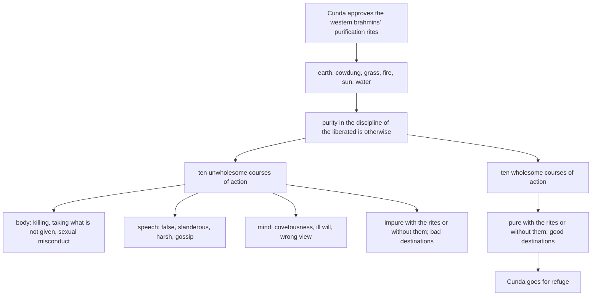

import { Tabs, TabItem } from '@astrojs/starlight/components';

Original text: [17A10/4.2.10 Cundasutta 1253–1298](https://tipitaka2500.github.io/tipitaka/17A10/4/4.2/4.2.10.html#1253) in the [World Tipitaka Edition](https://tipitaka2500.github.io)

## Summary

At Pāvā, Cunda the smith's son tells the Bhagavā that he approves of the purification rites of the western brahmins: touching the earth at dawn, or cowdung, or grass, tending the fire, worshipping the sun, bathing in the evening. The Bhagavā answers that purity in the discipline of the liberated is otherwise: the ten unwholesome courses of action of body, speech and mind leave a person impure whether he performs the rites or not, and the ten wholesome courses leave him pure; the one leads to bad destinations, the other to good. Cunda goes for refuge.

## Diagram

## Text

<Tabs syncKey="paliquote">
<TabItem label="My Translation">
(176.)

1253\. Thus heard by me — At one time the Bhagavā was dwelling at Pāvā, in the mango grove of Cunda the smith's son. Then Cunda the smith's son approached the Bhagavā; having approached, he bowed to the Bhagavā and sat down to one side. The Bhagavā said this to Cunda the smith's son, seated to one side: “Whose purification rites do you approve of, Cunda?” “The brahmins of the western land, Bhante, carrying water-pitchers, garlanded with aquatic plants, tending the fire, descending into the water, prescribe purification rites; I approve of their purification rites.”

1254\. “But in what way, Cunda, do the brahmins of the western land, carrying water-pitchers, garlanded with aquatic plants, tending the fire, descending into the water, prescribe purification rites?” “Here, Bhante, the brahmins of the western land are carrying water-pitchers, garlanded with aquatic plants, tending the fire, descending into the water. They encourage a disciple thus: ‘Come, you there, man: very early in the morning, just as you get up from your bed, you should touch the earth; if you do not touch the earth, you should touch wet cowdung; if you do not touch wet cowdung, you should touch green grass; if you do not touch green grass, you should tend the fire; if you do not tend the fire, you should worship the sun with clasped hands; if you do not worship the sun with clasped hands, you should descend into the water in the evening for the third time.’ Thus, Bhante, do the brahmins of the western land, carrying water-pitchers, garlanded with aquatic plants, tending the fire, descending into the water, prescribe purification rites; I approve of their purification rites.”

1255\. “The brahmins of the western land, Cunda, carrying water-pitchers, garlanded with aquatic plants, tending the fire, descending into the water, prescribe purification rites in one way, but purity in the discipline of the liberated is otherwise.” “But in what way, Bhante, is there purity in the discipline of the liberated? Please, Bhante, let the Bhagavā teach me the Dhamma according to how there is purity in the discipline of the liberated.”

1256\. “In that case, Cunda, listen and pay close attention; I will speak.” “Yes, Bhante,” Cunda the smith's son replied to the Bhagavā. The Bhagavā said this:

1257\. “Impurity by body, Cunda, is of three kinds; impurity by speech is of four kinds; impurity by mind is of three kinds.

1258\. And how, Cunda, is impurity by body of three kinds? Here, Cunda, a certain person is one who kills living beings: cruel, bloody-handed, entrenched in violence, merciless towards all living beings. (1)

1259\. He is one who takes what is not given. Whatever is another's — another's wealth and property, whether in the village or in the forest — he is one who takes that, not given, with intent to steal. (2)

1260\. He is one who engages in sexual misconduct. Those women who are protected by their mother, protected by their father, protected by their mother and father, protected by a brother, protected by a sister, protected by relatives, protected by their clan, protected by their religion, who have a husband, who are protected by threat of punishment, even those garlanded in betrothal — with such women he is one who engages in [sexual] conduct. (3)

1261\. Thus, Cunda, impurity by body is of three kinds.

1262\. And how, Cunda, is impurity by speech of four kinds? Here, Cunda, a certain person is one who speaks falsely. Gone to the assembly hall, or gone to a meeting, or among his relatives, or among his guild, or amidst the royal court, brought forward and questioned as a witness, ‘Come now, man, say what you know,’ not knowing he says, ‘I know,’ or knowing he says, ‘I do not know’; not seeing he says, ‘I see,’ or seeing he says, ‘I do not see.’ Thus for his own sake, or for the sake of another, or for the sake of some small worldly benefit, he speaks a deliberate lie. (4)

1263\. He is one who speaks slanderously. Having listened here, he tells it there to break up these people; or having listened there, he tells it here to break up those people. Thus he is a divider of the united and a provider for the divided; enjoying division, liking division, delighting in division, he speaks divisive speech. (5)

1264\. He is one who speaks harshly. Whatever speech is harsh, rough, hurtful to others, offensive to others, bordering on anger, not conducive to focus — such speech he speaks. (6)

1265\. He is one who gossips: speaking at the improper time, speaking what is untrue, speaking what is not meaningful, speaking against the Dhamma, speaking against the discipline; he speaks speech not worth remembering, untimely, unreasonable, purposeless, unbeneficial. Thus, Cunda, impurity by speech is of four kinds. (7)

1266\. And how, Cunda, is impurity by mind of three kinds? Here, Cunda, a certain person is covetous. Whatever is another's — another's wealth and property — he is one who covets it, [thinking]: ‘Oh, may what is another's be mine!’ (8)

1267\. He has a mind of ill will, with malevolent intention: ‘May these beings be killed, or be bound, or be annihilated, or perish, or not exist!’ (9)

1268\. He has wrong view, with distorted vision: ‘There is nothing given, nothing offered, nothing sacrificed; there is no fruit or result of actions well done and badly done; this world does not exist; the other world does not exist; there is no mother; there is no father; there are no spontaneously reborn beings; there are no religious practitioners in the world who, going the right way, practising correctly, make known this world and the other world, having realised them themselves through experiential understanding.’ Thus, Cunda, impurity by mind is of three kinds. (10)

1269\. These, Cunda, are the ten unwholesome courses of action. One endowed with these ten unwholesome courses of action, Cunda, even if he touches the earth very early in the morning, just as he gets up from his bed, is impure all the same; even if he does not touch the earth, he is impure all the same.

1270\. Even if he touches wet cowdung, he is impure all the same; even if he does not touch wet cowdung, he is impure all the same.

1271\. Even if he touches green grass, he is impure all the same; even if he does not touch green grass, he is impure all the same.

1272\. Even if he tends the fire, he is impure all the same; even if he does not tend the fire, he is impure all the same.

1273\. Even if he worships the sun with clasped hands, he is impure all the same; even if he does not worship the sun with clasped hands, he is impure all the same.

1274\. Even if he descends into the water in the evening for the third time, he is impure all the same; even if he does not descend into the water in the evening for the third time, he is impure all the same. For what reason? These ten unwholesome courses of action, Cunda, are impure themselves and cause impurity.

1275\. Moreover, Cunda, because of possessing these ten unwholesome courses of action, hell is found, the animal realm is found, the realm of ghosts is found, or whatever other bad destinations there are.

1276\. Purity by body, Cunda, is of three kinds; purity by speech is of four kinds; purity by mind is of three kinds.

1277\. How, Cunda, is purity by body of three kinds? Here, Cunda, a certain person, giving up the taking of life, abstains from the taking of life; he lives with rod and weapon laid aside, scrupulous, compassionate, sympathetic for the welfare of all living beings. (1)

1278\. Giving up the taking of what is not given, he abstains from the taking of what is not given. Whatever is another's — another's wealth and property, whether in the village or in the forest — he is not one who takes that, not given, with intent to steal. (2)

1279\. Giving up sexual misconduct, he abstains from sexual misconduct; those women who are protected by their mother, protected by their father, protected by their mother and father, protected by a brother, protected by a sister, protected by relatives, protected by their clan, protected by their religion, who have a husband, who are protected by threat of punishment, even those garlanded in betrothal — with such women he is not one who engages in [sexual] conduct. (3)

1280\. Thus, Cunda, purity by body is of three kinds.

1281\. And how, Cunda, is purity by speech of four kinds? Here, Cunda, a certain person, giving up false speech, abstains from false speech. Gone to the assembly hall, or gone to a meeting, or among his relatives, or among his guild, or amidst the royal court, brought forward and questioned as a witness, ‘Come now, man, say what you know,’ not knowing he says, ‘I do not know,’ or knowing he says, ‘I know,’ not seeing he says, ‘I do not see,’ or seeing he says, ‘I see.’ Thus for his own sake, or for the sake of another, or for the sake of some small worldly benefit, he does not speak a deliberate lie. (4)

1282\. Giving up slanderous speech, he abstains from slanderous speech; having listened here, he does not tell it there to break up these people; or having listened there, he does not tell it here to break up those people. Thus he is a conciliator of the broken and a provider of friendly terms; enjoying concord, liking harmony, delighting in unity, he speaks peace-making speech. (5)

1283\. Giving up harsh speech, he abstains from harsh speech. Whatever speech is gentle, pleasant to hear, friendly, heart-warming, polite, loved by the people, charming to the people — such speech he speaks. (6)

1284\. Giving up gossip, he abstains from gossip; he speaks at the proper time, speaks what is true, speaks what is meaningful, speaks about the Dhamma, speaks about the discipline; he speaks speech worth remembering, timely, reasonable, purposeful, beneficial. (7)

1285\. Thus, Cunda, purity by speech is of four kinds.

1286\. And how, Cunda, is purity by mind of three kinds? Here, Cunda, a certain person is not covetous. Whatever is another's — another's wealth and property — he is not one who covets it, [thinking]: ‘Oh, may what is another's be mine!’ (8)

1287\. He has a mind free from ill will, with no malevolent intention: ‘May these beings be without animosity, free from ill will, untroubled; may they look after themselves happily!’ (9)

1288\. He has right view, with undistorted vision: ‘There is what is given, there is what is offered, there is what is sacrificed; there is the fruit and result of actions well done and badly done; there is this world; there is the other world; there is mother; there is father; there are spontaneously reborn beings; there are religious practitioners in the world who, going the right way, practising correctly, make known this world and the other world, having realised them themselves through experiential understanding.’ (10)

1289\. Thus, Cunda, purity by mind is of three kinds.

1290\. These, Cunda, are the ten wholesome courses of action. One endowed with these ten wholesome courses of action, Cunda, even if he touches the earth very early in the morning, just as he gets up from his bed, is pure all the same; even if he does not touch the earth, he is pure all the same.

1291\. Even if he touches wet cowdung, he is pure all the same; even if he does not touch wet cowdung, he is pure all the same.

1292\. Even if he touches green grass, he is pure all the same; even if he does not touch green grass, he is pure all the same.

1293\. Even if he tends the fire, he is pure all the same; even if he does not tend the fire, he is pure all the same.

1294\. Even if he worships the sun with clasped hands, he is pure all the same; even if he does not worship the sun with clasped hands, he is pure all the same.

1295\. Even if he descends into the water in the evening for the third time, he is pure all the same; even if he does not descend into the water in the evening for the third time, he is pure all the same. For what reason? These ten wholesome courses of action, Cunda, are pure themselves and cause purity.

1296\. Moreover, Cunda, because of possessing these ten wholesome courses of action, gods are found, humans are found, or whatever other good destinations there are.”

1297\. When this was said, Cunda the smith's son said this to the Bhagavā: “Excellent, Bhante! … and so on … May the Bhagavā, Bhante, remember me as an `upāsaka` (lay disciple) who has gone for refuge for life, from today onwards.”

1298\. The tenth [discourse of the chapter].
</TabItem>

<TabItem label="Pāḷi (Roman IAST)">
(176.)

1253\. Evaṃ me sutaṃ— ekaṃ samayaṃ bhagavā pāvāyaṃ viharati cundassa kammāraputtassa ambavane. Atha kho cundo kammāraputto yena bhagavā tenupasaṅkami; upasaṅkamitvā bhagavantaṃ abhivādetvā ekamantaṃ nisīdi. Ekamantaṃ nisinnaṃ kho cundaṃ kammāraputtaṃ bhagavā etadavoca— “kassa no tvaṃ, cunda, soceyyāni rocesī”ti? “Brāhmaṇā, bhante, pacchābhūmakā kamaṇḍalukā sevālamālikā aggiparicārikā udakorohakā soceyyāni paññapenti; tesāhaṃ soceyyāni rocemī”ti.

1254\. “Yathā kathaṃ pana, cunda, brāhmaṇā pacchābhūmakā kamaṇḍalukā sevālamālikā aggiparicārikā udakorohakā soceyyāni paññapentī”ti? “Idha, bhante, brāhmaṇā pacchābhūmakā kamaṇḍalukā sevālamālikā aggiparicārikā udakorohakā. Te sāvakaṃ evaṃ samādapenti— ‘ehi tvaṃ, ambho purisa, kālasseva uṭṭhahantova sayanamhā pathaviṃ āmaseyyāsi; no ce pathaviṃ āmaseyyāsi, allāni gomayāni āmaseyyāsi; no ce allāni gomayāni āmaseyyāsi, haritāni tiṇāni āmaseyyāsi; no ce haritāni tiṇāni āmaseyyāsi, aggiṃ paricareyyāsi; no ce aggiṃ paricareyyāsi, pañjaliko ādiccaṃ namasseyyāsi; no ce pañjaliko ādiccaṃ namasseyyāsi, sāyatatiyakaṃ udakaṃ oroheyyāsī’ti. Evaṃ kho, bhante, brāhmaṇā pacchābhūmakā kamaṇḍalukā sevālamālikā aggiparicārikā udakorohakā soceyyāni paññapenti; tesāhaṃ soceyyāni rocemī”ti.

1255\. “Aññathā kho, cunda, brāhmaṇā pacchābhūmakā kamaṇḍalukā sevālamālikā aggiparicārikā udakorohakā soceyyāni paññapenti, aññathā ca pana ariyassa vinaye soceyyaṃ hotī”ti. “Yathā kathaṃ pana, bhante, ariyassa vinaye soceyyaṃ hoti? Sādhu me, bhante, bhagavā tathā dhammaṃ desetu yathā ariyassa vinaye soceyyaṃ hotī”ti.

1256\. “Tena hi, cunda, suṇāhi, sādhukaṃ manasi karohi; bhāsissāmī”ti. “Evaṃ, bhante”ti kho cundo kammāraputto bhagavato paccassosi. Bhagavā etadavoca—

1257\. “Tividhaṃ kho, cunda, kāyena asoceyyaṃ hoti; catubbidhaṃ vācāya asoceyyaṃ hoti; tividhaṃ manasā asoceyyaṃ hoti.

1258\. Kathañca, cunda, tividhaṃ kāyena asoceyyaṃ hoti? Idha, cunda, ekacco pāṇātipātī hoti luddo lohitapāṇi hatapahate niviṭṭho adayāpanno sabbapāṇabhūtesu. (1)

1259\. Adinnādāyī hoti. Yaṃ taṃ parassa paravittūpakaraṇaṃ gāmagataṃ vā araññagataṃ vā taṃ adinnaṃ theyyasaṅkhātaṃ ādātā hoti. (2)

1260\. Kāmesumicchācārī hoti. Yā tā māturakkhitā piturakkhitā mātāpiturakkhitā bhāturakkhitā bhaginirakkhitā ñātirakkhitā gottarakkhitā dhammarakkhitā sasāmikā saparidaṇḍā antamaso mālāguḷaparikkhittāpi, tathārūpāsu cārittaṃ āpajjitā hoti. (3)

1261\. Evaṃ kho, cunda, tividhaṃ kāyena asoceyyaṃ hoti.

1262\. Kathañca, cunda, catubbidhaṃ vācāya asoceyyaṃ hoti? Idha, cunda, ekacco musāvādī hoti. Sabhaggato vā parisaggato vā ñātimajjhagato vā pūgamajjhagato vā rājakulamajjhagato vā abhinīto sakkhipuṭṭho— ‘ehambho purisa, yaṃ jānāsi taṃ vadehī’ti, so ajānaṃ vā āha— ‘jānāmī’ti, jānaṃ vā āha— ‘na jānāmī’ti; apassaṃ vā āha— ‘passāmī’ti, passaṃ vā āha— ‘na passāmī’ti. Iti attahetu vā parahetu vā āmisakiñcikkhahetu vā sampajānamusā bhāsitā hoti. (4)

1263\. Pisuṇavāco hoti. Ito sutvā amutra akkhātā imesaṃ bhedāya, amutra vā sutvā imesaṃ akkhātā amūsaṃ bhedāya. Iti samaggānaṃ vā bhettā, bhinnānaṃ vā anuppadātā, vaggārāmo vaggarato vagganandī vaggakaraṇiṃ vācaṃ bhāsitā hoti. (5)

1264\. Pharusavāco hoti. Yā sā vācā aṇḍakā kakkasā parakaṭukā parābhisajjanī kodhasāmantā asamādhisaṃvattanikā, tathārūpiṃ vācaṃ bhāsitā hoti. (6)

1265\. Samphappalāpī hoti akālavādī abhūtavādī anatthavādī adhammavādī avinayavādī; anidhānavatiṃ vācaṃ bhāsitā hoti akālena anapadesaṃ apariyantavatiṃ anatthasaṃhitaṃ. Evaṃ kho, cunda, catubbidhaṃ vācāya asoceyyaṃ hoti. (7)

1266\. Kathañca, cunda, tividhaṃ manasā asoceyyaṃ hoti? Idha, cunda, ekacco abhijjhālu hoti. Yaṃ taṃ parassa paravittūpakaraṇaṃ taṃ abhijjhātā hoti— ‘aho vata yaṃ parassa taṃ mamassā’ti. (8)

1267\. Byāpannacitto hoti paduṭṭhamanasaṅkappo— ‘ime sattā haññantu vā bajjhantu vā ucchijjantu vā vinassantu vā mā vā ahesun’ti. (9)

1268\. Micchādiṭṭhiko hoti viparītadassano— ‘natthi dinnaṃ, natthi yiṭṭhaṃ, natthi hutaṃ, natthi sukaṭadukkaṭānaṃ kammānaṃ phalaṃ vipāko, natthi ayaṃ loko, natthi paro loko, natthi mātā, natthi pitā, natthi sattā opapātikā, natthi loke samaṇabrāhmaṇā sammaggatā sammāpaṭipannā ye imañca lokaṃ parañca lokaṃ sayaṃ abhiññā sacchikatvā pavedentī’ti. Evaṃ kho, cunda, manasā tividhaṃ asoceyyaṃ hoti. (10)

1269\. Ime kho, cunda, dasa akusalakammapathā. Imehi kho, cunda, dasahi akusalehi kammapathehi samannāgato kālasseva uṭṭhahantova sayanamhā pathaviñcepi āmasati, asuciyeva hoti; no cepi pathaviṃ āmasati, asuciyeva hoti.

1270\. Allāni cepi gomayāni āmasati, asuciyeva hoti; no cepi allāni gomayāni āmasati, asuciyeva hoti.

1271\. Haritāni cepi tiṇāni āmasati, asuciyeva hoti; no cepi haritāni tiṇāni āmasati, asuciyeva hoti.

1272\. Aggiñcepi paricarati, asuciyeva hoti, no cepi aggiṃ paricarati, asuciyeva hoti.

1273\. Pañjaliko cepi ādiccaṃ namassati, asuciyeva hoti; no cepi pañjaliko ādiccaṃ namassati, asuciyeva hoti.

1274\. Sāyatatiyakañcepi udakaṃ orohati, asuciyeva hoti; no cepi sāyatatiyakaṃ udakaṃ orohati, asuciyeva hoti. Taṃ kissa hetu? Ime, cunda, dasa akusalakammapathā asucīyeva honti asucikaraṇā ca.

1275\. Imesaṃ pana, cunda, dasannaṃ akusalānaṃ kammapathānaṃ samannāgamanahetu nirayo paññāyati, tiracchānayoni paññāyati, pettivisayo paññāyati, yā vā panaññāpi kāci duggatiyo.

1276\. Tividhaṃ kho, cunda, kāyena soceyyaṃ hoti; catubbidhaṃ vācāya soceyyaṃ hoti; tividhaṃ manasā soceyyaṃ hoti.

1277\. Kathaṃ, cunda, tividhaṃ kāyena soceyyaṃ hoti? Idha, cunda, ekacco pāṇātipātaṃ pahāya pāṇātipātā paṭivirato hoti nihitadaṇḍo nihitasattho, lajjī dayāpanno, sabbapāṇabhūtahitānukampī viharati. (1)

1278\. Adinnādānaṃ pahāya, adinnādānā paṭivirato hoti. Yaṃ taṃ parassa paravittūpakaraṇaṃ gāmagataṃ vā araññagataṃ vā, na taṃ adinnaṃ theyyasaṅkhātaṃ ādātā hoti. (2)

1279\. Kāmesumicchācāraṃ pahāya, kāmesumicchācārā paṭivirato hoti yā tā māturakkhitā piturakkhitā mātāpiturakkhitā bhāturakkhitā bhaginirakkhitā ñātirakkhitā gottarakkhitā dhammarakkhitā sasāmikā saparidaṇḍā antamaso mālāguḷaparikkhittāpi, tathārūpāsu na cārittaṃ āpajjitā hoti. (3)

1280\. Evaṃ kho, cunda, tividhaṃ kāyena soceyyaṃ hoti.

1281\. Kathañca, cunda, catubbidhaṃ vācāya soceyyaṃ hoti? Idha, cunda, ekacco musāvādaṃ pahāya musāvādā paṭivirato hoti. Sabhaggato vā parisaggato vā ñātimajjhagato vā pūgamajjhagato vā rājakulamajjhagato vā abhinīto sakkhipuṭṭho— ‘ehambho purisa, yaṃ jānāsi taṃ vadehī’ti, so ajānaṃ vā āha— ‘na jānāmī’ti, jānaṃ vā āha— ‘jānāmī’ti, apassaṃ vā āha— ‘na passāmī’ti, passaṃ vā āha— ‘passāmī’ti. Iti attahetu vā parahetu vā āmisakiñcikkhahetu vā na sampajānamusā bhāsitā hoti. (4)

1282\. Pisuṇaṃ vācaṃ pahāya, pisuṇāya vācāya paṭivirato hoti— na ito sutvā amutra akkhātā imesaṃ bhedāya, na amutra vā sutvā imesaṃ akkhātā amūsaṃ bhedāya. Iti bhinnānaṃ vā sandhātā sahitānaṃ vā anuppadātā samaggārāmo samaggarato samagganandī samaggakaraṇiṃ vācaṃ bhāsitā hoti. (5)

1283\. Pharusaṃ vācaṃ pahāya, pharusāya vācāya paṭivirato hoti. Yā sā vācā nelā kaṇṇasukhā pemanīyā hadayaṅgamā porī bahujanakantā bahujanamanāpā, tathārūpiṃ vācaṃ bhāsitā hoti. (6)

1284\. Samphappalāpaṃ pahāya, samphappalāpā paṭivirato hoti kālavādī bhūtavādī atthavādī dhammavādī vinayavādī; nidhānavatiṃ vācaṃ bhāsitā hoti kālena sāpadesaṃ pariyantavatiṃ atthasaṃhitaṃ. (7)

1285\. Evaṃ kho, cunda, catubbidhaṃ vācāya soceyyaṃ hoti.

1286\. Kathañca, cunda, tividhaṃ manasā soceyyaṃ hoti? Idha, cunda, ekacco anabhijjhālu hoti. Yaṃ taṃ parassa paravittūpakaraṇaṃ taṃ anabhijjhitā hoti— ‘aho vata yaṃ parassa taṃ mamassā’ti. (8)

1287\. Abyāpannacitto hoti appaduṭṭhamanasaṅkappo— ‘ime sattā averā hontu abyāpajjā, anīghā sukhī attānaṃ pariharantū’ti. (9)

1288\. Sammādiṭṭhiko hoti aviparītadassano— ‘atthi dinnaṃ, atthi yiṭṭhaṃ, atthi hutaṃ, atthi sukaṭadukkaṭānaṃ kammānaṃ phalaṃ vipāko, atthi ayaṃ loko, atthi paro loko, atthi mātā, atthi pitā, atthi sattā opapātikā, atthi loke samaṇabrāhmaṇā sammaggatā sammāpaṭipannā ye imañca lokaṃ parañca lokaṃ sayaṃ abhiññā sacchikatvā pavedentī’ti. (10)

1289\. Evaṃ kho, cunda, tividhaṃ manasā soceyyaṃ hoti.

1290\. Ime kho, cunda, dasa kusalakammapathā. Imehi kho, cunda, dasahi kusalehi kammapathehi samannāgato kālasseva uṭṭhahantova sayanamhā pathaviñcepi āmasati, suciyeva hoti; no cepi pathaviṃ āmasati, suciyeva hoti.

1291\. Allāni cepi gomayāni āmasati, suciyeva hoti; no cepi allāni gomayāni āmasati, suciyeva hoti.

1292\. Haritāni cepi tiṇāni āmasati, suciyeva hoti; no cepi haritāni tiṇāni āmasati, suciyeva hoti.

1293\. Aggiñcepi paricarati, suciyeva hoti; no cepi aggiṃ paricarati, suciyeva hoti.

1294\. Pañjaliko cepi ādiccaṃ namassati, suciyeva hoti; no cepi pañjaliko ādiccaṃ namassati, suciyeva hoti.

1295\. Sāyatatiyakañcepi udakaṃ orohati, suciyeva hoti; no cepi sāyatatiyakaṃ udakaṃ orohati, suciyeva hoti. Taṃ kissa hetu? Ime, cunda, dasa kusalakammapathā sucīyeva honti sucikaraṇā ca.

1296\. Imesaṃ pana, cunda, dasannaṃ kusalānaṃ kammapathānaṃ samannāgamanahetu devā paññāyanti, manussā paññāyanti, yā vā panaññāpi kāci sugatiyo”ti.

1297\. Evaṃ vutte, cundo kammāraputto bhagavantaṃ etadavoca— “abhikkantaṃ, bhante…pe… upāsakaṃ maṃ, bhante, bhagavā dhāretu ajjatagge pāṇupetaṃ saraṇaṃ gatan”ti.

1298\. Dasamaṃ.
</TabItem>

<TabItem label="Pāḷi (Brahmi)">
(176.)

1253\. 𑀏𑀯𑀁 𑀫𑁂 𑀲𑀼𑀢𑀁— 𑀏𑀓𑀁 𑀲𑀫𑀬𑀁 𑀪𑀕𑀯𑀸 𑀧𑀸𑀯𑀸𑀬𑀁 𑀯𑀺𑀳𑀭𑀢𑀺 𑀘𑀼𑀦𑁆𑀤𑀲𑁆𑀲 𑀓𑀫𑁆𑀫𑀸𑀭𑀧𑀼𑀢𑁆𑀢𑀲𑁆𑀲 𑀅𑀫𑁆𑀩𑀯𑀦𑁂. 𑀅𑀣 𑀔𑁄 𑀘𑀼𑀦𑁆𑀤𑁄 𑀓𑀫𑁆𑀫𑀸𑀭𑀧𑀼𑀢𑁆𑀢𑁄 𑀬𑁂𑀦 𑀪𑀕𑀯𑀸 𑀢𑁂𑀦𑀼𑀧𑀲𑀗𑁆𑀓𑀫𑀺; 𑀉𑀧𑀲𑀗𑁆𑀓𑀫𑀺𑀢𑁆𑀯𑀸 𑀪𑀕𑀯𑀦𑁆𑀢𑀁 𑀅𑀪𑀺𑀯𑀸𑀤𑁂𑀢𑁆𑀯𑀸 𑀏𑀓𑀫𑀦𑁆𑀢𑀁 𑀦𑀺𑀲𑀻𑀤𑀺. 𑀏𑀓𑀫𑀦𑁆𑀢𑀁 𑀦𑀺𑀲𑀺𑀦𑁆𑀦𑀁 𑀔𑁄 𑀘𑀼𑀦𑁆𑀤𑀁 𑀓𑀫𑁆𑀫𑀸𑀭𑀧𑀼𑀢𑁆𑀢𑀁 𑀪𑀕𑀯𑀸 𑀏𑀢𑀤𑀯𑁄𑀘— “𑀓𑀲𑁆𑀲 𑀦𑁄 𑀢𑁆𑀯𑀁, 𑀘𑀼𑀦𑁆𑀤, 𑀲𑁄𑀘𑁂𑀬𑁆𑀬𑀸𑀦𑀺 𑀭𑁄𑀘𑁂𑀲𑀻”𑀢𑀺? “𑀩𑁆𑀭𑀸𑀳𑁆𑀫𑀡𑀸, 𑀪𑀦𑁆𑀢𑁂, 𑀧𑀘𑁆𑀙𑀸𑀪𑀽𑀫𑀓𑀸 𑀓𑀫𑀡𑁆𑀟𑀮𑀼𑀓𑀸 𑀲𑁂𑀯𑀸𑀮𑀫𑀸𑀮𑀺𑀓𑀸 𑀅𑀕𑁆𑀕𑀺𑀧𑀭𑀺𑀘𑀸𑀭𑀺𑀓𑀸 𑀉𑀤𑀓𑁄𑀭𑁄𑀳𑀓𑀸 𑀲𑁄𑀘𑁂𑀬𑁆𑀬𑀸𑀦𑀺 𑀧𑀜𑁆𑀜𑀧𑁂𑀦𑁆𑀢𑀺; 𑀢𑁂𑀲𑀸𑀳𑀁 𑀲𑁄𑀘𑁂𑀬𑁆𑀬𑀸𑀦𑀺 𑀭𑁄𑀘𑁂𑀫𑀻”𑀢𑀺.

1254\. “𑀬𑀣𑀸 𑀓𑀣𑀁 𑀧𑀦, 𑀘𑀼𑀦𑁆𑀤, 𑀩𑁆𑀭𑀸𑀳𑁆𑀫𑀡𑀸 𑀧𑀘𑁆𑀙𑀸𑀪𑀽𑀫𑀓𑀸 𑀓𑀫𑀡𑁆𑀟𑀮𑀼𑀓𑀸 𑀲𑁂𑀯𑀸𑀮𑀫𑀸𑀮𑀺𑀓𑀸 𑀅𑀕𑁆𑀕𑀺𑀧𑀭𑀺𑀘𑀸𑀭𑀺𑀓𑀸 𑀉𑀤𑀓𑁄𑀭𑁄𑀳𑀓𑀸 𑀲𑁄𑀘𑁂𑀬𑁆𑀬𑀸𑀦𑀺 𑀧𑀜𑁆𑀜𑀧𑁂𑀦𑁆𑀢𑀻”𑀢𑀺? “𑀇𑀥, 𑀪𑀦𑁆𑀢𑁂, 𑀩𑁆𑀭𑀸𑀳𑁆𑀫𑀡𑀸 𑀧𑀘𑁆𑀙𑀸𑀪𑀽𑀫𑀓𑀸 𑀓𑀫𑀡𑁆𑀟𑀮𑀼𑀓𑀸 𑀲𑁂𑀯𑀸𑀮𑀫𑀸𑀮𑀺𑀓𑀸 𑀅𑀕𑁆𑀕𑀺𑀧𑀭𑀺𑀘𑀸𑀭𑀺𑀓𑀸 𑀉𑀤𑀓𑁄𑀭𑁄𑀳𑀓𑀸. 𑀢𑁂 𑀲𑀸𑀯𑀓𑀁 𑀏𑀯𑀁 𑀲𑀫𑀸𑀤𑀧𑁂𑀦𑁆𑀢𑀺— ‘𑀏𑀳𑀺 𑀢𑁆𑀯𑀁, 𑀅𑀫𑁆𑀪𑁄 𑀧𑀼𑀭𑀺𑀲, 𑀓𑀸𑀮𑀲𑁆𑀲𑁂𑀯 𑀉𑀝𑁆𑀞𑀳𑀦𑁆𑀢𑁄𑀯 𑀲𑀬𑀦𑀫𑁆𑀳𑀸 𑀧𑀣𑀯𑀺𑀁 𑀆𑀫𑀲𑁂𑀬𑁆𑀬𑀸𑀲𑀺; 𑀦𑁄 𑀘𑁂 𑀧𑀣𑀯𑀺𑀁 𑀆𑀫𑀲𑁂𑀬𑁆𑀬𑀸𑀲𑀺, 𑀅𑀮𑁆𑀮𑀸𑀦𑀺 𑀕𑁄𑀫𑀬𑀸𑀦𑀺 𑀆𑀫𑀲𑁂𑀬𑁆𑀬𑀸𑀲𑀺; 𑀦𑁄 𑀘𑁂 𑀅𑀮𑁆𑀮𑀸𑀦𑀺 𑀕𑁄𑀫𑀬𑀸𑀦𑀺 𑀆𑀫𑀲𑁂𑀬𑁆𑀬𑀸𑀲𑀺, 𑀳𑀭𑀺𑀢𑀸𑀦𑀺 𑀢𑀺𑀡𑀸𑀦𑀺 𑀆𑀫𑀲𑁂𑀬𑁆𑀬𑀸𑀲𑀺; 𑀦𑁄 𑀘𑁂 𑀳𑀭𑀺𑀢𑀸𑀦𑀺 𑀢𑀺𑀡𑀸𑀦𑀺 𑀆𑀫𑀲𑁂𑀬𑁆𑀬𑀸𑀲𑀺, 𑀅𑀕𑁆𑀕𑀺𑀁 𑀧𑀭𑀺𑀘𑀭𑁂𑀬𑁆𑀬𑀸𑀲𑀺; 𑀦𑁄 𑀘𑁂 𑀅𑀕𑁆𑀕𑀺𑀁 𑀧𑀭𑀺𑀘𑀭𑁂𑀬𑁆𑀬𑀸𑀲𑀺, 𑀧𑀜𑁆𑀚𑀮𑀺𑀓𑁄 𑀆𑀤𑀺𑀘𑁆𑀘𑀁 𑀦𑀫𑀲𑁆𑀲𑁂𑀬𑁆𑀬𑀸𑀲𑀺; 𑀦𑁄 𑀘𑁂 𑀧𑀜𑁆𑀚𑀮𑀺𑀓𑁄 𑀆𑀤𑀺𑀘𑁆𑀘𑀁 𑀦𑀫𑀲𑁆𑀲𑁂𑀬𑁆𑀬𑀸𑀲𑀺, 𑀲𑀸𑀬𑀢𑀢𑀺𑀬𑀓𑀁 𑀉𑀤𑀓𑀁 𑀑𑀭𑁄𑀳𑁂𑀬𑁆𑀬𑀸𑀲𑀻’𑀢𑀺. 𑀏𑀯𑀁 𑀔𑁄, 𑀪𑀦𑁆𑀢𑁂, 𑀩𑁆𑀭𑀸𑀳𑁆𑀫𑀡𑀸 𑀧𑀘𑁆𑀙𑀸𑀪𑀽𑀫𑀓𑀸 𑀓𑀫𑀡𑁆𑀟𑀮𑀼𑀓𑀸 𑀲𑁂𑀯𑀸𑀮𑀫𑀸𑀮𑀺𑀓𑀸 𑀅𑀕𑁆𑀕𑀺𑀧𑀭𑀺𑀘𑀸𑀭𑀺𑀓𑀸 𑀉𑀤𑀓𑁄𑀭𑁄𑀳𑀓𑀸 𑀲𑁄𑀘𑁂𑀬𑁆𑀬𑀸𑀦𑀺 𑀧𑀜𑁆𑀜𑀧𑁂𑀦𑁆𑀢𑀺; 𑀢𑁂𑀲𑀸𑀳𑀁 𑀲𑁄𑀘𑁂𑀬𑁆𑀬𑀸𑀦𑀺 𑀭𑁄𑀘𑁂𑀫𑀻”𑀢𑀺.

1255\. “𑀅𑀜𑁆𑀜𑀣𑀸 𑀔𑁄, 𑀘𑀼𑀦𑁆𑀤, 𑀩𑁆𑀭𑀸𑀳𑁆𑀫𑀡𑀸 𑀧𑀘𑁆𑀙𑀸𑀪𑀽𑀫𑀓𑀸 𑀓𑀫𑀡𑁆𑀟𑀮𑀼𑀓𑀸 𑀲𑁂𑀯𑀸𑀮𑀫𑀸𑀮𑀺𑀓𑀸 𑀅𑀕𑁆𑀕𑀺𑀧𑀭𑀺𑀘𑀸𑀭𑀺𑀓𑀸 𑀉𑀤𑀓𑁄𑀭𑁄𑀳𑀓𑀸 𑀲𑁄𑀘𑁂𑀬𑁆𑀬𑀸𑀦𑀺 𑀧𑀜𑁆𑀜𑀧𑁂𑀦𑁆𑀢𑀺, 𑀅𑀜𑁆𑀜𑀣𑀸 𑀘 𑀧𑀦 𑀅𑀭𑀺𑀬𑀲𑁆𑀲 𑀯𑀺𑀦𑀬𑁂 𑀲𑁄𑀘𑁂𑀬𑁆𑀬𑀁 𑀳𑁄𑀢𑀻”𑀢𑀺. “𑀬𑀣𑀸 𑀓𑀣𑀁 𑀧𑀦, 𑀪𑀦𑁆𑀢𑁂, 𑀅𑀭𑀺𑀬𑀲𑁆𑀲 𑀯𑀺𑀦𑀬𑁂 𑀲𑁄𑀘𑁂𑀬𑁆𑀬𑀁 𑀳𑁄𑀢𑀺? 𑀲𑀸𑀥𑀼 𑀫𑁂, 𑀪𑀦𑁆𑀢𑁂, 𑀪𑀕𑀯𑀸 𑀢𑀣𑀸 𑀥𑀫𑁆𑀫𑀁 𑀤𑁂𑀲𑁂𑀢𑀼 𑀬𑀣𑀸 𑀅𑀭𑀺𑀬𑀲𑁆𑀲 𑀯𑀺𑀦𑀬𑁂 𑀲𑁄𑀘𑁂𑀬𑁆𑀬𑀁 𑀳𑁄𑀢𑀻”𑀢𑀺.

1256\. “𑀢𑁂𑀦 𑀳𑀺, 𑀘𑀼𑀦𑁆𑀤, 𑀲𑀼𑀡𑀸𑀳𑀺, 𑀲𑀸𑀥𑀼𑀓𑀁 𑀫𑀦𑀲𑀺 𑀓𑀭𑁄𑀳𑀺; 𑀪𑀸𑀲𑀺𑀲𑁆𑀲𑀸𑀫𑀻”𑀢𑀺. “𑀏𑀯𑀁, 𑀪𑀦𑁆𑀢𑁂”𑀢𑀺 𑀔𑁄 𑀘𑀼𑀦𑁆𑀤𑁄 𑀓𑀫𑁆𑀫𑀸𑀭𑀧𑀼𑀢𑁆𑀢𑁄 𑀪𑀕𑀯𑀢𑁄 𑀧𑀘𑁆𑀘𑀲𑁆𑀲𑁄𑀲𑀺. 𑀪𑀕𑀯𑀸 𑀏𑀢𑀤𑀯𑁄𑀘—

1257\. “𑀢𑀺𑀯𑀺𑀥𑀁 𑀔𑁄, 𑀘𑀼𑀦𑁆𑀤, 𑀓𑀸𑀬𑁂𑀦 𑀅𑀲𑁄𑀘𑁂𑀬𑁆𑀬𑀁 𑀳𑁄𑀢𑀺; 𑀘𑀢𑀼𑀩𑁆𑀩𑀺𑀥𑀁 𑀯𑀸𑀘𑀸𑀬 𑀅𑀲𑁄𑀘𑁂𑀬𑁆𑀬𑀁 𑀳𑁄𑀢𑀺; 𑀢𑀺𑀯𑀺𑀥𑀁 𑀫𑀦𑀲𑀸 𑀅𑀲𑁄𑀘𑁂𑀬𑁆𑀬𑀁 𑀳𑁄𑀢𑀺.

1258\. 𑀓𑀣𑀜𑁆𑀘, 𑀘𑀼𑀦𑁆𑀤, 𑀢𑀺𑀯𑀺𑀥𑀁 𑀓𑀸𑀬𑁂𑀦 𑀅𑀲𑁄𑀘𑁂𑀬𑁆𑀬𑀁 𑀳𑁄𑀢𑀺? 𑀇𑀥, 𑀘𑀼𑀦𑁆𑀤, 𑀏𑀓𑀘𑁆𑀘𑁄 𑀧𑀸𑀡𑀸𑀢𑀺𑀧𑀸𑀢𑀻 𑀳𑁄𑀢𑀺 𑀮𑀼𑀤𑁆𑀤𑁄 𑀮𑁄𑀳𑀺𑀢𑀧𑀸𑀡𑀺 𑀳𑀢𑀧𑀳𑀢𑁂 𑀦𑀺𑀯𑀺𑀝𑁆𑀞𑁄 𑀅𑀤𑀬𑀸𑀧𑀦𑁆𑀦𑁄 𑀲𑀩𑁆𑀩𑀧𑀸𑀡𑀪𑀽𑀢𑁂𑀲𑀼. (1)

1259\. 𑀅𑀤𑀺𑀦𑁆𑀦𑀸𑀤𑀸𑀬𑀻 𑀳𑁄𑀢𑀺. 𑀬𑀁 𑀢𑀁 𑀧𑀭𑀲𑁆𑀲 𑀧𑀭𑀯𑀺𑀢𑁆𑀢𑀽𑀧𑀓𑀭𑀡𑀁 𑀕𑀸𑀫𑀕𑀢𑀁 𑀯𑀸 𑀅𑀭𑀜𑁆𑀜𑀕𑀢𑀁 𑀯𑀸 𑀢𑀁 𑀅𑀤𑀺𑀦𑁆𑀦𑀁 𑀣𑁂𑀬𑁆𑀬𑀲𑀗𑁆𑀔𑀸𑀢𑀁 𑀆𑀤𑀸𑀢𑀸 𑀳𑁄𑀢𑀺. (2)

1260\. 𑀓𑀸𑀫𑁂𑀲𑀼𑀫𑀺𑀘𑁆𑀙𑀸𑀘𑀸𑀭𑀻 𑀳𑁄𑀢𑀺. 𑀬𑀸 𑀢𑀸 𑀫𑀸𑀢𑀼𑀭𑀓𑁆𑀔𑀺𑀢𑀸 𑀧𑀺𑀢𑀼𑀭𑀓𑁆𑀔𑀺𑀢𑀸 𑀫𑀸𑀢𑀸𑀧𑀺𑀢𑀼𑀭𑀓𑁆𑀔𑀺𑀢𑀸 𑀪𑀸𑀢𑀼𑀭𑀓𑁆𑀔𑀺𑀢𑀸 𑀪𑀕𑀺𑀦𑀺𑀭𑀓𑁆𑀔𑀺𑀢𑀸 𑀜𑀸𑀢𑀺𑀭𑀓𑁆𑀔𑀺𑀢𑀸 𑀕𑁄𑀢𑁆𑀢𑀭𑀓𑁆𑀔𑀺𑀢𑀸 𑀥𑀫𑁆𑀫𑀭𑀓𑁆𑀔𑀺𑀢𑀸 𑀲𑀲𑀸𑀫𑀺𑀓𑀸 𑀲𑀧𑀭𑀺𑀤𑀡𑁆𑀟𑀸 𑀅𑀦𑁆𑀢𑀫𑀲𑁄 𑀫𑀸𑀮𑀸𑀕𑀼𑀍𑀅𑀧𑀭𑀺𑀓𑁆𑀔𑀺𑀢𑁆𑀢𑀸𑀧𑀺, 𑀢𑀣𑀸𑀭𑀽𑀧𑀸𑀲𑀼 𑀘𑀸𑀭𑀺𑀢𑁆𑀢𑀁 𑀆𑀧𑀚𑁆𑀚𑀺𑀢𑀸 𑀳𑁄𑀢𑀺. (3)

1261\. 𑀏𑀯𑀁 𑀔𑁄, 𑀘𑀼𑀦𑁆𑀤, 𑀢𑀺𑀯𑀺𑀥𑀁 𑀓𑀸𑀬𑁂𑀦 𑀅𑀲𑁄𑀘𑁂𑀬𑁆𑀬𑀁 𑀳𑁄𑀢𑀺.

1262\. 𑀓𑀣𑀜𑁆𑀘, 𑀘𑀼𑀦𑁆𑀤, 𑀘𑀢𑀼𑀩𑁆𑀩𑀺𑀥𑀁 𑀯𑀸𑀘𑀸𑀬 𑀅𑀲𑁄𑀘𑁂𑀬𑁆𑀬𑀁 𑀳𑁄𑀢𑀺? 𑀇𑀥, 𑀘𑀼𑀦𑁆𑀤, 𑀏𑀓𑀘𑁆𑀘𑁄 𑀫𑀼𑀲𑀸𑀯𑀸𑀤𑀻 𑀳𑁄𑀢𑀺. 𑀲𑀪𑀕𑁆𑀕𑀢𑁄 𑀯𑀸 𑀧𑀭𑀺𑀲𑀕𑁆𑀕𑀢𑁄 𑀯𑀸 𑀜𑀸𑀢𑀺𑀫𑀚𑁆𑀛𑀕𑀢𑁄 𑀯𑀸 𑀧𑀽𑀕𑀫𑀚𑁆𑀛𑀕𑀢𑁄 𑀯𑀸 𑀭𑀸𑀚𑀓𑀼𑀮𑀫𑀚𑁆𑀛𑀕𑀢𑁄 𑀯𑀸 𑀅𑀪𑀺𑀦𑀻𑀢𑁄 𑀲𑀓𑁆𑀔𑀺𑀧𑀼𑀝𑁆𑀞𑁄— ‘𑀏𑀳𑀫𑁆𑀪𑁄 𑀧𑀼𑀭𑀺𑀲, 𑀬𑀁 𑀚𑀸𑀦𑀸𑀲𑀺 𑀢𑀁 𑀯𑀤𑁂𑀳𑀻’𑀢𑀺, 𑀲𑁄 𑀅𑀚𑀸𑀦𑀁 𑀯𑀸 𑀆𑀳— ‘𑀚𑀸𑀦𑀸𑀫𑀻’𑀢𑀺, 𑀚𑀸𑀦𑀁 𑀯𑀸 𑀆𑀳— ‘𑀦 𑀚𑀸𑀦𑀸𑀫𑀻’𑀢𑀺; 𑀅𑀧𑀲𑁆𑀲𑀁 𑀯𑀸 𑀆𑀳— ‘𑀧𑀲𑁆𑀲𑀸𑀫𑀻’𑀢𑀺, 𑀧𑀲𑁆𑀲𑀁 𑀯𑀸 𑀆𑀳— ‘𑀦 𑀧𑀲𑁆𑀲𑀸𑀫𑀻’𑀢𑀺. 𑀇𑀢𑀺 𑀅𑀢𑁆𑀢𑀳𑁂𑀢𑀼 𑀯𑀸 𑀧𑀭𑀳𑁂𑀢𑀼 𑀯𑀸 𑀆𑀫𑀺𑀲𑀓𑀺𑀜𑁆𑀘𑀺𑀓𑁆𑀔𑀳𑁂𑀢𑀼 𑀯𑀸 𑀲𑀫𑁆𑀧𑀚𑀸𑀦𑀫𑀼𑀲𑀸 𑀪𑀸𑀲𑀺𑀢𑀸 𑀳𑁄𑀢𑀺. (4)

1263\. 𑀧𑀺𑀲𑀼𑀡𑀯𑀸𑀘𑁄 𑀳𑁄𑀢𑀺. 𑀇𑀢𑁄 𑀲𑀼𑀢𑁆𑀯𑀸 𑀅𑀫𑀼𑀢𑁆𑀭 𑀅𑀓𑁆𑀔𑀸𑀢𑀸 𑀇𑀫𑁂𑀲𑀁 𑀪𑁂𑀤𑀸𑀬, 𑀅𑀫𑀼𑀢𑁆𑀭 𑀯𑀸 𑀲𑀼𑀢𑁆𑀯𑀸 𑀇𑀫𑁂𑀲𑀁 𑀅𑀓𑁆𑀔𑀸𑀢𑀸 𑀅𑀫𑀽𑀲𑀁 𑀪𑁂𑀤𑀸𑀬. 𑀇𑀢𑀺 𑀲𑀫𑀕𑁆𑀕𑀸𑀦𑀁 𑀯𑀸 𑀪𑁂𑀢𑁆𑀢𑀸, 𑀪𑀺𑀦𑁆𑀦𑀸𑀦𑀁 𑀯𑀸 𑀅𑀦𑀼𑀧𑁆𑀧𑀤𑀸𑀢𑀸, 𑀯𑀕𑁆𑀕𑀸𑀭𑀸𑀫𑁄 𑀯𑀕𑁆𑀕𑀭𑀢𑁄 𑀯𑀕𑁆𑀕𑀦𑀦𑁆𑀤𑀻 𑀯𑀕𑁆𑀕𑀓𑀭𑀡𑀺𑀁 𑀯𑀸𑀘𑀁 𑀪𑀸𑀲𑀺𑀢𑀸 𑀳𑁄𑀢𑀺. (5)

1264\. 𑀨𑀭𑀼𑀲𑀯𑀸𑀘𑁄 𑀳𑁄𑀢𑀺. 𑀬𑀸 𑀲𑀸 𑀯𑀸𑀘𑀸 𑀅𑀡𑁆𑀟𑀓𑀸 𑀓𑀓𑁆𑀓𑀲𑀸 𑀧𑀭𑀓𑀝𑀼𑀓𑀸 𑀧𑀭𑀸𑀪𑀺𑀲𑀚𑁆𑀚𑀦𑀻 𑀓𑁄𑀥𑀲𑀸𑀫𑀦𑁆𑀢𑀸 𑀅𑀲𑀫𑀸𑀥𑀺𑀲𑀁𑀯𑀢𑁆𑀢𑀦𑀺𑀓𑀸, 𑀢𑀣𑀸𑀭𑀽𑀧𑀺𑀁 𑀯𑀸𑀘𑀁 𑀪𑀸𑀲𑀺𑀢𑀸 𑀳𑁄𑀢𑀺. (6)

1265\. 𑀲𑀫𑁆𑀨𑀧𑁆𑀧𑀮𑀸𑀧𑀻 𑀳𑁄𑀢𑀺 𑀅𑀓𑀸𑀮𑀯𑀸𑀤𑀻 𑀅𑀪𑀽𑀢𑀯𑀸𑀤𑀻 𑀅𑀦𑀢𑁆𑀣𑀯𑀸𑀤𑀻 𑀅𑀥𑀫𑁆𑀫𑀯𑀸𑀤𑀻 𑀅𑀯𑀺𑀦𑀬𑀯𑀸𑀤𑀻; 𑀅𑀦𑀺𑀥𑀸𑀦𑀯𑀢𑀺𑀁 𑀯𑀸𑀘𑀁 𑀪𑀸𑀲𑀺𑀢𑀸 𑀳𑁄𑀢𑀺 𑀅𑀓𑀸𑀮𑁂𑀦 𑀅𑀦𑀧𑀤𑁂𑀲𑀁 𑀅𑀧𑀭𑀺𑀬𑀦𑁆𑀢𑀯𑀢𑀺𑀁 𑀅𑀦𑀢𑁆𑀣𑀲𑀁𑀳𑀺𑀢𑀁. 𑀏𑀯𑀁 𑀔𑁄, 𑀘𑀼𑀦𑁆𑀤, 𑀘𑀢𑀼𑀩𑁆𑀩𑀺𑀥𑀁 𑀯𑀸𑀘𑀸𑀬 𑀅𑀲𑁄𑀘𑁂𑀬𑁆𑀬𑀁 𑀳𑁄𑀢𑀺. (7)

1266\. 𑀓𑀣𑀜𑁆𑀘, 𑀘𑀼𑀦𑁆𑀤, 𑀢𑀺𑀯𑀺𑀥𑀁 𑀫𑀦𑀲𑀸 𑀅𑀲𑁄𑀘𑁂𑀬𑁆𑀬𑀁 𑀳𑁄𑀢𑀺? 𑀇𑀥, 𑀘𑀼𑀦𑁆𑀤, 𑀏𑀓𑀘𑁆𑀘𑁄 𑀅𑀪𑀺𑀚𑁆𑀛𑀸𑀮𑀼 𑀳𑁄𑀢𑀺. 𑀬𑀁 𑀢𑀁 𑀧𑀭𑀲𑁆𑀲 𑀧𑀭𑀯𑀺𑀢𑁆𑀢𑀽𑀧𑀓𑀭𑀡𑀁 𑀢𑀁 𑀅𑀪𑀺𑀚𑁆𑀛𑀸𑀢𑀸 𑀳𑁄𑀢𑀺— ‘𑀅𑀳𑁄 𑀯𑀢 𑀬𑀁 𑀧𑀭𑀲𑁆𑀲 𑀢𑀁 𑀫𑀫𑀲𑁆𑀲𑀸’𑀢𑀺. (8)

1267\. 𑀩𑁆𑀬𑀸𑀧𑀦𑁆𑀦𑀘𑀺𑀢𑁆𑀢𑁄 𑀳𑁄𑀢𑀺 𑀧𑀤𑀼𑀝𑁆𑀞𑀫𑀦𑀲𑀗𑁆𑀓𑀧𑁆𑀧𑁄— ‘𑀇𑀫𑁂 𑀲𑀢𑁆𑀢𑀸 𑀳𑀜𑁆𑀜𑀦𑁆𑀢𑀼 𑀯𑀸 𑀩𑀚𑁆𑀛𑀦𑁆𑀢𑀼 𑀯𑀸 𑀉𑀘𑁆𑀙𑀺𑀚𑁆𑀚𑀦𑁆𑀢𑀼 𑀯𑀸 𑀯𑀺𑀦𑀲𑁆𑀲𑀦𑁆𑀢𑀼 𑀯𑀸 𑀫𑀸 𑀯𑀸 𑀅𑀳𑁂𑀲𑀼𑀦𑁆’𑀢𑀺. (9)

1268\. 𑀫𑀺𑀘𑁆𑀙𑀸𑀤𑀺𑀝𑁆𑀞𑀺𑀓𑁄 𑀳𑁄𑀢𑀺 𑀯𑀺𑀧𑀭𑀻𑀢𑀤𑀲𑁆𑀲𑀦𑁄— ‘𑀦𑀢𑁆𑀣𑀺 𑀤𑀺𑀦𑁆𑀦𑀁, 𑀦𑀢𑁆𑀣𑀺 𑀬𑀺𑀝𑁆𑀞𑀁, 𑀦𑀢𑁆𑀣𑀺 𑀳𑀼𑀢𑀁, 𑀦𑀢𑁆𑀣𑀺 𑀲𑀼𑀓𑀝𑀤𑀼𑀓𑁆𑀓𑀝𑀸𑀦𑀁 𑀓𑀫𑁆𑀫𑀸𑀦𑀁 𑀨𑀮𑀁 𑀯𑀺𑀧𑀸𑀓𑁄, 𑀦𑀢𑁆𑀣𑀺 𑀅𑀬𑀁 𑀮𑁄𑀓𑁄, 𑀦𑀢𑁆𑀣𑀺 𑀧𑀭𑁄 𑀮𑁄𑀓𑁄, 𑀦𑀢𑁆𑀣𑀺 𑀫𑀸𑀢𑀸, 𑀦𑀢𑁆𑀣𑀺 𑀧𑀺𑀢𑀸, 𑀦𑀢𑁆𑀣𑀺 𑀲𑀢𑁆𑀢𑀸 𑀑𑀧𑀧𑀸𑀢𑀺𑀓𑀸, 𑀦𑀢𑁆𑀣𑀺 𑀮𑁄𑀓𑁂 𑀲𑀫𑀡𑀩𑁆𑀭𑀸𑀳𑁆𑀫𑀡𑀸 𑀲𑀫𑁆𑀫𑀕𑁆𑀕𑀢𑀸 𑀲𑀫𑁆𑀫𑀸𑀧𑀝𑀺𑀧𑀦𑁆𑀦𑀸 𑀬𑁂 𑀇𑀫𑀜𑁆𑀘 𑀮𑁄𑀓𑀁 𑀧𑀭𑀜𑁆𑀘 𑀮𑁄𑀓𑀁 𑀲𑀬𑀁 𑀅𑀪𑀺𑀜𑁆𑀜𑀸 𑀲𑀘𑁆𑀙𑀺𑀓𑀢𑁆𑀯𑀸 𑀧𑀯𑁂𑀤𑁂𑀦𑁆𑀢𑀻’𑀢𑀺. 𑀏𑀯𑀁 𑀔𑁄, 𑀘𑀼𑀦𑁆𑀤, 𑀫𑀦𑀲𑀸 𑀢𑀺𑀯𑀺𑀥𑀁 𑀅𑀲𑁄𑀘𑁂𑀬𑁆𑀬𑀁 𑀳𑁄𑀢𑀺. (10)

1269\. 𑀇𑀫𑁂 𑀔𑁄, 𑀘𑀼𑀦𑁆𑀤, 𑀤𑀲 𑀅𑀓𑀼𑀲𑀮𑀓𑀫𑁆𑀫𑀧𑀣𑀸. 𑀇𑀫𑁂𑀳𑀺 𑀔𑁄, 𑀘𑀼𑀦𑁆𑀤, 𑀤𑀲𑀳𑀺 𑀅𑀓𑀼𑀲𑀮𑁂𑀳𑀺 𑀓𑀫𑁆𑀫𑀧𑀣𑁂𑀳𑀺 𑀲𑀫𑀦𑁆𑀦𑀸𑀕𑀢𑁄 𑀓𑀸𑀮𑀲𑁆𑀲𑁂𑀯 𑀉𑀝𑁆𑀞𑀳𑀦𑁆𑀢𑁄𑀯 𑀲𑀬𑀦𑀫𑁆𑀳𑀸 𑀧𑀣𑀯𑀺𑀜𑁆𑀘𑁂𑀧𑀺 𑀆𑀫𑀲𑀢𑀺, 𑀅𑀲𑀼𑀘𑀺𑀬𑁂𑀯 𑀳𑁄𑀢𑀺; 𑀦𑁄 𑀘𑁂𑀧𑀺 𑀧𑀣𑀯𑀺𑀁 𑀆𑀫𑀲𑀢𑀺, 𑀅𑀲𑀼𑀘𑀺𑀬𑁂𑀯 𑀳𑁄𑀢𑀺.

1270\. 𑀅𑀮𑁆𑀮𑀸𑀦𑀺 𑀘𑁂𑀧𑀺 𑀕𑁄𑀫𑀬𑀸𑀦𑀺 𑀆𑀫𑀲𑀢𑀺, 𑀅𑀲𑀼𑀘𑀺𑀬𑁂𑀯 𑀳𑁄𑀢𑀺; 𑀦𑁄 𑀘𑁂𑀧𑀺 𑀅𑀮𑁆𑀮𑀸𑀦𑀺 𑀕𑁄𑀫𑀬𑀸𑀦𑀺 𑀆𑀫𑀲𑀢𑀺, 𑀅𑀲𑀼𑀘𑀺𑀬𑁂𑀯 𑀳𑁄𑀢𑀺.

1271\. 𑀳𑀭𑀺𑀢𑀸𑀦𑀺 𑀘𑁂𑀧𑀺 𑀢𑀺𑀡𑀸𑀦𑀺 𑀆𑀫𑀲𑀢𑀺, 𑀅𑀲𑀼𑀘𑀺𑀬𑁂𑀯 𑀳𑁄𑀢𑀺; 𑀦𑁄 𑀘𑁂𑀧𑀺 𑀳𑀭𑀺𑀢𑀸𑀦𑀺 𑀢𑀺𑀡𑀸𑀦𑀺 𑀆𑀫𑀲𑀢𑀺, 𑀅𑀲𑀼𑀘𑀺𑀬𑁂𑀯 𑀳𑁄𑀢𑀺.

1272\. 𑀅𑀕𑁆𑀕𑀺𑀜𑁆𑀘𑁂𑀧𑀺 𑀧𑀭𑀺𑀘𑀭𑀢𑀺, 𑀅𑀲𑀼𑀘𑀺𑀬𑁂𑀯 𑀳𑁄𑀢𑀺, 𑀦𑁄 𑀘𑁂𑀧𑀺 𑀅𑀕𑁆𑀕𑀺𑀁 𑀧𑀭𑀺𑀘𑀭𑀢𑀺, 𑀅𑀲𑀼𑀘𑀺𑀬𑁂𑀯 𑀳𑁄𑀢𑀺.

1273\. 𑀧𑀜𑁆𑀚𑀮𑀺𑀓𑁄 𑀘𑁂𑀧𑀺 𑀆𑀤𑀺𑀘𑁆𑀘𑀁 𑀦𑀫𑀲𑁆𑀲𑀢𑀺, 𑀅𑀲𑀼𑀘𑀺𑀬𑁂𑀯 𑀳𑁄𑀢𑀺; 𑀦𑁄 𑀘𑁂𑀧𑀺 𑀧𑀜𑁆𑀚𑀮𑀺𑀓𑁄 𑀆𑀤𑀺𑀘𑁆𑀘𑀁 𑀦𑀫𑀲𑁆𑀲𑀢𑀺, 𑀅𑀲𑀼𑀘𑀺𑀬𑁂𑀯 𑀳𑁄𑀢𑀺.

1274\. 𑀲𑀸𑀬𑀢𑀢𑀺𑀬𑀓𑀜𑁆𑀘𑁂𑀧𑀺 𑀉𑀤𑀓𑀁 𑀑𑀭𑁄𑀳𑀢𑀺, 𑀅𑀲𑀼𑀘𑀺𑀬𑁂𑀯 𑀳𑁄𑀢𑀺; 𑀦𑁄 𑀘𑁂𑀧𑀺 𑀲𑀸𑀬𑀢𑀢𑀺𑀬𑀓𑀁 𑀉𑀤𑀓𑀁 𑀑𑀭𑁄𑀳𑀢𑀺, 𑀅𑀲𑀼𑀘𑀺𑀬𑁂𑀯 𑀳𑁄𑀢𑀺. 𑀢𑀁 𑀓𑀺𑀲𑁆𑀲 𑀳𑁂𑀢𑀼? 𑀇𑀫𑁂, 𑀘𑀼𑀦𑁆𑀤, 𑀤𑀲 𑀅𑀓𑀼𑀲𑀮𑀓𑀫𑁆𑀫𑀧𑀣𑀸 𑀅𑀲𑀼𑀘𑀻𑀬𑁂𑀯 𑀳𑁄𑀦𑁆𑀢𑀺 𑀅𑀲𑀼𑀘𑀺𑀓𑀭𑀡𑀸 𑀘.

1275\. 𑀇𑀫𑁂𑀲𑀁 𑀧𑀦, 𑀘𑀼𑀦𑁆𑀤, 𑀤𑀲𑀦𑁆𑀦𑀁 𑀅𑀓𑀼𑀲𑀮𑀸𑀦𑀁 𑀓𑀫𑁆𑀫𑀧𑀣𑀸𑀦𑀁 𑀲𑀫𑀦𑁆𑀦𑀸𑀕𑀫𑀦𑀳𑁂𑀢𑀼 𑀦𑀺𑀭𑀬𑁄 𑀧𑀜𑁆𑀜𑀸𑀬𑀢𑀺, 𑀢𑀺𑀭𑀘𑁆𑀙𑀸𑀦𑀬𑁄𑀦𑀺 𑀧𑀜𑁆𑀜𑀸𑀬𑀢𑀺, 𑀧𑁂𑀢𑁆𑀢𑀺𑀯𑀺𑀲𑀬𑁄 𑀧𑀜𑁆𑀜𑀸𑀬𑀢𑀺, 𑀬𑀸 𑀯𑀸 𑀧𑀦𑀜𑁆𑀜𑀸𑀧𑀺 𑀓𑀸𑀘𑀺 𑀤𑀼𑀕𑁆𑀕𑀢𑀺𑀬𑁄.

1276\. 𑀢𑀺𑀯𑀺𑀥𑀁 𑀔𑁄, 𑀘𑀼𑀦𑁆𑀤, 𑀓𑀸𑀬𑁂𑀦 𑀲𑁄𑀘𑁂𑀬𑁆𑀬𑀁 𑀳𑁄𑀢𑀺; 𑀘𑀢𑀼𑀩𑁆𑀩𑀺𑀥𑀁 𑀯𑀸𑀘𑀸𑀬 𑀲𑁄𑀘𑁂𑀬𑁆𑀬𑀁 𑀳𑁄𑀢𑀺; 𑀢𑀺𑀯𑀺𑀥𑀁 𑀫𑀦𑀲𑀸 𑀲𑁄𑀘𑁂𑀬𑁆𑀬𑀁 𑀳𑁄𑀢𑀺.

1277\. 𑀓𑀣𑀁, 𑀘𑀼𑀦𑁆𑀤, 𑀢𑀺𑀯𑀺𑀥𑀁 𑀓𑀸𑀬𑁂𑀦 𑀲𑁄𑀘𑁂𑀬𑁆𑀬𑀁 𑀳𑁄𑀢𑀺? 𑀇𑀥, 𑀘𑀼𑀦𑁆𑀤, 𑀏𑀓𑀘𑁆𑀘𑁄 𑀧𑀸𑀡𑀸𑀢𑀺𑀧𑀸𑀢𑀁 𑀧𑀳𑀸𑀬 𑀧𑀸𑀡𑀸𑀢𑀺𑀧𑀸𑀢𑀸 𑀧𑀝𑀺𑀯𑀺𑀭𑀢𑁄 𑀳𑁄𑀢𑀺 𑀦𑀺𑀳𑀺𑀢𑀤𑀡𑁆𑀟𑁄 𑀦𑀺𑀳𑀺𑀢𑀲𑀢𑁆𑀣𑁄, 𑀮𑀚𑁆𑀚𑀻 𑀤𑀬𑀸𑀧𑀦𑁆𑀦𑁄, 𑀲𑀩𑁆𑀩𑀧𑀸𑀡𑀪𑀽𑀢𑀳𑀺𑀢𑀸𑀦𑀼𑀓𑀫𑁆𑀧𑀻 𑀯𑀺𑀳𑀭𑀢𑀺. (1)

1278\. 𑀅𑀤𑀺𑀦𑁆𑀦𑀸𑀤𑀸𑀦𑀁 𑀧𑀳𑀸𑀬, 𑀅𑀤𑀺𑀦𑁆𑀦𑀸𑀤𑀸𑀦𑀸 𑀧𑀝𑀺𑀯𑀺𑀭𑀢𑁄 𑀳𑁄𑀢𑀺. 𑀬𑀁 𑀢𑀁 𑀧𑀭𑀲𑁆𑀲 𑀧𑀭𑀯𑀺𑀢𑁆𑀢𑀽𑀧𑀓𑀭𑀡𑀁 𑀕𑀸𑀫𑀕𑀢𑀁 𑀯𑀸 𑀅𑀭𑀜𑁆𑀜𑀕𑀢𑀁 𑀯𑀸, 𑀦 𑀢𑀁 𑀅𑀤𑀺𑀦𑁆𑀦𑀁 𑀣𑁂𑀬𑁆𑀬𑀲𑀗𑁆𑀔𑀸𑀢𑀁 𑀆𑀤𑀸𑀢𑀸 𑀳𑁄𑀢𑀺. (2)

1279\. 𑀓𑀸𑀫𑁂𑀲𑀼𑀫𑀺𑀘𑁆𑀙𑀸𑀘𑀸𑀭𑀁 𑀧𑀳𑀸𑀬, 𑀓𑀸𑀫𑁂𑀲𑀼𑀫𑀺𑀘𑁆𑀙𑀸𑀘𑀸𑀭𑀸 𑀧𑀝𑀺𑀯𑀺𑀭𑀢𑁄 𑀳𑁄𑀢𑀺 𑀬𑀸 𑀢𑀸 𑀫𑀸𑀢𑀼𑀭𑀓𑁆𑀔𑀺𑀢𑀸 𑀧𑀺𑀢𑀼𑀭𑀓𑁆𑀔𑀺𑀢𑀸 𑀫𑀸𑀢𑀸𑀧𑀺𑀢𑀼𑀭𑀓𑁆𑀔𑀺𑀢𑀸 𑀪𑀸𑀢𑀼𑀭𑀓𑁆𑀔𑀺𑀢𑀸 𑀪𑀕𑀺𑀦𑀺𑀭𑀓𑁆𑀔𑀺𑀢𑀸 𑀜𑀸𑀢𑀺𑀭𑀓𑁆𑀔𑀺𑀢𑀸 𑀕𑁄𑀢𑁆𑀢𑀭𑀓𑁆𑀔𑀺𑀢𑀸 𑀥𑀫𑁆𑀫𑀭𑀓𑁆𑀔𑀺𑀢𑀸 𑀲𑀲𑀸𑀫𑀺𑀓𑀸 𑀲𑀧𑀭𑀺𑀤𑀡𑁆𑀟𑀸 𑀅𑀦𑁆𑀢𑀫𑀲𑁄 𑀫𑀸𑀮𑀸𑀕𑀼𑀍𑀅𑀧𑀭𑀺𑀓𑁆𑀔𑀺𑀢𑁆𑀢𑀸𑀧𑀺, 𑀢𑀣𑀸𑀭𑀽𑀧𑀸𑀲𑀼 𑀦 𑀘𑀸𑀭𑀺𑀢𑁆𑀢𑀁 𑀆𑀧𑀚𑁆𑀚𑀺𑀢𑀸 𑀳𑁄𑀢𑀺. (3)

1280\. 𑀏𑀯𑀁 𑀔𑁄, 𑀘𑀼𑀦𑁆𑀤, 𑀢𑀺𑀯𑀺𑀥𑀁 𑀓𑀸𑀬𑁂𑀦 𑀲𑁄𑀘𑁂𑀬𑁆𑀬𑀁 𑀳𑁄𑀢𑀺.

1281\. 𑀓𑀣𑀜𑁆𑀘, 𑀘𑀼𑀦𑁆𑀤, 𑀘𑀢𑀼𑀩𑁆𑀩𑀺𑀥𑀁 𑀯𑀸𑀘𑀸𑀬 𑀲𑁄𑀘𑁂𑀬𑁆𑀬𑀁 𑀳𑁄𑀢𑀺? 𑀇𑀥, 𑀘𑀼𑀦𑁆𑀤, 𑀏𑀓𑀘𑁆𑀘𑁄 𑀫𑀼𑀲𑀸𑀯𑀸𑀤𑀁 𑀧𑀳𑀸𑀬 𑀫𑀼𑀲𑀸𑀯𑀸𑀤𑀸 𑀧𑀝𑀺𑀯𑀺𑀭𑀢𑁄 𑀳𑁄𑀢𑀺. 𑀲𑀪𑀕𑁆𑀕𑀢𑁄 𑀯𑀸 𑀧𑀭𑀺𑀲𑀕𑁆𑀕𑀢𑁄 𑀯𑀸 𑀜𑀸𑀢𑀺𑀫𑀚𑁆𑀛𑀕𑀢𑁄 𑀯𑀸 𑀧𑀽𑀕𑀫𑀚𑁆𑀛𑀕𑀢𑁄 𑀯𑀸 𑀭𑀸𑀚𑀓𑀼𑀮𑀫𑀚𑁆𑀛𑀕𑀢𑁄 𑀯𑀸 𑀅𑀪𑀺𑀦𑀻𑀢𑁄 𑀲𑀓𑁆𑀔𑀺𑀧𑀼𑀝𑁆𑀞𑁄— ‘𑀏𑀳𑀫𑁆𑀪𑁄 𑀧𑀼𑀭𑀺𑀲, 𑀬𑀁 𑀚𑀸𑀦𑀸𑀲𑀺 𑀢𑀁 𑀯𑀤𑁂𑀳𑀻’𑀢𑀺, 𑀲𑁄 𑀅𑀚𑀸𑀦𑀁 𑀯𑀸 𑀆𑀳— ‘𑀦 𑀚𑀸𑀦𑀸𑀫𑀻’𑀢𑀺, 𑀚𑀸𑀦𑀁 𑀯𑀸 𑀆𑀳— ‘𑀚𑀸𑀦𑀸𑀫𑀻’𑀢𑀺, 𑀅𑀧𑀲𑁆𑀲𑀁 𑀯𑀸 𑀆𑀳— ‘𑀦 𑀧𑀲𑁆𑀲𑀸𑀫𑀻’𑀢𑀺, 𑀧𑀲𑁆𑀲𑀁 𑀯𑀸 𑀆𑀳— ‘𑀧𑀲𑁆𑀲𑀸𑀫𑀻’𑀢𑀺. 𑀇𑀢𑀺 𑀅𑀢𑁆𑀢𑀳𑁂𑀢𑀼 𑀯𑀸 𑀧𑀭𑀳𑁂𑀢𑀼 𑀯𑀸 𑀆𑀫𑀺𑀲𑀓𑀺𑀜𑁆𑀘𑀺𑀓𑁆𑀔𑀳𑁂𑀢𑀼 𑀯𑀸 𑀦 𑀲𑀫𑁆𑀧𑀚𑀸𑀦𑀫𑀼𑀲𑀸 𑀪𑀸𑀲𑀺𑀢𑀸 𑀳𑁄𑀢𑀺. (4)

1282\. 𑀧𑀺𑀲𑀼𑀡𑀁 𑀯𑀸𑀘𑀁 𑀧𑀳𑀸𑀬, 𑀧𑀺𑀲𑀼𑀡𑀸𑀬 𑀯𑀸𑀘𑀸𑀬 𑀧𑀝𑀺𑀯𑀺𑀭𑀢𑁄 𑀳𑁄𑀢𑀺— 𑀦 𑀇𑀢𑁄 𑀲𑀼𑀢𑁆𑀯𑀸 𑀅𑀫𑀼𑀢𑁆𑀭 𑀅𑀓𑁆𑀔𑀸𑀢𑀸 𑀇𑀫𑁂𑀲𑀁 𑀪𑁂𑀤𑀸𑀬, 𑀦 𑀅𑀫𑀼𑀢𑁆𑀭 𑀯𑀸 𑀲𑀼𑀢𑁆𑀯𑀸 𑀇𑀫𑁂𑀲𑀁 𑀅𑀓𑁆𑀔𑀸𑀢𑀸 𑀅𑀫𑀽𑀲𑀁 𑀪𑁂𑀤𑀸𑀬. 𑀇𑀢𑀺 𑀪𑀺𑀦𑁆𑀦𑀸𑀦𑀁 𑀯𑀸 𑀲𑀦𑁆𑀥𑀸𑀢𑀸 𑀲𑀳𑀺𑀢𑀸𑀦𑀁 𑀯𑀸 𑀅𑀦𑀼𑀧𑁆𑀧𑀤𑀸𑀢𑀸 𑀲𑀫𑀕𑁆𑀕𑀸𑀭𑀸𑀫𑁄 𑀲𑀫𑀕𑁆𑀕𑀭𑀢𑁄 𑀲𑀫𑀕𑁆𑀕𑀦𑀦𑁆𑀤𑀻 𑀲𑀫𑀕𑁆𑀕𑀓𑀭𑀡𑀺𑀁 𑀯𑀸𑀘𑀁 𑀪𑀸𑀲𑀺𑀢𑀸 𑀳𑁄𑀢𑀺. (5)

1283\. 𑀨𑀭𑀼𑀲𑀁 𑀯𑀸𑀘𑀁 𑀧𑀳𑀸𑀬, 𑀨𑀭𑀼𑀲𑀸𑀬 𑀯𑀸𑀘𑀸𑀬 𑀧𑀝𑀺𑀯𑀺𑀭𑀢𑁄 𑀳𑁄𑀢𑀺. 𑀬𑀸 𑀲𑀸 𑀯𑀸𑀘𑀸 𑀦𑁂𑀮𑀸 𑀓𑀡𑁆𑀡𑀲𑀼𑀔𑀸 𑀧𑁂𑀫𑀦𑀻𑀬𑀸 𑀳𑀤𑀬𑀗𑁆𑀕𑀫𑀸 𑀧𑁄𑀭𑀻 𑀩𑀳𑀼𑀚𑀦𑀓𑀦𑁆𑀢𑀸 𑀩𑀳𑀼𑀚𑀦𑀫𑀦𑀸𑀧𑀸, 𑀢𑀣𑀸𑀭𑀽𑀧𑀺𑀁 𑀯𑀸𑀘𑀁 𑀪𑀸𑀲𑀺𑀢𑀸 𑀳𑁄𑀢𑀺. (6)

1284\. 𑀲𑀫𑁆𑀨𑀧𑁆𑀧𑀮𑀸𑀧𑀁 𑀧𑀳𑀸𑀬, 𑀲𑀫𑁆𑀨𑀧𑁆𑀧𑀮𑀸𑀧𑀸 𑀧𑀝𑀺𑀯𑀺𑀭𑀢𑁄 𑀳𑁄𑀢𑀺 𑀓𑀸𑀮𑀯𑀸𑀤𑀻 𑀪𑀽𑀢𑀯𑀸𑀤𑀻 𑀅𑀢𑁆𑀣𑀯𑀸𑀤𑀻 𑀥𑀫𑁆𑀫𑀯𑀸𑀤𑀻 𑀯𑀺𑀦𑀬𑀯𑀸𑀤𑀻; 𑀦𑀺𑀥𑀸𑀦𑀯𑀢𑀺𑀁 𑀯𑀸𑀘𑀁 𑀪𑀸𑀲𑀺𑀢𑀸 𑀳𑁄𑀢𑀺 𑀓𑀸𑀮𑁂𑀦 𑀲𑀸𑀧𑀤𑁂𑀲𑀁 𑀧𑀭𑀺𑀬𑀦𑁆𑀢𑀯𑀢𑀺𑀁 𑀅𑀢𑁆𑀣𑀲𑀁𑀳𑀺𑀢𑀁. (7)

1285\. 𑀏𑀯𑀁 𑀔𑁄, 𑀘𑀼𑀦𑁆𑀤, 𑀘𑀢𑀼𑀩𑁆𑀩𑀺𑀥𑀁 𑀯𑀸𑀘𑀸𑀬 𑀲𑁄𑀘𑁂𑀬𑁆𑀬𑀁 𑀳𑁄𑀢𑀺.

1286\. 𑀓𑀣𑀜𑁆𑀘, 𑀘𑀼𑀦𑁆𑀤, 𑀢𑀺𑀯𑀺𑀥𑀁 𑀫𑀦𑀲𑀸 𑀲𑁄𑀘𑁂𑀬𑁆𑀬𑀁 𑀳𑁄𑀢𑀺? 𑀇𑀥, 𑀘𑀼𑀦𑁆𑀤, 𑀏𑀓𑀘𑁆𑀘𑁄 𑀅𑀦𑀪𑀺𑀚𑁆𑀛𑀸𑀮𑀼 𑀳𑁄𑀢𑀺. 𑀬𑀁 𑀢𑀁 𑀧𑀭𑀲𑁆𑀲 𑀧𑀭𑀯𑀺𑀢𑁆𑀢𑀽𑀧𑀓𑀭𑀡𑀁 𑀢𑀁 𑀅𑀦𑀪𑀺𑀚𑁆𑀛𑀺𑀢𑀸 𑀳𑁄𑀢𑀺— ‘𑀅𑀳𑁄 𑀯𑀢 𑀬𑀁 𑀧𑀭𑀲𑁆𑀲 𑀢𑀁 𑀫𑀫𑀲𑁆𑀲𑀸’𑀢𑀺. (8)

1287\. 𑀅𑀩𑁆𑀬𑀸𑀧𑀦𑁆𑀦𑀘𑀺𑀢𑁆𑀢𑁄 𑀳𑁄𑀢𑀺 𑀅𑀧𑁆𑀧𑀤𑀼𑀝𑁆𑀞𑀫𑀦𑀲𑀗𑁆𑀓𑀧𑁆𑀧𑁄— ‘𑀇𑀫𑁂 𑀲𑀢𑁆𑀢𑀸 𑀅𑀯𑁂𑀭𑀸 𑀳𑁄𑀦𑁆𑀢𑀼 𑀅𑀩𑁆𑀬𑀸𑀧𑀚𑁆𑀚𑀸, 𑀅𑀦𑀻𑀖𑀸 𑀲𑀼𑀔𑀻 𑀅𑀢𑁆𑀢𑀸𑀦𑀁 𑀧𑀭𑀺𑀳𑀭𑀦𑁆𑀢𑀽’𑀢𑀺. (9)

1288\. 𑀲𑀫𑁆𑀫𑀸𑀤𑀺𑀝𑁆𑀞𑀺𑀓𑁄 𑀳𑁄𑀢𑀺 𑀅𑀯𑀺𑀧𑀭𑀻𑀢𑀤𑀲𑁆𑀲𑀦𑁄— ‘𑀅𑀢𑁆𑀣𑀺 𑀤𑀺𑀦𑁆𑀦𑀁, 𑀅𑀢𑁆𑀣𑀺 𑀬𑀺𑀝𑁆𑀞𑀁, 𑀅𑀢𑁆𑀣𑀺 𑀳𑀼𑀢𑀁, 𑀅𑀢𑁆𑀣𑀺 𑀲𑀼𑀓𑀝𑀤𑀼𑀓𑁆𑀓𑀝𑀸𑀦𑀁 𑀓𑀫𑁆𑀫𑀸𑀦𑀁 𑀨𑀮𑀁 𑀯𑀺𑀧𑀸𑀓𑁄, 𑀅𑀢𑁆𑀣𑀺 𑀅𑀬𑀁 𑀮𑁄𑀓𑁄, 𑀅𑀢𑁆𑀣𑀺 𑀧𑀭𑁄 𑀮𑁄𑀓𑁄, 𑀅𑀢𑁆𑀣𑀺 𑀫𑀸𑀢𑀸, 𑀅𑀢𑁆𑀣𑀺 𑀧𑀺𑀢𑀸, 𑀅𑀢𑁆𑀣𑀺 𑀲𑀢𑁆𑀢𑀸 𑀑𑀧𑀧𑀸𑀢𑀺𑀓𑀸, 𑀅𑀢𑁆𑀣𑀺 𑀮𑁄𑀓𑁂 𑀲𑀫𑀡𑀩𑁆𑀭𑀸𑀳𑁆𑀫𑀡𑀸 𑀲𑀫𑁆𑀫𑀕𑁆𑀕𑀢𑀸 𑀲𑀫𑁆𑀫𑀸𑀧𑀝𑀺𑀧𑀦𑁆𑀦𑀸 𑀬𑁂 𑀇𑀫𑀜𑁆𑀘 𑀮𑁄𑀓𑀁 𑀧𑀭𑀜𑁆𑀘 𑀮𑁄𑀓𑀁 𑀲𑀬𑀁 𑀅𑀪𑀺𑀜𑁆𑀜𑀸 𑀲𑀘𑁆𑀙𑀺𑀓𑀢𑁆𑀯𑀸 𑀧𑀯𑁂𑀤𑁂𑀦𑁆𑀢𑀻’𑀢𑀺. (10)

1289\. 𑀏𑀯𑀁 𑀔𑁄, 𑀘𑀼𑀦𑁆𑀤, 𑀢𑀺𑀯𑀺𑀥𑀁 𑀫𑀦𑀲𑀸 𑀲𑁄𑀘𑁂𑀬𑁆𑀬𑀁 𑀳𑁄𑀢𑀺.

1290\. 𑀇𑀫𑁂 𑀔𑁄, 𑀘𑀼𑀦𑁆𑀤, 𑀤𑀲 𑀓𑀼𑀲𑀮𑀓𑀫𑁆𑀫𑀧𑀣𑀸. 𑀇𑀫𑁂𑀳𑀺 𑀔𑁄, 𑀘𑀼𑀦𑁆𑀤, 𑀤𑀲𑀳𑀺 𑀓𑀼𑀲𑀮𑁂𑀳𑀺 𑀓𑀫𑁆𑀫𑀧𑀣𑁂𑀳𑀺 𑀲𑀫𑀦𑁆𑀦𑀸𑀕𑀢𑁄 𑀓𑀸𑀮𑀲𑁆𑀲𑁂𑀯 𑀉𑀝𑁆𑀞𑀳𑀦𑁆𑀢𑁄𑀯 𑀲𑀬𑀦𑀫𑁆𑀳𑀸 𑀧𑀣𑀯𑀺𑀜𑁆𑀘𑁂𑀧𑀺 𑀆𑀫𑀲𑀢𑀺, 𑀲𑀼𑀘𑀺𑀬𑁂𑀯 𑀳𑁄𑀢𑀺; 𑀦𑁄 𑀘𑁂𑀧𑀺 𑀧𑀣𑀯𑀺𑀁 𑀆𑀫𑀲𑀢𑀺, 𑀲𑀼𑀘𑀺𑀬𑁂𑀯 𑀳𑁄𑀢𑀺.

1291\. 𑀅𑀮𑁆𑀮𑀸𑀦𑀺 𑀘𑁂𑀧𑀺 𑀕𑁄𑀫𑀬𑀸𑀦𑀺 𑀆𑀫𑀲𑀢𑀺, 𑀲𑀼𑀘𑀺𑀬𑁂𑀯 𑀳𑁄𑀢𑀺; 𑀦𑁄 𑀘𑁂𑀧𑀺 𑀅𑀮𑁆𑀮𑀸𑀦𑀺 𑀕𑁄𑀫𑀬𑀸𑀦𑀺 𑀆𑀫𑀲𑀢𑀺, 𑀲𑀼𑀘𑀺𑀬𑁂𑀯 𑀳𑁄𑀢𑀺.

1292\. 𑀳𑀭𑀺𑀢𑀸𑀦𑀺 𑀘𑁂𑀧𑀺 𑀢𑀺𑀡𑀸𑀦𑀺 𑀆𑀫𑀲𑀢𑀺, 𑀲𑀼𑀘𑀺𑀬𑁂𑀯 𑀳𑁄𑀢𑀺; 𑀦𑁄 𑀘𑁂𑀧𑀺 𑀳𑀭𑀺𑀢𑀸𑀦𑀺 𑀢𑀺𑀡𑀸𑀦𑀺 𑀆𑀫𑀲𑀢𑀺, 𑀲𑀼𑀘𑀺𑀬𑁂𑀯 𑀳𑁄𑀢𑀺.

1293\. 𑀅𑀕𑁆𑀕𑀺𑀜𑁆𑀘𑁂𑀧𑀺 𑀧𑀭𑀺𑀘𑀭𑀢𑀺, 𑀲𑀼𑀘𑀺𑀬𑁂𑀯 𑀳𑁄𑀢𑀺; 𑀦𑁄 𑀘𑁂𑀧𑀺 𑀅𑀕𑁆𑀕𑀺𑀁 𑀧𑀭𑀺𑀘𑀭𑀢𑀺, 𑀲𑀼𑀘𑀺𑀬𑁂𑀯 𑀳𑁄𑀢𑀺.

1294\. 𑀧𑀜𑁆𑀚𑀮𑀺𑀓𑁄 𑀘𑁂𑀧𑀺 𑀆𑀤𑀺𑀘𑁆𑀘𑀁 𑀦𑀫𑀲𑁆𑀲𑀢𑀺, 𑀲𑀼𑀘𑀺𑀬𑁂𑀯 𑀳𑁄𑀢𑀺; 𑀦𑁄 𑀘𑁂𑀧𑀺 𑀧𑀜𑁆𑀚𑀮𑀺𑀓𑁄 𑀆𑀤𑀺𑀘𑁆𑀘𑀁 𑀦𑀫𑀲𑁆𑀲𑀢𑀺, 𑀲𑀼𑀘𑀺𑀬𑁂𑀯 𑀳𑁄𑀢𑀺.

1295\. 𑀲𑀸𑀬𑀢𑀢𑀺𑀬𑀓𑀜𑁆𑀘𑁂𑀧𑀺 𑀉𑀤𑀓𑀁 𑀑𑀭𑁄𑀳𑀢𑀺, 𑀲𑀼𑀘𑀺𑀬𑁂𑀯 𑀳𑁄𑀢𑀺; 𑀦𑁄 𑀘𑁂𑀧𑀺 𑀲𑀸𑀬𑀢𑀢𑀺𑀬𑀓𑀁 𑀉𑀤𑀓𑀁 𑀑𑀭𑁄𑀳𑀢𑀺, 𑀲𑀼𑀘𑀺𑀬𑁂𑀯 𑀳𑁄𑀢𑀺. 𑀢𑀁 𑀓𑀺𑀲𑁆𑀲 𑀳𑁂𑀢𑀼? 𑀇𑀫𑁂, 𑀘𑀼𑀦𑁆𑀤, 𑀤𑀲 𑀓𑀼𑀲𑀮𑀓𑀫𑁆𑀫𑀧𑀣𑀸 𑀲𑀼𑀘𑀻𑀬𑁂𑀯 𑀳𑁄𑀦𑁆𑀢𑀺 𑀲𑀼𑀘𑀺𑀓𑀭𑀡𑀸 𑀘.

1296\. 𑀇𑀫𑁂𑀲𑀁 𑀧𑀦, 𑀘𑀼𑀦𑁆𑀤, 𑀤𑀲𑀦𑁆𑀦𑀁 𑀓𑀼𑀲𑀮𑀸𑀦𑀁 𑀓𑀫𑁆𑀫𑀧𑀣𑀸𑀦𑀁 𑀲𑀫𑀦𑁆𑀦𑀸𑀕𑀫𑀦𑀳𑁂𑀢𑀼 𑀤𑁂𑀯𑀸 𑀧𑀜𑁆𑀜𑀸𑀬𑀦𑁆𑀢𑀺, 𑀫𑀦𑀼𑀲𑁆𑀲𑀸 𑀧𑀜𑁆𑀜𑀸𑀬𑀦𑁆𑀢𑀺, 𑀬𑀸 𑀯𑀸 𑀧𑀦𑀜𑁆𑀜𑀸𑀧𑀺 𑀓𑀸𑀘𑀺 𑀲𑀼𑀕𑀢𑀺𑀬𑁄”𑀢𑀺.

1297\. 𑀏𑀯𑀁 𑀯𑀼𑀢𑁆𑀢𑁂, 𑀘𑀼𑀦𑁆𑀤𑁄 𑀓𑀫𑁆𑀫𑀸𑀭𑀧𑀼𑀢𑁆𑀢𑁄 𑀪𑀕𑀯𑀦𑁆𑀢𑀁 𑀏𑀢𑀤𑀯𑁄𑀘— “𑀅𑀪𑀺𑀓𑁆𑀓𑀦𑁆𑀢𑀁, 𑀪𑀦𑁆𑀢𑁂…𑀧𑁂… 𑀉𑀧𑀸𑀲𑀓𑀁 𑀫𑀁, 𑀪𑀦𑁆𑀢𑁂, 𑀪𑀕𑀯𑀸 𑀥𑀸𑀭𑁂𑀢𑀼 𑀅𑀚𑁆𑀚𑀢𑀕𑁆𑀕𑁂 𑀧𑀸𑀡𑀼𑀧𑁂𑀢𑀁 𑀲𑀭𑀡𑀁 𑀕𑀢𑀦𑁆”𑀢𑀺.

1298\. 𑀤𑀲𑀫𑀁.
</TabItem>

<TabItem label="Interlinear">
(176.)

[1253](https://tipitaka2500.github.io/tipitaka/17A10/4/4.2/4.2.10.html#1253) Evaṃ me sutaṃ— ekaṃ samayaṃ bhagavā pāvāyaṃ viharati cundassa kammāraputtassa ambavane.  
⏏️(evaṃ) *️⃣👆⚧⨀⑥(ahaṃ) 🚻⨀①🔽(ta)(suta) *️⃣🤟🚹⨀②(eka) 🚹⨀②(samaya) 🚹⨀①(bhagavant) 🚺⨀⑦(pāvā) 🟢⨀🤟▶️(viharati) 🚹⨀⑥(cunda) 🚹⨀⑥🆎(kammāra+putta) 🚻⨀⑦🆎(amba+vana)  
thus | by me | heard | one | time | the Bhagavā | at Pāvā | dwells | of Cunda | the smith's son | in the mango grove  
Thus heard by me — At one time the Bhagavā was dwelling at Pāvā, in the mango grove of Cunda the smith's son.

Atha kho cundo kammāraputto yena bhagavā tenupasaṅkami;  
⏏️(atha) ⏏️(kho) 🚹⨀①(cunda) 🚹⨀①🆎(kammāra+putta) *️⃣🤟🚹⨀③(ya) 🚹⨀①(bhagavant) *️⃣🤟🚹⨀③(ta) 🟢⨀🤟⏮(upasaṅkamati)  
then | indeed | Cunda | the smith's son | by where | the Bhagavā | by there | approached  
Then Cunda the smith's son approached the Bhagavā;

upasaṅkamitvā bhagavantaṃ abhivādetvā ekamantaṃ nisīdi.  
🔽(tvā)(upasaṅkamati) 🚹⨀②(bhagavant) 🔽(tvā)(abhivādeti) ⏏️🆎(eka+anta) 🟢⨀🤟⏮(nisīdati)  
having approached | the Bhagavā | having bowed down to | to one side | sat down  
having approached, he bowed to the Bhagavā and sat down to one side.

Ekamantaṃ nisinnaṃ kho cundaṃ kammāraputtaṃ bhagavā etadavoca— “kassa no tvaṃ, cunda, soceyyāni rocesī”ti?  
⏏️🆎(eka+anta) 🚹⨀②🔽(ta)(nisinna) ⏏️(kho) 🚹⨀②(cunda) 🚹⨀②🆎(kammāra+putta) 🚹⨀①(bhagavant) *️⃣🤟🚻⨀②(eta) 🟢⨀🤟⏮(vadati) *️⃣🤟🚹⨀⑥(kiṃ) ⏏️(no) *️⃣🤘⚧⨀①(tvaṃ) 🚹⨀⓪(cunda) 🚻⨂②(soceyya) 🟠⨀🤘▶️(roceti) ⏏️(iti)  
to one side | seated | indeed | Cunda | the smith's son | the Bhagavā | this | said | whose | then | you | Cunda | purification rites | approve of | (end quote)  
The Bhagavā said this to Cunda the smith's son, seated to one side: “Whose purification rites do you approve of, Cunda?”

“Brāhmaṇā, bhante, pacchābhūmakā kamaṇḍalukā sevālamālikā aggiparicārikā udakorohakā soceyyāni paññapenti;  
🚹⨂①(brāhmaṇa) 🚹⨀⓪(bhavant) 🚹⨂①(pacchābhūmaka) 🚹⨂①(kamaṇḍaluka) 🚹⨂①🆎(sevāla+mālika) 🚹⨂①🆎(aggi+paricārika) 🚹⨂①🆎(udaka+orohaka) 🚻⨂②(soceyya) 🟠⨂🤟▶️(paññapeti)  
the brahmins | Bhante | of the western land | carrying water-pitchers | garlanded with aquatic plants | tending the fire | descending into the water | purification rites | prescribe  
“The brahmins of the western land, Bhante, carrying water-pitchers, garlanded with aquatic plants, tending the fire, descending into the water, prescribe purification rites;

tesāhaṃ soceyyāni rocemī”ti.  
*️⃣🤟🚹⨂⑥(ta) *️⃣👆⚧⨀①(ahaṃ) 🚻⨂②(soceyya) 🟠⨀👆▶️(roceti) ⏏️(iti)  
their | I | purification rites | approve of | (end quote)  
I approve of their purification rites.”

[1254](https://tipitaka2500.github.io/tipitaka/17A10/4/4.2/4.2.10.html#1254) “Yathā kathaṃ pana, cunda, brāhmaṇā pacchābhūmakā kamaṇḍalukā sevālamālikā aggiparicārikā udakorohakā soceyyāni paññapentī”ti?  
⏏️(yathā) ⏏️(kathaṃ) ⏏️(pana) 🚹⨀⓪(cunda) 🚹⨂①(brāhmaṇa) 🚹⨂①(pacchābhūmaka) 🚹⨂①(kamaṇḍaluka) 🚹⨂①🆎(sevāla+mālika) 🚹⨂①🆎(aggi+paricārika) 🚹⨂①🆎(udaka+orohaka) 🚻⨂②(soceyya) 🟠⨂🤟▶️(paññapeti) ⏏️(iti)  
in what way | how | but | Cunda | the brahmins | of the western land | carrying water-pitchers | garlanded with aquatic plants | tending the fire | descending into the water | purification rites | prescribe | (end quote)  
“But in what way, Cunda, do the brahmins of the western land, carrying water-pitchers, garlanded with aquatic plants, tending the fire, descending into the water, prescribe purification rites?”

“Idha, bhante, brāhmaṇā pacchābhūmakā kamaṇḍalukā sevālamālikā aggiparicārikā udakorohakā.  
⏏️(idha) 🚹⨀⓪(bhavant) 🚹⨂①(brāhmaṇa) 🚹⨂①(pacchābhūmaka) 🚹⨂①(kamaṇḍaluka) 🚹⨂①🆎(sevāla+mālika) 🚹⨂①🆎(aggi+paricārika) 🚹⨂①🆎(udaka+orohaka)  
here | Bhante | the brahmins | of the western land | carrying water-pitchers | garlanded with aquatic plants | tending the fire | descending into the water  
“Here, Bhante, the brahmins of the western land are carrying water-pitchers, garlanded with aquatic plants, tending the fire, descending into the water.

Te sāvakaṃ evaṃ samādapenti— ‘ehi tvaṃ, ambho purisa, kālasseva uṭṭhahantova sayanamhā pathaviṃ āmaseyyāsi;  
*️⃣🤟🚹⨂①(ta) 🚹⨀②(sāvaka) ⏏️(evaṃ) 🟠⨂🤟▶️(samādapeti) 🟢⨀🤘⏹(eti) *️⃣🤘⚧⨀①(tvaṃ) ⏏️(ambho) 🚹⨀⓪(purisa) 🚹⨀⑥(kāla) ⏏️(eva) 🚹⨀①🔽(anta)(uṭṭhahanta) ⏏️(eva) 🚻⨀⑤(sayana) 🚺⨀②(pathavī) 🟢⨀🤘⏯(āmasati)  
they | a disciple | thus | encourage | come | you | look here | man | early in the morning | very | getting up | just | from the bed | the earth | you should touch  
They encourage a disciple thus: ‘Come, you there, man: very early in the morning, just as you get up from your bed, you should touch the earth;

no ce pathaviṃ āmaseyyāsi, allāni gomayāni āmaseyyāsi;  
⏏️(no) ⏏️(ce) 🚺⨀②(pathavī) 🟢⨀🤘⏯(āmasati) 🚻⨂②(alla) 🚻⨂②(gomaya) 🟢⨀🤘⏯(āmasati)  
not | if | the earth | you should touch | wet | cowdung | you should touch  
if you do not touch the earth, you should touch wet cowdung;

no ce allāni gomayāni āmaseyyāsi, haritāni tiṇāni āmaseyyāsi;  
⏏️(no) ⏏️(ce) 🚻⨂②(alla) 🚻⨂②(gomaya) 🟢⨀🤘⏯(āmasati) 🚻⨂②(harita) 🚻⨂②(tiṇa) 🟢⨀🤘⏯(āmasati)  
not | if | wet | cowdung | you should touch | green | grass | you should touch  
if you do not touch wet cowdung, you should touch green grass;

no ce haritāni tiṇāni āmaseyyāsi, aggiṃ paricareyyāsi;  
⏏️(no) ⏏️(ce) 🚻⨂②(harita) 🚻⨂②(tiṇa) 🟢⨀🤘⏯(āmasati) 🚹⨀②(aggi) 🟢⨀🤘⏯(paricarati)  
not | if | green | grass | you should touch | the fire | you should tend  
if you do not touch green grass, you should tend the fire;

no ce aggiṃ paricareyyāsi, pañjaliko ādiccaṃ namasseyyāsi;  
⏏️(no) ⏏️(ce) 🚹⨀②(aggi) 🟢⨀🤘⏯(paricarati) 🚹⨀①(pañjalika) 🚹⨀②(ādicca) 🟢⨀🤘⏯(namassati)  
not | if | the fire | you should tend | with clasped hands | the sun | you should worship  
if you do not tend the fire, you should worship the sun with clasped hands;

no ce pañjaliko ādiccaṃ namasseyyāsi, sāyatatiyakaṃ udakaṃ oroheyyāsī’ti.  
⏏️(no) ⏏️(ce) 🚹⨀①(pañjalika) 🚹⨀②(ādicca) 🟢⨀🤘⏯(namassati) ⏏️(sāyatatiyakaṃ) 🚻⨀②(udaka) 🟢⨀🤘⏯(orohati) ⏏️(iti)  
not | if | with clasped hands | the sun | you should worship | in the evening for the third time | the water | you should descend into | (end quote)  
if you do not worship the sun with clasped hands, you should descend into the water in the evening for the third time.’

Evaṃ kho, bhante, brāhmaṇā pacchābhūmakā kamaṇḍalukā sevālamālikā aggiparicārikā udakorohakā soceyyāni paññapenti;  
⏏️(evaṃ) ⏏️(kho) 🚹⨀⓪(bhavant) 🚹⨂①(brāhmaṇa) 🚹⨂①(pacchābhūmaka) 🚹⨂①(kamaṇḍaluka) 🚹⨂①🆎(sevāla+mālika) 🚹⨂①🆎(aggi+paricārika) 🚹⨂①🆎(udaka+orohaka) 🚻⨂②(soceyya) 🟠⨂🤟▶️(paññapeti)  
thus | indeed | Bhante | the brahmins | of the western land | carrying water-pitchers | garlanded with aquatic plants | tending the fire | descending into the water | purification rites | prescribe  
Thus, Bhante, do the brahmins of the western land, carrying water-pitchers, garlanded with aquatic plants, tending the fire, descending into the water, prescribe purification rites;

tesāhaṃ soceyyāni rocemī”ti.  
*️⃣🤟🚹⨂⑥(ta) *️⃣👆⚧⨀①(ahaṃ) 🚻⨂②(soceyya) 🟠⨀👆▶️(roceti) ⏏️(iti)  
their | I | purification rites | approve of | (end quote)  
I approve of their purification rites.”

[1255](https://tipitaka2500.github.io/tipitaka/17A10/4/4.2/4.2.10.html#1255) “Aññathā kho, cunda, brāhmaṇā pacchābhūmakā kamaṇḍalukā sevālamālikā aggiparicārikā udakorohakā soceyyāni paññapenti, aññathā ca pana ariyassa vinaye soceyyaṃ hotī”ti.  
⏏️(aññathā) ⏏️(kho) 🚹⨀⓪(cunda) 🚹⨂①(brāhmaṇa) 🚹⨂①(pacchābhūmaka) 🚹⨂①(kamaṇḍaluka) 🚹⨂①🆎(sevāla+mālika) 🚹⨂①🆎(aggi+paricārika) 🚹⨂①🆎(udaka+orohaka) 🚻⨂②(soceyya) 🟠⨂🤟▶️(paññapeti) ⏏️(aññathā) ⏏️(ca) ⏏️(pana) 🚹⨀⑥(ariya) 🚹⨀⑦(vinaya) 🚻⨀①(soceyya) 🟢⨀🤟▶️(hoti) ⏏️(iti)  
in one way | indeed | Cunda | the brahmins | of the western land | carrying water-pitchers | garlanded with aquatic plants | tending the fire | descending into the water | purification rites | prescribe | otherwise | and | but | of the liberated | in the discipline | purity | is | (end quote)  
“The brahmins of the western land, Cunda, carrying water-pitchers, garlanded with aquatic plants, tending the fire, descending into the water, prescribe purification rites in one way, but purity in the discipline of the liberated is otherwise.”

“Yathā kathaṃ pana, bhante, ariyassa vinaye soceyyaṃ hoti?  
⏏️(yathā) ⏏️(kathaṃ) ⏏️(pana) 🚹⨀⓪(bhavant) 🚹⨀⑥(ariya) 🚹⨀⑦(vinaya) 🚻⨀①(soceyya) 🟢⨀🤟▶️(hoti)  
in what way | how | but | Bhante | of the liberated | in the discipline | purity | is  
“But in what way, Bhante, is there purity in the discipline of the liberated?

Sādhu me, bhante, bhagavā tathā dhammaṃ desetu yathā ariyassa vinaye soceyyaṃ hotī”ti.  
⏏️(sādhu) *️⃣👆⚧⨀④(ahaṃ) 🚹⨀⓪(bhavant) 🚹⨀①(bhagavant) ⏏️(tathā) 🚹⨀②(dhamma) 🟠⨀🤟⏹(deseti) ⏏️(yathā) 🚹⨀⑥(ariya) 🚹⨀⑦(vinaya) 🚻⨀①(soceyya) 🟢⨀🤟▶️(hoti) ⏏️(iti)  
it would be good | to me | Bhante | the Bhagavā | in such a way | the Dhamma | may teach | as | of the liberated | in the discipline | purity | is | (end quote)  
Please, Bhante, let the Bhagavā teach me the Dhamma according to how there is purity in the discipline of the liberated.”

[1256](https://tipitaka2500.github.io/tipitaka/17A10/4/4.2/4.2.10.html#1256) “Tena hi, cunda, suṇāhi, sādhukaṃ manasi karohi;  
*️⃣🤟🚹⨀③(ta) ⏏️(hi) 🚹⨀⓪(cunda) 🟢⨀🤘⏹(suṇāti) ⏏️(sādhukaṃ) 🚹⨀⑦(mano) 🟢⨀🤘⏹(karoti)  
in that case | indeed | Cunda | listen | carefully | in mind | make  
“In that case, Cunda, listen and pay close attention;

bhāsissāmī”ti.  
🟢⨀👆⏭(bhāsati) ⏏️(iti)  
I will speak | (end quote)  
I will speak.”

“Evaṃ, bhante”ti kho cundo kammāraputto bhagavato paccassosi.  
⏏️(evaṃ) 🚹⨀⓪(bhavant) ⏏️(iti) ⏏️(kho) 🚹⨀①(cunda) 🚹⨀①🆎(kammāra+putta) 🚹⨀④(bhagavant) 🟢⨀🤟⏮(paṭissuṇāti)  
yes | Bhante | (end quote) | indeed | Cunda | the smith's son | to the Bhagavā | replied  
“Yes, Bhante,” Cunda the smith's son replied to the Bhagavā.

Bhagavā etadavoca—  
🚹⨀①(bhagavant) *️⃣🤟🚻⨀②(eta) 🟢⨀🤟⏮(vadati)  
the Bhagavā | this | said  
The Bhagavā said this:

[1257](https://tipitaka2500.github.io/tipitaka/17A10/4/4.2/4.2.10.html#1257) “Tividhaṃ kho, cunda, kāyena asoceyyaṃ hoti;  
🚻⨀①(tividha) ⏏️(kho) 🚹⨀⓪(cunda) 🚹⨀③(kāya) 🚻⨀①🆎(na+soceyya) 🟢⨀🤟▶️(hoti)  
of three kinds | indeed | Cunda | by body | impurity | is  
“Impurity by body, Cunda, is of three kinds;

catubbidhaṃ vācāya asoceyyaṃ hoti;  
🚻⨀①(catubbidha) 🚺⨀③(vācā) 🚻⨀①🆎(na+soceyya) 🟢⨀🤟▶️(hoti)  
of four kinds | by speech | impurity | is  
impurity by speech is of four kinds;

tividhaṃ manasā asoceyyaṃ hoti.  
🚻⨀①(tividha) 🚹⨀③(mano) 🚻⨀①🆎(na+soceyya) 🟢⨀🤟▶️(hoti)  
of three kinds | by mind | impurity | is  
impurity by mind is of three kinds.

[1258](https://tipitaka2500.github.io/tipitaka/17A10/4/4.2/4.2.10.html#1258) Kathañca, cunda, tividhaṃ kāyena asoceyyaṃ hoti?  
⏏️(kathaṃ) ⏏️(ca) 🚹⨀⓪(cunda) 🚻⨀①(tividha) 🚹⨀③(kāya) 🚻⨀①🆎(na+soceyya) 🟢⨀🤟▶️(hoti)  
how | and | Cunda | of three kinds | by body | impurity | is  
And how, Cunda, is impurity by body of three kinds?

Idha, cunda, ekacco pāṇātipātī hoti luddo lohitapāṇi hatapahate niviṭṭho adayāpanno sabbapāṇabhūtesu. (1)  
⏏️(idha) 🚹⨀⓪(cunda) *️⃣🤟🚹⨀①(ekacca) 🚹⨀①🆎(pāṇa+atipātī) 🟢⨀🤟▶️(hoti) 🚹⨀①(ludda) 🚹⨀①🆎(lohita+pāṇi) 🚹⨀⑦🆎(hata+pahata) 🚹⨀①🔽(ta)(niviṭṭha) 🚹⨀①🆎(na+dayā+āpanna) 🚹⨂⑦🆎(sabba+pāṇa+bhūta)  
here | Cunda | a certain | one who kills living beings | is | cruel | bloody-handed | in violence | entrenched | merciless | towards all living beings  
Here, Cunda, a certain person is one who kills living beings: cruel, bloody-handed, entrenched in violence, merciless towards all living beings. (1)

[1259](https://tipitaka2500.github.io/tipitaka/17A10/4/4.2/4.2.10.html#1259) Adinnādāyī hoti.  
🚹⨀①🆎(na+dinna+ādāyī) 🟢⨀🤟▶️(hoti)  
one who takes what is not given | he is  
He is one who takes what is not given.

Yaṃ taṃ parassa paravittūpakaraṇaṃ gāmagataṃ vā araññagataṃ vā taṃ adinnaṃ theyyasaṅkhātaṃ ādātā hoti. (2)  
*️⃣🤟🚻⨀①(ya) *️⃣🤟🚻⨀①(ta) *️⃣🤟🚹⨀⑥(para) 🚻⨀①🆎(para+vitta+upakaraṇa) 🚻⨀①🆎(gāma+gata) ⏏️(vā) 🚻⨀①🆎(arañña+gata) ⏏️(vā) *️⃣🤟🚻⨀②(ta) 🚻⨀②🔽(ta)🆎(na+dinna) ⏏️🆎(theyya+saṅkhāta) 🚹⨀①(ādātar) 🟢⨀🤟▶️(hoti)  
whatever | that | of another | another's wealth and property | in the village | or | in the forest | or | that | not given | with intent to steal | one who takes | he is  
Whatever is another's — another's wealth and property, whether in the village or in the forest — he is one who takes that, not given, with intent to steal. (2)

[1260](https://tipitaka2500.github.io/tipitaka/17A10/4/4.2/4.2.10.html#1260) Kāmesumicchācārī hoti.  
🚹⨀①🆎(kāma+micchā+cārī) 🟢⨀🤟▶️(hoti)  
one who engages in sexual misconduct | he is  
He is one who engages in sexual misconduct.

Yā tā māturakkhitā piturakkhitā mātāpiturakkhitā bhāturakkhitā bhaginirakkhitā ñātirakkhitā gottarakkhitā dhammarakkhitā sasāmikā saparidaṇḍā antamaso mālāguḷaparikkhittāpi, tathārūpāsu cārittaṃ āpajjitā hoti. (3)  
*️⃣🤟🚺⨂①(ya) *️⃣🤟🚺⨂①(ta) 🚺⨂①🆎(mātar+rakkhita) 🚺⨂①🆎(pitar+rakkhita) 🚺⨂①🆎(mātar+pitar+rakkhita) 🚺⨂①🆎(bhātar+rakkhita) 🚺⨂①🆎(bhaginī+rakkhita) 🚺⨂①🆎(ñāti+rakkhita) 🚺⨂①🆎(gotta+rakkhita) 🚺⨂①🆎(dhamma+rakkhita) 🚺⨂①🆎(sa+sāmika) 🚺⨂①(saparidaṇḍa) ⏏️(antamaso) 🚺⨂①🔽(ta)🆎(mālā+guḷa+parikkhitta) ⏏️(api) 🚺⨂⑦🆎(tathā+rūpa) 🚻⨀②(cāritta) 🚹⨀①(āpajjitar) 🟢⨀🤟▶️(hoti)  
those women who | those | protected by their mother | protected by their father | protected by their mother and father | protected by a brother | protected by a sister | protected by relatives | protected by their clan | protected by their religion | who have a husband | protected by threat of punishment | even | garlanded in betrothal | even | with such | conduct | one who engages in | he is  
Those women who are protected by their mother, protected by their father, protected by their mother and father, protected by a brother, protected by a sister, protected by relatives, protected by their clan, protected by their religion, who have a husband, who are protected by threat of punishment, even those garlanded in betrothal — with such women he is one who engages in [sexual] conduct. (3)

[1261](https://tipitaka2500.github.io/tipitaka/17A10/4/4.2/4.2.10.html#1261) Evaṃ kho, cunda, tividhaṃ kāyena asoceyyaṃ hoti.  
⏏️(evaṃ) ⏏️(kho) 🚹⨀⓪(cunda) 🚻⨀①(tividha) 🚹⨀③(kāya) 🚻⨀①🆎(na+soceyya) 🟢⨀🤟▶️(hoti)  
thus | indeed | Cunda | of three kinds | by body | impurity | is  
Thus, Cunda, impurity by body is of three kinds.

[1262](https://tipitaka2500.github.io/tipitaka/17A10/4/4.2/4.2.10.html#1262) Kathañca, cunda, catubbidhaṃ vācāya asoceyyaṃ hoti?  
⏏️(kathaṃ) ⏏️(ca) 🚹⨀⓪(cunda) 🚻⨀①(catubbidha) 🚺⨀③(vācā) 🚻⨀①🆎(na+soceyya) 🟢⨀🤟▶️(hoti)  
how | and | Cunda | of four kinds | by speech | impurity | is  
And how, Cunda, is impurity by speech of four kinds?

Idha, cunda, ekacco musāvādī hoti.  
⏏️(idha) 🚹⨀⓪(cunda) *️⃣🤟🚹⨀①(ekacca) 🚹⨀①🆎(musā+vādī) 🟢⨀🤟▶️(hoti)  
here | Cunda | a certain | one who speaks falsely | is  
Here, Cunda, a certain person is one who speaks falsely.

Sabhaggato vā parisaggato vā ñātimajjhagato vā pūgamajjhagato vā rājakulamajjhagato vā abhinīto sakkhipuṭṭho— ‘ehambho purisa, yaṃ jānāsi taṃ vadehī’ti, so ajānaṃ vā āha— ‘jānāmī’ti, jānaṃ vā āha— ‘na jānāmī’ti;  
🚹⨀①🆎(sabhā+gata) ⏏️(vā) 🚹⨀①🆎(parisā+gata) ⏏️(vā) 🚹⨀①🆎(ñāti+majjha+gata) ⏏️(vā) 🚹⨀①🆎(pūga+majjha+gata) ⏏️(vā) 🚹⨀①🆎(rāja+kula+majjha+gata) ⏏️(vā) 🚹⨀①🔽(ta)(abhinīta) 🚹⨀①🔽(ta)🆎(sakkhi+puṭṭha) 🟢⨀🤘⏹(eti) ⏏️(ambho) 🚹⨀⓪(purisa) *️⃣🤟🚻⨀②(ya) 🟢⨀🤘▶️(jānāti) *️⃣🤟🚻⨀②(ta) 🟢⨀🤘⏹(vadeti) ⏏️(iti) *️⃣🤟🚹⨀①(ta) 🚹⨀①🔽(anta)🆎(na+jānanta) ⏏️(vā) 🟢⨀🤟🔄(āha) 🟢⨀👆▶️(jānāti) ⏏️(iti) 🚹⨀①🔽(anta)(jānanta) ⏏️(vā) 🟢⨀🤟🔄(āha) ⏏️(na) 🟢⨀👆▶️(jānāti) ⏏️(iti)  
gone to the assembly hall | or | gone to a meeting | or | among his relatives | or | among his guild | or | amidst the royal court | or | brought forward | questioned as a witness | come | hey | man | what | you know | that | say | (end quote) | he | not knowing | or | says | I know | (end quote) | knowing | or | says | not | I know | (end quote)  
Gone to the assembly hall, or gone to a meeting, or among his relatives, or among his guild, or amidst the royal court, brought forward and questioned as a witness, ‘Come now, man, say what you know,’ not knowing he says, ‘I know,’ or knowing he says, ‘I do not know’;

apassaṃ vā āha— ‘passāmī’ti, passaṃ vā āha— ‘na passāmī’ti.  
🚹⨀①🔽(anta)🆎(na+passanta) ⏏️(vā) 🟢⨀🤟🔄(āha) 🟢⨀👆▶️(passati) ⏏️(iti) 🚹⨀①🔽(anta)(passanta) ⏏️(vā) 🟢⨀🤟🔄(āha) ⏏️(na) 🟢⨀👆▶️(passati) ⏏️(iti)  
not seeing | or | says | I see | (end quote) | seeing | or | says | not | I see | (end quote)  
not seeing he says, ‘I see,’ or seeing he says, ‘I do not see.’

Iti attahetu vā parahetu vā āmisakiñcikkhahetu vā sampajānamusā bhāsitā hoti. (4)  
⏏️(iti) ⏏️🆎(atta+hetu) ⏏️(vā) ⏏️🆎(para+hetu) ⏏️(vā) ⏏️🆎(āmisa+kiñcikkha+hetu) ⏏️(vā) ⏏️🆎(sampajāna+musā) 🚹⨀①(bhāsitar) 🟢⨀🤟▶️(hoti)  
thus | for his own sake | or | for the sake of another | or | for the sake of some small worldly benefit | or | a deliberate lie | speaker | he is  
Thus for his own sake, or for the sake of another, or for the sake of some small worldly benefit, he speaks a deliberate lie. (4)

[1263](https://tipitaka2500.github.io/tipitaka/17A10/4/4.2/4.2.10.html#1263) Pisuṇavāco hoti.  
🚹⨀①🆎(pisuṇa+vāca) 🟢⨀🤟▶️(hoti)  
one who speaks slanderously | he is  
He is one who speaks slanderously.

Ito sutvā amutra akkhātā imesaṃ bhedāya, amutra vā sutvā imesaṃ akkhātā amūsaṃ bhedāya.  
⏏️(ito) 🔽(tvā)(suṇāti) ⏏️(amutra) 🚹⨀①(akkhātar) *️⃣🤟🚹⨂⑥(ima) 🚹⨀④(bheda) ⏏️(amutra) ⏏️(vā) 🔽(tvā)(suṇāti) *️⃣🤟🚹⨂⑥(ima) 🚹⨀①(akkhātar) *️⃣🤟🚹⨂⑥(amu) 🚹⨀④(bheda)  
here | having listened | there | one who tells | of these | to break up | there | or | having listened | of these | one who tells | of those | to break up  
Having listened here, he tells it there to break up these people; or having listened there, he tells it here to break up those people.

Iti samaggānaṃ vā bhettā, bhinnānaṃ vā anuppadātā, vaggārāmo vaggarato vagganandī vaggakaraṇiṃ vācaṃ bhāsitā hoti. (5)  
⏏️(iti) 🚹⨂⑥(samagga) ⏏️(vā) 🚹⨀①(bhettar) 🚹⨂⑥🔽(ta)(bhinna) ⏏️(vā) 🚹⨀①(anuppadātar) 🚹⨀①🆎(vagga+ārāma) 🚹⨀①🆎(vagga+rata) 🚹⨀①🆎(vagga+nandī) 🚺⨀②🆎(vagga+karaṇa) 🚺⨀②(vācā) 🚹⨀①(bhāsitar) 🟢⨀🤟▶️(hoti)  
thus | of the united | or | a divider | of the divided | or | a provider | enjoying division | liking division | delighting in division | divisive | speech | speaker | he is  
Thus he is a divider of the united and a provider for the divided; enjoying division, liking division, delighting in division, he speaks divisive speech. (5)

[1264](https://tipitaka2500.github.io/tipitaka/17A10/4/4.2/4.2.10.html#1264) Pharusavāco hoti.  
🚹⨀①🆎(pharusa+vāca) 🟢⨀🤟▶️(hoti)  
one who speaks harshly | he is  
He is one who speaks harshly.

Yā sā vācā aṇḍakā kakkasā parakaṭukā parābhisajjanī kodhasāmantā asamādhisaṃvattanikā, tathārūpiṃ vācaṃ bhāsitā hoti. (6)  
*️⃣🤟🚺⨀①(ya) *️⃣🤟🚺⨀①(ta) 🚺⨀①(vācā) 🚺⨀①(aṇḍaka) 🚺⨀①(kakkasa) 🚺⨀①🆎(para+kaṭuka) 🚺⨀①🆎(para+abhisajjana) 🚺⨀①🆎(kodha+sāmanta) 🚺⨀①🆎(na+samādhi+saṃvattanika) 🚺⨀②🆎(tathā+rūpa) 🚺⨀②(vācā) 🚹⨀①(bhāsitar) 🟢⨀🤟▶️(hoti)  
whatever | that | speech | harsh | rough | hurtful to others | offensive to others | bordering on anger | not conducive to focus | such | speech | speaker | he is  
Whatever speech is harsh, rough, hurtful to others, offensive to others, bordering on anger, not conducive to focus — such speech he speaks. (6)

[1265](https://tipitaka2500.github.io/tipitaka/17A10/4/4.2/4.2.10.html#1265) Samphappalāpī hoti akālavādī abhūtavādī anatthavādī adhammavādī avinayavādī;  
🚹⨀①🆎(sampha+palāpī) 🟢⨀🤟▶️(hoti) 🚹⨀①🆎(na+kāla+vādī) 🚹⨀①🆎(na+bhūta+vādī) 🚹⨀①🆎(na+attha+vādī) 🚹⨀①🆎(na+dhamma+vādī) 🚹⨀①🆎(na+vinaya+vādī)  
one who gossips | he is | speaking at the improper time | speaking what is untrue | speaking what is not meaningful | speaking against the Dhamma | speaking against the discipline  
He is one who gossips: speaking at the improper time, speaking what is untrue, speaking what is not meaningful, speaking against the Dhamma, speaking against the discipline;

anidhānavatiṃ vācaṃ bhāsitā hoti akālena anapadesaṃ apariyantavatiṃ anatthasaṃhitaṃ.  
🚺⨀②🆎(na+nidhānavant) 🚺⨀②(vācā) 🚹⨀①(bhāsitar) 🟢⨀🤟▶️(hoti) 🚹⨀③🆎(na+kāla) 🚺⨀②🆎(na+apadesa) 🚺⨀②🆎(na+pariyantavant) 🚺⨀②🆎(na+attha+saṃhita)  
not worth remembering | speech | speaker | he is | untimely | unreasonable | purposeless | unbeneficial  
he speaks speech not worth remembering, untimely, unreasonable, purposeless, unbeneficial.

Evaṃ kho, cunda, catubbidhaṃ vācāya asoceyyaṃ hoti. (7)  
⏏️(evaṃ) ⏏️(kho) 🚹⨀⓪(cunda) 🚻⨀①(catubbidha) 🚺⨀③(vācā) 🚻⨀①🆎(na+soceyya) 🟢⨀🤟▶️(hoti)  
thus | indeed | Cunda | of four kinds | by speech | impurity | is  
Thus, Cunda, impurity by speech is of four kinds. (7)

[1266](https://tipitaka2500.github.io/tipitaka/17A10/4/4.2/4.2.10.html#1266) Kathañca, cunda, tividhaṃ manasā asoceyyaṃ hoti?  
⏏️(kathaṃ) ⏏️(ca) 🚹⨀⓪(cunda) 🚻⨀①(tividha) 🚹⨀③(mano) 🚻⨀①🆎(na+soceyya) 🟢⨀🤟▶️(hoti)  
how | and | Cunda | of three kinds | by mind | impurity | is  
And how, Cunda, is impurity by mind of three kinds?

Idha, cunda, ekacco abhijjhālu hoti.  
⏏️(idha) 🚹⨀⓪(cunda) *️⃣🤟🚹⨀①(ekacca) 🚹⨀①(abhijjhālu) 🟢⨀🤟▶️(hoti)  
here | Cunda | a certain | covetous | is  
Here, Cunda, a certain person is covetous.

Yaṃ taṃ parassa paravittūpakaraṇaṃ taṃ abhijjhātā hoti— ‘aho vata yaṃ parassa taṃ mamassā’ti. (8)  
*️⃣🤟🚻⨀①(ya) *️⃣🤟🚻⨀①(ta) *️⃣🤟🚹⨀⑥(para) 🚻⨀①🆎(para+vitta+upakaraṇa) *️⃣🤟🚻⨀②(ta) 🚹⨀①(abhijjhātar) 🟢⨀🤟▶️(hoti) ⏏️(aho) ⏏️(vata) *️⃣🤟🚻⨀①(ya) *️⃣🤟🚹⨀⑥(para) *️⃣🤟🚻⨀①(ta) *️⃣👆⚧⨀⑥(ahaṃ) 🟢⨀🤟⏯(atthi) ⏏️(iti)  
whatever | that | of another | another's wealth and property | that | one who covets | he is | oh | indeed | what | of another | that | mine | may be | (end quote)  
Whatever is another's — another's wealth and property — he is one who covets it, [thinking]: ‘Oh, may what is another's be mine!’ (8)

[1267](https://tipitaka2500.github.io/tipitaka/17A10/4/4.2/4.2.10.html#1267) Byāpannacitto hoti paduṭṭhamanasaṅkappo— ‘ime sattā haññantu vā bajjhantu vā ucchijjantu vā vinassantu vā mā vā ahesun’ti. (9)  
🚹⨀①🆎(byāpanna+citta) 🟢⨀🤟▶️(hoti) 🚹⨀①🆎(paduṭṭha+mano+saṅkappa) *️⃣🤟🚹⨂①(ima) 🚹⨂①(satta) 🔴⨂🤟⏹(haññati) ⏏️(vā) 🔴⨂🤟⏹(bajjhati) ⏏️(vā) 🔴⨂🤟⏹(ucchijjati) ⏏️(vā) 🟢⨂🤟⏹(vinassati) ⏏️(vā) ⏏️(mā) ⏏️(vā) 🟢⨂🤟⏮(hoti) ⏏️(iti)  
with a mind of ill will | he is | with malevolent intention | these | beings | may be killed | or | may be bound | or | may be annihilated | or | may perish | or | not | or | may they be | (end quote)  
He has a mind of ill will, with malevolent intention: ‘May these beings be killed, or be bound, or be annihilated, or perish, or not exist!’ (9)

[1268](https://tipitaka2500.github.io/tipitaka/17A10/4/4.2/4.2.10.html#1268) Micchādiṭṭhiko hoti viparītadassano— ‘natthi dinnaṃ, natthi yiṭṭhaṃ, natthi hutaṃ, natthi sukaṭadukkaṭānaṃ kammānaṃ phalaṃ vipāko, natthi ayaṃ loko, natthi paro loko, natthi mātā, natthi pitā, natthi sattā opapātikā, natthi loke samaṇabrāhmaṇā sammaggatā sammāpaṭipannā ye imañca lokaṃ parañca lokaṃ sayaṃ abhiññā sacchikatvā pavedentī’ti.  
🚹⨀①🆎(micchā+diṭṭhika) 🟢⨀🤟▶️(hoti) 🚹⨀①🆎(viparīta+dassana) 🟢⨀🤟▶️(natthi) 🚻⨀①🔽(ta)(dinna) 🟢⨀🤟▶️(natthi) 🚻⨀①🔽(ta)(yiṭṭha) 🟢⨀🤟▶️(natthi) 🚻⨀①🔽(ta)(huta) 🟢⨀🤟▶️(natthi) 🚻⨂⑥🆎(sukaṭa+dukkaṭa) 🚻⨂⑥(kamma) 🚻⨀①(phala) 🚹⨀①(vipāka) 🟢⨀🤟▶️(natthi) *️⃣🤟🚹⨀①(ima) 🚹⨀①(loka) 🟢⨀🤟▶️(natthi) *️⃣🤟🚹⨀①(para) 🚹⨀①(loka) 🟢⨀🤟▶️(natthi) 🚺⨀①(mātar) 🟢⨀🤟▶️(natthi) 🚹⨀①(pitar) 🟢⨀🤟▶️(natthi) 🚹⨂①(satta) 🚹⨂①(opapātika) 🟢⨀🤟▶️(natthi) 🚹⨀⑦(loka) 🚹⨂①🆎(samaṇa+brāhmaṇa) 🚹⨂①🆎(sammā+gata) 🚹⨂①🆎(sammā+paṭipanna) *️⃣🤟🚹⨂①(ya) *️⃣🤟🚹⨀②(ima) ⏏️(ca) 🚹⨀②(loka) *️⃣🤟🚹⨀②(para) ⏏️(ca) 🚹⨀②(loka) ⏏️(sayaṃ) 🚺⨀③(abhiññā) 🔽(tvā)(sacchikaroti) 🟠⨂🤟▶️(pavedeti) ⏏️(iti)  
having wrong view | he is | with distorted vision | there is no | given | there is no | offered | there is no | sacrificed | there is no | well done and badly done | of actions | fruit | result | there is no | this | world | there is no | other | world | there is no | mother | there is no | father | there are no | beings | spontaneously reborn | there are no | in the world | religious practitioners | going the right way | practising correctly | who | this | and | world | other | and | world | themselves | through experiential understanding | having realised | make known | (end quote)  
He has wrong view, with distorted vision: ‘There is nothing given, nothing offered, nothing sacrificed; there is no fruit or result of actions well done and badly done; this world does not exist; the other world does not exist; there is no mother; there is no father; there are no spontaneously reborn beings; there are no religious practitioners in the world who, going the right way, practising correctly, make known this world and the other world, having realised them themselves through experiential understanding.’

Evaṃ kho, cunda, manasā tividhaṃ asoceyyaṃ hoti. (10)  
⏏️(evaṃ) ⏏️(kho) 🚹⨀⓪(cunda) 🚹⨀③(mano) 🚻⨀①(tividha) 🚻⨀①🆎(na+soceyya) 🟢⨀🤟▶️(hoti)  
thus | indeed | Cunda | by mind | of three kinds | impurity | is  
Thus, Cunda, impurity by mind is of three kinds. (10)

[1269](https://tipitaka2500.github.io/tipitaka/17A10/4/4.2/4.2.10.html#1269) Ime kho, cunda, dasa akusalakammapathā.  
*️⃣🤟🚹⨂①(ima) ⏏️(kho) 🚹⨀⓪(cunda) ⚧⨂①(dasa) 🚹⨂①🆎(na+kusala+kamma+patha)  
these | indeed | Cunda | ten | unwholesome courses of action  
These, Cunda, are the ten unwholesome courses of action.

Imehi kho, cunda, dasahi akusalehi kammapathehi samannāgato kālasseva uṭṭhahantova sayanamhā pathaviñcepi āmasati, asuciyeva hoti;  
*️⃣🤟🚹⨂③(ima) ⏏️(kho) 🚹⨀⓪(cunda) ⚧⨂③(dasa) 🚹⨂③🆎(na+kusala) 🚹⨂③🆎(kamma+patha) 🚹⨀①🔽(ta)(samannāgata) 🚹⨀⑥(kāla) ⏏️(eva) 🚹⨀①🔽(anta)(uṭṭhahanta) ⏏️(eva) 🚻⨀⑤(sayana) 🚺⨀②(pathavī) ⏏️(ce) ⏏️(api) 🟢⨀🤟▶️(āmasati) 🚹⨀①🆎(na+suci) ⏏️(eva) 🟢⨀🤟▶️(hoti)  
with these | indeed | Cunda | ten | unwholesome | courses of action | endowed | early in the morning | very | getting up | just | from the bed | the earth | if | even | he touches | impure | all the same | he is  
One endowed with these ten unwholesome courses of action, Cunda, even if he touches the earth very early in the morning, just as he gets up from his bed, is impure all the same;

no cepi pathaviṃ āmasati, asuciyeva hoti.  
⏏️(no) ⏏️(ce) ⏏️(api) 🚺⨀②(pathavī) 🟢⨀🤟▶️(āmasati) 🚹⨀①🆎(na+suci) ⏏️(eva) 🟢⨀🤟▶️(hoti)  
not | if | even | the earth | he touches | impure | all the same | he is  
even if he does not touch the earth, he is impure all the same.

[1270](https://tipitaka2500.github.io/tipitaka/17A10/4/4.2/4.2.10.html#1270) Allāni cepi gomayāni āmasati, asuciyeva hoti;  
🚻⨂②(alla) ⏏️(ce) ⏏️(api) 🚻⨂②(gomaya) 🟢⨀🤟▶️(āmasati) 🚹⨀①🆎(na+suci) ⏏️(eva) 🟢⨀🤟▶️(hoti)  
wet | if | even | cowdung | he touches | impure | all the same | he is  
Even if he touches wet cowdung, he is impure all the same;

no cepi allāni gomayāni āmasati, asuciyeva hoti.  
⏏️(no) ⏏️(ce) ⏏️(api) 🚻⨂②(alla) 🚻⨂②(gomaya) 🟢⨀🤟▶️(āmasati) 🚹⨀①🆎(na+suci) ⏏️(eva) 🟢⨀🤟▶️(hoti)  
not | if | even | wet | cowdung | he touches | impure | all the same | he is  
even if he does not touch wet cowdung, he is impure all the same.

[1271](https://tipitaka2500.github.io/tipitaka/17A10/4/4.2/4.2.10.html#1271) Haritāni cepi tiṇāni āmasati, asuciyeva hoti;  
🚻⨂②(harita) ⏏️(ce) ⏏️(api) 🚻⨂②(tiṇa) 🟢⨀🤟▶️(āmasati) 🚹⨀①🆎(na+suci) ⏏️(eva) 🟢⨀🤟▶️(hoti)  
green | if | even | grass | he touches | impure | all the same | he is  
Even if he touches green grass, he is impure all the same;

no cepi haritāni tiṇāni āmasati, asuciyeva hoti.  
⏏️(no) ⏏️(ce) ⏏️(api) 🚻⨂②(harita) 🚻⨂②(tiṇa) 🟢⨀🤟▶️(āmasati) 🚹⨀①🆎(na+suci) ⏏️(eva) 🟢⨀🤟▶️(hoti)  
not | if | even | green | grass | he touches | impure | all the same | he is  
even if he does not touch green grass, he is impure all the same.

[1272](https://tipitaka2500.github.io/tipitaka/17A10/4/4.2/4.2.10.html#1272) Aggiñcepi paricarati, asuciyeva hoti, no cepi aggiṃ paricarati, asuciyeva hoti.  
🚹⨀②(aggi) ⏏️(ce) ⏏️(api) 🟢⨀🤟▶️(paricarati) 🚹⨀①🆎(na+suci) ⏏️(eva) 🟢⨀🤟▶️(hoti) ⏏️(no) ⏏️(ce) ⏏️(api) 🚹⨀②(aggi) 🟢⨀🤟▶️(paricarati) 🚹⨀①🆎(na+suci) ⏏️(eva) 🟢⨀🤟▶️(hoti)  
the fire | if | even | he tends | impure | all the same | he is | not | if | even | the fire | he tends | impure | all the same | he is  
Even if he tends the fire, he is impure all the same; even if he does not tend the fire, he is impure all the same.

[1273](https://tipitaka2500.github.io/tipitaka/17A10/4/4.2/4.2.10.html#1273) Pañjaliko cepi ādiccaṃ namassati, asuciyeva hoti;  
🚹⨀①(pañjalika) ⏏️(ce) ⏏️(api) 🚹⨀②(ādicca) 🟢⨀🤟▶️(namassati) 🚹⨀①🆎(na+suci) ⏏️(eva) 🟢⨀🤟▶️(hoti)  
with clasped hands | if | even | the sun | he worships | impure | all the same | he is  
Even if he worships the sun with clasped hands, he is impure all the same;

no cepi pañjaliko ādiccaṃ namassati, asuciyeva hoti.  
⏏️(no) ⏏️(ce) ⏏️(api) 🚹⨀①(pañjalika) 🚹⨀②(ādicca) 🟢⨀🤟▶️(namassati) 🚹⨀①🆎(na+suci) ⏏️(eva) 🟢⨀🤟▶️(hoti)  
not | if | even | with clasped hands | the sun | he worships | impure | all the same | he is  
even if he does not worship the sun with clasped hands, he is impure all the same.

[1274](https://tipitaka2500.github.io/tipitaka/17A10/4/4.2/4.2.10.html#1274) Sāyatatiyakañcepi udakaṃ orohati, asuciyeva hoti;  
⏏️(sāyatatiyakaṃ) ⏏️(ce) ⏏️(api) 🚻⨀②(udaka) 🟢⨀🤟▶️(orohati) 🚹⨀①🆎(na+suci) ⏏️(eva) 🟢⨀🤟▶️(hoti)  
in the evening for the third time | if | even | the water | he descends into | impure | all the same | he is  
Even if he descends into the water in the evening for the third time, he is impure all the same;

no cepi sāyatatiyakaṃ udakaṃ orohati, asuciyeva hoti.  
⏏️(no) ⏏️(ce) ⏏️(api) ⏏️(sāyatatiyakaṃ) 🚻⨀②(udaka) 🟢⨀🤟▶️(orohati) 🚹⨀①🆎(na+suci) ⏏️(eva) 🟢⨀🤟▶️(hoti)  
not | if | even | in the evening for the third time | the water | he descends into | impure | all the same | he is  
even if he does not descend into the water in the evening for the third time, he is impure all the same.

Taṃ kissa hetu?  
*️⃣🤟🚻⨀①(ta) *️⃣🤟🚻⨀⑥(kiṃ) 🚹⨀①(hetu)  
that | of what | the reason  
For what reason?

Ime, cunda, dasa akusalakammapathā asucīyeva honti asucikaraṇā ca.  
*️⃣🤟🚹⨂①(ima) 🚹⨀⓪(cunda) ⚧⨂①(dasa) 🚹⨂①🆎(na+kusala+kamma+patha) 🚹⨂①🆎(na+suci) ⏏️(eva) 🟢⨂🤟▶️(hoti) 🚹⨂①🆎(na+suci+karaṇa) ⏏️(ca)  
these | Cunda | ten | unwholesome courses of action | impure | themselves | are | causing impurity | and  
These ten unwholesome courses of action, Cunda, are impure themselves and cause impurity.

[1275](https://tipitaka2500.github.io/tipitaka/17A10/4/4.2/4.2.10.html#1275) Imesaṃ pana, cunda, dasannaṃ akusalānaṃ kammapathānaṃ samannāgamanahetu nirayo paññāyati, tiracchānayoni paññāyati, pettivisayo paññāyati, yā vā panaññāpi kāci duggatiyo.  
*️⃣🤟🚹⨂⑥(ima) ⏏️(pana) 🚹⨀⓪(cunda) ⚧⨂⑥(dasa) 🚹⨂⑥🆎(na+kusala) 🚹⨂⑥🆎(kamma+patha) ⏏️🆎(samannāgamana+hetu) 🚹⨀①(niraya) 🔴⨀🤟▶️(paññāyati) 🚺⨀①🆎(tiracchāna+yoni) 🔴⨀🤟▶️(paññāyati) 🚹⨀①🆎(petti+visaya) 🔴⨀🤟▶️(paññāyati) *️⃣🤟🚺⨂①(ya) ⏏️(vā) ⏏️(pana) *️⃣🤟🚺⨂①(añña) ⏏️(api) *️⃣🤟🚺⨂①(kaci) 🚺⨂①🆎(dur+gati)  
of these | moreover | Cunda | ten | unwholesome | courses of action | because of possessing | hell | is found | the animal realm | is found | the realm of ghosts | is found | whatever | or | else | other | even | any | bad destinations  
Moreover, Cunda, because of possessing these ten unwholesome courses of action, hell is found, the animal realm is found, the realm of ghosts is found, or whatever other bad destinations there are.

[1276](https://tipitaka2500.github.io/tipitaka/17A10/4/4.2/4.2.10.html#1276) Tividhaṃ kho, cunda, kāyena soceyyaṃ hoti;  
🚻⨀①(tividha) ⏏️(kho) 🚹⨀⓪(cunda) 🚹⨀③(kāya) 🚻⨀①(soceyya) 🟢⨀🤟▶️(hoti)  
of three kinds | indeed | Cunda | by body | purity | is  
Purity by body, Cunda, is of three kinds;

catubbidhaṃ vācāya soceyyaṃ hoti;  
🚻⨀①(catubbidha) 🚺⨀③(vācā) 🚻⨀①(soceyya) 🟢⨀🤟▶️(hoti)  
of four kinds | by speech | purity | is  
purity by speech is of four kinds;

tividhaṃ manasā soceyyaṃ hoti.  
🚻⨀①(tividha) 🚹⨀③(mano) 🚻⨀①(soceyya) 🟢⨀🤟▶️(hoti)  
of three kinds | by mind | purity | is  
purity by mind is of three kinds.

[1277](https://tipitaka2500.github.io/tipitaka/17A10/4/4.2/4.2.10.html#1277) Kathaṃ, cunda, tividhaṃ kāyena soceyyaṃ hoti?  
⏏️(kathaṃ) 🚹⨀⓪(cunda) 🚻⨀①(tividha) 🚹⨀③(kāya) 🚻⨀①(soceyya) 🟢⨀🤟▶️(hoti)  
how | Cunda | of three kinds | by body | purity | is  
How, Cunda, is purity by body of three kinds?

Idha, cunda, ekacco pāṇātipātaṃ pahāya pāṇātipātā paṭivirato hoti nihitadaṇḍo nihitasattho, lajjī dayāpanno, sabbapāṇabhūtahitānukampī viharati. (1)  
⏏️(idha) 🚹⨀⓪(cunda) *️⃣🤟🚹⨀①(ekacca) 🚹⨀②🆎(pāṇa+atipāta) 🔽(ya)(pajahati) 🚹⨀⑤🆎(pāṇa+atipāta) 🚹⨀①🔽(ta)(paṭivirata) 🟢⨀🤟▶️(hoti) 🚹⨀①🆎(nihita+daṇḍa) 🚹⨀①🆎(nihita+sattha) 🚹⨀①(lajjī) 🚹⨀①🆎(dayā+āpanna) 🚹⨀①🆎(sabba+pāṇa+bhūta+hita+anukampī) 🟢⨀🤟▶️(viharati)  
here | Cunda | a certain | the taking of life | giving up | from the taking of life | abstaining from | is | with rod laid aside | with weapon laid aside | scrupulous | compassionate | sympathetic for the welfare of all living beings | lives  
Here, Cunda, a certain person, giving up the taking of life, abstains from the taking of life; he lives with rod and weapon laid aside, scrupulous, compassionate, sympathetic for the welfare of all living beings. (1)

[1278](https://tipitaka2500.github.io/tipitaka/17A10/4/4.2/4.2.10.html#1278) Adinnādānaṃ pahāya, adinnādānā paṭivirato hoti.  
🚻⨀②🆎(na+dinna+ādāna) 🔽(ya)(pajahati) 🚻⨀⑤🆎(na+dinna+ādāna) 🚹⨀①🔽(ta)(paṭivirata) 🟢⨀🤟▶️(hoti)  
the taking of what is not given | giving up | from the taking of what is not given | abstaining from | he is  
Giving up the taking of what is not given, he abstains from the taking of what is not given.

Yaṃ taṃ parassa paravittūpakaraṇaṃ gāmagataṃ vā araññagataṃ vā, na taṃ adinnaṃ theyyasaṅkhātaṃ ādātā hoti. (2)  
*️⃣🤟🚻⨀①(ya) *️⃣🤟🚻⨀①(ta) *️⃣🤟🚹⨀⑥(para) 🚻⨀①🆎(para+vitta+upakaraṇa) 🚻⨀①🆎(gāma+gata) ⏏️(vā) 🚻⨀①🆎(arañña+gata) ⏏️(vā) ⏏️(na) *️⃣🤟🚻⨀②(ta) 🚻⨀②🔽(ta)🆎(na+dinna) ⏏️🆎(theyya+saṅkhāta) 🚹⨀①(ādātar) 🟢⨀🤟▶️(hoti)  
whatever | that | of another | another's wealth and property | in the village | or | in the forest | or | not | that | not given | with intent to steal | one who takes | he is  
Whatever is another's — another's wealth and property, whether in the village or in the forest — he is not one who takes that, not given, with intent to steal. (2)

[1279](https://tipitaka2500.github.io/tipitaka/17A10/4/4.2/4.2.10.html#1279) Kāmesumicchācāraṃ pahāya, kāmesumicchācārā paṭivirato hoti yā tā māturakkhitā piturakkhitā mātāpiturakkhitā bhāturakkhitā bhaginirakkhitā ñātirakkhitā gottarakkhitā dhammarakkhitā sasāmikā saparidaṇḍā antamaso mālāguḷaparikkhittāpi, tathārūpāsu na cārittaṃ āpajjitā hoti. (3)  
🚹⨀②🆎(kāma+micchā+cāra) 🔽(ya)(pajahati) 🚹⨀⑤🆎(kāma+micchā+cāra) 🚹⨀①🔽(ta)(paṭivirata) 🟢⨀🤟▶️(hoti) *️⃣🤟🚺⨂①(ya) *️⃣🤟🚺⨂①(ta) 🚺⨂①🆎(mātar+rakkhita) 🚺⨂①🆎(pitar+rakkhita) 🚺⨂①🆎(mātar+pitar+rakkhita) 🚺⨂①🆎(bhātar+rakkhita) 🚺⨂①🆎(bhaginī+rakkhita) 🚺⨂①🆎(ñāti+rakkhita) 🚺⨂①🆎(gotta+rakkhita) 🚺⨂①🆎(dhamma+rakkhita) 🚺⨂①🆎(sa+sāmika) 🚺⨂①(saparidaṇḍa) ⏏️(antamaso) 🚺⨂①🔽(ta)🆎(mālā+guḷa+parikkhitta) ⏏️(api) 🚺⨂⑦🆎(tathā+rūpa) ⏏️(na) 🚻⨀②(cāritta) 🚹⨀①(āpajjitar) 🟢⨀🤟▶️(hoti)  
sexual misconduct | giving up | from sexual misconduct | abstaining from | he is | those women who | those | protected by their mother | protected by their father | protected by their mother and father | protected by a brother | protected by a sister | protected by relatives | protected by their clan | protected by their religion | who have a husband | protected by threat of punishment | even | garlanded in betrothal | even | with such | not | conduct | one who engages in | he is  
Giving up sexual misconduct, he abstains from sexual misconduct; those women who are protected by their mother, protected by their father, protected by their mother and father, protected by a brother, protected by a sister, protected by relatives, protected by their clan, protected by their religion, who have a husband, who are protected by threat of punishment, even those garlanded in betrothal — with such women he is not one who engages in [sexual] conduct. (3)

[1280](https://tipitaka2500.github.io/tipitaka/17A10/4/4.2/4.2.10.html#1280) Evaṃ kho, cunda, tividhaṃ kāyena soceyyaṃ hoti.  
⏏️(evaṃ) ⏏️(kho) 🚹⨀⓪(cunda) 🚻⨀①(tividha) 🚹⨀③(kāya) 🚻⨀①(soceyya) 🟢⨀🤟▶️(hoti)  
thus | indeed | Cunda | of three kinds | by body | purity | is  
Thus, Cunda, purity by body is of three kinds.

[1281](https://tipitaka2500.github.io/tipitaka/17A10/4/4.2/4.2.10.html#1281) Kathañca, cunda, catubbidhaṃ vācāya soceyyaṃ hoti?  
⏏️(kathaṃ) ⏏️(ca) 🚹⨀⓪(cunda) 🚻⨀①(catubbidha) 🚺⨀③(vācā) 🚻⨀①(soceyya) 🟢⨀🤟▶️(hoti)  
how | and | Cunda | of four kinds | by speech | purity | is  
And how, Cunda, is purity by speech of four kinds?

Idha, cunda, ekacco musāvādaṃ pahāya musāvādā paṭivirato hoti.  
⏏️(idha) 🚹⨀⓪(cunda) *️⃣🤟🚹⨀①(ekacca) 🚹⨀②🆎(musā+vāda) 🔽(ya)(pajahati) 🚹⨀⑤🆎(musā+vāda) 🚹⨀①🔽(ta)(paṭivirata) 🟢⨀🤟▶️(hoti)  
here | Cunda | a certain | false speech | giving up | from false speech | abstaining from | is  
Here, Cunda, a certain person, giving up false speech, abstains from false speech.

Sabhaggato vā parisaggato vā ñātimajjhagato vā pūgamajjhagato vā rājakulamajjhagato vā abhinīto sakkhipuṭṭho— ‘ehambho purisa, yaṃ jānāsi taṃ vadehī’ti, so ajānaṃ vā āha— ‘na jānāmī’ti, jānaṃ vā āha— ‘jānāmī’ti, apassaṃ vā āha— ‘na passāmī’ti, passaṃ vā āha— ‘passāmī’ti.  
🚹⨀①🆎(sabhā+gata) ⏏️(vā) 🚹⨀①🆎(parisā+gata) ⏏️(vā) 🚹⨀①🆎(ñāti+majjha+gata) ⏏️(vā) 🚹⨀①🆎(pūga+majjha+gata) ⏏️(vā) 🚹⨀①🆎(rāja+kula+majjha+gata) ⏏️(vā) 🚹⨀①🔽(ta)(abhinīta) 🚹⨀①🔽(ta)🆎(sakkhi+puṭṭha) 🟢⨀🤘⏹(eti) ⏏️(ambho) 🚹⨀⓪(purisa) *️⃣🤟🚻⨀②(ya) 🟢⨀🤘▶️(jānāti) *️⃣🤟🚻⨀②(ta) 🟢⨀🤘⏹(vadeti) ⏏️(iti) *️⃣🤟🚹⨀①(ta) 🚹⨀①🔽(anta)🆎(na+jānanta) ⏏️(vā) 🟢⨀🤟🔄(āha) ⏏️(na) 🟢⨀👆▶️(jānāti) ⏏️(iti) 🚹⨀①🔽(anta)(jānanta) ⏏️(vā) 🟢⨀🤟🔄(āha) 🟢⨀👆▶️(jānāti) ⏏️(iti) 🚹⨀①🔽(anta)🆎(na+passanta) ⏏️(vā) 🟢⨀🤟🔄(āha) ⏏️(na) 🟢⨀👆▶️(passati) ⏏️(iti) 🚹⨀①🔽(anta)(passanta) ⏏️(vā) 🟢⨀🤟🔄(āha) 🟢⨀👆▶️(passati) ⏏️(iti)  
gone to the assembly hall | or | gone to a meeting | or | among his relatives | or | among his guild | or | amidst the royal court | or | brought forward | questioned as a witness | come | hey | man | what | you know | that | say | (end quote) | he | not knowing | or | says | not | I know | (end quote) | knowing | or | says | I know | (end quote) | not seeing | or | says | not | I see | (end quote) | seeing | or | says | I see | (end quote)  
Gone to the assembly hall, or gone to a meeting, or among his relatives, or among his guild, or amidst the royal court, brought forward and questioned as a witness, ‘Come now, man, say what you know,’ not knowing he says, ‘I do not know,’ or knowing he says, ‘I know,’ not seeing he says, ‘I do not see,’ or seeing he says, ‘I see.’

Iti attahetu vā parahetu vā āmisakiñcikkhahetu vā na sampajānamusā bhāsitā hoti. (4)  
⏏️(iti) ⏏️🆎(atta+hetu) ⏏️(vā) ⏏️🆎(para+hetu) ⏏️(vā) ⏏️🆎(āmisa+kiñcikkha+hetu) ⏏️(vā) ⏏️(na) ⏏️🆎(sampajāna+musā) 🚹⨀①(bhāsitar) 🟢⨀🤟▶️(hoti)  
thus | for his own sake | or | for the sake of another | or | for the sake of some small worldly benefit | or | not | a deliberate lie | speaker | he is  
Thus for his own sake, or for the sake of another, or for the sake of some small worldly benefit, he does not speak a deliberate lie. (4)

[1282](https://tipitaka2500.github.io/tipitaka/17A10/4/4.2/4.2.10.html#1282) Pisuṇaṃ vācaṃ pahāya, pisuṇāya vācāya paṭivirato hoti— na ito sutvā amutra akkhātā imesaṃ bhedāya, na amutra vā sutvā imesaṃ akkhātā amūsaṃ bhedāya.  
🚺⨀②(pisuṇa) 🚺⨀②(vācā) 🔽(ya)(pajahati) 🚺⨀⑤(pisuṇa) 🚺⨀⑤(vācā) 🚹⨀①🔽(ta)(paṭivirata) 🟢⨀🤟▶️(hoti) ⏏️(na) ⏏️(ito) 🔽(tvā)(suṇāti) ⏏️(amutra) 🚹⨀①(akkhātar) *️⃣🤟🚹⨂⑥(ima) 🚹⨀④(bheda) ⏏️(na) ⏏️(amutra) ⏏️(vā) 🔽(tvā)(suṇāti) *️⃣🤟🚹⨂⑥(ima) 🚹⨀①(akkhātar) *️⃣🤟🚹⨂⑥(amu) 🚹⨀④(bheda)  
slanderous | speech | giving up | from slanderous | from speech | abstaining from | he is | not | here | having listened | there | one who tells | of these | to break up | not | there | or | having listened | of these | one who tells | of those | to break up  
Giving up slanderous speech, he abstains from slanderous speech; having listened here, he does not tell it there to break up these people; or having listened there, he does not tell it here to break up those people.

Iti bhinnānaṃ vā sandhātā sahitānaṃ vā anuppadātā samaggārāmo samaggarato samagganandī samaggakaraṇiṃ vācaṃ bhāsitā hoti. (5)  
⏏️(iti) 🚹⨂⑥🔽(ta)(bhinna) ⏏️(vā) 🚹⨀①(sandhātar) 🚹⨂⑥🔽(ta)(sahita) ⏏️(vā) 🚹⨀①(anuppadātar) 🚹⨀①🆎(samagga+ārāma) 🚹⨀①🆎(samagga+rata) 🚹⨀①🆎(samagga+nandī) 🚺⨀②🆎(samagga+karaṇa) 🚺⨀②(vācā) 🚹⨀①(bhāsitar) 🟢⨀🤟▶️(hoti)  
thus | of the broken | or | a conciliator | of those on friendly terms | or | a provider | enjoying concord | liking harmony | delighting in unity | peace-making | speech | speaker | is  
Thus he is a conciliator of the broken and a provider of friendly terms; enjoying concord, liking harmony, delighting in unity, he speaks peace-making speech. (5)

[1283](https://tipitaka2500.github.io/tipitaka/17A10/4/4.2/4.2.10.html#1283) Pharusaṃ vācaṃ pahāya, pharusāya vācāya paṭivirato hoti.  
🚺⨀②(pharusa) 🚺⨀②(vācā) 🔽(ya)(pajahati) 🚺⨀⑤(pharusa) 🚺⨀⑤(vācā) 🚹⨀①🔽(ta)(paṭivirata) 🟢⨀🤟▶️(hoti)  
harsh | speech | giving up | from harsh | from speech | abstaining from | is  
Giving up harsh speech, he abstains from harsh speech.

Yā sā vācā nelā kaṇṇasukhā pemanīyā hadayaṅgamā porī bahujanakantā bahujanamanāpā, tathārūpiṃ vācaṃ bhāsitā hoti. (6)  
*️⃣🤟🚺⨀①(ya) *️⃣🤟🚺⨀①(ta) 🚺⨀①(vācā) 🚺⨀①🆎(na+ela) 🚺⨀①🆎(kaṇṇa+sukha) 🚺⨀①(pemanīya) 🚺⨀①🆎(hadaya+gama) 🚺⨀①(porī) 🚺⨀①🆎(bahu+jana+kanta) 🚺⨀①🆎(bahu+jana+manāpa) 🚺⨀②🆎(tathā+rūpa) 🚺⨀②(vācā) 🚹⨀①(bhāsitar) 🟢⨀🤟▶️(hoti)  
whatever | that | speech | gentle | pleasant to hear | friendly | heart-warming | polite | loved by the people | charming to the people | such | speech | speaker | is  
Whatever speech is gentle, pleasant to hear, friendly, heart-warming, polite, loved by the people, charming to the people — such speech he speaks. (6)

[1284](https://tipitaka2500.github.io/tipitaka/17A10/4/4.2/4.2.10.html#1284) Samphappalāpaṃ pahāya, samphappalāpā paṭivirato hoti kālavādī bhūtavādī atthavādī dhammavādī vinayavādī;  
🚹⨀②🆎(sampha+palāpa) 🔽(ya)(pajahati) 🚹⨀⑤🆎(sampha+palāpa) 🚹⨀①🔽(ta)(paṭivirata) 🟢⨀🤟▶️(hoti) 🚹⨀①🆎(kāla+vādī) 🚹⨀①🆎(bhūta+vādī) 🚹⨀①🆎(attha+vādī) 🚹⨀①🆎(dhamma+vādī) 🚹⨀①🆎(vinaya+vādī)  
gossip | giving up | from gossip | abstaining from | he is | speaking at the proper time | speaking what is true | speaking what is meaningful | speaking about the Dhamma | speaking about the discipline  
Giving up gossip, he abstains from gossip; he speaks at the proper time, speaks what is true, speaks what is meaningful, speaks about the Dhamma, speaks about the discipline;

nidhānavatiṃ vācaṃ bhāsitā hoti kālena sāpadesaṃ pariyantavatiṃ atthasaṃhitaṃ. (7)  
🚺⨀②(nidhānavant) 🚺⨀②(vācā) 🚹⨀①(bhāsitar) 🟢⨀🤟▶️(hoti) 🚹⨀③(kāla) 🚺⨀②🆎(sa+apadesa) 🚺⨀②(pariyantavant) 🚺⨀②🆎(attha+saṃhita)  
worth remembering | speech | speaker | he is | timely | reasonable | purposeful | beneficial  
he speaks speech worth remembering, timely, reasonable, purposeful, beneficial. (7)

[1285](https://tipitaka2500.github.io/tipitaka/17A10/4/4.2/4.2.10.html#1285) Evaṃ kho, cunda, catubbidhaṃ vācāya soceyyaṃ hoti.  
⏏️(evaṃ) ⏏️(kho) 🚹⨀⓪(cunda) 🚻⨀①(catubbidha) 🚺⨀③(vācā) 🚻⨀①(soceyya) 🟢⨀🤟▶️(hoti)  
thus | indeed | Cunda | of four kinds | by speech | purity | is  
Thus, Cunda, purity by speech is of four kinds.

[1286](https://tipitaka2500.github.io/tipitaka/17A10/4/4.2/4.2.10.html#1286) Kathañca, cunda, tividhaṃ manasā soceyyaṃ hoti?  
⏏️(kathaṃ) ⏏️(ca) 🚹⨀⓪(cunda) 🚻⨀①(tividha) 🚹⨀③(mano) 🚻⨀①(soceyya) 🟢⨀🤟▶️(hoti)  
how | and | Cunda | of three kinds | by mind | purity | is  
And how, Cunda, is purity by mind of three kinds?

Idha, cunda, ekacco anabhijjhālu hoti.  
⏏️(idha) 🚹⨀⓪(cunda) *️⃣🤟🚹⨀①(ekacca) 🚹⨀①🆎(na+abhijjhālu) 🟢⨀🤟▶️(hoti)  
here | Cunda | a certain | not covetous | is  
Here, Cunda, a certain person is not covetous.

Yaṃ taṃ parassa paravittūpakaraṇaṃ taṃ anabhijjhitā hoti— ‘aho vata yaṃ parassa taṃ mamassā’ti. (8)  
*️⃣🤟🚻⨀①(ya) *️⃣🤟🚻⨀①(ta) *️⃣🤟🚹⨀⑥(para) 🚻⨀①🆎(para+vitta+upakaraṇa) *️⃣🤟🚻⨀②(ta) 🚹⨀①🆎(na+abhijjhitar) 🟢⨀🤟▶️(hoti) ⏏️(aho) ⏏️(vata) *️⃣🤟🚻⨀①(ya) *️⃣🤟🚹⨀⑥(para) *️⃣🤟🚻⨀①(ta) *️⃣👆⚧⨀⑥(ahaṃ) 🟢⨀🤟⏯(atthi) ⏏️(iti)  
whatever | that | of another | another's wealth and property | that | one who does not covet | he is | oh | indeed | what | of another | that | mine | may be | (end quote)  
Whatever is another's — another's wealth and property — he is not one who covets it, [thinking]: ‘Oh, may what is another's be mine!’ (8)

[1287](https://tipitaka2500.github.io/tipitaka/17A10/4/4.2/4.2.10.html#1287) Abyāpannacitto hoti appaduṭṭhamanasaṅkappo— ‘ime sattā averā hontu abyāpajjā, anīghā sukhī attānaṃ pariharantū’ti. (9)  
🚹⨀①🆎(na+byāpanna+citta) 🟢⨀🤟▶️(hoti) 🚹⨀①🆎(na+paduṭṭha+mano+saṅkappa) *️⃣🤟🚹⨂①(ima) 🚹⨂①(satta) 🚹⨂①🆎(na+vera) 🟢⨂🤟⏹(hoti) 🚹⨂①(abyāpajja) 🚹⨂①🆎(na+nīgha) 🚹⨂①(sukhī) 🚹⨀②(atta) 🟢⨂🤟⏹(pariharati) ⏏️(iti)  
with a mind free from ill will | he is | with no malevolent intention | these | beings | without animosity | may be | free from ill will | untroubled | happy | themselves | may look after | (end quote)  
He has a mind free from ill will, with no malevolent intention: ‘May these beings be without animosity, free from ill will, untroubled; may they look after themselves happily!’ (9)

[1288](https://tipitaka2500.github.io/tipitaka/17A10/4/4.2/4.2.10.html#1288) Sammādiṭṭhiko hoti aviparītadassano— ‘atthi dinnaṃ, atthi yiṭṭhaṃ, atthi hutaṃ, atthi sukaṭadukkaṭānaṃ kammānaṃ phalaṃ vipāko, atthi ayaṃ loko, atthi paro loko, atthi mātā, atthi pitā, atthi sattā opapātikā, atthi loke samaṇabrāhmaṇā sammaggatā sammāpaṭipannā ye imañca lokaṃ parañca lokaṃ sayaṃ abhiññā sacchikatvā pavedentī’ti. (10)  
🚹⨀①🆎(sammā+diṭṭhika) 🟢⨀🤟▶️(hoti) 🚹⨀①🆎(na+viparīta+dassana) 🟢⨀🤟▶️(atthi) 🚻⨀①🔽(ta)(dinna) 🟢⨀🤟▶️(atthi) 🚻⨀①🔽(ta)(yiṭṭha) 🟢⨀🤟▶️(atthi) 🚻⨀①🔽(ta)(huta) 🟢⨀🤟▶️(atthi) 🚻⨂⑥🆎(sukaṭa+dukkaṭa) 🚻⨂⑥(kamma) 🚻⨀①(phala) 🚹⨀①(vipāka) 🟢⨀🤟▶️(atthi) *️⃣🤟🚹⨀①(ima) 🚹⨀①(loka) 🟢⨀🤟▶️(atthi) *️⃣🤟🚹⨀①(para) 🚹⨀①(loka) 🟢⨀🤟▶️(atthi) 🚺⨀①(mātar) 🟢⨀🤟▶️(atthi) 🚹⨀①(pitar) 🟢⨀🤟▶️(atthi) 🚹⨂①(satta) 🚹⨂①(opapātika) 🟢⨀🤟▶️(atthi) 🚹⨀⑦(loka) 🚹⨂①🆎(samaṇa+brāhmaṇa) 🚹⨂①🆎(sammā+gata) 🚹⨂①🆎(sammā+paṭipanna) *️⃣🤟🚹⨂①(ya) *️⃣🤟🚹⨀②(ima) ⏏️(ca) 🚹⨀②(loka) *️⃣🤟🚹⨀②(para) ⏏️(ca) 🚹⨀②(loka) ⏏️(sayaṃ) 🚺⨀③(abhiññā) 🔽(tvā)(sacchikaroti) 🟠⨂🤟▶️(pavedeti) ⏏️(iti)  
having right view | he is | with undistorted vision | there is | given | there is | offered | there is | sacrificed | there is | well done and badly done | of actions | fruit | result | there is | this | world | there is | other | world | there is | mother | there is | father | there are | beings | spontaneously reborn | there are | in the world | religious practitioners | going the right way | practising correctly | who | this | and | world | other | and | world | themselves | through experiential understanding | having realised | make known | (end quote)  
He has right view, with undistorted vision: ‘There is what is given, there is what is offered, there is what is sacrificed; there is the fruit and result of actions well done and badly done; there is this world; there is the other world; there is mother; there is father; there are spontaneously reborn beings; there are religious practitioners in the world who, going the right way, practising correctly, make known this world and the other world, having realised them themselves through experiential understanding.’ (10)

[1289](https://tipitaka2500.github.io/tipitaka/17A10/4/4.2/4.2.10.html#1289) Evaṃ kho, cunda, tividhaṃ manasā soceyyaṃ hoti.  
⏏️(evaṃ) ⏏️(kho) 🚹⨀⓪(cunda) 🚻⨀①(tividha) 🚹⨀③(mano) 🚻⨀①(soceyya) 🟢⨀🤟▶️(hoti)  
thus | indeed | Cunda | of three kinds | by mind | purity | is  
Thus, Cunda, purity by mind is of three kinds.

[1290](https://tipitaka2500.github.io/tipitaka/17A10/4/4.2/4.2.10.html#1290) Ime kho, cunda, dasa kusalakammapathā.  
*️⃣🤟🚹⨂①(ima) ⏏️(kho) 🚹⨀⓪(cunda) ⚧⨂①(dasa) 🚹⨂①🆎(kusala+kamma+patha)  
these | indeed | Cunda | ten | wholesome courses of action  
These, Cunda, are the ten wholesome courses of action.

Imehi kho, cunda, dasahi kusalehi kammapathehi samannāgato kālasseva uṭṭhahantova sayanamhā pathaviñcepi āmasati, suciyeva hoti;  
*️⃣🤟🚹⨂③(ima) ⏏️(kho) 🚹⨀⓪(cunda) ⚧⨂③(dasa) 🚹⨂③(kusala) 🚹⨂③🆎(kamma+patha) 🚹⨀①🔽(ta)(samannāgata) 🚹⨀⑥(kāla) ⏏️(eva) 🚹⨀①🔽(anta)(uṭṭhahanta) ⏏️(eva) 🚻⨀⑤(sayana) 🚺⨀②(pathavī) ⏏️(ce) ⏏️(api) 🟢⨀🤟▶️(āmasati) 🚹⨀①(suci) ⏏️(eva) 🟢⨀🤟▶️(hoti)  
with these | indeed | Cunda | ten | wholesome | courses of action | endowed | early in the morning | very | getting up | just | from the bed | the earth | if | even | he touches | pure | all the same | he is  
One endowed with these ten wholesome courses of action, Cunda, even if he touches the earth very early in the morning, just as he gets up from his bed, is pure all the same;

no cepi pathaviṃ āmasati, suciyeva hoti.  
⏏️(no) ⏏️(ce) ⏏️(api) 🚺⨀②(pathavī) 🟢⨀🤟▶️(āmasati) 🚹⨀①(suci) ⏏️(eva) 🟢⨀🤟▶️(hoti)  
not | if | even | the earth | he touches | pure | all the same | he is  
even if he does not touch the earth, he is pure all the same.

[1291](https://tipitaka2500.github.io/tipitaka/17A10/4/4.2/4.2.10.html#1291) Allāni cepi gomayāni āmasati, suciyeva hoti;  
🚻⨂②(alla) ⏏️(ce) ⏏️(api) 🚻⨂②(gomaya) 🟢⨀🤟▶️(āmasati) 🚹⨀①(suci) ⏏️(eva) 🟢⨀🤟▶️(hoti)  
wet | if | even | cowdung | he touches | pure | all the same | he is  
Even if he touches wet cowdung, he is pure all the same;

no cepi allāni gomayāni āmasati, suciyeva hoti.  
⏏️(no) ⏏️(ce) ⏏️(api) 🚻⨂②(alla) 🚻⨂②(gomaya) 🟢⨀🤟▶️(āmasati) 🚹⨀①(suci) ⏏️(eva) 🟢⨀🤟▶️(hoti)  
not | if | even | wet | cowdung | he touches | pure | all the same | he is  
even if he does not touch wet cowdung, he is pure all the same.

[1292](https://tipitaka2500.github.io/tipitaka/17A10/4/4.2/4.2.10.html#1292) Haritāni cepi tiṇāni āmasati, suciyeva hoti;  
🚻⨂②(harita) ⏏️(ce) ⏏️(api) 🚻⨂②(tiṇa) 🟢⨀🤟▶️(āmasati) 🚹⨀①(suci) ⏏️(eva) 🟢⨀🤟▶️(hoti)  
green | if | even | grass | he touches | pure | all the same | he is  
Even if he touches green grass, he is pure all the same;

no cepi haritāni tiṇāni āmasati, suciyeva hoti.  
⏏️(no) ⏏️(ce) ⏏️(api) 🚻⨂②(harita) 🚻⨂②(tiṇa) 🟢⨀🤟▶️(āmasati) 🚹⨀①(suci) ⏏️(eva) 🟢⨀🤟▶️(hoti)  
not | if | even | green | grass | he touches | pure | all the same | he is  
even if he does not touch green grass, he is pure all the same.

[1293](https://tipitaka2500.github.io/tipitaka/17A10/4/4.2/4.2.10.html#1293) Aggiñcepi paricarati, suciyeva hoti;  
🚹⨀②(aggi) ⏏️(ce) ⏏️(api) 🟢⨀🤟▶️(paricarati) 🚹⨀①(suci) ⏏️(eva) 🟢⨀🤟▶️(hoti)  
the fire | if | even | he tends | pure | all the same | he is  
Even if he tends the fire, he is pure all the same;

no cepi aggiṃ paricarati, suciyeva hoti.  
⏏️(no) ⏏️(ce) ⏏️(api) 🚹⨀②(aggi) 🟢⨀🤟▶️(paricarati) 🚹⨀①(suci) ⏏️(eva) 🟢⨀🤟▶️(hoti)  
not | if | even | the fire | he tends | pure | all the same | he is  
even if he does not tend the fire, he is pure all the same.

[1294](https://tipitaka2500.github.io/tipitaka/17A10/4/4.2/4.2.10.html#1294) Pañjaliko cepi ādiccaṃ namassati, suciyeva hoti;  
🚹⨀①(pañjalika) ⏏️(ce) ⏏️(api) 🚹⨀②(ādicca) 🟢⨀🤟▶️(namassati) 🚹⨀①(suci) ⏏️(eva) 🟢⨀🤟▶️(hoti)  
with clasped hands | if | even | the sun | he worships | pure | all the same | he is  
Even if he worships the sun with clasped hands, he is pure all the same;

no cepi pañjaliko ādiccaṃ namassati, suciyeva hoti.  
⏏️(no) ⏏️(ce) ⏏️(api) 🚹⨀①(pañjalika) 🚹⨀②(ādicca) 🟢⨀🤟▶️(namassati) 🚹⨀①(suci) ⏏️(eva) 🟢⨀🤟▶️(hoti)  
not | if | even | with clasped hands | the sun | he worships | pure | all the same | he is  
even if he does not worship the sun with clasped hands, he is pure all the same.

[1295](https://tipitaka2500.github.io/tipitaka/17A10/4/4.2/4.2.10.html#1295) Sāyatatiyakañcepi udakaṃ orohati, suciyeva hoti;  
⏏️(sāyatatiyakaṃ) ⏏️(ce) ⏏️(api) 🚻⨀②(udaka) 🟢⨀🤟▶️(orohati) 🚹⨀①(suci) ⏏️(eva) 🟢⨀🤟▶️(hoti)  
in the evening for the third time | if | even | the water | he descends into | pure | all the same | he is  
Even if he descends into the water in the evening for the third time, he is pure all the same;

no cepi sāyatatiyakaṃ udakaṃ orohati, suciyeva hoti.  
⏏️(no) ⏏️(ce) ⏏️(api) ⏏️(sāyatatiyakaṃ) 🚻⨀②(udaka) 🟢⨀🤟▶️(orohati) 🚹⨀①(suci) ⏏️(eva) 🟢⨀🤟▶️(hoti)  
not | if | even | in the evening for the third time | the water | he descends into | pure | all the same | he is  
even if he does not descend into the water in the evening for the third time, he is pure all the same.

Taṃ kissa hetu?  
*️⃣🤟🚻⨀①(ta) *️⃣🤟🚻⨀⑥(kiṃ) 🚹⨀①(hetu)  
that | of what | the reason  
For what reason?

Ime, cunda, dasa kusalakammapathā sucīyeva honti sucikaraṇā ca.  
*️⃣🤟🚹⨂①(ima) 🚹⨀⓪(cunda) ⚧⨂①(dasa) 🚹⨂①🆎(kusala+kamma+patha) 🚹⨂①(suci) ⏏️(eva) 🟢⨂🤟▶️(hoti) 🚹⨂①🆎(suci+karaṇa) ⏏️(ca)  
these | Cunda | ten | wholesome courses of action | pure | themselves | are | causing purity | and  
These ten wholesome courses of action, Cunda, are pure themselves and cause purity.

[1296](https://tipitaka2500.github.io/tipitaka/17A10/4/4.2/4.2.10.html#1296) Imesaṃ pana, cunda, dasannaṃ kusalānaṃ kammapathānaṃ samannāgamanahetu devā paññāyanti, manussā paññāyanti, yā vā panaññāpi kāci sugatiyo”ti.  
*️⃣🤟🚹⨂⑥(ima) ⏏️(pana) 🚹⨀⓪(cunda) ⚧⨂⑥(dasa) 🚹⨂⑥(kusala) 🚹⨂⑥🆎(kamma+patha) ⏏️🆎(samannāgamana+hetu) 🚹⨂①(deva) 🔴⨂🤟▶️(paññāyati) 🚹⨂①(manussa) 🔴⨂🤟▶️(paññāyati) *️⃣🤟🚺⨂①(ya) ⏏️(vā) ⏏️(pana) *️⃣🤟🚺⨂①(añña) ⏏️(api) *️⃣🤟🚺⨂①(kaci) 🚺⨂①🆎(su+gati) ⏏️(iti)  
of these | moreover | Cunda | ten | wholesome | courses of action | because of possessing | gods | are found | humans | are found | whatever | or | else | other | even | any | good destinations | (end quote)  
Moreover, Cunda, because of possessing these ten wholesome courses of action, gods are found, humans are found, or whatever other good destinations there are.”

[1297](https://tipitaka2500.github.io/tipitaka/17A10/4/4.2/4.2.10.html#1297) Evaṃ vutte, cundo kammāraputto bhagavantaṃ etadavoca— “abhikkantaṃ, bhante…pe… upāsakaṃ maṃ, bhante, bhagavā dhāretu ajjatagge pāṇupetaṃ saraṇaṃ gatan”ti.  
⏏️(evaṃ) 🚻⨀⑦🔽(ta)(vutta) 🚹⨀①(cunda) 🚹⨀①🆎(kammāra+putta) 🚹⨀②(bhagavant) *️⃣🤟🚻⨀②(eta) 🟢⨀🤟⏮(vadati) 🚻⨀①🔽(ta)(abhikkanta) 🚹⨀⓪(bhavant) ⏏️(peyyāla) 🚹⨀②(upāsaka) *️⃣👆⚧⨀②(ahaṃ) 🚹⨀⓪(bhavant) 🚹⨀①(bhagavant) 🟢⨀🤟⏹(dhāreti) ⏏️(ajjatagge) 🚹⨀②🆎(pāṇa+upeta) 🚻⨀②(saraṇa) 🚹⨀②🔽(ta)(gata) ⏏️(iti)  
thus | said | Cunda | the smith's son | to the Bhagavā | this | said | excellent | Bhante | (and so on) | a lay disciple | me | Bhante | the Bhagavā | may remember | from today onwards | for life | to refuge | gone | (end quote)  
When this was said, Cunda the smith's son said this to the Bhagavā: “Excellent, Bhante! … and so on … May the Bhagavā, Bhante, remember me as an `upāsaka` (lay disciple) who has gone for refuge for life, from today onwards.”

[1298](https://tipitaka2500.github.io/tipitaka/17A10/4/4.2/4.2.10.html#1298) Dasamaṃ.  
🚻⨀①(dasama)  
the tenth  
The tenth [discourse of the chapter].
</TabItem>
</Tabs>

## Commentary

- `Soceyya` (purity) is moved from the western brahmins' rites — earth, cowdung, grass, fire, sun and water — to the ten courses of action: the rites neither purify nor defile; action does.
- Renderings: `soceyyāni` "purification rites" (the brahmins' prescriptions) and `soceyyaṃ` "purity" (in the discipline of the liberated), both DPD senses; `asuci` "impure"; `aggiṃ paricarati` "tends the fire"; `ariyassa vinaye` "in the discipline of the liberated" by the glossary's `ariya`.
- The courses of action are worded as in the gradual training at https://buddhavacana.github.io/sutta/gradual/ and the Saṅgītisutta's [Tens](/dighanikaya/sangitisutta/11-dasaka/); the view formula as in its [Nines](/dighanikaya/sangitisutta/10-navaka/).
- On action and its results, https://buddhavacana.github.io/articles/kamma/; the destinations of 1275 and 1296 are for the author's rational reading.
- The Bhagavā's one speech runs from 1257 to 1296, so the paragraphs between carry no closing quotation marks.

## Parallels

The Chinese parallel is the 1039th sūtra of the Saṃyukta Āgama (雜阿含經 fascicle 37, CBETA T02, no. 99, pp. 271b–272a), read here in CBETA's text. The two versions share the frame and the sequence: the Buddha asks Cunda whose purification he approves of; Cunda describes brahmins who prescribe touching the earth at dawn and holding cowdung and grass, and says he reveres them; the Buddha answers that one who has the unwholesome qualities is impure whether he touches or not, lists the ten unwholesome courses of action in detail, then states that one who has the wholesome qualities is pure whether he touches or not and lists the ten wholesome courses; Cunda is pleased. The differences, checked in CBETA's text:

- **Setting and person.** The Chinese places the Buddha at Rājagaha in the dwelling of a smith (王舍城金師精舍) and makes Cunda a householder (淳陀長者, p. 271b); the Pāḷi has Pāvā and the mango grove of Cunda the smith's son.
- **The brahmins and their rite.** The Chinese brahmins "serve water, serve the god 毘濕波, carry a staff and water-pot and always keep their hands clean" (奉事於水，事毘濕波天，執杖澡罐，常淨其手, p. 271b), and their rite is a fortnightly observance: on the fifteenth day washing the hair with sesame and āmalaka powder, keeping the fast, wearing white cloth and lying on ground smeared with cowdung, then at dawn touching the earth and holding a ball of cowdung and fresh grass with the words "this is pure, I am thus pure" (此地清淨，我如是淨 … 此是清淨，我如是淨, p. 271b). The Pāḷi's brahmins are of the western land, garlanded with aquatic plants, fire-tenders and bathers, and their rite is the chain of six alternatives from the earth to the evening bath (1254); the Chinese has no fire, sun or bathing.
- **The Buddha's framing.** The Chinese speaks of "black qualities with black results, impure with impure fruit, carrying a heavy load downward" and "white qualities with white results, pure with pure fruit, light and rising upward" (黑法、黑報，不淨、不淨果，負重向下 / 白、白報，淨有、淨果，輕仙上昇, pp. 271b–c), and states the conclusion — impure whether touching or not — before the list; the Pāḷi lists the courses first (1257–1268) and applies them after (1269–1274), with no black-and-white imagery.
- **The courses of action.** The Chinese adds to killing "without shame, stingy and greedy … down to insects" (無慚無愧，慳貪悋惜 … 乃至昆蟲, p. 271b); its false speech has three pairs, seen, heard and known (不見言見 … 不聞言聞 … 知言不知, p. 271b), where the Pāḷi has two (1262.3–4); its harsh speech is defined by the gentle speech the speaker abandons, "pleasing to the ear, agreeable, in accordance with focus (三昧)" (悅耳心喜 … 隨順三昧, p. 271c), where the Pāḷi gives the harsh qualities directly (1264.2); its frivolous speech ends with "unconsidered words" (不思言) where the Pāḷi has "against the discipline" (1265.1); and its wrong view closes with the liberated ones' (阿羅漢) declaration "my birth is ended, the optimal life established …" (我生已盡，梵行已立 …, p. 271c), which the Pāḷi lacks.
- **The wholesome courses** are given in the Chinese in a shortened form (pp. 271c–272a), with right view stated positively as in the Pāḷi (1288); the Pāḷi repeats the full negations of each item.
- **Destinations and ending.** The Chinese has no counterpart to the destinations of 1275 and 1296 (hell, the animal realm, the realm of ghosts; gods and humans) beyond its "downward" and "upward"; and its Cunda "rejoiced, paid homage and left" (歡喜隨喜，作禮而去, p. 272a) where the Pāḷi's goes for refuge as an `upāsaka` (1297).

[Go to previous page (Rohitassasutta (The Discourse to Rohitassa))](/anguttaranikaya/rohitassasutta/) / [Go to parent page (Aṅguttara Nikāya)](/anguttaranikaya/) / [Go to next page (Doṇasutta (The Discourse to Doṇa))](/anguttaranikaya/donasutta/)
