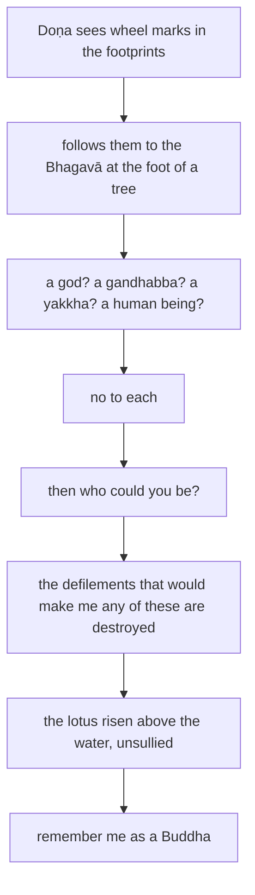

import { Tabs, TabItem } from '@astrojs/starlight/components';

Original text: [15A4/1.4.6 Doṇasutta 247–253](https://tipitaka2500.github.io/tipitaka/15A4/1/1.4/1.4.6.html#247) in the [World Tipitaka Edition](https://tipitaka2500.github.io)

## Summary

On the road between Ukkaṭṭhā and Setabyā the brahmin Doṇa sees wheel marks in the Bhagavā's footprints, follows them to where he sits at the foot of a tree, and asks whether he could be a god, a `gandhabba`, a `yakkha` or a human being. The Bhagavā denies each: the defilements through which he might have become any of these are destroyed, and like a lotus risen above the water he dwells unsullied by the world; he is to be remembered as a Buddha.

## Diagram

## Text

<Tabs syncKey="paliquote">
<TabItem label="My Translation">
(36.)

247\. At one time the Bhagavā was travelling along the main road between Ukkaṭṭhā and Setabyā. The brahmin Doṇa, too, was travelling along the main road between Ukkaṭṭhā and Setabyā. The brahmin Doṇa saw in the Bhagavā's footprints wheels, thousand-spoked, with rims, with hubs, complete in every aspect; having seen them, this thought occurred to him: “It is wonderful indeed, Bho! It is amazing indeed, Bho! These will surely not be the footprints of a human being.” Then the Bhagavā, stepping off the road, sat down at the foot of a certain tree, folding his legs crosswise, setting his body erect, and establishing awareness in front of him. Then the brahmin Doṇa, following the Bhagavā's footprints, saw the Bhagavā seated at the foot of a certain tree — pleasing, inspiring confidence, with calm faculties, with a calm mind, having attained the utmost self-mastery and peace, tamed, guarded, with restrained faculties, a `nāga` (great man). Having seen him, he approached the Bhagavā; having approached, he said this to the Bhagavā:

248\. “Could you be a god, sir?” “No indeed, Brāhmaṇa, I will not be a god.” “Could you be a `gandhabba` (demigod), sir?” “No indeed, Brāhmaṇa, I will not be a `gandhabba`.” “Could you be a `yakkha` (spirit), sir?” “No indeed, Brāhmaṇa, I will not be a `yakkha`.” “Could you be a human being, sir?” “No indeed, Brāhmaṇa, I will not be a human being.”

249\. “When asked, ‘Could you be a god, sir?’ you say, ‘No indeed, Brāhmaṇa, I will not be a god.’ When asked, ‘Could you be a `gandhabba`, sir?’ you say, ‘No indeed, Brāhmaṇa, I will not be a `gandhabba`.’ When asked, ‘Could you be a `yakkha`, sir?’ you say, ‘No indeed, Brāhmaṇa, I will not be a `yakkha`.’ When asked, ‘Could you be a human being, sir?’ you say, ‘No indeed, Brāhmaṇa, I will not be a human being.’ Then who, now, could you be, sir?”

250\. “Those defilements, Brāhmaṇa, through not having abandoned which I might become a god — those defilements of mine are given up, cut off at the root, made like a palm stump, obliterated, and not subject to future arising. Those defilements, Brāhmaṇa, through not having abandoned which I might become a `gandhabba`… might become a `yakkha`… might become a human being — those defilements of mine are given up, cut off at the root, made like a palm stump, obliterated, and not subject to future arising. Just as, Brāhmaṇa, a blue water lily or a pink lotus or a white lotus, born in the water, grown in the water, stands having risen above the water, unsullied by the water; even so, Brāhmaṇa, born in the world, grown in the world, having mastered the world, I dwell unsullied by the world. Remember me, Brāhmaṇa, as a Buddha.

251\. _That by which there would be reappearance as a god,_ \
_Or a `gandhabba` flying through the sky;_ \
_That by which I might go to the state of a `yakkha`,_ \
_And return to the human state;_ \
_Those defilements of mine are destroyed,_ \
_Demolished, rendered useless._

252\. _As a lovely white lotus_ \
_Is not soiled by the water,_ \
_I am not soiled by the world;_ \
_Therefore, Brāhmaṇa, I am a Buddha.”_

253\. The sixth [discourse of the chapter].
</TabItem>

<TabItem label="Pāḷi (Roman IAST)">
(36.)

247\. Ekaṃ samayaṃ bhagavā antarā ca ukkaṭṭhaṃ antarā ca setabyaṃ addhānamaggappaṭipanno hoti. Doṇopi sudaṃ brāhmaṇo antarā ca ukkaṭṭhaṃ antarā ca setabyaṃ addhānamaggappaṭipanno hoti. Addasā kho doṇo brāhmaṇo bhagavato pādesu cakkāni sahassārāni sanemikāni sanābhikāni sabbākāraparipūrāni; disvānassa etadahosi— “acchariyaṃ vata bho, abbhutaṃ vata bho. Na vatimāni manussabhūtassa padāni bhavissantī”ti. Atha kho bhagavā maggā okkamma aññatarasmiṃ rukkhamūle nisīdi pallaṅkaṃ ābhujitvā ujuṃ kāyaṃ paṇidhāya parimukhaṃ satiṃ upaṭṭhapetvā. Atha kho doṇo brāhmaṇo bhagavato padāni anugacchanto addasa bhagavantaṃ aññatarasmiṃ rukkhamūle nisinnaṃ pāsādikaṃ pasādanīyaṃ santindriyaṃ santamānasaṃ uttamadamathasamathamanuppattaṃ dantaṃ guttaṃ saṃyatindriyaṃ nāgaṃ. Disvāna yena bhagavā tenupasaṅkami; upasaṅkamitvā bhagavantaṃ etadavoca—

248\. “Devo no bhavaṃ bhavissatī”ti? “Na kho ahaṃ, brāhmaṇa, devo bhavissāmī”ti. “Gandhabbo no bhavaṃ bhavissatī”ti? “Na kho ahaṃ, brāhmaṇa, gandhabbo bhavissāmī”ti. “Yakkho no bhavaṃ bhavissatī”ti? “Na kho ahaṃ, brāhmaṇa, yakkho bhavissāmī”ti. “Manusso no bhavaṃ bhavissatī”ti? “Na kho ahaṃ, brāhmaṇa, manusso bhavissāmī”ti.

249\. “‘Devo no bhavaṃ bhavissatī’ti, iti puṭṭho samāno— ‘na kho ahaṃ, brāhmaṇa, devo bhavissāmī’ti vadesi. ‘Gandhabbo no bhavaṃ bhavissatī’ti, iti puṭṭho samāno— ‘na kho ahaṃ, brāhmaṇa, gandhabbo bhavissāmī’ti vadesi. ‘Yakkho no bhavaṃ bhavissatī’ti, iti puṭṭho samāno— ‘na kho ahaṃ, brāhmaṇa, yakkho bhavissāmī’ti vadesi. ‘Manusso no bhavaṃ bhavissatī’ti, iti puṭṭho samāno— ‘na kho ahaṃ, brāhmaṇa, manusso bhavissāmī’ti vadesi. Atha ko carahi bhavaṃ bhavissatī”ti?

250\. “Yesaṃ kho ahaṃ, brāhmaṇa, āsavānaṃ appahīnattā devo bhaveyyaṃ, te me āsavā pahīnā ucchinnamūlā tālāvatthukatā anabhāvaṃkatā āyatiṃ anuppādadhammā. Yesaṃ kho ahaṃ, brāhmaṇa, āsavānaṃ appahīnattā gandhabbo bhaveyyaṃ… yakkho bhaveyyaṃ… manusso bhaveyyaṃ, te me āsavā pahīnā ucchinnamūlā tālāvatthukatā anabhāvaṃkatā āyatiṃ anuppādadhammā. Seyyathāpi, brāhmaṇa, uppalaṃ vā padumaṃ vā puṇḍarīkaṃ vā udake jātaṃ udake saṃvaḍḍhaṃ udakā accuggamma tiṭṭhati anupalittaṃ udakena; evamevaṃ kho ahaṃ, brāhmaṇa, loke jāto loke saṃvaḍḍho lokaṃ abhibhuyya viharāmi anupalitto lokena. Buddhoti maṃ, brāhmaṇa, dhārehīti.

251\. _Yena devūpapatyassa,_  
_gandhabbo vā vihaṅgamo;_  
_Yakkhattaṃ yena gaccheyyaṃ,_  
_manussattañca abbaje;_  
_Te mayhaṃ āsavā khīṇā,_  
_viddhastā vinaḷīkatā._

252\. _Puṇḍarīkaṃ yathā vaggu,_  
_Toyena nupalippati;_  
_Nupalippāmi lokena,_  
_Tasmā buddhosmi brāhmaṇā”ti._

253\. Chaṭṭhaṃ.
</TabItem>

<TabItem label="Pāḷi (Brahmi)">
(36.)

247\. 𑀏𑀓𑀁 𑀲𑀫𑀬𑀁 𑀪𑀕𑀯𑀸 𑀅𑀦𑁆𑀢𑀭𑀸 𑀘 𑀉𑀓𑁆𑀓𑀝𑁆𑀞𑀁 𑀅𑀦𑁆𑀢𑀭𑀸 𑀘 𑀲𑁂𑀢𑀩𑁆𑀬𑀁 𑀅𑀤𑁆𑀥𑀸𑀦𑀫𑀕𑁆𑀕𑀧𑁆𑀧𑀝𑀺𑀧𑀦𑁆𑀦𑁄 𑀳𑁄𑀢𑀺. 𑀤𑁄𑀡𑁄𑀧𑀺 𑀲𑀼𑀤𑀁 𑀩𑁆𑀭𑀸𑀳𑁆𑀫𑀡𑁄 𑀅𑀦𑁆𑀢𑀭𑀸 𑀘 𑀉𑀓𑁆𑀓𑀝𑁆𑀞𑀁 𑀅𑀦𑁆𑀢𑀭𑀸 𑀘 𑀲𑁂𑀢𑀩𑁆𑀬𑀁 𑀅𑀤𑁆𑀥𑀸𑀦𑀫𑀕𑁆𑀕𑀧𑁆𑀧𑀝𑀺𑀧𑀦𑁆𑀦𑁄 𑀳𑁄𑀢𑀺. 𑀅𑀤𑁆𑀤𑀲𑀸 𑀔𑁄 𑀤𑁄𑀡𑁄 𑀩𑁆𑀭𑀸𑀳𑁆𑀫𑀡𑁄 𑀪𑀕𑀯𑀢𑁄 𑀧𑀸𑀤𑁂𑀲𑀼 𑀘𑀓𑁆𑀓𑀸𑀦𑀺 𑀲𑀳𑀲𑁆𑀲𑀸𑀭𑀸𑀦𑀺 𑀲𑀦𑁂𑀫𑀺𑀓𑀸𑀦𑀺 𑀲𑀦𑀸𑀪𑀺𑀓𑀸𑀦𑀺 𑀲𑀩𑁆𑀩𑀸𑀓𑀸𑀭𑀧𑀭𑀺𑀧𑀽𑀭𑀸𑀦𑀺; 𑀤𑀺𑀲𑁆𑀯𑀸𑀦𑀲𑁆𑀲 𑀏𑀢𑀤𑀳𑁄𑀲𑀺— “𑀅𑀘𑁆𑀙𑀭𑀺𑀬𑀁 𑀯𑀢 𑀪𑁄, 𑀅𑀩𑁆𑀪𑀼𑀢𑀁 𑀯𑀢 𑀪𑁄. 𑀦 𑀯𑀢𑀺𑀫𑀸𑀦𑀺 𑀫𑀦𑀼𑀲𑁆𑀲𑀪𑀽𑀢𑀲𑁆𑀲 𑀧𑀤𑀸𑀦𑀺 𑀪𑀯𑀺𑀲𑁆𑀲𑀦𑁆𑀢𑀻”𑀢𑀺. 𑀅𑀣 𑀔𑁄 𑀪𑀕𑀯𑀸 𑀫𑀕𑁆𑀕𑀸 𑀑𑀓𑁆𑀓𑀫𑁆𑀫 𑀅𑀜𑁆𑀜𑀢𑀭𑀲𑁆𑀫𑀺𑀁 𑀭𑀼𑀓𑁆𑀔𑀫𑀽𑀮𑁂 𑀦𑀺𑀲𑀻𑀤𑀺 𑀧𑀮𑁆𑀮𑀗𑁆𑀓𑀁 𑀆𑀪𑀼𑀚𑀺𑀢𑁆𑀯𑀸 𑀉𑀚𑀼𑀁 𑀓𑀸𑀬𑀁 𑀧𑀡𑀺𑀥𑀸𑀬 𑀧𑀭𑀺𑀫𑀼𑀔𑀁 𑀲𑀢𑀺𑀁 𑀉𑀧𑀝𑁆𑀞𑀧𑁂𑀢𑁆𑀯𑀸. 𑀅𑀣 𑀔𑁄 𑀤𑁄𑀡𑁄 𑀩𑁆𑀭𑀸𑀳𑁆𑀫𑀡𑁄 𑀪𑀕𑀯𑀢𑁄 𑀧𑀤𑀸𑀦𑀺 𑀅𑀦𑀼𑀕𑀘𑁆𑀙𑀦𑁆𑀢𑁄 𑀅𑀤𑁆𑀤𑀲 𑀪𑀕𑀯𑀦𑁆𑀢𑀁 𑀅𑀜𑁆𑀜𑀢𑀭𑀲𑁆𑀫𑀺𑀁 𑀭𑀼𑀓𑁆𑀔𑀫𑀽𑀮𑁂 𑀦𑀺𑀲𑀺𑀦𑁆𑀦𑀁 𑀧𑀸𑀲𑀸𑀤𑀺𑀓𑀁 𑀧𑀲𑀸𑀤𑀦𑀻𑀬𑀁 𑀲𑀦𑁆𑀢𑀺𑀦𑁆𑀤𑁆𑀭𑀺𑀬𑀁 𑀲𑀦𑁆𑀢𑀫𑀸𑀦𑀲𑀁 𑀉𑀢𑁆𑀢𑀫𑀤𑀫𑀣𑀲𑀫𑀣𑀫𑀦𑀼𑀧𑁆𑀧𑀢𑁆𑀢𑀁 𑀤𑀦𑁆𑀢𑀁 𑀕𑀼𑀢𑁆𑀢𑀁 𑀲𑀁𑀬𑀢𑀺𑀦𑁆𑀤𑁆𑀭𑀺𑀬𑀁 𑀦𑀸𑀕𑀁. 𑀤𑀺𑀲𑁆𑀯𑀸𑀦 𑀬𑁂𑀦 𑀪𑀕𑀯𑀸 𑀢𑁂𑀦𑀼𑀧𑀲𑀗𑁆𑀓𑀫𑀺; 𑀉𑀧𑀲𑀗𑁆𑀓𑀫𑀺𑀢𑁆𑀯𑀸 𑀪𑀕𑀯𑀦𑁆𑀢𑀁 𑀏𑀢𑀤𑀯𑁄𑀘—

248\. “𑀤𑁂𑀯𑁄 𑀦𑁄 𑀪𑀯𑀁 𑀪𑀯𑀺𑀲𑁆𑀲𑀢𑀻”𑀢𑀺? “𑀦 𑀔𑁄 𑀅𑀳𑀁, 𑀩𑁆𑀭𑀸𑀳𑁆𑀫𑀡, 𑀤𑁂𑀯𑁄 𑀪𑀯𑀺𑀲𑁆𑀲𑀸𑀫𑀻”𑀢𑀺. “𑀕𑀦𑁆𑀥𑀩𑁆𑀩𑁄 𑀦𑁄 𑀪𑀯𑀁 𑀪𑀯𑀺𑀲𑁆𑀲𑀢𑀻”𑀢𑀺? “𑀦 𑀔𑁄 𑀅𑀳𑀁, 𑀩𑁆𑀭𑀸𑀳𑁆𑀫𑀡, 𑀕𑀦𑁆𑀥𑀩𑁆𑀩𑁄 𑀪𑀯𑀺𑀲𑁆𑀲𑀸𑀫𑀻”𑀢𑀺. “𑀬𑀓𑁆𑀔𑁄 𑀦𑁄 𑀪𑀯𑀁 𑀪𑀯𑀺𑀲𑁆𑀲𑀢𑀻”𑀢𑀺? “𑀦 𑀔𑁄 𑀅𑀳𑀁, 𑀩𑁆𑀭𑀸𑀳𑁆𑀫𑀡, 𑀬𑀓𑁆𑀔𑁄 𑀪𑀯𑀺𑀲𑁆𑀲𑀸𑀫𑀻”𑀢𑀺. “𑀫𑀦𑀼𑀲𑁆𑀲𑁄 𑀦𑁄 𑀪𑀯𑀁 𑀪𑀯𑀺𑀲𑁆𑀲𑀢𑀻”𑀢𑀺? “𑀦 𑀔𑁄 𑀅𑀳𑀁, 𑀩𑁆𑀭𑀸𑀳𑁆𑀫𑀡, 𑀫𑀦𑀼𑀲𑁆𑀲𑁄 𑀪𑀯𑀺𑀲𑁆𑀲𑀸𑀫𑀻”𑀢𑀺.

249\. “‘𑀤𑁂𑀯𑁄 𑀦𑁄 𑀪𑀯𑀁 𑀪𑀯𑀺𑀲𑁆𑀲𑀢𑀻’𑀢𑀺, 𑀇𑀢𑀺 𑀧𑀼𑀝𑁆𑀞𑁄 𑀲𑀫𑀸𑀦𑁄— ‘𑀦 𑀔𑁄 𑀅𑀳𑀁, 𑀩𑁆𑀭𑀸𑀳𑁆𑀫𑀡, 𑀤𑁂𑀯𑁄 𑀪𑀯𑀺𑀲𑁆𑀲𑀸𑀫𑀻’𑀢𑀺 𑀯𑀤𑁂𑀲𑀺. ‘𑀕𑀦𑁆𑀥𑀩𑁆𑀩𑁄 𑀦𑁄 𑀪𑀯𑀁 𑀪𑀯𑀺𑀲𑁆𑀲𑀢𑀻’𑀢𑀺, 𑀇𑀢𑀺 𑀧𑀼𑀝𑁆𑀞𑁄 𑀲𑀫𑀸𑀦𑁄— ‘𑀦 𑀔𑁄 𑀅𑀳𑀁, 𑀩𑁆𑀭𑀸𑀳𑁆𑀫𑀡, 𑀕𑀦𑁆𑀥𑀩𑁆𑀩𑁄 𑀪𑀯𑀺𑀲𑁆𑀲𑀸𑀫𑀻’𑀢𑀺 𑀯𑀤𑁂𑀲𑀺. ‘𑀬𑀓𑁆𑀔𑁄 𑀦𑁄 𑀪𑀯𑀁 𑀪𑀯𑀺𑀲𑁆𑀲𑀢𑀻’𑀢𑀺, 𑀇𑀢𑀺 𑀧𑀼𑀝𑁆𑀞𑁄 𑀲𑀫𑀸𑀦𑁄— ‘𑀦 𑀔𑁄 𑀅𑀳𑀁, 𑀩𑁆𑀭𑀸𑀳𑁆𑀫𑀡, 𑀬𑀓𑁆𑀔𑁄 𑀪𑀯𑀺𑀲𑁆𑀲𑀸𑀫𑀻’𑀢𑀺 𑀯𑀤𑁂𑀲𑀺. ‘𑀫𑀦𑀼𑀲𑁆𑀲𑁄 𑀦𑁄 𑀪𑀯𑀁 𑀪𑀯𑀺𑀲𑁆𑀲𑀢𑀻’𑀢𑀺, 𑀇𑀢𑀺 𑀧𑀼𑀝𑁆𑀞𑁄 𑀲𑀫𑀸𑀦𑁄— ‘𑀦 𑀔𑁄 𑀅𑀳𑀁, 𑀩𑁆𑀭𑀸𑀳𑁆𑀫𑀡, 𑀫𑀦𑀼𑀲𑁆𑀲𑁄 𑀪𑀯𑀺𑀲𑁆𑀲𑀸𑀫𑀻’𑀢𑀺 𑀯𑀤𑁂𑀲𑀺. 𑀅𑀣 𑀓𑁄 𑀘𑀭𑀳𑀺 𑀪𑀯𑀁 𑀪𑀯𑀺𑀲𑁆𑀲𑀢𑀻”𑀢𑀺?

250\. “𑀬𑁂𑀲𑀁 𑀔𑁄 𑀅𑀳𑀁, 𑀩𑁆𑀭𑀸𑀳𑁆𑀫𑀡, 𑀆𑀲𑀯𑀸𑀦𑀁 𑀅𑀧𑁆𑀧𑀳𑀻𑀦𑀢𑁆𑀢𑀸 𑀤𑁂𑀯𑁄 𑀪𑀯𑁂𑀬𑁆𑀬𑀁, 𑀢𑁂 𑀫𑁂 𑀆𑀲𑀯𑀸 𑀧𑀳𑀻𑀦𑀸 𑀉𑀘𑁆𑀙𑀺𑀦𑁆𑀦𑀫𑀽𑀮𑀸 𑀢𑀸𑀮𑀸𑀯𑀢𑁆𑀣𑀼𑀓𑀢𑀸 𑀅𑀦𑀪𑀸𑀯𑀁𑀓𑀢𑀸 𑀆𑀬𑀢𑀺𑀁 𑀅𑀦𑀼𑀧𑁆𑀧𑀸𑀤𑀥𑀫𑁆𑀫𑀸. 𑀬𑁂𑀲𑀁 𑀔𑁄 𑀅𑀳𑀁, 𑀩𑁆𑀭𑀸𑀳𑁆𑀫𑀡, 𑀆𑀲𑀯𑀸𑀦𑀁 𑀅𑀧𑁆𑀧𑀳𑀻𑀦𑀢𑁆𑀢𑀸 𑀕𑀦𑁆𑀥𑀩𑁆𑀩𑁄 𑀪𑀯𑁂𑀬𑁆𑀬𑀁… 𑀬𑀓𑁆𑀔𑁄 𑀪𑀯𑁂𑀬𑁆𑀬𑀁… 𑀫𑀦𑀼𑀲𑁆𑀲𑁄 𑀪𑀯𑁂𑀬𑁆𑀬𑀁, 𑀢𑁂 𑀫𑁂 𑀆𑀲𑀯𑀸 𑀧𑀳𑀻𑀦𑀸 𑀉𑀘𑁆𑀙𑀺𑀦𑁆𑀦𑀫𑀽𑀮𑀸 𑀢𑀸𑀮𑀸𑀯𑀢𑁆𑀣𑀼𑀓𑀢𑀸 𑀅𑀦𑀪𑀸𑀯𑀁𑀓𑀢𑀸 𑀆𑀬𑀢𑀺𑀁 𑀅𑀦𑀼𑀧𑁆𑀧𑀸𑀤𑀥𑀫𑁆𑀫𑀸. 𑀲𑁂𑀬𑁆𑀬𑀣𑀸𑀧𑀺, 𑀩𑁆𑀭𑀸𑀳𑁆𑀫𑀡, 𑀉𑀧𑁆𑀧𑀮𑀁 𑀯𑀸 𑀧𑀤𑀼𑀫𑀁 𑀯𑀸 𑀧𑀼𑀡𑁆𑀟𑀭𑀻𑀓𑀁 𑀯𑀸 𑀉𑀤𑀓𑁂 𑀚𑀸𑀢𑀁 𑀉𑀤𑀓𑁂 𑀲𑀁𑀯𑀟𑁆𑀠𑀁 𑀉𑀤𑀓𑀸 𑀅𑀘𑁆𑀘𑀼𑀕𑁆𑀕𑀫𑁆𑀫 𑀢𑀺𑀝𑁆𑀞𑀢𑀺 𑀅𑀦𑀼𑀧𑀮𑀺𑀢𑁆𑀢𑀁 𑀉𑀤𑀓𑁂𑀦; 𑀏𑀯𑀫𑁂𑀯𑀁 𑀔𑁄 𑀅𑀳𑀁, 𑀩𑁆𑀭𑀸𑀳𑁆𑀫𑀡, 𑀮𑁄𑀓𑁂 𑀚𑀸𑀢𑁄 𑀮𑁄𑀓𑁂 𑀲𑀁𑀯𑀟𑁆𑀠𑁄 𑀮𑁄𑀓𑀁 𑀅𑀪𑀺𑀪𑀼𑀬𑁆𑀬 𑀯𑀺𑀳𑀭𑀸𑀫𑀺 𑀅𑀦𑀼𑀧𑀮𑀺𑀢𑁆𑀢𑁄 𑀮𑁄𑀓𑁂𑀦. 𑀩𑀼𑀤𑁆𑀥𑁄𑀢𑀺 𑀫𑀁, 𑀩𑁆𑀭𑀸𑀳𑁆𑀫𑀡, 𑀥𑀸𑀭𑁂𑀳𑀻𑀢𑀺.

251\. _𑀬𑁂𑀦 𑀤𑁂𑀯𑀽𑀧𑀧𑀢𑁆𑀬𑀲𑁆𑀲,_  
_𑀕𑀦𑁆𑀥𑀩𑁆𑀩𑁄 𑀯𑀸 𑀯𑀺𑀳𑀗𑁆𑀕𑀫𑁄;_  
_𑀬𑀓𑁆𑀔𑀢𑁆𑀢𑀁 𑀬𑁂𑀦 𑀕𑀘𑁆𑀙𑁂𑀬𑁆𑀬𑀁,_  
_𑀫𑀦𑀼𑀲𑁆𑀲𑀢𑁆𑀢𑀜𑁆𑀘 𑀅𑀩𑁆𑀩𑀚𑁂;_  
_𑀢𑁂 𑀫𑀬𑁆𑀳𑀁 𑀆𑀲𑀯𑀸 𑀔𑀻𑀡𑀸,_  
_𑀯𑀺𑀤𑁆𑀥𑀲𑁆𑀢𑀸 𑀯𑀺𑀦𑀍𑀈𑀓𑀢𑀸._

252\. _𑀧𑀼𑀡𑁆𑀟𑀭𑀻𑀓𑀁 𑀬𑀣𑀸 𑀯𑀕𑁆𑀕𑀼,_  
_𑀢𑁄𑀬𑁂𑀦 𑀦𑀼𑀧𑀮𑀺𑀧𑁆𑀧𑀢𑀺;_  
_𑀦𑀼𑀧𑀮𑀺𑀧𑁆𑀧𑀸𑀫𑀺 𑀮𑁄𑀓𑁂𑀦,_  
_𑀢𑀲𑁆𑀫𑀸 𑀩𑀼𑀤𑁆𑀥𑁄𑀲𑁆𑀫𑀺 𑀩𑁆𑀭𑀸𑀳𑁆𑀫𑀡𑀸”𑀢𑀺._

253\. 𑀙𑀝𑁆𑀞𑀁.
</TabItem>

<TabItem label="Interlinear">
(36.)

[247](https://tipitaka2500.github.io/tipitaka/15A4/1/1.4/1.4.6.html#247) Ekaṃ samayaṃ bhagavā antarā ca ukkaṭṭhaṃ antarā ca setabyaṃ addhānamaggappaṭipanno hoti.  
*️⃣🤟🚹⨀②(eka) 🚹⨀②(samaya) 🚹⨀①(bhagavant) ⏏️(antarā) ⏏️(ca) 🚺⨀②(ukkaṭṭhā) ⏏️(antarā) ⏏️(ca) 🚺⨀②(setabyā) 🚹⨀①🆎(addhāna+magga+paṭipanna) 🟢⨀🤟▶️(hoti)  
one | time | the Bhagavā | between | both | Ukkaṭṭhā | between | and | Setabyā | travelling along the main road | is  
At one time the Bhagavā was travelling along the main road between Ukkaṭṭhā and Setabyā.

Doṇopi sudaṃ brāhmaṇo antarā ca ukkaṭṭhaṃ antarā ca setabyaṃ addhānamaggappaṭipanno hoti.  
🚹⨀①(doṇa) ⏏️(api) ⏏️(sudaṃ) 🚹⨀①(brāhmaṇa) ⏏️(antarā) ⏏️(ca) 🚺⨀②(ukkaṭṭhā) ⏏️(antarā) ⏏️(ca) 🚺⨀②(setabyā) 🚹⨀①🆎(addhāna+magga+paṭipanna) 🟢⨀🤟▶️(hoti)  
Doṇa | too | indeed | the brahmin | between | both | Ukkaṭṭhā | between | and | Setabyā | travelling along the main road | is  
The brahmin Doṇa, too, was travelling along the main road between Ukkaṭṭhā and Setabyā.

Addasā kho doṇo brāhmaṇo bhagavato pādesu cakkāni sahassārāni sanemikāni sanābhikāni sabbākāraparipūrāni;  
🟢⨀🤟⏮(passati) ⏏️(kho) 🚹⨀①(doṇa) 🚹⨀①(brāhmaṇa) 🚹⨀⑥(bhagavant) 🚹⨂⑦(pāda) 🚻⨂②(cakka) 🚻⨂②🆎(sahassa+ara) 🚻⨂②(sanemika) 🚻⨂②(sanābhika) 🚻⨂②🆎(sabba+ākāra+paripūra)  
saw | indeed | Doṇa | the brahmin | of the Bhagavā | in the footprints | wheels | thousand-spoked | with rims | with hubs | complete in every aspect  
The brahmin Doṇa saw in the Bhagavā's footprints wheels, thousand-spoked, with rims, with hubs, complete in every aspect;

disvānassa etadahosi— “acchariyaṃ vata bho, abbhutaṃ vata bho.  
🔽(tvāna)(passati) *️⃣🤟🚹⨀④(ta) *️⃣🤟🚻⨀①(eta) 🟢⨀🤟⏮(hoti) 🚻⨀①(acchariya) ⏏️(vata) 🚹⨀⓪(bhavant) 🚻⨀①(abbhuta) ⏏️(vata) 🚹⨀⓪(bhavant)  
having seen | to him | this | occurred | wonderful | indeed | Bho | amazing | indeed | Bho  
having seen them, this thought occurred to him: “It is wonderful indeed, Bho! It is amazing indeed, Bho!

Na vatimāni manussabhūtassa padāni bhavissantī”ti.  
⏏️(na) ⏏️(vata) *️⃣🤟🚻⨂①(ima) 🚹⨀⑥🆎(manussa+bhūta) 🚻⨂①(pada) 🟢⨂🤟⏭(bhavati) ⏏️(iti)  
not | surely | these | of a human being | footprints | will be | (end quote)  
These will surely not be the footprints of a human being.”

Atha kho bhagavā maggā okkamma aññatarasmiṃ rukkhamūle nisīdi pallaṅkaṃ ābhujitvā ujuṃ kāyaṃ paṇidhāya parimukhaṃ satiṃ upaṭṭhapetvā.  
⏏️(atha) ⏏️(kho) 🚹⨀①(bhagavant) 🚹⨀⑤(magga) 🔽(ya)(okkamati) *️⃣🤟🚻⨀⑦(aññatara) 🚻⨀⑦🆎(rukkha+mūla) 🟢⨀🤟⏮(nisīdati) 🚹⨀②(pallaṅka) 🔽(tvā)(ābhujati) 🚹⨀②(uju) 🚹⨀②(kāya) 🔽(ya)(paṇidahati) ⏏️(parimukhaṃ) 🚺⨀②(sati) 🔽(tvā)(upaṭṭhapeti)  
then | indeed | the Bhagavā | from the road | stepping off | a certain | at the foot of a tree | sat down | legs crosswise | folding | erect | body | setting | in front of him | awareness | establishing  
Then the Bhagavā, stepping off the road, sat down at the foot of a certain tree, folding his legs crosswise, setting his body erect, and establishing awareness in front of him.

Atha kho doṇo brāhmaṇo bhagavato padāni anugacchanto addasa bhagavantaṃ aññatarasmiṃ rukkhamūle nisinnaṃ pāsādikaṃ pasādanīyaṃ santindriyaṃ santamānasaṃ uttamadamathasamathamanuppattaṃ dantaṃ guttaṃ saṃyatindriyaṃ nāgaṃ.  
⏏️(atha) ⏏️(kho) 🚹⨀①(doṇa) 🚹⨀①(brāhmaṇa) 🚹⨀⑥(bhagavant) 🚻⨂②(pada) 🚹⨀①🔽(anta)(anugacchanta) 🟢⨀🤟⏮(passati) 🚹⨀②(bhagavant) *️⃣🤟🚻⨀⑦(aññatara) 🚻⨀⑦🆎(rukkha+mūla) 🚹⨀②🔽(ta)(nisinna) 🚹⨀②(pāsādika) 🚹⨀②🔽(anīya)(pasādanīya) 🚹⨀②🆎(santa+indriya) 🚹⨀②🆎(santa+mānasa) 🚹⨀②🆎(uttama+damatha+samatha+anuppatta) 🚹⨀②🔽(ta)(danta) 🚹⨀②🔽(ta)(gutta) 🚹⨀②🆎(saṃyata+indriya) 🚹⨀②(nāga)  
then | indeed | Doṇa | the brahmin | of the Bhagavā | footprints | following | saw | the Bhagavā | a certain | at the foot of a tree | seated | pleasing | inspiring confidence | with calm faculties | with a calm mind | having attained the utmost self-mastery and peace | tamed | guarded | with restrained faculties | a great man  
Then the brahmin Doṇa, following the Bhagavā's footprints, saw the Bhagavā seated at the foot of a certain tree — pleasing, inspiring confidence, with calm faculties, with a calm mind, having attained the utmost self-mastery and peace, tamed, guarded, with restrained faculties, a `nāga` (great man).

Disvāna yena bhagavā tenupasaṅkami;  
🔽(tvāna)(passati) *️⃣🤟🚹⨀③(ya) 🚹⨀①(bhagavant) *️⃣🤟🚹⨀③(ta) 🟢⨀🤟⏮(upasaṅkamati)  
having seen | by where | the Bhagavā | by there | approached  
Having seen him, he approached the Bhagavā;

upasaṅkamitvā bhagavantaṃ etadavoca—  
🔽(tvā)(upasaṅkamati) 🚹⨀②(bhagavant) *️⃣🤟🚻⨀②(eta) 🟢⨀🤟⏮(vadati)  
having approached | to the Bhagavā | this | said  
having approached, he said this to the Bhagavā:

[248](https://tipitaka2500.github.io/tipitaka/15A4/1/1.4/1.4.6.html#248) “Devo no bhavaṃ bhavissatī”ti?  
🚹⨀①(deva) ⏏️(no) 🚹⨀①(bhavant) 🟢⨀🤟⏭(bhavati) ⏏️(iti)  
a god | then | you, sir | could be | (end quote)  
“Could you be a god, sir?”

“Na kho ahaṃ, brāhmaṇa, devo bhavissāmī”ti.  
⏏️(na) ⏏️(kho) *️⃣👆⚧⨀①(ahaṃ) 🚹⨀⓪(brāhmaṇa) 🚹⨀①(deva) 🟢⨀👆⏭(bhavati) ⏏️(iti)  
not | indeed | I | Brāhmaṇa | a god | I will be | (end quote)  
“No indeed, Brāhmaṇa, I will not be a god.”

“Gandhabbo no bhavaṃ bhavissatī”ti?  
🚹⨀①(gandhabba) ⏏️(no) 🚹⨀①(bhavant) 🟢⨀🤟⏭(bhavati) ⏏️(iti)  
a gandhabba | then | you, sir | could be | (end quote)  
“Could you be a `gandhabba` (demigod), sir?”

“Na kho ahaṃ, brāhmaṇa, gandhabbo bhavissāmī”ti.  
⏏️(na) ⏏️(kho) *️⃣👆⚧⨀①(ahaṃ) 🚹⨀⓪(brāhmaṇa) 🚹⨀①(gandhabba) 🟢⨀👆⏭(bhavati) ⏏️(iti)  
not | indeed | I | Brāhmaṇa | a gandhabba | I will be | (end quote)  
“No indeed, Brāhmaṇa, I will not be a `gandhabba`.”

“Yakkho no bhavaṃ bhavissatī”ti?  
🚹⨀①(yakkha) ⏏️(no) 🚹⨀①(bhavant) 🟢⨀🤟⏭(bhavati) ⏏️(iti)  
a yakkha | then | you, sir | could be | (end quote)  
“Could you be a `yakkha` (spirit), sir?”

“Na kho ahaṃ, brāhmaṇa, yakkho bhavissāmī”ti.  
⏏️(na) ⏏️(kho) *️⃣👆⚧⨀①(ahaṃ) 🚹⨀⓪(brāhmaṇa) 🚹⨀①(yakkha) 🟢⨀👆⏭(bhavati) ⏏️(iti)  
not | indeed | I | Brāhmaṇa | a yakkha | I will be | (end quote)  
“No indeed, Brāhmaṇa, I will not be a `yakkha`.”

“Manusso no bhavaṃ bhavissatī”ti?  
🚹⨀①(manussa) ⏏️(no) 🚹⨀①(bhavant) 🟢⨀🤟⏭(bhavati) ⏏️(iti)  
a human being | then | you, sir | could be | (end quote)  
“Could you be a human being, sir?”

“Na kho ahaṃ, brāhmaṇa, manusso bhavissāmī”ti.  
⏏️(na) ⏏️(kho) *️⃣👆⚧⨀①(ahaṃ) 🚹⨀⓪(brāhmaṇa) 🚹⨀①(manussa) 🟢⨀👆⏭(bhavati) ⏏️(iti)  
not | indeed | I | Brāhmaṇa | a human being | I will be | (end quote)  
“No indeed, Brāhmaṇa, I will not be a human being.”

[249](https://tipitaka2500.github.io/tipitaka/15A4/1/1.4/1.4.6.html#249) “‘Devo no bhavaṃ bhavissatī’ti, iti puṭṭho samāno— ‘na kho ahaṃ, brāhmaṇa, devo bhavissāmī’ti vadesi.  
🚹⨀①(deva) ⏏️(no) 🚹⨀①(bhavant) 🟢⨀🤟⏭(bhavati) ⏏️(iti) ⏏️(iti) 🚹⨀①🔽(ta)(puṭṭha) 🚹⨀①🔽(māna)(samāna) ⏏️(na) ⏏️(kho) *️⃣👆⚧⨀①(ahaṃ) 🚹⨀⓪(brāhmaṇa) 🚹⨀①(deva) 🟢⨀👆⏭(bhavati) ⏏️(iti) 🟢⨀🤘▶️(vadeti)  
a god | then | you, sir | could be | (end quote) | thus | asked | being | not | indeed | I | Brāhmaṇa | a god | I will be | (end quote) | you say  
“When asked, ‘Could you be a god, sir?’ you say, ‘No indeed, Brāhmaṇa, I will not be a god.’

‘Gandhabbo no bhavaṃ bhavissatī’ti, iti puṭṭho samāno— ‘na kho ahaṃ, brāhmaṇa, gandhabbo bhavissāmī’ti vadesi.  
🚹⨀①(gandhabba) ⏏️(no) 🚹⨀①(bhavant) 🟢⨀🤟⏭(bhavati) ⏏️(iti) ⏏️(iti) 🚹⨀①🔽(ta)(puṭṭha) 🚹⨀①🔽(māna)(samāna) ⏏️(na) ⏏️(kho) *️⃣👆⚧⨀①(ahaṃ) 🚹⨀⓪(brāhmaṇa) 🚹⨀①(gandhabba) 🟢⨀👆⏭(bhavati) ⏏️(iti) 🟢⨀🤘▶️(vadeti)  
a gandhabba | then | you, sir | could be | (end quote) | thus | asked | being | not | indeed | I | Brāhmaṇa | a gandhabba | I will be | (end quote) | you say  
When asked, ‘Could you be a `gandhabba`, sir?’ you say, ‘No indeed, Brāhmaṇa, I will not be a `gandhabba`.’

‘Yakkho no bhavaṃ bhavissatī’ti, iti puṭṭho samāno— ‘na kho ahaṃ, brāhmaṇa, yakkho bhavissāmī’ti vadesi.  
🚹⨀①(yakkha) ⏏️(no) 🚹⨀①(bhavant) 🟢⨀🤟⏭(bhavati) ⏏️(iti) ⏏️(iti) 🚹⨀①🔽(ta)(puṭṭha) 🚹⨀①🔽(māna)(samāna) ⏏️(na) ⏏️(kho) *️⃣👆⚧⨀①(ahaṃ) 🚹⨀⓪(brāhmaṇa) 🚹⨀①(yakkha) 🟢⨀👆⏭(bhavati) ⏏️(iti) 🟢⨀🤘▶️(vadeti)  
a yakkha | then | you, sir | could be | (end quote) | thus | asked | being | not | indeed | I | Brāhmaṇa | a yakkha | I will be | (end quote) | you say  
When asked, ‘Could you be a `yakkha`, sir?’ you say, ‘No indeed, Brāhmaṇa, I will not be a `yakkha`.’

‘Manusso no bhavaṃ bhavissatī’ti, iti puṭṭho samāno— ‘na kho ahaṃ, brāhmaṇa, manusso bhavissāmī’ti vadesi.  
🚹⨀①(manussa) ⏏️(no) 🚹⨀①(bhavant) 🟢⨀🤟⏭(bhavati) ⏏️(iti) ⏏️(iti) 🚹⨀①🔽(ta)(puṭṭha) 🚹⨀①🔽(māna)(samāna) ⏏️(na) ⏏️(kho) *️⃣👆⚧⨀①(ahaṃ) 🚹⨀⓪(brāhmaṇa) 🚹⨀①(manussa) 🟢⨀👆⏭(bhavati) ⏏️(iti) 🟢⨀🤘▶️(vadeti)  
a human being | then | you, sir | could be | (end quote) | thus | asked | being | not | indeed | I | Brāhmaṇa | a human being | I will be | (end quote) | you say  
When asked, ‘Could you be a human being, sir?’ you say, ‘No indeed, Brāhmaṇa, I will not be a human being.’

Atha ko carahi bhavaṃ bhavissatī”ti?  
⏏️(atha) *️⃣🤟🚹⨀①(kiṃ) ⏏️(carahi) 🚹⨀①(bhavant) 🟢⨀🤟⏭(bhavati) ⏏️(iti)  
then | who | now | you, sir | could be | (end quote)  
Then who, now, could you be, sir?”

[250](https://tipitaka2500.github.io/tipitaka/15A4/1/1.4/1.4.6.html#250) “Yesaṃ kho ahaṃ, brāhmaṇa, āsavānaṃ appahīnattā devo bhaveyyaṃ, te me āsavā pahīnā ucchinnamūlā tālāvatthukatā anabhāvaṃkatā āyatiṃ anuppādadhammā.  
*️⃣🤟🚹⨂⑥(ya) ⏏️(kho) *️⃣👆⚧⨀①(ahaṃ) 🚹⨀⓪(brāhmaṇa) 🚹⨂⑥(āsava) 🚻⨀⑤🔽(tta)🆎(na+pahīna) 🚹⨀①(deva) 🔵⨀👆⏯(bhavati) *️⃣🤟🚹⨂①(ta) *️⃣👆⚧⨀⑥(ahaṃ) 🚹⨂①(āsava) 🚹⨂①🔽(ta)(pahīna) 🚹⨂①🆎(ucchinna+mūla) 🚹⨂①🆎(tāla+avatthu+kata) 🚹⨂①🆎(anabhāva+kata) ⏏️(āyatiṃ) 🚹⨂①🆎(na+uppāda+dhamma)  
of which | indeed | I | Brāhmaṇa | of the defilements | through not having abandoned | a god | I might become | those | my | defilements | given up | cut off at the root | made like a palm stump | obliterated | in future | not subject to arising  
“Those defilements, Brāhmaṇa, through not having abandoned which I might become a god — those defilements of mine are given up, cut off at the root, made like a palm stump, obliterated, and not subject to future arising.

Yesaṃ kho ahaṃ, brāhmaṇa, āsavānaṃ appahīnattā gandhabbo bhaveyyaṃ… yakkho bhaveyyaṃ… manusso bhaveyyaṃ, te me āsavā pahīnā ucchinnamūlā tālāvatthukatā anabhāvaṃkatā āyatiṃ anuppādadhammā.  
*️⃣🤟🚹⨂⑥(ya) ⏏️(kho) *️⃣👆⚧⨀①(ahaṃ) 🚹⨀⓪(brāhmaṇa) 🚹⨂⑥(āsava) 🚻⨀⑤🔽(tta)🆎(na+pahīna) 🚹⨀①(gandhabba) 🔵⨀👆⏯(bhavati) 🚹⨀①(yakkha) 🔵⨀👆⏯(bhavati) 🚹⨀①(manussa) 🔵⨀👆⏯(bhavati) *️⃣🤟🚹⨂①(ta) *️⃣👆⚧⨀⑥(ahaṃ) 🚹⨂①(āsava) 🚹⨂①🔽(ta)(pahīna) 🚹⨂①🆎(ucchinna+mūla) 🚹⨂①🆎(tāla+avatthu+kata) 🚹⨂①🆎(anabhāva+kata) ⏏️(āyatiṃ) 🚹⨂①🆎(na+uppāda+dhamma)  
of which | indeed | I | Brāhmaṇa | of the defilements | through not having abandoned | a gandhabba | I might become | a yakkha | I might become | a human being | I might become | those | my | defilements | given up | cut off at the root | made like a palm stump | obliterated | in future | not subject to arising  
Those defilements, Brāhmaṇa, through not having abandoned which I might become a `gandhabba`… might become a `yakkha`… might become a human being — those defilements of mine are given up, cut off at the root, made like a palm stump, obliterated, and not subject to future arising.

Seyyathāpi, brāhmaṇa, uppalaṃ vā padumaṃ vā puṇḍarīkaṃ vā udake jātaṃ udake saṃvaḍḍhaṃ udakā accuggamma tiṭṭhati anupalittaṃ udakena;  
⏏️(seyyathāpi) 🚹⨀⓪(brāhmaṇa) 🚻⨀①(uppala) ⏏️(vā) 🚻⨀①(paduma) ⏏️(vā) 🚻⨀①(puṇḍarīka) ⏏️(vā) 🚻⨀⑦(udaka) 🚻⨀①🔽(ta)(jāta) 🚻⨀⑦(udaka) 🚻⨀①🔽(ta)(saṃvaḍḍha) 🚻⨀⑤(udaka) 🔽(ya)(accuggacchati) 🟢⨀🤟▶️(tiṭṭhati) 🚻⨀①🔽(ta)🆎(na+upalitta) 🚻⨀③(udaka)  
just as | Brāhmaṇa | a blue water lily | or | a pink lotus | or | a white lotus | or | in the water | born | in the water | grown | from the water | having risen above | stands | unsullied | by the water  
Just as, Brāhmaṇa, a blue water lily or a pink lotus or a white lotus, born in the water, grown in the water, stands having risen above the water, unsullied by the water;

evamevaṃ kho ahaṃ, brāhmaṇa, loke jāto loke saṃvaḍḍho lokaṃ abhibhuyya viharāmi anupalitto lokena.  
⏏️(evaṃ) ⏏️(evaṃ) ⏏️(kho) *️⃣👆⚧⨀①(ahaṃ) 🚹⨀⓪(brāhmaṇa) 🚹⨀⑦(loka) 🚹⨀①🔽(ta)(jāta) 🚹⨀⑦(loka) 🚹⨀①🔽(ta)(saṃvaḍḍha) 🚹⨀②(loka) 🔽(ya)(abhibhavati) 🟢⨀👆▶️(viharati) 🚹⨀①🔽(ta)🆎(na+upalitta) 🚹⨀③(loka)  
even | so | indeed | I | Brāhmaṇa | in the world | born | in the world | grown | the world | having mastered | I dwell | unsullied | by the world  
even so, Brāhmaṇa, born in the world, grown in the world, having mastered the world, I dwell unsullied by the world.

Buddhoti maṃ, brāhmaṇa, dhārehīti.  
🚹⨀①(buddha) ⏏️(iti) *️⃣👆⚧⨀②(ahaṃ) 🚹⨀⓪(brāhmaṇa) 🟠⨀🤘⏹(dhāreti) ⏏️(iti)  
a Buddha | (end quote) | me | Brāhmaṇa | remember | thus  
Remember me, Brāhmaṇa, as a Buddha.

[251](https://tipitaka2500.github.io/tipitaka/15A4/1/1.4/1.4.6.html#251) Yena devūpapatyassa,  
*️⃣🤟🚹⨀③(ya) 🚺⨀①🆎(deva+upapatti) 🟢⨀🤟⏯(atthi)  
by which | reappearance as a god | there would be  
gandhabbo vā vihaṅgamo;  
🚹⨀①(gandhabba) ⏏️(vā) 🚹⨀①(vihaṅgama)  
a gandhabba | or | flying through the sky  
Yakkhattaṃ yena gaccheyyaṃ,  
🚻⨀②🔽(tta)(yakkhatta) *️⃣🤟🚹⨀③(ya) 🔵⨀👆⏯(gacchati)  
the state of a yakkha | by which | I might go to  
manussattañca abbaje;  
🚻⨀②🔽(tta)(manussatta) ⏏️(ca) 🔵⨀👆⏯(abbajati)  
the human state | and | I might return to  
Te mayhaṃ āsavā khīṇā,  
*️⃣🤟🚹⨂①(ta) *️⃣👆⚧⨀⑥(ahaṃ) 🚹⨂①(āsava) 🚹⨂①🔽(ta)(khīṇa)  
those | my | defilements | destroyed  
viddhastā vinaḷīkatā.  
🚹⨂①🔽(ta)(viddhasta) 🚹⨂①(vinaḷīkata)  
demolished | rendered useless  

That by which there would be reappearance as a god,  
Or a `gandhabba` flying through the sky;  
That by which I might go to the state of a `yakkha`,  
And return to the human state;  
Those defilements of mine are destroyed,  
Demolished, rendered useless.

[252](https://tipitaka2500.github.io/tipitaka/15A4/1/1.4/1.4.6.html#252) Puṇḍarīkaṃ yathā vaggu,  
🚻⨀①(puṇḍarīka) ⏏️(yathā) 🚻⨀①(vaggu)  
a white lotus | as | lovely  
Toyena nupalippati;  
🚻⨀③(toya) 🔴⨀🤟▶️(nupalippati)  
by the water | is not soiled  
Nupalippāmi lokena,  
🔴⨀👆▶️(nupalippati) 🚹⨀③(loka)  
I am not soiled | by the world  
Tasmā buddhosmi brāhmaṇā”ti.  
⏏️(tasmā) 🚹⨀①(buddha) 🟢⨀👆▶️(atthi) 🚹⨀⓪(brāhmaṇa) ⏏️(iti)  
therefore | a Buddha | I am | Brāhmaṇa | (end quote)  

As a lovely white lotus  
Is not soiled by the water,  
I am not soiled by the world;  
Therefore, Brāhmaṇa, I am a Buddha.”

[253](https://tipitaka2500.github.io/tipitaka/15A4/1/1.4/1.4.6.html#253) Chaṭṭhaṃ.  
🚻⨀①(chaṭṭha)  
the sixth  
The sixth [discourse of the chapter].
</TabItem>
</Tabs>

## Commentary

- The four questions turn on the future `bhavissati`, which the DPD reads as "could be"; the answers and the prose of 250 keep the plain future, "I will not be a god": a denial of further becoming, not of a present nature.
- Renderings: `bhavaṃ` "you, sir"; `nāga` with the DPD's "great man"; `gandhabba` and `yakkha` with the DPD's glosses; `āsava` "defilement" and its destruction formula as on https://buddhavacana.github.io/sutta/saccaka/; `devūpapatti` "reappearance as a god" after the sites' "reappear" for `upapajjati`.
- `pādesu` (247.3) is "footprints" with the narrative, where the DPD's `pāda` is "foot"; `padāni` is `pada` "footprint".
- The lotus simile is the Brahmāyācana's, [Khandhaka 1.5](/khandhaka/1-5/) and https://buddhavacana.github.io/sutta/pasarasi/.
- The speech runs from 250 through the verses; the prose closes with a `ti` glossed "thus" and no closing mark.
- Gods, `gandhabbā` and `yakkhā` are the brahmin's categories, used only to deny — for the author's rational reading.

## Parallels

The Chinese parallel is the 101st sūtra of the Saṃyukta Āgama (雜阿含經 fascicle 4, CBETA T02, no. 99, pp. 28a–b), read here in CBETA's text. The two versions share the frame and the sequence: a brahmin on the road sees the thousand-spoked wheel marks in the Buddha's footprints, follows them to the Buddha seated under a tree, and asks what kind of being he is; the Buddha denies each kind and answers that the defilements that would make him any of them are destroyed, with the simile of the lotus unsoiled by the water and the closing claim to be a Buddha, in verse. The differences, checked in CBETA's text:

- **Setting.** The Chinese has the Buddha wandering in Kosala and already seated under a tree between the villages 迦帝 and 墮鳩羅, "entered on the day's abiding" (一樹下坐，入晝正受, p. 28a), when the brahmin passes; the Pāḷi has both on the road between Ukkaṭṭhā and Setabyā, and the Bhagavā steps off the road and sits down only after Doṇa has seen the footprints (247.6).
- **The brahmin.** The Chinese names him by clan, 豆磨種姓婆羅門 (p. 28a), and gives his thought as "I have never seen such footprints among humans; I shall follow the tracks to find the man" (我未曾見人間有如是足跡，今當隨跡以求其人), where the Pāḷi's Doṇa exclaims that these cannot be a human being's footprints (247.5).
- **The Buddha's appearance.** The Chinese adds "a majestic form surpassing the world" and "radiant like a golden mountain" (嚴容絕世 … 光相巍巍，猶若金山, p. 28a) to the calm faculties, quiet mind and supreme taming the two share; it has no counterpart to the Pāḷi's `nāga`.
- **The questions.** The Chinese asks in two rounds — "Are you a god?" and then "a nāga, yakṣa, gandharva, asura, garuḍa, kiṃnara, mahoraga, human or non-human?" (為龍、夜叉、乾闥婆、阿修羅、迦樓羅、緊那羅、摩睺羅伽、人、非人等, p. 28b) — and the Buddha denies the whole list at once; the Pāḷi has four questions, god, `gandhabba`, `yakkha`, human being, each asked and answered, and Doṇa's recapitulation of the four (249).
- **The answer.** The Chinese passes straight from the brahmin's "then what are you?" to the verses; the Pāḷi gives the answer first in prose — the defilements not abandoned, the lotus simile, "remember me as a Buddha" (250) — and then in two verses.
- **The verses.** The Chinese verse lists the beings as "all born from the defilements" (悉由煩惱生) and the "defilement-outflows" as "all abandoned, broken, worn away" (如是煩惱漏，一切我已捨，已破已磨滅, p. 28b), keeps the white lotus (芬陀利) unsoiled by water and the Buddha unattached to the world, and then adds lines without a Pāḷi counterpart — discerning through the aeons that all is suffering without a moment's pleasure, that all constructed things (有為行) arise and cease, stainless and unshaken, the swords and thorns pulled out, birth and death utterly removed — before "therefore I am called Buddha" (故名為佛陀), which answers the Pāḷi's "therefore I am a Buddha" (252).
- **Ending.** The Chinese brahmin "rejoiced and went on his way" (歡喜隨喜，從路而去, p. 28b); the Pāḷi closes with the verse and the chapter count.

[Go to previous page (Cundasutta (The Discourse to Cunda))](/anguttaranikaya/cundasutta/) / [Go to parent page (Aṅguttara Nikāya)](/anguttaranikaya/)
