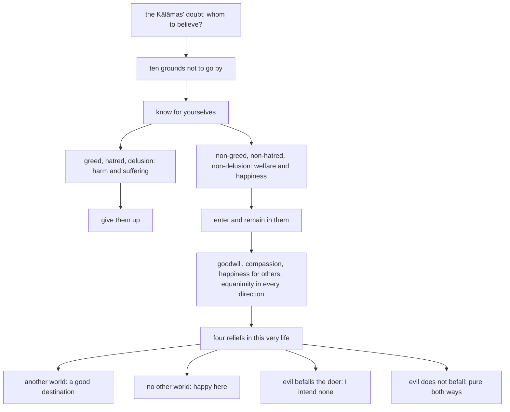

import { Tabs, TabItem } from '@astrojs/starlight/components';

Original text: [15A3/2.2.5 Kesamuttisutta 472–525](https://tipitaka2500.github.io/tipitaka/15A3/2/2.2/2.2.5.html#472) in the [World Tipitaka Edition](https://tipitaka2500.github.io)

## Summary

At Kesamutta, a market town of the Kālāmas, the Kālāmas tell the Bhagavā that visiting religious practitioners each praise their own doctrine and denigrate the others', and ask whom to believe. The Bhagavā tells them not to go by tradition, scripture, reasoning or a teacher's standing but by what they themselves know to lead to harm or to welfare, and leads them through greed, hatred and delusion and their opposites. A disciple who fills every direction with goodwill, compassion, happiness for others and equanimity attains four reliefs in this very life, whatever the truth about another world.

## Diagram

## Text

<Tabs syncKey="paliquote">
<TabItem label="My Translation">
(66.)

472\. Thus heard by me — At one time the Bhagavā, while travelling through the Kosala country together with a large Saṅgha of bhikkhū, arrived at Kesamutta, a market town of the Kālāmas. The Kālāmas of Kesamutta heard: “Indeed, Bho, the wanderer Gotama, the son of the Sakyans, who went forth from the Sakyan clan, has arrived at Kesamutta. And concerning that Bhagavā Gotama such a good report has spread: ‘Such indeed is the Bhagavā … and so on … Indeed, it is good to see such `arahants` (liberated ones).’”

473\. Then the Kālāmas of Kesamutta approached the Bhagavā; having approached, some paid homage to the Bhagavā and sat down to one side; some exchanged friendly greetings with the Bhagavā, and after exchanging polite and courteous talk, sat down to one side; some extended their clasped hands towards the Bhagavā and sat down to one side; some announced their name and clan and sat down to one side; some, remaining silent, sat down to one side. Seated to one side, those Kālāmas of Kesamutta said this to the Bhagavā:

474\. “There are, Bhante, some religious practitioners who come to Kesamutta. They explain and illuminate only their own doctrine, but they abuse, despise, disparage and denigrate the doctrines of others. Other religious practitioners too, Bhante, come to Kesamutta. They too explain and illuminate only their own doctrine, but they abuse, despise, disparage and denigrate the doctrines of others. About them, Bhante, there is indeed doubt for us, there is uncertainty: ‘Which of these worthy religious practitioners speaks the truth, and which speaks falsely?’” “It is indeed proper for you to doubt, Kālāmas, proper to be uncertain. Uncertainty has arisen in you about a matter that is indeed doubtful.

475\. Come, Kālāmas, don’t go by oral transmission, don’t go by lineage, don’t go by hearsay, don’t go by canonical authority, don’t rely on logic, don’t rely on inference, don’t go by reasoned contemplation, don’t go by the acceptance of a view after consideration, don’t go by the appearance of competence, and don’t think ‘The `samaṇa` (wanderer) is our respected teacher.’ But when you yourselves, Kālāmas, know: ‘These things are unwholesome, these things are blameworthy, these things are blamed by the wise, these things, when completed and undertaken, lead to harm and suffering’ — then, Kālāmas, you should give them up.

476\. What do you think, Kālāmas: greed arising within a person — does it arise for his welfare or for his harm?”

477\. “For his harm, Bhante”.

478\. “And this individual, Kālāmas, being greedy, overcome by greed, with his mind overwhelmed, kills living beings, takes what is not given, goes to another’s wife, speaks falsely, and incites another to do likewise; and that is for his harm and suffering for a long time.”

479\. “Yes, Bhante”.

480\. “What do you think, Kālāmas: hatred arising within a person — does it arise for his welfare or for his harm?”

481\. “For his harm, Bhante”.

482\. “And this individual, Kālāmas, being angry, overcome by hatred, with his mind overwhelmed, kills living beings, takes what is not given, goes to another’s wife, speaks falsely, and incites another to do likewise; and that is for his harm and suffering for a long time.”

483\. “Yes, Bhante”.

484\. “What do you think, Kālāmas: delusion arising within a person — does it arise for his welfare or for his harm?”

485\. “For his harm, Bhante”.

486\. “And this individual, Kālāmas, being deluded, overcome by delusion, with his mind overwhelmed, kills living beings, takes what is not given, goes to another’s wife, speaks falsely, and incites another to do likewise; and that is for his harm and suffering for a long time.”

487\. “Yes, Bhante”.

488\. “What do you think, Kālāmas: are these things wholesome or unwholesome?”

489\. “Unwholesome, Bhante”.

490\. “Blameworthy or blameless?”

491\. “Blameworthy, Bhante”.

492\. “Blamed by the wise or praised by the wise?”

493\. “Blamed by the wise, Bhante”.

494\. “When completed and undertaken, do they lead to harm and suffering, or not? Or how is it here?”

495\. “‘When completed and undertaken, Bhante, they lead to harm and suffering.’ So it is for us here.”

496\. “Thus, Kālāmas, what we said: ‘Come, Kālāmas. Don’t go by oral transmission, don’t go by lineage, don’t go by hearsay, don’t go by canonical authority, don’t rely on logic, don’t rely on inference, don’t go by reasoned contemplation, don’t go by the acceptance of a view after consideration, don’t go by the appearance of competence, and don’t think “The `samaṇa` (wanderer) is our respected teacher.” But when you yourselves, Kālāmas, know: “These things are unwholesome, these things are blameworthy, these things are blamed by the wise, these things, when completed and undertaken, lead to harm and suffering — then, Kālāmas, you should give them up”’ — thus, that which was said, it was said in reference to this.

497\. Come, Kālāmas, don’t go by oral transmission, don’t go by lineage, don’t go by hearsay, don’t go by canonical authority, don’t rely on logic, don’t rely on inference, don’t go by reasoned contemplation, don’t go by the acceptance of a view after consideration, don’t go by the appearance of competence, and don’t think ‘The `samaṇa` (wanderer) is our respected teacher.’ But when you yourselves, Kālāmas, know: ‘These things are wholesome, these things are blameless, these things are praised by the wise, these things, when completed and undertaken, lead to welfare and happiness’ — then, Kālāmas, you should enter and remain in them.

498\. What do you think, Kālāmas: non-greed arising within a person — does it arise for his welfare or for his harm?”

499\. “For his welfare, Bhante”.

500\. “And this individual, Kālāmas, not being greedy, not overcome by greed, with his mind not overwhelmed, does not kill living beings, does not take what is not given, does not go to another’s wife, does not speak falsely, and does not incite another to do likewise; and that is for his welfare and happiness for a long time.”

501\. “Yes, Bhante”.

502\. “What do you think, Kālāmas: non-hatred arising within a person — does it arise … and so on … non-delusion arising within a person — does it arise … and so on … for his welfare and happiness.”

503\. “Yes, Bhante”.

504\. “What do you think, Kālāmas: are these things wholesome or unwholesome?”

505\. “Wholesome, Bhante”.

506\. “Blameworthy or blameless?”

507\. “Blameless, Bhante”.

508\. “Blamed by the wise or praised by the wise?”

509\. “Praised by the wise, Bhante”.

510\. “When completed and undertaken, do they lead to welfare and happiness, or not? Or how is it here?”

511\. “When completed and undertaken, Bhante, they lead to welfare and happiness. So it is for us here.”

512\. “Thus, Kālāmas, what we said: ‘Come, Kālāmas. Don’t go by oral transmission, don’t go by lineage, don’t go by hearsay, don’t go by canonical authority, don’t rely on logic, don’t rely on inference, don’t go by reasoned contemplation, don’t go by the acceptance of a view after consideration, don’t go by the appearance of competence, and don’t think “The `samaṇa` (wanderer) is our respected teacher.” But when you yourselves, Kālāmas, know: these things are wholesome, these things are blameless, these things are praised by the wise, these things, when completed and undertaken, lead to welfare and happiness — then, Kālāmas, you should enter and remain in them’ — thus, that which was said, it was said in reference to this.

513\. That disciple of the liberated, Kālāmas, thus without covetousness, without ill will, undeluded, clearly comprehending and self-aware, with intent filled with goodwill, stays aware having filled one direction, similarly the second, similarly the third, similarly the fourth; thus, with intent, he stays aware having filled above and below, horizontally, everywhere, to all beings in the entire universe, with expansive, grand, infinite, peaceful, without ill will, goodwill. With intent filled with compassion … and so on … with intent filled with happiness for others … and so on … with intent filled with equanimity, he stays aware having filled one direction, similarly the second, similarly the third, similarly the fourth; thus, with intent, he stays aware having filled above and below, horizontally, everywhere, to all beings in the entire universe, with expansive, grand, infinite, peaceful, without ill will, equanimity.

514\. That disciple of the liberated, Kālāmas, is thus peaceful in mind, thus without ill will in mind, thus undefiled in mind, thus pure in mind. Four reliefs are attained by him in this very life. ‘If indeed there is the other world, there is a fruit and result of actions well done and badly done, then with the breakup of the body, after death, I will reappear in a good destination, a heavenly world’ — this is the first relief he has attained.

515\. ‘If indeed there is no other world, there is no fruit and result of actions well done and badly done, then in this very life I maintain myself peaceful, without ill will, untroubled and happy’ — this is the second relief he has attained.

516\. ‘If indeed evil befalls one who does it, yet I do not intend evil for anyone. From where will suffering touch me, who does no evil deed?’ — this is the third relief he has attained.

517\. ‘If indeed evil does not befall one who does it, then I regard myself as purified in both ways’ — this is the fourth relief he has attained.

518\. That disciple of the liberated, Kālāmas, is thus peaceful in mind, thus without ill will in mind, thus undefiled in mind, thus pure in mind. These four reliefs are attained by him in this very life.”

519\. “So it is, Bhagavā, so it is, Sugata (Fortunate One). That disciple of the liberated, Bhante, is thus peaceful in mind, thus without ill will in mind, thus undefiled in mind, thus pure in mind. Four reliefs are attained by him in this very life. ‘If indeed there is the other world, there is a fruit and result of actions well done and badly done, then with the breakup of the body, after death, I will reappear in a good destination, a heavenly world’ — this is the first relief he has attained.

520\. ‘If indeed there is no other world, there is no fruit and result of actions well done and badly done, then in this very life I maintain myself peaceful, without ill will, untroubled and happy’ — this is the second relief he has attained.

521\. ‘If indeed evil befalls one who does it, yet I do not intend evil for anyone, from where will suffering touch me, who does no evil deed?’ — this is the third relief he has attained.

522\. ‘If indeed evil does not befall one who does it, then I regard myself as purified in both ways’ — this is the fourth relief he has attained.

523\. That disciple of the liberated, Bhante, is thus peaceful in mind, thus without ill will in mind, thus undefiled in mind, thus pure in mind. These four reliefs are attained by him in this very life.

524\. Excellent, Bhante! … and so on … We, Bhante, go for refuge to the Bhagavā and to the Dhamma and to the `bhikkhusaṃgha` (Saṅgha of bhikkhū). May the Bhagavā, Bhante, remember us as `upāsakā` (lay disciples) who have gone for refuge for life, from today onwards.”

525\. The fifth [discourse of the chapter].
</TabItem>

<TabItem label="Pāḷi (Roman IAST)">
(66.)

472\. Evaṃ me sutaṃ— ekaṃ samayaṃ bhagavā kosalesu cārikaṃ caramāno mahatā bhikkhusaṃghena saddhiṃ yena kesamuttaṃ nāma kālāmānaṃ nigamo tadavasari. Assosuṃ kho kesamuttiyā kālāmā— “samaṇo khalu, bho, gotamo sakyaputto sakyakulā pabbajito kesamuttaṃ anuppatto. Taṃ kho pana bhavantaṃ gotamaṃ evaṃ kalyāṇo kittisaddo abbhuggato— ‘itipi so bhagavā…pe… sādhu kho pana tathārūpānaṃ arahataṃ dassanaṃ hotī’”ti.

473\. Atha kho kesamuttiyā kālāmā yena bhagavā tenupasaṅkamiṃsu; upasaṅkamitvā appekacce bhagavantaṃ abhivādetvā ekamantaṃ nisīdiṃsu, appekacce bhagavatā saddhiṃ sammodiṃsu, sammodanīyaṃ kathaṃ sāraṇīyaṃ vītisāretvā ekamantaṃ nisīdiṃsu, appekacce yena bhagavā tenañjaliṃ paṇāmetvā ekamantaṃ nisīdiṃsu, appekacce nāmagottaṃ sāvetvā ekamantaṃ nisīdiṃsu, appekacce tuṇhībhūtā ekamantaṃ nisīdiṃsu. Ekamantaṃ nisinnā kho te kesamuttiyā kālāmā bhagavantaṃ etadavocuṃ—

474\. “Santi, bhante, eke samaṇabrāhmaṇā kesamuttaṃ āgacchanti. Te sakaṃyeva vādaṃ dīpenti jotenti, parappavādaṃ pana khuṃsenti vambhenti paribhavanti omakkhiṃ karonti. Aparepi, bhante, eke samaṇabrāhmaṇā kesamuttaṃ āgacchanti. Tepi sakaṃyeva vādaṃ dīpenti jotenti, parappavādaṃ pana khuṃsenti vambhenti paribhavanti omakkhiṃ karonti. Tesaṃ no, bhante, amhākaṃ hoteva kaṅkhā hoti vicikicchā— ‘ko su nāma imesaṃ bhavataṃ samaṇabrāhmaṇānaṃ saccaṃ āha, ko musā’”ti? “Alañhi vo, kālāmā, kaṅkhituṃ alaṃ vicikicchituṃ. Kaṅkhanīyeva pana vo ṭhāne vicikicchā uppannā.

475\. Etha tumhe, kālāmā, mā anussavena, mā paramparāya, mā itikirāya, mā piṭakasampadānena, mā takkahetu, mā nayahetu, mā ākāraparivitakkena, mā diṭṭhinijjhānakkhantiyā, mā bhabbarūpatāya, mā samaṇo no garūti. Yadā tumhe, kālāmā, attanāva jāneyyātha— ‘ime dhammā akusalā, ime dhammā sāvajjā, ime dhammā viññugarahitā, ime dhammā samattā samādinnā ahitāya dukkhāya saṃvattantī’ti, atha tumhe, kālāmā, pajaheyyātha.

476\. Taṃ kiṃ maññatha, kālāmā, lobho purisassa ajjhattaṃ uppajjamāno uppajjati hitāya vā ahitāya vā”ti?

477\. “Ahitāya, bhante”.

478\. “Luddho panāyaṃ, kālāmā, purisapuggalo lobhena abhibhūto pariyādinnacitto pāṇampi hanati, adinnampi ādiyati, paradārampi gacchati, musāpi bhaṇati, parampi tathattāya samādapeti, yaṃ sa hoti dīgharattaṃ ahitāya dukkhāyā”ti.

479\. “Evaṃ, bhante”.

480\. “Taṃ kiṃ maññatha, kālāmā, doso purisassa ajjhattaṃ uppajjamāno uppajjati hitāya vā ahitāya vā”ti?

481\. “Ahitāya, bhante”.

482\. “Duṭṭho panāyaṃ, kālāmā, purisapuggalo dosena abhibhūto pariyādinnacitto pāṇampi hanati, adinnampi ādiyati, paradārampi gacchati, musāpi bhaṇati, parampi tathattāya samādapeti, yaṃ sa hoti dīgharattaṃ ahitāya dukkhāyā”ti.

483\. “Evaṃ, bhante”.

484\. “Taṃ kiṃ maññatha, kālāmā, moho purisassa ajjhattaṃ uppajjamāno uppajjati hitāya vā ahitāya vā”ti?

485\. “Ahitāya, bhante”.

486\. “Mūḷho panāyaṃ, kālāmā, purisapuggalo mohena abhibhūto pariyādinnacitto pāṇampi hanati, adinnampi ādiyati, paradārampi gacchati, musāpi bhaṇati, parampi tathattāya samādapeti, yaṃ sa hoti dīgharattaṃ ahitāya dukkhāyā”ti.

487\. “Evaṃ, bhante”.

488\. “Taṃ kiṃ maññatha, kālāmā, ime dhammā kusalā vā akusalā vā”ti?

489\. “Akusalā, bhante”.

490\. “Sāvajjā vā anavajjā vā”ti?

491\. “Sāvajjā, bhante”.

492\. “Viññugarahitā vā viññuppasatthā vā”ti?

493\. “Viññugarahitā, bhante”.

494\. “Samattā samādinnā ahitāya dukkhāya saṃvattanti, no vā? Kathaṃ vā ettha hotī”ti?

495\. “Samattā, bhante, samādinnā ahitāya dukkhāya saṃvattantīti. Evaṃ no ettha hotī”ti.

496\. “Iti kho, kālāmā, yaṃ taṃ avocumhā— ‘etha tumhe, kālāmā. Mā anussavena, mā paramparāya, mā itikirāya, mā piṭakasampadānena, mā takkahetu, mā nayahetu, mā ākāraparivitakkena, mā diṭṭhinijjhānakkhantiyā, mā bhabbarūpatāya, mā samaṇo no garūti. Yadā tumhe kālāmā attanāva jāneyyātha— “ime dhammā akusalā, ime dhammā sāvajjā, ime dhammā viññugarahitā, ime dhammā samattā samādinnā ahitāya dukkhāya saṃvattantīti, atha tumhe, kālāmā, pajaheyyāthā”’ti, iti yaṃ taṃ vuttaṃ, idametaṃ paṭicca vuttaṃ.

497\. Etha tumhe, kālāmā, mā anussavena, mā paramparāya, mā itikirāya, mā piṭakasampadānena, mā takkahetu, mā nayahetu, mā ākāraparivitakkena, mā diṭṭhinijjhānakkhantiyā, mā bhabbarūpatāya, mā samaṇo no garūti. Yadā tumhe, kālāmā, attanāva jāneyyātha— ‘ime dhammā kusalā, ime dhammā anavajjā, ime dhammā viññuppasatthā, ime dhammā samattā samādinnā hitāya sukhāya saṃvattantī’ti, atha tumhe, kālāmā, upasampajja vihareyyātha.

498\. Taṃ kiṃ maññatha, kālāmā, alobho purisassa ajjhattaṃ uppajjamāno uppajjati hitāya vā ahitāya vā”ti?

499\. “Hitāya, bhante”.

500\. “Aluddho panāyaṃ, kālāmā, purisapuggalo lobhena anabhibhūto apariyādinnacitto neva pāṇaṃ hanati, na adinnaṃ ādiyati, na paradāraṃ gacchati, na musā bhaṇati, na parampi tathattāya samādapeti, yaṃ sa hoti dīgharattaṃ hitāya sukhāyā”ti.

501\. “Evaṃ, bhante”.

502\. “Taṃ kiṃ maññatha, kālāmā, adoso purisassa ajjhattaṃ uppajjamāno uppajjati…pe… amoho purisassa ajjhattaṃ uppajjamāno uppajjati…pe… hitāya sukhāyā”ti.

503\. “Evaṃ, bhante”.

504\. “Taṃ kiṃ maññatha, kālāmā, ime dhammā kusalā vā akusalā vā”ti?

505\. “Kusalā, bhante”.

506\. “Sāvajjā vā anavajjā vā”ti?

507\. “Anavajjā, bhante”.

508\. “Viññugarahitā vā viññuppasatthā vā”ti?

509\. “Viññuppasatthā, bhante”.

510\. “Samattā samādinnā hitāya sukhāya saṃvattanti no vā? Kathaṃ vā ettha hotī”ti?

511\. “Samattā, bhante, samādinnā hitāya sukhāya saṃvattanti. Evaṃ no ettha hotī”ti.

512\. “Iti kho, kālāmā, yaṃ taṃ avocumhā— ‘etha tumhe, kālāmā. Mā anussavena, mā paramparāya, mā itikirāya, mā piṭakasampadānena, mā takkahetu, mā nayahetu, mā ākāraparivitakkena, mā diṭṭhinijjhānakkhantiyā, mā bhabbarūpatāya, mā samaṇo no garūti. Yadā tumhe, kālāmā, attanāva jāneyyātha— ime dhammā kusalā, ime dhammā anavajjā, ime dhammā viññuppasatthā, ime dhammā samattā samādinnā hitāya sukhāya saṃvattantīti, atha tumhe, kālāmā, upasampajja vihareyyāthā’ti, iti yaṃ taṃ vuttaṃ idametaṃ paṭicca vuttaṃ.

513\. Sa kho so, kālāmā, ariyasāvako evaṃ vigatābhijjho vigatabyāpādo asammūḷho sampajāno patissato mettāsahagatena cetasā ekaṃ disaṃ pharitvā viharati, tathā dutiyaṃ, tathā tatiyaṃ, tathā catutthaṃ, iti uddhamadho tiriyaṃ sabbadhi sabbattatāya sabbāvantaṃ lokaṃ mettāsahagatena cetasā vipulena mahaggatena appamāṇena averena abyāpajjhena pharitvā viharati. Karuṇāsahagatena cetasā…pe… muditāsahagatena cetasā…pe… upekkhāsahagatena cetasā ekaṃ disaṃ pharitvā viharati, tathā dutiyaṃ, tathā tatiyaṃ, tathā catutthaṃ, iti uddhamadho tiriyaṃ sabbadhi sabbattatāya sabbāvantaṃ lokaṃ upekkhāsahagatena cetasā vipulena mahaggatena appamāṇena averena abyāpajjhena pharitvā viharati.

514\. Sa kho so, kālāmā, ariyasāvako evaṃ averacitto evaṃ abyāpajjhacitto evaṃ asaṃkiliṭṭhacitto evaṃ visuddhacitto. Tassa diṭṭheva dhamme cattāro assāsā adhigatā honti. ‘Sace kho pana atthi paro loko, atthi sukatadukkaṭānaṃ kammānaṃ phalaṃ vipāko, athāhaṃ kāyassa bhedā paraṃ maraṇā sugatiṃ saggaṃ lokaṃ upapajjissāmī’ti, ayamassa paṭhamo assāso adhigato hoti.

515\. ‘Sace kho pana natthi paro loko, natthi sukatadukkaṭānaṃ kammānaṃ phalaṃ vipāko, athāhaṃ diṭṭheva dhamme averaṃ abyāpajjhaṃ anīghaṃ sukhiṃ attānaṃ pariharāmī’ti, ayamassa dutiyo assāso adhigato hoti.

516\. ‘Sace kho pana karoto karīyati pāpaṃ, na kho panāhaṃ kassaci pāpaṃ cetemi. Akarontaṃ kho pana maṃ pāpakammaṃ kuto dukkhaṃ phusissatī’ti, ayamassa tatiyo assāso adhigato hoti.

517\. ‘Sace kho pana karoto na karīyati pāpaṃ, athāhaṃ ubhayeneva visuddhaṃ attānaṃ samanupassāmī’ti, ayamassa catuttho assāso adhigato hoti.

518\. Sa kho so, kālāmā, ariyasāvako evaṃ averacitto evaṃ abyāpajjhacitto evaṃ asaṃkiliṭṭhacitto evaṃ visuddhacitto. Tassa diṭṭheva dhamme ime cattāro assāsā adhigatā hontī”ti.

519\. “Evametaṃ, bhagavā, evametaṃ, sugata. Sa kho so, bhante, ariyasāvako evaṃ averacitto evaṃ abyāpajjhacitto evaṃ asaṃkiliṭṭhacitto evaṃ visuddhacitto. Tassa diṭṭheva dhamme cattāro assāsā adhigatā honti. ‘Sace kho pana atthi paro loko, atthi sukatadukkaṭānaṃ kammānaṃ phalaṃ vipāko, athāhaṃ kāyassa bhedā paraṃ maraṇā sugatiṃ saggaṃ lokaṃ upapajjissāmī’ti, ayamassa paṭhamo assāso adhigato hoti.

520\. ‘Sace kho pana natthi paro loko, natthi sukatadukkaṭānaṃ kammānaṃ phalaṃ vipāko, athāhaṃ diṭṭheva dhamme averaṃ abyāpajjhaṃ anīghaṃ sukhiṃ attānaṃ pariharāmī’ti, ayamassa dutiyo assāso adhigato hoti.

521\. ‘Sace kho pana karoto karīyati pāpaṃ, na kho panāhaṃ kassaci pāpaṃ cetemi, akarontaṃ kho pana maṃ pāpakammaṃ kuto dukkhaṃ phusissatī’ti, ayamassa tatiyo assāso adhigato hoti.

522\. ‘Sace kho pana karoto na karīyati pāpaṃ, athāhaṃ ubhayeneva visuddhaṃ attānaṃ samanupassāmī’ti, ayamassa catuttho assāso adhigato hoti.

523\. Sa kho so, bhante, ariyasāvako evaṃ averacitto evaṃ abyāpajjhacitto evaṃ asaṃkiliṭṭhacitto evaṃ visuddhacitto. Tassa diṭṭheva dhamme ime cattāro assāsā adhigatā honti.

524\. Abhikkantaṃ, bhante…pe… ete mayaṃ, bhante, bhagavantaṃ saraṇaṃ gacchāma dhammañca bhikkhusaṃghañca. Upāsake no, bhante, bhagavā dhāretu ajjatagge pāṇupete saraṇaṃ gate”ti.

525\. Pañcamaṃ.
</TabItem>

<TabItem label="Pāḷi (Brahmi)">
(66.)

472\. 𑀏𑀯𑀁 𑀫𑁂 𑀲𑀼𑀢𑀁— 𑀏𑀓𑀁 𑀲𑀫𑀬𑀁 𑀪𑀕𑀯𑀸 𑀓𑁄𑀲𑀮𑁂𑀲𑀼 𑀘𑀸𑀭𑀺𑀓𑀁 𑀘𑀭𑀫𑀸𑀦𑁄 𑀫𑀳𑀢𑀸 𑀪𑀺𑀓𑁆𑀔𑀼𑀲𑀁𑀖𑁂𑀦 𑀲𑀤𑁆𑀥𑀺𑀁 𑀬𑁂𑀦 𑀓𑁂𑀲𑀫𑀼𑀢𑁆𑀢𑀁 𑀦𑀸𑀫 𑀓𑀸𑀮𑀸𑀫𑀸𑀦𑀁 𑀦𑀺𑀕𑀫𑁄 𑀢𑀤𑀯𑀲𑀭𑀺. 𑀅𑀲𑁆𑀲𑁄𑀲𑀼𑀁 𑀔𑁄 𑀓𑁂𑀲𑀫𑀼𑀢𑁆𑀢𑀺𑀬𑀸 𑀓𑀸𑀮𑀸𑀫𑀸— “𑀲𑀫𑀡𑁄 𑀔𑀮𑀼, 𑀪𑁄, 𑀕𑁄𑀢𑀫𑁄 𑀲𑀓𑁆𑀬𑀧𑀼𑀢𑁆𑀢𑁄 𑀲𑀓𑁆𑀬𑀓𑀼𑀮𑀸 𑀧𑀩𑁆𑀩𑀚𑀺𑀢𑁄 𑀓𑁂𑀲𑀫𑀼𑀢𑁆𑀢𑀁 𑀅𑀦𑀼𑀧𑁆𑀧𑀢𑁆𑀢𑁄. 𑀢𑀁 𑀔𑁄 𑀧𑀦 𑀪𑀯𑀦𑁆𑀢𑀁 𑀕𑁄𑀢𑀫𑀁 𑀏𑀯𑀁 𑀓𑀮𑁆𑀬𑀸𑀡𑁄 𑀓𑀺𑀢𑁆𑀢𑀺𑀲𑀤𑁆𑀤𑁄 𑀅𑀩𑁆𑀪𑀼𑀕𑁆𑀕𑀢𑁄— ‘𑀇𑀢𑀺𑀧𑀺 𑀲𑁄 𑀪𑀕𑀯𑀸…𑀧𑁂… 𑀲𑀸𑀥𑀼 𑀔𑁄 𑀧𑀦 𑀢𑀣𑀸𑀭𑀽𑀧𑀸𑀦𑀁 𑀅𑀭𑀳𑀢𑀁 𑀤𑀲𑁆𑀲𑀦𑀁 𑀳𑁄𑀢𑀻’”𑀢𑀺.

473\. 𑀅𑀣 𑀔𑁄 𑀓𑁂𑀲𑀫𑀼𑀢𑁆𑀢𑀺𑀬𑀸 𑀓𑀸𑀮𑀸𑀫𑀸 𑀬𑁂𑀦 𑀪𑀕𑀯𑀸 𑀢𑁂𑀦𑀼𑀧𑀲𑀗𑁆𑀓𑀫𑀺𑀁𑀲𑀼; 𑀉𑀧𑀲𑀗𑁆𑀓𑀫𑀺𑀢𑁆𑀯𑀸 𑀅𑀧𑁆𑀧𑁂𑀓𑀘𑁆𑀘𑁂 𑀪𑀕𑀯𑀦𑁆𑀢𑀁 𑀅𑀪𑀺𑀯𑀸𑀤𑁂𑀢𑁆𑀯𑀸 𑀏𑀓𑀫𑀦𑁆𑀢𑀁 𑀦𑀺𑀲𑀻𑀤𑀺𑀁𑀲𑀼, 𑀅𑀧𑁆𑀧𑁂𑀓𑀘𑁆𑀘𑁂 𑀪𑀕𑀯𑀢𑀸 𑀲𑀤𑁆𑀥𑀺𑀁 𑀲𑀫𑁆𑀫𑁄𑀤𑀺𑀁𑀲𑀼, 𑀲𑀫𑁆𑀫𑁄𑀤𑀦𑀻𑀬𑀁 𑀓𑀣𑀁 𑀲𑀸𑀭𑀡𑀻𑀬𑀁 𑀯𑀻𑀢𑀺𑀲𑀸𑀭𑁂𑀢𑁆𑀯𑀸 𑀏𑀓𑀫𑀦𑁆𑀢𑀁 𑀦𑀺𑀲𑀻𑀤𑀺𑀁𑀲𑀼, 𑀅𑀧𑁆𑀧𑁂𑀓𑀘𑁆𑀘𑁂 𑀬𑁂𑀦 𑀪𑀕𑀯𑀸 𑀢𑁂𑀦𑀜𑁆𑀚𑀮𑀺𑀁 𑀧𑀡𑀸𑀫𑁂𑀢𑁆𑀯𑀸 𑀏𑀓𑀫𑀦𑁆𑀢𑀁 𑀦𑀺𑀲𑀻𑀤𑀺𑀁𑀲𑀼, 𑀅𑀧𑁆𑀧𑁂𑀓𑀘𑁆𑀘𑁂 𑀦𑀸𑀫𑀕𑁄𑀢𑁆𑀢𑀁 𑀲𑀸𑀯𑁂𑀢𑁆𑀯𑀸 𑀏𑀓𑀫𑀦𑁆𑀢𑀁 𑀦𑀺𑀲𑀻𑀤𑀺𑀁𑀲𑀼, 𑀅𑀧𑁆𑀧𑁂𑀓𑀘𑁆𑀘𑁂 𑀢𑀼𑀡𑁆𑀳𑀻𑀪𑀽𑀢𑀸 𑀏𑀓𑀫𑀦𑁆𑀢𑀁 𑀦𑀺𑀲𑀻𑀤𑀺𑀁𑀲𑀼. 𑀏𑀓𑀫𑀦𑁆𑀢𑀁 𑀦𑀺𑀲𑀺𑀦𑁆𑀦𑀸 𑀔𑁄 𑀢𑁂 𑀓𑁂𑀲𑀫𑀼𑀢𑁆𑀢𑀺𑀬𑀸 𑀓𑀸𑀮𑀸𑀫𑀸 𑀪𑀕𑀯𑀦𑁆𑀢𑀁 𑀏𑀢𑀤𑀯𑁄𑀘𑀼𑀁—

474\. “𑀲𑀦𑁆𑀢𑀺, 𑀪𑀦𑁆𑀢𑁂, 𑀏𑀓𑁂 𑀲𑀫𑀡𑀩𑁆𑀭𑀸𑀳𑁆𑀫𑀡𑀸 𑀓𑁂𑀲𑀫𑀼𑀢𑁆𑀢𑀁 𑀆𑀕𑀘𑁆𑀙𑀦𑁆𑀢𑀺. 𑀢𑁂 𑀲𑀓𑀁𑀬𑁂𑀯 𑀯𑀸𑀤𑀁 𑀤𑀻𑀧𑁂𑀦𑁆𑀢𑀺 𑀚𑁄𑀢𑁂𑀦𑁆𑀢𑀺, 𑀧𑀭𑀧𑁆𑀧𑀯𑀸𑀤𑀁 𑀧𑀦 𑀔𑀼𑀁𑀲𑁂𑀦𑁆𑀢𑀺 𑀯𑀫𑁆𑀪𑁂𑀦𑁆𑀢𑀺 𑀧𑀭𑀺𑀪𑀯𑀦𑁆𑀢𑀺 𑀑𑀫𑀓𑁆𑀔𑀺𑀁 𑀓𑀭𑁄𑀦𑁆𑀢𑀺. 𑀅𑀧𑀭𑁂𑀧𑀺, 𑀪𑀦𑁆𑀢𑁂, 𑀏𑀓𑁂 𑀲𑀫𑀡𑀩𑁆𑀭𑀸𑀳𑁆𑀫𑀡𑀸 𑀓𑁂𑀲𑀫𑀼𑀢𑁆𑀢𑀁 𑀆𑀕𑀘𑁆𑀙𑀦𑁆𑀢𑀺. 𑀢𑁂𑀧𑀺 𑀲𑀓𑀁𑀬𑁂𑀯 𑀯𑀸𑀤𑀁 𑀤𑀻𑀧𑁂𑀦𑁆𑀢𑀺 𑀚𑁄𑀢𑁂𑀦𑁆𑀢𑀺, 𑀧𑀭𑀧𑁆𑀧𑀯𑀸𑀤𑀁 𑀧𑀦 𑀔𑀼𑀁𑀲𑁂𑀦𑁆𑀢𑀺 𑀯𑀫𑁆𑀪𑁂𑀦𑁆𑀢𑀺 𑀧𑀭𑀺𑀪𑀯𑀦𑁆𑀢𑀺 𑀑𑀫𑀓𑁆𑀔𑀺𑀁 𑀓𑀭𑁄𑀦𑁆𑀢𑀺. 𑀢𑁂𑀲𑀁 𑀦𑁄, 𑀪𑀦𑁆𑀢𑁂, 𑀅𑀫𑁆𑀳𑀸𑀓𑀁 𑀳𑁄𑀢𑁂𑀯 𑀓𑀗𑁆𑀔𑀸 𑀳𑁄𑀢𑀺 𑀯𑀺𑀘𑀺𑀓𑀺𑀘𑁆𑀙𑀸— ‘𑀓𑁄 𑀲𑀼 𑀦𑀸𑀫 𑀇𑀫𑁂𑀲𑀁 𑀪𑀯𑀢𑀁 𑀲𑀫𑀡𑀩𑁆𑀭𑀸𑀳𑁆𑀫𑀡𑀸𑀦𑀁 𑀲𑀘𑁆𑀘𑀁 𑀆𑀳, 𑀓𑁄 𑀫𑀼𑀲𑀸’”𑀢𑀺? “𑀅𑀮𑀜𑁆𑀳𑀺 𑀯𑁄, 𑀓𑀸𑀮𑀸𑀫𑀸, 𑀓𑀗𑁆𑀔𑀺𑀢𑀼𑀁 𑀅𑀮𑀁 𑀯𑀺𑀘𑀺𑀓𑀺𑀘𑁆𑀙𑀺𑀢𑀼𑀁. 𑀓𑀗𑁆𑀔𑀦𑀻𑀬𑁂𑀯 𑀧𑀦 𑀯𑁄 𑀞𑀸𑀦𑁂 𑀯𑀺𑀘𑀺𑀓𑀺𑀘𑁆𑀙𑀸 𑀉𑀧𑁆𑀧𑀦𑁆𑀦𑀸.

475\. 𑀏𑀣 𑀢𑀼𑀫𑁆𑀳𑁂, 𑀓𑀸𑀮𑀸𑀫𑀸, 𑀫𑀸 𑀅𑀦𑀼𑀲𑁆𑀲𑀯𑁂𑀦, 𑀫𑀸 𑀧𑀭𑀫𑁆𑀧𑀭𑀸𑀬, 𑀫𑀸 𑀇𑀢𑀺𑀓𑀺𑀭𑀸𑀬, 𑀫𑀸 𑀧𑀺𑀝𑀓𑀲𑀫𑁆𑀧𑀤𑀸𑀦𑁂𑀦, 𑀫𑀸 𑀢𑀓𑁆𑀓𑀳𑁂𑀢𑀼, 𑀫𑀸 𑀦𑀬𑀳𑁂𑀢𑀼, 𑀫𑀸 𑀆𑀓𑀸𑀭𑀧𑀭𑀺𑀯𑀺𑀢𑀓𑁆𑀓𑁂𑀦, 𑀫𑀸 𑀤𑀺𑀝𑁆𑀞𑀺𑀦𑀺𑀚𑁆𑀛𑀸𑀦𑀓𑁆𑀔𑀦𑁆𑀢𑀺𑀬𑀸, 𑀫𑀸 𑀪𑀩𑁆𑀩𑀭𑀽𑀧𑀢𑀸𑀬, 𑀫𑀸 𑀲𑀫𑀡𑁄 𑀦𑁄 𑀕𑀭𑀽𑀢𑀺. 𑀬𑀤𑀸 𑀢𑀼𑀫𑁆𑀳𑁂, 𑀓𑀸𑀮𑀸𑀫𑀸, 𑀅𑀢𑁆𑀢𑀦𑀸𑀯 𑀚𑀸𑀦𑁂𑀬𑁆𑀬𑀸𑀣— ‘𑀇𑀫𑁂 𑀥𑀫𑁆𑀫𑀸 𑀅𑀓𑀼𑀲𑀮𑀸, 𑀇𑀫𑁂 𑀥𑀫𑁆𑀫𑀸 𑀲𑀸𑀯𑀚𑁆𑀚𑀸, 𑀇𑀫𑁂 𑀥𑀫𑁆𑀫𑀸 𑀯𑀺𑀜𑁆𑀜𑀼𑀕𑀭𑀳𑀺𑀢𑀸, 𑀇𑀫𑁂 𑀥𑀫𑁆𑀫𑀸 𑀲𑀫𑀢𑁆𑀢𑀸 𑀲𑀫𑀸𑀤𑀺𑀦𑁆𑀦𑀸 𑀅𑀳𑀺𑀢𑀸𑀬 𑀤𑀼𑀓𑁆𑀔𑀸𑀬 𑀲𑀁𑀯𑀢𑁆𑀢𑀦𑁆𑀢𑀻’𑀢𑀺, 𑀅𑀣 𑀢𑀼𑀫𑁆𑀳𑁂, 𑀓𑀸𑀮𑀸𑀫𑀸, 𑀧𑀚𑀳𑁂𑀬𑁆𑀬𑀸𑀣.

476\. 𑀢𑀁 𑀓𑀺𑀁 𑀫𑀜𑁆𑀜𑀣, 𑀓𑀸𑀮𑀸𑀫𑀸, 𑀮𑁄𑀪𑁄 𑀧𑀼𑀭𑀺𑀲𑀲𑁆𑀲 𑀅𑀚𑁆𑀛𑀢𑁆𑀢𑀁 𑀉𑀧𑁆𑀧𑀚𑁆𑀚𑀫𑀸𑀦𑁄 𑀉𑀧𑁆𑀧𑀚𑁆𑀚𑀢𑀺 𑀳𑀺𑀢𑀸𑀬 𑀯𑀸 𑀅𑀳𑀺𑀢𑀸𑀬 𑀯𑀸”𑀢𑀺?

477\. “𑀅𑀳𑀺𑀢𑀸𑀬, 𑀪𑀦𑁆𑀢𑁂”.

478\. “𑀮𑀼𑀤𑁆𑀥𑁄 𑀧𑀦𑀸𑀬𑀁, 𑀓𑀸𑀮𑀸𑀫𑀸, 𑀧𑀼𑀭𑀺𑀲𑀧𑀼𑀕𑁆𑀕𑀮𑁄 𑀮𑁄𑀪𑁂𑀦 𑀅𑀪𑀺𑀪𑀽𑀢𑁄 𑀧𑀭𑀺𑀬𑀸𑀤𑀺𑀦𑁆𑀦𑀘𑀺𑀢𑁆𑀢𑁄 𑀧𑀸𑀡𑀫𑁆𑀧𑀺 𑀳𑀦𑀢𑀺, 𑀅𑀤𑀺𑀦𑁆𑀦𑀫𑁆𑀧𑀺 𑀆𑀤𑀺𑀬𑀢𑀺, 𑀧𑀭𑀤𑀸𑀭𑀫𑁆𑀧𑀺 𑀕𑀘𑁆𑀙𑀢𑀺, 𑀫𑀼𑀲𑀸𑀧𑀺 𑀪𑀡𑀢𑀺, 𑀧𑀭𑀫𑁆𑀧𑀺 𑀢𑀣𑀢𑁆𑀢𑀸𑀬 𑀲𑀫𑀸𑀤𑀧𑁂𑀢𑀺, 𑀬𑀁 𑀲 𑀳𑁄𑀢𑀺 𑀤𑀻𑀖𑀭𑀢𑁆𑀢𑀁 𑀅𑀳𑀺𑀢𑀸𑀬 𑀤𑀼𑀓𑁆𑀔𑀸𑀬𑀸”𑀢𑀺.

479\. “𑀏𑀯𑀁, 𑀪𑀦𑁆𑀢𑁂”.

480\. “𑀢𑀁 𑀓𑀺𑀁 𑀫𑀜𑁆𑀜𑀣, 𑀓𑀸𑀮𑀸𑀫𑀸, 𑀤𑁄𑀲𑁄 𑀧𑀼𑀭𑀺𑀲𑀲𑁆𑀲 𑀅𑀚𑁆𑀛𑀢𑁆𑀢𑀁 𑀉𑀧𑁆𑀧𑀚𑁆𑀚𑀫𑀸𑀦𑁄 𑀉𑀧𑁆𑀧𑀚𑁆𑀚𑀢𑀺 𑀳𑀺𑀢𑀸𑀬 𑀯𑀸 𑀅𑀳𑀺𑀢𑀸𑀬 𑀯𑀸”𑀢𑀺?

481\. “𑀅𑀳𑀺𑀢𑀸𑀬, 𑀪𑀦𑁆𑀢𑁂”.

482\. “𑀤𑀼𑀝𑁆𑀞𑁄 𑀧𑀦𑀸𑀬𑀁, 𑀓𑀸𑀮𑀸𑀫𑀸, 𑀧𑀼𑀭𑀺𑀲𑀧𑀼𑀕𑁆𑀕𑀮𑁄 𑀤𑁄𑀲𑁂𑀦 𑀅𑀪𑀺𑀪𑀽𑀢𑁄 𑀧𑀭𑀺𑀬𑀸𑀤𑀺𑀦𑁆𑀦𑀘𑀺𑀢𑁆𑀢𑁄 𑀧𑀸𑀡𑀫𑁆𑀧𑀺 𑀳𑀦𑀢𑀺, 𑀅𑀤𑀺𑀦𑁆𑀦𑀫𑁆𑀧𑀺 𑀆𑀤𑀺𑀬𑀢𑀺, 𑀧𑀭𑀤𑀸𑀭𑀫𑁆𑀧𑀺 𑀕𑀘𑁆𑀙𑀢𑀺, 𑀫𑀼𑀲𑀸𑀧𑀺 𑀪𑀡𑀢𑀺, 𑀧𑀭𑀫𑁆𑀧𑀺 𑀢𑀣𑀢𑁆𑀢𑀸𑀬 𑀲𑀫𑀸𑀤𑀧𑁂𑀢𑀺, 𑀬𑀁 𑀲 𑀳𑁄𑀢𑀺 𑀤𑀻𑀖𑀭𑀢𑁆𑀢𑀁 𑀅𑀳𑀺𑀢𑀸𑀬 𑀤𑀼𑀓𑁆𑀔𑀸𑀬𑀸”𑀢𑀺.

483\. “𑀏𑀯𑀁, 𑀪𑀦𑁆𑀢𑁂”.

484\. “𑀢𑀁 𑀓𑀺𑀁 𑀫𑀜𑁆𑀜𑀣, 𑀓𑀸𑀮𑀸𑀫𑀸, 𑀫𑁄𑀳𑁄 𑀧𑀼𑀭𑀺𑀲𑀲𑁆𑀲 𑀅𑀚𑁆𑀛𑀢𑁆𑀢𑀁 𑀉𑀧𑁆𑀧𑀚𑁆𑀚𑀫𑀸𑀦𑁄 𑀉𑀧𑁆𑀧𑀚𑁆𑀚𑀢𑀺 𑀳𑀺𑀢𑀸𑀬 𑀯𑀸 𑀅𑀳𑀺𑀢𑀸𑀬 𑀯𑀸”𑀢𑀺?

485\. “𑀅𑀳𑀺𑀢𑀸𑀬, 𑀪𑀦𑁆𑀢𑁂”.

486\. “𑀫𑀽𑀍𑀳𑁄 𑀧𑀦𑀸𑀬𑀁, 𑀓𑀸𑀮𑀸𑀫𑀸, 𑀧𑀼𑀭𑀺𑀲𑀧𑀼𑀕𑁆𑀕𑀮𑁄 𑀫𑁄𑀳𑁂𑀦 𑀅𑀪𑀺𑀪𑀽𑀢𑁄 𑀧𑀭𑀺𑀬𑀸𑀤𑀺𑀦𑁆𑀦𑀘𑀺𑀢𑁆𑀢𑁄 𑀧𑀸𑀡𑀫𑁆𑀧𑀺 𑀳𑀦𑀢𑀺, 𑀅𑀤𑀺𑀦𑁆𑀦𑀫𑁆𑀧𑀺 𑀆𑀤𑀺𑀬𑀢𑀺, 𑀧𑀭𑀤𑀸𑀭𑀫𑁆𑀧𑀺 𑀕𑀘𑁆𑀙𑀢𑀺, 𑀫𑀼𑀲𑀸𑀧𑀺 𑀪𑀡𑀢𑀺, 𑀧𑀭𑀫𑁆𑀧𑀺 𑀢𑀣𑀢𑁆𑀢𑀸𑀬 𑀲𑀫𑀸𑀤𑀧𑁂𑀢𑀺, 𑀬𑀁 𑀲 𑀳𑁄𑀢𑀺 𑀤𑀻𑀖𑀭𑀢𑁆𑀢𑀁 𑀅𑀳𑀺𑀢𑀸𑀬 𑀤𑀼𑀓𑁆𑀔𑀸𑀬𑀸”𑀢𑀺.

487\. “𑀏𑀯𑀁, 𑀪𑀦𑁆𑀢𑁂”.

488\. “𑀢𑀁 𑀓𑀺𑀁 𑀫𑀜𑁆𑀜𑀣, 𑀓𑀸𑀮𑀸𑀫𑀸, 𑀇𑀫𑁂 𑀥𑀫𑁆𑀫𑀸 𑀓𑀼𑀲𑀮𑀸 𑀯𑀸 𑀅𑀓𑀼𑀲𑀮𑀸 𑀯𑀸”𑀢𑀺?

489\. “𑀅𑀓𑀼𑀲𑀮𑀸, 𑀪𑀦𑁆𑀢𑁂”.

490\. “𑀲𑀸𑀯𑀚𑁆𑀚𑀸 𑀯𑀸 𑀅𑀦𑀯𑀚𑁆𑀚𑀸 𑀯𑀸”𑀢𑀺?

491\. “𑀲𑀸𑀯𑀚𑁆𑀚𑀸, 𑀪𑀦𑁆𑀢𑁂”.

492\. “𑀯𑀺𑀜𑁆𑀜𑀼𑀕𑀭𑀳𑀺𑀢𑀸 𑀯𑀸 𑀯𑀺𑀜𑁆𑀜𑀼𑀧𑁆𑀧𑀲𑀢𑁆𑀣𑀸 𑀯𑀸”𑀢𑀺?

493\. “𑀯𑀺𑀜𑁆𑀜𑀼𑀕𑀭𑀳𑀺𑀢𑀸, 𑀪𑀦𑁆𑀢𑁂”.

494\. “𑀲𑀫𑀢𑁆𑀢𑀸 𑀲𑀫𑀸𑀤𑀺𑀦𑁆𑀦𑀸 𑀅𑀳𑀺𑀢𑀸𑀬 𑀤𑀼𑀓𑁆𑀔𑀸𑀬 𑀲𑀁𑀯𑀢𑁆𑀢𑀦𑁆𑀢𑀺, 𑀦𑁄 𑀯𑀸? 𑀓𑀣𑀁 𑀯𑀸 𑀏𑀢𑁆𑀣 𑀳𑁄𑀢𑀻”𑀢𑀺?

495\. “𑀲𑀫𑀢𑁆𑀢𑀸, 𑀪𑀦𑁆𑀢𑁂, 𑀲𑀫𑀸𑀤𑀺𑀦𑁆𑀦𑀸 𑀅𑀳𑀺𑀢𑀸𑀬 𑀤𑀼𑀓𑁆𑀔𑀸𑀬 𑀲𑀁𑀯𑀢𑁆𑀢𑀦𑁆𑀢𑀻𑀢𑀺. 𑀏𑀯𑀁 𑀦𑁄 𑀏𑀢𑁆𑀣 𑀳𑁄𑀢𑀻”𑀢𑀺.

496\. “𑀇𑀢𑀺 𑀔𑁄, 𑀓𑀸𑀮𑀸𑀫𑀸, 𑀬𑀁 𑀢𑀁 𑀅𑀯𑁄𑀘𑀼𑀫𑁆𑀳𑀸— ‘𑀏𑀣 𑀢𑀼𑀫𑁆𑀳𑁂, 𑀓𑀸𑀮𑀸𑀫𑀸. 𑀫𑀸 𑀅𑀦𑀼𑀲𑁆𑀲𑀯𑁂𑀦, 𑀫𑀸 𑀧𑀭𑀫𑁆𑀧𑀭𑀸𑀬, 𑀫𑀸 𑀇𑀢𑀺𑀓𑀺𑀭𑀸𑀬, 𑀫𑀸 𑀧𑀺𑀝𑀓𑀲𑀫𑁆𑀧𑀤𑀸𑀦𑁂𑀦, 𑀫𑀸 𑀢𑀓𑁆𑀓𑀳𑁂𑀢𑀼, 𑀫𑀸 𑀦𑀬𑀳𑁂𑀢𑀼, 𑀫𑀸 𑀆𑀓𑀸𑀭𑀧𑀭𑀺𑀯𑀺𑀢𑀓𑁆𑀓𑁂𑀦, 𑀫𑀸 𑀤𑀺𑀝𑁆𑀞𑀺𑀦𑀺𑀚𑁆𑀛𑀸𑀦𑀓𑁆𑀔𑀦𑁆𑀢𑀺𑀬𑀸, 𑀫𑀸 𑀪𑀩𑁆𑀩𑀭𑀽𑀧𑀢𑀸𑀬, 𑀫𑀸 𑀲𑀫𑀡𑁄 𑀦𑁄 𑀕𑀭𑀽𑀢𑀺. 𑀬𑀤𑀸 𑀢𑀼𑀫𑁆𑀳𑁂 𑀓𑀸𑀮𑀸𑀫𑀸 𑀅𑀢𑁆𑀢𑀦𑀸𑀯 𑀚𑀸𑀦𑁂𑀬𑁆𑀬𑀸𑀣— “𑀇𑀫𑁂 𑀥𑀫𑁆𑀫𑀸 𑀅𑀓𑀼𑀲𑀮𑀸, 𑀇𑀫𑁂 𑀥𑀫𑁆𑀫𑀸 𑀲𑀸𑀯𑀚𑁆𑀚𑀸, 𑀇𑀫𑁂 𑀥𑀫𑁆𑀫𑀸 𑀯𑀺𑀜𑁆𑀜𑀼𑀕𑀭𑀳𑀺𑀢𑀸, 𑀇𑀫𑁂 𑀥𑀫𑁆𑀫𑀸 𑀲𑀫𑀢𑁆𑀢𑀸 𑀲𑀫𑀸𑀤𑀺𑀦𑁆𑀦𑀸 𑀅𑀳𑀺𑀢𑀸𑀬 𑀤𑀼𑀓𑁆𑀔𑀸𑀬 𑀲𑀁𑀯𑀢𑁆𑀢𑀦𑁆𑀢𑀻𑀢𑀺, 𑀅𑀣 𑀢𑀼𑀫𑁆𑀳𑁂, 𑀓𑀸𑀮𑀸𑀫𑀸, 𑀧𑀚𑀳𑁂𑀬𑁆𑀬𑀸𑀣𑀸”’𑀢𑀺, 𑀇𑀢𑀺 𑀬𑀁 𑀢𑀁 𑀯𑀼𑀢𑁆𑀢𑀁, 𑀇𑀤𑀫𑁂𑀢𑀁 𑀧𑀝𑀺𑀘𑁆𑀘 𑀯𑀼𑀢𑁆𑀢𑀁.

497\. 𑀏𑀣 𑀢𑀼𑀫𑁆𑀳𑁂, 𑀓𑀸𑀮𑀸𑀫𑀸, 𑀫𑀸 𑀅𑀦𑀼𑀲𑁆𑀲𑀯𑁂𑀦, 𑀫𑀸 𑀧𑀭𑀫𑁆𑀧𑀭𑀸𑀬, 𑀫𑀸 𑀇𑀢𑀺𑀓𑀺𑀭𑀸𑀬, 𑀫𑀸 𑀧𑀺𑀝𑀓𑀲𑀫𑁆𑀧𑀤𑀸𑀦𑁂𑀦, 𑀫𑀸 𑀢𑀓𑁆𑀓𑀳𑁂𑀢𑀼, 𑀫𑀸 𑀦𑀬𑀳𑁂𑀢𑀼, 𑀫𑀸 𑀆𑀓𑀸𑀭𑀧𑀭𑀺𑀯𑀺𑀢𑀓𑁆𑀓𑁂𑀦, 𑀫𑀸 𑀤𑀺𑀝𑁆𑀞𑀺𑀦𑀺𑀚𑁆𑀛𑀸𑀦𑀓𑁆𑀔𑀦𑁆𑀢𑀺𑀬𑀸, 𑀫𑀸 𑀪𑀩𑁆𑀩𑀭𑀽𑀧𑀢𑀸𑀬, 𑀫𑀸 𑀲𑀫𑀡𑁄 𑀦𑁄 𑀕𑀭𑀽𑀢𑀺. 𑀬𑀤𑀸 𑀢𑀼𑀫𑁆𑀳𑁂, 𑀓𑀸𑀮𑀸𑀫𑀸, 𑀅𑀢𑁆𑀢𑀦𑀸𑀯 𑀚𑀸𑀦𑁂𑀬𑁆𑀬𑀸𑀣— ‘𑀇𑀫𑁂 𑀥𑀫𑁆𑀫𑀸 𑀓𑀼𑀲𑀮𑀸, 𑀇𑀫𑁂 𑀥𑀫𑁆𑀫𑀸 𑀅𑀦𑀯𑀚𑁆𑀚𑀸, 𑀇𑀫𑁂 𑀥𑀫𑁆𑀫𑀸 𑀯𑀺𑀜𑁆𑀜𑀼𑀧𑁆𑀧𑀲𑀢𑁆𑀣𑀸, 𑀇𑀫𑁂 𑀥𑀫𑁆𑀫𑀸 𑀲𑀫𑀢𑁆𑀢𑀸 𑀲𑀫𑀸𑀤𑀺𑀦𑁆𑀦𑀸 𑀳𑀺𑀢𑀸𑀬 𑀲𑀼𑀔𑀸𑀬 𑀲𑀁𑀯𑀢𑁆𑀢𑀦𑁆𑀢𑀻’𑀢𑀺, 𑀅𑀣 𑀢𑀼𑀫𑁆𑀳𑁂, 𑀓𑀸𑀮𑀸𑀫𑀸, 𑀉𑀧𑀲𑀫𑁆𑀧𑀚𑁆𑀚 𑀯𑀺𑀳𑀭𑁂𑀬𑁆𑀬𑀸𑀣.

498\. 𑀢𑀁 𑀓𑀺𑀁 𑀫𑀜𑁆𑀜𑀣, 𑀓𑀸𑀮𑀸𑀫𑀸, 𑀅𑀮𑁄𑀪𑁄 𑀧𑀼𑀭𑀺𑀲𑀲𑁆𑀲 𑀅𑀚𑁆𑀛𑀢𑁆𑀢𑀁 𑀉𑀧𑁆𑀧𑀚𑁆𑀚𑀫𑀸𑀦𑁄 𑀉𑀧𑁆𑀧𑀚𑁆𑀚𑀢𑀺 𑀳𑀺𑀢𑀸𑀬 𑀯𑀸 𑀅𑀳𑀺𑀢𑀸𑀬 𑀯𑀸”𑀢𑀺?

499\. “𑀳𑀺𑀢𑀸𑀬, 𑀪𑀦𑁆𑀢𑁂”.

500\. “𑀅𑀮𑀼𑀤𑁆𑀥𑁄 𑀧𑀦𑀸𑀬𑀁, 𑀓𑀸𑀮𑀸𑀫𑀸, 𑀧𑀼𑀭𑀺𑀲𑀧𑀼𑀕𑁆𑀕𑀮𑁄 𑀮𑁄𑀪𑁂𑀦 𑀅𑀦𑀪𑀺𑀪𑀽𑀢𑁄 𑀅𑀧𑀭𑀺𑀬𑀸𑀤𑀺𑀦𑁆𑀦𑀘𑀺𑀢𑁆𑀢𑁄 𑀦𑁂𑀯 𑀧𑀸𑀡𑀁 𑀳𑀦𑀢𑀺, 𑀦 𑀅𑀤𑀺𑀦𑁆𑀦𑀁 𑀆𑀤𑀺𑀬𑀢𑀺, 𑀦 𑀧𑀭𑀤𑀸𑀭𑀁 𑀕𑀘𑁆𑀙𑀢𑀺, 𑀦 𑀫𑀼𑀲𑀸 𑀪𑀡𑀢𑀺, 𑀦 𑀧𑀭𑀫𑁆𑀧𑀺 𑀢𑀣𑀢𑁆𑀢𑀸𑀬 𑀲𑀫𑀸𑀤𑀧𑁂𑀢𑀺, 𑀬𑀁 𑀲 𑀳𑁄𑀢𑀺 𑀤𑀻𑀖𑀭𑀢𑁆𑀢𑀁 𑀳𑀺𑀢𑀸𑀬 𑀲𑀼𑀔𑀸𑀬𑀸”𑀢𑀺.

501\. “𑀏𑀯𑀁, 𑀪𑀦𑁆𑀢𑁂”.

502\. “𑀢𑀁 𑀓𑀺𑀁 𑀫𑀜𑁆𑀜𑀣, 𑀓𑀸𑀮𑀸𑀫𑀸, 𑀅𑀤𑁄𑀲𑁄 𑀧𑀼𑀭𑀺𑀲𑀲𑁆𑀲 𑀅𑀚𑁆𑀛𑀢𑁆𑀢𑀁 𑀉𑀧𑁆𑀧𑀚𑁆𑀚𑀫𑀸𑀦𑁄 𑀉𑀧𑁆𑀧𑀚𑁆𑀚𑀢𑀺…𑀧𑁂… 𑀅𑀫𑁄𑀳𑁄 𑀧𑀼𑀭𑀺𑀲𑀲𑁆𑀲 𑀅𑀚𑁆𑀛𑀢𑁆𑀢𑀁 𑀉𑀧𑁆𑀧𑀚𑁆𑀚𑀫𑀸𑀦𑁄 𑀉𑀧𑁆𑀧𑀚𑁆𑀚𑀢𑀺…𑀧𑁂… 𑀳𑀺𑀢𑀸𑀬 𑀲𑀼𑀔𑀸𑀬𑀸”𑀢𑀺.

503\. “𑀏𑀯𑀁, 𑀪𑀦𑁆𑀢𑁂”.

504\. “𑀢𑀁 𑀓𑀺𑀁 𑀫𑀜𑁆𑀜𑀣, 𑀓𑀸𑀮𑀸𑀫𑀸, 𑀇𑀫𑁂 𑀥𑀫𑁆𑀫𑀸 𑀓𑀼𑀲𑀮𑀸 𑀯𑀸 𑀅𑀓𑀼𑀲𑀮𑀸 𑀯𑀸”𑀢𑀺?

505\. “𑀓𑀼𑀲𑀮𑀸, 𑀪𑀦𑁆𑀢𑁂”.

506\. “𑀲𑀸𑀯𑀚𑁆𑀚𑀸 𑀯𑀸 𑀅𑀦𑀯𑀚𑁆𑀚𑀸 𑀯𑀸”𑀢𑀺?

507\. “𑀅𑀦𑀯𑀚𑁆𑀚𑀸, 𑀪𑀦𑁆𑀢𑁂”.

508\. “𑀯𑀺𑀜𑁆𑀜𑀼𑀕𑀭𑀳𑀺𑀢𑀸 𑀯𑀸 𑀯𑀺𑀜𑁆𑀜𑀼𑀧𑁆𑀧𑀲𑀢𑁆𑀣𑀸 𑀯𑀸”𑀢𑀺?

509\. “𑀯𑀺𑀜𑁆𑀜𑀼𑀧𑁆𑀧𑀲𑀢𑁆𑀣𑀸, 𑀪𑀦𑁆𑀢𑁂”.

510\. “𑀲𑀫𑀢𑁆𑀢𑀸 𑀲𑀫𑀸𑀤𑀺𑀦𑁆𑀦𑀸 𑀳𑀺𑀢𑀸𑀬 𑀲𑀼𑀔𑀸𑀬 𑀲𑀁𑀯𑀢𑁆𑀢𑀦𑁆𑀢𑀺 𑀦𑁄 𑀯𑀸? 𑀓𑀣𑀁 𑀯𑀸 𑀏𑀢𑁆𑀣 𑀳𑁄𑀢𑀻”𑀢𑀺?

511\. “𑀲𑀫𑀢𑁆𑀢𑀸, 𑀪𑀦𑁆𑀢𑁂, 𑀲𑀫𑀸𑀤𑀺𑀦𑁆𑀦𑀸 𑀳𑀺𑀢𑀸𑀬 𑀲𑀼𑀔𑀸𑀬 𑀲𑀁𑀯𑀢𑁆𑀢𑀦𑁆𑀢𑀺. 𑀏𑀯𑀁 𑀦𑁄 𑀏𑀢𑁆𑀣 𑀳𑁄𑀢𑀻”𑀢𑀺.

512\. “𑀇𑀢𑀺 𑀔𑁄, 𑀓𑀸𑀮𑀸𑀫𑀸, 𑀬𑀁 𑀢𑀁 𑀅𑀯𑁄𑀘𑀼𑀫𑁆𑀳𑀸— ‘𑀏𑀣 𑀢𑀼𑀫𑁆𑀳𑁂, 𑀓𑀸𑀮𑀸𑀫𑀸. 𑀫𑀸 𑀅𑀦𑀼𑀲𑁆𑀲𑀯𑁂𑀦, 𑀫𑀸 𑀧𑀭𑀫𑁆𑀧𑀭𑀸𑀬, 𑀫𑀸 𑀇𑀢𑀺𑀓𑀺𑀭𑀸𑀬, 𑀫𑀸 𑀧𑀺𑀝𑀓𑀲𑀫𑁆𑀧𑀤𑀸𑀦𑁂𑀦, 𑀫𑀸 𑀢𑀓𑁆𑀓𑀳𑁂𑀢𑀼, 𑀫𑀸 𑀦𑀬𑀳𑁂𑀢𑀼, 𑀫𑀸 𑀆𑀓𑀸𑀭𑀧𑀭𑀺𑀯𑀺𑀢𑀓𑁆𑀓𑁂𑀦, 𑀫𑀸 𑀤𑀺𑀝𑁆𑀞𑀺𑀦𑀺𑀚𑁆𑀛𑀸𑀦𑀓𑁆𑀔𑀦𑁆𑀢𑀺𑀬𑀸, 𑀫𑀸 𑀪𑀩𑁆𑀩𑀭𑀽𑀧𑀢𑀸𑀬, 𑀫𑀸 𑀲𑀫𑀡𑁄 𑀦𑁄 𑀕𑀭𑀽𑀢𑀺. 𑀬𑀤𑀸 𑀢𑀼𑀫𑁆𑀳𑁂, 𑀓𑀸𑀮𑀸𑀫𑀸, 𑀅𑀢𑁆𑀢𑀦𑀸𑀯 𑀚𑀸𑀦𑁂𑀬𑁆𑀬𑀸𑀣— 𑀇𑀫𑁂 𑀥𑀫𑁆𑀫𑀸 𑀓𑀼𑀲𑀮𑀸, 𑀇𑀫𑁂 𑀥𑀫𑁆𑀫𑀸 𑀅𑀦𑀯𑀚𑁆𑀚𑀸, 𑀇𑀫𑁂 𑀥𑀫𑁆𑀫𑀸 𑀯𑀺𑀜𑁆𑀜𑀼𑀧𑁆𑀧𑀲𑀢𑁆𑀣𑀸, 𑀇𑀫𑁂 𑀥𑀫𑁆𑀫𑀸 𑀲𑀫𑀢𑁆𑀢𑀸 𑀲𑀫𑀸𑀤𑀺𑀦𑁆𑀦𑀸 𑀳𑀺𑀢𑀸𑀬 𑀲𑀼𑀔𑀸𑀬 𑀲𑀁𑀯𑀢𑁆𑀢𑀦𑁆𑀢𑀻𑀢𑀺, 𑀅𑀣 𑀢𑀼𑀫𑁆𑀳𑁂, 𑀓𑀸𑀮𑀸𑀫𑀸, 𑀉𑀧𑀲𑀫𑁆𑀧𑀚𑁆𑀚 𑀯𑀺𑀳𑀭𑁂𑀬𑁆𑀬𑀸𑀣𑀸’𑀢𑀺, 𑀇𑀢𑀺 𑀬𑀁 𑀢𑀁 𑀯𑀼𑀢𑁆𑀢𑀁 𑀇𑀤𑀫𑁂𑀢𑀁 𑀧𑀝𑀺𑀘𑁆𑀘 𑀯𑀼𑀢𑁆𑀢𑀁.

513\. 𑀲 𑀔𑁄 𑀲𑁄, 𑀓𑀸𑀮𑀸𑀫𑀸, 𑀅𑀭𑀺𑀬𑀲𑀸𑀯𑀓𑁄 𑀏𑀯𑀁 𑀯𑀺𑀕𑀢𑀸𑀪𑀺𑀚𑁆𑀛𑁄 𑀯𑀺𑀕𑀢𑀩𑁆𑀬𑀸𑀧𑀸𑀤𑁄 𑀅𑀲𑀫𑁆𑀫𑀽𑀍𑀳𑁄 𑀲𑀫𑁆𑀧𑀚𑀸𑀦𑁄 𑀧𑀢𑀺𑀲𑁆𑀲𑀢𑁄 𑀫𑁂𑀢𑁆𑀢𑀸𑀲𑀳𑀕𑀢𑁂𑀦 𑀘𑁂𑀢𑀲𑀸 𑀏𑀓𑀁 𑀤𑀺𑀲𑀁 𑀨𑀭𑀺𑀢𑁆𑀯𑀸 𑀯𑀺𑀳𑀭𑀢𑀺, 𑀢𑀣𑀸 𑀤𑀼𑀢𑀺𑀬𑀁, 𑀢𑀣𑀸 𑀢𑀢𑀺𑀬𑀁, 𑀢𑀣𑀸 𑀘𑀢𑀼𑀢𑁆𑀣𑀁, 𑀇𑀢𑀺 𑀉𑀤𑁆𑀥𑀫𑀥𑁄 𑀢𑀺𑀭𑀺𑀬𑀁 𑀲𑀩𑁆𑀩𑀥𑀺 𑀲𑀩𑁆𑀩𑀢𑁆𑀢𑀢𑀸𑀬 𑀲𑀩𑁆𑀩𑀸𑀯𑀦𑁆𑀢𑀁 𑀮𑁄𑀓𑀁 𑀫𑁂𑀢𑁆𑀢𑀸𑀲𑀳𑀕𑀢𑁂𑀦 𑀘𑁂𑀢𑀲𑀸 𑀯𑀺𑀧𑀼𑀮𑁂𑀦 𑀫𑀳𑀕𑁆𑀕𑀢𑁂𑀦 𑀅𑀧𑁆𑀧𑀫𑀸𑀡𑁂𑀦 𑀅𑀯𑁂𑀭𑁂𑀦 𑀅𑀩𑁆𑀬𑀸𑀧𑀚𑁆𑀛𑁂𑀦 𑀨𑀭𑀺𑀢𑁆𑀯𑀸 𑀯𑀺𑀳𑀭𑀢𑀺. 𑀓𑀭𑀼𑀡𑀸𑀲𑀳𑀕𑀢𑁂𑀦 𑀘𑁂𑀢𑀲𑀸…𑀧𑁂… 𑀫𑀼𑀤𑀺𑀢𑀸𑀲𑀳𑀕𑀢𑁂𑀦 𑀘𑁂𑀢𑀲𑀸…𑀧𑁂… 𑀉𑀧𑁂𑀓𑁆𑀔𑀸𑀲𑀳𑀕𑀢𑁂𑀦 𑀘𑁂𑀢𑀲𑀸 𑀏𑀓𑀁 𑀤𑀺𑀲𑀁 𑀨𑀭𑀺𑀢𑁆𑀯𑀸 𑀯𑀺𑀳𑀭𑀢𑀺, 𑀢𑀣𑀸 𑀤𑀼𑀢𑀺𑀬𑀁, 𑀢𑀣𑀸 𑀢𑀢𑀺𑀬𑀁, 𑀢𑀣𑀸 𑀘𑀢𑀼𑀢𑁆𑀣𑀁, 𑀇𑀢𑀺 𑀉𑀤𑁆𑀥𑀫𑀥𑁄 𑀢𑀺𑀭𑀺𑀬𑀁 𑀲𑀩𑁆𑀩𑀥𑀺 𑀲𑀩𑁆𑀩𑀢𑁆𑀢𑀢𑀸𑀬 𑀲𑀩𑁆𑀩𑀸𑀯𑀦𑁆𑀢𑀁 𑀮𑁄𑀓𑀁 𑀉𑀧𑁂𑀓𑁆𑀔𑀸𑀲𑀳𑀕𑀢𑁂𑀦 𑀘𑁂𑀢𑀲𑀸 𑀯𑀺𑀧𑀼𑀮𑁂𑀦 𑀫𑀳𑀕𑁆𑀕𑀢𑁂𑀦 𑀅𑀧𑁆𑀧𑀫𑀸𑀡𑁂𑀦 𑀅𑀯𑁂𑀭𑁂𑀦 𑀅𑀩𑁆𑀬𑀸𑀧𑀚𑁆𑀛𑁂𑀦 𑀨𑀭𑀺𑀢𑁆𑀯𑀸 𑀯𑀺𑀳𑀭𑀢𑀺.

514\. 𑀲 𑀔𑁄 𑀲𑁄, 𑀓𑀸𑀮𑀸𑀫𑀸, 𑀅𑀭𑀺𑀬𑀲𑀸𑀯𑀓𑁄 𑀏𑀯𑀁 𑀅𑀯𑁂𑀭𑀘𑀺𑀢𑁆𑀢𑁄 𑀏𑀯𑀁 𑀅𑀩𑁆𑀬𑀸𑀧𑀚𑁆𑀛𑀘𑀺𑀢𑁆𑀢𑁄 𑀏𑀯𑀁 𑀅𑀲𑀁𑀓𑀺𑀮𑀺𑀝𑁆𑀞𑀘𑀺𑀢𑁆𑀢𑁄 𑀏𑀯𑀁 𑀯𑀺𑀲𑀼𑀤𑁆𑀥𑀘𑀺𑀢𑁆𑀢𑁄. 𑀢𑀲𑁆𑀲 𑀤𑀺𑀝𑁆𑀞𑁂𑀯 𑀥𑀫𑁆𑀫𑁂 𑀘𑀢𑁆𑀢𑀸𑀭𑁄 𑀅𑀲𑁆𑀲𑀸𑀲𑀸 𑀅𑀥𑀺𑀕𑀢𑀸 𑀳𑁄𑀦𑁆𑀢𑀺. ‘𑀲𑀘𑁂 𑀔𑁄 𑀧𑀦 𑀅𑀢𑁆𑀣𑀺 𑀧𑀭𑁄 𑀮𑁄𑀓𑁄, 𑀅𑀢𑁆𑀣𑀺 𑀲𑀼𑀓𑀢𑀤𑀼𑀓𑁆𑀓𑀝𑀸𑀦𑀁 𑀓𑀫𑁆𑀫𑀸𑀦𑀁 𑀨𑀮𑀁 𑀯𑀺𑀧𑀸𑀓𑁄, 𑀅𑀣𑀸𑀳𑀁 𑀓𑀸𑀬𑀲𑁆𑀲 𑀪𑁂𑀤𑀸 𑀧𑀭𑀁 𑀫𑀭𑀡𑀸 𑀲𑀼𑀕𑀢𑀺𑀁 𑀲𑀕𑁆𑀕𑀁 𑀮𑁄𑀓𑀁 𑀉𑀧𑀧𑀚𑁆𑀚𑀺𑀲𑁆𑀲𑀸𑀫𑀻’𑀢𑀺, 𑀅𑀬𑀫𑀲𑁆𑀲 𑀧𑀞𑀫𑁄 𑀅𑀲𑁆𑀲𑀸𑀲𑁄 𑀅𑀥𑀺𑀕𑀢𑁄 𑀳𑁄𑀢𑀺.

515\. ‘𑀲𑀘𑁂 𑀔𑁄 𑀧𑀦 𑀦𑀢𑁆𑀣𑀺 𑀧𑀭𑁄 𑀮𑁄𑀓𑁄, 𑀦𑀢𑁆𑀣𑀺 𑀲𑀼𑀓𑀢𑀤𑀼𑀓𑁆𑀓𑀝𑀸𑀦𑀁 𑀓𑀫𑁆𑀫𑀸𑀦𑀁 𑀨𑀮𑀁 𑀯𑀺𑀧𑀸𑀓𑁄, 𑀅𑀣𑀸𑀳𑀁 𑀤𑀺𑀝𑁆𑀞𑁂𑀯 𑀥𑀫𑁆𑀫𑁂 𑀅𑀯𑁂𑀭𑀁 𑀅𑀩𑁆𑀬𑀸𑀧𑀚𑁆𑀛𑀁 𑀅𑀦𑀻𑀖𑀁 𑀲𑀼𑀔𑀺𑀁 𑀅𑀢𑁆𑀢𑀸𑀦𑀁 𑀧𑀭𑀺𑀳𑀭𑀸𑀫𑀻’𑀢𑀺, 𑀅𑀬𑀫𑀲𑁆𑀲 𑀤𑀼𑀢𑀺𑀬𑁄 𑀅𑀲𑁆𑀲𑀸𑀲𑁄 𑀅𑀥𑀺𑀕𑀢𑁄 𑀳𑁄𑀢𑀺.

516\. ‘𑀲𑀘𑁂 𑀔𑁄 𑀧𑀦 𑀓𑀭𑁄𑀢𑁄 𑀓𑀭𑀻𑀬𑀢𑀺 𑀧𑀸𑀧𑀁, 𑀦 𑀔𑁄 𑀧𑀦𑀸𑀳𑀁 𑀓𑀲𑁆𑀲𑀘𑀺 𑀧𑀸𑀧𑀁 𑀘𑁂𑀢𑁂𑀫𑀺. 𑀅𑀓𑀭𑁄𑀦𑁆𑀢𑀁 𑀔𑁄 𑀧𑀦 𑀫𑀁 𑀧𑀸𑀧𑀓𑀫𑁆𑀫𑀁 𑀓𑀼𑀢𑁄 𑀤𑀼𑀓𑁆𑀔𑀁 𑀨𑀼𑀲𑀺𑀲𑁆𑀲𑀢𑀻’𑀢𑀺, 𑀅𑀬𑀫𑀲𑁆𑀲 𑀢𑀢𑀺𑀬𑁄 𑀅𑀲𑁆𑀲𑀸𑀲𑁄 𑀅𑀥𑀺𑀕𑀢𑁄 𑀳𑁄𑀢𑀺.

517\. ‘𑀲𑀘𑁂 𑀔𑁄 𑀧𑀦 𑀓𑀭𑁄𑀢𑁄 𑀦 𑀓𑀭𑀻𑀬𑀢𑀺 𑀧𑀸𑀧𑀁, 𑀅𑀣𑀸𑀳𑀁 𑀉𑀪𑀬𑁂𑀦𑁂𑀯 𑀯𑀺𑀲𑀼𑀤𑁆𑀥𑀁 𑀅𑀢𑁆𑀢𑀸𑀦𑀁 𑀲𑀫𑀦𑀼𑀧𑀲𑁆𑀲𑀸𑀫𑀻’𑀢𑀺, 𑀅𑀬𑀫𑀲𑁆𑀲 𑀘𑀢𑀼𑀢𑁆𑀣𑁄 𑀅𑀲𑁆𑀲𑀸𑀲𑁄 𑀅𑀥𑀺𑀕𑀢𑁄 𑀳𑁄𑀢𑀺.

518\. 𑀲 𑀔𑁄 𑀲𑁄, 𑀓𑀸𑀮𑀸𑀫𑀸, 𑀅𑀭𑀺𑀬𑀲𑀸𑀯𑀓𑁄 𑀏𑀯𑀁 𑀅𑀯𑁂𑀭𑀘𑀺𑀢𑁆𑀢𑁄 𑀏𑀯𑀁 𑀅𑀩𑁆𑀬𑀸𑀧𑀚𑁆𑀛𑀘𑀺𑀢𑁆𑀢𑁄 𑀏𑀯𑀁 𑀅𑀲𑀁𑀓𑀺𑀮𑀺𑀝𑁆𑀞𑀘𑀺𑀢𑁆𑀢𑁄 𑀏𑀯𑀁 𑀯𑀺𑀲𑀼𑀤𑁆𑀥𑀘𑀺𑀢𑁆𑀢𑁄. 𑀢𑀲𑁆𑀲 𑀤𑀺𑀝𑁆𑀞𑁂𑀯 𑀥𑀫𑁆𑀫𑁂 𑀇𑀫𑁂 𑀘𑀢𑁆𑀢𑀸𑀭𑁄 𑀅𑀲𑁆𑀲𑀸𑀲𑀸 𑀅𑀥𑀺𑀕𑀢𑀸 𑀳𑁄𑀦𑁆𑀢𑀻”𑀢𑀺.

519\. “𑀏𑀯𑀫𑁂𑀢𑀁, 𑀪𑀕𑀯𑀸, 𑀏𑀯𑀫𑁂𑀢𑀁, 𑀲𑀼𑀕𑀢. 𑀲 𑀔𑁄 𑀲𑁄, 𑀪𑀦𑁆𑀢𑁂, 𑀅𑀭𑀺𑀬𑀲𑀸𑀯𑀓𑁄 𑀏𑀯𑀁 𑀅𑀯𑁂𑀭𑀘𑀺𑀢𑁆𑀢𑁄 𑀏𑀯𑀁 𑀅𑀩𑁆𑀬𑀸𑀧𑀚𑁆𑀛𑀘𑀺𑀢𑁆𑀢𑁄 𑀏𑀯𑀁 𑀅𑀲𑀁𑀓𑀺𑀮𑀺𑀝𑁆𑀞𑀘𑀺𑀢𑁆𑀢𑁄 𑀏𑀯𑀁 𑀯𑀺𑀲𑀼𑀤𑁆𑀥𑀘𑀺𑀢𑁆𑀢𑁄. 𑀢𑀲𑁆𑀲 𑀤𑀺𑀝𑁆𑀞𑁂𑀯 𑀥𑀫𑁆𑀫𑁂 𑀘𑀢𑁆𑀢𑀸𑀭𑁄 𑀅𑀲𑁆𑀲𑀸𑀲𑀸 𑀅𑀥𑀺𑀕𑀢𑀸 𑀳𑁄𑀦𑁆𑀢𑀺. ‘𑀲𑀘𑁂 𑀔𑁄 𑀧𑀦 𑀅𑀢𑁆𑀣𑀺 𑀧𑀭𑁄 𑀮𑁄𑀓𑁄, 𑀅𑀢𑁆𑀣𑀺 𑀲𑀼𑀓𑀢𑀤𑀼𑀓𑁆𑀓𑀝𑀸𑀦𑀁 𑀓𑀫𑁆𑀫𑀸𑀦𑀁 𑀨𑀮𑀁 𑀯𑀺𑀧𑀸𑀓𑁄, 𑀅𑀣𑀸𑀳𑀁 𑀓𑀸𑀬𑀲𑁆𑀲 𑀪𑁂𑀤𑀸 𑀧𑀭𑀁 𑀫𑀭𑀡𑀸 𑀲𑀼𑀕𑀢𑀺𑀁 𑀲𑀕𑁆𑀕𑀁 𑀮𑁄𑀓𑀁 𑀉𑀧𑀧𑀚𑁆𑀚𑀺𑀲𑁆𑀲𑀸𑀫𑀻’𑀢𑀺, 𑀅𑀬𑀫𑀲𑁆𑀲 𑀧𑀞𑀫𑁄 𑀅𑀲𑁆𑀲𑀸𑀲𑁄 𑀅𑀥𑀺𑀕𑀢𑁄 𑀳𑁄𑀢𑀺.

520\. ‘𑀲𑀘𑁂 𑀔𑁄 𑀧𑀦 𑀦𑀢𑁆𑀣𑀺 𑀧𑀭𑁄 𑀮𑁄𑀓𑁄, 𑀦𑀢𑁆𑀣𑀺 𑀲𑀼𑀓𑀢𑀤𑀼𑀓𑁆𑀓𑀝𑀸𑀦𑀁 𑀓𑀫𑁆𑀫𑀸𑀦𑀁 𑀨𑀮𑀁 𑀯𑀺𑀧𑀸𑀓𑁄, 𑀅𑀣𑀸𑀳𑀁 𑀤𑀺𑀝𑁆𑀞𑁂𑀯 𑀥𑀫𑁆𑀫𑁂 𑀅𑀯𑁂𑀭𑀁 𑀅𑀩𑁆𑀬𑀸𑀧𑀚𑁆𑀛𑀁 𑀅𑀦𑀻𑀖𑀁 𑀲𑀼𑀔𑀺𑀁 𑀅𑀢𑁆𑀢𑀸𑀦𑀁 𑀧𑀭𑀺𑀳𑀭𑀸𑀫𑀻’𑀢𑀺, 𑀅𑀬𑀫𑀲𑁆𑀲 𑀤𑀼𑀢𑀺𑀬𑁄 𑀅𑀲𑁆𑀲𑀸𑀲𑁄 𑀅𑀥𑀺𑀕𑀢𑁄 𑀳𑁄𑀢𑀺.

521\. ‘𑀲𑀘𑁂 𑀔𑁄 𑀧𑀦 𑀓𑀭𑁄𑀢𑁄 𑀓𑀭𑀻𑀬𑀢𑀺 𑀧𑀸𑀧𑀁, 𑀦 𑀔𑁄 𑀧𑀦𑀸𑀳𑀁 𑀓𑀲𑁆𑀲𑀘𑀺 𑀧𑀸𑀧𑀁 𑀘𑁂𑀢𑁂𑀫𑀺, 𑀅𑀓𑀭𑁄𑀦𑁆𑀢𑀁 𑀔𑁄 𑀧𑀦 𑀫𑀁 𑀧𑀸𑀧𑀓𑀫𑁆𑀫𑀁 𑀓𑀼𑀢𑁄 𑀤𑀼𑀓𑁆𑀔𑀁 𑀨𑀼𑀲𑀺𑀲𑁆𑀲𑀢𑀻’𑀢𑀺, 𑀅𑀬𑀫𑀲𑁆𑀲 𑀢𑀢𑀺𑀬𑁄 𑀅𑀲𑁆𑀲𑀸𑀲𑁄 𑀅𑀥𑀺𑀕𑀢𑁄 𑀳𑁄𑀢𑀺.

522\. ‘𑀲𑀘𑁂 𑀔𑁄 𑀧𑀦 𑀓𑀭𑁄𑀢𑁄 𑀦 𑀓𑀭𑀻𑀬𑀢𑀺 𑀧𑀸𑀧𑀁, 𑀅𑀣𑀸𑀳𑀁 𑀉𑀪𑀬𑁂𑀦𑁂𑀯 𑀯𑀺𑀲𑀼𑀤𑁆𑀥𑀁 𑀅𑀢𑁆𑀢𑀸𑀦𑀁 𑀲𑀫𑀦𑀼𑀧𑀲𑁆𑀲𑀸𑀫𑀻’𑀢𑀺, 𑀅𑀬𑀫𑀲𑁆𑀲 𑀘𑀢𑀼𑀢𑁆𑀣𑁄 𑀅𑀲𑁆𑀲𑀸𑀲𑁄 𑀅𑀥𑀺𑀕𑀢𑁄 𑀳𑁄𑀢𑀺.

523\. 𑀲 𑀔𑁄 𑀲𑁄, 𑀪𑀦𑁆𑀢𑁂, 𑀅𑀭𑀺𑀬𑀲𑀸𑀯𑀓𑁄 𑀏𑀯𑀁 𑀅𑀯𑁂𑀭𑀘𑀺𑀢𑁆𑀢𑁄 𑀏𑀯𑀁 𑀅𑀩𑁆𑀬𑀸𑀧𑀚𑁆𑀛𑀘𑀺𑀢𑁆𑀢𑁄 𑀏𑀯𑀁 𑀅𑀲𑀁𑀓𑀺𑀮𑀺𑀝𑁆𑀞𑀘𑀺𑀢𑁆𑀢𑁄 𑀏𑀯𑀁 𑀯𑀺𑀲𑀼𑀤𑁆𑀥𑀘𑀺𑀢𑁆𑀢𑁄. 𑀢𑀲𑁆𑀲 𑀤𑀺𑀝𑁆𑀞𑁂𑀯 𑀥𑀫𑁆𑀫𑁂 𑀇𑀫𑁂 𑀘𑀢𑁆𑀢𑀸𑀭𑁄 𑀅𑀲𑁆𑀲𑀸𑀲𑀸 𑀅𑀥𑀺𑀕𑀢𑀸 𑀳𑁄𑀦𑁆𑀢𑀺.

524\. 𑀅𑀪𑀺𑀓𑁆𑀓𑀦𑁆𑀢𑀁, 𑀪𑀦𑁆𑀢𑁂…𑀧𑁂… 𑀏𑀢𑁂 𑀫𑀬𑀁, 𑀪𑀦𑁆𑀢𑁂, 𑀪𑀕𑀯𑀦𑁆𑀢𑀁 𑀲𑀭𑀡𑀁 𑀕𑀘𑁆𑀙𑀸𑀫 𑀥𑀫𑁆𑀫𑀜𑁆𑀘 𑀪𑀺𑀓𑁆𑀔𑀼𑀲𑀁𑀖𑀜𑁆𑀘. 𑀉𑀧𑀸𑀲𑀓𑁂 𑀦𑁄, 𑀪𑀦𑁆𑀢𑁂, 𑀪𑀕𑀯𑀸 𑀥𑀸𑀭𑁂𑀢𑀼 𑀅𑀚𑁆𑀚𑀢𑀕𑁆𑀕𑁂 𑀧𑀸𑀡𑀼𑀧𑁂𑀢𑁂 𑀲𑀭𑀡𑀁 𑀕𑀢𑁂”𑀢𑀺.

525\. 𑀧𑀜𑁆𑀘𑀫𑀁.
</TabItem>

<TabItem label="Interlinear">
(66.)

[472](https://tipitaka2500.github.io/tipitaka/15A3/2/2.2/2.2.5.html#472) Evaṃ me sutaṃ— ekaṃ samayaṃ bhagavā kosalesu cārikaṃ caramāno mahatā bhikkhusaṃghena saddhiṃ yena kesamuttaṃ nāma kālāmānaṃ nigamo tadavasari.  
⏏️(evaṃ) *️⃣👆⚧⨀⑥(ahaṃ) 🚻⨀①🔽(ta)(suta) *️⃣🤟🚹⨀②(eka) 🚹⨀②(samaya) 🚹⨀①(bhagavant) 🚹⨂⑦(kosala) 🚺⨀②(cārikā) 🚹⨀①🔽(māna)(caramāna) 🚹⨀③(mahanta) 🚹⨀③🆎(bhikkhu+saṃgha) ⏏️(saddhiṃ) *️⃣🤟🚹⨀③(ya) 🚻⨀①(kesamutta) ⏏️(nāma) 🚹⨂⑥(kālāma) 🚹⨀①(nigama) *️⃣🤟🚻⨀②(ta) 🟢⨀🤟⏮(avasarati)  
thus | by me | heard | one | time | the Bhagavā | among the Kosalans | on a journey | wandering | with a large | Saṅgha of bhikkhū | together | by where | Kesamutta | called | of the Kālāmas | a market town | there | arrived  
Thus heard by me — At one time the Bhagavā, while travelling through the Kosala country together with a large Saṅgha of bhikkhū, arrived at Kesamutta, a market town of the Kālāmas.

Assosuṃ kho kesamuttiyā kālāmā— “samaṇo khalu, bho, gotamo sakyaputto sakyakulā pabbajito kesamuttaṃ anuppatto.  
🟢⨂🤟⏮(suṇāti) ⏏️(kho) 🚹⨂①(kesamuttiya) 🚹⨂①(kālāma) 🚹⨀①(samaṇa) ⏏️(khalu) 🚹⨀⓪(bhavant) 🚹⨀①(gotama) 🚹⨀①🆎(sakya+putta) 🚻⨀⑤🆎(sakya+kula) 🚹⨀①🔽(ta)(pabbajita) 🚻⨀②(kesamutta) 🚹⨀①🔽(ta)(anuppatta)  
heard | indeed | of Kesamutta | the Kālāmas | the wanderer | indeed | Bho | Gotama | the son of the Sakyans | from the Sakyan clan | gone forth | Kesamutta | arrived at  
The Kālāmas of Kesamutta heard: “Indeed, Bho, the wanderer Gotama, the son of the Sakyans, who went forth from the Sakyan clan, has arrived at Kesamutta.

Taṃ kho pana bhavantaṃ gotamaṃ evaṃ kalyāṇo kittisaddo abbhuggato— ‘itipi so bhagavā…pe… sādhu kho pana tathārūpānaṃ arahataṃ dassanaṃ hotī’”ti.  
*️⃣🤟🚹⨀②(ta) ⏏️(kho) ⏏️(pana) 🚹⨀②(bhavant) 🚹⨀②(gotama) ⏏️(evaṃ) 🚹⨀①(kalyāṇa) 🚹⨀①🆎(kitti+sadda) 🚹⨀①🔽(ta)(abbhuggata) ⏏️(iti) ⏏️(api) *️⃣🤟🚹⨀①(ta) 🚹⨀①(bhagavant) ⏏️(peyyāla) ⏏️(sādhu) ⏏️(kho) ⏏️(pana) 🚹⨂⑥🆎(tathā+rūpa) 🚹⨂⑥(arahant) 🚻⨀①(dassana) 🟢⨀🤟▶️(hoti) ⏏️(iti)  
that | indeed | moreover | the Bhagavā | Gotama | such | good | report | has spread | thus | indeed | he | the Bhagavā | (and so on) | good | indeed | moreover | of such | liberated ones | the sight | is | (end quote)  
And concerning that Bhagavā Gotama such a good report has spread: ‘Such indeed is the Bhagavā … and so on … Indeed, it is good to see such `arahants` (liberated ones).’”

[473](https://tipitaka2500.github.io/tipitaka/15A3/2/2.2/2.2.5.html#473) Atha kho kesamuttiyā kālāmā yena bhagavā tenupasaṅkamiṃsu;  
⏏️(atha) ⏏️(kho) 🚹⨂①(kesamuttiya) 🚹⨂①(kālāma) *️⃣🤟🚹⨀③(ya) 🚹⨀①(bhagavant) *️⃣🤟🚹⨀③(ta) 🟢⨂🤟⏮(upasaṅkamati)  
then | indeed | of Kesamutta | the Kālāmas | by where | the Bhagavā | by there | approached  
Then the Kālāmas of Kesamutta approached the Bhagavā;

upasaṅkamitvā appekacce bhagavantaṃ abhivādetvā ekamantaṃ nisīdiṃsu, appekacce bhagavatā saddhiṃ sammodiṃsu, sammodanīyaṃ kathaṃ sāraṇīyaṃ vītisāretvā ekamantaṃ nisīdiṃsu, appekacce yena bhagavā tenañjaliṃ paṇāmetvā ekamantaṃ nisīdiṃsu, appekacce nāmagottaṃ sāvetvā ekamantaṃ nisīdiṃsu, appekacce tuṇhībhūtā ekamantaṃ nisīdiṃsu.  
🔽(tvā)(upasaṅkamati) *️⃣🤟🚹⨂①🆎(api+ekacca) 🚹⨀②(bhagavant) 🔽(tvā)(abhivādeti) ⏏️🆎(eka+anta) 🟢⨂🤟⏮(nisīdati) *️⃣🤟🚹⨂①🆎(api+ekacca) 🚹⨀③(bhagavant) ⏏️(saddhiṃ) 🟢⨂🤟⏮(sammodati) 🚺⨀②🔽(anīya)(sammodanīya) 🚺⨀②(kathā) 🚺⨀②🔽(anīya)(sāraṇīya) 🔽(tvā)(vītisāreti) ⏏️🆎(eka+anta) 🟢⨂🤟⏮(nisīdati) *️⃣🤟🚹⨂①🆎(api+ekacca) *️⃣🤟🚹⨀③(ya) 🚹⨀①(bhagavant) *️⃣🤟🚹⨀③(ta) 🚹⨀②(añjali) 🔽(tvā)(paṇāmeti) ⏏️🆎(eka+anta) 🟢⨂🤟⏮(nisīdati) *️⃣🤟🚹⨂①🆎(api+ekacca) 🚻⨀②🆎(nāma+gotta) 🔽(tvā)(sāveti) ⏏️🆎(eka+anta) 🟢⨂🤟⏮(nisīdati) *️⃣🤟🚹⨂①🆎(api+ekacca) 🚹⨂①🆎(tuṇhī+bhūta) ⏏️🆎(eka+anta) 🟢⨂🤟⏮(nisīdati)  
having approached | some | the Bhagavā | having paid homage to | to one side | sat down | some | with the Bhagavā | together | exchanged greetings | polite | talk | courteous | having concluded | to one side | sat down | some | by where | the Bhagavā | by there | clasped hands | having extended | to one side | sat down | some | name and clan | having announced | to one side | sat down | some | silent | to one side | sat down  
having approached, some paid homage to the Bhagavā and sat down to one side; some exchanged friendly greetings with the Bhagavā, and after exchanging polite and courteous talk, sat down to one side; some extended their clasped hands towards the Bhagavā and sat down to one side; some announced their name and clan and sat down to one side; some, remaining silent, sat down to one side.

Ekamantaṃ nisinnā kho te kesamuttiyā kālāmā bhagavantaṃ etadavocuṃ—  
⏏️🆎(eka+anta) 🚹⨂①🔽(ta)(nisinna) ⏏️(kho) *️⃣🤟🚹⨂①(ta) 🚹⨂①(kesamuttiya) 🚹⨂①(kālāma) 🚹⨀②(bhagavant) *️⃣🤟🚻⨀②(eta) 🟢⨂🤟⏮(vadati)  
to one side | seated | indeed | those | of Kesamutta | Kālāmas | to the Bhagavā | this | said  
Seated to one side, those Kālāmas of Kesamutta said this to the Bhagavā:

[474](https://tipitaka2500.github.io/tipitaka/15A3/2/2.2/2.2.5.html#474) “Santi, bhante, eke samaṇabrāhmaṇā kesamuttaṃ āgacchanti.  
🟢⨂🤟▶️(atthi) 🚹⨀⓪(bhavant) *️⃣🤟🚹⨂①(eka) 🚹⨂①🆎(samaṇa+brāhmaṇa) 🚻⨀②(kesamutta) 🟢⨂🤟▶️(āgacchati)  
there are | Bhante | some | religious practitioners | to Kesamutta | come  
“There are, Bhante, some religious practitioners who come to Kesamutta.

Te sakaṃyeva vādaṃ dīpenti jotenti, parappavādaṃ pana khuṃsenti vambhenti paribhavanti omakkhiṃ karonti.  
*️⃣🤟🚹⨂①(ta) 🚹⨀②(saka) ⏏️(eva) 🚹⨀②(vāda) 🟠⨂🤟▶️(dīpeti) 🟠⨂🤟▶️(joteti) 🚹⨀②🆎(para+pavāda) ⏏️(pana) 🟠⨂🤟▶️(khuṃseti) 🟠⨂🤟▶️(vambheti) 🟢⨂🤟▶️(paribhavati) 🚻⨀②(omakkhi) 🟢⨂🤟▶️(karoti)  
they | their own | only | doctrine | explain | illuminate | the doctrines of others | but | abuse | despise | disparage | denigration | make  
They explain and illuminate only their own doctrine, but they abuse, despise, disparage and denigrate the doctrines of others.

Aparepi, bhante, eke samaṇabrāhmaṇā kesamuttaṃ āgacchanti.  
*️⃣🤟🚹⨂①(apara) ⏏️(api) 🚹⨀⓪(bhavant) *️⃣🤟🚹⨂①(eka) 🚹⨂①🆎(samaṇa+brāhmaṇa) 🚻⨀②(kesamutta) 🟢⨂🤟▶️(āgacchati)  
other | too | Bhante | some | religious practitioners | to Kesamutta | come  
Other religious practitioners too, Bhante, come to Kesamutta.

Tepi sakaṃyeva vādaṃ dīpenti jotenti, parappavādaṃ pana khuṃsenti vambhenti paribhavanti omakkhiṃ karonti.  
*️⃣🤟🚹⨂①(ta) ⏏️(api) 🚹⨀②(saka) ⏏️(eva) 🚹⨀②(vāda) 🟠⨂🤟▶️(dīpeti) 🟠⨂🤟▶️(joteti) 🚹⨀②🆎(para+pavāda) ⏏️(pana) 🟠⨂🤟▶️(khuṃseti) 🟠⨂🤟▶️(vambheti) 🟢⨂🤟▶️(paribhavati) 🚻⨀②(omakkhi) 🟢⨂🤟▶️(karoti)  
they | too | their own | only | doctrine | explain | illuminate | the doctrines of others | but | abuse | despise | disparage | denigration | make  
They too explain and illuminate only their own doctrine, but they abuse, despise, disparage and denigrate the doctrines of others.

Tesaṃ no, bhante, amhākaṃ hoteva kaṅkhā hoti vicikicchā— ‘ko su nāma imesaṃ bhavataṃ samaṇabrāhmaṇānaṃ saccaṃ āha, ko musā’”ti?  
*️⃣🤟🚹⨂⑥(ta) *️⃣👆⚧⨂④(ahaṃ) 🚹⨀⓪(bhavant) *️⃣👆⚧⨂④(ahaṃ) 🟢⨀🤟▶️(hoti) ⏏️(eva) 🚺⨀①(kaṅkhā) 🟢⨀🤟▶️(hoti) 🚺⨀①(vicikicchā) *️⃣🤟🚹⨀①(kiṃ) ⏏️(su) ⏏️(nāma) *️⃣🤟🚹⨂⑥(ima) 🚹⨂⑥(bhavant) 🚹⨂⑥🆎(samaṇa+brāhmaṇa) 🚻⨀②(sacca) 🟢⨀🤟🔄(āha) *️⃣🤟🚹⨀①(kiṃ) ⏏️(musā) ⏏️(iti)  
about them | for us | Bhante | for us | there is | indeed | doubt | there is | uncertainty | which | (emphatic) | indeed | of these | worthy | religious practitioners | the truth | speaks | which | falsely | (end quote)  
About them, Bhante, there is indeed doubt for us, there is uncertainty: ‘Which of these worthy religious practitioners speaks the truth, and which speaks falsely?’”

“Alañhi vo, kālāmā, kaṅkhituṃ alaṃ vicikicchituṃ.  
⏏️(alaṃ) ⏏️(hi) *️⃣🤘⚧⨂④(tvaṃ) 🚹⨂⓪(kālāma) 🔽(tuṃ)(kaṅkhati) ⏏️(alaṃ) 🔽(tuṃ)(vicikicchati)  
it is proper | indeed | for you | Kālāmas | to doubt | it is proper | to be uncertain  
“It is indeed proper for you to doubt, Kālāmas, proper to be uncertain.

Kaṅkhanīyeva pana vo ṭhāne vicikicchā uppannā.  
🚻⨀⑦🔽(anīya)(kaṅkhanīya) ⏏️(eva) ⏏️(pana) *️⃣🤘⚧⨂④(tvaṃ) 🚻⨀⑦(ṭhāna) 🚺⨀①(vicikicchā) 🚺⨀①🔽(ta)(uppanna)  
doubtful | indeed | now | in you | about a matter | uncertainty | has arisen  
Uncertainty has arisen in you about a matter that is indeed doubtful.

[475](https://tipitaka2500.github.io/tipitaka/15A3/2/2.2/2.2.5.html#475) Etha tumhe, kālāmā, mā anussavena, mā paramparāya, mā itikirāya, mā piṭakasampadānena, mā takkahetu, mā nayahetu, mā ākāraparivitakkena, mā diṭṭhinijjhānakkhantiyā, mā bhabbarūpatāya, mā samaṇo no garūti.  
🟢⨂🤘⏹(eti) *️⃣🤘⚧⨂①(tvaṃ) 🚹⨂⓪(kālāma) ⏏️(mā) 🚹⨀③(anussava) ⏏️(mā) 🚺⨀③(paramparā) ⏏️(mā) 🚺⨀③(itikirā) ⏏️(mā) 🚻⨀③🆎(piṭaka+sampadāna) ⏏️(mā) 🚹⨀①🆎(takka+hetu) ⏏️(mā) 🚹⨀①🆎(naya+hetu) ⏏️(mā) 🚹⨀③🆎(ākāra+parivitakka) ⏏️(mā) 🚺⨀③🆎(diṭṭhi+nijjhāna+khanti) ⏏️(mā) 🚺⨀③🔽(tā)🆎(bhabba+rūpa) ⏏️(mā) 🚹⨀①(samaṇa) *️⃣👆⚧⨂⑥(ahaṃ) 🚹⨀①(garu) ⏏️(iti)  
come | you | Kālāmas | do not | by oral transmission | do not | by lineage | do not | by hearsay | do not | by canonical authority | do not | by logic | do not | by inference | do not | by reasoned contemplation | do not | by the acceptance of a view after consideration | do not | by the appearance of competence | do not | the wanderer | our | respected teacher | (end quote)  
Come, Kālāmas, don’t go by oral transmission, don’t go by lineage, don’t go by hearsay, don’t go by canonical authority, don’t rely on logic, don’t rely on inference, don’t go by reasoned contemplation, don’t go by the acceptance of a view after consideration, don’t go by the appearance of competence, and don’t think ‘The `samaṇa` (wanderer) is our respected teacher.’

Yadā tumhe, kālāmā, attanāva jāneyyātha— ‘ime dhammā akusalā, ime dhammā sāvajjā, ime dhammā viññugarahitā, ime dhammā samattā samādinnā ahitāya dukkhāya saṃvattantī’ti, atha tumhe, kālāmā, pajaheyyātha.  
⏏️(yadā) *️⃣🤘⚧⨂①(tvaṃ) 🚹⨂⓪(kālāma) 🚹⨀③(atta) ⏏️(eva) 🟢⨂🤘⏯(jānāti) *️⃣🤟🚹⨂①(ima) 🚹⨂①(dhamma) 🚹⨂①🆎(na+kusala) *️⃣🤟🚹⨂①(ima) 🚹⨂①(dhamma) 🚹⨂①🆎(sa+avajja) *️⃣🤟🚹⨂①(ima) 🚹⨂①(dhamma) 🚹⨂①🆎(viññū+garahita) *️⃣🤟🚹⨂①(ima) 🚹⨂①(dhamma) 🚹⨂①🔽(ta)(samatta) 🚹⨂①🔽(ta)(samādinna) 🚻⨀④🆎(na+hita) 🚻⨀④(dukkha) 🟢⨂🤟▶️(saṃvattati) ⏏️(iti) ⏏️(atha) *️⃣🤘⚧⨂①(tvaṃ) 🚹⨂⓪(kālāma) 🟢⨂🤘⏯(pajahati)  
when | you | Kālāmas | by yourselves | just | you know | these | things | unwholesome | these | things | blameworthy | these | things | blamed by the wise | these | things | completed | undertaken | to harm | to suffering | lead | (end quote) | then | you | Kālāmas | you should give up  
But when you yourselves, Kālāmas, know: ‘These things are unwholesome, these things are blameworthy, these things are blamed by the wise, these things, when completed and undertaken, lead to harm and suffering’ — then, Kālāmas, you should give them up.

[476](https://tipitaka2500.github.io/tipitaka/15A3/2/2.2/2.2.5.html#476) Taṃ kiṃ maññatha, kālāmā, lobho purisassa ajjhattaṃ uppajjamāno uppajjati hitāya vā ahitāya vā”ti?  
*️⃣🤟🚻⨀②(ta) *️⃣🤟🚻⨀②(kiṃ) 🟢⨂🤘▶️(maññati) 🚹⨂⓪(kālāma) 🚹⨀①(lobha) 🚹⨀⑥(purisa) ⏏️(ajjhattaṃ) 🚹⨀①🔽(māna)(uppajjamāna) 🟢⨀🤟▶️(uppajjati) 🚻⨀④(hita) ⏏️(vā) 🚻⨀④🆎(na+hita) ⏏️(vā) ⏏️(iti)  
that | what | do you think | Kālāmas | greed | of a person | within | arising | arises | for welfare | or | for harm | or | (end quote)  
What do you think, Kālāmas: greed arising within a person — does it arise for his welfare or for his harm?”

[477](https://tipitaka2500.github.io/tipitaka/15A3/2/2.2/2.2.5.html#477) “Ahitāya, bhante”.  
🚻⨀④🆎(na+hita) 🚹⨀⓪(bhavant)  
for harm | Bhante  
“For his harm, Bhante”.

[478](https://tipitaka2500.github.io/tipitaka/15A3/2/2.2/2.2.5.html#478) “Luddho panāyaṃ, kālāmā, purisapuggalo lobhena abhibhūto pariyādinnacitto pāṇampi hanati, adinnampi ādiyati, paradārampi gacchati, musāpi bhaṇati, parampi tathattāya samādapeti, yaṃ sa hoti dīgharattaṃ ahitāya dukkhāyā”ti.  
🚹⨀①🔽(ta)(luddha) ⏏️(pana) *️⃣🤟🚹⨀①(ima) 🚹⨂⓪(kālāma) 🚹⨀①🆎(purisa+puggala) 🚹⨀③(lobha) 🚹⨀①🔽(ta)(abhibhūta) 🚹⨀①🆎(pariyādinna+citta) 🚹⨀②(pāṇa) ⏏️(api) 🟢⨀🤟▶️(hanati) 🚻⨀②🔽(ta)🆎(na+dinna) ⏏️(api) 🟢⨀🤟▶️(ādiyati) 🚹⨀②🆎(para+dāra) ⏏️(api) 🟢⨀🤟▶️(gacchati) ⏏️(musā) ⏏️(api) 🟢⨀🤟▶️(bhaṇati) *️⃣🤟🚹⨀②(para) ⏏️(api) 🚻⨀④(tathatta) 🟠⨀🤟▶️(samādapeti) *️⃣🤟🚻⨀①(ya) *️⃣🤟🚹⨀①(ta) 🟢⨀🤟▶️(hoti) 🚻⨀②🆎(dīgha+ratta) 🚻⨀④🆎(na+hita) 🚻⨀④(dukkha) ⏏️(iti)  
greedy | and | this | Kālāmas | individual | by greed | overcome | with mind overwhelmed | a living being | too | kills | what is not given | too | takes | another's wife | too | goes to | falsely | too | speaks | another | too | to do likewise | incites | which | that | is | for a long time | for harm | for suffering | (end quote)  
“And this individual, Kālāmas, being greedy, overcome by greed, with his mind overwhelmed, kills living beings, takes what is not given, goes to another’s wife, speaks falsely, and incites another to do likewise; and that is for his harm and suffering for a long time.”

[479](https://tipitaka2500.github.io/tipitaka/15A3/2/2.2/2.2.5.html#479) “Evaṃ, bhante”.  
⏏️(evaṃ) 🚹⨀⓪(bhavant)  
yes | Bhante  
“Yes, Bhante”.

[480](https://tipitaka2500.github.io/tipitaka/15A3/2/2.2/2.2.5.html#480) “Taṃ kiṃ maññatha, kālāmā, doso purisassa ajjhattaṃ uppajjamāno uppajjati hitāya vā ahitāya vā”ti?  
*️⃣🤟🚻⨀②(ta) *️⃣🤟🚻⨀②(kiṃ) 🟢⨂🤘▶️(maññati) 🚹⨂⓪(kālāma) 🚹⨀①(dosa) 🚹⨀⑥(purisa) ⏏️(ajjhattaṃ) 🚹⨀①🔽(māna)(uppajjamāna) 🟢⨀🤟▶️(uppajjati) 🚻⨀④(hita) ⏏️(vā) 🚻⨀④🆎(na+hita) ⏏️(vā) ⏏️(iti)  
that | what | do you think | Kālāmas | hatred | of a person | within | arising | arises | for welfare | or | for harm | or | (end quote)  
“What do you think, Kālāmas: hatred arising within a person — does it arise for his welfare or for his harm?”

[481](https://tipitaka2500.github.io/tipitaka/15A3/2/2.2/2.2.5.html#481) “Ahitāya, bhante”.  
🚻⨀④🆎(na+hita) 🚹⨀⓪(bhavant)  
for harm | Bhante  
“For his harm, Bhante”.

[482](https://tipitaka2500.github.io/tipitaka/15A3/2/2.2/2.2.5.html#482) “Duṭṭho panāyaṃ, kālāmā, purisapuggalo dosena abhibhūto pariyādinnacitto pāṇampi hanati, adinnampi ādiyati, paradārampi gacchati, musāpi bhaṇati, parampi tathattāya samādapeti, yaṃ sa hoti dīgharattaṃ ahitāya dukkhāyā”ti.  
🚹⨀①🔽(ta)(duṭṭha) ⏏️(pana) *️⃣🤟🚹⨀①(ima) 🚹⨂⓪(kālāma) 🚹⨀①🆎(purisa+puggala) 🚹⨀③(dosa) 🚹⨀①🔽(ta)(abhibhūta) 🚹⨀①🆎(pariyādinna+citta) 🚹⨀②(pāṇa) ⏏️(api) 🟢⨀🤟▶️(hanati) 🚻⨀②🔽(ta)🆎(na+dinna) ⏏️(api) 🟢⨀🤟▶️(ādiyati) 🚹⨀②🆎(para+dāra) ⏏️(api) 🟢⨀🤟▶️(gacchati) ⏏️(musā) ⏏️(api) 🟢⨀🤟▶️(bhaṇati) *️⃣🤟🚹⨀②(para) ⏏️(api) 🚻⨀④(tathatta) 🟠⨀🤟▶️(samādapeti) *️⃣🤟🚻⨀①(ya) *️⃣🤟🚹⨀①(ta) 🟢⨀🤟▶️(hoti) 🚻⨀②🆎(dīgha+ratta) 🚻⨀④🆎(na+hita) 🚻⨀④(dukkha) ⏏️(iti)  
angry | and | this | Kālāmas | individual | by hatred | overcome | with mind overwhelmed | a living being | too | kills | what is not given | too | takes | another's wife | too | goes to | falsely | too | speaks | another | too | to do likewise | incites | which | that | is | for a long time | for harm | for suffering | (end quote)  
“And this individual, Kālāmas, being angry, overcome by hatred, with his mind overwhelmed, kills living beings, takes what is not given, goes to another’s wife, speaks falsely, and incites another to do likewise; and that is for his harm and suffering for a long time.”

[483](https://tipitaka2500.github.io/tipitaka/15A3/2/2.2/2.2.5.html#483) “Evaṃ, bhante”.  
⏏️(evaṃ) 🚹⨀⓪(bhavant)  
yes | Bhante  
“Yes, Bhante”.

[484](https://tipitaka2500.github.io/tipitaka/15A3/2/2.2/2.2.5.html#484) “Taṃ kiṃ maññatha, kālāmā, moho purisassa ajjhattaṃ uppajjamāno uppajjati hitāya vā ahitāya vā”ti?  
*️⃣🤟🚻⨀②(ta) *️⃣🤟🚻⨀②(kiṃ) 🟢⨂🤘▶️(maññati) 🚹⨂⓪(kālāma) 🚹⨀①(moha) 🚹⨀⑥(purisa) ⏏️(ajjhattaṃ) 🚹⨀①🔽(māna)(uppajjamāna) 🟢⨀🤟▶️(uppajjati) 🚻⨀④(hita) ⏏️(vā) 🚻⨀④🆎(na+hita) ⏏️(vā) ⏏️(iti)  
that | what | do you think | Kālāmas | delusion | of a person | within | arising | arises | for welfare | or | for harm | or | (end quote)  
“What do you think, Kālāmas: delusion arising within a person — does it arise for his welfare or for his harm?”

[485](https://tipitaka2500.github.io/tipitaka/15A3/2/2.2/2.2.5.html#485) “Ahitāya, bhante”.  
🚻⨀④🆎(na+hita) 🚹⨀⓪(bhavant)  
for harm | Bhante  
“For his harm, Bhante”.

[486](https://tipitaka2500.github.io/tipitaka/15A3/2/2.2/2.2.5.html#486) “Mūḷho panāyaṃ, kālāmā, purisapuggalo mohena abhibhūto pariyādinnacitto pāṇampi hanati, adinnampi ādiyati, paradārampi gacchati, musāpi bhaṇati, parampi tathattāya samādapeti, yaṃ sa hoti dīgharattaṃ ahitāya dukkhāyā”ti.  
🚹⨀①🔽(ta)(mūḷha) ⏏️(pana) *️⃣🤟🚹⨀①(ima) 🚹⨂⓪(kālāma) 🚹⨀①🆎(purisa+puggala) 🚹⨀③(moha) 🚹⨀①🔽(ta)(abhibhūta) 🚹⨀①🆎(pariyādinna+citta) 🚹⨀②(pāṇa) ⏏️(api) 🟢⨀🤟▶️(hanati) 🚻⨀②🔽(ta)🆎(na+dinna) ⏏️(api) 🟢⨀🤟▶️(ādiyati) 🚹⨀②🆎(para+dāra) ⏏️(api) 🟢⨀🤟▶️(gacchati) ⏏️(musā) ⏏️(api) 🟢⨀🤟▶️(bhaṇati) *️⃣🤟🚹⨀②(para) ⏏️(api) 🚻⨀④(tathatta) 🟠⨀🤟▶️(samādapeti) *️⃣🤟🚻⨀①(ya) *️⃣🤟🚹⨀①(ta) 🟢⨀🤟▶️(hoti) 🚻⨀②🆎(dīgha+ratta) 🚻⨀④🆎(na+hita) 🚻⨀④(dukkha) ⏏️(iti)  
deluded | and | this | Kālāmas | individual | by delusion | overcome | with mind overwhelmed | a living being | too | kills | what is not given | too | takes | another's wife | too | goes to | falsely | too | speaks | another | too | to do likewise | incites | which | that | is | for a long time | for harm | for suffering | (end quote)  
“And this individual, Kālāmas, being deluded, overcome by delusion, with his mind overwhelmed, kills living beings, takes what is not given, goes to another’s wife, speaks falsely, and incites another to do likewise; and that is for his harm and suffering for a long time.”

[487](https://tipitaka2500.github.io/tipitaka/15A3/2/2.2/2.2.5.html#487) “Evaṃ, bhante”.  
⏏️(evaṃ) 🚹⨀⓪(bhavant)  
yes | Bhante  
“Yes, Bhante”.

[488](https://tipitaka2500.github.io/tipitaka/15A3/2/2.2/2.2.5.html#488) “Taṃ kiṃ maññatha, kālāmā, ime dhammā kusalā vā akusalā vā”ti?  
*️⃣🤟🚻⨀②(ta) *️⃣🤟🚻⨀②(kiṃ) 🟢⨂🤘▶️(maññati) 🚹⨂⓪(kālāma) *️⃣🤟🚹⨂①(ima) 🚹⨂①(dhamma) 🚹⨂①(kusala) ⏏️(vā) 🚹⨂①🆎(na+kusala) ⏏️(vā) ⏏️(iti)  
that | what | do you think | Kālāmas | these | things | wholesome | or | unwholesome | or | (end quote)  
“What do you think, Kālāmas: are these things wholesome or unwholesome?”

[489](https://tipitaka2500.github.io/tipitaka/15A3/2/2.2/2.2.5.html#489) “Akusalā, bhante”.  
🚹⨂①🆎(na+kusala) 🚹⨀⓪(bhavant)  
unwholesome | Bhante  
“Unwholesome, Bhante”.

[490](https://tipitaka2500.github.io/tipitaka/15A3/2/2.2/2.2.5.html#490) “Sāvajjā vā anavajjā vā”ti?  
🚹⨂①🆎(sa+avajja) ⏏️(vā) 🚹⨂①🔽(ṇya)🆎(na+avajja) ⏏️(vā) ⏏️(iti)  
blameworthy | or | blameless | or | (end quote)  
“Blameworthy or blameless?”

[491](https://tipitaka2500.github.io/tipitaka/15A3/2/2.2/2.2.5.html#491) “Sāvajjā, bhante”.  
🚹⨂①🆎(sa+avajja) 🚹⨀⓪(bhavant)  
blameworthy | Bhante  
“Blameworthy, Bhante”.

[492](https://tipitaka2500.github.io/tipitaka/15A3/2/2.2/2.2.5.html#492) “Viññugarahitā vā viññuppasatthā vā”ti?  
🚹⨂①🆎(viññū+garahita) ⏏️(vā) 🚹⨂①🆎(viññū+pasattha) ⏏️(vā) ⏏️(iti)  
blamed by the wise | or | praised by the wise | or | (end quote)  
“Blamed by the wise or praised by the wise?”

[493](https://tipitaka2500.github.io/tipitaka/15A3/2/2.2/2.2.5.html#493) “Viññugarahitā, bhante”.  
🚹⨂①🆎(viññū+garahita) 🚹⨀⓪(bhavant)  
blamed by the wise | Bhante  
“Blamed by the wise, Bhante”.

[494](https://tipitaka2500.github.io/tipitaka/15A3/2/2.2/2.2.5.html#494) “Samattā samādinnā ahitāya dukkhāya saṃvattanti, no vā?  
🚹⨂①🔽(ta)(samatta) 🚹⨂①🔽(ta)(samādinna) 🚻⨀④🆎(na+hita) 🚻⨀④(dukkha) 🟢⨂🤟▶️(saṃvattati) ⏏️(no) ⏏️(vā)  
completed | undertaken | to harm | to suffering | lead | not | or  
“When completed and undertaken, do they lead to harm and suffering, or not?

Kathaṃ vā ettha hotī”ti?  
⏏️(kathaṃ) ⏏️(vā) ⏏️(ettha) 🟢⨀🤟▶️(hoti) ⏏️(iti)  
how | or | here | is it | (end quote)  
Or how is it here?”

[495](https://tipitaka2500.github.io/tipitaka/15A3/2/2.2/2.2.5.html#495) “Samattā, bhante, samādinnā ahitāya dukkhāya saṃvattantīti.  
🚹⨂①🔽(ta)(samatta) 🚹⨀⓪(bhavant) 🚹⨂①🔽(ta)(samādinna) 🚻⨀④🆎(na+hita) 🚻⨀④(dukkha) 🟢⨂🤟▶️(saṃvattati) ⏏️(iti)  
completed | Bhante | undertaken | to harm | to suffering | lead | (end quote)  
“‘When completed and undertaken, Bhante, they lead to harm and suffering.’

Evaṃ no ettha hotī”ti.  
⏏️(evaṃ) *️⃣👆⚧⨂④(ahaṃ) ⏏️(ettha) 🟢⨀🤟▶️(hoti) ⏏️(iti)  
so | for us | here | it is | (end quote)  
So it is for us here.”

[496](https://tipitaka2500.github.io/tipitaka/15A3/2/2.2/2.2.5.html#496) “Iti kho, kālāmā, yaṃ taṃ avocumhā— ‘etha tumhe, kālāmā.  
⏏️(iti) ⏏️(kho) 🚹⨂⓪(kālāma) *️⃣🤟🚻⨀①(ya) *️⃣🤟🚻⨀①(ta) 🟢⨂👆⏮(vadati) 🟢⨂🤘⏹(eti) *️⃣🤘⚧⨂①(tvaṃ) 🚹⨂⓪(kālāma)  
thus | indeed | Kālāmas | what | that | we said | come | you | Kālāmas  
“Thus, Kālāmas, what we said: ‘Come, Kālāmas.

Mā anussavena, mā paramparāya, mā itikirāya, mā piṭakasampadānena, mā takkahetu, mā nayahetu, mā ākāraparivitakkena, mā diṭṭhinijjhānakkhantiyā, mā bhabbarūpatāya, mā samaṇo no garūti.  
⏏️(mā) 🚹⨀③(anussava) ⏏️(mā) 🚺⨀③(paramparā) ⏏️(mā) 🚺⨀③(itikirā) ⏏️(mā) 🚻⨀③🆎(piṭaka+sampadāna) ⏏️(mā) 🚹⨀①🆎(takka+hetu) ⏏️(mā) 🚹⨀①🆎(naya+hetu) ⏏️(mā) 🚹⨀③🆎(ākāra+parivitakka) ⏏️(mā) 🚺⨀③🆎(diṭṭhi+nijjhāna+khanti) ⏏️(mā) 🚺⨀③🔽(tā)🆎(bhabba+rūpa) ⏏️(mā) 🚹⨀①(samaṇa) *️⃣👆⚧⨂⑥(ahaṃ) 🚹⨀①(garu) ⏏️(iti)  
do not | by oral transmission | do not | by lineage | do not | by hearsay | do not | by canonical authority | do not | by logic | do not | by inference | do not | by reasoned contemplation | do not | by the acceptance of a view after consideration | do not | by the appearance of competence | do not | the wanderer | our | respected teacher | (end quote)  
Don’t go by oral transmission, don’t go by lineage, don’t go by hearsay, don’t go by canonical authority, don’t rely on logic, don’t rely on inference, don’t go by reasoned contemplation, don’t go by the acceptance of a view after consideration, don’t go by the appearance of competence, and don’t think “The `samaṇa` (wanderer) is our respected teacher.”

Yadā tumhe kālāmā attanāva jāneyyātha— “ime dhammā akusalā, ime dhammā sāvajjā, ime dhammā viññugarahitā, ime dhammā samattā samādinnā ahitāya dukkhāya saṃvattantīti, atha tumhe, kālāmā, pajaheyyāthā”’ti, iti yaṃ taṃ vuttaṃ, idametaṃ paṭicca vuttaṃ.  
⏏️(yadā) *️⃣🤘⚧⨂①(tvaṃ) 🚹⨂⓪(kālāma) 🚹⨀③(atta) ⏏️(eva) 🟢⨂🤘⏯(jānāti) *️⃣🤟🚹⨂①(ima) 🚹⨂①(dhamma) 🚹⨂①🆎(na+kusala) *️⃣🤟🚹⨂①(ima) 🚹⨂①(dhamma) 🚹⨂①🆎(sa+avajja) *️⃣🤟🚹⨂①(ima) 🚹⨂①(dhamma) 🚹⨂①🆎(viññū+garahita) *️⃣🤟🚹⨂①(ima) 🚹⨂①(dhamma) 🚹⨂①🔽(ta)(samatta) 🚹⨂①🔽(ta)(samādinna) 🚻⨀④🆎(na+hita) 🚻⨀④(dukkha) 🟢⨂🤟▶️(saṃvattati) ⏏️(iti) ⏏️(atha) *️⃣🤘⚧⨂①(tvaṃ) 🚹⨂⓪(kālāma) 🟢⨂🤘⏯(pajahati) ⏏️(iti) ⏏️(iti) *️⃣🤟🚻⨀①(ya) *️⃣🤟🚻⨀①(ta) 🚻⨀①🔽(ta)(vutta) *️⃣🤟🚻⨀②(ima) *️⃣🤟🚻⨀①(eta) 🔽(ya)(pacceti) 🚻⨀①🔽(ta)(vutta)  
when | you | Kālāmas | by yourselves | just | you know | these | things | unwholesome | these | things | blameworthy | these | things | blamed by the wise | these | things | completed | undertaken | to harm | to suffering | lead | (end quote) | then | you | Kālāmas | you should give up | (end quote) | thus | which | that | said | this | this | in reference to | said  
But when you yourselves, Kālāmas, know: “These things are unwholesome, these things are blameworthy, these things are blamed by the wise, these things, when completed and undertaken, lead to harm and suffering — then, Kālāmas, you should give them up”’ — thus, that which was said, it was said in reference to this.

[497](https://tipitaka2500.github.io/tipitaka/15A3/2/2.2/2.2.5.html#497) Etha tumhe, kālāmā, mā anussavena, mā paramparāya, mā itikirāya, mā piṭakasampadānena, mā takkahetu, mā nayahetu, mā ākāraparivitakkena, mā diṭṭhinijjhānakkhantiyā, mā bhabbarūpatāya, mā samaṇo no garūti.  
🟢⨂🤘⏹(eti) *️⃣🤘⚧⨂①(tvaṃ) 🚹⨂⓪(kālāma) ⏏️(mā) 🚹⨀③(anussava) ⏏️(mā) 🚺⨀③(paramparā) ⏏️(mā) 🚺⨀③(itikirā) ⏏️(mā) 🚻⨀③🆎(piṭaka+sampadāna) ⏏️(mā) 🚹⨀①🆎(takka+hetu) ⏏️(mā) 🚹⨀①🆎(naya+hetu) ⏏️(mā) 🚹⨀③🆎(ākāra+parivitakka) ⏏️(mā) 🚺⨀③🆎(diṭṭhi+nijjhāna+khanti) ⏏️(mā) 🚺⨀③🔽(tā)🆎(bhabba+rūpa) ⏏️(mā) 🚹⨀①(samaṇa) *️⃣👆⚧⨂⑥(ahaṃ) 🚹⨀①(garu) ⏏️(iti)  
come | you | Kālāmas | do not | by oral transmission | do not | by lineage | do not | by hearsay | do not | by canonical authority | do not | by logic | do not | by inference | do not | by reasoned contemplation | do not | by the acceptance of a view after consideration | do not | by the appearance of competence | do not | the wanderer | our | respected teacher | (end quote)  
Come, Kālāmas, don’t go by oral transmission, don’t go by lineage, don’t go by hearsay, don’t go by canonical authority, don’t rely on logic, don’t rely on inference, don’t go by reasoned contemplation, don’t go by the acceptance of a view after consideration, don’t go by the appearance of competence, and don’t think ‘The `samaṇa` (wanderer) is our respected teacher.’

Yadā tumhe, kālāmā, attanāva jāneyyātha— ‘ime dhammā kusalā, ime dhammā anavajjā, ime dhammā viññuppasatthā, ime dhammā samattā samādinnā hitāya sukhāya saṃvattantī’ti, atha tumhe, kālāmā, upasampajja vihareyyātha.  
⏏️(yadā) *️⃣🤘⚧⨂①(tvaṃ) 🚹⨂⓪(kālāma) 🚹⨀③(atta) ⏏️(eva) 🟢⨂🤘⏯(jānāti) *️⃣🤟🚹⨂①(ima) 🚹⨂①(dhamma) 🚹⨂①(kusala) *️⃣🤟🚹⨂①(ima) 🚹⨂①(dhamma) 🚹⨂①🔽(ṇya)🆎(na+avajja) *️⃣🤟🚹⨂①(ima) 🚹⨂①(dhamma) 🚹⨂①🆎(viññū+pasattha) *️⃣🤟🚹⨂①(ima) 🚹⨂①(dhamma) 🚹⨂①🔽(ta)(samatta) 🚹⨂①🔽(ta)(samādinna) 🚻⨀④(hita) 🚻⨀④(sukha) 🟢⨂🤟▶️(saṃvattati) ⏏️(iti) ⏏️(atha) *️⃣🤘⚧⨂①(tvaṃ) 🚹⨂⓪(kālāma) 🔽(ya)(upasampajjati) 🟢⨂🤘⏯(viharati)  
when | you | Kālāmas | by yourselves | just | you know | these | things | wholesome | these | things | blameless | these | things | praised by the wise | these | things | completed | undertaken | to welfare | to happiness | lead | (end quote) | then | you | Kālāmas | having entered | you should remain  
But when you yourselves, Kālāmas, know: ‘These things are wholesome, these things are blameless, these things are praised by the wise, these things, when completed and undertaken, lead to welfare and happiness’ — then, Kālāmas, you should enter and remain in them.

[498](https://tipitaka2500.github.io/tipitaka/15A3/2/2.2/2.2.5.html#498) Taṃ kiṃ maññatha, kālāmā, alobho purisassa ajjhattaṃ uppajjamāno uppajjati hitāya vā ahitāya vā”ti?  
*️⃣🤟🚻⨀②(ta) *️⃣🤟🚻⨀②(kiṃ) 🟢⨂🤘▶️(maññati) 🚹⨂⓪(kālāma) 🚹⨀①(alobha) 🚹⨀⑥(purisa) ⏏️(ajjhattaṃ) 🚹⨀①🔽(māna)(uppajjamāna) 🟢⨀🤟▶️(uppajjati) 🚻⨀④(hita) ⏏️(vā) 🚻⨀④🆎(na+hita) ⏏️(vā) ⏏️(iti)  
that | what | do you think | Kālāmas | non-greed | of a person | within | arising | arises | for welfare | or | for harm | or | (end quote)  
What do you think, Kālāmas: non-greed arising within a person — does it arise for his welfare or for his harm?”

[499](https://tipitaka2500.github.io/tipitaka/15A3/2/2.2/2.2.5.html#499) “Hitāya, bhante”.  
🚻⨀④(hita) 🚹⨀⓪(bhavant)  
for welfare | Bhante  
“For his welfare, Bhante”.

[500](https://tipitaka2500.github.io/tipitaka/15A3/2/2.2/2.2.5.html#500) “Aluddho panāyaṃ, kālāmā, purisapuggalo lobhena anabhibhūto apariyādinnacitto neva pāṇaṃ hanati, na adinnaṃ ādiyati, na paradāraṃ gacchati, na musā bhaṇati, na parampi tathattāya samādapeti, yaṃ sa hoti dīgharattaṃ hitāya sukhāyā”ti.  
🚹⨀①🆎(na+luddha) ⏏️(pana) *️⃣🤟🚹⨀①(ima) 🚹⨂⓪(kālāma) 🚹⨀①🆎(purisa+puggala) 🚹⨀③(lobha) 🚹⨀①🔽(ta)🆎(na+abhibhūta) 🚹⨀①🆎(na+pariyādinna+citta) ⏏️(na) ⏏️(eva) 🚹⨀②(pāṇa) 🟢⨀🤟▶️(hanati) ⏏️(na) 🚻⨀②🔽(ta)🆎(na+dinna) 🟢⨀🤟▶️(ādiyati) ⏏️(na) 🚹⨀②🆎(para+dāra) 🟢⨀🤟▶️(gacchati) ⏏️(na) ⏏️(musā) 🟢⨀🤟▶️(bhaṇati) ⏏️(na) *️⃣🤟🚹⨀②(para) ⏏️(api) 🚻⨀④(tathatta) 🟠⨀🤟▶️(samādapeti) *️⃣🤟🚻⨀①(ya) *️⃣🤟🚹⨀①(ta) 🟢⨀🤟▶️(hoti) 🚻⨀②🆎(dīgha+ratta) 🚻⨀④(hita) 🚻⨀④(sukha) ⏏️(iti)  
not greedy | and | this | Kālāmas | individual | by greed | not overcome | with mind not overwhelmed | not | even | a living being | kills | not | what is not given | takes | not | another's wife | goes to | not | falsely | speaks | not | another | even | to do likewise | incites | which | that | is | for a long time | for welfare | for happiness | (end quote)  
“And this individual, Kālāmas, not being greedy, not overcome by greed, with his mind not overwhelmed, does not kill living beings, does not take what is not given, does not go to another’s wife, does not speak falsely, and does not incite another to do likewise; and that is for his welfare and happiness for a long time.”

[501](https://tipitaka2500.github.io/tipitaka/15A3/2/2.2/2.2.5.html#501) “Evaṃ, bhante”.  
⏏️(evaṃ) 🚹⨀⓪(bhavant)  
yes | Bhante  
“Yes, Bhante”.

[502](https://tipitaka2500.github.io/tipitaka/15A3/2/2.2/2.2.5.html#502) “Taṃ kiṃ maññatha, kālāmā, adoso purisassa ajjhattaṃ uppajjamāno uppajjati…pe… amoho purisassa ajjhattaṃ uppajjamāno uppajjati…pe… hitāya sukhāyā”ti.  
*️⃣🤟🚻⨀②(ta) *️⃣🤟🚻⨀②(kiṃ) 🟢⨂🤘▶️(maññati) 🚹⨂⓪(kālāma) 🚹⨀①(adosa) 🚹⨀⑥(purisa) ⏏️(ajjhattaṃ) 🚹⨀①🔽(māna)(uppajjamāna) 🟢⨀🤟▶️(uppajjati) ⏏️(peyyāla) 🚹⨀①(amoha) 🚹⨀⑥(purisa) ⏏️(ajjhattaṃ) 🚹⨀①🔽(māna)(uppajjamāna) 🟢⨀🤟▶️(uppajjati) ⏏️(peyyāla) 🚻⨀④(hita) 🚻⨀④(sukha) ⏏️(iti)  
that | what | do you think | Kālāmas | non-hatred | of a person | within | arising | arises | (and so on) | non-delusion | of a person | within | arising | arises | (and so on) | for welfare | for happiness | (end quote)  
“What do you think, Kālāmas: non-hatred arising within a person — does it arise … and so on … non-delusion arising within a person — does it arise … and so on … for his welfare and happiness.”

[503](https://tipitaka2500.github.io/tipitaka/15A3/2/2.2/2.2.5.html#503) “Evaṃ, bhante”.  
⏏️(evaṃ) 🚹⨀⓪(bhavant)  
yes | Bhante  
“Yes, Bhante”.

[504](https://tipitaka2500.github.io/tipitaka/15A3/2/2.2/2.2.5.html#504) “Taṃ kiṃ maññatha, kālāmā, ime dhammā kusalā vā akusalā vā”ti?  
*️⃣🤟🚻⨀②(ta) *️⃣🤟🚻⨀②(kiṃ) 🟢⨂🤘▶️(maññati) 🚹⨂⓪(kālāma) *️⃣🤟🚹⨂①(ima) 🚹⨂①(dhamma) 🚹⨂①(kusala) ⏏️(vā) 🚹⨂①🆎(na+kusala) ⏏️(vā) ⏏️(iti)  
that | what | do you think | Kālāmas | these | things | wholesome | or | unwholesome | or | (end quote)  
“What do you think, Kālāmas: are these things wholesome or unwholesome?”

[505](https://tipitaka2500.github.io/tipitaka/15A3/2/2.2/2.2.5.html#505) “Kusalā, bhante”.  
🚹⨂①(kusala) 🚹⨀⓪(bhavant)  
wholesome | Bhante  
“Wholesome, Bhante”.

[506](https://tipitaka2500.github.io/tipitaka/15A3/2/2.2/2.2.5.html#506) “Sāvajjā vā anavajjā vā”ti?  
🚹⨂①🆎(sa+avajja) ⏏️(vā) 🚹⨂①🔽(ṇya)🆎(na+avajja) ⏏️(vā) ⏏️(iti)  
blameworthy | or | blameless | or | (end quote)  
“Blameworthy or blameless?”

[507](https://tipitaka2500.github.io/tipitaka/15A3/2/2.2/2.2.5.html#507) “Anavajjā, bhante”.  
🚹⨂①🔽(ṇya)🆎(na+avajja) 🚹⨀⓪(bhavant)  
blameless | Bhante  
“Blameless, Bhante”.

[508](https://tipitaka2500.github.io/tipitaka/15A3/2/2.2/2.2.5.html#508) “Viññugarahitā vā viññuppasatthā vā”ti?  
🚹⨂①🆎(viññū+garahita) ⏏️(vā) 🚹⨂①🆎(viññū+pasattha) ⏏️(vā) ⏏️(iti)  
blamed by the wise | or | praised by the wise | or | (end quote)  
“Blamed by the wise or praised by the wise?”

[509](https://tipitaka2500.github.io/tipitaka/15A3/2/2.2/2.2.5.html#509) “Viññuppasatthā, bhante”.  
🚹⨂①🆎(viññū+pasattha) 🚹⨀⓪(bhavant)  
praised by the wise | Bhante  
“Praised by the wise, Bhante”.

[510](https://tipitaka2500.github.io/tipitaka/15A3/2/2.2/2.2.5.html#510) “Samattā samādinnā hitāya sukhāya saṃvattanti no vā?  
🚹⨂①🔽(ta)(samatta) 🚹⨂①🔽(ta)(samādinna) 🚻⨀④(hita) 🚻⨀④(sukha) 🟢⨂🤟▶️(saṃvattati) ⏏️(no) ⏏️(vā)  
completed | undertaken | to welfare | to happiness | lead | not | or  
“When completed and undertaken, do they lead to welfare and happiness, or not?

Kathaṃ vā ettha hotī”ti?  
⏏️(kathaṃ) ⏏️(vā) ⏏️(ettha) 🟢⨀🤟▶️(hoti) ⏏️(iti)  
how | or | here | is it | (end quote)  
Or how is it here?”

[511](https://tipitaka2500.github.io/tipitaka/15A3/2/2.2/2.2.5.html#511) “Samattā, bhante, samādinnā hitāya sukhāya saṃvattanti.  
🚹⨂①🔽(ta)(samatta) 🚹⨀⓪(bhavant) 🚹⨂①🔽(ta)(samādinna) 🚻⨀④(hita) 🚻⨀④(sukha) 🟢⨂🤟▶️(saṃvattati)  
completed | Bhante | undertaken | to welfare | to happiness | lead  
“When completed and undertaken, Bhante, they lead to welfare and happiness.

Evaṃ no ettha hotī”ti.  
⏏️(evaṃ) *️⃣👆⚧⨂④(ahaṃ) ⏏️(ettha) 🟢⨀🤟▶️(hoti) ⏏️(iti)  
so | for us | here | it is | (end quote)  
So it is for us here.”

[512](https://tipitaka2500.github.io/tipitaka/15A3/2/2.2/2.2.5.html#512) “Iti kho, kālāmā, yaṃ taṃ avocumhā— ‘etha tumhe, kālāmā.  
⏏️(iti) ⏏️(kho) 🚹⨂⓪(kālāma) *️⃣🤟🚻⨀①(ya) *️⃣🤟🚻⨀①(ta) 🟢⨂👆⏮(vadati) 🟢⨂🤘⏹(eti) *️⃣🤘⚧⨂①(tvaṃ) 🚹⨂⓪(kālāma)  
thus | indeed | Kālāmas | what | that | we said | come | you | Kālāmas  
“Thus, Kālāmas, what we said: ‘Come, Kālāmas.

Mā anussavena, mā paramparāya, mā itikirāya, mā piṭakasampadānena, mā takkahetu, mā nayahetu, mā ākāraparivitakkena, mā diṭṭhinijjhānakkhantiyā, mā bhabbarūpatāya, mā samaṇo no garūti.  
⏏️(mā) 🚹⨀③(anussava) ⏏️(mā) 🚺⨀③(paramparā) ⏏️(mā) 🚺⨀③(itikirā) ⏏️(mā) 🚻⨀③🆎(piṭaka+sampadāna) ⏏️(mā) 🚹⨀①🆎(takka+hetu) ⏏️(mā) 🚹⨀①🆎(naya+hetu) ⏏️(mā) 🚹⨀③🆎(ākāra+parivitakka) ⏏️(mā) 🚺⨀③🆎(diṭṭhi+nijjhāna+khanti) ⏏️(mā) 🚺⨀③🔽(tā)🆎(bhabba+rūpa) ⏏️(mā) 🚹⨀①(samaṇa) *️⃣👆⚧⨂⑥(ahaṃ) 🚹⨀①(garu) ⏏️(iti)  
do not | by oral transmission | do not | by lineage | do not | by hearsay | do not | by canonical authority | do not | by logic | do not | by inference | do not | by reasoned contemplation | do not | by the acceptance of a view after consideration | do not | by the appearance of competence | do not | the wanderer | our | respected teacher | (end quote)  
Don’t go by oral transmission, don’t go by lineage, don’t go by hearsay, don’t go by canonical authority, don’t rely on logic, don’t rely on inference, don’t go by reasoned contemplation, don’t go by the acceptance of a view after consideration, don’t go by the appearance of competence, and don’t think “The `samaṇa` (wanderer) is our respected teacher.”

Yadā tumhe, kālāmā, attanāva jāneyyātha— ime dhammā kusalā, ime dhammā anavajjā, ime dhammā viññuppasatthā, ime dhammā samattā samādinnā hitāya sukhāya saṃvattantīti, atha tumhe, kālāmā, upasampajja vihareyyāthā’ti, iti yaṃ taṃ vuttaṃ idametaṃ paṭicca vuttaṃ.  
⏏️(yadā) *️⃣🤘⚧⨂①(tvaṃ) 🚹⨂⓪(kālāma) 🚹⨀③(atta) ⏏️(eva) 🟢⨂🤘⏯(jānāti) *️⃣🤟🚹⨂①(ima) 🚹⨂①(dhamma) 🚹⨂①(kusala) *️⃣🤟🚹⨂①(ima) 🚹⨂①(dhamma) 🚹⨂①🔽(ṇya)🆎(na+avajja) *️⃣🤟🚹⨂①(ima) 🚹⨂①(dhamma) 🚹⨂①🆎(viññū+pasattha) *️⃣🤟🚹⨂①(ima) 🚹⨂①(dhamma) 🚹⨂①🔽(ta)(samatta) 🚹⨂①🔽(ta)(samādinna) 🚻⨀④(hita) 🚻⨀④(sukha) 🟢⨂🤟▶️(saṃvattati) ⏏️(iti) ⏏️(atha) *️⃣🤘⚧⨂①(tvaṃ) 🚹⨂⓪(kālāma) 🔽(ya)(upasampajjati) 🟢⨂🤘⏯(viharati) ⏏️(iti) ⏏️(iti) *️⃣🤟🚻⨀①(ya) *️⃣🤟🚻⨀①(ta) 🚻⨀①🔽(ta)(vutta) *️⃣🤟🚻⨀②(ima) *️⃣🤟🚻⨀①(eta) 🔽(ya)(pacceti) 🚻⨀①🔽(ta)(vutta)  
when | you | Kālāmas | by yourselves | just | you know | these | things | wholesome | these | things | blameless | these | things | praised by the wise | these | things | completed | undertaken | to welfare | to happiness | lead | (end quote) | then | you | Kālāmas | having entered | you should remain | (end quote) | thus | which | that | said | this | this | in reference to | said  
But when you yourselves, Kālāmas, know: these things are wholesome, these things are blameless, these things are praised by the wise, these things, when completed and undertaken, lead to welfare and happiness — then, Kālāmas, you should enter and remain in them’ — thus, that which was said, it was said in reference to this.

[513](https://tipitaka2500.github.io/tipitaka/15A3/2/2.2/2.2.5.html#513) Sa kho so, kālāmā, ariyasāvako evaṃ vigatābhijjho vigatabyāpādo asammūḷho sampajāno patissato mettāsahagatena cetasā ekaṃ disaṃ pharitvā viharati, tathā dutiyaṃ, tathā tatiyaṃ, tathā catutthaṃ, iti uddhamadho tiriyaṃ sabbadhi sabbattatāya sabbāvantaṃ lokaṃ mettāsahagatena cetasā vipulena mahaggatena appamāṇena averena abyāpajjhena pharitvā viharati.  
*️⃣🤟🚹⨀①(ta) ⏏️(kho) *️⃣🤟🚹⨀①(ta) 🚹⨂⓪(kālāma) 🚹⨀①🆎(ariya+sāvaka) ⏏️(evaṃ) 🚹⨀①🆎(vigata+abhijjhā) 🚹⨀①🆎(vigata+byāpāda) 🚹⨀①🔽(ta)🆎(na+sammūḷha) 🚹⨀①(sampajāna) 🚹⨀①🔽(ta)(patissata) 🚹⨀③🆎(mettā+sahagata) 🚹⨀③(cetas) *️⃣🤟🚺⨀②(eka) 🚺⨀②(disā) 🔽(tvā)(pharati) 🟢⨀🤟▶️(viharati) ⏏️(tathā) 🚺⨀②(dutiya) ⏏️(tathā) 🚺⨀②(tatiya) ⏏️(tathā) 🚺⨀②(catuttha) ⏏️(iti) ⏏️(uddhaṃ) ⏏️(adho) ⏏️(tiriyaṃ) ⏏️(sabbadhi) ⏏️🆎(sabba+attatā) 🚹⨀②(sabbāvant) 🚹⨀②(loka) 🚹⨀③🆎(mettā+sahagata) 🚹⨀③(cetas) 🚹⨀③(vipula) 🚹⨀③🆎(mahā+gata) 🚹⨀③🆎(na+pamāṇa) 🚹⨀③🆎(na+vera) 🚹⨀③(abyāpajjha) 🔽(tvā)(pharati) 🟢⨀🤟▶️(viharati)  
that | indeed | that | Kālāmas | disciple of the liberated | thus | without covetousness | without ill will | undeluded | clearly comprehending | self-aware | filled with goodwill | with intent | one | direction | having filled | stays aware | similarly | the second | similarly | the third | similarly | the fourth | thus | above | below | horizontally | everywhere | to all beings | entire | universe | filled with goodwill | with intent | with expansive | with grand | with infinite | with peaceful | without ill will | having filled | stays aware  
That disciple of the liberated, Kālāmas, thus without covetousness, without ill will, undeluded, clearly comprehending and self-aware, with intent filled with goodwill, stays aware having filled one direction, similarly the second, similarly the third, similarly the fourth; thus, with intent, he stays aware having filled above and below, horizontally, everywhere, to all beings in the entire universe, with expansive, grand, infinite, peaceful, without ill will, goodwill.

Karuṇāsahagatena cetasā…pe… muditāsahagatena cetasā…pe… upekkhāsahagatena cetasā ekaṃ disaṃ pharitvā viharati, tathā dutiyaṃ, tathā tatiyaṃ, tathā catutthaṃ, iti uddhamadho tiriyaṃ sabbadhi sabbattatāya sabbāvantaṃ lokaṃ upekkhāsahagatena cetasā vipulena mahaggatena appamāṇena averena abyāpajjhena pharitvā viharati.  
🚹⨀③🆎(karuṇā+sahagata) 🚹⨀③(cetas) ⏏️(peyyāla) 🚹⨀③🆎(muditā+sahagata) 🚹⨀③(cetas) ⏏️(peyyāla) 🚹⨀③🆎(upekkhā+sahagata) 🚹⨀③(cetas) *️⃣🤟🚺⨀②(eka) 🚺⨀②(disā) 🔽(tvā)(pharati) 🟢⨀🤟▶️(viharati) ⏏️(tathā) 🚺⨀②(dutiya) ⏏️(tathā) 🚺⨀②(tatiya) ⏏️(tathā) 🚺⨀②(catuttha) ⏏️(iti) ⏏️(uddhaṃ) ⏏️(adho) ⏏️(tiriyaṃ) ⏏️(sabbadhi) ⏏️🆎(sabba+attatā) 🚹⨀②(sabbāvant) 🚹⨀②(loka) 🚹⨀③🆎(upekkhā+sahagata) 🚹⨀③(cetas) 🚹⨀③(vipula) 🚹⨀③🆎(mahā+gata) 🚹⨀③🆎(na+pamāṇa) 🚹⨀③🆎(na+vera) 🚹⨀③(abyāpajjha) 🔽(tvā)(pharati) 🟢⨀🤟▶️(viharati)  
filled with compassion | with intent | (and so on) | filled with happiness for others | with intent | (and so on) | filled with equanimity | with intent | one | direction | having filled | stays aware | similarly | the second | similarly | the third | similarly | the fourth | thus | above | below | horizontally | everywhere | to all beings | entire | universe | filled with equanimity | with intent | with expansive | with grand | with infinite | with peaceful | without ill will | having filled | stays aware  
With intent filled with compassion … and so on … with intent filled with happiness for others … and so on … with intent filled with equanimity, he stays aware having filled one direction, similarly the second, similarly the third, similarly the fourth; thus, with intent, he stays aware having filled above and below, horizontally, everywhere, to all beings in the entire universe, with expansive, grand, infinite, peaceful, without ill will, equanimity.

[514](https://tipitaka2500.github.io/tipitaka/15A3/2/2.2/2.2.5.html#514) Sa kho so, kālāmā, ariyasāvako evaṃ averacitto evaṃ abyāpajjhacitto evaṃ asaṃkiliṭṭhacitto evaṃ visuddhacitto.  
*️⃣🤟🚹⨀①(ta) ⏏️(kho) *️⃣🤟🚹⨀①(ta) 🚹⨂⓪(kālāma) 🚹⨀①🆎(ariya+sāvaka) ⏏️(evaṃ) 🚹⨀①🆎(avera+citta) ⏏️(evaṃ) 🚹⨀①🆎(abyāpajjha+citta) ⏏️(evaṃ) 🚹⨀①🆎(asaṃkiliṭṭha+citta) ⏏️(evaṃ) 🚹⨀①🆎(visuddha+citta)  
that | indeed | that | Kālāmas | disciple of the liberated | thus | peaceful in mind | thus | without ill will in mind | thus | undefiled in mind | thus | pure in mind  
That disciple of the liberated, Kālāmas, is thus peaceful in mind, thus without ill will in mind, thus undefiled in mind, thus pure in mind.

Tassa diṭṭheva dhamme cattāro assāsā adhigatā honti.  
*️⃣🤟🚹⨀⑥(ta) 🚹⨀⑦🔽(ta)(diṭṭha) ⏏️(eva) 🚹⨀⑦(dhamma) 🚹⨂①(catu) 🚹⨂①(assāsa) 🚹⨂①🔽(ta)(adhigata) 🟢⨂🤟▶️(hoti)  
by him | in the seen | very | life | four | reliefs | attained | are  
Four reliefs are attained by him in this very life.

‘Sace kho pana atthi paro loko, atthi sukatadukkaṭānaṃ kammānaṃ phalaṃ vipāko, athāhaṃ kāyassa bhedā paraṃ maraṇā sugatiṃ saggaṃ lokaṃ upapajjissāmī’ti, ayamassa paṭhamo assāso adhigato hoti.  
⏏️(sace) ⏏️(kho) ⏏️(pana) 🟢⨀🤟▶️(atthi) *️⃣🤟🚹⨀①(para) 🚹⨀①(loka) 🟢⨀🤟▶️(atthi) 🚻⨂⑥🆎(sukata+dukkaṭa) 🚻⨂⑥(kamma) 🚻⨀①(phala) 🚹⨀①(vipāka) ⏏️(atha) *️⃣👆⚧⨀①(ahaṃ) 🚹⨀⑥(kāya) 🚹⨀⑤(bheda) ⏏️(paraṃ) 🚻⨀⑤(maraṇa) 🚺⨀②🆎(su+gati) 🚹⨀②(sagga) 🚹⨀②(loka) 🟢⨀👆⏭(upapajjati) ⏏️(iti) *️⃣🤟🚹⨀①(ima) *️⃣🤟🚹⨀⑥(ima) 🚹⨀①(paṭhama) 🚹⨀①(assāsa) 🚹⨀①🔽(ta)(adhigata) 🟢⨀🤟▶️(hoti)  
if | indeed | now | there is | the other | world | there is | well done and badly done | of actions | fruit | result | then | I | of the body | from the breakup | after | from death | in a good destination | heavenly | world | I will reappear | (end quote) | this | his | first | relief | attained | is  
‘If indeed there is the other world, there is a fruit and result of actions well done and badly done, then with the breakup of the body, after death, I will reappear in a good destination, a heavenly world’ — this is the first relief he has attained.

[515](https://tipitaka2500.github.io/tipitaka/15A3/2/2.2/2.2.5.html#515) ‘Sace kho pana natthi paro loko, natthi sukatadukkaṭānaṃ kammānaṃ phalaṃ vipāko, athāhaṃ diṭṭheva dhamme averaṃ abyāpajjhaṃ anīghaṃ sukhiṃ attānaṃ pariharāmī’ti, ayamassa dutiyo assāso adhigato hoti.  
⏏️(sace) ⏏️(kho) ⏏️(pana) 🟢⨀🤟▶️(natthi) *️⃣🤟🚹⨀①(para) 🚹⨀①(loka) 🟢⨀🤟▶️(natthi) 🚻⨂⑥🆎(sukata+dukkaṭa) 🚻⨂⑥(kamma) 🚻⨀①(phala) 🚹⨀①(vipāka) ⏏️(atha) *️⃣👆⚧⨀①(ahaṃ) 🚹⨀⑦🔽(ta)(diṭṭha) ⏏️(eva) 🚹⨀⑦(dhamma) 🚹⨀②(avera) 🚹⨀②(abyāpajjha) 🚹⨀②(anīgha) 🚹⨀②(sukhī) 🚹⨀②(atta) 🟢⨀👆▶️(pariharati) ⏏️(iti) *️⃣🤟🚹⨀①(ima) *️⃣🤟🚹⨀⑥(ima) 🚹⨀①(dutiya) 🚹⨀①(assāsa) 🚹⨀①🔽(ta)(adhigata) 🟢⨀🤟▶️(hoti)  
if | indeed | now | there is not | the other | world | there is not | well done and badly done | of actions | fruit | result | then | I | in the seen | very | life | peaceful | without ill will | untroubled | happy | myself | I maintain | (end quote) | this | his | second | relief | attained | is  
‘If indeed there is no other world, there is no fruit and result of actions well done and badly done, then in this very life I maintain myself peaceful, without ill will, untroubled and happy’ — this is the second relief he has attained.

[516](https://tipitaka2500.github.io/tipitaka/15A3/2/2.2/2.2.5.html#516) ‘Sace kho pana karoto karīyati pāpaṃ, na kho panāhaṃ kassaci pāpaṃ cetemi.  
⏏️(sace) ⏏️(kho) ⏏️(pana) 🚹⨀④🔽(anta)(karonta) 🔴⨀🤟▶️(karīyati) 🚻⨀①(pāpa) ⏏️(na) ⏏️(kho) ⏏️(pana) *️⃣👆⚧⨀①(ahaṃ) *️⃣🤟🚹⨀④(kaci) 🚻⨀②(pāpa) 🟠⨀👆▶️(ceteti)  
if | indeed | now | to one who does | befalls | evil | not | indeed | now | I | for anyone | evil | intend  
‘If indeed evil befalls one who does it, yet I do not intend evil for anyone.

Akarontaṃ kho pana maṃ pāpakammaṃ kuto dukkhaṃ phusissatī’ti, ayamassa tatiyo assāso adhigato hoti.  
🚹⨀②🔽(anta)🆎(na+karonta) ⏏️(kho) ⏏️(pana) *️⃣👆⚧⨀②(ahaṃ) 🚻⨀②🆎(pāpa+kamma) ⏏️(kuto) 🚻⨀①(dukkha) 🟢⨀🤟⏭(phusati) ⏏️(iti) *️⃣🤟🚹⨀①(ima) *️⃣🤟🚹⨀⑥(ima) 🚹⨀①(tatiya) 🚹⨀①(assāsa) 🚹⨀①🔽(ta)(adhigata) 🟢⨀🤟▶️(hoti)  
not doing | indeed | now | me | an evil deed | from where | suffering | will touch | (end quote) | this | his | third | relief | attained | is  
From where will suffering touch me, who does no evil deed?’ — this is the third relief he has attained.

[517](https://tipitaka2500.github.io/tipitaka/15A3/2/2.2/2.2.5.html#517) ‘Sace kho pana karoto na karīyati pāpaṃ, athāhaṃ ubhayeneva visuddhaṃ attānaṃ samanupassāmī’ti, ayamassa catuttho assāso adhigato hoti.  
⏏️(sace) ⏏️(kho) ⏏️(pana) 🚹⨀④🔽(anta)(karonta) ⏏️(na) 🔴⨀🤟▶️(karīyati) 🚻⨀①(pāpa) ⏏️(atha) *️⃣👆⚧⨀①(ahaṃ) ⏏️(ubhayena) ⏏️(eva) 🚹⨀②🔽(ta)(visuddha) 🚹⨀②(atta) 🟢⨀👆▶️(samanupassati) ⏏️(iti) *️⃣🤟🚹⨀①(ima) *️⃣🤟🚹⨀⑥(ima) 🚹⨀①(catuttha) 🚹⨀①(assāsa) 🚹⨀①🔽(ta)(adhigata) 🟢⨀🤟▶️(hoti)  
if | indeed | now | to one who does | not | befalls | evil | then | I | in both ways | just | purified | myself | regard | (end quote) | this | his | fourth | relief | attained | is  
‘If indeed evil does not befall one who does it, then I regard myself as purified in both ways’ — this is the fourth relief he has attained.

[518](https://tipitaka2500.github.io/tipitaka/15A3/2/2.2/2.2.5.html#518) Sa kho so, kālāmā, ariyasāvako evaṃ averacitto evaṃ abyāpajjhacitto evaṃ asaṃkiliṭṭhacitto evaṃ visuddhacitto.  
*️⃣🤟🚹⨀①(ta) ⏏️(kho) *️⃣🤟🚹⨀①(ta) 🚹⨂⓪(kālāma) 🚹⨀①🆎(ariya+sāvaka) ⏏️(evaṃ) 🚹⨀①🆎(avera+citta) ⏏️(evaṃ) 🚹⨀①🆎(abyāpajjha+citta) ⏏️(evaṃ) 🚹⨀①🆎(asaṃkiliṭṭha+citta) ⏏️(evaṃ) 🚹⨀①🆎(visuddha+citta)  
that | indeed | that | Kālāmas | disciple of the liberated | thus | peaceful in mind | thus | without ill will in mind | thus | undefiled in mind | thus | pure in mind  
That disciple of the liberated, Kālāmas, is thus peaceful in mind, thus without ill will in mind, thus undefiled in mind, thus pure in mind.

Tassa diṭṭheva dhamme ime cattāro assāsā adhigatā hontī”ti.  
*️⃣🤟🚹⨀⑥(ta) 🚹⨀⑦🔽(ta)(diṭṭha) ⏏️(eva) 🚹⨀⑦(dhamma) *️⃣🤟🚹⨂①(ima) 🚹⨂①(catu) 🚹⨂①(assāsa) 🚹⨂①🔽(ta)(adhigata) 🟢⨂🤟▶️(hoti) ⏏️(iti)  
by him | in the seen | very | life | these | four | reliefs | attained | are | (end quote)  
These four reliefs are attained by him in this very life.”

[519](https://tipitaka2500.github.io/tipitaka/15A3/2/2.2/2.2.5.html#519) “Evametaṃ, bhagavā, evametaṃ, sugata.  
⏏️(evaṃ) *️⃣🤟🚻⨀①(eta) 🚹⨀⓪(bhagavant) ⏏️(evaṃ) *️⃣🤟🚻⨀①(eta) 🚹⨀⓪🆎(su+gata)  
so | it is | Bhagavā | so | it is | Fortunate One  
“So it is, Bhagavā, so it is, Sugata (Fortunate One).

Sa kho so, bhante, ariyasāvako evaṃ averacitto evaṃ abyāpajjhacitto evaṃ asaṃkiliṭṭhacitto evaṃ visuddhacitto.  
*️⃣🤟🚹⨀①(ta) ⏏️(kho) *️⃣🤟🚹⨀①(ta) 🚹⨀⓪(bhavant) 🚹⨀①🆎(ariya+sāvaka) ⏏️(evaṃ) 🚹⨀①🆎(avera+citta) ⏏️(evaṃ) 🚹⨀①🆎(abyāpajjha+citta) ⏏️(evaṃ) 🚹⨀①🆎(asaṃkiliṭṭha+citta) ⏏️(evaṃ) 🚹⨀①🆎(visuddha+citta)  
that | indeed | that | Bhante | disciple of the liberated | thus | peaceful in mind | thus | without ill will in mind | thus | undefiled in mind | thus | pure in mind  
That disciple of the liberated, Bhante, is thus peaceful in mind, thus without ill will in mind, thus undefiled in mind, thus pure in mind.

Tassa diṭṭheva dhamme cattāro assāsā adhigatā honti.  
*️⃣🤟🚹⨀⑥(ta) 🚹⨀⑦🔽(ta)(diṭṭha) ⏏️(eva) 🚹⨀⑦(dhamma) 🚹⨂①(catu) 🚹⨂①(assāsa) 🚹⨂①🔽(ta)(adhigata) 🟢⨂🤟▶️(hoti)  
by him | in the seen | very | life | four | reliefs | attained | are  
Four reliefs are attained by him in this very life.

‘Sace kho pana atthi paro loko, atthi sukatadukkaṭānaṃ kammānaṃ phalaṃ vipāko, athāhaṃ kāyassa bhedā paraṃ maraṇā sugatiṃ saggaṃ lokaṃ upapajjissāmī’ti, ayamassa paṭhamo assāso adhigato hoti.  
⏏️(sace) ⏏️(kho) ⏏️(pana) 🟢⨀🤟▶️(atthi) *️⃣🤟🚹⨀①(para) 🚹⨀①(loka) 🟢⨀🤟▶️(atthi) 🚻⨂⑥🆎(sukata+dukkaṭa) 🚻⨂⑥(kamma) 🚻⨀①(phala) 🚹⨀①(vipāka) ⏏️(atha) *️⃣👆⚧⨀①(ahaṃ) 🚹⨀⑥(kāya) 🚹⨀⑤(bheda) ⏏️(paraṃ) 🚻⨀⑤(maraṇa) 🚺⨀②🆎(su+gati) 🚹⨀②(sagga) 🚹⨀②(loka) 🟢⨀👆⏭(upapajjati) ⏏️(iti) *️⃣🤟🚹⨀①(ima) *️⃣🤟🚹⨀⑥(ima) 🚹⨀①(paṭhama) 🚹⨀①(assāsa) 🚹⨀①🔽(ta)(adhigata) 🟢⨀🤟▶️(hoti)  
if | indeed | now | there is | the other | world | there is | well done and badly done | of actions | fruit | result | then | I | of the body | from the breakup | after | from death | in a good destination | heavenly | world | I will reappear | (end quote) | this | his | first | relief | attained | is  
‘If indeed there is the other world, there is a fruit and result of actions well done and badly done, then with the breakup of the body, after death, I will reappear in a good destination, a heavenly world’ — this is the first relief he has attained.

[520](https://tipitaka2500.github.io/tipitaka/15A3/2/2.2/2.2.5.html#520) ‘Sace kho pana natthi paro loko, natthi sukatadukkaṭānaṃ kammānaṃ phalaṃ vipāko, athāhaṃ diṭṭheva dhamme averaṃ abyāpajjhaṃ anīghaṃ sukhiṃ attānaṃ pariharāmī’ti, ayamassa dutiyo assāso adhigato hoti.  
⏏️(sace) ⏏️(kho) ⏏️(pana) 🟢⨀🤟▶️(natthi) *️⃣🤟🚹⨀①(para) 🚹⨀①(loka) 🟢⨀🤟▶️(natthi) 🚻⨂⑥🆎(sukata+dukkaṭa) 🚻⨂⑥(kamma) 🚻⨀①(phala) 🚹⨀①(vipāka) ⏏️(atha) *️⃣👆⚧⨀①(ahaṃ) 🚹⨀⑦🔽(ta)(diṭṭha) ⏏️(eva) 🚹⨀⑦(dhamma) 🚹⨀②(avera) 🚹⨀②(abyāpajjha) 🚹⨀②(anīgha) 🚹⨀②(sukhī) 🚹⨀②(atta) 🟢⨀👆▶️(pariharati) ⏏️(iti) *️⃣🤟🚹⨀①(ima) *️⃣🤟🚹⨀⑥(ima) 🚹⨀①(dutiya) 🚹⨀①(assāsa) 🚹⨀①🔽(ta)(adhigata) 🟢⨀🤟▶️(hoti)  
if | indeed | now | there is not | the other | world | there is not | well done and badly done | of actions | fruit | result | then | I | in the seen | very | life | peaceful | without ill will | untroubled | happy | myself | I maintain | (end quote) | this | his | second | relief | attained | is  
‘If indeed there is no other world, there is no fruit and result of actions well done and badly done, then in this very life I maintain myself peaceful, without ill will, untroubled and happy’ — this is the second relief he has attained.

[521](https://tipitaka2500.github.io/tipitaka/15A3/2/2.2/2.2.5.html#521) ‘Sace kho pana karoto karīyati pāpaṃ, na kho panāhaṃ kassaci pāpaṃ cetemi, akarontaṃ kho pana maṃ pāpakammaṃ kuto dukkhaṃ phusissatī’ti, ayamassa tatiyo assāso adhigato hoti.  
⏏️(sace) ⏏️(kho) ⏏️(pana) 🚹⨀④🔽(anta)(karonta) 🔴⨀🤟▶️(karīyati) 🚻⨀①(pāpa) ⏏️(na) ⏏️(kho) ⏏️(pana) *️⃣👆⚧⨀①(ahaṃ) *️⃣🤟🚹⨀④(kaci) 🚻⨀②(pāpa) 🟠⨀👆▶️(ceteti) 🚹⨀②🔽(anta)🆎(na+karonta) ⏏️(kho) ⏏️(pana) *️⃣👆⚧⨀②(ahaṃ) 🚻⨀②🆎(pāpa+kamma) ⏏️(kuto) 🚻⨀①(dukkha) 🟢⨀🤟⏭(phusati) ⏏️(iti) *️⃣🤟🚹⨀①(ima) *️⃣🤟🚹⨀⑥(ima) 🚹⨀①(tatiya) 🚹⨀①(assāsa) 🚹⨀①🔽(ta)(adhigata) 🟢⨀🤟▶️(hoti)  
if | indeed | now | to one who does | befalls | evil | not | indeed | now | I | for anyone | evil | intend | not doing | indeed | now | me | an evil deed | from where | suffering | will touch | (end quote) | this | his | third | relief | attained | is  
‘If indeed evil befalls one who does it, yet I do not intend evil for anyone, from where will suffering touch me, who does no evil deed?’ — this is the third relief he has attained.

[522](https://tipitaka2500.github.io/tipitaka/15A3/2/2.2/2.2.5.html#522) ‘Sace kho pana karoto na karīyati pāpaṃ, athāhaṃ ubhayeneva visuddhaṃ attānaṃ samanupassāmī’ti, ayamassa catuttho assāso adhigato hoti.  
⏏️(sace) ⏏️(kho) ⏏️(pana) 🚹⨀④🔽(anta)(karonta) ⏏️(na) 🔴⨀🤟▶️(karīyati) 🚻⨀①(pāpa) ⏏️(atha) *️⃣👆⚧⨀①(ahaṃ) ⏏️(ubhayena) ⏏️(eva) 🚹⨀②🔽(ta)(visuddha) 🚹⨀②(atta) 🟢⨀👆▶️(samanupassati) ⏏️(iti) *️⃣🤟🚹⨀①(ima) *️⃣🤟🚹⨀⑥(ima) 🚹⨀①(catuttha) 🚹⨀①(assāsa) 🚹⨀①🔽(ta)(adhigata) 🟢⨀🤟▶️(hoti)  
if | indeed | now | to one who does | not | befalls | evil | then | I | in both ways | just | purified | myself | regard | (end quote) | this | his | fourth | relief | attained | is  
‘If indeed evil does not befall one who does it, then I regard myself as purified in both ways’ — this is the fourth relief he has attained.

[523](https://tipitaka2500.github.io/tipitaka/15A3/2/2.2/2.2.5.html#523) Sa kho so, bhante, ariyasāvako evaṃ averacitto evaṃ abyāpajjhacitto evaṃ asaṃkiliṭṭhacitto evaṃ visuddhacitto.  
*️⃣🤟🚹⨀①(ta) ⏏️(kho) *️⃣🤟🚹⨀①(ta) 🚹⨀⓪(bhavant) 🚹⨀①🆎(ariya+sāvaka) ⏏️(evaṃ) 🚹⨀①🆎(avera+citta) ⏏️(evaṃ) 🚹⨀①🆎(abyāpajjha+citta) ⏏️(evaṃ) 🚹⨀①🆎(asaṃkiliṭṭha+citta) ⏏️(evaṃ) 🚹⨀①🆎(visuddha+citta)  
that | indeed | that | Bhante | disciple of the liberated | thus | peaceful in mind | thus | without ill will in mind | thus | undefiled in mind | thus | pure in mind  
That disciple of the liberated, Bhante, is thus peaceful in mind, thus without ill will in mind, thus undefiled in mind, thus pure in mind.

Tassa diṭṭheva dhamme ime cattāro assāsā adhigatā honti.  
*️⃣🤟🚹⨀⑥(ta) 🚹⨀⑦🔽(ta)(diṭṭha) ⏏️(eva) 🚹⨀⑦(dhamma) *️⃣🤟🚹⨂①(ima) 🚹⨂①(catu) 🚹⨂①(assāsa) 🚹⨂①🔽(ta)(adhigata) 🟢⨂🤟▶️(hoti)  
by him | in the seen | very | life | these | four | reliefs | attained | are  
These four reliefs are attained by him in this very life.

[524](https://tipitaka2500.github.io/tipitaka/15A3/2/2.2/2.2.5.html#524) Abhikkantaṃ, bhante…pe… ete mayaṃ, bhante, bhagavantaṃ saraṇaṃ gacchāma dhammañca bhikkhusaṃghañca.  
⏏️(abhikkantaṃ) 🚹⨀⓪(bhavant) ⏏️(peyyāla) *️⃣🤟🚹⨂①(eta) *️⃣👆⚧⨂①(ahaṃ) 🚹⨀⓪(bhavant) 🚹⨀②(bhagavant) 🚻⨀②(saraṇa) 🟢⨂👆▶️(gacchati) 🚹⨀②(dhamma) ⏏️(ca) 🚹⨀②🆎(bhikkhu+saṃgha) ⏏️(ca)  
excellent | Bhante | (and so on) | these | we | Bhante | to the Bhagavā | as refuge | go | to the Dhamma | and | to the Saṅgha of bhikkhū | and  
Excellent, Bhante! … and so on … We, Bhante, go for refuge to the Bhagavā and to the Dhamma and to the `bhikkhusaṃgha` (Saṅgha of bhikkhū).

Upāsake no, bhante, bhagavā dhāretu ajjatagge pāṇupete saraṇaṃ gate”ti.  
🚹⨂②(upāsaka) *️⃣👆⚧⨂②(ahaṃ) 🚹⨀⓪(bhavant) 🚹⨀①(bhagavant) 🟢⨀🤟⏹(dhāreti) ⏏️(ajjatagge) 🚹⨂②🆎(pāṇa+upeta) 🚻⨀②(saraṇa) 🚹⨂②🔽(ta)(gata) ⏏️(iti)  
lay disciples | us | Bhante | the Bhagavā | may remember | from today onwards | for life | to refuge | gone | (end quote)  
May the Bhagavā, Bhante, remember us as `upāsakā` (lay disciples) who have gone for refuge for life, from today onwards.”

[525](https://tipitaka2500.github.io/tipitaka/15A3/2/2.2/2.2.5.html#525) Pañcamaṃ.  
🚻⨀①(pañcama)  
the fifth  
The fifth [discourse of the chapter].
</TabItem>
</Tabs>

## Commentary

- The ten grounds not to go by (475) and the criterion that follows them are the author's lines on https://buddhavacana.github.io/overview/approach/, taken here verbatim; the negative form (475.2) and the restatements (496, 512) are worded to match them.
- Renderings by the DPD: `assāsa` "relief" (the Khandhaka's `assāsaka` is "aspiration"), `vāda` "doctrine", `alaṃ` "it is proper", `sārato` not used here; the `brahmavihāra` formula (513) keeps the Saṅgītisutta's wording ("with intent filled with goodwill, stays aware having filled one direction"), see /dighanikaya/sangitisutta/5-catukka/.
- The four reliefs (514–517) hold whether or not there is another world or a result of actions; the author's reading of action and result is on https://buddhavacana.github.io/articles/kamma/.
- The Bhagavā's speech runs from 474.6 to 518.2 with the Kālāmas' answers interleaved; the edition's quotation marks differ between the two restatements (496.3 has an inner “ ”, 512.3 none), and the English follows each.

## Parallels

The Chinese parallel is MA 16 伽藍經, the sixth discourse of the Madhyama Āgama's 業相應品 (中阿含經 fascicle 3, CBETA T01, no. 26, pp. 438b–439c), read here in CBETA's text. The two versions share the frame and the sequence: the Bhagavā travelling with a large Saṅgha of bhikkhū among the Kālāmas and arriving at Kesamutta (羇舍子, p. 438b); the Kālāmas hearing the report of him and going out to see him, greeting him in their several ways and sitting down (pp. 438b–c); their question about the visiting wanderers and brahmins who each praise their own view and disparage the others', and their doubt about who speaks the truth (p. 438c); the Bhagavā's answer through greed, hatred and delusion and the deeds they lead to (p. 438c); the disciple who pervades every direction with goodwill, compassion, happiness for others and equanimity, "without fetters or enmity, without ill will or strife" (無結無怨，無恚無諍, p. 439b); the four reliefs, here "four abodes of peace" (四安隱住處, p. 439b), repeated by the Kālāmas (pp. 439b–c); and their going for refuge for life (p. 439c). The differences, checked in CBETA's text:

- **The ten grounds.** The Chinese has no list of what not to go by (oral transmission, lineage, hearsay and the rest, 475) and no "when you yourselves know" criterion. In their place the Bhagavā says "do not give rise to doubt, for from doubt comes hesitation" (汝等莫生疑惑。所以者何？因有疑惑，便生猶豫, p. 438c) and then "you yourselves have no pure knowledge whether there is a next world or not, whether what is done is faulty or not" (汝等自無淨智，為有後世，為無後世 … 所作有罪，所作無罪, p. 438c), which the Pāḷi's "it is proper for you to doubt" (474.6) and the four reliefs (514–517) only partly answer.
- **The three roots.** The Chinese states that "deeds are of three kinds, with their cause, habit and origin: greed, hatred and delusion" (諸業有三，因習本有 … 貪 … 恚及癡, p. 438c), and the greedy, hating or deluded person, "covered" by the root and "insatiable in mind" (為貪所覆，心無厭足), kills, steals, commits sexual misconduct, lies knowingly "and also drinks liquor" (或復飲酒, p. 438c): the five precepts, where the Pāḷi (478) has killing, taking what is not given, going to another's wife, false speech and inciting others, and adds "for his harm and suffering for a long time". The Pāḷi's question-and-answer on each root (476–487) and on wholesome and unwholesome, blameworthy and blameless (488–495) has no counterpart, and the Chinese has no treatment of the three wholesome roots (498–511).
- **The disciple's conduct.** The Chinese inserts the learned disciple of the liberated (多聞聖弟子) abandoning each of the ten courses of unwholesome action in full, from killing to wrong view, with the right-view formula "there is giving, there is offering … there is this world and the other, there are father and mother, there are true persons in the world who have realised this world and the other" (有施有齋 … 有此世彼世，有父有母；世有真人, pp. 438c–439a) before the four pervasions; the Pāḷi passes straight from the restated criterion (512) to the disciple "without covetousness, without ill will, undeluded, clearly comprehending and self-aware" (513).
- **The four reliefs.** The first agrees (this world and the other exist, good and bad deeds have results, "I have this action conformable to right view … I will surely go to a good place, even be born in heaven", p. 439b). The second differs: where the Pāḷi disciple "maintains himself peaceful, without ill will, untroubled and happy" (515), the Chinese disciple "is not reproached by others on that account but praised by those of right knowledge; the energetic and those of right view say that he has it" (非以此故為他所毀，但為正智所稱譽，精進人、正見人說其有, p. 439b). The third agrees ("if there is action, I surely do no evil, I do not think of evil; since I do no evil myself, from where would suffering arise?" 自不作惡，苦何由生, p. 439b). The fourth differs: the Pāḷi "I regard myself as purified in both ways" (517) stands against "I do not transgress what the world fears or does not fear, I always have compassion for the whole world, my mind does not quarrel with beings, it is undefiled and joyful" (我不犯世怖與不怖，常當慈愍一切世間，我心不與眾生共諍，無濁歡悅, p. 439b).
- **The frame.** The Chinese places the Bhagavā in a siṃsapā grove north of the village (住羇舍子村北尸攝惒林中, p. 438b), gives the report of him with the ten epithets in full where the Pāḷi abbreviates (p. 438b), has the Kālāmas greet him in four ways (bowing at his feet, exchanging greetings, saluting with joined palms, sitting silently, pp. 438b–c) against the Pāḷi's five (473), and has the Bhagavā first teach, encourage and gladden them before they put their question (佛為說法，勸發渴仰，成就歡喜, p. 438c). They address him as Gotama (瞿曇) throughout, where the Pāḷi has Bhante. At the close the Chinese Kālāmas say "Gotama, I have understood; Sugata, I have comprehended" (瞿曇！我已知，善逝，我已解, p. 439c) before taking refuge, and the discourse ends with the Kālāmas and the bhikkhū rejoicing (p. 439c), a closing the Pāḷi lacks.

[Go to parent page (Aṅguttara Nikāya)](/anguttaranikaya/) / [Go to next page (Titthāyatanasutta (The Discourse on the Domains of Belief))](/anguttaranikaya/titthayatanasutta/)
