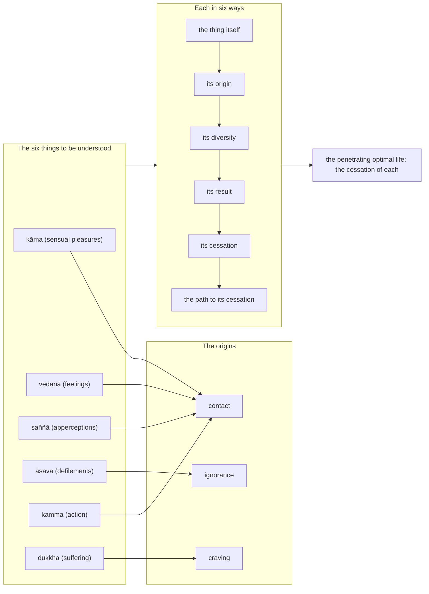

import { Tabs, TabItem } from '@astrojs/starlight/components';

Original text: [16A6/2.1.9 Nibbedhikasutta 555–600](https://tipitaka2500.github.io/tipitaka/16A6/2/2.1/2.1.9.html#555) in the [World Tipitaka Edition](https://tipitaka2500.github.io)

## Summary

The Bhagavā teaches the bhikkhū a `nibbedhikapariyāya` (penetrating discourse) on six things: sensual pleasures, feelings, apperceptions, the defilements, `kamma` (action) and suffering. Each is to be understood in six ways — in itself, its origin, its diversity, its result, its cessation and the path leading to its cessation — and a disciple of the liberated who understands them so understands the penetrating optimal life as their cessation. On the way the discourse defines `kāma` as the passion of intention rather than the beautiful things of the world, and `kamma` as intention.

## Diagram

## Text

<Tabs syncKey="paliquote">
<TabItem label="My Translation">
(63.)

555\. “I will teach you, Bhikkhave, the penetrating discourse, a discourse on the Dhamma. Listen and pay close attention, I will speak.” “Yes, Bhante,” those bhikkhū replied to the Bhagavā. The Bhagavā said this:

556\. “And what, Bhikkhave, is that penetrating discourse, the discourse on the Dhamma? `kāma` (sensual pleasures), Bhikkhave, should be understood; the origin of sensual pleasures should be understood; the diversity of sensual pleasures should be understood; the result of sensual pleasures should be understood; the cessation of sensual pleasures should be understood; the path leading to the cessation of sensual pleasures should be understood. (1)

557\. `vedanā` (feelings), Bhikkhave, should be understood; the origin of feelings should be understood; the diversity of feelings should be understood; the result of feelings should be understood; the cessation of feeling should be understood; the path leading to the cessation of feeling should be understood. (2)

558\. `saññā` (apperceptions), Bhikkhave, should be understood; the origin of apperceptions should be understood; the diversity of apperceptions should be understood; the result of apperceptions should be understood; the cessation of apperception should be understood; the path leading to the cessation of apperception should be understood. (3)

559\. `āsava` (defilements), Bhikkhave, should be understood; the origin of the defilements should be understood; the diversity of the defilements should be understood; the result of the defilements should be understood; the cessation of the defilements should be understood; the path leading to the cessation of the defilements should be understood. (4)

560\. `kamma` (action), Bhikkhave, should be understood; the origin of `kamma` should be understood; the diversity of `kamma` should be understood; the result of `kamma` should be understood; the cessation of `kamma` should be understood; the path leading to the cessation of `kamma` should be understood. (5)

561\. `dukkha` (suffering), Bhikkhave, should be understood; the origin of suffering should be understood; the diversity of suffering should be understood; the result of suffering should be understood; the cessation of suffering should be understood; the path leading to the cessation of suffering should be understood. (6)

562\. ‘Sensual pleasures, Bhikkhave, should be understood; the origin of sensual pleasures should be understood; the diversity of sensual pleasures should be understood; the result of sensual pleasures should be understood; the cessation of sensual pleasures should be understood; the path leading to the cessation of sensual pleasures should be understood.’ This is what was said. And in reference to what was this said? There are, Bhikkhave, these five `kāmaguṇā` (objects of sensual desire): forms cognisable by the eye — agreeable, pleasant, charming, alluring, accompanied by sensual desire, and stimulating; sounds cognisable by the ear …; odours cognisable by the nose …; tastes cognisable by the tongue …; tangibles cognisable by the body — agreeable, pleasant, charming, alluring, accompanied by sensual desire, and stimulating. And yet, Bhikkhave, these are not sensual pleasures; these are indeed called `kāmaguṇā` (objects of sensual desire) in the Discipline of the Liberated One:

563\. _The passion of intention is a person’s sensual pleasure,_ \
_These are not sensual pleasures, the beautiful things in the world;_ \
_The passion of intention is a person’s sensual pleasure,_ \
_The beautiful things remain just as they are in the world;_ \
_But here the wise dispel desire._

564\. And what, Bhikkhave, is the origin of sensual pleasures? Contact, Bhikkhave, is the origin of sensual pleasures.

565\. And what, Bhikkhave, is the diversity of sensual pleasures? Sensual pleasure in forms, Bhikkhave, is one thing; sensual pleasure in sounds is another; sensual pleasure in odours is another; sensual pleasure in tastes is another; sensual pleasure in tangibles is another. This, Bhikkhave, is called the diversity of sensual pleasures.

566\. And what, Bhikkhave, is the result of sensual pleasures? That one who desires, Bhikkhave, produces a corresponding personal existence in each case, whether meritorious or unmeritorious — this, Bhikkhave, is called the result of sensual pleasures.

567\. And what, Bhikkhave, is the cessation of sensual pleasures? The cessation of contact, Bhikkhave, is the cessation of sensual pleasures. This very `ariyo aṭṭhaṅgiko maggo` (Eightfold Path) is the path leading to the cessation of sensual pleasures, namely: right view, right resolve, right speech, right action, right livelihood, right effort, right awareness, right focus.

568\. When, Bhikkhave, a disciple of the liberated thus understands sensual pleasures, thus understands the origin of sensual pleasures, thus understands the diversity of sensual pleasures, thus understands the result of sensual pleasures, thus understands the cessation of sensual pleasures, thus understands the path leading to the cessation of sensual pleasures, he understands this penetrating optimal life as the cessation of sensual pleasures. That which was said: ‘Sensual pleasures, Bhikkhave, should be understood … and so on … the path leading to the cessation of sensual pleasures should be understood,’ it was said in reference to this. (1)

569\. Feelings, Bhikkhave, should be understood … and so on … the path leading to the cessation of feeling should be understood. This is what was said. And in reference to what was this said? There are, Bhikkhave, these three feelings: pleasant feeling, painful feeling, and neutral feeling.

570\. And what, Bhikkhave, is the origin of feelings? Contact, Bhikkhave, is the origin of feelings.

571\. And what, Bhikkhave, is the diversity of feelings? There is, Bhikkhave, worldly pleasant feeling and there is pleasant feeling that is not worldly; there is worldly painful feeling and there is painful feeling that is not worldly; there is worldly neutral feeling and there is neutral feeling that is not worldly. This, Bhikkhave, is called the diversity of feelings.

572\. And what, Bhikkhave, is the result of feelings? That one who feels, Bhikkhave, produces a corresponding personal existence in each case, whether meritorious or unmeritorious — this, Bhikkhave, is called the result of feelings.

573\. And what, Bhikkhave, is the cessation of feeling? The cessation of contact, Bhikkhave, is the cessation of feeling. This very `ariyo aṭṭhaṅgiko maggo` (Eightfold Path) is the path leading to the cessation of feeling, namely: right view … and so on … right focus.

574\. When, Bhikkhave, a disciple of the liberated thus understands feeling, thus understands the origin of feelings, thus understands the diversity of feelings, thus understands the result of feelings, thus understands the cessation of feeling, thus understands the path leading to the cessation of feeling. He understands this penetrating optimal life as the cessation of feeling. That which was said: ‘Feelings, Bhikkhave, should be understood … and so on … the path leading to the cessation of feeling should be understood,’ it was said in reference to this. (2)

575\. Apperceptions, Bhikkhave, should be understood … and so on … the path leading to the cessation of apperception should be understood. This is what was said. And in reference to what was this said? There are, Bhikkhave, these six apperceptions: apperception of forms, apperception of sounds, apperception of odours, apperception of tastes, apperception of tangibles, apperception of mental phenomena.

576\. And what, Bhikkhave, is the origin of apperceptions? Contact, Bhikkhave, is the origin of apperceptions.

577\. And what, Bhikkhave, is the diversity of apperceptions? Apperception in forms, Bhikkhave, is one thing; apperception in sounds is another; apperception in odours is another; apperception in tastes is another; apperception in tangibles is another; apperception in mental phenomena is another. This, Bhikkhave, is called the diversity of apperceptions.

578\. And what, Bhikkhave, is the result of apperceptions? Apperception, Bhikkhave, I declare to result in verbal expression. In whatever way one apperceives it, in that way one expresses it: ‘I was percipient in this way.’ This, Bhikkhave, is called the result of apperceptions.

579\. And what, Bhikkhave, is the cessation of apperception? The cessation of contact, Bhikkhave, is the cessation of apperception. This very `ariyo aṭṭhaṅgiko maggo` (Eightfold Path) is the path leading to the cessation of apperception, namely: right view … and so on … right focus.

580\. When, Bhikkhave, a disciple of the liberated thus understands apperception, thus understands the origin of apperceptions, thus understands the diversity of apperceptions, thus understands the result of apperceptions, thus understands the cessation of apperception, thus understands the path leading to the cessation of apperception, he understands this penetrating optimal life as the cessation of apperception. ‘Apperceptions, Bhikkhave, should be understood … and so on … the path leading to the cessation of apperception should be understood.’ Thus that which was said, it was said in reference to this. (3)

581\. The defilements, Bhikkhave, should be understood … and so on … the path leading to the cessation of the defilements should be understood. This is what was said. And in reference to what was this said? There are, Bhikkhave, these three defilements: the defilement of sensual pleasure, the defilement of existence, and the defilement of ignorance.

582\. And what, Bhikkhave, is the origin of the defilements? Ignorance, Bhikkhave, is the origin of the defilements.

583\. And what, Bhikkhave, is the diversity of the defilements? There are, Bhikkhave, defilements leading to hell; there are defilements leading to the animal realm; there are defilements leading to the realm of hungry ghosts; there are defilements leading to the human world; there are defilements leading to the deva worlds. This, Bhikkhave, is called the diversity of the defilements.

584\. And what, Bhikkhave, is the result of the defilements? That one immersed in ignorance, Bhikkhave, produces a corresponding personal existence in each case, whether meritorious or unmeritorious — this, Bhikkhave, is called the result of the defilements.

585\. And what, Bhikkhave, is the cessation of the defilements? The cessation of ignorance, Bhikkhave, is the cessation of the defilements. This very `ariyo aṭṭhaṅgiko maggo` (Eightfold Path) is the path leading to the cessation of the defilements, namely: right view … and so on … right focus.

586\. When, Bhikkhave, a disciple of the liberated thus understands the defilements, thus understands the origin of the defilements, thus understands the diversity of the defilements, thus understands the result of the defilements, thus understands the cessation of the defilements, thus understands the path leading to the cessation of the defilements, he understands this penetrating optimal life as the cessation of the defilements. ‘The defilements, Bhikkhave, should be understood … and so on … the path leading to the cessation of the defilements should be understood.’ Thus that which was said, it was said in reference to this. (4)

587\. Action (`Kamma`), Bhikkhave, should be understood... and the path leading to the cessation of `kamma` should be understood. This is what was said. And in reference to what was this said? Intention, Bhikkhave, I declare to be `kamma`. Having intended, one acts by body, speech, and mind.

588\. And what, Bhikkhave, is the origin of `kamma`? Contact, Bhikkhave, is the origin of `kamma`.

589\. And what, Bhikkhave, is the diversity of `kamma`? There is, Bhikkhave, `kamma` that leads to experience in hell; there is `kamma` that leads to experience in the animal realm; there is `kamma` that leads to experience in the realm of hungry ghosts; there is `kamma` that leads to experience in the human world; there is `kamma` that leads to experience in the deva worlds. This, Bhikkhave, is called the diversity of `kamma`.

590\. And what, Bhikkhave, is the result of `kamma`? I declare, Bhikkhave, the result of `kamma` to be of three kinds: experienced in this very life, or in a subsequent birth, or on some later occasion. This, Bhikkhave, is called the result of `kamma`.

591\. And what, Bhikkhave, is the cessation of `kamma`? The cessation of contact, Bhikkhave, is the cessation of `kamma`. This very `ariyo aṭṭhaṅgiko maggo` (Eightfold Path) is the path leading to the cessation of `kamma`, namely: right view... and so on... right focus.

592\. When, Bhikkhave, a disciple of the liberated thus understands `kamma`, thus understands the origin of `kamma`, thus understands the diversity of `kamma`, thus understands the result of `kamma`, thus understands the cessation of `kamma`, thus understands the path leading to the cessation of `kamma`, he understands this penetrative optimal life as the cessation of `kamma`. That which was said: "`Kamma`, Bhikkhave, should be understood... and the path leading to the cessation of `kamma` should be understood," it was said in reference to this. (5)

593\. ‘Suffering, Bhikkhave, should be understood; the origin of suffering should be understood; the diversity of suffering should be understood; the result of suffering should be understood; the cessation of suffering should be understood; the path leading to the cessation of suffering should be understood.’ This is what was said; and in reference to what was this said? Birth, too, is suffering; ageing, too, is suffering; illness, too, is suffering; death, too, is suffering; sorrow, lamentation, pain, displeasure and despair, too, are suffering; not getting what one wants, too, is suffering; in short, the five collections of fuel are suffering.

594\. And what, Bhikkhave, is the origin of suffering? Craving, Bhikkhave, is the origin of suffering.

595\. And what, Bhikkhave, is the diversity of suffering? There is, Bhikkhave, suffering that is extreme, there is that which is slight, there is that which is slow to fade, there is that which is quick to fade. This, Bhikkhave, is called the diversity of suffering.

596\. And what, Bhikkhave, is the result of suffering? Here, Bhikkhave, a certain person, overcome by some suffering, his mind overwhelmed, sorrows, becomes weary, laments, wails beating his breast, and falls into confusion; or else, overcome by some suffering, his mind overwhelmed, he engages in an external search: ‘Who knows one word or two words for the cessation of this suffering?’ Suffering, Bhikkhave, I declare to result either in confusion or in a search. This, Bhikkhave, is called the result of suffering.

597\. And what, Bhikkhave, is the cessation of suffering? The cessation of craving, Bhikkhave, is the cessation of suffering. This very `ariyo aṭṭhaṅgiko maggo` (Eightfold Path) is the path leading to the cessation of suffering, namely: right view … and so on … right focus.

598\. When, Bhikkhave, a disciple of the liberated thus understands suffering, thus understands the origin of suffering, thus understands the diversity of suffering, thus understands the result of suffering, thus understands the cessation of suffering, thus understands the path leading to the cessation of suffering, he understands this penetrating optimal life as the cessation of suffering. ‘Suffering, Bhikkhave, should be understood; the origin of suffering should be understood; the diversity of suffering should be understood; the result of suffering should be understood; the cessation of suffering should be understood; the path leading to the cessation of suffering should be understood.’ Thus that which was said, it was said in reference to this. (6)

599\. This, Bhikkhave, is that penetrating discourse, the discourse on the Dhamma.”

600\. The ninth.
</TabItem>

<TabItem label="Pāḷi (Roman IAST)">
(63.)

555\. “Nibbedhikapariyāyaṃ vo, bhikkhave, dhammapariyāyaṃ desessāmi. Taṃ suṇātha, sādhukaṃ manasi karotha, bhāsissāmī”ti. “Evaṃ, bhante”ti kho te bhikkhū bhagavato paccassosuṃ. Bhagavā etadavoca—

556\. “Katamo ca so, bhikkhave, nibbedhikapariyāyo dhammapariyāyo? Kāmā, bhikkhave, veditabbā, kāmānaṃ nidānasambhavo veditabbo, kāmānaṃ vemattatā veditabbā, kāmānaṃ vipāko veditabbo, kāmanirodho veditabbo, kāmanirodhagāminī paṭipadā veditabbā. (1)

557\. Vedanā, bhikkhave, veditabbā, vedanānaṃ nidānasambhavo veditabbo, vedanānaṃ vemattatā veditabbā, vedanānaṃ vipāko veditabbo, vedanānirodho veditabbo, vedanānirodhagāminī paṭipadā veditabbā. (2)

558\. Saññā, bhikkhave, veditabbā, saññānaṃ nidānasambhavo veditabbo, saññānaṃ vemattatā veditabbā, saññānaṃ vipāko veditabbo, saññānirodho veditabbo, saññānirodhagāminī paṭipadā veditabbā. (3)

559\. Āsavā, bhikkhave, veditabbā, āsavānaṃ nidānasambhavo veditabbo, āsavānaṃ vemattatā veditabbā, āsavānaṃ vipāko veditabbo, āsavanirodho veditabbo, āsavanirodhagāminī paṭipadā veditabbā. (4)

560\. Kammaṃ, bhikkhave, veditabbaṃ, kammānaṃ nidānasambhavo veditabbo, kammānaṃ vemattatā veditabbā, kammānaṃ vipāko veditabbo, kammanirodho veditabbo, kammanirodhagāminī paṭipadā veditabbā. (5)

561\. Dukkhaṃ, bhikkhave, veditabbaṃ, dukkhassa nidānasambhavo veditabbo, dukkhassa vemattatā veditabbā, dukkhassa vipāko veditabbo, dukkhanirodho veditabbo, dukkhanirodhagāminī paṭipadā veditabbā. (6)

562\. ‘Kāmā, bhikkhave, veditabbā, kāmānaṃ nidānasambhavo veditabbo, kāmānaṃ vemattatā veditabbā, kāmānaṃ vipāko veditabbo, kāmanirodho veditabbo, kāmanirodhagāminī paṭipadā veditabbā’ti, iti kho panetaṃ vuttaṃ. Kiñcetaṃ paṭicca vuttaṃ? Pañcime, bhikkhave, kāmaguṇā— cakkhuviññeyyā rūpā iṭṭhā kantā manāpā piyarūpā kāmūpasaṃhitā rajanīyā, sotaviññeyyā saddā… ghānaviññeyyā gandhā… jivhāviññeyyā rasā… kāyaviññeyyā phoṭṭhabbā iṭṭhā kantā manāpā piyarūpā kāmūpasaṃhitā rajanīyā. Api ca kho, bhikkhave, nete kāmā kāmaguṇā nāmete ariyassa vinaye vuccanti—

563\. _Saṅkapparāgo purisassa kāmo,_  
_Nete kāmā yāni citrāni loke;_  
_Saṅkapparāgo purisassa kāmo,_  
_Tiṭṭhanti citrāni tatheva loke;_  
_Athettha dhīrā vinayanti chandanti._

564\. Katamo ca, bhikkhave, kāmānaṃ nidānasambhavo? Phasso, bhikkhave, kāmānaṃ nidānasambhavo.

565\. Katamā ca, bhikkhave, kāmānaṃ vemattatā? Añño, bhikkhave, kāmo rūpesu, añño kāmo saddesu, añño kāmo gandhesu, añño kāmo rasesu, añño kāmo phoṭṭhabbesu. Ayaṃ vuccati, bhikkhave, kāmānaṃ vemattatā.

566\. Katamo ca, bhikkhave, kāmānaṃ vipāko? Yaṃ kho, bhikkhave, kāmayamāno tajjaṃ tajjaṃ attabhāvaṃ abhinibbatteti puññabhāgiyaṃ vā apuññabhāgiyaṃ vā, ayaṃ vuccati, bhikkhave, kāmānaṃ vipāko.

567\. Katamo ca, bhikkhave, kāmanirodho? Phassanirodho, bhikkhave, kāmanirodho. Ayameva ariyo aṭṭhaṅgiko maggo kāmanirodhagāminī paṭipadā, seyyathidaṃ— sammādiṭṭhi, sammāsaṅkappo, sammāvācā, sammākammanto, sammāājīvo, sammāvāyāmo, sammāsati, sammāsamādhi.

568\. Yato kho, bhikkhave, ariyasāvako evaṃ kāme pajānāti, evaṃ kāmānaṃ nidānasambhavaṃ pajānāti, evaṃ kāmānaṃ vemattataṃ pajānāti, evaṃ kāmānaṃ vipākaṃ pajānāti, evaṃ kāmanirodhaṃ pajānāti, evaṃ kāmanirodhagāminiṃ paṭipadaṃ pajānāti, so imaṃ nibbedhikaṃ brahmacariyaṃ pajānāti kāmanirodhaṃ. Kāmā, bhikkhave, veditabbā…pe… kāmanirodhagāminī paṭipadā veditabbāti, iti yaṃ taṃ vuttaṃ idametaṃ paṭicca vuttaṃ. (1)

569\. Vedanā, bhikkhave, veditabbā…pe… vedanānirodhagāminī paṭipadā veditabbāti, iti kho panetaṃ vuttaṃ. Kiñcetaṃ paṭicca vuttaṃ? Tisso imā, bhikkhave, vedanā— sukhā vedanā, dukkhā vedanā, adukkhamasukhā vedanā.

570\. Katamo ca, bhikkhave, vedanānaṃ nidānasambhavo? Phasso, bhikkhave, vedanānaṃ nidānasambhavo.

571\. Katamā ca, bhikkhave, vedanānaṃ vemattatā? Atthi, bhikkhave, sāmisā sukhā vedanā, atthi nirāmisā sukhā vedanā, atthi sāmisā dukkhā vedanā, atthi nirāmisā dukkhā vedanā, atthi sāmisā adukkhamasukhā vedanā, atthi nirāmisā adukkhamasukhā vedanā. Ayaṃ vuccati, bhikkhave, vedanānaṃ vemattatā.

572\. Katamo ca, bhikkhave, vedanānaṃ vipāko? Yaṃ kho, bhikkhave, vediyamāno tajjaṃ tajjaṃ attabhāvaṃ abhinibbatteti puññabhāgiyaṃ vā apuññabhāgiyaṃ vā, ayaṃ vuccati, bhikkhave, vedanānaṃ vipāko.

573\. Katamo ca, bhikkhave, vedanānirodho? Phassanirodho, bhikkhave, vedanānirodho. Ayameva ariyo aṭṭhaṅgiko maggo vedanānirodhagāminī paṭipadā, seyyathidaṃ— sammādiṭṭhi…pe… sammāsamādhi.

574\. Yato kho, bhikkhave, ariyasāvako evaṃ vedanaṃ pajānāti, evaṃ vedanānaṃ nidānasambhavaṃ pajānāti, evaṃ vedanānaṃ vemattataṃ pajānāti, evaṃ vedanānaṃ vipākaṃ pajānāti, evaṃ vedanānirodhaṃ pajānāti, evaṃ vedanānirodhagāminiṃ paṭipadaṃ pajānāti. So imaṃ nibbedhikaṃ brahmacariyaṃ pajānāti vedanānirodhaṃ. Vedanā, bhikkhave, veditabbā…pe… vedanānirodhagāminī paṭipadā veditabbāti, iti yaṃ taṃ vuttaṃ idametaṃ paṭicca vuttaṃ. (2)

575\. Saññā, bhikkhave, veditabbā…pe… saññānirodhagāminī paṭipadā veditabbāti, iti kho panetaṃ vuttaṃ. Kiñcetaṃ paṭicca vuttaṃ? Chayimā, bhikkhave, saññā— rūpasaññā, saddasaññā, gandhasaññā, rasasaññā, phoṭṭhabbasaññā, dhammasaññā.

576\. Katamo ca, bhikkhave, saññānaṃ nidānasambhavo? Phasso, bhikkhave, saññānaṃ nidānasambhavo.

577\. Katamā ca, bhikkhave, saññānaṃ vemattatā? Aññā, bhikkhave, saññā rūpesu, aññā saññā saddesu, aññā saññā gandhesu, aññā saññā rasesu, aññā saññā phoṭṭhabbesu, aññā saññā dhammesu. Ayaṃ vuccati, bhikkhave, saññānaṃ vemattatā.

578\. Katamo ca, bhikkhave, saññānaṃ vipāko? Vohāravepakkaṃ, bhikkhave, saññaṃ vadāmi. Yathā yathā naṃ sañjānāti tathā tathā voharati, evaṃ saññī ahosinti. Ayaṃ vuccati, bhikkhave, saññānaṃ vipāko.

579\. Katamo ca, bhikkhave, saññānirodho? Phassanirodho, bhikkhave, saññānirodho. Ayameva ariyo aṭṭhaṅgiko maggo saññānirodhagāminī paṭipadā, seyyathidaṃ— sammādiṭṭhi…pe… sammāsamādhi.

580\. Yato kho, bhikkhave, ariyasāvako evaṃ saññaṃ pajānāti, evaṃ saññānaṃ nidānasambhavaṃ pajānāti, evaṃ saññānaṃ vemattataṃ pajānāti, evaṃ saññānaṃ vipākaṃ pajānāti, evaṃ saññānirodhaṃ pajānāti, evaṃ saññānirodhagāminiṃ paṭipadaṃ pajānāti, so imaṃ nibbedhikaṃ brahmacariyaṃ pajānāti saññānirodhaṃ. Saññā, bhikkhave, veditabbā…pe… saññānirodhagāminī paṭipadā veditabbāti. Iti yaṃ taṃ vuttaṃ idametaṃ paṭicca vuttaṃ. (3)

581\. Āsavā, bhikkhave, veditabbā…pe… āsavanirodhagāminī paṭipadā veditabbāti, iti kho panetaṃ vuttaṃ. Kiñcetaṃ paṭicca vuttaṃ? Tayome, bhikkhave, āsavā— kāmāsavo, bhavāsavo, avijjāsavo.

582\. Katamo ca, bhikkhave, āsavānaṃ nidānasambhavo? Avijjā, bhikkhave, āsavānaṃ nidānasambhavo.

583\. Katamā ca, bhikkhave, āsavānaṃ vemattatā? Atthi, bhikkhave, āsavā nirayagamanīyā, atthi āsavā tiracchānayonigamanīyā, atthi āsavā pettivisayagamanīyā, atthi āsavā manussalokagamanīyā, atthi āsavā devalokagamanīyā. Ayaṃ vuccati, bhikkhave, āsavānaṃ vemattatā.

584\. Katamo ca, bhikkhave, āsavānaṃ vipāko? Yaṃ kho, bhikkhave, avijjāgato tajjaṃ tajjaṃ attabhāvaṃ abhinibbatteti puññabhāgiyaṃ vā apuññabhāgiyaṃ vā, ayaṃ vuccati, bhikkhave, āsavānaṃ vipāko.

585\. Katamo ca, bhikkhave, āsavanirodho? Avijjānirodho, bhikkhave, āsavanirodho. Ayameva ariyo aṭṭhaṅgiko maggo āsavanirodhagāminī paṭipadā, seyyathidaṃ— sammādiṭṭhi…pe… sammāsamādhi.

586\. Yato kho, bhikkhave, ariyasāvako evaṃ āsave pajānāti, evaṃ āsavānaṃ nidānasambhavaṃ pajānāti, evaṃ āsavānaṃ vemattataṃ pajānāti, evaṃ āsavānaṃ vipākaṃ pajānāti, evaṃ āsavānaṃ nirodhaṃ pajānāti, evaṃ āsavānaṃ nirodhagāminiṃ paṭipadaṃ pajānāti, so imaṃ nibbedhikaṃ brahmacariyaṃ pajānāti āsavanirodhaṃ. Āsavā, bhikkhave, veditabbā…pe… āsavanirodhagāminī paṭipadā veditabbāti. Iti yaṃ taṃ vuttaṃ idametaṃ paṭicca vuttaṃ. (4)

587\. Kammaṃ, bhikkhave, veditabbaṃ…pe… kammanirodhagāminī paṭipadā veditabbāti, iti kho panetaṃ vuttaṃ. Kiñcetaṃ paṭicca vuttaṃ? Cetanāhaṃ, bhikkhave, kammaṃ vadāmi. Cetayitvā kammaṃ karoti— kāyena vācāya manasā.

588\. Katamo ca, bhikkhave, kammānaṃ nidānasambhavo? Phasso, bhikkhave, kammānaṃ nidānasambhavo.

589\. Katamā ca, bhikkhave, kammānaṃ vemattatā? Atthi, bhikkhave, kammaṃ nirayavedanīyaṃ, atthi kammaṃ tiracchānayonivedanīyaṃ, atthi kammaṃ pettivisayavedanīyaṃ, atthi kammaṃ manussalokavedanīyaṃ, atthi kammaṃ devalokavedanīyaṃ. Ayaṃ vuccati, bhikkhave, kammānaṃ vemattatā.

590\. Katamo ca, bhikkhave, kammānaṃ vipāko? Tividhāhaṃ, bhikkhave, kammānaṃ vipākaṃ vadāmi— diṭṭheva dhamme, upapajje vā, apare vā pariyāye. Ayaṃ vuccati, bhikkhave, kammānaṃ vipāko.

591\. Katamo ca, bhikkhave, kammanirodho? Phassanirodho, bhikkhave, kammanirodho. Ayameva ariyo aṭṭhaṅgiko maggo kammanirodhagāminī paṭipadā, seyyathidaṃ— sammādiṭṭhi…pe… sammāsamādhi.

592\. Yato kho, bhikkhave, ariyasāvako evaṃ kammaṃ pajānāti, evaṃ kammānaṃ nidānasambhavaṃ pajānāti, evaṃ kammānaṃ vemattataṃ pajānāti, evaṃ kammānaṃ vipākaṃ pajānāti, evaṃ kammanirodhaṃ pajānāti, evaṃ kammanirodhagāminiṃ paṭipadaṃ pajānāti, so imaṃ nibbedhikaṃ brahmacariyaṃ pajānāti kammanirodhaṃ. Kammaṃ, bhikkhave, veditabbaṃ…pe… kammanirodhagāminī paṭipadā veditabbāti, iti yaṃ taṃ vuttaṃ idametaṃ paṭicca vuttaṃ. (5)

593\. Dukkhaṃ, bhikkhave, veditabbaṃ, dukkhassa nidānasambhavo veditabbo, dukkhassa vemattatā veditabbā, dukkhassa vipāko veditabbo, dukkhanirodho veditabbo, dukkhanirodhagāminī paṭipadā veditabbāti. Iti kho panetaṃ vuttaṃ, kiñcetaṃ paṭicca vuttaṃ? Jātipi dukkhā, jarāpi dukkhā, byādhipi dukkho, maraṇampi dukkhaṃ, sokaparidevadukkhadomanassupāyāsāpi dukkhā, yampicchaṃ na labhati tampi dukkhaṃ, saṃkhittena pañcupādānakkhandhā dukkhā.

594\. Katamo ca, bhikkhave, dukkhassa nidānasambhavo? Taṇhā, bhikkhave, dukkhassa nidānasambhavo.

595\. Katamā ca, bhikkhave, dukkhassa vemattatā? Atthi, bhikkhave, dukkhaṃ adhimattaṃ, atthi parittaṃ, atthi dandhavirāgi, atthi khippavirāgi. Ayaṃ vuccati, bhikkhave, dukkhassa vemattatā.

596\. Katamo ca, bhikkhave, dukkhassa vipāko? Idha, bhikkhave, ekacco yena dukkhena abhibhūto pariyādinnacitto socati kilamati paridevati, urattāḷiṃ kandati, sammohaṃ āpajjati, yena vā pana dukkhena abhibhūto pariyādinnacitto bahiddhā pariyeṭṭhiṃ āpajjati— ‘ko ekapadaṃ dvipadaṃ jānāti imassa dukkhassa nirodhāyā’ti? Sammohavepakkaṃ vāhaṃ, bhikkhave, dukkhaṃ vadāmi pariyeṭṭhivepakkaṃ vā. Ayaṃ vuccati, bhikkhave, dukkhassa vipāko.

597\. Katamo ca, bhikkhave, dukkhanirodho? Taṇhānirodho, bhikkhave, dukkhanirodho. Ayameva ariyo aṭṭhaṅgiko maggo dukkhassa nirodhagāminī paṭipadā, seyyathidaṃ— sammādiṭṭhi…pe… sammāsamādhi.

598\. Yato kho, bhikkhave, ariyasāvako evaṃ dukkhaṃ pajānāti, evaṃ dukkhassa nidānasambhavaṃ pajānāti, evaṃ dukkhassa vemattataṃ pajānāti, evaṃ dukkhassa vipākaṃ pajānāti, evaṃ dukkhanirodhaṃ pajānāti, evaṃ dukkhanirodhagāminiṃ paṭipadaṃ pajānāti, so imaṃ nibbedhikaṃ brahmacariyaṃ pajānāti dukkhanirodhaṃ. Dukkhaṃ, bhikkhave, veditabbaṃ, dukkhassa nidānasambhavo veditabbo, dukkhassa vemattatā veditabbā, dukkhassa vipāko veditabbo, dukkhanirodho veditabbo, dukkhanirodhagāminī paṭipadā veditabbāti. Iti yaṃ taṃ vuttaṃ idametaṃ paṭicca vuttaṃ. (6)

599\. Ayaṃ kho so, bhikkhave, nibbedhikapariyāyo dhammapariyāyo”ti.

600\. Navamaṃ.
</TabItem>

<TabItem label="Pāḷi (Brahmi)">
(63.)

555\. “𑀦𑀺𑀩𑁆𑀩𑁂𑀥𑀺𑀓𑀧𑀭𑀺𑀬𑀸𑀬𑀁 𑀯𑁄, 𑀪𑀺𑀓𑁆𑀔𑀯𑁂, 𑀥𑀫𑁆𑀫𑀧𑀭𑀺𑀬𑀸𑀬𑀁 𑀤𑁂𑀲𑁂𑀲𑁆𑀲𑀸𑀫𑀺. 𑀢𑀁 𑀲𑀼𑀡𑀸𑀣, 𑀲𑀸𑀥𑀼𑀓𑀁 𑀫𑀦𑀲𑀺 𑀓𑀭𑁄𑀣, 𑀪𑀸𑀲𑀺𑀲𑁆𑀲𑀸𑀫𑀻”𑀢𑀺. “𑀏𑀯𑀁, 𑀪𑀦𑁆𑀢𑁂”𑀢𑀺 𑀔𑁄 𑀢𑁂 𑀪𑀺𑀓𑁆𑀔𑀽 𑀪𑀕𑀯𑀢𑁄 𑀧𑀘𑁆𑀘𑀲𑁆𑀲𑁄𑀲𑀼𑀁. 𑀪𑀕𑀯𑀸 𑀏𑀢𑀤𑀯𑁄𑀘—

556\. “𑀓𑀢𑀫𑁄 𑀘 𑀲𑁄, 𑀪𑀺𑀓𑁆𑀔𑀯𑁂, 𑀦𑀺𑀩𑁆𑀩𑁂𑀥𑀺𑀓𑀧𑀭𑀺𑀬𑀸𑀬𑁄 𑀥𑀫𑁆𑀫𑀧𑀭𑀺𑀬𑀸𑀬𑁄? 𑀓𑀸𑀫𑀸, 𑀪𑀺𑀓𑁆𑀔𑀯𑁂, 𑀯𑁂𑀤𑀺𑀢𑀩𑁆𑀩𑀸, 𑀓𑀸𑀫𑀸𑀦𑀁 𑀦𑀺𑀤𑀸𑀦𑀲𑀫𑁆𑀪𑀯𑁄 𑀯𑁂𑀤𑀺𑀢𑀩𑁆𑀩𑁄, 𑀓𑀸𑀫𑀸𑀦𑀁 𑀯𑁂𑀫𑀢𑁆𑀢𑀢𑀸 𑀯𑁂𑀤𑀺𑀢𑀩𑁆𑀩𑀸, 𑀓𑀸𑀫𑀸𑀦𑀁 𑀯𑀺𑀧𑀸𑀓𑁄 𑀯𑁂𑀤𑀺𑀢𑀩𑁆𑀩𑁄, 𑀓𑀸𑀫𑀦𑀺𑀭𑁄𑀥𑁄 𑀯𑁂𑀤𑀺𑀢𑀩𑁆𑀩𑁄, 𑀓𑀸𑀫𑀦𑀺𑀭𑁄𑀥𑀕𑀸𑀫𑀺𑀦𑀻 𑀧𑀝𑀺𑀧𑀤𑀸 𑀯𑁂𑀤𑀺𑀢𑀩𑁆𑀩𑀸. (1)

557\. 𑀯𑁂𑀤𑀦𑀸, 𑀪𑀺𑀓𑁆𑀔𑀯𑁂, 𑀯𑁂𑀤𑀺𑀢𑀩𑁆𑀩𑀸, 𑀯𑁂𑀤𑀦𑀸𑀦𑀁 𑀦𑀺𑀤𑀸𑀦𑀲𑀫𑁆𑀪𑀯𑁄 𑀯𑁂𑀤𑀺𑀢𑀩𑁆𑀩𑁄, 𑀯𑁂𑀤𑀦𑀸𑀦𑀁 𑀯𑁂𑀫𑀢𑁆𑀢𑀢𑀸 𑀯𑁂𑀤𑀺𑀢𑀩𑁆𑀩𑀸, 𑀯𑁂𑀤𑀦𑀸𑀦𑀁 𑀯𑀺𑀧𑀸𑀓𑁄 𑀯𑁂𑀤𑀺𑀢𑀩𑁆𑀩𑁄, 𑀯𑁂𑀤𑀦𑀸𑀦𑀺𑀭𑁄𑀥𑁄 𑀯𑁂𑀤𑀺𑀢𑀩𑁆𑀩𑁄, 𑀯𑁂𑀤𑀦𑀸𑀦𑀺𑀭𑁄𑀥𑀕𑀸𑀫𑀺𑀦𑀻 𑀧𑀝𑀺𑀧𑀤𑀸 𑀯𑁂𑀤𑀺𑀢𑀩𑁆𑀩𑀸. (2)

558\. 𑀲𑀜𑁆𑀜𑀸, 𑀪𑀺𑀓𑁆𑀔𑀯𑁂, 𑀯𑁂𑀤𑀺𑀢𑀩𑁆𑀩𑀸, 𑀲𑀜𑁆𑀜𑀸𑀦𑀁 𑀦𑀺𑀤𑀸𑀦𑀲𑀫𑁆𑀪𑀯𑁄 𑀯𑁂𑀤𑀺𑀢𑀩𑁆𑀩𑁄, 𑀲𑀜𑁆𑀜𑀸𑀦𑀁 𑀯𑁂𑀫𑀢𑁆𑀢𑀢𑀸 𑀯𑁂𑀤𑀺𑀢𑀩𑁆𑀩𑀸, 𑀲𑀜𑁆𑀜𑀸𑀦𑀁 𑀯𑀺𑀧𑀸𑀓𑁄 𑀯𑁂𑀤𑀺𑀢𑀩𑁆𑀩𑁄, 𑀲𑀜𑁆𑀜𑀸𑀦𑀺𑀭𑁄𑀥𑁄 𑀯𑁂𑀤𑀺𑀢𑀩𑁆𑀩𑁄, 𑀲𑀜𑁆𑀜𑀸𑀦𑀺𑀭𑁄𑀥𑀕𑀸𑀫𑀺𑀦𑀻 𑀧𑀝𑀺𑀧𑀤𑀸 𑀯𑁂𑀤𑀺𑀢𑀩𑁆𑀩𑀸. (3)

559\. 𑀆𑀲𑀯𑀸, 𑀪𑀺𑀓𑁆𑀔𑀯𑁂, 𑀯𑁂𑀤𑀺𑀢𑀩𑁆𑀩𑀸, 𑀆𑀲𑀯𑀸𑀦𑀁 𑀦𑀺𑀤𑀸𑀦𑀲𑀫𑁆𑀪𑀯𑁄 𑀯𑁂𑀤𑀺𑀢𑀩𑁆𑀩𑁄, 𑀆𑀲𑀯𑀸𑀦𑀁 𑀯𑁂𑀫𑀢𑁆𑀢𑀢𑀸 𑀯𑁂𑀤𑀺𑀢𑀩𑁆𑀩𑀸, 𑀆𑀲𑀯𑀸𑀦𑀁 𑀯𑀺𑀧𑀸𑀓𑁄 𑀯𑁂𑀤𑀺𑀢𑀩𑁆𑀩𑁄, 𑀆𑀲𑀯𑀦𑀺𑀭𑁄𑀥𑁄 𑀯𑁂𑀤𑀺𑀢𑀩𑁆𑀩𑁄, 𑀆𑀲𑀯𑀦𑀺𑀭𑁄𑀥𑀕𑀸𑀫𑀺𑀦𑀻 𑀧𑀝𑀺𑀧𑀤𑀸 𑀯𑁂𑀤𑀺𑀢𑀩𑁆𑀩𑀸. (4)

560\. 𑀓𑀫𑁆𑀫𑀁, 𑀪𑀺𑀓𑁆𑀔𑀯𑁂, 𑀯𑁂𑀤𑀺𑀢𑀩𑁆𑀩𑀁, 𑀓𑀫𑁆𑀫𑀸𑀦𑀁 𑀦𑀺𑀤𑀸𑀦𑀲𑀫𑁆𑀪𑀯𑁄 𑀯𑁂𑀤𑀺𑀢𑀩𑁆𑀩𑁄, 𑀓𑀫𑁆𑀫𑀸𑀦𑀁 𑀯𑁂𑀫𑀢𑁆𑀢𑀢𑀸 𑀯𑁂𑀤𑀺𑀢𑀩𑁆𑀩𑀸, 𑀓𑀫𑁆𑀫𑀸𑀦𑀁 𑀯𑀺𑀧𑀸𑀓𑁄 𑀯𑁂𑀤𑀺𑀢𑀩𑁆𑀩𑁄, 𑀓𑀫𑁆𑀫𑀦𑀺𑀭𑁄𑀥𑁄 𑀯𑁂𑀤𑀺𑀢𑀩𑁆𑀩𑁄, 𑀓𑀫𑁆𑀫𑀦𑀺𑀭𑁄𑀥𑀕𑀸𑀫𑀺𑀦𑀻 𑀧𑀝𑀺𑀧𑀤𑀸 𑀯𑁂𑀤𑀺𑀢𑀩𑁆𑀩𑀸. (5)

561\. 𑀤𑀼𑀓𑁆𑀔𑀁, 𑀪𑀺𑀓𑁆𑀔𑀯𑁂, 𑀯𑁂𑀤𑀺𑀢𑀩𑁆𑀩𑀁, 𑀤𑀼𑀓𑁆𑀔𑀲𑁆𑀲 𑀦𑀺𑀤𑀸𑀦𑀲𑀫𑁆𑀪𑀯𑁄 𑀯𑁂𑀤𑀺𑀢𑀩𑁆𑀩𑁄, 𑀤𑀼𑀓𑁆𑀔𑀲𑁆𑀲 𑀯𑁂𑀫𑀢𑁆𑀢𑀢𑀸 𑀯𑁂𑀤𑀺𑀢𑀩𑁆𑀩𑀸, 𑀤𑀼𑀓𑁆𑀔𑀲𑁆𑀲 𑀯𑀺𑀧𑀸𑀓𑁄 𑀯𑁂𑀤𑀺𑀢𑀩𑁆𑀩𑁄, 𑀤𑀼𑀓𑁆𑀔𑀦𑀺𑀭𑁄𑀥𑁄 𑀯𑁂𑀤𑀺𑀢𑀩𑁆𑀩𑁄, 𑀤𑀼𑀓𑁆𑀔𑀦𑀺𑀭𑁄𑀥𑀕𑀸𑀫𑀺𑀦𑀻 𑀧𑀝𑀺𑀧𑀤𑀸 𑀯𑁂𑀤𑀺𑀢𑀩𑁆𑀩𑀸. (6)

562\. ‘𑀓𑀸𑀫𑀸, 𑀪𑀺𑀓𑁆𑀔𑀯𑁂, 𑀯𑁂𑀤𑀺𑀢𑀩𑁆𑀩𑀸, 𑀓𑀸𑀫𑀸𑀦𑀁 𑀦𑀺𑀤𑀸𑀦𑀲𑀫𑁆𑀪𑀯𑁄 𑀯𑁂𑀤𑀺𑀢𑀩𑁆𑀩𑁄, 𑀓𑀸𑀫𑀸𑀦𑀁 𑀯𑁂𑀫𑀢𑁆𑀢𑀢𑀸 𑀯𑁂𑀤𑀺𑀢𑀩𑁆𑀩𑀸, 𑀓𑀸𑀫𑀸𑀦𑀁 𑀯𑀺𑀧𑀸𑀓𑁄 𑀯𑁂𑀤𑀺𑀢𑀩𑁆𑀩𑁄, 𑀓𑀸𑀫𑀦𑀺𑀭𑁄𑀥𑁄 𑀯𑁂𑀤𑀺𑀢𑀩𑁆𑀩𑁄, 𑀓𑀸𑀫𑀦𑀺𑀭𑁄𑀥𑀕𑀸𑀫𑀺𑀦𑀻 𑀧𑀝𑀺𑀧𑀤𑀸 𑀯𑁂𑀤𑀺𑀢𑀩𑁆𑀩𑀸’𑀢𑀺, 𑀇𑀢𑀺 𑀔𑁄 𑀧𑀦𑁂𑀢𑀁 𑀯𑀼𑀢𑁆𑀢𑀁. 𑀓𑀺𑀜𑁆𑀘𑁂𑀢𑀁 𑀧𑀝𑀺𑀘𑁆𑀘 𑀯𑀼𑀢𑁆𑀢𑀁? 𑀧𑀜𑁆𑀘𑀺𑀫𑁂, 𑀪𑀺𑀓𑁆𑀔𑀯𑁂, 𑀓𑀸𑀫𑀕𑀼𑀡𑀸— 𑀘𑀓𑁆𑀔𑀼𑀯𑀺𑀜𑁆𑀜𑁂𑀬𑁆𑀬𑀸 𑀭𑀽𑀧𑀸 𑀇𑀝𑁆𑀞𑀸 𑀓𑀦𑁆𑀢𑀸 𑀫𑀦𑀸𑀧𑀸 𑀧𑀺𑀬𑀭𑀽𑀧𑀸 𑀓𑀸𑀫𑀽𑀧𑀲𑀁𑀳𑀺𑀢𑀸 𑀭𑀚𑀦𑀻𑀬𑀸, 𑀲𑁄𑀢𑀯𑀺𑀜𑁆𑀜𑁂𑀬𑁆𑀬𑀸 𑀲𑀤𑁆𑀤𑀸… 𑀖𑀸𑀦𑀯𑀺𑀜𑁆𑀜𑁂𑀬𑁆𑀬𑀸 𑀕𑀦𑁆𑀥𑀸… 𑀚𑀺𑀯𑁆𑀳𑀸𑀯𑀺𑀜𑁆𑀜𑁂𑀬𑁆𑀬𑀸 𑀭𑀲𑀸… 𑀓𑀸𑀬𑀯𑀺𑀜𑁆𑀜𑁂𑀬𑁆𑀬𑀸 𑀨𑁄𑀝𑁆𑀞𑀩𑁆𑀩𑀸 𑀇𑀝𑁆𑀞𑀸 𑀓𑀦𑁆𑀢𑀸 𑀫𑀦𑀸𑀧𑀸 𑀧𑀺𑀬𑀭𑀽𑀧𑀸 𑀓𑀸𑀫𑀽𑀧𑀲𑀁𑀳𑀺𑀢𑀸 𑀭𑀚𑀦𑀻𑀬𑀸. 𑀅𑀧𑀺 𑀘 𑀔𑁄, 𑀪𑀺𑀓𑁆𑀔𑀯𑁂, 𑀦𑁂𑀢𑁂 𑀓𑀸𑀫𑀸 𑀓𑀸𑀫𑀕𑀼𑀡𑀸 𑀦𑀸𑀫𑁂𑀢𑁂 𑀅𑀭𑀺𑀬𑀲𑁆𑀲 𑀯𑀺𑀦𑀬𑁂 𑀯𑀼𑀘𑁆𑀘𑀦𑁆𑀢𑀺—

563\. _𑀲𑀗𑁆𑀓𑀧𑁆𑀧𑀭𑀸𑀕𑁄 𑀧𑀼𑀭𑀺𑀲𑀲𑁆𑀲 𑀓𑀸𑀫𑁄,_  
_𑀦𑁂𑀢𑁂 𑀓𑀸𑀫𑀸 𑀬𑀸𑀦𑀺 𑀘𑀺𑀢𑁆𑀭𑀸𑀦𑀺 𑀮𑁄𑀓𑁂;_  
_𑀲𑀗𑁆𑀓𑀧𑁆𑀧𑀭𑀸𑀕𑁄 𑀧𑀼𑀭𑀺𑀲𑀲𑁆𑀲 𑀓𑀸𑀫𑁄,_  
_𑀢𑀺𑀝𑁆𑀞𑀦𑁆𑀢𑀺 𑀘𑀺𑀢𑁆𑀭𑀸𑀦𑀺 𑀢𑀣𑁂𑀯 𑀮𑁄𑀓𑁂;_  
_𑀅𑀣𑁂𑀢𑁆𑀣 𑀥𑀻𑀭𑀸 𑀯𑀺𑀦𑀬𑀦𑁆𑀢𑀺 𑀙𑀦𑁆𑀤𑀦𑁆𑀢𑀺._

564\. 𑀓𑀢𑀫𑁄 𑀘, 𑀪𑀺𑀓𑁆𑀔𑀯𑁂, 𑀓𑀸𑀫𑀸𑀦𑀁 𑀦𑀺𑀤𑀸𑀦𑀲𑀫𑁆𑀪𑀯𑁄? 𑀨𑀲𑁆𑀲𑁄, 𑀪𑀺𑀓𑁆𑀔𑀯𑁂, 𑀓𑀸𑀫𑀸𑀦𑀁 𑀦𑀺𑀤𑀸𑀦𑀲𑀫𑁆𑀪𑀯𑁄.

565\. 𑀓𑀢𑀫𑀸 𑀘, 𑀪𑀺𑀓𑁆𑀔𑀯𑁂, 𑀓𑀸𑀫𑀸𑀦𑀁 𑀯𑁂𑀫𑀢𑁆𑀢𑀢𑀸? 𑀅𑀜𑁆𑀜𑁄, 𑀪𑀺𑀓𑁆𑀔𑀯𑁂, 𑀓𑀸𑀫𑁄 𑀭𑀽𑀧𑁂𑀲𑀼, 𑀅𑀜𑁆𑀜𑁄 𑀓𑀸𑀫𑁄 𑀲𑀤𑁆𑀤𑁂𑀲𑀼, 𑀅𑀜𑁆𑀜𑁄 𑀓𑀸𑀫𑁄 𑀕𑀦𑁆𑀥𑁂𑀲𑀼, 𑀅𑀜𑁆𑀜𑁄 𑀓𑀸𑀫𑁄 𑀭𑀲𑁂𑀲𑀼, 𑀅𑀜𑁆𑀜𑁄 𑀓𑀸𑀫𑁄 𑀨𑁄𑀝𑁆𑀞𑀩𑁆𑀩𑁂𑀲𑀼. 𑀅𑀬𑀁 𑀯𑀼𑀘𑁆𑀘𑀢𑀺, 𑀪𑀺𑀓𑁆𑀔𑀯𑁂, 𑀓𑀸𑀫𑀸𑀦𑀁 𑀯𑁂𑀫𑀢𑁆𑀢𑀢𑀸.

566\. 𑀓𑀢𑀫𑁄 𑀘, 𑀪𑀺𑀓𑁆𑀔𑀯𑁂, 𑀓𑀸𑀫𑀸𑀦𑀁 𑀯𑀺𑀧𑀸𑀓𑁄? 𑀬𑀁 𑀔𑁄, 𑀪𑀺𑀓𑁆𑀔𑀯𑁂, 𑀓𑀸𑀫𑀬𑀫𑀸𑀦𑁄 𑀢𑀚𑁆𑀚𑀁 𑀢𑀚𑁆𑀚𑀁 𑀅𑀢𑁆𑀢𑀪𑀸𑀯𑀁 𑀅𑀪𑀺𑀦𑀺𑀩𑁆𑀩𑀢𑁆𑀢𑁂𑀢𑀺 𑀧𑀼𑀜𑁆𑀜𑀪𑀸𑀕𑀺𑀬𑀁 𑀯𑀸 𑀅𑀧𑀼𑀜𑁆𑀜𑀪𑀸𑀕𑀺𑀬𑀁 𑀯𑀸, 𑀅𑀬𑀁 𑀯𑀼𑀘𑁆𑀘𑀢𑀺, 𑀪𑀺𑀓𑁆𑀔𑀯𑁂, 𑀓𑀸𑀫𑀸𑀦𑀁 𑀯𑀺𑀧𑀸𑀓𑁄.

567\. 𑀓𑀢𑀫𑁄 𑀘, 𑀪𑀺𑀓𑁆𑀔𑀯𑁂, 𑀓𑀸𑀫𑀦𑀺𑀭𑁄𑀥𑁄? 𑀨𑀲𑁆𑀲𑀦𑀺𑀭𑁄𑀥𑁄, 𑀪𑀺𑀓𑁆𑀔𑀯𑁂, 𑀓𑀸𑀫𑀦𑀺𑀭𑁄𑀥𑁄. 𑀅𑀬𑀫𑁂𑀯 𑀅𑀭𑀺𑀬𑁄 𑀅𑀝𑁆𑀞𑀗𑁆𑀕𑀺𑀓𑁄 𑀫𑀕𑁆𑀕𑁄 𑀓𑀸𑀫𑀦𑀺𑀭𑁄𑀥𑀕𑀸𑀫𑀺𑀦𑀻 𑀧𑀝𑀺𑀧𑀤𑀸, 𑀲𑁂𑀬𑁆𑀬𑀣𑀺𑀤𑀁— 𑀲𑀫𑁆𑀫𑀸𑀤𑀺𑀝𑁆𑀞𑀺, 𑀲𑀫𑁆𑀫𑀸𑀲𑀗𑁆𑀓𑀧𑁆𑀧𑁄, 𑀲𑀫𑁆𑀫𑀸𑀯𑀸𑀘𑀸, 𑀲𑀫𑁆𑀫𑀸𑀓𑀫𑁆𑀫𑀦𑁆𑀢𑁄, 𑀲𑀫𑁆𑀫𑀸𑀆𑀚𑀻𑀯𑁄, 𑀲𑀫𑁆𑀫𑀸𑀯𑀸𑀬𑀸𑀫𑁄, 𑀲𑀫𑁆𑀫𑀸𑀲𑀢𑀺, 𑀲𑀫𑁆𑀫𑀸𑀲𑀫𑀸𑀥𑀺.

568\. 𑀬𑀢𑁄 𑀔𑁄, 𑀪𑀺𑀓𑁆𑀔𑀯𑁂, 𑀅𑀭𑀺𑀬𑀲𑀸𑀯𑀓𑁄 𑀏𑀯𑀁 𑀓𑀸𑀫𑁂 𑀧𑀚𑀸𑀦𑀸𑀢𑀺, 𑀏𑀯𑀁 𑀓𑀸𑀫𑀸𑀦𑀁 𑀦𑀺𑀤𑀸𑀦𑀲𑀫𑁆𑀪𑀯𑀁 𑀧𑀚𑀸𑀦𑀸𑀢𑀺, 𑀏𑀯𑀁 𑀓𑀸𑀫𑀸𑀦𑀁 𑀯𑁂𑀫𑀢𑁆𑀢𑀢𑀁 𑀧𑀚𑀸𑀦𑀸𑀢𑀺, 𑀏𑀯𑀁 𑀓𑀸𑀫𑀸𑀦𑀁 𑀯𑀺𑀧𑀸𑀓𑀁 𑀧𑀚𑀸𑀦𑀸𑀢𑀺, 𑀏𑀯𑀁 𑀓𑀸𑀫𑀦𑀺𑀭𑁄𑀥𑀁 𑀧𑀚𑀸𑀦𑀸𑀢𑀺, 𑀏𑀯𑀁 𑀓𑀸𑀫𑀦𑀺𑀭𑁄𑀥𑀕𑀸𑀫𑀺𑀦𑀺𑀁 𑀧𑀝𑀺𑀧𑀤𑀁 𑀧𑀚𑀸𑀦𑀸𑀢𑀺, 𑀲𑁄 𑀇𑀫𑀁 𑀦𑀺𑀩𑁆𑀩𑁂𑀥𑀺𑀓𑀁 𑀩𑁆𑀭𑀳𑁆𑀫𑀘𑀭𑀺𑀬𑀁 𑀧𑀚𑀸𑀦𑀸𑀢𑀺 𑀓𑀸𑀫𑀦𑀺𑀭𑁄𑀥𑀁. 𑀓𑀸𑀫𑀸, 𑀪𑀺𑀓𑁆𑀔𑀯𑁂, 𑀯𑁂𑀤𑀺𑀢𑀩𑁆𑀩𑀸…𑀧𑁂… 𑀓𑀸𑀫𑀦𑀺𑀭𑁄𑀥𑀕𑀸𑀫𑀺𑀦𑀻 𑀧𑀝𑀺𑀧𑀤𑀸 𑀯𑁂𑀤𑀺𑀢𑀩𑁆𑀩𑀸𑀢𑀺, 𑀇𑀢𑀺 𑀬𑀁 𑀢𑀁 𑀯𑀼𑀢𑁆𑀢𑀁 𑀇𑀤𑀫𑁂𑀢𑀁 𑀧𑀝𑀺𑀘𑁆𑀘 𑀯𑀼𑀢𑁆𑀢𑀁. (1)

569\. 𑀯𑁂𑀤𑀦𑀸, 𑀪𑀺𑀓𑁆𑀔𑀯𑁂, 𑀯𑁂𑀤𑀺𑀢𑀩𑁆𑀩𑀸…𑀧𑁂… 𑀯𑁂𑀤𑀦𑀸𑀦𑀺𑀭𑁄𑀥𑀕𑀸𑀫𑀺𑀦𑀻 𑀧𑀝𑀺𑀧𑀤𑀸 𑀯𑁂𑀤𑀺𑀢𑀩𑁆𑀩𑀸𑀢𑀺, 𑀇𑀢𑀺 𑀔𑁄 𑀧𑀦𑁂𑀢𑀁 𑀯𑀼𑀢𑁆𑀢𑀁. 𑀓𑀺𑀜𑁆𑀘𑁂𑀢𑀁 𑀧𑀝𑀺𑀘𑁆𑀘 𑀯𑀼𑀢𑁆𑀢𑀁? 𑀢𑀺𑀲𑁆𑀲𑁄 𑀇𑀫𑀸, 𑀪𑀺𑀓𑁆𑀔𑀯𑁂, 𑀯𑁂𑀤𑀦𑀸— 𑀲𑀼𑀔𑀸 𑀯𑁂𑀤𑀦𑀸, 𑀤𑀼𑀓𑁆𑀔𑀸 𑀯𑁂𑀤𑀦𑀸, 𑀅𑀤𑀼𑀓𑁆𑀔𑀫𑀲𑀼𑀔𑀸 𑀯𑁂𑀤𑀦𑀸.

570\. 𑀓𑀢𑀫𑁄 𑀘, 𑀪𑀺𑀓𑁆𑀔𑀯𑁂, 𑀯𑁂𑀤𑀦𑀸𑀦𑀁 𑀦𑀺𑀤𑀸𑀦𑀲𑀫𑁆𑀪𑀯𑁄? 𑀨𑀲𑁆𑀲𑁄, 𑀪𑀺𑀓𑁆𑀔𑀯𑁂, 𑀯𑁂𑀤𑀦𑀸𑀦𑀁 𑀦𑀺𑀤𑀸𑀦𑀲𑀫𑁆𑀪𑀯𑁄.

571\. 𑀓𑀢𑀫𑀸 𑀘, 𑀪𑀺𑀓𑁆𑀔𑀯𑁂, 𑀯𑁂𑀤𑀦𑀸𑀦𑀁 𑀯𑁂𑀫𑀢𑁆𑀢𑀢𑀸? 𑀅𑀢𑁆𑀣𑀺, 𑀪𑀺𑀓𑁆𑀔𑀯𑁂, 𑀲𑀸𑀫𑀺𑀲𑀸 𑀲𑀼𑀔𑀸 𑀯𑁂𑀤𑀦𑀸, 𑀅𑀢𑁆𑀣𑀺 𑀦𑀺𑀭𑀸𑀫𑀺𑀲𑀸 𑀲𑀼𑀔𑀸 𑀯𑁂𑀤𑀦𑀸, 𑀅𑀢𑁆𑀣𑀺 𑀲𑀸𑀫𑀺𑀲𑀸 𑀤𑀼𑀓𑁆𑀔𑀸 𑀯𑁂𑀤𑀦𑀸, 𑀅𑀢𑁆𑀣𑀺 𑀦𑀺𑀭𑀸𑀫𑀺𑀲𑀸 𑀤𑀼𑀓𑁆𑀔𑀸 𑀯𑁂𑀤𑀦𑀸, 𑀅𑀢𑁆𑀣𑀺 𑀲𑀸𑀫𑀺𑀲𑀸 𑀅𑀤𑀼𑀓𑁆𑀔𑀫𑀲𑀼𑀔𑀸 𑀯𑁂𑀤𑀦𑀸, 𑀅𑀢𑁆𑀣𑀺 𑀦𑀺𑀭𑀸𑀫𑀺𑀲𑀸 𑀅𑀤𑀼𑀓𑁆𑀔𑀫𑀲𑀼𑀔𑀸 𑀯𑁂𑀤𑀦𑀸. 𑀅𑀬𑀁 𑀯𑀼𑀘𑁆𑀘𑀢𑀺, 𑀪𑀺𑀓𑁆𑀔𑀯𑁂, 𑀯𑁂𑀤𑀦𑀸𑀦𑀁 𑀯𑁂𑀫𑀢𑁆𑀢𑀢𑀸.

572\. 𑀓𑀢𑀫𑁄 𑀘, 𑀪𑀺𑀓𑁆𑀔𑀯𑁂, 𑀯𑁂𑀤𑀦𑀸𑀦𑀁 𑀯𑀺𑀧𑀸𑀓𑁄? 𑀬𑀁 𑀔𑁄, 𑀪𑀺𑀓𑁆𑀔𑀯𑁂, 𑀯𑁂𑀤𑀺𑀬𑀫𑀸𑀦𑁄 𑀢𑀚𑁆𑀚𑀁 𑀢𑀚𑁆𑀚𑀁 𑀅𑀢𑁆𑀢𑀪𑀸𑀯𑀁 𑀅𑀪𑀺𑀦𑀺𑀩𑁆𑀩𑀢𑁆𑀢𑁂𑀢𑀺 𑀧𑀼𑀜𑁆𑀜𑀪𑀸𑀕𑀺𑀬𑀁 𑀯𑀸 𑀅𑀧𑀼𑀜𑁆𑀜𑀪𑀸𑀕𑀺𑀬𑀁 𑀯𑀸, 𑀅𑀬𑀁 𑀯𑀼𑀘𑁆𑀘𑀢𑀺, 𑀪𑀺𑀓𑁆𑀔𑀯𑁂, 𑀯𑁂𑀤𑀦𑀸𑀦𑀁 𑀯𑀺𑀧𑀸𑀓𑁄.

573\. 𑀓𑀢𑀫𑁄 𑀘, 𑀪𑀺𑀓𑁆𑀔𑀯𑁂, 𑀯𑁂𑀤𑀦𑀸𑀦𑀺𑀭𑁄𑀥𑁄? 𑀨𑀲𑁆𑀲𑀦𑀺𑀭𑁄𑀥𑁄, 𑀪𑀺𑀓𑁆𑀔𑀯𑁂, 𑀯𑁂𑀤𑀦𑀸𑀦𑀺𑀭𑁄𑀥𑁄. 𑀅𑀬𑀫𑁂𑀯 𑀅𑀭𑀺𑀬𑁄 𑀅𑀝𑁆𑀞𑀗𑁆𑀕𑀺𑀓𑁄 𑀫𑀕𑁆𑀕𑁄 𑀯𑁂𑀤𑀦𑀸𑀦𑀺𑀭𑁄𑀥𑀕𑀸𑀫𑀺𑀦𑀻 𑀧𑀝𑀺𑀧𑀤𑀸, 𑀲𑁂𑀬𑁆𑀬𑀣𑀺𑀤𑀁— 𑀲𑀫𑁆𑀫𑀸𑀤𑀺𑀝𑁆𑀞𑀺…𑀧𑁂… 𑀲𑀫𑁆𑀫𑀸𑀲𑀫𑀸𑀥𑀺.

574\. 𑀬𑀢𑁄 𑀔𑁄, 𑀪𑀺𑀓𑁆𑀔𑀯𑁂, 𑀅𑀭𑀺𑀬𑀲𑀸𑀯𑀓𑁄 𑀏𑀯𑀁 𑀯𑁂𑀤𑀦𑀁 𑀧𑀚𑀸𑀦𑀸𑀢𑀺, 𑀏𑀯𑀁 𑀯𑁂𑀤𑀦𑀸𑀦𑀁 𑀦𑀺𑀤𑀸𑀦𑀲𑀫𑁆𑀪𑀯𑀁 𑀧𑀚𑀸𑀦𑀸𑀢𑀺, 𑀏𑀯𑀁 𑀯𑁂𑀤𑀦𑀸𑀦𑀁 𑀯𑁂𑀫𑀢𑁆𑀢𑀢𑀁 𑀧𑀚𑀸𑀦𑀸𑀢𑀺, 𑀏𑀯𑀁 𑀯𑁂𑀤𑀦𑀸𑀦𑀁 𑀯𑀺𑀧𑀸𑀓𑀁 𑀧𑀚𑀸𑀦𑀸𑀢𑀺, 𑀏𑀯𑀁 𑀯𑁂𑀤𑀦𑀸𑀦𑀺𑀭𑁄𑀥𑀁 𑀧𑀚𑀸𑀦𑀸𑀢𑀺, 𑀏𑀯𑀁 𑀯𑁂𑀤𑀦𑀸𑀦𑀺𑀭𑁄𑀥𑀕𑀸𑀫𑀺𑀦𑀺𑀁 𑀧𑀝𑀺𑀧𑀤𑀁 𑀧𑀚𑀸𑀦𑀸𑀢𑀺. 𑀲𑁄 𑀇𑀫𑀁 𑀦𑀺𑀩𑁆𑀩𑁂𑀥𑀺𑀓𑀁 𑀩𑁆𑀭𑀳𑁆𑀫𑀘𑀭𑀺𑀬𑀁 𑀧𑀚𑀸𑀦𑀸𑀢𑀺 𑀯𑁂𑀤𑀦𑀸𑀦𑀺𑀭𑁄𑀥𑀁. 𑀯𑁂𑀤𑀦𑀸, 𑀪𑀺𑀓𑁆𑀔𑀯𑁂, 𑀯𑁂𑀤𑀺𑀢𑀩𑁆𑀩𑀸…𑀧𑁂… 𑀯𑁂𑀤𑀦𑀸𑀦𑀺𑀭𑁄𑀥𑀕𑀸𑀫𑀺𑀦𑀻 𑀧𑀝𑀺𑀧𑀤𑀸 𑀯𑁂𑀤𑀺𑀢𑀩𑁆𑀩𑀸𑀢𑀺, 𑀇𑀢𑀺 𑀬𑀁 𑀢𑀁 𑀯𑀼𑀢𑁆𑀢𑀁 𑀇𑀤𑀫𑁂𑀢𑀁 𑀧𑀝𑀺𑀘𑁆𑀘 𑀯𑀼𑀢𑁆𑀢𑀁. (2)

575\. 𑀲𑀜𑁆𑀜𑀸, 𑀪𑀺𑀓𑁆𑀔𑀯𑁂, 𑀯𑁂𑀤𑀺𑀢𑀩𑁆𑀩𑀸…𑀧𑁂… 𑀲𑀜𑁆𑀜𑀸𑀦𑀺𑀭𑁄𑀥𑀕𑀸𑀫𑀺𑀦𑀻 𑀧𑀝𑀺𑀧𑀤𑀸 𑀯𑁂𑀤𑀺𑀢𑀩𑁆𑀩𑀸𑀢𑀺, 𑀇𑀢𑀺 𑀔𑁄 𑀧𑀦𑁂𑀢𑀁 𑀯𑀼𑀢𑁆𑀢𑀁. 𑀓𑀺𑀜𑁆𑀘𑁂𑀢𑀁 𑀧𑀝𑀺𑀘𑁆𑀘 𑀯𑀼𑀢𑁆𑀢𑀁? 𑀙𑀬𑀺𑀫𑀸, 𑀪𑀺𑀓𑁆𑀔𑀯𑁂, 𑀲𑀜𑁆𑀜𑀸— 𑀭𑀽𑀧𑀲𑀜𑁆𑀜𑀸, 𑀲𑀤𑁆𑀤𑀲𑀜𑁆𑀜𑀸, 𑀕𑀦𑁆𑀥𑀲𑀜𑁆𑀜𑀸, 𑀭𑀲𑀲𑀜𑁆𑀜𑀸, 𑀨𑁄𑀝𑁆𑀞𑀩𑁆𑀩𑀲𑀜𑁆𑀜𑀸, 𑀥𑀫𑁆𑀫𑀲𑀜𑁆𑀜𑀸.

576\. 𑀓𑀢𑀫𑁄 𑀘, 𑀪𑀺𑀓𑁆𑀔𑀯𑁂, 𑀲𑀜𑁆𑀜𑀸𑀦𑀁 𑀦𑀺𑀤𑀸𑀦𑀲𑀫𑁆𑀪𑀯𑁄? 𑀨𑀲𑁆𑀲𑁄, 𑀪𑀺𑀓𑁆𑀔𑀯𑁂, 𑀲𑀜𑁆𑀜𑀸𑀦𑀁 𑀦𑀺𑀤𑀸𑀦𑀲𑀫𑁆𑀪𑀯𑁄.

577\. 𑀓𑀢𑀫𑀸 𑀘, 𑀪𑀺𑀓𑁆𑀔𑀯𑁂, 𑀲𑀜𑁆𑀜𑀸𑀦𑀁 𑀯𑁂𑀫𑀢𑁆𑀢𑀢𑀸? 𑀅𑀜𑁆𑀜𑀸, 𑀪𑀺𑀓𑁆𑀔𑀯𑁂, 𑀲𑀜𑁆𑀜𑀸 𑀭𑀽𑀧𑁂𑀲𑀼, 𑀅𑀜𑁆𑀜𑀸 𑀲𑀜𑁆𑀜𑀸 𑀲𑀤𑁆𑀤𑁂𑀲𑀼, 𑀅𑀜𑁆𑀜𑀸 𑀲𑀜𑁆𑀜𑀸 𑀕𑀦𑁆𑀥𑁂𑀲𑀼, 𑀅𑀜𑁆𑀜𑀸 𑀲𑀜𑁆𑀜𑀸 𑀭𑀲𑁂𑀲𑀼, 𑀅𑀜𑁆𑀜𑀸 𑀲𑀜𑁆𑀜𑀸 𑀨𑁄𑀝𑁆𑀞𑀩𑁆𑀩𑁂𑀲𑀼, 𑀅𑀜𑁆𑀜𑀸 𑀲𑀜𑁆𑀜𑀸 𑀥𑀫𑁆𑀫𑁂𑀲𑀼. 𑀅𑀬𑀁 𑀯𑀼𑀘𑁆𑀘𑀢𑀺, 𑀪𑀺𑀓𑁆𑀔𑀯𑁂, 𑀲𑀜𑁆𑀜𑀸𑀦𑀁 𑀯𑁂𑀫𑀢𑁆𑀢𑀢𑀸.

578\. 𑀓𑀢𑀫𑁄 𑀘, 𑀪𑀺𑀓𑁆𑀔𑀯𑁂, 𑀲𑀜𑁆𑀜𑀸𑀦𑀁 𑀯𑀺𑀧𑀸𑀓𑁄? 𑀯𑁄𑀳𑀸𑀭𑀯𑁂𑀧𑀓𑁆𑀓𑀁, 𑀪𑀺𑀓𑁆𑀔𑀯𑁂, 𑀲𑀜𑁆𑀜𑀁 𑀯𑀤𑀸𑀫𑀺. 𑀬𑀣𑀸 𑀬𑀣𑀸 𑀦𑀁 𑀲𑀜𑁆𑀚𑀸𑀦𑀸𑀢𑀺 𑀢𑀣𑀸 𑀢𑀣𑀸 𑀯𑁄𑀳𑀭𑀢𑀺, 𑀏𑀯𑀁 𑀲𑀜𑁆𑀜𑀻 𑀅𑀳𑁄𑀲𑀺𑀦𑁆𑀢𑀺. 𑀅𑀬𑀁 𑀯𑀼𑀘𑁆𑀘𑀢𑀺, 𑀪𑀺𑀓𑁆𑀔𑀯𑁂, 𑀲𑀜𑁆𑀜𑀸𑀦𑀁 𑀯𑀺𑀧𑀸𑀓𑁄.

579\. 𑀓𑀢𑀫𑁄 𑀘, 𑀪𑀺𑀓𑁆𑀔𑀯𑁂, 𑀲𑀜𑁆𑀜𑀸𑀦𑀺𑀭𑁄𑀥𑁄? 𑀨𑀲𑁆𑀲𑀦𑀺𑀭𑁄𑀥𑁄, 𑀪𑀺𑀓𑁆𑀔𑀯𑁂, 𑀲𑀜𑁆𑀜𑀸𑀦𑀺𑀭𑁄𑀥𑁄. 𑀅𑀬𑀫𑁂𑀯 𑀅𑀭𑀺𑀬𑁄 𑀅𑀝𑁆𑀞𑀗𑁆𑀕𑀺𑀓𑁄 𑀫𑀕𑁆𑀕𑁄 𑀲𑀜𑁆𑀜𑀸𑀦𑀺𑀭𑁄𑀥𑀕𑀸𑀫𑀺𑀦𑀻 𑀧𑀝𑀺𑀧𑀤𑀸, 𑀲𑁂𑀬𑁆𑀬𑀣𑀺𑀤𑀁— 𑀲𑀫𑁆𑀫𑀸𑀤𑀺𑀝𑁆𑀞𑀺…𑀧𑁂… 𑀲𑀫𑁆𑀫𑀸𑀲𑀫𑀸𑀥𑀺.

580\. 𑀬𑀢𑁄 𑀔𑁄, 𑀪𑀺𑀓𑁆𑀔𑀯𑁂, 𑀅𑀭𑀺𑀬𑀲𑀸𑀯𑀓𑁄 𑀏𑀯𑀁 𑀲𑀜𑁆𑀜𑀁 𑀧𑀚𑀸𑀦𑀸𑀢𑀺, 𑀏𑀯𑀁 𑀲𑀜𑁆𑀜𑀸𑀦𑀁 𑀦𑀺𑀤𑀸𑀦𑀲𑀫𑁆𑀪𑀯𑀁 𑀧𑀚𑀸𑀦𑀸𑀢𑀺, 𑀏𑀯𑀁 𑀲𑀜𑁆𑀜𑀸𑀦𑀁 𑀯𑁂𑀫𑀢𑁆𑀢𑀢𑀁 𑀧𑀚𑀸𑀦𑀸𑀢𑀺, 𑀏𑀯𑀁 𑀲𑀜𑁆𑀜𑀸𑀦𑀁 𑀯𑀺𑀧𑀸𑀓𑀁 𑀧𑀚𑀸𑀦𑀸𑀢𑀺, 𑀏𑀯𑀁 𑀲𑀜𑁆𑀜𑀸𑀦𑀺𑀭𑁄𑀥𑀁 𑀧𑀚𑀸𑀦𑀸𑀢𑀺, 𑀏𑀯𑀁 𑀲𑀜𑁆𑀜𑀸𑀦𑀺𑀭𑁄𑀥𑀕𑀸𑀫𑀺𑀦𑀺𑀁 𑀧𑀝𑀺𑀧𑀤𑀁 𑀧𑀚𑀸𑀦𑀸𑀢𑀺, 𑀲𑁄 𑀇𑀫𑀁 𑀦𑀺𑀩𑁆𑀩𑁂𑀥𑀺𑀓𑀁 𑀩𑁆𑀭𑀳𑁆𑀫𑀘𑀭𑀺𑀬𑀁 𑀧𑀚𑀸𑀦𑀸𑀢𑀺 𑀲𑀜𑁆𑀜𑀸𑀦𑀺𑀭𑁄𑀥𑀁. 𑀲𑀜𑁆𑀜𑀸, 𑀪𑀺𑀓𑁆𑀔𑀯𑁂, 𑀯𑁂𑀤𑀺𑀢𑀩𑁆𑀩𑀸…𑀧𑁂… 𑀲𑀜𑁆𑀜𑀸𑀦𑀺𑀭𑁄𑀥𑀕𑀸𑀫𑀺𑀦𑀻 𑀧𑀝𑀺𑀧𑀤𑀸 𑀯𑁂𑀤𑀺𑀢𑀩𑁆𑀩𑀸𑀢𑀺. 𑀇𑀢𑀺 𑀬𑀁 𑀢𑀁 𑀯𑀼𑀢𑁆𑀢𑀁 𑀇𑀤𑀫𑁂𑀢𑀁 𑀧𑀝𑀺𑀘𑁆𑀘 𑀯𑀼𑀢𑁆𑀢𑀁. (3)

581\. 𑀆𑀲𑀯𑀸, 𑀪𑀺𑀓𑁆𑀔𑀯𑁂, 𑀯𑁂𑀤𑀺𑀢𑀩𑁆𑀩𑀸…𑀧𑁂… 𑀆𑀲𑀯𑀦𑀺𑀭𑁄𑀥𑀕𑀸𑀫𑀺𑀦𑀻 𑀧𑀝𑀺𑀧𑀤𑀸 𑀯𑁂𑀤𑀺𑀢𑀩𑁆𑀩𑀸𑀢𑀺, 𑀇𑀢𑀺 𑀔𑁄 𑀧𑀦𑁂𑀢𑀁 𑀯𑀼𑀢𑁆𑀢𑀁. 𑀓𑀺𑀜𑁆𑀘𑁂𑀢𑀁 𑀧𑀝𑀺𑀘𑁆𑀘 𑀯𑀼𑀢𑁆𑀢𑀁? 𑀢𑀬𑁄𑀫𑁂, 𑀪𑀺𑀓𑁆𑀔𑀯𑁂, 𑀆𑀲𑀯𑀸— 𑀓𑀸𑀫𑀸𑀲𑀯𑁄, 𑀪𑀯𑀸𑀲𑀯𑁄, 𑀅𑀯𑀺𑀚𑁆𑀚𑀸𑀲𑀯𑁄.

582\. 𑀓𑀢𑀫𑁄 𑀘, 𑀪𑀺𑀓𑁆𑀔𑀯𑁂, 𑀆𑀲𑀯𑀸𑀦𑀁 𑀦𑀺𑀤𑀸𑀦𑀲𑀫𑁆𑀪𑀯𑁄? 𑀅𑀯𑀺𑀚𑁆𑀚𑀸, 𑀪𑀺𑀓𑁆𑀔𑀯𑁂, 𑀆𑀲𑀯𑀸𑀦𑀁 𑀦𑀺𑀤𑀸𑀦𑀲𑀫𑁆𑀪𑀯𑁄.

583\. 𑀓𑀢𑀫𑀸 𑀘, 𑀪𑀺𑀓𑁆𑀔𑀯𑁂, 𑀆𑀲𑀯𑀸𑀦𑀁 𑀯𑁂𑀫𑀢𑁆𑀢𑀢𑀸? 𑀅𑀢𑁆𑀣𑀺, 𑀪𑀺𑀓𑁆𑀔𑀯𑁂, 𑀆𑀲𑀯𑀸 𑀦𑀺𑀭𑀬𑀕𑀫𑀦𑀻𑀬𑀸, 𑀅𑀢𑁆𑀣𑀺 𑀆𑀲𑀯𑀸 𑀢𑀺𑀭𑀘𑁆𑀙𑀸𑀦𑀬𑁄𑀦𑀺𑀕𑀫𑀦𑀻𑀬𑀸, 𑀅𑀢𑁆𑀣𑀺 𑀆𑀲𑀯𑀸 𑀧𑁂𑀢𑁆𑀢𑀺𑀯𑀺𑀲𑀬𑀕𑀫𑀦𑀻𑀬𑀸, 𑀅𑀢𑁆𑀣𑀺 𑀆𑀲𑀯𑀸 𑀫𑀦𑀼𑀲𑁆𑀲𑀮𑁄𑀓𑀕𑀫𑀦𑀻𑀬𑀸, 𑀅𑀢𑁆𑀣𑀺 𑀆𑀲𑀯𑀸 𑀤𑁂𑀯𑀮𑁄𑀓𑀕𑀫𑀦𑀻𑀬𑀸. 𑀅𑀬𑀁 𑀯𑀼𑀘𑁆𑀘𑀢𑀺, 𑀪𑀺𑀓𑁆𑀔𑀯𑁂, 𑀆𑀲𑀯𑀸𑀦𑀁 𑀯𑁂𑀫𑀢𑁆𑀢𑀢𑀸.

584\. 𑀓𑀢𑀫𑁄 𑀘, 𑀪𑀺𑀓𑁆𑀔𑀯𑁂, 𑀆𑀲𑀯𑀸𑀦𑀁 𑀯𑀺𑀧𑀸𑀓𑁄? 𑀬𑀁 𑀔𑁄, 𑀪𑀺𑀓𑁆𑀔𑀯𑁂, 𑀅𑀯𑀺𑀚𑁆𑀚𑀸𑀕𑀢𑁄 𑀢𑀚𑁆𑀚𑀁 𑀢𑀚𑁆𑀚𑀁 𑀅𑀢𑁆𑀢𑀪𑀸𑀯𑀁 𑀅𑀪𑀺𑀦𑀺𑀩𑁆𑀩𑀢𑁆𑀢𑁂𑀢𑀺 𑀧𑀼𑀜𑁆𑀜𑀪𑀸𑀕𑀺𑀬𑀁 𑀯𑀸 𑀅𑀧𑀼𑀜𑁆𑀜𑀪𑀸𑀕𑀺𑀬𑀁 𑀯𑀸, 𑀅𑀬𑀁 𑀯𑀼𑀘𑁆𑀘𑀢𑀺, 𑀪𑀺𑀓𑁆𑀔𑀯𑁂, 𑀆𑀲𑀯𑀸𑀦𑀁 𑀯𑀺𑀧𑀸𑀓𑁄.

585\. 𑀓𑀢𑀫𑁄 𑀘, 𑀪𑀺𑀓𑁆𑀔𑀯𑁂, 𑀆𑀲𑀯𑀦𑀺𑀭𑁄𑀥𑁄? 𑀅𑀯𑀺𑀚𑁆𑀚𑀸𑀦𑀺𑀭𑁄𑀥𑁄, 𑀪𑀺𑀓𑁆𑀔𑀯𑁂, 𑀆𑀲𑀯𑀦𑀺𑀭𑁄𑀥𑁄. 𑀅𑀬𑀫𑁂𑀯 𑀅𑀭𑀺𑀬𑁄 𑀅𑀝𑁆𑀞𑀗𑁆𑀕𑀺𑀓𑁄 𑀫𑀕𑁆𑀕𑁄 𑀆𑀲𑀯𑀦𑀺𑀭𑁄𑀥𑀕𑀸𑀫𑀺𑀦𑀻 𑀧𑀝𑀺𑀧𑀤𑀸, 𑀲𑁂𑀬𑁆𑀬𑀣𑀺𑀤𑀁— 𑀲𑀫𑁆𑀫𑀸𑀤𑀺𑀝𑁆𑀞𑀺…𑀧𑁂… 𑀲𑀫𑁆𑀫𑀸𑀲𑀫𑀸𑀥𑀺.

586\. 𑀬𑀢𑁄 𑀔𑁄, 𑀪𑀺𑀓𑁆𑀔𑀯𑁂, 𑀅𑀭𑀺𑀬𑀲𑀸𑀯𑀓𑁄 𑀏𑀯𑀁 𑀆𑀲𑀯𑁂 𑀧𑀚𑀸𑀦𑀸𑀢𑀺, 𑀏𑀯𑀁 𑀆𑀲𑀯𑀸𑀦𑀁 𑀦𑀺𑀤𑀸𑀦𑀲𑀫𑁆𑀪𑀯𑀁 𑀧𑀚𑀸𑀦𑀸𑀢𑀺, 𑀏𑀯𑀁 𑀆𑀲𑀯𑀸𑀦𑀁 𑀯𑁂𑀫𑀢𑁆𑀢𑀢𑀁 𑀧𑀚𑀸𑀦𑀸𑀢𑀺, 𑀏𑀯𑀁 𑀆𑀲𑀯𑀸𑀦𑀁 𑀯𑀺𑀧𑀸𑀓𑀁 𑀧𑀚𑀸𑀦𑀸𑀢𑀺, 𑀏𑀯𑀁 𑀆𑀲𑀯𑀸𑀦𑀁 𑀦𑀺𑀭𑁄𑀥𑀁 𑀧𑀚𑀸𑀦𑀸𑀢𑀺, 𑀏𑀯𑀁 𑀆𑀲𑀯𑀸𑀦𑀁 𑀦𑀺𑀭𑁄𑀥𑀕𑀸𑀫𑀺𑀦𑀺𑀁 𑀧𑀝𑀺𑀧𑀤𑀁 𑀧𑀚𑀸𑀦𑀸𑀢𑀺, 𑀲𑁄 𑀇𑀫𑀁 𑀦𑀺𑀩𑁆𑀩𑁂𑀥𑀺𑀓𑀁 𑀩𑁆𑀭𑀳𑁆𑀫𑀘𑀭𑀺𑀬𑀁 𑀧𑀚𑀸𑀦𑀸𑀢𑀺 𑀆𑀲𑀯𑀦𑀺𑀭𑁄𑀥𑀁. 𑀆𑀲𑀯𑀸, 𑀪𑀺𑀓𑁆𑀔𑀯𑁂, 𑀯𑁂𑀤𑀺𑀢𑀩𑁆𑀩𑀸…𑀧𑁂… 𑀆𑀲𑀯𑀦𑀺𑀭𑁄𑀥𑀕𑀸𑀫𑀺𑀦𑀻 𑀧𑀝𑀺𑀧𑀤𑀸 𑀯𑁂𑀤𑀺𑀢𑀩𑁆𑀩𑀸𑀢𑀺. 𑀇𑀢𑀺 𑀬𑀁 𑀢𑀁 𑀯𑀼𑀢𑁆𑀢𑀁 𑀇𑀤𑀫𑁂𑀢𑀁 𑀧𑀝𑀺𑀘𑁆𑀘 𑀯𑀼𑀢𑁆𑀢𑀁. (4)

587\. 𑀓𑀫𑁆𑀫𑀁, 𑀪𑀺𑀓𑁆𑀔𑀯𑁂, 𑀯𑁂𑀤𑀺𑀢𑀩𑁆𑀩𑀁…𑀧𑁂… 𑀓𑀫𑁆𑀫𑀦𑀺𑀭𑁄𑀥𑀕𑀸𑀫𑀺𑀦𑀻 𑀧𑀝𑀺𑀧𑀤𑀸 𑀯𑁂𑀤𑀺𑀢𑀩𑁆𑀩𑀸𑀢𑀺, 𑀇𑀢𑀺 𑀔𑁄 𑀧𑀦𑁂𑀢𑀁 𑀯𑀼𑀢𑁆𑀢𑀁. 𑀓𑀺𑀜𑁆𑀘𑁂𑀢𑀁 𑀧𑀝𑀺𑀘𑁆𑀘 𑀯𑀼𑀢𑁆𑀢𑀁? 𑀘𑁂𑀢𑀦𑀸𑀳𑀁, 𑀪𑀺𑀓𑁆𑀔𑀯𑁂, 𑀓𑀫𑁆𑀫𑀁 𑀯𑀤𑀸𑀫𑀺. 𑀘𑁂𑀢𑀬𑀺𑀢𑁆𑀯𑀸 𑀓𑀫𑁆𑀫𑀁 𑀓𑀭𑁄𑀢𑀺— 𑀓𑀸𑀬𑁂𑀦 𑀯𑀸𑀘𑀸𑀬 𑀫𑀦𑀲𑀸.

588\. 𑀓𑀢𑀫𑁄 𑀘, 𑀪𑀺𑀓𑁆𑀔𑀯𑁂, 𑀓𑀫𑁆𑀫𑀸𑀦𑀁 𑀦𑀺𑀤𑀸𑀦𑀲𑀫𑁆𑀪𑀯𑁄? 𑀨𑀲𑁆𑀲𑁄, 𑀪𑀺𑀓𑁆𑀔𑀯𑁂, 𑀓𑀫𑁆𑀫𑀸𑀦𑀁 𑀦𑀺𑀤𑀸𑀦𑀲𑀫𑁆𑀪𑀯𑁄.

589\. 𑀓𑀢𑀫𑀸 𑀘, 𑀪𑀺𑀓𑁆𑀔𑀯𑁂, 𑀓𑀫𑁆𑀫𑀸𑀦𑀁 𑀯𑁂𑀫𑀢𑁆𑀢𑀢𑀸? 𑀅𑀢𑁆𑀣𑀺, 𑀪𑀺𑀓𑁆𑀔𑀯𑁂, 𑀓𑀫𑁆𑀫𑀁 𑀦𑀺𑀭𑀬𑀯𑁂𑀤𑀦𑀻𑀬𑀁, 𑀅𑀢𑁆𑀣𑀺 𑀓𑀫𑁆𑀫𑀁 𑀢𑀺𑀭𑀘𑁆𑀙𑀸𑀦𑀬𑁄𑀦𑀺𑀯𑁂𑀤𑀦𑀻𑀬𑀁, 𑀅𑀢𑁆𑀣𑀺 𑀓𑀫𑁆𑀫𑀁 𑀧𑁂𑀢𑁆𑀢𑀺𑀯𑀺𑀲𑀬𑀯𑁂𑀤𑀦𑀻𑀬𑀁, 𑀅𑀢𑁆𑀣𑀺 𑀓𑀫𑁆𑀫𑀁 𑀫𑀦𑀼𑀲𑁆𑀲𑀮𑁄𑀓𑀯𑁂𑀤𑀦𑀻𑀬𑀁, 𑀅𑀢𑁆𑀣𑀺 𑀓𑀫𑁆𑀫𑀁 𑀤𑁂𑀯𑀮𑁄𑀓𑀯𑁂𑀤𑀦𑀻𑀬𑀁. 𑀅𑀬𑀁 𑀯𑀼𑀘𑁆𑀘𑀢𑀺, 𑀪𑀺𑀓𑁆𑀔𑀯𑁂, 𑀓𑀫𑁆𑀫𑀸𑀦𑀁 𑀯𑁂𑀫𑀢𑁆𑀢𑀢𑀸.

590\. 𑀓𑀢𑀫𑁄 𑀘, 𑀪𑀺𑀓𑁆𑀔𑀯𑁂, 𑀓𑀫𑁆𑀫𑀸𑀦𑀁 𑀯𑀺𑀧𑀸𑀓𑁄? 𑀢𑀺𑀯𑀺𑀥𑀸𑀳𑀁, 𑀪𑀺𑀓𑁆𑀔𑀯𑁂, 𑀓𑀫𑁆𑀫𑀸𑀦𑀁 𑀯𑀺𑀧𑀸𑀓𑀁 𑀯𑀤𑀸𑀫𑀺— 𑀤𑀺𑀝𑁆𑀞𑁂𑀯 𑀥𑀫𑁆𑀫𑁂, 𑀉𑀧𑀧𑀚𑁆𑀚𑁂 𑀯𑀸, 𑀅𑀧𑀭𑁂 𑀯𑀸 𑀧𑀭𑀺𑀬𑀸𑀬𑁂. 𑀅𑀬𑀁 𑀯𑀼𑀘𑁆𑀘𑀢𑀺, 𑀪𑀺𑀓𑁆𑀔𑀯𑁂, 𑀓𑀫𑁆𑀫𑀸𑀦𑀁 𑀯𑀺𑀧𑀸𑀓𑁄.

591\. 𑀓𑀢𑀫𑁄 𑀘, 𑀪𑀺𑀓𑁆𑀔𑀯𑁂, 𑀓𑀫𑁆𑀫𑀦𑀺𑀭𑁄𑀥𑁄? 𑀨𑀲𑁆𑀲𑀦𑀺𑀭𑁄𑀥𑁄, 𑀪𑀺𑀓𑁆𑀔𑀯𑁂, 𑀓𑀫𑁆𑀫𑀦𑀺𑀭𑁄𑀥𑁄. 𑀅𑀬𑀫𑁂𑀯 𑀅𑀭𑀺𑀬𑁄 𑀅𑀝𑁆𑀞𑀗𑁆𑀕𑀺𑀓𑁄 𑀫𑀕𑁆𑀕𑁄 𑀓𑀫𑁆𑀫𑀦𑀺𑀭𑁄𑀥𑀕𑀸𑀫𑀺𑀦𑀻 𑀧𑀝𑀺𑀧𑀤𑀸, 𑀲𑁂𑀬𑁆𑀬𑀣𑀺𑀤𑀁— 𑀲𑀫𑁆𑀫𑀸𑀤𑀺𑀝𑁆𑀞𑀺…𑀧𑁂… 𑀲𑀫𑁆𑀫𑀸𑀲𑀫𑀸𑀥𑀺.

592\. 𑀬𑀢𑁄 𑀔𑁄, 𑀪𑀺𑀓𑁆𑀔𑀯𑁂, 𑀅𑀭𑀺𑀬𑀲𑀸𑀯𑀓𑁄 𑀏𑀯𑀁 𑀓𑀫𑁆𑀫𑀁 𑀧𑀚𑀸𑀦𑀸𑀢𑀺, 𑀏𑀯𑀁 𑀓𑀫𑁆𑀫𑀸𑀦𑀁 𑀦𑀺𑀤𑀸𑀦𑀲𑀫𑁆𑀪𑀯𑀁 𑀧𑀚𑀸𑀦𑀸𑀢𑀺, 𑀏𑀯𑀁 𑀓𑀫𑁆𑀫𑀸𑀦𑀁 𑀯𑁂𑀫𑀢𑁆𑀢𑀢𑀁 𑀧𑀚𑀸𑀦𑀸𑀢𑀺, 𑀏𑀯𑀁 𑀓𑀫𑁆𑀫𑀸𑀦𑀁 𑀯𑀺𑀧𑀸𑀓𑀁 𑀧𑀚𑀸𑀦𑀸𑀢𑀺, 𑀏𑀯𑀁 𑀓𑀫𑁆𑀫𑀦𑀺𑀭𑁄𑀥𑀁 𑀧𑀚𑀸𑀦𑀸𑀢𑀺, 𑀏𑀯𑀁 𑀓𑀫𑁆𑀫𑀦𑀺𑀭𑁄𑀥𑀕𑀸𑀫𑀺𑀦𑀺𑀁 𑀧𑀝𑀺𑀧𑀤𑀁 𑀧𑀚𑀸𑀦𑀸𑀢𑀺, 𑀲𑁄 𑀇𑀫𑀁 𑀦𑀺𑀩𑁆𑀩𑁂𑀥𑀺𑀓𑀁 𑀩𑁆𑀭𑀳𑁆𑀫𑀘𑀭𑀺𑀬𑀁 𑀧𑀚𑀸𑀦𑀸𑀢𑀺 𑀓𑀫𑁆𑀫𑀦𑀺𑀭𑁄𑀥𑀁. 𑀓𑀫𑁆𑀫𑀁, 𑀪𑀺𑀓𑁆𑀔𑀯𑁂, 𑀯𑁂𑀤𑀺𑀢𑀩𑁆𑀩𑀁…𑀧𑁂… 𑀓𑀫𑁆𑀫𑀦𑀺𑀭𑁄𑀥𑀕𑀸𑀫𑀺𑀦𑀻 𑀧𑀝𑀺𑀧𑀤𑀸 𑀯𑁂𑀤𑀺𑀢𑀩𑁆𑀩𑀸𑀢𑀺, 𑀇𑀢𑀺 𑀬𑀁 𑀢𑀁 𑀯𑀼𑀢𑁆𑀢𑀁 𑀇𑀤𑀫𑁂𑀢𑀁 𑀧𑀝𑀺𑀘𑁆𑀘 𑀯𑀼𑀢𑁆𑀢𑀁. (5)

593\. 𑀤𑀼𑀓𑁆𑀔𑀁, 𑀪𑀺𑀓𑁆𑀔𑀯𑁂, 𑀯𑁂𑀤𑀺𑀢𑀩𑁆𑀩𑀁, 𑀤𑀼𑀓𑁆𑀔𑀲𑁆𑀲 𑀦𑀺𑀤𑀸𑀦𑀲𑀫𑁆𑀪𑀯𑁄 𑀯𑁂𑀤𑀺𑀢𑀩𑁆𑀩𑁄, 𑀤𑀼𑀓𑁆𑀔𑀲𑁆𑀲 𑀯𑁂𑀫𑀢𑁆𑀢𑀢𑀸 𑀯𑁂𑀤𑀺𑀢𑀩𑁆𑀩𑀸, 𑀤𑀼𑀓𑁆𑀔𑀲𑁆𑀲 𑀯𑀺𑀧𑀸𑀓𑁄 𑀯𑁂𑀤𑀺𑀢𑀩𑁆𑀩𑁄, 𑀤𑀼𑀓𑁆𑀔𑀦𑀺𑀭𑁄𑀥𑁄 𑀯𑁂𑀤𑀺𑀢𑀩𑁆𑀩𑁄, 𑀤𑀼𑀓𑁆𑀔𑀦𑀺𑀭𑁄𑀥𑀕𑀸𑀫𑀺𑀦𑀻 𑀧𑀝𑀺𑀧𑀤𑀸 𑀯𑁂𑀤𑀺𑀢𑀩𑁆𑀩𑀸𑀢𑀺. 𑀇𑀢𑀺 𑀔𑁄 𑀧𑀦𑁂𑀢𑀁 𑀯𑀼𑀢𑁆𑀢𑀁, 𑀓𑀺𑀜𑁆𑀘𑁂𑀢𑀁 𑀧𑀝𑀺𑀘𑁆𑀘 𑀯𑀼𑀢𑁆𑀢𑀁? 𑀚𑀸𑀢𑀺𑀧𑀺 𑀤𑀼𑀓𑁆𑀔𑀸, 𑀚𑀭𑀸𑀧𑀺 𑀤𑀼𑀓𑁆𑀔𑀸, 𑀩𑁆𑀬𑀸𑀥𑀺𑀧𑀺 𑀤𑀼𑀓𑁆𑀔𑁄, 𑀫𑀭𑀡𑀫𑁆𑀧𑀺 𑀤𑀼𑀓𑁆𑀔𑀁, 𑀲𑁄𑀓𑀧𑀭𑀺𑀤𑁂𑀯𑀤𑀼𑀓𑁆𑀔𑀤𑁄𑀫𑀦𑀲𑁆𑀲𑀼𑀧𑀸𑀬𑀸𑀲𑀸𑀧𑀺 𑀤𑀼𑀓𑁆𑀔𑀸, 𑀬𑀫𑁆𑀧𑀺𑀘𑁆𑀙𑀁 𑀦 𑀮𑀪𑀢𑀺 𑀢𑀫𑁆𑀧𑀺 𑀤𑀼𑀓𑁆𑀔𑀁, 𑀲𑀁𑀔𑀺𑀢𑁆𑀢𑁂𑀦 𑀧𑀜𑁆𑀘𑀼𑀧𑀸𑀤𑀸𑀦𑀓𑁆𑀔𑀦𑁆𑀥𑀸 𑀤𑀼𑀓𑁆𑀔𑀸.

594\. 𑀓𑀢𑀫𑁄 𑀘, 𑀪𑀺𑀓𑁆𑀔𑀯𑁂, 𑀤𑀼𑀓𑁆𑀔𑀲𑁆𑀲 𑀦𑀺𑀤𑀸𑀦𑀲𑀫𑁆𑀪𑀯𑁄? 𑀢𑀡𑁆𑀳𑀸, 𑀪𑀺𑀓𑁆𑀔𑀯𑁂, 𑀤𑀼𑀓𑁆𑀔𑀲𑁆𑀲 𑀦𑀺𑀤𑀸𑀦𑀲𑀫𑁆𑀪𑀯𑁄.

595\. 𑀓𑀢𑀫𑀸 𑀘, 𑀪𑀺𑀓𑁆𑀔𑀯𑁂, 𑀤𑀼𑀓𑁆𑀔𑀲𑁆𑀲 𑀯𑁂𑀫𑀢𑁆𑀢𑀢𑀸? 𑀅𑀢𑁆𑀣𑀺, 𑀪𑀺𑀓𑁆𑀔𑀯𑁂, 𑀤𑀼𑀓𑁆𑀔𑀁 𑀅𑀥𑀺𑀫𑀢𑁆𑀢𑀁, 𑀅𑀢𑁆𑀣𑀺 𑀧𑀭𑀺𑀢𑁆𑀢𑀁, 𑀅𑀢𑁆𑀣𑀺 𑀤𑀦𑁆𑀥𑀯𑀺𑀭𑀸𑀕𑀺, 𑀅𑀢𑁆𑀣𑀺 𑀔𑀺𑀧𑁆𑀧𑀯𑀺𑀭𑀸𑀕𑀺. 𑀅𑀬𑀁 𑀯𑀼𑀘𑁆𑀘𑀢𑀺, 𑀪𑀺𑀓𑁆𑀔𑀯𑁂, 𑀤𑀼𑀓𑁆𑀔𑀲𑁆𑀲 𑀯𑁂𑀫𑀢𑁆𑀢𑀢𑀸.

596\. 𑀓𑀢𑀫𑁄 𑀘, 𑀪𑀺𑀓𑁆𑀔𑀯𑁂, 𑀤𑀼𑀓𑁆𑀔𑀲𑁆𑀲 𑀯𑀺𑀧𑀸𑀓𑁄? 𑀇𑀥, 𑀪𑀺𑀓𑁆𑀔𑀯𑁂, 𑀏𑀓𑀘𑁆𑀘𑁄 𑀬𑁂𑀦 𑀤𑀼𑀓𑁆𑀔𑁂𑀦 𑀅𑀪𑀺𑀪𑀽𑀢𑁄 𑀧𑀭𑀺𑀬𑀸𑀤𑀺𑀦𑁆𑀦𑀘𑀺𑀢𑁆𑀢𑁄 𑀲𑁄𑀘𑀢𑀺 𑀓𑀺𑀮𑀫𑀢𑀺 𑀧𑀭𑀺𑀤𑁂𑀯𑀢𑀺, 𑀉𑀭𑀢𑁆𑀢𑀸𑀍𑀇𑀁 𑀓𑀦𑁆𑀤𑀢𑀺, 𑀲𑀫𑁆𑀫𑁄𑀳𑀁 𑀆𑀧𑀚𑁆𑀚𑀢𑀺, 𑀬𑁂𑀦 𑀯𑀸 𑀧𑀦 𑀤𑀼𑀓𑁆𑀔𑁂𑀦 𑀅𑀪𑀺𑀪𑀽𑀢𑁄 𑀧𑀭𑀺𑀬𑀸𑀤𑀺𑀦𑁆𑀦𑀘𑀺𑀢𑁆𑀢𑁄 𑀩𑀳𑀺𑀤𑁆𑀥𑀸 𑀧𑀭𑀺𑀬𑁂𑀝𑁆𑀞𑀺𑀁 𑀆𑀧𑀚𑁆𑀚𑀢𑀺— ‘𑀓𑁄 𑀏𑀓𑀧𑀤𑀁 𑀤𑁆𑀯𑀺𑀧𑀤𑀁 𑀚𑀸𑀦𑀸𑀢𑀺 𑀇𑀫𑀲𑁆𑀲 𑀤𑀼𑀓𑁆𑀔𑀲𑁆𑀲 𑀦𑀺𑀭𑁄𑀥𑀸𑀬𑀸’𑀢𑀺? 𑀲𑀫𑁆𑀫𑁄𑀳𑀯𑁂𑀧𑀓𑁆𑀓𑀁 𑀯𑀸𑀳𑀁, 𑀪𑀺𑀓𑁆𑀔𑀯𑁂, 𑀤𑀼𑀓𑁆𑀔𑀁 𑀯𑀤𑀸𑀫𑀺 𑀧𑀭𑀺𑀬𑁂𑀝𑁆𑀞𑀺𑀯𑁂𑀧𑀓𑁆𑀓𑀁 𑀯𑀸. 𑀅𑀬𑀁 𑀯𑀼𑀘𑁆𑀘𑀢𑀺, 𑀪𑀺𑀓𑁆𑀔𑀯𑁂, 𑀤𑀼𑀓𑁆𑀔𑀲𑁆𑀲 𑀯𑀺𑀧𑀸𑀓𑁄.

597\. 𑀓𑀢𑀫𑁄 𑀘, 𑀪𑀺𑀓𑁆𑀔𑀯𑁂, 𑀤𑀼𑀓𑁆𑀔𑀦𑀺𑀭𑁄𑀥𑁄? 𑀢𑀡𑁆𑀳𑀸𑀦𑀺𑀭𑁄𑀥𑁄, 𑀪𑀺𑀓𑁆𑀔𑀯𑁂, 𑀤𑀼𑀓𑁆𑀔𑀦𑀺𑀭𑁄𑀥𑁄. 𑀅𑀬𑀫𑁂𑀯 𑀅𑀭𑀺𑀬𑁄 𑀅𑀝𑁆𑀞𑀗𑁆𑀕𑀺𑀓𑁄 𑀫𑀕𑁆𑀕𑁄 𑀤𑀼𑀓𑁆𑀔𑀲𑁆𑀲 𑀦𑀺𑀭𑁄𑀥𑀕𑀸𑀫𑀺𑀦𑀻 𑀧𑀝𑀺𑀧𑀤𑀸, 𑀲𑁂𑀬𑁆𑀬𑀣𑀺𑀤𑀁— 𑀲𑀫𑁆𑀫𑀸𑀤𑀺𑀝𑁆𑀞𑀺…𑀧𑁂… 𑀲𑀫𑁆𑀫𑀸𑀲𑀫𑀸𑀥𑀺.

598\. 𑀬𑀢𑁄 𑀔𑁄, 𑀪𑀺𑀓𑁆𑀔𑀯𑁂, 𑀅𑀭𑀺𑀬𑀲𑀸𑀯𑀓𑁄 𑀏𑀯𑀁 𑀤𑀼𑀓𑁆𑀔𑀁 𑀧𑀚𑀸𑀦𑀸𑀢𑀺, 𑀏𑀯𑀁 𑀤𑀼𑀓𑁆𑀔𑀲𑁆𑀲 𑀦𑀺𑀤𑀸𑀦𑀲𑀫𑁆𑀪𑀯𑀁 𑀧𑀚𑀸𑀦𑀸𑀢𑀺, 𑀏𑀯𑀁 𑀤𑀼𑀓𑁆𑀔𑀲𑁆𑀲 𑀯𑁂𑀫𑀢𑁆𑀢𑀢𑀁 𑀧𑀚𑀸𑀦𑀸𑀢𑀺, 𑀏𑀯𑀁 𑀤𑀼𑀓𑁆𑀔𑀲𑁆𑀲 𑀯𑀺𑀧𑀸𑀓𑀁 𑀧𑀚𑀸𑀦𑀸𑀢𑀺, 𑀏𑀯𑀁 𑀤𑀼𑀓𑁆𑀔𑀦𑀺𑀭𑁄𑀥𑀁 𑀧𑀚𑀸𑀦𑀸𑀢𑀺, 𑀏𑀯𑀁 𑀤𑀼𑀓𑁆𑀔𑀦𑀺𑀭𑁄𑀥𑀕𑀸𑀫𑀺𑀦𑀺𑀁 𑀧𑀝𑀺𑀧𑀤𑀁 𑀧𑀚𑀸𑀦𑀸𑀢𑀺, 𑀲𑁄 𑀇𑀫𑀁 𑀦𑀺𑀩𑁆𑀩𑁂𑀥𑀺𑀓𑀁 𑀩𑁆𑀭𑀳𑁆𑀫𑀘𑀭𑀺𑀬𑀁 𑀧𑀚𑀸𑀦𑀸𑀢𑀺 𑀤𑀼𑀓𑁆𑀔𑀦𑀺𑀭𑁄𑀥𑀁. 𑀤𑀼𑀓𑁆𑀔𑀁, 𑀪𑀺𑀓𑁆𑀔𑀯𑁂, 𑀯𑁂𑀤𑀺𑀢𑀩𑁆𑀩𑀁, 𑀤𑀼𑀓𑁆𑀔𑀲𑁆𑀲 𑀦𑀺𑀤𑀸𑀦𑀲𑀫𑁆𑀪𑀯𑁄 𑀯𑁂𑀤𑀺𑀢𑀩𑁆𑀩𑁄, 𑀤𑀼𑀓𑁆𑀔𑀲𑁆𑀲 𑀯𑁂𑀫𑀢𑁆𑀢𑀢𑀸 𑀯𑁂𑀤𑀺𑀢𑀩𑁆𑀩𑀸, 𑀤𑀼𑀓𑁆𑀔𑀲𑁆𑀲 𑀯𑀺𑀧𑀸𑀓𑁄 𑀯𑁂𑀤𑀺𑀢𑀩𑁆𑀩𑁄, 𑀤𑀼𑀓𑁆𑀔𑀦𑀺𑀭𑁄𑀥𑁄 𑀯𑁂𑀤𑀺𑀢𑀩𑁆𑀩𑁄, 𑀤𑀼𑀓𑁆𑀔𑀦𑀺𑀭𑁄𑀥𑀕𑀸𑀫𑀺𑀦𑀻 𑀧𑀝𑀺𑀧𑀤𑀸 𑀯𑁂𑀤𑀺𑀢𑀩𑁆𑀩𑀸𑀢𑀺. 𑀇𑀢𑀺 𑀬𑀁 𑀢𑀁 𑀯𑀼𑀢𑁆𑀢𑀁 𑀇𑀤𑀫𑁂𑀢𑀁 𑀧𑀝𑀺𑀘𑁆𑀘 𑀯𑀼𑀢𑁆𑀢𑀁. (6)

599\. 𑀅𑀬𑀁 𑀔𑁄 𑀲𑁄, 𑀪𑀺𑀓𑁆𑀔𑀯𑁂, 𑀦𑀺𑀩𑁆𑀩𑁂𑀥𑀺𑀓𑀧𑀭𑀺𑀬𑀸𑀬𑁄 𑀥𑀫𑁆𑀫𑀧𑀭𑀺𑀬𑀸𑀬𑁄”𑀢𑀺.

600\. 𑀦𑀯𑀫𑀁.
</TabItem>

<TabItem label="Interlinear">
(63.)

[555](https://tipitaka2500.github.io/tipitaka/16A6/2/2.1/2.1.9.html#555) “Nibbedhikapariyāyaṃ vo, bhikkhave, dhammapariyāyaṃ desessāmi.  
🚹⨀②🆎(nibbedhika+pariyāya) *️⃣🤘⚧⨂④(tvaṃ) 🚹⨂⓪(bhikkhu) 🚹⨀②🆎(dhamma+pariyāya) 🟠⨀👆⏭(deseti)  
the penetrating discourse | to you | Bhikkhave | a discourse on the Dhamma | I will teach  
“I will teach you, Bhikkhave, the penetrating discourse, a discourse on the Dhamma.

Taṃ suṇātha, sādhukaṃ manasi karotha, bhāsissāmī”ti.  
*️⃣🤟🚹⨀②(ta) 🟢⨂🤘⏹(suṇāti) ⏏️(sādhukaṃ) 🚹⨀⑦(mano) 🟢⨂🤘⏹(karoti) 🟢⨀👆⏭(bhāsati) ⏏️(iti)  
that | listen | carefully | in mind | make | I will speak | (end quote)  
Listen and pay close attention, I will speak.”

“Evaṃ, bhante”ti kho te bhikkhū bhagavato paccassosuṃ.  
⏏️(evaṃ) 🚹⨀⓪(bhavant) ⏏️(iti) ⏏️(kho) *️⃣🤟🚹⨂①(ta) 🚹⨂①(bhikkhu) 🚹⨀④(bhagavant) 🟢⨂🤟⏮(paṭissuṇāti)  
yes | Bhante | (end quote) | indeed | those | bhikkhū | to the Bhagavā | replied  
“Yes, Bhante,” those bhikkhū replied to the Bhagavā.

Bhagavā etadavoca—  
🚹⨀①(bhagavant) *️⃣🤟🚻⨀②(eta) 🟢⨀🤟⏮(vadati)  
the Bhagavā | this | said  
The Bhagavā said this:

[556](https://tipitaka2500.github.io/tipitaka/16A6/2/2.1/2.1.9.html#556) “Katamo ca so, bhikkhave, nibbedhikapariyāyo dhammapariyāyo?  
*️⃣🤟🚹⨀①(katama) ⏏️(ca) *️⃣🤟🚹⨀①(ta) 🚹⨂⓪(bhikkhu) 🚹⨀①🆎(nibbedhika+pariyāya) 🚹⨀①🆎(dhamma+pariyāya)  
which | and | that | Bhikkhave | penetrating discourse | discourse on the Dhamma  
“And what, Bhikkhave, is that penetrating discourse, the discourse on the Dhamma?

Kāmā, bhikkhave, veditabbā, kāmānaṃ nidānasambhavo veditabbo, kāmānaṃ vemattatā veditabbā, kāmānaṃ vipāko veditabbo, kāmanirodho veditabbo, kāmanirodhagāminī paṭipadā veditabbā. (1)  
🚹⨂①(kāma) 🚹⨂⓪(bhikkhu) 🚹⨂①🔽(tabba)(veditabba) 🚹⨂⑥(kāma) 🚹⨀①🆎(nidāna+sambhava) 🚹⨀①🔽(tabba)(veditabba) 🚹⨂⑥(kāma) 🚺⨀①(vemattatā) 🚺⨀①🔽(tabba)(veditabba) 🚹⨂⑥(kāma) 🚹⨀①(vipāka) 🚹⨀①🔽(tabba)(veditabba) 🚹⨀①🆎(kāma+nirodha) 🚹⨀①🔽(tabba)(veditabba) 🚺⨀①🆎(kāma+nirodha+gāmī) 🚺⨀①(paṭipadā) 🚺⨀①🔽(tabba)(veditabba)  
sensual pleasures | Bhikkhave | should be understood | of sensual pleasures | source and origin | should be understood | of sensual pleasures | diversity | should be understood | of sensual pleasures | result | should be understood | the cessation of sensual pleasures | should be understood | leading to the cessation of sensual pleasures | path | should be understood  
`kāma` (sensual pleasures), Bhikkhave, should be understood; the origin of sensual pleasures should be understood; the diversity of sensual pleasures should be understood; the result of sensual pleasures should be understood; the cessation of sensual pleasures should be understood; the path leading to the cessation of sensual pleasures should be understood. (1)

[557](https://tipitaka2500.github.io/tipitaka/16A6/2/2.1/2.1.9.html#557) Vedanā, bhikkhave, veditabbā, vedanānaṃ nidānasambhavo veditabbo, vedanānaṃ vemattatā veditabbā, vedanānaṃ vipāko veditabbo, vedanānirodho veditabbo, vedanānirodhagāminī paṭipadā veditabbā. (2)  
🚺⨂①(vedanā) 🚹⨂⓪(bhikkhu) 🚺⨂①🔽(tabba)(veditabba) 🚺⨂⑥(vedanā) 🚹⨀①🆎(nidāna+sambhava) 🚹⨀①🔽(tabba)(veditabba) 🚺⨂⑥(vedanā) 🚺⨀①(vemattatā) 🚺⨀①🔽(tabba)(veditabba) 🚺⨂⑥(vedanā) 🚹⨀①(vipāka) 🚹⨀①🔽(tabba)(veditabba) 🚹⨀①🆎(vedanā+nirodha) 🚹⨀①🔽(tabba)(veditabba) 🚺⨀①🆎(vedanā+nirodha+gāmī) 🚺⨀①(paṭipadā) 🚺⨀①🔽(tabba)(veditabba)  
feelings | Bhikkhave | should be understood | of feelings | source and origin | should be understood | of feelings | diversity | should be understood | of feelings | result | should be understood | the cessation of feeling | should be understood | leading to the cessation of feeling | path | should be understood  
`vedanā` (feelings), Bhikkhave, should be understood; the origin of feelings should be understood; the diversity of feelings should be understood; the result of feelings should be understood; the cessation of feeling should be understood; the path leading to the cessation of feeling should be understood. (2)

[558](https://tipitaka2500.github.io/tipitaka/16A6/2/2.1/2.1.9.html#558) Saññā, bhikkhave, veditabbā, saññānaṃ nidānasambhavo veditabbo, saññānaṃ vemattatā veditabbā, saññānaṃ vipāko veditabbo, saññānirodho veditabbo, saññānirodhagāminī paṭipadā veditabbā. (3)  
🚺⨂①(saññā) 🚹⨂⓪(bhikkhu) 🚺⨂①🔽(tabba)(veditabba) 🚺⨂⑥(saññā) 🚹⨀①🆎(nidāna+sambhava) 🚹⨀①🔽(tabba)(veditabba) 🚺⨂⑥(saññā) 🚺⨀①(vemattatā) 🚺⨀①🔽(tabba)(veditabba) 🚺⨂⑥(saññā) 🚹⨀①(vipāka) 🚹⨀①🔽(tabba)(veditabba) 🚹⨀①🆎(saññā+nirodha) 🚹⨀①🔽(tabba)(veditabba) 🚺⨀①🆎(saññā+nirodha+gāmī) 🚺⨀①(paṭipadā) 🚺⨀①🔽(tabba)(veditabba)  
apperceptions | Bhikkhave | should be understood | of apperceptions | source and origin | should be understood | of apperceptions | diversity | should be understood | of apperceptions | result | should be understood | the cessation of apperception | should be understood | leading to the cessation of apperception | path | should be understood  
`saññā` (apperceptions), Bhikkhave, should be understood; the origin of apperceptions should be understood; the diversity of apperceptions should be understood; the result of apperceptions should be understood; the cessation of apperception should be understood; the path leading to the cessation of apperception should be understood. (3)

[559](https://tipitaka2500.github.io/tipitaka/16A6/2/2.1/2.1.9.html#559) Āsavā, bhikkhave, veditabbā, āsavānaṃ nidānasambhavo veditabbo, āsavānaṃ vemattatā veditabbā, āsavānaṃ vipāko veditabbo, āsavanirodho veditabbo, āsavanirodhagāminī paṭipadā veditabbā. (4)  
🚹⨂①(āsava) 🚹⨂⓪(bhikkhu) 🚹⨂①🔽(tabba)(veditabba) 🚹⨂⑥(āsava) 🚹⨀①🆎(nidāna+sambhava) 🚹⨀①🔽(tabba)(veditabba) 🚹⨂⑥(āsava) 🚺⨀①(vemattatā) 🚺⨀①🔽(tabba)(veditabba) 🚹⨂⑥(āsava) 🚹⨀①(vipāka) 🚹⨀①🔽(tabba)(veditabba) 🚹⨀①🆎(āsava+nirodha) 🚹⨀①🔽(tabba)(veditabba) 🚺⨀①🆎(āsava+nirodha+gāmī) 🚺⨀①(paṭipadā) 🚺⨀①🔽(tabba)(veditabba)  
defilements | Bhikkhave | should be understood | of the defilements | source and origin | should be understood | of the defilements | diversity | should be understood | of the defilements | result | should be understood | the cessation of the defilements | should be understood | leading to the cessation of the defilements | path | should be understood  
`āsava` (defilements), Bhikkhave, should be understood; the origin of the defilements should be understood; the diversity of the defilements should be understood; the result of the defilements should be understood; the cessation of the defilements should be understood; the path leading to the cessation of the defilements should be understood. (4)

[560](https://tipitaka2500.github.io/tipitaka/16A6/2/2.1/2.1.9.html#560) Kammaṃ, bhikkhave, veditabbaṃ, kammānaṃ nidānasambhavo veditabbo, kammānaṃ vemattatā veditabbā, kammānaṃ vipāko veditabbo, kammanirodho veditabbo, kammanirodhagāminī paṭipadā veditabbā. (5)  
🚻⨀①(kamma) 🚹⨂⓪(bhikkhu) 🚻⨀①🔽(tabba)(veditabba) 🚻⨂⑥(kamma) 🚹⨀①🆎(nidāna+sambhava) 🚹⨀①🔽(tabba)(veditabba) 🚻⨂⑥(kamma) 🚺⨀①(vemattatā) 🚺⨀①🔽(tabba)(veditabba) 🚻⨂⑥(kamma) 🚹⨀①(vipāka) 🚹⨀①🔽(tabba)(veditabba) 🚹⨀①🆎(kamma+nirodha) 🚹⨀①🔽(tabba)(veditabba) 🚺⨀①🆎(kamma+nirodha+gāmī) 🚺⨀①(paṭipadā) 🚺⨀①🔽(tabba)(veditabba)  
action | Bhikkhave | should be understood | of actions | source and origin | should be understood | of actions | diversity | should be understood | of actions | result | should be understood | the cessation of action | should be understood | leading to the cessation of action | path | should be understood  
`kamma` (action), Bhikkhave, should be understood; the origin of `kamma` should be understood; the diversity of `kamma` should be understood; the result of `kamma` should be understood; the cessation of `kamma` should be understood; the path leading to the cessation of `kamma` should be understood. (5)

[561](https://tipitaka2500.github.io/tipitaka/16A6/2/2.1/2.1.9.html#561) Dukkhaṃ, bhikkhave, veditabbaṃ, dukkhassa nidānasambhavo veditabbo, dukkhassa vemattatā veditabbā, dukkhassa vipāko veditabbo, dukkhanirodho veditabbo, dukkhanirodhagāminī paṭipadā veditabbā. (6)  
🚻⨀①(dukkha) 🚹⨂⓪(bhikkhu) 🚻⨀①🔽(tabba)(veditabba) 🚻⨀⑥(dukkha) 🚹⨀①🆎(nidāna+sambhava) 🚹⨀①🔽(tabba)(veditabba) 🚻⨀⑥(dukkha) 🚺⨀①(vemattatā) 🚺⨀①🔽(tabba)(veditabba) 🚻⨀⑥(dukkha) 🚹⨀①(vipāka) 🚹⨀①🔽(tabba)(veditabba) 🚹⨀①🆎(dukkha+nirodha) 🚹⨀①🔽(tabba)(veditabba) 🚺⨀①🆎(dukkha+nirodha+gāmī) 🚺⨀①(paṭipadā) 🚺⨀①🔽(tabba)(veditabba)  
suffering | Bhikkhave | should be understood | of suffering | source and origin | should be understood | of suffering | diversity | should be understood | of suffering | result | should be understood | the cessation of suffering | should be understood | leading to the cessation of suffering | path | should be understood  
`dukkha` (suffering), Bhikkhave, should be understood; the origin of suffering should be understood; the diversity of suffering should be understood; the result of suffering should be understood; the cessation of suffering should be understood; the path leading to the cessation of suffering should be understood. (6)

[562](https://tipitaka2500.github.io/tipitaka/16A6/2/2.1/2.1.9.html#562) ‘Kāmā, bhikkhave, veditabbā, kāmānaṃ nidānasambhavo veditabbo, kāmānaṃ vemattatā veditabbā, kāmānaṃ vipāko veditabbo, kāmanirodho veditabbo, kāmanirodhagāminī paṭipadā veditabbā’ti, iti kho panetaṃ vuttaṃ.  
🚹⨂①(kāma) 🚹⨂⓪(bhikkhu) 🚹⨂①🔽(tabba)(veditabba) 🚹⨂⑥(kāma) 🚹⨀①🆎(nidāna+sambhava) 🚹⨀①🔽(tabba)(veditabba) 🚹⨂⑥(kāma) 🚺⨀①(vemattatā) 🚺⨀①🔽(tabba)(veditabba) 🚹⨂⑥(kāma) 🚹⨀①(vipāka) 🚹⨀①🔽(tabba)(veditabba) 🚹⨀①🆎(kāma+nirodha) 🚹⨀①🔽(tabba)(veditabba) 🚺⨀①🆎(kāma+nirodha+gāmī) 🚺⨀①(paṭipadā) 🚺⨀①🔽(tabba)(veditabba) ⏏️(iti) ⏏️(iti) ⏏️(kho) ⏏️(pana) *️⃣🤟🚻⨀①(eta) 🚻⨀①🔽(ta)(vutta)  
sensual pleasures | Bhikkhave | should be understood | of sensual pleasures | source and origin | should be understood | of sensual pleasures | diversity | should be understood | of sensual pleasures | result | should be understood | the cessation of sensual pleasures | should be understood | leading to the cessation of sensual pleasures | path | should be understood | (end quote) | thus | indeed | moreover | this | said  
‘Sensual pleasures, Bhikkhave, should be understood; the origin of sensual pleasures should be understood; the diversity of sensual pleasures should be understood; the result of sensual pleasures should be understood; the cessation of sensual pleasures should be understood; the path leading to the cessation of sensual pleasures should be understood.’ This is what was said.

Kiñcetaṃ paṭicca vuttaṃ?  
*️⃣🤟🚻⨀②(kiṃ) ⏏️(ca) *️⃣🤟🚻⨀①(eta) 🔽(ya)(pacceti) 🚻⨀①🔽(ta)(vutta)  
what | and | this | in reference to | said  
And in reference to what was this said?

Pañcime, bhikkhave, kāmaguṇā— cakkhuviññeyyā rūpā iṭṭhā kantā manāpā piyarūpā kāmūpasaṃhitā rajanīyā, sotaviññeyyā saddā… ghānaviññeyyā gandhā… jivhāviññeyyā rasā… kāyaviññeyyā phoṭṭhabbā iṭṭhā kantā manāpā piyarūpā kāmūpasaṃhitā rajanīyā.  
⚧⨂①(pañca) *️⃣🤟🚹⨂①(ima) 🚹⨂⓪(bhikkhu) 🚹⨂①🆎(kāma+guṇa) 🚻⨂①🆎(cakkhu+viññeyya) 🚻⨂①(rūpa) 🚻⨂①🔽(ta)(iṭṭha) 🚻⨂①🔽(ta)(kanta) 🚻⨂①(manāpa) 🚻⨂①🆎(piya+rūpa) 🚻⨂①🆎(kāma+upasaṃhita) 🚻⨂①🔽(anīya)(rajanīya) 🚹⨂①🆎(sota+viññeyya) 🚹⨂①(sadda) 🚹⨂①🆎(ghāna+viññeyya) 🚹⨂①(gandha) 🚹⨂①🆎(jivhā+viññeyya) 🚹⨂①(rasa) 🚻⨂①🆎(kāya+viññeyya) 🚻⨂①(phoṭṭhabba) 🚻⨂①🔽(ta)(iṭṭha) 🚻⨂①🔽(ta)(kanta) 🚻⨂①(manāpa) 🚻⨂①🆎(piya+rūpa) 🚻⨂①🆎(kāma+upasaṃhita) 🚻⨂①🔽(anīya)(rajanīya)  
five | these | Bhikkhave | objects of sensual desire | cognisable by the eye | forms | agreeable | pleasant | charming | alluring | accompanied by sensual desire | stimulating | cognisable by the ear | sounds | cognisable by the nose | odours | cognisable by the tongue | tastes | cognisable by the body | tangibles | agreeable | pleasant | charming | alluring | accompanied by sensual desire | stimulating  
There are, Bhikkhave, these five `kāmaguṇā` (objects of sensual desire): forms cognisable by the eye — agreeable, pleasant, charming, alluring, accompanied by sensual desire, and stimulating; sounds cognisable by the ear …; odours cognisable by the nose …; tastes cognisable by the tongue …; tangibles cognisable by the body — agreeable, pleasant, charming, alluring, accompanied by sensual desire, and stimulating.

Api ca kho, bhikkhave, nete kāmā kāmaguṇā nāmete ariyassa vinaye vuccanti—  
⏏️(api) ⏏️(ca) ⏏️(kho) 🚹⨂⓪(bhikkhu) ⏏️(na) *️⃣🤟🚹⨂①(eta) 🚹⨂①(kāma) 🚹⨂①🆎(kāma+guṇa) ⏏️(nāma) *️⃣🤟🚹⨂①(eta) 🚹⨀⑥(ariya) 🚹⨀⑦(vinaya) 🔴⨂🤟▶️(vuccati)  
but | and | indeed | Bhikkhave | not | these | sensual pleasures | objects of sensual desire | indeed | these | of the Liberated One | in the Discipline | are called  
And yet, Bhikkhave, these are not sensual pleasures; these are indeed called `kāmaguṇā` (objects of sensual desire) in the Discipline of the Liberated One:

[563](https://tipitaka2500.github.io/tipitaka/16A6/2/2.1/2.1.9.html#563) Saṅkapparāgo purisassa kāmo,  
🚹⨀①🆎(saṅkappa+rāga) 🚹⨀⑥(purisa) 🚹⨀①(kāma)  
the passion of intention | of a person | sensual pleasure  
Nete kāmā yāni citrāni loke;  
⏏️(na) *️⃣🤟🚹⨂①(eta) 🚹⨂①(kāma) *️⃣🤟🚻⨂①(ya) 🚻⨂①(citra) 🚹⨀⑦(loka)  
not | these | sensual pleasures | which | beautiful things | in the world  
Saṅkapparāgo purisassa kāmo,  
🚹⨀①🆎(saṅkappa+rāga) 🚹⨀⑥(purisa) 🚹⨀①(kāma)  
the passion of intention | of a person | sensual pleasure  
Tiṭṭhanti citrāni tatheva loke;  
🟢⨂🤟▶️(tiṭṭhati) 🚻⨂①(citra) ⏏️(tathā) ⏏️(eva) 🚹⨀⑦(loka)  
remain | beautiful things | just so | indeed | in the world  
Athettha dhīrā vinayanti chandanti.  
⏏️(atha) ⏏️(ettha) 🚹⨂①(dhīra) 🟢⨂🤟▶️(vinayati) 🚹⨀②(chanda) ⏏️(iti)  
but | here | the wise | dispel | desire | thus  

The passion of intention is a person’s sensual pleasure,  
These are not sensual pleasures, the beautiful things in the world;  
The passion of intention is a person’s sensual pleasure,  
The beautiful things remain just as they are in the world;  
But here the wise dispel desire.

[564](https://tipitaka2500.github.io/tipitaka/16A6/2/2.1/2.1.9.html#564) Katamo ca, bhikkhave, kāmānaṃ nidānasambhavo?  
*️⃣🤟🚹⨀①(katama) ⏏️(ca) 🚹⨂⓪(bhikkhu) 🚹⨂⑥(kāma) 🚹⨀①🆎(nidāna+sambhava)  
which | and | Bhikkhave | of sensual pleasures | source and origin  
And what, Bhikkhave, is the origin of sensual pleasures?

Phasso, bhikkhave, kāmānaṃ nidānasambhavo.  
🚹⨀①(phassa) 🚹⨂⓪(bhikkhu) 🚹⨂⑥(kāma) 🚹⨀①🆎(nidāna+sambhava)  
contact | Bhikkhave | of sensual pleasures | source and origin  
Contact, Bhikkhave, is the origin of sensual pleasures.

[565](https://tipitaka2500.github.io/tipitaka/16A6/2/2.1/2.1.9.html#565) Katamā ca, bhikkhave, kāmānaṃ vemattatā?  
*️⃣🤟🚺⨀①(katama) ⏏️(ca) 🚹⨂⓪(bhikkhu) 🚹⨂⑥(kāma) 🚺⨀①(vemattatā)  
which | and | Bhikkhave | of sensual pleasures | diversity  
And what, Bhikkhave, is the diversity of sensual pleasures?

Añño, bhikkhave, kāmo rūpesu, añño kāmo saddesu, añño kāmo gandhesu, añño kāmo rasesu, añño kāmo phoṭṭhabbesu.  
*️⃣🤟🚹⨀①(añña) 🚹⨂⓪(bhikkhu) 🚹⨀①(kāma) 🚻⨂⑦(rūpa) *️⃣🤟🚹⨀①(añña) 🚹⨀①(kāma) 🚹⨂⑦(sadda) *️⃣🤟🚹⨀①(añña) 🚹⨀①(kāma) 🚹⨂⑦(gandha) *️⃣🤟🚹⨀①(añña) 🚹⨀①(kāma) 🚹⨂⑦(rasa) *️⃣🤟🚹⨀①(añña) 🚹⨀①(kāma) 🚻⨂⑦(phoṭṭhabba)  
another | Bhikkhave | sensual pleasure | in forms | another | sensual pleasure | in sounds | another | sensual pleasure | in odours | another | sensual pleasure | in tastes | another | sensual pleasure | in tangibles  
Sensual pleasure in forms, Bhikkhave, is one thing; sensual pleasure in sounds is another; sensual pleasure in odours is another; sensual pleasure in tastes is another; sensual pleasure in tangibles is another.

Ayaṃ vuccati, bhikkhave, kāmānaṃ vemattatā.  
*️⃣🤟🚺⨀①(ima) 🔴⨀🤟▶️(vuccati) 🚹⨂⓪(bhikkhu) 🚹⨂⑥(kāma) 🚺⨀①(vemattatā)  
this | is called | Bhikkhave | of sensual pleasures | diversity  
This, Bhikkhave, is called the diversity of sensual pleasures.

[566](https://tipitaka2500.github.io/tipitaka/16A6/2/2.1/2.1.9.html#566) Katamo ca, bhikkhave, kāmānaṃ vipāko?  
*️⃣🤟🚹⨀①(katama) ⏏️(ca) 🚹⨂⓪(bhikkhu) 🚹⨂⑥(kāma) 🚹⨀①(vipāka)  
which | and | Bhikkhave | of sensual pleasures | result  
And what, Bhikkhave, is the result of sensual pleasures?

Yaṃ kho, bhikkhave, kāmayamāno tajjaṃ tajjaṃ attabhāvaṃ abhinibbatteti puññabhāgiyaṃ vā apuññabhāgiyaṃ vā, ayaṃ vuccati, bhikkhave, kāmānaṃ vipāko.  
*️⃣🤟🚻⨀①(ya) ⏏️(kho) 🚹⨂⓪(bhikkhu) 🚹⨀①🔽(māna)(kāmayamāna) 🚹⨀②(tajja) 🚹⨀②(tajja) 🚹⨀②🆎(atta+bhāva) 🟠⨀🤟▶️(abhinibbatteti) 🚹⨀②🆎(puñña+bhāgiya) ⏏️(vā) 🚹⨀②🆎(na+puñña+bhāgiya) ⏏️(vā) *️⃣🤟🚹⨀①(ima) 🔴⨀🤟▶️(vuccati) 🚹⨂⓪(bhikkhu) 🚹⨂⑥(kāma) 🚹⨀①(vipāka)  
that | indeed | Bhikkhave | one who desires | corresponding | corresponding | personal existence | produces | meritorious | or | unmeritorious | or | this | is called | Bhikkhave | of sensual pleasures | result  
That one who desires, Bhikkhave, produces a corresponding personal existence in each case, whether meritorious or unmeritorious — this, Bhikkhave, is called the result of sensual pleasures.

[567](https://tipitaka2500.github.io/tipitaka/16A6/2/2.1/2.1.9.html#567) Katamo ca, bhikkhave, kāmanirodho?  
*️⃣🤟🚹⨀①(katama) ⏏️(ca) 🚹⨂⓪(bhikkhu) 🚹⨀①🆎(kāma+nirodha)  
which | and | Bhikkhave | the cessation of sensual pleasures  
And what, Bhikkhave, is the cessation of sensual pleasures?

Phassanirodho, bhikkhave, kāmanirodho.  
🚹⨀①🆎(phassa+nirodha) 🚹⨂⓪(bhikkhu) 🚹⨀①🆎(kāma+nirodha)  
the cessation of contact | Bhikkhave | the cessation of sensual pleasures  
The cessation of contact, Bhikkhave, is the cessation of sensual pleasures.

Ayameva ariyo aṭṭhaṅgiko maggo kāmanirodhagāminī paṭipadā, seyyathidaṃ— sammādiṭṭhi, sammāsaṅkappo, sammāvācā, sammākammanto, sammāājīvo, sammāvāyāmo, sammāsati, sammāsamādhi.  
*️⃣🤟🚹⨀①(ima) ⏏️(eva) 🚹⨀①(ariya) 🚹⨀①🆎(aṭṭha+aṅgika) 🚹⨀①(magga) 🚺⨀①🆎(kāma+nirodha+gāmī) 🚺⨀①(paṭipadā) ⏏️(seyyathidaṃ) 🚺⨀①🆎(sammā+diṭṭhi) 🚹⨀①🆎(sammā+saṅkappa) 🚺⨀①🆎(sammā+vācā) 🚹⨀①🆎(sammā+kammanta) 🚹⨀①🆎(sammā+ājīva) 🚹⨀①🆎(sammā+vāyāma) 🚺⨀①🆎(sammā+sati) 🚹⨀①🆎(sammā+samādhi)  
this | very | of the liberated | eightfold | path | leading to the cessation of sensual pleasures | path | that is to say | right view | right resolve | right speech | right action | right livelihood | right effort | right awareness | right focus  
This very `ariyo aṭṭhaṅgiko maggo` (Eightfold Path) is the path leading to the cessation of sensual pleasures, namely: right view, right resolve, right speech, right action, right livelihood, right effort, right awareness, right focus.

[568](https://tipitaka2500.github.io/tipitaka/16A6/2/2.1/2.1.9.html#568) Yato kho, bhikkhave, ariyasāvako evaṃ kāme pajānāti, evaṃ kāmānaṃ nidānasambhavaṃ pajānāti, evaṃ kāmānaṃ vemattataṃ pajānāti, evaṃ kāmānaṃ vipākaṃ pajānāti, evaṃ kāmanirodhaṃ pajānāti, evaṃ kāmanirodhagāminiṃ paṭipadaṃ pajānāti, so imaṃ nibbedhikaṃ brahmacariyaṃ pajānāti kāmanirodhaṃ.  
⏏️(yato) ⏏️(kho) 🚹⨂⓪(bhikkhu) 🚹⨀①🆎(ariya+sāvaka) ⏏️(evaṃ) 🚹⨂②(kāma) 🟢⨀🤟▶️(pajānāti) ⏏️(evaṃ) 🚹⨂⑥(kāma) 🚹⨀②🆎(nidāna+sambhava) 🟢⨀🤟▶️(pajānāti) ⏏️(evaṃ) 🚹⨂⑥(kāma) 🚺⨀②(vemattatā) 🟢⨀🤟▶️(pajānāti) ⏏️(evaṃ) 🚹⨂⑥(kāma) 🚹⨀②(vipāka) 🟢⨀🤟▶️(pajānāti) ⏏️(evaṃ) 🚹⨀②🆎(kāma+nirodha) 🟢⨀🤟▶️(pajānāti) ⏏️(evaṃ) 🚺⨀②🆎(kāma+nirodha+gāmī) 🚺⨀②(paṭipadā) 🟢⨀🤟▶️(pajānāti) *️⃣🤟🚹⨀①(ta) *️⃣🤟🚻⨀②(ima) 🚻⨀②(nibbedhika) 🚻⨀②🆎(brahma+cariya) 🟢⨀🤟▶️(pajānāti) 🚹⨀②🆎(kāma+nirodha)  
when | indeed | Bhikkhave | disciple of the liberated | thus | sensual pleasures | understands | thus | of sensual pleasures | source and origin | understands | thus | of sensual pleasures | diversity | understands | thus | of sensual pleasures | result | understands | thus | the cessation of sensual pleasures | understands | thus | leading to the cessation of sensual pleasures | path | understands | he | this | penetrating | optimal life | understands | the cessation of sensual pleasures  
When, Bhikkhave, a disciple of the liberated thus understands sensual pleasures, thus understands the origin of sensual pleasures, thus understands the diversity of sensual pleasures, thus understands the result of sensual pleasures, thus understands the cessation of sensual pleasures, thus understands the path leading to the cessation of sensual pleasures, he understands this penetrating optimal life as the cessation of sensual pleasures.

Kāmā, bhikkhave, veditabbā…pe… kāmanirodhagāminī paṭipadā veditabbāti, iti yaṃ taṃ vuttaṃ idametaṃ paṭicca vuttaṃ. (1)  
🚹⨂①(kāma) 🚹⨂⓪(bhikkhu) 🚹⨂①🔽(tabba)(veditabba) ⏏️(peyyāla) 🚺⨀①🆎(kāma+nirodha+gāmī) 🚺⨀①(paṭipadā) 🚺⨀①🔽(tabba)(veditabba) ⏏️(iti) ⏏️(iti) *️⃣🤟🚻⨀①(ya) *️⃣🤟🚻⨀①(ta) 🚻⨀①🔽(ta)(vutta) *️⃣🤟🚻⨀②(ima) *️⃣🤟🚻⨀①(eta) 🔽(ya)(pacceti) 🚻⨀①🔽(ta)(vutta)  
sensual pleasures | Bhikkhave | should be understood | (and so on) | leading to the cessation of sensual pleasures | path | should be understood | (end quote) | thus | which | that | said | this | this | in reference to | said  
That which was said: ‘Sensual pleasures, Bhikkhave, should be understood … and so on … the path leading to the cessation of sensual pleasures should be understood,’ it was said in reference to this. (1)

[569](https://tipitaka2500.github.io/tipitaka/16A6/2/2.1/2.1.9.html#569) Vedanā, bhikkhave, veditabbā…pe… vedanānirodhagāminī paṭipadā veditabbāti, iti kho panetaṃ vuttaṃ.  
🚺⨂①(vedanā) 🚹⨂⓪(bhikkhu) 🚺⨂①🔽(tabba)(veditabba) ⏏️(peyyāla) 🚺⨀①🆎(vedanā+nirodha+gāmī) 🚺⨀①(paṭipadā) 🚺⨀①🔽(tabba)(veditabba) ⏏️(iti) ⏏️(iti) ⏏️(kho) ⏏️(pana) *️⃣🤟🚻⨀①(eta) 🚻⨀①🔽(ta)(vutta)  
feelings | Bhikkhave | should be understood | (and so on) | leading to the cessation of feeling | path | should be understood | (end quote) | thus | indeed | moreover | this | said  
Feelings, Bhikkhave, should be understood … and so on … the path leading to the cessation of feeling should be understood. This is what was said.

Kiñcetaṃ paṭicca vuttaṃ?  
*️⃣🤟🚻⨀②(kiṃ) ⏏️(ca) *️⃣🤟🚻⨀①(eta) 🔽(ya)(pacceti) 🚻⨀①🔽(ta)(vutta)  
what | and | this | in reference to | said  
And in reference to what was this said?

Tisso imā, bhikkhave, vedanā— sukhā vedanā, dukkhā vedanā, adukkhamasukhā vedanā.  
🚺⨂①(ti) *️⃣🤟🚺⨂①(ima) 🚹⨂⓪(bhikkhu) 🚺⨂①(vedanā) 🚺⨀①(sukha) 🚺⨀①(vedanā) 🚺⨀①(dukkha) 🚺⨀①(vedanā) 🚺⨀①🆎(na+dukkha+na+sukha) 🚺⨀①(vedanā)  
three | these | Bhikkhave | feelings | pleasant | feeling | painful | feeling | neutral | feeling  
There are, Bhikkhave, these three feelings: pleasant feeling, painful feeling, and neutral feeling.

[570](https://tipitaka2500.github.io/tipitaka/16A6/2/2.1/2.1.9.html#570) Katamo ca, bhikkhave, vedanānaṃ nidānasambhavo?  
*️⃣🤟🚹⨀①(katama) ⏏️(ca) 🚹⨂⓪(bhikkhu) 🚺⨂⑥(vedanā) 🚹⨀①🆎(nidāna+sambhava)  
which | and | Bhikkhave | of feelings | source and origin  
And what, Bhikkhave, is the origin of feelings?

Phasso, bhikkhave, vedanānaṃ nidānasambhavo.  
🚹⨀①(phassa) 🚹⨂⓪(bhikkhu) 🚺⨂⑥(vedanā) 🚹⨀①🆎(nidāna+sambhava)  
contact | Bhikkhave | of feelings | source and origin  
Contact, Bhikkhave, is the origin of feelings.

[571](https://tipitaka2500.github.io/tipitaka/16A6/2/2.1/2.1.9.html#571) Katamā ca, bhikkhave, vedanānaṃ vemattatā?  
*️⃣🤟🚺⨀①(katama) ⏏️(ca) 🚹⨂⓪(bhikkhu) 🚺⨂⑥(vedanā) 🚺⨀①(vemattatā)  
which | and | Bhikkhave | of feelings | diversity  
And what, Bhikkhave, is the diversity of feelings?

Atthi, bhikkhave, sāmisā sukhā vedanā, atthi nirāmisā sukhā vedanā, atthi sāmisā dukkhā vedanā, atthi nirāmisā dukkhā vedanā, atthi sāmisā adukkhamasukhā vedanā, atthi nirāmisā adukkhamasukhā vedanā.  
🟢⨀🤟▶️(atthi) 🚹⨂⓪(bhikkhu) 🚺⨀①(sāmisa) 🚺⨀①(sukha) 🚺⨀①(vedanā) 🟢⨀🤟▶️(atthi) 🚺⨀①(nirāmisa) 🚺⨀①(sukha) 🚺⨀①(vedanā) 🟢⨀🤟▶️(atthi) 🚺⨀①(sāmisa) 🚺⨀①(dukkha) 🚺⨀①(vedanā) 🟢⨀🤟▶️(atthi) 🚺⨀①(nirāmisa) 🚺⨀①(dukkha) 🚺⨀①(vedanā) 🟢⨀🤟▶️(atthi) 🚺⨀①(sāmisa) 🚺⨀①🆎(na+dukkha+na+sukha) 🚺⨀①(vedanā) 🟢⨀🤟▶️(atthi) 🚺⨀①(nirāmisa) 🚺⨀①🆎(na+dukkha+na+sukha) 🚺⨀①(vedanā)  
there is | Bhikkhave | worldly | pleasant | feeling | there is | not worldly | pleasant | feeling | there is | worldly | painful | feeling | there is | not worldly | painful | feeling | there is | worldly | neutral | feeling | there is | not worldly | neutral | feeling  
There is, Bhikkhave, worldly pleasant feeling and there is pleasant feeling that is not worldly; there is worldly painful feeling and there is painful feeling that is not worldly; there is worldly neutral feeling and there is neutral feeling that is not worldly.

Ayaṃ vuccati, bhikkhave, vedanānaṃ vemattatā.  
*️⃣🤟🚺⨀①(ima) 🔴⨀🤟▶️(vuccati) 🚹⨂⓪(bhikkhu) 🚺⨂⑥(vedanā) 🚺⨀①(vemattatā)  
this | is called | Bhikkhave | of feelings | diversity  
This, Bhikkhave, is called the diversity of feelings.

[572](https://tipitaka2500.github.io/tipitaka/16A6/2/2.1/2.1.9.html#572) Katamo ca, bhikkhave, vedanānaṃ vipāko?  
*️⃣🤟🚹⨀①(katama) ⏏️(ca) 🚹⨂⓪(bhikkhu) 🚺⨂⑥(vedanā) 🚹⨀①(vipāka)  
which | and | Bhikkhave | of feelings | result  
And what, Bhikkhave, is the result of feelings?

Yaṃ kho, bhikkhave, vediyamāno tajjaṃ tajjaṃ attabhāvaṃ abhinibbatteti puññabhāgiyaṃ vā apuññabhāgiyaṃ vā, ayaṃ vuccati, bhikkhave, vedanānaṃ vipāko.  
*️⃣🤟🚻⨀①(ya) ⏏️(kho) 🚹⨂⓪(bhikkhu) 🚹⨀①🔽(māna)(vediyamāna) 🚹⨀②(tajja) 🚹⨀②(tajja) 🚹⨀②🆎(atta+bhāva) 🟠⨀🤟▶️(abhinibbatteti) 🚹⨀②🆎(puñña+bhāgiya) ⏏️(vā) 🚹⨀②🆎(na+puñña+bhāgiya) ⏏️(vā) *️⃣🤟🚹⨀①(ima) 🔴⨀🤟▶️(vuccati) 🚹⨂⓪(bhikkhu) 🚺⨂⑥(vedanā) 🚹⨀①(vipāka)  
that | indeed | Bhikkhave | one who feels | corresponding | corresponding | personal existence | produces | meritorious | or | unmeritorious | or | this | is called | Bhikkhave | of feelings | result  
That one who feels, Bhikkhave, produces a corresponding personal existence in each case, whether meritorious or unmeritorious — this, Bhikkhave, is called the result of feelings.

[573](https://tipitaka2500.github.io/tipitaka/16A6/2/2.1/2.1.9.html#573) Katamo ca, bhikkhave, vedanānirodho?  
*️⃣🤟🚹⨀①(katama) ⏏️(ca) 🚹⨂⓪(bhikkhu) 🚹⨀①🆎(vedanā+nirodha)  
which | and | Bhikkhave | the cessation of feeling  
And what, Bhikkhave, is the cessation of feeling?

Phassanirodho, bhikkhave, vedanānirodho.  
🚹⨀①🆎(phassa+nirodha) 🚹⨂⓪(bhikkhu) 🚹⨀①🆎(vedanā+nirodha)  
the cessation of contact | Bhikkhave | the cessation of feeling  
The cessation of contact, Bhikkhave, is the cessation of feeling.

Ayameva ariyo aṭṭhaṅgiko maggo vedanānirodhagāminī paṭipadā, seyyathidaṃ— sammādiṭṭhi…pe… sammāsamādhi.  
*️⃣🤟🚹⨀①(ima) ⏏️(eva) 🚹⨀①(ariya) 🚹⨀①🆎(aṭṭha+aṅgika) 🚹⨀①(magga) 🚺⨀①🆎(vedanā+nirodha+gāmī) 🚺⨀①(paṭipadā) ⏏️(seyyathidaṃ) 🚺⨀①🆎(sammā+diṭṭhi) ⏏️(peyyāla) 🚹⨀①🆎(sammā+samādhi)  
this | very | of the liberated | eightfold | path | leading to the cessation of feeling | path | that is to say | right view | (and so on) | right focus  
This very `ariyo aṭṭhaṅgiko maggo` (Eightfold Path) is the path leading to the cessation of feeling, namely: right view … and so on … right focus.

[574](https://tipitaka2500.github.io/tipitaka/16A6/2/2.1/2.1.9.html#574) Yato kho, bhikkhave, ariyasāvako evaṃ vedanaṃ pajānāti, evaṃ vedanānaṃ nidānasambhavaṃ pajānāti, evaṃ vedanānaṃ vemattataṃ pajānāti, evaṃ vedanānaṃ vipākaṃ pajānāti, evaṃ vedanānirodhaṃ pajānāti, evaṃ vedanānirodhagāminiṃ paṭipadaṃ pajānāti.  
⏏️(yato) ⏏️(kho) 🚹⨂⓪(bhikkhu) 🚹⨀①🆎(ariya+sāvaka) ⏏️(evaṃ) 🚺⨀②(vedanā) 🟢⨀🤟▶️(pajānāti) ⏏️(evaṃ) 🚺⨂⑥(vedanā) 🚹⨀②🆎(nidāna+sambhava) 🟢⨀🤟▶️(pajānāti) ⏏️(evaṃ) 🚺⨂⑥(vedanā) 🚺⨀②(vemattatā) 🟢⨀🤟▶️(pajānāti) ⏏️(evaṃ) 🚺⨂⑥(vedanā) 🚹⨀②(vipāka) 🟢⨀🤟▶️(pajānāti) ⏏️(evaṃ) 🚹⨀②🆎(vedanā+nirodha) 🟢⨀🤟▶️(pajānāti) ⏏️(evaṃ) 🚺⨀②🆎(vedanā+nirodha+gāmī) 🚺⨀②(paṭipadā) 🟢⨀🤟▶️(pajānāti)  
when | indeed | Bhikkhave | disciple of the liberated | thus | feeling | understands | thus | of feelings | source and origin | understands | thus | of feelings | diversity | understands | thus | of feelings | result | understands | thus | the cessation of feeling | understands | thus | leading to the cessation of feeling | path | understands  
When, Bhikkhave, a disciple of the liberated thus understands feeling, thus understands the origin of feelings, thus understands the diversity of feelings, thus understands the result of feelings, thus understands the cessation of feeling, thus understands the path leading to the cessation of feeling.

So imaṃ nibbedhikaṃ brahmacariyaṃ pajānāti vedanānirodhaṃ.  
*️⃣🤟🚹⨀①(ta) *️⃣🤟🚻⨀②(ima) 🚻⨀②(nibbedhika) 🚻⨀②🆎(brahma+cariya) 🟢⨀🤟▶️(pajānāti) 🚹⨀②🆎(vedanā+nirodha)  
he | this | penetrating | optimal life | understands | the cessation of feeling  
He understands this penetrating optimal life as the cessation of feeling.

Vedanā, bhikkhave, veditabbā…pe… vedanānirodhagāminī paṭipadā veditabbāti, iti yaṃ taṃ vuttaṃ idametaṃ paṭicca vuttaṃ. (2)  
🚺⨂①(vedanā) 🚹⨂⓪(bhikkhu) 🚺⨂①🔽(tabba)(veditabba) ⏏️(peyyāla) 🚺⨀①🆎(vedanā+nirodha+gāmī) 🚺⨀①(paṭipadā) 🚺⨀①🔽(tabba)(veditabba) ⏏️(iti) ⏏️(iti) *️⃣🤟🚻⨀①(ya) *️⃣🤟🚻⨀①(ta) 🚻⨀①🔽(ta)(vutta) *️⃣🤟🚻⨀②(ima) *️⃣🤟🚻⨀①(eta) 🔽(ya)(pacceti) 🚻⨀①🔽(ta)(vutta)  
feelings | Bhikkhave | should be understood | (and so on) | leading to the cessation of feeling | path | should be understood | (end quote) | thus | which | that | said | this | this | in reference to | said  
That which was said: ‘Feelings, Bhikkhave, should be understood … and so on … the path leading to the cessation of feeling should be understood,’ it was said in reference to this. (2)

[575](https://tipitaka2500.github.io/tipitaka/16A6/2/2.1/2.1.9.html#575) Saññā, bhikkhave, veditabbā…pe… saññānirodhagāminī paṭipadā veditabbāti, iti kho panetaṃ vuttaṃ.  
🚺⨂①(saññā) 🚹⨂⓪(bhikkhu) 🚺⨂①🔽(tabba)(veditabba) ⏏️(peyyāla) 🚺⨀①🆎(saññā+nirodha+gāmī) 🚺⨀①(paṭipadā) 🚺⨀①🔽(tabba)(veditabba) ⏏️(iti) ⏏️(iti) ⏏️(kho) ⏏️(pana) *️⃣🤟🚻⨀①(eta) 🚻⨀①🔽(ta)(vutta)  
apperceptions | Bhikkhave | should be understood | (and so on) | leading to the cessation of apperception | path | should be understood | (end quote) | thus | indeed | moreover | this | said  
Apperceptions, Bhikkhave, should be understood … and so on … the path leading to the cessation of apperception should be understood. This is what was said.

Kiñcetaṃ paṭicca vuttaṃ?  
*️⃣🤟🚻⨀②(kiṃ) ⏏️(ca) *️⃣🤟🚻⨀①(eta) 🔽(ya)(pacceti) 🚻⨀①🔽(ta)(vutta)  
what | and | this | in reference to | said  
And in reference to what was this said?

Chayimā, bhikkhave, saññā— rūpasaññā, saddasaññā, gandhasaññā, rasasaññā, phoṭṭhabbasaññā, dhammasaññā.  
⚧⨂①(cha) *️⃣🤟🚺⨂①(ima) 🚹⨂⓪(bhikkhu) 🚺⨂①(saññā) 🚺⨀①🆎(rūpa+saññā) 🚺⨀①🆎(sadda+saññā) 🚺⨀①🆎(gandha+saññā) 🚺⨀①🆎(rasa+saññā) 🚺⨀①🆎(phoṭṭhabba+saññā) 🚺⨀①🆎(dhamma+saññā)  
six | these | Bhikkhave | apperceptions | apperception of forms | apperception of sounds | apperception of odours | apperception of tastes | apperception of tangibles | apperception of mental phenomena  
There are, Bhikkhave, these six apperceptions: apperception of forms, apperception of sounds, apperception of odours, apperception of tastes, apperception of tangibles, apperception of mental phenomena.

[576](https://tipitaka2500.github.io/tipitaka/16A6/2/2.1/2.1.9.html#576) Katamo ca, bhikkhave, saññānaṃ nidānasambhavo?  
*️⃣🤟🚹⨀①(katama) ⏏️(ca) 🚹⨂⓪(bhikkhu) 🚺⨂⑥(saññā) 🚹⨀①🆎(nidāna+sambhava)  
which | and | Bhikkhave | of apperceptions | source and origin  
And what, Bhikkhave, is the origin of apperceptions?

Phasso, bhikkhave, saññānaṃ nidānasambhavo.  
🚹⨀①(phassa) 🚹⨂⓪(bhikkhu) 🚺⨂⑥(saññā) 🚹⨀①🆎(nidāna+sambhava)  
contact | Bhikkhave | of apperceptions | source and origin  
Contact, Bhikkhave, is the origin of apperceptions.

[577](https://tipitaka2500.github.io/tipitaka/16A6/2/2.1/2.1.9.html#577) Katamā ca, bhikkhave, saññānaṃ vemattatā?  
*️⃣🤟🚺⨀①(katama) ⏏️(ca) 🚹⨂⓪(bhikkhu) 🚺⨂⑥(saññā) 🚺⨀①(vemattatā)  
which | and | Bhikkhave | of apperceptions | diversity  
And what, Bhikkhave, is the diversity of apperceptions?

Aññā, bhikkhave, saññā rūpesu, aññā saññā saddesu, aññā saññā gandhesu, aññā saññā rasesu, aññā saññā phoṭṭhabbesu, aññā saññā dhammesu.  
*️⃣🤟🚺⨀①(añña) 🚹⨂⓪(bhikkhu) 🚺⨀①(saññā) 🚻⨂⑦(rūpa) *️⃣🤟🚺⨀①(añña) 🚺⨀①(saññā) 🚹⨂⑦(sadda) *️⃣🤟🚺⨀①(añña) 🚺⨀①(saññā) 🚹⨂⑦(gandha) *️⃣🤟🚺⨀①(añña) 🚺⨀①(saññā) 🚹⨂⑦(rasa) *️⃣🤟🚺⨀①(añña) 🚺⨀①(saññā) 🚻⨂⑦(phoṭṭhabba) *️⃣🤟🚺⨀①(añña) 🚺⨀①(saññā) 🚹⨂⑦(dhamma)  
another | Bhikkhave | apperception | in forms | another | apperception | in sounds | another | apperception | in odours | another | apperception | in tastes | another | apperception | in tangibles | another | apperception | in mental phenomena  
Apperception in forms, Bhikkhave, is one thing; apperception in sounds is another; apperception in odours is another; apperception in tastes is another; apperception in tangibles is another; apperception in mental phenomena is another.

Ayaṃ vuccati, bhikkhave, saññānaṃ vemattatā.  
*️⃣🤟🚺⨀①(ima) 🔴⨀🤟▶️(vuccati) 🚹⨂⓪(bhikkhu) 🚺⨂⑥(saññā) 🚺⨀①(vemattatā)  
this | is called | Bhikkhave | of apperceptions | diversity  
This, Bhikkhave, is called the diversity of apperceptions.

[578](https://tipitaka2500.github.io/tipitaka/16A6/2/2.1/2.1.9.html#578) Katamo ca, bhikkhave, saññānaṃ vipāko?  
*️⃣🤟🚹⨀①(katama) ⏏️(ca) 🚹⨂⓪(bhikkhu) 🚺⨂⑥(saññā) 🚹⨀①(vipāka)  
which | and | Bhikkhave | of apperceptions | result  
And what, Bhikkhave, is the result of apperceptions?

Vohāravepakkaṃ, bhikkhave, saññaṃ vadāmi.  
🚺⨀②🆎(vohāra+vepakka) 🚹⨂⓪(bhikkhu) 🚺⨀②(saññā) 🟢⨀👆▶️(vadati)  
resulting in verbal expression | Bhikkhave | apperception | I declare  
Apperception, Bhikkhave, I declare to result in verbal expression.

Yathā yathā naṃ sañjānāti tathā tathā voharati, evaṃ saññī ahosinti.  
⏏️(yathā) ⏏️(yathā) *️⃣🤟🚻⨀②(ta) 🟢⨀🤟▶️(sañjānāti) ⏏️(tathā) ⏏️(tathā) 🟢⨀🤟▶️(voharati) ⏏️(evaṃ) 🚹⨀①(saññī) 🟢⨀👆⏮(hoti) ⏏️(iti)  
in whatever way | (repeated) | it | apperceives | in that way | (repeated) | expresses | thus | percipient | I was | (end quote)  
In whatever way one apperceives it, in that way one expresses it: ‘I was percipient in this way.’

Ayaṃ vuccati, bhikkhave, saññānaṃ vipāko.  
*️⃣🤟🚹⨀①(ima) 🔴⨀🤟▶️(vuccati) 🚹⨂⓪(bhikkhu) 🚺⨂⑥(saññā) 🚹⨀①(vipāka)  
this | is called | Bhikkhave | of apperceptions | result  
This, Bhikkhave, is called the result of apperceptions.

[579](https://tipitaka2500.github.io/tipitaka/16A6/2/2.1/2.1.9.html#579) Katamo ca, bhikkhave, saññānirodho?  
*️⃣🤟🚹⨀①(katama) ⏏️(ca) 🚹⨂⓪(bhikkhu) 🚹⨀①🆎(saññā+nirodha)  
which | and | Bhikkhave | the cessation of apperception  
And what, Bhikkhave, is the cessation of apperception?

Phassanirodho, bhikkhave, saññānirodho.  
🚹⨀①🆎(phassa+nirodha) 🚹⨂⓪(bhikkhu) 🚹⨀①🆎(saññā+nirodha)  
the cessation of contact | Bhikkhave | the cessation of apperception  
The cessation of contact, Bhikkhave, is the cessation of apperception.

Ayameva ariyo aṭṭhaṅgiko maggo saññānirodhagāminī paṭipadā, seyyathidaṃ— sammādiṭṭhi…pe… sammāsamādhi.  
*️⃣🤟🚹⨀①(ima) ⏏️(eva) 🚹⨀①(ariya) 🚹⨀①🆎(aṭṭha+aṅgika) 🚹⨀①(magga) 🚺⨀①🆎(saññā+nirodha+gāmī) 🚺⨀①(paṭipadā) ⏏️(seyyathidaṃ) 🚺⨀①🆎(sammā+diṭṭhi) ⏏️(peyyāla) 🚹⨀①🆎(sammā+samādhi)  
this | very | of the liberated | eightfold | path | leading to the cessation of apperception | path | that is to say | right view | (and so on) | right focus  
This very `ariyo aṭṭhaṅgiko maggo` (Eightfold Path) is the path leading to the cessation of apperception, namely: right view … and so on … right focus.

[580](https://tipitaka2500.github.io/tipitaka/16A6/2/2.1/2.1.9.html#580) Yato kho, bhikkhave, ariyasāvako evaṃ saññaṃ pajānāti, evaṃ saññānaṃ nidānasambhavaṃ pajānāti, evaṃ saññānaṃ vemattataṃ pajānāti, evaṃ saññānaṃ vipākaṃ pajānāti, evaṃ saññānirodhaṃ pajānāti, evaṃ saññānirodhagāminiṃ paṭipadaṃ pajānāti, so imaṃ nibbedhikaṃ brahmacariyaṃ pajānāti saññānirodhaṃ.  
⏏️(yato) ⏏️(kho) 🚹⨂⓪(bhikkhu) 🚹⨀①🆎(ariya+sāvaka) ⏏️(evaṃ) 🚺⨀②(saññā) 🟢⨀🤟▶️(pajānāti) ⏏️(evaṃ) 🚺⨂⑥(saññā) 🚹⨀②🆎(nidāna+sambhava) 🟢⨀🤟▶️(pajānāti) ⏏️(evaṃ) 🚺⨂⑥(saññā) 🚺⨀②(vemattatā) 🟢⨀🤟▶️(pajānāti) ⏏️(evaṃ) 🚺⨂⑥(saññā) 🚹⨀②(vipāka) 🟢⨀🤟▶️(pajānāti) ⏏️(evaṃ) 🚹⨀②🆎(saññā+nirodha) 🟢⨀🤟▶️(pajānāti) ⏏️(evaṃ) 🚺⨀②🆎(saññā+nirodha+gāmī) 🚺⨀②(paṭipadā) 🟢⨀🤟▶️(pajānāti) *️⃣🤟🚹⨀①(ta) *️⃣🤟🚻⨀②(ima) 🚻⨀②(nibbedhika) 🚻⨀②🆎(brahma+cariya) 🟢⨀🤟▶️(pajānāti) 🚹⨀②🆎(saññā+nirodha)  
when | indeed | Bhikkhave | disciple of the liberated | thus | apperception | understands | thus | of apperceptions | source and origin | understands | thus | of apperceptions | diversity | understands | thus | of apperceptions | result | understands | thus | the cessation of apperception | understands | thus | leading to the cessation of apperception | path | understands | he | this | penetrating | optimal life | understands | the cessation of apperception  
When, Bhikkhave, a disciple of the liberated thus understands apperception, thus understands the origin of apperceptions, thus understands the diversity of apperceptions, thus understands the result of apperceptions, thus understands the cessation of apperception, thus understands the path leading to the cessation of apperception, he understands this penetrating optimal life as the cessation of apperception.

Saññā, bhikkhave, veditabbā…pe… saññānirodhagāminī paṭipadā veditabbāti.  
🚺⨂①(saññā) 🚹⨂⓪(bhikkhu) 🚺⨂①🔽(tabba)(veditabba) ⏏️(peyyāla) 🚺⨀①🆎(saññā+nirodha+gāmī) 🚺⨀①(paṭipadā) 🚺⨀①🔽(tabba)(veditabba) ⏏️(iti)  
apperceptions | Bhikkhave | should be understood | (and so on) | leading to the cessation of apperception | path | should be understood | (end quote)  
‘Apperceptions, Bhikkhave, should be understood … and so on … the path leading to the cessation of apperception should be understood.’

Iti yaṃ taṃ vuttaṃ idametaṃ paṭicca vuttaṃ. (3)  
⏏️(iti) *️⃣🤟🚻⨀①(ya) *️⃣🤟🚻⨀①(ta) 🚻⨀①🔽(ta)(vutta) *️⃣🤟🚻⨀②(ima) *️⃣🤟🚻⨀①(eta) 🔽(ya)(pacceti) 🚻⨀①🔽(ta)(vutta)  
thus | which | that | said | this | this | in reference to | said  
Thus that which was said, it was said in reference to this. (3)

[581](https://tipitaka2500.github.io/tipitaka/16A6/2/2.1/2.1.9.html#581) Āsavā, bhikkhave, veditabbā…pe… āsavanirodhagāminī paṭipadā veditabbāti, iti kho panetaṃ vuttaṃ.  
🚹⨂①(āsava) 🚹⨂⓪(bhikkhu) 🚹⨂①🔽(tabba)(veditabba) ⏏️(peyyāla) 🚺⨀①🆎(āsava+nirodha+gāmī) 🚺⨀①(paṭipadā) 🚺⨀①🔽(tabba)(veditabba) ⏏️(iti) ⏏️(iti) ⏏️(kho) ⏏️(pana) *️⃣🤟🚻⨀①(eta) 🚻⨀①🔽(ta)(vutta)  
defilements | Bhikkhave | should be understood | (and so on) | leading to the cessation of the defilements | path | should be understood | (end quote) | thus | indeed | moreover | this | said  
The defilements, Bhikkhave, should be understood … and so on … the path leading to the cessation of the defilements should be understood. This is what was said.

Kiñcetaṃ paṭicca vuttaṃ?  
*️⃣🤟🚻⨀②(kiṃ) ⏏️(ca) *️⃣🤟🚻⨀①(eta) 🔽(ya)(pacceti) 🚻⨀①🔽(ta)(vutta)  
what | and | this | in reference to | said  
And in reference to what was this said?

Tayome, bhikkhave, āsavā— kāmāsavo, bhavāsavo, avijjāsavo.  
🚹⨂①(ti) *️⃣🤟🚹⨂①(ima) 🚹⨂⓪(bhikkhu) 🚹⨂①(āsava) 🚹⨀①🆎(kāma+āsava) 🚹⨀①🆎(bhava+āsava) 🚹⨀①🆎(avijjā+āsava)  
three | these | Bhikkhave | defilements | defilement of sensual pleasure | defilement of existence | defilement of ignorance  
There are, Bhikkhave, these three defilements: the defilement of sensual pleasure, the defilement of existence, and the defilement of ignorance.

[582](https://tipitaka2500.github.io/tipitaka/16A6/2/2.1/2.1.9.html#582) Katamo ca, bhikkhave, āsavānaṃ nidānasambhavo?  
*️⃣🤟🚹⨀①(katama) ⏏️(ca) 🚹⨂⓪(bhikkhu) 🚹⨂⑥(āsava) 🚹⨀①🆎(nidāna+sambhava)  
which | and | Bhikkhave | of the defilements | source and origin  
And what, Bhikkhave, is the origin of the defilements?

Avijjā, bhikkhave, āsavānaṃ nidānasambhavo.  
🚺⨀①🆎(na+vijjā) 🚹⨂⓪(bhikkhu) 🚹⨂⑥(āsava) 🚹⨀①🆎(nidāna+sambhava)  
ignorance | Bhikkhave | of the defilements | source and origin  
Ignorance, Bhikkhave, is the origin of the defilements.

[583](https://tipitaka2500.github.io/tipitaka/16A6/2/2.1/2.1.9.html#583) Katamā ca, bhikkhave, āsavānaṃ vemattatā?  
*️⃣🤟🚺⨀①(katama) ⏏️(ca) 🚹⨂⓪(bhikkhu) 🚹⨂⑥(āsava) 🚺⨀①(vemattatā)  
which | and | Bhikkhave | of the defilements | diversity  
And what, Bhikkhave, is the diversity of the defilements?

Atthi, bhikkhave, āsavā nirayagamanīyā, atthi āsavā tiracchānayonigamanīyā, atthi āsavā pettivisayagamanīyā, atthi āsavā manussalokagamanīyā, atthi āsavā devalokagamanīyā.  
🟢⨂🤟▶️(atthi) 🚹⨂⓪(bhikkhu) 🚹⨂①(āsava) 🚹⨂①🆎(niraya+gamanīya) 🟢⨂🤟▶️(atthi) 🚹⨂①(āsava) 🚹⨂①🆎(tiracchāna+yoni+gamanīya) 🟢⨂🤟▶️(atthi) 🚹⨂①(āsava) 🚹⨂①🆎(petti+visaya+gamanīya) 🟢⨂🤟▶️(atthi) 🚹⨂①(āsava) 🚹⨂①🆎(manussa+loka+gamanīya) 🟢⨂🤟▶️(atthi) 🚹⨂①(āsava) 🚹⨂①🆎(deva+loka+gamanīya)  
there are | Bhikkhave | defilements | leading to hell | there are | defilements | leading to the animal realm | there are | defilements | leading to the realm of hungry ghosts | there are | defilements | leading to the human world | there are | defilements | leading to the deva worlds  
There are, Bhikkhave, defilements leading to hell; there are defilements leading to the animal realm; there are defilements leading to the realm of hungry ghosts; there are defilements leading to the human world; there are defilements leading to the deva worlds.

Ayaṃ vuccati, bhikkhave, āsavānaṃ vemattatā.  
*️⃣🤟🚺⨀①(ima) 🔴⨀🤟▶️(vuccati) 🚹⨂⓪(bhikkhu) 🚹⨂⑥(āsava) 🚺⨀①(vemattatā)  
this | is called | Bhikkhave | of the defilements | diversity  
This, Bhikkhave, is called the diversity of the defilements.

[584](https://tipitaka2500.github.io/tipitaka/16A6/2/2.1/2.1.9.html#584) Katamo ca, bhikkhave, āsavānaṃ vipāko?  
*️⃣🤟🚹⨀①(katama) ⏏️(ca) 🚹⨂⓪(bhikkhu) 🚹⨂⑥(āsava) 🚹⨀①(vipāka)  
which | and | Bhikkhave | of the defilements | result  
And what, Bhikkhave, is the result of the defilements?

Yaṃ kho, bhikkhave, avijjāgato tajjaṃ tajjaṃ attabhāvaṃ abhinibbatteti puññabhāgiyaṃ vā apuññabhāgiyaṃ vā, ayaṃ vuccati, bhikkhave, āsavānaṃ vipāko.  
*️⃣🤟🚻⨀①(ya) ⏏️(kho) 🚹⨂⓪(bhikkhu) 🚹⨀①🆎(avijjā+gata) 🚹⨀②(tajja) 🚹⨀②(tajja) 🚹⨀②🆎(atta+bhāva) 🟠⨀🤟▶️(abhinibbatteti) 🚹⨀②🆎(puñña+bhāgiya) ⏏️(vā) 🚹⨀②🆎(na+puñña+bhāgiya) ⏏️(vā) *️⃣🤟🚹⨀①(ima) 🔴⨀🤟▶️(vuccati) 🚹⨂⓪(bhikkhu) 🚹⨂⑥(āsava) 🚹⨀①(vipāka)  
that | indeed | Bhikkhave | one immersed in ignorance | corresponding | corresponding | personal existence | produces | meritorious | or | unmeritorious | or | this | is called | Bhikkhave | of the defilements | result  
That one immersed in ignorance, Bhikkhave, produces a corresponding personal existence in each case, whether meritorious or unmeritorious — this, Bhikkhave, is called the result of the defilements.

[585](https://tipitaka2500.github.io/tipitaka/16A6/2/2.1/2.1.9.html#585) Katamo ca, bhikkhave, āsavanirodho?  
*️⃣🤟🚹⨀①(katama) ⏏️(ca) 🚹⨂⓪(bhikkhu) 🚹⨀①🆎(āsava+nirodha)  
which | and | Bhikkhave | the cessation of the defilements  
And what, Bhikkhave, is the cessation of the defilements?

Avijjānirodho, bhikkhave, āsavanirodho.  
🚹⨀①🆎(avijjā+nirodha) 🚹⨂⓪(bhikkhu) 🚹⨀①🆎(āsava+nirodha)  
the cessation of ignorance | Bhikkhave | the cessation of the defilements  
The cessation of ignorance, Bhikkhave, is the cessation of the defilements.

Ayameva ariyo aṭṭhaṅgiko maggo āsavanirodhagāminī paṭipadā, seyyathidaṃ— sammādiṭṭhi…pe… sammāsamādhi.  
*️⃣🤟🚹⨀①(ima) ⏏️(eva) 🚹⨀①(ariya) 🚹⨀①🆎(aṭṭha+aṅgika) 🚹⨀①(magga) 🚺⨀①🆎(āsava+nirodha+gāmī) 🚺⨀①(paṭipadā) ⏏️(seyyathidaṃ) 🚺⨀①🆎(sammā+diṭṭhi) ⏏️(peyyāla) 🚹⨀①🆎(sammā+samādhi)  
this | very | of the liberated | eightfold | path | leading to the cessation of the defilements | path | that is to say | right view | (and so on) | right focus  
This very `ariyo aṭṭhaṅgiko maggo` (Eightfold Path) is the path leading to the cessation of the defilements, namely: right view … and so on … right focus.

[586](https://tipitaka2500.github.io/tipitaka/16A6/2/2.1/2.1.9.html#586) Yato kho, bhikkhave, ariyasāvako evaṃ āsave pajānāti, evaṃ āsavānaṃ nidānasambhavaṃ pajānāti, evaṃ āsavānaṃ vemattataṃ pajānāti, evaṃ āsavānaṃ vipākaṃ pajānāti, evaṃ āsavānaṃ nirodhaṃ pajānāti, evaṃ āsavānaṃ nirodhagāminiṃ paṭipadaṃ pajānāti, so imaṃ nibbedhikaṃ brahmacariyaṃ pajānāti āsavanirodhaṃ.  
⏏️(yato) ⏏️(kho) 🚹⨂⓪(bhikkhu) 🚹⨀①🆎(ariya+sāvaka) ⏏️(evaṃ) 🚹⨂②(āsava) 🟢⨀🤟▶️(pajānāti) ⏏️(evaṃ) 🚹⨂⑥(āsava) 🚹⨀②🆎(nidāna+sambhava) 🟢⨀🤟▶️(pajānāti) ⏏️(evaṃ) 🚹⨂⑥(āsava) 🚺⨀②(vemattatā) 🟢⨀🤟▶️(pajānāti) ⏏️(evaṃ) 🚹⨂⑥(āsava) 🚹⨀②(vipāka) 🟢⨀🤟▶️(pajānāti) ⏏️(evaṃ) 🚹⨂⑥(āsava) 🚹⨀②(nirodha) 🟢⨀🤟▶️(pajānāti) ⏏️(evaṃ) 🚹⨂⑥(āsava) 🚺⨀②🆎(nirodha+gāmī) 🚺⨀②(paṭipadā) 🟢⨀🤟▶️(pajānāti) *️⃣🤟🚹⨀①(ta) *️⃣🤟🚻⨀②(ima) 🚻⨀②(nibbedhika) 🚻⨀②🆎(brahma+cariya) 🟢⨀🤟▶️(pajānāti) 🚹⨀②🆎(āsava+nirodha)  
when | indeed | Bhikkhave | disciple of the liberated | thus | the defilements | understands | thus | of the defilements | source and origin | understands | thus | of the defilements | diversity | understands | thus | of the defilements | result | understands | thus | of the defilements | cessation | understands | thus | of the defilements | leading to the cessation | path | understands | he | this | penetrating | optimal life | understands | the cessation of the defilements  
When, Bhikkhave, a disciple of the liberated thus understands the defilements, thus understands the origin of the defilements, thus understands the diversity of the defilements, thus understands the result of the defilements, thus understands the cessation of the defilements, thus understands the path leading to the cessation of the defilements, he understands this penetrating optimal life as the cessation of the defilements.

Āsavā, bhikkhave, veditabbā…pe… āsavanirodhagāminī paṭipadā veditabbāti.  
🚹⨂①(āsava) 🚹⨂⓪(bhikkhu) 🚹⨂①🔽(tabba)(veditabba) ⏏️(peyyāla) 🚺⨀①🆎(āsava+nirodha+gāmī) 🚺⨀①(paṭipadā) 🚺⨀①🔽(tabba)(veditabba) ⏏️(iti)  
defilements | Bhikkhave | should be understood | (and so on) | leading to the cessation of the defilements | path | should be understood | (end quote)  
‘The defilements, Bhikkhave, should be understood … and so on … the path leading to the cessation of the defilements should be understood.’

Iti yaṃ taṃ vuttaṃ idametaṃ paṭicca vuttaṃ. (4)  
⏏️(iti) *️⃣🤟🚻⨀①(ya) *️⃣🤟🚻⨀①(ta) 🚻⨀①🔽(ta)(vutta) *️⃣🤟🚻⨀②(ima) *️⃣🤟🚻⨀①(eta) 🔽(ya)(pacceti) 🚻⨀①🔽(ta)(vutta)  
thus | which | that | said | this | this | in reference to | said  
Thus that which was said, it was said in reference to this. (4)

[587](https://tipitaka2500.github.io/tipitaka/16A6/2/2.1/2.1.9.html#587) Kammaṃ, bhikkhave, veditabbaṃ…pe… kammanirodhagāminī paṭipadā veditabbāti, iti kho panetaṃ vuttaṃ.  
🚻⨀①(kamma) 🚹⨂⓪(bhikkhu) 🚻⨀①🔽(tabba)(veditabba) ⏏️(peyyāla) 🚺⨀①🆎(kamma+nirodha+gāmī) 🚺⨀①(paṭipadā) 🚺⨀①🔽(tabba)(veditabba) ⏏️(iti) ⏏️(iti) ⏏️(kho) ⏏️(pana) *️⃣🤟🚻⨀①(eta) 🚻⨀①🔽(ta)(vutta)  
action | Bhikkhave | should be understood | (and so on) | leading to the cessation of action | path | should be understood | (end quote) | thus | indeed | moreover | this | said  
Action (`Kamma`), Bhikkhave, should be understood... and the path leading to the cessation of `kamma` should be understood. This is what was said.

Kiñcetaṃ paṭicca vuttaṃ?  
*️⃣🤟🚻⨀②(kiṃ) ⏏️(ca) *️⃣🤟🚻⨀①(eta) 🔽(ya)(pacceti) 🚻⨀①🔽(ta)(vutta)  
what | and | this | in reference to | said  
And in reference to what was this said?

Cetanāhaṃ, bhikkhave, kammaṃ vadāmi.  
🚺⨀②(cetanā) *️⃣👆⚧⨀①(ahaṃ) 🚹⨂⓪(bhikkhu) 🚻⨀②(kamma) 🟢⨀👆▶️(vadati)  
intention | I | Bhikkhave | action | I declare  
Intention, Bhikkhave, I declare to be `kamma`.

Cetayitvā kammaṃ karoti— kāyena vācāya manasā.  
🔽(tvā)(ceteti) 🚻⨀②(kamma) 🟢⨀🤟▶️(karoti) 🚹⨀③(kāya) 🚺⨀③(vācā) 🚹⨀③(mano)  
having intended | action | does | by body | by speech | by mind  
Having intended, one acts by body, speech, and mind.

[588](https://tipitaka2500.github.io/tipitaka/16A6/2/2.1/2.1.9.html#588) Katamo ca, bhikkhave, kammānaṃ nidānasambhavo?  
*️⃣🤟🚹⨀①(katama) ⏏️(ca) 🚹⨂⓪(bhikkhu) 🚻⨂⑥(kamma) 🚹⨀①🆎(nidāna+sambhava)  
which | and | Bhikkhave | of actions | source and origin  
And what, Bhikkhave, is the origin of `kamma`?

Phasso, bhikkhave, kammānaṃ nidānasambhavo.  
🚹⨀①(phassa) 🚹⨂⓪(bhikkhu) 🚻⨂⑥(kamma) 🚹⨀①🆎(nidāna+sambhava)  
contact | Bhikkhave | of actions | source and origin  
Contact, Bhikkhave, is the origin of `kamma`.

[589](https://tipitaka2500.github.io/tipitaka/16A6/2/2.1/2.1.9.html#589) Katamā ca, bhikkhave, kammānaṃ vemattatā?  
*️⃣🤟🚺⨀①(katama) ⏏️(ca) 🚹⨂⓪(bhikkhu) 🚻⨂⑥(kamma) 🚺⨀①(vemattatā)  
which | and | Bhikkhave | of actions | diversity  
And what, Bhikkhave, is the diversity of `kamma`?

Atthi, bhikkhave, kammaṃ nirayavedanīyaṃ, atthi kammaṃ tiracchānayonivedanīyaṃ, atthi kammaṃ pettivisayavedanīyaṃ, atthi kammaṃ manussalokavedanīyaṃ, atthi kammaṃ devalokavedanīyaṃ.  
🟢⨀🤟▶️(atthi) 🚹⨂⓪(bhikkhu) 🚻⨀①(kamma) 🚻⨀①🆎(niraya+vedanīya) 🟢⨀🤟▶️(atthi) 🚻⨀①(kamma) 🚻⨀①🆎(tiracchāna+yoni+vedanīya) 🟢⨀🤟▶️(atthi) 🚻⨀①(kamma) 🚻⨀①🆎(petti+visaya+vedanīya) 🟢⨀🤟▶️(atthi) 🚻⨀①(kamma) 🚻⨀①🆎(manussa+loka+vedanīya) 🟢⨀🤟▶️(atthi) 🚻⨀①(kamma) 🚻⨀①🆎(deva+loka+vedanīya)  
there is | Bhikkhave | action | to be experienced in hell | there is | action | to be experienced in the animal realm | there is | action | to be experienced in the realm of ghosts | there is | action | to be experienced in the human world | there is | action | to be experienced in the deva world  
There is, Bhikkhave, `kamma` that leads to experience in hell; there is `kamma` that leads to experience in the animal realm; there is `kamma` that leads to experience in the realm of hungry ghosts; there is `kamma` that leads to experience in the human world; there is `kamma` that leads to experience in the deva worlds.

Ayaṃ vuccati, bhikkhave, kammānaṃ vemattatā.  
*️⃣🤟🚺⨀①(ima) 🔴⨀🤟▶️(vuccati) 🚹⨂⓪(bhikkhu) 🚻⨂⑥(kamma) 🚺⨀①(vemattatā)  
this | is called | Bhikkhave | of actions | diversity  
This, Bhikkhave, is called the diversity of `kamma`.

[590](https://tipitaka2500.github.io/tipitaka/16A6/2/2.1/2.1.9.html#590) Katamo ca, bhikkhave, kammānaṃ vipāko?  
*️⃣🤟🚹⨀①(katama) ⏏️(ca) 🚹⨂⓪(bhikkhu) 🚻⨂⑥(kamma) 🚹⨀①(vipāka)  
which | and | Bhikkhave | of actions | result  
And what, Bhikkhave, is the result of `kamma`?

Tividhāhaṃ, bhikkhave, kammānaṃ vipākaṃ vadāmi— diṭṭheva dhamme, upapajje vā, apare vā pariyāye.  
🚹⨀②(tividha) *️⃣👆⚧⨀①(ahaṃ) 🚹⨂⓪(bhikkhu) 🚻⨂⑥(kamma) 🚹⨀②(vipāka) 🟢⨀👆▶️(vadati) 🚹⨀⑦🔽(ta)(diṭṭha) ⏏️(eva) 🚹⨀⑦(dhamma) 🚹⨀⑦(upapajja) ⏏️(vā) *️⃣🤟🚹⨀⑦(apara) ⏏️(vā) 🚹⨀⑦(pariyāya)  
threefold | I | Bhikkhave | of actions | result | I declare | in the seen | very | life | in the next birth | or | in another | or | occasion  
I declare, Bhikkhave, the result of `kamma` to be of three kinds: experienced in this very life, or in a subsequent birth, or on some later occasion.

Ayaṃ vuccati, bhikkhave, kammānaṃ vipāko.  
*️⃣🤟🚹⨀①(ima) 🔴⨀🤟▶️(vuccati) 🚹⨂⓪(bhikkhu) 🚻⨂⑥(kamma) 🚹⨀①(vipāka)  
this | is called | Bhikkhave | of actions | result  
This, Bhikkhave, is called the result of `kamma`.

[591](https://tipitaka2500.github.io/tipitaka/16A6/2/2.1/2.1.9.html#591) Katamo ca, bhikkhave, kammanirodho?  
*️⃣🤟🚹⨀①(katama) ⏏️(ca) 🚹⨂⓪(bhikkhu) 🚹⨀①🆎(kamma+nirodha)  
which | and | Bhikkhave | the cessation of action  
And what, Bhikkhave, is the cessation of `kamma`?

Phassanirodho, bhikkhave, kammanirodho.  
🚹⨀①🆎(phassa+nirodha) 🚹⨂⓪(bhikkhu) 🚹⨀①🆎(kamma+nirodha)  
the cessation of contact | Bhikkhave | the cessation of action  
The cessation of contact, Bhikkhave, is the cessation of `kamma`.

Ayameva ariyo aṭṭhaṅgiko maggo kammanirodhagāminī paṭipadā, seyyathidaṃ— sammādiṭṭhi…pe… sammāsamādhi.  
*️⃣🤟🚹⨀①(ima) ⏏️(eva) 🚹⨀①(ariya) 🚹⨀①🆎(aṭṭha+aṅgika) 🚹⨀①(magga) 🚺⨀①🆎(kamma+nirodha+gāmī) 🚺⨀①(paṭipadā) ⏏️(seyyathidaṃ) 🚺⨀①🆎(sammā+diṭṭhi) ⏏️(peyyāla) 🚹⨀①🆎(sammā+samādhi)  
this | very | of the liberated | eightfold | path | leading to the cessation of action | path | that is to say | right view | (and so on) | right focus  
This very `ariyo aṭṭhaṅgiko maggo` (Eightfold Path) is the path leading to the cessation of `kamma`, namely: right view... and so on... right focus.

[592](https://tipitaka2500.github.io/tipitaka/16A6/2/2.1/2.1.9.html#592) Yato kho, bhikkhave, ariyasāvako evaṃ kammaṃ pajānāti, evaṃ kammānaṃ nidānasambhavaṃ pajānāti, evaṃ kammānaṃ vemattataṃ pajānāti, evaṃ kammānaṃ vipākaṃ pajānāti, evaṃ kammanirodhaṃ pajānāti, evaṃ kammanirodhagāminiṃ paṭipadaṃ pajānāti, so imaṃ nibbedhikaṃ brahmacariyaṃ pajānāti kammanirodhaṃ.  
⏏️(yato) ⏏️(kho) 🚹⨂⓪(bhikkhu) 🚹⨀①🆎(ariya+sāvaka) ⏏️(evaṃ) 🚻⨀②(kamma) 🟢⨀🤟▶️(pajānāti) ⏏️(evaṃ) 🚻⨂⑥(kamma) 🚹⨀②🆎(nidāna+sambhava) 🟢⨀🤟▶️(pajānāti) ⏏️(evaṃ) 🚻⨂⑥(kamma) 🚺⨀②(vemattatā) 🟢⨀🤟▶️(pajānāti) ⏏️(evaṃ) 🚻⨂⑥(kamma) 🚹⨀②(vipāka) 🟢⨀🤟▶️(pajānāti) ⏏️(evaṃ) 🚹⨀②🆎(kamma+nirodha) 🟢⨀🤟▶️(pajānāti) ⏏️(evaṃ) 🚺⨀②🆎(kamma+nirodha+gāmī) 🚺⨀②(paṭipadā) 🟢⨀🤟▶️(pajānāti) *️⃣🤟🚹⨀①(ta) *️⃣🤟🚻⨀②(ima) 🚻⨀②(nibbedhika) 🚻⨀②🆎(brahma+cariya) 🟢⨀🤟▶️(pajānāti) 🚹⨀②🆎(kamma+nirodha)  
when | indeed | Bhikkhave | disciple of the liberated | thus | action | understands | thus | of actions | source and origin | understands | thus | of actions | diversity | understands | thus | of actions | result | understands | thus | the cessation of action | understands | thus | leading to the cessation of action | path | understands | he | this | penetrating | optimal life | understands | the cessation of action  
When, Bhikkhave, a disciple of the liberated thus understands `kamma`, thus understands the origin of `kamma`, thus understands the diversity of `kamma`, thus understands the result of `kamma`, thus understands the cessation of `kamma`, thus understands the path leading to the cessation of `kamma`, he understands this penetrative optimal life as the cessation of `kamma`.

Kammaṃ, bhikkhave, veditabbaṃ…pe… kammanirodhagāminī paṭipadā veditabbāti, iti yaṃ taṃ vuttaṃ idametaṃ paṭicca vuttaṃ. (5)  
🚻⨀①(kamma) 🚹⨂⓪(bhikkhu) 🚻⨀①🔽(tabba)(veditabba) ⏏️(peyyāla) 🚺⨀①🆎(kamma+nirodha+gāmī) 🚺⨀①(paṭipadā) 🚺⨀①🔽(tabba)(veditabba) ⏏️(iti) ⏏️(iti) *️⃣🤟🚻⨀①(ya) *️⃣🤟🚻⨀①(ta) 🚻⨀①🔽(ta)(vutta) *️⃣🤟🚻⨀②(ima) *️⃣🤟🚻⨀①(eta) 🔽(ya)(pacceti) 🚻⨀①🔽(ta)(vutta)  
action | Bhikkhave | should be understood | (and so on) | leading to the cessation of action | path | should be understood | (end quote) | thus | which | that | said | this | this | in reference to | said  
That which was said: "`Kamma`, Bhikkhave, should be understood... and the path leading to the cessation of `kamma` should be understood," it was said in reference to this. (5)

[593](https://tipitaka2500.github.io/tipitaka/16A6/2/2.1/2.1.9.html#593) Dukkhaṃ, bhikkhave, veditabbaṃ, dukkhassa nidānasambhavo veditabbo, dukkhassa vemattatā veditabbā, dukkhassa vipāko veditabbo, dukkhanirodho veditabbo, dukkhanirodhagāminī paṭipadā veditabbāti.  
🚻⨀①(dukkha) 🚹⨂⓪(bhikkhu) 🚻⨀①🔽(tabba)(veditabba) 🚻⨀⑥(dukkha) 🚹⨀①🆎(nidāna+sambhava) 🚹⨀①🔽(tabba)(veditabba) 🚻⨀⑥(dukkha) 🚺⨀①(vemattatā) 🚺⨀①🔽(tabba)(veditabba) 🚻⨀⑥(dukkha) 🚹⨀①(vipāka) 🚹⨀①🔽(tabba)(veditabba) 🚹⨀①🆎(dukkha+nirodha) 🚹⨀①🔽(tabba)(veditabba) 🚺⨀①🆎(dukkha+nirodha+gāmī) 🚺⨀①(paṭipadā) 🚺⨀①🔽(tabba)(veditabba) ⏏️(iti)  
suffering | Bhikkhave | should be understood | of suffering | source and origin | should be understood | of suffering | diversity | should be understood | of suffering | result | should be understood | the cessation of suffering | should be understood | leading to the cessation of suffering | path | should be understood | (end quote)  
‘Suffering, Bhikkhave, should be understood; the origin of suffering should be understood; the diversity of suffering should be understood; the result of suffering should be understood; the cessation of suffering should be understood; the path leading to the cessation of suffering should be understood.’

Iti kho panetaṃ vuttaṃ, kiñcetaṃ paṭicca vuttaṃ?  
⏏️(iti) ⏏️(kho) ⏏️(pana) *️⃣🤟🚻⨀①(eta) 🚻⨀①🔽(ta)(vutta) *️⃣🤟🚻⨀②(kiṃ) ⏏️(ca) *️⃣🤟🚻⨀①(eta) 🔽(ya)(pacceti) 🚻⨀①🔽(ta)(vutta)  
thus | indeed | moreover | this | said | what | and | this | in reference to | said  
This is what was said; and in reference to what was this said?

Jātipi dukkhā, jarāpi dukkhā, byādhipi dukkho, maraṇampi dukkhaṃ, sokaparidevadukkhadomanassupāyāsāpi dukkhā, yampicchaṃ na labhati tampi dukkhaṃ, saṃkhittena pañcupādānakkhandhā dukkhā.  
🚺⨀①(jāti) ⏏️(api) 🚺⨀①(dukkha) 🚺⨀①(jarā) ⏏️(api) 🚺⨀①(dukkha) 🚹⨀①(byādhi) ⏏️(api) 🚹⨀①(dukkha) 🚻⨀①(maraṇa) ⏏️(api) 🚻⨀①(dukkha) 🚹⨂①🆎(soka+parideva+dukkha+domanassa+upāyāsa) ⏏️(api) 🚹⨂①(dukkha) *️⃣🤟🚻⨀②(ya) ⏏️(api) 🚹⨀①🔽(anta)(icchanta) ⏏️(na) 🟢⨀🤟▶️(labhati) *️⃣🤟🚻⨀①(ta) ⏏️(api) 🚻⨀①(dukkha) 🚹⨀③🔽(ta)(saṃkhitta) 🚹⨂①🆎(pañca+upādāna+khandha) 🚹⨂①(dukkha)  
birth | too | suffering | ageing | too | suffering | illness | too | suffering | death | too | suffering | sorrow, lamentation, pain, displeasure and despair | too | suffering | what | too | wanting | not | gets | that | too | suffering | in short | the five collections of fuel | suffering  
Birth, too, is suffering; ageing, too, is suffering; illness, too, is suffering; death, too, is suffering; sorrow, lamentation, pain, displeasure and despair, too, are suffering; not getting what one wants, too, is suffering; in short, the five collections of fuel are suffering.

[594](https://tipitaka2500.github.io/tipitaka/16A6/2/2.1/2.1.9.html#594) Katamo ca, bhikkhave, dukkhassa nidānasambhavo?  
*️⃣🤟🚹⨀①(katama) ⏏️(ca) 🚹⨂⓪(bhikkhu) 🚻⨀⑥(dukkha) 🚹⨀①🆎(nidāna+sambhava)  
which | and | Bhikkhave | of suffering | source and origin  
And what, Bhikkhave, is the origin of suffering?

Taṇhā, bhikkhave, dukkhassa nidānasambhavo.  
🚺⨀①(taṇhā) 🚹⨂⓪(bhikkhu) 🚻⨀⑥(dukkha) 🚹⨀①🆎(nidāna+sambhava)  
craving | Bhikkhave | of suffering | source and origin  
Craving, Bhikkhave, is the origin of suffering.

[595](https://tipitaka2500.github.io/tipitaka/16A6/2/2.1/2.1.9.html#595) Katamā ca, bhikkhave, dukkhassa vemattatā?  
*️⃣🤟🚺⨀①(katama) ⏏️(ca) 🚹⨂⓪(bhikkhu) 🚻⨀⑥(dukkha) 🚺⨀①(vemattatā)  
which | and | Bhikkhave | of suffering | diversity  
And what, Bhikkhave, is the diversity of suffering?

Atthi, bhikkhave, dukkhaṃ adhimattaṃ, atthi parittaṃ, atthi dandhavirāgi, atthi khippavirāgi.  
🟢⨀🤟▶️(atthi) 🚹⨂⓪(bhikkhu) 🚻⨀①(dukkha) 🚻⨀①(adhimatta) 🟢⨀🤟▶️(atthi) 🚻⨀①🔽(ta)(paritta) 🟢⨀🤟▶️(atthi) 🚻⨀①🆎(dandha+virāgī) 🟢⨀🤟▶️(atthi) 🚻⨀①🆎(khippa+virāgī)  
there is | Bhikkhave | suffering | extreme | there is | slight | there is | slow to fade | there is | quick to fade  
There is, Bhikkhave, suffering that is extreme, there is that which is slight, there is that which is slow to fade, there is that which is quick to fade.

Ayaṃ vuccati, bhikkhave, dukkhassa vemattatā.  
*️⃣🤟🚺⨀①(ima) 🔴⨀🤟▶️(vuccati) 🚹⨂⓪(bhikkhu) 🚻⨀⑥(dukkha) 🚺⨀①(vemattatā)  
this | is called | Bhikkhave | of suffering | diversity  
This, Bhikkhave, is called the diversity of suffering.

[596](https://tipitaka2500.github.io/tipitaka/16A6/2/2.1/2.1.9.html#596) Katamo ca, bhikkhave, dukkhassa vipāko?  
*️⃣🤟🚹⨀①(katama) ⏏️(ca) 🚹⨂⓪(bhikkhu) 🚻⨀⑥(dukkha) 🚹⨀①(vipāka)  
which | and | Bhikkhave | of suffering | result  
And what, Bhikkhave, is the result of suffering?

Idha, bhikkhave, ekacco yena dukkhena abhibhūto pariyādinnacitto socati kilamati paridevati, urattāḷiṃ kandati, sammohaṃ āpajjati, yena vā pana dukkhena abhibhūto pariyādinnacitto bahiddhā pariyeṭṭhiṃ āpajjati— ‘ko ekapadaṃ dvipadaṃ jānāti imassa dukkhassa nirodhāyā’ti?  
⏏️(idha) 🚹⨂⓪(bhikkhu) *️⃣🤟🚹⨀①(ekacca) *️⃣🤟🚻⨀③(ya) 🚻⨀③(dukkha) 🚹⨀①🔽(ta)(abhibhūta) 🚹⨀①🆎(pariyādinna+citta) 🟢⨀🤟▶️(socati) 🟢⨀🤟▶️(kilamati) 🟢⨀🤟▶️(paridevati) ⏏️(urattāḷiṃ) 🟢⨀🤟▶️(kandati) 🚹⨀②(sammoha) 🟢⨀🤟▶️(āpajjati) *️⃣🤟🚻⨀③(ya) ⏏️(vā) ⏏️(pana) 🚻⨀③(dukkha) 🚹⨀①🔽(ta)(abhibhūta) 🚹⨀①🆎(pariyādinna+citta) ⏏️(bahiddhā) 🚺⨀②(pariyeṭṭhi) 🟢⨀🤟▶️(āpajjati) *️⃣🤟🚹⨀①(kiṃ) 🚻⨀②🆎(eka+pada) 🚻⨀②🆎(dvi+pada) 🟢⨀🤟▶️(jānāti) *️⃣🤟🚻⨀⑥(ima) 🚻⨀⑥(dukkha) 🚹⨀④(nirodha) ⏏️(iti)  
here | Bhikkhave | a certain person | by whatever | suffering | overcome | his mind overwhelmed | sorrows | becomes weary | laments | beating his breast | wails | confusion | falls into | by whatever | or | else | suffering | overcome | his mind overwhelmed | external | search | engages in | who | one word | two words | knows | of this | suffering | for the cessation | (end quote)  
Here, Bhikkhave, a certain person, overcome by some suffering, his mind overwhelmed, sorrows, becomes weary, laments, wails beating his breast, and falls into confusion; or else, overcome by some suffering, his mind overwhelmed, he engages in an external search: ‘Who knows one word or two words for the cessation of this suffering?’

Sammohavepakkaṃ vāhaṃ, bhikkhave, dukkhaṃ vadāmi pariyeṭṭhivepakkaṃ vā.  
🚻⨀②🆎(sammoha+vepakka) ⏏️(vā) *️⃣👆⚧⨀①(ahaṃ) 🚹⨂⓪(bhikkhu) 🚻⨀②(dukkha) 🟢⨀👆▶️(vadati) 🚻⨀②🆎(pariyeṭṭhi+vepakka) ⏏️(vā)  
resulting in confusion | either | I | Bhikkhave | suffering | I declare | resulting in a search | or  
Suffering, Bhikkhave, I declare to result either in confusion or in a search.

Ayaṃ vuccati, bhikkhave, dukkhassa vipāko.  
*️⃣🤟🚹⨀①(ima) 🔴⨀🤟▶️(vuccati) 🚹⨂⓪(bhikkhu) 🚻⨀⑥(dukkha) 🚹⨀①(vipāka)  
this | is called | Bhikkhave | of suffering | result  
This, Bhikkhave, is called the result of suffering.

[597](https://tipitaka2500.github.io/tipitaka/16A6/2/2.1/2.1.9.html#597) Katamo ca, bhikkhave, dukkhanirodho?  
*️⃣🤟🚹⨀①(katama) ⏏️(ca) 🚹⨂⓪(bhikkhu) 🚹⨀①🆎(dukkha+nirodha)  
which | and | Bhikkhave | the cessation of suffering  
And what, Bhikkhave, is the cessation of suffering?

Taṇhānirodho, bhikkhave, dukkhanirodho.  
🚹⨀①🆎(taṇhā+nirodha) 🚹⨂⓪(bhikkhu) 🚹⨀①🆎(dukkha+nirodha)  
the cessation of craving | Bhikkhave | the cessation of suffering  
The cessation of craving, Bhikkhave, is the cessation of suffering.

Ayameva ariyo aṭṭhaṅgiko maggo dukkhassa nirodhagāminī paṭipadā, seyyathidaṃ— sammādiṭṭhi…pe… sammāsamādhi.  
*️⃣🤟🚹⨀①(ima) ⏏️(eva) 🚹⨀①(ariya) 🚹⨀①🆎(aṭṭha+aṅgika) 🚹⨀①(magga) 🚻⨀⑥(dukkha) 🚺⨀①🆎(nirodha+gāmī) 🚺⨀①(paṭipadā) ⏏️(seyyathidaṃ) 🚺⨀①🆎(sammā+diṭṭhi) ⏏️(peyyāla) 🚹⨀①🆎(sammā+samādhi)  
this | very | of the liberated | eightfold | path | of suffering | leading to the cessation | path | that is to say | right view | (and so on) | right focus  
This very `ariyo aṭṭhaṅgiko maggo` (Eightfold Path) is the path leading to the cessation of suffering, namely: right view … and so on … right focus.

[598](https://tipitaka2500.github.io/tipitaka/16A6/2/2.1/2.1.9.html#598) Yato kho, bhikkhave, ariyasāvako evaṃ dukkhaṃ pajānāti, evaṃ dukkhassa nidānasambhavaṃ pajānāti, evaṃ dukkhassa vemattataṃ pajānāti, evaṃ dukkhassa vipākaṃ pajānāti, evaṃ dukkhanirodhaṃ pajānāti, evaṃ dukkhanirodhagāminiṃ paṭipadaṃ pajānāti, so imaṃ nibbedhikaṃ brahmacariyaṃ pajānāti dukkhanirodhaṃ.  
⏏️(yato) ⏏️(kho) 🚹⨂⓪(bhikkhu) 🚹⨀①🆎(ariya+sāvaka) ⏏️(evaṃ) 🚻⨀②(dukkha) 🟢⨀🤟▶️(pajānāti) ⏏️(evaṃ) 🚻⨀⑥(dukkha) 🚹⨀②🆎(nidāna+sambhava) 🟢⨀🤟▶️(pajānāti) ⏏️(evaṃ) 🚻⨀⑥(dukkha) 🚺⨀②(vemattatā) 🟢⨀🤟▶️(pajānāti) ⏏️(evaṃ) 🚻⨀⑥(dukkha) 🚹⨀②(vipāka) 🟢⨀🤟▶️(pajānāti) ⏏️(evaṃ) 🚹⨀②🆎(dukkha+nirodha) 🟢⨀🤟▶️(pajānāti) ⏏️(evaṃ) 🚺⨀②🆎(dukkha+nirodha+gāmī) 🚺⨀②(paṭipadā) 🟢⨀🤟▶️(pajānāti) *️⃣🤟🚹⨀①(ta) *️⃣🤟🚻⨀②(ima) 🚻⨀②(nibbedhika) 🚻⨀②🆎(brahma+cariya) 🟢⨀🤟▶️(pajānāti) 🚹⨀②🆎(dukkha+nirodha)  
when | indeed | Bhikkhave | disciple of the liberated | thus | suffering | understands | thus | of suffering | source and origin | understands | thus | of suffering | diversity | understands | thus | of suffering | result | understands | thus | the cessation of suffering | understands | thus | leading to the cessation of suffering | path | understands | he | this | penetrating | optimal life | understands | the cessation of suffering  
When, Bhikkhave, a disciple of the liberated thus understands suffering, thus understands the origin of suffering, thus understands the diversity of suffering, thus understands the result of suffering, thus understands the cessation of suffering, thus understands the path leading to the cessation of suffering, he understands this penetrating optimal life as the cessation of suffering.

Dukkhaṃ, bhikkhave, veditabbaṃ, dukkhassa nidānasambhavo veditabbo, dukkhassa vemattatā veditabbā, dukkhassa vipāko veditabbo, dukkhanirodho veditabbo, dukkhanirodhagāminī paṭipadā veditabbāti.  
🚻⨀①(dukkha) 🚹⨂⓪(bhikkhu) 🚻⨀①🔽(tabba)(veditabba) 🚻⨀⑥(dukkha) 🚹⨀①🆎(nidāna+sambhava) 🚹⨀①🔽(tabba)(veditabba) 🚻⨀⑥(dukkha) 🚺⨀①(vemattatā) 🚺⨀①🔽(tabba)(veditabba) 🚻⨀⑥(dukkha) 🚹⨀①(vipāka) 🚹⨀①🔽(tabba)(veditabba) 🚹⨀①🆎(dukkha+nirodha) 🚹⨀①🔽(tabba)(veditabba) 🚺⨀①🆎(dukkha+nirodha+gāmī) 🚺⨀①(paṭipadā) 🚺⨀①🔽(tabba)(veditabba) ⏏️(iti)  
suffering | Bhikkhave | should be understood | of suffering | source and origin | should be understood | of suffering | diversity | should be understood | of suffering | result | should be understood | the cessation of suffering | should be understood | leading to the cessation of suffering | path | should be understood | (end quote)  
‘Suffering, Bhikkhave, should be understood; the origin of suffering should be understood; the diversity of suffering should be understood; the result of suffering should be understood; the cessation of suffering should be understood; the path leading to the cessation of suffering should be understood.’

Iti yaṃ taṃ vuttaṃ idametaṃ paṭicca vuttaṃ. (6)  
⏏️(iti) *️⃣🤟🚻⨀①(ya) *️⃣🤟🚻⨀①(ta) 🚻⨀①🔽(ta)(vutta) *️⃣🤟🚻⨀②(ima) *️⃣🤟🚻⨀①(eta) 🔽(ya)(pacceti) 🚻⨀①🔽(ta)(vutta)  
thus | which | that | said | this | this | in reference to | said  
Thus that which was said, it was said in reference to this. (6)

[599](https://tipitaka2500.github.io/tipitaka/16A6/2/2.1/2.1.9.html#599) Ayaṃ kho so, bhikkhave, nibbedhikapariyāyo dhammapariyāyo”ti.  
*️⃣🤟🚹⨀①(ima) ⏏️(kho) *️⃣🤟🚹⨀①(ta) 🚹⨂⓪(bhikkhu) 🚹⨀①🆎(nibbedhika+pariyāya) 🚹⨀①🆎(dhamma+pariyāya) ⏏️(iti)  
this | indeed | that | Bhikkhave | the penetrating discourse | the discourse on the Dhamma | (end quote)  
This, Bhikkhave, is that penetrating discourse, the discourse on the Dhamma.”

[600](https://tipitaka2500.github.io/tipitaka/16A6/2/2.1/2.1.9.html#600) Navamaṃ.  
🚻⨀①(navama)  
the ninth  
The ninth.
</TabItem>
</Tabs>

## Commentary

- A `nibbedhikapariyāya` (penetrating discourse): six things, each analysed in six ways on the pattern of the four realisations (the thing, its origin, its cessation, the path), with diversity and result added; the Bhagavā's one speech runs from 556 to 599, and the edition numbers the six sections (1)–(6).
- Two definitions worth a word: `kāma` is the passion of intention, not the beautiful things of the world (563), and `kamma` is intention (587); the author's reading of 587–592 is at https://buddhavacana.github.io/articles/kamma/, whose lines are the twins here.
- Renderings by the DPD: `nibbedhika` "penetrating" (the buddhavacana twin at 592 has "penetrative"), `nidānasambhava` "origin" (cell "source and origin"), `vemattatā` "diversity", `vipāka` "result", `attabhāva` "personal existence", `vohāravepakka` "resulting in verbal expression", `sāmisa` "worldly".
- The definition of suffering (593) is the first realisation's wording of https://buddhavacana.github.io/pali-textbook/5-dhammacakka/ with the Pāḷi's "too" kept; the path as on https://buddhavacana.github.io/sutta/eightfold/.

## Parallels

The Chinese parallel is MA 111 達梵行經, the fifth discourse of the Madhyama Āgama's 林品 (中阿含經 fascicle 27, CBETA T01, no. 26, pp. 599b–600b), read here in CBETA's text; its title, "attaining the `brahmacariya`", renders the refrain the Pāḷi gives as "this penetrating optimal life" (達梵行 for `nibbedhikaṃ brahmacariyaṃ`). The two versions share the plan and most of the content: the Buddha announces a discourse and the bhikkhus listen; six things are to be known, each in six ways — the thing itself, the cause from which it arises (所因生), its result (有報), its diversity (勝如, "superior and inferior"), its cessation (滅盡) and the path to its cessation (滅道); contact (更樂) is the origin of feeling, apperception, sensual pleasure and action, ignorance of the defilements and craving (愛) of suffering; the path is the eightfold path in each case (八支聖道，正見乃至正定, p. 599c and after); and each section closes with "one who knows thus … this is called attaining the `brahmacariya`, able to end all X" (是謂達梵行，能盡一切漏, p. 599c), the Pāḷi's "he understands this penetrating optimal life as the cessation of X". The differences, checked in CBETA's text:

- **The setting.** The Chinese opens with "Thus have I heard" and the Buddha among the Kurus at Kammāsadhamma (佛遊拘樓瘦，在劍磨瑟曇拘樓都邑, p. 599b) and closes with the bhikkhus rejoicing (歡喜奉行, p. 600b); the Pāḷi has no setting, no "Evaṃ me sutaṃ" and no closing frame, only "Navamaṃ". The Chinese announcement carries the full formula "good in the beginning, middle and end, with meaning and phrasing, complete and pure, revealing the `brahmacariya`, called attaining the `brahmacariya`, able to end all defilements" (初妙、中妙、竟亦妙 … 謂名達梵行，能盡諸漏, p. 599b); the Pāḷi says only "the penetrating discourse, a discourse on the Dhamma".
- **The order.** The Chinese takes the defilements first — 漏, 覺, 想, 欲, 業, 苦 (p. 599b) — where the Pāḷi runs sensual pleasures, feelings, apperceptions, defilements, action, suffering; and within each section it puts the result (有報) before the diversity (勝如), the Pāḷi the diversity before the result. The Chinese knower is "a bhikkhu" (若比丘如是知, p. 599c), the Pāḷi's "a disciple of the liberated".
- **Sensual pleasures.** The Chinese has the five 欲功德 "lovable, delightful, beautiful, bound up with desire, very pleasurable" and the five pairs of sense and object (眼知色 … 身知觸, p. 600a) but neither the Pāḷi's statement that these are not `kāma` nor the verse on the passion of intention (563). Its result adds a third destination, "a place of merit, a place without merit or an imperturbable place" (有福處、無福處、不動處, p. 600a), to the Pāḷi's meritorious or unmeritorious.
- **Feelings.** The Chinese result of feeling is craving (謂愛也。愛為覺報, p. 599c), where the Pāḷi has the personal existence one who feels produces; its diversity is a long list — feeling each feeling as it is felt, of body and of mind, with and without food (食/無食, the Pāḷi's `sāmisa`/`nirāmisa`), with and without desire (欲/無欲, p. 599c) — against the Pāḷi's six.
- **Apperceptions.** The Chinese defines four apperceptions, small, great, immeasurable and of nothingness (小想、大想、無量想、無所有處想, p. 599c), the Pāḷi six by sense object; its diversity lists apperceptions of forms, sounds, odours, tastes and tangibles only, five to the Pāḷi's six (p. 600a). The result agrees: "speech: according to one's apperception one speaks" (謂說也。隨其想便說, p. 600a) is the Pāḷi's "resulting in verbal expression".
- **Action.** The Chinese knows two actions, "intention and the action done after intending" (思、已思業, p. 600a), the Pāḷi's "intention I declare to be `kamma`; having intended one acts by body, speech and mind"; its result is the fourfold scheme of black and white action with black, white, black-and-white and neither result, "action that ends action" (黑 … 白 … 黑白 … 不黑不白、無報，業業盡, p. 600a), where the Pāḷi has the three times of ripening; its diversity is the five destinations, as the Pāḷi's (p. 600a–b).
- **Suffering.** The Chinese definition adds "association with the hated, separation from the loved" (怨憎會苦、愛別離苦, p. 600b), which the Pāḷi lacks here. The two versions swap the remaining members: the Chinese result (有報) is the Pāḷi's diversity — suffering slight and slow to cease, slight and quick, great and slow, great and quick (微遲滅、微疾滅、盛遲滅、盛疾滅, p. 600b) — and the Chinese diversity (勝如) is the Pāḷi's result, the unlearned ordinary person, overcome by extreme bodily pain, seeking outside: "some wanderers and brahmins hold a one-line spell, or two, three, four, many lines, or a hundred-line spell, 'they will cure my suffering'" (持一句呪，或二、三、四、多句呪，或持百句呪，彼治我苦, p. 600b). The spell explains the Pāḷi's "who knows one word or two words for the cessation of this suffering" (596).
- **The defilements.** The two agree in the three defilements, ignorance as their origin and the five destinations as their diversity (p. 599b–c, heaven before the human world); the Chinese result reads "one wrapped in ignorance, soaked by the defilements, experiences the result, a good or a bad destination" (無明纏者，為諸漏所漬 … 或得善處，或得惡處, p. 599b), the Pāḷi's personal existence meritorious or unmeritorious.

[Go to previous page (Titthāyatanasutta (The Discourse on the Domains of Belief))](/anguttaranikaya/titthayatanasutta/) / [Go to parent page (Aṅguttara Nikāya)](/anguttaranikaya/) / [Go to next page (Rohitassasutta (The Discourse to Rohitassa))](/anguttaranikaya/rohitassasutta/)
