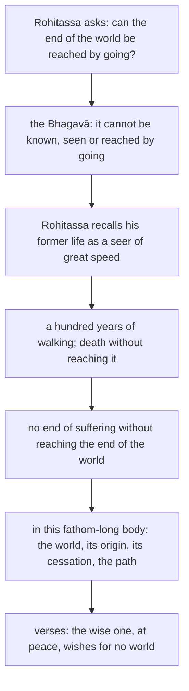

import { Tabs, TabItem } from '@astrojs/starlight/components';

Original text: [15A4/1.5.5 Rohitassasutta 312–320](https://tipitaka2500.github.io/tipitaka/15A4/1/1.5/1.5.5.html#312) in the [World Tipitaka Edition](https://tipitaka2500.github.io)

## Summary

At Sāvatthī the deity Rohitassa asks the Bhagavā whether the end of the world, where there is no birth, ageing, death, passing away or reappearing, can be reached by going. The Bhagavā says it cannot, and Rohitassa tells how, as a seer of great speed in a former life, he walked a hundred years and died on the way. Without reaching the end of the world there is no end of suffering, he adds, yet it is in this fathom-long body with apperception and mind that he declares the world, its origin, its cessation and the path.

## Diagram

## Text

<Tabs syncKey="paliquote">
<TabItem label="My Translation">
(45.)

312\. At one time the Bhagavā was dwelling at Sāvatthī, in Jeta's Grove, Anāthapiṇḍika's Park. Then the `devaputta` (deity) Rohitassa, when the night was advanced, with his surpassing beauty, illuminating the entire Jeta’s Grove, approached the Bhagavā; having approached, he bowed to the Bhagavā and stood to one side. Standing to one side, the deity Rohitassa said this to the Bhagavā:

313\. “Where, Bhante, one is not born, does not grow old, does not die, does not pass away and does not reappear — is it possible, Bhante, to know, to see or to reach that end of the world by going?” “Where, Āvuso, one is not born, does not grow old, does not die, does not pass away and does not reappear — I do not say that that end of the world could be known, seen or reached by going.”

314\. “Wonderful, Bhante, marvellous, Bhante. How well said is this, Bhante, by the Bhagavā: ‘Where, Āvuso, one is not born, does not grow old, does not die, does not pass away and does not reappear — I do not say that that end of the world could be known, seen or reached by going.’”

315\. “Formerly, Bhante, I was a seer named Rohitassa, a son of Bhoja, possessing psychic power, going through the air. My speed, Bhante, was such — just as an archer with a strong bow, trained, dexterous and practised, might with little difficulty shoot a light arrow across the shadow of a palm tree. My stride, Bhante, was such — just as from the eastern sea to the western sea. To me, Bhante, endowed with such speed and with such a stride, such a wish arose: ‘I will reach the end of the world by going.’ So I, Bhante, apart only from eating, drinking, chewing and tasting, apart from defecating and urinating, apart from dispelling sleep and fatigue, with a lifespan of a hundred years, living a hundred years, having gone for a hundred years, died along the way without having reached the end of the world.

316\. Wonderful, Bhante, marvellous, Bhante. How well said is this, Bhante, by the Bhagavā: ‘Where, Āvuso, one is not born, does not grow old, does not die, does not pass away and does not reappear — I do not say that that end of the world could be known, seen or reached by going.’”

317\. “‘Where, Āvuso, one is not born, does not grow old, does not die, does not pass away and does not reappear — I do not say that that end of the world could be known, seen or reached by going’: this I say. Nor do I say, Āvuso, that an end of suffering is made without having reached the end of the world. But, Āvuso, it is in this very fathom-long body, with its apperception and its mind, that I declare the world, the origin of the world, the cessation of the world and the path leading to the cessation of the world.

318\. _By going it cannot be reached,_ \
_the end of the world, at any time;_ \
_And without having reached the end of the world_ \
_there is no release from suffering._

319\. _Therefore indeed the knower of the world, the wise one,_ \
_Gone to the end of the world, who has lived the optimal life;_ \
_Having known the end of the world, at peace,_ \
_Does not wish for this world or another.”_

320\. The fifth.
</TabItem>

<TabItem label="Pāḷi (Roman IAST)">
(45.)

312\. Ekaṃ samayaṃ bhagavā sāvatthiyaṃ viharati jetavane anāthapiṇḍikassa ārāme. Atha kho rohitasso devaputto abhikkantāya rattiyā abhikkantavaṇṇo kevalakappaṃ jetavanaṃ obhāsetvā yena bhagavā tenupasaṅkami; upasaṅkamitvā bhagavantaṃ abhivādetvā ekamantaṃ aṭṭhāsi. Ekamantaṃ ṭhito kho rohitasso devaputto bhagavantaṃ etadavoca—

313\. “Yattha nu kho, bhante, na jāyati na jīyati na mīyati na cavati na upapajjati, sakkā nu kho so, bhante, gamanena lokassa anto ñātuṃ vā daṭṭhuṃ vā pāpuṇituṃ vā”ti? “Yattha kho, āvuso, na jāyati na jīyati na mīyati na cavati na upapajjati, nāhaṃ taṃ gamanena lokassa antaṃ ñāteyyaṃ daṭṭheyyaṃ patteyyanti vadāmī”ti.

314\. “Acchariyaṃ, bhante, abbhutaṃ, bhante. Yāva subhāsitamidaṃ, bhante, bhagavatā— ‘yattha kho, āvuso, na jāyati na jīyati na mīyati na cavati na upapajjati, nāhaṃ taṃ gamanena lokassa antaṃ ñāteyyaṃ daṭṭheyyaṃ patteyyanti vadāmī’”ti.

315\. “Bhūtapubbāhaṃ, bhante, rohitasso nāma isi ahosiṃ bhojaputto iddhimā vehāsaṅgamo. Tassa mayhaṃ, bhante, evarūpo javo ahosi, seyyathāpi nāma daḷhadhammā dhanuggaho sikkhito katahattho katūpāsano lahukena asanena appakasirena tiriyaṃ tālacchāyaṃ atipāteyya. Tassa mayhaṃ, bhante, evarūpo padavītihāro ahosi, seyyathāpi nāma puratthimā samuddā pacchimo samuddo. Tassa mayhaṃ, bhante, evarūpena javena samannāgatassa evarūpena ca padavītihārena evarūpaṃ icchāgataṃ uppajji— ‘ahaṃ gamanena lokassa antaṃ pāpuṇissāmī’ti. So kho ahaṃ, bhante, aññatreva asitapītakhāyitasāyitā aññatra uccārapassāvakammā aññatra niddākilamathapaṭivinodanā vassasatāyuko vassasatajīvī vassasataṃ gantvā appatvāva lokassa antaṃ antarāyeva kālaṅkato.

316\. Acchariyaṃ, bhante, abbhutaṃ, bhante. Yāva subhāsitamidaṃ, bhante, bhagavatā— ‘yattha kho, āvuso, na jāyati na jīyati na mīyati na cavati na upapajjati, nāhaṃ taṃ gamanena lokassa antaṃ ñāteyyaṃ daṭṭheyyaṃ patteyyanti vadāmī’”ti.

317\. “‘Yattha kho, āvuso, na jāyati na jīyati na mīyati na cavati na upapajjati, nāhaṃ taṃ gamanena lokassa antaṃ ñāteyyaṃ daṭṭheyyaṃ patteyyan’ti vadāmi. Na cāhaṃ, āvuso, appatvāva lokassa antaṃ dukkhassa antakiriyaṃ vadāmi. Api cāhaṃ, āvuso, imasmiṃyeva byāmamatte kaḷevare sasaññimhi samanake lokañca paññāpemi lokasamudayañca lokanirodhañca lokanirodhagāminiñca paṭipadanti.

318\. _Gamanena na pattabbo,_  
_lokassanto kudācanaṃ;_  
_Na ca appatvā lokantaṃ,_  
_dukkhā atthi pamocanaṃ._

319\. _Tasmā have lokavidū sumedho,_  
_Lokantagū vusitabrahmacariyo;_  
_Lokassa antaṃ samitāvi ñatvā,_  
_Nāsīsatī lokamimaṃ parañcā”ti._

320\. Pañcamaṃ.
</TabItem>

<TabItem label="Pāḷi (Brahmi)">
(45.)

312\. 𑀏𑀓𑀁 𑀲𑀫𑀬𑀁 𑀪𑀕𑀯𑀸 𑀲𑀸𑀯𑀢𑁆𑀣𑀺𑀬𑀁 𑀯𑀺𑀳𑀭𑀢𑀺 𑀚𑁂𑀢𑀯𑀦𑁂 𑀅𑀦𑀸𑀣𑀧𑀺𑀡𑁆𑀟𑀺𑀓𑀲𑁆𑀲 𑀆𑀭𑀸𑀫𑁂. 𑀅𑀣 𑀔𑁄 𑀭𑁄𑀳𑀺𑀢𑀲𑁆𑀲𑁄 𑀤𑁂𑀯𑀧𑀼𑀢𑁆𑀢𑁄 𑀅𑀪𑀺𑀓𑁆𑀓𑀦𑁆𑀢𑀸𑀬 𑀭𑀢𑁆𑀢𑀺𑀬𑀸 𑀅𑀪𑀺𑀓𑁆𑀓𑀦𑁆𑀢𑀯𑀡𑁆𑀡𑁄 𑀓𑁂𑀯𑀮𑀓𑀧𑁆𑀧𑀁 𑀚𑁂𑀢𑀯𑀦𑀁 𑀑𑀪𑀸𑀲𑁂𑀢𑁆𑀯𑀸 𑀬𑁂𑀦 𑀪𑀕𑀯𑀸 𑀢𑁂𑀦𑀼𑀧𑀲𑀗𑁆𑀓𑀫𑀺; 𑀉𑀧𑀲𑀗𑁆𑀓𑀫𑀺𑀢𑁆𑀯𑀸 𑀪𑀕𑀯𑀦𑁆𑀢𑀁 𑀅𑀪𑀺𑀯𑀸𑀤𑁂𑀢𑁆𑀯𑀸 𑀏𑀓𑀫𑀦𑁆𑀢𑀁 𑀅𑀝𑁆𑀞𑀸𑀲𑀺. 𑀏𑀓𑀫𑀦𑁆𑀢𑀁 𑀞𑀺𑀢𑁄 𑀔𑁄 𑀭𑁄𑀳𑀺𑀢𑀲𑁆𑀲𑁄 𑀤𑁂𑀯𑀧𑀼𑀢𑁆𑀢𑁄 𑀪𑀕𑀯𑀦𑁆𑀢𑀁 𑀏𑀢𑀤𑀯𑁄𑀘—

313\. “𑀬𑀢𑁆𑀣 𑀦𑀼 𑀔𑁄, 𑀪𑀦𑁆𑀢𑁂, 𑀦 𑀚𑀸𑀬𑀢𑀺 𑀦 𑀚𑀻𑀬𑀢𑀺 𑀦 𑀫𑀻𑀬𑀢𑀺 𑀦 𑀘𑀯𑀢𑀺 𑀦 𑀉𑀧𑀧𑀚𑁆𑀚𑀢𑀺, 𑀲𑀓𑁆𑀓𑀸 𑀦𑀼 𑀔𑁄 𑀲𑁄, 𑀪𑀦𑁆𑀢𑁂, 𑀕𑀫𑀦𑁂𑀦 𑀮𑁄𑀓𑀲𑁆𑀲 𑀅𑀦𑁆𑀢𑁄 𑀜𑀸𑀢𑀼𑀁 𑀯𑀸 𑀤𑀝𑁆𑀞𑀼𑀁 𑀯𑀸 𑀧𑀸𑀧𑀼𑀡𑀺𑀢𑀼𑀁 𑀯𑀸”𑀢𑀺? “𑀬𑀢𑁆𑀣 𑀔𑁄, 𑀆𑀯𑀼𑀲𑁄, 𑀦 𑀚𑀸𑀬𑀢𑀺 𑀦 𑀚𑀻𑀬𑀢𑀺 𑀦 𑀫𑀻𑀬𑀢𑀺 𑀦 𑀘𑀯𑀢𑀺 𑀦 𑀉𑀧𑀧𑀚𑁆𑀚𑀢𑀺, 𑀦𑀸𑀳𑀁 𑀢𑀁 𑀕𑀫𑀦𑁂𑀦 𑀮𑁄𑀓𑀲𑁆𑀲 𑀅𑀦𑁆𑀢𑀁 𑀜𑀸𑀢𑁂𑀬𑁆𑀬𑀁 𑀤𑀝𑁆𑀞𑁂𑀬𑁆𑀬𑀁 𑀧𑀢𑁆𑀢𑁂𑀬𑁆𑀬𑀦𑁆𑀢𑀺 𑀯𑀤𑀸𑀫𑀻”𑀢𑀺.

314\. “𑀅𑀘𑁆𑀙𑀭𑀺𑀬𑀁, 𑀪𑀦𑁆𑀢𑁂, 𑀅𑀩𑁆𑀪𑀼𑀢𑀁, 𑀪𑀦𑁆𑀢𑁂. 𑀬𑀸𑀯 𑀲𑀼𑀪𑀸𑀲𑀺𑀢𑀫𑀺𑀤𑀁, 𑀪𑀦𑁆𑀢𑁂, 𑀪𑀕𑀯𑀢𑀸— ‘𑀬𑀢𑁆𑀣 𑀔𑁄, 𑀆𑀯𑀼𑀲𑁄, 𑀦 𑀚𑀸𑀬𑀢𑀺 𑀦 𑀚𑀻𑀬𑀢𑀺 𑀦 𑀫𑀻𑀬𑀢𑀺 𑀦 𑀘𑀯𑀢𑀺 𑀦 𑀉𑀧𑀧𑀚𑁆𑀚𑀢𑀺, 𑀦𑀸𑀳𑀁 𑀢𑀁 𑀕𑀫𑀦𑁂𑀦 𑀮𑁄𑀓𑀲𑁆𑀲 𑀅𑀦𑁆𑀢𑀁 𑀜𑀸𑀢𑁂𑀬𑁆𑀬𑀁 𑀤𑀝𑁆𑀞𑁂𑀬𑁆𑀬𑀁 𑀧𑀢𑁆𑀢𑁂𑀬𑁆𑀬𑀦𑁆𑀢𑀺 𑀯𑀤𑀸𑀫𑀻’”𑀢𑀺.

315\. “𑀪𑀽𑀢𑀧𑀼𑀩𑁆𑀩𑀸𑀳𑀁, 𑀪𑀦𑁆𑀢𑁂, 𑀭𑁄𑀳𑀺𑀢𑀲𑁆𑀲𑁄 𑀦𑀸𑀫 𑀇𑀲𑀺 𑀅𑀳𑁄𑀲𑀺𑀁 𑀪𑁄𑀚𑀧𑀼𑀢𑁆𑀢𑁄 𑀇𑀤𑁆𑀥𑀺𑀫𑀸 𑀯𑁂𑀳𑀸𑀲𑀗𑁆𑀕𑀫𑁄. 𑀢𑀲𑁆𑀲 𑀫𑀬𑁆𑀳𑀁, 𑀪𑀦𑁆𑀢𑁂, 𑀏𑀯𑀭𑀽𑀧𑁄 𑀚𑀯𑁄 𑀅𑀳𑁄𑀲𑀺, 𑀲𑁂𑀬𑁆𑀬𑀣𑀸𑀧𑀺 𑀦𑀸𑀫 𑀤𑀍𑀳𑀥𑀫𑁆𑀫𑀸 𑀥𑀦𑀼𑀕𑁆𑀕𑀳𑁄 𑀲𑀺𑀓𑁆𑀔𑀺𑀢𑁄 𑀓𑀢𑀳𑀢𑁆𑀣𑁄 𑀓𑀢𑀽𑀧𑀸𑀲𑀦𑁄 𑀮𑀳𑀼𑀓𑁂𑀦 𑀅𑀲𑀦𑁂𑀦 𑀅𑀧𑁆𑀧𑀓𑀲𑀺𑀭𑁂𑀦 𑀢𑀺𑀭𑀺𑀬𑀁 𑀢𑀸𑀮𑀘𑁆𑀙𑀸𑀬𑀁 𑀅𑀢𑀺𑀧𑀸𑀢𑁂𑀬𑁆𑀬. 𑀢𑀲𑁆𑀲 𑀫𑀬𑁆𑀳𑀁, 𑀪𑀦𑁆𑀢𑁂, 𑀏𑀯𑀭𑀽𑀧𑁄 𑀧𑀤𑀯𑀻𑀢𑀺𑀳𑀸𑀭𑁄 𑀅𑀳𑁄𑀲𑀺, 𑀲𑁂𑀬𑁆𑀬𑀣𑀸𑀧𑀺 𑀦𑀸𑀫 𑀧𑀼𑀭𑀢𑁆𑀣𑀺𑀫𑀸 𑀲𑀫𑀼𑀤𑁆𑀤𑀸 𑀧𑀘𑁆𑀙𑀺𑀫𑁄 𑀲𑀫𑀼𑀤𑁆𑀤𑁄. 𑀢𑀲𑁆𑀲 𑀫𑀬𑁆𑀳𑀁, 𑀪𑀦𑁆𑀢𑁂, 𑀏𑀯𑀭𑀽𑀧𑁂𑀦 𑀚𑀯𑁂𑀦 𑀲𑀫𑀦𑁆𑀦𑀸𑀕𑀢𑀲𑁆𑀲 𑀏𑀯𑀭𑀽𑀧𑁂𑀦 𑀘 𑀧𑀤𑀯𑀻𑀢𑀺𑀳𑀸𑀭𑁂𑀦 𑀏𑀯𑀭𑀽𑀧𑀁 𑀇𑀘𑁆𑀙𑀸𑀕𑀢𑀁 𑀉𑀧𑁆𑀧𑀚𑁆𑀚𑀺— ‘𑀅𑀳𑀁 𑀕𑀫𑀦𑁂𑀦 𑀮𑁄𑀓𑀲𑁆𑀲 𑀅𑀦𑁆𑀢𑀁 𑀧𑀸𑀧𑀼𑀡𑀺𑀲𑁆𑀲𑀸𑀫𑀻’𑀢𑀺. 𑀲𑁄 𑀔𑁄 𑀅𑀳𑀁, 𑀪𑀦𑁆𑀢𑁂, 𑀅𑀜𑁆𑀜𑀢𑁆𑀭𑁂𑀯 𑀅𑀲𑀺𑀢𑀧𑀻𑀢𑀔𑀸𑀬𑀺𑀢𑀲𑀸𑀬𑀺𑀢𑀸 𑀅𑀜𑁆𑀜𑀢𑁆𑀭 𑀉𑀘𑁆𑀘𑀸𑀭𑀧𑀲𑁆𑀲𑀸𑀯𑀓𑀫𑁆𑀫𑀸 𑀅𑀜𑁆𑀜𑀢𑁆𑀭 𑀦𑀺𑀤𑁆𑀤𑀸𑀓𑀺𑀮𑀫𑀣𑀧𑀝𑀺𑀯𑀺𑀦𑁄𑀤𑀦𑀸 𑀯𑀲𑁆𑀲𑀲𑀢𑀸𑀬𑀼𑀓𑁄 𑀯𑀲𑁆𑀲𑀲𑀢𑀚𑀻𑀯𑀻 𑀯𑀲𑁆𑀲𑀲𑀢𑀁 𑀕𑀦𑁆𑀢𑁆𑀯𑀸 𑀅𑀧𑁆𑀧𑀢𑁆𑀯𑀸𑀯 𑀮𑁄𑀓𑀲𑁆𑀲 𑀅𑀦𑁆𑀢𑀁 𑀅𑀦𑁆𑀢𑀭𑀸𑀬𑁂𑀯 𑀓𑀸𑀮𑀗𑁆𑀓𑀢𑁄.

316\. 𑀅𑀘𑁆𑀙𑀭𑀺𑀬𑀁, 𑀪𑀦𑁆𑀢𑁂, 𑀅𑀩𑁆𑀪𑀼𑀢𑀁, 𑀪𑀦𑁆𑀢𑁂. 𑀬𑀸𑀯 𑀲𑀼𑀪𑀸𑀲𑀺𑀢𑀫𑀺𑀤𑀁, 𑀪𑀦𑁆𑀢𑁂, 𑀪𑀕𑀯𑀢𑀸— ‘𑀬𑀢𑁆𑀣 𑀔𑁄, 𑀆𑀯𑀼𑀲𑁄, 𑀦 𑀚𑀸𑀬𑀢𑀺 𑀦 𑀚𑀻𑀬𑀢𑀺 𑀦 𑀫𑀻𑀬𑀢𑀺 𑀦 𑀘𑀯𑀢𑀺 𑀦 𑀉𑀧𑀧𑀚𑁆𑀚𑀢𑀺, 𑀦𑀸𑀳𑀁 𑀢𑀁 𑀕𑀫𑀦𑁂𑀦 𑀮𑁄𑀓𑀲𑁆𑀲 𑀅𑀦𑁆𑀢𑀁 𑀜𑀸𑀢𑁂𑀬𑁆𑀬𑀁 𑀤𑀝𑁆𑀞𑁂𑀬𑁆𑀬𑀁 𑀧𑀢𑁆𑀢𑁂𑀬𑁆𑀬𑀦𑁆𑀢𑀺 𑀯𑀤𑀸𑀫𑀻’”𑀢𑀺.

317\. “‘𑀬𑀢𑁆𑀣 𑀔𑁄, 𑀆𑀯𑀼𑀲𑁄, 𑀦 𑀚𑀸𑀬𑀢𑀺 𑀦 𑀚𑀻𑀬𑀢𑀺 𑀦 𑀫𑀻𑀬𑀢𑀺 𑀦 𑀘𑀯𑀢𑀺 𑀦 𑀉𑀧𑀧𑀚𑁆𑀚𑀢𑀺, 𑀦𑀸𑀳𑀁 𑀢𑀁 𑀕𑀫𑀦𑁂𑀦 𑀮𑁄𑀓𑀲𑁆𑀲 𑀅𑀦𑁆𑀢𑀁 𑀜𑀸𑀢𑁂𑀬𑁆𑀬𑀁 𑀤𑀝𑁆𑀞𑁂𑀬𑁆𑀬𑀁 𑀧𑀢𑁆𑀢𑁂𑀬𑁆𑀬𑀦𑁆’𑀢𑀺 𑀯𑀤𑀸𑀫𑀺. 𑀦 𑀘𑀸𑀳𑀁, 𑀆𑀯𑀼𑀲𑁄, 𑀅𑀧𑁆𑀧𑀢𑁆𑀯𑀸𑀯 𑀮𑁄𑀓𑀲𑁆𑀲 𑀅𑀦𑁆𑀢𑀁 𑀤𑀼𑀓𑁆𑀔𑀲𑁆𑀲 𑀅𑀦𑁆𑀢𑀓𑀺𑀭𑀺𑀬𑀁 𑀯𑀤𑀸𑀫𑀺. 𑀅𑀧𑀺 𑀘𑀸𑀳𑀁, 𑀆𑀯𑀼𑀲𑁄, 𑀇𑀫𑀲𑁆𑀫𑀺𑀁𑀬𑁂𑀯 𑀩𑁆𑀬𑀸𑀫𑀫𑀢𑁆𑀢𑁂 𑀓𑀍𑀏𑀯𑀭𑁂 𑀲𑀲𑀜𑁆𑀜𑀺𑀫𑁆𑀳𑀺 𑀲𑀫𑀦𑀓𑁂 𑀮𑁄𑀓𑀜𑁆𑀘 𑀧𑀜𑁆𑀜𑀸𑀧𑁂𑀫𑀺 𑀮𑁄𑀓𑀲𑀫𑀼𑀤𑀬𑀜𑁆𑀘 𑀮𑁄𑀓𑀦𑀺𑀭𑁄𑀥𑀜𑁆𑀘 𑀮𑁄𑀓𑀦𑀺𑀭𑁄𑀥𑀕𑀸𑀫𑀺𑀦𑀺𑀜𑁆𑀘 𑀧𑀝𑀺𑀧𑀤𑀦𑁆𑀢𑀺.

318\. _𑀕𑀫𑀦𑁂𑀦 𑀦 𑀧𑀢𑁆𑀢𑀩𑁆𑀩𑁄,_  
_𑀮𑁄𑀓𑀲𑁆𑀲𑀦𑁆𑀢𑁄 𑀓𑀼𑀤𑀸𑀘𑀦𑀁;_  
_𑀦 𑀘 𑀅𑀧𑁆𑀧𑀢𑁆𑀯𑀸 𑀮𑁄𑀓𑀦𑁆𑀢𑀁,_  
_𑀤𑀼𑀓𑁆𑀔𑀸 𑀅𑀢𑁆𑀣𑀺 𑀧𑀫𑁄𑀘𑀦𑀁._

319\. _𑀢𑀲𑁆𑀫𑀸 𑀳𑀯𑁂 𑀮𑁄𑀓𑀯𑀺𑀤𑀽 𑀲𑀼𑀫𑁂𑀥𑁄,_  
_𑀮𑁄𑀓𑀦𑁆𑀢𑀕𑀽 𑀯𑀼𑀲𑀺𑀢𑀩𑁆𑀭𑀳𑁆𑀫𑀘𑀭𑀺𑀬𑁄;_  
_𑀮𑁄𑀓𑀲𑁆𑀲 𑀅𑀦𑁆𑀢𑀁 𑀲𑀫𑀺𑀢𑀸𑀯𑀺 𑀜𑀢𑁆𑀯𑀸,_  
_𑀦𑀸𑀲𑀻𑀲𑀢𑀻 𑀮𑁄𑀓𑀫𑀺𑀫𑀁 𑀧𑀭𑀜𑁆𑀘𑀸”𑀢𑀺._

320\. 𑀧𑀜𑁆𑀘𑀫𑀁.
</TabItem>

<TabItem label="Interlinear">
(45.)

[312](https://tipitaka2500.github.io/tipitaka/15A4/1/1.5/1.5.5.html#312) Ekaṃ samayaṃ bhagavā sāvatthiyaṃ viharati jetavane anāthapiṇḍikassa ārāme.  
*️⃣🤟🚹⨀②(eka) 🚹⨀②(samaya) 🚹⨀①(bhagavant) 🚺⨀⑦(sāvatthī) 🟢⨀🤟▶️(viharati) 🚻⨀⑦(jetavana) 🚹⨀⑥(anāthapiṇḍika) 🚹⨀⑦(ārāma)  
one | time | the Bhagavā | at Sāvatthī | dwells | in Jeta’s Grove | of Anāthapiṇḍika | in the park  
At one time the Bhagavā was dwelling at Sāvatthī, in Jeta's Grove, Anāthapiṇḍika's Park.

Atha kho rohitasso devaputto abhikkantāya rattiyā abhikkantavaṇṇo kevalakappaṃ jetavanaṃ obhāsetvā yena bhagavā tenupasaṅkami;  
⏏️(atha) ⏏️(kho) 🚹⨀①(rohitassa) 🚹⨀①🆎(deva+putta) 🚺⨀⑦🔽(ta)(abhikkanta) 🚺⨀⑦(ratti) 🚹⨀①🆎(abhikkanta+vaṇṇa) 🚹⨀②🆎(kevala+kappa) 🚻⨀②(jetavana) 🔽(tvā)(obhāseti) *️⃣🤟🚹⨀③(ya) 🚹⨀①(bhagavant) *️⃣🤟🚹⨀③(ta) 🟢⨀🤟⏮(upasaṅkamati)  
then | indeed | Rohitassa | deity | when advanced | the night | of surpassing beauty | the entire | Jeta’s Grove | having illuminated | by where | the Bhagavā | by there | approached  
Then the `devaputta` (deity) Rohitassa, when the night was advanced, with his surpassing beauty, illuminating the entire Jeta’s Grove, approached the Bhagavā;

upasaṅkamitvā bhagavantaṃ abhivādetvā ekamantaṃ aṭṭhāsi.  
🔽(tvā)(upasaṅkamati) 🚹⨀②(bhagavant) 🔽(tvā)(abhivādeti) ⏏️🆎(eka+anta) 🟢⨀🤟⏮(tiṭṭhati)  
having approached | the Bhagavā | having bowed down to | to one side | stood  
having approached, he bowed to the Bhagavā and stood to one side.

Ekamantaṃ ṭhito kho rohitasso devaputto bhagavantaṃ etadavoca—  
⏏️🆎(eka+anta) 🚹⨀①🔽(ta)(ṭhita) ⏏️(kho) 🚹⨀①(rohitassa) 🚹⨀①🆎(deva+putta) 🚹⨀②(bhagavant) *️⃣🤟🚻⨀②(eta) 🟢⨀🤟⏮(vadati)  
to one side | standing | indeed | Rohitassa | deity | to the Bhagavā | this | said  
Standing to one side, the deity Rohitassa said this to the Bhagavā:

[313](https://tipitaka2500.github.io/tipitaka/15A4/1/1.5/1.5.5.html#313) “Yattha nu kho, bhante, na jāyati na jīyati na mīyati na cavati na upapajjati, sakkā nu kho so, bhante, gamanena lokassa anto ñātuṃ vā daṭṭhuṃ vā pāpuṇituṃ vā”ti?  
⏏️(yattha) ⏏️(nu) ⏏️(kho) 🚹⨀⓪(bhavant) ⏏️(na) 🟢⨀🤟▶️(jāyati) ⏏️(na) 🟢⨀🤟▶️(jīyati) ⏏️(na) 🟢⨀🤟▶️(mīyati) ⏏️(na) 🟢⨀🤟▶️(cavati) ⏏️(na) 🟢⨀🤟▶️(upapajjati) ⏏️(sakkā) ⏏️(nu) ⏏️(kho) *️⃣🤟🚹⨀①(ta) 🚹⨀⓪(bhavant) 🚻⨀③(gamana) 🚹⨀⑥(loka) 🚹⨀①(anta) 🔽(tuṃ)(jānāti) ⏏️(vā) 🔽(tuṃ)(passati) ⏏️(vā) 🔽(tuṃ)(pāpuṇāti) ⏏️(vā) ⏏️(iti)  
where | (question) | indeed | Bhante | not | is born | not | grows old | not | dies | not | passes away | not | reappears | it is possible | (question) | indeed | that | Bhante | by going | of the world | end | to know | or | to see | or | to reach | or | (end quote)  
“Where, Bhante, one is not born, does not grow old, does not die, does not pass away and does not reappear — is it possible, Bhante, to know, to see or to reach that end of the world by going?”

“Yattha kho, āvuso, na jāyati na jīyati na mīyati na cavati na upapajjati, nāhaṃ taṃ gamanena lokassa antaṃ ñāteyyaṃ daṭṭheyyaṃ patteyyanti vadāmī”ti.  
⏏️(yattha) ⏏️(kho) ⏏️(āvuso) ⏏️(na) 🟢⨀🤟▶️(jāyati) ⏏️(na) 🟢⨀🤟▶️(jīyati) ⏏️(na) 🟢⨀🤟▶️(mīyati) ⏏️(na) 🟢⨀🤟▶️(cavati) ⏏️(na) 🟢⨀🤟▶️(upapajjati) ⏏️(na) *️⃣👆⚧⨀①(ahaṃ) *️⃣🤟🚹⨀②(ta) 🚻⨀③(gamana) 🚹⨀⑥(loka) 🚹⨀②(anta) 🚹⨀②🔽(ṇya)(ñāteyya) 🚹⨀②🔽(ṇya)(daṭṭheyya) 🚹⨀②🔽(ṇya)(patteyya) ⏏️(iti) 🟢⨀👆▶️(vadati) ⏏️(iti)  
where | indeed | Āvuso | not | is born | not | grows old | not | dies | not | passes away | not | reappears | not | I | that | by going | of the world | end | could be known | could be seen | could be reached | (end quote) | I say | (end quote)  
“Where, Āvuso, one is not born, does not grow old, does not die, does not pass away and does not reappear — I do not say that that end of the world could be known, seen or reached by going.”

[314](https://tipitaka2500.github.io/tipitaka/15A4/1/1.5/1.5.5.html#314) “Acchariyaṃ, bhante, abbhutaṃ, bhante.  
🚻⨀①(acchariya) 🚹⨀⓪(bhavant) 🚻⨀①(abbhuta) 🚹⨀⓪(bhavant)  
wonderful | Bhante | marvellous | Bhante  
“Wonderful, Bhante, marvellous, Bhante.

Yāva subhāsitamidaṃ, bhante, bhagavatā— ‘yattha kho, āvuso, na jāyati na jīyati na mīyati na cavati na upapajjati, nāhaṃ taṃ gamanena lokassa antaṃ ñāteyyaṃ daṭṭheyyaṃ patteyyanti vadāmī’”ti.  
⏏️(yāva) 🚻⨀①🆎(su+bhāsita) *️⃣🤟🚻⨀①(ima) 🚹⨀⓪(bhavant) 🚹⨀③(bhagavant) ⏏️(yattha) ⏏️(kho) ⏏️(āvuso) ⏏️(na) 🟢⨀🤟▶️(jāyati) ⏏️(na) 🟢⨀🤟▶️(jīyati) ⏏️(na) 🟢⨀🤟▶️(mīyati) ⏏️(na) 🟢⨀🤟▶️(cavati) ⏏️(na) 🟢⨀🤟▶️(upapajjati) ⏏️(na) *️⃣👆⚧⨀①(ahaṃ) *️⃣🤟🚹⨀②(ta) 🚻⨀③(gamana) 🚹⨀⑥(loka) 🚹⨀②(anta) 🚹⨀②🔽(ṇya)(ñāteyya) 🚹⨀②🔽(ṇya)(daṭṭheyya) 🚹⨀②🔽(ṇya)(patteyya) ⏏️(iti) 🟢⨀👆▶️(vadati) ⏏️(iti)  
how | well said | this | Bhante | by the Bhagavā | where | indeed | Āvuso | not | is born | not | grows old | not | dies | not | passes away | not | reappears | not | I | that | by going | of the world | end | could be known | could be seen | could be reached | (end quote) | I say | (end quote)  
How well said is this, Bhante, by the Bhagavā: ‘Where, Āvuso, one is not born, does not grow old, does not die, does not pass away and does not reappear — I do not say that that end of the world could be known, seen or reached by going.’”

[315](https://tipitaka2500.github.io/tipitaka/15A4/1/1.5/1.5.5.html#315) “Bhūtapubbāhaṃ, bhante, rohitasso nāma isi ahosiṃ bhojaputto iddhimā vehāsaṅgamo.  
⏏️(bhūtapubbaṃ) *️⃣👆⚧⨀①(ahaṃ) 🚹⨀⓪(bhavant) 🚹⨀①(rohitassa) ⏏️(nāma) 🚹⨀①(isi) 🟢⨀👆⏮(hoti) 🚹⨀①🆎(bhoja+putta) 🚹⨀①🔽(mantu)(iddhimant) 🚹⨀①🆎(vehāsa+gama)  
formerly | I | Bhante | Rohitassa | named | a seer | was | a son of Bhoja | possessing psychic power | going through the air  
“Formerly, Bhante, I was a seer named Rohitassa, a son of Bhoja, possessing psychic power, going through the air.

Tassa mayhaṃ, bhante, evarūpo javo ahosi, seyyathāpi nāma daḷhadhammā dhanuggaho sikkhito katahattho katūpāsano lahukena asanena appakasirena tiriyaṃ tālacchāyaṃ atipāteyya.  
*️⃣🤟🚹⨀⑥(ta) *️⃣👆⚧⨀⑥(ahaṃ) 🚹⨀⓪(bhavant) 🚹⨀①(evarūpa) 🚹⨀①(java) 🟢⨀🤟⏮(hoti) ⏏️(seyyathāpi) ⏏️(nāma) 🚹⨀①(daḷhadhamma) 🚹⨀①🆎(dhanu+gaha) 🚹⨀①🔽(ta)(sikkhita) 🚹⨀①🆎(kata+hattha) 🚹⨀①🆎(kata+upāsana) 🚻⨀③(lahuka) 🚻⨀③(asana) ⏏️(appakasirena) ⏏️(tiriyaṃ) 🚺⨀②🆎(tāla+chāyā) 🟠⨀🤟⏯(atipāteti)  
of that | my | Bhante | such | speed | was | just as | indeed | with a strong bow | an archer | trained | dexterous | practised | with a light | arrow | with little difficulty | across | the shadow of a palm tree | might shoot  
My speed, Bhante, was such — just as an archer with a strong bow, trained, dexterous and practised, might with little difficulty shoot a light arrow across the shadow of a palm tree.

Tassa mayhaṃ, bhante, evarūpo padavītihāro ahosi, seyyathāpi nāma puratthimā samuddā pacchimo samuddo.  
*️⃣🤟🚹⨀⑥(ta) *️⃣👆⚧⨀⑥(ahaṃ) 🚹⨀⓪(bhavant) 🚹⨀①(evarūpa) 🚹⨀①🆎(pada+vītihāra) 🟢⨀🤟⏮(hoti) ⏏️(seyyathāpi) ⏏️(nāma) 🚹⨀⑤(puratthima) 🚹⨀⑤(samudda) 🚹⨀①(pacchima) 🚹⨀①(samudda)  
of that | my | Bhante | such | stride | was | just as | indeed | from the eastern | sea | the western | sea  
My stride, Bhante, was such — just as from the eastern sea to the western sea.

Tassa mayhaṃ, bhante, evarūpena javena samannāgatassa evarūpena ca padavītihārena evarūpaṃ icchāgataṃ uppajji— ‘ahaṃ gamanena lokassa antaṃ pāpuṇissāmī’ti.  
*️⃣🤟🚹⨀④(ta) *️⃣👆⚧⨀④(ahaṃ) 🚹⨀⓪(bhavant) 🚹⨀③(evarūpa) 🚹⨀③(java) 🚹⨀④🔽(ta)(samannāgata) 🚹⨀③(evarūpa) ⏏️(ca) 🚹⨀③🆎(pada+vītihāra) 🚻⨀①(evarūpa) 🚻⨀①🆎(icchā+gata) 🟢⨀🤟⏮(uppajjati) *️⃣👆⚧⨀①(ahaṃ) 🚻⨀③(gamana) 🚹⨀⑥(loka) 🚹⨀②(anta) 🟢⨀👆⏭(pāpuṇāti) ⏏️(iti)  
to that | to me | Bhante | with such | speed | endowed | with such | and | stride | such | a wish | arose | I | by going | of the world | the end | I will reach | (end quote)  
To me, Bhante, endowed with such speed and with such a stride, such a wish arose: ‘I will reach the end of the world by going.’

So kho ahaṃ, bhante, aññatreva asitapītakhāyitasāyitā aññatra uccārapassāvakammā aññatra niddākilamathapaṭivinodanā vassasatāyuko vassasatajīvī vassasataṃ gantvā appatvāva lokassa antaṃ antarāyeva kālaṅkato.  
*️⃣🤟🚹⨀①(ta) ⏏️(kho) *️⃣👆⚧⨀①(ahaṃ) 🚹⨀⓪(bhavant) ⏏️(aññatra) ⏏️(eva) 🚻⨀⑤🆎(asita+pīta+khāyita+sāyita) ⏏️(aññatra) 🚻⨀⑤🆎(uccāra+passāva+kamma) ⏏️(aññatra) 🚻⨀⑤🆎(niddā+kilamatha+paṭivinodana) 🚹⨀①🆎(vassa+sata+āyuka) 🚹⨀①🆎(vassa+sata+jīvī) 🚻⨀②🆎(vassa+sata) 🔽(tvā)(gacchati) 🔽(tvā)🆎(na+pāpuṇāti) ⏏️(eva) 🚹⨀⑥(loka) 🚹⨀②(anta) ⏏️(antarā) ⏏️(eva) 🚹⨀①🔽(ta)(kālaṅkata)  
so | indeed | I | Bhante | apart from | only | eating, drinking, chewing and tasting | apart from | defecating and urinating | apart from | dispelling sleep and fatigue | with a lifespan of a hundred years | living a hundred years | a hundred years | having gone | not having reached | indeed | of the world | the end | along the way | indeed | died  
So I, Bhante, apart only from eating, drinking, chewing and tasting, apart from defecating and urinating, apart from dispelling sleep and fatigue, with a lifespan of a hundred years, living a hundred years, having gone for a hundred years, died along the way without having reached the end of the world.

[316](https://tipitaka2500.github.io/tipitaka/15A4/1/1.5/1.5.5.html#316) Acchariyaṃ, bhante, abbhutaṃ, bhante.  
🚻⨀①(acchariya) 🚹⨀⓪(bhavant) 🚻⨀①(abbhuta) 🚹⨀⓪(bhavant)  
wonderful | Bhante | marvellous | Bhante  
Wonderful, Bhante, marvellous, Bhante.

Yāva subhāsitamidaṃ, bhante, bhagavatā— ‘yattha kho, āvuso, na jāyati na jīyati na mīyati na cavati na upapajjati, nāhaṃ taṃ gamanena lokassa antaṃ ñāteyyaṃ daṭṭheyyaṃ patteyyanti vadāmī’”ti.  
⏏️(yāva) 🚻⨀①🆎(su+bhāsita) *️⃣🤟🚻⨀①(ima) 🚹⨀⓪(bhavant) 🚹⨀③(bhagavant) ⏏️(yattha) ⏏️(kho) ⏏️(āvuso) ⏏️(na) 🟢⨀🤟▶️(jāyati) ⏏️(na) 🟢⨀🤟▶️(jīyati) ⏏️(na) 🟢⨀🤟▶️(mīyati) ⏏️(na) 🟢⨀🤟▶️(cavati) ⏏️(na) 🟢⨀🤟▶️(upapajjati) ⏏️(na) *️⃣👆⚧⨀①(ahaṃ) *️⃣🤟🚹⨀②(ta) 🚻⨀③(gamana) 🚹⨀⑥(loka) 🚹⨀②(anta) 🚹⨀②🔽(ṇya)(ñāteyya) 🚹⨀②🔽(ṇya)(daṭṭheyya) 🚹⨀②🔽(ṇya)(patteyya) ⏏️(iti) 🟢⨀👆▶️(vadati) ⏏️(iti)  
how | well said | this | Bhante | by the Bhagavā | where | indeed | Āvuso | not | is born | not | grows old | not | dies | not | passes away | not | reappears | not | I | that | by going | of the world | end | could be known | could be seen | could be reached | (end quote) | I say | (end quote)  
How well said is this, Bhante, by the Bhagavā: ‘Where, Āvuso, one is not born, does not grow old, does not die, does not pass away and does not reappear — I do not say that that end of the world could be known, seen or reached by going.’”

[317](https://tipitaka2500.github.io/tipitaka/15A4/1/1.5/1.5.5.html#317) “‘Yattha kho, āvuso, na jāyati na jīyati na mīyati na cavati na upapajjati, nāhaṃ taṃ gamanena lokassa antaṃ ñāteyyaṃ daṭṭheyyaṃ patteyyan’ti vadāmi.  
⏏️(yattha) ⏏️(kho) ⏏️(āvuso) ⏏️(na) 🟢⨀🤟▶️(jāyati) ⏏️(na) 🟢⨀🤟▶️(jīyati) ⏏️(na) 🟢⨀🤟▶️(mīyati) ⏏️(na) 🟢⨀🤟▶️(cavati) ⏏️(na) 🟢⨀🤟▶️(upapajjati) ⏏️(na) *️⃣👆⚧⨀①(ahaṃ) *️⃣🤟🚹⨀②(ta) 🚻⨀③(gamana) 🚹⨀⑥(loka) 🚹⨀②(anta) 🚹⨀②🔽(ṇya)(ñāteyya) 🚹⨀②🔽(ṇya)(daṭṭheyya) 🚹⨀②🔽(ṇya)(patteyya) ⏏️(iti) 🟢⨀👆▶️(vadati)  
where | indeed | Āvuso | not | is born | not | grows old | not | dies | not | passes away | not | reappears | not | I | that | by going | of the world | end | could be known | could be seen | could be reached | (end quote) | I say  
“‘Where, Āvuso, one is not born, does not grow old, does not die, does not pass away and does not reappear — I do not say that that end of the world could be known, seen or reached by going’: this I say.

Na cāhaṃ, āvuso, appatvāva lokassa antaṃ dukkhassa antakiriyaṃ vadāmi.  
⏏️(na) ⏏️(ca) *️⃣👆⚧⨀①(ahaṃ) ⏏️(āvuso) 🔽(tvā)🆎(na+pāpuṇāti) ⏏️(eva) 🚹⨀⑥(loka) 🚹⨀②(anta) 🚻⨀⑥(dukkha) 🚺⨀②🆎(anta+kiriyā) 🟢⨀👆▶️(vadati)  
not | and | I | Āvuso | not having reached | indeed | of the world | the end | of suffering | making an end | I say  
Nor do I say, Āvuso, that an end of suffering is made without having reached the end of the world.

Api cāhaṃ, āvuso, imasmiṃyeva byāmamatte kaḷevare sasaññimhi samanake lokañca paññāpemi lokasamudayañca lokanirodhañca lokanirodhagāminiñca paṭipadanti.  
⏏️(api) ⏏️(ca) *️⃣👆⚧⨀①(ahaṃ) ⏏️(āvuso) *️⃣🤟🚻⨀⑦(ima) ⏏️(eva) 🚻⨀⑦🆎(byāma+matta) 🚻⨀⑦(kaḷevara) 🚻⨀⑦(sasaññī) 🚻⨀⑦(samanaka) 🚹⨀②(loka) ⏏️(ca) 🟠⨀👆▶️(paññāpeti) 🚹⨀②🆎(loka+samudaya) ⏏️(ca) 🚹⨀②🆎(loka+nirodha) ⏏️(ca) 🚺⨀②🆎(loka+nirodha+gāmī) ⏏️(ca) 🚺⨀②(paṭipadā) ⏏️(iti)  
but | and | I | Āvuso | in this | very | fathom-long | body | with apperception | with mind | the world | and | I declare | the origin of the world | and | the cessation of the world | and | leading to the cessation of the world | and | path | thus  
But, Āvuso, it is in this very fathom-long body, with its apperception and its mind, that I declare the world, the origin of the world, the cessation of the world and the path leading to the cessation of the world.

[318](https://tipitaka2500.github.io/tipitaka/15A4/1/1.5/1.5.5.html#318) Gamanena na pattabbo,  
🚻⨀③(gamana) ⏏️(na) 🚹⨀①🔽(tabba)(pattabba)  
by going | not | can be reached  
lokassanto kudācanaṃ;  
🚹⨀①(lokassanta) ⏏️(kudācanaṃ)  
the end of the world | at any time  
Na ca appatvā lokantaṃ,  
⏏️(na) ⏏️(ca) 🔽(tvā)🆎(na+pāpuṇāti) 🚹⨀②🆎(loka+anta)  
not | and | not having reached | the end of the world  
dukkhā atthi pamocanaṃ.  
🚻⨀⑤(dukkha) 🟢⨀🤟▶️(atthi) 🚻⨀①(pamocana)  
from suffering | there is | release  

By going it cannot be reached,  
the end of the world, at any time;  
And without having reached the end of the world  
there is no release from suffering.

[319](https://tipitaka2500.github.io/tipitaka/15A4/1/1.5/1.5.5.html#319) Tasmā have lokavidū sumedho,  
⏏️(tasmā) ⏏️(have) 🚹⨀①🆎(loka+vidū) 🚹⨀①(sumedha)  
therefore | indeed | the knower of the world | the wise one  
Lokantagū vusitabrahmacariyo;  
🚹⨀①🆎(loka+antagū) 🚹⨀①🆎(vusita+brahma+cariya)  
gone to the end of the world | who has lived the optimal life  
Lokassa antaṃ samitāvi ñatvā,  
🚹⨀⑥(loka) 🚹⨀②(anta) 🚹⨀①(samitāvī) 🔽(tvā)(jānāti)  
of the world | the end | at peace | having known  
Nāsīsatī lokamimaṃ parañcā”ti.  
⏏️(na) 🟢⨀🤟▶️(āsīsati) 🚹⨀②(loka) *️⃣🤟🚹⨀②(ima) *️⃣🤟🚹⨀②(para) ⏏️(ca) ⏏️(iti)  
not | wishes for | world | this | another | and | (end quote)  

Therefore indeed the knower of the world, the wise one,  
Gone to the end of the world, who has lived the optimal life;  
Having known the end of the world, at peace,  
Does not wish for this world or another.”

[320](https://tipitaka2500.github.io/tipitaka/15A4/1/1.5/1.5.5.html#320) Pañcamaṃ.  
🚻⨀①(pañcama)  
the fifth  
The fifth.
</TabItem>
</Tabs>

## Commentary

- "The world" relocated: not a place at a journey's end but this fathom-long body with apperception and mind, declared with its origin, cessation and path on the pattern of the four realisations (https://buddhavacana.github.io/pali-textbook/5-dhammacakka/); the same declaration to Anurādha is at https://buddhavacana.github.io/sutta/tetralemma/.
- The deity and the seer's psychic power, speed and former life are the narrative's rhetoric, for the author's rational reading; `devaputta` "deity", `iddhimant` "possessing psychic power" as on the Khandhaka's twelfth section.
- Renderings by the DPD: `upapajjati` "reappears" (the glossary's `punabbhava` "appearing again"; the Mahāpadāna pages have "is reborn"), `antakiriyā` "making an end", `sasaññī` and `samanaka` "with apperception" and "with mind", `samitāvī` "at peace".
- The night-visit frame (312) is the Khandhaka's (1-12), here "bowed to … and stood to one side"; the Bhagavā's speech from 317 runs through the verses to 319.

## Parallels

The Chinese parallel is the 1307th sūtra of the 雜阿含經 (Saṃyuktāgama; fascicle 49, CBETA T02, no. 99, pp. 359a–b), read here in CBETA's text. The two versions agree in frame and sequence: at Sāvatthī in Jeta's Grove (舍衛國祇樹給孤獨園, p. 359a) the deity Red Horse (赤馬天子, the Pāḷi's Rohitassa) comes in the last watch of the night, his radiance lighting the whole grove; he asks whether one can, by travelling, pass beyond the end of the world to where there is no birth, ageing or death; the Buddha answers that one cannot; the deity praises the saying and recalls his former life as a seer of psychic power, swift as an archer's arrow crossing a palm's shadow, striding from the eastern to the western sea, who resolved to reach the end of the world, walked for a hundred years with no pause but for food, rest and relieving himself, and died without reaching it; the Buddha declares the world, its arising, its cessation and the path in this fathom-long body (我今但以一尋之身，說於世界、世界集、世界滅、世界滅道跡, p. 359a); and verses close the exchange. The differences, checked in CBETA's text:

- **The question and the answer.** The Chinese asks of a place "without birth, ageing or death" (不生、不老、不死處, p. 359a), the Pāḷi of where one is not born, does not grow old, die, pass away or reappear; the Chinese Buddha answers simply that no one can pass beyond the end of the world to it (無有能過世界邊, p. 359a), where the Pāḷi says "I do not say that that end of the world could be known, seen or reached by going". The Chinese deity sits to one side (退坐一面, p. 359a); the Pāḷi's stands.
- **The former life.** The Chinese seer is "an outsider seer with psychic power, free of sensual desires" (作外道仙人，得神通，離諸愛欲, p. 359a), the Pāḷi's "a son of Bhoja, possessing psychic power, going through the air"; the Chinese adds that he could climb one Sumeru and reach another (能登一須彌，至一須彌, p. 359a), and its archer is "a strong man shooting a sharp arrow across a palm's shadow in a moment" (如健士夫，以利箭橫射過多羅樹影之頃, p. 359a), the Pāḷi's trained and practised archer with a light arrow. The journey's exceptions are "food, rest and relieving himself, with reduced sleep" (唯除食息便利，減節睡眠, p. 359a); the Pāḷi lists eating, drinking, chewing and tasting, defecating and urinating, and dispelling sleep and fatigue, with a lifespan of a hundred years.
- **The praise.** The Pāḷi's "Wonderful, Bhante, marvellous, Bhante. How well said …" stands twice, before and after the story (314, 316); the Chinese has one "Wonderful, World-honoured One, well spoken is this meaning" (奇哉！世尊！善說斯義, p. 359a), and the Buddha addresses the deity by name (佛告赤馬) where the Pāḷi has Āvuso.
- **The Buddha's teaching.** The Pāḷi only names the four, the world, its origin, its cessation and the path (317); the Chinese defines each: the world is the five collections of fuel (五受陰), its arising "craving for future existence accompanied by delight and lust" (當來有愛，貪、喜俱), its cessation the remainderless abandoning of that craving, and the path the eightfold path in full (p. 359a–b), the second realisation's formulas. The Pāḷi's "with its apperception and its mind" (sasaññimhi samanake) has no counterpart, and the Pāḷi's "nor do I say that an end of suffering is made without having reached the end of the world" (317) appears in the Chinese only in the verse. The Chinese adds a closing instruction, to know and abandon the world and its arising, know and realise its cessation, know and cultivate the path, "this is called reaching the end of the world, crossing over the world's craving" (是名得世界邊，度世間愛, p. 359b).
- **The verses.** The Chinese has three stanzas (p. 359b) to the Pāḷi's two: the first matches the Pāḷi's first (未曾遠遊行，而得世界邊，無得世界邊，終不盡苦邊); the second has the `muni` who knows the end of the world and "has established the `brahmacariya`" (諸梵行已立), the Pāḷi's "who has lived the optimal life"; the third, "at that end of the world the one who knows with equanimity — this is called the conduct of the liberated, crossing to the world's far shore" (平等覺知者，是名賢聖行，度世間彼岸), has no Pāḷi counterpart, and the Pāḷi's "does not wish for this world or another" (319) none in the Chinese.
- **The close.** The Chinese deity rejoices, bows at the Buddha's feet and vanishes (歡喜隨喜，稽首佛足，即沒不現, p. 359b); the Pāḷi ends with the verses and "Pañcamaṃ".

[Go to previous page (Nibbedhikasutta (The Penetrating Discourse))](/anguttaranikaya/nibbedhikasutta/) / [Go to parent page (Aṅguttara Nikāya)](/anguttaranikaya/) / [Go to next page (Cundasutta (The Discourse to Cunda))](/anguttaranikaya/cundasutta/)
