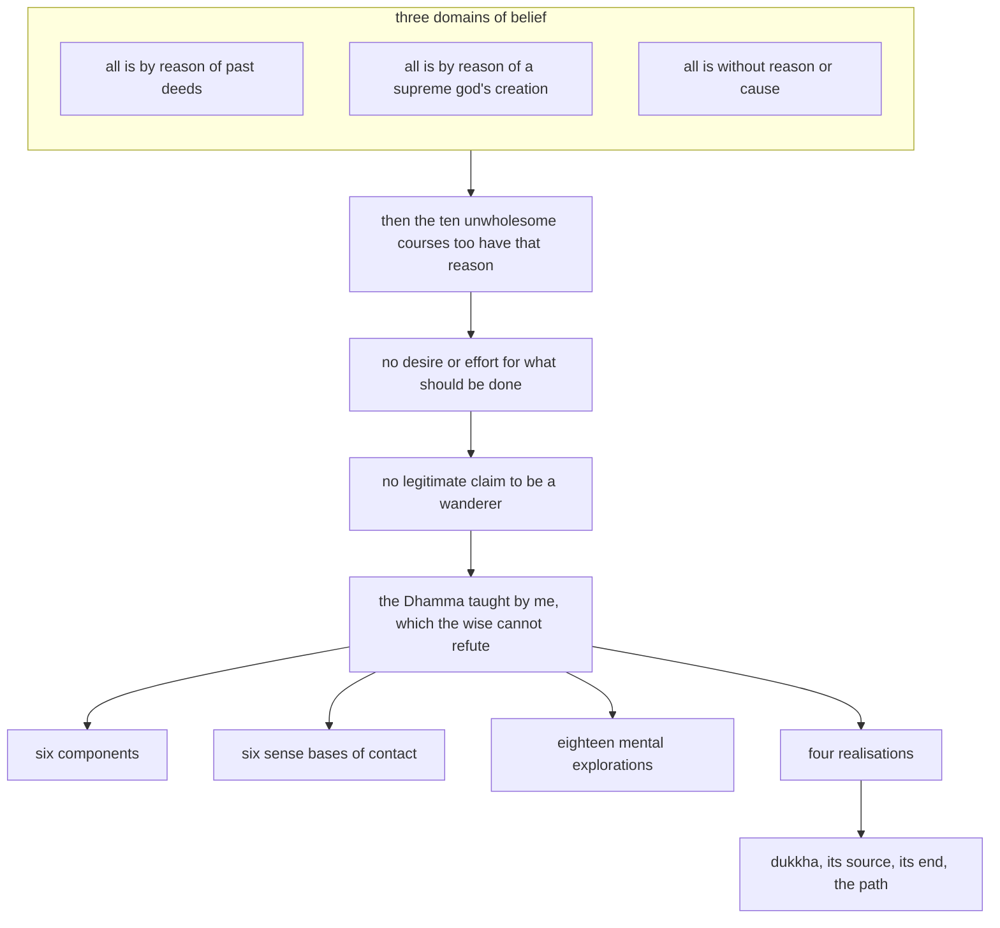

import { Tabs, TabItem } from '@astrojs/starlight/components';

Original text: [15A3/2.2.1 Titthāyatanasutta 418–435](https://tipitaka2500.github.io/tipitaka/15A3/2/2.2/2.2.1.html#418) in the [World Tipitaka Edition](https://tipitaka2500.github.io)

## Summary

The Bhagavā names three domains of belief that collapse into inaction when the wise press them: that all a person experiences is by reason of what was done in the past, by reason of a supreme god's creation, or without reason or cause. Each makes its holders killers and liars by the same reason and leaves no desire or effort to do what should be done. Against them he sets his own Dhamma, which no wise wanderer or brahmin can refute: the six components, the six sense bases of contact, the eighteen mental explorations and the four realisations.

## Diagram

## Text

<Tabs syncKey="paliquote">
<TabItem label="My Translation">
(62.)

418\. “Bhikkhave, there are these three domains of belief which, being cross-questioned, interrogated and admonished by the wise, and followed even further, settle into inaction. What are these three? There are, Bhikkhave, some religious practitioners who speak thus and hold this view: ‘Whatever this individual experiences, whether pleasant, painful or neither painful nor pleasant, all that is by reason of what was done in the past.’ There are, Bhikkhave, some religious practitioners who speak thus and hold this view: ‘Whatever this individual experiences, whether pleasant, painful or neither painful nor pleasant, all that is by reason of a supreme god’s creation.’ There are, Bhikkhave, some religious practitioners who speak thus and hold this view: ‘Whatever this individual experiences, whether pleasant, painful or neither painful nor pleasant, all that is without reason or cause.’

419\. In that regard, Bhikkhave, those religious practitioners who speak thus and hold this view: ‘Whatever this individual experiences, whether pleasant, painful or neither painful nor pleasant, all that is by reason of what was done in the past’ — I approach them and say thus: ‘Is it really true, Āyasmanto, that you speak thus and hold this view: “Whatever this individual experiences, whether pleasant, painful or neither painful nor pleasant, all that is by reason of what was done in the past”?’ And they, asked thus by me, agree: ‘Yes.’ To them I say thus: ‘In that case the āyasmants will be killers of living beings by reason of what was done in the past, takers of what is not given by reason of what was done in the past, not living the optimal life by reason of what was done in the past, liars by reason of what was done in the past, speakers of divisive speech by reason of what was done in the past, speakers of harsh speech by reason of what was done in the past, gossips by reason of what was done in the past, covetous by reason of what was done in the past, malicious in mind by reason of what was done in the past, holding wrong view by reason of what was done in the past.’

420\. But for those who take what was done in the past as essential, Bhikkhave, there is no desire or effort: ‘this should be done, or this should not be done.’ So, since what should and should not be done is not found as true and real, for those who dwell forgetful and unguarded there is personally no legitimate claim of being a wanderer. This, Bhikkhave, is my first legitimate refutation of those religious practitioners who speak thus and hold this view. (1)

421\. In that regard, Bhikkhave, those religious practitioners who speak thus and hold this view: ‘Whatever this individual experiences, whether pleasant, painful or neither painful nor pleasant, all that is by reason of a supreme god’s creation’ — I approach them and say thus: ‘Is it really true, Āyasmanto, that you speak thus and hold this view: Whatever this individual experiences, whether pleasant, painful or neither painful nor pleasant, all that is by reason of a supreme god’s creation?’ And they, asked thus by me, agree: ‘Yes.’ To them I say thus: ‘In that case the āyasmants will be killers of living beings by reason of a supreme god’s creation, takers of what is not given by reason of a supreme god’s creation, not living the optimal life by reason of a supreme god’s creation, liars by reason of a supreme god’s creation, speakers of divisive speech by reason of a supreme god’s creation, speakers of harsh speech by reason of a supreme god’s creation, gossips by reason of a supreme god’s creation, covetous by reason of a supreme god’s creation, malicious in mind by reason of a supreme god’s creation, holding wrong view by reason of a supreme god’s creation.’

422\. But for those who take a supreme god’s creation as essential, Bhikkhave, there is no desire or effort: ‘this should be done, or this should not be done.’ So, since what should and should not be done is not found as true and real, for those who dwell forgetful and unguarded there is personally no legitimate claim of being a wanderer. This, Bhikkhave, is my second legitimate refutation of those religious practitioners who speak thus and hold this view. (2)

423\. In that regard, Bhikkhave, those religious practitioners who speak thus and hold this view: ‘Whatever this individual experiences, whether pleasant, painful or neither painful nor pleasant, all that is without reason or cause’ — I approach them and say thus: ‘Is it really true, Āyasmanto, that you speak thus and hold this view: Whatever this individual experiences, whether pleasant, painful or neither painful nor pleasant, all that is without reason or cause?’ And they, asked thus by me, agree: ‘Yes.’ To them I say thus: ‘In that case the āyasmants will be killers of living beings without reason or cause … and so on … holding wrong view without reason or cause.’”

424\. But for those who take the absence of reason and cause as essential, Bhikkhave, there is no desire or effort: ‘this should be done, or this should not be done.’ So, since what should and should not be done is not found as true and real, for those who dwell forgetful and unguarded there is personally no legitimate claim of being a wanderer. This, Bhikkhave, is my third legitimate refutation of those religious practitioners who speak thus and hold this view. (3)

425\. These, Bhikkhave, are the three domains of belief which, being cross-questioned, interrogated and admonished by the wise, and followed even further, settle into inaction.

426\. But this Dhamma, Bhikkhave, taught by me, is irrefutable, untarnished, blameless and not scorned by wise wanderers and brahmins. And what, Bhikkhave, is the Dhamma taught by me that is irrefutable, untarnished, blameless and not scorned by wise wanderers and brahmins? ‘These are the six components’, Bhikkhave, is the Dhamma taught by me, irrefutable, untarnished, blameless and not scorned by wise wanderers and brahmins. ‘These are the six sense bases of contact’, Bhikkhave, is the Dhamma taught by me, irrefutable, untarnished, blameless and not scorned by wise wanderers and brahmins. ‘These are the eighteen mental explorations’, Bhikkhave, is the Dhamma taught by me, irrefutable, untarnished, blameless and not scorned by wise wanderers and brahmins. ‘These are the four realisations’, Bhikkhave, is the Dhamma taught by me, irrefutable, untarnished, blameless and not scorned by wise wanderers and brahmins.

427\. “‘These are the six components’, Bhikkhave, is the Dhamma taught by me, irrefutable, untarnished, blameless and not scorned by wise wanderers and brahmins.” This is what was said. And in reference to what was this said? There are these six components, Bhikkhave: the earth component, the water component, the fire component, the wind component, the space component, and the consciousness component. “‘These are the six components’, Bhikkhave, is the Dhamma taught by me, irrefutable, untarnished, blameless and not scorned by wise wanderers and brahmins.” Thus, that which was said, it was said in reference to this.

428\. “‘These are the six sense bases of contact’, Bhikkhave, is the Dhamma taught by me, irrefutable, untarnished, blameless and not scorned by wise wanderers and brahmins.” This is what was said. And in reference to what was this said? There are these six sense bases of contact, Bhikkhave: the eye is a sense base of contact, the ear is a sense base of contact, the nose is a sense base of contact, the tongue is a sense base of contact, the body is a sense base of contact, the mind is a sense base of contact. “‘These are the six sense bases of contact’, Bhikkhave, is the Dhamma taught by me, irrefutable, untarnished, blameless and not scorned by wise wanderers and brahmins.” Thus, that which was said, it was said in reference to this.

429\. “‘These are the eighteen mental explorations’, Bhikkhave, is the Dhamma taught by me, irrefutable, untarnished, blameless and not scorned by wise wanderers and brahmins.” This is what was said. And in reference to what was this said? When one sees a form with the eye, one explores a form that serves as a basis for mental pleasure, one explores a form that serves as a basis for displeasure, one explores a form that serves as a basis for equanimity; when one hears a sound with the ear… when one smells an odour with the nose… when one tastes a taste with the tongue… when one touches a tangible with the body… when one cognises a mind-object with the mind, one explores a mind-object that serves as a basis for mental pleasure, one explores a mind-object that serves as a basis for displeasure, one explores a mind-object that serves as a basis for equanimity. “‘These are the eighteen mental explorations’, Bhikkhave, is the Dhamma taught by me, irrefutable, untarnished, blameless and not scorned by wise wanderers and brahmins.” Thus, that which was said, it was said in reference to this.

430\. “‘These are the four realisations’, Bhikkhave, is the Dhamma taught by me, irrefutable, untarnished, blameless and not scorned by wise wanderers and brahmins.” This is what was said. And in reference to what was this said? Dependent on the six components, Bhikkhave, there is conception; when there is conception, `nāmarūpa` (phenomenal objects) [arise]; with `nāmarūpa` as cause, `saḷāyatana` (the six sense bases) [arise]; with `saḷāyatana` as cause, `phassa` (contact) [arises]; with `phassa` as cause, `vedanā` (feeling) [arises]. And for one who feels, Bhikkhave, I declare: ‘This is dukkha’, I declare: ‘This is the source of dukkha’, I declare: ‘This is the end of dukkha’, I declare: ‘This is the path of progress leading to the end of dukkha’.

431\. And what, Bhikkhave, is the realisation of dukkha (suffering)? Birth, too, is dukkha, ageing, too, is dukkha, death, too, is dukkha, sorrow, lamentation, pain, displeasure and despair, too, are dukkha, association with the disliked is dukkha, separation from the loved is dukkha, not getting what one desires, too, is dukkha. In short, the five collections of fuel are suffering. This, Bhikkhave, is called the realisation of dukkha.

432\. And what, Bhikkhave, is the realisation of the source of dukkha? With `avijjā` (ignorance) as cause, `saṅkhārā` (mental constructions) [arise]; with `saṅkhārā` as cause, `viññāṇa` (consciousness) [arises]; with `viññāṇa` as cause, `nāmarūpa` (phenomenal objects) [arise]; with `nāmarūpa` as cause, `saḷāyatana` (the six sense bases) [arise]; with `saḷāyatana` as cause, `phassa` (contact) [arises]; with `phassa` as cause, `vedanā` (feeling) [arises]; with `vedanā` as cause, `taṇhā` (craving) [arises]; with `taṇhā` as cause, `upādāna` (fuel) [arises]; with `upādāna` as cause, `bhava` (existence (constructed self)) [arises]; with `bhava` as cause, `jāti` (birth (of suffering)) [arises]; with `jāti` as cause, `jarāmaraṇa` (ageing and death), `soka` (sorrow), `parideva` (lamentation), `dukkha` (pain), `domanassa` (displeasure) and `upāyāsa` (despair) come into being. Thus is the origin of this whole mass of `dukkha` (suffering). This, Bhikkhave, is called the realisation of the source of dukkha.

433\. And what, Bhikkhave, is the realisation of the end of dukkha? But with the remainderless fading away and cessation of `avijjā` (ignorance) comes the cessation of `saṅkhārā` (mental constructions); with the cessation of `saṅkhārā` comes the cessation of `viññāṇa` (consciousness); with the cessation of `viññāṇa` comes the cessation of `nāmarūpa` (phenomenal objects); with the cessation of `nāmarūpa` comes the cessation of `saḷāyatana` (the six sense bases); with the cessation of `saḷāyatana` comes the cessation of `phassa` (contact); with the cessation of `phassa` comes the cessation of `vedanā` (feeling); with the cessation of `vedanā` comes the cessation of `taṇhā` (craving); with the cessation of `taṇhā` comes the cessation of `upādāna` (fuel); with the cessation of `upādāna` comes the cessation of `bhava` (existence (constructed self)); with the cessation of `bhava` comes the cessation of `jāti` (birth (of suffering)); with the cessation of `jāti`, `jarāmaraṇa` (ageing and death), `soka` (sorrow), `parideva` (lamentation), `dukkha` (pain), `domanassa` (displeasure) and `upāyāsa` (despair) cease. Thus is the cessation of this whole mass of suffering. This, Bhikkhave, is called the realisation of the end of dukkha.

434\. And what, Bhikkhave, is the realisation of the path of progress leading to the end of dukkha? It is this very `ariyo aṭṭhaṅgiko maggo` (Eightfold Path), that is to say: `sammādiṭṭhi` (right view), `sammāsaṅkappa` (right resolve), `sammāvācā` (right speech), `sammākammanta` (right action), `sammāājīva` (right livelihood), `sammāvāyāma` (right effort), `sammāsati` (right awareness), `sammāsamādhi` (right focus). This, Bhikkhave, is called the realisation of the path of progress leading to the end of dukkha. “‘These are the four realisations’, Bhikkhave, is the Dhamma taught by me, irrefutable, untarnished, blameless and not scorned by wise wanderers and brahmins.” Thus, that which was said, it was said in reference to this.”

435\. The first [discourse of the chapter].
</TabItem>

<TabItem label="Pāḷi (Roman IAST)">
(62.)

418\. “Tīṇimāni, bhikkhave, titthāyatanāni yāni paṇḍitehi samanuyuñjiyamānāni samanugāhiyamānāni samanubhāsiyamānāni parampi gantvā akiriyāya saṇṭhahanti. Katamāni tīṇi? Santi, bhikkhave, eke samaṇabrāhmaṇā evaṃvādino evaṃdiṭṭhino— ‘yaṃ kiñcāyaṃ purisapuggalo paṭisaṃvedeti sukhaṃ vā dukkhaṃ vā adukkhamasukhaṃ vā sabbaṃ taṃ pubbekatahetū’ti. Santi, bhikkhave, eke samaṇabrāhmaṇā evaṃvādino evaṃdiṭṭhino— ‘yaṃ kiñcāyaṃ purisapuggalo paṭisaṃvedeti sukhaṃ vā dukkhaṃ vā adukkhamasukhaṃ vā sabbaṃ taṃ issaranimmānahetū’ti. Santi, bhikkhave, eke samaṇabrāhmaṇā evaṃvādino evaṃdiṭṭhino— ‘yaṃ kiñcāyaṃ purisapuggalo paṭisaṃvedeti sukhaṃ vā dukkhaṃ vā adukkhamasukhaṃ vā sabbaṃ taṃ ahetuappaccayā’ti.

419\. Tatra, bhikkhave, ye te samaṇabrāhmaṇā evaṃvādino evaṃdiṭṭhino— ‘yaṃ kiñcāyaṃ purisapuggalo paṭisaṃvedeti sukhaṃ vā dukkhaṃ vā adukkhamasukhaṃ vā sabbaṃ taṃ pubbekatahetū’ti, tyāhaṃ upasaṅkamitvā evaṃ vadāmi— ‘saccaṃ kira tumhe āyasmanto evaṃvādino evaṃdiṭṭhino— “yaṃ kiñcāyaṃ purisapuggalo paṭisaṃvedeti sukhaṃ vā dukkhaṃ vā adukkhamasukhaṃ vā sabbaṃ taṃ pubbekatahetū”’ti? Te ca me evaṃ puṭṭhā ‘āmā’ti paṭijānanti. Tyāhaṃ evaṃ vadāmi— ‘tenahāyasmanto pāṇātipātino bhavissanti pubbekatahetu, adinnādāyino bhavissanti pubbekatahetu, abrahmacārino bhavissanti pubbekatahetu, musāvādino bhavissanti pubbekatahetu, pisuṇavācā bhavissanti pubbekatahetu, pharusavācā bhavissanti pubbekatahetu, samphappalāpino bhavissanti pubbekatahetu, abhijjhāluno bhavissanti pubbekatahetu, byāpannacittā bhavissanti pubbekatahetu, micchādiṭṭhikā bhavissanti pubbekatahetu’.

420\. Pubbekataṃ kho pana, bhikkhave, sārato paccāgacchataṃ na hoti chando vā vāyāmo vā idaṃ vā karaṇīyaṃ idaṃ vā akaraṇīyanti. Iti karaṇīyākaraṇīye kho pana saccato thetato anupalabbhiyamāne muṭṭhassatīnaṃ anārakkhānaṃ viharataṃ na hoti paccattaṃ sahadhammiko samaṇavādo. Ayaṃ kho me, bhikkhave, tesu samaṇabrāhmaṇesu evaṃvādīsu evaṃdiṭṭhīsu paṭhamo sahadhammiko niggaho hoti. (1)

421\. Tatra, bhikkhave, ye te samaṇabrāhmaṇā evaṃvādino evaṃdiṭṭhino— ‘yaṃ kiñcāyaṃ purisapuggalo paṭisaṃvedeti sukhaṃ vā dukkhaṃ vā adukkhamasukhaṃ vā sabbaṃ taṃ issaranimmānahetū’ti, tyāhaṃ upasaṅkamitvā evaṃ vadāmi— ‘saccaṃ kira tumhe āyasmanto evaṃvādino evaṃdiṭṭhino— yaṃ kiñcāyaṃ purisapuggalo paṭisaṃvedeti sukhaṃ vā dukkhaṃ vā adukkhamasukhaṃ vā sabbaṃ taṃ issaranimmānahetū’ti? Te ca me evaṃ puṭṭhā ‘āmā’ti paṭijānanti. Tyāhaṃ evaṃ vadāmi— ‘tenahāyasmanto pāṇātipātino bhavissanti issaranimmānahetu, adinnādāyino bhavissanti issaranimmānahetu, abrahmacārino bhavissanti issaranimmānahetu, musāvādino bhavissanti issaranimmānahetu, pisuṇavācā bhavissanti issaranimmānahetu, pharusavācā bhavissanti issaranimmānahetu, samphappalāpino bhavissanti issaranimmānahetu, abhijjhāluno bhavissanti issaranimmānahetu, byāpannacittā bhavissanti issaranimmānahetu, micchādiṭṭhikā bhavissanti issaranimmānahetu’.

422\. Issaranimmānaṃ kho pana, bhikkhave, sārato paccāgacchataṃ na hoti chando vā vāyāmo vā idaṃ vā karaṇīyaṃ idaṃ vā akaraṇīyanti. Iti karaṇīyākaraṇīye kho pana saccato thetato anupalabbhiyamāne muṭṭhassatīnaṃ anārakkhānaṃ viharataṃ na hoti paccattaṃ sahadhammiko samaṇavādo. Ayaṃ kho me, bhikkhave, tesu samaṇabrāhmaṇesu evaṃvādīsu evaṃdiṭṭhīsu dutiyo sahadhammiko niggaho hoti. (2)

423\. Tatra, bhikkhave, ye te samaṇabrāhmaṇā evaṃvādino evaṃdiṭṭhino— ‘yaṃ kiñcāyaṃ purisapuggalo paṭisaṃvedeti sukhaṃ vā dukkhaṃ vā adukkhamasukhaṃ vā sabbaṃ taṃ ahetuappaccayā’ti, tyāhaṃ upasaṅkamitvā evaṃ vadāmi— ‘saccaṃ kira tumhe āyasmanto evaṃvādino evaṃdiṭṭhino— yaṃ kiñcāyaṃ purisapuggalo paṭisaṃvedeti sukhaṃ vā dukkhaṃ vā adukkhamasukhaṃ vā sabbaṃ taṃ ahetuappaccayā’ti? Te ca me evaṃ puṭṭhā ‘āmā’ti paṭijānanti. Tyāhaṃ evaṃ vadāmi— ‘tenahāyasmanto pāṇātipātino bhavissanti ahetuappaccayā…pe… micchādiṭṭhikā bhavissanti ahetuappaccayā’”.

424\. Ahetuappaccayaṃ kho pana, bhikkhave, sārato paccāgacchataṃ na hoti chando vā vāyāmo vā idaṃ vā karaṇīyaṃ idaṃ vā akaraṇīyanti. Iti karaṇīyākaraṇīye kho pana saccato thetato anupalabbhiyamāne muṭṭhassatīnaṃ anārakkhānaṃ viharataṃ na hoti paccattaṃ sahadhammiko samaṇavādo. Ayaṃ kho me, bhikkhave, tesu samaṇabrāhmaṇesu evaṃvādīsu evaṃdiṭṭhīsu tatiyo sahadhammiko niggaho hoti. (3)

425\. Imāni kho, bhikkhave, tīṇi titthāyatanāni yāni paṇḍitehi samanuyuñjiyamānāni samanugāhiyamānāni samanubhāsiyamānāni parampi gantvā akiriyāya saṇṭhahanti.

426\. Ayaṃ kho pana, bhikkhave, mayā dhammo desito aniggahito asaṃkiliṭṭho anupavajjo appaṭikuṭṭho samaṇehi brāhmaṇehi viññūhi. Katamo ca, bhikkhave, mayā dhammo desito aniggahito asaṃkiliṭṭho anupavajjo appaṭikuṭṭho samaṇehi brāhmaṇehi viññūhi? Imā cha dhātuyoti, bhikkhave, mayā dhammo desito aniggahito asaṃkiliṭṭho anupavajjo appaṭikuṭṭho samaṇehi brāhmaṇehi viññūhi. Imāni cha phassāyatanānīti, bhikkhave, mayā dhammo desito aniggahito asaṃkiliṭṭho anupavajjo appaṭikuṭṭho samaṇehi brāhmaṇehi viññūhi. Ime aṭṭhārasa manopavicārāti, bhikkhave, mayā dhammo desito aniggahito asaṃkiliṭṭho anupavajjo appaṭikuṭṭho samaṇehi brāhmaṇehi viññūhi. Imāni cattāri ariyasaccānīti, bhikkhave, mayā dhammo desito aniggahito asaṃkiliṭṭho anupavajjo appaṭikuṭṭho samaṇehi brāhmaṇehi viññūhi.

427\. Imā cha dhātuyoti, bhikkhave, mayā dhammo desito aniggahito asaṃkiliṭṭho anupavajjo appaṭikuṭṭho samaṇehi brāhmaṇehi viññūhīti. Iti kho panetaṃ vuttaṃ. Kiñcetaṃ paṭicca vuttaṃ? Chayimā, bhikkhave, dhātuyo— pathavīdhātu, āpodhātu, tejodhātu, vāyodhātu, ākāsadhātu, viññāṇadhātu. Imā cha dhātuyoti, bhikkhave, mayā dhammo desito aniggahito asaṃkiliṭṭho anupavajjo appaṭikuṭṭho samaṇehi brāhmaṇehi viññūhīti. Iti yaṃ taṃ vuttaṃ, idametaṃ paṭicca vuttaṃ.

428\. Imāni cha phassāyatanānīti, bhikkhave, mayā dhammo desito aniggahito asaṃkiliṭṭho anupavajjo appaṭikuṭṭho samaṇehi brāhmaṇehi viññūhīti. Iti kho panetaṃ vuttaṃ. Kiñcetaṃ paṭicca vuttaṃ? Chayimāni, bhikkhave, phassāyatanāni— cakkhu phassāyatanaṃ, sotaṃ phassāyatanaṃ, ghānaṃ phassāyatanaṃ, jivhā phassāyatanaṃ, kāyo phassāyatanaṃ, mano phassāyatanaṃ. Imāni cha phassāyatanānīti, bhikkhave, mayā dhammo desito aniggahito asaṃkiliṭṭho anupavajjo appaṭikuṭṭho samaṇehi brāhmaṇehi viññūhīti. Iti yaṃ taṃ vuttaṃ, idametaṃ paṭicca vuttaṃ.

429\. Ime aṭṭhārasa manopavicārāti, bhikkhave, mayā dhammo desito aniggahito asaṃkiliṭṭho anupavajjo appaṭikuṭṭho samaṇehi brāhmaṇehi viññūhīti. Iti kho panetaṃ vuttaṃ. Kiñcetaṃ paṭicca vuttaṃ? Cakkhunā rūpaṃ disvā somanassaṭṭhāniyaṃ rūpaṃ upavicarati domanassaṭṭhāniyaṃ rūpaṃ upavicarati upekkhāṭṭhāniyaṃ rūpaṃ upavicarati, sotena saddaṃ sutvā… ghānena gandhaṃ ghāyitvā… jivhāya rasaṃ sāyitvā… kāyena phoṭṭhabbaṃ phusitvā… manasā dhammaṃ viññāya somanassaṭṭhāniyaṃ dhammaṃ upavicarati domanassaṭṭhāniyaṃ dhammaṃ upavicarati upekkhāṭṭhāniyaṃ dhammaṃ upavicarati. Ime aṭṭhārasa manopavicārāti, bhikkhave, mayā dhammo desito aniggahito asaṃkiliṭṭho anupavajjo appaṭikuṭṭho samaṇehi brāhmaṇehi viññūhīti. Iti yaṃ taṃ vuttaṃ, idametaṃ paṭicca vuttaṃ.

430\. Imāni cattāri ariyasaccānīti, bhikkhave, mayā dhammo desito aniggahito asaṃkiliṭṭho anupavajjo appaṭikuṭṭho samaṇehi brāhmaṇehi viññūhīti. Iti kho panetaṃ vuttaṃ. Kiñcetaṃ paṭicca vuttaṃ? Channaṃ, bhikkhave, dhātūnaṃ upādāya gabbhassāvakkanti hoti; okkantiyā sati nāmarūpaṃ, nāmarūpapaccayā saḷāyatanaṃ, saḷāyatanapaccayā phasso, phassapaccayā vedanā. Vediyamānassa kho panāhaṃ, bhikkhave, idaṃ dukkhanti paññapemi, ayaṃ dukkhasamudayoti paññapemi, ayaṃ dukkhanirodhoti paññapemi, ayaṃ dukkhanirodhagāminī paṭipadāti paññapemi.

431\. Katamañca, bhikkhave, dukkhaṃ ariyasaccaṃ? Jātipi dukkhā, jarāpi dukkhā, ( ) maraṇampi dukkhaṃ, sokaparidevadukkhadomanassupāyāsāpi dukkhā, appiyehi sampayogo dukkho, piyehi vippayogo dukkho, yampicchaṃ na labhati tampi dukkhaṃ. Saṃkhittena pañcupādānakkhandhā dukkhā. Idaṃ vuccati, bhikkhave, dukkhaṃ ariyasaccaṃ.

432\. Katamañca, bhikkhave, dukkhasamudayaṃ ariyasaccaṃ? Avijjāpaccayā saṅkhārā, saṅkhārapaccayā viññāṇaṃ, viññāṇapaccayā nāmarūpaṃ, nāmarūpapaccayā saḷāyatanaṃ, saḷāyatanapaccayā phasso, phassapaccayā vedanā, vedanāpaccayā taṇhā, taṇhāpaccayā upādānaṃ, upādānapaccayā bhavo, bhavapaccayā jāti, jātipaccayā jarāmaraṇaṃ sokaparidevadukkhadomanassupāyāsā sambhavanti. Evametassa kevalassa dukkhakkhandhassa samudayo hoti. Idaṃ vuccati, bhikkhave, dukkhasamudayaṃ ariyasaccaṃ.

433\. Katamañca, bhikkhave, dukkhanirodhaṃ ariyasaccaṃ? Avijjāya tveva asesavirāganirodhā saṅkhāranirodho, saṅkhāranirodhā viññāṇanirodho, viññāṇanirodhā nāmarūpanirodho, nāmarūpanirodhā saḷāyatananirodho, saḷāyatananirodhā phassanirodho, phassanirodhā vedanānirodho, vedanānirodhā taṇhānirodho, taṇhānirodhā upādānanirodho, upādānanirodhā bhavanirodho, bhavanirodhā jātinirodho, jātinirodhā jarāmaraṇaṃ sokaparidevadukkhadomanassupāyāsā nirujjhanti. Evametassa kevalassa dukkhakkhandhassa nirodho hoti. Idaṃ vuccati, bhikkhave, dukkhanirodhaṃ ariyasaccaṃ.

434\. Katamañca, bhikkhave, dukkhanirodhagāminī paṭipadā ariyasaccaṃ? Ayameva ariyo aṭṭhaṅgiko maggo, seyyathidaṃ— sammādiṭṭhi, sammāsaṅkappo, sammāvācā, sammākammanto, sammāājīvo, sammāvāyāmo, sammāsati, sammāsamādhi. Idaṃ vuccati, bhikkhave, dukkhanirodhagāminī paṭipadā ariyasaccaṃ. ‘Imāni cattāri ariyasaccānī’ti, bhikkhave, mayā dhammo desito aniggahito asaṃkiliṭṭho anupavajjo appaṭikuṭṭho samaṇehi brāhmaṇehi viññūhīti. Iti yaṃ taṃ vuttaṃ idametaṃ paṭicca vuttan”ti.

435\. Paṭhamaṃ.
</TabItem>

<TabItem label="Pāḷi (Brahmi)">
(62.)

418\. “𑀢𑀻𑀡𑀺𑀫𑀸𑀦𑀺, 𑀪𑀺𑀓𑁆𑀔𑀯𑁂, 𑀢𑀺𑀢𑁆𑀣𑀸𑀬𑀢𑀦𑀸𑀦𑀺 𑀬𑀸𑀦𑀺 𑀧𑀡𑁆𑀟𑀺𑀢𑁂𑀳𑀺 𑀲𑀫𑀦𑀼𑀬𑀼𑀜𑁆𑀚𑀺𑀬𑀫𑀸𑀦𑀸𑀦𑀺 𑀲𑀫𑀦𑀼𑀕𑀸𑀳𑀺𑀬𑀫𑀸𑀦𑀸𑀦𑀺 𑀲𑀫𑀦𑀼𑀪𑀸𑀲𑀺𑀬𑀫𑀸𑀦𑀸𑀦𑀺 𑀧𑀭𑀫𑁆𑀧𑀺 𑀕𑀦𑁆𑀢𑁆𑀯𑀸 𑀅𑀓𑀺𑀭𑀺𑀬𑀸𑀬 𑀲𑀡𑁆𑀞𑀳𑀦𑁆𑀢𑀺. 𑀓𑀢𑀫𑀸𑀦𑀺 𑀢𑀻𑀡𑀺? 𑀲𑀦𑁆𑀢𑀺, 𑀪𑀺𑀓𑁆𑀔𑀯𑁂, 𑀏𑀓𑁂 𑀲𑀫𑀡𑀩𑁆𑀭𑀸𑀳𑁆𑀫𑀡𑀸 𑀏𑀯𑀁𑀯𑀸𑀤𑀺𑀦𑁄 𑀏𑀯𑀁𑀤𑀺𑀝𑁆𑀞𑀺𑀦𑁄— ‘𑀬𑀁 𑀓𑀺𑀜𑁆𑀘𑀸𑀬𑀁 𑀧𑀼𑀭𑀺𑀲𑀧𑀼𑀕𑁆𑀕𑀮𑁄 𑀧𑀝𑀺𑀲𑀁𑀯𑁂𑀤𑁂𑀢𑀺 𑀲𑀼𑀔𑀁 𑀯𑀸 𑀤𑀼𑀓𑁆𑀔𑀁 𑀯𑀸 𑀅𑀤𑀼𑀓𑁆𑀔𑀫𑀲𑀼𑀔𑀁 𑀯𑀸 𑀲𑀩𑁆𑀩𑀁 𑀢𑀁 𑀧𑀼𑀩𑁆𑀩𑁂𑀓𑀢𑀳𑁂𑀢𑀽’𑀢𑀺. 𑀲𑀦𑁆𑀢𑀺, 𑀪𑀺𑀓𑁆𑀔𑀯𑁂, 𑀏𑀓𑁂 𑀲𑀫𑀡𑀩𑁆𑀭𑀸𑀳𑁆𑀫𑀡𑀸 𑀏𑀯𑀁𑀯𑀸𑀤𑀺𑀦𑁄 𑀏𑀯𑀁𑀤𑀺𑀝𑁆𑀞𑀺𑀦𑁄— ‘𑀬𑀁 𑀓𑀺𑀜𑁆𑀘𑀸𑀬𑀁 𑀧𑀼𑀭𑀺𑀲𑀧𑀼𑀕𑁆𑀕𑀮𑁄 𑀧𑀝𑀺𑀲𑀁𑀯𑁂𑀤𑁂𑀢𑀺 𑀲𑀼𑀔𑀁 𑀯𑀸 𑀤𑀼𑀓𑁆𑀔𑀁 𑀯𑀸 𑀅𑀤𑀼𑀓𑁆𑀔𑀫𑀲𑀼𑀔𑀁 𑀯𑀸 𑀲𑀩𑁆𑀩𑀁 𑀢𑀁 𑀇𑀲𑁆𑀲𑀭𑀦𑀺𑀫𑁆𑀫𑀸𑀦𑀳𑁂𑀢𑀽’𑀢𑀺. 𑀲𑀦𑁆𑀢𑀺, 𑀪𑀺𑀓𑁆𑀔𑀯𑁂, 𑀏𑀓𑁂 𑀲𑀫𑀡𑀩𑁆𑀭𑀸𑀳𑁆𑀫𑀡𑀸 𑀏𑀯𑀁𑀯𑀸𑀤𑀺𑀦𑁄 𑀏𑀯𑀁𑀤𑀺𑀝𑁆𑀞𑀺𑀦𑁄— ‘𑀬𑀁 𑀓𑀺𑀜𑁆𑀘𑀸𑀬𑀁 𑀧𑀼𑀭𑀺𑀲𑀧𑀼𑀕𑁆𑀕𑀮𑁄 𑀧𑀝𑀺𑀲𑀁𑀯𑁂𑀤𑁂𑀢𑀺 𑀲𑀼𑀔𑀁 𑀯𑀸 𑀤𑀼𑀓𑁆𑀔𑀁 𑀯𑀸 𑀅𑀤𑀼𑀓𑁆𑀔𑀫𑀲𑀼𑀔𑀁 𑀯𑀸 𑀲𑀩𑁆𑀩𑀁 𑀢𑀁 𑀅𑀳𑁂𑀢𑀼𑀅𑀧𑁆𑀧𑀘𑁆𑀘𑀬𑀸’𑀢𑀺.

419\. 𑀢𑀢𑁆𑀭, 𑀪𑀺𑀓𑁆𑀔𑀯𑁂, 𑀬𑁂 𑀢𑁂 𑀲𑀫𑀡𑀩𑁆𑀭𑀸𑀳𑁆𑀫𑀡𑀸 𑀏𑀯𑀁𑀯𑀸𑀤𑀺𑀦𑁄 𑀏𑀯𑀁𑀤𑀺𑀝𑁆𑀞𑀺𑀦𑁄— ‘𑀬𑀁 𑀓𑀺𑀜𑁆𑀘𑀸𑀬𑀁 𑀧𑀼𑀭𑀺𑀲𑀧𑀼𑀕𑁆𑀕𑀮𑁄 𑀧𑀝𑀺𑀲𑀁𑀯𑁂𑀤𑁂𑀢𑀺 𑀲𑀼𑀔𑀁 𑀯𑀸 𑀤𑀼𑀓𑁆𑀔𑀁 𑀯𑀸 𑀅𑀤𑀼𑀓𑁆𑀔𑀫𑀲𑀼𑀔𑀁 𑀯𑀸 𑀲𑀩𑁆𑀩𑀁 𑀢𑀁 𑀧𑀼𑀩𑁆𑀩𑁂𑀓𑀢𑀳𑁂𑀢𑀽’𑀢𑀺, 𑀢𑁆𑀬𑀸𑀳𑀁 𑀉𑀧𑀲𑀗𑁆𑀓𑀫𑀺𑀢𑁆𑀯𑀸 𑀏𑀯𑀁 𑀯𑀤𑀸𑀫𑀺— ‘𑀲𑀘𑁆𑀘𑀁 𑀓𑀺𑀭 𑀢𑀼𑀫𑁆𑀳𑁂 𑀆𑀬𑀲𑁆𑀫𑀦𑁆𑀢𑁄 𑀏𑀯𑀁𑀯𑀸𑀤𑀺𑀦𑁄 𑀏𑀯𑀁𑀤𑀺𑀝𑁆𑀞𑀺𑀦𑁄— “𑀬𑀁 𑀓𑀺𑀜𑁆𑀘𑀸𑀬𑀁 𑀧𑀼𑀭𑀺𑀲𑀧𑀼𑀕𑁆𑀕𑀮𑁄 𑀧𑀝𑀺𑀲𑀁𑀯𑁂𑀤𑁂𑀢𑀺 𑀲𑀼𑀔𑀁 𑀯𑀸 𑀤𑀼𑀓𑁆𑀔𑀁 𑀯𑀸 𑀅𑀤𑀼𑀓𑁆𑀔𑀫𑀲𑀼𑀔𑀁 𑀯𑀸 𑀲𑀩𑁆𑀩𑀁 𑀢𑀁 𑀧𑀼𑀩𑁆𑀩𑁂𑀓𑀢𑀳𑁂𑀢𑀽”’𑀢𑀺? 𑀢𑁂 𑀘 𑀫𑁂 𑀏𑀯𑀁 𑀧𑀼𑀝𑁆𑀞𑀸 ‘𑀆𑀫𑀸’𑀢𑀺 𑀧𑀝𑀺𑀚𑀸𑀦𑀦𑁆𑀢𑀺. 𑀢𑁆𑀬𑀸𑀳𑀁 𑀏𑀯𑀁 𑀯𑀤𑀸𑀫𑀺— ‘𑀢𑁂𑀦𑀳𑀸𑀬𑀲𑁆𑀫𑀦𑁆𑀢𑁄 𑀧𑀸𑀡𑀸𑀢𑀺𑀧𑀸𑀢𑀺𑀦𑁄 𑀪𑀯𑀺𑀲𑁆𑀲𑀦𑁆𑀢𑀺 𑀧𑀼𑀩𑁆𑀩𑁂𑀓𑀢𑀳𑁂𑀢𑀼, 𑀅𑀤𑀺𑀦𑁆𑀦𑀸𑀤𑀸𑀬𑀺𑀦𑁄 𑀪𑀯𑀺𑀲𑁆𑀲𑀦𑁆𑀢𑀺 𑀧𑀼𑀩𑁆𑀩𑁂𑀓𑀢𑀳𑁂𑀢𑀼, 𑀅𑀩𑁆𑀭𑀳𑁆𑀫𑀘𑀸𑀭𑀺𑀦𑁄 𑀪𑀯𑀺𑀲𑁆𑀲𑀦𑁆𑀢𑀺 𑀧𑀼𑀩𑁆𑀩𑁂𑀓𑀢𑀳𑁂𑀢𑀼, 𑀫𑀼𑀲𑀸𑀯𑀸𑀤𑀺𑀦𑁄 𑀪𑀯𑀺𑀲𑁆𑀲𑀦𑁆𑀢𑀺 𑀧𑀼𑀩𑁆𑀩𑁂𑀓𑀢𑀳𑁂𑀢𑀼, 𑀧𑀺𑀲𑀼𑀡𑀯𑀸𑀘𑀸 𑀪𑀯𑀺𑀲𑁆𑀲𑀦𑁆𑀢𑀺 𑀧𑀼𑀩𑁆𑀩𑁂𑀓𑀢𑀳𑁂𑀢𑀼, 𑀨𑀭𑀼𑀲𑀯𑀸𑀘𑀸 𑀪𑀯𑀺𑀲𑁆𑀲𑀦𑁆𑀢𑀺 𑀧𑀼𑀩𑁆𑀩𑁂𑀓𑀢𑀳𑁂𑀢𑀼, 𑀲𑀫𑁆𑀨𑀧𑁆𑀧𑀮𑀸𑀧𑀺𑀦𑁄 𑀪𑀯𑀺𑀲𑁆𑀲𑀦𑁆𑀢𑀺 𑀧𑀼𑀩𑁆𑀩𑁂𑀓𑀢𑀳𑁂𑀢𑀼, 𑀅𑀪𑀺𑀚𑁆𑀛𑀸𑀮𑀼𑀦𑁄 𑀪𑀯𑀺𑀲𑁆𑀲𑀦𑁆𑀢𑀺 𑀧𑀼𑀩𑁆𑀩𑁂𑀓𑀢𑀳𑁂𑀢𑀼, 𑀩𑁆𑀬𑀸𑀧𑀦𑁆𑀦𑀘𑀺𑀢𑁆𑀢𑀸 𑀪𑀯𑀺𑀲𑁆𑀲𑀦𑁆𑀢𑀺 𑀧𑀼𑀩𑁆𑀩𑁂𑀓𑀢𑀳𑁂𑀢𑀼, 𑀫𑀺𑀘𑁆𑀙𑀸𑀤𑀺𑀝𑁆𑀞𑀺𑀓𑀸 𑀪𑀯𑀺𑀲𑁆𑀲𑀦𑁆𑀢𑀺 𑀧𑀼𑀩𑁆𑀩𑁂𑀓𑀢𑀳𑁂𑀢𑀼’.

420\. 𑀧𑀼𑀩𑁆𑀩𑁂𑀓𑀢𑀁 𑀔𑁄 𑀧𑀦, 𑀪𑀺𑀓𑁆𑀔𑀯𑁂, 𑀲𑀸𑀭𑀢𑁄 𑀧𑀘𑁆𑀘𑀸𑀕𑀘𑁆𑀙𑀢𑀁 𑀦 𑀳𑁄𑀢𑀺 𑀙𑀦𑁆𑀤𑁄 𑀯𑀸 𑀯𑀸𑀬𑀸𑀫𑁄 𑀯𑀸 𑀇𑀤𑀁 𑀯𑀸 𑀓𑀭𑀡𑀻𑀬𑀁 𑀇𑀤𑀁 𑀯𑀸 𑀅𑀓𑀭𑀡𑀻𑀬𑀦𑁆𑀢𑀺. 𑀇𑀢𑀺 𑀓𑀭𑀡𑀻𑀬𑀸𑀓𑀭𑀡𑀻𑀬𑁂 𑀔𑁄 𑀧𑀦 𑀲𑀘𑁆𑀘𑀢𑁄 𑀣𑁂𑀢𑀢𑁄 𑀅𑀦𑀼𑀧𑀮𑀩𑁆𑀪𑀺𑀬𑀫𑀸𑀦𑁂 𑀫𑀼𑀝𑁆𑀞𑀲𑁆𑀲𑀢𑀻𑀦𑀁 𑀅𑀦𑀸𑀭𑀓𑁆𑀔𑀸𑀦𑀁 𑀯𑀺𑀳𑀭𑀢𑀁 𑀦 𑀳𑁄𑀢𑀺 𑀧𑀘𑁆𑀘𑀢𑁆𑀢𑀁 𑀲𑀳𑀥𑀫𑁆𑀫𑀺𑀓𑁄 𑀲𑀫𑀡𑀯𑀸𑀤𑁄. 𑀅𑀬𑀁 𑀔𑁄 𑀫𑁂, 𑀪𑀺𑀓𑁆𑀔𑀯𑁂, 𑀢𑁂𑀲𑀼 𑀲𑀫𑀡𑀩𑁆𑀭𑀸𑀳𑁆𑀫𑀡𑁂𑀲𑀼 𑀏𑀯𑀁𑀯𑀸𑀤𑀻𑀲𑀼 𑀏𑀯𑀁𑀤𑀺𑀝𑁆𑀞𑀻𑀲𑀼 𑀧𑀞𑀫𑁄 𑀲𑀳𑀥𑀫𑁆𑀫𑀺𑀓𑁄 𑀦𑀺𑀕𑁆𑀕𑀳𑁄 𑀳𑁄𑀢𑀺. (1)

421\. 𑀢𑀢𑁆𑀭, 𑀪𑀺𑀓𑁆𑀔𑀯𑁂, 𑀬𑁂 𑀢𑁂 𑀲𑀫𑀡𑀩𑁆𑀭𑀸𑀳𑁆𑀫𑀡𑀸 𑀏𑀯𑀁𑀯𑀸𑀤𑀺𑀦𑁄 𑀏𑀯𑀁𑀤𑀺𑀝𑁆𑀞𑀺𑀦𑁄— ‘𑀬𑀁 𑀓𑀺𑀜𑁆𑀘𑀸𑀬𑀁 𑀧𑀼𑀭𑀺𑀲𑀧𑀼𑀕𑁆𑀕𑀮𑁄 𑀧𑀝𑀺𑀲𑀁𑀯𑁂𑀤𑁂𑀢𑀺 𑀲𑀼𑀔𑀁 𑀯𑀸 𑀤𑀼𑀓𑁆𑀔𑀁 𑀯𑀸 𑀅𑀤𑀼𑀓𑁆𑀔𑀫𑀲𑀼𑀔𑀁 𑀯𑀸 𑀲𑀩𑁆𑀩𑀁 𑀢𑀁 𑀇𑀲𑁆𑀲𑀭𑀦𑀺𑀫𑁆𑀫𑀸𑀦𑀳𑁂𑀢𑀽’𑀢𑀺, 𑀢𑁆𑀬𑀸𑀳𑀁 𑀉𑀧𑀲𑀗𑁆𑀓𑀫𑀺𑀢𑁆𑀯𑀸 𑀏𑀯𑀁 𑀯𑀤𑀸𑀫𑀺— ‘𑀲𑀘𑁆𑀘𑀁 𑀓𑀺𑀭 𑀢𑀼𑀫𑁆𑀳𑁂 𑀆𑀬𑀲𑁆𑀫𑀦𑁆𑀢𑁄 𑀏𑀯𑀁𑀯𑀸𑀤𑀺𑀦𑁄 𑀏𑀯𑀁𑀤𑀺𑀝𑁆𑀞𑀺𑀦𑁄— 𑀬𑀁 𑀓𑀺𑀜𑁆𑀘𑀸𑀬𑀁 𑀧𑀼𑀭𑀺𑀲𑀧𑀼𑀕𑁆𑀕𑀮𑁄 𑀧𑀝𑀺𑀲𑀁𑀯𑁂𑀤𑁂𑀢𑀺 𑀲𑀼𑀔𑀁 𑀯𑀸 𑀤𑀼𑀓𑁆𑀔𑀁 𑀯𑀸 𑀅𑀤𑀼𑀓𑁆𑀔𑀫𑀲𑀼𑀔𑀁 𑀯𑀸 𑀲𑀩𑁆𑀩𑀁 𑀢𑀁 𑀇𑀲𑁆𑀲𑀭𑀦𑀺𑀫𑁆𑀫𑀸𑀦𑀳𑁂𑀢𑀽’𑀢𑀺? 𑀢𑁂 𑀘 𑀫𑁂 𑀏𑀯𑀁 𑀧𑀼𑀝𑁆𑀞𑀸 ‘𑀆𑀫𑀸’𑀢𑀺 𑀧𑀝𑀺𑀚𑀸𑀦𑀦𑁆𑀢𑀺. 𑀢𑁆𑀬𑀸𑀳𑀁 𑀏𑀯𑀁 𑀯𑀤𑀸𑀫𑀺— ‘𑀢𑁂𑀦𑀳𑀸𑀬𑀲𑁆𑀫𑀦𑁆𑀢𑁄 𑀧𑀸𑀡𑀸𑀢𑀺𑀧𑀸𑀢𑀺𑀦𑁄 𑀪𑀯𑀺𑀲𑁆𑀲𑀦𑁆𑀢𑀺 𑀇𑀲𑁆𑀲𑀭𑀦𑀺𑀫𑁆𑀫𑀸𑀦𑀳𑁂𑀢𑀼, 𑀅𑀤𑀺𑀦𑁆𑀦𑀸𑀤𑀸𑀬𑀺𑀦𑁄 𑀪𑀯𑀺𑀲𑁆𑀲𑀦𑁆𑀢𑀺 𑀇𑀲𑁆𑀲𑀭𑀦𑀺𑀫𑁆𑀫𑀸𑀦𑀳𑁂𑀢𑀼, 𑀅𑀩𑁆𑀭𑀳𑁆𑀫𑀘𑀸𑀭𑀺𑀦𑁄 𑀪𑀯𑀺𑀲𑁆𑀲𑀦𑁆𑀢𑀺 𑀇𑀲𑁆𑀲𑀭𑀦𑀺𑀫𑁆𑀫𑀸𑀦𑀳𑁂𑀢𑀼, 𑀫𑀼𑀲𑀸𑀯𑀸𑀤𑀺𑀦𑁄 𑀪𑀯𑀺𑀲𑁆𑀲𑀦𑁆𑀢𑀺 𑀇𑀲𑁆𑀲𑀭𑀦𑀺𑀫𑁆𑀫𑀸𑀦𑀳𑁂𑀢𑀼, 𑀧𑀺𑀲𑀼𑀡𑀯𑀸𑀘𑀸 𑀪𑀯𑀺𑀲𑁆𑀲𑀦𑁆𑀢𑀺 𑀇𑀲𑁆𑀲𑀭𑀦𑀺𑀫𑁆𑀫𑀸𑀦𑀳𑁂𑀢𑀼, 𑀨𑀭𑀼𑀲𑀯𑀸𑀘𑀸 𑀪𑀯𑀺𑀲𑁆𑀲𑀦𑁆𑀢𑀺 𑀇𑀲𑁆𑀲𑀭𑀦𑀺𑀫𑁆𑀫𑀸𑀦𑀳𑁂𑀢𑀼, 𑀲𑀫𑁆𑀨𑀧𑁆𑀧𑀮𑀸𑀧𑀺𑀦𑁄 𑀪𑀯𑀺𑀲𑁆𑀲𑀦𑁆𑀢𑀺 𑀇𑀲𑁆𑀲𑀭𑀦𑀺𑀫𑁆𑀫𑀸𑀦𑀳𑁂𑀢𑀼, 𑀅𑀪𑀺𑀚𑁆𑀛𑀸𑀮𑀼𑀦𑁄 𑀪𑀯𑀺𑀲𑁆𑀲𑀦𑁆𑀢𑀺 𑀇𑀲𑁆𑀲𑀭𑀦𑀺𑀫𑁆𑀫𑀸𑀦𑀳𑁂𑀢𑀼, 𑀩𑁆𑀬𑀸𑀧𑀦𑁆𑀦𑀘𑀺𑀢𑁆𑀢𑀸 𑀪𑀯𑀺𑀲𑁆𑀲𑀦𑁆𑀢𑀺 𑀇𑀲𑁆𑀲𑀭𑀦𑀺𑀫𑁆𑀫𑀸𑀦𑀳𑁂𑀢𑀼, 𑀫𑀺𑀘𑁆𑀙𑀸𑀤𑀺𑀝𑁆𑀞𑀺𑀓𑀸 𑀪𑀯𑀺𑀲𑁆𑀲𑀦𑁆𑀢𑀺 𑀇𑀲𑁆𑀲𑀭𑀦𑀺𑀫𑁆𑀫𑀸𑀦𑀳𑁂𑀢𑀼’.

422\. 𑀇𑀲𑁆𑀲𑀭𑀦𑀺𑀫𑁆𑀫𑀸𑀦𑀁 𑀔𑁄 𑀧𑀦, 𑀪𑀺𑀓𑁆𑀔𑀯𑁂, 𑀲𑀸𑀭𑀢𑁄 𑀧𑀘𑁆𑀘𑀸𑀕𑀘𑁆𑀙𑀢𑀁 𑀦 𑀳𑁄𑀢𑀺 𑀙𑀦𑁆𑀤𑁄 𑀯𑀸 𑀯𑀸𑀬𑀸𑀫𑁄 𑀯𑀸 𑀇𑀤𑀁 𑀯𑀸 𑀓𑀭𑀡𑀻𑀬𑀁 𑀇𑀤𑀁 𑀯𑀸 𑀅𑀓𑀭𑀡𑀻𑀬𑀦𑁆𑀢𑀺. 𑀇𑀢𑀺 𑀓𑀭𑀡𑀻𑀬𑀸𑀓𑀭𑀡𑀻𑀬𑁂 𑀔𑁄 𑀧𑀦 𑀲𑀘𑁆𑀘𑀢𑁄 𑀣𑁂𑀢𑀢𑁄 𑀅𑀦𑀼𑀧𑀮𑀩𑁆𑀪𑀺𑀬𑀫𑀸𑀦𑁂 𑀫𑀼𑀝𑁆𑀞𑀲𑁆𑀲𑀢𑀻𑀦𑀁 𑀅𑀦𑀸𑀭𑀓𑁆𑀔𑀸𑀦𑀁 𑀯𑀺𑀳𑀭𑀢𑀁 𑀦 𑀳𑁄𑀢𑀺 𑀧𑀘𑁆𑀘𑀢𑁆𑀢𑀁 𑀲𑀳𑀥𑀫𑁆𑀫𑀺𑀓𑁄 𑀲𑀫𑀡𑀯𑀸𑀤𑁄. 𑀅𑀬𑀁 𑀔𑁄 𑀫𑁂, 𑀪𑀺𑀓𑁆𑀔𑀯𑁂, 𑀢𑁂𑀲𑀼 𑀲𑀫𑀡𑀩𑁆𑀭𑀸𑀳𑁆𑀫𑀡𑁂𑀲𑀼 𑀏𑀯𑀁𑀯𑀸𑀤𑀻𑀲𑀼 𑀏𑀯𑀁𑀤𑀺𑀝𑁆𑀞𑀻𑀲𑀼 𑀤𑀼𑀢𑀺𑀬𑁄 𑀲𑀳𑀥𑀫𑁆𑀫𑀺𑀓𑁄 𑀦𑀺𑀕𑁆𑀕𑀳𑁄 𑀳𑁄𑀢𑀺. (2)

423\. 𑀢𑀢𑁆𑀭, 𑀪𑀺𑀓𑁆𑀔𑀯𑁂, 𑀬𑁂 𑀢𑁂 𑀲𑀫𑀡𑀩𑁆𑀭𑀸𑀳𑁆𑀫𑀡𑀸 𑀏𑀯𑀁𑀯𑀸𑀤𑀺𑀦𑁄 𑀏𑀯𑀁𑀤𑀺𑀝𑁆𑀞𑀺𑀦𑁄— ‘𑀬𑀁 𑀓𑀺𑀜𑁆𑀘𑀸𑀬𑀁 𑀧𑀼𑀭𑀺𑀲𑀧𑀼𑀕𑁆𑀕𑀮𑁄 𑀧𑀝𑀺𑀲𑀁𑀯𑁂𑀤𑁂𑀢𑀺 𑀲𑀼𑀔𑀁 𑀯𑀸 𑀤𑀼𑀓𑁆𑀔𑀁 𑀯𑀸 𑀅𑀤𑀼𑀓𑁆𑀔𑀫𑀲𑀼𑀔𑀁 𑀯𑀸 𑀲𑀩𑁆𑀩𑀁 𑀢𑀁 𑀅𑀳𑁂𑀢𑀼𑀅𑀧𑁆𑀧𑀘𑁆𑀘𑀬𑀸’𑀢𑀺, 𑀢𑁆𑀬𑀸𑀳𑀁 𑀉𑀧𑀲𑀗𑁆𑀓𑀫𑀺𑀢𑁆𑀯𑀸 𑀏𑀯𑀁 𑀯𑀤𑀸𑀫𑀺— ‘𑀲𑀘𑁆𑀘𑀁 𑀓𑀺𑀭 𑀢𑀼𑀫𑁆𑀳𑁂 𑀆𑀬𑀲𑁆𑀫𑀦𑁆𑀢𑁄 𑀏𑀯𑀁𑀯𑀸𑀤𑀺𑀦𑁄 𑀏𑀯𑀁𑀤𑀺𑀝𑁆𑀞𑀺𑀦𑁄— 𑀬𑀁 𑀓𑀺𑀜𑁆𑀘𑀸𑀬𑀁 𑀧𑀼𑀭𑀺𑀲𑀧𑀼𑀕𑁆𑀕𑀮𑁄 𑀧𑀝𑀺𑀲𑀁𑀯𑁂𑀤𑁂𑀢𑀺 𑀲𑀼𑀔𑀁 𑀯𑀸 𑀤𑀼𑀓𑁆𑀔𑀁 𑀯𑀸 𑀅𑀤𑀼𑀓𑁆𑀔𑀫𑀲𑀼𑀔𑀁 𑀯𑀸 𑀲𑀩𑁆𑀩𑀁 𑀢𑀁 𑀅𑀳𑁂𑀢𑀼𑀅𑀧𑁆𑀧𑀘𑁆𑀘𑀬𑀸’𑀢𑀺? 𑀢𑁂 𑀘 𑀫𑁂 𑀏𑀯𑀁 𑀧𑀼𑀝𑁆𑀞𑀸 ‘𑀆𑀫𑀸’𑀢𑀺 𑀧𑀝𑀺𑀚𑀸𑀦𑀦𑁆𑀢𑀺. 𑀢𑁆𑀬𑀸𑀳𑀁 𑀏𑀯𑀁 𑀯𑀤𑀸𑀫𑀺— ‘𑀢𑁂𑀦𑀳𑀸𑀬𑀲𑁆𑀫𑀦𑁆𑀢𑁄 𑀧𑀸𑀡𑀸𑀢𑀺𑀧𑀸𑀢𑀺𑀦𑁄 𑀪𑀯𑀺𑀲𑁆𑀲𑀦𑁆𑀢𑀺 𑀅𑀳𑁂𑀢𑀼𑀅𑀧𑁆𑀧𑀘𑁆𑀘𑀬𑀸…𑀧𑁂… 𑀫𑀺𑀘𑁆𑀙𑀸𑀤𑀺𑀝𑁆𑀞𑀺𑀓𑀸 𑀪𑀯𑀺𑀲𑁆𑀲𑀦𑁆𑀢𑀺 𑀅𑀳𑁂𑀢𑀼𑀅𑀧𑁆𑀧𑀘𑁆𑀘𑀬𑀸’”.

424\. 𑀅𑀳𑁂𑀢𑀼𑀅𑀧𑁆𑀧𑀘𑁆𑀘𑀬𑀁 𑀔𑁄 𑀧𑀦, 𑀪𑀺𑀓𑁆𑀔𑀯𑁂, 𑀲𑀸𑀭𑀢𑁄 𑀧𑀘𑁆𑀘𑀸𑀕𑀘𑁆𑀙𑀢𑀁 𑀦 𑀳𑁄𑀢𑀺 𑀙𑀦𑁆𑀤𑁄 𑀯𑀸 𑀯𑀸𑀬𑀸𑀫𑁄 𑀯𑀸 𑀇𑀤𑀁 𑀯𑀸 𑀓𑀭𑀡𑀻𑀬𑀁 𑀇𑀤𑀁 𑀯𑀸 𑀅𑀓𑀭𑀡𑀻𑀬𑀦𑁆𑀢𑀺. 𑀇𑀢𑀺 𑀓𑀭𑀡𑀻𑀬𑀸𑀓𑀭𑀡𑀻𑀬𑁂 𑀔𑁄 𑀧𑀦 𑀲𑀘𑁆𑀘𑀢𑁄 𑀣𑁂𑀢𑀢𑁄 𑀅𑀦𑀼𑀧𑀮𑀩𑁆𑀪𑀺𑀬𑀫𑀸𑀦𑁂 𑀫𑀼𑀝𑁆𑀞𑀲𑁆𑀲𑀢𑀻𑀦𑀁 𑀅𑀦𑀸𑀭𑀓𑁆𑀔𑀸𑀦𑀁 𑀯𑀺𑀳𑀭𑀢𑀁 𑀦 𑀳𑁄𑀢𑀺 𑀧𑀘𑁆𑀘𑀢𑁆𑀢𑀁 𑀲𑀳𑀥𑀫𑁆𑀫𑀺𑀓𑁄 𑀲𑀫𑀡𑀯𑀸𑀤𑁄. 𑀅𑀬𑀁 𑀔𑁄 𑀫𑁂, 𑀪𑀺𑀓𑁆𑀔𑀯𑁂, 𑀢𑁂𑀲𑀼 𑀲𑀫𑀡𑀩𑁆𑀭𑀸𑀳𑁆𑀫𑀡𑁂𑀲𑀼 𑀏𑀯𑀁𑀯𑀸𑀤𑀻𑀲𑀼 𑀏𑀯𑀁𑀤𑀺𑀝𑁆𑀞𑀻𑀲𑀼 𑀢𑀢𑀺𑀬𑁄 𑀲𑀳𑀥𑀫𑁆𑀫𑀺𑀓𑁄 𑀦𑀺𑀕𑁆𑀕𑀳𑁄 𑀳𑁄𑀢𑀺. (3)

425\. 𑀇𑀫𑀸𑀦𑀺 𑀔𑁄, 𑀪𑀺𑀓𑁆𑀔𑀯𑁂, 𑀢𑀻𑀡𑀺 𑀢𑀺𑀢𑁆𑀣𑀸𑀬𑀢𑀦𑀸𑀦𑀺 𑀬𑀸𑀦𑀺 𑀧𑀡𑁆𑀟𑀺𑀢𑁂𑀳𑀺 𑀲𑀫𑀦𑀼𑀬𑀼𑀜𑁆𑀚𑀺𑀬𑀫𑀸𑀦𑀸𑀦𑀺 𑀲𑀫𑀦𑀼𑀕𑀸𑀳𑀺𑀬𑀫𑀸𑀦𑀸𑀦𑀺 𑀲𑀫𑀦𑀼𑀪𑀸𑀲𑀺𑀬𑀫𑀸𑀦𑀸𑀦𑀺 𑀧𑀭𑀫𑁆𑀧𑀺 𑀕𑀦𑁆𑀢𑁆𑀯𑀸 𑀅𑀓𑀺𑀭𑀺𑀬𑀸𑀬 𑀲𑀡𑁆𑀞𑀳𑀦𑁆𑀢𑀺.

426\. 𑀅𑀬𑀁 𑀔𑁄 𑀧𑀦, 𑀪𑀺𑀓𑁆𑀔𑀯𑁂, 𑀫𑀬𑀸 𑀥𑀫𑁆𑀫𑁄 𑀤𑁂𑀲𑀺𑀢𑁄 𑀅𑀦𑀺𑀕𑁆𑀕𑀳𑀺𑀢𑁄 𑀅𑀲𑀁𑀓𑀺𑀮𑀺𑀝𑁆𑀞𑁄 𑀅𑀦𑀼𑀧𑀯𑀚𑁆𑀚𑁄 𑀅𑀧𑁆𑀧𑀝𑀺𑀓𑀼𑀝𑁆𑀞𑁄 𑀲𑀫𑀡𑁂𑀳𑀺 𑀩𑁆𑀭𑀸𑀳𑁆𑀫𑀡𑁂𑀳𑀺 𑀯𑀺𑀜𑁆𑀜𑀽𑀳𑀺. 𑀓𑀢𑀫𑁄 𑀘, 𑀪𑀺𑀓𑁆𑀔𑀯𑁂, 𑀫𑀬𑀸 𑀥𑀫𑁆𑀫𑁄 𑀤𑁂𑀲𑀺𑀢𑁄 𑀅𑀦𑀺𑀕𑁆𑀕𑀳𑀺𑀢𑁄 𑀅𑀲𑀁𑀓𑀺𑀮𑀺𑀝𑁆𑀞𑁄 𑀅𑀦𑀼𑀧𑀯𑀚𑁆𑀚𑁄 𑀅𑀧𑁆𑀧𑀝𑀺𑀓𑀼𑀝𑁆𑀞𑁄 𑀲𑀫𑀡𑁂𑀳𑀺 𑀩𑁆𑀭𑀸𑀳𑁆𑀫𑀡𑁂𑀳𑀺 𑀯𑀺𑀜𑁆𑀜𑀽𑀳𑀺? 𑀇𑀫𑀸 𑀙 𑀥𑀸𑀢𑀼𑀬𑁄𑀢𑀺, 𑀪𑀺𑀓𑁆𑀔𑀯𑁂, 𑀫𑀬𑀸 𑀥𑀫𑁆𑀫𑁄 𑀤𑁂𑀲𑀺𑀢𑁄 𑀅𑀦𑀺𑀕𑁆𑀕𑀳𑀺𑀢𑁄 𑀅𑀲𑀁𑀓𑀺𑀮𑀺𑀝𑁆𑀞𑁄 𑀅𑀦𑀼𑀧𑀯𑀚𑁆𑀚𑁄 𑀅𑀧𑁆𑀧𑀝𑀺𑀓𑀼𑀝𑁆𑀞𑁄 𑀲𑀫𑀡𑁂𑀳𑀺 𑀩𑁆𑀭𑀸𑀳𑁆𑀫𑀡𑁂𑀳𑀺 𑀯𑀺𑀜𑁆𑀜𑀽𑀳𑀺. 𑀇𑀫𑀸𑀦𑀺 𑀙 𑀨𑀲𑁆𑀲𑀸𑀬𑀢𑀦𑀸𑀦𑀻𑀢𑀺, 𑀪𑀺𑀓𑁆𑀔𑀯𑁂, 𑀫𑀬𑀸 𑀥𑀫𑁆𑀫𑁄 𑀤𑁂𑀲𑀺𑀢𑁄 𑀅𑀦𑀺𑀕𑁆𑀕𑀳𑀺𑀢𑁄 𑀅𑀲𑀁𑀓𑀺𑀮𑀺𑀝𑁆𑀞𑁄 𑀅𑀦𑀼𑀧𑀯𑀚𑁆𑀚𑁄 𑀅𑀧𑁆𑀧𑀝𑀺𑀓𑀼𑀝𑁆𑀞𑁄 𑀲𑀫𑀡𑁂𑀳𑀺 𑀩𑁆𑀭𑀸𑀳𑁆𑀫𑀡𑁂𑀳𑀺 𑀯𑀺𑀜𑁆𑀜𑀽𑀳𑀺. 𑀇𑀫𑁂 𑀅𑀝𑁆𑀞𑀸𑀭𑀲 𑀫𑀦𑁄𑀧𑀯𑀺𑀘𑀸𑀭𑀸𑀢𑀺, 𑀪𑀺𑀓𑁆𑀔𑀯𑁂, 𑀫𑀬𑀸 𑀥𑀫𑁆𑀫𑁄 𑀤𑁂𑀲𑀺𑀢𑁄 𑀅𑀦𑀺𑀕𑁆𑀕𑀳𑀺𑀢𑁄 𑀅𑀲𑀁𑀓𑀺𑀮𑀺𑀝𑁆𑀞𑁄 𑀅𑀦𑀼𑀧𑀯𑀚𑁆𑀚𑁄 𑀅𑀧𑁆𑀧𑀝𑀺𑀓𑀼𑀝𑁆𑀞𑁄 𑀲𑀫𑀡𑁂𑀳𑀺 𑀩𑁆𑀭𑀸𑀳𑁆𑀫𑀡𑁂𑀳𑀺 𑀯𑀺𑀜𑁆𑀜𑀽𑀳𑀺. 𑀇𑀫𑀸𑀦𑀺 𑀘𑀢𑁆𑀢𑀸𑀭𑀺 𑀅𑀭𑀺𑀬𑀲𑀘𑁆𑀘𑀸𑀦𑀻𑀢𑀺, 𑀪𑀺𑀓𑁆𑀔𑀯𑁂, 𑀫𑀬𑀸 𑀥𑀫𑁆𑀫𑁄 𑀤𑁂𑀲𑀺𑀢𑁄 𑀅𑀦𑀺𑀕𑁆𑀕𑀳𑀺𑀢𑁄 𑀅𑀲𑀁𑀓𑀺𑀮𑀺𑀝𑁆𑀞𑁄 𑀅𑀦𑀼𑀧𑀯𑀚𑁆𑀚𑁄 𑀅𑀧𑁆𑀧𑀝𑀺𑀓𑀼𑀝𑁆𑀞𑁄 𑀲𑀫𑀡𑁂𑀳𑀺 𑀩𑁆𑀭𑀸𑀳𑁆𑀫𑀡𑁂𑀳𑀺 𑀯𑀺𑀜𑁆𑀜𑀽𑀳𑀺.

427\. 𑀇𑀫𑀸 𑀙 𑀥𑀸𑀢𑀼𑀬𑁄𑀢𑀺, 𑀪𑀺𑀓𑁆𑀔𑀯𑁂, 𑀫𑀬𑀸 𑀥𑀫𑁆𑀫𑁄 𑀤𑁂𑀲𑀺𑀢𑁄 𑀅𑀦𑀺𑀕𑁆𑀕𑀳𑀺𑀢𑁄 𑀅𑀲𑀁𑀓𑀺𑀮𑀺𑀝𑁆𑀞𑁄 𑀅𑀦𑀼𑀧𑀯𑀚𑁆𑀚𑁄 𑀅𑀧𑁆𑀧𑀝𑀺𑀓𑀼𑀝𑁆𑀞𑁄 𑀲𑀫𑀡𑁂𑀳𑀺 𑀩𑁆𑀭𑀸𑀳𑁆𑀫𑀡𑁂𑀳𑀺 𑀯𑀺𑀜𑁆𑀜𑀽𑀳𑀻𑀢𑀺. 𑀇𑀢𑀺 𑀔𑁄 𑀧𑀦𑁂𑀢𑀁 𑀯𑀼𑀢𑁆𑀢𑀁. 𑀓𑀺𑀜𑁆𑀘𑁂𑀢𑀁 𑀧𑀝𑀺𑀘𑁆𑀘 𑀯𑀼𑀢𑁆𑀢𑀁? 𑀙𑀬𑀺𑀫𑀸, 𑀪𑀺𑀓𑁆𑀔𑀯𑁂, 𑀥𑀸𑀢𑀼𑀬𑁄— 𑀧𑀣𑀯𑀻𑀥𑀸𑀢𑀼, 𑀆𑀧𑁄𑀥𑀸𑀢𑀼, 𑀢𑁂𑀚𑁄𑀥𑀸𑀢𑀼, 𑀯𑀸𑀬𑁄𑀥𑀸𑀢𑀼, 𑀆𑀓𑀸𑀲𑀥𑀸𑀢𑀼, 𑀯𑀺𑀜𑁆𑀜𑀸𑀡𑀥𑀸𑀢𑀼. 𑀇𑀫𑀸 𑀙 𑀥𑀸𑀢𑀼𑀬𑁄𑀢𑀺, 𑀪𑀺𑀓𑁆𑀔𑀯𑁂, 𑀫𑀬𑀸 𑀥𑀫𑁆𑀫𑁄 𑀤𑁂𑀲𑀺𑀢𑁄 𑀅𑀦𑀺𑀕𑁆𑀕𑀳𑀺𑀢𑁄 𑀅𑀲𑀁𑀓𑀺𑀮𑀺𑀝𑁆𑀞𑁄 𑀅𑀦𑀼𑀧𑀯𑀚𑁆𑀚𑁄 𑀅𑀧𑁆𑀧𑀝𑀺𑀓𑀼𑀝𑁆𑀞𑁄 𑀲𑀫𑀡𑁂𑀳𑀺 𑀩𑁆𑀭𑀸𑀳𑁆𑀫𑀡𑁂𑀳𑀺 𑀯𑀺𑀜𑁆𑀜𑀽𑀳𑀻𑀢𑀺. 𑀇𑀢𑀺 𑀬𑀁 𑀢𑀁 𑀯𑀼𑀢𑁆𑀢𑀁, 𑀇𑀤𑀫𑁂𑀢𑀁 𑀧𑀝𑀺𑀘𑁆𑀘 𑀯𑀼𑀢𑁆𑀢𑀁.

428\. 𑀇𑀫𑀸𑀦𑀺 𑀙 𑀨𑀲𑁆𑀲𑀸𑀬𑀢𑀦𑀸𑀦𑀻𑀢𑀺, 𑀪𑀺𑀓𑁆𑀔𑀯𑁂, 𑀫𑀬𑀸 𑀥𑀫𑁆𑀫𑁄 𑀤𑁂𑀲𑀺𑀢𑁄 𑀅𑀦𑀺𑀕𑁆𑀕𑀳𑀺𑀢𑁄 𑀅𑀲𑀁𑀓𑀺𑀮𑀺𑀝𑁆𑀞𑁄 𑀅𑀦𑀼𑀧𑀯𑀚𑁆𑀚𑁄 𑀅𑀧𑁆𑀧𑀝𑀺𑀓𑀼𑀝𑁆𑀞𑁄 𑀲𑀫𑀡𑁂𑀳𑀺 𑀩𑁆𑀭𑀸𑀳𑁆𑀫𑀡𑁂𑀳𑀺 𑀯𑀺𑀜𑁆𑀜𑀽𑀳𑀻𑀢𑀺. 𑀇𑀢𑀺 𑀔𑁄 𑀧𑀦𑁂𑀢𑀁 𑀯𑀼𑀢𑁆𑀢𑀁. 𑀓𑀺𑀜𑁆𑀘𑁂𑀢𑀁 𑀧𑀝𑀺𑀘𑁆𑀘 𑀯𑀼𑀢𑁆𑀢𑀁? 𑀙𑀬𑀺𑀫𑀸𑀦𑀺, 𑀪𑀺𑀓𑁆𑀔𑀯𑁂, 𑀨𑀲𑁆𑀲𑀸𑀬𑀢𑀦𑀸𑀦𑀺— 𑀘𑀓𑁆𑀔𑀼 𑀨𑀲𑁆𑀲𑀸𑀬𑀢𑀦𑀁, 𑀲𑁄𑀢𑀁 𑀨𑀲𑁆𑀲𑀸𑀬𑀢𑀦𑀁, 𑀖𑀸𑀦𑀁 𑀨𑀲𑁆𑀲𑀸𑀬𑀢𑀦𑀁, 𑀚𑀺𑀯𑁆𑀳𑀸 𑀨𑀲𑁆𑀲𑀸𑀬𑀢𑀦𑀁, 𑀓𑀸𑀬𑁄 𑀨𑀲𑁆𑀲𑀸𑀬𑀢𑀦𑀁, 𑀫𑀦𑁄 𑀨𑀲𑁆𑀲𑀸𑀬𑀢𑀦𑀁. 𑀇𑀫𑀸𑀦𑀺 𑀙 𑀨𑀲𑁆𑀲𑀸𑀬𑀢𑀦𑀸𑀦𑀻𑀢𑀺, 𑀪𑀺𑀓𑁆𑀔𑀯𑁂, 𑀫𑀬𑀸 𑀥𑀫𑁆𑀫𑁄 𑀤𑁂𑀲𑀺𑀢𑁄 𑀅𑀦𑀺𑀕𑁆𑀕𑀳𑀺𑀢𑁄 𑀅𑀲𑀁𑀓𑀺𑀮𑀺𑀝𑁆𑀞𑁄 𑀅𑀦𑀼𑀧𑀯𑀚𑁆𑀚𑁄 𑀅𑀧𑁆𑀧𑀝𑀺𑀓𑀼𑀝𑁆𑀞𑁄 𑀲𑀫𑀡𑁂𑀳𑀺 𑀩𑁆𑀭𑀸𑀳𑁆𑀫𑀡𑁂𑀳𑀺 𑀯𑀺𑀜𑁆𑀜𑀽𑀳𑀻𑀢𑀺. 𑀇𑀢𑀺 𑀬𑀁 𑀢𑀁 𑀯𑀼𑀢𑁆𑀢𑀁, 𑀇𑀤𑀫𑁂𑀢𑀁 𑀧𑀝𑀺𑀘𑁆𑀘 𑀯𑀼𑀢𑁆𑀢𑀁.

429\. 𑀇𑀫𑁂 𑀅𑀝𑁆𑀞𑀸𑀭𑀲 𑀫𑀦𑁄𑀧𑀯𑀺𑀘𑀸𑀭𑀸𑀢𑀺, 𑀪𑀺𑀓𑁆𑀔𑀯𑁂, 𑀫𑀬𑀸 𑀥𑀫𑁆𑀫𑁄 𑀤𑁂𑀲𑀺𑀢𑁄 𑀅𑀦𑀺𑀕𑁆𑀕𑀳𑀺𑀢𑁄 𑀅𑀲𑀁𑀓𑀺𑀮𑀺𑀝𑁆𑀞𑁄 𑀅𑀦𑀼𑀧𑀯𑀚𑁆𑀚𑁄 𑀅𑀧𑁆𑀧𑀝𑀺𑀓𑀼𑀝𑁆𑀞𑁄 𑀲𑀫𑀡𑁂𑀳𑀺 𑀩𑁆𑀭𑀸𑀳𑁆𑀫𑀡𑁂𑀳𑀺 𑀯𑀺𑀜𑁆𑀜𑀽𑀳𑀻𑀢𑀺. 𑀇𑀢𑀺 𑀔𑁄 𑀧𑀦𑁂𑀢𑀁 𑀯𑀼𑀢𑁆𑀢𑀁. 𑀓𑀺𑀜𑁆𑀘𑁂𑀢𑀁 𑀧𑀝𑀺𑀘𑁆𑀘 𑀯𑀼𑀢𑁆𑀢𑀁? 𑀘𑀓𑁆𑀔𑀼𑀦𑀸 𑀭𑀽𑀧𑀁 𑀤𑀺𑀲𑁆𑀯𑀸 𑀲𑁄𑀫𑀦𑀲𑁆𑀲𑀝𑁆𑀞𑀸𑀦𑀺𑀬𑀁 𑀭𑀽𑀧𑀁 𑀉𑀧𑀯𑀺𑀘𑀭𑀢𑀺 𑀤𑁄𑀫𑀦𑀲𑁆𑀲𑀝𑁆𑀞𑀸𑀦𑀺𑀬𑀁 𑀭𑀽𑀧𑀁 𑀉𑀧𑀯𑀺𑀘𑀭𑀢𑀺 𑀉𑀧𑁂𑀓𑁆𑀔𑀸𑀝𑁆𑀞𑀸𑀦𑀺𑀬𑀁 𑀭𑀽𑀧𑀁 𑀉𑀧𑀯𑀺𑀘𑀭𑀢𑀺, 𑀲𑁄𑀢𑁂𑀦 𑀲𑀤𑁆𑀤𑀁 𑀲𑀼𑀢𑁆𑀯𑀸… 𑀖𑀸𑀦𑁂𑀦 𑀕𑀦𑁆𑀥𑀁 𑀖𑀸𑀬𑀺𑀢𑁆𑀯𑀸… 𑀚𑀺𑀯𑁆𑀳𑀸𑀬 𑀭𑀲𑀁 𑀲𑀸𑀬𑀺𑀢𑁆𑀯𑀸… 𑀓𑀸𑀬𑁂𑀦 𑀨𑁄𑀝𑁆𑀞𑀩𑁆𑀩𑀁 𑀨𑀼𑀲𑀺𑀢𑁆𑀯𑀸… 𑀫𑀦𑀲𑀸 𑀥𑀫𑁆𑀫𑀁 𑀯𑀺𑀜𑁆𑀜𑀸𑀬 𑀲𑁄𑀫𑀦𑀲𑁆𑀲𑀝𑁆𑀞𑀸𑀦𑀺𑀬𑀁 𑀥𑀫𑁆𑀫𑀁 𑀉𑀧𑀯𑀺𑀘𑀭𑀢𑀺 𑀤𑁄𑀫𑀦𑀲𑁆𑀲𑀝𑁆𑀞𑀸𑀦𑀺𑀬𑀁 𑀥𑀫𑁆𑀫𑀁 𑀉𑀧𑀯𑀺𑀘𑀭𑀢𑀺 𑀉𑀧𑁂𑀓𑁆𑀔𑀸𑀝𑁆𑀞𑀸𑀦𑀺𑀬𑀁 𑀥𑀫𑁆𑀫𑀁 𑀉𑀧𑀯𑀺𑀘𑀭𑀢𑀺. 𑀇𑀫𑁂 𑀅𑀝𑁆𑀞𑀸𑀭𑀲 𑀫𑀦𑁄𑀧𑀯𑀺𑀘𑀸𑀭𑀸𑀢𑀺, 𑀪𑀺𑀓𑁆𑀔𑀯𑁂, 𑀫𑀬𑀸 𑀥𑀫𑁆𑀫𑁄 𑀤𑁂𑀲𑀺𑀢𑁄 𑀅𑀦𑀺𑀕𑁆𑀕𑀳𑀺𑀢𑁄 𑀅𑀲𑀁𑀓𑀺𑀮𑀺𑀝𑁆𑀞𑁄 𑀅𑀦𑀼𑀧𑀯𑀚𑁆𑀚𑁄 𑀅𑀧𑁆𑀧𑀝𑀺𑀓𑀼𑀝𑁆𑀞𑁄 𑀲𑀫𑀡𑁂𑀳𑀺 𑀩𑁆𑀭𑀸𑀳𑁆𑀫𑀡𑁂𑀳𑀺 𑀯𑀺𑀜𑁆𑀜𑀽𑀳𑀻𑀢𑀺. 𑀇𑀢𑀺 𑀬𑀁 𑀢𑀁 𑀯𑀼𑀢𑁆𑀢𑀁, 𑀇𑀤𑀫𑁂𑀢𑀁 𑀧𑀝𑀺𑀘𑁆𑀘 𑀯𑀼𑀢𑁆𑀢𑀁.

430\. 𑀇𑀫𑀸𑀦𑀺 𑀘𑀢𑁆𑀢𑀸𑀭𑀺 𑀅𑀭𑀺𑀬𑀲𑀘𑁆𑀘𑀸𑀦𑀻𑀢𑀺, 𑀪𑀺𑀓𑁆𑀔𑀯𑁂, 𑀫𑀬𑀸 𑀥𑀫𑁆𑀫𑁄 𑀤𑁂𑀲𑀺𑀢𑁄 𑀅𑀦𑀺𑀕𑁆𑀕𑀳𑀺𑀢𑁄 𑀅𑀲𑀁𑀓𑀺𑀮𑀺𑀝𑁆𑀞𑁄 𑀅𑀦𑀼𑀧𑀯𑀚𑁆𑀚𑁄 𑀅𑀧𑁆𑀧𑀝𑀺𑀓𑀼𑀝𑁆𑀞𑁄 𑀲𑀫𑀡𑁂𑀳𑀺 𑀩𑁆𑀭𑀸𑀳𑁆𑀫𑀡𑁂𑀳𑀺 𑀯𑀺𑀜𑁆𑀜𑀽𑀳𑀻𑀢𑀺. 𑀇𑀢𑀺 𑀔𑁄 𑀧𑀦𑁂𑀢𑀁 𑀯𑀼𑀢𑁆𑀢𑀁. 𑀓𑀺𑀜𑁆𑀘𑁂𑀢𑀁 𑀧𑀝𑀺𑀘𑁆𑀘 𑀯𑀼𑀢𑁆𑀢𑀁? 𑀙𑀦𑁆𑀦𑀁, 𑀪𑀺𑀓𑁆𑀔𑀯𑁂, 𑀥𑀸𑀢𑀽𑀦𑀁 𑀉𑀧𑀸𑀤𑀸𑀬 𑀕𑀩𑁆𑀪𑀲𑁆𑀲𑀸𑀯𑀓𑁆𑀓𑀦𑁆𑀢𑀺 𑀳𑁄𑀢𑀺; 𑀑𑀓𑁆𑀓𑀦𑁆𑀢𑀺𑀬𑀸 𑀲𑀢𑀺 𑀦𑀸𑀫𑀭𑀽𑀧𑀁, 𑀦𑀸𑀫𑀭𑀽𑀧𑀧𑀘𑁆𑀘𑀬𑀸 𑀲𑀍𑀆𑀬𑀢𑀦𑀁, 𑀲𑀍𑀆𑀬𑀢𑀦𑀧𑀘𑁆𑀘𑀬𑀸 𑀨𑀲𑁆𑀲𑁄, 𑀨𑀲𑁆𑀲𑀧𑀘𑁆𑀘𑀬𑀸 𑀯𑁂𑀤𑀦𑀸. 𑀯𑁂𑀤𑀺𑀬𑀫𑀸𑀦𑀲𑁆𑀲 𑀔𑁄 𑀧𑀦𑀸𑀳𑀁, 𑀪𑀺𑀓𑁆𑀔𑀯𑁂, 𑀇𑀤𑀁 𑀤𑀼𑀓𑁆𑀔𑀦𑁆𑀢𑀺 𑀧𑀜𑁆𑀜𑀧𑁂𑀫𑀺, 𑀅𑀬𑀁 𑀤𑀼𑀓𑁆𑀔𑀲𑀫𑀼𑀤𑀬𑁄𑀢𑀺 𑀧𑀜𑁆𑀜𑀧𑁂𑀫𑀺, 𑀅𑀬𑀁 𑀤𑀼𑀓𑁆𑀔𑀦𑀺𑀭𑁄𑀥𑁄𑀢𑀺 𑀧𑀜𑁆𑀜𑀧𑁂𑀫𑀺, 𑀅𑀬𑀁 𑀤𑀼𑀓𑁆𑀔𑀦𑀺𑀭𑁄𑀥𑀕𑀸𑀫𑀺𑀦𑀻 𑀧𑀝𑀺𑀧𑀤𑀸𑀢𑀺 𑀧𑀜𑁆𑀜𑀧𑁂𑀫𑀺.

431\. 𑀓𑀢𑀫𑀜𑁆𑀘, 𑀪𑀺𑀓𑁆𑀔𑀯𑁂, 𑀤𑀼𑀓𑁆𑀔𑀁 𑀅𑀭𑀺𑀬𑀲𑀘𑁆𑀘𑀁? 𑀚𑀸𑀢𑀺𑀧𑀺 𑀤𑀼𑀓𑁆𑀔𑀸, 𑀚𑀭𑀸𑀧𑀺 𑀤𑀼𑀓𑁆𑀔𑀸, ( ) 𑀫𑀭𑀡𑀫𑁆𑀧𑀺 𑀤𑀼𑀓𑁆𑀔𑀁, 𑀲𑁄𑀓𑀧𑀭𑀺𑀤𑁂𑀯𑀤𑀼𑀓𑁆𑀔𑀤𑁄𑀫𑀦𑀲𑁆𑀲𑀼𑀧𑀸𑀬𑀸𑀲𑀸𑀧𑀺 𑀤𑀼𑀓𑁆𑀔𑀸, 𑀅𑀧𑁆𑀧𑀺𑀬𑁂𑀳𑀺 𑀲𑀫𑁆𑀧𑀬𑁄𑀕𑁄 𑀤𑀼𑀓𑁆𑀔𑁄, 𑀧𑀺𑀬𑁂𑀳𑀺 𑀯𑀺𑀧𑁆𑀧𑀬𑁄𑀕𑁄 𑀤𑀼𑀓𑁆𑀔𑁄, 𑀬𑀫𑁆𑀧𑀺𑀘𑁆𑀙𑀁 𑀦 𑀮𑀪𑀢𑀺 𑀢𑀫𑁆𑀧𑀺 𑀤𑀼𑀓𑁆𑀔𑀁. 𑀲𑀁𑀔𑀺𑀢𑁆𑀢𑁂𑀦 𑀧𑀜𑁆𑀘𑀼𑀧𑀸𑀤𑀸𑀦𑀓𑁆𑀔𑀦𑁆𑀥𑀸 𑀤𑀼𑀓𑁆𑀔𑀸. 𑀇𑀤𑀁 𑀯𑀼𑀘𑁆𑀘𑀢𑀺, 𑀪𑀺𑀓𑁆𑀔𑀯𑁂, 𑀤𑀼𑀓𑁆𑀔𑀁 𑀅𑀭𑀺𑀬𑀲𑀘𑁆𑀘𑀁.

432\. 𑀓𑀢𑀫𑀜𑁆𑀘, 𑀪𑀺𑀓𑁆𑀔𑀯𑁂, 𑀤𑀼𑀓𑁆𑀔𑀲𑀫𑀼𑀤𑀬𑀁 𑀅𑀭𑀺𑀬𑀲𑀘𑁆𑀘𑀁? 𑀅𑀯𑀺𑀚𑁆𑀚𑀸𑀧𑀘𑁆𑀘𑀬𑀸 𑀲𑀗𑁆𑀔𑀸𑀭𑀸, 𑀲𑀗𑁆𑀔𑀸𑀭𑀧𑀘𑁆𑀘𑀬𑀸 𑀯𑀺𑀜𑁆𑀜𑀸𑀡𑀁, 𑀯𑀺𑀜𑁆𑀜𑀸𑀡𑀧𑀘𑁆𑀘𑀬𑀸 𑀦𑀸𑀫𑀭𑀽𑀧𑀁, 𑀦𑀸𑀫𑀭𑀽𑀧𑀧𑀘𑁆𑀘𑀬𑀸 𑀲𑀍𑀆𑀬𑀢𑀦𑀁, 𑀲𑀍𑀆𑀬𑀢𑀦𑀧𑀘𑁆𑀘𑀬𑀸 𑀨𑀲𑁆𑀲𑁄, 𑀨𑀲𑁆𑀲𑀧𑀘𑁆𑀘𑀬𑀸 𑀯𑁂𑀤𑀦𑀸, 𑀯𑁂𑀤𑀦𑀸𑀧𑀘𑁆𑀘𑀬𑀸 𑀢𑀡𑁆𑀳𑀸, 𑀢𑀡𑁆𑀳𑀸𑀧𑀘𑁆𑀘𑀬𑀸 𑀉𑀧𑀸𑀤𑀸𑀦𑀁, 𑀉𑀧𑀸𑀤𑀸𑀦𑀧𑀘𑁆𑀘𑀬𑀸 𑀪𑀯𑁄, 𑀪𑀯𑀧𑀘𑁆𑀘𑀬𑀸 𑀚𑀸𑀢𑀺, 𑀚𑀸𑀢𑀺𑀧𑀘𑁆𑀘𑀬𑀸 𑀚𑀭𑀸𑀫𑀭𑀡𑀁 𑀲𑁄𑀓𑀧𑀭𑀺𑀤𑁂𑀯𑀤𑀼𑀓𑁆𑀔𑀤𑁄𑀫𑀦𑀲𑁆𑀲𑀼𑀧𑀸𑀬𑀸𑀲𑀸 𑀲𑀫𑁆𑀪𑀯𑀦𑁆𑀢𑀺. 𑀏𑀯𑀫𑁂𑀢𑀲𑁆𑀲 𑀓𑁂𑀯𑀮𑀲𑁆𑀲 𑀤𑀼𑀓𑁆𑀔𑀓𑁆𑀔𑀦𑁆𑀥𑀲𑁆𑀲 𑀲𑀫𑀼𑀤𑀬𑁄 𑀳𑁄𑀢𑀺. 𑀇𑀤𑀁 𑀯𑀼𑀘𑁆𑀘𑀢𑀺, 𑀪𑀺𑀓𑁆𑀔𑀯𑁂, 𑀤𑀼𑀓𑁆𑀔𑀲𑀫𑀼𑀤𑀬𑀁 𑀅𑀭𑀺𑀬𑀲𑀘𑁆𑀘𑀁.

433\. 𑀓𑀢𑀫𑀜𑁆𑀘, 𑀪𑀺𑀓𑁆𑀔𑀯𑁂, 𑀤𑀼𑀓𑁆𑀔𑀦𑀺𑀭𑁄𑀥𑀁 𑀅𑀭𑀺𑀬𑀲𑀘𑁆𑀘𑀁? 𑀅𑀯𑀺𑀚𑁆𑀚𑀸𑀬 𑀢𑁆𑀯𑁂𑀯 𑀅𑀲𑁂𑀲𑀯𑀺𑀭𑀸𑀕𑀦𑀺𑀭𑁄𑀥𑀸 𑀲𑀗𑁆𑀔𑀸𑀭𑀦𑀺𑀭𑁄𑀥𑁄, 𑀲𑀗𑁆𑀔𑀸𑀭𑀦𑀺𑀭𑁄𑀥𑀸 𑀯𑀺𑀜𑁆𑀜𑀸𑀡𑀦𑀺𑀭𑁄𑀥𑁄, 𑀯𑀺𑀜𑁆𑀜𑀸𑀡𑀦𑀺𑀭𑁄𑀥𑀸 𑀦𑀸𑀫𑀭𑀽𑀧𑀦𑀺𑀭𑁄𑀥𑁄, 𑀦𑀸𑀫𑀭𑀽𑀧𑀦𑀺𑀭𑁄𑀥𑀸 𑀲𑀍𑀆𑀬𑀢𑀦𑀦𑀺𑀭𑁄𑀥𑁄, 𑀲𑀍𑀆𑀬𑀢𑀦𑀦𑀺𑀭𑁄𑀥𑀸 𑀨𑀲𑁆𑀲𑀦𑀺𑀭𑁄𑀥𑁄, 𑀨𑀲𑁆𑀲𑀦𑀺𑀭𑁄𑀥𑀸 𑀯𑁂𑀤𑀦𑀸𑀦𑀺𑀭𑁄𑀥𑁄, 𑀯𑁂𑀤𑀦𑀸𑀦𑀺𑀭𑁄𑀥𑀸 𑀢𑀡𑁆𑀳𑀸𑀦𑀺𑀭𑁄𑀥𑁄, 𑀢𑀡𑁆𑀳𑀸𑀦𑀺𑀭𑁄𑀥𑀸 𑀉𑀧𑀸𑀤𑀸𑀦𑀦𑀺𑀭𑁄𑀥𑁄, 𑀉𑀧𑀸𑀤𑀸𑀦𑀦𑀺𑀭𑁄𑀥𑀸 𑀪𑀯𑀦𑀺𑀭𑁄𑀥𑁄, 𑀪𑀯𑀦𑀺𑀭𑁄𑀥𑀸 𑀚𑀸𑀢𑀺𑀦𑀺𑀭𑁄𑀥𑁄, 𑀚𑀸𑀢𑀺𑀦𑀺𑀭𑁄𑀥𑀸 𑀚𑀭𑀸𑀫𑀭𑀡𑀁 𑀲𑁄𑀓𑀧𑀭𑀺𑀤𑁂𑀯𑀤𑀼𑀓𑁆𑀔𑀤𑁄𑀫𑀦𑀲𑁆𑀲𑀼𑀧𑀸𑀬𑀸𑀲𑀸 𑀦𑀺𑀭𑀼𑀚𑁆𑀛𑀦𑁆𑀢𑀺. 𑀏𑀯𑀫𑁂𑀢𑀲𑁆𑀲 𑀓𑁂𑀯𑀮𑀲𑁆𑀲 𑀤𑀼𑀓𑁆𑀔𑀓𑁆𑀔𑀦𑁆𑀥𑀲𑁆𑀲 𑀦𑀺𑀭𑁄𑀥𑁄 𑀳𑁄𑀢𑀺. 𑀇𑀤𑀁 𑀯𑀼𑀘𑁆𑀘𑀢𑀺, 𑀪𑀺𑀓𑁆𑀔𑀯𑁂, 𑀤𑀼𑀓𑁆𑀔𑀦𑀺𑀭𑁄𑀥𑀁 𑀅𑀭𑀺𑀬𑀲𑀘𑁆𑀘𑀁.

434\. 𑀓𑀢𑀫𑀜𑁆𑀘, 𑀪𑀺𑀓𑁆𑀔𑀯𑁂, 𑀤𑀼𑀓𑁆𑀔𑀦𑀺𑀭𑁄𑀥𑀕𑀸𑀫𑀺𑀦𑀻 𑀧𑀝𑀺𑀧𑀤𑀸 𑀅𑀭𑀺𑀬𑀲𑀘𑁆𑀘𑀁? 𑀅𑀬𑀫𑁂𑀯 𑀅𑀭𑀺𑀬𑁄 𑀅𑀝𑁆𑀞𑀗𑁆𑀕𑀺𑀓𑁄 𑀫𑀕𑁆𑀕𑁄, 𑀲𑁂𑀬𑁆𑀬𑀣𑀺𑀤𑀁— 𑀲𑀫𑁆𑀫𑀸𑀤𑀺𑀝𑁆𑀞𑀺, 𑀲𑀫𑁆𑀫𑀸𑀲𑀗𑁆𑀓𑀧𑁆𑀧𑁄, 𑀲𑀫𑁆𑀫𑀸𑀯𑀸𑀘𑀸, 𑀲𑀫𑁆𑀫𑀸𑀓𑀫𑁆𑀫𑀦𑁆𑀢𑁄, 𑀲𑀫𑁆𑀫𑀸𑀆𑀚𑀻𑀯𑁄, 𑀲𑀫𑁆𑀫𑀸𑀯𑀸𑀬𑀸𑀫𑁄, 𑀲𑀫𑁆𑀫𑀸𑀲𑀢𑀺, 𑀲𑀫𑁆𑀫𑀸𑀲𑀫𑀸𑀥𑀺. 𑀇𑀤𑀁 𑀯𑀼𑀘𑁆𑀘𑀢𑀺, 𑀪𑀺𑀓𑁆𑀔𑀯𑁂, 𑀤𑀼𑀓𑁆𑀔𑀦𑀺𑀭𑁄𑀥𑀕𑀸𑀫𑀺𑀦𑀻 𑀧𑀝𑀺𑀧𑀤𑀸 𑀅𑀭𑀺𑀬𑀲𑀘𑁆𑀘𑀁. ‘𑀇𑀫𑀸𑀦𑀺 𑀘𑀢𑁆𑀢𑀸𑀭𑀺 𑀅𑀭𑀺𑀬𑀲𑀘𑁆𑀘𑀸𑀦𑀻’𑀢𑀺, 𑀪𑀺𑀓𑁆𑀔𑀯𑁂, 𑀫𑀬𑀸 𑀥𑀫𑁆𑀫𑁄 𑀤𑁂𑀲𑀺𑀢𑁄 𑀅𑀦𑀺𑀕𑁆𑀕𑀳𑀺𑀢𑁄 𑀅𑀲𑀁𑀓𑀺𑀮𑀺𑀝𑁆𑀞𑁄 𑀅𑀦𑀼𑀧𑀯𑀚𑁆𑀚𑁄 𑀅𑀧𑁆𑀧𑀝𑀺𑀓𑀼𑀝𑁆𑀞𑁄 𑀲𑀫𑀡𑁂𑀳𑀺 𑀩𑁆𑀭𑀸𑀳𑁆𑀫𑀡𑁂𑀳𑀺 𑀯𑀺𑀜𑁆𑀜𑀽𑀳𑀻𑀢𑀺. 𑀇𑀢𑀺 𑀬𑀁 𑀢𑀁 𑀯𑀼𑀢𑁆𑀢𑀁 𑀇𑀤𑀫𑁂𑀢𑀁 𑀧𑀝𑀺𑀘𑁆𑀘 𑀯𑀼𑀢𑁆𑀢𑀦𑁆”𑀢𑀺.

435\. 𑀧𑀞𑀫𑀁.
</TabItem>

<TabItem label="Interlinear">
(62.)

[418](https://tipitaka2500.github.io/tipitaka/15A3/2/2.2/2.2.1.html#418) “Tīṇimāni, bhikkhave, titthāyatanāni yāni paṇḍitehi samanuyuñjiyamānāni samanugāhiyamānāni samanubhāsiyamānāni parampi gantvā akiriyāya saṇṭhahanti.  
🚻⨂①(ti) *️⃣🤟🚻⨂①(ima) 🚹⨂⓪(bhikkhu) 🚻⨂①🆎(tittha+āyatana) *️⃣🤟🚻⨂①(ya) 🚹⨂③(paṇḍita) 🚻⨂①🔽(māna)(samanuyuñjiyamāna) 🚻⨂①🔽(māna)(samanugāhiyamāna) 🚻⨂①🔽(māna)(samanubhāsiyamāna) ⏏️(paraṃ) ⏏️(api) 🔽(tvā)(gacchati) 🚺⨀⑦(akiriyā) 🟢⨂🤟▶️(saṇṭhahati)  
three | these | Bhikkhave | domains of belief | which | by the wise | being cross-questioned | being interrogated | being admonished | further | even | having gone | in inaction | settle  
“Bhikkhave, there are these three domains of belief which, being cross-questioned, interrogated and admonished by the wise, and followed even further, settle into inaction.

Katamāni tīṇi?  
*️⃣🤟🚻⨂①(katama) 🚻⨂①(ti)  
which | three  
What are these three?

Santi, bhikkhave, eke samaṇabrāhmaṇā evaṃvādino evaṃdiṭṭhino— ‘yaṃ kiñcāyaṃ purisapuggalo paṭisaṃvedeti sukhaṃ vā dukkhaṃ vā adukkhamasukhaṃ vā sabbaṃ taṃ pubbekatahetū’ti.  
🟢⨂🤟▶️(atthi) 🚹⨂⓪(bhikkhu) *️⃣🤟🚹⨂①(eka) 🚹⨂①🆎(samaṇa+brāhmaṇa) 🚹⨂①🆎(evaṃ+vādī) 🚹⨂①🆎(evaṃ+diṭṭhī) *️⃣🤟🚻⨀②(ya) *️⃣🤟🚻⨀②(kiñci) *️⃣🤟🚹⨀①(ima) 🚹⨀①🆎(purisa+puggala) 🟠⨀🤟▶️(paṭisaṃvedeti) 🚻⨀②(sukha) ⏏️(vā) 🚻⨀②(dukkha) ⏏️(vā) 🚻⨀②🆎(adukkha+asukha) ⏏️(vā) *️⃣🤟🚻⨀①(sabba) *️⃣🤟🚻⨀①(ta) ⏏️🆎(pubbekata+hetu) ⏏️(iti)  
there are | Bhikkhave | some | religious practitioners | speaking thus | holding this view | whatever | anything | this | individual | experiences | pleasant | or | painful | or | neither painful nor pleasant | or | all | that | by reason of what was done in the past | (end quote)  
There are, Bhikkhave, some religious practitioners who speak thus and hold this view: ‘Whatever this individual experiences, whether pleasant, painful or neither painful nor pleasant, all that is by reason of what was done in the past.’

Santi, bhikkhave, eke samaṇabrāhmaṇā evaṃvādino evaṃdiṭṭhino— ‘yaṃ kiñcāyaṃ purisapuggalo paṭisaṃvedeti sukhaṃ vā dukkhaṃ vā adukkhamasukhaṃ vā sabbaṃ taṃ issaranimmānahetū’ti.  
🟢⨂🤟▶️(atthi) 🚹⨂⓪(bhikkhu) *️⃣🤟🚹⨂①(eka) 🚹⨂①🆎(samaṇa+brāhmaṇa) 🚹⨂①🆎(evaṃ+vādī) 🚹⨂①🆎(evaṃ+diṭṭhī) *️⃣🤟🚻⨀②(ya) *️⃣🤟🚻⨀②(kiñci) *️⃣🤟🚹⨀①(ima) 🚹⨀①🆎(purisa+puggala) 🟠⨀🤟▶️(paṭisaṃvedeti) 🚻⨀②(sukha) ⏏️(vā) 🚻⨀②(dukkha) ⏏️(vā) 🚻⨀②🆎(adukkha+asukha) ⏏️(vā) *️⃣🤟🚻⨀①(sabba) *️⃣🤟🚻⨀①(ta) ⏏️🆎(issara+nimmāna+hetu) ⏏️(iti)  
there are | Bhikkhave | some | religious practitioners | speaking thus | holding this view | whatever | anything | this | individual | experiences | pleasant | or | painful | or | neither painful nor pleasant | or | all | that | by reason of a supreme god’s creation | (end quote)  
There are, Bhikkhave, some religious practitioners who speak thus and hold this view: ‘Whatever this individual experiences, whether pleasant, painful or neither painful nor pleasant, all that is by reason of a supreme god’s creation.’

Santi, bhikkhave, eke samaṇabrāhmaṇā evaṃvādino evaṃdiṭṭhino— ‘yaṃ kiñcāyaṃ purisapuggalo paṭisaṃvedeti sukhaṃ vā dukkhaṃ vā adukkhamasukhaṃ vā sabbaṃ taṃ ahetuappaccayā’ti.  
🟢⨂🤟▶️(atthi) 🚹⨂⓪(bhikkhu) *️⃣🤟🚹⨂①(eka) 🚹⨂①🆎(samaṇa+brāhmaṇa) 🚹⨂①🆎(evaṃ+vādī) 🚹⨂①🆎(evaṃ+diṭṭhī) *️⃣🤟🚻⨀②(ya) *️⃣🤟🚻⨀②(kiñci) *️⃣🤟🚹⨀①(ima) 🚹⨀①🆎(purisa+puggala) 🟠⨀🤟▶️(paṭisaṃvedeti) 🚻⨀②(sukha) ⏏️(vā) 🚻⨀②(dukkha) ⏏️(vā) 🚻⨀②🆎(adukkha+asukha) ⏏️(vā) *️⃣🤟🚻⨀①(sabba) *️⃣🤟🚻⨀①(ta) ⏏️🆎(ahetu+appaccaya) ⏏️(iti)  
there are | Bhikkhave | some | religious practitioners | speaking thus | holding this view | whatever | anything | this | individual | experiences | pleasant | or | painful | or | neither painful nor pleasant | or | all | that | without reason or cause | (end quote)  
There are, Bhikkhave, some religious practitioners who speak thus and hold this view: ‘Whatever this individual experiences, whether pleasant, painful or neither painful nor pleasant, all that is without reason or cause.’

[419](https://tipitaka2500.github.io/tipitaka/15A3/2/2.2/2.2.1.html#419) Tatra, bhikkhave, ye te samaṇabrāhmaṇā evaṃvādino evaṃdiṭṭhino— ‘yaṃ kiñcāyaṃ purisapuggalo paṭisaṃvedeti sukhaṃ vā dukkhaṃ vā adukkhamasukhaṃ vā sabbaṃ taṃ pubbekatahetū’ti, tyāhaṃ upasaṅkamitvā evaṃ vadāmi— ‘saccaṃ kira tumhe āyasmanto evaṃvādino evaṃdiṭṭhino— “yaṃ kiñcāyaṃ purisapuggalo paṭisaṃvedeti sukhaṃ vā dukkhaṃ vā adukkhamasukhaṃ vā sabbaṃ taṃ pubbekatahetū”’ti?  
⏏️(tatra) 🚹⨂⓪(bhikkhu) *️⃣🤟🚹⨂①(ya) *️⃣🤟🚹⨂①(ta) 🚹⨂①🆎(samaṇa+brāhmaṇa) 🚹⨂①🆎(evaṃ+vādī) 🚹⨂①🆎(evaṃ+diṭṭhī) *️⃣🤟🚻⨀②(ya) *️⃣🤟🚻⨀②(kiñci) *️⃣🤟🚹⨀①(ima) 🚹⨀①🆎(purisa+puggala) 🟠⨀🤟▶️(paṭisaṃvedeti) 🚻⨀②(sukha) ⏏️(vā) 🚻⨀②(dukkha) ⏏️(vā) 🚻⨀②🆎(adukkha+asukha) ⏏️(vā) *️⃣🤟🚻⨀①(sabba) *️⃣🤟🚻⨀①(ta) ⏏️🆎(pubbekata+hetu) ⏏️(iti) *️⃣🤟🚹⨂②(ta) *️⃣👆⚧⨀①(ahaṃ) 🔽(tvā)(upasaṅkamati) ⏏️(evaṃ) 🟢⨀👆▶️(vadati) 🚻⨀①(sacca) ⏏️(kira) *️⃣🤘⚧⨂①(tvaṃ) 🚹⨂⓪(āyasmant) 🚹⨂①🆎(evaṃ+vādī) 🚹⨂①🆎(evaṃ+diṭṭhī) *️⃣🤟🚻⨀②(ya) *️⃣🤟🚻⨀②(kiñci) *️⃣🤟🚹⨀①(ima) 🚹⨀①🆎(purisa+puggala) 🟠⨀🤟▶️(paṭisaṃvedeti) 🚻⨀②(sukha) ⏏️(vā) 🚻⨀②(dukkha) ⏏️(vā) 🚻⨀②🆎(adukkha+asukha) ⏏️(vā) *️⃣🤟🚻⨀①(sabba) *️⃣🤟🚻⨀①(ta) ⏏️🆎(pubbekata+hetu) ⏏️(iti)  
in that regard | Bhikkhave | those | who | religious practitioners | speaking thus | holding this view | whatever | anything | this | individual | experiences | pleasant | or | painful | or | neither painful nor pleasant | or | all | that | by reason of what was done in the past | (end quote) | them | I | having approached | thus | say | true | really | you | Āyasmanto | speaking thus | holding this view | whatever | anything | this | individual | experiences | pleasant | or | painful | or | neither painful nor pleasant | or | all | that | by reason of what was done in the past | (end quote)  
In that regard, Bhikkhave, those religious practitioners who speak thus and hold this view: ‘Whatever this individual experiences, whether pleasant, painful or neither painful nor pleasant, all that is by reason of what was done in the past’ — I approach them and say thus: ‘Is it really true, Āyasmanto, that you speak thus and hold this view: “Whatever this individual experiences, whether pleasant, painful or neither painful nor pleasant, all that is by reason of what was done in the past”?’

Te ca me evaṃ puṭṭhā ‘āmā’ti paṭijānanti.  
*️⃣🤟🚹⨂①(ta) ⏏️(ca) *️⃣👆⚧⨀③(ahaṃ) ⏏️(evaṃ) 🚹⨂①🔽(ta)(puṭṭha) ⏏️(āma) ⏏️(iti) 🟢⨂🤟▶️(paṭijānāti)  
they | and | by me | thus | asked | yes | (end quote) | agree  
And they, asked thus by me, agree: ‘Yes.’

Tyāhaṃ evaṃ vadāmi— ‘tenahāyasmanto pāṇātipātino bhavissanti pubbekatahetu, adinnādāyino bhavissanti pubbekatahetu, abrahmacārino bhavissanti pubbekatahetu, musāvādino bhavissanti pubbekatahetu, pisuṇavācā bhavissanti pubbekatahetu, pharusavācā bhavissanti pubbekatahetu, samphappalāpino bhavissanti pubbekatahetu, abhijjhāluno bhavissanti pubbekatahetu, byāpannacittā bhavissanti pubbekatahetu, micchādiṭṭhikā bhavissanti pubbekatahetu’.  
*️⃣🤟🚹⨂②(ta) *️⃣👆⚧⨀①(ahaṃ) ⏏️(evaṃ) 🟢⨀👆▶️(vadati) ⏏️(tena) ⏏️(hi) 🚹⨂①(āyasmant) 🚹⨂①🆎(pāṇa+atipātī) 🟢⨂🤟⏭(bhavati) ⏏️🆎(pubbekata+hetu) 🚹⨂①🆎(na+dinna+ādāyī) 🟢⨂🤟⏭(bhavati) ⏏️🆎(pubbekata+hetu) 🚹⨂①🆎(na+brahmacārī) 🟢⨂🤟⏭(bhavati) ⏏️🆎(pubbekata+hetu) 🚹⨂①🆎(musā+vādī) 🟢⨂🤟⏭(bhavati) ⏏️🆎(pubbekata+hetu) 🚹⨂①🆎(pisuṇa+vāca) 🟢⨂🤟⏭(bhavati) ⏏️🆎(pubbekata+hetu) 🚹⨂①🆎(pharusa+vāca) 🟢⨂🤟⏭(bhavati) ⏏️🆎(pubbekata+hetu) 🚹⨂①🆎(sampha+palāpī) 🟢⨂🤟⏭(bhavati) ⏏️🆎(pubbekata+hetu) 🚹⨂①(abhijjhālu) 🟢⨂🤟⏭(bhavati) ⏏️🆎(pubbekata+hetu) 🚹⨂①🆎(byāpanna+citta) 🟢⨂🤟⏭(bhavati) ⏏️🆎(pubbekata+hetu) 🚹⨂①🆎(micchā+diṭṭhika) 🟢⨂🤟⏭(bhavati) ⏏️🆎(pubbekata+hetu)  
them | I | thus | say | in that case | indeed | the āyasmants | killers of living beings | will be | by reason of what was done in the past | takers of what is not given | will be | by reason of what was done in the past | not living the optimal life | will be | by reason of what was done in the past | liars | will be | by reason of what was done in the past | speakers of divisive speech | will be | by reason of what was done in the past | speakers of harsh speech | will be | by reason of what was done in the past | gossips | will be | by reason of what was done in the past | covetous | will be | by reason of what was done in the past | malicious in mind | will be | by reason of what was done in the past | holding wrong view | will be | by reason of what was done in the past  
To them I say thus: ‘In that case the āyasmants will be killers of living beings by reason of what was done in the past, takers of what is not given by reason of what was done in the past, not living the optimal life by reason of what was done in the past, liars by reason of what was done in the past, speakers of divisive speech by reason of what was done in the past, speakers of harsh speech by reason of what was done in the past, gossips by reason of what was done in the past, covetous by reason of what was done in the past, malicious in mind by reason of what was done in the past, holding wrong view by reason of what was done in the past.’

[420](https://tipitaka2500.github.io/tipitaka/15A3/2/2.2/2.2.1.html#420) Pubbekataṃ kho pana, bhikkhave, sārato paccāgacchataṃ na hoti chando vā vāyāmo vā idaṃ vā karaṇīyaṃ idaṃ vā akaraṇīyanti.  
🚻⨀②(pubbekata) ⏏️(kho) ⏏️(pana) 🚹⨂⓪(bhikkhu) ⏏️(sārato) 🚹⨂⑥🔽(anta)(paccāgacchanta) ⏏️(na) 🟢⨀🤟▶️(hoti) 🚹⨀①(chanda) ⏏️(vā) 🚹⨀①(vāyāma) ⏏️(vā) *️⃣🤟🚻⨀①(ima) ⏏️(vā) 🚻⨀①🔽(anīya)(karaṇīya) *️⃣🤟🚻⨀①(ima) ⏏️(vā) 🚻⨀①🔽(anīya)🆎(na+karaṇīya) ⏏️(iti)  
what was done in the past | indeed | but | Bhikkhave | as essential | for those taking | not | there is | desire | or | effort | or | this | or | should be done | this | or | should not be done | (end quote)  
But for those who take what was done in the past as essential, Bhikkhave, there is no desire or effort: ‘this should be done, or this should not be done.’

Iti karaṇīyākaraṇīye kho pana saccato thetato anupalabbhiyamāne muṭṭhassatīnaṃ anārakkhānaṃ viharataṃ na hoti paccattaṃ sahadhammiko samaṇavādo.  
⏏️(iti) 🚻⨀⑦🆎(karaṇīya+akaraṇīya) ⏏️(kho) ⏏️(pana) ⏏️(saccato) ⏏️(thetato) 🚻⨀⑦🔽(māna)🆎(na+upalabbhiyamāna) 🚹⨂⑥🆎(muṭṭha+sati) 🚹⨂⑥🆎(na+ārakkha) 🚹⨂⑥🔽(anta)(viharanta) ⏏️(na) 🟢⨀🤟▶️(hoti) ⏏️(paccattaṃ) 🚹⨀①(sahadhammika) 🚹⨀①🆎(samaṇa+vāda)  
so | what should and should not be done | indeed | but | as true | as real | not being found | forgetful | unguarded | for those dwelling | not | there is | personally | legitimate | claim of being a wanderer  
So, since what should and should not be done is not found as true and real, for those who dwell forgetful and unguarded there is personally no legitimate claim of being a wanderer.

Ayaṃ kho me, bhikkhave, tesu samaṇabrāhmaṇesu evaṃvādīsu evaṃdiṭṭhīsu paṭhamo sahadhammiko niggaho hoti. (1)  
*️⃣🤟🚹⨀①(ima) ⏏️(kho) *️⃣👆⚧⨀⑥(ahaṃ) 🚹⨂⓪(bhikkhu) *️⃣🤟🚹⨂⑦(ta) 🚹⨂⑦🆎(samaṇa+brāhmaṇa) 🚹⨂⑦🆎(evaṃ+vādī) 🚹⨂⑦🆎(evaṃ+diṭṭhī) 🚹⨀①(paṭhama) 🚹⨀①(sahadhammika) 🚹⨀①(niggaha) 🟢⨀🤟▶️(hoti)  
this | indeed | my | Bhikkhave | among those | religious practitioners | speaking thus | holding this view | first | legitimate | refutation | is  
This, Bhikkhave, is my first legitimate refutation of those religious practitioners who speak thus and hold this view. (1)

[421](https://tipitaka2500.github.io/tipitaka/15A3/2/2.2/2.2.1.html#421) Tatra, bhikkhave, ye te samaṇabrāhmaṇā evaṃvādino evaṃdiṭṭhino— ‘yaṃ kiñcāyaṃ purisapuggalo paṭisaṃvedeti sukhaṃ vā dukkhaṃ vā adukkhamasukhaṃ vā sabbaṃ taṃ issaranimmānahetū’ti, tyāhaṃ upasaṅkamitvā evaṃ vadāmi— ‘saccaṃ kira tumhe āyasmanto evaṃvādino evaṃdiṭṭhino— yaṃ kiñcāyaṃ purisapuggalo paṭisaṃvedeti sukhaṃ vā dukkhaṃ vā adukkhamasukhaṃ vā sabbaṃ taṃ issaranimmānahetū’ti?  
⏏️(tatra) 🚹⨂⓪(bhikkhu) *️⃣🤟🚹⨂①(ya) *️⃣🤟🚹⨂①(ta) 🚹⨂①🆎(samaṇa+brāhmaṇa) 🚹⨂①🆎(evaṃ+vādī) 🚹⨂①🆎(evaṃ+diṭṭhī) *️⃣🤟🚻⨀②(ya) *️⃣🤟🚻⨀②(kiñci) *️⃣🤟🚹⨀①(ima) 🚹⨀①🆎(purisa+puggala) 🟠⨀🤟▶️(paṭisaṃvedeti) 🚻⨀②(sukha) ⏏️(vā) 🚻⨀②(dukkha) ⏏️(vā) 🚻⨀②🆎(adukkha+asukha) ⏏️(vā) *️⃣🤟🚻⨀①(sabba) *️⃣🤟🚻⨀①(ta) ⏏️🆎(issara+nimmāna+hetu) ⏏️(iti) *️⃣🤟🚹⨂②(ta) *️⃣👆⚧⨀①(ahaṃ) 🔽(tvā)(upasaṅkamati) ⏏️(evaṃ) 🟢⨀👆▶️(vadati) 🚻⨀①(sacca) ⏏️(kira) *️⃣🤘⚧⨂①(tvaṃ) 🚹⨂⓪(āyasmant) 🚹⨂①🆎(evaṃ+vādī) 🚹⨂①🆎(evaṃ+diṭṭhī) *️⃣🤟🚻⨀②(ya) *️⃣🤟🚻⨀②(kiñci) *️⃣🤟🚹⨀①(ima) 🚹⨀①🆎(purisa+puggala) 🟠⨀🤟▶️(paṭisaṃvedeti) 🚻⨀②(sukha) ⏏️(vā) 🚻⨀②(dukkha) ⏏️(vā) 🚻⨀②🆎(adukkha+asukha) ⏏️(vā) *️⃣🤟🚻⨀①(sabba) *️⃣🤟🚻⨀①(ta) ⏏️🆎(issara+nimmāna+hetu) ⏏️(iti)  
in that regard | Bhikkhave | those | who | religious practitioners | speaking thus | holding this view | whatever | anything | this | individual | experiences | pleasant | or | painful | or | neither painful nor pleasant | or | all | that | by reason of a supreme god’s creation | (end quote) | them | I | having approached | thus | say | true | really | you | Āyasmanto | speaking thus | holding this view | whatever | anything | this | individual | experiences | pleasant | or | painful | or | neither painful nor pleasant | or | all | that | by reason of a supreme god’s creation | (end quote)  
In that regard, Bhikkhave, those religious practitioners who speak thus and hold this view: ‘Whatever this individual experiences, whether pleasant, painful or neither painful nor pleasant, all that is by reason of a supreme god’s creation’ — I approach them and say thus: ‘Is it really true, Āyasmanto, that you speak thus and hold this view: Whatever this individual experiences, whether pleasant, painful or neither painful nor pleasant, all that is by reason of a supreme god’s creation?’

Te ca me evaṃ puṭṭhā ‘āmā’ti paṭijānanti.  
*️⃣🤟🚹⨂①(ta) ⏏️(ca) *️⃣👆⚧⨀③(ahaṃ) ⏏️(evaṃ) 🚹⨂①🔽(ta)(puṭṭha) ⏏️(āma) ⏏️(iti) 🟢⨂🤟▶️(paṭijānāti)  
they | and | by me | thus | asked | yes | (end quote) | agree  
And they, asked thus by me, agree: ‘Yes.’

Tyāhaṃ evaṃ vadāmi— ‘tenahāyasmanto pāṇātipātino bhavissanti issaranimmānahetu, adinnādāyino bhavissanti issaranimmānahetu, abrahmacārino bhavissanti issaranimmānahetu, musāvādino bhavissanti issaranimmānahetu, pisuṇavācā bhavissanti issaranimmānahetu, pharusavācā bhavissanti issaranimmānahetu, samphappalāpino bhavissanti issaranimmānahetu, abhijjhāluno bhavissanti issaranimmānahetu, byāpannacittā bhavissanti issaranimmānahetu, micchādiṭṭhikā bhavissanti issaranimmānahetu’.  
*️⃣🤟🚹⨂②(ta) *️⃣👆⚧⨀①(ahaṃ) ⏏️(evaṃ) 🟢⨀👆▶️(vadati) ⏏️(tena) ⏏️(hi) 🚹⨂①(āyasmant) 🚹⨂①🆎(pāṇa+atipātī) 🟢⨂🤟⏭(bhavati) ⏏️🆎(issara+nimmāna+hetu) 🚹⨂①🆎(na+dinna+ādāyī) 🟢⨂🤟⏭(bhavati) ⏏️🆎(issara+nimmāna+hetu) 🚹⨂①🆎(na+brahmacārī) 🟢⨂🤟⏭(bhavati) ⏏️🆎(issara+nimmāna+hetu) 🚹⨂①🆎(musā+vādī) 🟢⨂🤟⏭(bhavati) ⏏️🆎(issara+nimmāna+hetu) 🚹⨂①🆎(pisuṇa+vāca) 🟢⨂🤟⏭(bhavati) ⏏️🆎(issara+nimmāna+hetu) 🚹⨂①🆎(pharusa+vāca) 🟢⨂🤟⏭(bhavati) ⏏️🆎(issara+nimmāna+hetu) 🚹⨂①🆎(sampha+palāpī) 🟢⨂🤟⏭(bhavati) ⏏️🆎(issara+nimmāna+hetu) 🚹⨂①(abhijjhālu) 🟢⨂🤟⏭(bhavati) ⏏️🆎(issara+nimmāna+hetu) 🚹⨂①🆎(byāpanna+citta) 🟢⨂🤟⏭(bhavati) ⏏️🆎(issara+nimmāna+hetu) 🚹⨂①🆎(micchā+diṭṭhika) 🟢⨂🤟⏭(bhavati) ⏏️🆎(issara+nimmāna+hetu)  
them | I | thus | say | in that case | indeed | the āyasmants | killers of living beings | will be | by reason of a supreme god’s creation | takers of what is not given | will be | by reason of a supreme god’s creation | not living the optimal life | will be | by reason of a supreme god’s creation | liars | will be | by reason of a supreme god’s creation | speakers of divisive speech | will be | by reason of a supreme god’s creation | speakers of harsh speech | will be | by reason of a supreme god’s creation | gossips | will be | by reason of a supreme god’s creation | covetous | will be | by reason of a supreme god’s creation | malicious in mind | will be | by reason of a supreme god’s creation | holding wrong view | will be | by reason of a supreme god’s creation  
To them I say thus: ‘In that case the āyasmants will be killers of living beings by reason of a supreme god’s creation, takers of what is not given by reason of a supreme god’s creation, not living the optimal life by reason of a supreme god’s creation, liars by reason of a supreme god’s creation, speakers of divisive speech by reason of a supreme god’s creation, speakers of harsh speech by reason of a supreme god’s creation, gossips by reason of a supreme god’s creation, covetous by reason of a supreme god’s creation, malicious in mind by reason of a supreme god’s creation, holding wrong view by reason of a supreme god’s creation.’

[422](https://tipitaka2500.github.io/tipitaka/15A3/2/2.2/2.2.1.html#422) Issaranimmānaṃ kho pana, bhikkhave, sārato paccāgacchataṃ na hoti chando vā vāyāmo vā idaṃ vā karaṇīyaṃ idaṃ vā akaraṇīyanti.  
🚻⨀②🆎(issara+nimmāna) ⏏️(kho) ⏏️(pana) 🚹⨂⓪(bhikkhu) ⏏️(sārato) 🚹⨂⑥🔽(anta)(paccāgacchanta) ⏏️(na) 🟢⨀🤟▶️(hoti) 🚹⨀①(chanda) ⏏️(vā) 🚹⨀①(vāyāma) ⏏️(vā) *️⃣🤟🚻⨀①(ima) ⏏️(vā) 🚻⨀①🔽(anīya)(karaṇīya) *️⃣🤟🚻⨀①(ima) ⏏️(vā) 🚻⨀①🔽(anīya)🆎(na+karaṇīya) ⏏️(iti)  
a supreme god's creation | indeed | but | Bhikkhave | as essential | for those taking | not | there is | desire | or | effort | or | this | or | should be done | this | or | should not be done | (end quote)  
But for those who take a supreme god’s creation as essential, Bhikkhave, there is no desire or effort: ‘this should be done, or this should not be done.’

Iti karaṇīyākaraṇīye kho pana saccato thetato anupalabbhiyamāne muṭṭhassatīnaṃ anārakkhānaṃ viharataṃ na hoti paccattaṃ sahadhammiko samaṇavādo.  
⏏️(iti) 🚻⨀⑦🆎(karaṇīya+akaraṇīya) ⏏️(kho) ⏏️(pana) ⏏️(saccato) ⏏️(thetato) 🚻⨀⑦🔽(māna)🆎(na+upalabbhiyamāna) 🚹⨂⑥🆎(muṭṭha+sati) 🚹⨂⑥🆎(na+ārakkha) 🚹⨂⑥🔽(anta)(viharanta) ⏏️(na) 🟢⨀🤟▶️(hoti) ⏏️(paccattaṃ) 🚹⨀①(sahadhammika) 🚹⨀①🆎(samaṇa+vāda)  
so | what should and should not be done | indeed | but | as true | as real | not being found | forgetful | unguarded | for those dwelling | not | there is | personally | legitimate | claim of being a wanderer  
So, since what should and should not be done is not found as true and real, for those who dwell forgetful and unguarded there is personally no legitimate claim of being a wanderer.

Ayaṃ kho me, bhikkhave, tesu samaṇabrāhmaṇesu evaṃvādīsu evaṃdiṭṭhīsu dutiyo sahadhammiko niggaho hoti. (2)  
*️⃣🤟🚹⨀①(ima) ⏏️(kho) *️⃣👆⚧⨀⑥(ahaṃ) 🚹⨂⓪(bhikkhu) *️⃣🤟🚹⨂⑦(ta) 🚹⨂⑦🆎(samaṇa+brāhmaṇa) 🚹⨂⑦🆎(evaṃ+vādī) 🚹⨂⑦🆎(evaṃ+diṭṭhī) 🚹⨀①(dutiya) 🚹⨀①(sahadhammika) 🚹⨀①(niggaha) 🟢⨀🤟▶️(hoti)  
this | indeed | my | Bhikkhave | among those | religious practitioners | speaking thus | holding this view | second | legitimate | refutation | is  
This, Bhikkhave, is my second legitimate refutation of those religious practitioners who speak thus and hold this view. (2)

[423](https://tipitaka2500.github.io/tipitaka/15A3/2/2.2/2.2.1.html#423) Tatra, bhikkhave, ye te samaṇabrāhmaṇā evaṃvādino evaṃdiṭṭhino— ‘yaṃ kiñcāyaṃ purisapuggalo paṭisaṃvedeti sukhaṃ vā dukkhaṃ vā adukkhamasukhaṃ vā sabbaṃ taṃ ahetuappaccayā’ti, tyāhaṃ upasaṅkamitvā evaṃ vadāmi— ‘saccaṃ kira tumhe āyasmanto evaṃvādino evaṃdiṭṭhino— yaṃ kiñcāyaṃ purisapuggalo paṭisaṃvedeti sukhaṃ vā dukkhaṃ vā adukkhamasukhaṃ vā sabbaṃ taṃ ahetuappaccayā’ti?  
⏏️(tatra) 🚹⨂⓪(bhikkhu) *️⃣🤟🚹⨂①(ya) *️⃣🤟🚹⨂①(ta) 🚹⨂①🆎(samaṇa+brāhmaṇa) 🚹⨂①🆎(evaṃ+vādī) 🚹⨂①🆎(evaṃ+diṭṭhī) *️⃣🤟🚻⨀②(ya) *️⃣🤟🚻⨀②(kiñci) *️⃣🤟🚹⨀①(ima) 🚹⨀①🆎(purisa+puggala) 🟠⨀🤟▶️(paṭisaṃvedeti) 🚻⨀②(sukha) ⏏️(vā) 🚻⨀②(dukkha) ⏏️(vā) 🚻⨀②🆎(adukkha+asukha) ⏏️(vā) *️⃣🤟🚻⨀①(sabba) *️⃣🤟🚻⨀①(ta) ⏏️🆎(ahetu+appaccaya) ⏏️(iti) *️⃣🤟🚹⨂②(ta) *️⃣👆⚧⨀①(ahaṃ) 🔽(tvā)(upasaṅkamati) ⏏️(evaṃ) 🟢⨀👆▶️(vadati) 🚻⨀①(sacca) ⏏️(kira) *️⃣🤘⚧⨂①(tvaṃ) 🚹⨂⓪(āyasmant) 🚹⨂①🆎(evaṃ+vādī) 🚹⨂①🆎(evaṃ+diṭṭhī) *️⃣🤟🚻⨀②(ya) *️⃣🤟🚻⨀②(kiñci) *️⃣🤟🚹⨀①(ima) 🚹⨀①🆎(purisa+puggala) 🟠⨀🤟▶️(paṭisaṃvedeti) 🚻⨀②(sukha) ⏏️(vā) 🚻⨀②(dukkha) ⏏️(vā) 🚻⨀②🆎(adukkha+asukha) ⏏️(vā) *️⃣🤟🚻⨀①(sabba) *️⃣🤟🚻⨀①(ta) ⏏️🆎(ahetu+appaccaya) ⏏️(iti)  
in that regard | Bhikkhave | those | who | religious practitioners | speaking thus | holding this view | whatever | anything | this | individual | experiences | pleasant | or | painful | or | neither painful nor pleasant | or | all | that | without reason or cause | (end quote) | them | I | having approached | thus | say | true | really | you | Āyasmanto | speaking thus | holding this view | whatever | anything | this | individual | experiences | pleasant | or | painful | or | neither painful nor pleasant | or | all | that | without reason or cause | (end quote)  
In that regard, Bhikkhave, those religious practitioners who speak thus and hold this view: ‘Whatever this individual experiences, whether pleasant, painful or neither painful nor pleasant, all that is without reason or cause’ — I approach them and say thus: ‘Is it really true, Āyasmanto, that you speak thus and hold this view: Whatever this individual experiences, whether pleasant, painful or neither painful nor pleasant, all that is without reason or cause?’

Te ca me evaṃ puṭṭhā ‘āmā’ti paṭijānanti.  
*️⃣🤟🚹⨂①(ta) ⏏️(ca) *️⃣👆⚧⨀③(ahaṃ) ⏏️(evaṃ) 🚹⨂①🔽(ta)(puṭṭha) ⏏️(āma) ⏏️(iti) 🟢⨂🤟▶️(paṭijānāti)  
they | and | by me | thus | asked | yes | (end quote) | agree  
And they, asked thus by me, agree: ‘Yes.’

Tyāhaṃ evaṃ vadāmi— ‘tenahāyasmanto pāṇātipātino bhavissanti ahetuappaccayā…pe… micchādiṭṭhikā bhavissanti ahetuappaccayā’”.  
*️⃣🤟🚹⨂②(ta) *️⃣👆⚧⨀①(ahaṃ) ⏏️(evaṃ) 🟢⨀👆▶️(vadati) ⏏️(tena) ⏏️(hi) 🚹⨂①(āyasmant) 🚹⨂①🆎(pāṇa+atipātī) 🟢⨂🤟⏭(bhavati) ⏏️🆎(ahetu+appaccaya) ⏏️(peyyāla) 🚹⨂①🆎(micchā+diṭṭhika) 🟢⨂🤟⏭(bhavati) ⏏️🆎(ahetu+appaccaya)  
them | I | thus | say | in that case | indeed | the āyasmants | killers of living beings | will be | without reason or cause | (and so on) | holding wrong view | will be | without reason or cause  
To them I say thus: ‘In that case the āyasmants will be killers of living beings without reason or cause … and so on … holding wrong view without reason or cause.’”

[424](https://tipitaka2500.github.io/tipitaka/15A3/2/2.2/2.2.1.html#424) Ahetuappaccayaṃ kho pana, bhikkhave, sārato paccāgacchataṃ na hoti chando vā vāyāmo vā idaṃ vā karaṇīyaṃ idaṃ vā akaraṇīyanti.  
🚻⨀②🆎(ahetu+appaccaya) ⏏️(kho) ⏏️(pana) 🚹⨂⓪(bhikkhu) ⏏️(sārato) 🚹⨂⑥🔽(anta)(paccāgacchanta) ⏏️(na) 🟢⨀🤟▶️(hoti) 🚹⨀①(chanda) ⏏️(vā) 🚹⨀①(vāyāma) ⏏️(vā) *️⃣🤟🚻⨀①(ima) ⏏️(vā) 🚻⨀①🔽(anīya)(karaṇīya) *️⃣🤟🚻⨀①(ima) ⏏️(vā) 🚻⨀①🔽(anīya)🆎(na+karaṇīya) ⏏️(iti)  
the absence of reason and cause | indeed | but | Bhikkhave | as essential | for those taking | not | there is | desire | or | effort | or | this | or | should be done | this | or | should not be done | (end quote)  
But for those who take the absence of reason and cause as essential, Bhikkhave, there is no desire or effort: ‘this should be done, or this should not be done.’

Iti karaṇīyākaraṇīye kho pana saccato thetato anupalabbhiyamāne muṭṭhassatīnaṃ anārakkhānaṃ viharataṃ na hoti paccattaṃ sahadhammiko samaṇavādo.  
⏏️(iti) 🚻⨀⑦🆎(karaṇīya+akaraṇīya) ⏏️(kho) ⏏️(pana) ⏏️(saccato) ⏏️(thetato) 🚻⨀⑦🔽(māna)🆎(na+upalabbhiyamāna) 🚹⨂⑥🆎(muṭṭha+sati) 🚹⨂⑥🆎(na+ārakkha) 🚹⨂⑥🔽(anta)(viharanta) ⏏️(na) 🟢⨀🤟▶️(hoti) ⏏️(paccattaṃ) 🚹⨀①(sahadhammika) 🚹⨀①🆎(samaṇa+vāda)  
so | what should and should not be done | indeed | but | as true | as real | not being found | forgetful | unguarded | for those dwelling | not | there is | personally | legitimate | claim of being a wanderer  
So, since what should and should not be done is not found as true and real, for those who dwell forgetful and unguarded there is personally no legitimate claim of being a wanderer.

Ayaṃ kho me, bhikkhave, tesu samaṇabrāhmaṇesu evaṃvādīsu evaṃdiṭṭhīsu tatiyo sahadhammiko niggaho hoti. (3)  
*️⃣🤟🚹⨀①(ima) ⏏️(kho) *️⃣👆⚧⨀⑥(ahaṃ) 🚹⨂⓪(bhikkhu) *️⃣🤟🚹⨂⑦(ta) 🚹⨂⑦🆎(samaṇa+brāhmaṇa) 🚹⨂⑦🆎(evaṃ+vādī) 🚹⨂⑦🆎(evaṃ+diṭṭhī) 🚹⨀①(tatiya) 🚹⨀①(sahadhammika) 🚹⨀①(niggaha) 🟢⨀🤟▶️(hoti)  
this | indeed | my | Bhikkhave | among those | religious practitioners | speaking thus | holding this view | third | legitimate | refutation | is  
This, Bhikkhave, is my third legitimate refutation of those religious practitioners who speak thus and hold this view. (3)

[425](https://tipitaka2500.github.io/tipitaka/15A3/2/2.2/2.2.1.html#425) Imāni kho, bhikkhave, tīṇi titthāyatanāni yāni paṇḍitehi samanuyuñjiyamānāni samanugāhiyamānāni samanubhāsiyamānāni parampi gantvā akiriyāya saṇṭhahanti.  
*️⃣🤟🚻⨂①(ima) ⏏️(kho) 🚹⨂⓪(bhikkhu) 🚻⨂①(ti) 🚻⨂①🆎(tittha+āyatana) *️⃣🤟🚻⨂①(ya) 🚹⨂③(paṇḍita) 🚻⨂①🔽(māna)(samanuyuñjiyamāna) 🚻⨂①🔽(māna)(samanugāhiyamāna) 🚻⨂①🔽(māna)(samanubhāsiyamāna) ⏏️(paraṃ) ⏏️(api) 🔽(tvā)(gacchati) 🚺⨀⑦(akiriyā) 🟢⨂🤟▶️(saṇṭhahati)  
these | indeed | Bhikkhave | three | domains of belief | which | by the wise | being cross-questioned | being interrogated | being admonished | further | even | having gone | in inaction | settle  
These, Bhikkhave, are the three domains of belief which, being cross-questioned, interrogated and admonished by the wise, and followed even further, settle into inaction.

[426](https://tipitaka2500.github.io/tipitaka/15A3/2/2.2/2.2.1.html#426) Ayaṃ kho pana, bhikkhave, mayā dhammo desito aniggahito asaṃkiliṭṭho anupavajjo appaṭikuṭṭho samaṇehi brāhmaṇehi viññūhi.  
*️⃣🤟🚹⨀①(ima) ⏏️(kho) ⏏️(pana) 🚹⨂⓪(bhikkhu) *️⃣👆⚧⨀③(ahaṃ) 🚹⨀①(dhamma) 🚹⨀①🔽(ta)(desita) 🚹⨀①🔽(ta)🆎(na+niggahita) 🚹⨀①🔽(ta)🆎(na+saṃkiliṭṭha) 🚹⨀①🔽(ya)🆎(na+upavajja) 🚹⨀①🔽(ta)🆎(na+paṭikuṭṭha) 🚹⨂③(samaṇa) 🚹⨂③(brāhmaṇa) 🚹⨂③(viññū)  
this | indeed | but | Bhikkhave | by me | the Dhamma | taught | irrefutable | untarnished | blameless | not scorned | by wanderers | by brahmins | wise  
But this Dhamma, Bhikkhave, taught by me, is irrefutable, untarnished, blameless and not scorned by wise wanderers and brahmins.

Katamo ca, bhikkhave, mayā dhammo desito aniggahito asaṃkiliṭṭho anupavajjo appaṭikuṭṭho samaṇehi brāhmaṇehi viññūhi?  
*️⃣🤟🚹⨀①(katama) ⏏️(ca) 🚹⨂⓪(bhikkhu) *️⃣👆⚧⨀③(ahaṃ) 🚹⨀①(dhamma) 🚹⨀①🔽(ta)(desita) 🚹⨀①🔽(ta)🆎(na+niggahita) 🚹⨀①🔽(ta)🆎(na+saṃkiliṭṭha) 🚹⨀①🔽(ya)🆎(na+upavajja) 🚹⨀①🔽(ta)🆎(na+paṭikuṭṭha) 🚹⨂③(samaṇa) 🚹⨂③(brāhmaṇa) 🚹⨂③(viññū)  
which | and | Bhikkhave | by me | the Dhamma | taught | irrefutable | untarnished | blameless | not scorned | by wanderers | by brahmins | wise  
And what, Bhikkhave, is the Dhamma taught by me that is irrefutable, untarnished, blameless and not scorned by wise wanderers and brahmins?

Imā cha dhātuyoti, bhikkhave, mayā dhammo desito aniggahito asaṃkiliṭṭho anupavajjo appaṭikuṭṭho samaṇehi brāhmaṇehi viññūhi.  
*️⃣🤟🚺⨂①(ima) ⚧⨂①(cha) 🚺⨂①(dhātu) ⏏️(iti) 🚹⨂⓪(bhikkhu) *️⃣👆⚧⨀③(ahaṃ) 🚹⨀①(dhamma) 🚹⨀①🔽(ta)(desita) 🚹⨀①🔽(ta)🆎(na+niggahita) 🚹⨀①🔽(ta)🆎(na+saṃkiliṭṭha) 🚹⨀①🔽(ya)🆎(na+upavajja) 🚹⨀①🔽(ta)🆎(na+paṭikuṭṭha) 🚹⨂③(samaṇa) 🚹⨂③(brāhmaṇa) 🚹⨂③(viññū)  
these | six | components | (end quote) | Bhikkhave | by me | the Dhamma | taught | irrefutable | untarnished | blameless | not scorned | by wanderers | by brahmins | wise  
‘These are the six components’, Bhikkhave, is the Dhamma taught by me, irrefutable, untarnished, blameless and not scorned by wise wanderers and brahmins.

Imāni cha phassāyatanānīti, bhikkhave, mayā dhammo desito aniggahito asaṃkiliṭṭho anupavajjo appaṭikuṭṭho samaṇehi brāhmaṇehi viññūhi.  
*️⃣🤟🚻⨂①(ima) ⚧⨂①(cha) 🚻⨂①🆎(phassa+āyatana) ⏏️(iti) 🚹⨂⓪(bhikkhu) *️⃣👆⚧⨀③(ahaṃ) 🚹⨀①(dhamma) 🚹⨀①🔽(ta)(desita) 🚹⨀①🔽(ta)🆎(na+niggahita) 🚹⨀①🔽(ta)🆎(na+saṃkiliṭṭha) 🚹⨀①🔽(ya)🆎(na+upavajja) 🚹⨀①🔽(ta)🆎(na+paṭikuṭṭha) 🚹⨂③(samaṇa) 🚹⨂③(brāhmaṇa) 🚹⨂③(viññū)  
these | six | sense bases of contact | (end quote) | Bhikkhave | by me | the Dhamma | taught | irrefutable | untarnished | blameless | not scorned | by wanderers | by brahmins | wise  
‘These are the six sense bases of contact’, Bhikkhave, is the Dhamma taught by me, irrefutable, untarnished, blameless and not scorned by wise wanderers and brahmins.

Ime aṭṭhārasa manopavicārāti, bhikkhave, mayā dhammo desito aniggahito asaṃkiliṭṭho anupavajjo appaṭikuṭṭho samaṇehi brāhmaṇehi viññūhi.  
*️⃣🤟🚹⨂①(ima) ⚧⨂①(aṭṭhārasa) 🚹⨂①🆎(mano+upavicāra) ⏏️(iti) 🚹⨂⓪(bhikkhu) *️⃣👆⚧⨀③(ahaṃ) 🚹⨀①(dhamma) 🚹⨀①🔽(ta)(desita) 🚹⨀①🔽(ta)🆎(na+niggahita) 🚹⨀①🔽(ta)🆎(na+saṃkiliṭṭha) 🚹⨀①🔽(ya)🆎(na+upavajja) 🚹⨀①🔽(ta)🆎(na+paṭikuṭṭha) 🚹⨂③(samaṇa) 🚹⨂③(brāhmaṇa) 🚹⨂③(viññū)  
these | eighteen | mental explorations | (end quote) | Bhikkhave | by me | the Dhamma | taught | irrefutable | untarnished | blameless | not scorned | by wanderers | by brahmins | wise  
‘These are the eighteen mental explorations’, Bhikkhave, is the Dhamma taught by me, irrefutable, untarnished, blameless and not scorned by wise wanderers and brahmins.

Imāni cattāri ariyasaccānīti, bhikkhave, mayā dhammo desito aniggahito asaṃkiliṭṭho anupavajjo appaṭikuṭṭho samaṇehi brāhmaṇehi viññūhi.  
*️⃣🤟🚻⨂①(ima) 🚻⨂①(catu) 🚻⨂①🆎(ariya+sacca) ⏏️(iti) 🚹⨂⓪(bhikkhu) *️⃣👆⚧⨀③(ahaṃ) 🚹⨀①(dhamma) 🚹⨀①🔽(ta)(desita) 🚹⨀①🔽(ta)🆎(na+niggahita) 🚹⨀①🔽(ta)🆎(na+saṃkiliṭṭha) 🚹⨀①🔽(ya)🆎(na+upavajja) 🚹⨀①🔽(ta)🆎(na+paṭikuṭṭha) 🚹⨂③(samaṇa) 🚹⨂③(brāhmaṇa) 🚹⨂③(viññū)  
these | four | realisations | (end quote) | Bhikkhave | by me | the Dhamma | taught | irrefutable | untarnished | blameless | not scorned | by wanderers | by brahmins | wise  
‘These are the four realisations’, Bhikkhave, is the Dhamma taught by me, irrefutable, untarnished, blameless and not scorned by wise wanderers and brahmins.

[427](https://tipitaka2500.github.io/tipitaka/15A3/2/2.2/2.2.1.html#427) Imā cha dhātuyoti, bhikkhave, mayā dhammo desito aniggahito asaṃkiliṭṭho anupavajjo appaṭikuṭṭho samaṇehi brāhmaṇehi viññūhīti.  
*️⃣🤟🚺⨂①(ima) ⚧⨂①(cha) 🚺⨂①(dhātu) ⏏️(iti) 🚹⨂⓪(bhikkhu) *️⃣👆⚧⨀③(ahaṃ) 🚹⨀①(dhamma) 🚹⨀①🔽(ta)(desita) 🚹⨀①🔽(ta)🆎(na+niggahita) 🚹⨀①🔽(ta)🆎(na+saṃkiliṭṭha) 🚹⨀①🔽(ya)🆎(na+upavajja) 🚹⨀①🔽(ta)🆎(na+paṭikuṭṭha) 🚹⨂③(samaṇa) 🚹⨂③(brāhmaṇa) 🚹⨂③(viññū) ⏏️(iti)  
these | six | components | (end quote) | Bhikkhave | by me | the Dhamma | taught | irrefutable | untarnished | blameless | not scorned | by wanderers | by brahmins | wise | (end quote)  
“‘These are the six components’, Bhikkhave, is the Dhamma taught by me, irrefutable, untarnished, blameless and not scorned by wise wanderers and brahmins.”

Iti kho panetaṃ vuttaṃ.  
⏏️(iti) ⏏️(kho) ⏏️(pana) *️⃣🤟🚻⨀①(eta) 🚻⨀①🔽(ta)(vutta)  
thus | indeed | moreover | this | said  
This is what was said.

Kiñcetaṃ paṭicca vuttaṃ?  
*️⃣🤟🚻⨀②(kiṃ) ⏏️(ca) *️⃣🤟🚻⨀①(eta) 🔽(ya)(pacceti) 🚻⨀①🔽(ta)(vutta)  
what | and | this | in reference to | said  
And in reference to what was this said?

Chayimā, bhikkhave, dhātuyo— pathavīdhātu, āpodhātu, tejodhātu, vāyodhātu, ākāsadhātu, viññāṇadhātu.  
⚧⨂①(cha) *️⃣🤟🚺⨂①(ima) 🚹⨂⓪(bhikkhu) 🚺⨂①(dhātu) 🚺⨀①🆎(pathavī+dhātu) 🚺⨀①🆎(āpas+dhātu) 🚺⨀①🆎(tejo+dhātu) 🚺⨀①🆎(vāyo+dhātu) 🚺⨀①🆎(ākāsa+dhātu) 🚺⨀①🆎(viññāṇa+dhātu)  
six | these | Bhikkhave | components | the earth component | the water component | the fire component | the wind component | the space component | the consciousness component  
There are these six components, Bhikkhave: the earth component, the water component, the fire component, the wind component, the space component, and the consciousness component.

Imā cha dhātuyoti, bhikkhave, mayā dhammo desito aniggahito asaṃkiliṭṭho anupavajjo appaṭikuṭṭho samaṇehi brāhmaṇehi viññūhīti.  
*️⃣🤟🚺⨂①(ima) ⚧⨂①(cha) 🚺⨂①(dhātu) ⏏️(iti) 🚹⨂⓪(bhikkhu) *️⃣👆⚧⨀③(ahaṃ) 🚹⨀①(dhamma) 🚹⨀①🔽(ta)(desita) 🚹⨀①🔽(ta)🆎(na+niggahita) 🚹⨀①🔽(ta)🆎(na+saṃkiliṭṭha) 🚹⨀①🔽(ya)🆎(na+upavajja) 🚹⨀①🔽(ta)🆎(na+paṭikuṭṭha) 🚹⨂③(samaṇa) 🚹⨂③(brāhmaṇa) 🚹⨂③(viññū) ⏏️(iti)  
these | six | components | (end quote) | Bhikkhave | by me | the Dhamma | taught | irrefutable | untarnished | blameless | not scorned | by wanderers | by brahmins | wise | (end quote)  
“‘These are the six components’, Bhikkhave, is the Dhamma taught by me, irrefutable, untarnished, blameless and not scorned by wise wanderers and brahmins.”

Iti yaṃ taṃ vuttaṃ, idametaṃ paṭicca vuttaṃ.  
⏏️(iti) *️⃣🤟🚻⨀①(ya) *️⃣🤟🚻⨀①(ta) 🚻⨀①🔽(ta)(vutta) *️⃣🤟🚻⨀②(ima) *️⃣🤟🚻⨀①(eta) 🔽(ya)(pacceti) 🚻⨀①🔽(ta)(vutta)  
thus | which | that | said | this | this | in reference to | said  
Thus, that which was said, it was said in reference to this.

[428](https://tipitaka2500.github.io/tipitaka/15A3/2/2.2/2.2.1.html#428) Imāni cha phassāyatanānīti, bhikkhave, mayā dhammo desito aniggahito asaṃkiliṭṭho anupavajjo appaṭikuṭṭho samaṇehi brāhmaṇehi viññūhīti.  
*️⃣🤟🚻⨂①(ima) ⚧⨂①(cha) 🚻⨂①🆎(phassa+āyatana) ⏏️(iti) 🚹⨂⓪(bhikkhu) *️⃣👆⚧⨀③(ahaṃ) 🚹⨀①(dhamma) 🚹⨀①🔽(ta)(desita) 🚹⨀①🔽(ta)🆎(na+niggahita) 🚹⨀①🔽(ta)🆎(na+saṃkiliṭṭha) 🚹⨀①🔽(ya)🆎(na+upavajja) 🚹⨀①🔽(ta)🆎(na+paṭikuṭṭha) 🚹⨂③(samaṇa) 🚹⨂③(brāhmaṇa) 🚹⨂③(viññū) ⏏️(iti)  
these | six | sense bases of contact | (end quote) | Bhikkhave | by me | the Dhamma | taught | irrefutable | untarnished | blameless | not scorned | by wanderers | by brahmins | wise | (end quote)  
“‘These are the six sense bases of contact’, Bhikkhave, is the Dhamma taught by me, irrefutable, untarnished, blameless and not scorned by wise wanderers and brahmins.”

Iti kho panetaṃ vuttaṃ.  
⏏️(iti) ⏏️(kho) ⏏️(pana) *️⃣🤟🚻⨀①(eta) 🚻⨀①🔽(ta)(vutta)  
thus | indeed | moreover | this | said  
This is what was said.

Kiñcetaṃ paṭicca vuttaṃ?  
*️⃣🤟🚻⨀②(kiṃ) ⏏️(ca) *️⃣🤟🚻⨀①(eta) 🔽(ya)(pacceti) 🚻⨀①🔽(ta)(vutta)  
what | and | this | in reference to | said  
And in reference to what was this said?

Chayimāni, bhikkhave, phassāyatanāni— cakkhu phassāyatanaṃ, sotaṃ phassāyatanaṃ, ghānaṃ phassāyatanaṃ, jivhā phassāyatanaṃ, kāyo phassāyatanaṃ, mano phassāyatanaṃ.  
⚧⨂①(cha) *️⃣🤟🚻⨂①(ima) 🚹⨂⓪(bhikkhu) 🚻⨂①🆎(phassa+āyatana) 🚻⨀①(cakkhu) 🚻⨀①🆎(phassa+āyatana) 🚻⨀①(sota) 🚻⨀①🆎(phassa+āyatana) 🚻⨀①(ghāna) 🚻⨀①🆎(phassa+āyatana) 🚺⨀①(jivhā) 🚻⨀①🆎(phassa+āyatana) 🚹⨀①(kāya) 🚻⨀①🆎(phassa+āyatana) 🚹⨀①(mano) 🚻⨀①🆎(phassa+āyatana)  
six | these | Bhikkhave | sense bases of contact | the eye | a sense base of contact | the ear | a sense base of contact | the nose | a sense base of contact | the tongue | a sense base of contact | the body | a sense base of contact | the mind | a sense base of contact  
There are these six sense bases of contact, Bhikkhave: the eye is a sense base of contact, the ear is a sense base of contact, the nose is a sense base of contact, the tongue is a sense base of contact, the body is a sense base of contact, the mind is a sense base of contact.

Imāni cha phassāyatanānīti, bhikkhave, mayā dhammo desito aniggahito asaṃkiliṭṭho anupavajjo appaṭikuṭṭho samaṇehi brāhmaṇehi viññūhīti.  
*️⃣🤟🚻⨂①(ima) ⚧⨂①(cha) 🚻⨂①🆎(phassa+āyatana) ⏏️(iti) 🚹⨂⓪(bhikkhu) *️⃣👆⚧⨀③(ahaṃ) 🚹⨀①(dhamma) 🚹⨀①🔽(ta)(desita) 🚹⨀①🔽(ta)🆎(na+niggahita) 🚹⨀①🔽(ta)🆎(na+saṃkiliṭṭha) 🚹⨀①🔽(ya)🆎(na+upavajja) 🚹⨀①🔽(ta)🆎(na+paṭikuṭṭha) 🚹⨂③(samaṇa) 🚹⨂③(brāhmaṇa) 🚹⨂③(viññū) ⏏️(iti)  
these | six | sense bases of contact | (end quote) | Bhikkhave | by me | the Dhamma | taught | irrefutable | untarnished | blameless | not scorned | by wanderers | by brahmins | wise | (end quote)  
“‘These are the six sense bases of contact’, Bhikkhave, is the Dhamma taught by me, irrefutable, untarnished, blameless and not scorned by wise wanderers and brahmins.”

Iti yaṃ taṃ vuttaṃ, idametaṃ paṭicca vuttaṃ.  
⏏️(iti) *️⃣🤟🚻⨀①(ya) *️⃣🤟🚻⨀①(ta) 🚻⨀①🔽(ta)(vutta) *️⃣🤟🚻⨀②(ima) *️⃣🤟🚻⨀①(eta) 🔽(ya)(pacceti) 🚻⨀①🔽(ta)(vutta)  
thus | which | that | said | this | this | in reference to | said  
Thus, that which was said, it was said in reference to this.

[429](https://tipitaka2500.github.io/tipitaka/15A3/2/2.2/2.2.1.html#429) Ime aṭṭhārasa manopavicārāti, bhikkhave, mayā dhammo desito aniggahito asaṃkiliṭṭho anupavajjo appaṭikuṭṭho samaṇehi brāhmaṇehi viññūhīti.  
*️⃣🤟🚹⨂①(ima) ⚧⨂①(aṭṭhārasa) 🚹⨂①🆎(mano+upavicāra) ⏏️(iti) 🚹⨂⓪(bhikkhu) *️⃣👆⚧⨀③(ahaṃ) 🚹⨀①(dhamma) 🚹⨀①🔽(ta)(desita) 🚹⨀①🔽(ta)🆎(na+niggahita) 🚹⨀①🔽(ta)🆎(na+saṃkiliṭṭha) 🚹⨀①🔽(ya)🆎(na+upavajja) 🚹⨀①🔽(ta)🆎(na+paṭikuṭṭha) 🚹⨂③(samaṇa) 🚹⨂③(brāhmaṇa) 🚹⨂③(viññū) ⏏️(iti)  
these | eighteen | mental explorations | (end quote) | Bhikkhave | by me | the Dhamma | taught | irrefutable | untarnished | blameless | not scorned | by wanderers | by brahmins | wise | (end quote)  
“‘These are the eighteen mental explorations’, Bhikkhave, is the Dhamma taught by me, irrefutable, untarnished, blameless and not scorned by wise wanderers and brahmins.”

Iti kho panetaṃ vuttaṃ.  
⏏️(iti) ⏏️(kho) ⏏️(pana) *️⃣🤟🚻⨀①(eta) 🚻⨀①🔽(ta)(vutta)  
thus | indeed | moreover | this | said  
This is what was said.

Kiñcetaṃ paṭicca vuttaṃ?  
*️⃣🤟🚻⨀②(kiṃ) ⏏️(ca) *️⃣🤟🚻⨀①(eta) 🔽(ya)(pacceti) 🚻⨀①🔽(ta)(vutta)  
what | and | this | in reference to | said  
And in reference to what was this said?

Cakkhunā rūpaṃ disvā somanassaṭṭhāniyaṃ rūpaṃ upavicarati domanassaṭṭhāniyaṃ rūpaṃ upavicarati upekkhāṭṭhāniyaṃ rūpaṃ upavicarati, sotena saddaṃ sutvā… ghānena gandhaṃ ghāyitvā… jivhāya rasaṃ sāyitvā… kāyena phoṭṭhabbaṃ phusitvā… manasā dhammaṃ viññāya somanassaṭṭhāniyaṃ dhammaṃ upavicarati domanassaṭṭhāniyaṃ dhammaṃ upavicarati upekkhāṭṭhāniyaṃ dhammaṃ upavicarati.  
🚻⨀③(cakkhu) 🚻⨀②(rūpa) 🔽(tvā)(passati) 🚻⨀②🆎(somanassa+ṭhāniya) 🚻⨀②(rūpa) 🟢⨀🤟▶️(upavicarati) 🚻⨀②🆎(domanassa+ṭhāniya) 🚻⨀②(rūpa) 🟢⨀🤟▶️(upavicarati) 🚻⨀②🆎(upekkhā+ṭhāniya) 🚻⨀②(rūpa) 🟢⨀🤟▶️(upavicarati) 🚻⨀③(sota) 🚹⨀②(sadda) 🔽(tvā)(suṇāti) 🚻⨀③(ghāna) 🚹⨀②(gandha) 🔽(tvā)(ghāyati) 🚺⨀③(jivhā) 🚹⨀②(rasa) 🔽(tvā)(sāyati) 🚹⨀③(kāya) 🚻⨀②🔽(tabba)(phoṭṭhabba) 🔽(tvā)(phusati) 🚹⨀③(mano) 🚹⨀②(dhamma) 🔽(ya)(vijānāti) 🚹⨀②🆎(somanassa+ṭhāniya) 🚹⨀②(dhamma) 🟢⨀🤟▶️(upavicarati) 🚹⨀②🆎(domanassa+ṭhāniya) 🚹⨀②(dhamma) 🟢⨀🤟▶️(upavicarati) 🚹⨀②🆎(upekkhā+ṭhāniya) 🚹⨀②(dhamma) 🟢⨀🤟▶️(upavicarati)  
with the eye | a form | having seen | serving as a basis for mental pleasure | a form | explores | serving as a basis for displeasure | a form | explores | serving as a basis for equanimity | a form | explores | with the ear | a sound | having heard | with the nose | an odour | having smelled | with the tongue | a taste | having tasted | with the body | a tangible | having touched | with the mind | a mind-object | having cognised | serving as a basis for mental pleasure | a mind-object | explores | serving as a basis for displeasure | a mind-object | explores | serving as a basis for equanimity | a mind-object | explores  
When one sees a form with the eye, one explores a form that serves as a basis for mental pleasure, one explores a form that serves as a basis for displeasure, one explores a form that serves as a basis for equanimity; when one hears a sound with the ear… when one smells an odour with the nose… when one tastes a taste with the tongue… when one touches a tangible with the body… when one cognises a mind-object with the mind, one explores a mind-object that serves as a basis for mental pleasure, one explores a mind-object that serves as a basis for displeasure, one explores a mind-object that serves as a basis for equanimity.

Ime aṭṭhārasa manopavicārāti, bhikkhave, mayā dhammo desito aniggahito asaṃkiliṭṭho anupavajjo appaṭikuṭṭho samaṇehi brāhmaṇehi viññūhīti.  
*️⃣🤟🚹⨂①(ima) ⚧⨂①(aṭṭhārasa) 🚹⨂①🆎(mano+upavicāra) ⏏️(iti) 🚹⨂⓪(bhikkhu) *️⃣👆⚧⨀③(ahaṃ) 🚹⨀①(dhamma) 🚹⨀①🔽(ta)(desita) 🚹⨀①🔽(ta)🆎(na+niggahita) 🚹⨀①🔽(ta)🆎(na+saṃkiliṭṭha) 🚹⨀①🔽(ya)🆎(na+upavajja) 🚹⨀①🔽(ta)🆎(na+paṭikuṭṭha) 🚹⨂③(samaṇa) 🚹⨂③(brāhmaṇa) 🚹⨂③(viññū) ⏏️(iti)  
these | eighteen | mental explorations | (end quote) | Bhikkhave | by me | the Dhamma | taught | irrefutable | untarnished | blameless | not scorned | by wanderers | by brahmins | wise | (end quote)  
“‘These are the eighteen mental explorations’, Bhikkhave, is the Dhamma taught by me, irrefutable, untarnished, blameless and not scorned by wise wanderers and brahmins.”

Iti yaṃ taṃ vuttaṃ, idametaṃ paṭicca vuttaṃ.  
⏏️(iti) *️⃣🤟🚻⨀①(ya) *️⃣🤟🚻⨀①(ta) 🚻⨀①🔽(ta)(vutta) *️⃣🤟🚻⨀②(ima) *️⃣🤟🚻⨀①(eta) 🔽(ya)(pacceti) 🚻⨀①🔽(ta)(vutta)  
thus | which | that | said | this | this | in reference to | said  
Thus, that which was said, it was said in reference to this.

[430](https://tipitaka2500.github.io/tipitaka/15A3/2/2.2/2.2.1.html#430) Imāni cattāri ariyasaccānīti, bhikkhave, mayā dhammo desito aniggahito asaṃkiliṭṭho anupavajjo appaṭikuṭṭho samaṇehi brāhmaṇehi viññūhīti.  
*️⃣🤟🚻⨂①(ima) 🚻⨂①(catu) 🚻⨂①🆎(ariya+sacca) ⏏️(iti) 🚹⨂⓪(bhikkhu) *️⃣👆⚧⨀③(ahaṃ) 🚹⨀①(dhamma) 🚹⨀①🔽(ta)(desita) 🚹⨀①🔽(ta)🆎(na+niggahita) 🚹⨀①🔽(ta)🆎(na+saṃkiliṭṭha) 🚹⨀①🔽(ya)🆎(na+upavajja) 🚹⨀①🔽(ta)🆎(na+paṭikuṭṭha) 🚹⨂③(samaṇa) 🚹⨂③(brāhmaṇa) 🚹⨂③(viññū) ⏏️(iti)  
these | four | realisations | (end quote) | Bhikkhave | by me | the Dhamma | taught | irrefutable | untarnished | blameless | not scorned | by wanderers | by brahmins | wise | (end quote)  
“‘These are the four realisations’, Bhikkhave, is the Dhamma taught by me, irrefutable, untarnished, blameless and not scorned by wise wanderers and brahmins.”

Iti kho panetaṃ vuttaṃ.  
⏏️(iti) ⏏️(kho) ⏏️(pana) *️⃣🤟🚻⨀①(eta) 🚻⨀①🔽(ta)(vutta)  
thus | indeed | moreover | this | said  
This is what was said.

Kiñcetaṃ paṭicca vuttaṃ?  
*️⃣🤟🚻⨀②(kiṃ) ⏏️(ca) *️⃣🤟🚻⨀①(eta) 🔽(ya)(pacceti) 🚻⨀①🔽(ta)(vutta)  
what | and | this | in reference to | said  
And in reference to what was this said?

Channaṃ, bhikkhave, dhātūnaṃ upādāya gabbhassāvakkanti hoti;  
⚧⨂⑥(cha) 🚹⨂⓪(bhikkhu) 🚺⨂⑥(dhātu) ⏏️(upādāya) 🚺⨀①🆎(gabbha+avakkanti) 🟢⨀🤟▶️(hoti)  
of six | Bhikkhave | components | dependent on | conception | there is  
Dependent on the six components, Bhikkhave, there is conception;

okkantiyā sati nāmarūpaṃ, nāmarūpapaccayā saḷāyatanaṃ, saḷāyatanapaccayā phasso, phassapaccayā vedanā.  
🚺⨀⑦(okkanti) 🚺⨀⑦🔽(anta)(santa) 🚻⨀①🆎(nāma+rūpa) 🚹⨀⑤🆎(nāmarūpa+paccaya) 🚻⨀①🆎(cha+āyatana) 🚹⨀⑤🆎(saḷāyatana+paccaya) 🚹⨀①(phassa) 🚹⨀⑤🆎(phassa+paccaya) 🚺⨀①(vedanā)  
in conception | existing | phenomenal objects | with phenomenal objects as cause | the six sense bases | with the six sense bases as cause | contact | with contact as cause | feeling  
when there is conception, `nāmarūpa` (phenomenal objects) [arise]; with `nāmarūpa` as cause, `saḷāyatana` (the six sense bases) [arise]; with `saḷāyatana` as cause, `phassa` (contact) [arises]; with `phassa` as cause, `vedanā` (feeling) [arises].

Vediyamānassa kho panāhaṃ, bhikkhave, idaṃ dukkhanti paññapemi, ayaṃ dukkhasamudayoti paññapemi, ayaṃ dukkhanirodhoti paññapemi, ayaṃ dukkhanirodhagāminī paṭipadāti paññapemi.  
🚹⨀⑥🔽(māna)(vediyamāna) ⏏️(kho) ⏏️(pana) *️⃣👆⚧⨀①(ahaṃ) 🚹⨂⓪(bhikkhu) *️⃣🤟🚻⨀①(ima) 🚻⨀①(dukkha) ⏏️(iti) 🟠⨀👆▶️(paññapeti) *️⃣🤟🚹⨀①(ima) 🚹⨀①🆎(dukkha+samudaya) ⏏️(iti) 🟠⨀👆▶️(paññapeti) *️⃣🤟🚹⨀①(ima) 🚹⨀①🆎(dukkha+nirodha) ⏏️(iti) 🟠⨀👆▶️(paññapeti) *️⃣🤟🚺⨀①(ima) 🚺⨀①🆎(dukkha+nirodha+gāmī) 🚺⨀①(paṭipadā) ⏏️(iti) 🟠⨀👆▶️(paññapeti)  
for one who feels | indeed | and | I | Bhikkhave | this | dukkha | (end quote) | I declare | this | the source of dukkha | (end quote) | I declare | this | the end of dukkha | (end quote) | I declare | this | leading to the end of dukkha | path of progress | (end quote) | I declare  
And for one who feels, Bhikkhave, I declare: ‘This is dukkha’, I declare: ‘This is the source of dukkha’, I declare: ‘This is the end of dukkha’, I declare: ‘This is the path of progress leading to the end of dukkha’.

[431](https://tipitaka2500.github.io/tipitaka/15A3/2/2.2/2.2.1.html#431) Katamañca, bhikkhave, dukkhaṃ ariyasaccaṃ?  
*️⃣🤟🚻⨀①(katama) ⏏️(ca) 🚹⨂⓪(bhikkhu) 🚻⨀①(dukkha) 🚻⨀①🆎(ariya+sacca)  
what? | and | Bhikkhave | suffering | realisation  
And what, Bhikkhave, is the realisation of dukkha (suffering)?

Jātipi dukkhā, jarāpi dukkhā, ( ) maraṇampi dukkhaṃ, sokaparidevadukkhadomanassupāyāsāpi dukkhā, appiyehi sampayogo dukkho, piyehi vippayogo dukkho, yampicchaṃ na labhati tampi dukkhaṃ.  
🚺⨀①(jāti) ⏏️(api) 🚺⨀①(dukkha) 🚺⨀①(jarā) ⏏️(api) 🚺⨀①(dukkha) 🚻⨀①(maraṇa) ⏏️(api) 🚻⨀①(dukkha) 🚹⨂①🆎(soka+parideva+dukkha+domanassa+upāyāsa) ⏏️(api) 🚹⨂①(dukkha) 🚹⨂③(appiya) 🚹⨀①(sampayoga) 🚹⨀①(dukkha) 🚹⨂⑤(piya) 🚹⨀①(vippayoga) 🚹⨀①(dukkha) *️⃣🤟🚻⨀②(ya) ⏏️(api) 🚹⨀①🔽(anta)(icchanta) ⏏️(na) 🟢⨀🤟▶️(labhati) *️⃣🤟🚻⨀①(ta) ⏏️(api) 🚻⨀①(dukkha)  
birth | too | dukkha | ageing | too | dukkha | death | too | dukkha | sorrow, lamentation, pain, displeasure and despair | too | dukkha | with the disliked | association | dukkha | from the loved | separation | dukkha | what | too | desiring | not | gets | that | too | dukkha  
Birth, too, is dukkha, ageing, too, is dukkha, death, too, is dukkha, sorrow, lamentation, pain, displeasure and despair, too, are dukkha, association with the disliked is dukkha, separation from the loved is dukkha, not getting what one desires, too, is dukkha.

Saṃkhittena pañcupādānakkhandhā dukkhā.  
🚹⨀③🔽(ta)(saṃkhitta) 🚹⨂①🆎(pañca+upādāna+khandha) 🚹⨂①(dukkha)  
in short | the five collections of fuel | suffering  
In short, the five collections of fuel are suffering.

Idaṃ vuccati, bhikkhave, dukkhaṃ ariyasaccaṃ.  
*️⃣🤟🚻⨀①(ima) 🔴⨀🤟▶️(vuccati) 🚹⨂⓪(bhikkhu) 🚻⨀①(dukkha) 🚻⨀①🆎(ariya+sacca)  
this | is called | Bhikkhave | dukkha | realisation  
This, Bhikkhave, is called the realisation of dukkha.

[432](https://tipitaka2500.github.io/tipitaka/15A3/2/2.2/2.2.1.html#432) Katamañca, bhikkhave, dukkhasamudayaṃ ariyasaccaṃ?  
*️⃣🤟🚻⨀①(katama) ⏏️(ca) 🚹⨂⓪(bhikkhu) 🚻⨀①🆎(dukkha+samudaya) 🚻⨀①🆎(ariya+sacca)  
what? | and | Bhikkhave | source of dukkha | realisation  
And what, Bhikkhave, is the realisation of the source of dukkha?

Avijjāpaccayā saṅkhārā, saṅkhārapaccayā viññāṇaṃ, viññāṇapaccayā nāmarūpaṃ, nāmarūpapaccayā saḷāyatanaṃ, saḷāyatanapaccayā phasso, phassapaccayā vedanā, vedanāpaccayā taṇhā, taṇhāpaccayā upādānaṃ, upādānapaccayā bhavo, bhavapaccayā jāti, jātipaccayā jarāmaraṇaṃ sokaparidevadukkhadomanassupāyāsā sambhavanti.  
🚹⨀⑤🆎(avijjā+paccaya) 🚹⨂①(saṅkhāra) 🚹⨀⑤🆎(saṅkhāra+paccaya) 🚻⨀①(viññāṇa) 🚹⨀⑤🆎(viññāṇa+paccaya) 🚻⨀①🆎(nāma+rūpa) 🚹⨀⑤🆎(nāmarūpa+paccaya) 🚻⨀①🆎(cha+āyatana) 🚹⨀⑤🆎(saḷāyatana+paccaya) 🚹⨀①(phassa) 🚹⨀⑤🆎(phassa+paccaya) 🚺⨀①(vedanā) 🚹⨀⑤🆎(vedanā+paccaya) 🚺⨀①(taṇhā) 🚹⨀⑤🆎(taṇhā+paccaya) 🚻⨀①(upādāna) 🚹⨀⑤🆎(upādāna+paccaya) 🚹⨀①(bhava) 🚹⨀⑤🆎(bhava+paccaya) 🚺⨀①(jāti) 🚹⨀⑤🆎(jāti+paccaya) 🚻⨀①🆎(jarā+maraṇa) 🚹⨂①🆎(soka+parideva+dukkha+domanassa+upāyāsa) 🟢⨂🤟▶️(sambhavati)  
with ignorance as cause | mental constructions | with mental constructions as cause | consciousness | with consciousness as cause | phenomenal objects | with phenomenal objects as cause | the six sense bases | with the six sense bases as cause | contact | with contact as cause | feeling | with feeling as cause | craving | with craving as cause | fuel | with fuel as cause | existence | with existence as cause | birth | with birth as cause | ageing and death | sorrow, lamentation, pain, displeasure and despair | come into being  
With `avijjā` (ignorance) as cause, `saṅkhārā` (mental constructions) [arise]; with `saṅkhārā` as cause, `viññāṇa` (consciousness) [arises]; with `viññāṇa` as cause, `nāmarūpa` (phenomenal objects) [arise]; with `nāmarūpa` as cause, `saḷāyatana` (the six sense bases) [arise]; with `saḷāyatana` as cause, `phassa` (contact) [arises]; with `phassa` as cause, `vedanā` (feeling) [arises]; with `vedanā` as cause, `taṇhā` (craving) [arises]; with `taṇhā` as cause, `upādāna` (fuel) [arises]; with `upādāna` as cause, `bhava` (existence (constructed self)) [arises]; with `bhava` as cause, `jāti` (birth (of suffering)) [arises]; with `jāti` as cause, `jarāmaraṇa` (ageing and death), `soka` (sorrow), `parideva` (lamentation), `dukkha` (pain), `domanassa` (displeasure) and `upāyāsa` (despair) come into being.

Evametassa kevalassa dukkhakkhandhassa samudayo hoti.  
⏏️(evaṃ) *️⃣🤟🚹⨀⑥(eta) 🚹⨀⑥(kevala) 🚹⨀⑥🆎(dukkha+khandha) 🚹⨀①(samudaya) 🟢⨀🤟▶️(hoti)  
thus | of this | of the entire | of the mass of suffering | origin | is  
Thus is the origin of this whole mass of `dukkha` (suffering).

Idaṃ vuccati, bhikkhave, dukkhasamudayaṃ ariyasaccaṃ.  
*️⃣🤟🚻⨀①(ima) 🔴⨀🤟▶️(vuccati) 🚹⨂⓪(bhikkhu) 🚻⨀①🆎(dukkha+samudaya) 🚻⨀①🆎(ariya+sacca)  
this | is called | Bhikkhave | the source of dukkha | realisation  
This, Bhikkhave, is called the realisation of the source of dukkha.

[433](https://tipitaka2500.github.io/tipitaka/15A3/2/2.2/2.2.1.html#433) Katamañca, bhikkhave, dukkhanirodhaṃ ariyasaccaṃ?  
*️⃣🤟🚻⨀①(katama) ⏏️(ca) 🚹⨂⓪(bhikkhu) 🚻⨀①🆎(dukkha+nirodha) 🚻⨀①🆎(ariya+sacca)  
what? | and | Bhikkhave | end of dukkha | realisation  
And what, Bhikkhave, is the realisation of the end of dukkha?

Avijjāya tveva asesavirāganirodhā saṅkhāranirodho, saṅkhāranirodhā viññāṇanirodho, viññāṇanirodhā nāmarūpanirodho, nāmarūpanirodhā saḷāyatananirodho, saḷāyatananirodhā phassanirodho, phassanirodhā vedanānirodho, vedanānirodhā taṇhānirodho, taṇhānirodhā upādānanirodho, upādānanirodhā bhavanirodho, bhavanirodhā jātinirodho, jātinirodhā jarāmaraṇaṃ sokaparidevadukkhadomanassupāyāsā nirujjhanti.  
🚺⨀⑥(avijjā) ⏏️(tu) ⏏️(eva) 🚹⨀⑤🆎(asesa+virāga+nirodha) 🚹⨀①🆎(saṅkhāra+nirodha) 🚹⨀⑤🆎(saṅkhāra+nirodha) 🚹⨀①🆎(viññāṇa+nirodha) 🚹⨀⑤🆎(viññāṇa+nirodha) 🚹⨀①🆎(nāmarūpa+nirodha) 🚹⨀⑤🆎(nāmarūpa+nirodha) 🚹⨀①🆎(saḷāyatana+nirodha) 🚹⨀⑤🆎(saḷāyatana+nirodha) 🚹⨀①🆎(phassa+nirodha) 🚹⨀⑤🆎(phassa+nirodha) 🚹⨀①🆎(vedanā+nirodha) 🚹⨀⑤🆎(vedanā+nirodha) 🚹⨀①🆎(taṇhā+nirodha) 🚹⨀⑤🆎(taṇhā+nirodha) 🚹⨀①🆎(upādāna+nirodha) 🚹⨀⑤🆎(upādāna+nirodha) 🚹⨀①🆎(bhava+nirodha) 🚹⨀⑤🆎(bhava+nirodha) 🚹⨀①🆎(jāti+nirodha) 🚹⨀⑤🆎(jāti+nirodha) 🚻⨀①🆎(jarā+maraṇa) 🚹⨂①🆎(soka+parideva+dukkha+domanassa+upāyāsa) 🔴⨂🤟▶️(nirujjhati)  
of ignorance | but | just | with the complete fading away and cessation | the cessation of mental constructions | with the cessation of mental constructions | the cessation of consciousness | with the cessation of consciousness | the cessation of phenomenal objects | with the cessation of phenomenal objects | the cessation of the six sense bases | with the cessation of the six sense bases | the cessation of contact | with the cessation of contact | the cessation of feeling | with the cessation of feeling | the cessation of craving | with the cessation of craving | the cessation of fuel | with the cessation of fuel | the cessation of existence | with the cessation of existence | the cessation of birth | with the cessation of birth | ageing and death | sorrow, lamentation, pain, displeasure and despair | cease  
But with the remainderless fading away and cessation of `avijjā` (ignorance) comes the cessation of `saṅkhārā` (mental constructions); with the cessation of `saṅkhārā` comes the cessation of `viññāṇa` (consciousness); with the cessation of `viññāṇa` comes the cessation of `nāmarūpa` (phenomenal objects); with the cessation of `nāmarūpa` comes the cessation of `saḷāyatana` (the six sense bases); with the cessation of `saḷāyatana` comes the cessation of `phassa` (contact); with the cessation of `phassa` comes the cessation of `vedanā` (feeling); with the cessation of `vedanā` comes the cessation of `taṇhā` (craving); with the cessation of `taṇhā` comes the cessation of `upādāna` (fuel); with the cessation of `upādāna` comes the cessation of `bhava` (existence (constructed self)); with the cessation of `bhava` comes the cessation of `jāti` (birth (of suffering)); with the cessation of `jāti`, `jarāmaraṇa` (ageing and death), `soka` (sorrow), `parideva` (lamentation), `dukkha` (pain), `domanassa` (displeasure) and `upāyāsa` (despair) cease.

Evametassa kevalassa dukkhakkhandhassa nirodho hoti.  
⏏️(evaṃ) *️⃣🤟🚹⨀⑥(eta) 🚹⨀⑥(kevala) 🚹⨀⑥🆎(dukkha+khandha) 🚹⨀①(nirodha) 🟢⨀🤟▶️(hoti)  
thus | of this | of the entire | of the mass of suffering | cessation | is  
Thus is the cessation of this whole mass of suffering.

Idaṃ vuccati, bhikkhave, dukkhanirodhaṃ ariyasaccaṃ.  
*️⃣🤟🚻⨀①(ima) 🔴⨀🤟▶️(vuccati) 🚹⨂⓪(bhikkhu) 🚻⨀①🆎(dukkha+nirodha) 🚻⨀①🆎(ariya+sacca)  
this | is called | Bhikkhave | the end of dukkha | realisation  
This, Bhikkhave, is called the realisation of the end of dukkha.

[434](https://tipitaka2500.github.io/tipitaka/15A3/2/2.2/2.2.1.html#434) Katamañca, bhikkhave, dukkhanirodhagāminī paṭipadā ariyasaccaṃ?  
*️⃣🤟🚻⨀①(katama) ⏏️(ca) 🚹⨂⓪(bhikkhu) 🚺⨀①🆎(dukkha+nirodha+gāmī) 🚺⨀①(paṭipadā) 🚻⨀①🆎(ariya+sacca)  
what? | and | Bhikkhave | leading to the end of dukkha | path of progress | realisation  
And what, Bhikkhave, is the realisation of the path of progress leading to the end of dukkha?

Ayameva ariyo aṭṭhaṅgiko maggo, seyyathidaṃ— sammādiṭṭhi, sammāsaṅkappo, sammāvācā, sammākammanto, sammāājīvo, sammāvāyāmo, sammāsati, sammāsamādhi.  
*️⃣🤟🚹⨀①(ima) ⏏️(eva) 🚹⨀①(ariya) 🚹⨀①🆎(aṭṭha+aṅgika) 🚹⨀①(magga) ⏏️(seyyathidaṃ) 🚺⨀①🆎(sammā+diṭṭhi) 🚹⨀①🆎(sammā+saṅkappa) 🚺⨀①🆎(sammā+vācā) 🚹⨀①🆎(sammā+kammanta) 🚹⨀①🆎(sammā+ājīva) 🚹⨀①🆎(sammā+vāyāma) 🚺⨀①🆎(sammā+sati) 🚹⨀①🆎(sammā+samādhi)  
this | very | of the liberated | eightfold | path | that is to say | right view | right resolve | right speech | right action | right livelihood | right effort | right awareness | right focus  
It is this very `ariyo aṭṭhaṅgiko maggo` (Eightfold Path), that is to say: `sammādiṭṭhi` (right view), `sammāsaṅkappa` (right resolve), `sammāvācā` (right speech), `sammākammanta` (right action), `sammāājīva` (right livelihood), `sammāvāyāma` (right effort), `sammāsati` (right awareness), `sammāsamādhi` (right focus).

Idaṃ vuccati, bhikkhave, dukkhanirodhagāminī paṭipadā ariyasaccaṃ.  
*️⃣🤟🚻⨀①(ima) 🔴⨀🤟▶️(vuccati) 🚹⨂⓪(bhikkhu) 🚺⨀①🆎(dukkha+nirodha+gāmī) 🚺⨀①(paṭipadā) 🚻⨀①🆎(ariya+sacca)  
this | is called | Bhikkhave | leading to the end of dukkha | path of progress | realisation  
This, Bhikkhave, is called the realisation of the path of progress leading to the end of dukkha.

‘Imāni cattāri ariyasaccānī’ti, bhikkhave, mayā dhammo desito aniggahito asaṃkiliṭṭho anupavajjo appaṭikuṭṭho samaṇehi brāhmaṇehi viññūhīti.  
*️⃣🤟🚻⨂①(ima) 🚻⨂①(catu) 🚻⨂①🆎(ariya+sacca) ⏏️(iti) 🚹⨂⓪(bhikkhu) *️⃣👆⚧⨀③(ahaṃ) 🚹⨀①(dhamma) 🚹⨀①🔽(ta)(desita) 🚹⨀①🔽(ta)🆎(na+niggahita) 🚹⨀①🔽(ta)🆎(na+saṃkiliṭṭha) 🚹⨀①🔽(ya)🆎(na+upavajja) 🚹⨀①🔽(ta)🆎(na+paṭikuṭṭha) 🚹⨂③(samaṇa) 🚹⨂③(brāhmaṇa) 🚹⨂③(viññū) ⏏️(iti)  
these | four | realisations | (end quote) | Bhikkhave | by me | the Dhamma | taught | irrefutable | untarnished | blameless | not scorned | by wanderers | by brahmins | wise | (end quote)  
“‘These are the four realisations’, Bhikkhave, is the Dhamma taught by me, irrefutable, untarnished, blameless and not scorned by wise wanderers and brahmins.”

Iti yaṃ taṃ vuttaṃ idametaṃ paṭicca vuttan”ti.  
⏏️(iti) *️⃣🤟🚻⨀①(ya) *️⃣🤟🚻⨀①(ta) 🚻⨀①🔽(ta)(vutta) *️⃣🤟🚻⨀②(ima) *️⃣🤟🚻⨀①(eta) 🔽(ya)(pacceti) 🚻⨀①🔽(ta)(vutta) ⏏️(iti)  
thus | which | that | said | this | this | in reference to | said | (end quote)  
Thus, that which was said, it was said in reference to this.”

[435](https://tipitaka2500.github.io/tipitaka/15A3/2/2.2/2.2.1.html#435) Paṭhamaṃ.  
🚻⨀①(paṭhama)  
the first  
The first [discourse of the chapter].
</TabItem>
</Tabs>

## Commentary

- The three refutations share one form: the holders are asked whether they hold the view, agree, and are told that the ten unwholesome courses would then have the same cause, leaving nothing to be done or avoided (419–424).
- Renderings by the DPD: `titthāyatana` "domain of belief", `hetu` "reason" (`pubbekatahetu` "by reason of what was done in the past", `ahetuappaccayā` "without reason or cause", with the glossary's `paccaya` "cause"), `niggaha` "refutation", `manopavicāra` "mental exploration", `okkanti` "conception".
- The four realisations are worded as on https://buddhavacana.github.io/sutta/arealisations/, the chain of 432–433 as on https://buddhavacana.github.io/sutta/deporig/, the eighteen explorations as in the Saṅgītisutta's Sixes, /dighanikaya/sangitisutta/7-chakka/.
- The edition prints "( )" in 431.2 where the first discourse has "illness, too, is dukkha"; the English leaves the gap unmarked.
- The edition closes the Bhagavā's speech at 423.3 and again at 434.5 and opens none at 424.1; the English follows its marks.

## Parallels

The Chinese parallel is MA 13 度經, the third discourse of the Madhyama Āgama's 業相應品 (中阿含經 fascicle 3, CBETA T01, no. 26, pp. 435a–436a), read here in CBETA's text. The two versions share the sequence: three grounds of belief, that all is caused by what was done in a former life (宿命造), by a supreme god's creation (尊祐造) or without cause or condition (無因無緣, pp. 435a–b); the Bhagavā approaching the holders of each, asking whether they hold it, hearing "yes" (爾) and telling them that they would then be killers, thieves, adulterers and liars "up to wrong view" by that same cause (pp. 435b–c); the consequence that for one who holds it there is "no desire and no means" (都無欲、無方便) regarding what should and should not be done, so that he loses right awareness and right knowledge and "the wanderer's teaching cannot be legitimately claimed" (pp. 435b–c); the Bhagavā's own Dhamma that no one can refute, defile or restrain (pp. 435c); and the chain from the six components to feeling, ending in the four realisations and the eightfold path (pp. 435c–436a). The differences, checked in CBETA's text:

- **The setting and the thesis.** The Chinese opens at Sāvatthī in Jeta's Grove (舍衛國 … 勝林給孤獨園, p. 435a), where the Pāḷi has no setting. Its three "grounds of crossing" (度處) are "of different clans, names, lineages and teachings, which the wise accept well and hold firmly and teach to others, yet they gain nothing" (異姓、異名、異宗、異說，謂有慧者善受、極持而為他說，然不獲利, p. 435a); the Pāḷi's "being cross-questioned, interrogated and admonished by the wise … settle into inaction" (418) is sharper. The Chinese views concern all that a person does (人所為一切, p. 435a); the Pāḷi all that a person experiences, "pleasant, painful or neither" (paṭisaṃvedeti, 418.3).
- **The ten courses.** The Chinese names killing, taking what is not given, sexual misconduct and false speech and abbreviates "up to wrong view" (乃至邪見, p. 435b), each time adding the reason "because all is caused by what was done in a former life" (以其一切皆因宿命造故); the Pāḷi lists all ten (419.3) and abbreviates only the third refutation (423.3).
- **The refutation.** The Chinese reasons that "for one who sees it as true, with regard to what is done and not done there is no desire and no means; not knowing as it really is what should be done and not done, he loses right awareness and lacks right knowledge, and cannot be taught; one who speaks thus as a wanderer's teaching can be refuted by reason" (便失正念、無正智，則無可以教 … 乃可以理伏彼沙門、梵志, p. 435b); the Pāḷi has "forgetful and unguarded" (muṭṭhassatīnaṃ anārakkhānaṃ, 420.2) and counts the three as the Bhagavā's "legitimate refutations" (sahadhammiko niggaho).
- **The Dhamma that cannot be refuted.** The Chinese Bhagavā's Dhamma, "known and realised by myself", cannot be "subdued, defiled or restrained" by any wanderer, brahmin, god, Māra, Brahmā or anyone in the world (若沙門、梵志，若天、魔、梵及餘世間皆無能伏，皆無能穢，皆無能制, p. 435c); the Pāḷi names only wise wanderers and brahmins (426.1). The Chinese gives two topics, the six sense bases (六處法) and the six components (六界法, p. 435c), in that order; the Pāḷi gives four, the components first, then the sense bases of contact, the eighteen mental explorations and the four realisations (426.3–6), and the Chinese has nothing of the eighteen explorations (429).
- **The chain.** The Chinese runs "through the combination of the six components there is birth in the mother's womb; because of the six components there are the six sense bases; because of the six sense bases, contact; because of contact, feeling" (以六界合故，便生母胎，因六界便有六處，因六處便有更樂，因更樂便有覺, p. 435c), without the Pāḷi's "phenomenal objects" (nāmarūpa, 430.5). The four realisations are then defined without the Pāḷi's twelve-link origin and cessation (432–433): the origin is "this craving, which takes up renewed existence, accompanied by delight and desire, seeking existence here and there" (此愛受當來有，樂欲共俱，求彼彼有, pp. 435c–436a) and the end its complete abandoning, as in the first discourse; dukkha includes illness (病苦, p. 435c), which the Pāḷi's "( )" omits (431.2), and the "five collections of fuel" close the list in both. The path is given as "the eightfold path of the liberated, right view up to right focus" (八支聖道，正見乃至正定, p. 436a).
- **The close.** The Chinese ends with an exhortation absent in the Pāḷi: "Bhikkhu, you should know dukkha as it really is, abandon its origin, realise its end and cultivate the path … a bhikkhu who does so is called one who has ended all defilements, untied the fetters, and by right knowledge reaches the end of dukkha" (是謂比丘一切漏盡，諸結已解，能以正智而得苦際, p. 436a), and with the bhikkhū rejoicing in the Bhagavā's words; the Pāḷi ends with the restated topic (434.4–5).

[Go to previous page (Kesamuttisutta (The Discourse at Kesamutta))](/anguttaranikaya/kesamuttisutta/) / [Go to parent page (Aṅguttara Nikāya)](/anguttaranikaya/) / [Go to next page (Nibbedhikasutta (The Penetrating Discourse))](/anguttaranikaya/nibbedhikasutta/)
