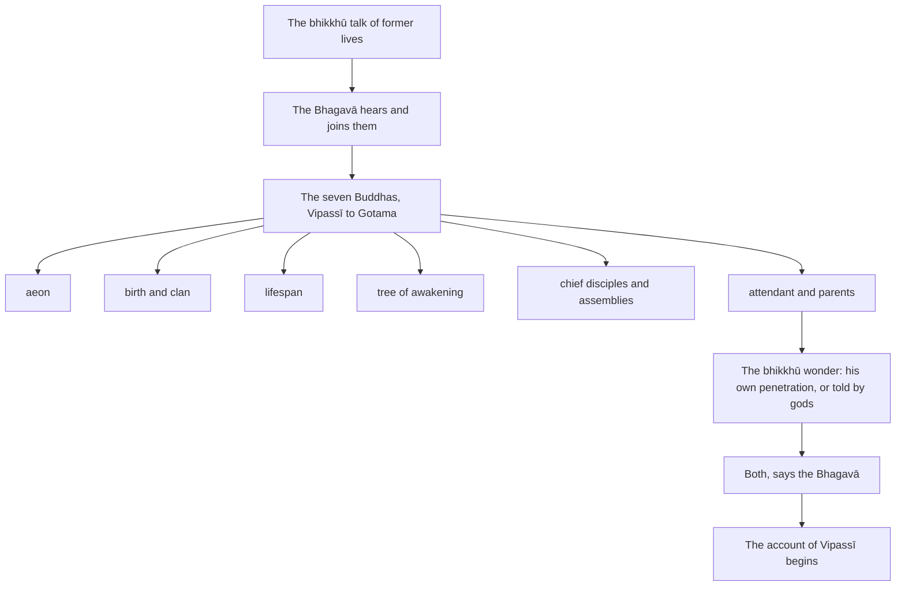

import { Tabs, TabItem } from '@astrojs/starlight/components';

Original text: [7D/1.1 Pubbenivāsapaṭisaṃyuttakathā 2–33](https://tipitaka2500.github.io/tipitaka/7D/1/1.1.html#2) in the [World Tipitaka Edition](https://tipitaka2500.github.io)

## Summary

The opening of the Mahāpadānasutta (7D/1). At Sāvatthī, in the Kareri pavilion, the bhikkhū fall to talking about former lives, and the Bhagavā, having heard them, recounts the six Buddhas before him and himself: the aeon in which each arose, his birth and clan, his lifespan, his tree of awakening, his pair of chief disciples, his assemblies, his attendant and his parents. When the bhikkhū wonder whether he knows this by his own penetration or because gods told him, he answers that it is both, and begins the account of Vipassī.

## Diagram

## Text

<Tabs syncKey="paliquote">
<TabItem label="My Translation">
(1.)

2\. Thus heard by me — At one time the Bhagavā was dwelling at Sāvatthī, in Jeta’s Grove, Anāthapiṇḍika’s Park, in the Kareri Hut. Then, among many bhikkhū who had returned from their alms round after the meal and were sitting together, gathered in the Kareri pavilion, a Dhamma talk concerning former lives arose: “Such was a former life, such was a former life.”

(2.)

3\. The Bhagavā heard this conversation of those bhikkhū with the divine ear component, purified and surpassing that of humans. Then the Bhagavā rose from his seat and approached the Kareri pavilion; having approached, he sat down on the prepared seat. Having sat down, the Bhagavā addressed the bhikkhū: “Bhikkhave, what talk were you engaged in just now, as you were sitting together? And what was the topic of conversation that was interrupted?”

4\. When this was said, those bhikkhū said this to the Bhagavā: “Here, Bhante, among us who had returned from our alms round after the meal and were sitting together, gathered in the Kareri pavilion, a Dhamma talk concerning former lives arose: ‘Such was a former life, such was a former life.’ This, Bhante, was our topic of conversation that was interrupted. Then the Bhagavā arrived.”

(3.)

5\. “Would you wish, Bhikkhave, to hear a Dhamma talk concerning former lives?” “It is the time for this, Bhagavā; it is the time for this, Sugata (Fortunate One); may the Bhagavā give a Dhamma talk concerning former lives; having heard it from the Bhagavā, the bhikkhū will remember it.” “In that case, Bhikkhave, listen and pay close attention, I will speak.” “Yes, Bhante,” those bhikkhū replied to the Bhagavā. The Bhagavā said this:

(4.)

6\. It was in the ninety-first `kappa` (aeon) from now, Bhikkhave, that Vipassī the Bhagavā, a liberated one, a perfectly awakened one, arose in the world. It was in the thirty-first aeon from now, Bhikkhave, that Sikhī the Bhagavā, a liberated one, a perfectly awakened one, arose in the world. Indeed, in that very thirty-first aeon, Bhikkhave, Vessabhū the Bhagavā, a liberated one, a perfectly awakened one, arose in the world. Indeed, Bhikkhave, in this very fortunate aeon, Kakusandha the Bhagavā, a liberated one, a perfectly awakened one, arose in the world. Indeed, Bhikkhave, in this very fortunate aeon, Koṇāgamana the Bhagavā, a liberated one, a perfectly awakened one, arose in the world. Indeed, Bhikkhave, in this very fortunate aeon, Kassapa the Bhagavā, a liberated one, a perfectly awakened one, arose in the world. Indeed, Bhikkhave, in this very fortunate aeon, I, a liberated one, a perfectly awakened one, have now arisen in the world.

(5.)

7\. Vipassī the Bhagavā, Bhikkhave, a liberated one, a perfectly awakened one, was a Khattiya by birth; he arose in a Khattiya family. Sikhī the Bhagavā, Bhikkhave, a liberated one, a perfectly awakened one, was a Khattiya by birth; he arose in a Khattiya family. Vessabhū the Bhagavā, Bhikkhave, a liberated one, a perfectly awakened one, was a Khattiya by birth; he arose in a Khattiya family. Kakusandha the Bhagavā, Bhikkhave, a liberated one, a perfectly awakened one, was a brahmin by birth; he arose in a brahmin family. Koṇāgamana the Bhagavā, Bhikkhave, a liberated one, a perfectly awakened one, was a brahmin by birth; he arose in a brahmin family. Kassapa the Bhagavā, Bhikkhave, a liberated one, a perfectly awakened one, was a brahmin by birth; he arose in a brahmin family. I, Bhikkhave, now a liberated one, a perfectly awakened one, was a Khattiya by birth, arisen in a Khattiya family.

(6.)

8\. Vipassī the Bhagavā, Bhikkhave, a liberated one, a perfectly awakened one, was Koṇḍañña by clan. Sikhī the Bhagavā, Bhikkhave, a liberated one, a perfectly awakened one, was Koṇḍañña by clan. Vessabhū the Bhagavā, Bhikkhave, a liberated one, a perfectly awakened one, was Koṇḍañña by clan. Kakusandha the Bhagavā, Bhikkhave, a liberated one, a perfectly awakened one, was Kassapa by clan. Koṇāgamana the Bhagavā, Bhikkhave, a liberated one, a perfectly awakened one, was Kassapa by clan. Kassapa the Bhagavā, Bhikkhave, a liberated one, a perfectly awakened one, was Kassapa by clan. I, Bhikkhave, now a liberated one, a perfectly awakened one, was Gotama by clan.

(7.)

9\. The lifespan of Vipassī the Bhagavā, Bhikkhave, a liberated one, a perfectly awakened one, was eighty thousand years. The lifespan of Sikhī the Bhagavā, Bhikkhave, a liberated one, a perfectly awakened one, was seventy thousand years. The lifespan of Vessabhū the Bhagavā, Bhikkhave, a liberated one, a perfectly awakened one, was sixty thousand years. The lifespan of Kakusandha the Bhagavā, Bhikkhave, a liberated one, a perfectly awakened one, was forty thousand years. The lifespan of Koṇāgamana the Bhagavā, Bhikkhave, a liberated one, a perfectly awakened one, was thirty thousand years. The lifespan of Kassapa the Bhagavā, Bhikkhave, a liberated one, a perfectly awakened one, was twenty thousand years. Now, Bhikkhave, my lifespan is short, limited, brief; one who lives long lives for a hundred years or a little more.

(8.)

10\. Vipassī the Bhagavā, Bhikkhave, a liberated one, a perfectly awakened one, was fully awakened at the foot of a Pāṭalī tree. Sikhī the Bhagavā, Bhikkhave, a liberated one, a perfectly awakened one, was fully awakened at the foot of a Puṇḍarīka tree. Vessabhū the Bhagavā, Bhikkhave, a liberated one, a perfectly awakened one, was fully awakened at the foot of a Sāla tree. Kakusandha the Bhagavā, Bhikkhave, a liberated one, a perfectly awakened one, was fully awakened at the foot of a Sirīsa tree. Koṇāgamana the Bhagavā, Bhikkhave, a liberated one, a perfectly awakened one, was fully awakened at the foot of an Udumbara tree. Kassapa the Bhagavā, Bhikkhave, a liberated one, a perfectly awakened one, was fully awakened at the foot of a Nigrodha tree. I, Bhikkhave, now a liberated one, a perfectly awakened one, was fully awakened at the foot of an Assattha tree.

(9.)

11\. Vipassī the Bhagavā, Bhikkhave, a liberated one, a perfectly awakened one, had a pair of disciples named Khaṇḍa and Tissa, a chief, excellent pair. Sikhī the Bhagavā, Bhikkhave, a liberated one, a perfectly awakened one, had a pair of disciples named Abhibhū and Sambhava, a chief, excellent pair. Vessabhū the Bhagavā, Bhikkhave, a liberated one, a perfectly awakened one, had a pair of disciples named Soṇa and Uttara, a chief, excellent pair. Kakusandha the Bhagavā, Bhikkhave, a liberated one, a perfectly awakened one, had a pair of disciples named Vidhura and Sañjīva, a chief, excellent pair. Koṇāgamana the Bhagavā, Bhikkhave, a liberated one, a perfectly awakened one, had a pair of disciples named Bhiyyosa and Uttara, a chief, excellent pair. Kassapa the Bhagavā, Bhikkhave, a liberated one, a perfectly awakened one, had a pair of disciples named Tissa and Bhāradvāja, a chief, excellent pair. Now, Bhikkhave, I have a pair of disciples named Sāriputta and Moggallāna, a chief, excellent pair.

(10.)

12\. Vipassī the Bhagavā, Bhikkhave, a liberated one, a perfectly awakened one, had three assemblies of disciples. One assembly of disciples was of six million eight hundred thousand bhikkhū, one assembly of disciples was of one hundred thousand bhikkhū, one assembly of disciples was of eighty thousand bhikkhū. These three assemblies of disciples of Vipassī the Bhagavā, Bhikkhave, a liberated one, a perfectly awakened one, were entirely of those whose `āsava` (defilements) were destroyed.

13\. Sikhī the Bhagavā, Bhikkhave, a liberated one, a perfectly awakened one, had three assemblies of disciples. One assembly of disciples was of one hundred thousand bhikkhū, one assembly of disciples was of eighty thousand bhikkhū, one assembly of disciples was of seventy thousand bhikkhū. These three assemblies of disciples of Sikhī the Bhagavā, Bhikkhave, a liberated one, a perfectly awakened one, were entirely of those whose `āsava` were destroyed.

14\. Vessabhū the Bhagavā, Bhikkhave, a liberated one, a perfectly awakened one, had three assemblies of disciples. One assembly of disciples was of eighty thousand bhikkhū, one assembly of disciples was of seventy thousand bhikkhū, one assembly of disciples was of sixty thousand bhikkhū. These three assemblies of disciples of Vessabhū the Bhagavā, Bhikkhave, a liberated one, a perfectly awakened one, were entirely of those whose `āsava` were destroyed.

15\. Kakusandha the Bhagavā, Bhikkhave, a liberated one, a perfectly awakened one, had one assembly of disciples, of forty thousand bhikkhū. This one assembly of disciples of Kakusandha the Bhagavā, Bhikkhave, a liberated one, a perfectly awakened one, was entirely of those whose `āsava` were destroyed.

16\. Koṇāgamana the Bhagavā, Bhikkhave, a liberated one, a perfectly awakened one, had one assembly of disciples, of thirty thousand bhikkhū. This one assembly of disciples of Koṇāgamana the Bhagavā, Bhikkhave, a liberated one, a perfectly awakened one, was entirely of those whose `āsava` were destroyed.

17\. Kassapa the Bhagavā, Bhikkhave, a liberated one, a perfectly awakened one, had one assembly of disciples, of twenty thousand bhikkhū. This one assembly of disciples of Kassapa the Bhagavā, Bhikkhave, a liberated one, a perfectly awakened one, was entirely of those whose `āsava` were destroyed.

18\. Now, Bhikkhave, I have had one assembly of disciples, of twelve hundred and fifty bhikkhū. This one assembly of my disciples, Bhikkhave, was entirely of those whose `āsava` were destroyed.

(11.)

19\. Vipassī the Bhagavā, Bhikkhave, a liberated one, a perfectly awakened one, had a bhikkhu attendant named Asoka, a chief attendant. Sikhī the Bhagavā, Bhikkhave, a liberated one, a perfectly awakened one, had a bhikkhu attendant named Khemaṅkara, a chief attendant. Vessabhū the Bhagavā, Bhikkhave, a liberated one, a perfectly awakened one, had a bhikkhu attendant named Upasanta, a chief attendant. Kakusandha the Bhagavā, Bhikkhave, a liberated one, a perfectly awakened one, had a bhikkhu attendant named Buddhija, a chief attendant. Koṇāgamana the Bhagavā, Bhikkhave, a liberated one, a perfectly awakened one, had a bhikkhu attendant named Sotthija, a chief attendant. Kassapa the Bhagavā, Bhikkhave, a liberated one, a perfectly awakened one, had a bhikkhu attendant named Sabbamitta, a chief attendant. Now, Bhikkhave, I have a bhikkhu attendant named Ānanda, a chief attendant.

(12.)

20\. The father of Vipassī the Bhagavā, Bhikkhave, a liberated one, a perfectly awakened one, was King Bandhumā. Queen Bandhumatī was his mother, his birth mother. The city named Bandhumatī was King Bandhumā's royal capital.

21\. The father of Sikhī the Bhagavā, Bhikkhave, a liberated one, a perfectly awakened one, was King Aruṇa. Queen Pabhāvatī was his mother, his birth mother. The city named Aruṇavatī was King Aruṇa's royal capital.

22\. The father of Vessabhū the Bhagavā, Bhikkhave, a liberated one, a perfectly awakened one, was King Suppatita. Queen Vassavatī was his mother, his birth mother. The city named Anoma was King Suppatita's royal capital.

23\. The father of Kakusandha the Bhagavā, Bhikkhave, a liberated one, a perfectly awakened one, was a brahmin named Aggidatta. A brahmin woman named Visākhā was his mother, his birth mother. Now at that time, Bhikkhave, there was a king named Khema. The city named Khemavatī was King Khema's royal capital.

24\. The father of Koṇāgamana the Bhagavā, Bhikkhave, a liberated one, a perfectly awakened one, was a brahmin named Yaññadatta. A brahmin woman named Uttarā was his mother, his birth mother. Now at that time, Bhikkhave, there was a king named Sobha. The city named Sobhavatī was King Sobha's royal capital.

25\. The father of Kassapa the Bhagavā, Bhikkhave, a liberated one, a perfectly awakened one, was a brahmin named Brahmadatta. A brahmin woman named Dhanavatī was his mother, his birth mother. Now at that time, Bhikkhave, there was a king named Kikī. The city named Bārāṇasī was King Kikī's royal capital.

26\. Now, Bhikkhave, my father was King Suddhodana. Queen Māyā was my mother, my birth mother. The city named Kapilavatthu was the royal capital.” This the Bhagavā said. Having said this, the Fortunate One rose from his seat and entered his dwelling.

(13.)

27\. Then, soon after the Bhagavā had departed, this conversation arose among those bhikkhū: “It is wonderful, Āvuso, it is amazing, Āvuso, the great psychic power and great majesty of the Tathāgata. Inasmuch as the Tathāgata will recollect the Buddhas of the past who attained final extinguishment, who had cut off `papañca` (mental proliferation), cut off the road, exhausted the cycle of existence, transcended all suffering, also by birth, will recollect them also by name, will recollect them also by clan, will recollect them also by lifespan, will recollect them also by pair of disciples, will recollect them also by assembly of disciples: ‘Those Bhagavants were of such birth, thus too; those Bhagavants were of such name, of such clan, of such virtue, of such nature, of such wisdom, of such dwelling, of such liberation, thus too.’”

28\. “What now, Āvuso, is it that this `dhammadhātu` (nature of reality) has been thoroughly penetrated by the Tathāgata alone, through the thorough penetration of which `dhammadhātu` the Tathāgata recollects the Buddhas of the past who attained final extinguishment, who had cut off `papañca`, cut off the road, exhausted the cycle of existence, transcended all suffering, also by birth, recollects them also by name, recollects them also by clan, recollects them also by lifespan, recollects them also by pair of disciples, recollects them also by assembly of disciples: ‘Those Bhagavants were of such birth, thus too; those Bhagavants were of such name, of such clan, of such virtue, of such nature, of such wisdom, of such dwelling, of such liberation, thus too’; or did gods report this matter to the Tathāgata, whereby the Tathāgata recollects the Buddhas of the past who attained final extinguishment, who had cut off `papañca`, cut off the road, exhausted the cycle of existence, transcended all suffering, also by birth, recollects them also by name, recollects them also by clan, recollects them also by lifespan, recollects them also by pair of disciples, recollects them also by assembly of disciples: ‘Those Bhagavants were of such birth, thus too; those Bhagavants were of such name, of such clan, of such virtue, of such nature, of such wisdom, of such dwelling, of such liberation, thus too’?” And this indeed was the topic of conversation of those bhikkhū that was interrupted.

(14.)

29\. Then the Bhagavā, having risen from seclusion in the evening, approached the Kareri pavilion; having approached, he sat down on the prepared seat. Having sat down, the Bhagavā addressed the bhikkhū: “Bhikkhave, what talk were you engaged in just now, as you were sitting together? And what was the topic of conversation that was interrupted?”

30\. When this was said, those bhikkhū said this to the Bhagavā: “Here, Bhante, soon after the Bhagavā had departed, this conversation arose among us: ‘It is wonderful, Āvuso, it is amazing, Āvuso, the great psychic power and great majesty of the Tathāgata. Inasmuch as the Tathāgata will recollect the Buddhas of the past who attained final extinguishment, who had cut off `papañca`, cut off the road, exhausted the cycle of existence, transcended all suffering, also by birth, will recollect them also by name, will recollect them also by clan, will recollect them also by lifespan, will recollect them also by pair of disciples, will recollect them also by assembly of disciples: “Those Bhagavants were of such birth, thus too; those Bhagavants were of such name, of such clan, of such virtue, of such nature, of such wisdom, of such dwelling, of such liberation, thus too.” What now, Āvuso, is it that this `dhammadhātu` has been thoroughly penetrated by the Tathāgata alone, through the thorough penetration of which `dhammadhātu` the Tathāgata recollects the Buddhas of the past who attained final extinguishment, who had cut off `papañca`, cut off the road, exhausted the cycle of existence, transcended all suffering, also by birth, recollects them also by name, recollects them also by clan, recollects them also by lifespan, recollects them also by pair of disciples, recollects them also by assembly of disciples: “Those Bhagavants were of such birth, thus too; those Bhagavants were of such name, of such clan, of such virtue, of such nature, of such wisdom, of such dwelling, of such liberation, thus too.” Or did gods report this matter to the Tathāgata, whereby the Tathāgata recollects the Buddhas of the past who attained final extinguishment, who had cut off `papañca`, cut off the road, exhausted the cycle of existence, transcended all suffering, also by birth, recollects them also by name, recollects them also by clan, recollects them also by lifespan, recollects them also by pair of disciples, recollects them also by assembly of disciples: “Those Bhagavants were of such birth, thus too; those Bhagavants were of such name, of such clan, of such virtue, of such nature, of such wisdom, of such dwelling, of such liberation, thus too”’? This, Bhante, was our topic of conversation that was interrupted; then the Bhagavā arrived.”

(15.)

31\. “This `dhammadhātu`, Bhikkhave, has been thoroughly penetrated by the Tathāgata alone, through the thorough penetration of which `dhammadhātu` the Tathāgata recollects the Buddhas of the past who attained final extinguishment, who had cut off `papañca`, cut off the road, exhausted the cycle of existence, transcended all suffering, also by birth, recollects them also by name, recollects them also by clan, recollects them also by lifespan, recollects them also by pair of disciples, recollects them also by assembly of disciples: ‘Those Bhagavants were of such birth, thus too; those Bhagavants were of such name, of such clan, of such virtue, of such nature, of such wisdom, of such dwelling, of such liberation, thus too.’ Gods too reported this matter to the Tathāgata, whereby the Tathāgata recollects the Buddhas of the past who attained final extinguishment, who had cut off `papañca`, cut off the road, exhausted the cycle of existence, transcended all suffering, also by birth, recollects them also by name, recollects them also by clan, recollects them also by lifespan, recollects them also by pair of disciples, recollects them also by assembly of disciples: ‘Those Bhagavants were of such birth, thus too; those Bhagavants were of such name, of such clan, of such virtue, of such nature, of such wisdom, of such dwelling, of such liberation, thus too.’

32\. Would you wish, Bhikkhave, to hear a Dhamma talk concerning former lives to a still greater degree?” “It is the time for this, Bhagavā; it is the time for this, Sugata (Fortunate One); may the Bhagavā give a Dhamma talk concerning former lives to a still greater degree; having heard it from the Bhagavā, the bhikkhū will remember it.” “In that case, Bhikkhave, listen and pay close attention, I will speak.” “Yes, Bhante,” those bhikkhū replied to the Bhagavā. The Bhagavā said this:

(16.)

33\. It was in the ninety-first aeon from now, Bhikkhave, that Vipassī the Bhagavā, a liberated one, a perfectly awakened one, arose in the world. Vipassī the Bhagavā, Bhikkhave, a liberated one, a perfectly awakened one, was a Khattiya by birth; he arose in a Khattiya family. Vipassī the Bhagavā, Bhikkhave, a liberated one, a perfectly awakened one, was Koṇḍañña by clan. The lifespan of Vipassī the Bhagavā, Bhikkhave, a liberated one, a perfectly awakened one, was eighty thousand years. Vipassī the Bhagavā, Bhikkhave, a liberated one, a perfectly awakened one, was fully awakened at the foot of a Pāṭalī tree. Vipassī the Bhagavā, Bhikkhave, a liberated one, a perfectly awakened one, had a pair of disciples named Khaṇḍa and Tissa, a chief, excellent pair. Vipassī the Bhagavā, Bhikkhave, a liberated one, a perfectly awakened one, had three assemblies of disciples. One assembly of disciples was of six million eight hundred thousand bhikkhū, one assembly of disciples was of one hundred thousand bhikkhū, one assembly of disciples was of eighty thousand bhikkhū. These three assemblies of disciples of Vipassī the Bhagavā, Bhikkhave, a liberated one, a perfectly awakened one, were entirely of those whose `āsava` were destroyed. Vipassī the Bhagavā, Bhikkhave, a liberated one, a perfectly awakened one, had a bhikkhu attendant named Asoka, a chief attendant. The father of Vipassī the Bhagavā, Bhikkhave, a liberated one, a perfectly awakened one, was King Bandhumā. Queen Bandhumatī was his mother, his birth mother. The city named Bandhumatī was King Bandhumā's royal capital.
</TabItem>

<TabItem label="Pāḷi (Roman IAST)">
(1.)

2\. Evaṃ me sutaṃ— ekaṃ samayaṃ bhagavā sāvatthiyaṃ viharati jetavane anāthapiṇḍikassa ārāme karerikuṭikāyaṃ. Atha kho sambahulānaṃ bhikkhūnaṃ pacchābhattaṃ piṇḍapātapaṭikkantānaṃ karerimaṇḍalamāḷe sannisinnānaṃ sannipatitānaṃ pubbenivāsapaṭisaṃyuttā dhammī kathā udapādi— “itipi pubbenivāso, itipi pubbenivāso”ti.

(2.)

3\. Assosi kho bhagavā dibbāya sotadhātuyā visuddhāya atikkantamānusikāya tesaṃ bhikkhūnaṃ imaṃ kathāsallāpaṃ. Atha kho bhagavā uṭṭhāyāsanā yena karerimaṇḍalamāḷo tenupasaṅkami; upasaṅkamitvā paññatte āsane nisīdi, nisajja kho bhagavā bhikkhū āmantesi— “kāya nuttha, bhikkhave, etarahi kathāya sannisinnā; kā ca pana vo antarākathā vippakatā”ti?

4\. Evaṃ vutte, te bhikkhū bhagavantaṃ etadavocuṃ— “idha, bhante, amhākaṃ pacchābhattaṃ piṇḍapātapaṭikkantānaṃ karerimaṇḍalamāḷe sannisinnānaṃ sannipatitānaṃ pubbenivāsapaṭisaṃyuttā dhammī kathā udapādi— ‘itipi pubbenivāso itipi pubbenivāso’ti. Ayaṃ kho no, bhante, antarākathā vippakatā. Atha bhagavā anuppatto”ti.

(3.)

5\. “Iccheyyātha no tumhe, bhikkhave, pubbenivāsapaṭisaṃyuttaṃ dhammiṃ kathaṃ sotun”ti? “Etassa, bhagavā, kālo; etassa, sugata, kālo; yaṃ bhagavā pubbenivāsapaṭisaṃyuttaṃ dhammiṃ kathaṃ kareyya, bhagavato sutvā bhikkhū dhāressantī”ti. “Tena hi, bhikkhave, suṇātha sādhukaṃ manasi karotha bhāsissāmī”ti. “Evaṃ, bhante”ti kho te bhikkhū bhagavato paccassosuṃ. Bhagavā etadavoca—

(4.)

6\. “Ito so, bhikkhave, ekanavutikappe yaṃ vipassī bhagavā arahaṃ sammāsambuddho loke udapādi. Ito so, bhikkhave, ekatiṃse kappe yaṃ sikhī bhagavā arahaṃ sammāsambuddho loke udapādi. Tasmiññeva kho, bhikkhave, ekatiṃse kappe vessabhū bhagavā arahaṃ sammāsambuddho loke udapādi. Imasmiññeva kho, bhikkhave, bhaddakappe kakusandho bhagavā arahaṃ sammāsambuddho loke udapādi. Imasmiññeva kho, bhikkhave, bhaddakappe koṇāgamano bhagavā arahaṃ sammāsambuddho loke udapādi. Imasmiññeva kho, bhikkhave, bhaddakappe kassapo bhagavā arahaṃ sammāsambuddho loke udapādi. Imasmiññeva kho, bhikkhave, bhaddakappe ahaṃ etarahi arahaṃ sammāsambuddho loke uppanno.

(5.)

7\. Vipassī, bhikkhave, bhagavā arahaṃ sammāsambuddho khattiyo jātiyā ahosi, khattiyakule udapādi. Sikhī, bhikkhave, bhagavā arahaṃ sammāsambuddho khattiyo jātiyā ahosi, khattiyakule udapādi. Vessabhū, bhikkhave, bhagavā arahaṃ sammāsambuddho khattiyo jātiyā ahosi, khattiyakule udapādi. Kakusandho, bhikkhave, bhagavā arahaṃ sammāsambuddho brāhmaṇo jātiyā ahosi, brāhmaṇakule udapādi. Koṇāgamano, bhikkhave, bhagavā arahaṃ sammāsambuddho brāhmaṇo jātiyā ahosi, brāhmaṇakule udapādi. Kassapo, bhikkhave, bhagavā arahaṃ sammāsambuddho brāhmaṇo jātiyā ahosi, brāhmaṇakule udapādi. Ahaṃ, bhikkhave, etarahi arahaṃ sammāsambuddho khattiyo jātiyā ahosiṃ, khattiyakule uppanno.

(6.)

8\. Vipassī, bhikkhave, bhagavā arahaṃ sammāsambuddho koṇḍañño gottena ahosi. Sikhī, bhikkhave, bhagavā arahaṃ sammāsambuddho koṇḍañño gottena ahosi. Vessabhū, bhikkhave, bhagavā arahaṃ sammāsambuddho koṇḍañño gottena ahosi. Kakusandho, bhikkhave, bhagavā arahaṃ sammāsambuddho kassapo gottena ahosi. Koṇāgamano, bhikkhave, bhagavā arahaṃ sammāsambuddho kassapo gottena ahosi. Kassapo, bhikkhave, bhagavā arahaṃ sammāsambuddho kassapo gottena ahosi. Ahaṃ, bhikkhave, etarahi arahaṃ sammāsambuddho gotamo gottena ahosiṃ.

(7.)

9\. Vipassissa, bhikkhave, bhagavato arahato sammāsambuddhassa asītivassasahassāni āyuppamāṇaṃ ahosi. Sikhissa, bhikkhave, bhagavato arahato sammāsambuddhassa sattativassasahassāni āyuppamāṇaṃ ahosi. Vessabhussa, bhikkhave, bhagavato arahato sammāsambuddhassa saṭṭhivassasahassāni āyuppamāṇaṃ ahosi. Kakusandhassa, bhikkhave, bhagavato arahato sammāsambuddhassa cattālīsavassasahassāni āyuppamāṇaṃ ahosi. Koṇāgamanassa, bhikkhave, bhagavato arahato sammāsambuddhassa tiṃsavassasahassāni āyuppamāṇaṃ ahosi. Kassapassa, bhikkhave, bhagavato arahato sammāsambuddhassa vīsativassasahassāni āyuppamāṇaṃ ahosi. Mayhaṃ, bhikkhave, etarahi appakaṃ āyuppamāṇaṃ parittaṃ lahukaṃ; yo ciraṃ jīvati, so vassasataṃ appaṃ vā bhiyyo.

(8.)

10\. Vipassī, bhikkhave, bhagavā arahaṃ sammāsambuddho pāṭaliyā mūle abhisambuddho. Sikhī, bhikkhave, bhagavā arahaṃ sammāsambuddho puṇḍarīkassa mūle abhisambuddho. Vessabhū, bhikkhave, bhagavā arahaṃ sammāsambuddho sālassa mūle abhisambuddho. Kakusandho, bhikkhave, bhagavā arahaṃ sammāsambuddho sirīsassa mūle abhisambuddho. Koṇāgamano, bhikkhave, bhagavā arahaṃ sammāsambuddho udumbarassa mūle abhisambuddho. Kassapo, bhikkhave, bhagavā arahaṃ sammāsambuddho nigrodhassa mūle abhisambuddho. Ahaṃ, bhikkhave, etarahi arahaṃ sammāsambuddho assatthassa mūle abhisambuddho.

(9.)

11\. Vipassissa, bhikkhave, bhagavato arahato sammāsambuddhassa khaṇḍatissaṃ nāma sāvakayugaṃ ahosi aggaṃ bhaddayugaṃ. Sikhissa, bhikkhave, bhagavato arahato sammāsambuddhassa abhibhūsambhavaṃ nāma sāvakayugaṃ ahosi aggaṃ bhaddayugaṃ. Vessabhussa, bhikkhave, bhagavato arahato sammāsambuddhassa soṇuttaraṃ nāma sāvakayugaṃ ahosi aggaṃ bhaddayugaṃ. Kakusandhassa, bhikkhave, bhagavato arahato sammāsambuddhassa vidhurasañjīvaṃ nāma sāvakayugaṃ ahosi aggaṃ bhaddayugaṃ. Koṇāgamanassa, bhikkhave, bhagavato arahato sammāsambuddhassa bhiyyosuttaraṃ nāma sāvakayugaṃ ahosi aggaṃ bhaddayugaṃ. Kassapassa, bhikkhave, bhagavato arahato sammāsambuddhassa tissabhāradvājaṃ nāma sāvakayugaṃ ahosi aggaṃ bhaddayugaṃ. Mayhaṃ, bhikkhave, etarahi sāriputtamoggallānaṃ nāma sāvakayugaṃ ahosi aggaṃ bhaddayugaṃ.

(10.)

12\. Vipassissa, bhikkhave, bhagavato arahato sammāsambuddhassa tayo sāvakānaṃ sannipātā ahesuṃ. Eko sāvakānaṃ sannipāto ahosi aṭṭhasaṭṭhibhikkhusatasahassaṃ, eko sāvakānaṃ sannipāto ahosi bhikkhusatasahassaṃ, eko sāvakānaṃ sannipāto ahosi asītibhikkhusahassāni. Vipassissa, bhikkhave, bhagavato arahato sammāsambuddhassa ime tayo sāvakānaṃ sannipātā ahesuṃ sabbesaṃyeva khīṇāsavānaṃ.

13\. Sikhissa, bhikkhave, bhagavato arahato sammāsambuddhassa tayo sāvakānaṃ sannipātā ahesuṃ. Eko sāvakānaṃ sannipāto ahosi bhikkhusatasahassaṃ, eko sāvakānaṃ sannipāto ahosi asītibhikkhusahassāni, eko sāvakānaṃ sannipāto ahosi sattatibhikkhusahassāni. Sikhissa, bhikkhave, bhagavato arahato sammāsambuddhassa ime tayo sāvakānaṃ sannipātā ahesuṃ sabbesaṃyeva khīṇāsavānaṃ.

14\. Vessabhussa, bhikkhave, bhagavato arahato sammāsambuddhassa tayo sāvakānaṃ sannipātā ahesuṃ. Eko sāvakānaṃ sannipāto ahosi asītibhikkhusahassāni, eko sāvakānaṃ sannipāto ahosi sattatibhikkhusahassāni, eko sāvakānaṃ sannipāto ahosi saṭṭhibhikkhusahassāni. Vessabhussa, bhikkhave, bhagavato arahato sammāsambuddhassa ime tayo sāvakānaṃ sannipātā ahesuṃ sabbesaṃyeva khīṇāsavānaṃ.

15\. Kakusandhassa, bhikkhave, bhagavato arahato sammāsambuddhassa eko sāvakānaṃ sannipāto ahosi cattālīsabhikkhusahassāni. Kakusandhassa, bhikkhave, bhagavato arahato sammāsambuddhassa ayaṃ eko sāvakānaṃ sannipāto ahosi sabbesaṃyeva khīṇāsavānaṃ.

16\. Koṇāgamanassa, bhikkhave, bhagavato arahato sammāsambuddhassa eko sāvakānaṃ sannipāto ahosi tiṃsabhikkhusahassāni. Koṇāgamanassa, bhikkhave, bhagavato arahato sammāsambuddhassa ayaṃ eko sāvakānaṃ sannipāto ahosi sabbesaṃyeva khīṇāsavānaṃ.

17\. Kassapassa, bhikkhave, bhagavato arahato sammāsambuddhassa eko sāvakānaṃ sannipāto ahosi vīsatibhikkhusahassāni. Kassapassa, bhikkhave, bhagavato arahato sammāsambuddhassa ayaṃ eko sāvakānaṃ sannipāto ahosi sabbesaṃyeva khīṇāsavānaṃ.

18\. Mayhaṃ, bhikkhave, etarahi eko sāvakānaṃ sannipāto ahosi aḍḍhateḷasāni bhikkhusatāni. Mayhaṃ, bhikkhave, ayaṃ eko sāvakānaṃ sannipāto ahosi sabbesaṃyeva khīṇāsavānaṃ.

(11.)

19\. Vipassissa, bhikkhave, bhagavato arahato sammāsambuddhassa asoko nāma bhikkhu upaṭṭhāko ahosi aggupaṭṭhāko. Sikhissa, bhikkhave, bhagavato arahato sammāsambuddhassa khemaṅkaro nāma bhikkhu upaṭṭhāko ahosi aggupaṭṭhāko. Vessabhussa, bhikkhave, bhagavato arahato sammāsambuddhassa upasanto nāma bhikkhu upaṭṭhāko ahosi aggupaṭṭhāko. Kakusandhassa, bhikkhave, bhagavato arahato sammāsambuddhassa buddhijo nāma bhikkhu upaṭṭhāko ahosi aggupaṭṭhāko. Koṇāgamanassa, bhikkhave, bhagavato arahato sammāsambuddhassa sotthijo nāma bhikkhu upaṭṭhāko ahosi aggupaṭṭhāko. Kassapassa, bhikkhave, bhagavato arahato sammāsambuddhassa sabbamitto nāma bhikkhu upaṭṭhāko ahosi aggupaṭṭhāko. Mayhaṃ, bhikkhave, etarahi ānando nāma bhikkhu upaṭṭhāko ahosi aggupaṭṭhāko.

(12.)

20\. Vipassissa, bhikkhave, bhagavato arahato sammāsambuddhassa bandhumā nāma rājā pitā ahosi. Bandhumatī nāma devī mātā ahosi janetti. Bandhumassa rañño bandhumatī nāma nagaraṃ rājadhānī ahosi.

21\. Sikhissa, bhikkhave, bhagavato arahato sammāsambuddhassa aruṇo nāma rājā pitā ahosi. Pabhāvatī nāma devī mātā ahosi janetti. Aruṇassa rañño aruṇavatī nāma nagaraṃ rājadhānī ahosi.

22\. Vessabhussa, bhikkhave, bhagavato arahato sammāsambuddhassa suppatito nāma rājā pitā ahosi. Vassavatī nāma devī mātā ahosi janetti. Suppatitassa rañño anomaṃ nāma nagaraṃ rājadhānī ahosi.

23\. Kakusandhassa, bhikkhave, bhagavato arahato sammāsambuddhassa aggidatto nāma brāhmaṇo pitā ahosi. Visākhā nāma brāhmaṇī mātā ahosi janetti. Tena kho pana, bhikkhave, samayena khemo nāma rājā ahosi. Khemassa rañño khemavatī nāma nagaraṃ rājadhānī ahosi.

24\. Koṇāgamanassa, bhikkhave, bhagavato arahato sammāsambuddhassa yaññadatto nāma brāhmaṇo pitā ahosi. Uttarā nāma brāhmaṇī mātā ahosi janetti. Tena kho pana, bhikkhave, samayena sobho nāma rājā ahosi. Sobhassa rañño sobhavatī nāma nagaraṃ rājadhānī ahosi.

25\. Kassapassa, bhikkhave, bhagavato arahato sammāsambuddhassa brahmadatto nāma brāhmaṇo pitā ahosi. Dhanavatī nāma brāhmaṇī mātā ahosi janetti. Tena kho pana, bhikkhave, samayena kikī nāma rājā ahosi. Kikissa rañño bārāṇasī nāma nagaraṃ rājadhānī ahosi.

26\. Mayhaṃ, bhikkhave, etarahi suddhodano nāma rājā pitā ahosi. Māyā nāma devī mātā ahosi janetti. Kapilavatthu nāma nagaraṃ rājadhānī ahosī”ti. Idamavoca bhagavā. Idaṃ vatvāna sugato uṭṭhāyāsanā vihāraṃ pāvisi.

(13.)

27\. Atha kho tesaṃ bhikkhūnaṃ acirapakkantassa bhagavato ayamantarākathā udapādi— “acchariyaṃ, āvuso, abbhutaṃ, āvuso, tathāgatassa mahiddhikatā mahānubhāvatā. Yatra hi nāma tathāgato atīte buddhe parinibbute chinnapapañce chinnavaṭume pariyādinnavaṭṭe sabbadukkhavītivatte jātitopi anussarissati, nāmatopi anussarissati, gottatopi anussarissati, āyuppamāṇatopi anussarissati, sāvakayugatopi anussarissati, sāvakasannipātatopi anussarissati— ‘evaṃjaccā te bhagavanto ahesuṃ itipi, evaṃnāmā evaṃgottā evaṃsīlā evaṃdhammā evaṃpaññā evaṃvihārī evaṃvimuttā te bhagavanto ahesuṃ itipī’”ti.

28\. “Kiṃ nu kho, āvuso, tathāgatasseva nu kho esā dhammadhātu suppaṭividdhā, yassā dhammadhātuyā suppaṭividdhattā tathāgato atīte buddhe parinibbute chinnapapañce chinnavaṭume pariyādinnavaṭṭe sabbadukkhavītivatte jātitopi anussarati, nāmatopi anussarati, gottatopi anussarati, āyuppamāṇatopi anussarati, sāvakayugatopi anussarati, sāvakasannipātatopi anussarati— ‘evaṃjaccā te bhagavanto ahesuṃ itipi, evaṃnāmā evaṃgottā evaṃsīlā evaṃdhammā evaṃpaññā evaṃvihārī evaṃvimuttā te bhagavanto ahesuṃ itipī’ti, udāhu devatā tathāgatassa etamatthaṃ ārocesuṃ, yena tathāgato atīte buddhe parinibbute chinnapapañce chinnavaṭume pariyādinnavaṭṭe sabbadukkhavītivatte jātitopi anussarati, nāmatopi anussarati, gottatopi anussarati, āyuppamāṇatopi anussarati, sāvakayugatopi anussarati, sāvakasannipātatopi anussarati— ‘evaṃjaccā te bhagavanto ahesuṃ itipi, evaṃnāmā evaṃgottā evaṃsīlā evaṃdhammā evaṃpaññā evaṃvihārī evaṃvimuttā te bhagavanto ahesuṃ itipī’”ti. Ayañca hidaṃ tesaṃ bhikkhūnaṃ antarākathā vippakatā hoti.

(14.)

29\. Atha kho bhagavā sāyanhasamayaṃ paṭisallānā vuṭṭhito yena karerimaṇḍalamāḷo tenupasaṅkami; upasaṅkamitvā paññatte āsane nisīdi. Nisajja kho bhagavā bhikkhū āmantesi— “kāya nuttha, bhikkhave, etarahi kathāya sannisinnā; kā ca pana vo antarākathā vippakatā”ti?

30\. Evaṃ vutte, te bhikkhū bhagavantaṃ etadavocuṃ— “idha, bhante, amhākaṃ acirapakkantassa bhagavato ayaṃ antarākathā udapādi— ‘acchariyaṃ, āvuso, abbhutaṃ, āvuso, tathāgatassa mahiddhikatā mahānubhāvatā. Yatra hi nāma tathāgato atīte buddhe parinibbute chinnapapañce chinnavaṭume pariyādinnavaṭṭe sabbadukkhavītivatte jātitopi anussarissati, nāmatopi anussarissati, gottatopi anussarissati, āyuppamāṇatopi anussarissati, sāvakayugatopi anussarissati, sāvakasannipātatopi anussarissati— “evaṃjaccā te bhagavanto ahesuṃ itipi, evaṃnāmā evaṃgottā evaṃsīlā evaṃdhammā evaṃpaññā evaṃvihārī evaṃvimuttā te bhagavanto ahesuṃ itipī”ti. Kiṃ nu kho, āvuso, tathāgatasseva nu kho esā dhammadhātu suppaṭividdhā, yassā dhammadhātuyā suppaṭividdhattā tathāgato atīte buddhe parinibbute chinnapapañce chinnavaṭume pariyādinnavaṭṭe sabbadukkhavītivatte jātitopi anussarati, nāmatopi anussarati, gottatopi anussarati, āyuppamāṇatopi anussarati, sāvakayugatopi anussarati, sāvakasannipātatopi anussarati— “evaṃjaccā te bhagavanto ahesuṃ itipi, evaṃnāmā evaṃgottā evaṃsīlā evaṃdhammā evaṃpaññā evaṃvihārī evaṃvimuttā te bhagavanto ahesuṃ itipī”ti. Udāhu devatā tathāgatassa etamatthaṃ ārocesuṃ, yena tathāgato atīte buddhe parinibbute chinnapapañce chinnavaṭume pariyādinnavaṭṭe sabbadukkhavītivatte jātitopi anussarati, nāmatopi anussarati, gottatopi anussarati, āyuppamāṇatopi anussarati, sāvakayugatopi anussarati, sāvakasannipātatopi anussarati— “evaṃjaccā te bhagavanto ahesuṃ itipi, evaṃnāmā evaṃgottā evaṃsīlā evaṃdhammā evaṃpaññā evaṃvihārī evaṃvimuttā te bhagavanto ahesuṃ itipī”’ti? Ayaṃ kho no, bhante, antarākathā vippakatā, atha bhagavā anuppatto”ti.

(15.)

31\. “Tathāgatassevesā, bhikkhave, dhammadhātu suppaṭividdhā, yassā dhammadhātuyā suppaṭividdhattā tathāgato atīte buddhe parinibbute chinnapapañce chinnavaṭume pariyādinnavaṭṭe sabbadukkhavītivatte jātitopi anussarati, nāmatopi anussarati, gottatopi anussarati, āyuppamāṇatopi anussarati, sāvakayugatopi anussarati, sāvakasannipātatopi anussarati— ‘evaṃjaccā te bhagavanto ahesuṃ itipi, evaṃnāmā evaṃgottā evaṃsīlā evaṃdhammā evaṃpaññā evaṃvihārī evaṃvimuttā te bhagavanto ahesuṃ itipī’ti. Devatāpi tathāgatassa etamatthaṃ ārocesuṃ, yena tathāgato atīte buddhe parinibbute chinnapapañce chinnavaṭume pariyādinnavaṭṭe sabbadukkhavītivatte jātitopi anussarati, nāmatopi anussarati, gottatopi anussarati, āyuppamāṇatopi anussarati, sāvakayugatopi anussarati, sāvakasannipātatopi anussarati— ‘evaṃjaccā te bhagavanto ahesuṃ itipi, evaṃnāmā evaṃgottā evaṃsīlā evaṃdhammā evaṃpaññā evaṃvihārī evaṃvimuttā te bhagavanto ahesuṃ itipī’ti.

32\. Iccheyyātha no tumhe, bhikkhave, bhiyyoso mattāya pubbenivāsapaṭisaṃyuttaṃ dhammiṃ kathaṃ sotun”ti? “Etassa, bhagavā, kālo; etassa, sugata, kālo; yaṃ bhagavā bhiyyoso mattāya pubbenivāsapaṭisaṃyuttaṃ dhammiṃ kathaṃ kareyya, bhagavato sutvā bhikkhū dhāressantī”ti. “Tena hi, bhikkhave, suṇātha, sādhukaṃ manasi karotha, bhāsissāmī”ti. “Evaṃ, bhante”ti kho te bhikkhū bhagavato paccassosuṃ. Bhagavā etadavoca—

(16.)

33\. “Ito so, bhikkhave, ekanavutikappe yaṃ vipassī bhagavā arahaṃ sammāsambuddho loke udapādi. Vipassī, bhikkhave, bhagavā arahaṃ sammāsambuddho khattiyo jātiyā ahosi, khattiyakule udapādi. Vipassī, bhikkhave, bhagavā arahaṃ sammāsambuddho koṇḍañño gottena ahosi. Vipassissa, bhikkhave, bhagavato arahato sammāsambuddhassa asītivassasahassāni āyuppamāṇaṃ ahosi. Vipassī, bhikkhave, bhagavā arahaṃ sammāsambuddho pāṭaliyā mūle abhisambuddho. Vipassissa, bhikkhave, bhagavato arahato sammāsambuddhassa khaṇḍatissaṃ nāma sāvakayugaṃ ahosi aggaṃ bhaddayugaṃ. Vipassissa, bhikkhave, bhagavato arahato sammāsambuddhassa tayo sāvakānaṃ sannipātā ahesuṃ. Eko sāvakānaṃ sannipāto ahosi aṭṭhasaṭṭhibhikkhusatasahassaṃ, eko sāvakānaṃ sannipāto ahosi bhikkhusatasahassaṃ, eko sāvakānaṃ sannipāto ahosi asītibhikkhusahassāni. Vipassissa, bhikkhave, bhagavato arahato sammāsambuddhassa ime tayo sāvakānaṃ sannipātā ahesuṃ sabbesaṃyeva khīṇāsavānaṃ. Vipassissa, bhikkhave, bhagavato arahato sammāsambuddhassa asoko nāma bhikkhu upaṭṭhāko ahosi aggupaṭṭhāko. Vipassissa, bhikkhave, bhagavato arahato sammāsambuddhassa bandhumā nāma rājā pitā ahosi. Bandhumatī nāma devī mātā ahosi janetti. Bandhumassa rañño bandhumatī nāma nagaraṃ rājadhānī ahosi.
</TabItem>

<TabItem label="Pāḷi (Brahmi)">
(1.)

2\. 𑀏𑀯𑀁 𑀫𑁂 𑀲𑀼𑀢𑀁— 𑀏𑀓𑀁 𑀲𑀫𑀬𑀁 𑀪𑀕𑀯𑀸 𑀲𑀸𑀯𑀢𑁆𑀣𑀺𑀬𑀁 𑀯𑀺𑀳𑀭𑀢𑀺 𑀚𑁂𑀢𑀯𑀦𑁂 𑀅𑀦𑀸𑀣𑀧𑀺𑀡𑁆𑀟𑀺𑀓𑀲𑁆𑀲 𑀆𑀭𑀸𑀫𑁂 𑀓𑀭𑁂𑀭𑀺𑀓𑀼𑀝𑀺𑀓𑀸𑀬𑀁. 𑀅𑀣 𑀔𑁄 𑀲𑀫𑁆𑀩𑀳𑀼𑀮𑀸𑀦𑀁 𑀪𑀺𑀓𑁆𑀔𑀽𑀦𑀁 𑀧𑀘𑁆𑀙𑀸𑀪𑀢𑁆𑀢𑀁 𑀧𑀺𑀡𑁆𑀟𑀧𑀸𑀢𑀧𑀝𑀺𑀓𑁆𑀓𑀦𑁆𑀢𑀸𑀦𑀁 𑀓𑀭𑁂𑀭𑀺𑀫𑀡𑁆𑀟𑀮𑀫𑀸𑀍𑀏 𑀲𑀦𑁆𑀦𑀺𑀲𑀺𑀦𑁆𑀦𑀸𑀦𑀁 𑀲𑀦𑁆𑀦𑀺𑀧𑀢𑀺𑀢𑀸𑀦𑀁 𑀧𑀼𑀩𑁆𑀩𑁂𑀦𑀺𑀯𑀸𑀲𑀧𑀝𑀺𑀲𑀁𑀬𑀼𑀢𑁆𑀢𑀸 𑀥𑀫𑁆𑀫𑀻 𑀓𑀣𑀸 𑀉𑀤𑀧𑀸𑀤𑀺— “𑀇𑀢𑀺𑀧𑀺 𑀧𑀼𑀩𑁆𑀩𑁂𑀦𑀺𑀯𑀸𑀲𑁄, 𑀇𑀢𑀺𑀧𑀺 𑀧𑀼𑀩𑁆𑀩𑁂𑀦𑀺𑀯𑀸𑀲𑁄”𑀢𑀺.

(2.)

3\. 𑀅𑀲𑁆𑀲𑁄𑀲𑀺 𑀔𑁄 𑀪𑀕𑀯𑀸 𑀤𑀺𑀩𑁆𑀩𑀸𑀬 𑀲𑁄𑀢𑀥𑀸𑀢𑀼𑀬𑀸 𑀯𑀺𑀲𑀼𑀤𑁆𑀥𑀸𑀬 𑀅𑀢𑀺𑀓𑁆𑀓𑀦𑁆𑀢𑀫𑀸𑀦𑀼𑀲𑀺𑀓𑀸𑀬 𑀢𑁂𑀲𑀁 𑀪𑀺𑀓𑁆𑀔𑀽𑀦𑀁 𑀇𑀫𑀁 𑀓𑀣𑀸𑀲𑀮𑁆𑀮𑀸𑀧𑀁. 𑀅𑀣 𑀔𑁄 𑀪𑀕𑀯𑀸 𑀉𑀝𑁆𑀞𑀸𑀬𑀸𑀲𑀦𑀸 𑀬𑁂𑀦 𑀓𑀭𑁂𑀭𑀺𑀫𑀡𑁆𑀟𑀮𑀫𑀸𑀍𑀑 𑀢𑁂𑀦𑀼𑀧𑀲𑀗𑁆𑀓𑀫𑀺; 𑀉𑀧𑀲𑀗𑁆𑀓𑀫𑀺𑀢𑁆𑀯𑀸 𑀧𑀜𑁆𑀜𑀢𑁆𑀢𑁂 𑀆𑀲𑀦𑁂 𑀦𑀺𑀲𑀻𑀤𑀺, 𑀦𑀺𑀲𑀚𑁆𑀚 𑀔𑁄 𑀪𑀕𑀯𑀸 𑀪𑀺𑀓𑁆𑀔𑀽 𑀆𑀫𑀦𑁆𑀢𑁂𑀲𑀺— “𑀓𑀸𑀬 𑀦𑀼𑀢𑁆𑀣, 𑀪𑀺𑀓𑁆𑀔𑀯𑁂, 𑀏𑀢𑀭𑀳𑀺 𑀓𑀣𑀸𑀬 𑀲𑀦𑁆𑀦𑀺𑀲𑀺𑀦𑁆𑀦𑀸; 𑀓𑀸 𑀘 𑀧𑀦 𑀯𑁄 𑀅𑀦𑁆𑀢𑀭𑀸𑀓𑀣𑀸 𑀯𑀺𑀧𑁆𑀧𑀓𑀢𑀸”𑀢𑀺?

4\. 𑀏𑀯𑀁 𑀯𑀼𑀢𑁆𑀢𑁂, 𑀢𑁂 𑀪𑀺𑀓𑁆𑀔𑀽 𑀪𑀕𑀯𑀦𑁆𑀢𑀁 𑀏𑀢𑀤𑀯𑁄𑀘𑀼𑀁— “𑀇𑀥, 𑀪𑀦𑁆𑀢𑁂, 𑀅𑀫𑁆𑀳𑀸𑀓𑀁 𑀧𑀘𑁆𑀙𑀸𑀪𑀢𑁆𑀢𑀁 𑀧𑀺𑀡𑁆𑀟𑀧𑀸𑀢𑀧𑀝𑀺𑀓𑁆𑀓𑀦𑁆𑀢𑀸𑀦𑀁 𑀓𑀭𑁂𑀭𑀺𑀫𑀡𑁆𑀟𑀮𑀫𑀸𑀍𑀏 𑀲𑀦𑁆𑀦𑀺𑀲𑀺𑀦𑁆𑀦𑀸𑀦𑀁 𑀲𑀦𑁆𑀦𑀺𑀧𑀢𑀺𑀢𑀸𑀦𑀁 𑀧𑀼𑀩𑁆𑀩𑁂𑀦𑀺𑀯𑀸𑀲𑀧𑀝𑀺𑀲𑀁𑀬𑀼𑀢𑁆𑀢𑀸 𑀥𑀫𑁆𑀫𑀻 𑀓𑀣𑀸 𑀉𑀤𑀧𑀸𑀤𑀺— ‘𑀇𑀢𑀺𑀧𑀺 𑀧𑀼𑀩𑁆𑀩𑁂𑀦𑀺𑀯𑀸𑀲𑁄 𑀇𑀢𑀺𑀧𑀺 𑀧𑀼𑀩𑁆𑀩𑁂𑀦𑀺𑀯𑀸𑀲𑁄’𑀢𑀺. 𑀅𑀬𑀁 𑀔𑁄 𑀦𑁄, 𑀪𑀦𑁆𑀢𑁂, 𑀅𑀦𑁆𑀢𑀭𑀸𑀓𑀣𑀸 𑀯𑀺𑀧𑁆𑀧𑀓𑀢𑀸. 𑀅𑀣 𑀪𑀕𑀯𑀸 𑀅𑀦𑀼𑀧𑁆𑀧𑀢𑁆𑀢𑁄”𑀢𑀺.

(3.)

5\. “𑀇𑀘𑁆𑀙𑁂𑀬𑁆𑀬𑀸𑀣 𑀦𑁄 𑀢𑀼𑀫𑁆𑀳𑁂, 𑀪𑀺𑀓𑁆𑀔𑀯𑁂, 𑀧𑀼𑀩𑁆𑀩𑁂𑀦𑀺𑀯𑀸𑀲𑀧𑀝𑀺𑀲𑀁𑀬𑀼𑀢𑁆𑀢𑀁 𑀥𑀫𑁆𑀫𑀺𑀁 𑀓𑀣𑀁 𑀲𑁄𑀢𑀼𑀦𑁆”𑀢𑀺? “𑀏𑀢𑀲𑁆𑀲, 𑀪𑀕𑀯𑀸, 𑀓𑀸𑀮𑁄; 𑀏𑀢𑀲𑁆𑀲, 𑀲𑀼𑀕𑀢, 𑀓𑀸𑀮𑁄; 𑀬𑀁 𑀪𑀕𑀯𑀸 𑀧𑀼𑀩𑁆𑀩𑁂𑀦𑀺𑀯𑀸𑀲𑀧𑀝𑀺𑀲𑀁𑀬𑀼𑀢𑁆𑀢𑀁 𑀥𑀫𑁆𑀫𑀺𑀁 𑀓𑀣𑀁 𑀓𑀭𑁂𑀬𑁆𑀬, 𑀪𑀕𑀯𑀢𑁄 𑀲𑀼𑀢𑁆𑀯𑀸 𑀪𑀺𑀓𑁆𑀔𑀽 𑀥𑀸𑀭𑁂𑀲𑁆𑀲𑀦𑁆𑀢𑀻”𑀢𑀺. “𑀢𑁂𑀦 𑀳𑀺, 𑀪𑀺𑀓𑁆𑀔𑀯𑁂, 𑀲𑀼𑀡𑀸𑀣 𑀲𑀸𑀥𑀼𑀓𑀁 𑀫𑀦𑀲𑀺 𑀓𑀭𑁄𑀣 𑀪𑀸𑀲𑀺𑀲𑁆𑀲𑀸𑀫𑀻”𑀢𑀺. “𑀏𑀯𑀁, 𑀪𑀦𑁆𑀢𑁂”𑀢𑀺 𑀔𑁄 𑀢𑁂 𑀪𑀺𑀓𑁆𑀔𑀽 𑀪𑀕𑀯𑀢𑁄 𑀧𑀘𑁆𑀘𑀲𑁆𑀲𑁄𑀲𑀼𑀁. 𑀪𑀕𑀯𑀸 𑀏𑀢𑀤𑀯𑁄𑀘—

(4.)

6\. “𑀇𑀢𑁄 𑀲𑁄, 𑀪𑀺𑀓𑁆𑀔𑀯𑁂, 𑀏𑀓𑀦𑀯𑀼𑀢𑀺𑀓𑀧𑁆𑀧𑁂 𑀬𑀁 𑀯𑀺𑀧𑀲𑁆𑀲𑀻 𑀪𑀕𑀯𑀸 𑀅𑀭𑀳𑀁 𑀲𑀫𑁆𑀫𑀸𑀲𑀫𑁆𑀩𑀼𑀤𑁆𑀥𑁄 𑀮𑁄𑀓𑁂 𑀉𑀤𑀧𑀸𑀤𑀺. 𑀇𑀢𑁄 𑀲𑁄, 𑀪𑀺𑀓𑁆𑀔𑀯𑁂, 𑀏𑀓𑀢𑀺𑀁𑀲𑁂 𑀓𑀧𑁆𑀧𑁂 𑀬𑀁 𑀲𑀺𑀔𑀻 𑀪𑀕𑀯𑀸 𑀅𑀭𑀳𑀁 𑀲𑀫𑁆𑀫𑀸𑀲𑀫𑁆𑀩𑀼𑀤𑁆𑀥𑁄 𑀮𑁄𑀓𑁂 𑀉𑀤𑀧𑀸𑀤𑀺. 𑀢𑀲𑁆𑀫𑀺𑀜𑁆𑀜𑁂𑀯 𑀔𑁄, 𑀪𑀺𑀓𑁆𑀔𑀯𑁂, 𑀏𑀓𑀢𑀺𑀁𑀲𑁂 𑀓𑀧𑁆𑀧𑁂 𑀯𑁂𑀲𑁆𑀲𑀪𑀽 𑀪𑀕𑀯𑀸 𑀅𑀭𑀳𑀁 𑀲𑀫𑁆𑀫𑀸𑀲𑀫𑁆𑀩𑀼𑀤𑁆𑀥𑁄 𑀮𑁄𑀓𑁂 𑀉𑀤𑀧𑀸𑀤𑀺. 𑀇𑀫𑀲𑁆𑀫𑀺𑀜𑁆𑀜𑁂𑀯 𑀔𑁄, 𑀪𑀺𑀓𑁆𑀔𑀯𑁂, 𑀪𑀤𑁆𑀤𑀓𑀧𑁆𑀧𑁂 𑀓𑀓𑀼𑀲𑀦𑁆𑀥𑁄 𑀪𑀕𑀯𑀸 𑀅𑀭𑀳𑀁 𑀲𑀫𑁆𑀫𑀸𑀲𑀫𑁆𑀩𑀼𑀤𑁆𑀥𑁄 𑀮𑁄𑀓𑁂 𑀉𑀤𑀧𑀸𑀤𑀺. 𑀇𑀫𑀲𑁆𑀫𑀺𑀜𑁆𑀜𑁂𑀯 𑀔𑁄, 𑀪𑀺𑀓𑁆𑀔𑀯𑁂, 𑀪𑀤𑁆𑀤𑀓𑀧𑁆𑀧𑁂 𑀓𑁄𑀡𑀸𑀕𑀫𑀦𑁄 𑀪𑀕𑀯𑀸 𑀅𑀭𑀳𑀁 𑀲𑀫𑁆𑀫𑀸𑀲𑀫𑁆𑀩𑀼𑀤𑁆𑀥𑁄 𑀮𑁄𑀓𑁂 𑀉𑀤𑀧𑀸𑀤𑀺. 𑀇𑀫𑀲𑁆𑀫𑀺𑀜𑁆𑀜𑁂𑀯 𑀔𑁄, 𑀪𑀺𑀓𑁆𑀔𑀯𑁂, 𑀪𑀤𑁆𑀤𑀓𑀧𑁆𑀧𑁂 𑀓𑀲𑁆𑀲𑀧𑁄 𑀪𑀕𑀯𑀸 𑀅𑀭𑀳𑀁 𑀲𑀫𑁆𑀫𑀸𑀲𑀫𑁆𑀩𑀼𑀤𑁆𑀥𑁄 𑀮𑁄𑀓𑁂 𑀉𑀤𑀧𑀸𑀤𑀺. 𑀇𑀫𑀲𑁆𑀫𑀺𑀜𑁆𑀜𑁂𑀯 𑀔𑁄, 𑀪𑀺𑀓𑁆𑀔𑀯𑁂, 𑀪𑀤𑁆𑀤𑀓𑀧𑁆𑀧𑁂 𑀅𑀳𑀁 𑀏𑀢𑀭𑀳𑀺 𑀅𑀭𑀳𑀁 𑀲𑀫𑁆𑀫𑀸𑀲𑀫𑁆𑀩𑀼𑀤𑁆𑀥𑁄 𑀮𑁄𑀓𑁂 𑀉𑀧𑁆𑀧𑀦𑁆𑀦𑁄.

(5.)

7\. 𑀯𑀺𑀧𑀲𑁆𑀲𑀻, 𑀪𑀺𑀓𑁆𑀔𑀯𑁂, 𑀪𑀕𑀯𑀸 𑀅𑀭𑀳𑀁 𑀲𑀫𑁆𑀫𑀸𑀲𑀫𑁆𑀩𑀼𑀤𑁆𑀥𑁄 𑀔𑀢𑁆𑀢𑀺𑀬𑁄 𑀚𑀸𑀢𑀺𑀬𑀸 𑀅𑀳𑁄𑀲𑀺, 𑀔𑀢𑁆𑀢𑀺𑀬𑀓𑀼𑀮𑁂 𑀉𑀤𑀧𑀸𑀤𑀺. 𑀲𑀺𑀔𑀻, 𑀪𑀺𑀓𑁆𑀔𑀯𑁂, 𑀪𑀕𑀯𑀸 𑀅𑀭𑀳𑀁 𑀲𑀫𑁆𑀫𑀸𑀲𑀫𑁆𑀩𑀼𑀤𑁆𑀥𑁄 𑀔𑀢𑁆𑀢𑀺𑀬𑁄 𑀚𑀸𑀢𑀺𑀬𑀸 𑀅𑀳𑁄𑀲𑀺, 𑀔𑀢𑁆𑀢𑀺𑀬𑀓𑀼𑀮𑁂 𑀉𑀤𑀧𑀸𑀤𑀺. 𑀯𑁂𑀲𑁆𑀲𑀪𑀽, 𑀪𑀺𑀓𑁆𑀔𑀯𑁂, 𑀪𑀕𑀯𑀸 𑀅𑀭𑀳𑀁 𑀲𑀫𑁆𑀫𑀸𑀲𑀫𑁆𑀩𑀼𑀤𑁆𑀥𑁄 𑀔𑀢𑁆𑀢𑀺𑀬𑁄 𑀚𑀸𑀢𑀺𑀬𑀸 𑀅𑀳𑁄𑀲𑀺, 𑀔𑀢𑁆𑀢𑀺𑀬𑀓𑀼𑀮𑁂 𑀉𑀤𑀧𑀸𑀤𑀺. 𑀓𑀓𑀼𑀲𑀦𑁆𑀥𑁄, 𑀪𑀺𑀓𑁆𑀔𑀯𑁂, 𑀪𑀕𑀯𑀸 𑀅𑀭𑀳𑀁 𑀲𑀫𑁆𑀫𑀸𑀲𑀫𑁆𑀩𑀼𑀤𑁆𑀥𑁄 𑀩𑁆𑀭𑀸𑀳𑁆𑀫𑀡𑁄 𑀚𑀸𑀢𑀺𑀬𑀸 𑀅𑀳𑁄𑀲𑀺, 𑀩𑁆𑀭𑀸𑀳𑁆𑀫𑀡𑀓𑀼𑀮𑁂 𑀉𑀤𑀧𑀸𑀤𑀺. 𑀓𑁄𑀡𑀸𑀕𑀫𑀦𑁄, 𑀪𑀺𑀓𑁆𑀔𑀯𑁂, 𑀪𑀕𑀯𑀸 𑀅𑀭𑀳𑀁 𑀲𑀫𑁆𑀫𑀸𑀲𑀫𑁆𑀩𑀼𑀤𑁆𑀥𑁄 𑀩𑁆𑀭𑀸𑀳𑁆𑀫𑀡𑁄 𑀚𑀸𑀢𑀺𑀬𑀸 𑀅𑀳𑁄𑀲𑀺, 𑀩𑁆𑀭𑀸𑀳𑁆𑀫𑀡𑀓𑀼𑀮𑁂 𑀉𑀤𑀧𑀸𑀤𑀺. 𑀓𑀲𑁆𑀲𑀧𑁄, 𑀪𑀺𑀓𑁆𑀔𑀯𑁂, 𑀪𑀕𑀯𑀸 𑀅𑀭𑀳𑀁 𑀲𑀫𑁆𑀫𑀸𑀲𑀫𑁆𑀩𑀼𑀤𑁆𑀥𑁄 𑀩𑁆𑀭𑀸𑀳𑁆𑀫𑀡𑁄 𑀚𑀸𑀢𑀺𑀬𑀸 𑀅𑀳𑁄𑀲𑀺, 𑀩𑁆𑀭𑀸𑀳𑁆𑀫𑀡𑀓𑀼𑀮𑁂 𑀉𑀤𑀧𑀸𑀤𑀺. 𑀅𑀳𑀁, 𑀪𑀺𑀓𑁆𑀔𑀯𑁂, 𑀏𑀢𑀭𑀳𑀺 𑀅𑀭𑀳𑀁 𑀲𑀫𑁆𑀫𑀸𑀲𑀫𑁆𑀩𑀼𑀤𑁆𑀥𑁄 𑀔𑀢𑁆𑀢𑀺𑀬𑁄 𑀚𑀸𑀢𑀺𑀬𑀸 𑀅𑀳𑁄𑀲𑀺𑀁, 𑀔𑀢𑁆𑀢𑀺𑀬𑀓𑀼𑀮𑁂 𑀉𑀧𑁆𑀧𑀦𑁆𑀦𑁄.

(6.)

8\. 𑀯𑀺𑀧𑀲𑁆𑀲𑀻, 𑀪𑀺𑀓𑁆𑀔𑀯𑁂, 𑀪𑀕𑀯𑀸 𑀅𑀭𑀳𑀁 𑀲𑀫𑁆𑀫𑀸𑀲𑀫𑁆𑀩𑀼𑀤𑁆𑀥𑁄 𑀓𑁄𑀡𑁆𑀟𑀜𑁆𑀜𑁄 𑀕𑁄𑀢𑁆𑀢𑁂𑀦 𑀅𑀳𑁄𑀲𑀺. 𑀲𑀺𑀔𑀻, 𑀪𑀺𑀓𑁆𑀔𑀯𑁂, 𑀪𑀕𑀯𑀸 𑀅𑀭𑀳𑀁 𑀲𑀫𑁆𑀫𑀸𑀲𑀫𑁆𑀩𑀼𑀤𑁆𑀥𑁄 𑀓𑁄𑀡𑁆𑀟𑀜𑁆𑀜𑁄 𑀕𑁄𑀢𑁆𑀢𑁂𑀦 𑀅𑀳𑁄𑀲𑀺. 𑀯𑁂𑀲𑁆𑀲𑀪𑀽, 𑀪𑀺𑀓𑁆𑀔𑀯𑁂, 𑀪𑀕𑀯𑀸 𑀅𑀭𑀳𑀁 𑀲𑀫𑁆𑀫𑀸𑀲𑀫𑁆𑀩𑀼𑀤𑁆𑀥𑁄 𑀓𑁄𑀡𑁆𑀟𑀜𑁆𑀜𑁄 𑀕𑁄𑀢𑁆𑀢𑁂𑀦 𑀅𑀳𑁄𑀲𑀺. 𑀓𑀓𑀼𑀲𑀦𑁆𑀥𑁄, 𑀪𑀺𑀓𑁆𑀔𑀯𑁂, 𑀪𑀕𑀯𑀸 𑀅𑀭𑀳𑀁 𑀲𑀫𑁆𑀫𑀸𑀲𑀫𑁆𑀩𑀼𑀤𑁆𑀥𑁄 𑀓𑀲𑁆𑀲𑀧𑁄 𑀕𑁄𑀢𑁆𑀢𑁂𑀦 𑀅𑀳𑁄𑀲𑀺. 𑀓𑁄𑀡𑀸𑀕𑀫𑀦𑁄, 𑀪𑀺𑀓𑁆𑀔𑀯𑁂, 𑀪𑀕𑀯𑀸 𑀅𑀭𑀳𑀁 𑀲𑀫𑁆𑀫𑀸𑀲𑀫𑁆𑀩𑀼𑀤𑁆𑀥𑁄 𑀓𑀲𑁆𑀲𑀧𑁄 𑀕𑁄𑀢𑁆𑀢𑁂𑀦 𑀅𑀳𑁄𑀲𑀺. 𑀓𑀲𑁆𑀲𑀧𑁄, 𑀪𑀺𑀓𑁆𑀔𑀯𑁂, 𑀪𑀕𑀯𑀸 𑀅𑀭𑀳𑀁 𑀲𑀫𑁆𑀫𑀸𑀲𑀫𑁆𑀩𑀼𑀤𑁆𑀥𑁄 𑀓𑀲𑁆𑀲𑀧𑁄 𑀕𑁄𑀢𑁆𑀢𑁂𑀦 𑀅𑀳𑁄𑀲𑀺. 𑀅𑀳𑀁, 𑀪𑀺𑀓𑁆𑀔𑀯𑁂, 𑀏𑀢𑀭𑀳𑀺 𑀅𑀭𑀳𑀁 𑀲𑀫𑁆𑀫𑀸𑀲𑀫𑁆𑀩𑀼𑀤𑁆𑀥𑁄 𑀕𑁄𑀢𑀫𑁄 𑀕𑁄𑀢𑁆𑀢𑁂𑀦 𑀅𑀳𑁄𑀲𑀺𑀁.

(7.)

9\. 𑀯𑀺𑀧𑀲𑁆𑀲𑀺𑀲𑁆𑀲, 𑀪𑀺𑀓𑁆𑀔𑀯𑁂, 𑀪𑀕𑀯𑀢𑁄 𑀅𑀭𑀳𑀢𑁄 𑀲𑀫𑁆𑀫𑀸𑀲𑀫𑁆𑀩𑀼𑀤𑁆𑀥𑀲𑁆𑀲 𑀅𑀲𑀻𑀢𑀺𑀯𑀲𑁆𑀲𑀲𑀳𑀲𑁆𑀲𑀸𑀦𑀺 𑀆𑀬𑀼𑀧𑁆𑀧𑀫𑀸𑀡𑀁 𑀅𑀳𑁄𑀲𑀺. 𑀲𑀺𑀔𑀺𑀲𑁆𑀲, 𑀪𑀺𑀓𑁆𑀔𑀯𑁂, 𑀪𑀕𑀯𑀢𑁄 𑀅𑀭𑀳𑀢𑁄 𑀲𑀫𑁆𑀫𑀸𑀲𑀫𑁆𑀩𑀼𑀤𑁆𑀥𑀲𑁆𑀲 𑀲𑀢𑁆𑀢𑀢𑀺𑀯𑀲𑁆𑀲𑀲𑀳𑀲𑁆𑀲𑀸𑀦𑀺 𑀆𑀬𑀼𑀧𑁆𑀧𑀫𑀸𑀡𑀁 𑀅𑀳𑁄𑀲𑀺. 𑀯𑁂𑀲𑁆𑀲𑀪𑀼𑀲𑁆𑀲, 𑀪𑀺𑀓𑁆𑀔𑀯𑁂, 𑀪𑀕𑀯𑀢𑁄 𑀅𑀭𑀳𑀢𑁄 𑀲𑀫𑁆𑀫𑀸𑀲𑀫𑁆𑀩𑀼𑀤𑁆𑀥𑀲𑁆𑀲 𑀲𑀝𑁆𑀞𑀺𑀯𑀲𑁆𑀲𑀲𑀳𑀲𑁆𑀲𑀸𑀦𑀺 𑀆𑀬𑀼𑀧𑁆𑀧𑀫𑀸𑀡𑀁 𑀅𑀳𑁄𑀲𑀺. 𑀓𑀓𑀼𑀲𑀦𑁆𑀥𑀲𑁆𑀲, 𑀪𑀺𑀓𑁆𑀔𑀯𑁂, 𑀪𑀕𑀯𑀢𑁄 𑀅𑀭𑀳𑀢𑁄 𑀲𑀫𑁆𑀫𑀸𑀲𑀫𑁆𑀩𑀼𑀤𑁆𑀥𑀲𑁆𑀲 𑀘𑀢𑁆𑀢𑀸𑀮𑀻𑀲𑀯𑀲𑁆𑀲𑀲𑀳𑀲𑁆𑀲𑀸𑀦𑀺 𑀆𑀬𑀼𑀧𑁆𑀧𑀫𑀸𑀡𑀁 𑀅𑀳𑁄𑀲𑀺. 𑀓𑁄𑀡𑀸𑀕𑀫𑀦𑀲𑁆𑀲, 𑀪𑀺𑀓𑁆𑀔𑀯𑁂, 𑀪𑀕𑀯𑀢𑁄 𑀅𑀭𑀳𑀢𑁄 𑀲𑀫𑁆𑀫𑀸𑀲𑀫𑁆𑀩𑀼𑀤𑁆𑀥𑀲𑁆𑀲 𑀢𑀺𑀁𑀲𑀯𑀲𑁆𑀲𑀲𑀳𑀲𑁆𑀲𑀸𑀦𑀺 𑀆𑀬𑀼𑀧𑁆𑀧𑀫𑀸𑀡𑀁 𑀅𑀳𑁄𑀲𑀺. 𑀓𑀲𑁆𑀲𑀧𑀲𑁆𑀲, 𑀪𑀺𑀓𑁆𑀔𑀯𑁂, 𑀪𑀕𑀯𑀢𑁄 𑀅𑀭𑀳𑀢𑁄 𑀲𑀫𑁆𑀫𑀸𑀲𑀫𑁆𑀩𑀼𑀤𑁆𑀥𑀲𑁆𑀲 𑀯𑀻𑀲𑀢𑀺𑀯𑀲𑁆𑀲𑀲𑀳𑀲𑁆𑀲𑀸𑀦𑀺 𑀆𑀬𑀼𑀧𑁆𑀧𑀫𑀸𑀡𑀁 𑀅𑀳𑁄𑀲𑀺. 𑀫𑀬𑁆𑀳𑀁, 𑀪𑀺𑀓𑁆𑀔𑀯𑁂, 𑀏𑀢𑀭𑀳𑀺 𑀅𑀧𑁆𑀧𑀓𑀁 𑀆𑀬𑀼𑀧𑁆𑀧𑀫𑀸𑀡𑀁 𑀧𑀭𑀺𑀢𑁆𑀢𑀁 𑀮𑀳𑀼𑀓𑀁; 𑀬𑁄 𑀘𑀺𑀭𑀁 𑀚𑀻𑀯𑀢𑀺, 𑀲𑁄 𑀯𑀲𑁆𑀲𑀲𑀢𑀁 𑀅𑀧𑁆𑀧𑀁 𑀯𑀸 𑀪𑀺𑀬𑁆𑀬𑁄.

(8.)

10\. 𑀯𑀺𑀧𑀲𑁆𑀲𑀻, 𑀪𑀺𑀓𑁆𑀔𑀯𑁂, 𑀪𑀕𑀯𑀸 𑀅𑀭𑀳𑀁 𑀲𑀫𑁆𑀫𑀸𑀲𑀫𑁆𑀩𑀼𑀤𑁆𑀥𑁄 𑀧𑀸𑀝𑀮𑀺𑀬𑀸 𑀫𑀽𑀮𑁂 𑀅𑀪𑀺𑀲𑀫𑁆𑀩𑀼𑀤𑁆𑀥𑁄. 𑀲𑀺𑀔𑀻, 𑀪𑀺𑀓𑁆𑀔𑀯𑁂, 𑀪𑀕𑀯𑀸 𑀅𑀭𑀳𑀁 𑀲𑀫𑁆𑀫𑀸𑀲𑀫𑁆𑀩𑀼𑀤𑁆𑀥𑁄 𑀧𑀼𑀡𑁆𑀟𑀭𑀻𑀓𑀲𑁆𑀲 𑀫𑀽𑀮𑁂 𑀅𑀪𑀺𑀲𑀫𑁆𑀩𑀼𑀤𑁆𑀥𑁄. 𑀯𑁂𑀲𑁆𑀲𑀪𑀽, 𑀪𑀺𑀓𑁆𑀔𑀯𑁂, 𑀪𑀕𑀯𑀸 𑀅𑀭𑀳𑀁 𑀲𑀫𑁆𑀫𑀸𑀲𑀫𑁆𑀩𑀼𑀤𑁆𑀥𑁄 𑀲𑀸𑀮𑀲𑁆𑀲 𑀫𑀽𑀮𑁂 𑀅𑀪𑀺𑀲𑀫𑁆𑀩𑀼𑀤𑁆𑀥𑁄. 𑀓𑀓𑀼𑀲𑀦𑁆𑀥𑁄, 𑀪𑀺𑀓𑁆𑀔𑀯𑁂, 𑀪𑀕𑀯𑀸 𑀅𑀭𑀳𑀁 𑀲𑀫𑁆𑀫𑀸𑀲𑀫𑁆𑀩𑀼𑀤𑁆𑀥𑁄 𑀲𑀺𑀭𑀻𑀲𑀲𑁆𑀲 𑀫𑀽𑀮𑁂 𑀅𑀪𑀺𑀲𑀫𑁆𑀩𑀼𑀤𑁆𑀥𑁄. 𑀓𑁄𑀡𑀸𑀕𑀫𑀦𑁄, 𑀪𑀺𑀓𑁆𑀔𑀯𑁂, 𑀪𑀕𑀯𑀸 𑀅𑀭𑀳𑀁 𑀲𑀫𑁆𑀫𑀸𑀲𑀫𑁆𑀩𑀼𑀤𑁆𑀥𑁄 𑀉𑀤𑀼𑀫𑁆𑀩𑀭𑀲𑁆𑀲 𑀫𑀽𑀮𑁂 𑀅𑀪𑀺𑀲𑀫𑁆𑀩𑀼𑀤𑁆𑀥𑁄. 𑀓𑀲𑁆𑀲𑀧𑁄, 𑀪𑀺𑀓𑁆𑀔𑀯𑁂, 𑀪𑀕𑀯𑀸 𑀅𑀭𑀳𑀁 𑀲𑀫𑁆𑀫𑀸𑀲𑀫𑁆𑀩𑀼𑀤𑁆𑀥𑁄 𑀦𑀺𑀕𑁆𑀭𑁄𑀥𑀲𑁆𑀲 𑀫𑀽𑀮𑁂 𑀅𑀪𑀺𑀲𑀫𑁆𑀩𑀼𑀤𑁆𑀥𑁄. 𑀅𑀳𑀁, 𑀪𑀺𑀓𑁆𑀔𑀯𑁂, 𑀏𑀢𑀭𑀳𑀺 𑀅𑀭𑀳𑀁 𑀲𑀫𑁆𑀫𑀸𑀲𑀫𑁆𑀩𑀼𑀤𑁆𑀥𑁄 𑀅𑀲𑁆𑀲𑀢𑁆𑀣𑀲𑁆𑀲 𑀫𑀽𑀮𑁂 𑀅𑀪𑀺𑀲𑀫𑁆𑀩𑀼𑀤𑁆𑀥𑁄.

(9.)

11\. 𑀯𑀺𑀧𑀲𑁆𑀲𑀺𑀲𑁆𑀲, 𑀪𑀺𑀓𑁆𑀔𑀯𑁂, 𑀪𑀕𑀯𑀢𑁄 𑀅𑀭𑀳𑀢𑁄 𑀲𑀫𑁆𑀫𑀸𑀲𑀫𑁆𑀩𑀼𑀤𑁆𑀥𑀲𑁆𑀲 𑀔𑀡𑁆𑀟𑀢𑀺𑀲𑁆𑀲𑀁 𑀦𑀸𑀫 𑀲𑀸𑀯𑀓𑀬𑀼𑀕𑀁 𑀅𑀳𑁄𑀲𑀺 𑀅𑀕𑁆𑀕𑀁 𑀪𑀤𑁆𑀤𑀬𑀼𑀕𑀁. 𑀲𑀺𑀔𑀺𑀲𑁆𑀲, 𑀪𑀺𑀓𑁆𑀔𑀯𑁂, 𑀪𑀕𑀯𑀢𑁄 𑀅𑀭𑀳𑀢𑁄 𑀲𑀫𑁆𑀫𑀸𑀲𑀫𑁆𑀩𑀼𑀤𑁆𑀥𑀲𑁆𑀲 𑀅𑀪𑀺𑀪𑀽𑀲𑀫𑁆𑀪𑀯𑀁 𑀦𑀸𑀫 𑀲𑀸𑀯𑀓𑀬𑀼𑀕𑀁 𑀅𑀳𑁄𑀲𑀺 𑀅𑀕𑁆𑀕𑀁 𑀪𑀤𑁆𑀤𑀬𑀼𑀕𑀁. 𑀯𑁂𑀲𑁆𑀲𑀪𑀼𑀲𑁆𑀲, 𑀪𑀺𑀓𑁆𑀔𑀯𑁂, 𑀪𑀕𑀯𑀢𑁄 𑀅𑀭𑀳𑀢𑁄 𑀲𑀫𑁆𑀫𑀸𑀲𑀫𑁆𑀩𑀼𑀤𑁆𑀥𑀲𑁆𑀲 𑀲𑁄𑀡𑀼𑀢𑁆𑀢𑀭𑀁 𑀦𑀸𑀫 𑀲𑀸𑀯𑀓𑀬𑀼𑀕𑀁 𑀅𑀳𑁄𑀲𑀺 𑀅𑀕𑁆𑀕𑀁 𑀪𑀤𑁆𑀤𑀬𑀼𑀕𑀁. 𑀓𑀓𑀼𑀲𑀦𑁆𑀥𑀲𑁆𑀲, 𑀪𑀺𑀓𑁆𑀔𑀯𑁂, 𑀪𑀕𑀯𑀢𑁄 𑀅𑀭𑀳𑀢𑁄 𑀲𑀫𑁆𑀫𑀸𑀲𑀫𑁆𑀩𑀼𑀤𑁆𑀥𑀲𑁆𑀲 𑀯𑀺𑀥𑀼𑀭𑀲𑀜𑁆𑀚𑀻𑀯𑀁 𑀦𑀸𑀫 𑀲𑀸𑀯𑀓𑀬𑀼𑀕𑀁 𑀅𑀳𑁄𑀲𑀺 𑀅𑀕𑁆𑀕𑀁 𑀪𑀤𑁆𑀤𑀬𑀼𑀕𑀁. 𑀓𑁄𑀡𑀸𑀕𑀫𑀦𑀲𑁆𑀲, 𑀪𑀺𑀓𑁆𑀔𑀯𑁂, 𑀪𑀕𑀯𑀢𑁄 𑀅𑀭𑀳𑀢𑁄 𑀲𑀫𑁆𑀫𑀸𑀲𑀫𑁆𑀩𑀼𑀤𑁆𑀥𑀲𑁆𑀲 𑀪𑀺𑀬𑁆𑀬𑁄𑀲𑀼𑀢𑁆𑀢𑀭𑀁 𑀦𑀸𑀫 𑀲𑀸𑀯𑀓𑀬𑀼𑀕𑀁 𑀅𑀳𑁄𑀲𑀺 𑀅𑀕𑁆𑀕𑀁 𑀪𑀤𑁆𑀤𑀬𑀼𑀕𑀁. 𑀓𑀲𑁆𑀲𑀧𑀲𑁆𑀲, 𑀪𑀺𑀓𑁆𑀔𑀯𑁂, 𑀪𑀕𑀯𑀢𑁄 𑀅𑀭𑀳𑀢𑁄 𑀲𑀫𑁆𑀫𑀸𑀲𑀫𑁆𑀩𑀼𑀤𑁆𑀥𑀲𑁆𑀲 𑀢𑀺𑀲𑁆𑀲𑀪𑀸𑀭𑀤𑁆𑀯𑀸𑀚𑀁 𑀦𑀸𑀫 𑀲𑀸𑀯𑀓𑀬𑀼𑀕𑀁 𑀅𑀳𑁄𑀲𑀺 𑀅𑀕𑁆𑀕𑀁 𑀪𑀤𑁆𑀤𑀬𑀼𑀕𑀁. 𑀫𑀬𑁆𑀳𑀁, 𑀪𑀺𑀓𑁆𑀔𑀯𑁂, 𑀏𑀢𑀭𑀳𑀺 𑀲𑀸𑀭𑀺𑀧𑀼𑀢𑁆𑀢𑀫𑁄𑀕𑁆𑀕𑀮𑁆𑀮𑀸𑀦𑀁 𑀦𑀸𑀫 𑀲𑀸𑀯𑀓𑀬𑀼𑀕𑀁 𑀅𑀳𑁄𑀲𑀺 𑀅𑀕𑁆𑀕𑀁 𑀪𑀤𑁆𑀤𑀬𑀼𑀕𑀁.

(10.)

12\. 𑀯𑀺𑀧𑀲𑁆𑀲𑀺𑀲𑁆𑀲, 𑀪𑀺𑀓𑁆𑀔𑀯𑁂, 𑀪𑀕𑀯𑀢𑁄 𑀅𑀭𑀳𑀢𑁄 𑀲𑀫𑁆𑀫𑀸𑀲𑀫𑁆𑀩𑀼𑀤𑁆𑀥𑀲𑁆𑀲 𑀢𑀬𑁄 𑀲𑀸𑀯𑀓𑀸𑀦𑀁 𑀲𑀦𑁆𑀦𑀺𑀧𑀸𑀢𑀸 𑀅𑀳𑁂𑀲𑀼𑀁. 𑀏𑀓𑁄 𑀲𑀸𑀯𑀓𑀸𑀦𑀁 𑀲𑀦𑁆𑀦𑀺𑀧𑀸𑀢𑁄 𑀅𑀳𑁄𑀲𑀺 𑀅𑀝𑁆𑀞𑀲𑀝𑁆𑀞𑀺𑀪𑀺𑀓𑁆𑀔𑀼𑀲𑀢𑀲𑀳𑀲𑁆𑀲𑀁, 𑀏𑀓𑁄 𑀲𑀸𑀯𑀓𑀸𑀦𑀁 𑀲𑀦𑁆𑀦𑀺𑀧𑀸𑀢𑁄 𑀅𑀳𑁄𑀲𑀺 𑀪𑀺𑀓𑁆𑀔𑀼𑀲𑀢𑀲𑀳𑀲𑁆𑀲𑀁, 𑀏𑀓𑁄 𑀲𑀸𑀯𑀓𑀸𑀦𑀁 𑀲𑀦𑁆𑀦𑀺𑀧𑀸𑀢𑁄 𑀅𑀳𑁄𑀲𑀺 𑀅𑀲𑀻𑀢𑀺𑀪𑀺𑀓𑁆𑀔𑀼𑀲𑀳𑀲𑁆𑀲𑀸𑀦𑀺. 𑀯𑀺𑀧𑀲𑁆𑀲𑀺𑀲𑁆𑀲, 𑀪𑀺𑀓𑁆𑀔𑀯𑁂, 𑀪𑀕𑀯𑀢𑁄 𑀅𑀭𑀳𑀢𑁄 𑀲𑀫𑁆𑀫𑀸𑀲𑀫𑁆𑀩𑀼𑀤𑁆𑀥𑀲𑁆𑀲 𑀇𑀫𑁂 𑀢𑀬𑁄 𑀲𑀸𑀯𑀓𑀸𑀦𑀁 𑀲𑀦𑁆𑀦𑀺𑀧𑀸𑀢𑀸 𑀅𑀳𑁂𑀲𑀼𑀁 𑀲𑀩𑁆𑀩𑁂𑀲𑀁𑀬𑁂𑀯 𑀔𑀻𑀡𑀸𑀲𑀯𑀸𑀦𑀁.

13\. 𑀲𑀺𑀔𑀺𑀲𑁆𑀲, 𑀪𑀺𑀓𑁆𑀔𑀯𑁂, 𑀪𑀕𑀯𑀢𑁄 𑀅𑀭𑀳𑀢𑁄 𑀲𑀫𑁆𑀫𑀸𑀲𑀫𑁆𑀩𑀼𑀤𑁆𑀥𑀲𑁆𑀲 𑀢𑀬𑁄 𑀲𑀸𑀯𑀓𑀸𑀦𑀁 𑀲𑀦𑁆𑀦𑀺𑀧𑀸𑀢𑀸 𑀅𑀳𑁂𑀲𑀼𑀁. 𑀏𑀓𑁄 𑀲𑀸𑀯𑀓𑀸𑀦𑀁 𑀲𑀦𑁆𑀦𑀺𑀧𑀸𑀢𑁄 𑀅𑀳𑁄𑀲𑀺 𑀪𑀺𑀓𑁆𑀔𑀼𑀲𑀢𑀲𑀳𑀲𑁆𑀲𑀁, 𑀏𑀓𑁄 𑀲𑀸𑀯𑀓𑀸𑀦𑀁 𑀲𑀦𑁆𑀦𑀺𑀧𑀸𑀢𑁄 𑀅𑀳𑁄𑀲𑀺 𑀅𑀲𑀻𑀢𑀺𑀪𑀺𑀓𑁆𑀔𑀼𑀲𑀳𑀲𑁆𑀲𑀸𑀦𑀺, 𑀏𑀓𑁄 𑀲𑀸𑀯𑀓𑀸𑀦𑀁 𑀲𑀦𑁆𑀦𑀺𑀧𑀸𑀢𑁄 𑀅𑀳𑁄𑀲𑀺 𑀲𑀢𑁆𑀢𑀢𑀺𑀪𑀺𑀓𑁆𑀔𑀼𑀲𑀳𑀲𑁆𑀲𑀸𑀦𑀺. 𑀲𑀺𑀔𑀺𑀲𑁆𑀲, 𑀪𑀺𑀓𑁆𑀔𑀯𑁂, 𑀪𑀕𑀯𑀢𑁄 𑀅𑀭𑀳𑀢𑁄 𑀲𑀫𑁆𑀫𑀸𑀲𑀫𑁆𑀩𑀼𑀤𑁆𑀥𑀲𑁆𑀲 𑀇𑀫𑁂 𑀢𑀬𑁄 𑀲𑀸𑀯𑀓𑀸𑀦𑀁 𑀲𑀦𑁆𑀦𑀺𑀧𑀸𑀢𑀸 𑀅𑀳𑁂𑀲𑀼𑀁 𑀲𑀩𑁆𑀩𑁂𑀲𑀁𑀬𑁂𑀯 𑀔𑀻𑀡𑀸𑀲𑀯𑀸𑀦𑀁.

14\. 𑀯𑁂𑀲𑁆𑀲𑀪𑀼𑀲𑁆𑀲, 𑀪𑀺𑀓𑁆𑀔𑀯𑁂, 𑀪𑀕𑀯𑀢𑁄 𑀅𑀭𑀳𑀢𑁄 𑀲𑀫𑁆𑀫𑀸𑀲𑀫𑁆𑀩𑀼𑀤𑁆𑀥𑀲𑁆𑀲 𑀢𑀬𑁄 𑀲𑀸𑀯𑀓𑀸𑀦𑀁 𑀲𑀦𑁆𑀦𑀺𑀧𑀸𑀢𑀸 𑀅𑀳𑁂𑀲𑀼𑀁. 𑀏𑀓𑁄 𑀲𑀸𑀯𑀓𑀸𑀦𑀁 𑀲𑀦𑁆𑀦𑀺𑀧𑀸𑀢𑁄 𑀅𑀳𑁄𑀲𑀺 𑀅𑀲𑀻𑀢𑀺𑀪𑀺𑀓𑁆𑀔𑀼𑀲𑀳𑀲𑁆𑀲𑀸𑀦𑀺, 𑀏𑀓𑁄 𑀲𑀸𑀯𑀓𑀸𑀦𑀁 𑀲𑀦𑁆𑀦𑀺𑀧𑀸𑀢𑁄 𑀅𑀳𑁄𑀲𑀺 𑀲𑀢𑁆𑀢𑀢𑀺𑀪𑀺𑀓𑁆𑀔𑀼𑀲𑀳𑀲𑁆𑀲𑀸𑀦𑀺, 𑀏𑀓𑁄 𑀲𑀸𑀯𑀓𑀸𑀦𑀁 𑀲𑀦𑁆𑀦𑀺𑀧𑀸𑀢𑁄 𑀅𑀳𑁄𑀲𑀺 𑀲𑀝𑁆𑀞𑀺𑀪𑀺𑀓𑁆𑀔𑀼𑀲𑀳𑀲𑁆𑀲𑀸𑀦𑀺. 𑀯𑁂𑀲𑁆𑀲𑀪𑀼𑀲𑁆𑀲, 𑀪𑀺𑀓𑁆𑀔𑀯𑁂, 𑀪𑀕𑀯𑀢𑁄 𑀅𑀭𑀳𑀢𑁄 𑀲𑀫𑁆𑀫𑀸𑀲𑀫𑁆𑀩𑀼𑀤𑁆𑀥𑀲𑁆𑀲 𑀇𑀫𑁂 𑀢𑀬𑁄 𑀲𑀸𑀯𑀓𑀸𑀦𑀁 𑀲𑀦𑁆𑀦𑀺𑀧𑀸𑀢𑀸 𑀅𑀳𑁂𑀲𑀼𑀁 𑀲𑀩𑁆𑀩𑁂𑀲𑀁𑀬𑁂𑀯 𑀔𑀻𑀡𑀸𑀲𑀯𑀸𑀦𑀁.

15\. 𑀓𑀓𑀼𑀲𑀦𑁆𑀥𑀲𑁆𑀲, 𑀪𑀺𑀓𑁆𑀔𑀯𑁂, 𑀪𑀕𑀯𑀢𑁄 𑀅𑀭𑀳𑀢𑁄 𑀲𑀫𑁆𑀫𑀸𑀲𑀫𑁆𑀩𑀼𑀤𑁆𑀥𑀲𑁆𑀲 𑀏𑀓𑁄 𑀲𑀸𑀯𑀓𑀸𑀦𑀁 𑀲𑀦𑁆𑀦𑀺𑀧𑀸𑀢𑁄 𑀅𑀳𑁄𑀲𑀺 𑀘𑀢𑁆𑀢𑀸𑀮𑀻𑀲𑀪𑀺𑀓𑁆𑀔𑀼𑀲𑀳𑀲𑁆𑀲𑀸𑀦𑀺. 𑀓𑀓𑀼𑀲𑀦𑁆𑀥𑀲𑁆𑀲, 𑀪𑀺𑀓𑁆𑀔𑀯𑁂, 𑀪𑀕𑀯𑀢𑁄 𑀅𑀭𑀳𑀢𑁄 𑀲𑀫𑁆𑀫𑀸𑀲𑀫𑁆𑀩𑀼𑀤𑁆𑀥𑀲𑁆𑀲 𑀅𑀬𑀁 𑀏𑀓𑁄 𑀲𑀸𑀯𑀓𑀸𑀦𑀁 𑀲𑀦𑁆𑀦𑀺𑀧𑀸𑀢𑁄 𑀅𑀳𑁄𑀲𑀺 𑀲𑀩𑁆𑀩𑁂𑀲𑀁𑀬𑁂𑀯 𑀔𑀻𑀡𑀸𑀲𑀯𑀸𑀦𑀁.

16\. 𑀓𑁄𑀡𑀸𑀕𑀫𑀦𑀲𑁆𑀲, 𑀪𑀺𑀓𑁆𑀔𑀯𑁂, 𑀪𑀕𑀯𑀢𑁄 𑀅𑀭𑀳𑀢𑁄 𑀲𑀫𑁆𑀫𑀸𑀲𑀫𑁆𑀩𑀼𑀤𑁆𑀥𑀲𑁆𑀲 𑀏𑀓𑁄 𑀲𑀸𑀯𑀓𑀸𑀦𑀁 𑀲𑀦𑁆𑀦𑀺𑀧𑀸𑀢𑁄 𑀅𑀳𑁄𑀲𑀺 𑀢𑀺𑀁𑀲𑀪𑀺𑀓𑁆𑀔𑀼𑀲𑀳𑀲𑁆𑀲𑀸𑀦𑀺. 𑀓𑁄𑀡𑀸𑀕𑀫𑀦𑀲𑁆𑀲, 𑀪𑀺𑀓𑁆𑀔𑀯𑁂, 𑀪𑀕𑀯𑀢𑁄 𑀅𑀭𑀳𑀢𑁄 𑀲𑀫𑁆𑀫𑀸𑀲𑀫𑁆𑀩𑀼𑀤𑁆𑀥𑀲𑁆𑀲 𑀅𑀬𑀁 𑀏𑀓𑁄 𑀲𑀸𑀯𑀓𑀸𑀦𑀁 𑀲𑀦𑁆𑀦𑀺𑀧𑀸𑀢𑁄 𑀅𑀳𑁄𑀲𑀺 𑀲𑀩𑁆𑀩𑁂𑀲𑀁𑀬𑁂𑀯 𑀔𑀻𑀡𑀸𑀲𑀯𑀸𑀦𑀁.

17\. 𑀓𑀲𑁆𑀲𑀧𑀲𑁆𑀲, 𑀪𑀺𑀓𑁆𑀔𑀯𑁂, 𑀪𑀕𑀯𑀢𑁄 𑀅𑀭𑀳𑀢𑁄 𑀲𑀫𑁆𑀫𑀸𑀲𑀫𑁆𑀩𑀼𑀤𑁆𑀥𑀲𑁆𑀲 𑀏𑀓𑁄 𑀲𑀸𑀯𑀓𑀸𑀦𑀁 𑀲𑀦𑁆𑀦𑀺𑀧𑀸𑀢𑁄 𑀅𑀳𑁄𑀲𑀺 𑀯𑀻𑀲𑀢𑀺𑀪𑀺𑀓𑁆𑀔𑀼𑀲𑀳𑀲𑁆𑀲𑀸𑀦𑀺. 𑀓𑀲𑁆𑀲𑀧𑀲𑁆𑀲, 𑀪𑀺𑀓𑁆𑀔𑀯𑁂, 𑀪𑀕𑀯𑀢𑁄 𑀅𑀭𑀳𑀢𑁄 𑀲𑀫𑁆𑀫𑀸𑀲𑀫𑁆𑀩𑀼𑀤𑁆𑀥𑀲𑁆𑀲 𑀅𑀬𑀁 𑀏𑀓𑁄 𑀲𑀸𑀯𑀓𑀸𑀦𑀁 𑀲𑀦𑁆𑀦𑀺𑀧𑀸𑀢𑁄 𑀅𑀳𑁄𑀲𑀺 𑀲𑀩𑁆𑀩𑁂𑀲𑀁𑀬𑁂𑀯 𑀔𑀻𑀡𑀸𑀲𑀯𑀸𑀦𑀁.

18\. 𑀫𑀬𑁆𑀳𑀁, 𑀪𑀺𑀓𑁆𑀔𑀯𑁂, 𑀏𑀢𑀭𑀳𑀺 𑀏𑀓𑁄 𑀲𑀸𑀯𑀓𑀸𑀦𑀁 𑀲𑀦𑁆𑀦𑀺𑀧𑀸𑀢𑁄 𑀅𑀳𑁄𑀲𑀺 𑀅𑀟𑁆𑀠𑀢𑁂𑀍𑀅𑀲𑀸𑀦𑀺 𑀪𑀺𑀓𑁆𑀔𑀼𑀲𑀢𑀸𑀦𑀺. 𑀫𑀬𑁆𑀳𑀁, 𑀪𑀺𑀓𑁆𑀔𑀯𑁂, 𑀅𑀬𑀁 𑀏𑀓𑁄 𑀲𑀸𑀯𑀓𑀸𑀦𑀁 𑀲𑀦𑁆𑀦𑀺𑀧𑀸𑀢𑁄 𑀅𑀳𑁄𑀲𑀺 𑀲𑀩𑁆𑀩𑁂𑀲𑀁𑀬𑁂𑀯 𑀔𑀻𑀡𑀸𑀲𑀯𑀸𑀦𑀁.

(11.)

19\. 𑀯𑀺𑀧𑀲𑁆𑀲𑀺𑀲𑁆𑀲, 𑀪𑀺𑀓𑁆𑀔𑀯𑁂, 𑀪𑀕𑀯𑀢𑁄 𑀅𑀭𑀳𑀢𑁄 𑀲𑀫𑁆𑀫𑀸𑀲𑀫𑁆𑀩𑀼𑀤𑁆𑀥𑀲𑁆𑀲 𑀅𑀲𑁄𑀓𑁄 𑀦𑀸𑀫 𑀪𑀺𑀓𑁆𑀔𑀼 𑀉𑀧𑀝𑁆𑀞𑀸𑀓𑁄 𑀅𑀳𑁄𑀲𑀺 𑀅𑀕𑁆𑀕𑀼𑀧𑀝𑁆𑀞𑀸𑀓𑁄. 𑀲𑀺𑀔𑀺𑀲𑁆𑀲, 𑀪𑀺𑀓𑁆𑀔𑀯𑁂, 𑀪𑀕𑀯𑀢𑁄 𑀅𑀭𑀳𑀢𑁄 𑀲𑀫𑁆𑀫𑀸𑀲𑀫𑁆𑀩𑀼𑀤𑁆𑀥𑀲𑁆𑀲 𑀔𑁂𑀫𑀗𑁆𑀓𑀭𑁄 𑀦𑀸𑀫 𑀪𑀺𑀓𑁆𑀔𑀼 𑀉𑀧𑀝𑁆𑀞𑀸𑀓𑁄 𑀅𑀳𑁄𑀲𑀺 𑀅𑀕𑁆𑀕𑀼𑀧𑀝𑁆𑀞𑀸𑀓𑁄. 𑀯𑁂𑀲𑁆𑀲𑀪𑀼𑀲𑁆𑀲, 𑀪𑀺𑀓𑁆𑀔𑀯𑁂, 𑀪𑀕𑀯𑀢𑁄 𑀅𑀭𑀳𑀢𑁄 𑀲𑀫𑁆𑀫𑀸𑀲𑀫𑁆𑀩𑀼𑀤𑁆𑀥𑀲𑁆𑀲 𑀉𑀧𑀲𑀦𑁆𑀢𑁄 𑀦𑀸𑀫 𑀪𑀺𑀓𑁆𑀔𑀼 𑀉𑀧𑀝𑁆𑀞𑀸𑀓𑁄 𑀅𑀳𑁄𑀲𑀺 𑀅𑀕𑁆𑀕𑀼𑀧𑀝𑁆𑀞𑀸𑀓𑁄. 𑀓𑀓𑀼𑀲𑀦𑁆𑀥𑀲𑁆𑀲, 𑀪𑀺𑀓𑁆𑀔𑀯𑁂, 𑀪𑀕𑀯𑀢𑁄 𑀅𑀭𑀳𑀢𑁄 𑀲𑀫𑁆𑀫𑀸𑀲𑀫𑁆𑀩𑀼𑀤𑁆𑀥𑀲𑁆𑀲 𑀩𑀼𑀤𑁆𑀥𑀺𑀚𑁄 𑀦𑀸𑀫 𑀪𑀺𑀓𑁆𑀔𑀼 𑀉𑀧𑀝𑁆𑀞𑀸𑀓𑁄 𑀅𑀳𑁄𑀲𑀺 𑀅𑀕𑁆𑀕𑀼𑀧𑀝𑁆𑀞𑀸𑀓𑁄. 𑀓𑁄𑀡𑀸𑀕𑀫𑀦𑀲𑁆𑀲, 𑀪𑀺𑀓𑁆𑀔𑀯𑁂, 𑀪𑀕𑀯𑀢𑁄 𑀅𑀭𑀳𑀢𑁄 𑀲𑀫𑁆𑀫𑀸𑀲𑀫𑁆𑀩𑀼𑀤𑁆𑀥𑀲𑁆𑀲 𑀲𑁄𑀢𑁆𑀣𑀺𑀚𑁄 𑀦𑀸𑀫 𑀪𑀺𑀓𑁆𑀔𑀼 𑀉𑀧𑀝𑁆𑀞𑀸𑀓𑁄 𑀅𑀳𑁄𑀲𑀺 𑀅𑀕𑁆𑀕𑀼𑀧𑀝𑁆𑀞𑀸𑀓𑁄. 𑀓𑀲𑁆𑀲𑀧𑀲𑁆𑀲, 𑀪𑀺𑀓𑁆𑀔𑀯𑁂, 𑀪𑀕𑀯𑀢𑁄 𑀅𑀭𑀳𑀢𑁄 𑀲𑀫𑁆𑀫𑀸𑀲𑀫𑁆𑀩𑀼𑀤𑁆𑀥𑀲𑁆𑀲 𑀲𑀩𑁆𑀩𑀫𑀺𑀢𑁆𑀢𑁄 𑀦𑀸𑀫 𑀪𑀺𑀓𑁆𑀔𑀼 𑀉𑀧𑀝𑁆𑀞𑀸𑀓𑁄 𑀅𑀳𑁄𑀲𑀺 𑀅𑀕𑁆𑀕𑀼𑀧𑀝𑁆𑀞𑀸𑀓𑁄. 𑀫𑀬𑁆𑀳𑀁, 𑀪𑀺𑀓𑁆𑀔𑀯𑁂, 𑀏𑀢𑀭𑀳𑀺 𑀆𑀦𑀦𑁆𑀤𑁄 𑀦𑀸𑀫 𑀪𑀺𑀓𑁆𑀔𑀼 𑀉𑀧𑀝𑁆𑀞𑀸𑀓𑁄 𑀅𑀳𑁄𑀲𑀺 𑀅𑀕𑁆𑀕𑀼𑀧𑀝𑁆𑀞𑀸𑀓𑁄.

(12.)

20\. 𑀯𑀺𑀧𑀲𑁆𑀲𑀺𑀲𑁆𑀲, 𑀪𑀺𑀓𑁆𑀔𑀯𑁂, 𑀪𑀕𑀯𑀢𑁄 𑀅𑀭𑀳𑀢𑁄 𑀲𑀫𑁆𑀫𑀸𑀲𑀫𑁆𑀩𑀼𑀤𑁆𑀥𑀲𑁆𑀲 𑀩𑀦𑁆𑀥𑀼𑀫𑀸 𑀦𑀸𑀫 𑀭𑀸𑀚𑀸 𑀧𑀺𑀢𑀸 𑀅𑀳𑁄𑀲𑀺. 𑀩𑀦𑁆𑀥𑀼𑀫𑀢𑀻 𑀦𑀸𑀫 𑀤𑁂𑀯𑀻 𑀫𑀸𑀢𑀸 𑀅𑀳𑁄𑀲𑀺 𑀚𑀦𑁂𑀢𑁆𑀢𑀺. 𑀩𑀦𑁆𑀥𑀼𑀫𑀲𑁆𑀲 𑀭𑀜𑁆𑀜𑁄 𑀩𑀦𑁆𑀥𑀼𑀫𑀢𑀻 𑀦𑀸𑀫 𑀦𑀕𑀭𑀁 𑀭𑀸𑀚𑀥𑀸𑀦𑀻 𑀅𑀳𑁄𑀲𑀺.

21\. 𑀲𑀺𑀔𑀺𑀲𑁆𑀲, 𑀪𑀺𑀓𑁆𑀔𑀯𑁂, 𑀪𑀕𑀯𑀢𑁄 𑀅𑀭𑀳𑀢𑁄 𑀲𑀫𑁆𑀫𑀸𑀲𑀫𑁆𑀩𑀼𑀤𑁆𑀥𑀲𑁆𑀲 𑀅𑀭𑀼𑀡𑁄 𑀦𑀸𑀫 𑀭𑀸𑀚𑀸 𑀧𑀺𑀢𑀸 𑀅𑀳𑁄𑀲𑀺. 𑀧𑀪𑀸𑀯𑀢𑀻 𑀦𑀸𑀫 𑀤𑁂𑀯𑀻 𑀫𑀸𑀢𑀸 𑀅𑀳𑁄𑀲𑀺 𑀚𑀦𑁂𑀢𑁆𑀢𑀺. 𑀅𑀭𑀼𑀡𑀲𑁆𑀲 𑀭𑀜𑁆𑀜𑁄 𑀅𑀭𑀼𑀡𑀯𑀢𑀻 𑀦𑀸𑀫 𑀦𑀕𑀭𑀁 𑀭𑀸𑀚𑀥𑀸𑀦𑀻 𑀅𑀳𑁄𑀲𑀺.

22\. 𑀯𑁂𑀲𑁆𑀲𑀪𑀼𑀲𑁆𑀲, 𑀪𑀺𑀓𑁆𑀔𑀯𑁂, 𑀪𑀕𑀯𑀢𑁄 𑀅𑀭𑀳𑀢𑁄 𑀲𑀫𑁆𑀫𑀸𑀲𑀫𑁆𑀩𑀼𑀤𑁆𑀥𑀲𑁆𑀲 𑀲𑀼𑀧𑁆𑀧𑀢𑀺𑀢𑁄 𑀦𑀸𑀫 𑀭𑀸𑀚𑀸 𑀧𑀺𑀢𑀸 𑀅𑀳𑁄𑀲𑀺. 𑀯𑀲𑁆𑀲𑀯𑀢𑀻 𑀦𑀸𑀫 𑀤𑁂𑀯𑀻 𑀫𑀸𑀢𑀸 𑀅𑀳𑁄𑀲𑀺 𑀚𑀦𑁂𑀢𑁆𑀢𑀺. 𑀲𑀼𑀧𑁆𑀧𑀢𑀺𑀢𑀲𑁆𑀲 𑀭𑀜𑁆𑀜𑁄 𑀅𑀦𑁄𑀫𑀁 𑀦𑀸𑀫 𑀦𑀕𑀭𑀁 𑀭𑀸𑀚𑀥𑀸𑀦𑀻 𑀅𑀳𑁄𑀲𑀺.

23\. 𑀓𑀓𑀼𑀲𑀦𑁆𑀥𑀲𑁆𑀲, 𑀪𑀺𑀓𑁆𑀔𑀯𑁂, 𑀪𑀕𑀯𑀢𑁄 𑀅𑀭𑀳𑀢𑁄 𑀲𑀫𑁆𑀫𑀸𑀲𑀫𑁆𑀩𑀼𑀤𑁆𑀥𑀲𑁆𑀲 𑀅𑀕𑁆𑀕𑀺𑀤𑀢𑁆𑀢𑁄 𑀦𑀸𑀫 𑀩𑁆𑀭𑀸𑀳𑁆𑀫𑀡𑁄 𑀧𑀺𑀢𑀸 𑀅𑀳𑁄𑀲𑀺. 𑀯𑀺𑀲𑀸𑀔𑀸 𑀦𑀸𑀫 𑀩𑁆𑀭𑀸𑀳𑁆𑀫𑀡𑀻 𑀫𑀸𑀢𑀸 𑀅𑀳𑁄𑀲𑀺 𑀚𑀦𑁂𑀢𑁆𑀢𑀺. 𑀢𑁂𑀦 𑀔𑁄 𑀧𑀦, 𑀪𑀺𑀓𑁆𑀔𑀯𑁂, 𑀲𑀫𑀬𑁂𑀦 𑀔𑁂𑀫𑁄 𑀦𑀸𑀫 𑀭𑀸𑀚𑀸 𑀅𑀳𑁄𑀲𑀺. 𑀔𑁂𑀫𑀲𑁆𑀲 𑀭𑀜𑁆𑀜𑁄 𑀔𑁂𑀫𑀯𑀢𑀻 𑀦𑀸𑀫 𑀦𑀕𑀭𑀁 𑀭𑀸𑀚𑀥𑀸𑀦𑀻 𑀅𑀳𑁄𑀲𑀺.

24\. 𑀓𑁄𑀡𑀸𑀕𑀫𑀦𑀲𑁆𑀲, 𑀪𑀺𑀓𑁆𑀔𑀯𑁂, 𑀪𑀕𑀯𑀢𑁄 𑀅𑀭𑀳𑀢𑁄 𑀲𑀫𑁆𑀫𑀸𑀲𑀫𑁆𑀩𑀼𑀤𑁆𑀥𑀲𑁆𑀲 𑀬𑀜𑁆𑀜𑀤𑀢𑁆𑀢𑁄 𑀦𑀸𑀫 𑀩𑁆𑀭𑀸𑀳𑁆𑀫𑀡𑁄 𑀧𑀺𑀢𑀸 𑀅𑀳𑁄𑀲𑀺. 𑀉𑀢𑁆𑀢𑀭𑀸 𑀦𑀸𑀫 𑀩𑁆𑀭𑀸𑀳𑁆𑀫𑀡𑀻 𑀫𑀸𑀢𑀸 𑀅𑀳𑁄𑀲𑀺 𑀚𑀦𑁂𑀢𑁆𑀢𑀺. 𑀢𑁂𑀦 𑀔𑁄 𑀧𑀦, 𑀪𑀺𑀓𑁆𑀔𑀯𑁂, 𑀲𑀫𑀬𑁂𑀦 𑀲𑁄𑀪𑁄 𑀦𑀸𑀫 𑀭𑀸𑀚𑀸 𑀅𑀳𑁄𑀲𑀺. 𑀲𑁄𑀪𑀲𑁆𑀲 𑀭𑀜𑁆𑀜𑁄 𑀲𑁄𑀪𑀯𑀢𑀻 𑀦𑀸𑀫 𑀦𑀕𑀭𑀁 𑀭𑀸𑀚𑀥𑀸𑀦𑀻 𑀅𑀳𑁄𑀲𑀺.

25\. 𑀓𑀲𑁆𑀲𑀧𑀲𑁆𑀲, 𑀪𑀺𑀓𑁆𑀔𑀯𑁂, 𑀪𑀕𑀯𑀢𑁄 𑀅𑀭𑀳𑀢𑁄 𑀲𑀫𑁆𑀫𑀸𑀲𑀫𑁆𑀩𑀼𑀤𑁆𑀥𑀲𑁆𑀲 𑀩𑁆𑀭𑀳𑁆𑀫𑀤𑀢𑁆𑀢𑁄 𑀦𑀸𑀫 𑀩𑁆𑀭𑀸𑀳𑁆𑀫𑀡𑁄 𑀧𑀺𑀢𑀸 𑀅𑀳𑁄𑀲𑀺. 𑀥𑀦𑀯𑀢𑀻 𑀦𑀸𑀫 𑀩𑁆𑀭𑀸𑀳𑁆𑀫𑀡𑀻 𑀫𑀸𑀢𑀸 𑀅𑀳𑁄𑀲𑀺 𑀚𑀦𑁂𑀢𑁆𑀢𑀺. 𑀢𑁂𑀦 𑀔𑁄 𑀧𑀦, 𑀪𑀺𑀓𑁆𑀔𑀯𑁂, 𑀲𑀫𑀬𑁂𑀦 𑀓𑀺𑀓𑀻 𑀦𑀸𑀫 𑀭𑀸𑀚𑀸 𑀅𑀳𑁄𑀲𑀺. 𑀓𑀺𑀓𑀺𑀲𑁆𑀲 𑀭𑀜𑁆𑀜𑁄 𑀩𑀸𑀭𑀸𑀡𑀲𑀻 𑀦𑀸𑀫 𑀦𑀕𑀭𑀁 𑀭𑀸𑀚𑀥𑀸𑀦𑀻 𑀅𑀳𑁄𑀲𑀺.

26\. 𑀫𑀬𑁆𑀳𑀁, 𑀪𑀺𑀓𑁆𑀔𑀯𑁂, 𑀏𑀢𑀭𑀳𑀺 𑀲𑀼𑀤𑁆𑀥𑁄𑀤𑀦𑁄 𑀦𑀸𑀫 𑀭𑀸𑀚𑀸 𑀧𑀺𑀢𑀸 𑀅𑀳𑁄𑀲𑀺. 𑀫𑀸𑀬𑀸 𑀦𑀸𑀫 𑀤𑁂𑀯𑀻 𑀫𑀸𑀢𑀸 𑀅𑀳𑁄𑀲𑀺 𑀚𑀦𑁂𑀢𑁆𑀢𑀺. 𑀓𑀧𑀺𑀮𑀯𑀢𑁆𑀣𑀼 𑀦𑀸𑀫 𑀦𑀕𑀭𑀁 𑀭𑀸𑀚𑀥𑀸𑀦𑀻 𑀅𑀳𑁄𑀲𑀻”𑀢𑀺. 𑀇𑀤𑀫𑀯𑁄𑀘 𑀪𑀕𑀯𑀸. 𑀇𑀤𑀁 𑀯𑀢𑁆𑀯𑀸𑀦 𑀲𑀼𑀕𑀢𑁄 𑀉𑀝𑁆𑀞𑀸𑀬𑀸𑀲𑀦𑀸 𑀯𑀺𑀳𑀸𑀭𑀁 𑀧𑀸𑀯𑀺𑀲𑀺.

(13.)

27\. 𑀅𑀣 𑀔𑁄 𑀢𑁂𑀲𑀁 𑀪𑀺𑀓𑁆𑀔𑀽𑀦𑀁 𑀅𑀘𑀺𑀭𑀧𑀓𑁆𑀓𑀦𑁆𑀢𑀲𑁆𑀲 𑀪𑀕𑀯𑀢𑁄 𑀅𑀬𑀫𑀦𑁆𑀢𑀭𑀸𑀓𑀣𑀸 𑀉𑀤𑀧𑀸𑀤𑀺— “𑀅𑀘𑁆𑀙𑀭𑀺𑀬𑀁, 𑀆𑀯𑀼𑀲𑁄, 𑀅𑀩𑁆𑀪𑀼𑀢𑀁, 𑀆𑀯𑀼𑀲𑁄, 𑀢𑀣𑀸𑀕𑀢𑀲𑁆𑀲 𑀫𑀳𑀺𑀤𑁆𑀥𑀺𑀓𑀢𑀸 𑀫𑀳𑀸𑀦𑀼𑀪𑀸𑀯𑀢𑀸. 𑀬𑀢𑁆𑀭 𑀳𑀺 𑀦𑀸𑀫 𑀢𑀣𑀸𑀕𑀢𑁄 𑀅𑀢𑀻𑀢𑁂 𑀩𑀼𑀤𑁆𑀥𑁂 𑀧𑀭𑀺𑀦𑀺𑀩𑁆𑀩𑀼𑀢𑁂 𑀙𑀺𑀦𑁆𑀦𑀧𑀧𑀜𑁆𑀘𑁂 𑀙𑀺𑀦𑁆𑀦𑀯𑀝𑀼𑀫𑁂 𑀧𑀭𑀺𑀬𑀸𑀤𑀺𑀦𑁆𑀦𑀯𑀝𑁆𑀝𑁂 𑀲𑀩𑁆𑀩𑀤𑀼𑀓𑁆𑀔𑀯𑀻𑀢𑀺𑀯𑀢𑁆𑀢𑁂 𑀚𑀸𑀢𑀺𑀢𑁄𑀧𑀺 𑀅𑀦𑀼𑀲𑁆𑀲𑀭𑀺𑀲𑁆𑀲𑀢𑀺, 𑀦𑀸𑀫𑀢𑁄𑀧𑀺 𑀅𑀦𑀼𑀲𑁆𑀲𑀭𑀺𑀲𑁆𑀲𑀢𑀺, 𑀕𑁄𑀢𑁆𑀢𑀢𑁄𑀧𑀺 𑀅𑀦𑀼𑀲𑁆𑀲𑀭𑀺𑀲𑁆𑀲𑀢𑀺, 𑀆𑀬𑀼𑀧𑁆𑀧𑀫𑀸𑀡𑀢𑁄𑀧𑀺 𑀅𑀦𑀼𑀲𑁆𑀲𑀭𑀺𑀲𑁆𑀲𑀢𑀺, 𑀲𑀸𑀯𑀓𑀬𑀼𑀕𑀢𑁄𑀧𑀺 𑀅𑀦𑀼𑀲𑁆𑀲𑀭𑀺𑀲𑁆𑀲𑀢𑀺, 𑀲𑀸𑀯𑀓𑀲𑀦𑁆𑀦𑀺𑀧𑀸𑀢𑀢𑁄𑀧𑀺 𑀅𑀦𑀼𑀲𑁆𑀲𑀭𑀺𑀲𑁆𑀲𑀢𑀺— ‘𑀏𑀯𑀁𑀚𑀘𑁆𑀘𑀸 𑀢𑁂 𑀪𑀕𑀯𑀦𑁆𑀢𑁄 𑀅𑀳𑁂𑀲𑀼𑀁 𑀇𑀢𑀺𑀧𑀺, 𑀏𑀯𑀁𑀦𑀸𑀫𑀸 𑀏𑀯𑀁𑀕𑁄𑀢𑁆𑀢𑀸 𑀏𑀯𑀁𑀲𑀻𑀮𑀸 𑀏𑀯𑀁𑀥𑀫𑁆𑀫𑀸 𑀏𑀯𑀁𑀧𑀜𑁆𑀜𑀸 𑀏𑀯𑀁𑀯𑀺𑀳𑀸𑀭𑀻 𑀏𑀯𑀁𑀯𑀺𑀫𑀼𑀢𑁆𑀢𑀸 𑀢𑁂 𑀪𑀕𑀯𑀦𑁆𑀢𑁄 𑀅𑀳𑁂𑀲𑀼𑀁 𑀇𑀢𑀺𑀧𑀻’”𑀢𑀺.

28\. “𑀓𑀺𑀁 𑀦𑀼 𑀔𑁄, 𑀆𑀯𑀼𑀲𑁄, 𑀢𑀣𑀸𑀕𑀢𑀲𑁆𑀲𑁂𑀯 𑀦𑀼 𑀔𑁄 𑀏𑀲𑀸 𑀥𑀫𑁆𑀫𑀥𑀸𑀢𑀼 𑀲𑀼𑀧𑁆𑀧𑀝𑀺𑀯𑀺𑀤𑁆𑀥𑀸, 𑀬𑀲𑁆𑀲𑀸 𑀥𑀫𑁆𑀫𑀥𑀸𑀢𑀼𑀬𑀸 𑀲𑀼𑀧𑁆𑀧𑀝𑀺𑀯𑀺𑀤𑁆𑀥𑀢𑁆𑀢𑀸 𑀢𑀣𑀸𑀕𑀢𑁄 𑀅𑀢𑀻𑀢𑁂 𑀩𑀼𑀤𑁆𑀥𑁂 𑀧𑀭𑀺𑀦𑀺𑀩𑁆𑀩𑀼𑀢𑁂 𑀙𑀺𑀦𑁆𑀦𑀧𑀧𑀜𑁆𑀘𑁂 𑀙𑀺𑀦𑁆𑀦𑀯𑀝𑀼𑀫𑁂 𑀧𑀭𑀺𑀬𑀸𑀤𑀺𑀦𑁆𑀦𑀯𑀝𑁆𑀝𑁂 𑀲𑀩𑁆𑀩𑀤𑀼𑀓𑁆𑀔𑀯𑀻𑀢𑀺𑀯𑀢𑁆𑀢𑁂 𑀚𑀸𑀢𑀺𑀢𑁄𑀧𑀺 𑀅𑀦𑀼𑀲𑁆𑀲𑀭𑀢𑀺, 𑀦𑀸𑀫𑀢𑁄𑀧𑀺 𑀅𑀦𑀼𑀲𑁆𑀲𑀭𑀢𑀺, 𑀕𑁄𑀢𑁆𑀢𑀢𑁄𑀧𑀺 𑀅𑀦𑀼𑀲𑁆𑀲𑀭𑀢𑀺, 𑀆𑀬𑀼𑀧𑁆𑀧𑀫𑀸𑀡𑀢𑁄𑀧𑀺 𑀅𑀦𑀼𑀲𑁆𑀲𑀭𑀢𑀺, 𑀲𑀸𑀯𑀓𑀬𑀼𑀕𑀢𑁄𑀧𑀺 𑀅𑀦𑀼𑀲𑁆𑀲𑀭𑀢𑀺, 𑀲𑀸𑀯𑀓𑀲𑀦𑁆𑀦𑀺𑀧𑀸𑀢𑀢𑁄𑀧𑀺 𑀅𑀦𑀼𑀲𑁆𑀲𑀭𑀢𑀺— ‘𑀏𑀯𑀁𑀚𑀘𑁆𑀘𑀸 𑀢𑁂 𑀪𑀕𑀯𑀦𑁆𑀢𑁄 𑀅𑀳𑁂𑀲𑀼𑀁 𑀇𑀢𑀺𑀧𑀺, 𑀏𑀯𑀁𑀦𑀸𑀫𑀸 𑀏𑀯𑀁𑀕𑁄𑀢𑁆𑀢𑀸 𑀏𑀯𑀁𑀲𑀻𑀮𑀸 𑀏𑀯𑀁𑀥𑀫𑁆𑀫𑀸 𑀏𑀯𑀁𑀧𑀜𑁆𑀜𑀸 𑀏𑀯𑀁𑀯𑀺𑀳𑀸𑀭𑀻 𑀏𑀯𑀁𑀯𑀺𑀫𑀼𑀢𑁆𑀢𑀸 𑀢𑁂 𑀪𑀕𑀯𑀦𑁆𑀢𑁄 𑀅𑀳𑁂𑀲𑀼𑀁 𑀇𑀢𑀺𑀧𑀻’𑀢𑀺, 𑀉𑀤𑀸𑀳𑀼 𑀤𑁂𑀯𑀢𑀸 𑀢𑀣𑀸𑀕𑀢𑀲𑁆𑀲 𑀏𑀢𑀫𑀢𑁆𑀣𑀁 𑀆𑀭𑁄𑀘𑁂𑀲𑀼𑀁, 𑀬𑁂𑀦 𑀢𑀣𑀸𑀕𑀢𑁄 𑀅𑀢𑀻𑀢𑁂 𑀩𑀼𑀤𑁆𑀥𑁂 𑀧𑀭𑀺𑀦𑀺𑀩𑁆𑀩𑀼𑀢𑁂 𑀙𑀺𑀦𑁆𑀦𑀧𑀧𑀜𑁆𑀘𑁂 𑀙𑀺𑀦𑁆𑀦𑀯𑀝𑀼𑀫𑁂 𑀧𑀭𑀺𑀬𑀸𑀤𑀺𑀦𑁆𑀦𑀯𑀝𑁆𑀝𑁂 𑀲𑀩𑁆𑀩𑀤𑀼𑀓𑁆𑀔𑀯𑀻𑀢𑀺𑀯𑀢𑁆𑀢𑁂 𑀚𑀸𑀢𑀺𑀢𑁄𑀧𑀺 𑀅𑀦𑀼𑀲𑁆𑀲𑀭𑀢𑀺, 𑀦𑀸𑀫𑀢𑁄𑀧𑀺 𑀅𑀦𑀼𑀲𑁆𑀲𑀭𑀢𑀺, 𑀕𑁄𑀢𑁆𑀢𑀢𑁄𑀧𑀺 𑀅𑀦𑀼𑀲𑁆𑀲𑀭𑀢𑀺, 𑀆𑀬𑀼𑀧𑁆𑀧𑀫𑀸𑀡𑀢𑁄𑀧𑀺 𑀅𑀦𑀼𑀲𑁆𑀲𑀭𑀢𑀺, 𑀲𑀸𑀯𑀓𑀬𑀼𑀕𑀢𑁄𑀧𑀺 𑀅𑀦𑀼𑀲𑁆𑀲𑀭𑀢𑀺, 𑀲𑀸𑀯𑀓𑀲𑀦𑁆𑀦𑀺𑀧𑀸𑀢𑀢𑁄𑀧𑀺 𑀅𑀦𑀼𑀲𑁆𑀲𑀭𑀢𑀺— ‘𑀏𑀯𑀁𑀚𑀘𑁆𑀘𑀸 𑀢𑁂 𑀪𑀕𑀯𑀦𑁆𑀢𑁄 𑀅𑀳𑁂𑀲𑀼𑀁 𑀇𑀢𑀺𑀧𑀺, 𑀏𑀯𑀁𑀦𑀸𑀫𑀸 𑀏𑀯𑀁𑀕𑁄𑀢𑁆𑀢𑀸 𑀏𑀯𑀁𑀲𑀻𑀮𑀸 𑀏𑀯𑀁𑀥𑀫𑁆𑀫𑀸 𑀏𑀯𑀁𑀧𑀜𑁆𑀜𑀸 𑀏𑀯𑀁𑀯𑀺𑀳𑀸𑀭𑀻 𑀏𑀯𑀁𑀯𑀺𑀫𑀼𑀢𑁆𑀢𑀸 𑀢𑁂 𑀪𑀕𑀯𑀦𑁆𑀢𑁄 𑀅𑀳𑁂𑀲𑀼𑀁 𑀇𑀢𑀺𑀧𑀻’”𑀢𑀺. 𑀅𑀬𑀜𑁆𑀘 𑀳𑀺𑀤𑀁 𑀢𑁂𑀲𑀁 𑀪𑀺𑀓𑁆𑀔𑀽𑀦𑀁 𑀅𑀦𑁆𑀢𑀭𑀸𑀓𑀣𑀸 𑀯𑀺𑀧𑁆𑀧𑀓𑀢𑀸 𑀳𑁄𑀢𑀺.

(14.)

29\. 𑀅𑀣 𑀔𑁄 𑀪𑀕𑀯𑀸 𑀲𑀸𑀬𑀦𑁆𑀳𑀲𑀫𑀬𑀁 𑀧𑀝𑀺𑀲𑀮𑁆𑀮𑀸𑀦𑀸 𑀯𑀼𑀝𑁆𑀞𑀺𑀢𑁄 𑀬𑁂𑀦 𑀓𑀭𑁂𑀭𑀺𑀫𑀡𑁆𑀟𑀮𑀫𑀸𑀍𑀑 𑀢𑁂𑀦𑀼𑀧𑀲𑀗𑁆𑀓𑀫𑀺; 𑀉𑀧𑀲𑀗𑁆𑀓𑀫𑀺𑀢𑁆𑀯𑀸 𑀧𑀜𑁆𑀜𑀢𑁆𑀢𑁂 𑀆𑀲𑀦𑁂 𑀦𑀺𑀲𑀻𑀤𑀺. 𑀦𑀺𑀲𑀚𑁆𑀚 𑀔𑁄 𑀪𑀕𑀯𑀸 𑀪𑀺𑀓𑁆𑀔𑀽 𑀆𑀫𑀦𑁆𑀢𑁂𑀲𑀺— “𑀓𑀸𑀬 𑀦𑀼𑀢𑁆𑀣, 𑀪𑀺𑀓𑁆𑀔𑀯𑁂, 𑀏𑀢𑀭𑀳𑀺 𑀓𑀣𑀸𑀬 𑀲𑀦𑁆𑀦𑀺𑀲𑀺𑀦𑁆𑀦𑀸; 𑀓𑀸 𑀘 𑀧𑀦 𑀯𑁄 𑀅𑀦𑁆𑀢𑀭𑀸𑀓𑀣𑀸 𑀯𑀺𑀧𑁆𑀧𑀓𑀢𑀸”𑀢𑀺?

30\. 𑀏𑀯𑀁 𑀯𑀼𑀢𑁆𑀢𑁂, 𑀢𑁂 𑀪𑀺𑀓𑁆𑀔𑀽 𑀪𑀕𑀯𑀦𑁆𑀢𑀁 𑀏𑀢𑀤𑀯𑁄𑀘𑀼𑀁— “𑀇𑀥, 𑀪𑀦𑁆𑀢𑁂, 𑀅𑀫𑁆𑀳𑀸𑀓𑀁 𑀅𑀘𑀺𑀭𑀧𑀓𑁆𑀓𑀦𑁆𑀢𑀲𑁆𑀲 𑀪𑀕𑀯𑀢𑁄 𑀅𑀬𑀁 𑀅𑀦𑁆𑀢𑀭𑀸𑀓𑀣𑀸 𑀉𑀤𑀧𑀸𑀤𑀺— ‘𑀅𑀘𑁆𑀙𑀭𑀺𑀬𑀁, 𑀆𑀯𑀼𑀲𑁄, 𑀅𑀩𑁆𑀪𑀼𑀢𑀁, 𑀆𑀯𑀼𑀲𑁄, 𑀢𑀣𑀸𑀕𑀢𑀲𑁆𑀲 𑀫𑀳𑀺𑀤𑁆𑀥𑀺𑀓𑀢𑀸 𑀫𑀳𑀸𑀦𑀼𑀪𑀸𑀯𑀢𑀸. 𑀬𑀢𑁆𑀭 𑀳𑀺 𑀦𑀸𑀫 𑀢𑀣𑀸𑀕𑀢𑁄 𑀅𑀢𑀻𑀢𑁂 𑀩𑀼𑀤𑁆𑀥𑁂 𑀧𑀭𑀺𑀦𑀺𑀩𑁆𑀩𑀼𑀢𑁂 𑀙𑀺𑀦𑁆𑀦𑀧𑀧𑀜𑁆𑀘𑁂 𑀙𑀺𑀦𑁆𑀦𑀯𑀝𑀼𑀫𑁂 𑀧𑀭𑀺𑀬𑀸𑀤𑀺𑀦𑁆𑀦𑀯𑀝𑁆𑀝𑁂 𑀲𑀩𑁆𑀩𑀤𑀼𑀓𑁆𑀔𑀯𑀻𑀢𑀺𑀯𑀢𑁆𑀢𑁂 𑀚𑀸𑀢𑀺𑀢𑁄𑀧𑀺 𑀅𑀦𑀼𑀲𑁆𑀲𑀭𑀺𑀲𑁆𑀲𑀢𑀺, 𑀦𑀸𑀫𑀢𑁄𑀧𑀺 𑀅𑀦𑀼𑀲𑁆𑀲𑀭𑀺𑀲𑁆𑀲𑀢𑀺, 𑀕𑁄𑀢𑁆𑀢𑀢𑁄𑀧𑀺 𑀅𑀦𑀼𑀲𑁆𑀲𑀭𑀺𑀲𑁆𑀲𑀢𑀺, 𑀆𑀬𑀼𑀧𑁆𑀧𑀫𑀸𑀡𑀢𑁄𑀧𑀺 𑀅𑀦𑀼𑀲𑁆𑀲𑀭𑀺𑀲𑁆𑀲𑀢𑀺, 𑀲𑀸𑀯𑀓𑀬𑀼𑀕𑀢𑁄𑀧𑀺 𑀅𑀦𑀼𑀲𑁆𑀲𑀭𑀺𑀲𑁆𑀲𑀢𑀺, 𑀲𑀸𑀯𑀓𑀲𑀦𑁆𑀦𑀺𑀧𑀸𑀢𑀢𑁄𑀧𑀺 𑀅𑀦𑀼𑀲𑁆𑀲𑀭𑀺𑀲𑁆𑀲𑀢𑀺— “𑀏𑀯𑀁𑀚𑀘𑁆𑀘𑀸 𑀢𑁂 𑀪𑀕𑀯𑀦𑁆𑀢𑁄 𑀅𑀳𑁂𑀲𑀼𑀁 𑀇𑀢𑀺𑀧𑀺, 𑀏𑀯𑀁𑀦𑀸𑀫𑀸 𑀏𑀯𑀁𑀕𑁄𑀢𑁆𑀢𑀸 𑀏𑀯𑀁𑀲𑀻𑀮𑀸 𑀏𑀯𑀁𑀥𑀫𑁆𑀫𑀸 𑀏𑀯𑀁𑀧𑀜𑁆𑀜𑀸 𑀏𑀯𑀁𑀯𑀺𑀳𑀸𑀭𑀻 𑀏𑀯𑀁𑀯𑀺𑀫𑀼𑀢𑁆𑀢𑀸 𑀢𑁂 𑀪𑀕𑀯𑀦𑁆𑀢𑁄 𑀅𑀳𑁂𑀲𑀼𑀁 𑀇𑀢𑀺𑀧𑀻”𑀢𑀺. 𑀓𑀺𑀁 𑀦𑀼 𑀔𑁄, 𑀆𑀯𑀼𑀲𑁄, 𑀢𑀣𑀸𑀕𑀢𑀲𑁆𑀲𑁂𑀯 𑀦𑀼 𑀔𑁄 𑀏𑀲𑀸 𑀥𑀫𑁆𑀫𑀥𑀸𑀢𑀼 𑀲𑀼𑀧𑁆𑀧𑀝𑀺𑀯𑀺𑀤𑁆𑀥𑀸, 𑀬𑀲𑁆𑀲𑀸 𑀥𑀫𑁆𑀫𑀥𑀸𑀢𑀼𑀬𑀸 𑀲𑀼𑀧𑁆𑀧𑀝𑀺𑀯𑀺𑀤𑁆𑀥𑀢𑁆𑀢𑀸 𑀢𑀣𑀸𑀕𑀢𑁄 𑀅𑀢𑀻𑀢𑁂 𑀩𑀼𑀤𑁆𑀥𑁂 𑀧𑀭𑀺𑀦𑀺𑀩𑁆𑀩𑀼𑀢𑁂 𑀙𑀺𑀦𑁆𑀦𑀧𑀧𑀜𑁆𑀘𑁂 𑀙𑀺𑀦𑁆𑀦𑀯𑀝𑀼𑀫𑁂 𑀧𑀭𑀺𑀬𑀸𑀤𑀺𑀦𑁆𑀦𑀯𑀝𑁆𑀝𑁂 𑀲𑀩𑁆𑀩𑀤𑀼𑀓𑁆𑀔𑀯𑀻𑀢𑀺𑀯𑀢𑁆𑀢𑁂 𑀚𑀸𑀢𑀺𑀢𑁄𑀧𑀺 𑀅𑀦𑀼𑀲𑁆𑀲𑀭𑀢𑀺, 𑀦𑀸𑀫𑀢𑁄𑀧𑀺 𑀅𑀦𑀼𑀲𑁆𑀲𑀭𑀢𑀺, 𑀕𑁄𑀢𑁆𑀢𑀢𑁄𑀧𑀺 𑀅𑀦𑀼𑀲𑁆𑀲𑀭𑀢𑀺, 𑀆𑀬𑀼𑀧𑁆𑀧𑀫𑀸𑀡𑀢𑁄𑀧𑀺 𑀅𑀦𑀼𑀲𑁆𑀲𑀭𑀢𑀺, 𑀲𑀸𑀯𑀓𑀬𑀼𑀕𑀢𑁄𑀧𑀺 𑀅𑀦𑀼𑀲𑁆𑀲𑀭𑀢𑀺, 𑀲𑀸𑀯𑀓𑀲𑀦𑁆𑀦𑀺𑀧𑀸𑀢𑀢𑁄𑀧𑀺 𑀅𑀦𑀼𑀲𑁆𑀲𑀭𑀢𑀺— “𑀏𑀯𑀁𑀚𑀘𑁆𑀘𑀸 𑀢𑁂 𑀪𑀕𑀯𑀦𑁆𑀢𑁄 𑀅𑀳𑁂𑀲𑀼𑀁 𑀇𑀢𑀺𑀧𑀺, 𑀏𑀯𑀁𑀦𑀸𑀫𑀸 𑀏𑀯𑀁𑀕𑁄𑀢𑁆𑀢𑀸 𑀏𑀯𑀁𑀲𑀻𑀮𑀸 𑀏𑀯𑀁𑀥𑀫𑁆𑀫𑀸 𑀏𑀯𑀁𑀧𑀜𑁆𑀜𑀸 𑀏𑀯𑀁𑀯𑀺𑀳𑀸𑀭𑀻 𑀏𑀯𑀁𑀯𑀺𑀫𑀼𑀢𑁆𑀢𑀸 𑀢𑁂 𑀪𑀕𑀯𑀦𑁆𑀢𑁄 𑀅𑀳𑁂𑀲𑀼𑀁 𑀇𑀢𑀺𑀧𑀻”𑀢𑀺. 𑀉𑀤𑀸𑀳𑀼 𑀤𑁂𑀯𑀢𑀸 𑀢𑀣𑀸𑀕𑀢𑀲𑁆𑀲 𑀏𑀢𑀫𑀢𑁆𑀣𑀁 𑀆𑀭𑁄𑀘𑁂𑀲𑀼𑀁, 𑀬𑁂𑀦 𑀢𑀣𑀸𑀕𑀢𑁄 𑀅𑀢𑀻𑀢𑁂 𑀩𑀼𑀤𑁆𑀥𑁂 𑀧𑀭𑀺𑀦𑀺𑀩𑁆𑀩𑀼𑀢𑁂 𑀙𑀺𑀦𑁆𑀦𑀧𑀧𑀜𑁆𑀘𑁂 𑀙𑀺𑀦𑁆𑀦𑀯𑀝𑀼𑀫𑁂 𑀧𑀭𑀺𑀬𑀸𑀤𑀺𑀦𑁆𑀦𑀯𑀝𑁆𑀝𑁂 𑀲𑀩𑁆𑀩𑀤𑀼𑀓𑁆𑀔𑀯𑀻𑀢𑀺𑀯𑀢𑁆𑀢𑁂 𑀚𑀸𑀢𑀺𑀢𑁄𑀧𑀺 𑀅𑀦𑀼𑀲𑁆𑀲𑀭𑀢𑀺, 𑀦𑀸𑀫𑀢𑁄𑀧𑀺 𑀅𑀦𑀼𑀲𑁆𑀲𑀭𑀢𑀺, 𑀕𑁄𑀢𑁆𑀢𑀢𑁄𑀧𑀺 𑀅𑀦𑀼𑀲𑁆𑀲𑀭𑀢𑀺, 𑀆𑀬𑀼𑀧𑁆𑀧𑀫𑀸𑀡𑀢𑁄𑀧𑀺 𑀅𑀦𑀼𑀲𑁆𑀲𑀭𑀢𑀺, 𑀲𑀸𑀯𑀓𑀬𑀼𑀕𑀢𑁄𑀧𑀺 𑀅𑀦𑀼𑀲𑁆𑀲𑀭𑀢𑀺, 𑀲𑀸𑀯𑀓𑀲𑀦𑁆𑀦𑀺𑀧𑀸𑀢𑀢𑁄𑀧𑀺 𑀅𑀦𑀼𑀲𑁆𑀲𑀭𑀢𑀺— “𑀏𑀯𑀁𑀚𑀘𑁆𑀘𑀸 𑀢𑁂 𑀪𑀕𑀯𑀦𑁆𑀢𑁄 𑀅𑀳𑁂𑀲𑀼𑀁 𑀇𑀢𑀺𑀧𑀺, 𑀏𑀯𑀁𑀦𑀸𑀫𑀸 𑀏𑀯𑀁𑀕𑁄𑀢𑁆𑀢𑀸 𑀏𑀯𑀁𑀲𑀻𑀮𑀸 𑀏𑀯𑀁𑀥𑀫𑁆𑀫𑀸 𑀏𑀯𑀁𑀧𑀜𑁆𑀜𑀸 𑀏𑀯𑀁𑀯𑀺𑀳𑀸𑀭𑀻 𑀏𑀯𑀁𑀯𑀺𑀫𑀼𑀢𑁆𑀢𑀸 𑀢𑁂 𑀪𑀕𑀯𑀦𑁆𑀢𑁄 𑀅𑀳𑁂𑀲𑀼𑀁 𑀇𑀢𑀺𑀧𑀻”’𑀢𑀺? 𑀅𑀬𑀁 𑀔𑁄 𑀦𑁄, 𑀪𑀦𑁆𑀢𑁂, 𑀅𑀦𑁆𑀢𑀭𑀸𑀓𑀣𑀸 𑀯𑀺𑀧𑁆𑀧𑀓𑀢𑀸, 𑀅𑀣 𑀪𑀕𑀯𑀸 𑀅𑀦𑀼𑀧𑁆𑀧𑀢𑁆𑀢𑁄”𑀢𑀺.

(15.)

31\. “𑀢𑀣𑀸𑀕𑀢𑀲𑁆𑀲𑁂𑀯𑁂𑀲𑀸, 𑀪𑀺𑀓𑁆𑀔𑀯𑁂, 𑀥𑀫𑁆𑀫𑀥𑀸𑀢𑀼 𑀲𑀼𑀧𑁆𑀧𑀝𑀺𑀯𑀺𑀤𑁆𑀥𑀸, 𑀬𑀲𑁆𑀲𑀸 𑀥𑀫𑁆𑀫𑀥𑀸𑀢𑀼𑀬𑀸 𑀲𑀼𑀧𑁆𑀧𑀝𑀺𑀯𑀺𑀤𑁆𑀥𑀢𑁆𑀢𑀸 𑀢𑀣𑀸𑀕𑀢𑁄 𑀅𑀢𑀻𑀢𑁂 𑀩𑀼𑀤𑁆𑀥𑁂 𑀧𑀭𑀺𑀦𑀺𑀩𑁆𑀩𑀼𑀢𑁂 𑀙𑀺𑀦𑁆𑀦𑀧𑀧𑀜𑁆𑀘𑁂 𑀙𑀺𑀦𑁆𑀦𑀯𑀝𑀼𑀫𑁂 𑀧𑀭𑀺𑀬𑀸𑀤𑀺𑀦𑁆𑀦𑀯𑀝𑁆𑀝𑁂 𑀲𑀩𑁆𑀩𑀤𑀼𑀓𑁆𑀔𑀯𑀻𑀢𑀺𑀯𑀢𑁆𑀢𑁂 𑀚𑀸𑀢𑀺𑀢𑁄𑀧𑀺 𑀅𑀦𑀼𑀲𑁆𑀲𑀭𑀢𑀺, 𑀦𑀸𑀫𑀢𑁄𑀧𑀺 𑀅𑀦𑀼𑀲𑁆𑀲𑀭𑀢𑀺, 𑀕𑁄𑀢𑁆𑀢𑀢𑁄𑀧𑀺 𑀅𑀦𑀼𑀲𑁆𑀲𑀭𑀢𑀺, 𑀆𑀬𑀼𑀧𑁆𑀧𑀫𑀸𑀡𑀢𑁄𑀧𑀺 𑀅𑀦𑀼𑀲𑁆𑀲𑀭𑀢𑀺, 𑀲𑀸𑀯𑀓𑀬𑀼𑀕𑀢𑁄𑀧𑀺 𑀅𑀦𑀼𑀲𑁆𑀲𑀭𑀢𑀺, 𑀲𑀸𑀯𑀓𑀲𑀦𑁆𑀦𑀺𑀧𑀸𑀢𑀢𑁄𑀧𑀺 𑀅𑀦𑀼𑀲𑁆𑀲𑀭𑀢𑀺— ‘𑀏𑀯𑀁𑀚𑀘𑁆𑀘𑀸 𑀢𑁂 𑀪𑀕𑀯𑀦𑁆𑀢𑁄 𑀅𑀳𑁂𑀲𑀼𑀁 𑀇𑀢𑀺𑀧𑀺, 𑀏𑀯𑀁𑀦𑀸𑀫𑀸 𑀏𑀯𑀁𑀕𑁄𑀢𑁆𑀢𑀸 𑀏𑀯𑀁𑀲𑀻𑀮𑀸 𑀏𑀯𑀁𑀥𑀫𑁆𑀫𑀸 𑀏𑀯𑀁𑀧𑀜𑁆𑀜𑀸 𑀏𑀯𑀁𑀯𑀺𑀳𑀸𑀭𑀻 𑀏𑀯𑀁𑀯𑀺𑀫𑀼𑀢𑁆𑀢𑀸 𑀢𑁂 𑀪𑀕𑀯𑀦𑁆𑀢𑁄 𑀅𑀳𑁂𑀲𑀼𑀁 𑀇𑀢𑀺𑀧𑀻’𑀢𑀺. 𑀤𑁂𑀯𑀢𑀸𑀧𑀺 𑀢𑀣𑀸𑀕𑀢𑀲𑁆𑀲 𑀏𑀢𑀫𑀢𑁆𑀣𑀁 𑀆𑀭𑁄𑀘𑁂𑀲𑀼𑀁, 𑀬𑁂𑀦 𑀢𑀣𑀸𑀕𑀢𑁄 𑀅𑀢𑀻𑀢𑁂 𑀩𑀼𑀤𑁆𑀥𑁂 𑀧𑀭𑀺𑀦𑀺𑀩𑁆𑀩𑀼𑀢𑁂 𑀙𑀺𑀦𑁆𑀦𑀧𑀧𑀜𑁆𑀘𑁂 𑀙𑀺𑀦𑁆𑀦𑀯𑀝𑀼𑀫𑁂 𑀧𑀭𑀺𑀬𑀸𑀤𑀺𑀦𑁆𑀦𑀯𑀝𑁆𑀝𑁂 𑀲𑀩𑁆𑀩𑀤𑀼𑀓𑁆𑀔𑀯𑀻𑀢𑀺𑀯𑀢𑁆𑀢𑁂 𑀚𑀸𑀢𑀺𑀢𑁄𑀧𑀺 𑀅𑀦𑀼𑀲𑁆𑀲𑀭𑀢𑀺, 𑀦𑀸𑀫𑀢𑁄𑀧𑀺 𑀅𑀦𑀼𑀲𑁆𑀲𑀭𑀢𑀺, 𑀕𑁄𑀢𑁆𑀢𑀢𑁄𑀧𑀺 𑀅𑀦𑀼𑀲𑁆𑀲𑀭𑀢𑀺, 𑀆𑀬𑀼𑀧𑁆𑀧𑀫𑀸𑀡𑀢𑁄𑀧𑀺 𑀅𑀦𑀼𑀲𑁆𑀲𑀭𑀢𑀺, 𑀲𑀸𑀯𑀓𑀬𑀼𑀕𑀢𑁄𑀧𑀺 𑀅𑀦𑀼𑀲𑁆𑀲𑀭𑀢𑀺, 𑀲𑀸𑀯𑀓𑀲𑀦𑁆𑀦𑀺𑀧𑀸𑀢𑀢𑁄𑀧𑀺 𑀅𑀦𑀼𑀲𑁆𑀲𑀭𑀢𑀺— ‘𑀏𑀯𑀁𑀚𑀘𑁆𑀘𑀸 𑀢𑁂 𑀪𑀕𑀯𑀦𑁆𑀢𑁄 𑀅𑀳𑁂𑀲𑀼𑀁 𑀇𑀢𑀺𑀧𑀺, 𑀏𑀯𑀁𑀦𑀸𑀫𑀸 𑀏𑀯𑀁𑀕𑁄𑀢𑁆𑀢𑀸 𑀏𑀯𑀁𑀲𑀻𑀮𑀸 𑀏𑀯𑀁𑀥𑀫𑁆𑀫𑀸 𑀏𑀯𑀁𑀧𑀜𑁆𑀜𑀸 𑀏𑀯𑀁𑀯𑀺𑀳𑀸𑀭𑀻 𑀏𑀯𑀁𑀯𑀺𑀫𑀼𑀢𑁆𑀢𑀸 𑀢𑁂 𑀪𑀕𑀯𑀦𑁆𑀢𑁄 𑀅𑀳𑁂𑀲𑀼𑀁 𑀇𑀢𑀺𑀧𑀻’𑀢𑀺.

32\. 𑀇𑀘𑁆𑀙𑁂𑀬𑁆𑀬𑀸𑀣 𑀦𑁄 𑀢𑀼𑀫𑁆𑀳𑁂, 𑀪𑀺𑀓𑁆𑀔𑀯𑁂, 𑀪𑀺𑀬𑁆𑀬𑁄𑀲𑁄 𑀫𑀢𑁆𑀢𑀸𑀬 𑀧𑀼𑀩𑁆𑀩𑁂𑀦𑀺𑀯𑀸𑀲𑀧𑀝𑀺𑀲𑀁𑀬𑀼𑀢𑁆𑀢𑀁 𑀥𑀫𑁆𑀫𑀺𑀁 𑀓𑀣𑀁 𑀲𑁄𑀢𑀼𑀦𑁆”𑀢𑀺? “𑀏𑀢𑀲𑁆𑀲, 𑀪𑀕𑀯𑀸, 𑀓𑀸𑀮𑁄; 𑀏𑀢𑀲𑁆𑀲, 𑀲𑀼𑀕𑀢, 𑀓𑀸𑀮𑁄; 𑀬𑀁 𑀪𑀕𑀯𑀸 𑀪𑀺𑀬𑁆𑀬𑁄𑀲𑁄 𑀫𑀢𑁆𑀢𑀸𑀬 𑀧𑀼𑀩𑁆𑀩𑁂𑀦𑀺𑀯𑀸𑀲𑀧𑀝𑀺𑀲𑀁𑀬𑀼𑀢𑁆𑀢𑀁 𑀥𑀫𑁆𑀫𑀺𑀁 𑀓𑀣𑀁 𑀓𑀭𑁂𑀬𑁆𑀬, 𑀪𑀕𑀯𑀢𑁄 𑀲𑀼𑀢𑁆𑀯𑀸 𑀪𑀺𑀓𑁆𑀔𑀽 𑀥𑀸𑀭𑁂𑀲𑁆𑀲𑀦𑁆𑀢𑀻”𑀢𑀺. “𑀢𑁂𑀦 𑀳𑀺, 𑀪𑀺𑀓𑁆𑀔𑀯𑁂, 𑀲𑀼𑀡𑀸𑀣, 𑀲𑀸𑀥𑀼𑀓𑀁 𑀫𑀦𑀲𑀺 𑀓𑀭𑁄𑀣, 𑀪𑀸𑀲𑀺𑀲𑁆𑀲𑀸𑀫𑀻”𑀢𑀺. “𑀏𑀯𑀁, 𑀪𑀦𑁆𑀢𑁂”𑀢𑀺 𑀔𑁄 𑀢𑁂 𑀪𑀺𑀓𑁆𑀔𑀽 𑀪𑀕𑀯𑀢𑁄 𑀧𑀘𑁆𑀘𑀲𑁆𑀲𑁄𑀲𑀼𑀁. 𑀪𑀕𑀯𑀸 𑀏𑀢𑀤𑀯𑁄𑀘—

(16.)

33\. “𑀇𑀢𑁄 𑀲𑁄, 𑀪𑀺𑀓𑁆𑀔𑀯𑁂, 𑀏𑀓𑀦𑀯𑀼𑀢𑀺𑀓𑀧𑁆𑀧𑁂 𑀬𑀁 𑀯𑀺𑀧𑀲𑁆𑀲𑀻 𑀪𑀕𑀯𑀸 𑀅𑀭𑀳𑀁 𑀲𑀫𑁆𑀫𑀸𑀲𑀫𑁆𑀩𑀼𑀤𑁆𑀥𑁄 𑀮𑁄𑀓𑁂 𑀉𑀤𑀧𑀸𑀤𑀺. 𑀯𑀺𑀧𑀲𑁆𑀲𑀻, 𑀪𑀺𑀓𑁆𑀔𑀯𑁂, 𑀪𑀕𑀯𑀸 𑀅𑀭𑀳𑀁 𑀲𑀫𑁆𑀫𑀸𑀲𑀫𑁆𑀩𑀼𑀤𑁆𑀥𑁄 𑀔𑀢𑁆𑀢𑀺𑀬𑁄 𑀚𑀸𑀢𑀺𑀬𑀸 𑀅𑀳𑁄𑀲𑀺, 𑀔𑀢𑁆𑀢𑀺𑀬𑀓𑀼𑀮𑁂 𑀉𑀤𑀧𑀸𑀤𑀺. 𑀯𑀺𑀧𑀲𑁆𑀲𑀻, 𑀪𑀺𑀓𑁆𑀔𑀯𑁂, 𑀪𑀕𑀯𑀸 𑀅𑀭𑀳𑀁 𑀲𑀫𑁆𑀫𑀸𑀲𑀫𑁆𑀩𑀼𑀤𑁆𑀥𑁄 𑀓𑁄𑀡𑁆𑀟𑀜𑁆𑀜𑁄 𑀕𑁄𑀢𑁆𑀢𑁂𑀦 𑀅𑀳𑁄𑀲𑀺. 𑀯𑀺𑀧𑀲𑁆𑀲𑀺𑀲𑁆𑀲, 𑀪𑀺𑀓𑁆𑀔𑀯𑁂, 𑀪𑀕𑀯𑀢𑁄 𑀅𑀭𑀳𑀢𑁄 𑀲𑀫𑁆𑀫𑀸𑀲𑀫𑁆𑀩𑀼𑀤𑁆𑀥𑀲𑁆𑀲 𑀅𑀲𑀻𑀢𑀺𑀯𑀲𑁆𑀲𑀲𑀳𑀲𑁆𑀲𑀸𑀦𑀺 𑀆𑀬𑀼𑀧𑁆𑀧𑀫𑀸𑀡𑀁 𑀅𑀳𑁄𑀲𑀺. 𑀯𑀺𑀧𑀲𑁆𑀲𑀻, 𑀪𑀺𑀓𑁆𑀔𑀯𑁂, 𑀪𑀕𑀯𑀸 𑀅𑀭𑀳𑀁 𑀲𑀫𑁆𑀫𑀸𑀲𑀫𑁆𑀩𑀼𑀤𑁆𑀥𑁄 𑀧𑀸𑀝𑀮𑀺𑀬𑀸 𑀫𑀽𑀮𑁂 𑀅𑀪𑀺𑀲𑀫𑁆𑀩𑀼𑀤𑁆𑀥𑁄. 𑀯𑀺𑀧𑀲𑁆𑀲𑀺𑀲𑁆𑀲, 𑀪𑀺𑀓𑁆𑀔𑀯𑁂, 𑀪𑀕𑀯𑀢𑁄 𑀅𑀭𑀳𑀢𑁄 𑀲𑀫𑁆𑀫𑀸𑀲𑀫𑁆𑀩𑀼𑀤𑁆𑀥𑀲𑁆𑀲 𑀔𑀡𑁆𑀟𑀢𑀺𑀲𑁆𑀲𑀁 𑀦𑀸𑀫 𑀲𑀸𑀯𑀓𑀬𑀼𑀕𑀁 𑀅𑀳𑁄𑀲𑀺 𑀅𑀕𑁆𑀕𑀁 𑀪𑀤𑁆𑀤𑀬𑀼𑀕𑀁. 𑀯𑀺𑀧𑀲𑁆𑀲𑀺𑀲𑁆𑀲, 𑀪𑀺𑀓𑁆𑀔𑀯𑁂, 𑀪𑀕𑀯𑀢𑁄 𑀅𑀭𑀳𑀢𑁄 𑀲𑀫𑁆𑀫𑀸𑀲𑀫𑁆𑀩𑀼𑀤𑁆𑀥𑀲𑁆𑀲 𑀢𑀬𑁄 𑀲𑀸𑀯𑀓𑀸𑀦𑀁 𑀲𑀦𑁆𑀦𑀺𑀧𑀸𑀢𑀸 𑀅𑀳𑁂𑀲𑀼𑀁. 𑀏𑀓𑁄 𑀲𑀸𑀯𑀓𑀸𑀦𑀁 𑀲𑀦𑁆𑀦𑀺𑀧𑀸𑀢𑁄 𑀅𑀳𑁄𑀲𑀺 𑀅𑀝𑁆𑀞𑀲𑀝𑁆𑀞𑀺𑀪𑀺𑀓𑁆𑀔𑀼𑀲𑀢𑀲𑀳𑀲𑁆𑀲𑀁, 𑀏𑀓𑁄 𑀲𑀸𑀯𑀓𑀸𑀦𑀁 𑀲𑀦𑁆𑀦𑀺𑀧𑀸𑀢𑁄 𑀅𑀳𑁄𑀲𑀺 𑀪𑀺𑀓𑁆𑀔𑀼𑀲𑀢𑀲𑀳𑀲𑁆𑀲𑀁, 𑀏𑀓𑁄 𑀲𑀸𑀯𑀓𑀸𑀦𑀁 𑀲𑀦𑁆𑀦𑀺𑀧𑀸𑀢𑁄 𑀅𑀳𑁄𑀲𑀺 𑀅𑀲𑀻𑀢𑀺𑀪𑀺𑀓𑁆𑀔𑀼𑀲𑀳𑀲𑁆𑀲𑀸𑀦𑀺. 𑀯𑀺𑀧𑀲𑁆𑀲𑀺𑀲𑁆𑀲, 𑀪𑀺𑀓𑁆𑀔𑀯𑁂, 𑀪𑀕𑀯𑀢𑁄 𑀅𑀭𑀳𑀢𑁄 𑀲𑀫𑁆𑀫𑀸𑀲𑀫𑁆𑀩𑀼𑀤𑁆𑀥𑀲𑁆𑀲 𑀇𑀫𑁂 𑀢𑀬𑁄 𑀲𑀸𑀯𑀓𑀸𑀦𑀁 𑀲𑀦𑁆𑀦𑀺𑀧𑀸𑀢𑀸 𑀅𑀳𑁂𑀲𑀼𑀁 𑀲𑀩𑁆𑀩𑁂𑀲𑀁𑀬𑁂𑀯 𑀔𑀻𑀡𑀸𑀲𑀯𑀸𑀦𑀁. 𑀯𑀺𑀧𑀲𑁆𑀲𑀺𑀲𑁆𑀲, 𑀪𑀺𑀓𑁆𑀔𑀯𑁂, 𑀪𑀕𑀯𑀢𑁄 𑀅𑀭𑀳𑀢𑁄 𑀲𑀫𑁆𑀫𑀸𑀲𑀫𑁆𑀩𑀼𑀤𑁆𑀥𑀲𑁆𑀲 𑀅𑀲𑁄𑀓𑁄 𑀦𑀸𑀫 𑀪𑀺𑀓𑁆𑀔𑀼 𑀉𑀧𑀝𑁆𑀞𑀸𑀓𑁄 𑀅𑀳𑁄𑀲𑀺 𑀅𑀕𑁆𑀕𑀼𑀧𑀝𑁆𑀞𑀸𑀓𑁄. 𑀯𑀺𑀧𑀲𑁆𑀲𑀺𑀲𑁆𑀲, 𑀪𑀺𑀓𑁆𑀔𑀯𑁂, 𑀪𑀕𑀯𑀢𑁄 𑀅𑀭𑀳𑀢𑁄 𑀲𑀫𑁆𑀫𑀸𑀲𑀫𑁆𑀩𑀼𑀤𑁆𑀥𑀲𑁆𑀲 𑀩𑀦𑁆𑀥𑀼𑀫𑀸 𑀦𑀸𑀫 𑀭𑀸𑀚𑀸 𑀧𑀺𑀢𑀸 𑀅𑀳𑁄𑀲𑀺. 𑀩𑀦𑁆𑀥𑀼𑀫𑀢𑀻 𑀦𑀸𑀫 𑀤𑁂𑀯𑀻 𑀫𑀸𑀢𑀸 𑀅𑀳𑁄𑀲𑀺 𑀚𑀦𑁂𑀢𑁆𑀢𑀺. 𑀩𑀦𑁆𑀥𑀼𑀫𑀲𑁆𑀲 𑀭𑀜𑁆𑀜𑁄 𑀩𑀦𑁆𑀥𑀼𑀫𑀢𑀻 𑀦𑀸𑀫 𑀦𑀕𑀭𑀁 𑀭𑀸𑀚𑀥𑀸𑀦𑀻 𑀅𑀳𑁄𑀲𑀺.
</TabItem>

<TabItem label="Interlinear">
(1.)

[2](https://tipitaka2500.github.io/tipitaka/7D/1/1.1.html#2) Evaṃ me sutaṃ— ekaṃ samayaṃ bhagavā sāvatthiyaṃ viharati jetavane anāthapiṇḍikassa ārāme karerikuṭikāyaṃ.  
⏏️(evaṃ) *️⃣👆⚧⨀⑥(ahaṃ) 🚻⨀①🔽(ta)(suta) *️⃣🤟🚹⨀②(eka) 🚹⨀②(samaya) 🚹⨀①(bhagavant) 🚺⨀⑦(sāvatthī) 🟢⨀🤟▶️(viharati) 🚻⨀⑦(jetavana) 🚹⨀⑥(anāthapiṇḍika) 🚹⨀⑦(ārāma) 🚺⨀⑦🆎(kareri+kuṭikā)  
thus | by me | heard | one | time | the Bhagavā | at Sāvatthī | dwells | in Jeta’s Grove | of Anāthapiṇḍika | in the park | in the Kareri Hut  
Thus heard by me — At one time the Bhagavā was dwelling at Sāvatthī, in Jeta’s Grove, Anāthapiṇḍika’s Park, in the Kareri Hut.

Atha kho sambahulānaṃ bhikkhūnaṃ pacchābhattaṃ piṇḍapātapaṭikkantānaṃ karerimaṇḍalamāḷe sannisinnānaṃ sannipatitānaṃ pubbenivāsapaṭisaṃyuttā dhammī kathā udapādi— “itipi pubbenivāso, itipi pubbenivāso”ti.  
⏏️(atha) ⏏️(kho) 🚹⨂⑥(sambahula) 🚹⨂⑥(bhikkhu) ⏏️(pacchābhattaṃ) 🚹⨂⑥🔽(ta)🆎(piṇḍapāta+paṭikkanta) 🚹⨀⑦🆎(kareri+maṇḍalamāḷa) 🚹⨂⑥🔽(ta)(sannisinna) 🚹⨂⑥🔽(ta)(sannipatita) 🚺⨀①🆎(pubbe+nivāsa+paṭisaṃyutta) 🚺⨀①(dhammī) 🚺⨀①(kathā) 🟢⨀🤟⏮(uppajjati) ⏏️(iti) ⏏️(api) 🚹⨀①🆎(pubbe+nivāsa) ⏏️(iti) ⏏️(api) 🚹⨀①🆎(pubbe+nivāsa) ⏏️(iti)  
then | indeed | of many | bhikkhū | after the meal | returned from alms round | in the Kareri pavilion | sitting together | gathered | concerning former lives | Dhamma | talk | arose | thus | too | a former life | thus | too | a former life | (end quote)  
Then, among many bhikkhū who had returned from their alms round after the meal and were sitting together, gathered in the Kareri pavilion, a Dhamma talk concerning former lives arose: “Such was a former life, such was a former life.”

(2.)

[3](https://tipitaka2500.github.io/tipitaka/7D/1/1.1.html#3) Assosi kho bhagavā dibbāya sotadhātuyā visuddhāya atikkantamānusikāya tesaṃ bhikkhūnaṃ imaṃ kathāsallāpaṃ.  
🟢⨀🤟⏮(suṇāti) ⏏️(kho) 🚹⨀①(bhagavant) 🚺⨀③(dibba) 🚺⨀③🆎(sota+dhātu) 🚺⨀③🔽(ta)(visuddha) 🚺⨀③🆎(atikkanta+mānusaka) *️⃣🤟🚹⨂⑥(ta) 🚹⨂⑥(bhikkhu) *️⃣🤟🚹⨀②(ima) 🚹⨀②🆎(kathā+sallāpa)  
heard | indeed | the Bhagavā | with the divine | ear component | purified | surpassing that of humans | of those | bhikkhū | this | conversation  
The Bhagavā heard this conversation of those bhikkhū with the divine ear component, purified and surpassing that of humans.

Atha kho bhagavā uṭṭhāyāsanā yena karerimaṇḍalamāḷo tenupasaṅkami;  
⏏️(atha) ⏏️(kho) 🚹⨀①(bhagavant) 🔽(ya)(uṭṭhāti) 🚻⨀⑤(āsana) *️⃣🤟🚹⨀③(ya) 🚹⨀①🆎(kareri+maṇḍalamāḷa) *️⃣🤟🚹⨀③(ta) 🟢⨀🤟⏮(upasaṅkamati)  
then | indeed | the Bhagavā | having risen | from his seat | by where | the Kareri pavilion | by there | approached  
Then the Bhagavā rose from his seat and approached the Kareri pavilion;

upasaṅkamitvā paññatte āsane nisīdi, nisajja kho bhagavā bhikkhū āmantesi— “kāya nuttha, bhikkhave, etarahi kathāya sannisinnā;  
🔽(tvā)(upasaṅkamati) 🚻⨀⑦🔽(ta)(paññatta) 🚻⨀⑦(āsana) 🟢⨀🤟⏮(nisīdati) 🔽(ya)(nisīdati) ⏏️(kho) 🚹⨀①(bhagavant) 🚹⨂②(bhikkhu) 🟢⨀🤟⏮(āmanteti) *️⃣🤟🚺⨀③(kiṃ) ⏏️(nu) 🟢⨂🤘▶️(atthi) 🚹⨂⓪(bhikkhu) ⏏️(etarahi) 🚺⨀③(kathā) 🚹⨂①🔽(ta)(sannisinna)  
having approached | prepared | on the seat | sat down | having sat down | indeed | the Bhagavā | the bhikkhū | addressed | with what | (question) | are you | Bhikkhave | now | talk | sitting together  
having approached, he sat down on the prepared seat. Having sat down, the Bhagavā addressed the bhikkhū: “Bhikkhave, what talk were you engaged in just now, as you were sitting together?

kā ca pana vo antarākathā vippakatā”ti?  
*️⃣🤟🚺⨀①(kiṃ) ⏏️(ca) ⏏️(pana) *️⃣🤘⚧⨂⑥(tvaṃ) 🚺⨀①🆎(antarā+kathā) 🚺⨀①🔽(ta)(vippakata) ⏏️(iti)  
what | and | now | your | topic of conversation | interrupted | (end quote)  
And what was the topic of conversation that was interrupted?”

[4](https://tipitaka2500.github.io/tipitaka/7D/1/1.1.html#4) Evaṃ vutte, te bhikkhū bhagavantaṃ etadavocuṃ— “idha, bhante, amhākaṃ pacchābhattaṃ piṇḍapātapaṭikkantānaṃ karerimaṇḍalamāḷe sannisinnānaṃ sannipatitānaṃ pubbenivāsapaṭisaṃyuttā dhammī kathā udapādi— ‘itipi pubbenivāso itipi pubbenivāso’ti.  
⏏️(evaṃ) 🚻⨀⑦🔽(ta)(vutta) *️⃣🤟🚹⨂①(ta) 🚹⨂①(bhikkhu) 🚹⨀②(bhagavant) *️⃣🤟🚻⨀②(eta) 🟢⨂🤟⏮(vadati) ⏏️(idha) 🚹⨀⓪(bhavant) *️⃣👆⚧⨂⑥(ahaṃ) ⏏️(pacchābhattaṃ) 🚹⨂⑥🔽(ta)🆎(piṇḍapāta+paṭikkanta) 🚹⨀⑦🆎(kareri+maṇḍalamāḷa) 🚹⨂⑥🔽(ta)(sannisinna) 🚹⨂⑥🔽(ta)(sannipatita) 🚺⨀①🆎(pubbe+nivāsa+paṭisaṃyutta) 🚺⨀①(dhammī) 🚺⨀①(kathā) 🟢⨀🤟⏮(uppajjati) ⏏️(iti) ⏏️(api) 🚹⨀①🆎(pubbe+nivāsa) ⏏️(iti) ⏏️(api) 🚹⨀①🆎(pubbe+nivāsa) ⏏️(iti)  
thus | said | those | bhikkhū | to the Bhagavā | this | said | here | Bhante | of us | after the meal | returned from alms round | in the Kareri pavilion | sitting together | gathered | concerning former lives | Dhamma | talk | arose | thus | too | a former life | thus | too | a former life | (end quote)  
When this was said, those bhikkhū said this to the Bhagavā: “Here, Bhante, among us who had returned from our alms round after the meal and were sitting together, gathered in the Kareri pavilion, a Dhamma talk concerning former lives arose: ‘Such was a former life, such was a former life.’

Ayaṃ kho no, bhante, antarākathā vippakatā.  
*️⃣🤟🚺⨀①(ima) ⏏️(kho) *️⃣👆⚧⨂⑥(ahaṃ) 🚹⨀⓪(bhavant) 🚺⨀①🆎(antarā+kathā) 🚺⨀①🔽(ta)(vippakata)  
this | indeed | our | Bhante | topic of conversation | interrupted  
This, Bhante, was our topic of conversation that was interrupted.

Atha bhagavā anuppatto”ti.  
⏏️(atha) 🚹⨀①(bhagavant) 🚹⨀①🔽(ta)(anuppatta) ⏏️(iti)  
then | the Bhagavā | arrived | (end quote)  
Then the Bhagavā arrived.”

(3.)

[5](https://tipitaka2500.github.io/tipitaka/7D/1/1.1.html#5) “Iccheyyātha no tumhe, bhikkhave, pubbenivāsapaṭisaṃyuttaṃ dhammiṃ kathaṃ sotun”ti?  
🟢⨂🤘⏯(icchati) ⏏️(no) *️⃣🤘⚧⨂①(tvaṃ) 🚹⨂⓪(bhikkhu) 🚺⨀②🆎(pubbe+nivāsa+paṭisaṃyutta) 🚺⨀②(dhammī) 🚺⨀②(kathā) 🔽(tuṃ)(suṇāti) ⏏️(iti)  
would you wish | (question) | you | Bhikkhave | concerning former lives | Dhamma | talk | to hear | (end quote)  
“Would you wish, Bhikkhave, to hear a Dhamma talk concerning former lives?”

“Etassa, bhagavā, kālo;  
*️⃣🤟🚻⨀④(eta) 🚹⨀⓪(bhagavant) 🚹⨀①(kāla)  
for this | Bhagavā | the time  
“It is the time for this, Bhagavā;

etassa, sugata, kālo;  
*️⃣🤟🚻⨀④(eta) 🚹⨀⓪🆎(su+gata) 🚹⨀①(kāla)  
for this | Sugata | the time  
it is the time for this, Sugata (Fortunate One);

yaṃ bhagavā pubbenivāsapaṭisaṃyuttaṃ dhammiṃ kathaṃ kareyya, bhagavato sutvā bhikkhū dhāressantī”ti.  
⏏️(yaṃ) 🚹⨀①(bhagavant) 🚺⨀②🆎(pubbe+nivāsa+paṭisaṃyutta) 🚺⨀②(dhammī) 🚺⨀②(kathā) 🟢⨀🤟⏯(karoti) 🚹⨀⑤(bhagavant) 🔽(tvā)(suṇāti) 🚹⨂①(bhikkhu) 🟠⨂🤟⏭(dhāreti) ⏏️(iti)  
that | the Bhagavā | concerning former lives | Dhamma | talk | would give | from the Bhagavā | having heard | the bhikkhū | will remember | (end quote)  
may the Bhagavā give a Dhamma talk concerning former lives; having heard it from the Bhagavā, the bhikkhū will remember it.”

“Tena hi, bhikkhave, suṇātha sādhukaṃ manasi karotha bhāsissāmī”ti.  
*️⃣🤟🚹⨀③(ta) ⏏️(hi) 🚹⨂⓪(bhikkhu) 🟢⨂🤘⏹(suṇāti) ⏏️(sādhukaṃ) 🚹⨀⑦(mano) 🟢⨂🤘⏹(karoti) 🟢⨀👆⏭(bhāsati) ⏏️(iti)  
in that case | indeed | Bhikkhave | listen | carefully | in mind | make | I will speak | (end quote)  
“In that case, Bhikkhave, listen and pay close attention, I will speak.”

“Evaṃ, bhante”ti kho te bhikkhū bhagavato paccassosuṃ.  
⏏️(evaṃ) 🚹⨀⓪(bhavant) ⏏️(iti) ⏏️(kho) *️⃣🤟🚹⨂①(ta) 🚹⨂①(bhikkhu) 🚹⨀④(bhagavant) 🟢⨂🤟⏮(paṭissuṇāti)  
yes | Bhante | (end quote) | indeed | those | bhikkhū | to the Bhagavā | replied  
“Yes, Bhante,” those bhikkhū replied to the Bhagavā.

Bhagavā etadavoca—  
🚹⨀①(bhagavant) *️⃣🤟🚻⨀②(eta) 🟢⨀🤟⏮(vadati)  
the Bhagavā | this | said  
The Bhagavā said this:

(4.)

[6](https://tipitaka2500.github.io/tipitaka/7D/1/1.1.html#6) “Ito so, bhikkhave, ekanavutikappe yaṃ vipassī bhagavā arahaṃ sammāsambuddho loke udapādi.  
⏏️(ito) *️⃣🤟🚹⨀①(ta) 🚹⨂⓪(bhikkhu) 🚹⨀⑦🆎(ekanavuti+kappa) *️⃣🤟🚹⨀⑦(ya) 🚹⨀①(vipassī) 🚹⨀①(bhagavant) 🚹⨀①(arahant) 🚹⨀①🆎(sammā+sambuddha) 🚹⨀⑦(loka) 🟢⨀🤟⏮(uppajjati)  
from now | that | Bhikkhave | in the ninety-first aeon | in which | Vipassī | the Bhagavā | a liberated one | a perfectly awakened one | in the world | arose  
It was in the ninety-first `kappa` (aeon) from now, Bhikkhave, that Vipassī the Bhagavā, a liberated one, a perfectly awakened one, arose in the world.

Ito so, bhikkhave, ekatiṃse kappe yaṃ sikhī bhagavā arahaṃ sammāsambuddho loke udapādi.  
⏏️(ito) *️⃣🤟🚹⨀①(ta) 🚹⨂⓪(bhikkhu) 🚹⨀⑦(ekatiṃsa) 🚹⨀⑦(kappa) *️⃣🤟🚹⨀⑦(ya) 🚹⨀①(sikhī) 🚹⨀①(bhagavant) 🚹⨀①(arahant) 🚹⨀①🆎(sammā+sambuddha) 🚹⨀⑦(loka) 🟢⨀🤟⏮(uppajjati)  
from now | that | Bhikkhave | in the thirty-first | aeon | in which | Sikhī | the Bhagavā | a liberated one | a perfectly awakened one | in the world | arose  
It was in the thirty-first aeon from now, Bhikkhave, that Sikhī the Bhagavā, a liberated one, a perfectly awakened one, arose in the world.

Tasmiññeva kho, bhikkhave, ekatiṃse kappe vessabhū bhagavā arahaṃ sammāsambuddho loke udapādi.  
*️⃣🤟🚹⨀⑦(ta) ⏏️(eva) ⏏️(kho) 🚹⨂⓪(bhikkhu) 🚹⨀⑦(ekatiṃsa) 🚹⨀⑦(kappa) 🚹⨀①(vessabhū) 🚹⨀①(bhagavant) 🚹⨀①(arahant) 🚹⨀①🆎(sammā+sambuddha) 🚹⨀⑦(loka) 🟢⨀🤟⏮(uppajjati)  
in that | very | indeed | Bhikkhave | thirty-first | aeon | Vessabhū | the Bhagavā | a liberated one | a perfectly awakened one | in the world | arose  
Indeed, in that very thirty-first aeon, Bhikkhave, Vessabhū the Bhagavā, a liberated one, a perfectly awakened one, arose in the world.

Imasmiññeva kho, bhikkhave, bhaddakappe kakusandho bhagavā arahaṃ sammāsambuddho loke udapādi.  
*️⃣🤟🚹⨀⑦(ima) ⏏️(eva) ⏏️(kho) 🚹⨂⓪(bhikkhu) 🚹⨀⑦🆎(bhadda+kappa) 🚹⨀①(kakusandha) 🚹⨀①(bhagavant) 🚹⨀①(arahant) 🚹⨀①🆎(sammā+sambuddha) 🚹⨀⑦(loka) 🟢⨀🤟⏮(uppajjati)  
in this | very | indeed | Bhikkhave | in the fortunate aeon | Kakusandha | the Bhagavā | a liberated one | a perfectly awakened one | in the world | arose  
Indeed, Bhikkhave, in this very fortunate aeon, Kakusandha the Bhagavā, a liberated one, a perfectly awakened one, arose in the world.

Imasmiññeva kho, bhikkhave, bhaddakappe koṇāgamano bhagavā arahaṃ sammāsambuddho loke udapādi.  
*️⃣🤟🚹⨀⑦(ima) ⏏️(eva) ⏏️(kho) 🚹⨂⓪(bhikkhu) 🚹⨀⑦🆎(bhadda+kappa) 🚹⨀①(koṇāgamana) 🚹⨀①(bhagavant) 🚹⨀①(arahant) 🚹⨀①🆎(sammā+sambuddha) 🚹⨀⑦(loka) 🟢⨀🤟⏮(uppajjati)  
in this | very | indeed | Bhikkhave | in the fortunate aeon | Koṇāgamana | the Bhagavā | a liberated one | a perfectly awakened one | in the world | arose  
Indeed, Bhikkhave, in this very fortunate aeon, Koṇāgamana the Bhagavā, a liberated one, a perfectly awakened one, arose in the world.

Imasmiññeva kho, bhikkhave, bhaddakappe kassapo bhagavā arahaṃ sammāsambuddho loke udapādi.  
*️⃣🤟🚹⨀⑦(ima) ⏏️(eva) ⏏️(kho) 🚹⨂⓪(bhikkhu) 🚹⨀⑦🆎(bhadda+kappa) 🚹⨀①(kassapa) 🚹⨀①(bhagavant) 🚹⨀①(arahant) 🚹⨀①🆎(sammā+sambuddha) 🚹⨀⑦(loka) 🟢⨀🤟⏮(uppajjati)  
in this | very | indeed | Bhikkhave | in the fortunate aeon | Kassapa | the Bhagavā | a liberated one | a perfectly awakened one | in the world | arose  
Indeed, Bhikkhave, in this very fortunate aeon, Kassapa the Bhagavā, a liberated one, a perfectly awakened one, arose in the world.

Imasmiññeva kho, bhikkhave, bhaddakappe ahaṃ etarahi arahaṃ sammāsambuddho loke uppanno.  
*️⃣🤟🚹⨀⑦(ima) ⏏️(eva) ⏏️(kho) 🚹⨂⓪(bhikkhu) 🚹⨀⑦🆎(bhadda+kappa) *️⃣👆⚧⨀①(ahaṃ) ⏏️(etarahi) 🚹⨀①(arahant) 🚹⨀①🆎(sammā+sambuddha) 🚹⨀⑦(loka) 🚹⨀①🔽(ta)(uppanna)  
in this | very | indeed | Bhikkhave | in the fortunate aeon | I | now | a liberated one | a perfectly awakened one | in the world | arisen  
Indeed, Bhikkhave, in this very fortunate aeon, I, a liberated one, a perfectly awakened one, have now arisen in the world.

(5.)

[7](https://tipitaka2500.github.io/tipitaka/7D/1/1.1.html#7) Vipassī, bhikkhave, bhagavā arahaṃ sammāsambuddho khattiyo jātiyā ahosi, khattiyakule udapādi.  
🚹⨀①(vipassī) 🚹⨂⓪(bhikkhu) 🚹⨀①(bhagavant) 🚹⨀①(arahant) 🚹⨀①🆎(sammā+sambuddha) 🚹⨀①(khattiya) 🚺⨀③(jāti) 🟢⨀🤟⏮(hoti) 🚻⨀⑦🆎(khattiya+kula) 🟢⨀🤟⏮(uppajjati)  
Vipassī | Bhikkhave | the Bhagavā | a liberated one | a perfectly awakened one | a Khattiya | by birth | was | in a Khattiya family | arose  
Vipassī the Bhagavā, Bhikkhave, a liberated one, a perfectly awakened one, was a Khattiya by birth; he arose in a Khattiya family.

Sikhī, bhikkhave, bhagavā arahaṃ sammāsambuddho khattiyo jātiyā ahosi, khattiyakule udapādi.  
🚹⨀①(sikhī) 🚹⨂⓪(bhikkhu) 🚹⨀①(bhagavant) 🚹⨀①(arahant) 🚹⨀①🆎(sammā+sambuddha) 🚹⨀①(khattiya) 🚺⨀③(jāti) 🟢⨀🤟⏮(hoti) 🚻⨀⑦🆎(khattiya+kula) 🟢⨀🤟⏮(uppajjati)  
Sikhī | Bhikkhave | the Bhagavā | a liberated one | a perfectly awakened one | a Khattiya | by birth | was | in a Khattiya family | arose  
Sikhī the Bhagavā, Bhikkhave, a liberated one, a perfectly awakened one, was a Khattiya by birth; he arose in a Khattiya family.

Vessabhū, bhikkhave, bhagavā arahaṃ sammāsambuddho khattiyo jātiyā ahosi, khattiyakule udapādi.  
🚹⨀①(vessabhū) 🚹⨂⓪(bhikkhu) 🚹⨀①(bhagavant) 🚹⨀①(arahant) 🚹⨀①🆎(sammā+sambuddha) 🚹⨀①(khattiya) 🚺⨀③(jāti) 🟢⨀🤟⏮(hoti) 🚻⨀⑦🆎(khattiya+kula) 🟢⨀🤟⏮(uppajjati)  
Vessabhū | Bhikkhave | the Bhagavā | a liberated one | a perfectly awakened one | a Khattiya | by birth | was | in a Khattiya family | arose  
Vessabhū the Bhagavā, Bhikkhave, a liberated one, a perfectly awakened one, was a Khattiya by birth; he arose in a Khattiya family.

Kakusandho, bhikkhave, bhagavā arahaṃ sammāsambuddho brāhmaṇo jātiyā ahosi, brāhmaṇakule udapādi.  
🚹⨀①(kakusandha) 🚹⨂⓪(bhikkhu) 🚹⨀①(bhagavant) 🚹⨀①(arahant) 🚹⨀①🆎(sammā+sambuddha) 🚹⨀①(brāhmaṇa) 🚺⨀③(jāti) 🟢⨀🤟⏮(hoti) 🚻⨀⑦🆎(brāhmaṇa+kula) 🟢⨀🤟⏮(uppajjati)  
Kakusandha | Bhikkhave | the Bhagavā | a liberated one | a perfectly awakened one | a brahmin | by birth | was | in a brahmin family | arose  
Kakusandha the Bhagavā, Bhikkhave, a liberated one, a perfectly awakened one, was a brahmin by birth; he arose in a brahmin family.

Koṇāgamano, bhikkhave, bhagavā arahaṃ sammāsambuddho brāhmaṇo jātiyā ahosi, brāhmaṇakule udapādi.  
🚹⨀①(koṇāgamana) 🚹⨂⓪(bhikkhu) 🚹⨀①(bhagavant) 🚹⨀①(arahant) 🚹⨀①🆎(sammā+sambuddha) 🚹⨀①(brāhmaṇa) 🚺⨀③(jāti) 🟢⨀🤟⏮(hoti) 🚻⨀⑦🆎(brāhmaṇa+kula) 🟢⨀🤟⏮(uppajjati)  
Koṇāgamana | Bhikkhave | the Bhagavā | a liberated one | a perfectly awakened one | a brahmin | by birth | was | in a brahmin family | arose  
Koṇāgamana the Bhagavā, Bhikkhave, a liberated one, a perfectly awakened one, was a brahmin by birth; he arose in a brahmin family.

Kassapo, bhikkhave, bhagavā arahaṃ sammāsambuddho brāhmaṇo jātiyā ahosi, brāhmaṇakule udapādi.  
🚹⨀①(kassapa) 🚹⨂⓪(bhikkhu) 🚹⨀①(bhagavant) 🚹⨀①(arahant) 🚹⨀①🆎(sammā+sambuddha) 🚹⨀①(brāhmaṇa) 🚺⨀③(jāti) 🟢⨀🤟⏮(hoti) 🚻⨀⑦🆎(brāhmaṇa+kula) 🟢⨀🤟⏮(uppajjati)  
Kassapa | Bhikkhave | the Bhagavā | a liberated one | a perfectly awakened one | a brahmin | by birth | was | in a brahmin family | arose  
Kassapa the Bhagavā, Bhikkhave, a liberated one, a perfectly awakened one, was a brahmin by birth; he arose in a brahmin family.

Ahaṃ, bhikkhave, etarahi arahaṃ sammāsambuddho khattiyo jātiyā ahosiṃ, khattiyakule uppanno.  
*️⃣👆⚧⨀①(ahaṃ) 🚹⨂⓪(bhikkhu) ⏏️(etarahi) 🚹⨀①(arahant) 🚹⨀①🆎(sammā+sambuddha) 🚹⨀①(khattiya) 🚺⨀③(jāti) 🟢⨀👆⏮(hoti) 🚻⨀⑦🆎(khattiya+kula) 🚹⨀①🔽(ta)(uppanna)  
I | Bhikkhave | now | a liberated one | a perfectly awakened one | a Khattiya | by birth | was | in a Khattiya family | arisen  
I, Bhikkhave, now a liberated one, a perfectly awakened one, was a Khattiya by birth, arisen in a Khattiya family.

(6.)

[8](https://tipitaka2500.github.io/tipitaka/7D/1/1.1.html#8) Vipassī, bhikkhave, bhagavā arahaṃ sammāsambuddho koṇḍañño gottena ahosi.  
🚹⨀①(vipassī) 🚹⨂⓪(bhikkhu) 🚹⨀①(bhagavant) 🚹⨀①(arahant) 🚹⨀①🆎(sammā+sambuddha) 🚹⨀①(koṇḍañña) 🚻⨀③(gotta) 🟢⨀🤟⏮(hoti)  
Vipassī | Bhikkhave | the Bhagavā | a liberated one | a perfectly awakened one | Koṇḍañña | by clan | was  
Vipassī the Bhagavā, Bhikkhave, a liberated one, a perfectly awakened one, was Koṇḍañña by clan.

Sikhī, bhikkhave, bhagavā arahaṃ sammāsambuddho koṇḍañño gottena ahosi.  
🚹⨀①(sikhī) 🚹⨂⓪(bhikkhu) 🚹⨀①(bhagavant) 🚹⨀①(arahant) 🚹⨀①🆎(sammā+sambuddha) 🚹⨀①(koṇḍañña) 🚻⨀③(gotta) 🟢⨀🤟⏮(hoti)  
Sikhī | Bhikkhave | the Bhagavā | a liberated one | a perfectly awakened one | Koṇḍañña | by clan | was  
Sikhī the Bhagavā, Bhikkhave, a liberated one, a perfectly awakened one, was Koṇḍañña by clan.

Vessabhū, bhikkhave, bhagavā arahaṃ sammāsambuddho koṇḍañño gottena ahosi.  
🚹⨀①(vessabhū) 🚹⨂⓪(bhikkhu) 🚹⨀①(bhagavant) 🚹⨀①(arahant) 🚹⨀①🆎(sammā+sambuddha) 🚹⨀①(koṇḍañña) 🚻⨀③(gotta) 🟢⨀🤟⏮(hoti)  
Vessabhū | Bhikkhave | the Bhagavā | a liberated one | a perfectly awakened one | Koṇḍañña | by clan | was  
Vessabhū the Bhagavā, Bhikkhave, a liberated one, a perfectly awakened one, was Koṇḍañña by clan.

Kakusandho, bhikkhave, bhagavā arahaṃ sammāsambuddho kassapo gottena ahosi.  
🚹⨀①(kakusandha) 🚹⨂⓪(bhikkhu) 🚹⨀①(bhagavant) 🚹⨀①(arahant) 🚹⨀①🆎(sammā+sambuddha) 🚹⨀①(kassapa) 🚻⨀③(gotta) 🟢⨀🤟⏮(hoti)  
Kakusandha | Bhikkhave | the Bhagavā | a liberated one | a perfectly awakened one | Kassapa | by clan | was  
Kakusandha the Bhagavā, Bhikkhave, a liberated one, a perfectly awakened one, was Kassapa by clan.

Koṇāgamano, bhikkhave, bhagavā arahaṃ sammāsambuddho kassapo gottena ahosi.  
🚹⨀①(koṇāgamana) 🚹⨂⓪(bhikkhu) 🚹⨀①(bhagavant) 🚹⨀①(arahant) 🚹⨀①🆎(sammā+sambuddha) 🚹⨀①(kassapa) 🚻⨀③(gotta) 🟢⨀🤟⏮(hoti)  
Koṇāgamana | Bhikkhave | the Bhagavā | a liberated one | a perfectly awakened one | Kassapa | by clan | was  
Koṇāgamana the Bhagavā, Bhikkhave, a liberated one, a perfectly awakened one, was Kassapa by clan.

Kassapo, bhikkhave, bhagavā arahaṃ sammāsambuddho kassapo gottena ahosi.  
🚹⨀①(kassapa) 🚹⨂⓪(bhikkhu) 🚹⨀①(bhagavant) 🚹⨀①(arahant) 🚹⨀①🆎(sammā+sambuddha) 🚹⨀①(kassapa) 🚻⨀③(gotta) 🟢⨀🤟⏮(hoti)  
Kassapa | Bhikkhave | the Bhagavā | a liberated one | a perfectly awakened one | Kassapa | by clan | was  
Kassapa the Bhagavā, Bhikkhave, a liberated one, a perfectly awakened one, was Kassapa by clan.

Ahaṃ, bhikkhave, etarahi arahaṃ sammāsambuddho gotamo gottena ahosiṃ.  
*️⃣👆⚧⨀①(ahaṃ) 🚹⨂⓪(bhikkhu) ⏏️(etarahi) 🚹⨀①(arahant) 🚹⨀①🆎(sammā+sambuddha) 🚹⨀①(gotama) 🚻⨀③(gotta) 🟢⨀👆⏮(hoti)  
I | Bhikkhave | now | a liberated one | a perfectly awakened one | Gotama | by clan | was  
I, Bhikkhave, now a liberated one, a perfectly awakened one, was Gotama by clan.

(7.)

[9](https://tipitaka2500.github.io/tipitaka/7D/1/1.1.html#9) Vipassissa, bhikkhave, bhagavato arahato sammāsambuddhassa asītivassasahassāni āyuppamāṇaṃ ahosi.  
🚹⨀⑥(vipassī) 🚹⨂⓪(bhikkhu) 🚹⨀⑥(bhagavant) 🚹⨀⑥(arahant) 🚹⨀⑥🆎(sammā+sambuddha) 🚻⨂①🆎(asīti+vassa+sahassa) 🚻⨀①🆎(āyu+pamāṇa) 🟢⨀🤟⏮(hoti)  
of Vipassī | Bhikkhave | of the Bhagavā | of a liberated one | of a perfectly awakened one | eighty thousand years | lifespan | was  
The lifespan of Vipassī the Bhagavā, Bhikkhave, a liberated one, a perfectly awakened one, was eighty thousand years.

Sikhissa, bhikkhave, bhagavato arahato sammāsambuddhassa sattativassasahassāni āyuppamāṇaṃ ahosi.  
🚹⨀⑥(sikhī) 🚹⨂⓪(bhikkhu) 🚹⨀⑥(bhagavant) 🚹⨀⑥(arahant) 🚹⨀⑥🆎(sammā+sambuddha) 🚻⨂①🆎(sattati+vassa+sahassa) 🚻⨀①🆎(āyu+pamāṇa) 🟢⨀🤟⏮(hoti)  
of Sikhī | Bhikkhave | of the Bhagavā | of a liberated one | of a perfectly awakened one | seventy thousand years | lifespan | was  
The lifespan of Sikhī the Bhagavā, Bhikkhave, a liberated one, a perfectly awakened one, was seventy thousand years.

Vessabhussa, bhikkhave, bhagavato arahato sammāsambuddhassa saṭṭhivassasahassāni āyuppamāṇaṃ ahosi.  
🚹⨀⑥(vessabhū) 🚹⨂⓪(bhikkhu) 🚹⨀⑥(bhagavant) 🚹⨀⑥(arahant) 🚹⨀⑥🆎(sammā+sambuddha) 🚻⨂①🆎(saṭṭhi+vassa+sahassa) 🚻⨀①🆎(āyu+pamāṇa) 🟢⨀🤟⏮(hoti)  
of Vessabhū | Bhikkhave | of the Bhagavā | of a liberated one | of a perfectly awakened one | sixty thousand years | lifespan | was  
The lifespan of Vessabhū the Bhagavā, Bhikkhave, a liberated one, a perfectly awakened one, was sixty thousand years.

Kakusandhassa, bhikkhave, bhagavato arahato sammāsambuddhassa cattālīsavassasahassāni āyuppamāṇaṃ ahosi.  
🚹⨀⑥(kakusandha) 🚹⨂⓪(bhikkhu) 🚹⨀⑥(bhagavant) 🚹⨀⑥(arahant) 🚹⨀⑥🆎(sammā+sambuddha) 🚻⨂①🆎(cattālīsā+vassa+sahassa) 🚻⨀①🆎(āyu+pamāṇa) 🟢⨀🤟⏮(hoti)  
of Kakusandha | Bhikkhave | of the Bhagavā | of a liberated one | of a perfectly awakened one | forty thousand years | lifespan | was  
The lifespan of Kakusandha the Bhagavā, Bhikkhave, a liberated one, a perfectly awakened one, was forty thousand years.

Koṇāgamanassa, bhikkhave, bhagavato arahato sammāsambuddhassa tiṃsavassasahassāni āyuppamāṇaṃ ahosi.  
🚹⨀⑥(koṇāgamana) 🚹⨂⓪(bhikkhu) 🚹⨀⑥(bhagavant) 🚹⨀⑥(arahant) 🚹⨀⑥🆎(sammā+sambuddha) 🚻⨂①🆎(tiṃsa+vassa+sahassa) 🚻⨀①🆎(āyu+pamāṇa) 🟢⨀🤟⏮(hoti)  
of Koṇāgamana | Bhikkhave | of the Bhagavā | of a liberated one | of a perfectly awakened one | thirty thousand years | lifespan | was  
The lifespan of Koṇāgamana the Bhagavā, Bhikkhave, a liberated one, a perfectly awakened one, was thirty thousand years.

Kassapassa, bhikkhave, bhagavato arahato sammāsambuddhassa vīsativassasahassāni āyuppamāṇaṃ ahosi.  
🚹⨀⑥(kassapa) 🚹⨂⓪(bhikkhu) 🚹⨀⑥(bhagavant) 🚹⨀⑥(arahant) 🚹⨀⑥🆎(sammā+sambuddha) 🚻⨂①🆎(vīsati+vassa+sahassa) 🚻⨀①🆎(āyu+pamāṇa) 🟢⨀🤟⏮(hoti)  
of Kassapa | Bhikkhave | of the Bhagavā | of a liberated one | of a perfectly awakened one | twenty thousand years | lifespan | was  
The lifespan of Kassapa the Bhagavā, Bhikkhave, a liberated one, a perfectly awakened one, was twenty thousand years.

Mayhaṃ, bhikkhave, etarahi appakaṃ āyuppamāṇaṃ parittaṃ lahukaṃ;  
*️⃣👆⚧⨀⑥(ahaṃ) 🚹⨂⓪(bhikkhu) ⏏️(etarahi) 🚻⨀①(appaka) 🚻⨀①🆎(āyu+pamāṇa) 🚻⨀①🔽(ta)(paritta) 🚻⨀①(lahuka)  
my | Bhikkhave | now | short | lifespan | limited | brief  
Now, Bhikkhave, my lifespan is short, limited, brief;

yo ciraṃ jīvati, so vassasataṃ appaṃ vā bhiyyo.  
*️⃣🤟🚹⨀①(ya) 🚻⨀②(cira) 🟢⨀🤟▶️(jīvati) *️⃣🤟🚹⨀①(ta) 🚻⨀②🆎(vassa+sata) 🚻⨀②(appa) ⏏️(vā) ⏏️(bhiyyo)  
who | long | lives | he | a hundred years | a little | or | more  
one who lives long lives for a hundred years or a little more.

(8.)

[10](https://tipitaka2500.github.io/tipitaka/7D/1/1.1.html#10) Vipassī, bhikkhave, bhagavā arahaṃ sammāsambuddho pāṭaliyā mūle abhisambuddho.  
🚹⨀①(vipassī) 🚹⨂⓪(bhikkhu) 🚹⨀①(bhagavant) 🚹⨀①(arahant) 🚹⨀①🆎(sammā+sambuddha) 🚺⨀⑥(pāṭalī) 🚻⨀⑦(mūla) 🚹⨀①🔽(ta)(abhisambuddha)  
Vipassī | Bhikkhave | the Bhagavā | a liberated one | a perfectly awakened one | of a Pāṭalī tree | at the foot | fully awakened  
Vipassī the Bhagavā, Bhikkhave, a liberated one, a perfectly awakened one, was fully awakened at the foot of a Pāṭalī tree.

Sikhī, bhikkhave, bhagavā arahaṃ sammāsambuddho puṇḍarīkassa mūle abhisambuddho.  
🚹⨀①(sikhī) 🚹⨂⓪(bhikkhu) 🚹⨀①(bhagavant) 🚹⨀①(arahant) 🚹⨀①🆎(sammā+sambuddha) 🚹⨀⑥(puṇḍarīka) 🚻⨀⑦(mūla) 🚹⨀①🔽(ta)(abhisambuddha)  
Sikhī | Bhikkhave | the Bhagavā | a liberated one | a perfectly awakened one | of a Puṇḍarīka tree | at the foot | fully awakened  
Sikhī the Bhagavā, Bhikkhave, a liberated one, a perfectly awakened one, was fully awakened at the foot of a Puṇḍarīka tree.

Vessabhū, bhikkhave, bhagavā arahaṃ sammāsambuddho sālassa mūle abhisambuddho.  
🚹⨀①(vessabhū) 🚹⨂⓪(bhikkhu) 🚹⨀①(bhagavant) 🚹⨀①(arahant) 🚹⨀①🆎(sammā+sambuddha) 🚹⨀⑥(sāla) 🚻⨀⑦(mūla) 🚹⨀①🔽(ta)(abhisambuddha)  
Vessabhū | Bhikkhave | the Bhagavā | a liberated one | a perfectly awakened one | of a Sāla tree | at the foot | fully awakened  
Vessabhū the Bhagavā, Bhikkhave, a liberated one, a perfectly awakened one, was fully awakened at the foot of a Sāla tree.

Kakusandho, bhikkhave, bhagavā arahaṃ sammāsambuddho sirīsassa mūle abhisambuddho.  
🚹⨀①(kakusandha) 🚹⨂⓪(bhikkhu) 🚹⨀①(bhagavant) 🚹⨀①(arahant) 🚹⨀①🆎(sammā+sambuddha) 🚹⨀⑥(sirīsa) 🚻⨀⑦(mūla) 🚹⨀①🔽(ta)(abhisambuddha)  
Kakusandha | Bhikkhave | the Bhagavā | a liberated one | a perfectly awakened one | of a Sirīsa tree | at the foot | fully awakened  
Kakusandha the Bhagavā, Bhikkhave, a liberated one, a perfectly awakened one, was fully awakened at the foot of a Sirīsa tree.

Koṇāgamano, bhikkhave, bhagavā arahaṃ sammāsambuddho udumbarassa mūle abhisambuddho.  
🚹⨀①(koṇāgamana) 🚹⨂⓪(bhikkhu) 🚹⨀①(bhagavant) 🚹⨀①(arahant) 🚹⨀①🆎(sammā+sambuddha) 🚹⨀⑥(udumbara) 🚻⨀⑦(mūla) 🚹⨀①🔽(ta)(abhisambuddha)  
Koṇāgamana | Bhikkhave | the Bhagavā | a liberated one | a perfectly awakened one | of an Udumbara tree | at the foot | fully awakened  
Koṇāgamana the Bhagavā, Bhikkhave, a liberated one, a perfectly awakened one, was fully awakened at the foot of an Udumbara tree.

Kassapo, bhikkhave, bhagavā arahaṃ sammāsambuddho nigrodhassa mūle abhisambuddho.  
🚹⨀①(kassapa) 🚹⨂⓪(bhikkhu) 🚹⨀①(bhagavant) 🚹⨀①(arahant) 🚹⨀①🆎(sammā+sambuddha) 🚹⨀⑥(nigrodha) 🚻⨀⑦(mūla) 🚹⨀①🔽(ta)(abhisambuddha)  
Kassapa | Bhikkhave | the Bhagavā | a liberated one | a perfectly awakened one | of a Nigrodha tree | at the foot | fully awakened  
Kassapa the Bhagavā, Bhikkhave, a liberated one, a perfectly awakened one, was fully awakened at the foot of a Nigrodha tree.

Ahaṃ, bhikkhave, etarahi arahaṃ sammāsambuddho assatthassa mūle abhisambuddho.  
*️⃣👆⚧⨀①(ahaṃ) 🚹⨂⓪(bhikkhu) ⏏️(etarahi) 🚹⨀①(arahant) 🚹⨀①🆎(sammā+sambuddha) 🚹⨀⑥(assattha) 🚻⨀⑦(mūla) 🚹⨀①🔽(ta)(abhisambuddha)  
I | Bhikkhave | now | a liberated one | a perfectly awakened one | of an Assattha tree | at the foot | fully awakened  
I, Bhikkhave, now a liberated one, a perfectly awakened one, was fully awakened at the foot of an Assattha tree.

(9.)

[11](https://tipitaka2500.github.io/tipitaka/7D/1/1.1.html#11) Vipassissa, bhikkhave, bhagavato arahato sammāsambuddhassa khaṇḍatissaṃ nāma sāvakayugaṃ ahosi aggaṃ bhaddayugaṃ.  
🚹⨀⑥(vipassī) 🚹⨂⓪(bhikkhu) 🚹⨀⑥(bhagavant) 🚹⨀⑥(arahant) 🚹⨀⑥🆎(sammā+sambuddha) 🚻⨀①🆎(khaṇḍa+tissa) ⏏️(nāma) 🚻⨀①🆎(sāvaka+yuga) 🟢⨀🤟⏮(hoti) 🚻⨀①(agga) 🚻⨀①🆎(bhadda+yuga)  
of Vipassī | Bhikkhave | of the Bhagavā | of a liberated one | of a perfectly awakened one | Khaṇḍa and Tissa | named | a pair of disciples | was | chief | an excellent pair  
Vipassī the Bhagavā, Bhikkhave, a liberated one, a perfectly awakened one, had a pair of disciples named Khaṇḍa and Tissa, a chief, excellent pair.

Sikhissa, bhikkhave, bhagavato arahato sammāsambuddhassa abhibhūsambhavaṃ nāma sāvakayugaṃ ahosi aggaṃ bhaddayugaṃ.  
🚹⨀⑥(sikhī) 🚹⨂⓪(bhikkhu) 🚹⨀⑥(bhagavant) 🚹⨀⑥(arahant) 🚹⨀⑥🆎(sammā+sambuddha) 🚻⨀①🆎(abhibhū+sambhava) ⏏️(nāma) 🚻⨀①🆎(sāvaka+yuga) 🟢⨀🤟⏮(hoti) 🚻⨀①(agga) 🚻⨀①🆎(bhadda+yuga)  
of Sikhī | Bhikkhave | of the Bhagavā | of a liberated one | of a perfectly awakened one | Abhibhū and Sambhava | named | a pair of disciples | was | chief | an excellent pair  
Sikhī the Bhagavā, Bhikkhave, a liberated one, a perfectly awakened one, had a pair of disciples named Abhibhū and Sambhava, a chief, excellent pair.

Vessabhussa, bhikkhave, bhagavato arahato sammāsambuddhassa soṇuttaraṃ nāma sāvakayugaṃ ahosi aggaṃ bhaddayugaṃ.  
🚹⨀⑥(vessabhū) 🚹⨂⓪(bhikkhu) 🚹⨀⑥(bhagavant) 🚹⨀⑥(arahant) 🚹⨀⑥🆎(sammā+sambuddha) 🚻⨀①🆎(soṇa+uttara) ⏏️(nāma) 🚻⨀①🆎(sāvaka+yuga) 🟢⨀🤟⏮(hoti) 🚻⨀①(agga) 🚻⨀①🆎(bhadda+yuga)  
of Vessabhū | Bhikkhave | of the Bhagavā | of a liberated one | of a perfectly awakened one | Soṇa and Uttara | named | a pair of disciples | was | chief | an excellent pair  
Vessabhū the Bhagavā, Bhikkhave, a liberated one, a perfectly awakened one, had a pair of disciples named Soṇa and Uttara, a chief, excellent pair.

Kakusandhassa, bhikkhave, bhagavato arahato sammāsambuddhassa vidhurasañjīvaṃ nāma sāvakayugaṃ ahosi aggaṃ bhaddayugaṃ.  
🚹⨀⑥(kakusandha) 🚹⨂⓪(bhikkhu) 🚹⨀⑥(bhagavant) 🚹⨀⑥(arahant) 🚹⨀⑥🆎(sammā+sambuddha) 🚻⨀①🆎(vidhura+sañjīva) ⏏️(nāma) 🚻⨀①🆎(sāvaka+yuga) 🟢⨀🤟⏮(hoti) 🚻⨀①(agga) 🚻⨀①🆎(bhadda+yuga)  
of Kakusandha | Bhikkhave | of the Bhagavā | of a liberated one | of a perfectly awakened one | Vidhura and Sañjīva | named | a pair of disciples | was | chief | an excellent pair  
Kakusandha the Bhagavā, Bhikkhave, a liberated one, a perfectly awakened one, had a pair of disciples named Vidhura and Sañjīva, a chief, excellent pair.

Koṇāgamanassa, bhikkhave, bhagavato arahato sammāsambuddhassa bhiyyosuttaraṃ nāma sāvakayugaṃ ahosi aggaṃ bhaddayugaṃ.  
🚹⨀⑥(koṇāgamana) 🚹⨂⓪(bhikkhu) 🚹⨀⑥(bhagavant) 🚹⨀⑥(arahant) 🚹⨀⑥🆎(sammā+sambuddha) 🚻⨀①(bhiyyosuttara) ⏏️(nāma) 🚻⨀①🆎(sāvaka+yuga) 🟢⨀🤟⏮(hoti) 🚻⨀①(agga) 🚻⨀①🆎(bhadda+yuga)  
of Koṇāgamana | Bhikkhave | of the Bhagavā | of a liberated one | of a perfectly awakened one | Bhiyyosa and Uttara | named | a pair of disciples | was | chief | an excellent pair  
Koṇāgamana the Bhagavā, Bhikkhave, a liberated one, a perfectly awakened one, had a pair of disciples named Bhiyyosa and Uttara, a chief, excellent pair.

Kassapassa, bhikkhave, bhagavato arahato sammāsambuddhassa tissabhāradvājaṃ nāma sāvakayugaṃ ahosi aggaṃ bhaddayugaṃ.  
🚹⨀⑥(kassapa) 🚹⨂⓪(bhikkhu) 🚹⨀⑥(bhagavant) 🚹⨀⑥(arahant) 🚹⨀⑥🆎(sammā+sambuddha) 🚻⨀①🆎(tissa+bhāradvāja) ⏏️(nāma) 🚻⨀①🆎(sāvaka+yuga) 🟢⨀🤟⏮(hoti) 🚻⨀①(agga) 🚻⨀①🆎(bhadda+yuga)  
of Kassapa | Bhikkhave | of the Bhagavā | of a liberated one | of a perfectly awakened one | Tissa and Bhāradvāja | named | a pair of disciples | was | chief | an excellent pair  
Kassapa the Bhagavā, Bhikkhave, a liberated one, a perfectly awakened one, had a pair of disciples named Tissa and Bhāradvāja, a chief, excellent pair.

Mayhaṃ, bhikkhave, etarahi sāriputtamoggallānaṃ nāma sāvakayugaṃ ahosi aggaṃ bhaddayugaṃ.  
*️⃣👆⚧⨀⑥(ahaṃ) 🚹⨂⓪(bhikkhu) ⏏️(etarahi) 🚻⨀①🆎(sāriputta+moggallāna) ⏏️(nāma) 🚻⨀①🆎(sāvaka+yuga) 🟢⨀🤟⏮(hoti) 🚻⨀①(agga) 🚻⨀①🆎(bhadda+yuga)  
my | Bhikkhave | now | Sāriputta and Moggallāna | named | a pair of disciples | was | chief | an excellent pair  
Now, Bhikkhave, I have a pair of disciples named Sāriputta and Moggallāna, a chief, excellent pair.

(10.)

[12](https://tipitaka2500.github.io/tipitaka/7D/1/1.1.html#12) Vipassissa, bhikkhave, bhagavato arahato sammāsambuddhassa tayo sāvakānaṃ sannipātā ahesuṃ.  
🚹⨀⑥(vipassī) 🚹⨂⓪(bhikkhu) 🚹⨀⑥(bhagavant) 🚹⨀⑥(arahant) 🚹⨀⑥🆎(sammā+sambuddha) 🚹⨂①(ti) 🚹⨂⑥(sāvaka) 🚹⨂①(sannipāta) 🟢⨂🤟⏮(hoti)  
of Vipassī | Bhikkhave | of the Bhagavā | of a liberated one | of a perfectly awakened one | three | of disciples | assemblies | were  
Vipassī the Bhagavā, Bhikkhave, a liberated one, a perfectly awakened one, had three assemblies of disciples.

Eko sāvakānaṃ sannipāto ahosi aṭṭhasaṭṭhibhikkhusatasahassaṃ, eko sāvakānaṃ sannipāto ahosi bhikkhusatasahassaṃ, eko sāvakānaṃ sannipāto ahosi asītibhikkhusahassāni.  
*️⃣🤟🚹⨀①(eka) 🚹⨂⑥(sāvaka) 🚹⨀①(sannipāta) 🟢⨀🤟⏮(hoti) 🚻⨀①🆎(aṭṭhasaṭṭhi+bhikkhu+sata+sahassa) *️⃣🤟🚹⨀①(eka) 🚹⨂⑥(sāvaka) 🚹⨀①(sannipāta) 🟢⨀🤟⏮(hoti) 🚻⨀①🆎(bhikkhu+sata+sahassa) *️⃣🤟🚹⨀①(eka) 🚹⨂⑥(sāvaka) 🚹⨀①(sannipāta) 🟢⨀🤟⏮(hoti) 🚻⨂①🆎(asīti+bhikkhu+sahassa)  
one | of disciples | assembly | was | six million eight hundred thousand bhikkhū | one | of disciples | assembly | was | one hundred thousand bhikkhū | one | of disciples | assembly | was | eighty thousand bhikkhū  
One assembly of disciples was of six million eight hundred thousand bhikkhū, one assembly of disciples was of one hundred thousand bhikkhū, one assembly of disciples was of eighty thousand bhikkhū.

Vipassissa, bhikkhave, bhagavato arahato sammāsambuddhassa ime tayo sāvakānaṃ sannipātā ahesuṃ sabbesaṃyeva khīṇāsavānaṃ.  
🚹⨀⑥(vipassī) 🚹⨂⓪(bhikkhu) 🚹⨀⑥(bhagavant) 🚹⨀⑥(arahant) 🚹⨀⑥🆎(sammā+sambuddha) *️⃣🤟🚹⨂①(ima) 🚹⨂①(ti) 🚹⨂⑥(sāvaka) 🚹⨂①(sannipāta) 🟢⨂🤟⏮(hoti) *️⃣🤟🚹⨂⑥(sabba) ⏏️(eva) 🚹⨂⑥🆎(khīṇa+āsava)  
of Vipassī | Bhikkhave | of the Bhagavā | of a liberated one | of a perfectly awakened one | these | three | of disciples | assemblies | were | of all | entirely | of those whose defilements were destroyed  
These three assemblies of disciples of Vipassī the Bhagavā, Bhikkhave, a liberated one, a perfectly awakened one, were entirely of those whose `āsava` (defilements) were destroyed.

[13](https://tipitaka2500.github.io/tipitaka/7D/1/1.1.html#13) Sikhissa, bhikkhave, bhagavato arahato sammāsambuddhassa tayo sāvakānaṃ sannipātā ahesuṃ.  
🚹⨀⑥(sikhī) 🚹⨂⓪(bhikkhu) 🚹⨀⑥(bhagavant) 🚹⨀⑥(arahant) 🚹⨀⑥🆎(sammā+sambuddha) 🚹⨂①(ti) 🚹⨂⑥(sāvaka) 🚹⨂①(sannipāta) 🟢⨂🤟⏮(hoti)  
of Sikhī | Bhikkhave | of the Bhagavā | of a liberated one | of a perfectly awakened one | three | of disciples | assemblies | were  
Sikhī the Bhagavā, Bhikkhave, a liberated one, a perfectly awakened one, had three assemblies of disciples.

Eko sāvakānaṃ sannipāto ahosi bhikkhusatasahassaṃ, eko sāvakānaṃ sannipāto ahosi asītibhikkhusahassāni, eko sāvakānaṃ sannipāto ahosi sattatibhikkhusahassāni.  
*️⃣🤟🚹⨀①(eka) 🚹⨂⑥(sāvaka) 🚹⨀①(sannipāta) 🟢⨀🤟⏮(hoti) 🚻⨀①🆎(bhikkhu+sata+sahassa) *️⃣🤟🚹⨀①(eka) 🚹⨂⑥(sāvaka) 🚹⨀①(sannipāta) 🟢⨀🤟⏮(hoti) 🚻⨂①🆎(asīti+bhikkhu+sahassa) *️⃣🤟🚹⨀①(eka) 🚹⨂⑥(sāvaka) 🚹⨀①(sannipāta) 🟢⨀🤟⏮(hoti) 🚻⨂①🆎(sattati+bhikkhu+sahassa)  
one | of disciples | assembly | was | one hundred thousand bhikkhū | one | of disciples | assembly | was | eighty thousand bhikkhū | one | of disciples | assembly | was | seventy thousand bhikkhū  
One assembly of disciples was of one hundred thousand bhikkhū, one assembly of disciples was of eighty thousand bhikkhū, one assembly of disciples was of seventy thousand bhikkhū.

Sikhissa, bhikkhave, bhagavato arahato sammāsambuddhassa ime tayo sāvakānaṃ sannipātā ahesuṃ sabbesaṃyeva khīṇāsavānaṃ.  
🚹⨀⑥(sikhī) 🚹⨂⓪(bhikkhu) 🚹⨀⑥(bhagavant) 🚹⨀⑥(arahant) 🚹⨀⑥🆎(sammā+sambuddha) *️⃣🤟🚹⨂①(ima) 🚹⨂①(ti) 🚹⨂⑥(sāvaka) 🚹⨂①(sannipāta) 🟢⨂🤟⏮(hoti) *️⃣🤟🚹⨂⑥(sabba) ⏏️(eva) 🚹⨂⑥🆎(khīṇa+āsava)  
of Sikhī | Bhikkhave | of the Bhagavā | of a liberated one | of a perfectly awakened one | these | three | of disciples | assemblies | were | of all | entirely | of those whose defilements were destroyed  
These three assemblies of disciples of Sikhī the Bhagavā, Bhikkhave, a liberated one, a perfectly awakened one, were entirely of those whose `āsava` were destroyed.

[14](https://tipitaka2500.github.io/tipitaka/7D/1/1.1.html#14) Vessabhussa, bhikkhave, bhagavato arahato sammāsambuddhassa tayo sāvakānaṃ sannipātā ahesuṃ.  
🚹⨀⑥(vessabhū) 🚹⨂⓪(bhikkhu) 🚹⨀⑥(bhagavant) 🚹⨀⑥(arahant) 🚹⨀⑥🆎(sammā+sambuddha) 🚹⨂①(ti) 🚹⨂⑥(sāvaka) 🚹⨂①(sannipāta) 🟢⨂🤟⏮(hoti)  
of Vessabhū | Bhikkhave | of the Bhagavā | of a liberated one | of a perfectly awakened one | three | of disciples | assemblies | were  
Vessabhū the Bhagavā, Bhikkhave, a liberated one, a perfectly awakened one, had three assemblies of disciples.

Eko sāvakānaṃ sannipāto ahosi asītibhikkhusahassāni, eko sāvakānaṃ sannipāto ahosi sattatibhikkhusahassāni, eko sāvakānaṃ sannipāto ahosi saṭṭhibhikkhusahassāni.  
*️⃣🤟🚹⨀①(eka) 🚹⨂⑥(sāvaka) 🚹⨀①(sannipāta) 🟢⨀🤟⏮(hoti) 🚻⨂①🆎(asīti+bhikkhu+sahassa) *️⃣🤟🚹⨀①(eka) 🚹⨂⑥(sāvaka) 🚹⨀①(sannipāta) 🟢⨀🤟⏮(hoti) 🚻⨂①🆎(sattati+bhikkhu+sahassa) *️⃣🤟🚹⨀①(eka) 🚹⨂⑥(sāvaka) 🚹⨀①(sannipāta) 🟢⨀🤟⏮(hoti) 🚻⨂①🆎(saṭṭhi+bhikkhu+sahassa)  
one | of disciples | assembly | was | eighty thousand bhikkhū | one | of disciples | assembly | was | seventy thousand bhikkhū | one | of disciples | assembly | was | sixty thousand bhikkhū  
One assembly of disciples was of eighty thousand bhikkhū, one assembly of disciples was of seventy thousand bhikkhū, one assembly of disciples was of sixty thousand bhikkhū.

Vessabhussa, bhikkhave, bhagavato arahato sammāsambuddhassa ime tayo sāvakānaṃ sannipātā ahesuṃ sabbesaṃyeva khīṇāsavānaṃ.  
🚹⨀⑥(vessabhū) 🚹⨂⓪(bhikkhu) 🚹⨀⑥(bhagavant) 🚹⨀⑥(arahant) 🚹⨀⑥🆎(sammā+sambuddha) *️⃣🤟🚹⨂①(ima) 🚹⨂①(ti) 🚹⨂⑥(sāvaka) 🚹⨂①(sannipāta) 🟢⨂🤟⏮(hoti) *️⃣🤟🚹⨂⑥(sabba) ⏏️(eva) 🚹⨂⑥🆎(khīṇa+āsava)  
of Vessabhū | Bhikkhave | of the Bhagavā | of a liberated one | of a perfectly awakened one | these | three | of disciples | assemblies | were | of all | entirely | of those whose defilements were destroyed  
These three assemblies of disciples of Vessabhū the Bhagavā, Bhikkhave, a liberated one, a perfectly awakened one, were entirely of those whose `āsava` were destroyed.

[15](https://tipitaka2500.github.io/tipitaka/7D/1/1.1.html#15) Kakusandhassa, bhikkhave, bhagavato arahato sammāsambuddhassa eko sāvakānaṃ sannipāto ahosi cattālīsabhikkhusahassāni.  
🚹⨀⑥(kakusandha) 🚹⨂⓪(bhikkhu) 🚹⨀⑥(bhagavant) 🚹⨀⑥(arahant) 🚹⨀⑥🆎(sammā+sambuddha) *️⃣🤟🚹⨀①(eka) 🚹⨂⑥(sāvaka) 🚹⨀①(sannipāta) 🟢⨀🤟⏮(hoti) 🚻⨂①🆎(cattālīsā+bhikkhu+sahassa)  
of Kakusandha | Bhikkhave | of the Bhagavā | of a liberated one | of a perfectly awakened one | one | of disciples | assembly | was | forty thousand bhikkhū  
Kakusandha the Bhagavā, Bhikkhave, a liberated one, a perfectly awakened one, had one assembly of disciples, of forty thousand bhikkhū.

Kakusandhassa, bhikkhave, bhagavato arahato sammāsambuddhassa ayaṃ eko sāvakānaṃ sannipāto ahosi sabbesaṃyeva khīṇāsavānaṃ.  
🚹⨀⑥(kakusandha) 🚹⨂⓪(bhikkhu) 🚹⨀⑥(bhagavant) 🚹⨀⑥(arahant) 🚹⨀⑥🆎(sammā+sambuddha) *️⃣🤟🚹⨀①(ima) *️⃣🤟🚹⨀①(eka) 🚹⨂⑥(sāvaka) 🚹⨀①(sannipāta) 🟢⨀🤟⏮(hoti) *️⃣🤟🚹⨂⑥(sabba) ⏏️(eva) 🚹⨂⑥🆎(khīṇa+āsava)  
of Kakusandha | Bhikkhave | of the Bhagavā | of a liberated one | of a perfectly awakened one | this | one | of disciples | assembly | was | of all | entirely | of those whose defilements were destroyed  
This one assembly of disciples of Kakusandha the Bhagavā, Bhikkhave, a liberated one, a perfectly awakened one, was entirely of those whose `āsava` were destroyed.

[16](https://tipitaka2500.github.io/tipitaka/7D/1/1.1.html#16) Koṇāgamanassa, bhikkhave, bhagavato arahato sammāsambuddhassa eko sāvakānaṃ sannipāto ahosi tiṃsabhikkhusahassāni.  
🚹⨀⑥(koṇāgamana) 🚹⨂⓪(bhikkhu) 🚹⨀⑥(bhagavant) 🚹⨀⑥(arahant) 🚹⨀⑥🆎(sammā+sambuddha) *️⃣🤟🚹⨀①(eka) 🚹⨂⑥(sāvaka) 🚹⨀①(sannipāta) 🟢⨀🤟⏮(hoti) 🚻⨂①🆎(tiṃsa+bhikkhu+sahassa)  
of Koṇāgamana | Bhikkhave | of the Bhagavā | of a liberated one | of a perfectly awakened one | one | of disciples | assembly | was | thirty thousand bhikkhū  
Koṇāgamana the Bhagavā, Bhikkhave, a liberated one, a perfectly awakened one, had one assembly of disciples, of thirty thousand bhikkhū.

Koṇāgamanassa, bhikkhave, bhagavato arahato sammāsambuddhassa ayaṃ eko sāvakānaṃ sannipāto ahosi sabbesaṃyeva khīṇāsavānaṃ.  
🚹⨀⑥(koṇāgamana) 🚹⨂⓪(bhikkhu) 🚹⨀⑥(bhagavant) 🚹⨀⑥(arahant) 🚹⨀⑥🆎(sammā+sambuddha) *️⃣🤟🚹⨀①(ima) *️⃣🤟🚹⨀①(eka) 🚹⨂⑥(sāvaka) 🚹⨀①(sannipāta) 🟢⨀🤟⏮(hoti) *️⃣🤟🚹⨂⑥(sabba) ⏏️(eva) 🚹⨂⑥🆎(khīṇa+āsava)  
of Koṇāgamana | Bhikkhave | of the Bhagavā | of a liberated one | of a perfectly awakened one | this | one | of disciples | assembly | was | of all | entirely | of those whose defilements were destroyed  
This one assembly of disciples of Koṇāgamana the Bhagavā, Bhikkhave, a liberated one, a perfectly awakened one, was entirely of those whose `āsava` were destroyed.

[17](https://tipitaka2500.github.io/tipitaka/7D/1/1.1.html#17) Kassapassa, bhikkhave, bhagavato arahato sammāsambuddhassa eko sāvakānaṃ sannipāto ahosi vīsatibhikkhusahassāni.  
🚹⨀⑥(kassapa) 🚹⨂⓪(bhikkhu) 🚹⨀⑥(bhagavant) 🚹⨀⑥(arahant) 🚹⨀⑥🆎(sammā+sambuddha) *️⃣🤟🚹⨀①(eka) 🚹⨂⑥(sāvaka) 🚹⨀①(sannipāta) 🟢⨀🤟⏮(hoti) 🚻⨂①🆎(vīsati+bhikkhu+sahassa)  
of Kassapa | Bhikkhave | of the Bhagavā | of a liberated one | of a perfectly awakened one | one | of disciples | assembly | was | twenty thousand bhikkhū  
Kassapa the Bhagavā, Bhikkhave, a liberated one, a perfectly awakened one, had one assembly of disciples, of twenty thousand bhikkhū.

Kassapassa, bhikkhave, bhagavato arahato sammāsambuddhassa ayaṃ eko sāvakānaṃ sannipāto ahosi sabbesaṃyeva khīṇāsavānaṃ.  
🚹⨀⑥(kassapa) 🚹⨂⓪(bhikkhu) 🚹⨀⑥(bhagavant) 🚹⨀⑥(arahant) 🚹⨀⑥🆎(sammā+sambuddha) *️⃣🤟🚹⨀①(ima) *️⃣🤟🚹⨀①(eka) 🚹⨂⑥(sāvaka) 🚹⨀①(sannipāta) 🟢⨀🤟⏮(hoti) *️⃣🤟🚹⨂⑥(sabba) ⏏️(eva) 🚹⨂⑥🆎(khīṇa+āsava)  
of Kassapa | Bhikkhave | of the Bhagavā | of a liberated one | of a perfectly awakened one | this | one | of disciples | assembly | was | of all | entirely | of those whose defilements were destroyed  
This one assembly of disciples of Kassapa the Bhagavā, Bhikkhave, a liberated one, a perfectly awakened one, was entirely of those whose `āsava` were destroyed.

[18](https://tipitaka2500.github.io/tipitaka/7D/1/1.1.html#18) Mayhaṃ, bhikkhave, etarahi eko sāvakānaṃ sannipāto ahosi aḍḍhateḷasāni bhikkhusatāni.  
*️⃣👆⚧⨀⑥(ahaṃ) 🚹⨂⓪(bhikkhu) ⏏️(etarahi) *️⃣🤟🚹⨀①(eka) 🚹⨂⑥(sāvaka) 🚹⨀①(sannipāta) 🟢⨀🤟⏮(hoti) 🚻⨂①🆎(aḍḍha+teḷasa) 🚻⨂①🆎(bhikkhu+sata)  
my | Bhikkhave | now | one | of disciples | assembly | was | twelve and a half | hundreds of bhikkhū  
Now, Bhikkhave, I have had one assembly of disciples, of twelve hundred and fifty bhikkhū.

Mayhaṃ, bhikkhave, ayaṃ eko sāvakānaṃ sannipāto ahosi sabbesaṃyeva khīṇāsavānaṃ.  
*️⃣👆⚧⨀⑥(ahaṃ) 🚹⨂⓪(bhikkhu) *️⃣🤟🚹⨀①(ima) *️⃣🤟🚹⨀①(eka) 🚹⨂⑥(sāvaka) 🚹⨀①(sannipāta) 🟢⨀🤟⏮(hoti) *️⃣🤟🚹⨂⑥(sabba) ⏏️(eva) 🚹⨂⑥🆎(khīṇa+āsava)  
my | Bhikkhave | this | one | of disciples | assembly | was | of all | entirely | of those whose defilements were destroyed  
This one assembly of my disciples, Bhikkhave, was entirely of those whose `āsava` were destroyed.

(11.)

[19](https://tipitaka2500.github.io/tipitaka/7D/1/1.1.html#19) Vipassissa, bhikkhave, bhagavato arahato sammāsambuddhassa asoko nāma bhikkhu upaṭṭhāko ahosi aggupaṭṭhāko.  
🚹⨀⑥(vipassī) 🚹⨂⓪(bhikkhu) 🚹⨀⑥(bhagavant) 🚹⨀⑥(arahant) 🚹⨀⑥🆎(sammā+sambuddha) 🚹⨀①(asoka) ⏏️(nāma) 🚹⨀①(bhikkhu) 🚹⨀①(upaṭṭhāka) 🟢⨀🤟⏮(hoti) 🚹⨀①🆎(agga+upaṭṭhāka)  
of Vipassī | Bhikkhave | of the Bhagavā | of a liberated one | of a perfectly awakened one | Asoka | named | a bhikkhu | attendant | was | chief attendant  
Vipassī the Bhagavā, Bhikkhave, a liberated one, a perfectly awakened one, had a bhikkhu attendant named Asoka, a chief attendant.

Sikhissa, bhikkhave, bhagavato arahato sammāsambuddhassa khemaṅkaro nāma bhikkhu upaṭṭhāko ahosi aggupaṭṭhāko.  
🚹⨀⑥(sikhī) 🚹⨂⓪(bhikkhu) 🚹⨀⑥(bhagavant) 🚹⨀⑥(arahant) 🚹⨀⑥🆎(sammā+sambuddha) 🚹⨀①(khemaṅkara) ⏏️(nāma) 🚹⨀①(bhikkhu) 🚹⨀①(upaṭṭhāka) 🟢⨀🤟⏮(hoti) 🚹⨀①🆎(agga+upaṭṭhāka)  
of Sikhī | Bhikkhave | of the Bhagavā | of a liberated one | of a perfectly awakened one | Khemaṅkara | named | a bhikkhu | attendant | was | chief attendant  
Sikhī the Bhagavā, Bhikkhave, a liberated one, a perfectly awakened one, had a bhikkhu attendant named Khemaṅkara, a chief attendant.

Vessabhussa, bhikkhave, bhagavato arahato sammāsambuddhassa upasanto nāma bhikkhu upaṭṭhāko ahosi aggupaṭṭhāko.  
🚹⨀⑥(vessabhū) 🚹⨂⓪(bhikkhu) 🚹⨀⑥(bhagavant) 🚹⨀⑥(arahant) 🚹⨀⑥🆎(sammā+sambuddha) 🚹⨀①(upasanta) ⏏️(nāma) 🚹⨀①(bhikkhu) 🚹⨀①(upaṭṭhāka) 🟢⨀🤟⏮(hoti) 🚹⨀①🆎(agga+upaṭṭhāka)  
of Vessabhū | Bhikkhave | of the Bhagavā | of a liberated one | of a perfectly awakened one | Upasanta | named | a bhikkhu | attendant | was | chief attendant  
Vessabhū the Bhagavā, Bhikkhave, a liberated one, a perfectly awakened one, had a bhikkhu attendant named Upasanta, a chief attendant.

Kakusandhassa, bhikkhave, bhagavato arahato sammāsambuddhassa buddhijo nāma bhikkhu upaṭṭhāko ahosi aggupaṭṭhāko.  
🚹⨀⑥(kakusandha) 🚹⨂⓪(bhikkhu) 🚹⨀⑥(bhagavant) 🚹⨀⑥(arahant) 🚹⨀⑥🆎(sammā+sambuddha) 🚹⨀①(buddhija) ⏏️(nāma) 🚹⨀①(bhikkhu) 🚹⨀①(upaṭṭhāka) 🟢⨀🤟⏮(hoti) 🚹⨀①🆎(agga+upaṭṭhāka)  
of Kakusandha | Bhikkhave | of the Bhagavā | of a liberated one | of a perfectly awakened one | Buddhija | named | a bhikkhu | attendant | was | chief attendant  
Kakusandha the Bhagavā, Bhikkhave, a liberated one, a perfectly awakened one, had a bhikkhu attendant named Buddhija, a chief attendant.

Koṇāgamanassa, bhikkhave, bhagavato arahato sammāsambuddhassa sotthijo nāma bhikkhu upaṭṭhāko ahosi aggupaṭṭhāko.  
🚹⨀⑥(koṇāgamana) 🚹⨂⓪(bhikkhu) 🚹⨀⑥(bhagavant) 🚹⨀⑥(arahant) 🚹⨀⑥🆎(sammā+sambuddha) 🚹⨀①(sotthija) ⏏️(nāma) 🚹⨀①(bhikkhu) 🚹⨀①(upaṭṭhāka) 🟢⨀🤟⏮(hoti) 🚹⨀①🆎(agga+upaṭṭhāka)  
of Koṇāgamana | Bhikkhave | of the Bhagavā | of a liberated one | of a perfectly awakened one | Sotthija | named | a bhikkhu | attendant | was | chief attendant  
Koṇāgamana the Bhagavā, Bhikkhave, a liberated one, a perfectly awakened one, had a bhikkhu attendant named Sotthija, a chief attendant.

Kassapassa, bhikkhave, bhagavato arahato sammāsambuddhassa sabbamitto nāma bhikkhu upaṭṭhāko ahosi aggupaṭṭhāko.  
🚹⨀⑥(kassapa) 🚹⨂⓪(bhikkhu) 🚹⨀⑥(bhagavant) 🚹⨀⑥(arahant) 🚹⨀⑥🆎(sammā+sambuddha) 🚹⨀①(sabbamitta) ⏏️(nāma) 🚹⨀①(bhikkhu) 🚹⨀①(upaṭṭhāka) 🟢⨀🤟⏮(hoti) 🚹⨀①🆎(agga+upaṭṭhāka)  
of Kassapa | Bhikkhave | of the Bhagavā | of a liberated one | of a perfectly awakened one | Sabbamitta | named | a bhikkhu | attendant | was | chief attendant  
Kassapa the Bhagavā, Bhikkhave, a liberated one, a perfectly awakened one, had a bhikkhu attendant named Sabbamitta, a chief attendant.

Mayhaṃ, bhikkhave, etarahi ānando nāma bhikkhu upaṭṭhāko ahosi aggupaṭṭhāko.  
*️⃣👆⚧⨀⑥(ahaṃ) 🚹⨂⓪(bhikkhu) ⏏️(etarahi) 🚹⨀①(ānanda) ⏏️(nāma) 🚹⨀①(bhikkhu) 🚹⨀①(upaṭṭhāka) 🟢⨀🤟⏮(hoti) 🚹⨀①🆎(agga+upaṭṭhāka)  
my | Bhikkhave | now | Ānanda | named | a bhikkhu | attendant | was | chief attendant  
Now, Bhikkhave, I have a bhikkhu attendant named Ānanda, a chief attendant.

(12.)

[20](https://tipitaka2500.github.io/tipitaka/7D/1/1.1.html#20) Vipassissa, bhikkhave, bhagavato arahato sammāsambuddhassa bandhumā nāma rājā pitā ahosi.  
🚹⨀⑥(vipassī) 🚹⨂⓪(bhikkhu) 🚹⨀⑥(bhagavant) 🚹⨀⑥(arahant) 🚹⨀⑥🆎(sammā+sambuddha) 🚹⨀①(bandhumant) ⏏️(nāma) 🚹⨀①(rāja) 🚹⨀①(pitar) 🟢⨀🤟⏮(hoti)  
of Vipassī | Bhikkhave | of the Bhagavā | of a liberated one | of a perfectly awakened one | Bandhumā | named | King | father | was  
The father of Vipassī the Bhagavā, Bhikkhave, a liberated one, a perfectly awakened one, was King Bandhumā.

Bandhumatī nāma devī mātā ahosi janetti.  
🚺⨀①(bandhumatī) ⏏️(nāma) 🚺⨀①(devī) 🚺⨀①(mātar) 🟢⨀🤟⏮(hoti) 🚺⨀①(janettī)  
Bandhumatī | named | Queen | mother | was | birth mother  
Queen Bandhumatī was his mother, his birth mother.

Bandhumassa rañño bandhumatī nāma nagaraṃ rājadhānī ahosi.  
🚹⨀⑥(bandhumant) 🚹⨀⑥(rāja) 🚺⨀①(bandhumatī) ⏏️(nāma) 🚻⨀①(nagara) 🚺⨀①🆎(rāja+dhānī) 🟢⨀🤟⏮(hoti)  
of Bandhumā | of the king | Bandhumatī | named | the city | the royal capital | was  
The city named Bandhumatī was King Bandhumā's royal capital.

[21](https://tipitaka2500.github.io/tipitaka/7D/1/1.1.html#21) Sikhissa, bhikkhave, bhagavato arahato sammāsambuddhassa aruṇo nāma rājā pitā ahosi.  
🚹⨀⑥(sikhī) 🚹⨂⓪(bhikkhu) 🚹⨀⑥(bhagavant) 🚹⨀⑥(arahant) 🚹⨀⑥🆎(sammā+sambuddha) 🚹⨀①(aruṇa) ⏏️(nāma) 🚹⨀①(rāja) 🚹⨀①(pitar) 🟢⨀🤟⏮(hoti)  
of Sikhī | Bhikkhave | of the Bhagavā | of a liberated one | of a perfectly awakened one | Aruṇa | named | King | father | was  
The father of Sikhī the Bhagavā, Bhikkhave, a liberated one, a perfectly awakened one, was King Aruṇa.

Pabhāvatī nāma devī mātā ahosi janetti.  
🚺⨀①(pabhāvatī) ⏏️(nāma) 🚺⨀①(devī) 🚺⨀①(mātar) 🟢⨀🤟⏮(hoti) 🚺⨀①(janettī)  
Pabhāvatī | named | Queen | mother | was | birth mother  
Queen Pabhāvatī was his mother, his birth mother.

Aruṇassa rañño aruṇavatī nāma nagaraṃ rājadhānī ahosi.  
🚹⨀⑥(aruṇa) 🚹⨀⑥(rāja) 🚺⨀①(aruṇavatī) ⏏️(nāma) 🚻⨀①(nagara) 🚺⨀①🆎(rāja+dhānī) 🟢⨀🤟⏮(hoti)  
of Aruṇa | of the king | Aruṇavatī | named | the city | the royal capital | was  
The city named Aruṇavatī was King Aruṇa's royal capital.

[22](https://tipitaka2500.github.io/tipitaka/7D/1/1.1.html#22) Vessabhussa, bhikkhave, bhagavato arahato sammāsambuddhassa suppatito nāma rājā pitā ahosi.  
🚹⨀⑥(vessabhū) 🚹⨂⓪(bhikkhu) 🚹⨀⑥(bhagavant) 🚹⨀⑥(arahant) 🚹⨀⑥🆎(sammā+sambuddha) 🚹⨀①(suppatita) ⏏️(nāma) 🚹⨀①(rāja) 🚹⨀①(pitar) 🟢⨀🤟⏮(hoti)  
of Vessabhū | Bhikkhave | of the Bhagavā | of a liberated one | of a perfectly awakened one | Suppatita | named | King | father | was  
The father of Vessabhū the Bhagavā, Bhikkhave, a liberated one, a perfectly awakened one, was King Suppatita.

Vassavatī nāma devī mātā ahosi janetti.  
🚺⨀①(vassavatī) ⏏️(nāma) 🚺⨀①(devī) 🚺⨀①(mātar) 🟢⨀🤟⏮(hoti) 🚺⨀①(janettī)  
Vassavatī | named | Queen | mother | was | birth mother  
Queen Vassavatī was his mother, his birth mother.

Suppatitassa rañño anomaṃ nāma nagaraṃ rājadhānī ahosi.  
🚹⨀⑥(suppatita) 🚹⨀⑥(rāja) 🚻⨀①(anoma) ⏏️(nāma) 🚻⨀①(nagara) 🚺⨀①🆎(rāja+dhānī) 🟢⨀🤟⏮(hoti)  
of Suppatita | of the king | Anoma | named | the city | the royal capital | was  
The city named Anoma was King Suppatita's royal capital.

[23](https://tipitaka2500.github.io/tipitaka/7D/1/1.1.html#23) Kakusandhassa, bhikkhave, bhagavato arahato sammāsambuddhassa aggidatto nāma brāhmaṇo pitā ahosi.  
🚹⨀⑥(kakusandha) 🚹⨂⓪(bhikkhu) 🚹⨀⑥(bhagavant) 🚹⨀⑥(arahant) 🚹⨀⑥🆎(sammā+sambuddha) 🚹⨀①(aggidatta) ⏏️(nāma) 🚹⨀①(brāhmaṇa) 🚹⨀①(pitar) 🟢⨀🤟⏮(hoti)  
of Kakusandha | Bhikkhave | of the Bhagavā | of a liberated one | of a perfectly awakened one | Aggidatta | named | a brahmin | father | was  
The father of Kakusandha the Bhagavā, Bhikkhave, a liberated one, a perfectly awakened one, was a brahmin named Aggidatta.

Visākhā nāma brāhmaṇī mātā ahosi janetti.  
🚺⨀①(visākhā) ⏏️(nāma) 🚺⨀①(brāhmaṇī) 🚺⨀①(mātar) 🟢⨀🤟⏮(hoti) 🚺⨀①(janettī)  
Visākhā | named | a brahmin woman | mother | was | birth mother  
A brahmin woman named Visākhā was his mother, his birth mother.

Tena kho pana, bhikkhave, samayena khemo nāma rājā ahosi.  
*️⃣🤟🚹⨀③(ta) ⏏️(kho) ⏏️(pana) 🚹⨂⓪(bhikkhu) 🚹⨀③(samaya) 🚹⨀①(khema) ⏏️(nāma) 🚹⨀①(rāja) 🟢⨀🤟⏮(hoti)  
at that | indeed | now | Bhikkhave | time | Khema | named | a king | there was  
Now at that time, Bhikkhave, there was a king named Khema.

Khemassa rañño khemavatī nāma nagaraṃ rājadhānī ahosi.  
🚹⨀⑥(khema) 🚹⨀⑥(rāja) 🚺⨀①(khemavatī) ⏏️(nāma) 🚻⨀①(nagara) 🚺⨀①🆎(rāja+dhānī) 🟢⨀🤟⏮(hoti)  
of Khema | of the king | Khemavatī | named | the city | the royal capital | was  
The city named Khemavatī was King Khema's royal capital.

[24](https://tipitaka2500.github.io/tipitaka/7D/1/1.1.html#24) Koṇāgamanassa, bhikkhave, bhagavato arahato sammāsambuddhassa yaññadatto nāma brāhmaṇo pitā ahosi.  
🚹⨀⑥(koṇāgamana) 🚹⨂⓪(bhikkhu) 🚹⨀⑥(bhagavant) 🚹⨀⑥(arahant) 🚹⨀⑥🆎(sammā+sambuddha) 🚹⨀①(yaññadatta) ⏏️(nāma) 🚹⨀①(brāhmaṇa) 🚹⨀①(pitar) 🟢⨀🤟⏮(hoti)  
of Koṇāgamana | Bhikkhave | of the Bhagavā | of a liberated one | of a perfectly awakened one | Yaññadatta | named | a brahmin | father | was  
The father of Koṇāgamana the Bhagavā, Bhikkhave, a liberated one, a perfectly awakened one, was a brahmin named Yaññadatta.

Uttarā nāma brāhmaṇī mātā ahosi janetti.  
🚺⨀①(uttarā) ⏏️(nāma) 🚺⨀①(brāhmaṇī) 🚺⨀①(mātar) 🟢⨀🤟⏮(hoti) 🚺⨀①(janettī)  
Uttarā | named | a brahmin woman | mother | was | birth mother  
A brahmin woman named Uttarā was his mother, his birth mother.

Tena kho pana, bhikkhave, samayena sobho nāma rājā ahosi.  
*️⃣🤟🚹⨀③(ta) ⏏️(kho) ⏏️(pana) 🚹⨂⓪(bhikkhu) 🚹⨀③(samaya) 🚹⨀①(sobha) ⏏️(nāma) 🚹⨀①(rāja) 🟢⨀🤟⏮(hoti)  
at that | indeed | now | Bhikkhave | time | Sobha | named | a king | there was  
Now at that time, Bhikkhave, there was a king named Sobha.

Sobhassa rañño sobhavatī nāma nagaraṃ rājadhānī ahosi.  
🚹⨀⑥(sobha) 🚹⨀⑥(rāja) 🚺⨀①(sobhavatī) ⏏️(nāma) 🚻⨀①(nagara) 🚺⨀①🆎(rāja+dhānī) 🟢⨀🤟⏮(hoti)  
of Sobha | of the king | Sobhavatī | named | the city | the royal capital | was  
The city named Sobhavatī was King Sobha's royal capital.

[25](https://tipitaka2500.github.io/tipitaka/7D/1/1.1.html#25) Kassapassa, bhikkhave, bhagavato arahato sammāsambuddhassa brahmadatto nāma brāhmaṇo pitā ahosi.  
🚹⨀⑥(kassapa) 🚹⨂⓪(bhikkhu) 🚹⨀⑥(bhagavant) 🚹⨀⑥(arahant) 🚹⨀⑥🆎(sammā+sambuddha) 🚹⨀①(brahmadatta) ⏏️(nāma) 🚹⨀①(brāhmaṇa) 🚹⨀①(pitar) 🟢⨀🤟⏮(hoti)  
of Kassapa | Bhikkhave | of the Bhagavā | of a liberated one | of a perfectly awakened one | Brahmadatta | named | a brahmin | father | was  
The father of Kassapa the Bhagavā, Bhikkhave, a liberated one, a perfectly awakened one, was a brahmin named Brahmadatta.

Dhanavatī nāma brāhmaṇī mātā ahosi janetti.  
🚺⨀①(dhanavatī) ⏏️(nāma) 🚺⨀①(brāhmaṇī) 🚺⨀①(mātar) 🟢⨀🤟⏮(hoti) 🚺⨀①(janettī)  
Dhanavatī | named | a brahmin woman | mother | was | birth mother  
A brahmin woman named Dhanavatī was his mother, his birth mother.

Tena kho pana, bhikkhave, samayena kikī nāma rājā ahosi.  
*️⃣🤟🚹⨀③(ta) ⏏️(kho) ⏏️(pana) 🚹⨂⓪(bhikkhu) 🚹⨀③(samaya) 🚹⨀①(kikī) ⏏️(nāma) 🚹⨀①(rāja) 🟢⨀🤟⏮(hoti)  
at that | indeed | now | Bhikkhave | time | Kikī | named | a king | there was  
Now at that time, Bhikkhave, there was a king named Kikī.

Kikissa rañño bārāṇasī nāma nagaraṃ rājadhānī ahosi.  
🚹⨀⑥(kikī) 🚹⨀⑥(rāja) 🚺⨀①(bārāṇasī) ⏏️(nāma) 🚻⨀①(nagara) 🚺⨀①🆎(rāja+dhānī) 🟢⨀🤟⏮(hoti)  
of Kikī | of the king | Bārāṇasī | named | the city | the royal capital | was  
The city named Bārāṇasī was King Kikī's royal capital.

[26](https://tipitaka2500.github.io/tipitaka/7D/1/1.1.html#26) Mayhaṃ, bhikkhave, etarahi suddhodano nāma rājā pitā ahosi.  
*️⃣👆⚧⨀⑥(ahaṃ) 🚹⨂⓪(bhikkhu) ⏏️(etarahi) 🚹⨀①(suddhodana) ⏏️(nāma) 🚹⨀①(rāja) 🚹⨀①(pitar) 🟢⨀🤟⏮(hoti)  
my | Bhikkhave | now | Suddhodana | named | King | father | was  
Now, Bhikkhave, my father was King Suddhodana.

Māyā nāma devī mātā ahosi janetti.  
🚺⨀①(māyā) ⏏️(nāma) 🚺⨀①(devī) 🚺⨀①(mātar) 🟢⨀🤟⏮(hoti) 🚺⨀①(janettī)  
Māyā | named | Queen | mother | was | birth mother  
Queen Māyā was my mother, my birth mother.

Kapilavatthu nāma nagaraṃ rājadhānī ahosī”ti.  
🚻⨀①(kapilavatthu) ⏏️(nāma) 🚻⨀①(nagara) 🚺⨀①🆎(rāja+dhānī) 🟢⨀🤟⏮(hoti) ⏏️(iti)  
Kapilavatthu | named | the city | the royal capital | was | (end quote)  
The city named Kapilavatthu was the royal capital.”

Idamavoca bhagavā.  
*️⃣🤟🚻⨀②(ima) 🟢⨀🤟⏮(vadati) 🚹⨀①(bhagavant)  
this | said | the Bhagavā  
This the Bhagavā said.

Idaṃ vatvāna sugato uṭṭhāyāsanā vihāraṃ pāvisi.  
*️⃣🤟🚻⨀②(ima) 🔽(tvāna)(vadati) 🚹⨀①🆎(su+gata) 🔽(ya)(uṭṭhāti) 🚻⨀⑤(āsana) 🚹⨀②(vihāra) 🟢⨀🤟⏮(pavisati)  
this | having said | the Fortunate One | having risen | from his seat | his dwelling | entered  
Having said this, the Fortunate One rose from his seat and entered his dwelling.

(13.)

[27](https://tipitaka2500.github.io/tipitaka/7D/1/1.1.html#27) Atha kho tesaṃ bhikkhūnaṃ acirapakkantassa bhagavato ayamantarākathā udapādi— “acchariyaṃ, āvuso, abbhutaṃ, āvuso, tathāgatassa mahiddhikatā mahānubhāvatā.  
⏏️(atha) ⏏️(kho) *️⃣🤟🚹⨂⑥(ta) 🚹⨂⑥(bhikkhu) 🚹⨀⑥🆎(acira+pakkanta) 🚹⨀⑥(bhagavant) *️⃣🤟🚺⨀①(ima) 🚺⨀①🆎(antarā+kathā) 🟢⨀🤟⏮(uppajjati) 🚻⨀①(acchariya) ⏏️(āvuso) 🚻⨀①(abbhuta) ⏏️(āvuso) 🚹⨀⑥🆎(tathā+gata) 🚺⨀①🔽(tā)(mahiddhikatā) 🚺⨀①🔽(tā)🆎(mahā+ānubhāva)  
then | indeed | of those | bhikkhū | soon after had departed | of the Bhagavā | this | conversation | arose | wonderful | Āvuso | amazing | Āvuso | of the Tathāgata | great psychic power | great majesty  
Then, soon after the Bhagavā had departed, this conversation arose among those bhikkhū: “It is wonderful, Āvuso, it is amazing, Āvuso, the great psychic power and great majesty of the Tathāgata.

Yatra hi nāma tathāgato atīte buddhe parinibbute chinnapapañce chinnavaṭume pariyādinnavaṭṭe sabbadukkhavītivatte jātitopi anussarissati, nāmatopi anussarissati, gottatopi anussarissati, āyuppamāṇatopi anussarissati, sāvakayugatopi anussarissati, sāvakasannipātatopi anussarissati— ‘evaṃjaccā te bhagavanto ahesuṃ itipi, evaṃnāmā evaṃgottā evaṃsīlā evaṃdhammā evaṃpaññā evaṃvihārī evaṃvimuttā te bhagavanto ahesuṃ itipī’”ti.  
⏏️(yatra) ⏏️(hi) ⏏️(nāma) 🚹⨀①🆎(tathā+gata) 🚹⨂②(atīta) 🚹⨂②(buddha) 🚹⨂②🔽(ta)(parinibbuta) 🚹⨂②🆎(chinna+papañca) 🚹⨂②🆎(chinna+vaṭuma) 🚹⨂②🆎(pariyādinna+vaṭṭa) 🚹⨂②🆎(sabba+dukkha+vītivatta) 🚺⨀⑤(jāti) ⏏️(api) 🟢⨀🤟⏭(anussarati) 🚻⨀⑤(nāma) ⏏️(api) 🟢⨀🤟⏭(anussarati) 🚻⨀⑤(gotta) ⏏️(api) 🟢⨀🤟⏭(anussarati) 🚻⨀⑤🆎(āyu+pamāṇa) ⏏️(api) 🟢⨀🤟⏭(anussarati) 🚻⨀⑤🆎(sāvaka+yuga) ⏏️(api) 🟢⨀🤟⏭(anussarati) 🚹⨀⑤🆎(sāvaka+sannipāta) ⏏️(api) 🟢⨀🤟⏭(anussarati) 🚹⨂①🆎(evaṃ+jacca) *️⃣🤟🚹⨂①(ta) 🚹⨂①(bhagavant) 🟢⨂🤟⏮(hoti) ⏏️(iti) ⏏️(api) 🚹⨂①🆎(evaṃ+nāma) 🚹⨂①🆎(evaṃ+gotta) 🚹⨂①🆎(evaṃ+sīla) 🚹⨂①🆎(evaṃ+dhamma) 🚹⨂①🆎(evaṃ+paññā) 🚹⨂①🆎(evaṃ+vihārī) 🚹⨂①🆎(evaṃ+vimutta) *️⃣🤟🚹⨂①(ta) 🚹⨂①(bhagavant) 🟢⨂🤟⏮(hoti) ⏏️(iti) ⏏️(api) ⏏️(iti)  
inasmuch as | indeed | certainly | the Tathāgata | of the past | the Buddhas | who attained final extinguishment | who had cut off mental proliferation | who had cut off the road | who had exhausted the cycle of existence | who had transcended all suffering | by birth | also | will recollect | by name | also | will recollect | by clan | also | will recollect | by lifespan | also | will recollect | by pair of disciples | also | will recollect | by assembly of disciples | also | will recollect | of such birth | those | Bhagavants | were | thus | too | of such name | of such clan | of such virtue | of such nature | of such wisdom | of such dwelling | of such liberation | those | Bhagavants | were | thus | too | (end quote)  
Inasmuch as the Tathāgata will recollect the Buddhas of the past who attained final extinguishment, who had cut off `papañca` (mental proliferation), cut off the road, exhausted the cycle of existence, transcended all suffering, also by birth, will recollect them also by name, will recollect them also by clan, will recollect them also by lifespan, will recollect them also by pair of disciples, will recollect them also by assembly of disciples: ‘Those Bhagavants were of such birth, thus too; those Bhagavants were of such name, of such clan, of such virtue, of such nature, of such wisdom, of such dwelling, of such liberation, thus too.’”

[28](https://tipitaka2500.github.io/tipitaka/7D/1/1.1.html#28) “Kiṃ nu kho, āvuso, tathāgatasseva nu kho esā dhammadhātu suppaṭividdhā, yassā dhammadhātuyā suppaṭividdhattā tathāgato atīte buddhe parinibbute chinnapapañce chinnavaṭume pariyādinnavaṭṭe sabbadukkhavītivatte jātitopi anussarati, nāmatopi anussarati, gottatopi anussarati, āyuppamāṇatopi anussarati, sāvakayugatopi anussarati, sāvakasannipātatopi anussarati— ‘evaṃjaccā te bhagavanto ahesuṃ itipi, evaṃnāmā evaṃgottā evaṃsīlā evaṃdhammā evaṃpaññā evaṃvihārī evaṃvimuttā te bhagavanto ahesuṃ itipī’ti, udāhu devatā tathāgatassa etamatthaṃ ārocesuṃ, yena tathāgato atīte buddhe parinibbute chinnapapañce chinnavaṭume pariyādinnavaṭṭe sabbadukkhavītivatte jātitopi anussarati, nāmatopi anussarati, gottatopi anussarati, āyuppamāṇatopi anussarati, sāvakayugatopi anussarati, sāvakasannipātatopi anussarati— ‘evaṃjaccā te bhagavanto ahesuṃ itipi, evaṃnāmā evaṃgottā evaṃsīlā evaṃdhammā evaṃpaññā evaṃvihārī evaṃvimuttā te bhagavanto ahesuṃ itipī’”ti.  
⏏️(kiṃ) ⏏️(nu) ⏏️(kho) ⏏️(āvuso) 🚹⨀⑥🆎(tathā+gata) ⏏️(eva) ⏏️(nu) ⏏️(kho) *️⃣🤟🚺⨀①(eta) 🚺⨀①🆎(dhamma+dhātu) 🚺⨀①🔽(ta)(suppaṭividdha) *️⃣🤟🚺⨀⑥(ya) 🚺⨀⑥🆎(dhamma+dhātu) 🚻⨀⑤(suppaṭividdhatta) 🚹⨀①🆎(tathā+gata) 🚹⨂②(atīta) 🚹⨂②(buddha) 🚹⨂②🔽(ta)(parinibbuta) 🚹⨂②🆎(chinna+papañca) 🚹⨂②🆎(chinna+vaṭuma) 🚹⨂②🆎(pariyādinna+vaṭṭa) 🚹⨂②🆎(sabba+dukkha+vītivatta) 🚺⨀⑤(jāti) ⏏️(api) 🟢⨀🤟▶️(anussarati) 🚻⨀⑤(nāma) ⏏️(api) 🟢⨀🤟▶️(anussarati) 🚻⨀⑤(gotta) ⏏️(api) 🟢⨀🤟▶️(anussarati) 🚻⨀⑤🆎(āyu+pamāṇa) ⏏️(api) 🟢⨀🤟▶️(anussarati) 🚻⨀⑤🆎(sāvaka+yuga) ⏏️(api) 🟢⨀🤟▶️(anussarati) 🚹⨀⑤🆎(sāvaka+sannipāta) ⏏️(api) 🟢⨀🤟▶️(anussarati) 🚹⨂①🆎(evaṃ+jacca) *️⃣🤟🚹⨂①(ta) 🚹⨂①(bhagavant) 🟢⨂🤟⏮(hoti) ⏏️(iti) ⏏️(api) 🚹⨂①🆎(evaṃ+nāma) 🚹⨂①🆎(evaṃ+gotta) 🚹⨂①🆎(evaṃ+sīla) 🚹⨂①🆎(evaṃ+dhamma) 🚹⨂①🆎(evaṃ+paññā) 🚹⨂①🆎(evaṃ+vihārī) 🚹⨂①🆎(evaṃ+vimutta) *️⃣🤟🚹⨂①(ta) 🚹⨂①(bhagavant) 🟢⨂🤟⏮(hoti) ⏏️(iti) ⏏️(api) ⏏️(iti) ⏏️(udāhu) 🚺⨂①(devatā) 🚹⨀④🆎(tathā+gata) *️⃣🤟🚹⨀②(eta) 🚹⨀②(attha) 🟠⨂🤟⏮(āroceti) *️⃣🤟🚹⨀③(ya) 🚹⨀①🆎(tathā+gata) 🚹⨂②(atīta) 🚹⨂②(buddha) 🚹⨂②🔽(ta)(parinibbuta) 🚹⨂②🆎(chinna+papañca) 🚹⨂②🆎(chinna+vaṭuma) 🚹⨂②🆎(pariyādinna+vaṭṭa) 🚹⨂②🆎(sabba+dukkha+vītivatta) 🚺⨀⑤(jāti) ⏏️(api) 🟢⨀🤟▶️(anussarati) 🚻⨀⑤(nāma) ⏏️(api) 🟢⨀🤟▶️(anussarati) 🚻⨀⑤(gotta) ⏏️(api) 🟢⨀🤟▶️(anussarati) 🚻⨀⑤🆎(āyu+pamāṇa) ⏏️(api) 🟢⨀🤟▶️(anussarati) 🚻⨀⑤🆎(sāvaka+yuga) ⏏️(api) 🟢⨀🤟▶️(anussarati) 🚹⨀⑤🆎(sāvaka+sannipāta) ⏏️(api) 🟢⨀🤟▶️(anussarati) 🚹⨂①🆎(evaṃ+jacca) *️⃣🤟🚹⨂①(ta) 🚹⨂①(bhagavant) 🟢⨂🤟⏮(hoti) ⏏️(iti) ⏏️(api) 🚹⨂①🆎(evaṃ+nāma) 🚹⨂①🆎(evaṃ+gotta) 🚹⨂①🆎(evaṃ+sīla) 🚹⨂①🆎(evaṃ+dhamma) 🚹⨂①🆎(evaṃ+paññā) 🚹⨂①🆎(evaṃ+vihārī) 🚹⨂①🆎(evaṃ+vimutta) *️⃣🤟🚹⨂①(ta) 🚹⨂①(bhagavant) 🟢⨂🤟⏮(hoti) ⏏️(iti) ⏏️(api) ⏏️(iti)  
(question) | (question) | indeed | Āvuso | of the Tathāgata | alone | (question) | indeed | this | nature of reality | thoroughly penetrated | of which | nature of reality | through the thorough penetration | the Tathāgata | of the past | the Buddhas | who attained final extinguishment | who had cut off mental proliferation | who had cut off the road | who had exhausted the cycle of existence | who had transcended all suffering | by birth | also | recollects | by name | also | recollects | by clan | also | recollects | by lifespan | also | recollects | by pair of disciples | also | recollects | by assembly of disciples | also | recollects | of such birth | those | Bhagavants | were | thus | too | of such name | of such clan | of such virtue | of such nature | of such wisdom | of such dwelling | of such liberation | those | Bhagavants | were | thus | too | (end quote) | or | devas | to the Tathāgata | this | matter | reported | by which | the Tathāgata | of the past | the Buddhas | who attained final extinguishment | who had cut off mental proliferation | who had cut off the road | who had exhausted the cycle of existence | who had transcended all suffering | by birth | also | recollects | by name | also | recollects | by clan | also | recollects | by lifespan | also | recollects | by pair of disciples | also | recollects | by assembly of disciples | also | recollects | of such birth | those | Bhagavants | were | thus | too | of such name | of such clan | of such virtue | of such nature | of such wisdom | of such dwelling | of such liberation | those | Bhagavants | were | thus | too | (end quote)  
“What now, Āvuso, is it that this `dhammadhātu` (nature of reality) has been thoroughly penetrated by the Tathāgata alone, through the thorough penetration of which `dhammadhātu` the Tathāgata recollects the Buddhas of the past who attained final extinguishment, who had cut off `papañca`, cut off the road, exhausted the cycle of existence, transcended all suffering, also by birth, recollects them also by name, recollects them also by clan, recollects them also by lifespan, recollects them also by pair of disciples, recollects them also by assembly of disciples: ‘Those Bhagavants were of such birth, thus too; those Bhagavants were of such name, of such clan, of such virtue, of such nature, of such wisdom, of such dwelling, of such liberation, thus too’; or did gods report this matter to the Tathāgata, whereby the Tathāgata recollects the Buddhas of the past who attained final extinguishment, who had cut off `papañca`, cut off the road, exhausted the cycle of existence, transcended all suffering, also by birth, recollects them also by name, recollects them also by clan, recollects them also by lifespan, recollects them also by pair of disciples, recollects them also by assembly of disciples: ‘Those Bhagavants were of such birth, thus too; those Bhagavants were of such name, of such clan, of such virtue, of such nature, of such wisdom, of such dwelling, of such liberation, thus too’?”

Ayañca hidaṃ tesaṃ bhikkhūnaṃ antarākathā vippakatā hoti.  
*️⃣🤟🚺⨀①(ima) ⏏️(ca) ⏏️(hi) *️⃣🤟🚻⨀①(ima) *️⃣🤟🚹⨂⑥(ta) 🚹⨂⑥(bhikkhu) 🚺⨀①🆎(antarā+kathā) 🚺⨀①🔽(ta)(vippakata) 🟢⨀🤟▶️(hoti)  
this | and | indeed | this | of those | bhikkhū | topic of conversation | interrupted | was  
And this indeed was the topic of conversation of those bhikkhū that was interrupted.

(14.)

[29](https://tipitaka2500.github.io/tipitaka/7D/1/1.1.html#29) Atha kho bhagavā sāyanhasamayaṃ paṭisallānā vuṭṭhito yena karerimaṇḍalamāḷo tenupasaṅkami;  
⏏️(atha) ⏏️(kho) 🚹⨀①(bhagavant) 🚹⨀②🆎(sāyanha+samaya) 🚻⨀⑤(paṭisallāna) 🚹⨀①🔽(ta)(vuṭṭhita) *️⃣🤟🚹⨀③(ya) 🚹⨀①🆎(kareri+maṇḍalamāḷa) *️⃣🤟🚹⨀③(ta) 🟢⨀🤟⏮(upasaṅkamati)  
then | indeed | the Bhagavā | in the evening | from seclusion | having risen | by where | the Kareri pavilion | by there | approached  
Then the Bhagavā, having risen from seclusion in the evening, approached the Kareri pavilion;

upasaṅkamitvā paññatte āsane nisīdi.  
🔽(tvā)(upasaṅkamati) 🚻⨀⑦🔽(ta)(paññatta) 🚻⨀⑦(āsana) 🟢⨀🤟⏮(nisīdati)  
having approached | prepared | on the seat | sat down  
having approached, he sat down on the prepared seat.

Nisajja kho bhagavā bhikkhū āmantesi— “kāya nuttha, bhikkhave, etarahi kathāya sannisinnā;  
🔽(ya)(nisīdati) ⏏️(kho) 🚹⨀①(bhagavant) 🚹⨂②(bhikkhu) 🟢⨀🤟⏮(āmanteti) *️⃣🤟🚺⨀③(kiṃ) ⏏️(nu) 🟢⨂🤘▶️(atthi) 🚹⨂⓪(bhikkhu) ⏏️(etarahi) 🚺⨀③(kathā) 🚹⨂①🔽(ta)(sannisinna)  
having sat down | indeed | the Bhagavā | the bhikkhū | addressed | with what | (question) | are you | Bhikkhave | now | talk | sitting together  
Having sat down, the Bhagavā addressed the bhikkhū: “Bhikkhave, what talk were you engaged in just now, as you were sitting together?

kā ca pana vo antarākathā vippakatā”ti?  
*️⃣🤟🚺⨀①(kiṃ) ⏏️(ca) ⏏️(pana) *️⃣🤘⚧⨂⑥(tvaṃ) 🚺⨀①🆎(antarā+kathā) 🚺⨀①🔽(ta)(vippakata) ⏏️(iti)  
what | and | now | your | topic of conversation | interrupted | (end quote)  
And what was the topic of conversation that was interrupted?”

[30](https://tipitaka2500.github.io/tipitaka/7D/1/1.1.html#30) Evaṃ vutte, te bhikkhū bhagavantaṃ etadavocuṃ— “idha, bhante, amhākaṃ acirapakkantassa bhagavato ayaṃ antarākathā udapādi— ‘acchariyaṃ, āvuso, abbhutaṃ, āvuso, tathāgatassa mahiddhikatā mahānubhāvatā.  
⏏️(evaṃ) 🚻⨀⑦🔽(ta)(vutta) *️⃣🤟🚹⨂①(ta) 🚹⨂①(bhikkhu) 🚹⨀②(bhagavant) *️⃣🤟🚻⨀②(eta) 🟢⨂🤟⏮(vadati) ⏏️(idha) 🚹⨀⓪(bhavant) *️⃣👆⚧⨂⑥(ahaṃ) 🚹⨀⑥🆎(acira+pakkanta) 🚹⨀⑥(bhagavant) *️⃣🤟🚺⨀①(ima) 🚺⨀①🆎(antarā+kathā) 🟢⨀🤟⏮(uppajjati) 🚻⨀①(acchariya) ⏏️(āvuso) 🚻⨀①(abbhuta) ⏏️(āvuso) 🚹⨀⑥🆎(tathā+gata) 🚺⨀①🔽(tā)(mahiddhikatā) 🚺⨀①🔽(tā)🆎(mahā+ānubhāva)  
thus | said | those | bhikkhū | to the Bhagavā | this | said | here | Bhante | of us | soon after had departed | of the Bhagavā | this | conversation | arose | wonderful | Āvuso | amazing | Āvuso | of the Tathāgata | great psychic power | great majesty  
When this was said, those bhikkhū said this to the Bhagavā: “Here, Bhante, soon after the Bhagavā had departed, this conversation arose among us: ‘It is wonderful, Āvuso, it is amazing, Āvuso, the great psychic power and great majesty of the Tathāgata.

Yatra hi nāma tathāgato atīte buddhe parinibbute chinnapapañce chinnavaṭume pariyādinnavaṭṭe sabbadukkhavītivatte jātitopi anussarissati, nāmatopi anussarissati, gottatopi anussarissati, āyuppamāṇatopi anussarissati, sāvakayugatopi anussarissati, sāvakasannipātatopi anussarissati— “evaṃjaccā te bhagavanto ahesuṃ itipi, evaṃnāmā evaṃgottā evaṃsīlā evaṃdhammā evaṃpaññā evaṃvihārī evaṃvimuttā te bhagavanto ahesuṃ itipī”ti.  
⏏️(yatra) ⏏️(hi) ⏏️(nāma) 🚹⨀①🆎(tathā+gata) 🚹⨂②(atīta) 🚹⨂②(buddha) 🚹⨂②🔽(ta)(parinibbuta) 🚹⨂②🆎(chinna+papañca) 🚹⨂②🆎(chinna+vaṭuma) 🚹⨂②🆎(pariyādinna+vaṭṭa) 🚹⨂②🆎(sabba+dukkha+vītivatta) 🚺⨀⑤(jāti) ⏏️(api) 🟢⨀🤟⏭(anussarati) 🚻⨀⑤(nāma) ⏏️(api) 🟢⨀🤟⏭(anussarati) 🚻⨀⑤(gotta) ⏏️(api) 🟢⨀🤟⏭(anussarati) 🚻⨀⑤🆎(āyu+pamāṇa) ⏏️(api) 🟢⨀🤟⏭(anussarati) 🚻⨀⑤🆎(sāvaka+yuga) ⏏️(api) 🟢⨀🤟⏭(anussarati) 🚹⨀⑤🆎(sāvaka+sannipāta) ⏏️(api) 🟢⨀🤟⏭(anussarati) 🚹⨂①🆎(evaṃ+jacca) *️⃣🤟🚹⨂①(ta) 🚹⨂①(bhagavant) 🟢⨂🤟⏮(hoti) ⏏️(iti) ⏏️(api) 🚹⨂①🆎(evaṃ+nāma) 🚹⨂①🆎(evaṃ+gotta) 🚹⨂①🆎(evaṃ+sīla) 🚹⨂①🆎(evaṃ+dhamma) 🚹⨂①🆎(evaṃ+paññā) 🚹⨂①🆎(evaṃ+vihārī) 🚹⨂①🆎(evaṃ+vimutta) *️⃣🤟🚹⨂①(ta) 🚹⨂①(bhagavant) 🟢⨂🤟⏮(hoti) ⏏️(iti) ⏏️(api) ⏏️(iti)  
inasmuch as | indeed | certainly | the Tathāgata | of the past | the Buddhas | who attained final extinguishment | who had cut off mental proliferation | who had cut off the road | who had exhausted the cycle of existence | who had transcended all suffering | by birth | also | will recollect | by name | also | will recollect | by clan | also | will recollect | by lifespan | also | will recollect | by pair of disciples | also | will recollect | by assembly of disciples | also | will recollect | of such birth | those | Bhagavants | were | thus | too | of such name | of such clan | of such virtue | of such nature | of such wisdom | of such dwelling | of such liberation | those | Bhagavants | were | thus | too | (end quote)  
Inasmuch as the Tathāgata will recollect the Buddhas of the past who attained final extinguishment, who had cut off `papañca`, cut off the road, exhausted the cycle of existence, transcended all suffering, also by birth, will recollect them also by name, will recollect them also by clan, will recollect them also by lifespan, will recollect them also by pair of disciples, will recollect them also by assembly of disciples: “Those Bhagavants were of such birth, thus too; those Bhagavants were of such name, of such clan, of such virtue, of such nature, of such wisdom, of such dwelling, of such liberation, thus too.”

Kiṃ nu kho, āvuso, tathāgatasseva nu kho esā dhammadhātu suppaṭividdhā, yassā dhammadhātuyā suppaṭividdhattā tathāgato atīte buddhe parinibbute chinnapapañce chinnavaṭume pariyādinnavaṭṭe sabbadukkhavītivatte jātitopi anussarati, nāmatopi anussarati, gottatopi anussarati, āyuppamāṇatopi anussarati, sāvakayugatopi anussarati, sāvakasannipātatopi anussarati— “evaṃjaccā te bhagavanto ahesuṃ itipi, evaṃnāmā evaṃgottā evaṃsīlā evaṃdhammā evaṃpaññā evaṃvihārī evaṃvimuttā te bhagavanto ahesuṃ itipī”ti.  
⏏️(kiṃ) ⏏️(nu) ⏏️(kho) ⏏️(āvuso) 🚹⨀⑥🆎(tathā+gata) ⏏️(eva) ⏏️(nu) ⏏️(kho) *️⃣🤟🚺⨀①(eta) 🚺⨀①🆎(dhamma+dhātu) 🚺⨀①🔽(ta)(suppaṭividdha) *️⃣🤟🚺⨀⑥(ya) 🚺⨀⑥🆎(dhamma+dhātu) 🚻⨀⑤(suppaṭividdhatta) 🚹⨀①🆎(tathā+gata) 🚹⨂②(atīta) 🚹⨂②(buddha) 🚹⨂②🔽(ta)(parinibbuta) 🚹⨂②🆎(chinna+papañca) 🚹⨂②🆎(chinna+vaṭuma) 🚹⨂②🆎(pariyādinna+vaṭṭa) 🚹⨂②🆎(sabba+dukkha+vītivatta) 🚺⨀⑤(jāti) ⏏️(api) 🟢⨀🤟▶️(anussarati) 🚻⨀⑤(nāma) ⏏️(api) 🟢⨀🤟▶️(anussarati) 🚻⨀⑤(gotta) ⏏️(api) 🟢⨀🤟▶️(anussarati) 🚻⨀⑤🆎(āyu+pamāṇa) ⏏️(api) 🟢⨀🤟▶️(anussarati) 🚻⨀⑤🆎(sāvaka+yuga) ⏏️(api) 🟢⨀🤟▶️(anussarati) 🚹⨀⑤🆎(sāvaka+sannipāta) ⏏️(api) 🟢⨀🤟▶️(anussarati) 🚹⨂①🆎(evaṃ+jacca) *️⃣🤟🚹⨂①(ta) 🚹⨂①(bhagavant) 🟢⨂🤟⏮(hoti) ⏏️(iti) ⏏️(api) 🚹⨂①🆎(evaṃ+nāma) 🚹⨂①🆎(evaṃ+gotta) 🚹⨂①🆎(evaṃ+sīla) 🚹⨂①🆎(evaṃ+dhamma) 🚹⨂①🆎(evaṃ+paññā) 🚹⨂①🆎(evaṃ+vihārī) 🚹⨂①🆎(evaṃ+vimutta) *️⃣🤟🚹⨂①(ta) 🚹⨂①(bhagavant) 🟢⨂🤟⏮(hoti) ⏏️(iti) ⏏️(api) ⏏️(iti)  
(question) | (question) | indeed | Āvuso | of the Tathāgata | alone | (question) | indeed | this | nature of reality | thoroughly penetrated | of which | nature of reality | through the thorough penetration | the Tathāgata | of the past | the Buddhas | who attained final extinguishment | who had cut off mental proliferation | who had cut off the road | who had exhausted the cycle of existence | who had transcended all suffering | by birth | also | recollects | by name | also | recollects | by clan | also | recollects | by lifespan | also | recollects | by pair of disciples | also | recollects | by assembly of disciples | also | recollects | of such birth | those | Bhagavants | were | thus | too | of such name | of such clan | of such virtue | of such nature | of such wisdom | of such dwelling | of such liberation | those | Bhagavants | were | thus | too | (end quote)  
What now, Āvuso, is it that this `dhammadhātu` has been thoroughly penetrated by the Tathāgata alone, through the thorough penetration of which `dhammadhātu` the Tathāgata recollects the Buddhas of the past who attained final extinguishment, who had cut off `papañca`, cut off the road, exhausted the cycle of existence, transcended all suffering, also by birth, recollects them also by name, recollects them also by clan, recollects them also by lifespan, recollects them also by pair of disciples, recollects them also by assembly of disciples: “Those Bhagavants were of such birth, thus too; those Bhagavants were of such name, of such clan, of such virtue, of such nature, of such wisdom, of such dwelling, of such liberation, thus too.”

Udāhu devatā tathāgatassa etamatthaṃ ārocesuṃ, yena tathāgato atīte buddhe parinibbute chinnapapañce chinnavaṭume pariyādinnavaṭṭe sabbadukkhavītivatte jātitopi anussarati, nāmatopi anussarati, gottatopi anussarati, āyuppamāṇatopi anussarati, sāvakayugatopi anussarati, sāvakasannipātatopi anussarati— “evaṃjaccā te bhagavanto ahesuṃ itipi, evaṃnāmā evaṃgottā evaṃsīlā evaṃdhammā evaṃpaññā evaṃvihārī evaṃvimuttā te bhagavanto ahesuṃ itipī”’ti?  
⏏️(udāhu) 🚺⨂①(devatā) 🚹⨀④🆎(tathā+gata) *️⃣🤟🚹⨀②(eta) 🚹⨀②(attha) 🟠⨂🤟⏮(āroceti) *️⃣🤟🚹⨀③(ya) 🚹⨀①🆎(tathā+gata) 🚹⨂②(atīta) 🚹⨂②(buddha) 🚹⨂②🔽(ta)(parinibbuta) 🚹⨂②🆎(chinna+papañca) 🚹⨂②🆎(chinna+vaṭuma) 🚹⨂②🆎(pariyādinna+vaṭṭa) 🚹⨂②🆎(sabba+dukkha+vītivatta) 🚺⨀⑤(jāti) ⏏️(api) 🟢⨀🤟▶️(anussarati) 🚻⨀⑤(nāma) ⏏️(api) 🟢⨀🤟▶️(anussarati) 🚻⨀⑤(gotta) ⏏️(api) 🟢⨀🤟▶️(anussarati) 🚻⨀⑤🆎(āyu+pamāṇa) ⏏️(api) 🟢⨀🤟▶️(anussarati) 🚻⨀⑤🆎(sāvaka+yuga) ⏏️(api) 🟢⨀🤟▶️(anussarati) 🚹⨀⑤🆎(sāvaka+sannipāta) ⏏️(api) 🟢⨀🤟▶️(anussarati) 🚹⨂①🆎(evaṃ+jacca) *️⃣🤟🚹⨂①(ta) 🚹⨂①(bhagavant) 🟢⨂🤟⏮(hoti) ⏏️(iti) ⏏️(api) 🚹⨂①🆎(evaṃ+nāma) 🚹⨂①🆎(evaṃ+gotta) 🚹⨂①🆎(evaṃ+sīla) 🚹⨂①🆎(evaṃ+dhamma) 🚹⨂①🆎(evaṃ+paññā) 🚹⨂①🆎(evaṃ+vihārī) 🚹⨂①🆎(evaṃ+vimutta) *️⃣🤟🚹⨂①(ta) 🚹⨂①(bhagavant) 🟢⨂🤟⏮(hoti) ⏏️(iti) ⏏️(api) ⏏️(iti)  
or | devas | to the Tathāgata | this | matter | reported | by which | the Tathāgata | of the past | the Buddhas | who attained final extinguishment | who had cut off mental proliferation | who had cut off the road | who had exhausted the cycle of existence | who had transcended all suffering | by birth | also | recollects | by name | also | recollects | by clan | also | recollects | by lifespan | also | recollects | by pair of disciples | also | recollects | by assembly of disciples | also | recollects | of such birth | those | Bhagavants | were | thus | too | of such name | of such clan | of such virtue | of such nature | of such wisdom | of such dwelling | of such liberation | those | Bhagavants | were | thus | too | (end quote)  
Or did gods report this matter to the Tathāgata, whereby the Tathāgata recollects the Buddhas of the past who attained final extinguishment, who had cut off `papañca`, cut off the road, exhausted the cycle of existence, transcended all suffering, also by birth, recollects them also by name, recollects them also by clan, recollects them also by lifespan, recollects them also by pair of disciples, recollects them also by assembly of disciples: “Those Bhagavants were of such birth, thus too; those Bhagavants were of such name, of such clan, of such virtue, of such nature, of such wisdom, of such dwelling, of such liberation, thus too”’?

Ayaṃ kho no, bhante, antarākathā vippakatā, atha bhagavā anuppatto”ti.  
*️⃣🤟🚺⨀①(ima) ⏏️(kho) *️⃣👆⚧⨂⑥(ahaṃ) 🚹⨀⓪(bhavant) 🚺⨀①🆎(antarā+kathā) 🚺⨀①🔽(ta)(vippakata) ⏏️(atha) 🚹⨀①(bhagavant) 🚹⨀①🔽(ta)(anuppatta) ⏏️(iti)  
this | indeed | our | Bhante | topic of conversation | interrupted | then | the Bhagavā | arrived | (end quote)  
This, Bhante, was our topic of conversation that was interrupted; then the Bhagavā arrived.”

(15.)

[31](https://tipitaka2500.github.io/tipitaka/7D/1/1.1.html#31) “Tathāgatassevesā, bhikkhave, dhammadhātu suppaṭividdhā, yassā dhammadhātuyā suppaṭividdhattā tathāgato atīte buddhe parinibbute chinnapapañce chinnavaṭume pariyādinnavaṭṭe sabbadukkhavītivatte jātitopi anussarati, nāmatopi anussarati, gottatopi anussarati, āyuppamāṇatopi anussarati, sāvakayugatopi anussarati, sāvakasannipātatopi anussarati— ‘evaṃjaccā te bhagavanto ahesuṃ itipi, evaṃnāmā evaṃgottā evaṃsīlā evaṃdhammā evaṃpaññā evaṃvihārī evaṃvimuttā te bhagavanto ahesuṃ itipī’ti.  
🚹⨀⑥🆎(tathā+gata) ⏏️(eva) *️⃣🤟🚺⨀①(eta) 🚹⨂⓪(bhikkhu) 🚺⨀①🆎(dhamma+dhātu) 🚺⨀①🔽(ta)(suppaṭividdha) *️⃣🤟🚺⨀⑥(ya) 🚺⨀⑥🆎(dhamma+dhātu) 🚻⨀⑤(suppaṭividdhatta) 🚹⨀①🆎(tathā+gata) 🚹⨂②(atīta) 🚹⨂②(buddha) 🚹⨂②🔽(ta)(parinibbuta) 🚹⨂②🆎(chinna+papañca) 🚹⨂②🆎(chinna+vaṭuma) 🚹⨂②🆎(pariyādinna+vaṭṭa) 🚹⨂②🆎(sabba+dukkha+vītivatta) 🚺⨀⑤(jāti) ⏏️(api) 🟢⨀🤟▶️(anussarati) 🚻⨀⑤(nāma) ⏏️(api) 🟢⨀🤟▶️(anussarati) 🚻⨀⑤(gotta) ⏏️(api) 🟢⨀🤟▶️(anussarati) 🚻⨀⑤🆎(āyu+pamāṇa) ⏏️(api) 🟢⨀🤟▶️(anussarati) 🚻⨀⑤🆎(sāvaka+yuga) ⏏️(api) 🟢⨀🤟▶️(anussarati) 🚹⨀⑤🆎(sāvaka+sannipāta) ⏏️(api) 🟢⨀🤟▶️(anussarati) 🚹⨂①🆎(evaṃ+jacca) *️⃣🤟🚹⨂①(ta) 🚹⨂①(bhagavant) 🟢⨂🤟⏮(hoti) ⏏️(iti) ⏏️(api) 🚹⨂①🆎(evaṃ+nāma) 🚹⨂①🆎(evaṃ+gotta) 🚹⨂①🆎(evaṃ+sīla) 🚹⨂①🆎(evaṃ+dhamma) 🚹⨂①🆎(evaṃ+paññā) 🚹⨂①🆎(evaṃ+vihārī) 🚹⨂①🆎(evaṃ+vimutta) *️⃣🤟🚹⨂①(ta) 🚹⨂①(bhagavant) 🟢⨂🤟⏮(hoti) ⏏️(iti) ⏏️(api) ⏏️(iti)  
of the Tathāgata | alone | this | Bhikkhave | nature of reality | thoroughly penetrated | of which | nature of reality | through the thorough penetration | the Tathāgata | of the past | the Buddhas | who attained final extinguishment | who had cut off mental proliferation | who had cut off the road | who had exhausted the cycle of existence | who had transcended all suffering | by birth | also | recollects | by name | also | recollects | by clan | also | recollects | by lifespan | also | recollects | by pair of disciples | also | recollects | by assembly of disciples | also | recollects | of such birth | those | Bhagavants | were | thus | too | of such name | of such clan | of such virtue | of such nature | of such wisdom | of such dwelling | of such liberation | those | Bhagavants | were | thus | too | (end quote)  
“This `dhammadhātu`, Bhikkhave, has been thoroughly penetrated by the Tathāgata alone, through the thorough penetration of which `dhammadhātu` the Tathāgata recollects the Buddhas of the past who attained final extinguishment, who had cut off `papañca`, cut off the road, exhausted the cycle of existence, transcended all suffering, also by birth, recollects them also by name, recollects them also by clan, recollects them also by lifespan, recollects them also by pair of disciples, recollects them also by assembly of disciples: ‘Those Bhagavants were of such birth, thus too; those Bhagavants were of such name, of such clan, of such virtue, of such nature, of such wisdom, of such dwelling, of such liberation, thus too.’

Devatāpi tathāgatassa etamatthaṃ ārocesuṃ, yena tathāgato atīte buddhe parinibbute chinnapapañce chinnavaṭume pariyādinnavaṭṭe sabbadukkhavītivatte jātitopi anussarati, nāmatopi anussarati, gottatopi anussarati, āyuppamāṇatopi anussarati, sāvakayugatopi anussarati, sāvakasannipātatopi anussarati— ‘evaṃjaccā te bhagavanto ahesuṃ itipi, evaṃnāmā evaṃgottā evaṃsīlā evaṃdhammā evaṃpaññā evaṃvihārī evaṃvimuttā te bhagavanto ahesuṃ itipī’ti.  
🚺⨂①(devatā) ⏏️(api) 🚹⨀④🆎(tathā+gata) *️⃣🤟🚹⨀②(eta) 🚹⨀②(attha) 🟠⨂🤟⏮(āroceti) *️⃣🤟🚹⨀③(ya) 🚹⨀①🆎(tathā+gata) 🚹⨂②(atīta) 🚹⨂②(buddha) 🚹⨂②🔽(ta)(parinibbuta) 🚹⨂②🆎(chinna+papañca) 🚹⨂②🆎(chinna+vaṭuma) 🚹⨂②🆎(pariyādinna+vaṭṭa) 🚹⨂②🆎(sabba+dukkha+vītivatta) 🚺⨀⑤(jāti) ⏏️(api) 🟢⨀🤟▶️(anussarati) 🚻⨀⑤(nāma) ⏏️(api) 🟢⨀🤟▶️(anussarati) 🚻⨀⑤(gotta) ⏏️(api) 🟢⨀🤟▶️(anussarati) 🚻⨀⑤🆎(āyu+pamāṇa) ⏏️(api) 🟢⨀🤟▶️(anussarati) 🚻⨀⑤🆎(sāvaka+yuga) ⏏️(api) 🟢⨀🤟▶️(anussarati) 🚹⨀⑤🆎(sāvaka+sannipāta) ⏏️(api) 🟢⨀🤟▶️(anussarati) 🚹⨂①🆎(evaṃ+jacca) *️⃣🤟🚹⨂①(ta) 🚹⨂①(bhagavant) 🟢⨂🤟⏮(hoti) ⏏️(iti) ⏏️(api) 🚹⨂①🆎(evaṃ+nāma) 🚹⨂①🆎(evaṃ+gotta) 🚹⨂①🆎(evaṃ+sīla) 🚹⨂①🆎(evaṃ+dhamma) 🚹⨂①🆎(evaṃ+paññā) 🚹⨂①🆎(evaṃ+vihārī) 🚹⨂①🆎(evaṃ+vimutta) *️⃣🤟🚹⨂①(ta) 🚹⨂①(bhagavant) 🟢⨂🤟⏮(hoti) ⏏️(iti) ⏏️(api) ⏏️(iti)  
devas | too | to the Tathāgata | this | matter | reported | by which | the Tathāgata | of the past | the Buddhas | who attained final extinguishment | who had cut off mental proliferation | who had cut off the road | who had exhausted the cycle of existence | who had transcended all suffering | by birth | also | recollects | by name | also | recollects | by clan | also | recollects | by lifespan | also | recollects | by pair of disciples | also | recollects | by assembly of disciples | also | recollects | of such birth | those | Bhagavants | were | thus | too | of such name | of such clan | of such virtue | of such nature | of such wisdom | of such dwelling | of such liberation | those | Bhagavants | were | thus | too | (end quote)  
Gods too reported this matter to the Tathāgata, whereby the Tathāgata recollects the Buddhas of the past who attained final extinguishment, who had cut off `papañca`, cut off the road, exhausted the cycle of existence, transcended all suffering, also by birth, recollects them also by name, recollects them also by clan, recollects them also by lifespan, recollects them also by pair of disciples, recollects them also by assembly of disciples: ‘Those Bhagavants were of such birth, thus too; those Bhagavants were of such name, of such clan, of such virtue, of such nature, of such wisdom, of such dwelling, of such liberation, thus too.’

[32](https://tipitaka2500.github.io/tipitaka/7D/1/1.1.html#32) Iccheyyātha no tumhe, bhikkhave, bhiyyoso mattāya pubbenivāsapaṭisaṃyuttaṃ dhammiṃ kathaṃ sotun”ti?  
🟢⨂🤘⏯(icchati) ⏏️(no) *️⃣🤘⚧⨂①(tvaṃ) 🚹⨂⓪(bhikkhu) ⏏️(bhiyyoso) 🚺⨀③(mattā) 🚺⨀②🆎(pubbe+nivāsa+paṭisaṃyutta) 🚺⨀②(dhammī) 🚺⨀②(kathā) 🔽(tuṃ)(suṇāti) ⏏️(iti)  
would you wish | (question) | you | Bhikkhave | still more | to a degree | concerning former lives | Dhamma | talk | to hear | (end quote)  
Would you wish, Bhikkhave, to hear a Dhamma talk concerning former lives to a still greater degree?”

“Etassa, bhagavā, kālo;  
*️⃣🤟🚻⨀④(eta) 🚹⨀⓪(bhagavant) 🚹⨀①(kāla)  
for this | Bhagavā | the time  
“It is the time for this, Bhagavā;

etassa, sugata, kālo;  
*️⃣🤟🚻⨀④(eta) 🚹⨀⓪🆎(su+gata) 🚹⨀①(kāla)  
for this | Sugata | the time  
it is the time for this, Sugata (Fortunate One);

yaṃ bhagavā bhiyyoso mattāya pubbenivāsapaṭisaṃyuttaṃ dhammiṃ kathaṃ kareyya, bhagavato sutvā bhikkhū dhāressantī”ti.  
⏏️(yaṃ) 🚹⨀①(bhagavant) ⏏️(bhiyyoso) 🚺⨀③(mattā) 🚺⨀②🆎(pubbe+nivāsa+paṭisaṃyutta) 🚺⨀②(dhammī) 🚺⨀②(kathā) 🟢⨀🤟⏯(karoti) 🚹⨀⑤(bhagavant) 🔽(tvā)(suṇāti) 🚹⨂①(bhikkhu) 🟠⨂🤟⏭(dhāreti) ⏏️(iti)  
that | the Bhagavā | still more | to a degree | concerning former lives | Dhamma | talk | would give | from the Bhagavā | having heard | the bhikkhū | will remember | (end quote)  
may the Bhagavā give a Dhamma talk concerning former lives to a still greater degree; having heard it from the Bhagavā, the bhikkhū will remember it.”

“Tena hi, bhikkhave, suṇātha, sādhukaṃ manasi karotha, bhāsissāmī”ti.  
*️⃣🤟🚹⨀③(ta) ⏏️(hi) 🚹⨂⓪(bhikkhu) 🟢⨂🤘⏹(suṇāti) ⏏️(sādhukaṃ) 🚹⨀⑦(mano) 🟢⨂🤘⏹(karoti) 🟢⨀👆⏭(bhāsati) ⏏️(iti)  
in that case | indeed | Bhikkhave | listen | carefully | in mind | make | I will speak | (end quote)  
“In that case, Bhikkhave, listen and pay close attention, I will speak.”

“Evaṃ, bhante”ti kho te bhikkhū bhagavato paccassosuṃ.  
⏏️(evaṃ) 🚹⨀⓪(bhavant) ⏏️(iti) ⏏️(kho) *️⃣🤟🚹⨂①(ta) 🚹⨂①(bhikkhu) 🚹⨀④(bhagavant) 🟢⨂🤟⏮(paṭissuṇāti)  
yes | Bhante | (end quote) | indeed | those | bhikkhū | to the Bhagavā | replied  
“Yes, Bhante,” those bhikkhū replied to the Bhagavā.

Bhagavā etadavoca—  
🚹⨀①(bhagavant) *️⃣🤟🚻⨀②(eta) 🟢⨀🤟⏮(vadati)  
the Bhagavā | this | said  
The Bhagavā said this:

(16.)

[33](https://tipitaka2500.github.io/tipitaka/7D/1/1.1.html#33) “Ito so, bhikkhave, ekanavutikappe yaṃ vipassī bhagavā arahaṃ sammāsambuddho loke udapādi.  
⏏️(ito) *️⃣🤟🚹⨀①(ta) 🚹⨂⓪(bhikkhu) 🚹⨀⑦🆎(ekanavuti+kappa) *️⃣🤟🚹⨀⑦(ya) 🚹⨀①(vipassī) 🚹⨀①(bhagavant) 🚹⨀①(arahant) 🚹⨀①🆎(sammā+sambuddha) 🚹⨀⑦(loka) 🟢⨀🤟⏮(uppajjati)  
from now | that | Bhikkhave | in the ninety-first aeon | in which | Vipassī | the Bhagavā | a liberated one | a perfectly awakened one | in the world | arose  
It was in the ninety-first aeon from now, Bhikkhave, that Vipassī the Bhagavā, a liberated one, a perfectly awakened one, arose in the world.

Vipassī, bhikkhave, bhagavā arahaṃ sammāsambuddho khattiyo jātiyā ahosi, khattiyakule udapādi.  
🚹⨀①(vipassī) 🚹⨂⓪(bhikkhu) 🚹⨀①(bhagavant) 🚹⨀①(arahant) 🚹⨀①🆎(sammā+sambuddha) 🚹⨀①(khattiya) 🚺⨀③(jāti) 🟢⨀🤟⏮(hoti) 🚻⨀⑦🆎(khattiya+kula) 🟢⨀🤟⏮(uppajjati)  
Vipassī | Bhikkhave | the Bhagavā | a liberated one | a perfectly awakened one | a Khattiya | by birth | was | in a Khattiya family | arose  
Vipassī the Bhagavā, Bhikkhave, a liberated one, a perfectly awakened one, was a Khattiya by birth; he arose in a Khattiya family.

Vipassī, bhikkhave, bhagavā arahaṃ sammāsambuddho koṇḍañño gottena ahosi.  
🚹⨀①(vipassī) 🚹⨂⓪(bhikkhu) 🚹⨀①(bhagavant) 🚹⨀①(arahant) 🚹⨀①🆎(sammā+sambuddha) 🚹⨀①(koṇḍañña) 🚻⨀③(gotta) 🟢⨀🤟⏮(hoti)  
Vipassī | Bhikkhave | the Bhagavā | a liberated one | a perfectly awakened one | Koṇḍañña | by clan | was  
Vipassī the Bhagavā, Bhikkhave, a liberated one, a perfectly awakened one, was Koṇḍañña by clan.

Vipassissa, bhikkhave, bhagavato arahato sammāsambuddhassa asītivassasahassāni āyuppamāṇaṃ ahosi.  
🚹⨀⑥(vipassī) 🚹⨂⓪(bhikkhu) 🚹⨀⑥(bhagavant) 🚹⨀⑥(arahant) 🚹⨀⑥🆎(sammā+sambuddha) 🚻⨂①🆎(asīti+vassa+sahassa) 🚻⨀①🆎(āyu+pamāṇa) 🟢⨀🤟⏮(hoti)  
of Vipassī | Bhikkhave | of the Bhagavā | of a liberated one | of a perfectly awakened one | eighty thousand years | lifespan | was  
The lifespan of Vipassī the Bhagavā, Bhikkhave, a liberated one, a perfectly awakened one, was eighty thousand years.

Vipassī, bhikkhave, bhagavā arahaṃ sammāsambuddho pāṭaliyā mūle abhisambuddho.  
🚹⨀①(vipassī) 🚹⨂⓪(bhikkhu) 🚹⨀①(bhagavant) 🚹⨀①(arahant) 🚹⨀①🆎(sammā+sambuddha) 🚺⨀⑥(pāṭalī) 🚻⨀⑦(mūla) 🚹⨀①🔽(ta)(abhisambuddha)  
Vipassī | Bhikkhave | the Bhagavā | a liberated one | a perfectly awakened one | of a Pāṭalī tree | at the foot | fully awakened  
Vipassī the Bhagavā, Bhikkhave, a liberated one, a perfectly awakened one, was fully awakened at the foot of a Pāṭalī tree.

Vipassissa, bhikkhave, bhagavato arahato sammāsambuddhassa khaṇḍatissaṃ nāma sāvakayugaṃ ahosi aggaṃ bhaddayugaṃ.  
🚹⨀⑥(vipassī) 🚹⨂⓪(bhikkhu) 🚹⨀⑥(bhagavant) 🚹⨀⑥(arahant) 🚹⨀⑥🆎(sammā+sambuddha) 🚻⨀①🆎(khaṇḍa+tissa) ⏏️(nāma) 🚻⨀①🆎(sāvaka+yuga) 🟢⨀🤟⏮(hoti) 🚻⨀①(agga) 🚻⨀①🆎(bhadda+yuga)  
of Vipassī | Bhikkhave | of the Bhagavā | of a liberated one | of a perfectly awakened one | Khaṇḍa and Tissa | named | a pair of disciples | was | chief | an excellent pair  
Vipassī the Bhagavā, Bhikkhave, a liberated one, a perfectly awakened one, had a pair of disciples named Khaṇḍa and Tissa, a chief, excellent pair.

Vipassissa, bhikkhave, bhagavato arahato sammāsambuddhassa tayo sāvakānaṃ sannipātā ahesuṃ.  
🚹⨀⑥(vipassī) 🚹⨂⓪(bhikkhu) 🚹⨀⑥(bhagavant) 🚹⨀⑥(arahant) 🚹⨀⑥🆎(sammā+sambuddha) 🚹⨂①(ti) 🚹⨂⑥(sāvaka) 🚹⨂①(sannipāta) 🟢⨂🤟⏮(hoti)  
of Vipassī | Bhikkhave | of the Bhagavā | of a liberated one | of a perfectly awakened one | three | of disciples | assemblies | were  
Vipassī the Bhagavā, Bhikkhave, a liberated one, a perfectly awakened one, had three assemblies of disciples.

Eko sāvakānaṃ sannipāto ahosi aṭṭhasaṭṭhibhikkhusatasahassaṃ, eko sāvakānaṃ sannipāto ahosi bhikkhusatasahassaṃ, eko sāvakānaṃ sannipāto ahosi asītibhikkhusahassāni.  
*️⃣🤟🚹⨀①(eka) 🚹⨂⑥(sāvaka) 🚹⨀①(sannipāta) 🟢⨀🤟⏮(hoti) 🚻⨀①🆎(aṭṭhasaṭṭhi+bhikkhu+sata+sahassa) *️⃣🤟🚹⨀①(eka) 🚹⨂⑥(sāvaka) 🚹⨀①(sannipāta) 🟢⨀🤟⏮(hoti) 🚻⨀①🆎(bhikkhu+sata+sahassa) *️⃣🤟🚹⨀①(eka) 🚹⨂⑥(sāvaka) 🚹⨀①(sannipāta) 🟢⨀🤟⏮(hoti) 🚻⨂①🆎(asīti+bhikkhu+sahassa)  
one | of disciples | assembly | was | six million eight hundred thousand bhikkhū | one | of disciples | assembly | was | one hundred thousand bhikkhū | one | of disciples | assembly | was | eighty thousand bhikkhū  
One assembly of disciples was of six million eight hundred thousand bhikkhū, one assembly of disciples was of one hundred thousand bhikkhū, one assembly of disciples was of eighty thousand bhikkhū.

Vipassissa, bhikkhave, bhagavato arahato sammāsambuddhassa ime tayo sāvakānaṃ sannipātā ahesuṃ sabbesaṃyeva khīṇāsavānaṃ.  
🚹⨀⑥(vipassī) 🚹⨂⓪(bhikkhu) 🚹⨀⑥(bhagavant) 🚹⨀⑥(arahant) 🚹⨀⑥🆎(sammā+sambuddha) *️⃣🤟🚹⨂①(ima) 🚹⨂①(ti) 🚹⨂⑥(sāvaka) 🚹⨂①(sannipāta) 🟢⨂🤟⏮(hoti) *️⃣🤟🚹⨂⑥(sabba) ⏏️(eva) 🚹⨂⑥🆎(khīṇa+āsava)  
of Vipassī | Bhikkhave | of the Bhagavā | of a liberated one | of a perfectly awakened one | these | three | of disciples | assemblies | were | of all | entirely | of those whose defilements were destroyed  
These three assemblies of disciples of Vipassī the Bhagavā, Bhikkhave, a liberated one, a perfectly awakened one, were entirely of those whose `āsava` were destroyed.

Vipassissa, bhikkhave, bhagavato arahato sammāsambuddhassa asoko nāma bhikkhu upaṭṭhāko ahosi aggupaṭṭhāko.  
🚹⨀⑥(vipassī) 🚹⨂⓪(bhikkhu) 🚹⨀⑥(bhagavant) 🚹⨀⑥(arahant) 🚹⨀⑥🆎(sammā+sambuddha) 🚹⨀①(asoka) ⏏️(nāma) 🚹⨀①(bhikkhu) 🚹⨀①(upaṭṭhāka) 🟢⨀🤟⏮(hoti) 🚹⨀①🆎(agga+upaṭṭhāka)  
of Vipassī | Bhikkhave | of the Bhagavā | of a liberated one | of a perfectly awakened one | Asoka | named | a bhikkhu | attendant | was | chief attendant  
Vipassī the Bhagavā, Bhikkhave, a liberated one, a perfectly awakened one, had a bhikkhu attendant named Asoka, a chief attendant.

Vipassissa, bhikkhave, bhagavato arahato sammāsambuddhassa bandhumā nāma rājā pitā ahosi.  
🚹⨀⑥(vipassī) 🚹⨂⓪(bhikkhu) 🚹⨀⑥(bhagavant) 🚹⨀⑥(arahant) 🚹⨀⑥🆎(sammā+sambuddha) 🚹⨀①(bandhumant) ⏏️(nāma) 🚹⨀①(rāja) 🚹⨀①(pitar) 🟢⨀🤟⏮(hoti)  
of Vipassī | Bhikkhave | of the Bhagavā | of a liberated one | of a perfectly awakened one | Bandhumā | named | King | father | was  
The father of Vipassī the Bhagavā, Bhikkhave, a liberated one, a perfectly awakened one, was King Bandhumā.

Bandhumatī nāma devī mātā ahosi janetti.  
🚺⨀①(bandhumatī) ⏏️(nāma) 🚺⨀①(devī) 🚺⨀①(mātar) 🟢⨀🤟⏮(hoti) 🚺⨀①(janettī)  
Bandhumatī | named | Queen | mother | was | birth mother  
Queen Bandhumatī was his mother, his birth mother.

Bandhumassa rañño bandhumatī nāma nagaraṃ rājadhānī ahosi.  
🚹⨀⑥(bandhumant) 🚹⨀⑥(rāja) 🚺⨀①(bandhumatī) ⏏️(nāma) 🚻⨀①(nagara) 🚺⨀①🆎(rāja+dhānī) 🟢⨀🤟⏮(hoti)  
of Bandhumā | of the king | Bandhumatī | named | the city | the royal capital | was  
The city named Bandhumatī was King Bandhumā's royal capital.
</TabItem>
</Tabs>

## Commentary

- The frame of the discourse: the bhikkhū ask whether the Tathāgata recollects the past Buddhas by his own penetration of the `dhammadhātu` or because gods report them; he answers "both", and the gods' report is [part 10](/dighanikaya/mahapadanasutta/10-devatarocana/). General notes: the [index page](/dighanikaya/mahapadanasutta/).
- Renderings: `kappa` "aeon"; `dhammadhātu` "nature of reality" (the DPD's first meaning; the glossary's `dhātu` "component" is the eighteen components' word); `parinibbuta` "attained final extinguishment"; `bhagavanto` "Bhagavants" on the model of "āyasmants".
- The Gotama sentences (6–26) follow the gods' report of them in part 10, the author's own translation on buddhavacana ([A very short biography](https://buddhavacana.github.io/buddha/biography/)); the seat, seclusion and "Yes, Bhante" formulas are Khandhaka twins.
- The "divine ear component" (3) and the recollection of past Buddhas are the text's claims; its own answer (31) makes that knowledge a penetration, not a revelation.
- The edition's 2–33 are CST 1–16, in parentheses in the tabs.

[Go to parent page (Mahāpadānasutta)](/dighanikaya/mahapadanasutta/) / [Go to next page (2. Bodhisattadhammatā (The Nature of a Bodhisatta))](/dighanikaya/mahapadanasutta/2-bodhisattadhammata/)
