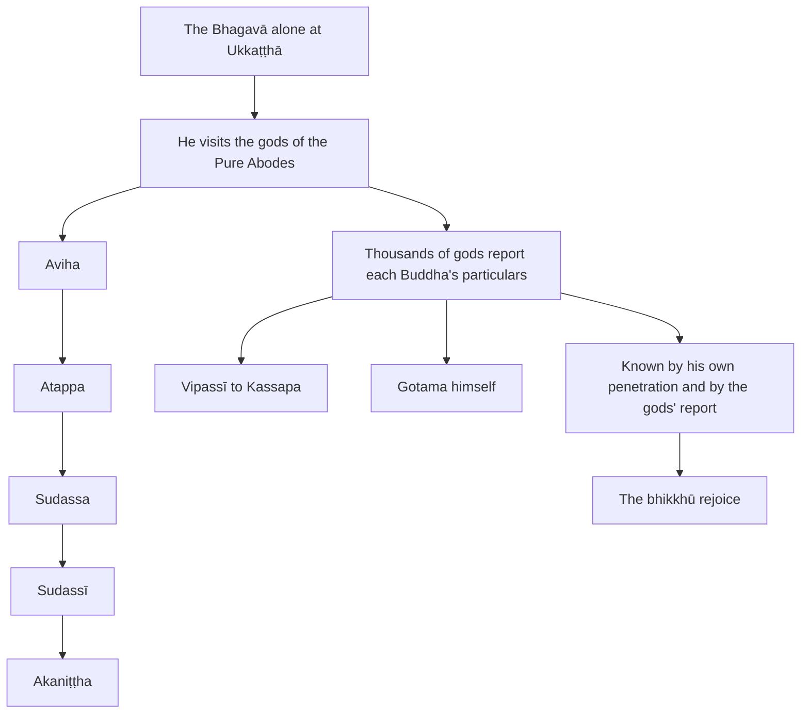

import { Tabs, TabItem } from '@astrojs/starlight/components';

Original text: [7D/1.17 Devatārocana 181–189](https://tipitaka2500.github.io/tipitaka/7D/1/1.17.html#181) in the [World Tipitaka Edition](https://tipitaka2500.github.io)

## Summary

The close of the Mahāpadānasutta (7D/1). The Bhagavā tells the bhikkhū how, alone at Ukkaṭṭhā, he visited the gods of the Pure Abodes, from the Aviha to the Akaniṭṭha, and how in each class thousands of gods who had lived the optimal life under Vipassī, Sikhī, Vessabhū, Kakusandha, Koṇāgamana, Kassapa and himself recited to him the particulars of part 1, with each Buddha's going forth, striving, awakening and first teaching. The Tathāgata knows the past Buddhas both by his own penetration and by the gods' report; the bhikkhū rejoice.

## Diagram

## Text

<Tabs syncKey="paliquote">
<TabItem label="My Translation">
(91.)

181\. At one time, Bhikkhave, I was dwelling at Ukkaṭṭhā, in the Subhaga Wood, at the foot of a royal Sāla tree. While I was there, Bhikkhave, alone in seclusion, this reflection arose in my mind: ‘Indeed, that abode of beings is not easy to find which I have not dwelt in before during this long time, apart from the gods of the Pure Abodes. What if I were to approach the gods of the Pure Abodes?’ Then, Bhikkhave, I — just as a strong man might extend his flexed arm or flex his extended arm; even so — having vanished at Ukkaṭṭhā, in the Subhaga Wood, at the foot of a royal Sāla tree, appeared among the Aviha gods. Bhikkhave, in that class of gods, many thousands of gods, many hundreds of thousands of gods approached me; having approached, they bowed to me and stood to one side. Standing to one side, Bhikkhave, those gods said this to me: ‘It was in the ninety-first `kappa` (aeon) from now, Mārisā (venerable sirs), that Vipassī the Bhagavā, a liberated one, a perfectly awakened one, arose in the world. Vipassī the Bhagavā, Mārisā, a liberated one, a perfectly awakened one, was a Khattiya by birth; he arose in a Khattiya family. Vipassī the Bhagavā, Mārisā, a liberated one, a perfectly awakened one, was Koṇḍañña by clan. The lifespan of Vipassī the Bhagavā, Mārisā, a liberated one, a perfectly awakened one, was eighty thousand years. Vipassī the Bhagavā, Mārisā, a liberated one, a perfectly awakened one, was fully awakened at the foot of a Pāṭalī tree. Vipassī the Bhagavā, Mārisā, a liberated one, a perfectly awakened one, had a pair of disciples named Khaṇḍa and Tissa, a chief, excellent pair. Vipassī the Bhagavā, Mārisā, a liberated one, a perfectly awakened one, had three assemblies of disciples. One assembly of disciples was of six million eight hundred thousand bhikkhū. One assembly of disciples was of one hundred thousand bhikkhū. One assembly of disciples was of eighty thousand bhikkhū. These three assemblies of disciples of Vipassī the Bhagavā, Mārisā, a liberated one, a perfectly awakened one, were entirely of those whose `āsava` (defilements) were destroyed. Vipassī the Bhagavā, Mārisā, a liberated one, a perfectly awakened one, had a bhikkhu attendant named Asoka, a chief attendant. The father of Vipassī the Bhagavā, Mārisā, a liberated one, a perfectly awakened one, was King Bandhumā. Queen Bandhumatī was his mother, his birth mother. The city named Bandhumatī was King Bandhumā's royal capital. The renunciation of Vipassī the Bhagavā, Mārisā, a liberated one, a perfectly awakened one, was thus, his going forth was thus, his striving was thus, his full awakening was thus, his setting in motion the Wheel of Dhamma was thus. We, Mārisā, having lived the `brahmacariya` (the optimal life) under Vipassī the Bhagavā, having become dispassionate towards sensual pleasures, have arisen here.’ … and so on …

182\. Bhikkhave, in that very class of gods, many thousands of gods, many hundreds of thousands of gods approached me; having approached, they bowed to me and stood to one side. Standing to one side, Bhikkhave, those gods said this to me: ‘Indeed, Mārisā, in this very fortunate aeon, the Bhagavā, a liberated one, a perfectly awakened one, has now arisen in the world. The Bhagavā, Mārisā, is a Khattiya by birth, arisen in a Khattiya family. The Bhagavā, Mārisā, is Gotama by clan. The Bhagavā’s lifespan, Mārisā, is short, limited, brief; [in this age] one who lives long lives for a hundred years or a little more. The Bhagavā, Mārisā, was fully awakened at the foot of an Assattha tree. The Bhagavā, Mārisā, had a pair of disciples named Sāriputta and Moggallāna, a chief, excellent pair. The Bhagavā, Mārisā, had one assembly of disciples of twelve hundred and fifty bhikkhū. The Bhagavā, Mārisā, this one assembly of disciples was entirely of those whose `āsavā` ("defilements") were destroyed. The Bhagavā, Mārisā, had a bhikkhu attendant named Ānanda, a chief attendant. The Bhagavā’s father, Mārisā, was King Suddhodana. Queen Māyā was his mother, his birth mother. The city named Kapilavatthu was the royal capital. The Bhagavā’s, Mārisā, renunciation was thus, his going forth was thus, his striving was thus, his full awakening was thus, his setting in motion the Wheel of Dhamma was thus. We, Mārisā, having lived the `brahmacariyaṃ` (the optimal life) under the Bhagavā, having become dispassionate towards sensual pleasures, have arisen here.

(92.)

183\. Then, Bhikkhave, together with the Aviha gods I approached the Atappa gods … and so on … then, Bhikkhave, together with the Aviha gods and the Atappa gods I approached the Sudassa gods. Then, Bhikkhave, together with the Aviha gods, the Atappa gods and the Sudassa gods I approached the Sudassī gods. Then, Bhikkhave, together with the Aviha gods, the Atappa gods, the Sudassa gods and the Sudassī gods I approached the Akaniṭṭha gods. Bhikkhave, in that class of gods, many thousands of gods, many hundreds of thousands of gods approached me, and having approached, they bowed to me and stood to one side.

184\. Standing to one side, Bhikkhave, those gods said this to me: ‘It was in the ninety-first aeon from now, Mārisā, that Vipassī the Bhagavā, a liberated one, a perfectly awakened one, arose in the world. Vipassī the Bhagavā, Mārisā, a liberated one, a perfectly awakened one, was a Khattiya by birth. He arose in a Khattiya family. Vipassī the Bhagavā, Mārisā, a liberated one, a perfectly awakened one, was Koṇḍañña by clan. The lifespan of Vipassī the Bhagavā, Mārisā, a liberated one, a perfectly awakened one, was eighty thousand years. Vipassī the Bhagavā, Mārisā, a liberated one, a perfectly awakened one, was fully awakened at the foot of a Pāṭalī tree. Vipassī the Bhagavā, Mārisā, a liberated one, a perfectly awakened one, had a pair of disciples named Khaṇḍa and Tissa, a chief, excellent pair. Vipassī the Bhagavā, Mārisā, a liberated one, a perfectly awakened one, had three assemblies of disciples. One assembly of disciples was of six million eight hundred thousand bhikkhū. One assembly of disciples was of one hundred thousand bhikkhū. One assembly of disciples was of eighty thousand bhikkhū. These three assemblies of disciples of Vipassī the Bhagavā, Mārisā, a liberated one, a perfectly awakened one, were entirely of those whose `āsava` were destroyed. Vipassī the Bhagavā, Mārisā, a liberated one, a perfectly awakened one, had a bhikkhu attendant named Asoka, a chief attendant. The father of Vipassī the Bhagavā, Mārisā, a liberated one, a perfectly awakened one, was King Bandhumā; Queen Bandhumatī was his mother, his birth mother. The city named Bandhumatī was King Bandhumā's royal capital. The renunciation of Vipassī the Bhagavā, Mārisā, a liberated one, a perfectly awakened one, was thus, his going forth was thus, his striving was thus, his full awakening was thus, his setting in motion the Wheel of Dhamma was thus. We, Mārisā, having lived the optimal life under Vipassī the Bhagavā, having become dispassionate towards sensual pleasures, have arisen here.’ Bhikkhave, in that very class of gods, many thousands of gods, many hundreds of thousands of gods approached me; having approached, they bowed to me and stood to one side. Standing to one side, Bhikkhave, those gods said this to me: ‘It was in the thirty-first aeon from now, Mārisā, that Sikhī the Bhagavā … and so on … We, Mārisā, under Sikhī the Bhagavā; indeed, in that very thirty-first aeon, Mārisā, Vessabhū the Bhagavā … and so on … We, Mārisā, under Vessabhū the Bhagavā … and so on … Indeed, Mārisā, in this very fortunate aeon, Kakusandha, Koṇāgamana, Kassapa the Bhagavā … and so on … We, Mārisā, having lived the optimal life under Kakusandha, Koṇāgamana, Kassapa the Bhagavā, having become dispassionate towards sensual pleasures, have arisen here.’

(93.)

185\. Bhikkhave, in that very class of gods, many thousands of gods, many hundreds of thousands of gods approached me; having approached, they bowed to me and stood to one side. Standing to one side, Bhikkhave, those gods said this to me: ‘Indeed, Mārisā, in this very fortunate aeon, the Bhagavā, a liberated one, a perfectly awakened one, has now arisen in the world. The Bhagavā, Mārisā, is a Khattiya by birth, arisen in a Khattiya family. The Bhagavā, Mārisā, is Gotama by clan. The Bhagavā’s lifespan, Mārisā, is short, limited, brief; [in this age] one who lives long lives for a hundred years or a little more. The Bhagavā, Mārisā, was fully awakened at the foot of an Assattha tree. The Bhagavā, Mārisā, had a pair of disciples named Sāriputta and Moggallāna, a chief, excellent pair. The Bhagavā, Mārisā, had one assembly of disciples of twelve hundred and fifty bhikkhū. The Bhagavā, Mārisā, this one assembly of disciples was entirely of those whose `āsavā` ("defilements") were destroyed. The Bhagavā, Mārisā, had a bhikkhu attendant named Ānanda, a chief attendant. The Bhagavā’s father, Mārisā, was King Suddhodana. Queen Māyā was his mother, his birth mother. The city named Kapilavatthu was the royal capital. The Bhagavā’s, Mārisā, renunciation was thus, his going forth was thus, his striving was thus, his full awakening was thus, his setting in motion the Wheel of Dhamma was thus. We, Mārisā, having lived the `brahmacariyaṃ` (the optimal life) under the Bhagavā, having become dispassionate towards sensual pleasures, have arisen here.

(94.)

186\. Thus, Bhikkhave, this `dhammadhātu` (nature of reality) has been thoroughly penetrated by the Tathāgata alone, through the thorough penetration of which `dhammadhātu` the Tathāgata recollects the Buddhas of the past who attained final extinguishment, who had cut off `papañca` (mental proliferation), cut off the road, exhausted the cycle of existence, transcended all suffering, also by birth, recollects them also by name, recollects them also by clan, recollects them also by lifespan, recollects them also by pair of disciples, recollects them also by assembly of disciples, ‘Those Bhagavants were of such birth,’ thus too. ‘Those Bhagavants were of such name, of such clan, of such virtue, of such nature, of such wisdom, of such dwelling, of such liberation,’ thus too.

187\. Gods too reported this matter to the Tathāgata, whereby the Tathāgata recollects the Buddhas of the past who attained final extinguishment, who had cut off `papañca`, cut off the road, exhausted the cycle of existence, transcended all suffering, also by birth, recollects them also by name, recollects them also by clan, recollects them also by lifespan, recollects them also by pair of disciples, recollects them also by assembly of disciples, ‘Those Bhagavants were of such birth,’ thus too. ‘Those Bhagavants were of such name, of such clan, of such virtue, of such nature, of such wisdom, of such dwelling, of such liberation,’ thus too.”

188\. This the Bhagavā said. Those bhikkhū, delighted, rejoiced in the Bhagavā’s words.

189\. The Great Discourse on the Life Stories, the first, is finished.
</TabItem>

<TabItem label="Pāḷi (Roman IAST)">
(91.)

181\. Ekamidāhaṃ, bhikkhave, samayaṃ ukkaṭṭhāyaṃ viharāmi subhagavane sālarājamūle. Tassa mayhaṃ, bhikkhave, rahogatassa paṭisallīnassa evaṃ cetaso parivitakko udapādi— ‘na kho so sattāvāso sulabharūpo, yo mayā anāvutthapubbo iminā dīghena addhunā aññatra suddhāvāsehi devehi. Yannūnāhaṃ yena suddhāvāsā devā tenupasaṅkameyyan’ti. Atha khvāhaṃ, bhikkhave, seyyathāpi nāma balavā puriso samiñjitaṃ vā bāhaṃ pasāreyya, pasāritaṃ vā bāhaṃ samiñjeyya; evameva— ukkaṭṭhāyaṃ subhagavane sālarājamūle antarahito avihesu devesu pāturahosiṃ. Tasmiṃ, bhikkhave, devanikāye anekāni devatāsahassāni anekāni devatāsatasahassāni yenāhaṃ tenupasaṅkamiṃsu; upasaṅkamitvā maṃ abhivādetvā ekamantaṃ aṭṭhaṃsu. Ekamantaṃ ṭhitā kho, bhikkhave, tā devatā maṃ etadavocuṃ— ‘ito so, mārisā, ekanavutikappe yaṃ vipassī bhagavā arahaṃ sammāsambuddho loke udapādi. Vipassī, mārisā, bhagavā arahaṃ sammāsambuddho khattiyo jātiyā ahosi, khattiyakule udapādi. Vipassī, mārisā, bhagavā arahaṃ sammāsambuddho koṇḍañño gottena ahosi. Vipassissa, mārisā, bhagavato arahato sammāsambuddhassa asītivassasahassāni āyuppamāṇaṃ ahosi. Vipassī, mārisā, bhagavā arahaṃ sammāsambuddho pāṭaliyā mūle abhisambuddho. Vipassissa, mārisā, bhagavato arahato sammāsambuddhassa khaṇḍatissaṃ nāma sāvakayugaṃ ahosi aggaṃ bhaddayugaṃ. Vipassissa, mārisā, bhagavato arahato sammāsambuddhassa tayo sāvakānaṃ sannipātā ahesuṃ. Eko sāvakānaṃ sannipāto ahosi aṭṭhasaṭṭhibhikkhusatasahassaṃ. Eko sāvakānaṃ sannipāto ahosi bhikkhusatasahassaṃ. Eko sāvakānaṃ sannipāto ahosi asītibhikkhusahassāni. Vipassissa, mārisā, bhagavato arahato sammāsambuddhassa ime tayo sāvakānaṃ sannipātā ahesuṃ sabbesaṃyeva khīṇāsavānaṃ. Vipassissa, mārisā, bhagavato arahato sammāsambuddhassa asoko nāma bhikkhu upaṭṭhāko ahosi aggupaṭṭhāko. Vipassissa, mārisā, bhagavato arahato sammāsambuddhassa bandhumā nāma rājā pitā ahosi. Bandhumatī nāma devī mātā ahosi janetti. Bandhumassa rañño bandhumatī nāma nagaraṃ rājadhānī ahosi. Vipassissa, mārisā, bhagavato arahato sammāsambuddhassa evaṃ abhinikkhamanaṃ ahosi evaṃ pabbajjā evaṃ padhānaṃ evaṃ abhisambodhi evaṃ dhammacakkappavattanaṃ. Te mayaṃ, mārisā, vipassimhi bhagavati brahmacariyaṃ caritvā kāmesu kāmacchandaṃ virājetvā idhūpapannā’ti …pe…

182\. Tasmiṃyeva kho, bhikkhave, devanikāye anekāni devatāsahassāni anekāni devatāsatasahassāni yenāhaṃ tenupasaṅkamiṃsu; upasaṅkamitvā maṃ abhivādetvā ekamantaṃ aṭṭhaṃsu. Ekamantaṃ ṭhitā kho, bhikkhave, tā devatā maṃ etadavocuṃ— ‘imasmiṃyeva kho, mārisā, bhaddakappe bhagavā etarahi arahaṃ sammāsambuddho loke uppanno. Bhagavā, mārisā, khattiyo jātiyā khattiyakule uppanno. Bhagavā, mārisā, gotamo gottena. Bhagavato, mārisā, appakaṃ āyuppamāṇaṃ parittaṃ lahukaṃ yo ciraṃ jīvati, so vassasataṃ appaṃ vā bhiyyo. Bhagavā, mārisā, assatthassa mūle abhisambuddho. Bhagavato, mārisā, sāriputtamoggallānaṃ nāma sāvakayugaṃ ahosi aggaṃ bhaddayugaṃ. Bhagavato, mārisā, eko sāvakānaṃ sannipāto ahosi aḍḍhateḷasāni bhikkhusatāni. Bhagavato, mārisā, ayaṃ eko sāvakānaṃ sannipāto ahosi sabbesaṃyeva khīṇāsavānaṃ. Bhagavato, mārisā, ānando nāma bhikkhu upaṭṭhāko ahosi aggupaṭṭhāko. Bhagavato, mārisā, suddhodano nāma rājā pitā ahosi. Māyā nāma devī mātā ahosi janetti. Kapilavatthu nāma nagaraṃ rājadhānī ahosi. Bhagavato, mārisā, evaṃ abhinikkhamanaṃ ahosi evaṃ pabbajjā evaṃ padhānaṃ evaṃ abhisambodhi evaṃ dhammacakkappavattanaṃ. Te mayaṃ, mārisā, bhagavati brahmacariyaṃ caritvā kāmesu kāmacchandaṃ virājetvā idhūpapannā’ti.

(92.)

183\. Atha khvāhaṃ, bhikkhave, avihehi devehi saddhiṃ yena atappā devā tenupasaṅkamiṃ…pe… atha khvāhaṃ, bhikkhave, avihehi ca devehi atappehi ca devehi saddhiṃ yena sudassā devā tenupasaṅkamiṃ. Atha khvāhaṃ, bhikkhave, avihehi ca devehi atappehi ca devehi sudassehi ca devehi saddhiṃ yena sudassī devā tenupasaṅkamiṃ. Atha khvāhaṃ, bhikkhave, avihehi ca devehi atappehi ca devehi sudassehi ca devehi sudassīhi ca devehi saddhiṃ yena akaniṭṭhā devā tenupasaṅkamiṃ. Tasmiṃ, bhikkhave, devanikāye anekāni devatāsahassāni anekāni devatāsatasahassāni yenāhaṃ tenupasaṅkamiṃsu, upasaṅkamitvā maṃ abhivādetvā ekamantaṃ aṭṭhaṃsu.

184\. Ekamantaṃ ṭhitā kho, bhikkhave, tā devatā maṃ etadavocuṃ— ‘ito so, mārisā, ekanavutikappe yaṃ vipassī bhagavā arahaṃ sammāsambuddho loke udapādi. Vipassī, mārisā, bhagavā arahaṃ sammāsambuddho khattiyo jātiyā ahosi. Khattiyakule udapādi. Vipassī, mārisā, bhagavā arahaṃ sammāsambuddho koṇḍañño gottena ahosi. Vipassissa, mārisā, bhagavato arahato sammāsambuddhassa asītivassasahassāni āyuppamāṇaṃ ahosi. Vipassī, mārisā, bhagavā arahaṃ sammāsambuddho pāṭaliyā mūle abhisambuddho. Vipassissa, mārisā, bhagavato arahato sammāsambuddhassa khaṇḍatissaṃ nāma sāvakayugaṃ ahosi aggaṃ bhaddayugaṃ. Vipassissa, mārisā, bhagavato arahato sammāsambuddhassa tayo sāvakānaṃ sannipātā ahesuṃ. Eko sāvakānaṃ sannipāto ahosi aṭṭhasaṭṭhibhikkhusatasahassaṃ. Eko sāvakānaṃ sannipāto ahosi bhikkhusatasahassaṃ. Eko sāvakānaṃ sannipāto ahosi asītibhikkhusahassāni. Vipassissa, mārisā, bhagavato arahato sammāsambuddhassa ime tayo sāvakānaṃ sannipātā ahesuṃ sabbesaṃyeva khīṇāsavānaṃ. Vipassissa, mārisā, bhagavato arahato sammāsambuddhassa asoko nāma bhikkhu upaṭṭhāko ahosi aggupaṭṭhāko. Vipassissa, mārisā, bhagavato arahato sammāsambuddhassa bandhumā nāma rājā pitā ahosi bandhumatī nāma devī mātā ahosi janetti. Bandhumassa rañño bandhumatī nāma nagaraṃ rājadhānī ahosi. Vipassissa, mārisā, bhagavato arahato sammāsambuddhassa evaṃ abhinikkhamanaṃ ahosi evaṃ pabbajjā evaṃ padhānaṃ evaṃ abhisambodhi, evaṃ dhammacakkappavattanaṃ. Te mayaṃ, mārisā, vipassimhi bhagavati brahmacariyaṃ caritvā kāmesu kāmacchandaṃ virājetvā idhūpapannā’ti. Tasmiṃyeva kho, bhikkhave, devanikāye anekāni devatāsahassāni anekāni devatāsatasahassāni yenāhaṃ tenupasaṅkamiṃsu; upasaṅkamitvā maṃ abhivādetvā ekamantaṃ aṭṭhaṃsu. Ekamantaṃ ṭhitā kho, bhikkhave, tā devatā maṃ etadavocuṃ— ‘ito so, mārisā, ekatiṃse kappe yaṃ sikhī bhagavā…pe… te mayaṃ, mārisā, sikhimhi bhagavati tasmiññeva kho, mārisā, ekatiṃse kappe yaṃ vessabhū bhagavā…pe… te mayaṃ, mārisā, vessabhumhi bhagavati…pe… imasmiṃyeva kho, mārisā, bhaddakappe kakusandho koṇāgamano kassapo bhagavā…pe… te mayaṃ, mārisā, kakusandhamhi koṇāgamanamhi kassapamhi bhagavati brahmacariyaṃ caritvā kāmesu kāmacchandaṃ virājetvā idhūpapannā’ti.

(93.)

185\. Tasmiṃyeva kho, bhikkhave, devanikāye anekāni devatāsahassāni anekāni devatāsatasahassāni yenāhaṃ tenupasaṅkamiṃsu; upasaṅkamitvā maṃ abhivādetvā ekamantaṃ aṭṭhaṃsu. Ekamantaṃ ṭhitā kho, bhikkhave, tā devatā maṃ etadavocuṃ— ‘imasmiṃyeva kho, mārisā, bhaddakappe bhagavā etarahi arahaṃ sammāsambuddho loke uppanno. Bhagavā, mārisā, khattiyo jātiyā, khattiyakule uppanno. Bhagavā, mārisā, gotamo gottena. Bhagavato, mārisā, appakaṃ āyuppamāṇaṃ parittaṃ lahukaṃ yo ciraṃ jīvati, so vassasataṃ appaṃ vā bhiyyo. Bhagavā, mārisā, assatthassa mūle abhisambuddho. Bhagavato, mārisā, sāriputtamoggallānaṃ nāma sāvakayugaṃ ahosi aggaṃ bhaddayugaṃ. Bhagavato, mārisā, eko sāvakānaṃ sannipāto ahosi aḍḍhateḷasāni bhikkhusatāni. Bhagavato, mārisā, ayaṃ eko sāvakānaṃ sannipāto ahosi sabbesaṃyeva khīṇāsavānaṃ. Bhagavato, mārisā, ānando nāma bhikkhu upaṭṭhāko aggupaṭṭhāko ahosi. Bhagavato, mārisā, suddhodano nāma rājā pitā ahosi. Māyā nāma devī mātā ahosi janetti. Kapilavatthu nāma nagaraṃ rājadhānī ahosi. Bhagavato, mārisā, evaṃ abhinikkhamanaṃ ahosi, evaṃ pabbajjā, evaṃ padhānaṃ, evaṃ abhisambodhi, evaṃ dhammacakkappavattanaṃ. Te mayaṃ, mārisā, bhagavati brahmacariyaṃ caritvā kāmesu kāmacchandaṃ virājetvā idhūpapannā’ti.

(94.)

186\. Iti kho, bhikkhave, tathāgatassevesā dhammadhātu suppaṭividdhā, yassā dhammadhātuyā suppaṭividdhattā tathāgato atīte buddhe parinibbute chinnapapañce chinnavaṭume pariyādinnavaṭṭe sabbadukkhavītivatte jātitopi anussarati, nāmatopi anussarati, gottatopi anussarati, āyuppamāṇatopi anussarati, sāvakayugatopi anussarati, sāvakasannipātatopi anussarati ‘evaṃjaccā te bhagavanto ahesuṃ’ itipi. ‘Evaṃnāmā evaṃgottā evaṃsīlā evaṃdhammā evaṃpaññā evaṃvihārī evaṃvimuttā te bhagavanto ahesuṃ’ itipīti.

187\. Devatāpi tathāgatassa etamatthaṃ ārocesuṃ, yena tathāgato atīte buddhe parinibbute chinnapapañce chinnavaṭume pariyādinnavaṭṭe sabbadukkhavītivatte jātitopi anussarati, nāmatopi anussarati, gottatopi anussarati, āyuppamāṇatopi anussarati, sāvakayugatopi anussarati, sāvakasannipātatopi anussarati ‘evaṃjaccā te bhagavanto ahesuṃ’ itipi. ‘Evaṃnāmā evaṃgottā evaṃsīlā evaṃdhammā evaṃpaññā evaṃvihārī evaṃvimuttā te bhagavanto ahesuṃ’ itipī”ti.

188\. Idamavoca bhagavā. Attamanā te bhikkhū bhagavato bhāsitaṃ abhinandunti.

189\. Mahāpadānasuttaṃ niṭṭhitaṃ paṭhamaṃ.
</TabItem>

<TabItem label="Pāḷi (Brahmi)">
(91.)

181\. 𑀏𑀓𑀫𑀺𑀤𑀸𑀳𑀁, 𑀪𑀺𑀓𑁆𑀔𑀯𑁂, 𑀲𑀫𑀬𑀁 𑀉𑀓𑁆𑀓𑀝𑁆𑀞𑀸𑀬𑀁 𑀯𑀺𑀳𑀭𑀸𑀫𑀺 𑀲𑀼𑀪𑀕𑀯𑀦𑁂 𑀲𑀸𑀮𑀭𑀸𑀚𑀫𑀽𑀮𑁂. 𑀢𑀲𑁆𑀲 𑀫𑀬𑁆𑀳𑀁, 𑀪𑀺𑀓𑁆𑀔𑀯𑁂, 𑀭𑀳𑁄𑀕𑀢𑀲𑁆𑀲 𑀧𑀝𑀺𑀲𑀮𑁆𑀮𑀻𑀦𑀲𑁆𑀲 𑀏𑀯𑀁 𑀘𑁂𑀢𑀲𑁄 𑀧𑀭𑀺𑀯𑀺𑀢𑀓𑁆𑀓𑁄 𑀉𑀤𑀧𑀸𑀤𑀺— ‘𑀦 𑀔𑁄 𑀲𑁄 𑀲𑀢𑁆𑀢𑀸𑀯𑀸𑀲𑁄 𑀲𑀼𑀮𑀪𑀭𑀽𑀧𑁄, 𑀬𑁄 𑀫𑀬𑀸 𑀅𑀦𑀸𑀯𑀼𑀢𑁆𑀣𑀧𑀼𑀩𑁆𑀩𑁄 𑀇𑀫𑀺𑀦𑀸 𑀤𑀻𑀖𑁂𑀦 𑀅𑀤𑁆𑀥𑀼𑀦𑀸 𑀅𑀜𑁆𑀜𑀢𑁆𑀭 𑀲𑀼𑀤𑁆𑀥𑀸𑀯𑀸𑀲𑁂𑀳𑀺 𑀤𑁂𑀯𑁂𑀳𑀺. 𑀬𑀦𑁆𑀦𑀽𑀦𑀸𑀳𑀁 𑀬𑁂𑀦 𑀲𑀼𑀤𑁆𑀥𑀸𑀯𑀸𑀲𑀸 𑀤𑁂𑀯𑀸 𑀢𑁂𑀦𑀼𑀧𑀲𑀗𑁆𑀓𑀫𑁂𑀬𑁆𑀬𑀦𑁆’𑀢𑀺. 𑀅𑀣 𑀔𑁆𑀯𑀸𑀳𑀁, 𑀪𑀺𑀓𑁆𑀔𑀯𑁂, 𑀲𑁂𑀬𑁆𑀬𑀣𑀸𑀧𑀺 𑀦𑀸𑀫 𑀩𑀮𑀯𑀸 𑀧𑀼𑀭𑀺𑀲𑁄 𑀲𑀫𑀺𑀜𑁆𑀚𑀺𑀢𑀁 𑀯𑀸 𑀩𑀸𑀳𑀁 𑀧𑀲𑀸𑀭𑁂𑀬𑁆𑀬, 𑀧𑀲𑀸𑀭𑀺𑀢𑀁 𑀯𑀸 𑀩𑀸𑀳𑀁 𑀲𑀫𑀺𑀜𑁆𑀚𑁂𑀬𑁆𑀬; 𑀏𑀯𑀫𑁂𑀯— 𑀉𑀓𑁆𑀓𑀝𑁆𑀞𑀸𑀬𑀁 𑀲𑀼𑀪𑀕𑀯𑀦𑁂 𑀲𑀸𑀮𑀭𑀸𑀚𑀫𑀽𑀮𑁂 𑀅𑀦𑁆𑀢𑀭𑀳𑀺𑀢𑁄 𑀅𑀯𑀺𑀳𑁂𑀲𑀼 𑀤𑁂𑀯𑁂𑀲𑀼 𑀧𑀸𑀢𑀼𑀭𑀳𑁄𑀲𑀺𑀁. 𑀢𑀲𑁆𑀫𑀺𑀁, 𑀪𑀺𑀓𑁆𑀔𑀯𑁂, 𑀤𑁂𑀯𑀦𑀺𑀓𑀸𑀬𑁂 𑀅𑀦𑁂𑀓𑀸𑀦𑀺 𑀤𑁂𑀯𑀢𑀸𑀲𑀳𑀲𑁆𑀲𑀸𑀦𑀺 𑀅𑀦𑁂𑀓𑀸𑀦𑀺 𑀤𑁂𑀯𑀢𑀸𑀲𑀢𑀲𑀳𑀲𑁆𑀲𑀸𑀦𑀺 𑀬𑁂𑀦𑀸𑀳𑀁 𑀢𑁂𑀦𑀼𑀧𑀲𑀗𑁆𑀓𑀫𑀺𑀁𑀲𑀼; 𑀉𑀧𑀲𑀗𑁆𑀓𑀫𑀺𑀢𑁆𑀯𑀸 𑀫𑀁 𑀅𑀪𑀺𑀯𑀸𑀤𑁂𑀢𑁆𑀯𑀸 𑀏𑀓𑀫𑀦𑁆𑀢𑀁 𑀅𑀝𑁆𑀞𑀁𑀲𑀼. 𑀏𑀓𑀫𑀦𑁆𑀢𑀁 𑀞𑀺𑀢𑀸 𑀔𑁄, 𑀪𑀺𑀓𑁆𑀔𑀯𑁂, 𑀢𑀸 𑀤𑁂𑀯𑀢𑀸 𑀫𑀁 𑀏𑀢𑀤𑀯𑁄𑀘𑀼𑀁— ‘𑀇𑀢𑁄 𑀲𑁄, 𑀫𑀸𑀭𑀺𑀲𑀸, 𑀏𑀓𑀦𑀯𑀼𑀢𑀺𑀓𑀧𑁆𑀧𑁂 𑀬𑀁 𑀯𑀺𑀧𑀲𑁆𑀲𑀻 𑀪𑀕𑀯𑀸 𑀅𑀭𑀳𑀁 𑀲𑀫𑁆𑀫𑀸𑀲𑀫𑁆𑀩𑀼𑀤𑁆𑀥𑁄 𑀮𑁄𑀓𑁂 𑀉𑀤𑀧𑀸𑀤𑀺. 𑀯𑀺𑀧𑀲𑁆𑀲𑀻, 𑀫𑀸𑀭𑀺𑀲𑀸, 𑀪𑀕𑀯𑀸 𑀅𑀭𑀳𑀁 𑀲𑀫𑁆𑀫𑀸𑀲𑀫𑁆𑀩𑀼𑀤𑁆𑀥𑁄 𑀔𑀢𑁆𑀢𑀺𑀬𑁄 𑀚𑀸𑀢𑀺𑀬𑀸 𑀅𑀳𑁄𑀲𑀺, 𑀔𑀢𑁆𑀢𑀺𑀬𑀓𑀼𑀮𑁂 𑀉𑀤𑀧𑀸𑀤𑀺. 𑀯𑀺𑀧𑀲𑁆𑀲𑀻, 𑀫𑀸𑀭𑀺𑀲𑀸, 𑀪𑀕𑀯𑀸 𑀅𑀭𑀳𑀁 𑀲𑀫𑁆𑀫𑀸𑀲𑀫𑁆𑀩𑀼𑀤𑁆𑀥𑁄 𑀓𑁄𑀡𑁆𑀟𑀜𑁆𑀜𑁄 𑀕𑁄𑀢𑁆𑀢𑁂𑀦 𑀅𑀳𑁄𑀲𑀺. 𑀯𑀺𑀧𑀲𑁆𑀲𑀺𑀲𑁆𑀲, 𑀫𑀸𑀭𑀺𑀲𑀸, 𑀪𑀕𑀯𑀢𑁄 𑀅𑀭𑀳𑀢𑁄 𑀲𑀫𑁆𑀫𑀸𑀲𑀫𑁆𑀩𑀼𑀤𑁆𑀥𑀲𑁆𑀲 𑀅𑀲𑀻𑀢𑀺𑀯𑀲𑁆𑀲𑀲𑀳𑀲𑁆𑀲𑀸𑀦𑀺 𑀆𑀬𑀼𑀧𑁆𑀧𑀫𑀸𑀡𑀁 𑀅𑀳𑁄𑀲𑀺. 𑀯𑀺𑀧𑀲𑁆𑀲𑀻, 𑀫𑀸𑀭𑀺𑀲𑀸, 𑀪𑀕𑀯𑀸 𑀅𑀭𑀳𑀁 𑀲𑀫𑁆𑀫𑀸𑀲𑀫𑁆𑀩𑀼𑀤𑁆𑀥𑁄 𑀧𑀸𑀝𑀮𑀺𑀬𑀸 𑀫𑀽𑀮𑁂 𑀅𑀪𑀺𑀲𑀫𑁆𑀩𑀼𑀤𑁆𑀥𑁄. 𑀯𑀺𑀧𑀲𑁆𑀲𑀺𑀲𑁆𑀲, 𑀫𑀸𑀭𑀺𑀲𑀸, 𑀪𑀕𑀯𑀢𑁄 𑀅𑀭𑀳𑀢𑁄 𑀲𑀫𑁆𑀫𑀸𑀲𑀫𑁆𑀩𑀼𑀤𑁆𑀥𑀲𑁆𑀲 𑀔𑀡𑁆𑀟𑀢𑀺𑀲𑁆𑀲𑀁 𑀦𑀸𑀫 𑀲𑀸𑀯𑀓𑀬𑀼𑀕𑀁 𑀅𑀳𑁄𑀲𑀺 𑀅𑀕𑁆𑀕𑀁 𑀪𑀤𑁆𑀤𑀬𑀼𑀕𑀁. 𑀯𑀺𑀧𑀲𑁆𑀲𑀺𑀲𑁆𑀲, 𑀫𑀸𑀭𑀺𑀲𑀸, 𑀪𑀕𑀯𑀢𑁄 𑀅𑀭𑀳𑀢𑁄 𑀲𑀫𑁆𑀫𑀸𑀲𑀫𑁆𑀩𑀼𑀤𑁆𑀥𑀲𑁆𑀲 𑀢𑀬𑁄 𑀲𑀸𑀯𑀓𑀸𑀦𑀁 𑀲𑀦𑁆𑀦𑀺𑀧𑀸𑀢𑀸 𑀅𑀳𑁂𑀲𑀼𑀁. 𑀏𑀓𑁄 𑀲𑀸𑀯𑀓𑀸𑀦𑀁 𑀲𑀦𑁆𑀦𑀺𑀧𑀸𑀢𑁄 𑀅𑀳𑁄𑀲𑀺 𑀅𑀝𑁆𑀞𑀲𑀝𑁆𑀞𑀺𑀪𑀺𑀓𑁆𑀔𑀼𑀲𑀢𑀲𑀳𑀲𑁆𑀲𑀁. 𑀏𑀓𑁄 𑀲𑀸𑀯𑀓𑀸𑀦𑀁 𑀲𑀦𑁆𑀦𑀺𑀧𑀸𑀢𑁄 𑀅𑀳𑁄𑀲𑀺 𑀪𑀺𑀓𑁆𑀔𑀼𑀲𑀢𑀲𑀳𑀲𑁆𑀲𑀁. 𑀏𑀓𑁄 𑀲𑀸𑀯𑀓𑀸𑀦𑀁 𑀲𑀦𑁆𑀦𑀺𑀧𑀸𑀢𑁄 𑀅𑀳𑁄𑀲𑀺 𑀅𑀲𑀻𑀢𑀺𑀪𑀺𑀓𑁆𑀔𑀼𑀲𑀳𑀲𑁆𑀲𑀸𑀦𑀺. 𑀯𑀺𑀧𑀲𑁆𑀲𑀺𑀲𑁆𑀲, 𑀫𑀸𑀭𑀺𑀲𑀸, 𑀪𑀕𑀯𑀢𑁄 𑀅𑀭𑀳𑀢𑁄 𑀲𑀫𑁆𑀫𑀸𑀲𑀫𑁆𑀩𑀼𑀤𑁆𑀥𑀲𑁆𑀲 𑀇𑀫𑁂 𑀢𑀬𑁄 𑀲𑀸𑀯𑀓𑀸𑀦𑀁 𑀲𑀦𑁆𑀦𑀺𑀧𑀸𑀢𑀸 𑀅𑀳𑁂𑀲𑀼𑀁 𑀲𑀩𑁆𑀩𑁂𑀲𑀁𑀬𑁂𑀯 𑀔𑀻𑀡𑀸𑀲𑀯𑀸𑀦𑀁. 𑀯𑀺𑀧𑀲𑁆𑀲𑀺𑀲𑁆𑀲, 𑀫𑀸𑀭𑀺𑀲𑀸, 𑀪𑀕𑀯𑀢𑁄 𑀅𑀭𑀳𑀢𑁄 𑀲𑀫𑁆𑀫𑀸𑀲𑀫𑁆𑀩𑀼𑀤𑁆𑀥𑀲𑁆𑀲 𑀅𑀲𑁄𑀓𑁄 𑀦𑀸𑀫 𑀪𑀺𑀓𑁆𑀔𑀼 𑀉𑀧𑀝𑁆𑀞𑀸𑀓𑁄 𑀅𑀳𑁄𑀲𑀺 𑀅𑀕𑁆𑀕𑀼𑀧𑀝𑁆𑀞𑀸𑀓𑁄. 𑀯𑀺𑀧𑀲𑁆𑀲𑀺𑀲𑁆𑀲, 𑀫𑀸𑀭𑀺𑀲𑀸, 𑀪𑀕𑀯𑀢𑁄 𑀅𑀭𑀳𑀢𑁄 𑀲𑀫𑁆𑀫𑀸𑀲𑀫𑁆𑀩𑀼𑀤𑁆𑀥𑀲𑁆𑀲 𑀩𑀦𑁆𑀥𑀼𑀫𑀸 𑀦𑀸𑀫 𑀭𑀸𑀚𑀸 𑀧𑀺𑀢𑀸 𑀅𑀳𑁄𑀲𑀺. 𑀩𑀦𑁆𑀥𑀼𑀫𑀢𑀻 𑀦𑀸𑀫 𑀤𑁂𑀯𑀻 𑀫𑀸𑀢𑀸 𑀅𑀳𑁄𑀲𑀺 𑀚𑀦𑁂𑀢𑁆𑀢𑀺. 𑀩𑀦𑁆𑀥𑀼𑀫𑀲𑁆𑀲 𑀭𑀜𑁆𑀜𑁄 𑀩𑀦𑁆𑀥𑀼𑀫𑀢𑀻 𑀦𑀸𑀫 𑀦𑀕𑀭𑀁 𑀭𑀸𑀚𑀥𑀸𑀦𑀻 𑀅𑀳𑁄𑀲𑀺. 𑀯𑀺𑀧𑀲𑁆𑀲𑀺𑀲𑁆𑀲, 𑀫𑀸𑀭𑀺𑀲𑀸, 𑀪𑀕𑀯𑀢𑁄 𑀅𑀭𑀳𑀢𑁄 𑀲𑀫𑁆𑀫𑀸𑀲𑀫𑁆𑀩𑀼𑀤𑁆𑀥𑀲𑁆𑀲 𑀏𑀯𑀁 𑀅𑀪𑀺𑀦𑀺𑀓𑁆𑀔𑀫𑀦𑀁 𑀅𑀳𑁄𑀲𑀺 𑀏𑀯𑀁 𑀧𑀩𑁆𑀩𑀚𑁆𑀚𑀸 𑀏𑀯𑀁 𑀧𑀥𑀸𑀦𑀁 𑀏𑀯𑀁 𑀅𑀪𑀺𑀲𑀫𑁆𑀩𑁄𑀥𑀺 𑀏𑀯𑀁 𑀥𑀫𑁆𑀫𑀘𑀓𑁆𑀓𑀧𑁆𑀧𑀯𑀢𑁆𑀢𑀦𑀁. 𑀢𑁂 𑀫𑀬𑀁, 𑀫𑀸𑀭𑀺𑀲𑀸, 𑀯𑀺𑀧𑀲𑁆𑀲𑀺𑀫𑁆𑀳𑀺 𑀪𑀕𑀯𑀢𑀺 𑀩𑁆𑀭𑀳𑁆𑀫𑀘𑀭𑀺𑀬𑀁 𑀘𑀭𑀺𑀢𑁆𑀯𑀸 𑀓𑀸𑀫𑁂𑀲𑀼 𑀓𑀸𑀫𑀘𑁆𑀙𑀦𑁆𑀤𑀁 𑀯𑀺𑀭𑀸𑀚𑁂𑀢𑁆𑀯𑀸 𑀇𑀥𑀽𑀧𑀧𑀦𑁆𑀦𑀸’𑀢𑀺 …𑀧𑁂…

182\. 𑀢𑀲𑁆𑀫𑀺𑀁𑀬𑁂𑀯 𑀔𑁄, 𑀪𑀺𑀓𑁆𑀔𑀯𑁂, 𑀤𑁂𑀯𑀦𑀺𑀓𑀸𑀬𑁂 𑀅𑀦𑁂𑀓𑀸𑀦𑀺 𑀤𑁂𑀯𑀢𑀸𑀲𑀳𑀲𑁆𑀲𑀸𑀦𑀺 𑀅𑀦𑁂𑀓𑀸𑀦𑀺 𑀤𑁂𑀯𑀢𑀸𑀲𑀢𑀲𑀳𑀲𑁆𑀲𑀸𑀦𑀺 𑀬𑁂𑀦𑀸𑀳𑀁 𑀢𑁂𑀦𑀼𑀧𑀲𑀗𑁆𑀓𑀫𑀺𑀁𑀲𑀼; 𑀉𑀧𑀲𑀗𑁆𑀓𑀫𑀺𑀢𑁆𑀯𑀸 𑀫𑀁 𑀅𑀪𑀺𑀯𑀸𑀤𑁂𑀢𑁆𑀯𑀸 𑀏𑀓𑀫𑀦𑁆𑀢𑀁 𑀅𑀝𑁆𑀞𑀁𑀲𑀼. 𑀏𑀓𑀫𑀦𑁆𑀢𑀁 𑀞𑀺𑀢𑀸 𑀔𑁄, 𑀪𑀺𑀓𑁆𑀔𑀯𑁂, 𑀢𑀸 𑀤𑁂𑀯𑀢𑀸 𑀫𑀁 𑀏𑀢𑀤𑀯𑁄𑀘𑀼𑀁— ‘𑀇𑀫𑀲𑁆𑀫𑀺𑀁𑀬𑁂𑀯 𑀔𑁄, 𑀫𑀸𑀭𑀺𑀲𑀸, 𑀪𑀤𑁆𑀤𑀓𑀧𑁆𑀧𑁂 𑀪𑀕𑀯𑀸 𑀏𑀢𑀭𑀳𑀺 𑀅𑀭𑀳𑀁 𑀲𑀫𑁆𑀫𑀸𑀲𑀫𑁆𑀩𑀼𑀤𑁆𑀥𑁄 𑀮𑁄𑀓𑁂 𑀉𑀧𑁆𑀧𑀦𑁆𑀦𑁄. 𑀪𑀕𑀯𑀸, 𑀫𑀸𑀭𑀺𑀲𑀸, 𑀔𑀢𑁆𑀢𑀺𑀬𑁄 𑀚𑀸𑀢𑀺𑀬𑀸 𑀔𑀢𑁆𑀢𑀺𑀬𑀓𑀼𑀮𑁂 𑀉𑀧𑁆𑀧𑀦𑁆𑀦𑁄. 𑀪𑀕𑀯𑀸, 𑀫𑀸𑀭𑀺𑀲𑀸, 𑀕𑁄𑀢𑀫𑁄 𑀕𑁄𑀢𑁆𑀢𑁂𑀦. 𑀪𑀕𑀯𑀢𑁄, 𑀫𑀸𑀭𑀺𑀲𑀸, 𑀅𑀧𑁆𑀧𑀓𑀁 𑀆𑀬𑀼𑀧𑁆𑀧𑀫𑀸𑀡𑀁 𑀧𑀭𑀺𑀢𑁆𑀢𑀁 𑀮𑀳𑀼𑀓𑀁 𑀬𑁄 𑀘𑀺𑀭𑀁 𑀚𑀻𑀯𑀢𑀺, 𑀲𑁄 𑀯𑀲𑁆𑀲𑀲𑀢𑀁 𑀅𑀧𑁆𑀧𑀁 𑀯𑀸 𑀪𑀺𑀬𑁆𑀬𑁄. 𑀪𑀕𑀯𑀸, 𑀫𑀸𑀭𑀺𑀲𑀸, 𑀅𑀲𑁆𑀲𑀢𑁆𑀣𑀲𑁆𑀲 𑀫𑀽𑀮𑁂 𑀅𑀪𑀺𑀲𑀫𑁆𑀩𑀼𑀤𑁆𑀥𑁄. 𑀪𑀕𑀯𑀢𑁄, 𑀫𑀸𑀭𑀺𑀲𑀸, 𑀲𑀸𑀭𑀺𑀧𑀼𑀢𑁆𑀢𑀫𑁄𑀕𑁆𑀕𑀮𑁆𑀮𑀸𑀦𑀁 𑀦𑀸𑀫 𑀲𑀸𑀯𑀓𑀬𑀼𑀕𑀁 𑀅𑀳𑁄𑀲𑀺 𑀅𑀕𑁆𑀕𑀁 𑀪𑀤𑁆𑀤𑀬𑀼𑀕𑀁. 𑀪𑀕𑀯𑀢𑁄, 𑀫𑀸𑀭𑀺𑀲𑀸, 𑀏𑀓𑁄 𑀲𑀸𑀯𑀓𑀸𑀦𑀁 𑀲𑀦𑁆𑀦𑀺𑀧𑀸𑀢𑁄 𑀅𑀳𑁄𑀲𑀺 𑀅𑀟𑁆𑀠𑀢𑁂𑀍𑀅𑀲𑀸𑀦𑀺 𑀪𑀺𑀓𑁆𑀔𑀼𑀲𑀢𑀸𑀦𑀺. 𑀪𑀕𑀯𑀢𑁄, 𑀫𑀸𑀭𑀺𑀲𑀸, 𑀅𑀬𑀁 𑀏𑀓𑁄 𑀲𑀸𑀯𑀓𑀸𑀦𑀁 𑀲𑀦𑁆𑀦𑀺𑀧𑀸𑀢𑁄 𑀅𑀳𑁄𑀲𑀺 𑀲𑀩𑁆𑀩𑁂𑀲𑀁𑀬𑁂𑀯 𑀔𑀻𑀡𑀸𑀲𑀯𑀸𑀦𑀁. 𑀪𑀕𑀯𑀢𑁄, 𑀫𑀸𑀭𑀺𑀲𑀸, 𑀆𑀦𑀦𑁆𑀤𑁄 𑀦𑀸𑀫 𑀪𑀺𑀓𑁆𑀔𑀼 𑀉𑀧𑀝𑁆𑀞𑀸𑀓𑁄 𑀅𑀳𑁄𑀲𑀺 𑀅𑀕𑁆𑀕𑀼𑀧𑀝𑁆𑀞𑀸𑀓𑁄. 𑀪𑀕𑀯𑀢𑁄, 𑀫𑀸𑀭𑀺𑀲𑀸, 𑀲𑀼𑀤𑁆𑀥𑁄𑀤𑀦𑁄 𑀦𑀸𑀫 𑀭𑀸𑀚𑀸 𑀧𑀺𑀢𑀸 𑀅𑀳𑁄𑀲𑀺. 𑀫𑀸𑀬𑀸 𑀦𑀸𑀫 𑀤𑁂𑀯𑀻 𑀫𑀸𑀢𑀸 𑀅𑀳𑁄𑀲𑀺 𑀚𑀦𑁂𑀢𑁆𑀢𑀺. 𑀓𑀧𑀺𑀮𑀯𑀢𑁆𑀣𑀼 𑀦𑀸𑀫 𑀦𑀕𑀭𑀁 𑀭𑀸𑀚𑀥𑀸𑀦𑀻 𑀅𑀳𑁄𑀲𑀺. 𑀪𑀕𑀯𑀢𑁄, 𑀫𑀸𑀭𑀺𑀲𑀸, 𑀏𑀯𑀁 𑀅𑀪𑀺𑀦𑀺𑀓𑁆𑀔𑀫𑀦𑀁 𑀅𑀳𑁄𑀲𑀺 𑀏𑀯𑀁 𑀧𑀩𑁆𑀩𑀚𑁆𑀚𑀸 𑀏𑀯𑀁 𑀧𑀥𑀸𑀦𑀁 𑀏𑀯𑀁 𑀅𑀪𑀺𑀲𑀫𑁆𑀩𑁄𑀥𑀺 𑀏𑀯𑀁 𑀥𑀫𑁆𑀫𑀘𑀓𑁆𑀓𑀧𑁆𑀧𑀯𑀢𑁆𑀢𑀦𑀁. 𑀢𑁂 𑀫𑀬𑀁, 𑀫𑀸𑀭𑀺𑀲𑀸, 𑀪𑀕𑀯𑀢𑀺 𑀩𑁆𑀭𑀳𑁆𑀫𑀘𑀭𑀺𑀬𑀁 𑀘𑀭𑀺𑀢𑁆𑀯𑀸 𑀓𑀸𑀫𑁂𑀲𑀼 𑀓𑀸𑀫𑀘𑁆𑀙𑀦𑁆𑀤𑀁 𑀯𑀺𑀭𑀸𑀚𑁂𑀢𑁆𑀯𑀸 𑀇𑀥𑀽𑀧𑀧𑀦𑁆𑀦𑀸’𑀢𑀺.

(92.)

183\. 𑀅𑀣 𑀔𑁆𑀯𑀸𑀳𑀁, 𑀪𑀺𑀓𑁆𑀔𑀯𑁂, 𑀅𑀯𑀺𑀳𑁂𑀳𑀺 𑀤𑁂𑀯𑁂𑀳𑀺 𑀲𑀤𑁆𑀥𑀺𑀁 𑀬𑁂𑀦 𑀅𑀢𑀧𑁆𑀧𑀸 𑀤𑁂𑀯𑀸 𑀢𑁂𑀦𑀼𑀧𑀲𑀗𑁆𑀓𑀫𑀺𑀁…𑀧𑁂… 𑀅𑀣 𑀔𑁆𑀯𑀸𑀳𑀁, 𑀪𑀺𑀓𑁆𑀔𑀯𑁂, 𑀅𑀯𑀺𑀳𑁂𑀳𑀺 𑀘 𑀤𑁂𑀯𑁂𑀳𑀺 𑀅𑀢𑀧𑁆𑀧𑁂𑀳𑀺 𑀘 𑀤𑁂𑀯𑁂𑀳𑀺 𑀲𑀤𑁆𑀥𑀺𑀁 𑀬𑁂𑀦 𑀲𑀼𑀤𑀲𑁆𑀲𑀸 𑀤𑁂𑀯𑀸 𑀢𑁂𑀦𑀼𑀧𑀲𑀗𑁆𑀓𑀫𑀺𑀁. 𑀅𑀣 𑀔𑁆𑀯𑀸𑀳𑀁, 𑀪𑀺𑀓𑁆𑀔𑀯𑁂, 𑀅𑀯𑀺𑀳𑁂𑀳𑀺 𑀘 𑀤𑁂𑀯𑁂𑀳𑀺 𑀅𑀢𑀧𑁆𑀧𑁂𑀳𑀺 𑀘 𑀤𑁂𑀯𑁂𑀳𑀺 𑀲𑀼𑀤𑀲𑁆𑀲𑁂𑀳𑀺 𑀘 𑀤𑁂𑀯𑁂𑀳𑀺 𑀲𑀤𑁆𑀥𑀺𑀁 𑀬𑁂𑀦 𑀲𑀼𑀤𑀲𑁆𑀲𑀻 𑀤𑁂𑀯𑀸 𑀢𑁂𑀦𑀼𑀧𑀲𑀗𑁆𑀓𑀫𑀺𑀁. 𑀅𑀣 𑀔𑁆𑀯𑀸𑀳𑀁, 𑀪𑀺𑀓𑁆𑀔𑀯𑁂, 𑀅𑀯𑀺𑀳𑁂𑀳𑀺 𑀘 𑀤𑁂𑀯𑁂𑀳𑀺 𑀅𑀢𑀧𑁆𑀧𑁂𑀳𑀺 𑀘 𑀤𑁂𑀯𑁂𑀳𑀺 𑀲𑀼𑀤𑀲𑁆𑀲𑁂𑀳𑀺 𑀘 𑀤𑁂𑀯𑁂𑀳𑀺 𑀲𑀼𑀤𑀲𑁆𑀲𑀻𑀳𑀺 𑀘 𑀤𑁂𑀯𑁂𑀳𑀺 𑀲𑀤𑁆𑀥𑀺𑀁 𑀬𑁂𑀦 𑀅𑀓𑀦𑀺𑀝𑁆𑀞𑀸 𑀤𑁂𑀯𑀸 𑀢𑁂𑀦𑀼𑀧𑀲𑀗𑁆𑀓𑀫𑀺𑀁. 𑀢𑀲𑁆𑀫𑀺𑀁, 𑀪𑀺𑀓𑁆𑀔𑀯𑁂, 𑀤𑁂𑀯𑀦𑀺𑀓𑀸𑀬𑁂 𑀅𑀦𑁂𑀓𑀸𑀦𑀺 𑀤𑁂𑀯𑀢𑀸𑀲𑀳𑀲𑁆𑀲𑀸𑀦𑀺 𑀅𑀦𑁂𑀓𑀸𑀦𑀺 𑀤𑁂𑀯𑀢𑀸𑀲𑀢𑀲𑀳𑀲𑁆𑀲𑀸𑀦𑀺 𑀬𑁂𑀦𑀸𑀳𑀁 𑀢𑁂𑀦𑀼𑀧𑀲𑀗𑁆𑀓𑀫𑀺𑀁𑀲𑀼, 𑀉𑀧𑀲𑀗𑁆𑀓𑀫𑀺𑀢𑁆𑀯𑀸 𑀫𑀁 𑀅𑀪𑀺𑀯𑀸𑀤𑁂𑀢𑁆𑀯𑀸 𑀏𑀓𑀫𑀦𑁆𑀢𑀁 𑀅𑀝𑁆𑀞𑀁𑀲𑀼.

184\. 𑀏𑀓𑀫𑀦𑁆𑀢𑀁 𑀞𑀺𑀢𑀸 𑀔𑁄, 𑀪𑀺𑀓𑁆𑀔𑀯𑁂, 𑀢𑀸 𑀤𑁂𑀯𑀢𑀸 𑀫𑀁 𑀏𑀢𑀤𑀯𑁄𑀘𑀼𑀁— ‘𑀇𑀢𑁄 𑀲𑁄, 𑀫𑀸𑀭𑀺𑀲𑀸, 𑀏𑀓𑀦𑀯𑀼𑀢𑀺𑀓𑀧𑁆𑀧𑁂 𑀬𑀁 𑀯𑀺𑀧𑀲𑁆𑀲𑀻 𑀪𑀕𑀯𑀸 𑀅𑀭𑀳𑀁 𑀲𑀫𑁆𑀫𑀸𑀲𑀫𑁆𑀩𑀼𑀤𑁆𑀥𑁄 𑀮𑁄𑀓𑁂 𑀉𑀤𑀧𑀸𑀤𑀺. 𑀯𑀺𑀧𑀲𑁆𑀲𑀻, 𑀫𑀸𑀭𑀺𑀲𑀸, 𑀪𑀕𑀯𑀸 𑀅𑀭𑀳𑀁 𑀲𑀫𑁆𑀫𑀸𑀲𑀫𑁆𑀩𑀼𑀤𑁆𑀥𑁄 𑀔𑀢𑁆𑀢𑀺𑀬𑁄 𑀚𑀸𑀢𑀺𑀬𑀸 𑀅𑀳𑁄𑀲𑀺. 𑀔𑀢𑁆𑀢𑀺𑀬𑀓𑀼𑀮𑁂 𑀉𑀤𑀧𑀸𑀤𑀺. 𑀯𑀺𑀧𑀲𑁆𑀲𑀻, 𑀫𑀸𑀭𑀺𑀲𑀸, 𑀪𑀕𑀯𑀸 𑀅𑀭𑀳𑀁 𑀲𑀫𑁆𑀫𑀸𑀲𑀫𑁆𑀩𑀼𑀤𑁆𑀥𑁄 𑀓𑁄𑀡𑁆𑀟𑀜𑁆𑀜𑁄 𑀕𑁄𑀢𑁆𑀢𑁂𑀦 𑀅𑀳𑁄𑀲𑀺. 𑀯𑀺𑀧𑀲𑁆𑀲𑀺𑀲𑁆𑀲, 𑀫𑀸𑀭𑀺𑀲𑀸, 𑀪𑀕𑀯𑀢𑁄 𑀅𑀭𑀳𑀢𑁄 𑀲𑀫𑁆𑀫𑀸𑀲𑀫𑁆𑀩𑀼𑀤𑁆𑀥𑀲𑁆𑀲 𑀅𑀲𑀻𑀢𑀺𑀯𑀲𑁆𑀲𑀲𑀳𑀲𑁆𑀲𑀸𑀦𑀺 𑀆𑀬𑀼𑀧𑁆𑀧𑀫𑀸𑀡𑀁 𑀅𑀳𑁄𑀲𑀺. 𑀯𑀺𑀧𑀲𑁆𑀲𑀻, 𑀫𑀸𑀭𑀺𑀲𑀸, 𑀪𑀕𑀯𑀸 𑀅𑀭𑀳𑀁 𑀲𑀫𑁆𑀫𑀸𑀲𑀫𑁆𑀩𑀼𑀤𑁆𑀥𑁄 𑀧𑀸𑀝𑀮𑀺𑀬𑀸 𑀫𑀽𑀮𑁂 𑀅𑀪𑀺𑀲𑀫𑁆𑀩𑀼𑀤𑁆𑀥𑁄. 𑀯𑀺𑀧𑀲𑁆𑀲𑀺𑀲𑁆𑀲, 𑀫𑀸𑀭𑀺𑀲𑀸, 𑀪𑀕𑀯𑀢𑁄 𑀅𑀭𑀳𑀢𑁄 𑀲𑀫𑁆𑀫𑀸𑀲𑀫𑁆𑀩𑀼𑀤𑁆𑀥𑀲𑁆𑀲 𑀔𑀡𑁆𑀟𑀢𑀺𑀲𑁆𑀲𑀁 𑀦𑀸𑀫 𑀲𑀸𑀯𑀓𑀬𑀼𑀕𑀁 𑀅𑀳𑁄𑀲𑀺 𑀅𑀕𑁆𑀕𑀁 𑀪𑀤𑁆𑀤𑀬𑀼𑀕𑀁. 𑀯𑀺𑀧𑀲𑁆𑀲𑀺𑀲𑁆𑀲, 𑀫𑀸𑀭𑀺𑀲𑀸, 𑀪𑀕𑀯𑀢𑁄 𑀅𑀭𑀳𑀢𑁄 𑀲𑀫𑁆𑀫𑀸𑀲𑀫𑁆𑀩𑀼𑀤𑁆𑀥𑀲𑁆𑀲 𑀢𑀬𑁄 𑀲𑀸𑀯𑀓𑀸𑀦𑀁 𑀲𑀦𑁆𑀦𑀺𑀧𑀸𑀢𑀸 𑀅𑀳𑁂𑀲𑀼𑀁. 𑀏𑀓𑁄 𑀲𑀸𑀯𑀓𑀸𑀦𑀁 𑀲𑀦𑁆𑀦𑀺𑀧𑀸𑀢𑁄 𑀅𑀳𑁄𑀲𑀺 𑀅𑀝𑁆𑀞𑀲𑀝𑁆𑀞𑀺𑀪𑀺𑀓𑁆𑀔𑀼𑀲𑀢𑀲𑀳𑀲𑁆𑀲𑀁. 𑀏𑀓𑁄 𑀲𑀸𑀯𑀓𑀸𑀦𑀁 𑀲𑀦𑁆𑀦𑀺𑀧𑀸𑀢𑁄 𑀅𑀳𑁄𑀲𑀺 𑀪𑀺𑀓𑁆𑀔𑀼𑀲𑀢𑀲𑀳𑀲𑁆𑀲𑀁. 𑀏𑀓𑁄 𑀲𑀸𑀯𑀓𑀸𑀦𑀁 𑀲𑀦𑁆𑀦𑀺𑀧𑀸𑀢𑁄 𑀅𑀳𑁄𑀲𑀺 𑀅𑀲𑀻𑀢𑀺𑀪𑀺𑀓𑁆𑀔𑀼𑀲𑀳𑀲𑁆𑀲𑀸𑀦𑀺. 𑀯𑀺𑀧𑀲𑁆𑀲𑀺𑀲𑁆𑀲, 𑀫𑀸𑀭𑀺𑀲𑀸, 𑀪𑀕𑀯𑀢𑁄 𑀅𑀭𑀳𑀢𑁄 𑀲𑀫𑁆𑀫𑀸𑀲𑀫𑁆𑀩𑀼𑀤𑁆𑀥𑀲𑁆𑀲 𑀇𑀫𑁂 𑀢𑀬𑁄 𑀲𑀸𑀯𑀓𑀸𑀦𑀁 𑀲𑀦𑁆𑀦𑀺𑀧𑀸𑀢𑀸 𑀅𑀳𑁂𑀲𑀼𑀁 𑀲𑀩𑁆𑀩𑁂𑀲𑀁𑀬𑁂𑀯 𑀔𑀻𑀡𑀸𑀲𑀯𑀸𑀦𑀁. 𑀯𑀺𑀧𑀲𑁆𑀲𑀺𑀲𑁆𑀲, 𑀫𑀸𑀭𑀺𑀲𑀸, 𑀪𑀕𑀯𑀢𑁄 𑀅𑀭𑀳𑀢𑁄 𑀲𑀫𑁆𑀫𑀸𑀲𑀫𑁆𑀩𑀼𑀤𑁆𑀥𑀲𑁆𑀲 𑀅𑀲𑁄𑀓𑁄 𑀦𑀸𑀫 𑀪𑀺𑀓𑁆𑀔𑀼 𑀉𑀧𑀝𑁆𑀞𑀸𑀓𑁄 𑀅𑀳𑁄𑀲𑀺 𑀅𑀕𑁆𑀕𑀼𑀧𑀝𑁆𑀞𑀸𑀓𑁄. 𑀯𑀺𑀧𑀲𑁆𑀲𑀺𑀲𑁆𑀲, 𑀫𑀸𑀭𑀺𑀲𑀸, 𑀪𑀕𑀯𑀢𑁄 𑀅𑀭𑀳𑀢𑁄 𑀲𑀫𑁆𑀫𑀸𑀲𑀫𑁆𑀩𑀼𑀤𑁆𑀥𑀲𑁆𑀲 𑀩𑀦𑁆𑀥𑀼𑀫𑀸 𑀦𑀸𑀫 𑀭𑀸𑀚𑀸 𑀧𑀺𑀢𑀸 𑀅𑀳𑁄𑀲𑀺 𑀩𑀦𑁆𑀥𑀼𑀫𑀢𑀻 𑀦𑀸𑀫 𑀤𑁂𑀯𑀻 𑀫𑀸𑀢𑀸 𑀅𑀳𑁄𑀲𑀺 𑀚𑀦𑁂𑀢𑁆𑀢𑀺. 𑀩𑀦𑁆𑀥𑀼𑀫𑀲𑁆𑀲 𑀭𑀜𑁆𑀜𑁄 𑀩𑀦𑁆𑀥𑀼𑀫𑀢𑀻 𑀦𑀸𑀫 𑀦𑀕𑀭𑀁 𑀭𑀸𑀚𑀥𑀸𑀦𑀻 𑀅𑀳𑁄𑀲𑀺. 𑀯𑀺𑀧𑀲𑁆𑀲𑀺𑀲𑁆𑀲, 𑀫𑀸𑀭𑀺𑀲𑀸, 𑀪𑀕𑀯𑀢𑁄 𑀅𑀭𑀳𑀢𑁄 𑀲𑀫𑁆𑀫𑀸𑀲𑀫𑁆𑀩𑀼𑀤𑁆𑀥𑀲𑁆𑀲 𑀏𑀯𑀁 𑀅𑀪𑀺𑀦𑀺𑀓𑁆𑀔𑀫𑀦𑀁 𑀅𑀳𑁄𑀲𑀺 𑀏𑀯𑀁 𑀧𑀩𑁆𑀩𑀚𑁆𑀚𑀸 𑀏𑀯𑀁 𑀧𑀥𑀸𑀦𑀁 𑀏𑀯𑀁 𑀅𑀪𑀺𑀲𑀫𑁆𑀩𑁄𑀥𑀺, 𑀏𑀯𑀁 𑀥𑀫𑁆𑀫𑀘𑀓𑁆𑀓𑀧𑁆𑀧𑀯𑀢𑁆𑀢𑀦𑀁. 𑀢𑁂 𑀫𑀬𑀁, 𑀫𑀸𑀭𑀺𑀲𑀸, 𑀯𑀺𑀧𑀲𑁆𑀲𑀺𑀫𑁆𑀳𑀺 𑀪𑀕𑀯𑀢𑀺 𑀩𑁆𑀭𑀳𑁆𑀫𑀘𑀭𑀺𑀬𑀁 𑀘𑀭𑀺𑀢𑁆𑀯𑀸 𑀓𑀸𑀫𑁂𑀲𑀼 𑀓𑀸𑀫𑀘𑁆𑀙𑀦𑁆𑀤𑀁 𑀯𑀺𑀭𑀸𑀚𑁂𑀢𑁆𑀯𑀸 𑀇𑀥𑀽𑀧𑀧𑀦𑁆𑀦𑀸’𑀢𑀺. 𑀢𑀲𑁆𑀫𑀺𑀁𑀬𑁂𑀯 𑀔𑁄, 𑀪𑀺𑀓𑁆𑀔𑀯𑁂, 𑀤𑁂𑀯𑀦𑀺𑀓𑀸𑀬𑁂 𑀅𑀦𑁂𑀓𑀸𑀦𑀺 𑀤𑁂𑀯𑀢𑀸𑀲𑀳𑀲𑁆𑀲𑀸𑀦𑀺 𑀅𑀦𑁂𑀓𑀸𑀦𑀺 𑀤𑁂𑀯𑀢𑀸𑀲𑀢𑀲𑀳𑀲𑁆𑀲𑀸𑀦𑀺 𑀬𑁂𑀦𑀸𑀳𑀁 𑀢𑁂𑀦𑀼𑀧𑀲𑀗𑁆𑀓𑀫𑀺𑀁𑀲𑀼; 𑀉𑀧𑀲𑀗𑁆𑀓𑀫𑀺𑀢𑁆𑀯𑀸 𑀫𑀁 𑀅𑀪𑀺𑀯𑀸𑀤𑁂𑀢𑁆𑀯𑀸 𑀏𑀓𑀫𑀦𑁆𑀢𑀁 𑀅𑀝𑁆𑀞𑀁𑀲𑀼. 𑀏𑀓𑀫𑀦𑁆𑀢𑀁 𑀞𑀺𑀢𑀸 𑀔𑁄, 𑀪𑀺𑀓𑁆𑀔𑀯𑁂, 𑀢𑀸 𑀤𑁂𑀯𑀢𑀸 𑀫𑀁 𑀏𑀢𑀤𑀯𑁄𑀘𑀼𑀁— ‘𑀇𑀢𑁄 𑀲𑁄, 𑀫𑀸𑀭𑀺𑀲𑀸, 𑀏𑀓𑀢𑀺𑀁𑀲𑁂 𑀓𑀧𑁆𑀧𑁂 𑀬𑀁 𑀲𑀺𑀔𑀻 𑀪𑀕𑀯𑀸…𑀧𑁂… 𑀢𑁂 𑀫𑀬𑀁, 𑀫𑀸𑀭𑀺𑀲𑀸, 𑀲𑀺𑀔𑀺𑀫𑁆𑀳𑀺 𑀪𑀕𑀯𑀢𑀺 𑀢𑀲𑁆𑀫𑀺𑀜𑁆𑀜𑁂𑀯 𑀔𑁄, 𑀫𑀸𑀭𑀺𑀲𑀸, 𑀏𑀓𑀢𑀺𑀁𑀲𑁂 𑀓𑀧𑁆𑀧𑁂 𑀬𑀁 𑀯𑁂𑀲𑁆𑀲𑀪𑀽 𑀪𑀕𑀯𑀸…𑀧𑁂… 𑀢𑁂 𑀫𑀬𑀁, 𑀫𑀸𑀭𑀺𑀲𑀸, 𑀯𑁂𑀲𑁆𑀲𑀪𑀼𑀫𑁆𑀳𑀺 𑀪𑀕𑀯𑀢𑀺…𑀧𑁂… 𑀇𑀫𑀲𑁆𑀫𑀺𑀁𑀬𑁂𑀯 𑀔𑁄, 𑀫𑀸𑀭𑀺𑀲𑀸, 𑀪𑀤𑁆𑀤𑀓𑀧𑁆𑀧𑁂 𑀓𑀓𑀼𑀲𑀦𑁆𑀥𑁄 𑀓𑁄𑀡𑀸𑀕𑀫𑀦𑁄 𑀓𑀲𑁆𑀲𑀧𑁄 𑀪𑀕𑀯𑀸…𑀧𑁂… 𑀢𑁂 𑀫𑀬𑀁, 𑀫𑀸𑀭𑀺𑀲𑀸, 𑀓𑀓𑀼𑀲𑀦𑁆𑀥𑀫𑁆𑀳𑀺 𑀓𑁄𑀡𑀸𑀕𑀫𑀦𑀫𑁆𑀳𑀺 𑀓𑀲𑁆𑀲𑀧𑀫𑁆𑀳𑀺 𑀪𑀕𑀯𑀢𑀺 𑀩𑁆𑀭𑀳𑁆𑀫𑀘𑀭𑀺𑀬𑀁 𑀘𑀭𑀺𑀢𑁆𑀯𑀸 𑀓𑀸𑀫𑁂𑀲𑀼 𑀓𑀸𑀫𑀘𑁆𑀙𑀦𑁆𑀤𑀁 𑀯𑀺𑀭𑀸𑀚𑁂𑀢𑁆𑀯𑀸 𑀇𑀥𑀽𑀧𑀧𑀦𑁆𑀦𑀸’𑀢𑀺.

(93.)

185\. 𑀢𑀲𑁆𑀫𑀺𑀁𑀬𑁂𑀯 𑀔𑁄, 𑀪𑀺𑀓𑁆𑀔𑀯𑁂, 𑀤𑁂𑀯𑀦𑀺𑀓𑀸𑀬𑁂 𑀅𑀦𑁂𑀓𑀸𑀦𑀺 𑀤𑁂𑀯𑀢𑀸𑀲𑀳𑀲𑁆𑀲𑀸𑀦𑀺 𑀅𑀦𑁂𑀓𑀸𑀦𑀺 𑀤𑁂𑀯𑀢𑀸𑀲𑀢𑀲𑀳𑀲𑁆𑀲𑀸𑀦𑀺 𑀬𑁂𑀦𑀸𑀳𑀁 𑀢𑁂𑀦𑀼𑀧𑀲𑀗𑁆𑀓𑀫𑀺𑀁𑀲𑀼; 𑀉𑀧𑀲𑀗𑁆𑀓𑀫𑀺𑀢𑁆𑀯𑀸 𑀫𑀁 𑀅𑀪𑀺𑀯𑀸𑀤𑁂𑀢𑁆𑀯𑀸 𑀏𑀓𑀫𑀦𑁆𑀢𑀁 𑀅𑀝𑁆𑀞𑀁𑀲𑀼. 𑀏𑀓𑀫𑀦𑁆𑀢𑀁 𑀞𑀺𑀢𑀸 𑀔𑁄, 𑀪𑀺𑀓𑁆𑀔𑀯𑁂, 𑀢𑀸 𑀤𑁂𑀯𑀢𑀸 𑀫𑀁 𑀏𑀢𑀤𑀯𑁄𑀘𑀼𑀁— ‘𑀇𑀫𑀲𑁆𑀫𑀺𑀁𑀬𑁂𑀯 𑀔𑁄, 𑀫𑀸𑀭𑀺𑀲𑀸, 𑀪𑀤𑁆𑀤𑀓𑀧𑁆𑀧𑁂 𑀪𑀕𑀯𑀸 𑀏𑀢𑀭𑀳𑀺 𑀅𑀭𑀳𑀁 𑀲𑀫𑁆𑀫𑀸𑀲𑀫𑁆𑀩𑀼𑀤𑁆𑀥𑁄 𑀮𑁄𑀓𑁂 𑀉𑀧𑁆𑀧𑀦𑁆𑀦𑁄. 𑀪𑀕𑀯𑀸, 𑀫𑀸𑀭𑀺𑀲𑀸, 𑀔𑀢𑁆𑀢𑀺𑀬𑁄 𑀚𑀸𑀢𑀺𑀬𑀸, 𑀔𑀢𑁆𑀢𑀺𑀬𑀓𑀼𑀮𑁂 𑀉𑀧𑁆𑀧𑀦𑁆𑀦𑁄. 𑀪𑀕𑀯𑀸, 𑀫𑀸𑀭𑀺𑀲𑀸, 𑀕𑁄𑀢𑀫𑁄 𑀕𑁄𑀢𑁆𑀢𑁂𑀦. 𑀪𑀕𑀯𑀢𑁄, 𑀫𑀸𑀭𑀺𑀲𑀸, 𑀅𑀧𑁆𑀧𑀓𑀁 𑀆𑀬𑀼𑀧𑁆𑀧𑀫𑀸𑀡𑀁 𑀧𑀭𑀺𑀢𑁆𑀢𑀁 𑀮𑀳𑀼𑀓𑀁 𑀬𑁄 𑀘𑀺𑀭𑀁 𑀚𑀻𑀯𑀢𑀺, 𑀲𑁄 𑀯𑀲𑁆𑀲𑀲𑀢𑀁 𑀅𑀧𑁆𑀧𑀁 𑀯𑀸 𑀪𑀺𑀬𑁆𑀬𑁄. 𑀪𑀕𑀯𑀸, 𑀫𑀸𑀭𑀺𑀲𑀸, 𑀅𑀲𑁆𑀲𑀢𑁆𑀣𑀲𑁆𑀲 𑀫𑀽𑀮𑁂 𑀅𑀪𑀺𑀲𑀫𑁆𑀩𑀼𑀤𑁆𑀥𑁄. 𑀪𑀕𑀯𑀢𑁄, 𑀫𑀸𑀭𑀺𑀲𑀸, 𑀲𑀸𑀭𑀺𑀧𑀼𑀢𑁆𑀢𑀫𑁄𑀕𑁆𑀕𑀮𑁆𑀮𑀸𑀦𑀁 𑀦𑀸𑀫 𑀲𑀸𑀯𑀓𑀬𑀼𑀕𑀁 𑀅𑀳𑁄𑀲𑀺 𑀅𑀕𑁆𑀕𑀁 𑀪𑀤𑁆𑀤𑀬𑀼𑀕𑀁. 𑀪𑀕𑀯𑀢𑁄, 𑀫𑀸𑀭𑀺𑀲𑀸, 𑀏𑀓𑁄 𑀲𑀸𑀯𑀓𑀸𑀦𑀁 𑀲𑀦𑁆𑀦𑀺𑀧𑀸𑀢𑁄 𑀅𑀳𑁄𑀲𑀺 𑀅𑀟𑁆𑀠𑀢𑁂𑀍𑀅𑀲𑀸𑀦𑀺 𑀪𑀺𑀓𑁆𑀔𑀼𑀲𑀢𑀸𑀦𑀺. 𑀪𑀕𑀯𑀢𑁄, 𑀫𑀸𑀭𑀺𑀲𑀸, 𑀅𑀬𑀁 𑀏𑀓𑁄 𑀲𑀸𑀯𑀓𑀸𑀦𑀁 𑀲𑀦𑁆𑀦𑀺𑀧𑀸𑀢𑁄 𑀅𑀳𑁄𑀲𑀺 𑀲𑀩𑁆𑀩𑁂𑀲𑀁𑀬𑁂𑀯 𑀔𑀻𑀡𑀸𑀲𑀯𑀸𑀦𑀁. 𑀪𑀕𑀯𑀢𑁄, 𑀫𑀸𑀭𑀺𑀲𑀸, 𑀆𑀦𑀦𑁆𑀤𑁄 𑀦𑀸𑀫 𑀪𑀺𑀓𑁆𑀔𑀼 𑀉𑀧𑀝𑁆𑀞𑀸𑀓𑁄 𑀅𑀕𑁆𑀕𑀼𑀧𑀝𑁆𑀞𑀸𑀓𑁄 𑀅𑀳𑁄𑀲𑀺. 𑀪𑀕𑀯𑀢𑁄, 𑀫𑀸𑀭𑀺𑀲𑀸, 𑀲𑀼𑀤𑁆𑀥𑁄𑀤𑀦𑁄 𑀦𑀸𑀫 𑀭𑀸𑀚𑀸 𑀧𑀺𑀢𑀸 𑀅𑀳𑁄𑀲𑀺. 𑀫𑀸𑀬𑀸 𑀦𑀸𑀫 𑀤𑁂𑀯𑀻 𑀫𑀸𑀢𑀸 𑀅𑀳𑁄𑀲𑀺 𑀚𑀦𑁂𑀢𑁆𑀢𑀺. 𑀓𑀧𑀺𑀮𑀯𑀢𑁆𑀣𑀼 𑀦𑀸𑀫 𑀦𑀕𑀭𑀁 𑀭𑀸𑀚𑀥𑀸𑀦𑀻 𑀅𑀳𑁄𑀲𑀺. 𑀪𑀕𑀯𑀢𑁄, 𑀫𑀸𑀭𑀺𑀲𑀸, 𑀏𑀯𑀁 𑀅𑀪𑀺𑀦𑀺𑀓𑁆𑀔𑀫𑀦𑀁 𑀅𑀳𑁄𑀲𑀺, 𑀏𑀯𑀁 𑀧𑀩𑁆𑀩𑀚𑁆𑀚𑀸, 𑀏𑀯𑀁 𑀧𑀥𑀸𑀦𑀁, 𑀏𑀯𑀁 𑀅𑀪𑀺𑀲𑀫𑁆𑀩𑁄𑀥𑀺, 𑀏𑀯𑀁 𑀥𑀫𑁆𑀫𑀘𑀓𑁆𑀓𑀧𑁆𑀧𑀯𑀢𑁆𑀢𑀦𑀁. 𑀢𑁂 𑀫𑀬𑀁, 𑀫𑀸𑀭𑀺𑀲𑀸, 𑀪𑀕𑀯𑀢𑀺 𑀩𑁆𑀭𑀳𑁆𑀫𑀘𑀭𑀺𑀬𑀁 𑀘𑀭𑀺𑀢𑁆𑀯𑀸 𑀓𑀸𑀫𑁂𑀲𑀼 𑀓𑀸𑀫𑀘𑁆𑀙𑀦𑁆𑀤𑀁 𑀯𑀺𑀭𑀸𑀚𑁂𑀢𑁆𑀯𑀸 𑀇𑀥𑀽𑀧𑀧𑀦𑁆𑀦𑀸’𑀢𑀺.

(94.)

186\. 𑀇𑀢𑀺 𑀔𑁄, 𑀪𑀺𑀓𑁆𑀔𑀯𑁂, 𑀢𑀣𑀸𑀕𑀢𑀲𑁆𑀲𑁂𑀯𑁂𑀲𑀸 𑀥𑀫𑁆𑀫𑀥𑀸𑀢𑀼 𑀲𑀼𑀧𑁆𑀧𑀝𑀺𑀯𑀺𑀤𑁆𑀥𑀸, 𑀬𑀲𑁆𑀲𑀸 𑀥𑀫𑁆𑀫𑀥𑀸𑀢𑀼𑀬𑀸 𑀲𑀼𑀧𑁆𑀧𑀝𑀺𑀯𑀺𑀤𑁆𑀥𑀢𑁆𑀢𑀸 𑀢𑀣𑀸𑀕𑀢𑁄 𑀅𑀢𑀻𑀢𑁂 𑀩𑀼𑀤𑁆𑀥𑁂 𑀧𑀭𑀺𑀦𑀺𑀩𑁆𑀩𑀼𑀢𑁂 𑀙𑀺𑀦𑁆𑀦𑀧𑀧𑀜𑁆𑀘𑁂 𑀙𑀺𑀦𑁆𑀦𑀯𑀝𑀼𑀫𑁂 𑀧𑀭𑀺𑀬𑀸𑀤𑀺𑀦𑁆𑀦𑀯𑀝𑁆𑀝𑁂 𑀲𑀩𑁆𑀩𑀤𑀼𑀓𑁆𑀔𑀯𑀻𑀢𑀺𑀯𑀢𑁆𑀢𑁂 𑀚𑀸𑀢𑀺𑀢𑁄𑀧𑀺 𑀅𑀦𑀼𑀲𑁆𑀲𑀭𑀢𑀺, 𑀦𑀸𑀫𑀢𑁄𑀧𑀺 𑀅𑀦𑀼𑀲𑁆𑀲𑀭𑀢𑀺, 𑀕𑁄𑀢𑁆𑀢𑀢𑁄𑀧𑀺 𑀅𑀦𑀼𑀲𑁆𑀲𑀭𑀢𑀺, 𑀆𑀬𑀼𑀧𑁆𑀧𑀫𑀸𑀡𑀢𑁄𑀧𑀺 𑀅𑀦𑀼𑀲𑁆𑀲𑀭𑀢𑀺, 𑀲𑀸𑀯𑀓𑀬𑀼𑀕𑀢𑁄𑀧𑀺 𑀅𑀦𑀼𑀲𑁆𑀲𑀭𑀢𑀺, 𑀲𑀸𑀯𑀓𑀲𑀦𑁆𑀦𑀺𑀧𑀸𑀢𑀢𑁄𑀧𑀺 𑀅𑀦𑀼𑀲𑁆𑀲𑀭𑀢𑀺 ‘𑀏𑀯𑀁𑀚𑀘𑁆𑀘𑀸 𑀢𑁂 𑀪𑀕𑀯𑀦𑁆𑀢𑁄 𑀅𑀳𑁂𑀲𑀼𑀁’ 𑀇𑀢𑀺𑀧𑀺. ‘𑀏𑀯𑀁𑀦𑀸𑀫𑀸 𑀏𑀯𑀁𑀕𑁄𑀢𑁆𑀢𑀸 𑀏𑀯𑀁𑀲𑀻𑀮𑀸 𑀏𑀯𑀁𑀥𑀫𑁆𑀫𑀸 𑀏𑀯𑀁𑀧𑀜𑁆𑀜𑀸 𑀏𑀯𑀁𑀯𑀺𑀳𑀸𑀭𑀻 𑀏𑀯𑀁𑀯𑀺𑀫𑀼𑀢𑁆𑀢𑀸 𑀢𑁂 𑀪𑀕𑀯𑀦𑁆𑀢𑁄 𑀅𑀳𑁂𑀲𑀼𑀁’ 𑀇𑀢𑀺𑀧𑀻𑀢𑀺.

187\. 𑀤𑁂𑀯𑀢𑀸𑀧𑀺 𑀢𑀣𑀸𑀕𑀢𑀲𑁆𑀲 𑀏𑀢𑀫𑀢𑁆𑀣𑀁 𑀆𑀭𑁄𑀘𑁂𑀲𑀼𑀁, 𑀬𑁂𑀦 𑀢𑀣𑀸𑀕𑀢𑁄 𑀅𑀢𑀻𑀢𑁂 𑀩𑀼𑀤𑁆𑀥𑁂 𑀧𑀭𑀺𑀦𑀺𑀩𑁆𑀩𑀼𑀢𑁂 𑀙𑀺𑀦𑁆𑀦𑀧𑀧𑀜𑁆𑀘𑁂 𑀙𑀺𑀦𑁆𑀦𑀯𑀝𑀼𑀫𑁂 𑀧𑀭𑀺𑀬𑀸𑀤𑀺𑀦𑁆𑀦𑀯𑀝𑁆𑀝𑁂 𑀲𑀩𑁆𑀩𑀤𑀼𑀓𑁆𑀔𑀯𑀻𑀢𑀺𑀯𑀢𑁆𑀢𑁂 𑀚𑀸𑀢𑀺𑀢𑁄𑀧𑀺 𑀅𑀦𑀼𑀲𑁆𑀲𑀭𑀢𑀺, 𑀦𑀸𑀫𑀢𑁄𑀧𑀺 𑀅𑀦𑀼𑀲𑁆𑀲𑀭𑀢𑀺, 𑀕𑁄𑀢𑁆𑀢𑀢𑁄𑀧𑀺 𑀅𑀦𑀼𑀲𑁆𑀲𑀭𑀢𑀺, 𑀆𑀬𑀼𑀧𑁆𑀧𑀫𑀸𑀡𑀢𑁄𑀧𑀺 𑀅𑀦𑀼𑀲𑁆𑀲𑀭𑀢𑀺, 𑀲𑀸𑀯𑀓𑀬𑀼𑀕𑀢𑁄𑀧𑀺 𑀅𑀦𑀼𑀲𑁆𑀲𑀭𑀢𑀺, 𑀲𑀸𑀯𑀓𑀲𑀦𑁆𑀦𑀺𑀧𑀸𑀢𑀢𑁄𑀧𑀺 𑀅𑀦𑀼𑀲𑁆𑀲𑀭𑀢𑀺 ‘𑀏𑀯𑀁𑀚𑀘𑁆𑀘𑀸 𑀢𑁂 𑀪𑀕𑀯𑀦𑁆𑀢𑁄 𑀅𑀳𑁂𑀲𑀼𑀁’ 𑀇𑀢𑀺𑀧𑀺. ‘𑀏𑀯𑀁𑀦𑀸𑀫𑀸 𑀏𑀯𑀁𑀕𑁄𑀢𑁆𑀢𑀸 𑀏𑀯𑀁𑀲𑀻𑀮𑀸 𑀏𑀯𑀁𑀥𑀫𑁆𑀫𑀸 𑀏𑀯𑀁𑀧𑀜𑁆𑀜𑀸 𑀏𑀯𑀁𑀯𑀺𑀳𑀸𑀭𑀻 𑀏𑀯𑀁𑀯𑀺𑀫𑀼𑀢𑁆𑀢𑀸 𑀢𑁂 𑀪𑀕𑀯𑀦𑁆𑀢𑁄 𑀅𑀳𑁂𑀲𑀼𑀁’ 𑀇𑀢𑀺𑀧𑀻”𑀢𑀺.

188\. 𑀇𑀤𑀫𑀯𑁄𑀘 𑀪𑀕𑀯𑀸. 𑀅𑀢𑁆𑀢𑀫𑀦𑀸 𑀢𑁂 𑀪𑀺𑀓𑁆𑀔𑀽 𑀪𑀕𑀯𑀢𑁄 𑀪𑀸𑀲𑀺𑀢𑀁 𑀅𑀪𑀺𑀦𑀦𑁆𑀤𑀼𑀦𑁆𑀢𑀺.

189\. 𑀫𑀳𑀸𑀧𑀤𑀸𑀦𑀲𑀼𑀢𑁆𑀢𑀁 𑀦𑀺𑀝𑁆𑀞𑀺𑀢𑀁 𑀧𑀞𑀫𑀁.
</TabItem>

<TabItem label="Interlinear">
(91.)

[181](https://tipitaka2500.github.io/tipitaka/7D/1/1.17.html#181) Ekamidāhaṃ, bhikkhave, samayaṃ ukkaṭṭhāyaṃ viharāmi subhagavane sālarājamūle.  
*️⃣🤟🚹⨀②(eka) ⏏️(idaṃ) *️⃣👆⚧⨀①(ahaṃ) 🚹⨂⓪(bhikkhu) 🚹⨀②(samaya) 🚺⨀⑦(ukkaṭṭhā) 🟢⨀👆▶️(viharati) 🚻⨀⑦🆎(subhaga+vana) 🚻⨀⑦🆎(sāla+rāja+mūla)  
one | this | I | Bhikkhave | time | at Ukkaṭṭhā | I dwell | in the Subhaga Wood | at the foot of a royal Sāla tree  
At one time, Bhikkhave, I was dwelling at Ukkaṭṭhā, in the Subhaga Wood, at the foot of a royal Sāla tree.

Tassa mayhaṃ, bhikkhave, rahogatassa paṭisallīnassa evaṃ cetaso parivitakko udapādi— ‘na kho so sattāvāso sulabharūpo, yo mayā anāvutthapubbo iminā dīghena addhunā aññatra suddhāvāsehi devehi.  
*️⃣🤟🚹⨀④(ta) *️⃣👆⚧⨀④(ahaṃ) 🚹⨂⓪(bhikkhu) 🚹⨀④🆎(raho+gata) 🚹⨀④🔽(ta)(paṭisallīna) ⏏️(evaṃ) 🚹⨀⑥(cetas) 🚹⨀①(parivitakka) 🟢⨀🤟⏮(uppajjati) ⏏️(na) ⏏️(kho) *️⃣🤟🚹⨀①(ta) 🚹⨀①🆎(satta+āvāsa) 🚹⨀①🆎(sulabha+rūpa) *️⃣🤟🚹⨀①(ya) *️⃣👆⚧⨀③(ahaṃ) 🚹⨀①🆎(na+āvuttha+pubba) *️⃣🤟🚹⨀③(ima) 🚹⨀③(dīgha) 🚹⨀③(addha) ⏏️(aññatra) 🚹⨂③🆎(suddha+āvāsa) 🚹⨂③(deva)  
to that | me | Bhikkhave | alone | in seclusion | thus | of mind | reflection | arose | not | indeed | that | abode of beings | easy to find | which | by me | not dwelt in before | during this | long | time | apart from | of the Pure Abodes | the devas  
While I was there, Bhikkhave, alone in seclusion, this reflection arose in my mind: ‘Indeed, that abode of beings is not easy to find which I have not dwelt in before during this long time, apart from the gods of the Pure Abodes.

Yannūnāhaṃ yena suddhāvāsā devā tenupasaṅkameyyan’ti.  
*️⃣🤟🚻⨀①(ya) ⏏️(nūna) *️⃣👆⚧⨀①(ahaṃ) *️⃣🤟🚹⨀③(ya) 🚹⨂①🆎(suddha+āvāsa) 🚹⨂①(deva) *️⃣🤟🚹⨀③(ta) 🟢⨀👆⏯(upasaṅkamati) ⏏️(iti)  
what | if | I | by where | of the Pure Abodes | the devas | by there | I were to approach | (end quote)  
What if I were to approach the gods of the Pure Abodes?’

Atha khvāhaṃ, bhikkhave, seyyathāpi nāma balavā puriso samiñjitaṃ vā bāhaṃ pasāreyya, pasāritaṃ vā bāhaṃ samiñjeyya;  
⏏️(atha) ⏏️(kho) *️⃣👆⚧⨀①(ahaṃ) 🚹⨂⓪(bhikkhu) ⏏️(seyyathāpi) ⏏️(nāma) 🚹⨀①🔽(vantu)(balavant) 🚹⨀①(purisa) 🚺⨀②🔽(ta)(samiñjita) ⏏️(vā) 🚺⨀②(bāhā) 🟠⨀🤟⏯(pasāreti) 🚺⨀②🔽(ta)(pasārita) ⏏️(vā) 🚺⨀②(bāhā) 🟢⨀🤟⏯(samiñjati)  
then | indeed | I | Bhikkhave | just as | indeed | strong | man | flexed | or | arm | might extend | extended | or | arm | might flex  
Then, Bhikkhave, I — just as a strong man might extend his flexed arm or flex his extended arm;

evameva— ukkaṭṭhāyaṃ subhagavane sālarājamūle antarahito avihesu devesu pāturahosiṃ.  
⏏️(evaṃ) ⏏️(eva) 🚺⨀⑦(ukkaṭṭhā) 🚻⨀⑦🆎(subhaga+vana) 🚻⨀⑦🆎(sāla+rāja+mūla) 🚹⨀①🆎(antara+hita) 🚹⨂⑦(aviha) 🚹⨂⑦(deva) 🟢⨀👆⏮(pātubhavati)  
in the same way | just | at Ukkaṭṭhā | in the Subhaga Wood | at the foot of a royal Sāla tree | vanished | among the Aviha | devas | I appeared  
even so — having vanished at Ukkaṭṭhā, in the Subhaga Wood, at the foot of a royal Sāla tree, appeared among the Aviha gods.

Tasmiṃ, bhikkhave, devanikāye anekāni devatāsahassāni anekāni devatāsatasahassāni yenāhaṃ tenupasaṅkamiṃsu;  
*️⃣🤟🚹⨀⑦(ta) 🚹⨂⓪(bhikkhu) 🚹⨀⑦🆎(deva+nikāya) 🚻⨂①🆎(na+eka) 🚻⨂①🆎(devatā+sahassa) 🚻⨂①🆎(na+eka) 🚻⨂①🆎(devatā+sata+sahassa) *️⃣🤟🚹⨀③(ya) *️⃣👆⚧⨀①(ahaṃ) *️⃣🤟🚹⨀③(ta) 🟢⨂🤟⏮(upasaṅkamati)  
in that | Bhikkhave | class of devas | many | thousands of devas | many | hundreds of thousands of devas | by where | I | by there | approached  
Bhikkhave, in that class of gods, many thousands of gods, many hundreds of thousands of gods approached me;

upasaṅkamitvā maṃ abhivādetvā ekamantaṃ aṭṭhaṃsu.  
🔽(tvā)(upasaṅkamati) *️⃣👆⚧⨀②(ahaṃ) 🔽(tvā)(abhivādeti) ⏏️🆎(eka+anta) 🟢⨂🤟⏮(tiṭṭhati)  
having approached | me | having bowed down to | to one side | stood  
having approached, they bowed to me and stood to one side.

Ekamantaṃ ṭhitā kho, bhikkhave, tā devatā maṃ etadavocuṃ— ‘ito so, mārisā, ekanavutikappe yaṃ vipassī bhagavā arahaṃ sammāsambuddho loke udapādi.  
⏏️🆎(eka+anta) 🚺⨂①🔽(ta)(ṭhita) ⏏️(kho) 🚹⨂⓪(bhikkhu) *️⃣🤟🚺⨂①(ta) 🚺⨂①(devatā) *️⃣👆⚧⨀②(ahaṃ) *️⃣🤟🚻⨀②(eta) 🟢⨂🤟⏮(vadati) ⏏️(ito) *️⃣🤟🚹⨀①(ta) 🚹⨂⓪(mārisa) 🚹⨀⑦🆎(ekanavuti+kappa) *️⃣🤟🚹⨀⑦(ya) 🚹⨀①(vipassī) 🚹⨀①(bhagavant) 🚹⨀①(arahant) 🚹⨀①🆎(sammā+sambuddha) 🚹⨀⑦(loka) 🟢⨀🤟⏮(uppajjati)  
to one side | standing | indeed | Bhikkhave | those | devas | me | this | said | from now | that | Mārisā | in the ninety-first aeon | in which | Vipassī | the Bhagavā | a liberated one | a perfectly awakened one | in the world | arose  
Standing to one side, Bhikkhave, those gods said this to me: ‘It was in the ninety-first `kappa` (aeon) from now, Mārisā (venerable sirs), that Vipassī the Bhagavā, a liberated one, a perfectly awakened one, arose in the world.

Vipassī, mārisā, bhagavā arahaṃ sammāsambuddho khattiyo jātiyā ahosi, khattiyakule udapādi.  
🚹⨀①(vipassī) 🚹⨂⓪(mārisa) 🚹⨀①(bhagavant) 🚹⨀①(arahant) 🚹⨀①🆎(sammā+sambuddha) 🚹⨀①(khattiya) 🚺⨀③(jāti) 🟢⨀🤟⏮(hoti) 🚻⨀⑦🆎(khattiya+kula) 🟢⨀🤟⏮(uppajjati)  
Vipassī | Mārisā | the Bhagavā | a liberated one | a perfectly awakened one | a Khattiya | by birth | was | in a Khattiya family | arose  
Vipassī the Bhagavā, Mārisā, a liberated one, a perfectly awakened one, was a Khattiya by birth; he arose in a Khattiya family.

Vipassī, mārisā, bhagavā arahaṃ sammāsambuddho koṇḍañño gottena ahosi.  
🚹⨀①(vipassī) 🚹⨂⓪(mārisa) 🚹⨀①(bhagavant) 🚹⨀①(arahant) 🚹⨀①🆎(sammā+sambuddha) 🚹⨀①(koṇḍañña) 🚻⨀③(gotta) 🟢⨀🤟⏮(hoti)  
Vipassī | Mārisā | the Bhagavā | a liberated one | a perfectly awakened one | Koṇḍañña | by clan | was  
Vipassī the Bhagavā, Mārisā, a liberated one, a perfectly awakened one, was Koṇḍañña by clan.

Vipassissa, mārisā, bhagavato arahato sammāsambuddhassa asītivassasahassāni āyuppamāṇaṃ ahosi.  
🚹⨀⑥(vipassī) 🚹⨂⓪(mārisa) 🚹⨀⑥(bhagavant) 🚹⨀⑥(arahant) 🚹⨀⑥🆎(sammā+sambuddha) 🚻⨂①🆎(asīti+vassa+sahassa) 🚻⨀①🆎(āyu+pamāṇa) 🟢⨀🤟⏮(hoti)  
of Vipassī | Mārisā | of the Bhagavā | of a liberated one | of a perfectly awakened one | eighty thousand years | lifespan | was  
The lifespan of Vipassī the Bhagavā, Mārisā, a liberated one, a perfectly awakened one, was eighty thousand years.

Vipassī, mārisā, bhagavā arahaṃ sammāsambuddho pāṭaliyā mūle abhisambuddho.  
🚹⨀①(vipassī) 🚹⨂⓪(mārisa) 🚹⨀①(bhagavant) 🚹⨀①(arahant) 🚹⨀①🆎(sammā+sambuddha) 🚺⨀⑥(pāṭalī) 🚻⨀⑦(mūla) 🚹⨀①🔽(ta)(abhisambuddha)  
Vipassī | Mārisā | the Bhagavā | a liberated one | a perfectly awakened one | of a Pāṭalī tree | at the foot | fully awakened  
Vipassī the Bhagavā, Mārisā, a liberated one, a perfectly awakened one, was fully awakened at the foot of a Pāṭalī tree.

Vipassissa, mārisā, bhagavato arahato sammāsambuddhassa khaṇḍatissaṃ nāma sāvakayugaṃ ahosi aggaṃ bhaddayugaṃ.  
🚹⨀⑥(vipassī) 🚹⨂⓪(mārisa) 🚹⨀⑥(bhagavant) 🚹⨀⑥(arahant) 🚹⨀⑥🆎(sammā+sambuddha) 🚻⨀①🆎(khaṇḍa+tissa) ⏏️(nāma) 🚻⨀①🆎(sāvaka+yuga) 🟢⨀🤟⏮(hoti) 🚻⨀①(agga) 🚻⨀①🆎(bhadda+yuga)  
of Vipassī | Mārisā | of the Bhagavā | of a liberated one | of a perfectly awakened one | Khaṇḍa and Tissa | named | a pair of disciples | was | chief | an excellent pair  
Vipassī the Bhagavā, Mārisā, a liberated one, a perfectly awakened one, had a pair of disciples named Khaṇḍa and Tissa, a chief, excellent pair.

Vipassissa, mārisā, bhagavato arahato sammāsambuddhassa tayo sāvakānaṃ sannipātā ahesuṃ.  
🚹⨀⑥(vipassī) 🚹⨂⓪(mārisa) 🚹⨀⑥(bhagavant) 🚹⨀⑥(arahant) 🚹⨀⑥🆎(sammā+sambuddha) 🚹⨂①(ti) 🚹⨂⑥(sāvaka) 🚹⨂①(sannipāta) 🟢⨂🤟⏮(hoti)  
of Vipassī | Mārisā | of the Bhagavā | of a liberated one | of a perfectly awakened one | three | of disciples | assemblies | were  
Vipassī the Bhagavā, Mārisā, a liberated one, a perfectly awakened one, had three assemblies of disciples.

Eko sāvakānaṃ sannipāto ahosi aṭṭhasaṭṭhibhikkhusatasahassaṃ.  
*️⃣🤟🚹⨀①(eka) 🚹⨂⑥(sāvaka) 🚹⨀①(sannipāta) 🟢⨀🤟⏮(hoti) 🚻⨀①🆎(aṭṭhasaṭṭhi+bhikkhu+sata+sahassa)  
one | of disciples | assembly | was | six million eight hundred thousand bhikkhū  
One assembly of disciples was of six million eight hundred thousand bhikkhū.

Eko sāvakānaṃ sannipāto ahosi bhikkhusatasahassaṃ.  
*️⃣🤟🚹⨀①(eka) 🚹⨂⑥(sāvaka) 🚹⨀①(sannipāta) 🟢⨀🤟⏮(hoti) 🚻⨀①🆎(bhikkhu+sata+sahassa)  
one | of disciples | assembly | was | one hundred thousand bhikkhū  
One assembly of disciples was of one hundred thousand bhikkhū.

Eko sāvakānaṃ sannipāto ahosi asītibhikkhusahassāni.  
*️⃣🤟🚹⨀①(eka) 🚹⨂⑥(sāvaka) 🚹⨀①(sannipāta) 🟢⨀🤟⏮(hoti) 🚻⨂①🆎(asīti+bhikkhu+sahassa)  
one | of disciples | assembly | was | eighty thousand bhikkhū  
One assembly of disciples was of eighty thousand bhikkhū.

Vipassissa, mārisā, bhagavato arahato sammāsambuddhassa ime tayo sāvakānaṃ sannipātā ahesuṃ sabbesaṃyeva khīṇāsavānaṃ.  
🚹⨀⑥(vipassī) 🚹⨂⓪(mārisa) 🚹⨀⑥(bhagavant) 🚹⨀⑥(arahant) 🚹⨀⑥🆎(sammā+sambuddha) *️⃣🤟🚹⨂①(ima) 🚹⨂①(ti) 🚹⨂⑥(sāvaka) 🚹⨂①(sannipāta) 🟢⨂🤟⏮(hoti) *️⃣🤟🚹⨂⑥(sabba) ⏏️(eva) 🚹⨂⑥🆎(khīṇa+āsava)  
of Vipassī | Mārisā | of the Bhagavā | of a liberated one | of a perfectly awakened one | these | three | of disciples | assemblies | were | of all | entirely | of those whose defilements were destroyed  
These three assemblies of disciples of Vipassī the Bhagavā, Mārisā, a liberated one, a perfectly awakened one, were entirely of those whose `āsava` (defilements) were destroyed.

Vipassissa, mārisā, bhagavato arahato sammāsambuddhassa asoko nāma bhikkhu upaṭṭhāko ahosi aggupaṭṭhāko.  
🚹⨀⑥(vipassī) 🚹⨂⓪(mārisa) 🚹⨀⑥(bhagavant) 🚹⨀⑥(arahant) 🚹⨀⑥🆎(sammā+sambuddha) 🚹⨀①(asoka) ⏏️(nāma) 🚹⨀①(bhikkhu) 🚹⨀①(upaṭṭhāka) 🟢⨀🤟⏮(hoti) 🚹⨀①🆎(agga+upaṭṭhāka)  
of Vipassī | Mārisā | of the Bhagavā | of a liberated one | of a perfectly awakened one | Asoka | named | a bhikkhu | attendant | was | chief attendant  
Vipassī the Bhagavā, Mārisā, a liberated one, a perfectly awakened one, had a bhikkhu attendant named Asoka, a chief attendant.

Vipassissa, mārisā, bhagavato arahato sammāsambuddhassa bandhumā nāma rājā pitā ahosi.  
🚹⨀⑥(vipassī) 🚹⨂⓪(mārisa) 🚹⨀⑥(bhagavant) 🚹⨀⑥(arahant) 🚹⨀⑥🆎(sammā+sambuddha) 🚹⨀①(bandhumant) ⏏️(nāma) 🚹⨀①(rāja) 🚹⨀①(pitar) 🟢⨀🤟⏮(hoti)  
of Vipassī | Mārisā | of the Bhagavā | of a liberated one | of a perfectly awakened one | Bandhumā | named | King | father | was  
The father of Vipassī the Bhagavā, Mārisā, a liberated one, a perfectly awakened one, was King Bandhumā.

Bandhumatī nāma devī mātā ahosi janetti.  
🚺⨀①(bandhumatī) ⏏️(nāma) 🚺⨀①(devī) 🚺⨀①(mātar) 🟢⨀🤟⏮(hoti) 🚺⨀①(janettī)  
Bandhumatī | named | Queen | mother | was | birth mother  
Queen Bandhumatī was his mother, his birth mother.

Bandhumassa rañño bandhumatī nāma nagaraṃ rājadhānī ahosi.  
🚹⨀⑥(bandhumant) 🚹⨀⑥(rāja) 🚺⨀①(bandhumatī) ⏏️(nāma) 🚻⨀①(nagara) 🚺⨀①🆎(rāja+dhānī) 🟢⨀🤟⏮(hoti)  
of Bandhumā | of the king | Bandhumatī | named | the city | the royal capital | was  
The city named Bandhumatī was King Bandhumā's royal capital.

Vipassissa, mārisā, bhagavato arahato sammāsambuddhassa evaṃ abhinikkhamanaṃ ahosi evaṃ pabbajjā evaṃ padhānaṃ evaṃ abhisambodhi evaṃ dhammacakkappavattanaṃ.  
🚹⨀⑥(vipassī) 🚹⨂⓪(mārisa) 🚹⨀⑥(bhagavant) 🚹⨀⑥(arahant) 🚹⨀⑥🆎(sammā+sambuddha) ⏏️(evaṃ) 🚻⨀①(abhinikkhamana) 🟢⨀🤟⏮(hoti) ⏏️(evaṃ) 🚺⨀①(pabbajjā) ⏏️(evaṃ) 🚻⨀①(padhāna) ⏏️(evaṃ) 🚺⨀①(abhisambodhi) ⏏️(evaṃ) 🚻⨀①🆎(dhamma+cakka+pavattana)  
of Vipassī | Mārisā | of the Bhagavā | of a liberated one | of a perfectly awakened one | thus | renunciation | was | thus | going forth | thus | striving | thus | full awakening | thus | setting in motion the Wheel of Dhamma  
The renunciation of Vipassī the Bhagavā, Mārisā, a liberated one, a perfectly awakened one, was thus, his going forth was thus, his striving was thus, his full awakening was thus, his setting in motion the Wheel of Dhamma was thus.

Te mayaṃ, mārisā, vipassimhi bhagavati brahmacariyaṃ caritvā kāmesu kāmacchandaṃ virājetvā idhūpapannā’ti …pe…  
*️⃣🤟🚹⨂①(ta) *️⃣👆⚧⨂①(ahaṃ) 🚹⨂⓪(mārisa) 🚹⨀⑦(vipassī) 🚹⨀⑦(bhagavant) 🚻⨀②🆎(brahma+cariya) 🔽(tvā)(carati) 🚹⨂⑦(kāma) 🚹⨀②🆎(kāma+chanda) 🔽(tvā)(virājeti) 🚹⨂①🆎(idha+upapanna) ⏏️(iti) ⏏️(peyyāla)  
those | we | Mārisā | under Vipassī | the Bhagavā | the optimal life | having lived | towards sensual pleasures | sensual desire | having removed | arisen here | (end quote) | (and so on)  
We, Mārisā, having lived the `brahmacariya` (the optimal life) under Vipassī the Bhagavā, having become dispassionate towards sensual pleasures, have arisen here.’ … and so on …

[182](https://tipitaka2500.github.io/tipitaka/7D/1/1.17.html#182) Tasmiṃyeva kho, bhikkhave, devanikāye anekāni devatāsahassāni anekāni devatāsatasahassāni yenāhaṃ tenupasaṅkamiṃsu;  
*️⃣🤟🚹⨀⑦(ta) ⏏️(eva) ⏏️(kho) 🚹⨂⓪(bhikkhu) 🚹⨀⑦🆎(deva+nikāya) 🚻⨂①🆎(na+eka) 🚻⨂①🆎(devatā+sahassa) 🚻⨂①🆎(na+eka) 🚻⨂①🆎(devatā+sata+sahassa) *️⃣🤟🚹⨀③(ya) *️⃣👆⚧⨀①(ahaṃ) *️⃣🤟🚹⨀③(ta) 🟢⨂🤟⏮(upasaṅkamati)  
in that | very | indeed | Bhikkhave | class of devas | many | thousands of devas | many | hundreds of thousands of devas | by where | I | by there | approached  
Bhikkhave, in that very class of gods, many thousands of gods, many hundreds of thousands of gods approached me;

upasaṅkamitvā maṃ abhivādetvā ekamantaṃ aṭṭhaṃsu.  
🔽(tvā)(upasaṅkamati) *️⃣👆⚧⨀②(ahaṃ) 🔽(tvā)(abhivādeti) ⏏️🆎(eka+anta) 🟢⨂🤟⏮(tiṭṭhati)  
having approached | me | having bowed down to | to one side | stood  
having approached, they bowed to me and stood to one side.

Ekamantaṃ ṭhitā kho, bhikkhave, tā devatā maṃ etadavocuṃ— ‘imasmiṃyeva kho, mārisā, bhaddakappe bhagavā etarahi arahaṃ sammāsambuddho loke uppanno.  
⏏️🆎(eka+anta) 🚺⨂①🔽(ta)(ṭhita) ⏏️(kho) 🚹⨂⓪(bhikkhu) *️⃣🤟🚺⨂①(ta) 🚺⨂①(devatā) *️⃣👆⚧⨀②(ahaṃ) *️⃣🤟🚻⨀②(eta) 🟢⨂🤟⏮(vadati) *️⃣🤟🚹⨀⑦(ima) ⏏️(eva) ⏏️(kho) 🚹⨂⓪(mārisa) 🚹⨀⑦🆎(bhadda+kappa) 🚹⨀①(bhagavant) ⏏️(etarahi) 🚹⨀①(arahant) 🚹⨀①🆎(sammā+sambuddha) 🚹⨀⑦(loka) 🚹⨀①🔽(ta)(uppanna)  
to one side | standing | indeed | Bhikkhave | those | devas | me | this | said | in this | very | indeed | Mārisā | in the fortunate aeon | the Bhagavā | now | a liberated one | a perfectly awakened one | in the world | arisen  
Standing to one side, Bhikkhave, those gods said this to me: ‘Indeed, Mārisā, in this very fortunate aeon, the Bhagavā, a liberated one, a perfectly awakened one, has now arisen in the world.

Bhagavā, mārisā, khattiyo jātiyā khattiyakule uppanno.  
🚹⨀①(bhagavant) 🚹⨂⓪(mārisa) 🚹⨀①(khattiya) 🚺⨀③(jāti) 🚻⨀⑦🆎(khattiya+kula) 🚹⨀①🔽(ta)(uppanna)  
the Bhagavā | Mārisā | a Khattiya | by birth | in a Khattiya family | arisen  
The Bhagavā, Mārisā, is a Khattiya by birth, arisen in a Khattiya family.

Bhagavā, mārisā, gotamo gottena.  
🚹⨀①(bhagavant) 🚹⨂⓪(mārisa) 🚹⨀①(gotama) 🚻⨀③(gotta)  
the Bhagavā | Mārisā | Gotama | by clan  
The Bhagavā, Mārisā, is Gotama by clan.

Bhagavato, mārisā, appakaṃ āyuppamāṇaṃ parittaṃ lahukaṃ yo ciraṃ jīvati, so vassasataṃ appaṃ vā bhiyyo.  
🚹⨀⑥(bhagavant) 🚹⨂⓪(mārisa) 🚻⨀①(appaka) 🚻⨀①🆎(āyu+pamāṇa) 🚻⨀①🔽(ta)(paritta) 🚻⨀①(lahuka) *️⃣🤟🚹⨀①(ya) 🚻⨀②(cira) 🟢⨀🤟▶️(jīvati) *️⃣🤟🚹⨀①(ta) 🚻⨀②🆎(vassa+sata) 🚻⨀②(appa) ⏏️(vā) ⏏️(bhiyyo)  
of the Bhagavā | Mārisā | short | lifespan | limited | brief | who | long | lives | he | a hundred years | a little | or | more  
The Bhagavā’s lifespan, Mārisā, is short, limited, brief; [in this age] one who lives long lives for a hundred years or a little more.

Bhagavā, mārisā, assatthassa mūle abhisambuddho.  
🚹⨀①(bhagavant) 🚹⨂⓪(mārisa) 🚹⨀⑥(assattha) 🚻⨀⑦(mūla) 🚹⨀①🔽(ta)(abhisambuddha)  
the Bhagavā | Mārisā | of an Assattha tree | at the foot | fully awakened  
The Bhagavā, Mārisā, was fully awakened at the foot of an Assattha tree.

Bhagavato, mārisā, sāriputtamoggallānaṃ nāma sāvakayugaṃ ahosi aggaṃ bhaddayugaṃ.  
🚹⨀⑥(bhagavant) 🚹⨂⓪(mārisa) 🚻⨀①🆎(sāriputta+moggallāna) ⏏️(nāma) 🚻⨀①🆎(sāvaka+yuga) 🟢⨀🤟⏮(hoti) 🚻⨀①(agga) 🚻⨀①🆎(bhadda+yuga)  
of the Bhagavā | Mārisā | Sāriputta and Moggallāna | named | a pair of disciples | was | chief | an excellent pair  
The Bhagavā, Mārisā, had a pair of disciples named Sāriputta and Moggallāna, a chief, excellent pair.

Bhagavato, mārisā, eko sāvakānaṃ sannipāto ahosi aḍḍhateḷasāni bhikkhusatāni.  
🚹⨀⑥(bhagavant) 🚹⨂⓪(mārisa) *️⃣🤟🚹⨀①(eka) 🚹⨂⑥(sāvaka) 🚹⨀①(sannipāta) 🟢⨀🤟⏮(hoti) 🚻⨂①🆎(aḍḍha+teḷasa) 🚻⨂①🆎(bhikkhu+sata)  
of the Bhagavā | Mārisā | one | of disciples | assembly | was | twelve and a half | hundreds of bhikkhū  
The Bhagavā, Mārisā, had one assembly of disciples of twelve hundred and fifty bhikkhū.

Bhagavato, mārisā, ayaṃ eko sāvakānaṃ sannipāto ahosi sabbesaṃyeva khīṇāsavānaṃ.  
🚹⨀⑥(bhagavant) 🚹⨂⓪(mārisa) *️⃣🤟🚹⨀①(ima) *️⃣🤟🚹⨀①(eka) 🚹⨂⑥(sāvaka) 🚹⨀①(sannipāta) 🟢⨀🤟⏮(hoti) *️⃣🤟🚹⨂⑥(sabba) ⏏️(eva) 🚹⨂⑥🆎(khīṇa+āsava)  
of the Bhagavā | Mārisā | this | one | of disciples | assembly | was | of all | entirely | of those whose defilements were destroyed  
The Bhagavā, Mārisā, this one assembly of disciples was entirely of those whose `āsavā` ("defilements") were destroyed.

Bhagavato, mārisā, ānando nāma bhikkhu upaṭṭhāko ahosi aggupaṭṭhāko.  
🚹⨀⑥(bhagavant) 🚹⨂⓪(mārisa) 🚹⨀①(ānanda) ⏏️(nāma) 🚹⨀①(bhikkhu) 🚹⨀①(upaṭṭhāka) 🟢⨀🤟⏮(hoti) 🚹⨀①🆎(agga+upaṭṭhāka)  
of the Bhagavā | Mārisā | Ānanda | named | a bhikkhu | attendant | was | chief attendant  
The Bhagavā, Mārisā, had a bhikkhu attendant named Ānanda, a chief attendant.

Bhagavato, mārisā, suddhodano nāma rājā pitā ahosi.  
🚹⨀⑥(bhagavant) 🚹⨂⓪(mārisa) 🚹⨀①(suddhodana) ⏏️(nāma) 🚹⨀①(rāja) 🚹⨀①(pitar) 🟢⨀🤟⏮(hoti)  
of the Bhagavā | Mārisā | Suddhodana | named | King | father | was  
The Bhagavā’s father, Mārisā, was King Suddhodana.

Māyā nāma devī mātā ahosi janetti.  
🚺⨀①(māyā) ⏏️(nāma) 🚺⨀①(devī) 🚺⨀①(mātar) 🟢⨀🤟⏮(hoti) 🚺⨀①(janettī)  
Māyā | named | Queen | mother | was | birth mother  
Queen Māyā was his mother, his birth mother.

Kapilavatthu nāma nagaraṃ rājadhānī ahosi.  
🚻⨀①(kapilavatthu) ⏏️(nāma) 🚻⨀①(nagara) 🚺⨀①🆎(rāja+dhānī) 🟢⨀🤟⏮(hoti)  
Kapilavatthu | named | the city | the royal capital | was  
The city named Kapilavatthu was the royal capital.

Bhagavato, mārisā, evaṃ abhinikkhamanaṃ ahosi evaṃ pabbajjā evaṃ padhānaṃ evaṃ abhisambodhi evaṃ dhammacakkappavattanaṃ.  
🚹⨀⑥(bhagavant) 🚹⨂⓪(mārisa) ⏏️(evaṃ) 🚻⨀①(abhinikkhamana) 🟢⨀🤟⏮(hoti) ⏏️(evaṃ) 🚺⨀①(pabbajjā) ⏏️(evaṃ) 🚻⨀①(padhāna) ⏏️(evaṃ) 🚺⨀①(abhisambodhi) ⏏️(evaṃ) 🚻⨀①🆎(dhamma+cakka+pavattana)  
of the Bhagavā | Mārisā | thus | renunciation | was | thus | going forth | thus | striving | thus | full awakening | thus | setting in motion the Wheel of Dhamma  
The Bhagavā’s, Mārisā, renunciation was thus, his going forth was thus, his striving was thus, his full awakening was thus, his setting in motion the Wheel of Dhamma was thus.

Te mayaṃ, mārisā, bhagavati brahmacariyaṃ caritvā kāmesu kāmacchandaṃ virājetvā idhūpapannā’ti.  
*️⃣🤟🚹⨂①(ta) *️⃣👆⚧⨂①(ahaṃ) 🚹⨂⓪(mārisa) 🚹⨀⑦(bhagavant) 🚻⨀②🆎(brahma+cariya) 🔽(tvā)(carati) 🚹⨂⑦(kāma) 🚹⨀②🆎(kāma+chanda) 🔽(tvā)(virājeti) 🚹⨂①🆎(idha+upapanna) ⏏️(iti)  
those | we | Mārisā | under the Bhagavā | the optimal life | having lived | towards sensual pleasures | sensual desire | having removed | arisen here | (end quote)  
We, Mārisā, having lived the `brahmacariyaṃ` (the optimal life) under the Bhagavā, having become dispassionate towards sensual pleasures, have arisen here.

(92.)

[183](https://tipitaka2500.github.io/tipitaka/7D/1/1.17.html#183) Atha khvāhaṃ, bhikkhave, avihehi devehi saddhiṃ yena atappā devā tenupasaṅkamiṃ…pe… atha khvāhaṃ, bhikkhave, avihehi ca devehi atappehi ca devehi saddhiṃ yena sudassā devā tenupasaṅkamiṃ.  
⏏️(atha) ⏏️(kho) *️⃣👆⚧⨀①(ahaṃ) 🚹⨂⓪(bhikkhu) 🚹⨂③(aviha) 🚹⨂③(deva) ⏏️(saddhiṃ) *️⃣🤟🚹⨀③(ya) 🚹⨂①(atappa) 🚹⨂①(deva) *️⃣🤟🚹⨀③(ta) 🟢⨀👆⏮(upasaṅkamati) ⏏️(peyyāla) ⏏️(atha) ⏏️(kho) *️⃣👆⚧⨀①(ahaṃ) 🚹⨂⓪(bhikkhu) 🚹⨂③(aviha) ⏏️(ca) 🚹⨂③(deva) 🚹⨂③(atappa) ⏏️(ca) 🚹⨂③(deva) ⏏️(saddhiṃ) *️⃣🤟🚹⨀③(ya) 🚹⨂①(sudassa) 🚹⨂①(deva) *️⃣🤟🚹⨀③(ta) 🟢⨀👆⏮(upasaṅkamati)  
then | indeed | I | Bhikkhave | with the Aviha | devas | together | by where | the Atappa | devas | by there | I approached | (and so on) | then | indeed | I | Bhikkhave | with the Aviha | and | devas | with the Atappa | and | devas | together | by where | the Sudassa | devas | by there | I approached  
Then, Bhikkhave, together with the Aviha gods I approached the Atappa gods … and so on … then, Bhikkhave, together with the Aviha gods and the Atappa gods I approached the Sudassa gods.

Atha khvāhaṃ, bhikkhave, avihehi ca devehi atappehi ca devehi sudassehi ca devehi saddhiṃ yena sudassī devā tenupasaṅkamiṃ.  
⏏️(atha) ⏏️(kho) *️⃣👆⚧⨀①(ahaṃ) 🚹⨂⓪(bhikkhu) 🚹⨂③(aviha) ⏏️(ca) 🚹⨂③(deva) 🚹⨂③(atappa) ⏏️(ca) 🚹⨂③(deva) 🚹⨂③(sudassa) ⏏️(ca) 🚹⨂③(deva) ⏏️(saddhiṃ) *️⃣🤟🚹⨀③(ya) 🚹⨂①(sudassī) 🚹⨂①(deva) *️⃣🤟🚹⨀③(ta) 🟢⨀👆⏮(upasaṅkamati)  
then | indeed | I | Bhikkhave | with the Aviha | and | devas | with the Atappa | and | devas | with the Sudassa | and | devas | together | by where | the Sudassī | devas | by there | I approached  
Then, Bhikkhave, together with the Aviha gods, the Atappa gods and the Sudassa gods I approached the Sudassī gods.

Atha khvāhaṃ, bhikkhave, avihehi ca devehi atappehi ca devehi sudassehi ca devehi sudassīhi ca devehi saddhiṃ yena akaniṭṭhā devā tenupasaṅkamiṃ.  
⏏️(atha) ⏏️(kho) *️⃣👆⚧⨀①(ahaṃ) 🚹⨂⓪(bhikkhu) 🚹⨂③(aviha) ⏏️(ca) 🚹⨂③(deva) 🚹⨂③(atappa) ⏏️(ca) 🚹⨂③(deva) 🚹⨂③(sudassa) ⏏️(ca) 🚹⨂③(deva) 🚹⨂③(sudassī) ⏏️(ca) 🚹⨂③(deva) ⏏️(saddhiṃ) *️⃣🤟🚹⨀③(ya) 🚹⨂①(akaniṭṭha) 🚹⨂①(deva) *️⃣🤟🚹⨀③(ta) 🟢⨀👆⏮(upasaṅkamati)  
then | indeed | I | Bhikkhave | with the Aviha | and | devas | with the Atappa | and | devas | with the Sudassa | and | devas | with the Sudassī | and | devas | together | by where | the Akaniṭṭha | devas | by there | I approached  
Then, Bhikkhave, together with the Aviha gods, the Atappa gods, the Sudassa gods and the Sudassī gods I approached the Akaniṭṭha gods.

Tasmiṃ, bhikkhave, devanikāye anekāni devatāsahassāni anekāni devatāsatasahassāni yenāhaṃ tenupasaṅkamiṃsu, upasaṅkamitvā maṃ abhivādetvā ekamantaṃ aṭṭhaṃsu.  
*️⃣🤟🚹⨀⑦(ta) 🚹⨂⓪(bhikkhu) 🚹⨀⑦🆎(deva+nikāya) 🚻⨂①🆎(na+eka) 🚻⨂①🆎(devatā+sahassa) 🚻⨂①🆎(na+eka) 🚻⨂①🆎(devatā+sata+sahassa) *️⃣🤟🚹⨀③(ya) *️⃣👆⚧⨀①(ahaṃ) *️⃣🤟🚹⨀③(ta) 🟢⨂🤟⏮(upasaṅkamati) 🔽(tvā)(upasaṅkamati) *️⃣👆⚧⨀②(ahaṃ) 🔽(tvā)(abhivādeti) ⏏️🆎(eka+anta) 🟢⨂🤟⏮(tiṭṭhati)  
in that | Bhikkhave | class of devas | many | thousands of devas | many | hundreds of thousands of devas | by where | I | by there | approached | having approached | me | having bowed down to | to one side | stood  
Bhikkhave, in that class of gods, many thousands of gods, many hundreds of thousands of gods approached me, and having approached, they bowed to me and stood to one side.

[184](https://tipitaka2500.github.io/tipitaka/7D/1/1.17.html#184) Ekamantaṃ ṭhitā kho, bhikkhave, tā devatā maṃ etadavocuṃ— ‘ito so, mārisā, ekanavutikappe yaṃ vipassī bhagavā arahaṃ sammāsambuddho loke udapādi.  
⏏️🆎(eka+anta) 🚺⨂①🔽(ta)(ṭhita) ⏏️(kho) 🚹⨂⓪(bhikkhu) *️⃣🤟🚺⨂①(ta) 🚺⨂①(devatā) *️⃣👆⚧⨀②(ahaṃ) *️⃣🤟🚻⨀②(eta) 🟢⨂🤟⏮(vadati) ⏏️(ito) *️⃣🤟🚹⨀①(ta) 🚹⨂⓪(mārisa) 🚹⨀⑦🆎(ekanavuti+kappa) *️⃣🤟🚹⨀⑦(ya) 🚹⨀①(vipassī) 🚹⨀①(bhagavant) 🚹⨀①(arahant) 🚹⨀①🆎(sammā+sambuddha) 🚹⨀⑦(loka) 🟢⨀🤟⏮(uppajjati)  
to one side | standing | indeed | Bhikkhave | those | devas | me | this | said | from now | that | Mārisā | in the ninety-first aeon | in which | Vipassī | the Bhagavā | a liberated one | a perfectly awakened one | in the world | arose  
Standing to one side, Bhikkhave, those gods said this to me: ‘It was in the ninety-first aeon from now, Mārisā, that Vipassī the Bhagavā, a liberated one, a perfectly awakened one, arose in the world.

Vipassī, mārisā, bhagavā arahaṃ sammāsambuddho khattiyo jātiyā ahosi.  
🚹⨀①(vipassī) 🚹⨂⓪(mārisa) 🚹⨀①(bhagavant) 🚹⨀①(arahant) 🚹⨀①🆎(sammā+sambuddha) 🚹⨀①(khattiya) 🚺⨀③(jāti) 🟢⨀🤟⏮(hoti)  
Vipassī | Mārisā | the Bhagavā | a liberated one | a perfectly awakened one | a Khattiya | by birth | was  
Vipassī the Bhagavā, Mārisā, a liberated one, a perfectly awakened one, was a Khattiya by birth.

Khattiyakule udapādi.  
🚻⨀⑦🆎(khattiya+kula) 🟢⨀🤟⏮(uppajjati)  
in a Khattiya family | arose  
He arose in a Khattiya family.

Vipassī, mārisā, bhagavā arahaṃ sammāsambuddho koṇḍañño gottena ahosi.  
🚹⨀①(vipassī) 🚹⨂⓪(mārisa) 🚹⨀①(bhagavant) 🚹⨀①(arahant) 🚹⨀①🆎(sammā+sambuddha) 🚹⨀①(koṇḍañña) 🚻⨀③(gotta) 🟢⨀🤟⏮(hoti)  
Vipassī | Mārisā | the Bhagavā | a liberated one | a perfectly awakened one | Koṇḍañña | by clan | was  
Vipassī the Bhagavā, Mārisā, a liberated one, a perfectly awakened one, was Koṇḍañña by clan.

Vipassissa, mārisā, bhagavato arahato sammāsambuddhassa asītivassasahassāni āyuppamāṇaṃ ahosi.  
🚹⨀⑥(vipassī) 🚹⨂⓪(mārisa) 🚹⨀⑥(bhagavant) 🚹⨀⑥(arahant) 🚹⨀⑥🆎(sammā+sambuddha) 🚻⨂①🆎(asīti+vassa+sahassa) 🚻⨀①🆎(āyu+pamāṇa) 🟢⨀🤟⏮(hoti)  
of Vipassī | Mārisā | of the Bhagavā | of a liberated one | of a perfectly awakened one | eighty thousand years | lifespan | was  
The lifespan of Vipassī the Bhagavā, Mārisā, a liberated one, a perfectly awakened one, was eighty thousand years.

Vipassī, mārisā, bhagavā arahaṃ sammāsambuddho pāṭaliyā mūle abhisambuddho.  
🚹⨀①(vipassī) 🚹⨂⓪(mārisa) 🚹⨀①(bhagavant) 🚹⨀①(arahant) 🚹⨀①🆎(sammā+sambuddha) 🚺⨀⑥(pāṭalī) 🚻⨀⑦(mūla) 🚹⨀①🔽(ta)(abhisambuddha)  
Vipassī | Mārisā | the Bhagavā | a liberated one | a perfectly awakened one | of a Pāṭalī tree | at the foot | fully awakened  
Vipassī the Bhagavā, Mārisā, a liberated one, a perfectly awakened one, was fully awakened at the foot of a Pāṭalī tree.

Vipassissa, mārisā, bhagavato arahato sammāsambuddhassa khaṇḍatissaṃ nāma sāvakayugaṃ ahosi aggaṃ bhaddayugaṃ.  
🚹⨀⑥(vipassī) 🚹⨂⓪(mārisa) 🚹⨀⑥(bhagavant) 🚹⨀⑥(arahant) 🚹⨀⑥🆎(sammā+sambuddha) 🚻⨀①🆎(khaṇḍa+tissa) ⏏️(nāma) 🚻⨀①🆎(sāvaka+yuga) 🟢⨀🤟⏮(hoti) 🚻⨀①(agga) 🚻⨀①🆎(bhadda+yuga)  
of Vipassī | Mārisā | of the Bhagavā | of a liberated one | of a perfectly awakened one | Khaṇḍa and Tissa | named | a pair of disciples | was | chief | an excellent pair  
Vipassī the Bhagavā, Mārisā, a liberated one, a perfectly awakened one, had a pair of disciples named Khaṇḍa and Tissa, a chief, excellent pair.

Vipassissa, mārisā, bhagavato arahato sammāsambuddhassa tayo sāvakānaṃ sannipātā ahesuṃ.  
🚹⨀⑥(vipassī) 🚹⨂⓪(mārisa) 🚹⨀⑥(bhagavant) 🚹⨀⑥(arahant) 🚹⨀⑥🆎(sammā+sambuddha) 🚹⨂①(ti) 🚹⨂⑥(sāvaka) 🚹⨂①(sannipāta) 🟢⨂🤟⏮(hoti)  
of Vipassī | Mārisā | of the Bhagavā | of a liberated one | of a perfectly awakened one | three | of disciples | assemblies | were  
Vipassī the Bhagavā, Mārisā, a liberated one, a perfectly awakened one, had three assemblies of disciples.

Eko sāvakānaṃ sannipāto ahosi aṭṭhasaṭṭhibhikkhusatasahassaṃ.  
*️⃣🤟🚹⨀①(eka) 🚹⨂⑥(sāvaka) 🚹⨀①(sannipāta) 🟢⨀🤟⏮(hoti) 🚻⨀①🆎(aṭṭhasaṭṭhi+bhikkhu+sata+sahassa)  
one | of disciples | assembly | was | six million eight hundred thousand bhikkhū  
One assembly of disciples was of six million eight hundred thousand bhikkhū.

Eko sāvakānaṃ sannipāto ahosi bhikkhusatasahassaṃ.  
*️⃣🤟🚹⨀①(eka) 🚹⨂⑥(sāvaka) 🚹⨀①(sannipāta) 🟢⨀🤟⏮(hoti) 🚻⨀①🆎(bhikkhu+sata+sahassa)  
one | of disciples | assembly | was | one hundred thousand bhikkhū  
One assembly of disciples was of one hundred thousand bhikkhū.

Eko sāvakānaṃ sannipāto ahosi asītibhikkhusahassāni.  
*️⃣🤟🚹⨀①(eka) 🚹⨂⑥(sāvaka) 🚹⨀①(sannipāta) 🟢⨀🤟⏮(hoti) 🚻⨂①🆎(asīti+bhikkhu+sahassa)  
one | of disciples | assembly | was | eighty thousand bhikkhū  
One assembly of disciples was of eighty thousand bhikkhū.

Vipassissa, mārisā, bhagavato arahato sammāsambuddhassa ime tayo sāvakānaṃ sannipātā ahesuṃ sabbesaṃyeva khīṇāsavānaṃ.  
🚹⨀⑥(vipassī) 🚹⨂⓪(mārisa) 🚹⨀⑥(bhagavant) 🚹⨀⑥(arahant) 🚹⨀⑥🆎(sammā+sambuddha) *️⃣🤟🚹⨂①(ima) 🚹⨂①(ti) 🚹⨂⑥(sāvaka) 🚹⨂①(sannipāta) 🟢⨂🤟⏮(hoti) *️⃣🤟🚹⨂⑥(sabba) ⏏️(eva) 🚹⨂⑥🆎(khīṇa+āsava)  
of Vipassī | Mārisā | of the Bhagavā | of a liberated one | of a perfectly awakened one | these | three | of disciples | assemblies | were | of all | entirely | of those whose defilements were destroyed  
These three assemblies of disciples of Vipassī the Bhagavā, Mārisā, a liberated one, a perfectly awakened one, were entirely of those whose `āsava` were destroyed.

Vipassissa, mārisā, bhagavato arahato sammāsambuddhassa asoko nāma bhikkhu upaṭṭhāko ahosi aggupaṭṭhāko.  
🚹⨀⑥(vipassī) 🚹⨂⓪(mārisa) 🚹⨀⑥(bhagavant) 🚹⨀⑥(arahant) 🚹⨀⑥🆎(sammā+sambuddha) 🚹⨀①(asoka) ⏏️(nāma) 🚹⨀①(bhikkhu) 🚹⨀①(upaṭṭhāka) 🟢⨀🤟⏮(hoti) 🚹⨀①🆎(agga+upaṭṭhāka)  
of Vipassī | Mārisā | of the Bhagavā | of a liberated one | of a perfectly awakened one | Asoka | named | a bhikkhu | attendant | was | chief attendant  
Vipassī the Bhagavā, Mārisā, a liberated one, a perfectly awakened one, had a bhikkhu attendant named Asoka, a chief attendant.

Vipassissa, mārisā, bhagavato arahato sammāsambuddhassa bandhumā nāma rājā pitā ahosi bandhumatī nāma devī mātā ahosi janetti.  
🚹⨀⑥(vipassī) 🚹⨂⓪(mārisa) 🚹⨀⑥(bhagavant) 🚹⨀⑥(arahant) 🚹⨀⑥🆎(sammā+sambuddha) 🚹⨀①(bandhumant) ⏏️(nāma) 🚹⨀①(rāja) 🚹⨀①(pitar) 🟢⨀🤟⏮(hoti) 🚺⨀①(bandhumatī) ⏏️(nāma) 🚺⨀①(devī) 🚺⨀①(mātar) 🟢⨀🤟⏮(hoti) 🚺⨀①(janettī)  
of Vipassī | Mārisā | of the Bhagavā | of a liberated one | of a perfectly awakened one | Bandhumā | named | King | father | was | Bandhumatī | named | Queen | mother | was | birth mother  
The father of Vipassī the Bhagavā, Mārisā, a liberated one, a perfectly awakened one, was King Bandhumā; Queen Bandhumatī was his mother, his birth mother.

Bandhumassa rañño bandhumatī nāma nagaraṃ rājadhānī ahosi.  
🚹⨀⑥(bandhumant) 🚹⨀⑥(rāja) 🚺⨀①(bandhumatī) ⏏️(nāma) 🚻⨀①(nagara) 🚺⨀①🆎(rāja+dhānī) 🟢⨀🤟⏮(hoti)  
of Bandhumā | of the king | Bandhumatī | named | the city | the royal capital | was  
The city named Bandhumatī was King Bandhumā's royal capital.

Vipassissa, mārisā, bhagavato arahato sammāsambuddhassa evaṃ abhinikkhamanaṃ ahosi evaṃ pabbajjā evaṃ padhānaṃ evaṃ abhisambodhi, evaṃ dhammacakkappavattanaṃ.  
🚹⨀⑥(vipassī) 🚹⨂⓪(mārisa) 🚹⨀⑥(bhagavant) 🚹⨀⑥(arahant) 🚹⨀⑥🆎(sammā+sambuddha) ⏏️(evaṃ) 🚻⨀①(abhinikkhamana) 🟢⨀🤟⏮(hoti) ⏏️(evaṃ) 🚺⨀①(pabbajjā) ⏏️(evaṃ) 🚻⨀①(padhāna) ⏏️(evaṃ) 🚺⨀①(abhisambodhi) ⏏️(evaṃ) 🚻⨀①🆎(dhamma+cakka+pavattana)  
of Vipassī | Mārisā | of the Bhagavā | of a liberated one | of a perfectly awakened one | thus | renunciation | was | thus | going forth | thus | striving | thus | full awakening | thus | setting in motion the Wheel of Dhamma  
The renunciation of Vipassī the Bhagavā, Mārisā, a liberated one, a perfectly awakened one, was thus, his going forth was thus, his striving was thus, his full awakening was thus, his setting in motion the Wheel of Dhamma was thus.

Te mayaṃ, mārisā, vipassimhi bhagavati brahmacariyaṃ caritvā kāmesu kāmacchandaṃ virājetvā idhūpapannā’ti.  
*️⃣🤟🚹⨂①(ta) *️⃣👆⚧⨂①(ahaṃ) 🚹⨂⓪(mārisa) 🚹⨀⑦(vipassī) 🚹⨀⑦(bhagavant) 🚻⨀②🆎(brahma+cariya) 🔽(tvā)(carati) 🚹⨂⑦(kāma) 🚹⨀②🆎(kāma+chanda) 🔽(tvā)(virājeti) 🚹⨂①🆎(idha+upapanna) ⏏️(iti)  
those | we | Mārisā | under Vipassī | the Bhagavā | the optimal life | having lived | towards sensual pleasures | sensual desire | having removed | arisen here | (end quote)  
We, Mārisā, having lived the optimal life under Vipassī the Bhagavā, having become dispassionate towards sensual pleasures, have arisen here.’

Tasmiṃyeva kho, bhikkhave, devanikāye anekāni devatāsahassāni anekāni devatāsatasahassāni yenāhaṃ tenupasaṅkamiṃsu;  
*️⃣🤟🚹⨀⑦(ta) ⏏️(eva) ⏏️(kho) 🚹⨂⓪(bhikkhu) 🚹⨀⑦🆎(deva+nikāya) 🚻⨂①🆎(na+eka) 🚻⨂①🆎(devatā+sahassa) 🚻⨂①🆎(na+eka) 🚻⨂①🆎(devatā+sata+sahassa) *️⃣🤟🚹⨀③(ya) *️⃣👆⚧⨀①(ahaṃ) *️⃣🤟🚹⨀③(ta) 🟢⨂🤟⏮(upasaṅkamati)  
in that | very | indeed | Bhikkhave | class of devas | many | thousands of devas | many | hundreds of thousands of devas | by where | I | by there | approached  
Bhikkhave, in that very class of gods, many thousands of gods, many hundreds of thousands of gods approached me;

upasaṅkamitvā maṃ abhivādetvā ekamantaṃ aṭṭhaṃsu.  
🔽(tvā)(upasaṅkamati) *️⃣👆⚧⨀②(ahaṃ) 🔽(tvā)(abhivādeti) ⏏️🆎(eka+anta) 🟢⨂🤟⏮(tiṭṭhati)  
having approached | me | having bowed down to | to one side | stood  
having approached, they bowed to me and stood to one side.

Ekamantaṃ ṭhitā kho, bhikkhave, tā devatā maṃ etadavocuṃ— ‘ito so, mārisā, ekatiṃse kappe yaṃ sikhī bhagavā…pe… te mayaṃ, mārisā, sikhimhi bhagavati tasmiññeva kho, mārisā, ekatiṃse kappe yaṃ vessabhū bhagavā…pe… te mayaṃ, mārisā, vessabhumhi bhagavati…pe… imasmiṃyeva kho, mārisā, bhaddakappe kakusandho koṇāgamano kassapo bhagavā…pe… te mayaṃ, mārisā, kakusandhamhi koṇāgamanamhi kassapamhi bhagavati brahmacariyaṃ caritvā kāmesu kāmacchandaṃ virājetvā idhūpapannā’ti.  
⏏️🆎(eka+anta) 🚺⨂①🔽(ta)(ṭhita) ⏏️(kho) 🚹⨂⓪(bhikkhu) *️⃣🤟🚺⨂①(ta) 🚺⨂①(devatā) *️⃣👆⚧⨀②(ahaṃ) *️⃣🤟🚻⨀②(eta) 🟢⨂🤟⏮(vadati) ⏏️(ito) *️⃣🤟🚹⨀①(ta) 🚹⨂⓪(mārisa) 🚹⨀⑦(ekatiṃsa) 🚹⨀⑦(kappa) *️⃣🤟🚹⨀⑦(ya) 🚹⨀①(sikhī) 🚹⨀①(bhagavant) ⏏️(peyyāla) *️⃣🤟🚹⨂①(ta) *️⃣👆⚧⨂①(ahaṃ) 🚹⨂⓪(mārisa) 🚹⨀⑦(sikhī) 🚹⨀⑦(bhagavant) *️⃣🤟🚹⨀⑦(ta) ⏏️(eva) ⏏️(kho) 🚹⨂⓪(mārisa) 🚹⨀⑦(ekatiṃsa) 🚹⨀⑦(kappa) *️⃣🤟🚹⨀⑦(ya) 🚹⨀①(vessabhū) 🚹⨀①(bhagavant) ⏏️(peyyāla) *️⃣🤟🚹⨂①(ta) *️⃣👆⚧⨂①(ahaṃ) 🚹⨂⓪(mārisa) 🚹⨀⑦(vessabhū) 🚹⨀⑦(bhagavant) ⏏️(peyyāla) *️⃣🤟🚹⨀⑦(ima) ⏏️(eva) ⏏️(kho) 🚹⨂⓪(mārisa) 🚹⨀⑦🆎(bhadda+kappa) 🚹⨀①(kakusandha) 🚹⨀①(koṇāgamana) 🚹⨀①(kassapa) 🚹⨀①(bhagavant) ⏏️(peyyāla) *️⃣🤟🚹⨂①(ta) *️⃣👆⚧⨂①(ahaṃ) 🚹⨂⓪(mārisa) 🚹⨀⑦(kakusandha) 🚹⨀⑦(koṇāgamana) 🚹⨀⑦(kassapa) 🚹⨀⑦(bhagavant) 🚻⨀②🆎(brahma+cariya) 🔽(tvā)(carati) 🚹⨂⑦(kāma) 🚹⨀②🆎(kāma+chanda) 🔽(tvā)(virājeti) 🚹⨂①🆎(idha+upapanna) ⏏️(iti)  
to one side | standing | indeed | Bhikkhave | those | devas | me | this | said | from now | that | Mārisā | in the thirty-first | aeon | in which | Sikhī | the Bhagavā | (and so on) | those | we | Mārisā | under Sikhī | the Bhagavā | in that | very | indeed | Mārisā | thirty-first | aeon | in which | Vessabhū | the Bhagavā | (and so on) | those | we | Mārisā | under Vessabhū | the Bhagavā | (and so on) | in this | very | indeed | Mārisā | in the fortunate aeon | Kakusandha | Koṇāgamana | Kassapa | the Bhagavā | (and so on) | those | we | Mārisā | under Kakusandha | Koṇāgamana | Kassapa | the Bhagavā | the optimal life | having lived | towards sensual pleasures | sensual desire | having removed | arisen here | (end quote)  
Standing to one side, Bhikkhave, those gods said this to me: ‘It was in the thirty-first aeon from now, Mārisā, that Sikhī the Bhagavā … and so on … We, Mārisā, under Sikhī the Bhagavā; indeed, in that very thirty-first aeon, Mārisā, Vessabhū the Bhagavā … and so on … We, Mārisā, under Vessabhū the Bhagavā … and so on … Indeed, Mārisā, in this very fortunate aeon, Kakusandha, Koṇāgamana, Kassapa the Bhagavā … and so on … We, Mārisā, having lived the optimal life under Kakusandha, Koṇāgamana, Kassapa the Bhagavā, having become dispassionate towards sensual pleasures, have arisen here.’

(93.)

[185](https://tipitaka2500.github.io/tipitaka/7D/1/1.17.html#185) Tasmiṃyeva kho, bhikkhave, devanikāye anekāni devatāsahassāni anekāni devatāsatasahassāni yenāhaṃ tenupasaṅkamiṃsu;  
*️⃣🤟🚹⨀⑦(ta) ⏏️(eva) ⏏️(kho) 🚹⨂⓪(bhikkhu) 🚹⨀⑦🆎(deva+nikāya) 🚻⨂①🆎(na+eka) 🚻⨂①🆎(devatā+sahassa) 🚻⨂①🆎(na+eka) 🚻⨂①🆎(devatā+sata+sahassa) *️⃣🤟🚹⨀③(ya) *️⃣👆⚧⨀①(ahaṃ) *️⃣🤟🚹⨀③(ta) 🟢⨂🤟⏮(upasaṅkamati)  
in that | very | indeed | Bhikkhave | class of devas | many | thousands of devas | many | hundreds of thousands of devas | by where | I | by there | approached  
Bhikkhave, in that very class of gods, many thousands of gods, many hundreds of thousands of gods approached me;

upasaṅkamitvā maṃ abhivādetvā ekamantaṃ aṭṭhaṃsu.  
🔽(tvā)(upasaṅkamati) *️⃣👆⚧⨀②(ahaṃ) 🔽(tvā)(abhivādeti) ⏏️🆎(eka+anta) 🟢⨂🤟⏮(tiṭṭhati)  
having approached | me | having bowed down to | to one side | stood  
having approached, they bowed to me and stood to one side.

Ekamantaṃ ṭhitā kho, bhikkhave, tā devatā maṃ etadavocuṃ— ‘imasmiṃyeva kho, mārisā, bhaddakappe bhagavā etarahi arahaṃ sammāsambuddho loke uppanno.  
⏏️🆎(eka+anta) 🚺⨂①🔽(ta)(ṭhita) ⏏️(kho) 🚹⨂⓪(bhikkhu) *️⃣🤟🚺⨂①(ta) 🚺⨂①(devatā) *️⃣👆⚧⨀②(ahaṃ) *️⃣🤟🚻⨀②(eta) 🟢⨂🤟⏮(vadati) *️⃣🤟🚹⨀⑦(ima) ⏏️(eva) ⏏️(kho) 🚹⨂⓪(mārisa) 🚹⨀⑦🆎(bhadda+kappa) 🚹⨀①(bhagavant) ⏏️(etarahi) 🚹⨀①(arahant) 🚹⨀①🆎(sammā+sambuddha) 🚹⨀⑦(loka) 🚹⨀①🔽(ta)(uppanna)  
to one side | standing | indeed | Bhikkhave | those | devas | me | this | said | in this | very | indeed | Mārisā | in the fortunate aeon | the Bhagavā | now | a liberated one | a perfectly awakened one | in the world | arisen  
Standing to one side, Bhikkhave, those gods said this to me: ‘Indeed, Mārisā, in this very fortunate aeon, the Bhagavā, a liberated one, a perfectly awakened one, has now arisen in the world.

Bhagavā, mārisā, khattiyo jātiyā, khattiyakule uppanno.  
🚹⨀①(bhagavant) 🚹⨂⓪(mārisa) 🚹⨀①(khattiya) 🚺⨀③(jāti) 🚻⨀⑦🆎(khattiya+kula) 🚹⨀①🔽(ta)(uppanna)  
the Bhagavā | Mārisā | a Khattiya | by birth | in a Khattiya family | arisen  
The Bhagavā, Mārisā, is a Khattiya by birth, arisen in a Khattiya family.

Bhagavā, mārisā, gotamo gottena.  
🚹⨀①(bhagavant) 🚹⨂⓪(mārisa) 🚹⨀①(gotama) 🚻⨀③(gotta)  
the Bhagavā | Mārisā | Gotama | by clan  
The Bhagavā, Mārisā, is Gotama by clan.

Bhagavato, mārisā, appakaṃ āyuppamāṇaṃ parittaṃ lahukaṃ yo ciraṃ jīvati, so vassasataṃ appaṃ vā bhiyyo.  
🚹⨀⑥(bhagavant) 🚹⨂⓪(mārisa) 🚻⨀①(appaka) 🚻⨀①🆎(āyu+pamāṇa) 🚻⨀①🔽(ta)(paritta) 🚻⨀①(lahuka) *️⃣🤟🚹⨀①(ya) 🚻⨀②(cira) 🟢⨀🤟▶️(jīvati) *️⃣🤟🚹⨀①(ta) 🚻⨀②🆎(vassa+sata) 🚻⨀②(appa) ⏏️(vā) ⏏️(bhiyyo)  
of the Bhagavā | Mārisā | short | lifespan | limited | brief | who | long | lives | he | a hundred years | a little | or | more  
The Bhagavā’s lifespan, Mārisā, is short, limited, brief; [in this age] one who lives long lives for a hundred years or a little more.

Bhagavā, mārisā, assatthassa mūle abhisambuddho.  
🚹⨀①(bhagavant) 🚹⨂⓪(mārisa) 🚹⨀⑥(assattha) 🚻⨀⑦(mūla) 🚹⨀①🔽(ta)(abhisambuddha)  
the Bhagavā | Mārisā | of an Assattha tree | at the foot | fully awakened  
The Bhagavā, Mārisā, was fully awakened at the foot of an Assattha tree.

Bhagavato, mārisā, sāriputtamoggallānaṃ nāma sāvakayugaṃ ahosi aggaṃ bhaddayugaṃ.  
🚹⨀⑥(bhagavant) 🚹⨂⓪(mārisa) 🚻⨀①🆎(sāriputta+moggallāna) ⏏️(nāma) 🚻⨀①🆎(sāvaka+yuga) 🟢⨀🤟⏮(hoti) 🚻⨀①(agga) 🚻⨀①🆎(bhadda+yuga)  
of the Bhagavā | Mārisā | Sāriputta and Moggallāna | named | a pair of disciples | was | chief | an excellent pair  
The Bhagavā, Mārisā, had a pair of disciples named Sāriputta and Moggallāna, a chief, excellent pair.

Bhagavato, mārisā, eko sāvakānaṃ sannipāto ahosi aḍḍhateḷasāni bhikkhusatāni.  
🚹⨀⑥(bhagavant) 🚹⨂⓪(mārisa) *️⃣🤟🚹⨀①(eka) 🚹⨂⑥(sāvaka) 🚹⨀①(sannipāta) 🟢⨀🤟⏮(hoti) 🚻⨂①🆎(aḍḍha+teḷasa) 🚻⨂①🆎(bhikkhu+sata)  
of the Bhagavā | Mārisā | one | of disciples | assembly | was | twelve and a half | hundreds of bhikkhū  
The Bhagavā, Mārisā, had one assembly of disciples of twelve hundred and fifty bhikkhū.

Bhagavato, mārisā, ayaṃ eko sāvakānaṃ sannipāto ahosi sabbesaṃyeva khīṇāsavānaṃ.  
🚹⨀⑥(bhagavant) 🚹⨂⓪(mārisa) *️⃣🤟🚹⨀①(ima) *️⃣🤟🚹⨀①(eka) 🚹⨂⑥(sāvaka) 🚹⨀①(sannipāta) 🟢⨀🤟⏮(hoti) *️⃣🤟🚹⨂⑥(sabba) ⏏️(eva) 🚹⨂⑥🆎(khīṇa+āsava)  
of the Bhagavā | Mārisā | this | one | of disciples | assembly | was | of all | entirely | of those whose defilements were destroyed  
The Bhagavā, Mārisā, this one assembly of disciples was entirely of those whose `āsavā` ("defilements") were destroyed.

Bhagavato, mārisā, ānando nāma bhikkhu upaṭṭhāko aggupaṭṭhāko ahosi.  
🚹⨀⑥(bhagavant) 🚹⨂⓪(mārisa) 🚹⨀①(ānanda) ⏏️(nāma) 🚹⨀①(bhikkhu) 🚹⨀①(upaṭṭhāka) 🚹⨀①🆎(agga+upaṭṭhāka) 🟢⨀🤟⏮(hoti)  
of the Bhagavā | Mārisā | Ānanda | named | a bhikkhu | attendant | chief attendant | was  
The Bhagavā, Mārisā, had a bhikkhu attendant named Ānanda, a chief attendant.

Bhagavato, mārisā, suddhodano nāma rājā pitā ahosi.  
🚹⨀⑥(bhagavant) 🚹⨂⓪(mārisa) 🚹⨀①(suddhodana) ⏏️(nāma) 🚹⨀①(rāja) 🚹⨀①(pitar) 🟢⨀🤟⏮(hoti)  
of the Bhagavā | Mārisā | Suddhodana | named | King | father | was  
The Bhagavā’s father, Mārisā, was King Suddhodana.

Māyā nāma devī mātā ahosi janetti.  
🚺⨀①(māyā) ⏏️(nāma) 🚺⨀①(devī) 🚺⨀①(mātar) 🟢⨀🤟⏮(hoti) 🚺⨀①(janettī)  
Māyā | named | Queen | mother | was | birth mother  
Queen Māyā was his mother, his birth mother.

Kapilavatthu nāma nagaraṃ rājadhānī ahosi.  
🚻⨀①(kapilavatthu) ⏏️(nāma) 🚻⨀①(nagara) 🚺⨀①🆎(rāja+dhānī) 🟢⨀🤟⏮(hoti)  
Kapilavatthu | named | the city | the royal capital | was  
The city named Kapilavatthu was the royal capital.

Bhagavato, mārisā, evaṃ abhinikkhamanaṃ ahosi, evaṃ pabbajjā, evaṃ padhānaṃ, evaṃ abhisambodhi, evaṃ dhammacakkappavattanaṃ.  
🚹⨀⑥(bhagavant) 🚹⨂⓪(mārisa) ⏏️(evaṃ) 🚻⨀①(abhinikkhamana) 🟢⨀🤟⏮(hoti) ⏏️(evaṃ) 🚺⨀①(pabbajjā) ⏏️(evaṃ) 🚻⨀①(padhāna) ⏏️(evaṃ) 🚺⨀①(abhisambodhi) ⏏️(evaṃ) 🚻⨀①🆎(dhamma+cakka+pavattana)  
of the Bhagavā | Mārisā | thus | renunciation | was | thus | going forth | thus | striving | thus | full awakening | thus | setting in motion the Wheel of Dhamma  
The Bhagavā’s, Mārisā, renunciation was thus, his going forth was thus, his striving was thus, his full awakening was thus, his setting in motion the Wheel of Dhamma was thus.

Te mayaṃ, mārisā, bhagavati brahmacariyaṃ caritvā kāmesu kāmacchandaṃ virājetvā idhūpapannā’ti.  
*️⃣🤟🚹⨂①(ta) *️⃣👆⚧⨂①(ahaṃ) 🚹⨂⓪(mārisa) 🚹⨀⑦(bhagavant) 🚻⨀②🆎(brahma+cariya) 🔽(tvā)(carati) 🚹⨂⑦(kāma) 🚹⨀②🆎(kāma+chanda) 🔽(tvā)(virājeti) 🚹⨂①🆎(idha+upapanna) ⏏️(iti)  
those | we | Mārisā | under the Bhagavā | the optimal life | having lived | towards sensual pleasures | sensual desire | having removed | arisen here | (end quote)  
We, Mārisā, having lived the `brahmacariyaṃ` (the optimal life) under the Bhagavā, having become dispassionate towards sensual pleasures, have arisen here.

(94.)

[186](https://tipitaka2500.github.io/tipitaka/7D/1/1.17.html#186) Iti kho, bhikkhave, tathāgatassevesā dhammadhātu suppaṭividdhā, yassā dhammadhātuyā suppaṭividdhattā tathāgato atīte buddhe parinibbute chinnapapañce chinnavaṭume pariyādinnavaṭṭe sabbadukkhavītivatte jātitopi anussarati, nāmatopi anussarati, gottatopi anussarati, āyuppamāṇatopi anussarati, sāvakayugatopi anussarati, sāvakasannipātatopi anussarati ‘evaṃjaccā te bhagavanto ahesuṃ’ itipi.  
⏏️(iti) ⏏️(kho) 🚹⨂⓪(bhikkhu) 🚹⨀⑥🆎(tathā+gata) ⏏️(eva) *️⃣🤟🚺⨀①(eta) 🚺⨀①🆎(dhamma+dhātu) 🚺⨀①🔽(ta)(suppaṭividdha) *️⃣🤟🚺⨀⑥(ya) 🚺⨀⑥🆎(dhamma+dhātu) 🚻⨀⑤(suppaṭividdhatta) 🚹⨀①🆎(tathā+gata) 🚹⨂②(atīta) 🚹⨂②(buddha) 🚹⨂②🔽(ta)(parinibbuta) 🚹⨂②🆎(chinna+papañca) 🚹⨂②🆎(chinna+vaṭuma) 🚹⨂②🆎(pariyādinna+vaṭṭa) 🚹⨂②🆎(sabba+dukkha+vītivatta) 🚺⨀⑤(jāti) ⏏️(api) 🟢⨀🤟▶️(anussarati) 🚻⨀⑤(nāma) ⏏️(api) 🟢⨀🤟▶️(anussarati) 🚻⨀⑤(gotta) ⏏️(api) 🟢⨀🤟▶️(anussarati) 🚻⨀⑤🆎(āyu+pamāṇa) ⏏️(api) 🟢⨀🤟▶️(anussarati) 🚻⨀⑤🆎(sāvaka+yuga) ⏏️(api) 🟢⨀🤟▶️(anussarati) 🚹⨀⑤🆎(sāvaka+sannipāta) ⏏️(api) 🟢⨀🤟▶️(anussarati) 🚹⨂①🆎(evaṃ+jacca) *️⃣🤟🚹⨂①(ta) 🚹⨂①(bhagavant) 🟢⨂🤟⏮(hoti) ⏏️(iti) ⏏️(api)  
thus | indeed | Bhikkhave | of the Tathāgata | alone | this | nature of reality | thoroughly penetrated | of which | nature of reality | through the thorough penetration | the Tathāgata | of the past | the Buddhas | who attained final extinguishment | who had cut off mental proliferation | who had cut off the road | who had exhausted the cycle of existence | who had transcended all suffering | by birth | also | recollects | by name | also | recollects | by clan | also | recollects | by lifespan | also | recollects | by pair of disciples | also | recollects | by assembly of disciples | also | recollects | of such birth | those | Bhagavants | were | thus | too  
Thus, Bhikkhave, this `dhammadhātu` (nature of reality) has been thoroughly penetrated by the Tathāgata alone, through the thorough penetration of which `dhammadhātu` the Tathāgata recollects the Buddhas of the past who attained final extinguishment, who had cut off `papañca` (mental proliferation), cut off the road, exhausted the cycle of existence, transcended all suffering, also by birth, recollects them also by name, recollects them also by clan, recollects them also by lifespan, recollects them also by pair of disciples, recollects them also by assembly of disciples, ‘Those Bhagavants were of such birth,’ thus too.

‘Evaṃnāmā evaṃgottā evaṃsīlā evaṃdhammā evaṃpaññā evaṃvihārī evaṃvimuttā te bhagavanto ahesuṃ’ itipīti.  
🚹⨂①🆎(evaṃ+nāma) 🚹⨂①🆎(evaṃ+gotta) 🚹⨂①🆎(evaṃ+sīla) 🚹⨂①🆎(evaṃ+dhamma) 🚹⨂①🆎(evaṃ+paññā) 🚹⨂①🆎(evaṃ+vihārī) 🚹⨂①🆎(evaṃ+vimutta) *️⃣🤟🚹⨂①(ta) 🚹⨂①(bhagavant) 🟢⨂🤟⏮(hoti) ⏏️(iti) ⏏️(api) ⏏️(iti)  
of such name | of such clan | of such virtue | of such nature | of such wisdom | of such dwelling | of such liberation | those | Bhagavants | were | thus | too | thus  
‘Those Bhagavants were of such name, of such clan, of such virtue, of such nature, of such wisdom, of such dwelling, of such liberation,’ thus too.

[187](https://tipitaka2500.github.io/tipitaka/7D/1/1.17.html#187) Devatāpi tathāgatassa etamatthaṃ ārocesuṃ, yena tathāgato atīte buddhe parinibbute chinnapapañce chinnavaṭume pariyādinnavaṭṭe sabbadukkhavītivatte jātitopi anussarati, nāmatopi anussarati, gottatopi anussarati, āyuppamāṇatopi anussarati, sāvakayugatopi anussarati, sāvakasannipātatopi anussarati ‘evaṃjaccā te bhagavanto ahesuṃ’ itipi.  
🚺⨂①(devatā) ⏏️(api) 🚹⨀④🆎(tathā+gata) *️⃣🤟🚹⨀②(eta) 🚹⨀②(attha) 🟠⨂🤟⏮(āroceti) *️⃣🤟🚹⨀③(ya) 🚹⨀①🆎(tathā+gata) 🚹⨂②(atīta) 🚹⨂②(buddha) 🚹⨂②🔽(ta)(parinibbuta) 🚹⨂②🆎(chinna+papañca) 🚹⨂②🆎(chinna+vaṭuma) 🚹⨂②🆎(pariyādinna+vaṭṭa) 🚹⨂②🆎(sabba+dukkha+vītivatta) 🚺⨀⑤(jāti) ⏏️(api) 🟢⨀🤟▶️(anussarati) 🚻⨀⑤(nāma) ⏏️(api) 🟢⨀🤟▶️(anussarati) 🚻⨀⑤(gotta) ⏏️(api) 🟢⨀🤟▶️(anussarati) 🚻⨀⑤🆎(āyu+pamāṇa) ⏏️(api) 🟢⨀🤟▶️(anussarati) 🚻⨀⑤🆎(sāvaka+yuga) ⏏️(api) 🟢⨀🤟▶️(anussarati) 🚹⨀⑤🆎(sāvaka+sannipāta) ⏏️(api) 🟢⨀🤟▶️(anussarati) 🚹⨂①🆎(evaṃ+jacca) *️⃣🤟🚹⨂①(ta) 🚹⨂①(bhagavant) 🟢⨂🤟⏮(hoti) ⏏️(iti) ⏏️(api)  
devas | too | to the Tathāgata | this | matter | reported | by which | the Tathāgata | of the past | the Buddhas | who attained final extinguishment | who had cut off mental proliferation | who had cut off the road | who had exhausted the cycle of existence | who had transcended all suffering | by birth | also | recollects | by name | also | recollects | by clan | also | recollects | by lifespan | also | recollects | by pair of disciples | also | recollects | by assembly of disciples | also | recollects | of such birth | those | Bhagavants | were | thus | too  
Gods too reported this matter to the Tathāgata, whereby the Tathāgata recollects the Buddhas of the past who attained final extinguishment, who had cut off `papañca`, cut off the road, exhausted the cycle of existence, transcended all suffering, also by birth, recollects them also by name, recollects them also by clan, recollects them also by lifespan, recollects them also by pair of disciples, recollects them also by assembly of disciples, ‘Those Bhagavants were of such birth,’ thus too.

‘Evaṃnāmā evaṃgottā evaṃsīlā evaṃdhammā evaṃpaññā evaṃvihārī evaṃvimuttā te bhagavanto ahesuṃ’ itipī”ti.  
🚹⨂①🆎(evaṃ+nāma) 🚹⨂①🆎(evaṃ+gotta) 🚹⨂①🆎(evaṃ+sīla) 🚹⨂①🆎(evaṃ+dhamma) 🚹⨂①🆎(evaṃ+paññā) 🚹⨂①🆎(evaṃ+vihārī) 🚹⨂①🆎(evaṃ+vimutta) *️⃣🤟🚹⨂①(ta) 🚹⨂①(bhagavant) 🟢⨂🤟⏮(hoti) ⏏️(iti) ⏏️(api) ⏏️(iti)  
of such name | of such clan | of such virtue | of such nature | of such wisdom | of such dwelling | of such liberation | those | Bhagavants | were | thus | too | (end quote)  
‘Those Bhagavants were of such name, of such clan, of such virtue, of such nature, of such wisdom, of such dwelling, of such liberation,’ thus too.”

[188](https://tipitaka2500.github.io/tipitaka/7D/1/1.17.html#188) Idamavoca bhagavā.  
*️⃣🤟🚻⨀②(ima) 🟢⨀🤟⏮(vadati) 🚹⨀①(bhagavant)  
this | said | the Bhagavā  
This the Bhagavā said.

Attamanā te bhikkhū bhagavato bhāsitaṃ abhinandunti.  
🚹⨂①🆎(atta+mana) *️⃣🤟🚹⨂①(ta) 🚹⨂①(bhikkhu) 🚹⨀⑥(bhagavant) 🚻⨀②🔽(ta)(bhāsita) 🟢⨂🤟⏮(abhinandati) ⏏️(iti)  
delighted | those | bhikkhū | of the Bhagavā | what was spoken | rejoiced in | (end quote)  
Those bhikkhū, delighted, rejoiced in the Bhagavā’s words.

[189](https://tipitaka2500.github.io/tipitaka/7D/1/1.17.html#189) Mahāpadānasuttaṃ niṭṭhitaṃ paṭhamaṃ.  
🚻⨀①🆎(mahā+apadāna+sutta) 🚻⨀①🔽(ta)(niṭṭhita) 🚻⨀①(paṭhama)  
the Mahāpadānasutta | finished | the first  
The Great Discourse on the Life Stories, the first, is finished.
</TabItem>
</Tabs>

## Commentary

- The sutta's answer to the question of [part 1](/dighanikaya/mahapadanasutta/1-pubbenivasapatisamyuttakatha/): gods of the Pure Abodes, once disciples of the seven Buddhas, repeat the particulars given there and add each Buddha's going forth, striving, awakening and first teaching; the Tathāgata knows them both by the `dhammadhātu` and by their report.
- Paragraphs 182 and 185, the gods' report of Gotama, are the author's own translation on buddhavacana ([A very short biography](https://buddhavacana.github.io/buddha/biography/)) and stand here verbatim; the Vipassī sentences repeat part 1 with the vocative Mārisā.
- Renderings: `mārisa` "Mārisā (venerable sirs)"; `suddhāvāsa` "the Pure Abodes", its five classes in Pāḷi as in the [Saṅgītisutta's Fives](/dighanikaya/sangitisutta/6-pancaka/); `sattāvāsa` "abode of beings"; the arm simile is a twin of [Brahmā's request](/khandhaka/1-5/).
- The vanishing and the thousands of gods certify the account within the narrative: the gods are each Buddha's surviving witnesses.
- The edition's 181–189 are CST 91–94, in parentheses in the tabs.

[Go to previous page (9. Cārikāanujānana (The Permission to Wander))](/dighanikaya/mahapadanasutta/9-carikaanujanana/) / [Go to parent page (Mahāpadānasutta)](/dighanikaya/mahapadanasutta/)
