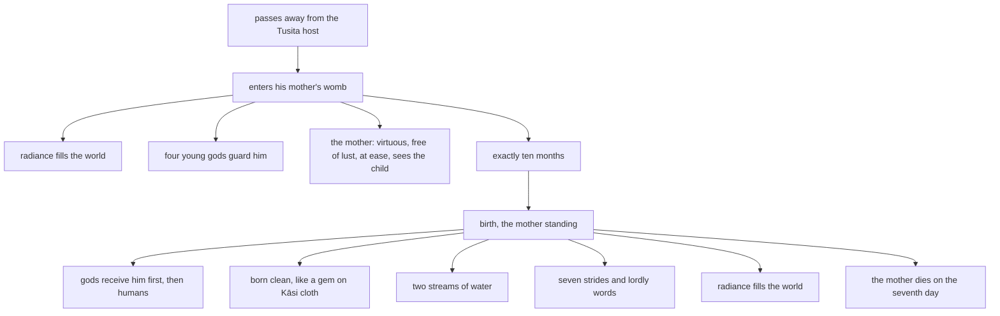

import { Tabs, TabItem } from '@astrojs/starlight/components';

Original text: [7D/1.2 Bodhisattadhammatā 34–49](https://tipitaka2500.github.io/tipitaka/7D/1/1.2.html#34) in the [World Tipitaka Edition](https://tipitaka2500.github.io)

## Summary

The second part of the Mahāpadānasutta: the Bhagavā tells the bhikkhū what is the nature of things for a `bodhisatta` (Buddha before his awakening), sixteen things that happen at his conception and his birth, from the radiance that fills the world when he passes from the Tusita host into his mother's womb to the newborn's seven strides and lordly words, each closed by the refrain "This is the nature of things here." Vipassī's conception and birth are told as the pattern that every `bodhisatta` follows.

## Diagram

## Text

<Tabs syncKey="paliquote">
<TabItem label="My Translation">
(17.)

34\. Then, Bhikkhave, the `bodhisatta` (Buddha before his awakening) Vipassī, having passed away from the Tusita host, aware and clearly comprehending, entered his mother's womb. This is the nature of things here. (1)

(18.)

35\. It is the nature of things, Bhikkhave, that when the `bodhisatta`, having passed away from the Tusita host, enters his mother's womb — then in the world with its gods, with Māra, with Brahmā, among living beings with their religious practitioners, gods and humans, an immeasurable and excellent radiance appears, surpassing even the divine majesty of the gods. Even those spaces between the worlds, voids, unenclosed, dark, pitch-black, where even this moon and sun, so powerful, so mighty, do not reach with [their] light — there too an immeasurable and excellent radiance appears, surpassing even the divine majesty of the gods. And the beings who have arisen there, they too recognise one another by that radiance: ‘Apparently, Bho, there are other beings too who have arisen here.’ And this ten-thousand-fold world system trembles, shakes and quakes. And an immeasurable and excellent radiance appears in the world, surpassing even the divine majesty of the gods. This is the nature of things here. (2)

(19.)

36\. It is the nature of things, Bhikkhave, that when the `bodhisatta` has entered his mother's womb, four young gods approach him for protection in the four directions: ‘Let no human or non-human or anyone harm the `bodhisatta` or the `bodhisatta`'s mother.’ This is the nature of things here. (3)

(20.)

37\. It is the nature of things, Bhikkhave, that when the `bodhisatta` has entered his mother's womb, the `bodhisatta`'s mother is naturally virtuous, abstaining from killing living beings, abstaining from taking what is not given, abstaining from sexual misconduct, abstaining from false speech, abstaining from wine, spirits, drugs and states of intoxication. This is the nature of things here. (4)

(21.)

38\. It is the nature of things, Bhikkhave, that when the `bodhisatta` has entered his mother's womb, no thought concerned with sexual pleasure arises in the `bodhisatta`'s mother towards men, and the `bodhisatta`'s mother is inviolable by any man of lustful intent. This is the nature of things here. (5)

(22.)

39\. It is the nature of things, Bhikkhave, that when the `bodhisatta` has entered his mother's womb, the `bodhisatta`'s mother is one who gains the five strands of sensual pleasures. Endowed and furnished with the five strands of sensual pleasures, she amuses herself. This is the nature of things here. (6)

(23.)

40\. It is the nature of things, Bhikkhave, that when the `bodhisatta` has entered his mother's womb, no illness whatsoever arises in the `bodhisatta`'s mother. The `bodhisatta`'s mother is at ease, not physically tired, and the `bodhisatta`'s mother sees the `bodhisatta` inside her womb, with all his parts and with faculties not defective. Just as, Bhikkhave, a cat's-eye jewel is beautiful, genuine, octagonal, of excellent workmanship, clear, bright, not turbid, perfect in every aspect. In it there would be a thread strung, blue or yellow or red or white, or a pale thread. A man with eyes, having placed it in his hand, would reflect on it: ‘This cat's-eye jewel indeed is beautiful, genuine, octagonal, of excellent workmanship, clear, bright, not turbid, perfect in every aspect. In it this thread is strung, blue or yellow or red or white, or a pale thread.’ In the same way, Bhikkhave, when the `bodhisatta` has entered his mother's womb, no illness whatsoever arises in the `bodhisatta`'s mother; the `bodhisatta`'s mother is at ease, not physically tired, and the `bodhisatta`'s mother sees the `bodhisatta` inside her womb, with all his parts and with faculties not defective. This is the nature of things here. (7)

(24.)

41\. It is the nature of things, Bhikkhave, that when the `bodhisatta` is seven days old, the `bodhisatta`'s mother dies and reappears in the Tusita host. This is the nature of things here. (8)

(25.)

42\. It is the nature of things, Bhikkhave, that whereas other women give birth having carried the embryo in the womb for nine or ten months, the `bodhisatta`'s mother does not give birth to the `bodhisatta` thus. The `bodhisatta`'s mother gives birth to the `bodhisatta` having carried him in the womb for exactly ten months. This is the nature of things here. (9)

(26.)

43\. It is the nature of things, Bhikkhave, that whereas other women give birth seated or lying down, the `bodhisatta`'s mother does not give birth to the `bodhisatta` thus. The `bodhisatta`'s mother gives birth to the `bodhisatta` only standing. This is the nature of things here. (10)

(27.)

44\. It is the nature of things, Bhikkhave, that when the `bodhisatta` comes out from his mother's womb, gods receive him first, afterwards humans. This is the nature of things here. (11)

(28.)

45\. It is the nature of things, Bhikkhave, that when the `bodhisatta` comes out from his mother's womb, before the `bodhisatta` has reached the ground, four young gods receive him and place him before his mother: ‘Be delighted, your majesty; a son of great influence has been born to you.’ This is the nature of things here. (12)

(29.)

46\. It is the nature of things, Bhikkhave, that when the `bodhisatta` comes out from his mother's womb, he comes out quite clean, unsmeared with water, unsmeared with phlegm, unsmeared with blood, unsmeared with any impurity, pure and clean. Just as, Bhikkhave, when a precious gem is placed on Kāsi cloth, neither does the precious gem smear the Kāsi cloth, nor does the Kāsi cloth smear the precious gem. For what reason? Because of the purity of both. In the same way, Bhikkhave, when the `bodhisatta` comes out from his mother's womb, he comes out quite clean, unsmeared with water, unsmeared with phlegm, unsmeared with blood, unsmeared with any impurity, pure and clean. This is the nature of things here. (13)

(30.)

47\. It is the nature of things, Bhikkhave, that when the `bodhisatta` comes out from his mother's womb, two streams of water appear from the sky, one of cold and one of hot, with which they perform the ablutions for the `bodhisatta` and for his mother. This is the nature of things here. (14)

(31.)

48\. It is the nature of things, Bhikkhave, that as soon as he is born, the `bodhisatta`, having stood firmly on even feet, facing north, walks seven strides while a white parasol is held above him, surveys all the directions and speaks lordly words: ‘I am the highest in the world, I am the eldest in the world, I am the best in the world; this is the final birth (of suffering), there is now no more appearing again (of suffering).’ This is the nature of things here. (15)

(32.)

49\. It is the nature of things, Bhikkhave, that when the `bodhisatta` comes out from his mother's womb, then in the world with its gods, with Māra, with Brahmā, among living beings with their religious practitioners, gods and humans, an immeasurable and excellent radiance appears, surpassing even the divine majesty of the gods. Even those spaces between the worlds, voids, unenclosed, dark, pitch-black, where even this moon and sun, so powerful, so mighty, do not reach with [their] light — there too an immeasurable and excellent radiance appears, surpassing even the divine majesty of the gods. And the beings who have arisen there, they too recognise one another by that radiance: ‘Apparently, Bho, there are other beings too who have arisen here.’ And this ten-thousand-fold world system trembles, shakes and quakes, and an immeasurable and excellent radiance appears in the world, surpassing even the divine majesty of the gods. This is the nature of things here. (16)
</TabItem>

<TabItem label="Pāḷi (Roman IAST)">
(17.)

34\. Atha kho, bhikkhave, vipassī bodhisatto tusitā kāyā cavitvā sato sampajāno mātukucchiṃ okkami. Ayamettha dhammatā. (1)

(18.)

35\. Dhammatā esā, bhikkhave, yadā bodhisatto tusitā kāyā cavitvā mātukucchiṃ okkamati. Atha sadevake loke samārake sabrahmake sassamaṇabrāhmaṇiyā pajāya sadevamanussāya appamāṇo uḷāro obhāso pātubhavati atikkammeva devānaṃ devānubhāvaṃ. Yāpi tā lokantarikā aghā asaṃvutā andhakārā andhakāratimisā, yatthapime candimasūriyā evaṃmahiddhikā evaṃmahānubhāvā ābhāya nānubhonti, tatthapi appamāṇo uḷāro obhāso pātubhavati atikkammeva devānaṃ devānubhāvaṃ. Yepi tattha sattā upapannā, tepi tenobhāsena aññamaññaṃ sañjānanti— ‘aññepi kira, bho, santi sattā idhūpapannā’ti. Ayañca dasasahassī lokadhātu saṅkampati sampakampati sampavedhati. Appamāṇo ca uḷāro obhāso loke pātubhavati atikkammeva devānaṃ devānubhāvaṃ. Ayamettha dhammatā. (2)

(19.)

36\. Dhammatā esā, bhikkhave, yadā bodhisatto mātukucchiṃ okkanto hoti, cattāro naṃ devaputtā catuddisaṃ rakkhāya upagacchanti— ‘mā naṃ bodhisattaṃ vā bodhisattamātaraṃ vā manusso vā amanusso vā koci vā viheṭhesī’ti. Ayamettha dhammatā. (3)

(20.)

37\. Dhammatā esā, bhikkhave, yadā bodhisatto mātukucchiṃ okkanto hoti, pakatiyā sīlavatī bodhisattamātā hoti, viratā pāṇātipātā, viratā adinnādānā, viratā kāmesumicchācārā, viratā musāvādā, viratā surāmerayamajjappamādaṭṭhānā. Ayamettha dhammatā. (4)

(21.)

38\. Dhammatā esā, bhikkhave, yadā bodhisatto mātukucchiṃ okkanto hoti, na bodhisattamātu purisesu mānasaṃ uppajjati kāmaguṇūpasaṃhitaṃ, anatikkamanīyā ca bodhisattamātā hoti kenaci purisena rattacittena. Ayamettha dhammatā. (5)

(22.)

39\. Dhammatā esā, bhikkhave, yadā bodhisatto mātukucchiṃ okkanto hoti, lābhinī bodhisattamātā hoti pañcannaṃ kāmaguṇānaṃ. Sā pañcahi kāmaguṇehi samappitā samaṅgībhūtā paricāreti. Ayamettha dhammatā. (6)

(23.)

40\. Dhammatā esā, bhikkhave, yadā bodhisatto mātukucchiṃ okkanto hoti, na bodhisattamātu kocideva ābādho uppajjati. Sukhinī bodhisattamātā hoti akilantakāyā, bodhisattañca bodhisattamātā tirokucchigataṃ passati sabbaṅgapaccaṅgiṃ ahīnindriyaṃ. Seyyathāpi, bhikkhave, maṇi veḷuriyo subho jātimā aṭṭhaṃso suparikammakato accho vippasanno anāvilo sabbākārasampanno. Tatrāssa suttaṃ āvutaṃ nīlaṃ vā pītaṃ vā lohitaṃ vā odātaṃ vā paṇḍusuttaṃ vā. Tamenaṃ cakkhumā puriso hatthe karitvā paccavekkheyya— ‘ayaṃ kho maṇi veḷuriyo subho jātimā aṭṭhaṃso suparikammakato accho vippasanno anāvilo sabbākārasampanno. Tatridaṃ suttaṃ āvutaṃ nīlaṃ vā pītaṃ vā lohitaṃ vā odātaṃ vā paṇḍusuttaṃ vā’ti. Evameva kho, bhikkhave, yadā bodhisatto mātukucchiṃ okkanto hoti, na bodhisattamātu kocideva ābādho uppajjati, sukhinī bodhisattamātā hoti akilantakāyā, bodhisattañca bodhisattamātā tirokucchigataṃ passati sabbaṅgapaccaṅgiṃ ahīnindriyaṃ. Ayamettha dhammatā. (7)

(24.)

41\. Dhammatā esā, bhikkhave, sattāhajāte bodhisatte bodhisattamātā kālaṃ karoti tusitaṃ kāyaṃ upapajjati. Ayamettha dhammatā. (8)

(25.)

42\. Dhammatā esā, bhikkhave, yathā aññā itthikā nava vā dasa vā māse gabbhaṃ kucchinā pariharitvā vijāyanti, na hevaṃ bodhisattaṃ bodhisattamātā vijāyati. Daseva māsāni bodhisattaṃ bodhisattamātā kucchinā pariharitvā vijāyati. Ayamettha dhammatā. (9)

(26.)

43\. Dhammatā esā, bhikkhave, yathā aññā itthikā nisinnā vā nipannā vā vijāyanti, na hevaṃ bodhisattaṃ bodhisattamātā vijāyati. Ṭhitāva bodhisattaṃ bodhisattamātā vijāyati. Ayamettha dhammatā. (10)

(27.)

44\. Dhammatā esā, bhikkhave, yadā bodhisatto mātukucchimhā nikkhamati, devā paṭhamaṃ paṭiggaṇhanti, pacchā manussā. Ayamettha dhammatā. (11)

(28.)

45\. Dhammatā esā, bhikkhave, yadā bodhisatto mātukucchimhā nikkhamati, appattova bodhisatto pathaviṃ hoti, cattāro naṃ devaputtā paṭiggahetvā mātu purato ṭhapenti— ‘attamanā, devi, hohi; mahesakkho te putto uppanno’ti. Ayamettha dhammatā. (12)

(29.)

46\. Dhammatā esā, bhikkhave, yadā bodhisatto mātukucchimhā nikkhamati, visadova nikkhamati amakkhito udena amakkhito semhena amakkhito ruhirena amakkhito kenaci asucinā suddho visado. Seyyathāpi, bhikkhave, maṇiratanaṃ kāsike vatthe nikkhittaṃ neva maṇiratanaṃ kāsikaṃ vatthaṃ makkheti, nāpi kāsikaṃ vatthaṃ maṇiratanaṃ makkheti. Taṃ kissa hetu? Ubhinnaṃ suddhattā. Evameva kho, bhikkhave, yadā bodhisatto mātukucchimhā nikkhamati, visadova nikkhamati amakkhito, udena amakkhito semhena amakkhito ruhirena amakkhito kenaci asucinā suddho visado. Ayamettha dhammatā. (13)

(30.)

47\. Dhammatā esā, bhikkhave, yadā bodhisatto mātukucchimhā nikkhamati, dve udakassa dhārā antalikkhā pātubhavanti— ekā sītassa ekā uṇhassa yena bodhisattassa udakakiccaṃ karonti mātu ca. Ayamettha dhammatā. (14)

(31.)

48\. Dhammatā esā, bhikkhave, sampatijāto bodhisatto samehi pādehi patiṭṭhahitvā uttarābhimukho sattapadavītihārena gacchati setamhi chatte anudhāriyamāne, sabbā ca disā anuviloketi, āsabhiṃ vācaṃ bhāsati ‘aggohamasmi lokassa, jeṭṭhohamasmi lokassa, seṭṭhohamasmi lokassa, ayamantimā jāti, natthi dāni punabbhavo’ti. Ayamettha dhammatā. (15)

(32.)

49\. Dhammatā esā, bhikkhave, yadā bodhisatto mātukucchimhā nikkhamati, atha sadevake loke samārake sabrahmake sassamaṇabrāhmaṇiyā pajāya sadevamanussāya appamāṇo uḷāro obhāso pātubhavati, atikkammeva devānaṃ devānubhāvaṃ. Yāpi tā lokantarikā aghā asaṃvutā andhakārā andhakāratimisā, yatthapime candimasūriyā evaṃmahiddhikā evaṃmahānubhāvā ābhāya nānubhonti, tatthapi appamāṇo uḷāro obhāso pātubhavati atikkammeva devānaṃ devānubhāvaṃ. Yepi tattha sattā upapannā, tepi tenobhāsena aññamaññaṃ sañjānanti— ‘aññepi kira, bho, santi sattā idhūpapannā’ti. Ayañca dasasahassī lokadhātu saṅkampati sampakampati sampavedhati appamāṇo ca uḷāro obhāso loke pātubhavati atikkammeva devānaṃ devānubhāvaṃ. Ayamettha dhammatā. (16)
</TabItem>

<TabItem label="Pāḷi (Brahmi)">
(17.)

34\. 𑀅𑀣 𑀔𑁄, 𑀪𑀺𑀓𑁆𑀔𑀯𑁂, 𑀯𑀺𑀧𑀲𑁆𑀲𑀻 𑀩𑁄𑀥𑀺𑀲𑀢𑁆𑀢𑁄 𑀢𑀼𑀲𑀺𑀢𑀸 𑀓𑀸𑀬𑀸 𑀘𑀯𑀺𑀢𑁆𑀯𑀸 𑀲𑀢𑁄 𑀲𑀫𑁆𑀧𑀚𑀸𑀦𑁄 𑀫𑀸𑀢𑀼𑀓𑀼𑀘𑁆𑀙𑀺𑀁 𑀑𑀓𑁆𑀓𑀫𑀺. 𑀅𑀬𑀫𑁂𑀢𑁆𑀣 𑀥𑀫𑁆𑀫𑀢𑀸. (1)

(18.)

35\. 𑀥𑀫𑁆𑀫𑀢𑀸 𑀏𑀲𑀸, 𑀪𑀺𑀓𑁆𑀔𑀯𑁂, 𑀬𑀤𑀸 𑀩𑁄𑀥𑀺𑀲𑀢𑁆𑀢𑁄 𑀢𑀼𑀲𑀺𑀢𑀸 𑀓𑀸𑀬𑀸 𑀘𑀯𑀺𑀢𑁆𑀯𑀸 𑀫𑀸𑀢𑀼𑀓𑀼𑀘𑁆𑀙𑀺𑀁 𑀑𑀓𑁆𑀓𑀫𑀢𑀺. 𑀅𑀣 𑀲𑀤𑁂𑀯𑀓𑁂 𑀮𑁄𑀓𑁂 𑀲𑀫𑀸𑀭𑀓𑁂 𑀲𑀩𑁆𑀭𑀳𑁆𑀫𑀓𑁂 𑀲𑀲𑁆𑀲𑀫𑀡𑀩𑁆𑀭𑀸𑀳𑁆𑀫𑀡𑀺𑀬𑀸 𑀧𑀚𑀸𑀬 𑀲𑀤𑁂𑀯𑀫𑀦𑀼𑀲𑁆𑀲𑀸𑀬 𑀅𑀧𑁆𑀧𑀫𑀸𑀡𑁄 𑀉𑀍𑀆𑀭𑁄 𑀑𑀪𑀸𑀲𑁄 𑀧𑀸𑀢𑀼𑀪𑀯𑀢𑀺 𑀅𑀢𑀺𑀓𑁆𑀓𑀫𑁆𑀫𑁂𑀯 𑀤𑁂𑀯𑀸𑀦𑀁 𑀤𑁂𑀯𑀸𑀦𑀼𑀪𑀸𑀯𑀁. 𑀬𑀸𑀧𑀺 𑀢𑀸 𑀮𑁄𑀓𑀦𑁆𑀢𑀭𑀺𑀓𑀸 𑀅𑀖𑀸 𑀅𑀲𑀁𑀯𑀼𑀢𑀸 𑀅𑀦𑁆𑀥𑀓𑀸𑀭𑀸 𑀅𑀦𑁆𑀥𑀓𑀸𑀭𑀢𑀺𑀫𑀺𑀲𑀸, 𑀬𑀢𑁆𑀣𑀧𑀺𑀫𑁂 𑀘𑀦𑁆𑀤𑀺𑀫𑀲𑀽𑀭𑀺𑀬𑀸 𑀏𑀯𑀁𑀫𑀳𑀺𑀤𑁆𑀥𑀺𑀓𑀸 𑀏𑀯𑀁𑀫𑀳𑀸𑀦𑀼𑀪𑀸𑀯𑀸 𑀆𑀪𑀸𑀬 𑀦𑀸𑀦𑀼𑀪𑁄𑀦𑁆𑀢𑀺, 𑀢𑀢𑁆𑀣𑀧𑀺 𑀅𑀧𑁆𑀧𑀫𑀸𑀡𑁄 𑀉𑀍𑀆𑀭𑁄 𑀑𑀪𑀸𑀲𑁄 𑀧𑀸𑀢𑀼𑀪𑀯𑀢𑀺 𑀅𑀢𑀺𑀓𑁆𑀓𑀫𑁆𑀫𑁂𑀯 𑀤𑁂𑀯𑀸𑀦𑀁 𑀤𑁂𑀯𑀸𑀦𑀼𑀪𑀸𑀯𑀁. 𑀬𑁂𑀧𑀺 𑀢𑀢𑁆𑀣 𑀲𑀢𑁆𑀢𑀸 𑀉𑀧𑀧𑀦𑁆𑀦𑀸, 𑀢𑁂𑀧𑀺 𑀢𑁂𑀦𑁄𑀪𑀸𑀲𑁂𑀦 𑀅𑀜𑁆𑀜𑀫𑀜𑁆𑀜𑀁 𑀲𑀜𑁆𑀚𑀸𑀦𑀦𑁆𑀢𑀺— ‘𑀅𑀜𑁆𑀜𑁂𑀧𑀺 𑀓𑀺𑀭, 𑀪𑁄, 𑀲𑀦𑁆𑀢𑀺 𑀲𑀢𑁆𑀢𑀸 𑀇𑀥𑀽𑀧𑀧𑀦𑁆𑀦𑀸’𑀢𑀺. 𑀅𑀬𑀜𑁆𑀘 𑀤𑀲𑀲𑀳𑀲𑁆𑀲𑀻 𑀮𑁄𑀓𑀥𑀸𑀢𑀼 𑀲𑀗𑁆𑀓𑀫𑁆𑀧𑀢𑀺 𑀲𑀫𑁆𑀧𑀓𑀫𑁆𑀧𑀢𑀺 𑀲𑀫𑁆𑀧𑀯𑁂𑀥𑀢𑀺. 𑀅𑀧𑁆𑀧𑀫𑀸𑀡𑁄 𑀘 𑀉𑀍𑀆𑀭𑁄 𑀑𑀪𑀸𑀲𑁄 𑀮𑁄𑀓𑁂 𑀧𑀸𑀢𑀼𑀪𑀯𑀢𑀺 𑀅𑀢𑀺𑀓𑁆𑀓𑀫𑁆𑀫𑁂𑀯 𑀤𑁂𑀯𑀸𑀦𑀁 𑀤𑁂𑀯𑀸𑀦𑀼𑀪𑀸𑀯𑀁. 𑀅𑀬𑀫𑁂𑀢𑁆𑀣 𑀥𑀫𑁆𑀫𑀢𑀸. (2)

(19.)

36\. 𑀥𑀫𑁆𑀫𑀢𑀸 𑀏𑀲𑀸, 𑀪𑀺𑀓𑁆𑀔𑀯𑁂, 𑀬𑀤𑀸 𑀩𑁄𑀥𑀺𑀲𑀢𑁆𑀢𑁄 𑀫𑀸𑀢𑀼𑀓𑀼𑀘𑁆𑀙𑀺𑀁 𑀑𑀓𑁆𑀓𑀦𑁆𑀢𑁄 𑀳𑁄𑀢𑀺, 𑀘𑀢𑁆𑀢𑀸𑀭𑁄 𑀦𑀁 𑀤𑁂𑀯𑀧𑀼𑀢𑁆𑀢𑀸 𑀘𑀢𑀼𑀤𑁆𑀤𑀺𑀲𑀁 𑀭𑀓𑁆𑀔𑀸𑀬 𑀉𑀧𑀕𑀘𑁆𑀙𑀦𑁆𑀢𑀺— ‘𑀫𑀸 𑀦𑀁 𑀩𑁄𑀥𑀺𑀲𑀢𑁆𑀢𑀁 𑀯𑀸 𑀩𑁄𑀥𑀺𑀲𑀢𑁆𑀢𑀫𑀸𑀢𑀭𑀁 𑀯𑀸 𑀫𑀦𑀼𑀲𑁆𑀲𑁄 𑀯𑀸 𑀅𑀫𑀦𑀼𑀲𑁆𑀲𑁄 𑀯𑀸 𑀓𑁄𑀘𑀺 𑀯𑀸 𑀯𑀺𑀳𑁂𑀞𑁂𑀲𑀻’𑀢𑀺. 𑀅𑀬𑀫𑁂𑀢𑁆𑀣 𑀥𑀫𑁆𑀫𑀢𑀸. (3)

(20.)

37\. 𑀥𑀫𑁆𑀫𑀢𑀸 𑀏𑀲𑀸, 𑀪𑀺𑀓𑁆𑀔𑀯𑁂, 𑀬𑀤𑀸 𑀩𑁄𑀥𑀺𑀲𑀢𑁆𑀢𑁄 𑀫𑀸𑀢𑀼𑀓𑀼𑀘𑁆𑀙𑀺𑀁 𑀑𑀓𑁆𑀓𑀦𑁆𑀢𑁄 𑀳𑁄𑀢𑀺, 𑀧𑀓𑀢𑀺𑀬𑀸 𑀲𑀻𑀮𑀯𑀢𑀻 𑀩𑁄𑀥𑀺𑀲𑀢𑁆𑀢𑀫𑀸𑀢𑀸 𑀳𑁄𑀢𑀺, 𑀯𑀺𑀭𑀢𑀸 𑀧𑀸𑀡𑀸𑀢𑀺𑀧𑀸𑀢𑀸, 𑀯𑀺𑀭𑀢𑀸 𑀅𑀤𑀺𑀦𑁆𑀦𑀸𑀤𑀸𑀦𑀸, 𑀯𑀺𑀭𑀢𑀸 𑀓𑀸𑀫𑁂𑀲𑀼𑀫𑀺𑀘𑁆𑀙𑀸𑀘𑀸𑀭𑀸, 𑀯𑀺𑀭𑀢𑀸 𑀫𑀼𑀲𑀸𑀯𑀸𑀤𑀸, 𑀯𑀺𑀭𑀢𑀸 𑀲𑀼𑀭𑀸𑀫𑁂𑀭𑀬𑀫𑀚𑁆𑀚𑀧𑁆𑀧𑀫𑀸𑀤𑀝𑁆𑀞𑀸𑀦𑀸. 𑀅𑀬𑀫𑁂𑀢𑁆𑀣 𑀥𑀫𑁆𑀫𑀢𑀸. (4)

(21.)

38\. 𑀥𑀫𑁆𑀫𑀢𑀸 𑀏𑀲𑀸, 𑀪𑀺𑀓𑁆𑀔𑀯𑁂, 𑀬𑀤𑀸 𑀩𑁄𑀥𑀺𑀲𑀢𑁆𑀢𑁄 𑀫𑀸𑀢𑀼𑀓𑀼𑀘𑁆𑀙𑀺𑀁 𑀑𑀓𑁆𑀓𑀦𑁆𑀢𑁄 𑀳𑁄𑀢𑀺, 𑀦 𑀩𑁄𑀥𑀺𑀲𑀢𑁆𑀢𑀫𑀸𑀢𑀼 𑀧𑀼𑀭𑀺𑀲𑁂𑀲𑀼 𑀫𑀸𑀦𑀲𑀁 𑀉𑀧𑁆𑀧𑀚𑁆𑀚𑀢𑀺 𑀓𑀸𑀫𑀕𑀼𑀡𑀽𑀧𑀲𑀁𑀳𑀺𑀢𑀁, 𑀅𑀦𑀢𑀺𑀓𑁆𑀓𑀫𑀦𑀻𑀬𑀸 𑀘 𑀩𑁄𑀥𑀺𑀲𑀢𑁆𑀢𑀫𑀸𑀢𑀸 𑀳𑁄𑀢𑀺 𑀓𑁂𑀦𑀘𑀺 𑀧𑀼𑀭𑀺𑀲𑁂𑀦 𑀭𑀢𑁆𑀢𑀘𑀺𑀢𑁆𑀢𑁂𑀦. 𑀅𑀬𑀫𑁂𑀢𑁆𑀣 𑀥𑀫𑁆𑀫𑀢𑀸. (5)

(22.)

39\. 𑀥𑀫𑁆𑀫𑀢𑀸 𑀏𑀲𑀸, 𑀪𑀺𑀓𑁆𑀔𑀯𑁂, 𑀬𑀤𑀸 𑀩𑁄𑀥𑀺𑀲𑀢𑁆𑀢𑁄 𑀫𑀸𑀢𑀼𑀓𑀼𑀘𑁆𑀙𑀺𑀁 𑀑𑀓𑁆𑀓𑀦𑁆𑀢𑁄 𑀳𑁄𑀢𑀺, 𑀮𑀸𑀪𑀺𑀦𑀻 𑀩𑁄𑀥𑀺𑀲𑀢𑁆𑀢𑀫𑀸𑀢𑀸 𑀳𑁄𑀢𑀺 𑀧𑀜𑁆𑀘𑀦𑁆𑀦𑀁 𑀓𑀸𑀫𑀕𑀼𑀡𑀸𑀦𑀁. 𑀲𑀸 𑀧𑀜𑁆𑀘𑀳𑀺 𑀓𑀸𑀫𑀕𑀼𑀡𑁂𑀳𑀺 𑀲𑀫𑀧𑁆𑀧𑀺𑀢𑀸 𑀲𑀫𑀗𑁆𑀕𑀻𑀪𑀽𑀢𑀸 𑀧𑀭𑀺𑀘𑀸𑀭𑁂𑀢𑀺. 𑀅𑀬𑀫𑁂𑀢𑁆𑀣 𑀥𑀫𑁆𑀫𑀢𑀸. (6)

(23.)

40\. 𑀥𑀫𑁆𑀫𑀢𑀸 𑀏𑀲𑀸, 𑀪𑀺𑀓𑁆𑀔𑀯𑁂, 𑀬𑀤𑀸 𑀩𑁄𑀥𑀺𑀲𑀢𑁆𑀢𑁄 𑀫𑀸𑀢𑀼𑀓𑀼𑀘𑁆𑀙𑀺𑀁 𑀑𑀓𑁆𑀓𑀦𑁆𑀢𑁄 𑀳𑁄𑀢𑀺, 𑀦 𑀩𑁄𑀥𑀺𑀲𑀢𑁆𑀢𑀫𑀸𑀢𑀼 𑀓𑁄𑀘𑀺𑀤𑁂𑀯 𑀆𑀩𑀸𑀥𑁄 𑀉𑀧𑁆𑀧𑀚𑁆𑀚𑀢𑀺. 𑀲𑀼𑀔𑀺𑀦𑀻 𑀩𑁄𑀥𑀺𑀲𑀢𑁆𑀢𑀫𑀸𑀢𑀸 𑀳𑁄𑀢𑀺 𑀅𑀓𑀺𑀮𑀦𑁆𑀢𑀓𑀸𑀬𑀸, 𑀩𑁄𑀥𑀺𑀲𑀢𑁆𑀢𑀜𑁆𑀘 𑀩𑁄𑀥𑀺𑀲𑀢𑁆𑀢𑀫𑀸𑀢𑀸 𑀢𑀺𑀭𑁄𑀓𑀼𑀘𑁆𑀙𑀺𑀕𑀢𑀁 𑀧𑀲𑁆𑀲𑀢𑀺 𑀲𑀩𑁆𑀩𑀗𑁆𑀕𑀧𑀘𑁆𑀘𑀗𑁆𑀕𑀺𑀁 𑀅𑀳𑀻𑀦𑀺𑀦𑁆𑀤𑁆𑀭𑀺𑀬𑀁. 𑀲𑁂𑀬𑁆𑀬𑀣𑀸𑀧𑀺, 𑀪𑀺𑀓𑁆𑀔𑀯𑁂, 𑀫𑀡𑀺 𑀯𑁂𑀍𑀉𑀭𑀺𑀬𑁄 𑀲𑀼𑀪𑁄 𑀚𑀸𑀢𑀺𑀫𑀸 𑀅𑀝𑁆𑀞𑀁𑀲𑁄 𑀲𑀼𑀧𑀭𑀺𑀓𑀫𑁆𑀫𑀓𑀢𑁄 𑀅𑀘𑁆𑀙𑁄 𑀯𑀺𑀧𑁆𑀧𑀲𑀦𑁆𑀦𑁄 𑀅𑀦𑀸𑀯𑀺𑀮𑁄 𑀲𑀩𑁆𑀩𑀸𑀓𑀸𑀭𑀲𑀫𑁆𑀧𑀦𑁆𑀦𑁄. 𑀢𑀢𑁆𑀭𑀸𑀲𑁆𑀲 𑀲𑀼𑀢𑁆𑀢𑀁 𑀆𑀯𑀼𑀢𑀁 𑀦𑀻𑀮𑀁 𑀯𑀸 𑀧𑀻𑀢𑀁 𑀯𑀸 𑀮𑁄𑀳𑀺𑀢𑀁 𑀯𑀸 𑀑𑀤𑀸𑀢𑀁 𑀯𑀸 𑀧𑀡𑁆𑀟𑀼𑀲𑀼𑀢𑁆𑀢𑀁 𑀯𑀸. 𑀢𑀫𑁂𑀦𑀁 𑀘𑀓𑁆𑀔𑀼𑀫𑀸 𑀧𑀼𑀭𑀺𑀲𑁄 𑀳𑀢𑁆𑀣𑁂 𑀓𑀭𑀺𑀢𑁆𑀯𑀸 𑀧𑀘𑁆𑀘𑀯𑁂𑀓𑁆𑀔𑁂𑀬𑁆𑀬— ‘𑀅𑀬𑀁 𑀔𑁄 𑀫𑀡𑀺 𑀯𑁂𑀍𑀉𑀭𑀺𑀬𑁄 𑀲𑀼𑀪𑁄 𑀚𑀸𑀢𑀺𑀫𑀸 𑀅𑀝𑁆𑀞𑀁𑀲𑁄 𑀲𑀼𑀧𑀭𑀺𑀓𑀫𑁆𑀫𑀓𑀢𑁄 𑀅𑀘𑁆𑀙𑁄 𑀯𑀺𑀧𑁆𑀧𑀲𑀦𑁆𑀦𑁄 𑀅𑀦𑀸𑀯𑀺𑀮𑁄 𑀲𑀩𑁆𑀩𑀸𑀓𑀸𑀭𑀲𑀫𑁆𑀧𑀦𑁆𑀦𑁄. 𑀢𑀢𑁆𑀭𑀺𑀤𑀁 𑀲𑀼𑀢𑁆𑀢𑀁 𑀆𑀯𑀼𑀢𑀁 𑀦𑀻𑀮𑀁 𑀯𑀸 𑀧𑀻𑀢𑀁 𑀯𑀸 𑀮𑁄𑀳𑀺𑀢𑀁 𑀯𑀸 𑀑𑀤𑀸𑀢𑀁 𑀯𑀸 𑀧𑀡𑁆𑀟𑀼𑀲𑀼𑀢𑁆𑀢𑀁 𑀯𑀸’𑀢𑀺. 𑀏𑀯𑀫𑁂𑀯 𑀔𑁄, 𑀪𑀺𑀓𑁆𑀔𑀯𑁂, 𑀬𑀤𑀸 𑀩𑁄𑀥𑀺𑀲𑀢𑁆𑀢𑁄 𑀫𑀸𑀢𑀼𑀓𑀼𑀘𑁆𑀙𑀺𑀁 𑀑𑀓𑁆𑀓𑀦𑁆𑀢𑁄 𑀳𑁄𑀢𑀺, 𑀦 𑀩𑁄𑀥𑀺𑀲𑀢𑁆𑀢𑀫𑀸𑀢𑀼 𑀓𑁄𑀘𑀺𑀤𑁂𑀯 𑀆𑀩𑀸𑀥𑁄 𑀉𑀧𑁆𑀧𑀚𑁆𑀚𑀢𑀺, 𑀲𑀼𑀔𑀺𑀦𑀻 𑀩𑁄𑀥𑀺𑀲𑀢𑁆𑀢𑀫𑀸𑀢𑀸 𑀳𑁄𑀢𑀺 𑀅𑀓𑀺𑀮𑀦𑁆𑀢𑀓𑀸𑀬𑀸, 𑀩𑁄𑀥𑀺𑀲𑀢𑁆𑀢𑀜𑁆𑀘 𑀩𑁄𑀥𑀺𑀲𑀢𑁆𑀢𑀫𑀸𑀢𑀸 𑀢𑀺𑀭𑁄𑀓𑀼𑀘𑁆𑀙𑀺𑀕𑀢𑀁 𑀧𑀲𑁆𑀲𑀢𑀺 𑀲𑀩𑁆𑀩𑀗𑁆𑀕𑀧𑀘𑁆𑀘𑀗𑁆𑀕𑀺𑀁 𑀅𑀳𑀻𑀦𑀺𑀦𑁆𑀤𑁆𑀭𑀺𑀬𑀁. 𑀅𑀬𑀫𑁂𑀢𑁆𑀣 𑀥𑀫𑁆𑀫𑀢𑀸. (7)

(24.)

41\. 𑀥𑀫𑁆𑀫𑀢𑀸 𑀏𑀲𑀸, 𑀪𑀺𑀓𑁆𑀔𑀯𑁂, 𑀲𑀢𑁆𑀢𑀸𑀳𑀚𑀸𑀢𑁂 𑀩𑁄𑀥𑀺𑀲𑀢𑁆𑀢𑁂 𑀩𑁄𑀥𑀺𑀲𑀢𑁆𑀢𑀫𑀸𑀢𑀸 𑀓𑀸𑀮𑀁 𑀓𑀭𑁄𑀢𑀺 𑀢𑀼𑀲𑀺𑀢𑀁 𑀓𑀸𑀬𑀁 𑀉𑀧𑀧𑀚𑁆𑀚𑀢𑀺. 𑀅𑀬𑀫𑁂𑀢𑁆𑀣 𑀥𑀫𑁆𑀫𑀢𑀸. (8)

(25.)

42\. 𑀥𑀫𑁆𑀫𑀢𑀸 𑀏𑀲𑀸, 𑀪𑀺𑀓𑁆𑀔𑀯𑁂, 𑀬𑀣𑀸 𑀅𑀜𑁆𑀜𑀸 𑀇𑀢𑁆𑀣𑀺𑀓𑀸 𑀦𑀯 𑀯𑀸 𑀤𑀲 𑀯𑀸 𑀫𑀸𑀲𑁂 𑀕𑀩𑁆𑀪𑀁 𑀓𑀼𑀘𑁆𑀙𑀺𑀦𑀸 𑀧𑀭𑀺𑀳𑀭𑀺𑀢𑁆𑀯𑀸 𑀯𑀺𑀚𑀸𑀬𑀦𑁆𑀢𑀺, 𑀦 𑀳𑁂𑀯𑀁 𑀩𑁄𑀥𑀺𑀲𑀢𑁆𑀢𑀁 𑀩𑁄𑀥𑀺𑀲𑀢𑁆𑀢𑀫𑀸𑀢𑀸 𑀯𑀺𑀚𑀸𑀬𑀢𑀺. 𑀤𑀲𑁂𑀯 𑀫𑀸𑀲𑀸𑀦𑀺 𑀩𑁄𑀥𑀺𑀲𑀢𑁆𑀢𑀁 𑀩𑁄𑀥𑀺𑀲𑀢𑁆𑀢𑀫𑀸𑀢𑀸 𑀓𑀼𑀘𑁆𑀙𑀺𑀦𑀸 𑀧𑀭𑀺𑀳𑀭𑀺𑀢𑁆𑀯𑀸 𑀯𑀺𑀚𑀸𑀬𑀢𑀺. 𑀅𑀬𑀫𑁂𑀢𑁆𑀣 𑀥𑀫𑁆𑀫𑀢𑀸. (9)

(26.)

43\. 𑀥𑀫𑁆𑀫𑀢𑀸 𑀏𑀲𑀸, 𑀪𑀺𑀓𑁆𑀔𑀯𑁂, 𑀬𑀣𑀸 𑀅𑀜𑁆𑀜𑀸 𑀇𑀢𑁆𑀣𑀺𑀓𑀸 𑀦𑀺𑀲𑀺𑀦𑁆𑀦𑀸 𑀯𑀸 𑀦𑀺𑀧𑀦𑁆𑀦𑀸 𑀯𑀸 𑀯𑀺𑀚𑀸𑀬𑀦𑁆𑀢𑀺, 𑀦 𑀳𑁂𑀯𑀁 𑀩𑁄𑀥𑀺𑀲𑀢𑁆𑀢𑀁 𑀩𑁄𑀥𑀺𑀲𑀢𑁆𑀢𑀫𑀸𑀢𑀸 𑀯𑀺𑀚𑀸𑀬𑀢𑀺. 𑀞𑀺𑀢𑀸𑀯 𑀩𑁄𑀥𑀺𑀲𑀢𑁆𑀢𑀁 𑀩𑁄𑀥𑀺𑀲𑀢𑁆𑀢𑀫𑀸𑀢𑀸 𑀯𑀺𑀚𑀸𑀬𑀢𑀺. 𑀅𑀬𑀫𑁂𑀢𑁆𑀣 𑀥𑀫𑁆𑀫𑀢𑀸. (10)

(27.)

44\. 𑀥𑀫𑁆𑀫𑀢𑀸 𑀏𑀲𑀸, 𑀪𑀺𑀓𑁆𑀔𑀯𑁂, 𑀬𑀤𑀸 𑀩𑁄𑀥𑀺𑀲𑀢𑁆𑀢𑁄 𑀫𑀸𑀢𑀼𑀓𑀼𑀘𑁆𑀙𑀺𑀫𑁆𑀳𑀸 𑀦𑀺𑀓𑁆𑀔𑀫𑀢𑀺, 𑀤𑁂𑀯𑀸 𑀧𑀞𑀫𑀁 𑀧𑀝𑀺𑀕𑁆𑀕𑀡𑁆𑀳𑀦𑁆𑀢𑀺, 𑀧𑀘𑁆𑀙𑀸 𑀫𑀦𑀼𑀲𑁆𑀲𑀸. 𑀅𑀬𑀫𑁂𑀢𑁆𑀣 𑀥𑀫𑁆𑀫𑀢𑀸. (11)

(28.)

45\. 𑀥𑀫𑁆𑀫𑀢𑀸 𑀏𑀲𑀸, 𑀪𑀺𑀓𑁆𑀔𑀯𑁂, 𑀬𑀤𑀸 𑀩𑁄𑀥𑀺𑀲𑀢𑁆𑀢𑁄 𑀫𑀸𑀢𑀼𑀓𑀼𑀘𑁆𑀙𑀺𑀫𑁆𑀳𑀸 𑀦𑀺𑀓𑁆𑀔𑀫𑀢𑀺, 𑀅𑀧𑁆𑀧𑀢𑁆𑀢𑁄𑀯 𑀩𑁄𑀥𑀺𑀲𑀢𑁆𑀢𑁄 𑀧𑀣𑀯𑀺𑀁 𑀳𑁄𑀢𑀺, 𑀘𑀢𑁆𑀢𑀸𑀭𑁄 𑀦𑀁 𑀤𑁂𑀯𑀧𑀼𑀢𑁆𑀢𑀸 𑀧𑀝𑀺𑀕𑁆𑀕𑀳𑁂𑀢𑁆𑀯𑀸 𑀫𑀸𑀢𑀼 𑀧𑀼𑀭𑀢𑁄 𑀞𑀧𑁂𑀦𑁆𑀢𑀺— ‘𑀅𑀢𑁆𑀢𑀫𑀦𑀸, 𑀤𑁂𑀯𑀺, 𑀳𑁄𑀳𑀺; 𑀫𑀳𑁂𑀲𑀓𑁆𑀔𑁄 𑀢𑁂 𑀧𑀼𑀢𑁆𑀢𑁄 𑀉𑀧𑁆𑀧𑀦𑁆𑀦𑁄’𑀢𑀺. 𑀅𑀬𑀫𑁂𑀢𑁆𑀣 𑀥𑀫𑁆𑀫𑀢𑀸. (12)

(29.)

46\. 𑀥𑀫𑁆𑀫𑀢𑀸 𑀏𑀲𑀸, 𑀪𑀺𑀓𑁆𑀔𑀯𑁂, 𑀬𑀤𑀸 𑀩𑁄𑀥𑀺𑀲𑀢𑁆𑀢𑁄 𑀫𑀸𑀢𑀼𑀓𑀼𑀘𑁆𑀙𑀺𑀫𑁆𑀳𑀸 𑀦𑀺𑀓𑁆𑀔𑀫𑀢𑀺, 𑀯𑀺𑀲𑀤𑁄𑀯 𑀦𑀺𑀓𑁆𑀔𑀫𑀢𑀺 𑀅𑀫𑀓𑁆𑀔𑀺𑀢𑁄 𑀉𑀤𑁂𑀦 𑀅𑀫𑀓𑁆𑀔𑀺𑀢𑁄 𑀲𑁂𑀫𑁆𑀳𑁂𑀦 𑀅𑀫𑀓𑁆𑀔𑀺𑀢𑁄 𑀭𑀼𑀳𑀺𑀭𑁂𑀦 𑀅𑀫𑀓𑁆𑀔𑀺𑀢𑁄 𑀓𑁂𑀦𑀘𑀺 𑀅𑀲𑀼𑀘𑀺𑀦𑀸 𑀲𑀼𑀤𑁆𑀥𑁄 𑀯𑀺𑀲𑀤𑁄. 𑀲𑁂𑀬𑁆𑀬𑀣𑀸𑀧𑀺, 𑀪𑀺𑀓𑁆𑀔𑀯𑁂, 𑀫𑀡𑀺𑀭𑀢𑀦𑀁 𑀓𑀸𑀲𑀺𑀓𑁂 𑀯𑀢𑁆𑀣𑁂 𑀦𑀺𑀓𑁆𑀔𑀺𑀢𑁆𑀢𑀁 𑀦𑁂𑀯 𑀫𑀡𑀺𑀭𑀢𑀦𑀁 𑀓𑀸𑀲𑀺𑀓𑀁 𑀯𑀢𑁆𑀣𑀁 𑀫𑀓𑁆𑀔𑁂𑀢𑀺, 𑀦𑀸𑀧𑀺 𑀓𑀸𑀲𑀺𑀓𑀁 𑀯𑀢𑁆𑀣𑀁 𑀫𑀡𑀺𑀭𑀢𑀦𑀁 𑀫𑀓𑁆𑀔𑁂𑀢𑀺. 𑀢𑀁 𑀓𑀺𑀲𑁆𑀲 𑀳𑁂𑀢𑀼? 𑀉𑀪𑀺𑀦𑁆𑀦𑀁 𑀲𑀼𑀤𑁆𑀥𑀢𑁆𑀢𑀸. 𑀏𑀯𑀫𑁂𑀯 𑀔𑁄, 𑀪𑀺𑀓𑁆𑀔𑀯𑁂, 𑀬𑀤𑀸 𑀩𑁄𑀥𑀺𑀲𑀢𑁆𑀢𑁄 𑀫𑀸𑀢𑀼𑀓𑀼𑀘𑁆𑀙𑀺𑀫𑁆𑀳𑀸 𑀦𑀺𑀓𑁆𑀔𑀫𑀢𑀺, 𑀯𑀺𑀲𑀤𑁄𑀯 𑀦𑀺𑀓𑁆𑀔𑀫𑀢𑀺 𑀅𑀫𑀓𑁆𑀔𑀺𑀢𑁄, 𑀉𑀤𑁂𑀦 𑀅𑀫𑀓𑁆𑀔𑀺𑀢𑁄 𑀲𑁂𑀫𑁆𑀳𑁂𑀦 𑀅𑀫𑀓𑁆𑀔𑀺𑀢𑁄 𑀭𑀼𑀳𑀺𑀭𑁂𑀦 𑀅𑀫𑀓𑁆𑀔𑀺𑀢𑁄 𑀓𑁂𑀦𑀘𑀺 𑀅𑀲𑀼𑀘𑀺𑀦𑀸 𑀲𑀼𑀤𑁆𑀥𑁄 𑀯𑀺𑀲𑀤𑁄. 𑀅𑀬𑀫𑁂𑀢𑁆𑀣 𑀥𑀫𑁆𑀫𑀢𑀸. (13)

(30.)

47\. 𑀥𑀫𑁆𑀫𑀢𑀸 𑀏𑀲𑀸, 𑀪𑀺𑀓𑁆𑀔𑀯𑁂, 𑀬𑀤𑀸 𑀩𑁄𑀥𑀺𑀲𑀢𑁆𑀢𑁄 𑀫𑀸𑀢𑀼𑀓𑀼𑀘𑁆𑀙𑀺𑀫𑁆𑀳𑀸 𑀦𑀺𑀓𑁆𑀔𑀫𑀢𑀺, 𑀤𑁆𑀯𑁂 𑀉𑀤𑀓𑀲𑁆𑀲 𑀥𑀸𑀭𑀸 𑀅𑀦𑁆𑀢𑀮𑀺𑀓𑁆𑀔𑀸 𑀧𑀸𑀢𑀼𑀪𑀯𑀦𑁆𑀢𑀺— 𑀏𑀓𑀸 𑀲𑀻𑀢𑀲𑁆𑀲 𑀏𑀓𑀸 𑀉𑀡𑁆𑀳𑀲𑁆𑀲 𑀬𑁂𑀦 𑀩𑁄𑀥𑀺𑀲𑀢𑁆𑀢𑀲𑁆𑀲 𑀉𑀤𑀓𑀓𑀺𑀘𑁆𑀘𑀁 𑀓𑀭𑁄𑀦𑁆𑀢𑀺 𑀫𑀸𑀢𑀼 𑀘. 𑀅𑀬𑀫𑁂𑀢𑁆𑀣 𑀥𑀫𑁆𑀫𑀢𑀸. (14)

(31.)

48\. 𑀥𑀫𑁆𑀫𑀢𑀸 𑀏𑀲𑀸, 𑀪𑀺𑀓𑁆𑀔𑀯𑁂, 𑀲𑀫𑁆𑀧𑀢𑀺𑀚𑀸𑀢𑁄 𑀩𑁄𑀥𑀺𑀲𑀢𑁆𑀢𑁄 𑀲𑀫𑁂𑀳𑀺 𑀧𑀸𑀤𑁂𑀳𑀺 𑀧𑀢𑀺𑀝𑁆𑀞𑀳𑀺𑀢𑁆𑀯𑀸 𑀉𑀢𑁆𑀢𑀭𑀸𑀪𑀺𑀫𑀼𑀔𑁄 𑀲𑀢𑁆𑀢𑀧𑀤𑀯𑀻𑀢𑀺𑀳𑀸𑀭𑁂𑀦 𑀕𑀘𑁆𑀙𑀢𑀺 𑀲𑁂𑀢𑀫𑁆𑀳𑀺 𑀙𑀢𑁆𑀢𑁂 𑀅𑀦𑀼𑀥𑀸𑀭𑀺𑀬𑀫𑀸𑀦𑁂, 𑀲𑀩𑁆𑀩𑀸 𑀘 𑀤𑀺𑀲𑀸 𑀅𑀦𑀼𑀯𑀺𑀮𑁄𑀓𑁂𑀢𑀺, 𑀆𑀲𑀪𑀺𑀁 𑀯𑀸𑀘𑀁 𑀪𑀸𑀲𑀢𑀺 ‘𑀅𑀕𑁆𑀕𑁄𑀳𑀫𑀲𑁆𑀫𑀺 𑀮𑁄𑀓𑀲𑁆𑀲, 𑀚𑁂𑀝𑁆𑀞𑁄𑀳𑀫𑀲𑁆𑀫𑀺 𑀮𑁄𑀓𑀲𑁆𑀲, 𑀲𑁂𑀝𑁆𑀞𑁄𑀳𑀫𑀲𑁆𑀫𑀺 𑀮𑁄𑀓𑀲𑁆𑀲, 𑀅𑀬𑀫𑀦𑁆𑀢𑀺𑀫𑀸 𑀚𑀸𑀢𑀺, 𑀦𑀢𑁆𑀣𑀺 𑀤𑀸𑀦𑀺 𑀧𑀼𑀦𑀩𑁆𑀪𑀯𑁄’𑀢𑀺. 𑀅𑀬𑀫𑁂𑀢𑁆𑀣 𑀥𑀫𑁆𑀫𑀢𑀸. (15)

(32.)

49\. 𑀥𑀫𑁆𑀫𑀢𑀸 𑀏𑀲𑀸, 𑀪𑀺𑀓𑁆𑀔𑀯𑁂, 𑀬𑀤𑀸 𑀩𑁄𑀥𑀺𑀲𑀢𑁆𑀢𑁄 𑀫𑀸𑀢𑀼𑀓𑀼𑀘𑁆𑀙𑀺𑀫𑁆𑀳𑀸 𑀦𑀺𑀓𑁆𑀔𑀫𑀢𑀺, 𑀅𑀣 𑀲𑀤𑁂𑀯𑀓𑁂 𑀮𑁄𑀓𑁂 𑀲𑀫𑀸𑀭𑀓𑁂 𑀲𑀩𑁆𑀭𑀳𑁆𑀫𑀓𑁂 𑀲𑀲𑁆𑀲𑀫𑀡𑀩𑁆𑀭𑀸𑀳𑁆𑀫𑀡𑀺𑀬𑀸 𑀧𑀚𑀸𑀬 𑀲𑀤𑁂𑀯𑀫𑀦𑀼𑀲𑁆𑀲𑀸𑀬 𑀅𑀧𑁆𑀧𑀫𑀸𑀡𑁄 𑀉𑀍𑀆𑀭𑁄 𑀑𑀪𑀸𑀲𑁄 𑀧𑀸𑀢𑀼𑀪𑀯𑀢𑀺, 𑀅𑀢𑀺𑀓𑁆𑀓𑀫𑁆𑀫𑁂𑀯 𑀤𑁂𑀯𑀸𑀦𑀁 𑀤𑁂𑀯𑀸𑀦𑀼𑀪𑀸𑀯𑀁. 𑀬𑀸𑀧𑀺 𑀢𑀸 𑀮𑁄𑀓𑀦𑁆𑀢𑀭𑀺𑀓𑀸 𑀅𑀖𑀸 𑀅𑀲𑀁𑀯𑀼𑀢𑀸 𑀅𑀦𑁆𑀥𑀓𑀸𑀭𑀸 𑀅𑀦𑁆𑀥𑀓𑀸𑀭𑀢𑀺𑀫𑀺𑀲𑀸, 𑀬𑀢𑁆𑀣𑀧𑀺𑀫𑁂 𑀘𑀦𑁆𑀤𑀺𑀫𑀲𑀽𑀭𑀺𑀬𑀸 𑀏𑀯𑀁𑀫𑀳𑀺𑀤𑁆𑀥𑀺𑀓𑀸 𑀏𑀯𑀁𑀫𑀳𑀸𑀦𑀼𑀪𑀸𑀯𑀸 𑀆𑀪𑀸𑀬 𑀦𑀸𑀦𑀼𑀪𑁄𑀦𑁆𑀢𑀺, 𑀢𑀢𑁆𑀣𑀧𑀺 𑀅𑀧𑁆𑀧𑀫𑀸𑀡𑁄 𑀉𑀍𑀆𑀭𑁄 𑀑𑀪𑀸𑀲𑁄 𑀧𑀸𑀢𑀼𑀪𑀯𑀢𑀺 𑀅𑀢𑀺𑀓𑁆𑀓𑀫𑁆𑀫𑁂𑀯 𑀤𑁂𑀯𑀸𑀦𑀁 𑀤𑁂𑀯𑀸𑀦𑀼𑀪𑀸𑀯𑀁. 𑀬𑁂𑀧𑀺 𑀢𑀢𑁆𑀣 𑀲𑀢𑁆𑀢𑀸 𑀉𑀧𑀧𑀦𑁆𑀦𑀸, 𑀢𑁂𑀧𑀺 𑀢𑁂𑀦𑁄𑀪𑀸𑀲𑁂𑀦 𑀅𑀜𑁆𑀜𑀫𑀜𑁆𑀜𑀁 𑀲𑀜𑁆𑀚𑀸𑀦𑀦𑁆𑀢𑀺— ‘𑀅𑀜𑁆𑀜𑁂𑀧𑀺 𑀓𑀺𑀭, 𑀪𑁄, 𑀲𑀦𑁆𑀢𑀺 𑀲𑀢𑁆𑀢𑀸 𑀇𑀥𑀽𑀧𑀧𑀦𑁆𑀦𑀸’𑀢𑀺. 𑀅𑀬𑀜𑁆𑀘 𑀤𑀲𑀲𑀳𑀲𑁆𑀲𑀻 𑀮𑁄𑀓𑀥𑀸𑀢𑀼 𑀲𑀗𑁆𑀓𑀫𑁆𑀧𑀢𑀺 𑀲𑀫𑁆𑀧𑀓𑀫𑁆𑀧𑀢𑀺 𑀲𑀫𑁆𑀧𑀯𑁂𑀥𑀢𑀺 𑀅𑀧𑁆𑀧𑀫𑀸𑀡𑁄 𑀘 𑀉𑀍𑀆𑀭𑁄 𑀑𑀪𑀸𑀲𑁄 𑀮𑁄𑀓𑁂 𑀧𑀸𑀢𑀼𑀪𑀯𑀢𑀺 𑀅𑀢𑀺𑀓𑁆𑀓𑀫𑁆𑀫𑁂𑀯 𑀤𑁂𑀯𑀸𑀦𑀁 𑀤𑁂𑀯𑀸𑀦𑀼𑀪𑀸𑀯𑀁. 𑀅𑀬𑀫𑁂𑀢𑁆𑀣 𑀥𑀫𑁆𑀫𑀢𑀸. (16)
</TabItem>

<TabItem label="Interlinear">
(17.)

[34](https://tipitaka2500.github.io/tipitaka/7D/1/1.2.html#34) Atha kho, bhikkhave, vipassī bodhisatto tusitā kāyā cavitvā sato sampajāno mātukucchiṃ okkami.  
⏏️(atha) ⏏️(kho) 🚹⨂⓪(bhikkhu) 🚹⨀①(vipassī) 🚹⨀①🆎(bodhi+satta) 🚹⨀⑤(tusita) 🚹⨀⑤(kāya) 🔽(tvā)(cavati) 🚹⨀①🔽(ta)(sata) 🚹⨀①(sampajāna) 🚹⨀②🆎(mātu+kucchi) 🟢⨀🤟⏮(okkamati)  
then | indeed | Bhikkhave | Vipassī | the Bodhisatta | from the Tusita | host | having passed away | aware | clearly comprehending | his mother's womb | entered  
Then, Bhikkhave, the `bodhisatta` (Buddha before his awakening) Vipassī, having passed away from the Tusita host, aware and clearly comprehending, entered his mother's womb.

Ayamettha dhammatā. (1)  
*️⃣🤟🚺⨀①(ima) ⏏️(ettha) 🚺⨀①(dhammatā)  
this | here | the nature of things  
This is the nature of things here. (1)

(18.)

[35](https://tipitaka2500.github.io/tipitaka/7D/1/1.2.html#35) Dhammatā esā, bhikkhave, yadā bodhisatto tusitā kāyā cavitvā mātukucchiṃ okkamati.  
🚺⨀①(dhammatā) *️⃣🤟🚺⨀①(eta) 🚹⨂⓪(bhikkhu) ⏏️(yadā) 🚹⨀①🆎(bodhi+satta) 🚹⨀⑤(tusita) 🚹⨀⑤(kāya) 🔽(tvā)(cavati) 🚹⨀②🆎(mātu+kucchi) 🟢⨀🤟▶️(okkamati)  
the nature of things | this | Bhikkhave | when | the Bodhisatta | from the Tusita | host | having passed away | his mother's womb | enters  
It is the nature of things, Bhikkhave, that when the `bodhisatta`, having passed away from the Tusita host, enters his mother's womb —

Atha sadevake loke samārake sabrahmake sassamaṇabrāhmaṇiyā pajāya sadevamanussāya appamāṇo uḷāro obhāso pātubhavati atikkammeva devānaṃ devānubhāvaṃ.  
⏏️(atha) 🚹⨀⑦(sadevaka) 🚹⨀⑦(loka) 🚹⨀⑦(samāraka) 🚹⨀⑦(sabrahmaka) 🚺⨀⑦🆎(sa+samaṇa+brāhmaṇa) 🚺⨀⑦(pajā) 🚺⨀⑦🆎(sa+deva+manussa) 🚹⨀①🆎(na+pamāṇa) 🚹⨀①(uḷāra) 🚹⨀①(obhāsa) 🟢⨀🤟▶️(pātubhavati) 🔽(ya)(atikkamati) ⏏️(eva) 🚹⨂⑥(deva) 🚹⨀②🆎(deva+ānubhāva)  
then | with its devas | in the world | with Māra | with Brahmā | with its religious practitioners | among living beings | with its devas and humans | immeasurable | excellent | radiance | appears | surpassing | even | of the devas | divine majesty  
then in the world with its gods, with Māra, with Brahmā, among living beings with their religious practitioners, gods and humans, an immeasurable and excellent radiance appears, surpassing even the divine majesty of the gods.

Yāpi tā lokantarikā aghā asaṃvutā andhakārā andhakāratimisā, yatthapime candimasūriyā evaṃmahiddhikā evaṃmahānubhāvā ābhāya nānubhonti, tatthapi appamāṇo uḷāro obhāso pātubhavati atikkammeva devānaṃ devānubhāvaṃ.  
*️⃣🤟🚺⨂①(ya) ⏏️(api) *️⃣🤟🚺⨂①(ta) 🚺⨂①(lokantarika) 🚺⨂①(agha) 🚺⨂①🔽(ta)🆎(na+saṃvuta) 🚺⨂①(andhakāra) 🚺⨂①🆎(andhakāra+timisa) ⏏️(yattha) ⏏️(api) *️⃣🤟🚹⨂①(ima) 🚹⨂①🆎(candima+sūriya) 🚹⨂①🆎(evaṃ+mahiddhika) 🚹⨂①🆎(evaṃ+mahānubhāva) 🚺⨀③(ābhā) ⏏️(na) 🟢⨂🤟▶️(anubhoti) ⏏️(tattha) ⏏️(api) 🚹⨀①🆎(na+pamāṇa) 🚹⨀①(uḷāra) 🚹⨀①(obhāsa) 🟢⨀🤟▶️(pātubhavati) 🔽(ya)(atikkamati) ⏏️(eva) 🚹⨂⑥(deva) 🚹⨀②🆎(deva+ānubhāva)  
which | even | those | spaces between the worlds | voids | unenclosed | dark | pitch-black | where | even | these | moon and sun | so powerful | so mighty | with light | not | reach | there | too | immeasurable | excellent | radiance | appears | surpassing | even | of the devas | divine majesty  
Even those spaces between the worlds, voids, unenclosed, dark, pitch-black, where even this moon and sun, so powerful, so mighty, do not reach with [their] light — there too an immeasurable and excellent radiance appears, surpassing even the divine majesty of the gods.

Yepi tattha sattā upapannā, tepi tenobhāsena aññamaññaṃ sañjānanti— ‘aññepi kira, bho, santi sattā idhūpapannā’ti.  
*️⃣🤟🚹⨂①(ya) ⏏️(api) ⏏️(tattha) 🚹⨂①(satta) 🚹⨂①🔽(ta)(upapanna) *️⃣🤟🚹⨂①(ta) ⏏️(api) *️⃣🤟🚹⨀③(ta) 🚹⨀③(obhāsa) *️⃣🤟🚹⨀②🆎(añña+añña) 🟢⨂🤟▶️(sañjānāti) *️⃣🤟🚹⨂①(añña) ⏏️(api) ⏏️(kira) 🚹⨀⓪(bhavant) 🟢⨂🤟▶️(atthi) 🚹⨂①(satta) 🚹⨂①🆎(idha+upapanna) ⏏️(iti)  
which | even | there | beings | arisen | they | too | by that | radiance | one another | recognise | other | too | apparently | Bho | there are | beings | arisen here | (end quote)  
And the beings who have arisen there, they too recognise one another by that radiance: ‘Apparently, Bho, there are other beings too who have arisen here.’

Ayañca dasasahassī lokadhātu saṅkampati sampakampati sampavedhati.  
*️⃣🤟🚺⨀①(ima) ⏏️(ca) 🚺⨀①🆎(dasa+sahassī) 🚺⨀①🆎(loka+dhātu) 🟢⨀🤟▶️(saṅkampati) 🟢⨀🤟▶️(sampakampati) 🟢⨀🤟▶️(sampavedhati)  
this | and | ten-thousand-fold | world system | trembles | shakes | quakes  
And this ten-thousand-fold world system trembles, shakes and quakes.

Appamāṇo ca uḷāro obhāso loke pātubhavati atikkammeva devānaṃ devānubhāvaṃ.  
🚹⨀①🆎(na+pamāṇa) ⏏️(ca) 🚹⨀①(uḷāra) 🚹⨀①(obhāsa) 🚹⨀⑦(loka) 🟢⨀🤟▶️(pātubhavati) 🔽(ya)(atikkamati) ⏏️(eva) 🚹⨂⑥(deva) 🚹⨀②🆎(deva+ānubhāva)  
immeasurable | and | excellent | radiance | in the world | appears | surpassing | even | of the devas | divine majesty  
And an immeasurable and excellent radiance appears in the world, surpassing even the divine majesty of the gods.

Ayamettha dhammatā. (2)  
*️⃣🤟🚺⨀①(ima) ⏏️(ettha) 🚺⨀①(dhammatā)  
this | here | the nature of things  
This is the nature of things here. (2)

(19.)

[36](https://tipitaka2500.github.io/tipitaka/7D/1/1.2.html#36) Dhammatā esā, bhikkhave, yadā bodhisatto mātukucchiṃ okkanto hoti, cattāro naṃ devaputtā catuddisaṃ rakkhāya upagacchanti— ‘mā naṃ bodhisattaṃ vā bodhisattamātaraṃ vā manusso vā amanusso vā koci vā viheṭhesī’ti.  
🚺⨀①(dhammatā) *️⃣🤟🚺⨀①(eta) 🚹⨂⓪(bhikkhu) ⏏️(yadā) 🚹⨀①🆎(bodhi+satta) 🚹⨀②🆎(mātu+kucchi) 🚹⨀①🔽(ta)(okkanta) 🟢⨀🤟▶️(hoti) 🚹⨂①(catu) *️⃣🤟🚹⨀②(ta) 🚹⨂①🆎(deva+putta) 🚺⨀②🆎(catu+disā) 🚺⨀④(rakkhā) 🟢⨂🤟▶️(upagacchati) ⏏️(mā) *️⃣🤟🚹⨀②(ta) 🚹⨀②🆎(bodhi+satta) ⏏️(vā) 🚺⨀②🆎(bodhi+satta+mātar) ⏏️(vā) 🚹⨀①(manussa) ⏏️(vā) 🚹⨀①🆎(na+manussa) ⏏️(vā) *️⃣🤟🚹⨀①(kaci) ⏏️(vā) 🟢⨀🤟⏮(viheṭheti) ⏏️(iti)  
the nature of things | this | Bhikkhave | when | the Bodhisatta | his mother's womb | entered | has | four | him | young devas | the four directions | for protection | approach | let not | him | the Bodhisatta | or | the Bodhisatta's mother | or | a human | or | a non-human | or | anyone | or | harm | (end quote)  
It is the nature of things, Bhikkhave, that when the `bodhisatta` has entered his mother's womb, four young gods approach him for protection in the four directions: ‘Let no human or non-human or anyone harm the `bodhisatta` or the `bodhisatta`'s mother.’

Ayamettha dhammatā. (3)  
*️⃣🤟🚺⨀①(ima) ⏏️(ettha) 🚺⨀①(dhammatā)  
this | here | the nature of things  
This is the nature of things here. (3)

(20.)

[37](https://tipitaka2500.github.io/tipitaka/7D/1/1.2.html#37) Dhammatā esā, bhikkhave, yadā bodhisatto mātukucchiṃ okkanto hoti, pakatiyā sīlavatī bodhisattamātā hoti, viratā pāṇātipātā, viratā adinnādānā, viratā kāmesumicchācārā, viratā musāvādā, viratā surāmerayamajjappamādaṭṭhānā.  
🚺⨀①(dhammatā) *️⃣🤟🚺⨀①(eta) 🚹⨂⓪(bhikkhu) ⏏️(yadā) 🚹⨀①🆎(bodhi+satta) 🚹⨀②🆎(mātu+kucchi) 🚹⨀①🔽(ta)(okkanta) 🟢⨀🤟▶️(hoti) ⏏️(pakatiyā) 🚺⨀①(sīlavant) 🚺⨀①🆎(bodhi+satta+mātar) 🟢⨀🤟▶️(hoti) 🚺⨀①🔽(ta)(virata) 🚹⨀⑤🆎(pāṇa+atipāta) 🚺⨀①🔽(ta)(virata) 🚻⨀⑤🆎(na+dinna+ādāna) 🚺⨀①🔽(ta)(virata) 🚹⨀⑤🆎(kāma+micchā+cāra) 🚺⨀①🔽(ta)(virata) 🚹⨀⑤🆎(musā+vāda) 🚺⨀①🔽(ta)(virata) 🚻⨀⑤🆎(surā+meraya+majja+pamāda+ṭhāna)  
the nature of things | this | Bhikkhave | when | the Bodhisatta | his mother's womb | entered | has | naturally | virtuous | the Bodhisatta's mother | is | abstaining | from killing living beings | abstaining | from taking what is not given | abstaining | from sexual misconduct | abstaining | from false speech | abstaining | from wine, spirits, drugs and states of intoxication  
It is the nature of things, Bhikkhave, that when the `bodhisatta` has entered his mother's womb, the `bodhisatta`'s mother is naturally virtuous, abstaining from killing living beings, abstaining from taking what is not given, abstaining from sexual misconduct, abstaining from false speech, abstaining from wine, spirits, drugs and states of intoxication.

Ayamettha dhammatā. (4)  
*️⃣🤟🚺⨀①(ima) ⏏️(ettha) 🚺⨀①(dhammatā)  
this | here | the nature of things  
This is the nature of things here. (4)

(21.)

[38](https://tipitaka2500.github.io/tipitaka/7D/1/1.2.html#38) Dhammatā esā, bhikkhave, yadā bodhisatto mātukucchiṃ okkanto hoti, na bodhisattamātu purisesu mānasaṃ uppajjati kāmaguṇūpasaṃhitaṃ, anatikkamanīyā ca bodhisattamātā hoti kenaci purisena rattacittena.  
🚺⨀①(dhammatā) *️⃣🤟🚺⨀①(eta) 🚹⨂⓪(bhikkhu) ⏏️(yadā) 🚹⨀①🆎(bodhi+satta) 🚹⨀②🆎(mātu+kucchi) 🚹⨀①🔽(ta)(okkanta) 🟢⨀🤟▶️(hoti) ⏏️(na) 🚺⨀⑥🆎(bodhi+satta+mātar) 🚹⨂⑦(purisa) 🚻⨀①(mānasa) 🟢⨀🤟▶️(uppajjati) 🚻⨀①🆎(kāma+guṇa+upasaṃhita) 🚺⨀①🔽(anīya)(anatikkamanīya) ⏏️(ca) 🚺⨀①🆎(bodhi+satta+mātar) 🟢⨀🤟▶️(hoti) *️⃣🤟🚹⨀③(kaci) 🚹⨀③(purisa) 🚹⨀③🆎(ratta+citta)  
the nature of things | this | Bhikkhave | when | the Bodhisatta | his mother's womb | entered | has | not | of the Bodhisatta's mother | towards men | thought | arises | concerned with sexual pleasure | inviolable | and | the Bodhisatta's mother | is | by any | man | of lustful intent  
It is the nature of things, Bhikkhave, that when the `bodhisatta` has entered his mother's womb, no thought concerned with sexual pleasure arises in the `bodhisatta`'s mother towards men, and the `bodhisatta`'s mother is inviolable by any man of lustful intent.

Ayamettha dhammatā. (5)  
*️⃣🤟🚺⨀①(ima) ⏏️(ettha) 🚺⨀①(dhammatā)  
this | here | the nature of things  
This is the nature of things here. (5)

(22.)

[39](https://tipitaka2500.github.io/tipitaka/7D/1/1.2.html#39) Dhammatā esā, bhikkhave, yadā bodhisatto mātukucchiṃ okkanto hoti, lābhinī bodhisattamātā hoti pañcannaṃ kāmaguṇānaṃ.  
🚺⨀①(dhammatā) *️⃣🤟🚺⨀①(eta) 🚹⨂⓪(bhikkhu) ⏏️(yadā) 🚹⨀①🆎(bodhi+satta) 🚹⨀②🆎(mātu+kucchi) 🚹⨀①🔽(ta)(okkanta) 🟢⨀🤟▶️(hoti) 🚺⨀①(lābhī) 🚺⨀①🆎(bodhi+satta+mātar) 🟢⨀🤟▶️(hoti) ⚧⨂⑥(pañca) 🚹⨂⑥🆎(kāma+guṇa)  
the nature of things | this | Bhikkhave | when | the Bodhisatta | his mother's womb | entered | has | one who gains | the Bodhisatta's mother | is | of the five | strands of sensual pleasures  
It is the nature of things, Bhikkhave, that when the `bodhisatta` has entered his mother's womb, the `bodhisatta`'s mother is one who gains the five strands of sensual pleasures.

Sā pañcahi kāmaguṇehi samappitā samaṅgībhūtā paricāreti.  
*️⃣🤟🚺⨀①(ta) ⚧⨂③(pañca) 🚹⨂③🆎(kāma+guṇa) 🚺⨀①🔽(ta)(samappita) 🚺⨀①🆎(samaṅgī+bhūta) 🟠⨀🤟▶️(paricāreti)  
she | with the five | strands of sensual pleasures | endowed | furnished | amuses herself  
Endowed and furnished with the five strands of sensual pleasures, she amuses herself.

Ayamettha dhammatā. (6)  
*️⃣🤟🚺⨀①(ima) ⏏️(ettha) 🚺⨀①(dhammatā)  
this | here | the nature of things  
This is the nature of things here. (6)

(23.)

[40](https://tipitaka2500.github.io/tipitaka/7D/1/1.2.html#40) Dhammatā esā, bhikkhave, yadā bodhisatto mātukucchiṃ okkanto hoti, na bodhisattamātu kocideva ābādho uppajjati.  
🚺⨀①(dhammatā) *️⃣🤟🚺⨀①(eta) 🚹⨂⓪(bhikkhu) ⏏️(yadā) 🚹⨀①🆎(bodhi+satta) 🚹⨀②🆎(mātu+kucchi) 🚹⨀①🔽(ta)(okkanta) 🟢⨀🤟▶️(hoti) ⏏️(na) 🚺⨀⑥🆎(bodhi+satta+mātar) *️⃣🤟🚹⨀①(kaci) ⏏️(eva) 🚹⨀①(ābādha) 🟢⨀🤟▶️(uppajjati)  
the nature of things | this | Bhikkhave | when | the Bodhisatta | his mother's womb | entered | has | not | of the Bodhisatta's mother | any | whatsoever | illness | arises  
It is the nature of things, Bhikkhave, that when the `bodhisatta` has entered his mother's womb, no illness whatsoever arises in the `bodhisatta`'s mother.

Sukhinī bodhisattamātā hoti akilantakāyā, bodhisattañca bodhisattamātā tirokucchigataṃ passati sabbaṅgapaccaṅgiṃ ahīnindriyaṃ.  
🚺⨀①(sukhī) 🚺⨀①🆎(bodhi+satta+mātar) 🟢⨀🤟▶️(hoti) 🚺⨀①🆎(na+kilanta+kāya) 🚹⨀②🆎(bodhi+satta) ⏏️(ca) 🚺⨀①🆎(bodhi+satta+mātar) 🚹⨀②🆎(tiro+kucchi+gata) 🟢⨀🤟▶️(passati) 🚹⨀②🆎(sabba+aṅga+paccaṅga) 🚹⨀②🆎(na+hīna+indriya)  
at ease | the Bodhisatta's mother | is | not physically tired | the Bodhisatta | and | the Bodhisatta's mother | inside the womb | sees | with all parts | with faculties not defective  
The `bodhisatta`'s mother is at ease, not physically tired, and the `bodhisatta`'s mother sees the `bodhisatta` inside her womb, with all his parts and with faculties not defective.

Seyyathāpi, bhikkhave, maṇi veḷuriyo subho jātimā aṭṭhaṃso suparikammakato accho vippasanno anāvilo sabbākārasampanno.  
⏏️(seyyathāpi) 🚹⨂⓪(bhikkhu) 🚹⨀①(maṇi) 🚹⨀①(veḷuriya) 🚹⨀①(subha) 🚹⨀①(jātimant) 🚹⨀①🆎(aṭṭha+aṃsa) 🚹⨀①🆎(su+parikamma+kata) 🚹⨀①(accha) 🚹⨀①🔽(ta)(vippasanna) 🚹⨀①🆎(na+āvila) 🚹⨀①🆎(sabba+ākāra+sampanna)  
just as | Bhikkhave | a jewel | cat's-eye | beautiful | genuine | octagonal | of excellent workmanship | clear | bright | not turbid | perfect in every aspect  
Just as, Bhikkhave, a cat's-eye jewel is beautiful, genuine, octagonal, of excellent workmanship, clear, bright, not turbid, perfect in every aspect.

Tatrāssa suttaṃ āvutaṃ nīlaṃ vā pītaṃ vā lohitaṃ vā odātaṃ vā paṇḍusuttaṃ vā.  
⏏️(tatra) 🟢⨀🤟⏯(atthi) 🚻⨀①(sutta) 🚻⨀①🔽(ta)(āvuta) 🚻⨀①(nīla) ⏏️(vā) 🚻⨀①(pīta) ⏏️(vā) 🚻⨀①(lohita) ⏏️(vā) 🚻⨀①🔽(ta)(odāta) ⏏️(vā) 🚻⨀①🆎(paṇḍu+sutta) ⏏️(vā)  
in it | there would be | a thread | strung | blue | or | yellow | or | red | or | white | or | a pale thread | or  
In it there would be a thread strung, blue or yellow or red or white, or a pale thread.

Tamenaṃ cakkhumā puriso hatthe karitvā paccavekkheyya— ‘ayaṃ kho maṇi veḷuriyo subho jātimā aṭṭhaṃso suparikammakato accho vippasanno anāvilo sabbākārasampanno.  
*️⃣🤟🚹⨀②(ta) *️⃣🤟🚹⨀②(eta) 🚹⨀①(cakkhumant) 🚹⨀①(purisa) 🚹⨀⑦(hattha) 🔽(tvā)(karoti) 🟢⨀🤟⏯(paccavekkhati) *️⃣🤟🚹⨀①(ima) ⏏️(kho) 🚹⨀①(maṇi) 🚹⨀①(veḷuriya) 🚹⨀①(subha) 🚹⨀①(jātimant) 🚹⨀①🆎(aṭṭha+aṃsa) 🚹⨀①🆎(su+parikamma+kata) 🚹⨀①(accha) 🚹⨀①🔽(ta)(vippasanna) 🚹⨀①🆎(na+āvila) 🚹⨀①🆎(sabba+ākāra+sampanna)  
that | this one | with eyes | a man | in the hand | having placed | would reflect on | this | indeed | a jewel | cat's-eye | beautiful | genuine | octagonal | of excellent workmanship | clear | bright | not turbid | perfect in every aspect  
A man with eyes, having placed it in his hand, would reflect on it: ‘This cat's-eye jewel indeed is beautiful, genuine, octagonal, of excellent workmanship, clear, bright, not turbid, perfect in every aspect.

Tatridaṃ suttaṃ āvutaṃ nīlaṃ vā pītaṃ vā lohitaṃ vā odātaṃ vā paṇḍusuttaṃ vā’ti.  
⏏️(tatra) *️⃣🤟🚻⨀①(ima) 🚻⨀①(sutta) 🚻⨀①🔽(ta)(āvuta) 🚻⨀①(nīla) ⏏️(vā) 🚻⨀①(pīta) ⏏️(vā) 🚻⨀①(lohita) ⏏️(vā) 🚻⨀①🔽(ta)(odāta) ⏏️(vā) 🚻⨀①🆎(paṇḍu+sutta) ⏏️(vā) ⏏️(iti)  
in it | this | thread | strung | blue | or | yellow | or | red | or | white | or | a pale thread | or | (end quote)  
In it this thread is strung, blue or yellow or red or white, or a pale thread.’

Evameva kho, bhikkhave, yadā bodhisatto mātukucchiṃ okkanto hoti, na bodhisattamātu kocideva ābādho uppajjati, sukhinī bodhisattamātā hoti akilantakāyā, bodhisattañca bodhisattamātā tirokucchigataṃ passati sabbaṅgapaccaṅgiṃ ahīnindriyaṃ.  
⏏️(evaṃ) ⏏️(eva) ⏏️(kho) 🚹⨂⓪(bhikkhu) ⏏️(yadā) 🚹⨀①🆎(bodhi+satta) 🚹⨀②🆎(mātu+kucchi) 🚹⨀①🔽(ta)(okkanta) 🟢⨀🤟▶️(hoti) ⏏️(na) 🚺⨀⑥🆎(bodhi+satta+mātar) *️⃣🤟🚹⨀①(kaci) ⏏️(eva) 🚹⨀①(ābādha) 🟢⨀🤟▶️(uppajjati) 🚺⨀①(sukhī) 🚺⨀①🆎(bodhi+satta+mātar) 🟢⨀🤟▶️(hoti) 🚺⨀①🆎(na+kilanta+kāya) 🚹⨀②🆎(bodhi+satta) ⏏️(ca) 🚺⨀①🆎(bodhi+satta+mātar) 🚹⨀②🆎(tiro+kucchi+gata) 🟢⨀🤟▶️(passati) 🚹⨀②🆎(sabba+aṅga+paccaṅga) 🚹⨀②🆎(na+hīna+indriya)  
in the same way | just | indeed | Bhikkhave | when | the Bodhisatta | his mother's womb | entered | has | not | of the Bodhisatta's mother | any | whatsoever | illness | arises | at ease | the Bodhisatta's mother | is | not physically tired | the Bodhisatta | and | the Bodhisatta's mother | inside the womb | sees | with all parts | with faculties not defective  
In the same way, Bhikkhave, when the `bodhisatta` has entered his mother's womb, no illness whatsoever arises in the `bodhisatta`'s mother; the `bodhisatta`'s mother is at ease, not physically tired, and the `bodhisatta`'s mother sees the `bodhisatta` inside her womb, with all his parts and with faculties not defective.

Ayamettha dhammatā. (7)  
*️⃣🤟🚺⨀①(ima) ⏏️(ettha) 🚺⨀①(dhammatā)  
this | here | the nature of things  
This is the nature of things here. (7)

(24.)

[41](https://tipitaka2500.github.io/tipitaka/7D/1/1.2.html#41) Dhammatā esā, bhikkhave, sattāhajāte bodhisatte bodhisattamātā kālaṃ karoti tusitaṃ kāyaṃ upapajjati.  
🚺⨀①(dhammatā) *️⃣🤟🚺⨀①(eta) 🚹⨂⓪(bhikkhu) 🚹⨀⑦🆎(sattāha+jāta) 🚹⨀⑦🆎(bodhi+satta) 🚺⨀①🆎(bodhi+satta+mātar) 🚹⨀②(kāla) 🟢⨀🤟▶️(karoti) 🚹⨀②(tusita) 🚹⨀②(kāya) 🟢⨀🤟▶️(upapajjati)  
the nature of things | this | Bhikkhave | seven days old | when the Bodhisatta | the Bodhisatta's mother | her time | makes | in the Tusita | host | reappears  
It is the nature of things, Bhikkhave, that when the `bodhisatta` is seven days old, the `bodhisatta`'s mother dies and reappears in the Tusita host.

Ayamettha dhammatā. (8)  
*️⃣🤟🚺⨀①(ima) ⏏️(ettha) 🚺⨀①(dhammatā)  
this | here | the nature of things  
This is the nature of things here. (8)

(25.)

[42](https://tipitaka2500.github.io/tipitaka/7D/1/1.2.html#42) Dhammatā esā, bhikkhave, yathā aññā itthikā nava vā dasa vā māse gabbhaṃ kucchinā pariharitvā vijāyanti, na hevaṃ bodhisattaṃ bodhisattamātā vijāyati.  
🚺⨀①(dhammatā) *️⃣🤟🚺⨀①(eta) 🚹⨂⓪(bhikkhu) ⏏️(yathā) *️⃣🤟🚺⨂①(añña) 🚺⨂①(itthikā) ⚧⨂②(nava) ⏏️(vā) ⚧⨂②(dasa) ⏏️(vā) 🚹⨂②(māsa) 🚹⨀②(gabbha) 🚹⨀③(kucchi) 🔽(tvā)(pariharati) 🔵⨂🤟▶️(vijāyati) ⏏️(na) ⏏️(hi) ⏏️(evaṃ) 🚹⨀②🆎(bodhi+satta) 🚺⨀①🆎(bodhi+satta+mātar) 🔵⨀🤟▶️(vijāyati)  
the nature of things | this | Bhikkhave | as | other | women | nine | or | ten | or | months | the embryo | in the womb | having carried | give birth | not | indeed | thus | the Bodhisatta | the Bodhisatta's mother | gives birth to  
It is the nature of things, Bhikkhave, that whereas other women give birth having carried the embryo in the womb for nine or ten months, the `bodhisatta`'s mother does not give birth to the `bodhisatta` thus.

Daseva māsāni bodhisattaṃ bodhisattamātā kucchinā pariharitvā vijāyati.  
⚧⨂②(dasa) ⏏️(eva) 🚻⨂②(māsa) 🚹⨀②🆎(bodhi+satta) 🚺⨀①🆎(bodhi+satta+mātar) 🚹⨀③(kucchi) 🔽(tvā)(pariharati) 🔵⨀🤟▶️(vijāyati)  
ten | exactly | months | the Bodhisatta | the Bodhisatta's mother | in the womb | having carried | gives birth to  
The `bodhisatta`'s mother gives birth to the `bodhisatta` having carried him in the womb for exactly ten months.

Ayamettha dhammatā. (9)  
*️⃣🤟🚺⨀①(ima) ⏏️(ettha) 🚺⨀①(dhammatā)  
this | here | the nature of things  
This is the nature of things here. (9)

(26.)

[43](https://tipitaka2500.github.io/tipitaka/7D/1/1.2.html#43) Dhammatā esā, bhikkhave, yathā aññā itthikā nisinnā vā nipannā vā vijāyanti, na hevaṃ bodhisattaṃ bodhisattamātā vijāyati.  
🚺⨀①(dhammatā) *️⃣🤟🚺⨀①(eta) 🚹⨂⓪(bhikkhu) ⏏️(yathā) *️⃣🤟🚺⨂①(añña) 🚺⨂①(itthikā) 🚺⨂①🔽(ta)(nisinna) ⏏️(vā) 🚺⨂①🔽(ta)(nipanna) ⏏️(vā) 🔵⨂🤟▶️(vijāyati) ⏏️(na) ⏏️(hi) ⏏️(evaṃ) 🚹⨀②🆎(bodhi+satta) 🚺⨀①🆎(bodhi+satta+mātar) 🔵⨀🤟▶️(vijāyati)  
the nature of things | this | Bhikkhave | as | other | women | seated | or | lying down | or | give birth | not | indeed | thus | the Bodhisatta | the Bodhisatta's mother | gives birth to  
It is the nature of things, Bhikkhave, that whereas other women give birth seated or lying down, the `bodhisatta`'s mother does not give birth to the `bodhisatta` thus.

Ṭhitāva bodhisattaṃ bodhisattamātā vijāyati.  
🚺⨀①🔽(ta)(ṭhita) ⏏️(eva) 🚹⨀②🆎(bodhi+satta) 🚺⨀①🆎(bodhi+satta+mātar) 🔵⨀🤟▶️(vijāyati)  
standing | only | the Bodhisatta | the Bodhisatta's mother | gives birth to  
The `bodhisatta`'s mother gives birth to the `bodhisatta` only standing.

Ayamettha dhammatā. (10)  
*️⃣🤟🚺⨀①(ima) ⏏️(ettha) 🚺⨀①(dhammatā)  
this | here | the nature of things  
This is the nature of things here. (10)

(27.)

[44](https://tipitaka2500.github.io/tipitaka/7D/1/1.2.html#44) Dhammatā esā, bhikkhave, yadā bodhisatto mātukucchimhā nikkhamati, devā paṭhamaṃ paṭiggaṇhanti, pacchā manussā.  
🚺⨀①(dhammatā) *️⃣🤟🚺⨀①(eta) 🚹⨂⓪(bhikkhu) ⏏️(yadā) 🚹⨀①🆎(bodhi+satta) 🚹⨀⑤🆎(mātu+kucchi) 🟢⨀🤟▶️(nikkhamati) 🚹⨂①(deva) 🚻⨀②(paṭhama) 🟢⨂🤟▶️(paṭiggaṇhāti) ⏏️(pacchā) 🚹⨂①(manussa)  
the nature of things | this | Bhikkhave | when | the Bodhisatta | from his mother's womb | comes out | devas | first | receive | afterwards | humans  
It is the nature of things, Bhikkhave, that when the `bodhisatta` comes out from his mother's womb, gods receive him first, afterwards humans.

Ayamettha dhammatā. (11)  
*️⃣🤟🚺⨀①(ima) ⏏️(ettha) 🚺⨀①(dhammatā)  
this | here | the nature of things  
This is the nature of things here. (11)

(28.)

[45](https://tipitaka2500.github.io/tipitaka/7D/1/1.2.html#45) Dhammatā esā, bhikkhave, yadā bodhisatto mātukucchimhā nikkhamati, appattova bodhisatto pathaviṃ hoti, cattāro naṃ devaputtā paṭiggahetvā mātu purato ṭhapenti— ‘attamanā, devi, hohi;  
🚺⨀①(dhammatā) *️⃣🤟🚺⨀①(eta) 🚹⨂⓪(bhikkhu) ⏏️(yadā) 🚹⨀①🆎(bodhi+satta) 🚹⨀⑤🆎(mātu+kucchi) 🟢⨀🤟▶️(nikkhamati) 🚹⨀①🔽(ta)🆎(na+patta) ⏏️(eva) 🚹⨀①🆎(bodhi+satta) 🚺⨀②(pathavī) 🟢⨀🤟▶️(hoti) 🚹⨂①(catu) *️⃣🤟🚹⨀②(ta) 🚹⨂①🆎(deva+putta) 🔽(tvā)(paṭiggaṇhāti) 🚺⨀⑥(mātar) ⏏️(purato) 🟠⨂🤟▶️(ṭhapeti) 🚺⨀①🆎(atta+mana) 🚺⨀⓪(devī) 🟢⨀🤘⏹(hoti)  
the nature of things | this | Bhikkhave | when | the Bodhisatta | from his mother's womb | comes out | not reached | yet | the Bodhisatta | the ground | is | four | him | young devas | having received | of the mother | in front | place | delighted | your majesty | be  
It is the nature of things, Bhikkhave, that when the `bodhisatta` comes out from his mother's womb, before the `bodhisatta` has reached the ground, four young gods receive him and place him before his mother: ‘Be delighted, your majesty;

mahesakkho te putto uppanno’ti.  
🚹⨀①(mahesakkha) *️⃣🤘⚧⨀④(tvaṃ) 🚹⨀①(putta) 🚹⨀①🔽(ta)(uppanna) ⏏️(iti)  
of great influence | to you | a son | born | (end quote)  
a son of great influence has been born to you.’

Ayamettha dhammatā. (12)  
*️⃣🤟🚺⨀①(ima) ⏏️(ettha) 🚺⨀①(dhammatā)  
this | here | the nature of things  
This is the nature of things here. (12)

(29.)

[46](https://tipitaka2500.github.io/tipitaka/7D/1/1.2.html#46) Dhammatā esā, bhikkhave, yadā bodhisatto mātukucchimhā nikkhamati, visadova nikkhamati amakkhito udena amakkhito semhena amakkhito ruhirena amakkhito kenaci asucinā suddho visado.  
🚺⨀①(dhammatā) *️⃣🤟🚺⨀①(eta) 🚹⨂⓪(bhikkhu) ⏏️(yadā) 🚹⨀①🆎(bodhi+satta) 🚹⨀⑤🆎(mātu+kucchi) 🟢⨀🤟▶️(nikkhamati) 🚹⨀①(visada) ⏏️(eva) 🟢⨀🤟▶️(nikkhamati) 🚹⨀①🔽(ta)(amakkhita) 🚻⨀③(uda) 🚹⨀①🔽(ta)(amakkhita) 🚻⨀③(semha) 🚹⨀①🔽(ta)(amakkhita) 🚻⨀③(ruhira) 🚹⨀①🔽(ta)(amakkhita) *️⃣🤟🚻⨀③(kaci) 🚻⨀③(asuci) 🚹⨀①🔽(ta)(suddha) 🚹⨀①(visada)  
the nature of things | this | Bhikkhave | when | the Bodhisatta | from his mother's womb | comes out | clean | quite | he comes out | unsmeared | with water | unsmeared | with phlegm | unsmeared | with blood | unsmeared | with any | impurity | pure | clean  
It is the nature of things, Bhikkhave, that when the `bodhisatta` comes out from his mother's womb, he comes out quite clean, unsmeared with water, unsmeared with phlegm, unsmeared with blood, unsmeared with any impurity, pure and clean.

Seyyathāpi, bhikkhave, maṇiratanaṃ kāsike vatthe nikkhittaṃ neva maṇiratanaṃ kāsikaṃ vatthaṃ makkheti, nāpi kāsikaṃ vatthaṃ maṇiratanaṃ makkheti.  
⏏️(seyyathāpi) 🚹⨂⓪(bhikkhu) 🚻⨀①🆎(maṇi+ratana) 🚻⨀⑦(kāsika) 🚻⨀⑦(vattha) 🚻⨀①🔽(ta)(nikkhitta) ⏏️(na) ⏏️(eva) 🚻⨀①🆎(maṇi+ratana) 🚻⨀②(kāsika) 🚻⨀②(vattha) 🟢⨀🤟▶️(makkheti) ⏏️(na) ⏏️(api) 🚻⨀①(kāsika) 🚻⨀①(vattha) 🚻⨀②🆎(maṇi+ratana) 🟢⨀🤟▶️(makkheti)  
just as | Bhikkhave | a precious gem | Kāsi | on cloth | placed | neither | just | the precious gem | Kāsi | cloth | smears | nor | even | Kāsi | cloth | the precious gem | smears  
Just as, Bhikkhave, when a precious gem is placed on Kāsi cloth, neither does the precious gem smear the Kāsi cloth, nor does the Kāsi cloth smear the precious gem.

Taṃ kissa hetu?  
*️⃣🤟🚻⨀①(ta) *️⃣🤟🚻⨀⑥(kiṃ) 🚹⨀①(hetu)  
that | of what | the reason  
For what reason?

Ubhinnaṃ suddhattā.  
*️⃣🤟🚹⨂⑥(ubha) 🚻⨀⑤(suddhatta)  
of both | because of the purity  
Because of the purity of both.

Evameva kho, bhikkhave, yadā bodhisatto mātukucchimhā nikkhamati, visadova nikkhamati amakkhito, udena amakkhito semhena amakkhito ruhirena amakkhito kenaci asucinā suddho visado.  
⏏️(evaṃ) ⏏️(eva) ⏏️(kho) 🚹⨂⓪(bhikkhu) ⏏️(yadā) 🚹⨀①🆎(bodhi+satta) 🚹⨀⑤🆎(mātu+kucchi) 🟢⨀🤟▶️(nikkhamati) 🚹⨀①(visada) ⏏️(eva) 🟢⨀🤟▶️(nikkhamati) 🚹⨀①🔽(ta)(amakkhita) 🚻⨀③(uda) 🚹⨀①🔽(ta)(amakkhita) 🚻⨀③(semha) 🚹⨀①🔽(ta)(amakkhita) 🚻⨀③(ruhira) 🚹⨀①🔽(ta)(amakkhita) *️⃣🤟🚻⨀③(kaci) 🚻⨀③(asuci) 🚹⨀①🔽(ta)(suddha) 🚹⨀①(visada)  
in the same way | just | indeed | Bhikkhave | when | the Bodhisatta | from his mother's womb | comes out | clean | quite | he comes out | unsmeared | with water | unsmeared | with phlegm | unsmeared | with blood | unsmeared | with any | impurity | pure | clean  
In the same way, Bhikkhave, when the `bodhisatta` comes out from his mother's womb, he comes out quite clean, unsmeared with water, unsmeared with phlegm, unsmeared with blood, unsmeared with any impurity, pure and clean.

Ayamettha dhammatā. (13)  
*️⃣🤟🚺⨀①(ima) ⏏️(ettha) 🚺⨀①(dhammatā)  
this | here | the nature of things  
This is the nature of things here. (13)

(30.)

[47](https://tipitaka2500.github.io/tipitaka/7D/1/1.2.html#47) Dhammatā esā, bhikkhave, yadā bodhisatto mātukucchimhā nikkhamati, dve udakassa dhārā antalikkhā pātubhavanti— ekā sītassa ekā uṇhassa yena bodhisattassa udakakiccaṃ karonti mātu ca.  
🚺⨀①(dhammatā) *️⃣🤟🚺⨀①(eta) 🚹⨂⓪(bhikkhu) ⏏️(yadā) 🚹⨀①🆎(bodhi+satta) 🚹⨀⑤🆎(mātu+kucchi) 🟢⨀🤟▶️(nikkhamati) ⚧⨂①(dvi) 🚻⨀⑥(udaka) 🚺⨂①(dhārā) 🚻⨀⑤(antalikkha) 🟢⨂🤟▶️(pātubhavati) *️⃣🤟🚺⨀①(eka) 🚻⨀⑥(sīta) *️⃣🤟🚺⨀①(eka) 🚻⨀⑥(uṇha) *️⃣🤟🚻⨀③(ya) 🚹⨀④🆎(bodhi+satta) 🚻⨀②🆎(udaka+kicca) 🟢⨂🤟▶️(karoti) 🚺⨀④(mātar) ⏏️(ca)  
the nature of things | this | Bhikkhave | when | the Bodhisatta | from his mother's womb | comes out | two | of water | streams | from the sky | appear | one | of cold | one | of hot | with which | for the Bodhisatta | the ablutions | they perform | for the mother | and  
It is the nature of things, Bhikkhave, that when the `bodhisatta` comes out from his mother's womb, two streams of water appear from the sky, one of cold and one of hot, with which they perform the ablutions for the `bodhisatta` and for his mother.

Ayamettha dhammatā. (14)  
*️⃣🤟🚺⨀①(ima) ⏏️(ettha) 🚺⨀①(dhammatā)  
this | here | the nature of things  
This is the nature of things here. (14)

(31.)

[48](https://tipitaka2500.github.io/tipitaka/7D/1/1.2.html#48) Dhammatā esā, bhikkhave, sampatijāto bodhisatto samehi pādehi patiṭṭhahitvā uttarābhimukho sattapadavītihārena gacchati setamhi chatte anudhāriyamāne, sabbā ca disā anuviloketi, āsabhiṃ vācaṃ bhāsati ‘aggohamasmi lokassa, jeṭṭhohamasmi lokassa, seṭṭhohamasmi lokassa, ayamantimā jāti, natthi dāni punabbhavo’ti.  
🚺⨀①(dhammatā) *️⃣🤟🚺⨀①(eta) 🚹⨂⓪(bhikkhu) 🚹⨀①🆎(sampati+jāta) 🚹⨀①🆎(bodhi+satta) 🚹⨂③(sama) 🚹⨂③(pāda) 🔽(tvā)(patiṭṭhahati) 🚹⨀①🆎(uttara+abhimukha) 🚹⨀③🆎(satta+pada+vītihāra) 🟢⨀🤟▶️(gacchati) 🚻⨀⑦(seta) 🚻⨀⑦(chatta) 🚻⨀⑦🔽(māna)(anudhāriyamāna) *️⃣🤟🚺⨂②(sabba) ⏏️(ca) 🚺⨂②(disā) 🟢⨀🤟▶️(anuviloketi) 🚺⨀②(āsabhī) 🚺⨀②(vācā) 🟢⨀🤟▶️(bhāsati) 🚹⨀①(agga) *️⃣👆⚧⨀①(ahaṃ) 🟢⨀👆▶️(atthi) 🚹⨀⑥(loka) 🚹⨀①(jeṭṭha) *️⃣👆⚧⨀①(ahaṃ) 🟢⨀👆▶️(atthi) 🚹⨀⑥(loka) 🚹⨀①(seṭṭha) *️⃣👆⚧⨀①(ahaṃ) 🟢⨀👆▶️(atthi) 🚹⨀⑥(loka) *️⃣🤟🚺⨀①(ima) 🚺⨀①(antima) 🚺⨀①(jāti) ⏏️(na) 🟢⨀🤟▶️(atthi) ⏏️(dāni) 🚹⨀①🆎(puna+bhava) ⏏️(iti)  
the nature of things | this | Bhikkhave | as soon as born | the Bodhisatta | even | with feet | having stood firmly | facing north | with seven strides | goes | white | while a parasol | is being held above | all | and | the directions | surveys | lordly | speech | speaks | the highest | I | am | of the world | the eldest | I | am | of the world | the best | I | am | of the world | this | final | birth | not | there is | now | appearing again | (end quote)  
It is the nature of things, Bhikkhave, that as soon as he is born, the `bodhisatta`, having stood firmly on even feet, facing north, walks seven strides while a white parasol is held above him, surveys all the directions and speaks lordly words: ‘I am the highest in the world, I am the eldest in the world, I am the best in the world; this is the final birth (of suffering), there is now no more appearing again (of suffering).’

Ayamettha dhammatā. (15)  
*️⃣🤟🚺⨀①(ima) ⏏️(ettha) 🚺⨀①(dhammatā)  
this | here | the nature of things  
This is the nature of things here. (15)

(32.)

[49](https://tipitaka2500.github.io/tipitaka/7D/1/1.2.html#49) Dhammatā esā, bhikkhave, yadā bodhisatto mātukucchimhā nikkhamati, atha sadevake loke samārake sabrahmake sassamaṇabrāhmaṇiyā pajāya sadevamanussāya appamāṇo uḷāro obhāso pātubhavati, atikkammeva devānaṃ devānubhāvaṃ.  
🚺⨀①(dhammatā) *️⃣🤟🚺⨀①(eta) 🚹⨂⓪(bhikkhu) ⏏️(yadā) 🚹⨀①🆎(bodhi+satta) 🚹⨀⑤🆎(mātu+kucchi) 🟢⨀🤟▶️(nikkhamati) ⏏️(atha) 🚹⨀⑦(sadevaka) 🚹⨀⑦(loka) 🚹⨀⑦(samāraka) 🚹⨀⑦(sabrahmaka) 🚺⨀⑦🆎(sa+samaṇa+brāhmaṇa) 🚺⨀⑦(pajā) 🚺⨀⑦🆎(sa+deva+manussa) 🚹⨀①🆎(na+pamāṇa) 🚹⨀①(uḷāra) 🚹⨀①(obhāsa) 🟢⨀🤟▶️(pātubhavati) 🔽(ya)(atikkamati) ⏏️(eva) 🚹⨂⑥(deva) 🚹⨀②🆎(deva+ānubhāva)  
the nature of things | this | Bhikkhave | when | the Bodhisatta | from his mother's womb | comes out | then | with its devas | in the world | with Māra | with Brahmā | with its religious practitioners | among living beings | with its devas and humans | immeasurable | excellent | radiance | appears | surpassing | even | of the devas | divine majesty  
It is the nature of things, Bhikkhave, that when the `bodhisatta` comes out from his mother's womb, then in the world with its gods, with Māra, with Brahmā, among living beings with their religious practitioners, gods and humans, an immeasurable and excellent radiance appears, surpassing even the divine majesty of the gods.

Yāpi tā lokantarikā aghā asaṃvutā andhakārā andhakāratimisā, yatthapime candimasūriyā evaṃmahiddhikā evaṃmahānubhāvā ābhāya nānubhonti, tatthapi appamāṇo uḷāro obhāso pātubhavati atikkammeva devānaṃ devānubhāvaṃ.  
*️⃣🤟🚺⨂①(ya) ⏏️(api) *️⃣🤟🚺⨂①(ta) 🚺⨂①(lokantarika) 🚺⨂①(agha) 🚺⨂①🔽(ta)🆎(na+saṃvuta) 🚺⨂①(andhakāra) 🚺⨂①🆎(andhakāra+timisa) ⏏️(yattha) ⏏️(api) *️⃣🤟🚹⨂①(ima) 🚹⨂①🆎(candima+sūriya) 🚹⨂①🆎(evaṃ+mahiddhika) 🚹⨂①🆎(evaṃ+mahānubhāva) 🚺⨀③(ābhā) ⏏️(na) 🟢⨂🤟▶️(anubhoti) ⏏️(tattha) ⏏️(api) 🚹⨀①🆎(na+pamāṇa) 🚹⨀①(uḷāra) 🚹⨀①(obhāsa) 🟢⨀🤟▶️(pātubhavati) 🔽(ya)(atikkamati) ⏏️(eva) 🚹⨂⑥(deva) 🚹⨀②🆎(deva+ānubhāva)  
which | even | those | spaces between the worlds | voids | unenclosed | dark | pitch-black | where | even | these | moon and sun | so powerful | so mighty | with light | not | reach | there | too | immeasurable | excellent | radiance | appears | surpassing | even | of the devas | divine majesty  
Even those spaces between the worlds, voids, unenclosed, dark, pitch-black, where even this moon and sun, so powerful, so mighty, do not reach with [their] light — there too an immeasurable and excellent radiance appears, surpassing even the divine majesty of the gods.

Yepi tattha sattā upapannā, tepi tenobhāsena aññamaññaṃ sañjānanti— ‘aññepi kira, bho, santi sattā idhūpapannā’ti.  
*️⃣🤟🚹⨂①(ya) ⏏️(api) ⏏️(tattha) 🚹⨂①(satta) 🚹⨂①🔽(ta)(upapanna) *️⃣🤟🚹⨂①(ta) ⏏️(api) *️⃣🤟🚹⨀③(ta) 🚹⨀③(obhāsa) *️⃣🤟🚹⨀②🆎(añña+añña) 🟢⨂🤟▶️(sañjānāti) *️⃣🤟🚹⨂①(añña) ⏏️(api) ⏏️(kira) 🚹⨀⓪(bhavant) 🟢⨂🤟▶️(atthi) 🚹⨂①(satta) 🚹⨂①🆎(idha+upapanna) ⏏️(iti)  
which | even | there | beings | arisen | they | too | by that | radiance | one another | recognise | other | too | apparently | Bho | there are | beings | arisen here | (end quote)  
And the beings who have arisen there, they too recognise one another by that radiance: ‘Apparently, Bho, there are other beings too who have arisen here.’

Ayañca dasasahassī lokadhātu saṅkampati sampakampati sampavedhati appamāṇo ca uḷāro obhāso loke pātubhavati atikkammeva devānaṃ devānubhāvaṃ.  
*️⃣🤟🚺⨀①(ima) ⏏️(ca) 🚺⨀①🆎(dasa+sahassī) 🚺⨀①🆎(loka+dhātu) 🟢⨀🤟▶️(saṅkampati) 🟢⨀🤟▶️(sampakampati) 🟢⨀🤟▶️(sampavedhati) 🚹⨀①🆎(na+pamāṇa) ⏏️(ca) 🚹⨀①(uḷāra) 🚹⨀①(obhāsa) 🚹⨀⑦(loka) 🟢⨀🤟▶️(pātubhavati) 🔽(ya)(atikkamati) ⏏️(eva) 🚹⨂⑥(deva) 🚹⨀②🆎(deva+ānubhāva)  
this | and | ten-thousand-fold | world system | trembles | shakes | quakes | immeasurable | and | excellent | radiance | in the world | appears | surpassing | even | of the devas | divine majesty  
And this ten-thousand-fold world system trembles, shakes and quakes, and an immeasurable and excellent radiance appears in the world, surpassing even the divine majesty of the gods.

Ayamettha dhammatā. (16)  
*️⃣🤟🚺⨀①(ima) ⏏️(ettha) 🚺⨀①(dhammatā)  
this | here | the nature of things  
This is the nature of things here. (16)
</TabItem>
</Tabs>

## Commentary

- Sixteen `dhammatā` items, each closed by "This is the nature of things here.", make Vipassī's conception and birth the pattern of every `bodhisatta`; the same items are told of Gotama in the [11M/3.3 Acchariyaabbhutasutta](https://tipitaka2500.github.io/tipitaka/11M/3/3.3.html).
- Renderings: `dhammatā` "the nature of things" (DPD "nature"; the textbook's units of the [17A10/1.1.2 Cetanākaraṇīyasutta](https://tipitaka2500.github.io/tipitaka/17A10/1/1.1/1.1.2.html) have "characteristic"), `bodhisatta` with the DPD's "Buddha before his awakening", `devaputta` "young gods", `upapajjati` "reappears".
- The radiance that surpasses the gods and the world system that "trembles, shakes and quakes" are the Dhammacakka's sentences ([Pañcavaggiyakathā](/khandhaka/1-6/)), here in the present tense.
- The newborn's words end with the liberation formula as worded on https://buddhavacana.github.io/pali-textbook/5-dhammacakka/; whether "(of suffering)" belongs in the infant's speech is for the author.
- The wonders of the birth are the narrative's rhetoric of the `bodhisatta`'s standing; the reading belongs on the [sutta's index page](/dighanikaya/mahapadanasutta/).

[Go to previous page (1. Pubbenivāsapaṭisaṃyuttakathā (The Account Concerning Former Lives))](/dighanikaya/mahapadanasutta/1-pubbenivasapatisamyuttakatha/) / [Go to parent page (Mahāpadānasutta)](/dighanikaya/mahapadanasutta/) / [Go to next page (3. Dvattiṃsamahāpurisalakkhaṇā (The Thirty-two Marks of a Great Man))](/dighanikaya/mahapadanasutta/3-dvattimsamahapurisalakkhana/)
