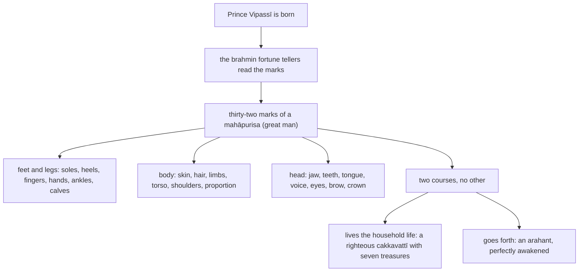

import { Tabs, TabItem } from '@astrojs/starlight/components';

Original text: [7D/1.3 Dvattiṃsamahāpurisalakkhaṇā 50–84](https://tipitaka2500.github.io/tipitaka/7D/1/1.3.html#50) in the [World Tipitaka Edition](https://tipitaka2500.github.io)

## Summary

The third part of the Mahāpadānasutta: the brahmin fortune tellers read the thirty-two marks of a `mahāpurisa` (great man) on the newborn Prince Vipassī and tell King Bandhumā the two courses open to one who bears them, a righteous `cakkavattī` (emperor) with the seven treasures if he lives the household life, an `arahant` (liberated one), a perfectly awakened one, if he goes forth. The marks are listed from the feet to the head, most in a word or two, with the exposition abbreviated by the edition's "… and so on …".

## Diagram

## Text

<Tabs syncKey="paliquote">
<TabItem label="My Translation">
(33.)

50\. Now when Prince Vipassī was born, Bhikkhave, they informed King Bandhumā: ‘A son has been born to you, your majesty; let your majesty see him.’ King Bandhumā, Bhikkhave, saw Prince Vipassī; having seen him, he had the brahmin fortune tellers summoned and said this: ‘Let the worthy brahmin fortune tellers see the prince.’ The brahmin fortune tellers, Bhikkhave, saw Prince Vipassī; having seen him, they said this to King Bandhumā: ‘Be delighted, your majesty; a son of great influence has been born to you. It is a gain for you, Mahārāja, it is a great gain for you, Mahārāja, in whose family such a son has been born. Indeed, your majesty, this prince is endowed with the thirty-two marks of a `mahāpurisa` (great man), for a `mahāpurisa` endowed with which there are only two courses, no other. If he lives the household life, he becomes a king, a `cakkavattī` (emperor), righteous, a just king of the four quarters, who has conquered, who has achieved stability in the country, possessing the seven treasures. He has these seven treasures. That is to say: the wheel treasure, the elephant treasure, the horse treasure, the jewel treasure, the woman treasure, the steward treasure, and the counsellor treasure as the seventh. And he has more than a thousand sons, valiant, with the qualities of heroes, crushing the armies of others. Having subdued this earth bounded by the ocean without force, without weapons, righteously, he rules over it. But if he goes forth from the household life into homelessness, he becomes an `arahant` (liberated one), a `sammāsambuddha` (perfectly awakened one), who rolls back the veil in the world.

(34.)

51\. And with which thirty-two marks of a `mahāpurisa` is this prince endowed, your majesty, for a `mahāpurisa` endowed with which there are only two courses, no other? If he lives the household life, he becomes a king, a `cakkavattī` (emperor), righteous, a just king of the four quarters, who has conquered, who has achieved stability in the country, possessing the seven treasures. He has these seven treasures. That is to say: the wheel treasure, the elephant treasure, the horse treasure, the jewel treasure, the woman treasure, the steward treasure, and the counsellor treasure as the seventh. And he has more than a thousand sons, valiant, with the qualities of heroes, crushing the armies of others. Having subdued this earth bounded by the ocean without force, without weapons, righteously, he rules over it. But if he goes forth from the household life into homelessness, he becomes an `arahant` (liberated one), a `sammāsambuddha` (perfectly awakened one), who rolls back the veil in the world.

(35.)

52\. Indeed, your majesty, this prince has firmly grounded feet. And since this prince, your majesty, has firmly grounded feet, this too is a mark of a `mahāpurisa` for this `mahāpurisa`. (1)

53\. On the soles beneath this prince's feet, your majesty, wheels have arisen, thousand-spoked, with rims, with hubs, complete in every aspect. And since on the soles beneath this prince's feet, your majesty, wheels have arisen, thousand-spoked, with rims, with hubs, complete in every aspect, this too is a mark of a `mahāpurisa` for this `mahāpurisa`. (2)

54\. Indeed, your majesty, this prince has long heels … and so on … (3)

55\. Indeed, your majesty, this prince has long fingers … and so on … (4)

56\. Indeed, your majesty, this prince has soft and tender hands and feet … and so on … (5)

57\. Indeed, your majesty, this prince has lined hands and feet … and so on … (6)

58\. Indeed, your majesty, this prince has arched feet … and so on … (7)

59\. Indeed, your majesty, this prince has calves like an antelope's … and so on … (8)

60\. Indeed, your majesty, this prince, standing without bending down, touches and rubs his knees with both palms … and so on … (9)

61\. Indeed, your majesty, this prince has the genitals enclosed in a sheath … and so on … (10)

62\. Indeed, your majesty, this prince is golden-coloured, with skin like gold … and so on … (11)

63\. Indeed, your majesty, this prince has fine skin; because of the fineness of his skin, dust and dirt do not stick to his body … and so on … (12)

64\. Indeed, your majesty, this prince has individual body hairs; individual hairs have arisen in the hair follicles … and so on … (13)

65\. Indeed, your majesty, this prince has body hair with raised tips; body hairs have arisen with raised tips, blue-black, the colour of collyrium, curling in rings, growing turning to the right … and so on … (14)

66\. Indeed, your majesty, this prince has long and straight limbs … and so on … (15)

67\. Indeed, your majesty, this prince has seven protuberances … and so on … (16)

68\. Indeed, your majesty, this prince has the torso of a lion … and so on … (17)

69\. Indeed, your majesty, this prince has a full upper back … and so on … (18)

70\. Indeed, your majesty, this prince is proportioned like a banyan tree: as much as his body is, so much is his arm span; as much as his arm span is, so much is his body … and so on … (19)

71\. Indeed, your majesty, this prince has well-rounded shoulders … and so on … (20)

72\. Indeed, your majesty, this prince has an acute sense of taste … and so on … (21)

73\. Indeed, your majesty, this prince has a jaw like a lion's … and so on … (22)

74\. Indeed, your majesty, this prince has forty teeth … and so on … (23)

75\. Indeed, your majesty, this prince has even teeth … and so on … (24)

76\. Indeed, your majesty, this prince has gapless teeth … and so on … (25)

77\. Indeed, your majesty, this prince has extremely white canine teeth … and so on … (26)

78\. Indeed, your majesty, this prince has a large tongue … and so on … (27)

79\. Indeed, your majesty, this prince has a deep voice and speaks with a clear and melodious voice … and so on … (28)

80\. Indeed, your majesty, this prince has extremely dark eyes … and so on … (29)

81\. Indeed, your majesty, this prince has eyelashes like a cow's … and so on … (30)

82\. The hair between this prince's eyebrows, your majesty, has arisen white, like soft cotton. And since the hair between this prince's eyebrows, your majesty, has arisen white, like soft cotton, this too is a mark of a `mahāpurisa` for this `mahāpurisa`. (31)

83\. Indeed, your majesty, this prince has a head shaped like a turban. And since this prince, your majesty, has a head shaped like a turban, this too is a mark of a `mahāpurisa` for this `mahāpurisa`. (32)

(36.)

84\. With these thirty-two marks of a `mahāpurisa`, your majesty, this prince is endowed, for a `mahāpurisa` endowed with which there are only two courses, no other. If he lives the household life, he becomes a king, a `cakkavattī` (emperor), righteous, a just king of the four quarters, who has conquered, who has achieved stability in the country, possessing the seven treasures. He has these seven treasures. That is to say: the wheel treasure, the elephant treasure, the horse treasure, the jewel treasure, the woman treasure, the steward treasure, and the counsellor treasure as the seventh. And he has more than a thousand sons, valiant, with the qualities of heroes, crushing the armies of others. Having subdued this earth bounded by the ocean without force, without weapons, righteously, he rules over it. But if he goes forth from the household life into homelessness, he becomes an `arahant` (liberated one), a `sammāsambuddha` (perfectly awakened one), who rolls back the veil in the world.’
</TabItem>

<TabItem label="Pāḷi (Roman IAST)">
(33.)

50\. Jāte kho pana, bhikkhave, vipassimhi kumāre bandhumato rañño paṭivedesuṃ— ‘putto te, deva, jāto, taṃ devo passatū’ti. Addasā kho, bhikkhave, bandhumā rājā vipassiṃ kumāraṃ, disvā nemitte brāhmaṇe āmantāpetvā etadavoca— ‘passantu bhonto nemittā brāhmaṇā kumāran’ti. Addasaṃsu kho, bhikkhave, nemittā brāhmaṇā vipassiṃ kumāraṃ, disvā bandhumantaṃ rājānaṃ etadavocuṃ— ‘attamano, deva, hohi, mahesakkho te putto uppanno, lābhā te, mahārāja, suladdhaṃ te, mahārāja, yassa te kule evarūpo putto uppanno. Ayañhi, deva, kumāro dvattiṃsamahāpurisalakkhaṇehi samannāgato, yehi samannāgatassa mahāpurisassa dveva gatiyo bhavanti anaññā. Sace agāraṃ ajjhāvasati, rājā hoti cakkavattī dhammiko dhammarājā cāturanto vijitāvī janapadatthāvariyappatto sattaratanasamannāgato. Tassimāni sattaratanāni bhavanti. Seyyathidaṃ— cakkaratanaṃ hatthiratanaṃ assaratanaṃ maṇiratanaṃ itthiratanaṃ gahapatiratanaṃ pariṇāyakaratanameva sattamaṃ. Parosahassaṃ kho panassa puttā bhavanti sūrā vīraṅgarūpā parasenappamaddanā. So imaṃ pathaviṃ sāgarapariyantaṃ adaṇḍena asatthena dhammena abhivijiya ajjhāvasati. Sace kho pana agārasmā anagāriyaṃ pabbajati, arahaṃ hoti sammāsambuddho loke vivaṭacchado.

(34.)

51\. Katamehi cāyaṃ, deva, kumāro dvattiṃsamahāpurisalakkhaṇehi samannāgato, yehi samannāgatassa mahāpurisassa dveva gatiyo bhavanti anaññā. Sace agāraṃ ajjhāvasati, rājā hoti cakkavattī dhammiko dhammarājā cāturanto vijitāvī janapadatthāvariyappatto sattaratanasamannāgato. Tassimāni sattaratanāni bhavanti. Seyyathidaṃ— cakkaratanaṃ hatthiratanaṃ assaratanaṃ maṇiratanaṃ itthiratanaṃ gahapatiratanaṃ pariṇāyakaratanameva sattamaṃ. Parosahassaṃ kho panassa puttā bhavanti sūrā vīraṅgarūpā parasenappamaddanā. So imaṃ pathaviṃ sāgarapariyantaṃ adaṇḍena asatthena dhammena abhivijiya ajjhāvasati. Sace kho pana agārasmā anagāriyaṃ pabbajati, arahaṃ hoti sammāsambuddho loke vivaṭacchado.

(35.)

52\. Ayañhi, deva, kumāro suppatiṭṭhitapādo. Yaṃ pāyaṃ, deva, kumāro suppatiṭṭhitapādo. Idampissa mahāpurisassa mahāpurisalakkhaṇaṃ bhavati. (1)

53\. Imassa, deva, kumārassa heṭṭhā pādatalesu cakkāni jātāni sahassārāni sanemikāni sanābhikāni sabbākāraparipūrāni. Yampi imassa, deva, kumārassa heṭṭhā pādatalesu cakkāni jātāni sahassārāni sanemikāni sanābhikāni sabbākāraparipūrāni, idampissa mahāpurisassa mahāpurisalakkhaṇaṃ bhavati. (2)

54\. Ayañhi, deva, kumāro āyatapaṇhī…pe… (3)

55\. Ayañhi, deva, kumāro dīghaṅgulī…pe… (4)

56\. Ayañhi, deva, kumāro mudutalunahatthapādo…pe… (5)

57\. Ayañhi, deva kumāro jālahatthapādo…pe… (6)

58\. Ayañhi, deva, kumāro ussaṅkhapādo…pe… (7)

59\. Ayañhi, deva, kumāro eṇijaṅgho…pe… (8)

60\. Ayañhi, deva, kumāro ṭhitakova anonamanto ubhohi pāṇitalehi jaṇṇukāni parimasati parimajjati…pe… (9)

61\. Ayañhi, deva, kumāro kosohitavatthaguyho…pe… (10)

62\. Ayañhi, deva, kumāro suvaṇṇavaṇṇo kañcanasannibhattaco…pe… (11)

63\. Ayañhi, deva, kumāro sukhumacchavī; sukhumattā chaviyā rajojallaṃ kāye na upalimpati…pe… (12)

64\. Ayañhi, deva, kumāro ekekalomo; ekekāni lomāni lomakūpesu jātāni…pe… (13)

65\. Ayañhi, deva, kumāro uddhaggalomo; uddhaggāni lomāni jātāni nīlāni añjanavaṇṇāni kuṇḍalāvaṭṭāni dakkhiṇāvaṭṭakajātāni…pe… (14)

66\. Ayañhi, deva, kumāro brahmujugatto…pe… (15)

67\. Ayañhi, deva, kumāro sattussado…pe… (16)

68\. Ayañhi, deva, kumāro sīhapubbaddhakāyo…pe… (17)

69\. Ayañhi, deva, kumāro citantaraṃso…pe… (18)

70\. Ayañhi, deva, kumāro nigrodhaparimaṇḍalo yāvatakvassa kāyo tāvatakvassa byāmo, yāvatakvassa byāmo, tāvatakvassa kāyo…pe… (19)

71\. Ayañhi, deva, kumāro samavaṭṭakkhandho…pe… (20)

72\. Ayañhi, deva, kumāro rasaggasaggī…pe… (21)

73\. Ayañhi, deva, kumāro sīhahanu…pe… (22)

74\. Ayañhi, deva, kumāro cattālīsadanto…pe… (23)

75\. Ayañhi, deva, kumāro samadanto…pe… (24)

76\. Ayañhi, deva, kumāro aviraḷadanto…pe… (25)

77\. Ayañhi, deva, kumāro susukkadāṭho…pe… (26)

78\. Ayañhi, deva, kumāro pahūtajivho…pe… (27)

79\. Ayañhi, deva, kumāro brahmassaro karavīkabhāṇī…pe… (28)

80\. Ayañhi, deva, kumāro abhinīlanetto…pe… (29)

81\. Ayañhi, deva, kumāro gopakhumo…pe… (30)

82\. Imassa, deva, kumārassa uṇṇā bhamukantare jātā odātā mudutūlasannibhā. Yampi imassa, deva, kumārassa uṇṇā bhamukantare jātā odātā mudutūlasannibhā, idampimassa mahāpurisassa mahāpurisalakkhaṇaṃ bhavati. (31)

83\. Ayañhi, deva, kumāro uṇhīsasīso. Yaṃ pāyaṃ, deva, kumāro uṇhīsasīso, idampissa mahāpurisassa mahāpurisalakkhaṇaṃ bhavati. (32)

(36.)

84\. Imehi kho ayaṃ, deva, kumāro dvattiṃsamahāpurisalakkhaṇehi samannāgato, yehi samannāgatassa mahāpurisassa dveva gatiyo bhavanti anaññā. Sace agāraṃ ajjhāvasati, rājā hoti cakkavattī dhammiko dhammarājā cāturanto vijitāvī janapadatthāvariyappatto sattaratanasamannāgato. Tassimāni sattaratanāni bhavanti. Seyyathidaṃ— cakkaratanaṃ hatthiratanaṃ assaratanaṃ maṇiratanaṃ itthiratanaṃ gahapatiratanaṃ pariṇāyakaratanameva sattamaṃ. Parosahassaṃ kho panassa puttā bhavanti sūrā vīraṅgarūpā parasenappamaddanā. So imaṃ pathaviṃ sāgarapariyantaṃ adaṇḍena asatthena dhammena abhivijiya ajjhāvasati. Sace kho pana agārasmā anagāriyaṃ pabbajati, arahaṃ hoti sammāsambuddho loke vivaṭacchado’ti.
</TabItem>

<TabItem label="Pāḷi (Brahmi)">
(33.)

50\. 𑀚𑀸𑀢𑁂 𑀔𑁄 𑀧𑀦, 𑀪𑀺𑀓𑁆𑀔𑀯𑁂, 𑀯𑀺𑀧𑀲𑁆𑀲𑀺𑀫𑁆𑀳𑀺 𑀓𑀼𑀫𑀸𑀭𑁂 𑀩𑀦𑁆𑀥𑀼𑀫𑀢𑁄 𑀭𑀜𑁆𑀜𑁄 𑀧𑀝𑀺𑀯𑁂𑀤𑁂𑀲𑀼𑀁— ‘𑀧𑀼𑀢𑁆𑀢𑁄 𑀢𑁂, 𑀤𑁂𑀯, 𑀚𑀸𑀢𑁄, 𑀢𑀁 𑀤𑁂𑀯𑁄 𑀧𑀲𑁆𑀲𑀢𑀽’𑀢𑀺. 𑀅𑀤𑁆𑀤𑀲𑀸 𑀔𑁄, 𑀪𑀺𑀓𑁆𑀔𑀯𑁂, 𑀩𑀦𑁆𑀥𑀼𑀫𑀸 𑀭𑀸𑀚𑀸 𑀯𑀺𑀧𑀲𑁆𑀲𑀺𑀁 𑀓𑀼𑀫𑀸𑀭𑀁, 𑀤𑀺𑀲𑁆𑀯𑀸 𑀦𑁂𑀫𑀺𑀢𑁆𑀢𑁂 𑀩𑁆𑀭𑀸𑀳𑁆𑀫𑀡𑁂 𑀆𑀫𑀦𑁆𑀢𑀸𑀧𑁂𑀢𑁆𑀯𑀸 𑀏𑀢𑀤𑀯𑁄𑀘— ‘𑀧𑀲𑁆𑀲𑀦𑁆𑀢𑀼 𑀪𑁄𑀦𑁆𑀢𑁄 𑀦𑁂𑀫𑀺𑀢𑁆𑀢𑀸 𑀩𑁆𑀭𑀸𑀳𑁆𑀫𑀡𑀸 𑀓𑀼𑀫𑀸𑀭𑀦𑁆’𑀢𑀺. 𑀅𑀤𑁆𑀤𑀲𑀁𑀲𑀼 𑀔𑁄, 𑀪𑀺𑀓𑁆𑀔𑀯𑁂, 𑀦𑁂𑀫𑀺𑀢𑁆𑀢𑀸 𑀩𑁆𑀭𑀸𑀳𑁆𑀫𑀡𑀸 𑀯𑀺𑀧𑀲𑁆𑀲𑀺𑀁 𑀓𑀼𑀫𑀸𑀭𑀁, 𑀤𑀺𑀲𑁆𑀯𑀸 𑀩𑀦𑁆𑀥𑀼𑀫𑀦𑁆𑀢𑀁 𑀭𑀸𑀚𑀸𑀦𑀁 𑀏𑀢𑀤𑀯𑁄𑀘𑀼𑀁— ‘𑀅𑀢𑁆𑀢𑀫𑀦𑁄, 𑀤𑁂𑀯, 𑀳𑁄𑀳𑀺, 𑀫𑀳𑁂𑀲𑀓𑁆𑀔𑁄 𑀢𑁂 𑀧𑀼𑀢𑁆𑀢𑁄 𑀉𑀧𑁆𑀧𑀦𑁆𑀦𑁄, 𑀮𑀸𑀪𑀸 𑀢𑁂, 𑀫𑀳𑀸𑀭𑀸𑀚, 𑀲𑀼𑀮𑀤𑁆𑀥𑀁 𑀢𑁂, 𑀫𑀳𑀸𑀭𑀸𑀚, 𑀬𑀲𑁆𑀲 𑀢𑁂 𑀓𑀼𑀮𑁂 𑀏𑀯𑀭𑀽𑀧𑁄 𑀧𑀼𑀢𑁆𑀢𑁄 𑀉𑀧𑁆𑀧𑀦𑁆𑀦𑁄. 𑀅𑀬𑀜𑁆𑀳𑀺, 𑀤𑁂𑀯, 𑀓𑀼𑀫𑀸𑀭𑁄 𑀤𑁆𑀯𑀢𑁆𑀢𑀺𑀁𑀲𑀫𑀳𑀸𑀧𑀼𑀭𑀺𑀲𑀮𑀓𑁆𑀔𑀡𑁂𑀳𑀺 𑀲𑀫𑀦𑁆𑀦𑀸𑀕𑀢𑁄, 𑀬𑁂𑀳𑀺 𑀲𑀫𑀦𑁆𑀦𑀸𑀕𑀢𑀲𑁆𑀲 𑀫𑀳𑀸𑀧𑀼𑀭𑀺𑀲𑀲𑁆𑀲 𑀤𑁆𑀯𑁂𑀯 𑀕𑀢𑀺𑀬𑁄 𑀪𑀯𑀦𑁆𑀢𑀺 𑀅𑀦𑀜𑁆𑀜𑀸. 𑀲𑀘𑁂 𑀅𑀕𑀸𑀭𑀁 𑀅𑀚𑁆𑀛𑀸𑀯𑀲𑀢𑀺, 𑀭𑀸𑀚𑀸 𑀳𑁄𑀢𑀺 𑀘𑀓𑁆𑀓𑀯𑀢𑁆𑀢𑀻 𑀥𑀫𑁆𑀫𑀺𑀓𑁄 𑀥𑀫𑁆𑀫𑀭𑀸𑀚𑀸 𑀘𑀸𑀢𑀼𑀭𑀦𑁆𑀢𑁄 𑀯𑀺𑀚𑀺𑀢𑀸𑀯𑀻 𑀚𑀦𑀧𑀤𑀢𑁆𑀣𑀸𑀯𑀭𑀺𑀬𑀧𑁆𑀧𑀢𑁆𑀢𑁄 𑀲𑀢𑁆𑀢𑀭𑀢𑀦𑀲𑀫𑀦𑁆𑀦𑀸𑀕𑀢𑁄. 𑀢𑀲𑁆𑀲𑀺𑀫𑀸𑀦𑀺 𑀲𑀢𑁆𑀢𑀭𑀢𑀦𑀸𑀦𑀺 𑀪𑀯𑀦𑁆𑀢𑀺. 𑀲𑁂𑀬𑁆𑀬𑀣𑀺𑀤𑀁— 𑀘𑀓𑁆𑀓𑀭𑀢𑀦𑀁 𑀳𑀢𑁆𑀣𑀺𑀭𑀢𑀦𑀁 𑀅𑀲𑁆𑀲𑀭𑀢𑀦𑀁 𑀫𑀡𑀺𑀭𑀢𑀦𑀁 𑀇𑀢𑁆𑀣𑀺𑀭𑀢𑀦𑀁 𑀕𑀳𑀧𑀢𑀺𑀭𑀢𑀦𑀁 𑀧𑀭𑀺𑀡𑀸𑀬𑀓𑀭𑀢𑀦𑀫𑁂𑀯 𑀲𑀢𑁆𑀢𑀫𑀁. 𑀧𑀭𑁄𑀲𑀳𑀲𑁆𑀲𑀁 𑀔𑁄 𑀧𑀦𑀲𑁆𑀲 𑀧𑀼𑀢𑁆𑀢𑀸 𑀪𑀯𑀦𑁆𑀢𑀺 𑀲𑀽𑀭𑀸 𑀯𑀻𑀭𑀗𑁆𑀕𑀭𑀽𑀧𑀸 𑀧𑀭𑀲𑁂𑀦𑀧𑁆𑀧𑀫𑀤𑁆𑀤𑀦𑀸. 𑀲𑁄 𑀇𑀫𑀁 𑀧𑀣𑀯𑀺𑀁 𑀲𑀸𑀕𑀭𑀧𑀭𑀺𑀬𑀦𑁆𑀢𑀁 𑀅𑀤𑀡𑁆𑀟𑁂𑀦 𑀅𑀲𑀢𑁆𑀣𑁂𑀦 𑀥𑀫𑁆𑀫𑁂𑀦 𑀅𑀪𑀺𑀯𑀺𑀚𑀺𑀬 𑀅𑀚𑁆𑀛𑀸𑀯𑀲𑀢𑀺. 𑀲𑀘𑁂 𑀔𑁄 𑀧𑀦 𑀅𑀕𑀸𑀭𑀲𑁆𑀫𑀸 𑀅𑀦𑀕𑀸𑀭𑀺𑀬𑀁 𑀧𑀩𑁆𑀩𑀚𑀢𑀺, 𑀅𑀭𑀳𑀁 𑀳𑁄𑀢𑀺 𑀲𑀫𑁆𑀫𑀸𑀲𑀫𑁆𑀩𑀼𑀤𑁆𑀥𑁄 𑀮𑁄𑀓𑁂 𑀯𑀺𑀯𑀝𑀘𑁆𑀙𑀤𑁄.

(34.)

51\. 𑀓𑀢𑀫𑁂𑀳𑀺 𑀘𑀸𑀬𑀁, 𑀤𑁂𑀯, 𑀓𑀼𑀫𑀸𑀭𑁄 𑀤𑁆𑀯𑀢𑁆𑀢𑀺𑀁𑀲𑀫𑀳𑀸𑀧𑀼𑀭𑀺𑀲𑀮𑀓𑁆𑀔𑀡𑁂𑀳𑀺 𑀲𑀫𑀦𑁆𑀦𑀸𑀕𑀢𑁄, 𑀬𑁂𑀳𑀺 𑀲𑀫𑀦𑁆𑀦𑀸𑀕𑀢𑀲𑁆𑀲 𑀫𑀳𑀸𑀧𑀼𑀭𑀺𑀲𑀲𑁆𑀲 𑀤𑁆𑀯𑁂𑀯 𑀕𑀢𑀺𑀬𑁄 𑀪𑀯𑀦𑁆𑀢𑀺 𑀅𑀦𑀜𑁆𑀜𑀸. 𑀲𑀘𑁂 𑀅𑀕𑀸𑀭𑀁 𑀅𑀚𑁆𑀛𑀸𑀯𑀲𑀢𑀺, 𑀭𑀸𑀚𑀸 𑀳𑁄𑀢𑀺 𑀘𑀓𑁆𑀓𑀯𑀢𑁆𑀢𑀻 𑀥𑀫𑁆𑀫𑀺𑀓𑁄 𑀥𑀫𑁆𑀫𑀭𑀸𑀚𑀸 𑀘𑀸𑀢𑀼𑀭𑀦𑁆𑀢𑁄 𑀯𑀺𑀚𑀺𑀢𑀸𑀯𑀻 𑀚𑀦𑀧𑀤𑀢𑁆𑀣𑀸𑀯𑀭𑀺𑀬𑀧𑁆𑀧𑀢𑁆𑀢𑁄 𑀲𑀢𑁆𑀢𑀭𑀢𑀦𑀲𑀫𑀦𑁆𑀦𑀸𑀕𑀢𑁄. 𑀢𑀲𑁆𑀲𑀺𑀫𑀸𑀦𑀺 𑀲𑀢𑁆𑀢𑀭𑀢𑀦𑀸𑀦𑀺 𑀪𑀯𑀦𑁆𑀢𑀺. 𑀲𑁂𑀬𑁆𑀬𑀣𑀺𑀤𑀁— 𑀘𑀓𑁆𑀓𑀭𑀢𑀦𑀁 𑀳𑀢𑁆𑀣𑀺𑀭𑀢𑀦𑀁 𑀅𑀲𑁆𑀲𑀭𑀢𑀦𑀁 𑀫𑀡𑀺𑀭𑀢𑀦𑀁 𑀇𑀢𑁆𑀣𑀺𑀭𑀢𑀦𑀁 𑀕𑀳𑀧𑀢𑀺𑀭𑀢𑀦𑀁 𑀧𑀭𑀺𑀡𑀸𑀬𑀓𑀭𑀢𑀦𑀫𑁂𑀯 𑀲𑀢𑁆𑀢𑀫𑀁. 𑀧𑀭𑁄𑀲𑀳𑀲𑁆𑀲𑀁 𑀔𑁄 𑀧𑀦𑀲𑁆𑀲 𑀧𑀼𑀢𑁆𑀢𑀸 𑀪𑀯𑀦𑁆𑀢𑀺 𑀲𑀽𑀭𑀸 𑀯𑀻𑀭𑀗𑁆𑀕𑀭𑀽𑀧𑀸 𑀧𑀭𑀲𑁂𑀦𑀧𑁆𑀧𑀫𑀤𑁆𑀤𑀦𑀸. 𑀲𑁄 𑀇𑀫𑀁 𑀧𑀣𑀯𑀺𑀁 𑀲𑀸𑀕𑀭𑀧𑀭𑀺𑀬𑀦𑁆𑀢𑀁 𑀅𑀤𑀡𑁆𑀟𑁂𑀦 𑀅𑀲𑀢𑁆𑀣𑁂𑀦 𑀥𑀫𑁆𑀫𑁂𑀦 𑀅𑀪𑀺𑀯𑀺𑀚𑀺𑀬 𑀅𑀚𑁆𑀛𑀸𑀯𑀲𑀢𑀺. 𑀲𑀘𑁂 𑀔𑁄 𑀧𑀦 𑀅𑀕𑀸𑀭𑀲𑁆𑀫𑀸 𑀅𑀦𑀕𑀸𑀭𑀺𑀬𑀁 𑀧𑀩𑁆𑀩𑀚𑀢𑀺, 𑀅𑀭𑀳𑀁 𑀳𑁄𑀢𑀺 𑀲𑀫𑁆𑀫𑀸𑀲𑀫𑁆𑀩𑀼𑀤𑁆𑀥𑁄 𑀮𑁄𑀓𑁂 𑀯𑀺𑀯𑀝𑀘𑁆𑀙𑀤𑁄.

(35.)

52\. 𑀅𑀬𑀜𑁆𑀳𑀺, 𑀤𑁂𑀯, 𑀓𑀼𑀫𑀸𑀭𑁄 𑀲𑀼𑀧𑁆𑀧𑀢𑀺𑀝𑁆𑀞𑀺𑀢𑀧𑀸𑀤𑁄. 𑀬𑀁 𑀧𑀸𑀬𑀁, 𑀤𑁂𑀯, 𑀓𑀼𑀫𑀸𑀭𑁄 𑀲𑀼𑀧𑁆𑀧𑀢𑀺𑀝𑁆𑀞𑀺𑀢𑀧𑀸𑀤𑁄. 𑀇𑀤𑀫𑁆𑀧𑀺𑀲𑁆𑀲 𑀫𑀳𑀸𑀧𑀼𑀭𑀺𑀲𑀲𑁆𑀲 𑀫𑀳𑀸𑀧𑀼𑀭𑀺𑀲𑀮𑀓𑁆𑀔𑀡𑀁 𑀪𑀯𑀢𑀺. (1)

53\. 𑀇𑀫𑀲𑁆𑀲, 𑀤𑁂𑀯, 𑀓𑀼𑀫𑀸𑀭𑀲𑁆𑀲 𑀳𑁂𑀝𑁆𑀞𑀸 𑀧𑀸𑀤𑀢𑀮𑁂𑀲𑀼 𑀘𑀓𑁆𑀓𑀸𑀦𑀺 𑀚𑀸𑀢𑀸𑀦𑀺 𑀲𑀳𑀲𑁆𑀲𑀸𑀭𑀸𑀦𑀺 𑀲𑀦𑁂𑀫𑀺𑀓𑀸𑀦𑀺 𑀲𑀦𑀸𑀪𑀺𑀓𑀸𑀦𑀺 𑀲𑀩𑁆𑀩𑀸𑀓𑀸𑀭𑀧𑀭𑀺𑀧𑀽𑀭𑀸𑀦𑀺. 𑀬𑀫𑁆𑀧𑀺 𑀇𑀫𑀲𑁆𑀲, 𑀤𑁂𑀯, 𑀓𑀼𑀫𑀸𑀭𑀲𑁆𑀲 𑀳𑁂𑀝𑁆𑀞𑀸 𑀧𑀸𑀤𑀢𑀮𑁂𑀲𑀼 𑀘𑀓𑁆𑀓𑀸𑀦𑀺 𑀚𑀸𑀢𑀸𑀦𑀺 𑀲𑀳𑀲𑁆𑀲𑀸𑀭𑀸𑀦𑀺 𑀲𑀦𑁂𑀫𑀺𑀓𑀸𑀦𑀺 𑀲𑀦𑀸𑀪𑀺𑀓𑀸𑀦𑀺 𑀲𑀩𑁆𑀩𑀸𑀓𑀸𑀭𑀧𑀭𑀺𑀧𑀽𑀭𑀸𑀦𑀺, 𑀇𑀤𑀫𑁆𑀧𑀺𑀲𑁆𑀲 𑀫𑀳𑀸𑀧𑀼𑀭𑀺𑀲𑀲𑁆𑀲 𑀫𑀳𑀸𑀧𑀼𑀭𑀺𑀲𑀮𑀓𑁆𑀔𑀡𑀁 𑀪𑀯𑀢𑀺. (2)

54\. 𑀅𑀬𑀜𑁆𑀳𑀺, 𑀤𑁂𑀯, 𑀓𑀼𑀫𑀸𑀭𑁄 𑀆𑀬𑀢𑀧𑀡𑁆𑀳𑀻…𑀧𑁂… (3)

55\. 𑀅𑀬𑀜𑁆𑀳𑀺, 𑀤𑁂𑀯, 𑀓𑀼𑀫𑀸𑀭𑁄 𑀤𑀻𑀖𑀗𑁆𑀕𑀼𑀮𑀻…𑀧𑁂… (4)

56\. 𑀅𑀬𑀜𑁆𑀳𑀺, 𑀤𑁂𑀯, 𑀓𑀼𑀫𑀸𑀭𑁄 𑀫𑀼𑀤𑀼𑀢𑀮𑀼𑀦𑀳𑀢𑁆𑀣𑀧𑀸𑀤𑁄…𑀧𑁂… (5)

57\. 𑀅𑀬𑀜𑁆𑀳𑀺, 𑀤𑁂𑀯 𑀓𑀼𑀫𑀸𑀭𑁄 𑀚𑀸𑀮𑀳𑀢𑁆𑀣𑀧𑀸𑀤𑁄…𑀧𑁂… (6)

58\. 𑀅𑀬𑀜𑁆𑀳𑀺, 𑀤𑁂𑀯, 𑀓𑀼𑀫𑀸𑀭𑁄 𑀉𑀲𑁆𑀲𑀗𑁆𑀔𑀧𑀸𑀤𑁄…𑀧𑁂… (7)

59\. 𑀅𑀬𑀜𑁆𑀳𑀺, 𑀤𑁂𑀯, 𑀓𑀼𑀫𑀸𑀭𑁄 𑀏𑀡𑀺𑀚𑀗𑁆𑀖𑁄…𑀧𑁂… (8)

60\. 𑀅𑀬𑀜𑁆𑀳𑀺, 𑀤𑁂𑀯, 𑀓𑀼𑀫𑀸𑀭𑁄 𑀞𑀺𑀢𑀓𑁄𑀯 𑀅𑀦𑁄𑀦𑀫𑀦𑁆𑀢𑁄 𑀉𑀪𑁄𑀳𑀺 𑀧𑀸𑀡𑀺𑀢𑀮𑁂𑀳𑀺 𑀚𑀡𑁆𑀡𑀼𑀓𑀸𑀦𑀺 𑀧𑀭𑀺𑀫𑀲𑀢𑀺 𑀧𑀭𑀺𑀫𑀚𑁆𑀚𑀢𑀺…𑀧𑁂… (9)

61\. 𑀅𑀬𑀜𑁆𑀳𑀺, 𑀤𑁂𑀯, 𑀓𑀼𑀫𑀸𑀭𑁄 𑀓𑁄𑀲𑁄𑀳𑀺𑀢𑀯𑀢𑁆𑀣𑀕𑀼𑀬𑁆𑀳𑁄…𑀧𑁂… (10)

62\. 𑀅𑀬𑀜𑁆𑀳𑀺, 𑀤𑁂𑀯, 𑀓𑀼𑀫𑀸𑀭𑁄 𑀲𑀼𑀯𑀡𑁆𑀡𑀯𑀡𑁆𑀡𑁄 𑀓𑀜𑁆𑀘𑀦𑀲𑀦𑁆𑀦𑀺𑀪𑀢𑁆𑀢𑀘𑁄…𑀧𑁂… (11)

63\. 𑀅𑀬𑀜𑁆𑀳𑀺, 𑀤𑁂𑀯, 𑀓𑀼𑀫𑀸𑀭𑁄 𑀲𑀼𑀔𑀼𑀫𑀘𑁆𑀙𑀯𑀻; 𑀲𑀼𑀔𑀼𑀫𑀢𑁆𑀢𑀸 𑀙𑀯𑀺𑀬𑀸 𑀭𑀚𑁄𑀚𑀮𑁆𑀮𑀁 𑀓𑀸𑀬𑁂 𑀦 𑀉𑀧𑀮𑀺𑀫𑁆𑀧𑀢𑀺…𑀧𑁂… (12)

64\. 𑀅𑀬𑀜𑁆𑀳𑀺, 𑀤𑁂𑀯, 𑀓𑀼𑀫𑀸𑀭𑁄 𑀏𑀓𑁂𑀓𑀮𑁄𑀫𑁄; 𑀏𑀓𑁂𑀓𑀸𑀦𑀺 𑀮𑁄𑀫𑀸𑀦𑀺 𑀮𑁄𑀫𑀓𑀽𑀧𑁂𑀲𑀼 𑀚𑀸𑀢𑀸𑀦𑀺…𑀧𑁂… (13)

65\. 𑀅𑀬𑀜𑁆𑀳𑀺, 𑀤𑁂𑀯, 𑀓𑀼𑀫𑀸𑀭𑁄 𑀉𑀤𑁆𑀥𑀕𑁆𑀕𑀮𑁄𑀫𑁄; 𑀉𑀤𑁆𑀥𑀕𑁆𑀕𑀸𑀦𑀺 𑀮𑁄𑀫𑀸𑀦𑀺 𑀚𑀸𑀢𑀸𑀦𑀺 𑀦𑀻𑀮𑀸𑀦𑀺 𑀅𑀜𑁆𑀚𑀦𑀯𑀡𑁆𑀡𑀸𑀦𑀺 𑀓𑀼𑀡𑁆𑀟𑀮𑀸𑀯𑀝𑁆𑀝𑀸𑀦𑀺 𑀤𑀓𑁆𑀔𑀺𑀡𑀸𑀯𑀝𑁆𑀝𑀓𑀚𑀸𑀢𑀸𑀦𑀺…𑀧𑁂… (14)

66\. 𑀅𑀬𑀜𑁆𑀳𑀺, 𑀤𑁂𑀯, 𑀓𑀼𑀫𑀸𑀭𑁄 𑀩𑁆𑀭𑀳𑁆𑀫𑀼𑀚𑀼𑀕𑀢𑁆𑀢𑁄…𑀧𑁂… (15)

67\. 𑀅𑀬𑀜𑁆𑀳𑀺, 𑀤𑁂𑀯, 𑀓𑀼𑀫𑀸𑀭𑁄 𑀲𑀢𑁆𑀢𑀼𑀲𑁆𑀲𑀤𑁄…𑀧𑁂… (16)

68\. 𑀅𑀬𑀜𑁆𑀳𑀺, 𑀤𑁂𑀯, 𑀓𑀼𑀫𑀸𑀭𑁄 𑀲𑀻𑀳𑀧𑀼𑀩𑁆𑀩𑀤𑁆𑀥𑀓𑀸𑀬𑁄…𑀧𑁂… (17)

69\. 𑀅𑀬𑀜𑁆𑀳𑀺, 𑀤𑁂𑀯, 𑀓𑀼𑀫𑀸𑀭𑁄 𑀘𑀺𑀢𑀦𑁆𑀢𑀭𑀁𑀲𑁄…𑀧𑁂… (18)

70\. 𑀅𑀬𑀜𑁆𑀳𑀺, 𑀤𑁂𑀯, 𑀓𑀼𑀫𑀸𑀭𑁄 𑀦𑀺𑀕𑁆𑀭𑁄𑀥𑀧𑀭𑀺𑀫𑀡𑁆𑀟𑀮𑁄 𑀬𑀸𑀯𑀢𑀓𑁆𑀯𑀲𑁆𑀲 𑀓𑀸𑀬𑁄 𑀢𑀸𑀯𑀢𑀓𑁆𑀯𑀲𑁆𑀲 𑀩𑁆𑀬𑀸𑀫𑁄, 𑀬𑀸𑀯𑀢𑀓𑁆𑀯𑀲𑁆𑀲 𑀩𑁆𑀬𑀸𑀫𑁄, 𑀢𑀸𑀯𑀢𑀓𑁆𑀯𑀲𑁆𑀲 𑀓𑀸𑀬𑁄…𑀧𑁂… (19)

71\. 𑀅𑀬𑀜𑁆𑀳𑀺, 𑀤𑁂𑀯, 𑀓𑀼𑀫𑀸𑀭𑁄 𑀲𑀫𑀯𑀝𑁆𑀝𑀓𑁆𑀔𑀦𑁆𑀥𑁄…𑀧𑁂… (20)

72\. 𑀅𑀬𑀜𑁆𑀳𑀺, 𑀤𑁂𑀯, 𑀓𑀼𑀫𑀸𑀭𑁄 𑀭𑀲𑀕𑁆𑀕𑀲𑀕𑁆𑀕𑀻…𑀧𑁂… (21)

73\. 𑀅𑀬𑀜𑁆𑀳𑀺, 𑀤𑁂𑀯, 𑀓𑀼𑀫𑀸𑀭𑁄 𑀲𑀻𑀳𑀳𑀦𑀼…𑀧𑁂… (22)

74\. 𑀅𑀬𑀜𑁆𑀳𑀺, 𑀤𑁂𑀯, 𑀓𑀼𑀫𑀸𑀭𑁄 𑀘𑀢𑁆𑀢𑀸𑀮𑀻𑀲𑀤𑀦𑁆𑀢𑁄…𑀧𑁂… (23)

75\. 𑀅𑀬𑀜𑁆𑀳𑀺, 𑀤𑁂𑀯, 𑀓𑀼𑀫𑀸𑀭𑁄 𑀲𑀫𑀤𑀦𑁆𑀢𑁄…𑀧𑁂… (24)

76\. 𑀅𑀬𑀜𑁆𑀳𑀺, 𑀤𑁂𑀯, 𑀓𑀼𑀫𑀸𑀭𑁄 𑀅𑀯𑀺𑀭𑀍𑀅𑀤𑀦𑁆𑀢𑁄…𑀧𑁂… (25)

77\. 𑀅𑀬𑀜𑁆𑀳𑀺, 𑀤𑁂𑀯, 𑀓𑀼𑀫𑀸𑀭𑁄 𑀲𑀼𑀲𑀼𑀓𑁆𑀓𑀤𑀸𑀞𑁄…𑀧𑁂… (26)

78\. 𑀅𑀬𑀜𑁆𑀳𑀺, 𑀤𑁂𑀯, 𑀓𑀼𑀫𑀸𑀭𑁄 𑀧𑀳𑀽𑀢𑀚𑀺𑀯𑁆𑀳𑁄…𑀧𑁂… (27)

79\. 𑀅𑀬𑀜𑁆𑀳𑀺, 𑀤𑁂𑀯, 𑀓𑀼𑀫𑀸𑀭𑁄 𑀩𑁆𑀭𑀳𑁆𑀫𑀲𑁆𑀲𑀭𑁄 𑀓𑀭𑀯𑀻𑀓𑀪𑀸𑀡𑀻…𑀧𑁂… (28)

80\. 𑀅𑀬𑀜𑁆𑀳𑀺, 𑀤𑁂𑀯, 𑀓𑀼𑀫𑀸𑀭𑁄 𑀅𑀪𑀺𑀦𑀻𑀮𑀦𑁂𑀢𑁆𑀢𑁄…𑀧𑁂… (29)

81\. 𑀅𑀬𑀜𑁆𑀳𑀺, 𑀤𑁂𑀯, 𑀓𑀼𑀫𑀸𑀭𑁄 𑀕𑁄𑀧𑀔𑀼𑀫𑁄…𑀧𑁂… (30)

82\. 𑀇𑀫𑀲𑁆𑀲, 𑀤𑁂𑀯, 𑀓𑀼𑀫𑀸𑀭𑀲𑁆𑀲 𑀉𑀡𑁆𑀡𑀸 𑀪𑀫𑀼𑀓𑀦𑁆𑀢𑀭𑁂 𑀚𑀸𑀢𑀸 𑀑𑀤𑀸𑀢𑀸 𑀫𑀼𑀤𑀼𑀢𑀽𑀮𑀲𑀦𑁆𑀦𑀺𑀪𑀸. 𑀬𑀫𑁆𑀧𑀺 𑀇𑀫𑀲𑁆𑀲, 𑀤𑁂𑀯, 𑀓𑀼𑀫𑀸𑀭𑀲𑁆𑀲 𑀉𑀡𑁆𑀡𑀸 𑀪𑀫𑀼𑀓𑀦𑁆𑀢𑀭𑁂 𑀚𑀸𑀢𑀸 𑀑𑀤𑀸𑀢𑀸 𑀫𑀼𑀤𑀼𑀢𑀽𑀮𑀲𑀦𑁆𑀦𑀺𑀪𑀸, 𑀇𑀤𑀫𑁆𑀧𑀺𑀫𑀲𑁆𑀲 𑀫𑀳𑀸𑀧𑀼𑀭𑀺𑀲𑀲𑁆𑀲 𑀫𑀳𑀸𑀧𑀼𑀭𑀺𑀲𑀮𑀓𑁆𑀔𑀡𑀁 𑀪𑀯𑀢𑀺. (31)

83\. 𑀅𑀬𑀜𑁆𑀳𑀺, 𑀤𑁂𑀯, 𑀓𑀼𑀫𑀸𑀭𑁄 𑀉𑀡𑁆𑀳𑀻𑀲𑀲𑀻𑀲𑁄. 𑀬𑀁 𑀧𑀸𑀬𑀁, 𑀤𑁂𑀯, 𑀓𑀼𑀫𑀸𑀭𑁄 𑀉𑀡𑁆𑀳𑀻𑀲𑀲𑀻𑀲𑁄, 𑀇𑀤𑀫𑁆𑀧𑀺𑀲𑁆𑀲 𑀫𑀳𑀸𑀧𑀼𑀭𑀺𑀲𑀲𑁆𑀲 𑀫𑀳𑀸𑀧𑀼𑀭𑀺𑀲𑀮𑀓𑁆𑀔𑀡𑀁 𑀪𑀯𑀢𑀺. (32)

(36.)

84\. 𑀇𑀫𑁂𑀳𑀺 𑀔𑁄 𑀅𑀬𑀁, 𑀤𑁂𑀯, 𑀓𑀼𑀫𑀸𑀭𑁄 𑀤𑁆𑀯𑀢𑁆𑀢𑀺𑀁𑀲𑀫𑀳𑀸𑀧𑀼𑀭𑀺𑀲𑀮𑀓𑁆𑀔𑀡𑁂𑀳𑀺 𑀲𑀫𑀦𑁆𑀦𑀸𑀕𑀢𑁄, 𑀬𑁂𑀳𑀺 𑀲𑀫𑀦𑁆𑀦𑀸𑀕𑀢𑀲𑁆𑀲 𑀫𑀳𑀸𑀧𑀼𑀭𑀺𑀲𑀲𑁆𑀲 𑀤𑁆𑀯𑁂𑀯 𑀕𑀢𑀺𑀬𑁄 𑀪𑀯𑀦𑁆𑀢𑀺 𑀅𑀦𑀜𑁆𑀜𑀸. 𑀲𑀘𑁂 𑀅𑀕𑀸𑀭𑀁 𑀅𑀚𑁆𑀛𑀸𑀯𑀲𑀢𑀺, 𑀭𑀸𑀚𑀸 𑀳𑁄𑀢𑀺 𑀘𑀓𑁆𑀓𑀯𑀢𑁆𑀢𑀻 𑀥𑀫𑁆𑀫𑀺𑀓𑁄 𑀥𑀫𑁆𑀫𑀭𑀸𑀚𑀸 𑀘𑀸𑀢𑀼𑀭𑀦𑁆𑀢𑁄 𑀯𑀺𑀚𑀺𑀢𑀸𑀯𑀻 𑀚𑀦𑀧𑀤𑀢𑁆𑀣𑀸𑀯𑀭𑀺𑀬𑀧𑁆𑀧𑀢𑁆𑀢𑁄 𑀲𑀢𑁆𑀢𑀭𑀢𑀦𑀲𑀫𑀦𑁆𑀦𑀸𑀕𑀢𑁄. 𑀢𑀲𑁆𑀲𑀺𑀫𑀸𑀦𑀺 𑀲𑀢𑁆𑀢𑀭𑀢𑀦𑀸𑀦𑀺 𑀪𑀯𑀦𑁆𑀢𑀺. 𑀲𑁂𑀬𑁆𑀬𑀣𑀺𑀤𑀁— 𑀘𑀓𑁆𑀓𑀭𑀢𑀦𑀁 𑀳𑀢𑁆𑀣𑀺𑀭𑀢𑀦𑀁 𑀅𑀲𑁆𑀲𑀭𑀢𑀦𑀁 𑀫𑀡𑀺𑀭𑀢𑀦𑀁 𑀇𑀢𑁆𑀣𑀺𑀭𑀢𑀦𑀁 𑀕𑀳𑀧𑀢𑀺𑀭𑀢𑀦𑀁 𑀧𑀭𑀺𑀡𑀸𑀬𑀓𑀭𑀢𑀦𑀫𑁂𑀯 𑀲𑀢𑁆𑀢𑀫𑀁. 𑀧𑀭𑁄𑀲𑀳𑀲𑁆𑀲𑀁 𑀔𑁄 𑀧𑀦𑀲𑁆𑀲 𑀧𑀼𑀢𑁆𑀢𑀸 𑀪𑀯𑀦𑁆𑀢𑀺 𑀲𑀽𑀭𑀸 𑀯𑀻𑀭𑀗𑁆𑀕𑀭𑀽𑀧𑀸 𑀧𑀭𑀲𑁂𑀦𑀧𑁆𑀧𑀫𑀤𑁆𑀤𑀦𑀸. 𑀲𑁄 𑀇𑀫𑀁 𑀧𑀣𑀯𑀺𑀁 𑀲𑀸𑀕𑀭𑀧𑀭𑀺𑀬𑀦𑁆𑀢𑀁 𑀅𑀤𑀡𑁆𑀟𑁂𑀦 𑀅𑀲𑀢𑁆𑀣𑁂𑀦 𑀥𑀫𑁆𑀫𑁂𑀦 𑀅𑀪𑀺𑀯𑀺𑀚𑀺𑀬 𑀅𑀚𑁆𑀛𑀸𑀯𑀲𑀢𑀺. 𑀲𑀘𑁂 𑀔𑁄 𑀧𑀦 𑀅𑀕𑀸𑀭𑀲𑁆𑀫𑀸 𑀅𑀦𑀕𑀸𑀭𑀺𑀬𑀁 𑀧𑀩𑁆𑀩𑀚𑀢𑀺, 𑀅𑀭𑀳𑀁 𑀳𑁄𑀢𑀺 𑀲𑀫𑁆𑀫𑀸𑀲𑀫𑁆𑀩𑀼𑀤𑁆𑀥𑁄 𑀮𑁄𑀓𑁂 𑀯𑀺𑀯𑀝𑀘𑁆𑀙𑀤𑁄’𑀢𑀺.
</TabItem>

<TabItem label="Interlinear">
(33.)

[50](https://tipitaka2500.github.io/tipitaka/7D/1/1.3.html#50) Jāte kho pana, bhikkhave, vipassimhi kumāre bandhumato rañño paṭivedesuṃ— ‘putto te, deva, jāto, taṃ devo passatū’ti.  
🚹⨀⑦🔽(ta)(jāta) ⏏️(kho) ⏏️(pana) 🚹⨂⓪(bhikkhu) 🚹⨀⑦(vipassī) 🚹⨀⑦(kumāra) 🚹⨀④(bandhumant) 🚹⨀④(rāja) 🟠⨂🤟⏮(paṭivedeti) 🚹⨀①(putta) *️⃣🤘⚧⨀④(tvaṃ) 🚹⨀⓪(deva) 🚹⨀①🔽(ta)(jāta) *️⃣🤟🚹⨀②(ta) 🚹⨀①(deva) 🟢⨀🤟⏹(passati) ⏏️(iti)  
when born | indeed | now | Bhikkhave | Vipassī | the prince | to Bandhumā | the king | they informed | a son | to you | your majesty | born | him | your majesty | let see | (end quote)  
Now when Prince Vipassī was born, Bhikkhave, they informed King Bandhumā: ‘A son has been born to you, your majesty; let your majesty see him.’

Addasā kho, bhikkhave, bandhumā rājā vipassiṃ kumāraṃ, disvā nemitte brāhmaṇe āmantāpetvā etadavoca— ‘passantu bhonto nemittā brāhmaṇā kumāran’ti.  
🟢⨀🤟⏮(passati) ⏏️(kho) 🚹⨂⓪(bhikkhu) 🚹⨀①(bandhumant) 🚹⨀①(rāja) 🚹⨀②(vipassī) 🚹⨀②(kumāra) 🔽(tvā)(passati) 🚹⨂②(nemitta) 🚹⨂②(brāhmaṇa) 🔽(tvā)(āmantāpeti) *️⃣🤟🚻⨀②(eta) 🟢⨀🤟⏮(vadati) 🟢⨂🤟⏹(passati) 🚹⨂①(bhavant) 🚹⨂①(nemitta) 🚹⨂①(brāhmaṇa) 🚹⨀②(kumāra) ⏏️(iti)  
saw | indeed | Bhikkhave | Bandhumā | King | Vipassī | Prince | having seen | the fortune tellers | brahmin | having had summoned | this | said | let see | the worthy | fortune tellers | brahmin | the prince | (end quote)  
King Bandhumā, Bhikkhave, saw Prince Vipassī; having seen him, he had the brahmin fortune tellers summoned and said this: ‘Let the worthy brahmin fortune tellers see the prince.’

Addasaṃsu kho, bhikkhave, nemittā brāhmaṇā vipassiṃ kumāraṃ, disvā bandhumantaṃ rājānaṃ etadavocuṃ— ‘attamano, deva, hohi, mahesakkho te putto uppanno, lābhā te, mahārāja, suladdhaṃ te, mahārāja, yassa te kule evarūpo putto uppanno.  
🟢⨂🤟⏮(passati) ⏏️(kho) 🚹⨂⓪(bhikkhu) 🚹⨂①(nemitta) 🚹⨂①(brāhmaṇa) 🚹⨀②(vipassī) 🚹⨀②(kumāra) 🔽(tvā)(passati) 🚹⨀②(bandhumant) 🚹⨀②(rāja) *️⃣🤟🚻⨀②(eta) 🟢⨂🤟⏮(vadati) 🚹⨀①🆎(atta+mana) 🚹⨀⓪(deva) 🟢⨀🤘⏹(hoti) 🚹⨀①(mahesakkha) *️⃣🤘⚧⨀④(tvaṃ) 🚹⨀①(putta) 🚹⨀①🔽(ta)(uppanna) ⏏️(lābhā) *️⃣🤘⚧⨀④(tvaṃ) 🚹⨀⓪🆎(mahā+rāja) ⏏️(suladdhaṃ) *️⃣🤘⚧⨀④(tvaṃ) 🚹⨀⓪🆎(mahā+rāja) *️⃣🤟🚹⨀⑥(ya) *️⃣🤘⚧⨀⑥(tvaṃ) 🚻⨀⑦(kula) 🚹⨀①🆎(evaṃ+rūpa) 🚹⨀①(putta) 🚹⨀①🔽(ta)(uppanna)  
saw | indeed | Bhikkhave | the fortune tellers | brahmin | Vipassī | Prince | having seen | Bandhumā | King | this | said | delighted | your majesty | be | of great influence | to you | a son | born | it is a gain | for you | Mahārāja | it is a great gain | for you | Mahārāja | whose | your | in family | such | a son | born  
The brahmin fortune tellers, Bhikkhave, saw Prince Vipassī; having seen him, they said this to King Bandhumā: ‘Be delighted, your majesty; a son of great influence has been born to you. It is a gain for you, Mahārāja, it is a great gain for you, Mahārāja, in whose family such a son has been born.

Ayañhi, deva, kumāro dvattiṃsamahāpurisalakkhaṇehi samannāgato, yehi samannāgatassa mahāpurisassa dveva gatiyo bhavanti anaññā.  
*️⃣🤟🚹⨀①(ima) ⏏️(hi) 🚹⨀⓪(deva) 🚹⨀①(kumāra) 🚻⨂③🆎(dvattiṃsā+mahā+purisa+lakkhaṇa) 🚹⨀①🔽(ta)(samannāgata) *️⃣🤟🚻⨂③(ya) 🚹⨀⑥🔽(ta)(samannāgata) 🚹⨀⑥🆎(mahā+purisa) ⚧⨂①(dvi) ⏏️(eva) 🚺⨂①(gati) 🟢⨂🤟▶️(bhavati) 🚺⨂①🆎(na+añña)  
this | indeed | your majesty | prince | with the thirty-two marks of a great man | endowed | with which | of one endowed | of a great man | two | only | courses | there are | no other  
Indeed, your majesty, this prince is endowed with the thirty-two marks of a `mahāpurisa` (great man), for a `mahāpurisa` endowed with which there are only two courses, no other.

Sace agāraṃ ajjhāvasati, rājā hoti cakkavattī dhammiko dhammarājā cāturanto vijitāvī janapadatthāvariyappatto sattaratanasamannāgato.  
⏏️(sace) 🚻⨀②(agāra) 🟢⨀🤟▶️(ajjhāvasati) 🚹⨀①(rāja) 🟢⨀🤟▶️(hoti) 🚹⨀①🆎(cakka+vattī) 🚹⨀①(dhammika) 🚹⨀①🆎(dhamma+rāja) 🚹⨀①(cāturanta) 🚹⨀①(vijitāvī) 🚹⨀①🆎(janapada+thāvariya+patta) 🚹⨀①🆎(satta+ratana+samannāgata)  
if | the household life | he lives in | a king | he becomes | an emperor | righteous | a just king | of the four quarters | who has conquered | who has achieved stability in the country | possessing the seven treasures  
If he lives the household life, he becomes a king, a `cakkavattī` (emperor), righteous, a just king of the four quarters, who has conquered, who has achieved stability in the country, possessing the seven treasures.

Tassimāni sattaratanāni bhavanti.  
*️⃣🤟🚹⨀⑥(ta) *️⃣🤟🚻⨂①(ima) 🚻⨂①🆎(satta+ratana) 🟢⨂🤟▶️(bhavati)  
his | these | seven treasures | are  
He has these seven treasures.

Seyyathidaṃ— cakkaratanaṃ hatthiratanaṃ assaratanaṃ maṇiratanaṃ itthiratanaṃ gahapatiratanaṃ pariṇāyakaratanameva sattamaṃ.  
⏏️(seyyathidaṃ) 🚻⨀①🆎(cakka+ratana) 🚻⨀①🆎(hatthī+ratana) 🚻⨀①🆎(assa+ratana) 🚻⨀①🆎(maṇi+ratana) 🚻⨀①🆎(itthī+ratana) 🚻⨀①🆎(gahapati+ratana) 🚻⨀①🆎(pariṇāyaka+ratana) ⏏️(eva) 🚻⨀①(sattama)  
that is to say | the wheel treasure | the elephant treasure | the horse treasure | the jewel treasure | the woman treasure | the steward treasure | the counsellor treasure | just | the seventh  
That is to say: the wheel treasure, the elephant treasure, the horse treasure, the jewel treasure, the woman treasure, the steward treasure, and the counsellor treasure as the seventh.

Parosahassaṃ kho panassa puttā bhavanti sūrā vīraṅgarūpā parasenappamaddanā.  
🚻⨀①🆎(paro+sahassa) ⏏️(kho) ⏏️(pana) *️⃣🤟🚹⨀⑥(ta) 🚹⨂①(putta) 🟢⨂🤟▶️(bhavati) 🚹⨂①(sūra) 🚹⨂①🆎(vīra+aṅga+rūpa) 🚹⨂①🆎(para+senā+pamaddana)  
more than a thousand | indeed | and | his | sons | are | valiant | with the qualities of heroes | crushing the armies of others  
And he has more than a thousand sons, valiant, with the qualities of heroes, crushing the armies of others.

So imaṃ pathaviṃ sāgarapariyantaṃ adaṇḍena asatthena dhammena abhivijiya ajjhāvasati.  
*️⃣🤟🚹⨀①(ta) *️⃣🤟🚺⨀②(ima) 🚺⨀②(pathavī) 🚺⨀②🆎(sāgara+pariyanta) 🚹⨀③🆎(na+daṇḍa) 🚻⨀③🆎(na+sattha) 🚹⨀③(dhamma) 🔽(ya)(abhivijināti) 🟢⨀🤟▶️(ajjhāvasati)  
he | this | earth | bounded by the ocean | without force | without weapons | righteously | having subdued | rules over  
Having subdued this earth bounded by the ocean without force, without weapons, righteously, he rules over it.

Sace kho pana agārasmā anagāriyaṃ pabbajati, arahaṃ hoti sammāsambuddho loke vivaṭacchado.  
⏏️(sace) ⏏️(kho) ⏏️(pana) 🚻⨀⑤(agāra) 🚻⨀②🆎(na+agāriya) 🟢⨀🤟▶️(pabbajati) 🚹⨀①(arahant) 🟢⨀🤟▶️(hoti) 🚹⨀①🆎(sammā+sambuddha) 🚹⨀⑦(loka) 🚹⨀①🆎(vivaṭa+chada)  
if | indeed | but | from household life | to homeless state | he goes forth | a liberated one | he becomes | a perfectly awakened one | in the world | who rolls back the veil  
But if he goes forth from the household life into homelessness, he becomes an `arahant` (liberated one), a `sammāsambuddha` (perfectly awakened one), who rolls back the veil in the world.

(34.)

[51](https://tipitaka2500.github.io/tipitaka/7D/1/1.3.html#51) Katamehi cāyaṃ, deva, kumāro dvattiṃsamahāpurisalakkhaṇehi samannāgato, yehi samannāgatassa mahāpurisassa dveva gatiyo bhavanti anaññā.  
*️⃣🤟🚻⨂③(katama) ⏏️(ca) *️⃣🤟🚹⨀①(ima) 🚹⨀⓪(deva) 🚹⨀①(kumāra) 🚻⨂③🆎(dvattiṃsā+mahā+purisa+lakkhaṇa) 🚹⨀①🔽(ta)(samannāgata) *️⃣🤟🚻⨂③(ya) 🚹⨀⑥🔽(ta)(samannāgata) 🚹⨀⑥🆎(mahā+purisa) ⚧⨂①(dvi) ⏏️(eva) 🚺⨂①(gati) 🟢⨂🤟▶️(bhavati) 🚺⨂①🆎(na+añña)  
with which | and | this | your majesty | prince | with the thirty-two marks of a great man | endowed | with which | of one endowed | of a great man | two | only | courses | there are | no other  
And with which thirty-two marks of a `mahāpurisa` is this prince endowed, your majesty, for a `mahāpurisa` endowed with which there are only two courses, no other?

Sace agāraṃ ajjhāvasati, rājā hoti cakkavattī dhammiko dhammarājā cāturanto vijitāvī janapadatthāvariyappatto sattaratanasamannāgato.  
⏏️(sace) 🚻⨀②(agāra) 🟢⨀🤟▶️(ajjhāvasati) 🚹⨀①(rāja) 🟢⨀🤟▶️(hoti) 🚹⨀①🆎(cakka+vattī) 🚹⨀①(dhammika) 🚹⨀①🆎(dhamma+rāja) 🚹⨀①(cāturanta) 🚹⨀①(vijitāvī) 🚹⨀①🆎(janapada+thāvariya+patta) 🚹⨀①🆎(satta+ratana+samannāgata)  
if | the household life | he lives in | a king | he becomes | an emperor | righteous | a just king | of the four quarters | who has conquered | who has achieved stability in the country | possessing the seven treasures  
If he lives the household life, he becomes a king, a `cakkavattī` (emperor), righteous, a just king of the four quarters, who has conquered, who has achieved stability in the country, possessing the seven treasures.

Tassimāni sattaratanāni bhavanti.  
*️⃣🤟🚹⨀⑥(ta) *️⃣🤟🚻⨂①(ima) 🚻⨂①🆎(satta+ratana) 🟢⨂🤟▶️(bhavati)  
his | these | seven treasures | are  
He has these seven treasures.

Seyyathidaṃ— cakkaratanaṃ hatthiratanaṃ assaratanaṃ maṇiratanaṃ itthiratanaṃ gahapatiratanaṃ pariṇāyakaratanameva sattamaṃ.  
⏏️(seyyathidaṃ) 🚻⨀①🆎(cakka+ratana) 🚻⨀①🆎(hatthī+ratana) 🚻⨀①🆎(assa+ratana) 🚻⨀①🆎(maṇi+ratana) 🚻⨀①🆎(itthī+ratana) 🚻⨀①🆎(gahapati+ratana) 🚻⨀①🆎(pariṇāyaka+ratana) ⏏️(eva) 🚻⨀①(sattama)  
that is to say | the wheel treasure | the elephant treasure | the horse treasure | the jewel treasure | the woman treasure | the steward treasure | the counsellor treasure | just | the seventh  
That is to say: the wheel treasure, the elephant treasure, the horse treasure, the jewel treasure, the woman treasure, the steward treasure, and the counsellor treasure as the seventh.

Parosahassaṃ kho panassa puttā bhavanti sūrā vīraṅgarūpā parasenappamaddanā.  
🚻⨀①🆎(paro+sahassa) ⏏️(kho) ⏏️(pana) *️⃣🤟🚹⨀⑥(ta) 🚹⨂①(putta) 🟢⨂🤟▶️(bhavati) 🚹⨂①(sūra) 🚹⨂①🆎(vīra+aṅga+rūpa) 🚹⨂①🆎(para+senā+pamaddana)  
more than a thousand | indeed | and | his | sons | are | valiant | with the qualities of heroes | crushing the armies of others  
And he has more than a thousand sons, valiant, with the qualities of heroes, crushing the armies of others.

So imaṃ pathaviṃ sāgarapariyantaṃ adaṇḍena asatthena dhammena abhivijiya ajjhāvasati.  
*️⃣🤟🚹⨀①(ta) *️⃣🤟🚺⨀②(ima) 🚺⨀②(pathavī) 🚺⨀②🆎(sāgara+pariyanta) 🚹⨀③🆎(na+daṇḍa) 🚻⨀③🆎(na+sattha) 🚹⨀③(dhamma) 🔽(ya)(abhivijināti) 🟢⨀🤟▶️(ajjhāvasati)  
he | this | earth | bounded by the ocean | without force | without weapons | righteously | having subdued | rules over  
Having subdued this earth bounded by the ocean without force, without weapons, righteously, he rules over it.

Sace kho pana agārasmā anagāriyaṃ pabbajati, arahaṃ hoti sammāsambuddho loke vivaṭacchado.  
⏏️(sace) ⏏️(kho) ⏏️(pana) 🚻⨀⑤(agāra) 🚻⨀②🆎(na+agāriya) 🟢⨀🤟▶️(pabbajati) 🚹⨀①(arahant) 🟢⨀🤟▶️(hoti) 🚹⨀①🆎(sammā+sambuddha) 🚹⨀⑦(loka) 🚹⨀①🆎(vivaṭa+chada)  
if | indeed | but | from household life | to homeless state | he goes forth | a liberated one | he becomes | a perfectly awakened one | in the world | who rolls back the veil  
But if he goes forth from the household life into homelessness, he becomes an `arahant` (liberated one), a `sammāsambuddha` (perfectly awakened one), who rolls back the veil in the world.

(35.)

[52](https://tipitaka2500.github.io/tipitaka/7D/1/1.3.html#52) Ayañhi, deva, kumāro suppatiṭṭhitapādo.  
*️⃣🤟🚹⨀①(ima) ⏏️(hi) 🚹⨀⓪(deva) 🚹⨀①(kumāra) 🚹⨀①🆎(suppatiṭṭhita+pāda)  
this | indeed | your majesty | prince | with firmly grounded feet  
Indeed, your majesty, this prince has firmly grounded feet.

Yaṃ pāyaṃ, deva, kumāro suppatiṭṭhitapādo.  
⏏️(yaṃ) ⏏️(api) *️⃣🤟🚹⨀①(ima) 🚹⨀⓪(deva) 🚹⨀①(kumāra) 🚹⨀①🆎(suppatiṭṭhita+pāda)  
since | and | this | your majesty | prince | with firmly grounded feet  
And since this prince, your majesty, has firmly grounded feet,

Idampissa mahāpurisassa mahāpurisalakkhaṇaṃ bhavati. (1)  
*️⃣🤟🚻⨀①(ima) ⏏️(api) *️⃣🤟🚹⨀⑥(ta) 🚹⨀⑥🆎(mahā+purisa) 🚻⨀①🆎(mahā+purisa+lakkhaṇa) 🟢⨀🤟▶️(bhavati)  
this | too | for him | for a great man | a mark of a great man | is  
this too is a mark of a `mahāpurisa` for this `mahāpurisa`. (1)

[53](https://tipitaka2500.github.io/tipitaka/7D/1/1.3.html#53) Imassa, deva, kumārassa heṭṭhā pādatalesu cakkāni jātāni sahassārāni sanemikāni sanābhikāni sabbākāraparipūrāni.  
*️⃣🤟🚹⨀⑥(ima) 🚹⨀⓪(deva) 🚹⨀⑥(kumāra) ⏏️(heṭṭhā) 🚻⨂⑦🆎(pāda+tala) 🚻⨂①(cakka) 🚻⨂①🔽(ta)(jāta) 🚻⨂①🆎(sahassa+ara) 🚻⨂①(sanemika) 🚻⨂①(sanābhika) 🚻⨂①🆎(sabba+ākāra+paripūra)  
of this | your majesty | prince | beneath | on the soles of the feet | wheels | arisen | thousand-spoked | with rims | with hubs | complete in every aspect  
On the soles beneath this prince's feet, your majesty, wheels have arisen, thousand-spoked, with rims, with hubs, complete in every aspect.

Yampi imassa, deva, kumārassa heṭṭhā pādatalesu cakkāni jātāni sahassārāni sanemikāni sanābhikāni sabbākāraparipūrāni, idampissa mahāpurisassa mahāpurisalakkhaṇaṃ bhavati. (2)  
⏏️(yaṃ) ⏏️(api) *️⃣🤟🚹⨀⑥(ima) 🚹⨀⓪(deva) 🚹⨀⑥(kumāra) ⏏️(heṭṭhā) 🚻⨂⑦🆎(pāda+tala) 🚻⨂①(cakka) 🚻⨂①🔽(ta)(jāta) 🚻⨂①🆎(sahassa+ara) 🚻⨂①(sanemika) 🚻⨂①(sanābhika) 🚻⨂①🆎(sabba+ākāra+paripūra) *️⃣🤟🚻⨀①(ima) ⏏️(api) *️⃣🤟🚹⨀⑥(ta) 🚹⨀⑥🆎(mahā+purisa) 🚻⨀①🆎(mahā+purisa+lakkhaṇa) 🟢⨀🤟▶️(bhavati)  
since | and | of this | your majesty | prince | beneath | on the soles of the feet | wheels | arisen | thousand-spoked | with rims | with hubs | complete in every aspect | this | too | for him | for a great man | a mark of a great man | is  
And since on the soles beneath this prince's feet, your majesty, wheels have arisen, thousand-spoked, with rims, with hubs, complete in every aspect, this too is a mark of a `mahāpurisa` for this `mahāpurisa`. (2)

[54](https://tipitaka2500.github.io/tipitaka/7D/1/1.3.html#54) Ayañhi, deva, kumāro āyatapaṇhī…pe… (3)  
*️⃣🤟🚹⨀①(ima) ⏏️(hi) 🚹⨀⓪(deva) 🚹⨀①(kumāra) 🚹⨀①🆎(āyata+paṇhi) ⏏️(peyyāla)  
this | indeed | your majesty | prince | with long heels | (and so on)  
Indeed, your majesty, this prince has long heels … and so on … (3)

[55](https://tipitaka2500.github.io/tipitaka/7D/1/1.3.html#55) Ayañhi, deva, kumāro dīghaṅgulī…pe… (4)  
*️⃣🤟🚹⨀①(ima) ⏏️(hi) 🚹⨀⓪(deva) 🚹⨀①(kumāra) 🚹⨀①🆎(dīgha+aṅguli) ⏏️(peyyāla)  
this | indeed | your majesty | prince | with long fingers | (and so on)  
Indeed, your majesty, this prince has long fingers … and so on … (4)

[56](https://tipitaka2500.github.io/tipitaka/7D/1/1.3.html#56) Ayañhi, deva, kumāro mudutalunahatthapādo…pe… (5)  
*️⃣🤟🚹⨀①(ima) ⏏️(hi) 🚹⨀⓪(deva) 🚹⨀①(kumāra) 🚹⨀①🆎(mudu+taluna+hattha+pāda) ⏏️(peyyāla)  
this | indeed | your majesty | prince | with soft and tender hands and feet | (and so on)  
Indeed, your majesty, this prince has soft and tender hands and feet … and so on … (5)

[57](https://tipitaka2500.github.io/tipitaka/7D/1/1.3.html#57) Ayañhi, deva kumāro jālahatthapādo…pe… (6)  
*️⃣🤟🚹⨀①(ima) ⏏️(hi) 🚹⨀⓪(deva) 🚹⨀①(kumāra) 🚹⨀①🆎(jāla+hattha+pāda) ⏏️(peyyāla)  
this | indeed | your majesty | prince | with lined hands and feet | (and so on)  
Indeed, your majesty, this prince has lined hands and feet … and so on … (6)

[58](https://tipitaka2500.github.io/tipitaka/7D/1/1.3.html#58) Ayañhi, deva, kumāro ussaṅkhapādo…pe… (7)  
*️⃣🤟🚹⨀①(ima) ⏏️(hi) 🚹⨀⓪(deva) 🚹⨀①(kumāra) 🚹⨀①🆎(ussaṅkha+pāda) ⏏️(peyyāla)  
this | indeed | your majesty | prince | with arched feet | (and so on)  
Indeed, your majesty, this prince has arched feet … and so on … (7)

[59](https://tipitaka2500.github.io/tipitaka/7D/1/1.3.html#59) Ayañhi, deva, kumāro eṇijaṅgho…pe… (8)  
*️⃣🤟🚹⨀①(ima) ⏏️(hi) 🚹⨀⓪(deva) 🚹⨀①(kumāra) 🚹⨀①🆎(eṇi+jaṅghā) ⏏️(peyyāla)  
this | indeed | your majesty | prince | with calves like an antelope | (and so on)  
Indeed, your majesty, this prince has calves like an antelope's … and so on … (8)

[60](https://tipitaka2500.github.io/tipitaka/7D/1/1.3.html#60) Ayañhi, deva, kumāro ṭhitakova anonamanto ubhohi pāṇitalehi jaṇṇukāni parimasati parimajjati…pe… (9)  
*️⃣🤟🚹⨀①(ima) ⏏️(hi) 🚹⨀⓪(deva) 🚹⨀①(kumāra) 🚹⨀①(ṭhitaka) ⏏️(eva) 🚹⨀①🔽(anta)(anonamanta) *️⃣🤟🚻⨂③(ubha) 🚻⨂③🆎(pāṇi+tala) 🚻⨂②(jaṇṇuka) 🟢⨀🤟▶️(parimasati) 🟢⨀🤟▶️(parimajjati) ⏏️(peyyāla)  
this | indeed | your majesty | prince | standing | just | not bending down | with both | palms | the knees | touches | rubs | (and so on)  
Indeed, your majesty, this prince, standing without bending down, touches and rubs his knees with both palms … and so on … (9)

[61](https://tipitaka2500.github.io/tipitaka/7D/1/1.3.html#61) Ayañhi, deva, kumāro kosohitavatthaguyho…pe… (10)  
*️⃣🤟🚹⨀①(ima) ⏏️(hi) 🚹⨀⓪(deva) 🚹⨀①(kumāra) 🚹⨀①🆎(kosa+ohita+vattha+guyha) ⏏️(peyyāla)  
this | indeed | your majesty | prince | with the genitals enclosed in a sheath | (and so on)  
Indeed, your majesty, this prince has the genitals enclosed in a sheath … and so on … (10)

[62](https://tipitaka2500.github.io/tipitaka/7D/1/1.3.html#62) Ayañhi, deva, kumāro suvaṇṇavaṇṇo kañcanasannibhattaco…pe… (11)  
*️⃣🤟🚹⨀①(ima) ⏏️(hi) 🚹⨀⓪(deva) 🚹⨀①(kumāra) 🚹⨀①🆎(suvaṇṇa+vaṇṇa) 🚹⨀①🆎(kañcana+sannibha+taca) ⏏️(peyyāla)  
this | indeed | your majesty | prince | golden-coloured | with skin like gold | (and so on)  
Indeed, your majesty, this prince is golden-coloured, with skin like gold … and so on … (11)

[63](https://tipitaka2500.github.io/tipitaka/7D/1/1.3.html#63) Ayañhi, deva, kumāro sukhumacchavī;  
*️⃣🤟🚹⨀①(ima) ⏏️(hi) 🚹⨀⓪(deva) 🚹⨀①(kumāra) 🚹⨀①🆎(sukhuma+chavi)  
this | indeed | your majesty | prince | with fine skin  
Indeed, your majesty, this prince has fine skin;

sukhumattā chaviyā rajojallaṃ kāye na upalimpati…pe… (12)  
🚻⨀⑤(sukhumatta) 🚺⨀⑥(chavi) 🚻⨀①🆎(rajas+jalla) 🚹⨀⑦(kāya) ⏏️(na) 🟢⨀🤟▶️(upalimpati) ⏏️(peyyāla)  
because of the fineness | of the skin | dust and dirt | on the body | not | sticks | (and so on)  
because of the fineness of his skin, dust and dirt do not stick to his body … and so on … (12)

[64](https://tipitaka2500.github.io/tipitaka/7D/1/1.3.html#64) Ayañhi, deva, kumāro ekekalomo;  
*️⃣🤟🚹⨀①(ima) ⏏️(hi) 🚹⨀⓪(deva) 🚹⨀①(kumāra) 🚹⨀①🆎(ekeka+loma)  
this | indeed | your majesty | prince | with individual body hairs  
Indeed, your majesty, this prince has individual body hairs;

ekekāni lomāni lomakūpesu jātāni…pe… (13)  
🚻⨂①(ekeka) 🚻⨂①(loma) 🚹⨂⑦🆎(loma+kūpa) 🚻⨂①🔽(ta)(jāta) ⏏️(peyyāla)  
individual | body hairs | in the hair follicles | arisen | (and so on)  
individual hairs have arisen in the hair follicles … and so on … (13)

[65](https://tipitaka2500.github.io/tipitaka/7D/1/1.3.html#65) Ayañhi, deva, kumāro uddhaggalomo;  
*️⃣🤟🚹⨀①(ima) ⏏️(hi) 🚹⨀⓪(deva) 🚹⨀①(kumāra) 🚹⨀①🆎(uddhagga+loma)  
this | indeed | your majesty | prince | with body hair with raised tips  
Indeed, your majesty, this prince has body hair with raised tips;

uddhaggāni lomāni jātāni nīlāni añjanavaṇṇāni kuṇḍalāvaṭṭāni dakkhiṇāvaṭṭakajātāni…pe… (14)  
🚻⨂①(uddhagga) 🚻⨂①(loma) 🚻⨂①🔽(ta)(jāta) 🚻⨂①(nīla) 🚻⨂①🆎(añjana+vaṇṇa) 🚻⨂①🆎(kuṇḍala+āvaṭṭa) 🚻⨂①🆎(dakkhiṇa+āvaṭṭaka+jāta) ⏏️(peyyāla)  
with raised tips | body hairs | arisen | blue-black | the colour of collyrium | curling in rings | growing turning to the right | (and so on)  
body hairs have arisen with raised tips, blue-black, the colour of collyrium, curling in rings, growing turning to the right … and so on … (14)

[66](https://tipitaka2500.github.io/tipitaka/7D/1/1.3.html#66) Ayañhi, deva, kumāro brahmujugatto…pe… (15)  
*️⃣🤟🚹⨀①(ima) ⏏️(hi) 🚹⨀⓪(deva) 🚹⨀①(kumāra) 🚹⨀①🆎(brahma+uju+gatta) ⏏️(peyyāla)  
this | indeed | your majesty | prince | with long and straight limbs | (and so on)  
Indeed, your majesty, this prince has long and straight limbs … and so on … (15)

[67](https://tipitaka2500.github.io/tipitaka/7D/1/1.3.html#67) Ayañhi, deva, kumāro sattussado…pe… (16)  
*️⃣🤟🚹⨀①(ima) ⏏️(hi) 🚹⨀⓪(deva) 🚹⨀①(kumāra) 🚹⨀①🆎(satta+ussada) ⏏️(peyyāla)  
this | indeed | your majesty | prince | with seven protuberances | (and so on)  
Indeed, your majesty, this prince has seven protuberances … and so on … (16)

[68](https://tipitaka2500.github.io/tipitaka/7D/1/1.3.html#68) Ayañhi, deva, kumāro sīhapubbaddhakāyo…pe… (17)  
*️⃣🤟🚹⨀①(ima) ⏏️(hi) 🚹⨀⓪(deva) 🚹⨀①(kumāra) 🚹⨀①🆎(sīha+pubba+addha+kāya) ⏏️(peyyāla)  
this | indeed | your majesty | prince | with the torso of a lion | (and so on)  
Indeed, your majesty, this prince has the torso of a lion … and so on … (17)

[69](https://tipitaka2500.github.io/tipitaka/7D/1/1.3.html#69) Ayañhi, deva, kumāro citantaraṃso…pe… (18)  
*️⃣🤟🚹⨀①(ima) ⏏️(hi) 🚹⨀⓪(deva) 🚹⨀①(kumāra) 🚹⨀①🆎(cita+antara+aṃsa) ⏏️(peyyāla)  
this | indeed | your majesty | prince | with a full upper back | (and so on)  
Indeed, your majesty, this prince has a full upper back … and so on … (18)

[70](https://tipitaka2500.github.io/tipitaka/7D/1/1.3.html#70) Ayañhi, deva, kumāro nigrodhaparimaṇḍalo yāvatakvassa kāyo tāvatakvassa byāmo, yāvatakvassa byāmo, tāvatakvassa kāyo…pe… (19)  
*️⃣🤟🚹⨀①(ima) ⏏️(hi) 🚹⨀⓪(deva) 🚹⨀①(kumāra) 🚹⨀①🆎(nigrodha+parimaṇḍala) 🚹⨀①(yāvataka) *️⃣🤟🚹⨀⑥(ta) 🚹⨀①(kāya) 🚹⨀①(tāvataka) *️⃣🤟🚹⨀⑥(ta) 🚹⨀①(byāma) 🚹⨀①(yāvataka) *️⃣🤟🚹⨀⑥(ta) 🚹⨀①(byāma) 🚹⨀①(tāvataka) *️⃣🤟🚹⨀⑥(ta) 🚹⨀①(kāya) ⏏️(peyyāla)  
this | indeed | your majesty | prince | proportioned like a banyan tree | as much as | his | body | so much | his | arm span | as much as | his | arm span | so much | his | body | (and so on)  
Indeed, your majesty, this prince is proportioned like a banyan tree: as much as his body is, so much is his arm span; as much as his arm span is, so much is his body … and so on … (19)

[71](https://tipitaka2500.github.io/tipitaka/7D/1/1.3.html#71) Ayañhi, deva, kumāro samavaṭṭakkhandho…pe… (20)  
*️⃣🤟🚹⨀①(ima) ⏏️(hi) 🚹⨀⓪(deva) 🚹⨀①(kumāra) 🚹⨀①🆎(sama+vaṭṭa+khandha) ⏏️(peyyāla)  
this | indeed | your majesty | prince | with well-rounded shoulders | (and so on)  
Indeed, your majesty, this prince has well-rounded shoulders … and so on … (20)

[72](https://tipitaka2500.github.io/tipitaka/7D/1/1.3.html#72) Ayañhi, deva, kumāro rasaggasaggī…pe… (21)  
*️⃣🤟🚹⨀①(ima) ⏏️(hi) 🚹⨀⓪(deva) 🚹⨀①(kumāra) 🚹⨀①(rasaggasaggī) ⏏️(peyyāla)  
this | indeed | your majesty | prince | with an acute sense of taste | (and so on)  
Indeed, your majesty, this prince has an acute sense of taste … and so on … (21)

[73](https://tipitaka2500.github.io/tipitaka/7D/1/1.3.html#73) Ayañhi, deva, kumāro sīhahanu…pe… (22)  
*️⃣🤟🚹⨀①(ima) ⏏️(hi) 🚹⨀⓪(deva) 🚹⨀①(kumāra) 🚹⨀①🆎(sīha+hanu) ⏏️(peyyāla)  
this | indeed | your majesty | prince | with a jaw like a lion | (and so on)  
Indeed, your majesty, this prince has a jaw like a lion's … and so on … (22)

[74](https://tipitaka2500.github.io/tipitaka/7D/1/1.3.html#74) Ayañhi, deva, kumāro cattālīsadanto…pe… (23)  
*️⃣🤟🚹⨀①(ima) ⏏️(hi) 🚹⨀⓪(deva) 🚹⨀①(kumāra) 🚹⨀①🆎(cattālīsā+danta) ⏏️(peyyāla)  
this | indeed | your majesty | prince | with forty teeth | (and so on)  
Indeed, your majesty, this prince has forty teeth … and so on … (23)

[75](https://tipitaka2500.github.io/tipitaka/7D/1/1.3.html#75) Ayañhi, deva, kumāro samadanto…pe… (24)  
*️⃣🤟🚹⨀①(ima) ⏏️(hi) 🚹⨀⓪(deva) 🚹⨀①(kumāra) 🚹⨀①🆎(sama+danta) ⏏️(peyyāla)  
this | indeed | your majesty | prince | with even teeth | (and so on)  
Indeed, your majesty, this prince has even teeth … and so on … (24)

[76](https://tipitaka2500.github.io/tipitaka/7D/1/1.3.html#76) Ayañhi, deva, kumāro aviraḷadanto…pe… (25)  
*️⃣🤟🚹⨀①(ima) ⏏️(hi) 🚹⨀⓪(deva) 🚹⨀①(kumāra) 🚹⨀①🆎(na+viraḷa+danta) ⏏️(peyyāla)  
this | indeed | your majesty | prince | with gapless teeth | (and so on)  
Indeed, your majesty, this prince has gapless teeth … and so on … (25)

[77](https://tipitaka2500.github.io/tipitaka/7D/1/1.3.html#77) Ayañhi, deva, kumāro susukkadāṭho…pe… (26)  
*️⃣🤟🚹⨀①(ima) ⏏️(hi) 🚹⨀⓪(deva) 🚹⨀①(kumāra) 🚹⨀①🆎(su+sukka+dāṭhā) ⏏️(peyyāla)  
this | indeed | your majesty | prince | with extremely white canine teeth | (and so on)  
Indeed, your majesty, this prince has extremely white canine teeth … and so on … (26)

[78](https://tipitaka2500.github.io/tipitaka/7D/1/1.3.html#78) Ayañhi, deva, kumāro pahūtajivho…pe… (27)  
*️⃣🤟🚹⨀①(ima) ⏏️(hi) 🚹⨀⓪(deva) 🚹⨀①(kumāra) 🚹⨀①🆎(pahūta+jivhā) ⏏️(peyyāla)  
this | indeed | your majesty | prince | with a large tongue | (and so on)  
Indeed, your majesty, this prince has a large tongue … and so on … (27)

[79](https://tipitaka2500.github.io/tipitaka/7D/1/1.3.html#79) Ayañhi, deva, kumāro brahmassaro karavīkabhāṇī…pe… (28)  
*️⃣🤟🚹⨀①(ima) ⏏️(hi) 🚹⨀⓪(deva) 🚹⨀①(kumāra) 🚹⨀①🆎(brahma+sara) 🚹⨀①🆎(karavīka+bhāṇī) ⏏️(peyyāla)  
this | indeed | your majesty | prince | with a deep voice | speaking with a clear and melodious voice | (and so on)  
Indeed, your majesty, this prince has a deep voice and speaks with a clear and melodious voice … and so on … (28)

[80](https://tipitaka2500.github.io/tipitaka/7D/1/1.3.html#80) Ayañhi, deva, kumāro abhinīlanetto…pe… (29)  
*️⃣🤟🚹⨀①(ima) ⏏️(hi) 🚹⨀⓪(deva) 🚹⨀①(kumāra) 🚹⨀①🆎(abhinīla+netta) ⏏️(peyyāla)  
this | indeed | your majesty | prince | with extremely dark eyes | (and so on)  
Indeed, your majesty, this prince has extremely dark eyes … and so on … (29)

[81](https://tipitaka2500.github.io/tipitaka/7D/1/1.3.html#81) Ayañhi, deva, kumāro gopakhumo…pe… (30)  
*️⃣🤟🚹⨀①(ima) ⏏️(hi) 🚹⨀⓪(deva) 🚹⨀①(kumāra) 🚹⨀①🆎(go+pakhuma) ⏏️(peyyāla)  
this | indeed | your majesty | prince | with eyelashes like a cow | (and so on)  
Indeed, your majesty, this prince has eyelashes like a cow's … and so on … (30)

[82](https://tipitaka2500.github.io/tipitaka/7D/1/1.3.html#82) Imassa, deva, kumārassa uṇṇā bhamukantare jātā odātā mudutūlasannibhā.  
*️⃣🤟🚹⨀⑥(ima) 🚹⨀⓪(deva) 🚹⨀⑥(kumāra) 🚺⨀①(uṇṇā) ⏏️(bhamukantare) 🚺⨀①🔽(ta)(jāta) 🚺⨀①🔽(ta)(odāta) 🚺⨀①🆎(mudu+tūla+sannibha)  
of this | your majesty | prince | the hair | between the eyebrows | arisen | white | like soft cotton  
The hair between this prince's eyebrows, your majesty, has arisen white, like soft cotton.

Yampi imassa, deva, kumārassa uṇṇā bhamukantare jātā odātā mudutūlasannibhā, idampimassa mahāpurisassa mahāpurisalakkhaṇaṃ bhavati. (31)  
⏏️(yaṃ) ⏏️(api) *️⃣🤟🚹⨀⑥(ima) 🚹⨀⓪(deva) 🚹⨀⑥(kumāra) 🚺⨀①(uṇṇā) ⏏️(bhamukantare) 🚺⨀①🔽(ta)(jāta) 🚺⨀①🔽(ta)(odāta) 🚺⨀①🆎(mudu+tūla+sannibha) *️⃣🤟🚻⨀①(ima) ⏏️(api) *️⃣🤟🚹⨀⑥(ima) 🚹⨀⑥🆎(mahā+purisa) 🚻⨀①🆎(mahā+purisa+lakkhaṇa) 🟢⨀🤟▶️(bhavati)  
since | and | of this | your majesty | prince | the hair | between the eyebrows | arisen | white | like soft cotton | this | too | for this one | for a great man | a mark of a great man | is  
And since the hair between this prince's eyebrows, your majesty, has arisen white, like soft cotton, this too is a mark of a `mahāpurisa` for this `mahāpurisa`. (31)

[83](https://tipitaka2500.github.io/tipitaka/7D/1/1.3.html#83) Ayañhi, deva, kumāro uṇhīsasīso.  
*️⃣🤟🚹⨀①(ima) ⏏️(hi) 🚹⨀⓪(deva) 🚹⨀①(kumāra) 🚹⨀①🆎(uṇhīsa+sīsa)  
this | indeed | your majesty | prince | with a head shaped like a turban  
Indeed, your majesty, this prince has a head shaped like a turban.

Yaṃ pāyaṃ, deva, kumāro uṇhīsasīso, idampissa mahāpurisassa mahāpurisalakkhaṇaṃ bhavati. (32)  
⏏️(yaṃ) ⏏️(api) *️⃣🤟🚹⨀①(ima) 🚹⨀⓪(deva) 🚹⨀①(kumāra) 🚹⨀①🆎(uṇhīsa+sīsa) *️⃣🤟🚻⨀①(ima) ⏏️(api) *️⃣🤟🚹⨀⑥(ta) 🚹⨀⑥🆎(mahā+purisa) 🚻⨀①🆎(mahā+purisa+lakkhaṇa) 🟢⨀🤟▶️(bhavati)  
since | and | this | your majesty | prince | with a head shaped like a turban | this | too | for him | for a great man | a mark of a great man | is  
And since this prince, your majesty, has a head shaped like a turban, this too is a mark of a `mahāpurisa` for this `mahāpurisa`. (32)

(36.)

[84](https://tipitaka2500.github.io/tipitaka/7D/1/1.3.html#84) Imehi kho ayaṃ, deva, kumāro dvattiṃsamahāpurisalakkhaṇehi samannāgato, yehi samannāgatassa mahāpurisassa dveva gatiyo bhavanti anaññā.  
*️⃣🤟🚻⨂③(ima) ⏏️(kho) *️⃣🤟🚹⨀①(ima) 🚹⨀⓪(deva) 🚹⨀①(kumāra) 🚻⨂③🆎(dvattiṃsā+mahā+purisa+lakkhaṇa) 🚹⨀①🔽(ta)(samannāgata) *️⃣🤟🚻⨂③(ya) 🚹⨀⑥🔽(ta)(samannāgata) 🚹⨀⑥🆎(mahā+purisa) ⚧⨂①(dvi) ⏏️(eva) 🚺⨂①(gati) 🟢⨂🤟▶️(bhavati) 🚺⨂①🆎(na+añña)  
with these | indeed | this | your majesty | prince | with the thirty-two marks of a great man | endowed | with which | of one endowed | of a great man | two | only | courses | there are | no other  
With these thirty-two marks of a `mahāpurisa`, your majesty, this prince is endowed, for a `mahāpurisa` endowed with which there are only two courses, no other.

Sace agāraṃ ajjhāvasati, rājā hoti cakkavattī dhammiko dhammarājā cāturanto vijitāvī janapadatthāvariyappatto sattaratanasamannāgato.  
⏏️(sace) 🚻⨀②(agāra) 🟢⨀🤟▶️(ajjhāvasati) 🚹⨀①(rāja) 🟢⨀🤟▶️(hoti) 🚹⨀①🆎(cakka+vattī) 🚹⨀①(dhammika) 🚹⨀①🆎(dhamma+rāja) 🚹⨀①(cāturanta) 🚹⨀①(vijitāvī) 🚹⨀①🆎(janapada+thāvariya+patta) 🚹⨀①🆎(satta+ratana+samannāgata)  
if | the household life | he lives in | a king | he becomes | an emperor | righteous | a just king | of the four quarters | who has conquered | who has achieved stability in the country | possessing the seven treasures  
If he lives the household life, he becomes a king, a `cakkavattī` (emperor), righteous, a just king of the four quarters, who has conquered, who has achieved stability in the country, possessing the seven treasures.

Tassimāni sattaratanāni bhavanti.  
*️⃣🤟🚹⨀⑥(ta) *️⃣🤟🚻⨂①(ima) 🚻⨂①🆎(satta+ratana) 🟢⨂🤟▶️(bhavati)  
his | these | seven treasures | are  
He has these seven treasures.

Seyyathidaṃ— cakkaratanaṃ hatthiratanaṃ assaratanaṃ maṇiratanaṃ itthiratanaṃ gahapatiratanaṃ pariṇāyakaratanameva sattamaṃ.  
⏏️(seyyathidaṃ) 🚻⨀①🆎(cakka+ratana) 🚻⨀①🆎(hatthī+ratana) 🚻⨀①🆎(assa+ratana) 🚻⨀①🆎(maṇi+ratana) 🚻⨀①🆎(itthī+ratana) 🚻⨀①🆎(gahapati+ratana) 🚻⨀①🆎(pariṇāyaka+ratana) ⏏️(eva) 🚻⨀①(sattama)  
that is to say | the wheel treasure | the elephant treasure | the horse treasure | the jewel treasure | the woman treasure | the steward treasure | the counsellor treasure | just | the seventh  
That is to say: the wheel treasure, the elephant treasure, the horse treasure, the jewel treasure, the woman treasure, the steward treasure, and the counsellor treasure as the seventh.

Parosahassaṃ kho panassa puttā bhavanti sūrā vīraṅgarūpā parasenappamaddanā.  
🚻⨀①🆎(paro+sahassa) ⏏️(kho) ⏏️(pana) *️⃣🤟🚹⨀⑥(ta) 🚹⨂①(putta) 🟢⨂🤟▶️(bhavati) 🚹⨂①(sūra) 🚹⨂①🆎(vīra+aṅga+rūpa) 🚹⨂①🆎(para+senā+pamaddana)  
more than a thousand | indeed | and | his | sons | are | valiant | with the qualities of heroes | crushing the armies of others  
And he has more than a thousand sons, valiant, with the qualities of heroes, crushing the armies of others.

So imaṃ pathaviṃ sāgarapariyantaṃ adaṇḍena asatthena dhammena abhivijiya ajjhāvasati.  
*️⃣🤟🚹⨀①(ta) *️⃣🤟🚺⨀②(ima) 🚺⨀②(pathavī) 🚺⨀②🆎(sāgara+pariyanta) 🚹⨀③🆎(na+daṇḍa) 🚻⨀③🆎(na+sattha) 🚹⨀③(dhamma) 🔽(ya)(abhivijināti) 🟢⨀🤟▶️(ajjhāvasati)  
he | this | earth | bounded by the ocean | without force | without weapons | righteously | having subdued | rules over  
Having subdued this earth bounded by the ocean without force, without weapons, righteously, he rules over it.

Sace kho pana agārasmā anagāriyaṃ pabbajati, arahaṃ hoti sammāsambuddho loke vivaṭacchado’ti.  
⏏️(sace) ⏏️(kho) ⏏️(pana) 🚻⨀⑤(agāra) 🚻⨀②🆎(na+agāriya) 🟢⨀🤟▶️(pabbajati) 🚹⨀①(arahant) 🟢⨀🤟▶️(hoti) 🚹⨀①🆎(sammā+sambuddha) 🚹⨀⑦(loka) 🚹⨀①🆎(vivaṭa+chada) ⏏️(iti)  
if | indeed | but | from household life | to homeless state | he goes forth | a liberated one | he becomes | a perfectly awakened one | in the world | who rolls back the veil | (end quote)  
But if he goes forth from the household life into homelessness, he becomes an `arahant` (liberated one), a `sammāsambuddha` (perfectly awakened one), who rolls back the veil in the world.’
</TabItem>
</Tabs>

## Commentary

- The marks are given in full only for the first, second, thirty-first and thirty-second; the edition abbreviates the rest with "… and so on …", and the `cakkavattī` passage stands three times word for word (50, 51, 84). The [8D/7 Lakkhaṇasutta](https://tipitaka2500.github.io/tipitaka/8D/7.html) expands each mark.
- The marks' names are the DPD's glosses (`jālahatthapāda` "lined hands and feet", `nigrodhaparimaṇḍala` "proportioned like a banyan tree", `uṇhīsasīsa` "a head shaped like a turban"); the list as Brahmanical lore is a point for the [sutta's index page](/dighanikaya/mahapadanasutta/).
- Renderings: `deva` as the king's address "your majesty" (the Susima page's word), `mahārāja` kept as Mahārāja, `nemitta` "fortune teller", `gati` "course", `vivaṭacchada` "who rolls back the veil" (DPD).
- "Goes forth from the household life into homelessness" and "a liberated one, a perfectly awakened one" are the Khandhaka pages' wordings; the brahmins' speech runs from 50 to 84 inside one pair of quotation marks.

[Go to previous page (2. Bodhisattadhammatā (The Nature of a Bodhisatta))](/dighanikaya/mahapadanasutta/2-bodhisattadhammata/) / [Go to parent page (Mahāpadānasutta)](/dighanikaya/mahapadanasutta/) / [Go to next page (4. Vipassīsamaññā (The Naming of Vipassī))](/dighanikaya/mahapadanasutta/4-vipassisamanna/)
