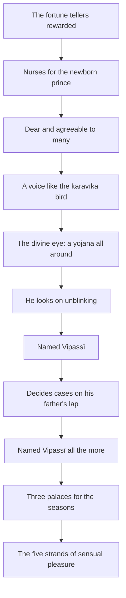

import { Tabs, TabItem } from '@astrojs/starlight/components';

Original text: [7D/1.4 Vipassīsamaññā 85–91](https://tipitaka2500.github.io/tipitaka/7D/1/1.4.html#85) in the [World Tipitaka Edition](https://tipitaka2500.github.io)

## Summary

The naming of Vipassī: the edition's division Vipassīsamaññā, which closes the first `bhāṇavāra` (section for recitation). King Bandhumā rewards the brahmin fortune tellers and provides nurses for the newborn prince, who is dear to many, sweet-voiced like the `karavīka` bird, and sees a `yojana` around by day and by night. Because he looks on unblinking, and later decides cases methodically from his father's lap, the designation ‘Vipassī’ arises for him. The king builds him three palaces for the seasons, and he lives there amid the five strands of sensual pleasure.

## Diagram

## Text

<Tabs syncKey="paliquote">
<TabItem label="My Translation">
(37.)

85\. Then, Bhikkhave, King Bandhumā had the brahmin fortune tellers clothed in new cloths and satisfied them with all sensual pleasures. Then, Bhikkhave, King Bandhumā provided nurses for Prince Vipassī. Some gave him milk to drink, others bathed him, others held him, others carried him about on the hip. And when Prince Vipassī was born, Bhikkhave, a white parasol was held over him by day and by night, [with the thought:] ‘Let neither cold nor heat nor grass nor dust nor dew trouble him.’ And when he was born, Bhikkhave, Prince Vipassī was dear and agreeable to many people. Just as, Bhikkhave, a blue water lily or a pink lotus or a white lotus is dear and agreeable to many people; so too, Bhikkhave, Prince Vipassī was dear and agreeable to many people. Indeed he was passed from lap to lap.

(38.)

86\. And when he was born, Bhikkhave, Prince Vipassī had a sweet voice, a beautiful voice, a charming voice and an endearing voice. Just as, Bhikkhave, in the Himalaya mountains the species of bird called `karavīka` (Indian cuckoo) has a sweet voice, a beautiful voice, a charming voice and an endearing voice; so too, Bhikkhave, Prince Vipassī had a sweet voice, a beautiful voice, a charming voice and an endearing voice.

(39.)

87\. And when Prince Vipassī was born, Bhikkhave, there arose for him the `dibbacakkhu` (divine eye), caused by the effect of actions, by which he saw all around for a `yojana` (about twenty kilometres) by day and by night.

(40.)

88\. And when he was born, Bhikkhave, Prince Vipassī looked on unblinking, just like the Tāvatiṃsa gods. ‘The prince looks on unblinking’: thus, Bhikkhave, the designation ‘Vipassī, Vipassī’ arose for Prince Vipassī.

(41.)

89\. Then, Bhikkhave, King Bandhumā, seated in the court, had Prince Vipassī sit on his lap and judged cases. There, Bhikkhave, Prince Vipassī, seated on his father's lap, scrutinising them again and again, decided cases methodically. ‘Scrutinising them again and again, the prince decides cases methodically’: thus, Bhikkhave, the designation ‘Vipassī, Vipassī’ arose for Prince Vipassī in even greater measure.

(42.)

90\. Then, Bhikkhave, King Bandhumā had three palaces built for Prince Vipassī: one for the rainy season, one for the winter, one for the summer; and he provided the five `kāmaguṇā` (strands of sensual pleasure). There, Bhikkhave, for four months in the rainy-season palace, being entertained by female musicians, Prince Vipassī did not descend to the lower palace.

91\. The first `bhāṇavāra` (section for recitation).
</TabItem>

<TabItem label="Pāḷi (Roman IAST)">
(37.)

85\. Atha kho, bhikkhave, bandhumā rājā nemitte brāhmaṇe ahatehi vatthehi acchādāpetvā sabbakāmehi santappesi. Atha kho, bhikkhave, bandhumā rājā vipassissa kumārassa dhātiyo upaṭṭhāpesi. Aññā khīraṃ pāyenti, aññā nhāpenti, aññā dhārenti, aññā aṅkena pariharanti. Jātassa kho pana, bhikkhave, vipassissa kumārassa setacchattaṃ dhārayittha divā ceva rattiñca— ‘mā naṃ sītaṃ vā uṇhaṃ vā tiṇaṃ vā rajo vā ussāvo vā bādhayitthā’ti. Jāto kho pana, bhikkhave, vipassī kumāro bahuno janassa piyo ahosi manāpo. Seyyathāpi, bhikkhave, uppalaṃ vā padumaṃ vā puṇḍarīkaṃ vā bahuno janassa piyaṃ manāpaṃ; evameva kho, bhikkhave, vipassī kumāro bahuno janassa piyo ahosi manāpo. Svāssudaṃ aṅkeneva aṅkaṃ parihariyati.

(38.)

86\. Jāto kho pana, bhikkhave, vipassī kumāro mañjussaro ca ahosi vaggussaro ca madhurassaro ca pemaniyassaro ca. Seyyathāpi, bhikkhave, himavante pabbate karavīkā nāma sakuṇajāti mañjussarā ca vaggussarā ca madhurassarā ca pemaniyassarā ca; evameva kho, bhikkhave, vipassī kumāro mañjussaro ca ahosi vaggussaro ca madhurassaro ca pemaniyassaro ca.

(39.)

87\. Jātassa kho pana, bhikkhave, vipassissa kumārassa kammavipākajaṃ dibbacakkhu pāturahosi yena sudaṃ samantā yojanaṃ passati divā ceva rattiñca.

(40.)

88\. Jāto kho pana, bhikkhave, vipassī kumāro animisanto pekkhati seyyathāpi devā tāvatiṃsā. ‘Animisanto kumāro pekkhatī’ti kho, bhikkhave, vipassissa kumārassa ‘vipassī vipassī’ tveva samaññā udapādi.

(41.)

89\. Atha kho, bhikkhave, bandhumā rājā atthakaraṇe nisinno vipassiṃ kumāraṃ aṅke nisīdāpetvā atthe anusāsati. Tatra sudaṃ, bhikkhave, vipassī kumāro pituaṅke nisinno viceyya viceyya atthe panāyati ñāyena. Viceyya viceyya kumāro atthe panāyati ñāyenāti kho, bhikkhave, vipassissa kumārassa bhiyyoso mattāya ‘vipassī vipassī’ tveva samaññā udapādi.

(42.)

90\. Atha kho, bhikkhave, bandhumā rājā vipassissa kumārassa tayo pāsāde kārāpesi, ekaṃ vassikaṃ ekaṃ hemantikaṃ ekaṃ gimhikaṃ; pañca kāmaguṇāni upaṭṭhāpesi. Tatra sudaṃ, bhikkhave, vipassī kumāro vassike pāsāde cattāro māse nippurisehi tūriyehi paricārayamāno na heṭṭhāpāsādaṃ orohatīti.

91\. Paṭhamabhāṇavāro.
</TabItem>

<TabItem label="Pāḷi (Brahmi)">
(37.)

85\. 𑀅𑀣 𑀔𑁄, 𑀪𑀺𑀓𑁆𑀔𑀯𑁂, 𑀩𑀦𑁆𑀥𑀼𑀫𑀸 𑀭𑀸𑀚𑀸 𑀦𑁂𑀫𑀺𑀢𑁆𑀢𑁂 𑀩𑁆𑀭𑀸𑀳𑁆𑀫𑀡𑁂 𑀅𑀳𑀢𑁂𑀳𑀺 𑀯𑀢𑁆𑀣𑁂𑀳𑀺 𑀅𑀘𑁆𑀙𑀸𑀤𑀸𑀧𑁂𑀢𑁆𑀯𑀸 𑀲𑀩𑁆𑀩𑀓𑀸𑀫𑁂𑀳𑀺 𑀲𑀦𑁆𑀢𑀧𑁆𑀧𑁂𑀲𑀺. 𑀅𑀣 𑀔𑁄, 𑀪𑀺𑀓𑁆𑀔𑀯𑁂, 𑀩𑀦𑁆𑀥𑀼𑀫𑀸 𑀭𑀸𑀚𑀸 𑀯𑀺𑀧𑀲𑁆𑀲𑀺𑀲𑁆𑀲 𑀓𑀼𑀫𑀸𑀭𑀲𑁆𑀲 𑀥𑀸𑀢𑀺𑀬𑁄 𑀉𑀧𑀝𑁆𑀞𑀸𑀧𑁂𑀲𑀺. 𑀅𑀜𑁆𑀜𑀸 𑀔𑀻𑀭𑀁 𑀧𑀸𑀬𑁂𑀦𑁆𑀢𑀺, 𑀅𑀜𑁆𑀜𑀸 𑀦𑁆𑀳𑀸𑀧𑁂𑀦𑁆𑀢𑀺, 𑀅𑀜𑁆𑀜𑀸 𑀥𑀸𑀭𑁂𑀦𑁆𑀢𑀺, 𑀅𑀜𑁆𑀜𑀸 𑀅𑀗𑁆𑀓𑁂𑀦 𑀧𑀭𑀺𑀳𑀭𑀦𑁆𑀢𑀺. 𑀚𑀸𑀢𑀲𑁆𑀲 𑀔𑁄 𑀧𑀦, 𑀪𑀺𑀓𑁆𑀔𑀯𑁂, 𑀯𑀺𑀧𑀲𑁆𑀲𑀺𑀲𑁆𑀲 𑀓𑀼𑀫𑀸𑀭𑀲𑁆𑀲 𑀲𑁂𑀢𑀘𑁆𑀙𑀢𑁆𑀢𑀁 𑀥𑀸𑀭𑀬𑀺𑀢𑁆𑀣 𑀤𑀺𑀯𑀸 𑀘𑁂𑀯 𑀭𑀢𑁆𑀢𑀺𑀜𑁆𑀘— ‘𑀫𑀸 𑀦𑀁 𑀲𑀻𑀢𑀁 𑀯𑀸 𑀉𑀡𑁆𑀳𑀁 𑀯𑀸 𑀢𑀺𑀡𑀁 𑀯𑀸 𑀭𑀚𑁄 𑀯𑀸 𑀉𑀲𑁆𑀲𑀸𑀯𑁄 𑀯𑀸 𑀩𑀸𑀥𑀬𑀺𑀢𑁆𑀣𑀸’𑀢𑀺. 𑀚𑀸𑀢𑁄 𑀔𑁄 𑀧𑀦, 𑀪𑀺𑀓𑁆𑀔𑀯𑁂, 𑀯𑀺𑀧𑀲𑁆𑀲𑀻 𑀓𑀼𑀫𑀸𑀭𑁄 𑀩𑀳𑀼𑀦𑁄 𑀚𑀦𑀲𑁆𑀲 𑀧𑀺𑀬𑁄 𑀅𑀳𑁄𑀲𑀺 𑀫𑀦𑀸𑀧𑁄. 𑀲𑁂𑀬𑁆𑀬𑀣𑀸𑀧𑀺, 𑀪𑀺𑀓𑁆𑀔𑀯𑁂, 𑀉𑀧𑁆𑀧𑀮𑀁 𑀯𑀸 𑀧𑀤𑀼𑀫𑀁 𑀯𑀸 𑀧𑀼𑀡𑁆𑀟𑀭𑀻𑀓𑀁 𑀯𑀸 𑀩𑀳𑀼𑀦𑁄 𑀚𑀦𑀲𑁆𑀲 𑀧𑀺𑀬𑀁 𑀫𑀦𑀸𑀧𑀁; 𑀏𑀯𑀫𑁂𑀯 𑀔𑁄, 𑀪𑀺𑀓𑁆𑀔𑀯𑁂, 𑀯𑀺𑀧𑀲𑁆𑀲𑀻 𑀓𑀼𑀫𑀸𑀭𑁄 𑀩𑀳𑀼𑀦𑁄 𑀚𑀦𑀲𑁆𑀲 𑀧𑀺𑀬𑁄 𑀅𑀳𑁄𑀲𑀺 𑀫𑀦𑀸𑀧𑁄. 𑀲𑁆𑀯𑀸𑀲𑁆𑀲𑀼𑀤𑀁 𑀅𑀗𑁆𑀓𑁂𑀦𑁂𑀯 𑀅𑀗𑁆𑀓𑀁 𑀧𑀭𑀺𑀳𑀭𑀺𑀬𑀢𑀺.

(38.)

86\. 𑀚𑀸𑀢𑁄 𑀔𑁄 𑀧𑀦, 𑀪𑀺𑀓𑁆𑀔𑀯𑁂, 𑀯𑀺𑀧𑀲𑁆𑀲𑀻 𑀓𑀼𑀫𑀸𑀭𑁄 𑀫𑀜𑁆𑀚𑀼𑀲𑁆𑀲𑀭𑁄 𑀘 𑀅𑀳𑁄𑀲𑀺 𑀯𑀕𑁆𑀕𑀼𑀲𑁆𑀲𑀭𑁄 𑀘 𑀫𑀥𑀼𑀭𑀲𑁆𑀲𑀭𑁄 𑀘 𑀧𑁂𑀫𑀦𑀺𑀬𑀲𑁆𑀲𑀭𑁄 𑀘. 𑀲𑁂𑀬𑁆𑀬𑀣𑀸𑀧𑀺, 𑀪𑀺𑀓𑁆𑀔𑀯𑁂, 𑀳𑀺𑀫𑀯𑀦𑁆𑀢𑁂 𑀧𑀩𑁆𑀩𑀢𑁂 𑀓𑀭𑀯𑀻𑀓𑀸 𑀦𑀸𑀫 𑀲𑀓𑀼𑀡𑀚𑀸𑀢𑀺 𑀫𑀜𑁆𑀚𑀼𑀲𑁆𑀲𑀭𑀸 𑀘 𑀯𑀕𑁆𑀕𑀼𑀲𑁆𑀲𑀭𑀸 𑀘 𑀫𑀥𑀼𑀭𑀲𑁆𑀲𑀭𑀸 𑀘 𑀧𑁂𑀫𑀦𑀺𑀬𑀲𑁆𑀲𑀭𑀸 𑀘; 𑀏𑀯𑀫𑁂𑀯 𑀔𑁄, 𑀪𑀺𑀓𑁆𑀔𑀯𑁂, 𑀯𑀺𑀧𑀲𑁆𑀲𑀻 𑀓𑀼𑀫𑀸𑀭𑁄 𑀫𑀜𑁆𑀚𑀼𑀲𑁆𑀲𑀭𑁄 𑀘 𑀅𑀳𑁄𑀲𑀺 𑀯𑀕𑁆𑀕𑀼𑀲𑁆𑀲𑀭𑁄 𑀘 𑀫𑀥𑀼𑀭𑀲𑁆𑀲𑀭𑁄 𑀘 𑀧𑁂𑀫𑀦𑀺𑀬𑀲𑁆𑀲𑀭𑁄 𑀘.

(39.)

87\. 𑀚𑀸𑀢𑀲𑁆𑀲 𑀔𑁄 𑀧𑀦, 𑀪𑀺𑀓𑁆𑀔𑀯𑁂, 𑀯𑀺𑀧𑀲𑁆𑀲𑀺𑀲𑁆𑀲 𑀓𑀼𑀫𑀸𑀭𑀲𑁆𑀲 𑀓𑀫𑁆𑀫𑀯𑀺𑀧𑀸𑀓𑀚𑀁 𑀤𑀺𑀩𑁆𑀩𑀘𑀓𑁆𑀔𑀼 𑀧𑀸𑀢𑀼𑀭𑀳𑁄𑀲𑀺 𑀬𑁂𑀦 𑀲𑀼𑀤𑀁 𑀲𑀫𑀦𑁆𑀢𑀸 𑀬𑁄𑀚𑀦𑀁 𑀧𑀲𑁆𑀲𑀢𑀺 𑀤𑀺𑀯𑀸 𑀘𑁂𑀯 𑀭𑀢𑁆𑀢𑀺𑀜𑁆𑀘.

(40.)

88\. 𑀚𑀸𑀢𑁄 𑀔𑁄 𑀧𑀦, 𑀪𑀺𑀓𑁆𑀔𑀯𑁂, 𑀯𑀺𑀧𑀲𑁆𑀲𑀻 𑀓𑀼𑀫𑀸𑀭𑁄 𑀅𑀦𑀺𑀫𑀺𑀲𑀦𑁆𑀢𑁄 𑀧𑁂𑀓𑁆𑀔𑀢𑀺 𑀲𑁂𑀬𑁆𑀬𑀣𑀸𑀧𑀺 𑀤𑁂𑀯𑀸 𑀢𑀸𑀯𑀢𑀺𑀁𑀲𑀸. ‘𑀅𑀦𑀺𑀫𑀺𑀲𑀦𑁆𑀢𑁄 𑀓𑀼𑀫𑀸𑀭𑁄 𑀧𑁂𑀓𑁆𑀔𑀢𑀻’𑀢𑀺 𑀔𑁄, 𑀪𑀺𑀓𑁆𑀔𑀯𑁂, 𑀯𑀺𑀧𑀲𑁆𑀲𑀺𑀲𑁆𑀲 𑀓𑀼𑀫𑀸𑀭𑀲𑁆𑀲 ‘𑀯𑀺𑀧𑀲𑁆𑀲𑀻 𑀯𑀺𑀧𑀲𑁆𑀲𑀻’ 𑀢𑁆𑀯𑁂𑀯 𑀲𑀫𑀜𑁆𑀜𑀸 𑀉𑀤𑀧𑀸𑀤𑀺.

(41.)

89\. 𑀅𑀣 𑀔𑁄, 𑀪𑀺𑀓𑁆𑀔𑀯𑁂, 𑀩𑀦𑁆𑀥𑀼𑀫𑀸 𑀭𑀸𑀚𑀸 𑀅𑀢𑁆𑀣𑀓𑀭𑀡𑁂 𑀦𑀺𑀲𑀺𑀦𑁆𑀦𑁄 𑀯𑀺𑀧𑀲𑁆𑀲𑀺𑀁 𑀓𑀼𑀫𑀸𑀭𑀁 𑀅𑀗𑁆𑀓𑁂 𑀦𑀺𑀲𑀻𑀤𑀸𑀧𑁂𑀢𑁆𑀯𑀸 𑀅𑀢𑁆𑀣𑁂 𑀅𑀦𑀼𑀲𑀸𑀲𑀢𑀺. 𑀢𑀢𑁆𑀭 𑀲𑀼𑀤𑀁, 𑀪𑀺𑀓𑁆𑀔𑀯𑁂, 𑀯𑀺𑀧𑀲𑁆𑀲𑀻 𑀓𑀼𑀫𑀸𑀭𑁄 𑀧𑀺𑀢𑀼𑀅𑀗𑁆𑀓𑁂 𑀦𑀺𑀲𑀺𑀦𑁆𑀦𑁄 𑀯𑀺𑀘𑁂𑀬𑁆𑀬 𑀯𑀺𑀘𑁂𑀬𑁆𑀬 𑀅𑀢𑁆𑀣𑁂 𑀧𑀦𑀸𑀬𑀢𑀺 𑀜𑀸𑀬𑁂𑀦. 𑀯𑀺𑀘𑁂𑀬𑁆𑀬 𑀯𑀺𑀘𑁂𑀬𑁆𑀬 𑀓𑀼𑀫𑀸𑀭𑁄 𑀅𑀢𑁆𑀣𑁂 𑀧𑀦𑀸𑀬𑀢𑀺 𑀜𑀸𑀬𑁂𑀦𑀸𑀢𑀺 𑀔𑁄, 𑀪𑀺𑀓𑁆𑀔𑀯𑁂, 𑀯𑀺𑀧𑀲𑁆𑀲𑀺𑀲𑁆𑀲 𑀓𑀼𑀫𑀸𑀭𑀲𑁆𑀲 𑀪𑀺𑀬𑁆𑀬𑁄𑀲𑁄 𑀫𑀢𑁆𑀢𑀸𑀬 ‘𑀯𑀺𑀧𑀲𑁆𑀲𑀻 𑀯𑀺𑀧𑀲𑁆𑀲𑀻’ 𑀢𑁆𑀯𑁂𑀯 𑀲𑀫𑀜𑁆𑀜𑀸 𑀉𑀤𑀧𑀸𑀤𑀺.

(42.)

90\. 𑀅𑀣 𑀔𑁄, 𑀪𑀺𑀓𑁆𑀔𑀯𑁂, 𑀩𑀦𑁆𑀥𑀼𑀫𑀸 𑀭𑀸𑀚𑀸 𑀯𑀺𑀧𑀲𑁆𑀲𑀺𑀲𑁆𑀲 𑀓𑀼𑀫𑀸𑀭𑀲𑁆𑀲 𑀢𑀬𑁄 𑀧𑀸𑀲𑀸𑀤𑁂 𑀓𑀸𑀭𑀸𑀧𑁂𑀲𑀺, 𑀏𑀓𑀁 𑀯𑀲𑁆𑀲𑀺𑀓𑀁 𑀏𑀓𑀁 𑀳𑁂𑀫𑀦𑁆𑀢𑀺𑀓𑀁 𑀏𑀓𑀁 𑀕𑀺𑀫𑁆𑀳𑀺𑀓𑀁; 𑀧𑀜𑁆𑀘 𑀓𑀸𑀫𑀕𑀼𑀡𑀸𑀦𑀺 𑀉𑀧𑀝𑁆𑀞𑀸𑀧𑁂𑀲𑀺. 𑀢𑀢𑁆𑀭 𑀲𑀼𑀤𑀁, 𑀪𑀺𑀓𑁆𑀔𑀯𑁂, 𑀯𑀺𑀧𑀲𑁆𑀲𑀻 𑀓𑀼𑀫𑀸𑀭𑁄 𑀯𑀲𑁆𑀲𑀺𑀓𑁂 𑀧𑀸𑀲𑀸𑀤𑁂 𑀘𑀢𑁆𑀢𑀸𑀭𑁄 𑀫𑀸𑀲𑁂 𑀦𑀺𑀧𑁆𑀧𑀼𑀭𑀺𑀲𑁂𑀳𑀺 𑀢𑀽𑀭𑀺𑀬𑁂𑀳𑀺 𑀧𑀭𑀺𑀘𑀸𑀭𑀬𑀫𑀸𑀦𑁄 𑀦 𑀳𑁂𑀝𑁆𑀞𑀸𑀧𑀸𑀲𑀸𑀤𑀁 𑀑𑀭𑁄𑀳𑀢𑀻𑀢𑀺.

91\. 𑀧𑀞𑀫𑀪𑀸𑀡𑀯𑀸𑀭𑁄.
</TabItem>

<TabItem label="Interlinear">
(37.)

[85](https://tipitaka2500.github.io/tipitaka/7D/1/1.4.html#85) Atha kho, bhikkhave, bandhumā rājā nemitte brāhmaṇe ahatehi vatthehi acchādāpetvā sabbakāmehi santappesi.  
⏏️(atha) ⏏️(kho) 🚹⨂⓪(bhikkhu) 🚹⨀①(bandhumant) 🚹⨀①(rāja) 🚹⨂②(nemitta) 🚹⨂②(brāhmaṇa) 🚻⨂③🔽(ta)🆎(na+hata) 🚻⨂③(vattha) 🔽(tvā)(acchādāpetvā) 🚹⨂③🆎(sabba+kāma) 🟠⨀🤟⏮(santappeti)  
then | indeed | Bhikkhave | Bandhumā | King | fortune tellers | brahmins | with new | cloths | having had put on | with all sensual pleasures | satisfied  
Then, Bhikkhave, King Bandhumā had the brahmin fortune tellers clothed in new cloths and satisfied them with all sensual pleasures.

Atha kho, bhikkhave, bandhumā rājā vipassissa kumārassa dhātiyo upaṭṭhāpesi.  
⏏️(atha) ⏏️(kho) 🚹⨂⓪(bhikkhu) 🚹⨀①(bandhumant) 🚹⨀①(rāja) 🚹⨀④(vipassī) 🚹⨀④(kumāra) 🚺⨂②(dhātī) 🟠⨀🤟⏮(upaṭṭhāpeti)  
then | indeed | Bhikkhave | Bandhumā | King | for Vipassī | Prince | nurses | provided  
Then, Bhikkhave, King Bandhumā provided nurses for Prince Vipassī.

Aññā khīraṃ pāyenti, aññā nhāpenti, aññā dhārenti, aññā aṅkena pariharanti.  
*️⃣🤟🚺⨂①(añña) 🚻⨀②(khīra) 🟠⨂🤟▶️(pāyeti) *️⃣🤟🚺⨂①(añña) 🟠⨂🤟▶️(nhāpeti) *️⃣🤟🚺⨂①(añña) 🟢⨂🤟▶️(dhāreti) *️⃣🤟🚺⨂①(añña) 🚹⨀③(aṅka) 🟢⨂🤟▶️(pariharati)  
some | milk | give to drink | others | bathe | others | hold | others | on the hip | carry about  
Some gave him milk to drink, others bathed him, others held him, others carried him about on the hip.

Jātassa kho pana, bhikkhave, vipassissa kumārassa setacchattaṃ dhārayittha divā ceva rattiñca— ‘mā naṃ sītaṃ vā uṇhaṃ vā tiṇaṃ vā rajo vā ussāvo vā bādhayitthā’ti.  
🚹⨀④🔽(ta)(jāta) ⏏️(kho) ⏏️(pana) 🚹⨂⓪(bhikkhu) 🚹⨀④(vipassī) 🚹⨀④(kumāra) 🚻⨀①🆎(seta+chatta) 🔵⨀🤟⏮(dhāreti) ⏏️(divā) ⏏️(ca) ⏏️(eva) 🚺⨀②(ratti) ⏏️(ca) ⏏️(mā) *️⃣🤟🚹⨀②(ta) 🚻⨀①(sīta) ⏏️(vā) 🚻⨀①(uṇha) ⏏️(vā) 🚻⨀①(tiṇa) ⏏️(vā) 🚹⨀①(rajas) ⏏️(vā) 🚹⨀①(ussāva) ⏏️(vā) 🔵⨀🤟⏮(bādheti) ⏏️(iti)  
for the born | indeed | now | Bhikkhave | for Vipassī | Prince | a white parasol | was held | by day | and | just | by night | and | let not | him | cold | or | heat | or | grass | or | dust | or | dew | or | trouble | (end quote)  
And when Prince Vipassī was born, Bhikkhave, a white parasol was held over him by day and by night, [with the thought:] ‘Let neither cold nor heat nor grass nor dust nor dew trouble him.’

Jāto kho pana, bhikkhave, vipassī kumāro bahuno janassa piyo ahosi manāpo.  
🚹⨀①🔽(ta)(jāta) ⏏️(kho) ⏏️(pana) 🚹⨂⓪(bhikkhu) 🚹⨀①(vipassī) 🚹⨀①(kumāra) 🚹⨀④(bahu) 🚹⨀④(jana) 🚹⨀①(piya) 🟢⨀🤟⏮(hoti) 🚹⨀①(manāpa)  
born | indeed | now | Bhikkhave | Vipassī | Prince | to many | people | dear | was | agreeable  
And when he was born, Bhikkhave, Prince Vipassī was dear and agreeable to many people.

Seyyathāpi, bhikkhave, uppalaṃ vā padumaṃ vā puṇḍarīkaṃ vā bahuno janassa piyaṃ manāpaṃ;  
⏏️(seyyathāpi) 🚹⨂⓪(bhikkhu) 🚻⨀①(uppala) ⏏️(vā) 🚻⨀①(paduma) ⏏️(vā) 🚻⨀①(puṇḍarīka) ⏏️(vā) 🚹⨀④(bahu) 🚹⨀④(jana) 🚻⨀①(piya) 🚻⨀①(manāpa)  
just as | Bhikkhave | a blue water lily | or | a pink lotus | or | a white lotus | or | to many | people | dear | agreeable  
Just as, Bhikkhave, a blue water lily or a pink lotus or a white lotus is dear and agreeable to many people;

evameva kho, bhikkhave, vipassī kumāro bahuno janassa piyo ahosi manāpo.  
⏏️(evaṃ) ⏏️(eva) ⏏️(kho) 🚹⨂⓪(bhikkhu) 🚹⨀①(vipassī) 🚹⨀①(kumāra) 🚹⨀④(bahu) 🚹⨀④(jana) 🚹⨀①(piya) 🟢⨀🤟⏮(hoti) 🚹⨀①(manāpa)  
in the same way | just | indeed | Bhikkhave | Vipassī | Prince | to many | people | dear | was | agreeable  
so too, Bhikkhave, Prince Vipassī was dear and agreeable to many people.

Svāssudaṃ aṅkeneva aṅkaṃ parihariyati.  
*️⃣🤟🚹⨀①(ta) ⏏️(assudaṃ) 🚹⨀③(aṅka) ⏏️(eva) 🚹⨀②(aṅka) 🔴⨀🤟▶️(parihariyati)  
he | indeed | from lap | just | to lap | is passed  
Indeed he was passed from lap to lap.

(38.)

[86](https://tipitaka2500.github.io/tipitaka/7D/1/1.4.html#86) Jāto kho pana, bhikkhave, vipassī kumāro mañjussaro ca ahosi vaggussaro ca madhurassaro ca pemaniyassaro ca.  
🚹⨀①🔽(ta)(jāta) ⏏️(kho) ⏏️(pana) 🚹⨂⓪(bhikkhu) 🚹⨀①(vipassī) 🚹⨀①(kumāra) 🚹⨀①🆎(mañju+sara) ⏏️(ca) 🟢⨀🤟⏮(hoti) 🚹⨀①🆎(vaggu+sara) ⏏️(ca) 🚹⨀①🆎(madhura+sara) ⏏️(ca) 🚹⨀①🆎(pemaniya+sara) ⏏️(ca)  
born | indeed | now | Bhikkhave | Vipassī | Prince | sweet-voiced | and | was | beautiful-voiced | and | charming-voiced | and | endearing-voiced | and  
And when he was born, Bhikkhave, Prince Vipassī had a sweet voice, a beautiful voice, a charming voice and an endearing voice.

Seyyathāpi, bhikkhave, himavante pabbate karavīkā nāma sakuṇajāti mañjussarā ca vaggussarā ca madhurassarā ca pemaniyassarā ca;  
⏏️(seyyathāpi) 🚹⨂⓪(bhikkhu) 🚹⨀⑦(himavant) 🚹⨀⑦(pabbata) 🚺⨀①(karavīka) ⏏️(nāma) 🚺⨀①🆎(sakuṇa+jāti) 🚺⨀①🆎(mañju+sara) ⏏️(ca) 🚺⨀①🆎(vaggu+sara) ⏏️(ca) 🚺⨀①🆎(madhura+sara) ⏏️(ca) 🚺⨀①🆎(pemaniya+sara) ⏏️(ca)  
just as | Bhikkhave | in the Himalaya | mountains | karavīka | called | species of bird | sweet-voiced | and | beautiful-voiced | and | charming-voiced | and | endearing-voiced | and  
Just as, Bhikkhave, in the Himalaya mountains the species of bird called `karavīka` (Indian cuckoo) has a sweet voice, a beautiful voice, a charming voice and an endearing voice;

evameva kho, bhikkhave, vipassī kumāro mañjussaro ca ahosi vaggussaro ca madhurassaro ca pemaniyassaro ca.  
⏏️(evaṃ) ⏏️(eva) ⏏️(kho) 🚹⨂⓪(bhikkhu) 🚹⨀①(vipassī) 🚹⨀①(kumāra) 🚹⨀①🆎(mañju+sara) ⏏️(ca) 🟢⨀🤟⏮(hoti) 🚹⨀①🆎(vaggu+sara) ⏏️(ca) 🚹⨀①🆎(madhura+sara) ⏏️(ca) 🚹⨀①🆎(pemaniya+sara) ⏏️(ca)  
in the same way | just | indeed | Bhikkhave | Vipassī | Prince | sweet-voiced | and | was | beautiful-voiced | and | charming-voiced | and | endearing-voiced | and  
so too, Bhikkhave, Prince Vipassī had a sweet voice, a beautiful voice, a charming voice and an endearing voice.

(39.)

[87](https://tipitaka2500.github.io/tipitaka/7D/1/1.4.html#87) Jātassa kho pana, bhikkhave, vipassissa kumārassa kammavipākajaṃ dibbacakkhu pāturahosi yena sudaṃ samantā yojanaṃ passati divā ceva rattiñca.  
🚹⨀④🔽(ta)(jāta) ⏏️(kho) ⏏️(pana) 🚹⨂⓪(bhikkhu) 🚹⨀④(vipassī) 🚹⨀④(kumāra) 🚻⨀①🆎(kamma+vipāka+ja) 🚻⨀①🆎(dibba+cakkhu) 🟢⨀🤟⏮(pātubhavati) *️⃣🤟🚻⨀③(ya) ⏏️(sudaṃ) ⏏️(samantā) 🚻⨀②(yojana) 🟢⨀🤟▶️(passati) ⏏️(divā) ⏏️(ca) ⏏️(eva) 🚺⨀②(ratti) ⏏️(ca)  
for the born | indeed | now | Bhikkhave | for Vipassī | Prince | caused by the effect of actions | the divine eye | arose | by which | indeed | all around | a yojana | sees | by day | and | just | by night | and  
And when Prince Vipassī was born, Bhikkhave, there arose for him the `dibbacakkhu` (divine eye), caused by the effect of actions, by which he saw all around for a `yojana` (about twenty kilometres) by day and by night.

(40.)

[88](https://tipitaka2500.github.io/tipitaka/7D/1/1.4.html#88) Jāto kho pana, bhikkhave, vipassī kumāro animisanto pekkhati seyyathāpi devā tāvatiṃsā.  
🚹⨀①🔽(ta)(jāta) ⏏️(kho) ⏏️(pana) 🚹⨂⓪(bhikkhu) 🚹⨀①(vipassī) 🚹⨀①(kumāra) 🚹⨀①🔽(anta)(animisanta) 🟢⨀🤟▶️(pekkhati) ⏏️(seyyathāpi) 🚹⨂①(deva) 🚹⨂①(tāvatiṃsa)  
born | indeed | now | Bhikkhave | Vipassī | Prince | unblinking | looks on | just like | devas | the Tāvatiṃsa  
And when he was born, Bhikkhave, Prince Vipassī looked on unblinking, just like the Tāvatiṃsa gods.

‘Animisanto kumāro pekkhatī’ti kho, bhikkhave, vipassissa kumārassa ‘vipassī vipassī’ tveva samaññā udapādi.  
🚹⨀①🔽(anta)(animisanta) 🚹⨀①(kumāra) 🟢⨀🤟▶️(pekkhati) ⏏️(iti) ⏏️(kho) 🚹⨂⓪(bhikkhu) 🚹⨀④(vipassī) 🚹⨀④(kumāra) 🚹⨀①(vipassī) 🚹⨀①(vipassī) ⏏️(iti) ⏏️(eva) 🚺⨀①(samaññā) 🟢⨀🤟⏮(uppajjati)  
unblinking | the prince | looks on | (end quote) | indeed | Bhikkhave | for Vipassī | Prince | Vipassī | Vipassī | (end quote) | just | the designation | arose  
‘The prince looks on unblinking’: thus, Bhikkhave, the designation ‘Vipassī, Vipassī’ arose for Prince Vipassī.

(41.)

[89](https://tipitaka2500.github.io/tipitaka/7D/1/1.4.html#89) Atha kho, bhikkhave, bandhumā rājā atthakaraṇe nisinno vipassiṃ kumāraṃ aṅke nisīdāpetvā atthe anusāsati.  
⏏️(atha) ⏏️(kho) 🚹⨂⓪(bhikkhu) 🚹⨀①(bandhumant) 🚹⨀①(rāja) 🚻⨀⑦🆎(attha+karaṇa) 🚹⨀①🔽(ta)(nisinna) 🚹⨀②(vipassī) 🚹⨀②(kumāra) 🚹⨀⑦(aṅka) 🔽(tvā)(nisīdāpeti) 🚹⨂②(attha) 🟢⨀🤟▶️(anusāsati)  
then | indeed | Bhikkhave | Bandhumā | King | in the court | seated | Vipassī | Prince | on the lap | having had sit | cases | judges  
Then, Bhikkhave, King Bandhumā, seated in the court, had Prince Vipassī sit on his lap and judged cases.

Tatra sudaṃ, bhikkhave, vipassī kumāro pituaṅke nisinno viceyya viceyya atthe panāyati ñāyena.  
⏏️(tatra) ⏏️(sudaṃ) 🚹⨂⓪(bhikkhu) 🚹⨀①(vipassī) 🚹⨀①(kumāra) 🚹⨀⑦🆎(pitar+aṅka) 🚹⨀①🔽(ta)(nisinna) 🔽(ya)(vicināti) 🔽(ya)(vicināti) 🚹⨂②(attha) 🟢⨀🤟▶️(panāyati) 🚹⨀③(ñāya)  
there | indeed | Bhikkhave | Vipassī | Prince | on his father's lap | seated | scrutinising | scrutinising | cases | decides | methodically  
There, Bhikkhave, Prince Vipassī, seated on his father's lap, scrutinising them again and again, decided cases methodically.

Viceyya viceyya kumāro atthe panāyati ñāyenāti kho, bhikkhave, vipassissa kumārassa bhiyyoso mattāya ‘vipassī vipassī’ tveva samaññā udapādi.  
🔽(ya)(vicināti) 🔽(ya)(vicināti) 🚹⨀①(kumāra) 🚹⨂②(attha) 🟢⨀🤟▶️(panāyati) 🚹⨀③(ñāya) ⏏️(iti) ⏏️(kho) 🚹⨂⓪(bhikkhu) 🚹⨀④(vipassī) 🚹⨀④(kumāra) ⏏️(bhiyyoso) 🚺⨀③(mattā) 🚹⨀①(vipassī) 🚹⨀①(vipassī) ⏏️(iti) ⏏️(eva) 🚺⨀①(samaññā) 🟢⨀🤟⏮(uppajjati)  
scrutinising | scrutinising | the prince | cases | decides | methodically | (end quote) | indeed | Bhikkhave | for Vipassī | Prince | even more | in measure | Vipassī | Vipassī | (end quote) | just | the designation | arose  
‘Scrutinising them again and again, the prince decides cases methodically’: thus, Bhikkhave, the designation ‘Vipassī, Vipassī’ arose for Prince Vipassī in even greater measure.

(42.)

[90](https://tipitaka2500.github.io/tipitaka/7D/1/1.4.html#90) Atha kho, bhikkhave, bandhumā rājā vipassissa kumārassa tayo pāsāde kārāpesi, ekaṃ vassikaṃ ekaṃ hemantikaṃ ekaṃ gimhikaṃ;  
⏏️(atha) ⏏️(kho) 🚹⨂⓪(bhikkhu) 🚹⨀①(bandhumant) 🚹⨀①(rāja) 🚹⨀④(vipassī) 🚹⨀④(kumāra) 🚹⨂②(ti) 🚹⨂②(pāsāda) 🟠⨀🤟⏮(kārāpeti) 🚹⨀②(eka) 🚹⨀②(vassika) 🚹⨀②(eka) 🚹⨀②(hemantika) 🚹⨀②(eka) 🚹⨀②(gimhika)  
then | indeed | Bhikkhave | Bandhumā | King | for Vipassī | Prince | three | palaces | had built | one | for the rainy season | one | for the winter | one | for the summer  
Then, Bhikkhave, King Bandhumā had three palaces built for Prince Vipassī: one for the rainy season, one for the winter, one for the summer;

pañca kāmaguṇāni upaṭṭhāpesi.  
⚧⨂②(pañca) 🚻⨂②🆎(kāma+guṇa) 🟠⨀🤟⏮(upaṭṭhāpeti)  
five | strands of sensual pleasure | provided  
and he provided the five `kāmaguṇā` (strands of sensual pleasure).

Tatra sudaṃ, bhikkhave, vipassī kumāro vassike pāsāde cattāro māse nippurisehi tūriyehi paricārayamāno na heṭṭhāpāsādaṃ orohatīti.  
⏏️(tatra) ⏏️(sudaṃ) 🚹⨂⓪(bhikkhu) 🚹⨀①(vipassī) 🚹⨀①(kumāra) 🚹⨀⑦(vassika) 🚹⨀⑦(pāsāda) 🚹⨂②(catu) 🚹⨂②(māsa) 🚹⨂③🆎(nir+purisa) 🚹⨂③(tūriya) 🚹⨀①🔽(māna)(paricārayamāna) ⏏️(na) 🚹⨀②🆎(heṭṭhā+pāsāda) 🟢⨀🤟▶️(orohati) ⏏️(iti)  
there | indeed | Bhikkhave | Vipassī | Prince | in the rainy season | palace | four | months | by all-female | musicians | being entertained | not | to the lower palace | descends | thus  
There, Bhikkhave, for four months in the rainy-season palace, being entertained by female musicians, Prince Vipassī did not descend to the lower palace.

[91](https://tipitaka2500.github.io/tipitaka/7D/1/1.4.html#91) Paṭhamabhāṇavāro.  
🚹⨀①🆎(paṭhama+bhāṇavāra)  
the first recitation section  
The first `bhāṇavāra` (section for recitation).
</TabItem>
</Tabs>

## Commentary

- The division derives the designation `vipassī`, "one who sees distinctly" (DPD), twice: from the prince's unblinking gaze (88) and from his scrutiny (`viceyya viceyya`) of the cases he decides on his father's lap (89).
- `dibbacakkhu` is "divine eye", as in the Saṅgītisutta's three eyes and buddhavacana's gradual training (https://buddhavacana.github.io/sutta/gradual/); the DPD's first meaning is "clairvoyance", and the text itself calls it `kammavipākaja`, caused by the effect of actions.
- The three seasonal palaces and the female musicians (90) are the sentence of Yasa's youth on [Pabbajjākathā](/khandhaka/1-7/) and of the Bhagavā's own on buddhavacana's biography page (https://buddhavacana.github.io/buddha/biography/), kept in that wording.
- `kāmaguṇā` "strands of sensual pleasure" follows that biography page; the Pāsarāsi page has "objects of sensual desire".
- `aṅka` is "hip" where the nurses carry the prince about (85) and "lap" where the king seats him (89); the DPD gives both.

[Go to previous page (3. Dvattiṃsamahāpurisalakkhaṇā (The Thirty-two Marks of a Great Man))](/dighanikaya/mahapadanasutta/3-dvattimsamahapurisalakkhana/) / [Go to parent page (Mahāpadānasutta)](/dighanikaya/mahapadanasutta/) / [Go to next page (5. Jiṇṇapurisa to Bodhisattapabbajjā (The Old Man, the Sick Man, the Dead Man, the Renunciant, and the Bodhisatta's Going Forth))](/dighanikaya/mahapadanasutta/5-jinnapurisa/)
