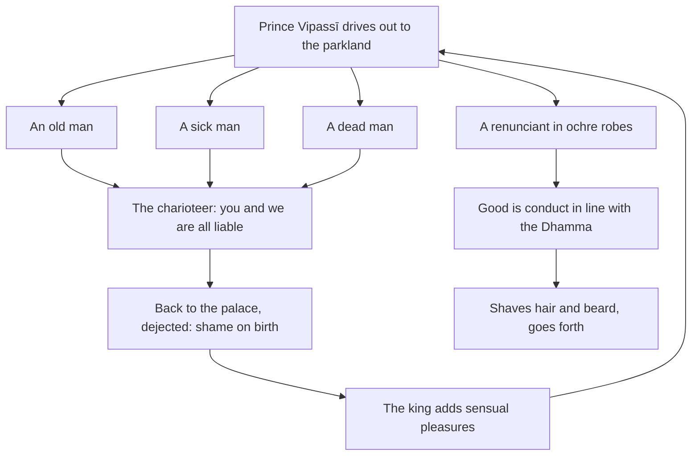

import { Tabs, TabItem } from '@astrojs/starlight/components';

Original text: [7D/1.5–1.9 Jiṇṇapurisa to Bodhisattapabbajjā 92–108](https://tipitaka2500.github.io/tipitaka/7D/1/1.5.html#92) in the [World Tipitaka Edition](https://tipitaka2500.github.io)

## Summary

The four sights and the going forth, the edition's divisions Jiṇṇapurisa to Bodhisattapabbajjā. Driving out to the parkland, Prince Vipassī sees in turn an old man, a sick man and a dead man; each time the charioteer tells him he too is liable to old age, sickness and death, he returns dejected, and the king, remembering the fortune tellers' word, surrounds him with still more sensual pleasure. The fourth sight, a renunciant in ochre robes, shows him a good way, and he shaves his hair and beard and goes forth there and then.

## Diagram

## Text

<Tabs syncKey="paliquote">
<TabItem label="My Translation">
(43.)

92\. Then, Bhikkhave, after the passing of many years, many hundreds of years, many thousands of years, Prince Vipassī addressed the charioteer: ‘Harness the most stately carriages, Samma (friend) charioteer; let us go to the parkland to see the beautiful grounds.’ ‘Yes, your majesty,’ Bhikkhave, the charioteer replied to Prince Vipassī, and having harnessed the most stately carriages he informed Prince Vipassī: ‘The most stately carriages are harnessed for you, your majesty; do now as you see fit.’ Then, Bhikkhave, Prince Vipassī mounted the most stately carriage and, with the most stately carriages, set out for the parkland.

(44.)

93\. Bhikkhave, as he was setting out for the parkland, Prince Vipassī saw an old man, as crooked as a rafter, bent, leaning on a staff, trembling as he went, sick, past his prime. Having seen him, he addressed the charioteer: ‘But this man, Samma charioteer, what has happened to him? His hair is not like others', and his body is not like others'.’ ‘This, your majesty, is what is called an old man.’ ‘But what, Samma charioteer, is this one called old?’ ‘This, your majesty, is what is called an old man. Now he will not have long to live.’ ‘But what, Samma charioteer — am I too liable to old age, not exempt from old age?’ ‘Both you, your majesty, and we are all liable to old age, not exempt from old age.’ ‘Well then, Samma charioteer, enough of the parkland for today. Turn back from here to the royal palace.’ ‘Yes, your majesty,’ Bhikkhave, the charioteer replied to Prince Vipassī and turned back from there to the royal palace. There, Bhikkhave, Prince Vipassī, having gone to the royal palace, distressed and dejected, brooded: ‘Shame indeed, Bho, on what is called birth, since for one who is born old age will manifest!’

(45.)

94\. Then, Bhikkhave, King Bandhumā had the charioteer summoned and said this: ‘I hope, Samma charioteer, the prince enjoyed himself in the parkland? I hope, Samma charioteer, the prince was pleased with the parkland?’ ‘No, your majesty, the prince did not enjoy himself in the parkland; no, your majesty, the prince was not pleased with the parkland.’ ‘But what, Samma charioteer, did the prince see as he was setting out for the parkland?’ ‘Your majesty, as he was setting out for the parkland, the prince saw an old man, as crooked as a rafter, bent, leaning on a staff, trembling as he went, sick, past his prime. Having seen him, he said this to me: “But this man, Samma charioteer, what has happened to him? His hair is not like others', and his body is not like others'.” “This, your majesty, is what is called an old man.” “But what, Samma charioteer, is this one called old?” “This, your majesty, is what is called an old man; now he will not have long to live.” “But what, Samma charioteer — am I too liable to old age, not exempt from old age?” “Both you, your majesty, and we are all liable to old age, not exempt from old age.”

95\. “Well then, Samma charioteer, enough of the parkland for today; turn back from here to the royal palace.” “Yes, your majesty,” I, your majesty, replied to Prince Vipassī and turned back from there to the royal palace. And he, your majesty, the prince, having gone to the royal palace, distressed and dejected, broods: “Shame indeed, Bho, on what is called birth, since for one who is born old age will manifest!”’

(46.)

96\. Then, Bhikkhave, this thought occurred to King Bandhumā:

97\. ‘Let it not be that Prince Vipassī does not exercise kingship; let it not be that Prince Vipassī goes forth from the home life into homelessness; let it not be that the word of the brahmin fortune tellers is true!’ Then, Bhikkhave, King Bandhumā provided Prince Vipassī with the five `kāmaguṇā` (strands of sensual pleasure) in even greater measure, [thinking:] ‘so that Prince Vipassī would exercise kingship, so that Prince Vipassī would not go forth from the home life into homelessness, so that the word of the brahmin fortune tellers would be false.’

98\. There, Bhikkhave, Prince Vipassī, endowed and furnished with the five strands of sensual pleasure, amused himself. Then, Bhikkhave, Prince Vipassī, [after the passing] of many years … and so on …

(47.)

99\. Bhikkhave, as he was setting out for the parkland, Prince Vipassī saw a sick man, suffering, extremely ill, lying immersed in his own urine and excrement, being lifted up by some and laid down by others. Having seen him, he addressed the charioteer: ‘But this man, Samma charioteer, what has happened to him? His eyes are not like others', and his voice is not like others'.’ ‘This, your majesty, is what is called a sick man.’ ‘But what, Samma charioteer, is this one called sick?’ ‘This, your majesty, is what is called a sick man; hopefully he may recover from that illness.’ ‘But what, Samma charioteer — am I too liable to get sick, not exempt from sickness?’ ‘Both you, your majesty, and we are all liable to get sick, not exempt from sickness.’ ‘Well then, Samma charioteer, enough of the parkland for today; turn back from here to the royal palace.’ ‘Yes, your majesty,’ Bhikkhave, the charioteer replied to Prince Vipassī and turned back from there to the royal palace. There, Bhikkhave, Prince Vipassī, having gone to the royal palace, distressed and dejected, brooded: ‘Shame indeed, Bho, on what is called birth, since for one who is born old age will manifest, sickness will manifest!’

(48.)

100\. Then, Bhikkhave, King Bandhumā had the charioteer summoned and said this: ‘I hope, Samma charioteer, the prince enjoyed himself in the parkland; I hope, Samma charioteer, the prince was pleased with the parkland?’ ‘No, your majesty, the prince did not enjoy himself in the parkland; no, your majesty, the prince was not pleased with the parkland.’ ‘But what, Samma charioteer, did the prince see as he was setting out for the parkland?’ ‘Your majesty, as he was setting out for the parkland, the prince saw a sick man, suffering, extremely ill, lying immersed in his own urine and excrement, being lifted up by some and laid down by others. Having seen him, he said this to me: “But this man, Samma charioteer, what has happened to him? His eyes are not like others', and his voice is not like others'.” “This, your majesty, is what is called a sick man.” “But what, Samma charioteer, is this one called sick?” “This, your majesty, is what is called a sick man; hopefully he may recover from that illness.” “But what, Samma charioteer — am I too liable to get sick, not exempt from sickness?” “Both you, your majesty, and we are all liable to get sick, not exempt from sickness.” “Well then, Samma charioteer, enough of the parkland for today; turn back from here to the royal palace.” “Yes, your majesty,” I, your majesty, replied to Prince Vipassī and turned back from there to the royal palace. And he, your majesty, the prince, having gone to the royal palace, distressed and dejected, broods: “Shame indeed, Bho, on what is called birth, since for one who is born old age will manifest, sickness will manifest!”’

(49.)

101\. Then, Bhikkhave, this thought occurred to King Bandhumā: ‘Let it not be that Prince Vipassī does not exercise kingship; let it not be that Prince Vipassī goes forth from the home life into homelessness; let it not be that the word of the brahmin fortune tellers is true!’ Then, Bhikkhave, King Bandhumā provided Prince Vipassī with the five strands of sensual pleasure in even greater measure, [thinking:] ‘so that Prince Vipassī would exercise kingship, so that Prince Vipassī would not go forth from the home life into homelessness, so that the word of the brahmin fortune tellers would be false.’

102\. There, Bhikkhave, Prince Vipassī, endowed and furnished with the five strands of sensual pleasure, amused himself. Then, Bhikkhave, Prince Vipassī, [after the passing] of many years … and so on …

(50.)

103\. Bhikkhave, as he was setting out for the parkland, Prince Vipassī saw a great crowd of people gathered together and a bier of variously coloured cloths being made. Having seen them, he addressed the charioteer: ‘Why, Samma charioteer, is that great crowd of people gathered together, and a bier of variously coloured cloths being made?’ ‘This, your majesty, is what is called a dead man.’ ‘Well then, Samma charioteer, drive the chariot to where that dead man is.’ ‘Yes, your majesty,’ Bhikkhave, the charioteer replied to Prince Vipassī and drove the chariot to where that dead man was. Bhikkhave, Prince Vipassī saw the departed dead man; having seen him, he addressed the charioteer: ‘But what, Samma charioteer, is this one called dead?’ ‘This, your majesty, is what is called a dead man. Now neither mother nor father nor other family and blood relatives will see him, nor will he see mother or father or other family and blood relatives.’ ‘But what, Samma charioteer — am I too liable to death, not exempt from death; will neither the king nor the queen nor other family and blood relatives see me; and will I too not see the king or the queen or other family and blood relatives?’ ‘Both you, your majesty, and we are all liable to death, not exempt from death; neither the king nor the queen nor other family and blood relatives will see you; and you too will not see the king or the queen or other family and blood relatives.’ ‘Well then, Samma charioteer, enough of the parkland for today; turn back from here to the royal palace.’ ‘Yes, your majesty,’ Bhikkhave, the charioteer replied to Prince Vipassī and turned back from there to the royal palace. There, Bhikkhave, Prince Vipassī, having gone to the royal palace, distressed and dejected, brooded: ‘Shame indeed, Bho, on what is called birth, since for one who is born old age will manifest, sickness will manifest, death will manifest!’

(51.)

104\. Then, Bhikkhave, King Bandhumā had the charioteer summoned and said this: ‘I hope, Samma charioteer, the prince enjoyed himself in the parkland; I hope, Samma charioteer, the prince was pleased with the parkland?’ ‘No, your majesty, the prince did not enjoy himself in the parkland; no, your majesty, the prince was not pleased with the parkland.’ ‘But what, Samma charioteer, did the prince see as he was setting out for the parkland?’ ‘Your majesty, as he was setting out for the parkland, the prince saw a great crowd of people gathered together and a bier of variously coloured cloths being made. Having seen them, he said this to me: “Why, Samma charioteer, is that great crowd of people gathered together, and a bier of variously coloured cloths being made?” “This, your majesty, is what is called a dead man.” “Well then, Samma charioteer, drive the chariot to where that dead man is.” “Yes, your majesty,” I, your majesty, replied to Prince Vipassī and drove the chariot to where that dead man was. Your majesty, the prince saw the departed dead man; having seen him, he said this to me: “But what, Samma charioteer, is this one called dead?” “This, your majesty, is what is called a dead man. Now neither mother nor father nor other family and blood relatives will see him, nor will he see mother or father or other family and blood relatives.” “But what, Samma charioteer — am I too liable to death, not exempt from death; will neither the king nor the queen nor other family and blood relatives see me; and will I too not see the king or the queen or other family and blood relatives?” “Both you, your majesty, and we are all liable to death, not exempt from death; neither the king nor the queen nor other family and blood relatives will see you, and you too will not see the king or the queen or other family and blood relatives.” “Well then, Samma charioteer, enough of the parkland for today; turn back from here to the royal palace.” “Yes, your majesty,” I, your majesty, replied to Prince Vipassī and turned back from there to the royal palace. And he, your majesty, the prince, having gone to the royal palace, distressed and dejected, broods: “Shame indeed, Bho, on what is called birth, since for one who is born old age will manifest, sickness will manifest, death will manifest!”’

(52.)

105\. Then, Bhikkhave, this thought occurred to King Bandhumā: ‘Let it not be that Prince Vipassī does not exercise kingship; let it not be that Prince Vipassī goes forth from the home life into homelessness; let it not be that the word of the brahmin fortune tellers is true!’ Then, Bhikkhave, King Bandhumā provided Prince Vipassī with the five strands of sensual pleasure in even greater measure, [thinking:] ‘so that Prince Vipassī would exercise kingship, so that Prince Vipassī would not go forth from the home life into homelessness, so that the word of the brahmin fortune tellers would be false.’

106\. There, Bhikkhave, Prince Vipassī, endowed and furnished with the five strands of sensual pleasure, amused himself. Then, Bhikkhave, after the passing of many years, many hundreds of years, many thousands of years, Prince Vipassī addressed the charioteer: ‘Harness the most stately carriages, Samma charioteer; let us go to the parkland to see the beautiful grounds.’ ‘Yes, your majesty,’ Bhikkhave, the charioteer replied to Prince Vipassī, and having harnessed the most stately carriages he informed Prince Vipassī: ‘The most stately carriages are harnessed for you, your majesty; do now as you see fit.’ Then, Bhikkhave, Prince Vipassī mounted the most stately carriage and, with the most stately carriages, set out for the parkland.

(53.)

107\. Bhikkhave, as he was setting out for the parkland, Prince Vipassī saw a shaven-headed man who had gone forth, wearing ochre robes. Having seen him, he addressed the charioteer: ‘But this man, Samma charioteer, what has happened to him? His head is not like others', and his clothes are not like others'.’ ‘This, your majesty, is what is called a `pabbajita` (renunciant).’ ‘But what, Samma charioteer, is this one called a renunciant?’ ‘This, your majesty, is what is called a renunciant: good is conduct in line with the Dhamma, good is wholesome conduct, good is the performance of good deeds, good is the making of merit, good is not harming, good is compassion for living beings.’ ‘Good indeed, Samma charioteer, is that one called a renunciant: good is conduct in line with the Dhamma, good is wholesome conduct, good is the performance of good deeds, good is the making of merit, good is not harming, good is compassion for living beings. Well then, Samma charioteer, drive the chariot to where that renunciant is.’ ‘Yes, your majesty,’ Bhikkhave, the charioteer replied to Prince Vipassī and drove the chariot to where that renunciant was. Then, Bhikkhave, Prince Vipassī said this to that renunciant: ‘But you, Samma, what has happened to you? Your head is not like others', and your clothes are not like others'.’ ‘I, your majesty, am what is called a renunciant.’ ‘But what, Samma, are you who are called a renunciant?’ ‘I, your majesty, am what is called a renunciant: good is conduct in line with the Dhamma, good is wholesome conduct, good is the performance of good deeds, good is the making of merit, good is not harming, good is compassion for living beings.’ ‘Good indeed, Samma, are you who are called a renunciant: good is conduct in line with the Dhamma, good is wholesome conduct, good is the performance of good deeds, good is the making of merit, good is not harming, good is compassion for living beings.’

(54.)

108\. Then, Bhikkhave, Prince Vipassī addressed the charioteer: ‘Well then, Samma charioteer, take the chariot and turn back from here to the royal palace. But I, right here, having shaved off my hair and beard and having put on saffron robes, will go forth from the home life into homelessness.’ ‘Yes, your majesty,’ Bhikkhave, the charioteer replied to Prince Vipassī and, taking the chariot, turned back from there to the royal palace. But Prince Vipassī, right there, having shaved off his hair and beard and having put on saffron robes, went forth from the home life into homelessness.
</TabItem>

<TabItem label="Pāḷi (Roman IAST)">
(43.)

92\. Atha kho, bhikkhave, vipassī kumāro bahūnaṃ vassānaṃ bahūnaṃ vassasatānaṃ bahūnaṃ vassasahassānaṃ accayena sārathiṃ āmantesi— ‘yojehi, samma sārathi, bhaddāni bhaddāni yānāni uyyānabhūmiṃ gacchāma subhūmidassanāyā’ti. ‘Evaṃ, devā’ti kho, bhikkhave, sārathi vipassissa kumārassa paṭissutvā bhaddāni bhaddāni yānāni yojetvā vipassissa kumārassa paṭivedesi— ‘yuttāni kho te, deva, bhaddāni bhaddāni yānāni, yassadāni kālaṃ maññasī’ti. Atha kho, bhikkhave, vipassī kumāro bhaddaṃ bhaddaṃ yānaṃ abhiruhitvā bhaddehi bhaddehi yānehi uyyānabhūmiṃ niyyāsi.

(44.)

93\. Addasā kho, bhikkhave, vipassī kumāro uyyānabhūmiṃ niyyanto purisaṃ jiṇṇaṃ gopānasivaṅkaṃ bhoggaṃ daṇḍaparāyanaṃ pavedhamānaṃ gacchantaṃ āturaṃ gatayobbanaṃ. Disvā sārathiṃ āmantesi— ‘ayaṃ pana, samma sārathi, puriso kiṃkato? Kesāpissa na yathā aññesaṃ, kāyopissa na yathā aññesan’ti. ‘Eso kho, deva, jiṇṇo nāmā’ti. ‘Kiṃ paneso, samma sārathi, jiṇṇo nāmā’ti? ‘Eso kho, deva, jiṇṇo nāma. Na dāni tena ciraṃ jīvitabbaṃ bhavissatī’ti. ‘Kiṃ pana, samma sārathi, ahampi jarādhammo, jaraṃ anatīto’ti? ‘Tvañca, deva, mayañcamha sabbe jarādhammā, jaraṃ anatītā’ti. ‘Tena hi, samma sārathi, alaṃ dānajja uyyānabhūmiyā. Itova antepuraṃ paccaniyyāhī’ti. ‘Evaṃ, devā’ti kho, bhikkhave, sārathi vipassissa kumārassa paṭissutvā tatova antepuraṃ paccaniyyāsi. Tatra sudaṃ, bhikkhave, vipassī kumāro antepuraṃ gato dukkhī dummano pajjhāyati— ‘dhiratthu kira, bho, jāti nāma, yatra hi nāma jātassa jarā paññāyissatī’ti.

(45.)

94\. Atha kho, bhikkhave, bandhumā rājā sārathiṃ āmantāpetvā etadavoca— ‘kacci, samma sārathi, kumāro uyyānabhūmiyā abhiramittha? Kacci, samma sārathi, kumāro uyyānabhūmiyā attamano ahosī’ti? ‘Na kho, deva, kumāro uyyānabhūmiyā abhiramittha, na kho, deva, kumāro uyyānabhūmiyā attamano ahosī’ti. ‘Kiṃ pana, samma sārathi, addasa kumāro uyyānabhūmiṃ niyyanto’ti? ‘Addasā kho, deva, kumāro uyyānabhūmiṃ niyyanto purisaṃ jiṇṇaṃ gopānasivaṅkaṃ bhoggaṃ daṇḍaparāyanaṃ pavedhamānaṃ gacchantaṃ āturaṃ gatayobbanaṃ. Disvā maṃ etadavoca— “ayaṃ pana, samma sārathi, puriso kiṃkato, kesāpissa na yathā aññesaṃ, kāyopissa na yathā aññesan”ti? “Eso kho, deva, jiṇṇo nāmā”ti. “Kiṃ paneso, samma sārathi, jiṇṇo nāmā”ti? “Eso kho, deva, jiṇṇo nāma na dāni tena ciraṃ jīvitabbaṃ bhavissatī”ti. “Kiṃ pana, samma sārathi, ahampi jarādhammo, jaraṃ anatīto”ti? “Tvañca, deva, mayañcamha sabbe jarādhammā, jaraṃ anatītā”ti.

95\. “Tena hi, samma sārathi, alaṃ dānajja uyyānabhūmiyā, itova antepuraṃ paccaniyyāhī”ti. “Evaṃ, devā”ti kho ahaṃ, deva, vipassissa kumārassa paṭissutvā tatova antepuraṃ paccaniyyāsiṃ. So kho, deva, kumāro antepuraṃ gato dukkhī dummano pajjhāyati— “dhiratthu kira, bho, jāti nāma, yatra hi nāma jātassa jarā paññāyissatī”’ti.

(46.)

96\. Atha kho, bhikkhave, bandhumassa rañño etadahosi—

97\. ‘Mā heva kho vipassī kumāro na rajjaṃ kāresi, mā heva vipassī kumāro agārasmā anagāriyaṃ pabbaji, mā heva nemittānaṃ brāhmaṇānaṃ saccaṃ assa vacanan’ti. Atha kho, bhikkhave, bandhumā rājā vipassissa kumārassa bhiyyoso mattāya pañca kāmaguṇāni upaṭṭhāpesi— ‘yathā vipassī kumāro rajjaṃ kareyya, yathā vipassī kumāro na agārasmā anagāriyaṃ pabbajeyya, yathā nemittānaṃ brāhmaṇānaṃ micchā assa vacanan’ti.

98\. Tatra sudaṃ, bhikkhave, vipassī kumāro pañcahi kāmaguṇehi samappito samaṅgībhūto paricāreti. Atha kho, bhikkhave, vipassī kumāro bahūnaṃ vassānaṃ…pe…

(47.)

99\. Addasā kho, bhikkhave, vipassī kumāro uyyānabhūmiṃ niyyanto purisaṃ ābādhikaṃ dukkhitaṃ bāḷhagilānaṃ sake muttakarīse palipannaṃ semānaṃ aññehi vuṭṭhāpiyamānaṃ aññehi saṃvesiyamānaṃ. Disvā sārathiṃ āmantesi— ‘ayaṃ pana, samma sārathi, puriso kiṃkato? Akkhīnipissa na yathā aññesaṃ, saropissa na yathā aññesan’ti? ‘Eso kho, deva, byādhito nāmā’ti. ‘Kiṃ paneso, samma sārathi, byādhito nāmā’ti? ‘Eso kho, deva, byādhito nāma appeva nāma tamhā ābādhā vuṭṭhaheyyā’ti. ‘Kiṃ pana, samma sārathi, ahampi byādhidhammo, byādhiṃ anatīto’ti? ‘Tvañca, deva, mayañcamha sabbe byādhidhammā, byādhiṃ anatītā’ti. ‘Tena hi, samma sārathi, alaṃ dānajja uyyānabhūmiyā, itova antepuraṃ paccaniyyāhī’ti. ‘Evaṃ, devā’ti kho, bhikkhave, sārathi vipassissa kumārassa paṭissutvā tatova antepuraṃ paccaniyyāsi. Tatra sudaṃ, bhikkhave, vipassī kumāro antepuraṃ gato dukkhī dummano pajjhāyati— ‘dhiratthu kira, bho, jāti nāma, yatra hi nāma jātassa jarā paññāyissati, byādhi paññāyissatī’ti.

(48.)

100\. Atha kho, bhikkhave, bandhumā rājā sārathiṃ āmantāpetvā etadavoca— ‘kacci, samma sārathi, kumāro uyyānabhūmiyā abhiramittha, kacci, samma sārathi, kumāro uyyānabhūmiyā attamano ahosī’ti? ‘Na kho, deva, kumāro uyyānabhūmiyā abhiramittha, na kho, deva, kumāro uyyānabhūmiyā attamano ahosī’ti. ‘Kiṃ pana, samma sārathi, addasa kumāro uyyānabhūmiṃ niyyanto’ti? ‘Addasā kho, deva, kumāro uyyānabhūmiṃ niyyanto purisaṃ ābādhikaṃ dukkhitaṃ bāḷhagilānaṃ sake muttakarīse palipannaṃ semānaṃ aññehi vuṭṭhāpiyamānaṃ aññehi saṃvesiyamānaṃ. Disvā maṃ etadavoca— “ayaṃ pana, samma sārathi, puriso kiṃkato, akkhīnipissa na yathā aññesaṃ, saropissa na yathā aññesan”ti? “Eso kho, deva, byādhito nāmā”ti. “Kiṃ paneso, samma sārathi, byādhito nāmā”ti? “Eso kho, deva, byādhito nāma appeva nāma tamhā ābādhā vuṭṭhaheyyā”ti. “Kiṃ pana, samma sārathi, ahampi byādhidhammo, byādhiṃ anatīto”ti? “Tvañca, deva, mayañcamha sabbe byādhidhammā, byādhiṃ anatītā”ti. “Tena hi, samma sārathi, alaṃ dānajja uyyānabhūmiyā, itova antepuraṃ paccaniyyāhī”ti. “Evaṃ, devā”ti kho ahaṃ, deva, vipassissa kumārassa paṭissutvā tatova antepuraṃ paccaniyyāsiṃ. So kho, deva, kumāro antepuraṃ gato dukkhī dummano pajjhāyati— “dhiratthu kira, bho, jāti nāma, yatra hi nāma jātassa jarā paññāyissati, byādhi paññāyissatī”’ti.

(49.)

101\. Atha kho, bhikkhave, bandhumassa rañño etadahosi— ‘mā heva kho vipassī kumāro na rajjaṃ kāresi, mā heva vipassī kumāro agārasmā anagāriyaṃ pabbaji, mā heva nemittānaṃ brāhmaṇānaṃ saccaṃ assa vacanan’ti. Atha kho, bhikkhave, bandhumā rājā vipassissa kumārassa bhiyyoso mattāya pañca kāmaguṇāni upaṭṭhāpesi— ‘yathā vipassī kumāro rajjaṃ kareyya, yathā vipassī kumāro na agārasmā anagāriyaṃ pabbajeyya, yathā nemittānaṃ brāhmaṇānaṃ micchā assa vacanan’ti.

102\. Tatra sudaṃ, bhikkhave, vipassī kumāro pañcahi kāmaguṇehi samappito samaṅgībhūto paricāreti. Atha kho, bhikkhave, vipassī kumāro bahūnaṃ vassānaṃ…pe…

(50.)

103\. Addasā kho, bhikkhave, vipassī kumāro uyyānabhūmiṃ niyyanto mahājanakāyaṃ sannipatitaṃ nānārattānañca dussānaṃ vilātaṃ kayiramānaṃ. Disvā sārathiṃ āmantesi— ‘kiṃ nu kho so, samma sārathi, mahājanakāyo sannipatito nānārattānañca dussānaṃ vilātaṃ kayiratī’ti? ‘Eso kho, deva, kālaṅkato nāmā’ti. ‘Tena hi, samma sārathi, yena so kālaṅkato tena rathaṃ pesehī’ti. ‘Evaṃ, devā’ti kho, bhikkhave, sārathi vipassissa kumārassa paṭissutvā yena so kālaṅkato tena rathaṃ pesesi. Addasā kho, bhikkhave, vipassī kumāro petaṃ kālaṅkataṃ, disvā sārathiṃ āmantesi— ‘kiṃ panāyaṃ, samma sārathi, kālaṅkato nāmā’ti? ‘Eso kho, deva, kālaṅkato nāma. Na dāni taṃ dakkhanti mātā vā pitā vā aññe vā ñātisālohitā, sopi na dakkhissati mātaraṃ vā pitaraṃ vā aññe vā ñātisālohite’ti. ‘Kiṃ pana, samma sārathi, ahampi maraṇadhammo maraṇaṃ anatīto; mampi na dakkhanti devo vā devī vā aññe vā ñātisālohitā; ahampi na dakkhissāmi devaṃ vā deviṃ vā aññe vā ñātisālohite’ti? ‘Tvañca, deva, mayañcamha sabbe maraṇadhammā maraṇaṃ anatītā; tampi na dakkhanti devo vā devī vā aññe vā ñātisālohitā; tvampi na dakkhissasi devaṃ vā deviṃ vā aññe vā ñātisālohite’ti. ‘Tena hi, samma sārathi, alaṃ dānajja uyyānabhūmiyā, itova antepuraṃ paccaniyyāhī’ti. ‘Evaṃ, devā’ti kho, bhikkhave, sārathi vipassissa kumārassa paṭissutvā tatova antepuraṃ paccaniyyāsi. Tatra sudaṃ, bhikkhave, vipassī kumāro antepuraṃ gato dukkhī dummano pajjhāyati— ‘dhiratthu kira, bho, jāti nāma, yatra hi nāma jātassa jarā paññāyissati, byādhi paññāyissati, maraṇaṃ paññāyissatī’ti.

(51.)

104\. Atha kho, bhikkhave, bandhumā rājā sārathiṃ āmantāpetvā etadavoca— ‘kacci, samma sārathi, kumāro uyyānabhūmiyā abhiramittha, kacci, samma sārathi, kumāro uyyānabhūmiyā attamano ahosī’ti? ‘Na kho, deva, kumāro uyyānabhūmiyā abhiramittha, na kho, deva, kumāro uyyānabhūmiyā attamano ahosī’ti. ‘Kiṃ pana, samma sārathi, addasa kumāro uyyānabhūmiṃ niyyanto’ti? ‘Addasā kho, deva, kumāro uyyānabhūmiṃ niyyanto mahājanakāyaṃ sannipatitaṃ nānārattānañca dussānaṃ vilātaṃ kayiramānaṃ. Disvā maṃ etadavoca— “kiṃ nu kho so, samma sārathi, mahājanakāyo sannipatito nānārattānañca dussānaṃ vilātaṃ kayiratī”ti? “Eso kho, deva, kālaṅkato nāmā”ti. “Tena hi, samma sārathi, yena so kālaṅkato tena rathaṃ pesehī”ti. “Evaṃ, devā”ti kho ahaṃ, deva, vipassissa kumārassa paṭissutvā yena so kālaṅkato tena rathaṃ pesesiṃ. Addasā kho, deva, kumāro petaṃ kālaṅkataṃ, disvā maṃ etadavoca— “kiṃ panāyaṃ, samma sārathi, kālaṅkato nāmā”ti? “Eso kho, deva, kālaṅkato nāma. Na dāni taṃ dakkhanti mātā vā pitā vā aññe vā ñātisālohitā, sopi na dakkhissati mātaraṃ vā pitaraṃ vā aññe vā ñātisālohite”ti. “Kiṃ pana, samma sārathi, ahampi maraṇadhammo maraṇaṃ anatīto; mampi na dakkhanti devo vā devī vā aññe vā ñātisālohitā; ahampi na dakkhissāmi devaṃ vā deviṃ vā aññe vā ñātisālohite”ti? “Tvañca, deva, mayañcamha sabbe maraṇadhammā maraṇaṃ anatītā; tampi na dakkhanti devo vā devī vā aññe vā ñātisālohitā, tvampi na dakkhissasi devaṃ vā deviṃ vā aññe vā ñātisālohite”ti. “Tena hi, samma sārathi, alaṃ dānajja uyyānabhūmiyā, itova antepuraṃ paccaniyyāhī”ti. “Evaṃ, devā”ti kho ahaṃ, deva, vipassissa kumārassa paṭissutvā tatova antepuraṃ paccaniyyāsiṃ. So kho, deva, kumāro antepuraṃ gato dukkhī dummano pajjhāyati— “dhiratthu kira, bho, jāti nāma, yatra hi nāma jātassa jarā paññāyissati, byādhi paññāyissati, maraṇaṃ paññāyissatī”’ti.

(52.)

105\. Atha kho, bhikkhave, bandhumassa rañño etadahosi— ‘mā heva kho vipassī kumāro na rajjaṃ kāresi, mā heva vipassī kumāro agārasmā anagāriyaṃ pabbaji, mā heva nemittānaṃ brāhmaṇānaṃ saccaṃ assa vacanan’ti. Atha kho, bhikkhave, bandhumā rājā vipassissa kumārassa bhiyyoso mattāya pañca kāmaguṇāni upaṭṭhāpesi— ‘yathā vipassī kumāro rajjaṃ kareyya, yathā vipassī kumāro na agārasmā anagāriyaṃ pabbajeyya, yathā nemittānaṃ brāhmaṇānaṃ micchā assa vacanan’ti.

106\. Tatra sudaṃ, bhikkhave, vipassī kumāro pañcahi kāmaguṇehi samappito samaṅgībhūto paricāreti. Atha kho, bhikkhave, vipassī kumāro bahūnaṃ vassānaṃ bahūnaṃ vassasatānaṃ bahūnaṃ vassasahassānaṃ accayena sārathiṃ āmantesi— ‘yojehi, samma sārathi, bhaddāni bhaddāni yānāni, uyyānabhūmiṃ gacchāma subhūmidassanāyā’ti. ‘Evaṃ, devā’ti kho, bhikkhave, sārathi vipassissa kumārassa paṭissutvā bhaddāni bhaddāni yānāni yojetvā vipassissa kumārassa paṭivedesi— ‘yuttāni kho te, deva, bhaddāni bhaddāni yānāni, yassadāni kālaṃ maññasī’ti. Atha kho, bhikkhave, vipassī kumāro bhaddaṃ bhaddaṃ yānaṃ abhiruhitvā bhaddehi bhaddehi yānehi uyyānabhūmiṃ niyyāsi.

(53.)

107\. Addasā kho, bhikkhave, vipassī kumāro uyyānabhūmiṃ niyyanto purisaṃ bhaṇḍuṃ pabbajitaṃ kāsāyavasanaṃ. Disvā sārathiṃ āmantesi— ‘ayaṃ pana, samma sārathi, puriso kiṃkato? Sīsampissa na yathā aññesaṃ, vatthānipissa na yathā aññesan’ti? ‘Eso kho, deva, pabbajito nāmā’ti. ‘Kiṃ paneso, samma sārathi, pabbajito nāmā’ti? ‘Eso kho, deva, pabbajito nāma sādhu dhammacariyā sādhu samacariyā sādhu kusalakiriyā sādhu puññakiriyā sādhu avihiṃsā sādhu bhūtānukampā’ti. ‘Sādhu kho so, samma sārathi, pabbajito nāma, sādhu dhammacariyā sādhu samacariyā sādhu kusalakiriyā sādhu puññakiriyā sādhu avihiṃsā sādhu bhūtānukampā. Tena hi, samma sārathi, yena so pabbajito tena rathaṃ pesehī’ti. ‘Evaṃ, devā’ti kho, bhikkhave, sārathi vipassissa kumārassa paṭissutvā yena so pabbajito tena rathaṃ pesesi. Atha kho, bhikkhave, vipassī kumāro taṃ pabbajitaṃ etadavoca— ‘tvaṃ pana, samma, kiṃkato, sīsampi te na yathā aññesaṃ, vatthānipi te na yathā aññesan’ti? ‘Ahaṃ kho, deva, pabbajito nāmā’ti. ‘Kiṃ pana tvaṃ, samma, pabbajito nāmā’ti? ‘Ahaṃ kho, deva, pabbajito nāma, sādhu dhammacariyā sādhu samacariyā sādhu kusalakiriyā sādhu puññakiriyā sādhu avihiṃsā sādhu bhūtānukampā’ti. ‘Sādhu kho tvaṃ, samma, pabbajito nāma sādhu dhammacariyā sādhu samacariyā sādhu kusalakiriyā sādhu puññakiriyā sādhu avihiṃsā sādhu bhūtānukampā’ti.

(54.)

108\. Atha kho, bhikkhave, vipassī kumāro sārathiṃ āmantesi— ‘tena hi, samma sārathi, rathaṃ ādāya itova antepuraṃ paccaniyyāhi. Ahaṃ pana idheva kesamassuṃ ohāretvā kāsāyāni vatthāni acchādetvā agārasmā anagāriyaṃ pabbajissāmī’ti. ‘Evaṃ, devā’ti kho, bhikkhave, sārathi vipassissa kumārassa paṭissutvā rathaṃ ādāya tatova antepuraṃ paccaniyyāsi. Vipassī pana kumāro tattheva kesamassuṃ ohāretvā kāsāyāni vatthāni acchādetvā agārasmā anagāriyaṃ pabbaji.
</TabItem>

<TabItem label="Pāḷi (Brahmi)">
(43.)

92\. 𑀅𑀣 𑀔𑁄, 𑀪𑀺𑀓𑁆𑀔𑀯𑁂, 𑀯𑀺𑀧𑀲𑁆𑀲𑀻 𑀓𑀼𑀫𑀸𑀭𑁄 𑀩𑀳𑀽𑀦𑀁 𑀯𑀲𑁆𑀲𑀸𑀦𑀁 𑀩𑀳𑀽𑀦𑀁 𑀯𑀲𑁆𑀲𑀲𑀢𑀸𑀦𑀁 𑀩𑀳𑀽𑀦𑀁 𑀯𑀲𑁆𑀲𑀲𑀳𑀲𑁆𑀲𑀸𑀦𑀁 𑀅𑀘𑁆𑀘𑀬𑁂𑀦 𑀲𑀸𑀭𑀣𑀺𑀁 𑀆𑀫𑀦𑁆𑀢𑁂𑀲𑀺— ‘𑀬𑁄𑀚𑁂𑀳𑀺, 𑀲𑀫𑁆𑀫 𑀲𑀸𑀭𑀣𑀺, 𑀪𑀤𑁆𑀤𑀸𑀦𑀺 𑀪𑀤𑁆𑀤𑀸𑀦𑀺 𑀬𑀸𑀦𑀸𑀦𑀺 𑀉𑀬𑁆𑀬𑀸𑀦𑀪𑀽𑀫𑀺𑀁 𑀕𑀘𑁆𑀙𑀸𑀫 𑀲𑀼𑀪𑀽𑀫𑀺𑀤𑀲𑁆𑀲𑀦𑀸𑀬𑀸’𑀢𑀺. ‘𑀏𑀯𑀁, 𑀤𑁂𑀯𑀸’𑀢𑀺 𑀔𑁄, 𑀪𑀺𑀓𑁆𑀔𑀯𑁂, 𑀲𑀸𑀭𑀣𑀺 𑀯𑀺𑀧𑀲𑁆𑀲𑀺𑀲𑁆𑀲 𑀓𑀼𑀫𑀸𑀭𑀲𑁆𑀲 𑀧𑀝𑀺𑀲𑁆𑀲𑀼𑀢𑁆𑀯𑀸 𑀪𑀤𑁆𑀤𑀸𑀦𑀺 𑀪𑀤𑁆𑀤𑀸𑀦𑀺 𑀬𑀸𑀦𑀸𑀦𑀺 𑀬𑁄𑀚𑁂𑀢𑁆𑀯𑀸 𑀯𑀺𑀧𑀲𑁆𑀲𑀺𑀲𑁆𑀲 𑀓𑀼𑀫𑀸𑀭𑀲𑁆𑀲 𑀧𑀝𑀺𑀯𑁂𑀤𑁂𑀲𑀺— ‘𑀬𑀼𑀢𑁆𑀢𑀸𑀦𑀺 𑀔𑁄 𑀢𑁂, 𑀤𑁂𑀯, 𑀪𑀤𑁆𑀤𑀸𑀦𑀺 𑀪𑀤𑁆𑀤𑀸𑀦𑀺 𑀬𑀸𑀦𑀸𑀦𑀺, 𑀬𑀲𑁆𑀲𑀤𑀸𑀦𑀺 𑀓𑀸𑀮𑀁 𑀫𑀜𑁆𑀜𑀲𑀻’𑀢𑀺. 𑀅𑀣 𑀔𑁄, 𑀪𑀺𑀓𑁆𑀔𑀯𑁂, 𑀯𑀺𑀧𑀲𑁆𑀲𑀻 𑀓𑀼𑀫𑀸𑀭𑁄 𑀪𑀤𑁆𑀤𑀁 𑀪𑀤𑁆𑀤𑀁 𑀬𑀸𑀦𑀁 𑀅𑀪𑀺𑀭𑀼𑀳𑀺𑀢𑁆𑀯𑀸 𑀪𑀤𑁆𑀤𑁂𑀳𑀺 𑀪𑀤𑁆𑀤𑁂𑀳𑀺 𑀬𑀸𑀦𑁂𑀳𑀺 𑀉𑀬𑁆𑀬𑀸𑀦𑀪𑀽𑀫𑀺𑀁 𑀦𑀺𑀬𑁆𑀬𑀸𑀲𑀺.

(44.)

93\. 𑀅𑀤𑁆𑀤𑀲𑀸 𑀔𑁄, 𑀪𑀺𑀓𑁆𑀔𑀯𑁂, 𑀯𑀺𑀧𑀲𑁆𑀲𑀻 𑀓𑀼𑀫𑀸𑀭𑁄 𑀉𑀬𑁆𑀬𑀸𑀦𑀪𑀽𑀫𑀺𑀁 𑀦𑀺𑀬𑁆𑀬𑀦𑁆𑀢𑁄 𑀧𑀼𑀭𑀺𑀲𑀁 𑀚𑀺𑀡𑁆𑀡𑀁 𑀕𑁄𑀧𑀸𑀦𑀲𑀺𑀯𑀗𑁆𑀓𑀁 𑀪𑁄𑀕𑁆𑀕𑀁 𑀤𑀡𑁆𑀟𑀧𑀭𑀸𑀬𑀦𑀁 𑀧𑀯𑁂𑀥𑀫𑀸𑀦𑀁 𑀕𑀘𑁆𑀙𑀦𑁆𑀢𑀁 𑀆𑀢𑀼𑀭𑀁 𑀕𑀢𑀬𑁄𑀩𑁆𑀩𑀦𑀁. 𑀤𑀺𑀲𑁆𑀯𑀸 𑀲𑀸𑀭𑀣𑀺𑀁 𑀆𑀫𑀦𑁆𑀢𑁂𑀲𑀺— ‘𑀅𑀬𑀁 𑀧𑀦, 𑀲𑀫𑁆𑀫 𑀲𑀸𑀭𑀣𑀺, 𑀧𑀼𑀭𑀺𑀲𑁄 𑀓𑀺𑀁𑀓𑀢𑁄? 𑀓𑁂𑀲𑀸𑀧𑀺𑀲𑁆𑀲 𑀦 𑀬𑀣𑀸 𑀅𑀜𑁆𑀜𑁂𑀲𑀁, 𑀓𑀸𑀬𑁄𑀧𑀺𑀲𑁆𑀲 𑀦 𑀬𑀣𑀸 𑀅𑀜𑁆𑀜𑁂𑀲𑀦𑁆’𑀢𑀺. ‘𑀏𑀲𑁄 𑀔𑁄, 𑀤𑁂𑀯, 𑀚𑀺𑀡𑁆𑀡𑁄 𑀦𑀸𑀫𑀸’𑀢𑀺. ‘𑀓𑀺𑀁 𑀧𑀦𑁂𑀲𑁄, 𑀲𑀫𑁆𑀫 𑀲𑀸𑀭𑀣𑀺, 𑀚𑀺𑀡𑁆𑀡𑁄 𑀦𑀸𑀫𑀸’𑀢𑀺? ‘𑀏𑀲𑁄 𑀔𑁄, 𑀤𑁂𑀯, 𑀚𑀺𑀡𑁆𑀡𑁄 𑀦𑀸𑀫. 𑀦 𑀤𑀸𑀦𑀺 𑀢𑁂𑀦 𑀘𑀺𑀭𑀁 𑀚𑀻𑀯𑀺𑀢𑀩𑁆𑀩𑀁 𑀪𑀯𑀺𑀲𑁆𑀲𑀢𑀻’𑀢𑀺. ‘𑀓𑀺𑀁 𑀧𑀦, 𑀲𑀫𑁆𑀫 𑀲𑀸𑀭𑀣𑀺, 𑀅𑀳𑀫𑁆𑀧𑀺 𑀚𑀭𑀸𑀥𑀫𑁆𑀫𑁄, 𑀚𑀭𑀁 𑀅𑀦𑀢𑀻𑀢𑁄’𑀢𑀺? ‘𑀢𑁆𑀯𑀜𑁆𑀘, 𑀤𑁂𑀯, 𑀫𑀬𑀜𑁆𑀘𑀫𑁆𑀳 𑀲𑀩𑁆𑀩𑁂 𑀚𑀭𑀸𑀥𑀫𑁆𑀫𑀸, 𑀚𑀭𑀁 𑀅𑀦𑀢𑀻𑀢𑀸’𑀢𑀺. ‘𑀢𑁂𑀦 𑀳𑀺, 𑀲𑀫𑁆𑀫 𑀲𑀸𑀭𑀣𑀺, 𑀅𑀮𑀁 𑀤𑀸𑀦𑀚𑁆𑀚 𑀉𑀬𑁆𑀬𑀸𑀦𑀪𑀽𑀫𑀺𑀬𑀸. 𑀇𑀢𑁄𑀯 𑀅𑀦𑁆𑀢𑁂𑀧𑀼𑀭𑀁 𑀧𑀘𑁆𑀘𑀦𑀺𑀬𑁆𑀬𑀸𑀳𑀻’𑀢𑀺. ‘𑀏𑀯𑀁, 𑀤𑁂𑀯𑀸’𑀢𑀺 𑀔𑁄, 𑀪𑀺𑀓𑁆𑀔𑀯𑁂, 𑀲𑀸𑀭𑀣𑀺 𑀯𑀺𑀧𑀲𑁆𑀲𑀺𑀲𑁆𑀲 𑀓𑀼𑀫𑀸𑀭𑀲𑁆𑀲 𑀧𑀝𑀺𑀲𑁆𑀲𑀼𑀢𑁆𑀯𑀸 𑀢𑀢𑁄𑀯 𑀅𑀦𑁆𑀢𑁂𑀧𑀼𑀭𑀁 𑀧𑀘𑁆𑀘𑀦𑀺𑀬𑁆𑀬𑀸𑀲𑀺. 𑀢𑀢𑁆𑀭 𑀲𑀼𑀤𑀁, 𑀪𑀺𑀓𑁆𑀔𑀯𑁂, 𑀯𑀺𑀧𑀲𑁆𑀲𑀻 𑀓𑀼𑀫𑀸𑀭𑁄 𑀅𑀦𑁆𑀢𑁂𑀧𑀼𑀭𑀁 𑀕𑀢𑁄 𑀤𑀼𑀓𑁆𑀔𑀻 𑀤𑀼𑀫𑁆𑀫𑀦𑁄 𑀧𑀚𑁆𑀛𑀸𑀬𑀢𑀺— ‘𑀥𑀺𑀭𑀢𑁆𑀣𑀼 𑀓𑀺𑀭, 𑀪𑁄, 𑀚𑀸𑀢𑀺 𑀦𑀸𑀫, 𑀬𑀢𑁆𑀭 𑀳𑀺 𑀦𑀸𑀫 𑀚𑀸𑀢𑀲𑁆𑀲 𑀚𑀭𑀸 𑀧𑀜𑁆𑀜𑀸𑀬𑀺𑀲𑁆𑀲𑀢𑀻’𑀢𑀺.

(45.)

94\. 𑀅𑀣 𑀔𑁄, 𑀪𑀺𑀓𑁆𑀔𑀯𑁂, 𑀩𑀦𑁆𑀥𑀼𑀫𑀸 𑀭𑀸𑀚𑀸 𑀲𑀸𑀭𑀣𑀺𑀁 𑀆𑀫𑀦𑁆𑀢𑀸𑀧𑁂𑀢𑁆𑀯𑀸 𑀏𑀢𑀤𑀯𑁄𑀘— ‘𑀓𑀘𑁆𑀘𑀺, 𑀲𑀫𑁆𑀫 𑀲𑀸𑀭𑀣𑀺, 𑀓𑀼𑀫𑀸𑀭𑁄 𑀉𑀬𑁆𑀬𑀸𑀦𑀪𑀽𑀫𑀺𑀬𑀸 𑀅𑀪𑀺𑀭𑀫𑀺𑀢𑁆𑀣? 𑀓𑀘𑁆𑀘𑀺, 𑀲𑀫𑁆𑀫 𑀲𑀸𑀭𑀣𑀺, 𑀓𑀼𑀫𑀸𑀭𑁄 𑀉𑀬𑁆𑀬𑀸𑀦𑀪𑀽𑀫𑀺𑀬𑀸 𑀅𑀢𑁆𑀢𑀫𑀦𑁄 𑀅𑀳𑁄𑀲𑀻’𑀢𑀺? ‘𑀦 𑀔𑁄, 𑀤𑁂𑀯, 𑀓𑀼𑀫𑀸𑀭𑁄 𑀉𑀬𑁆𑀬𑀸𑀦𑀪𑀽𑀫𑀺𑀬𑀸 𑀅𑀪𑀺𑀭𑀫𑀺𑀢𑁆𑀣, 𑀦 𑀔𑁄, 𑀤𑁂𑀯, 𑀓𑀼𑀫𑀸𑀭𑁄 𑀉𑀬𑁆𑀬𑀸𑀦𑀪𑀽𑀫𑀺𑀬𑀸 𑀅𑀢𑁆𑀢𑀫𑀦𑁄 𑀅𑀳𑁄𑀲𑀻’𑀢𑀺. ‘𑀓𑀺𑀁 𑀧𑀦, 𑀲𑀫𑁆𑀫 𑀲𑀸𑀭𑀣𑀺, 𑀅𑀤𑁆𑀤𑀲 𑀓𑀼𑀫𑀸𑀭𑁄 𑀉𑀬𑁆𑀬𑀸𑀦𑀪𑀽𑀫𑀺𑀁 𑀦𑀺𑀬𑁆𑀬𑀦𑁆𑀢𑁄’𑀢𑀺? ‘𑀅𑀤𑁆𑀤𑀲𑀸 𑀔𑁄, 𑀤𑁂𑀯, 𑀓𑀼𑀫𑀸𑀭𑁄 𑀉𑀬𑁆𑀬𑀸𑀦𑀪𑀽𑀫𑀺𑀁 𑀦𑀺𑀬𑁆𑀬𑀦𑁆𑀢𑁄 𑀧𑀼𑀭𑀺𑀲𑀁 𑀚𑀺𑀡𑁆𑀡𑀁 𑀕𑁄𑀧𑀸𑀦𑀲𑀺𑀯𑀗𑁆𑀓𑀁 𑀪𑁄𑀕𑁆𑀕𑀁 𑀤𑀡𑁆𑀟𑀧𑀭𑀸𑀬𑀦𑀁 𑀧𑀯𑁂𑀥𑀫𑀸𑀦𑀁 𑀕𑀘𑁆𑀙𑀦𑁆𑀢𑀁 𑀆𑀢𑀼𑀭𑀁 𑀕𑀢𑀬𑁄𑀩𑁆𑀩𑀦𑀁. 𑀤𑀺𑀲𑁆𑀯𑀸 𑀫𑀁 𑀏𑀢𑀤𑀯𑁄𑀘— “𑀅𑀬𑀁 𑀧𑀦, 𑀲𑀫𑁆𑀫 𑀲𑀸𑀭𑀣𑀺, 𑀧𑀼𑀭𑀺𑀲𑁄 𑀓𑀺𑀁𑀓𑀢𑁄, 𑀓𑁂𑀲𑀸𑀧𑀺𑀲𑁆𑀲 𑀦 𑀬𑀣𑀸 𑀅𑀜𑁆𑀜𑁂𑀲𑀁, 𑀓𑀸𑀬𑁄𑀧𑀺𑀲𑁆𑀲 𑀦 𑀬𑀣𑀸 𑀅𑀜𑁆𑀜𑁂𑀲𑀦𑁆”𑀢𑀺? “𑀏𑀲𑁄 𑀔𑁄, 𑀤𑁂𑀯, 𑀚𑀺𑀡𑁆𑀡𑁄 𑀦𑀸𑀫𑀸”𑀢𑀺. “𑀓𑀺𑀁 𑀧𑀦𑁂𑀲𑁄, 𑀲𑀫𑁆𑀫 𑀲𑀸𑀭𑀣𑀺, 𑀚𑀺𑀡𑁆𑀡𑁄 𑀦𑀸𑀫𑀸”𑀢𑀺? “𑀏𑀲𑁄 𑀔𑁄, 𑀤𑁂𑀯, 𑀚𑀺𑀡𑁆𑀡𑁄 𑀦𑀸𑀫 𑀦 𑀤𑀸𑀦𑀺 𑀢𑁂𑀦 𑀘𑀺𑀭𑀁 𑀚𑀻𑀯𑀺𑀢𑀩𑁆𑀩𑀁 𑀪𑀯𑀺𑀲𑁆𑀲𑀢𑀻”𑀢𑀺. “𑀓𑀺𑀁 𑀧𑀦, 𑀲𑀫𑁆𑀫 𑀲𑀸𑀭𑀣𑀺, 𑀅𑀳𑀫𑁆𑀧𑀺 𑀚𑀭𑀸𑀥𑀫𑁆𑀫𑁄, 𑀚𑀭𑀁 𑀅𑀦𑀢𑀻𑀢𑁄”𑀢𑀺? “𑀢𑁆𑀯𑀜𑁆𑀘, 𑀤𑁂𑀯, 𑀫𑀬𑀜𑁆𑀘𑀫𑁆𑀳 𑀲𑀩𑁆𑀩𑁂 𑀚𑀭𑀸𑀥𑀫𑁆𑀫𑀸, 𑀚𑀭𑀁 𑀅𑀦𑀢𑀻𑀢𑀸”𑀢𑀺.

95\. “𑀢𑁂𑀦 𑀳𑀺, 𑀲𑀫𑁆𑀫 𑀲𑀸𑀭𑀣𑀺, 𑀅𑀮𑀁 𑀤𑀸𑀦𑀚𑁆𑀚 𑀉𑀬𑁆𑀬𑀸𑀦𑀪𑀽𑀫𑀺𑀬𑀸, 𑀇𑀢𑁄𑀯 𑀅𑀦𑁆𑀢𑁂𑀧𑀼𑀭𑀁 𑀧𑀘𑁆𑀘𑀦𑀺𑀬𑁆𑀬𑀸𑀳𑀻”𑀢𑀺. “𑀏𑀯𑀁, 𑀤𑁂𑀯𑀸”𑀢𑀺 𑀔𑁄 𑀅𑀳𑀁, 𑀤𑁂𑀯, 𑀯𑀺𑀧𑀲𑁆𑀲𑀺𑀲𑁆𑀲 𑀓𑀼𑀫𑀸𑀭𑀲𑁆𑀲 𑀧𑀝𑀺𑀲𑁆𑀲𑀼𑀢𑁆𑀯𑀸 𑀢𑀢𑁄𑀯 𑀅𑀦𑁆𑀢𑁂𑀧𑀼𑀭𑀁 𑀧𑀘𑁆𑀘𑀦𑀺𑀬𑁆𑀬𑀸𑀲𑀺𑀁. 𑀲𑁄 𑀔𑁄, 𑀤𑁂𑀯, 𑀓𑀼𑀫𑀸𑀭𑁄 𑀅𑀦𑁆𑀢𑁂𑀧𑀼𑀭𑀁 𑀕𑀢𑁄 𑀤𑀼𑀓𑁆𑀔𑀻 𑀤𑀼𑀫𑁆𑀫𑀦𑁄 𑀧𑀚𑁆𑀛𑀸𑀬𑀢𑀺— “𑀥𑀺𑀭𑀢𑁆𑀣𑀼 𑀓𑀺𑀭, 𑀪𑁄, 𑀚𑀸𑀢𑀺 𑀦𑀸𑀫, 𑀬𑀢𑁆𑀭 𑀳𑀺 𑀦𑀸𑀫 𑀚𑀸𑀢𑀲𑁆𑀲 𑀚𑀭𑀸 𑀧𑀜𑁆𑀜𑀸𑀬𑀺𑀲𑁆𑀲𑀢𑀻”’𑀢𑀺.

(46.)

96\. 𑀅𑀣 𑀔𑁄, 𑀪𑀺𑀓𑁆𑀔𑀯𑁂, 𑀩𑀦𑁆𑀥𑀼𑀫𑀲𑁆𑀲 𑀭𑀜𑁆𑀜𑁄 𑀏𑀢𑀤𑀳𑁄𑀲𑀺—

97\. ‘𑀫𑀸 𑀳𑁂𑀯 𑀔𑁄 𑀯𑀺𑀧𑀲𑁆𑀲𑀻 𑀓𑀼𑀫𑀸𑀭𑁄 𑀦 𑀭𑀚𑁆𑀚𑀁 𑀓𑀸𑀭𑁂𑀲𑀺, 𑀫𑀸 𑀳𑁂𑀯 𑀯𑀺𑀧𑀲𑁆𑀲𑀻 𑀓𑀼𑀫𑀸𑀭𑁄 𑀅𑀕𑀸𑀭𑀲𑁆𑀫𑀸 𑀅𑀦𑀕𑀸𑀭𑀺𑀬𑀁 𑀧𑀩𑁆𑀩𑀚𑀺, 𑀫𑀸 𑀳𑁂𑀯 𑀦𑁂𑀫𑀺𑀢𑁆𑀢𑀸𑀦𑀁 𑀩𑁆𑀭𑀸𑀳𑁆𑀫𑀡𑀸𑀦𑀁 𑀲𑀘𑁆𑀘𑀁 𑀅𑀲𑁆𑀲 𑀯𑀘𑀦𑀦𑁆’𑀢𑀺. 𑀅𑀣 𑀔𑁄, 𑀪𑀺𑀓𑁆𑀔𑀯𑁂, 𑀩𑀦𑁆𑀥𑀼𑀫𑀸 𑀭𑀸𑀚𑀸 𑀯𑀺𑀧𑀲𑁆𑀲𑀺𑀲𑁆𑀲 𑀓𑀼𑀫𑀸𑀭𑀲𑁆𑀲 𑀪𑀺𑀬𑁆𑀬𑁄𑀲𑁄 𑀫𑀢𑁆𑀢𑀸𑀬 𑀧𑀜𑁆𑀘 𑀓𑀸𑀫𑀕𑀼𑀡𑀸𑀦𑀺 𑀉𑀧𑀝𑁆𑀞𑀸𑀧𑁂𑀲𑀺— ‘𑀬𑀣𑀸 𑀯𑀺𑀧𑀲𑁆𑀲𑀻 𑀓𑀼𑀫𑀸𑀭𑁄 𑀭𑀚𑁆𑀚𑀁 𑀓𑀭𑁂𑀬𑁆𑀬, 𑀬𑀣𑀸 𑀯𑀺𑀧𑀲𑁆𑀲𑀻 𑀓𑀼𑀫𑀸𑀭𑁄 𑀦 𑀅𑀕𑀸𑀭𑀲𑁆𑀫𑀸 𑀅𑀦𑀕𑀸𑀭𑀺𑀬𑀁 𑀧𑀩𑁆𑀩𑀚𑁂𑀬𑁆𑀬, 𑀬𑀣𑀸 𑀦𑁂𑀫𑀺𑀢𑁆𑀢𑀸𑀦𑀁 𑀩𑁆𑀭𑀸𑀳𑁆𑀫𑀡𑀸𑀦𑀁 𑀫𑀺𑀘𑁆𑀙𑀸 𑀅𑀲𑁆𑀲 𑀯𑀘𑀦𑀦𑁆’𑀢𑀺.

98\. 𑀢𑀢𑁆𑀭 𑀲𑀼𑀤𑀁, 𑀪𑀺𑀓𑁆𑀔𑀯𑁂, 𑀯𑀺𑀧𑀲𑁆𑀲𑀻 𑀓𑀼𑀫𑀸𑀭𑁄 𑀧𑀜𑁆𑀘𑀳𑀺 𑀓𑀸𑀫𑀕𑀼𑀡𑁂𑀳𑀺 𑀲𑀫𑀧𑁆𑀧𑀺𑀢𑁄 𑀲𑀫𑀗𑁆𑀕𑀻𑀪𑀽𑀢𑁄 𑀧𑀭𑀺𑀘𑀸𑀭𑁂𑀢𑀺. 𑀅𑀣 𑀔𑁄, 𑀪𑀺𑀓𑁆𑀔𑀯𑁂, 𑀯𑀺𑀧𑀲𑁆𑀲𑀻 𑀓𑀼𑀫𑀸𑀭𑁄 𑀩𑀳𑀽𑀦𑀁 𑀯𑀲𑁆𑀲𑀸𑀦𑀁…𑀧𑁂…

(47.)

99\. 𑀅𑀤𑁆𑀤𑀲𑀸 𑀔𑁄, 𑀪𑀺𑀓𑁆𑀔𑀯𑁂, 𑀯𑀺𑀧𑀲𑁆𑀲𑀻 𑀓𑀼𑀫𑀸𑀭𑁄 𑀉𑀬𑁆𑀬𑀸𑀦𑀪𑀽𑀫𑀺𑀁 𑀦𑀺𑀬𑁆𑀬𑀦𑁆𑀢𑁄 𑀧𑀼𑀭𑀺𑀲𑀁 𑀆𑀩𑀸𑀥𑀺𑀓𑀁 𑀤𑀼𑀓𑁆𑀔𑀺𑀢𑀁 𑀩𑀸𑀍𑀳𑀕𑀺𑀮𑀸𑀦𑀁 𑀲𑀓𑁂 𑀫𑀼𑀢𑁆𑀢𑀓𑀭𑀻𑀲𑁂 𑀧𑀮𑀺𑀧𑀦𑁆𑀦𑀁 𑀲𑁂𑀫𑀸𑀦𑀁 𑀅𑀜𑁆𑀜𑁂𑀳𑀺 𑀯𑀼𑀝𑁆𑀞𑀸𑀧𑀺𑀬𑀫𑀸𑀦𑀁 𑀅𑀜𑁆𑀜𑁂𑀳𑀺 𑀲𑀁𑀯𑁂𑀲𑀺𑀬𑀫𑀸𑀦𑀁. 𑀤𑀺𑀲𑁆𑀯𑀸 𑀲𑀸𑀭𑀣𑀺𑀁 𑀆𑀫𑀦𑁆𑀢𑁂𑀲𑀺— ‘𑀅𑀬𑀁 𑀧𑀦, 𑀲𑀫𑁆𑀫 𑀲𑀸𑀭𑀣𑀺, 𑀧𑀼𑀭𑀺𑀲𑁄 𑀓𑀺𑀁𑀓𑀢𑁄? 𑀅𑀓𑁆𑀔𑀻𑀦𑀺𑀧𑀺𑀲𑁆𑀲 𑀦 𑀬𑀣𑀸 𑀅𑀜𑁆𑀜𑁂𑀲𑀁, 𑀲𑀭𑁄𑀧𑀺𑀲𑁆𑀲 𑀦 𑀬𑀣𑀸 𑀅𑀜𑁆𑀜𑁂𑀲𑀦𑁆’𑀢𑀺? ‘𑀏𑀲𑁄 𑀔𑁄, 𑀤𑁂𑀯, 𑀩𑁆𑀬𑀸𑀥𑀺𑀢𑁄 𑀦𑀸𑀫𑀸’𑀢𑀺. ‘𑀓𑀺𑀁 𑀧𑀦𑁂𑀲𑁄, 𑀲𑀫𑁆𑀫 𑀲𑀸𑀭𑀣𑀺, 𑀩𑁆𑀬𑀸𑀥𑀺𑀢𑁄 𑀦𑀸𑀫𑀸’𑀢𑀺? ‘𑀏𑀲𑁄 𑀔𑁄, 𑀤𑁂𑀯, 𑀩𑁆𑀬𑀸𑀥𑀺𑀢𑁄 𑀦𑀸𑀫 𑀅𑀧𑁆𑀧𑁂𑀯 𑀦𑀸𑀫 𑀢𑀫𑁆𑀳𑀸 𑀆𑀩𑀸𑀥𑀸 𑀯𑀼𑀝𑁆𑀞𑀳𑁂𑀬𑁆𑀬𑀸’𑀢𑀺. ‘𑀓𑀺𑀁 𑀧𑀦, 𑀲𑀫𑁆𑀫 𑀲𑀸𑀭𑀣𑀺, 𑀅𑀳𑀫𑁆𑀧𑀺 𑀩𑁆𑀬𑀸𑀥𑀺𑀥𑀫𑁆𑀫𑁄, 𑀩𑁆𑀬𑀸𑀥𑀺𑀁 𑀅𑀦𑀢𑀻𑀢𑁄’𑀢𑀺? ‘𑀢𑁆𑀯𑀜𑁆𑀘, 𑀤𑁂𑀯, 𑀫𑀬𑀜𑁆𑀘𑀫𑁆𑀳 𑀲𑀩𑁆𑀩𑁂 𑀩𑁆𑀬𑀸𑀥𑀺𑀥𑀫𑁆𑀫𑀸, 𑀩𑁆𑀬𑀸𑀥𑀺𑀁 𑀅𑀦𑀢𑀻𑀢𑀸’𑀢𑀺. ‘𑀢𑁂𑀦 𑀳𑀺, 𑀲𑀫𑁆𑀫 𑀲𑀸𑀭𑀣𑀺, 𑀅𑀮𑀁 𑀤𑀸𑀦𑀚𑁆𑀚 𑀉𑀬𑁆𑀬𑀸𑀦𑀪𑀽𑀫𑀺𑀬𑀸, 𑀇𑀢𑁄𑀯 𑀅𑀦𑁆𑀢𑁂𑀧𑀼𑀭𑀁 𑀧𑀘𑁆𑀘𑀦𑀺𑀬𑁆𑀬𑀸𑀳𑀻’𑀢𑀺. ‘𑀏𑀯𑀁, 𑀤𑁂𑀯𑀸’𑀢𑀺 𑀔𑁄, 𑀪𑀺𑀓𑁆𑀔𑀯𑁂, 𑀲𑀸𑀭𑀣𑀺 𑀯𑀺𑀧𑀲𑁆𑀲𑀺𑀲𑁆𑀲 𑀓𑀼𑀫𑀸𑀭𑀲𑁆𑀲 𑀧𑀝𑀺𑀲𑁆𑀲𑀼𑀢𑁆𑀯𑀸 𑀢𑀢𑁄𑀯 𑀅𑀦𑁆𑀢𑁂𑀧𑀼𑀭𑀁 𑀧𑀘𑁆𑀘𑀦𑀺𑀬𑁆𑀬𑀸𑀲𑀺. 𑀢𑀢𑁆𑀭 𑀲𑀼𑀤𑀁, 𑀪𑀺𑀓𑁆𑀔𑀯𑁂, 𑀯𑀺𑀧𑀲𑁆𑀲𑀻 𑀓𑀼𑀫𑀸𑀭𑁄 𑀅𑀦𑁆𑀢𑁂𑀧𑀼𑀭𑀁 𑀕𑀢𑁄 𑀤𑀼𑀓𑁆𑀔𑀻 𑀤𑀼𑀫𑁆𑀫𑀦𑁄 𑀧𑀚𑁆𑀛𑀸𑀬𑀢𑀺— ‘𑀥𑀺𑀭𑀢𑁆𑀣𑀼 𑀓𑀺𑀭, 𑀪𑁄, 𑀚𑀸𑀢𑀺 𑀦𑀸𑀫, 𑀬𑀢𑁆𑀭 𑀳𑀺 𑀦𑀸𑀫 𑀚𑀸𑀢𑀲𑁆𑀲 𑀚𑀭𑀸 𑀧𑀜𑁆𑀜𑀸𑀬𑀺𑀲𑁆𑀲𑀢𑀺, 𑀩𑁆𑀬𑀸𑀥𑀺 𑀧𑀜𑁆𑀜𑀸𑀬𑀺𑀲𑁆𑀲𑀢𑀻’𑀢𑀺.

(48.)

100\. 𑀅𑀣 𑀔𑁄, 𑀪𑀺𑀓𑁆𑀔𑀯𑁂, 𑀩𑀦𑁆𑀥𑀼𑀫𑀸 𑀭𑀸𑀚𑀸 𑀲𑀸𑀭𑀣𑀺𑀁 𑀆𑀫𑀦𑁆𑀢𑀸𑀧𑁂𑀢𑁆𑀯𑀸 𑀏𑀢𑀤𑀯𑁄𑀘— ‘𑀓𑀘𑁆𑀘𑀺, 𑀲𑀫𑁆𑀫 𑀲𑀸𑀭𑀣𑀺, 𑀓𑀼𑀫𑀸𑀭𑁄 𑀉𑀬𑁆𑀬𑀸𑀦𑀪𑀽𑀫𑀺𑀬𑀸 𑀅𑀪𑀺𑀭𑀫𑀺𑀢𑁆𑀣, 𑀓𑀘𑁆𑀘𑀺, 𑀲𑀫𑁆𑀫 𑀲𑀸𑀭𑀣𑀺, 𑀓𑀼𑀫𑀸𑀭𑁄 𑀉𑀬𑁆𑀬𑀸𑀦𑀪𑀽𑀫𑀺𑀬𑀸 𑀅𑀢𑁆𑀢𑀫𑀦𑁄 𑀅𑀳𑁄𑀲𑀻’𑀢𑀺? ‘𑀦 𑀔𑁄, 𑀤𑁂𑀯, 𑀓𑀼𑀫𑀸𑀭𑁄 𑀉𑀬𑁆𑀬𑀸𑀦𑀪𑀽𑀫𑀺𑀬𑀸 𑀅𑀪𑀺𑀭𑀫𑀺𑀢𑁆𑀣, 𑀦 𑀔𑁄, 𑀤𑁂𑀯, 𑀓𑀼𑀫𑀸𑀭𑁄 𑀉𑀬𑁆𑀬𑀸𑀦𑀪𑀽𑀫𑀺𑀬𑀸 𑀅𑀢𑁆𑀢𑀫𑀦𑁄 𑀅𑀳𑁄𑀲𑀻’𑀢𑀺. ‘𑀓𑀺𑀁 𑀧𑀦, 𑀲𑀫𑁆𑀫 𑀲𑀸𑀭𑀣𑀺, 𑀅𑀤𑁆𑀤𑀲 𑀓𑀼𑀫𑀸𑀭𑁄 𑀉𑀬𑁆𑀬𑀸𑀦𑀪𑀽𑀫𑀺𑀁 𑀦𑀺𑀬𑁆𑀬𑀦𑁆𑀢𑁄’𑀢𑀺? ‘𑀅𑀤𑁆𑀤𑀲𑀸 𑀔𑁄, 𑀤𑁂𑀯, 𑀓𑀼𑀫𑀸𑀭𑁄 𑀉𑀬𑁆𑀬𑀸𑀦𑀪𑀽𑀫𑀺𑀁 𑀦𑀺𑀬𑁆𑀬𑀦𑁆𑀢𑁄 𑀧𑀼𑀭𑀺𑀲𑀁 𑀆𑀩𑀸𑀥𑀺𑀓𑀁 𑀤𑀼𑀓𑁆𑀔𑀺𑀢𑀁 𑀩𑀸𑀍𑀳𑀕𑀺𑀮𑀸𑀦𑀁 𑀲𑀓𑁂 𑀫𑀼𑀢𑁆𑀢𑀓𑀭𑀻𑀲𑁂 𑀧𑀮𑀺𑀧𑀦𑁆𑀦𑀁 𑀲𑁂𑀫𑀸𑀦𑀁 𑀅𑀜𑁆𑀜𑁂𑀳𑀺 𑀯𑀼𑀝𑁆𑀞𑀸𑀧𑀺𑀬𑀫𑀸𑀦𑀁 𑀅𑀜𑁆𑀜𑁂𑀳𑀺 𑀲𑀁𑀯𑁂𑀲𑀺𑀬𑀫𑀸𑀦𑀁. 𑀤𑀺𑀲𑁆𑀯𑀸 𑀫𑀁 𑀏𑀢𑀤𑀯𑁄𑀘— “𑀅𑀬𑀁 𑀧𑀦, 𑀲𑀫𑁆𑀫 𑀲𑀸𑀭𑀣𑀺, 𑀧𑀼𑀭𑀺𑀲𑁄 𑀓𑀺𑀁𑀓𑀢𑁄, 𑀅𑀓𑁆𑀔𑀻𑀦𑀺𑀧𑀺𑀲𑁆𑀲 𑀦 𑀬𑀣𑀸 𑀅𑀜𑁆𑀜𑁂𑀲𑀁, 𑀲𑀭𑁄𑀧𑀺𑀲𑁆𑀲 𑀦 𑀬𑀣𑀸 𑀅𑀜𑁆𑀜𑁂𑀲𑀦𑁆”𑀢𑀺? “𑀏𑀲𑁄 𑀔𑁄, 𑀤𑁂𑀯, 𑀩𑁆𑀬𑀸𑀥𑀺𑀢𑁄 𑀦𑀸𑀫𑀸”𑀢𑀺. “𑀓𑀺𑀁 𑀧𑀦𑁂𑀲𑁄, 𑀲𑀫𑁆𑀫 𑀲𑀸𑀭𑀣𑀺, 𑀩𑁆𑀬𑀸𑀥𑀺𑀢𑁄 𑀦𑀸𑀫𑀸”𑀢𑀺? “𑀏𑀲𑁄 𑀔𑁄, 𑀤𑁂𑀯, 𑀩𑁆𑀬𑀸𑀥𑀺𑀢𑁄 𑀦𑀸𑀫 𑀅𑀧𑁆𑀧𑁂𑀯 𑀦𑀸𑀫 𑀢𑀫𑁆𑀳𑀸 𑀆𑀩𑀸𑀥𑀸 𑀯𑀼𑀝𑁆𑀞𑀳𑁂𑀬𑁆𑀬𑀸”𑀢𑀺. “𑀓𑀺𑀁 𑀧𑀦, 𑀲𑀫𑁆𑀫 𑀲𑀸𑀭𑀣𑀺, 𑀅𑀳𑀫𑁆𑀧𑀺 𑀩𑁆𑀬𑀸𑀥𑀺𑀥𑀫𑁆𑀫𑁄, 𑀩𑁆𑀬𑀸𑀥𑀺𑀁 𑀅𑀦𑀢𑀻𑀢𑁄”𑀢𑀺? “𑀢𑁆𑀯𑀜𑁆𑀘, 𑀤𑁂𑀯, 𑀫𑀬𑀜𑁆𑀘𑀫𑁆𑀳 𑀲𑀩𑁆𑀩𑁂 𑀩𑁆𑀬𑀸𑀥𑀺𑀥𑀫𑁆𑀫𑀸, 𑀩𑁆𑀬𑀸𑀥𑀺𑀁 𑀅𑀦𑀢𑀻𑀢𑀸”𑀢𑀺. “𑀢𑁂𑀦 𑀳𑀺, 𑀲𑀫𑁆𑀫 𑀲𑀸𑀭𑀣𑀺, 𑀅𑀮𑀁 𑀤𑀸𑀦𑀚𑁆𑀚 𑀉𑀬𑁆𑀬𑀸𑀦𑀪𑀽𑀫𑀺𑀬𑀸, 𑀇𑀢𑁄𑀯 𑀅𑀦𑁆𑀢𑁂𑀧𑀼𑀭𑀁 𑀧𑀘𑁆𑀘𑀦𑀺𑀬𑁆𑀬𑀸𑀳𑀻”𑀢𑀺. “𑀏𑀯𑀁, 𑀤𑁂𑀯𑀸”𑀢𑀺 𑀔𑁄 𑀅𑀳𑀁, 𑀤𑁂𑀯, 𑀯𑀺𑀧𑀲𑁆𑀲𑀺𑀲𑁆𑀲 𑀓𑀼𑀫𑀸𑀭𑀲𑁆𑀲 𑀧𑀝𑀺𑀲𑁆𑀲𑀼𑀢𑁆𑀯𑀸 𑀢𑀢𑁄𑀯 𑀅𑀦𑁆𑀢𑁂𑀧𑀼𑀭𑀁 𑀧𑀘𑁆𑀘𑀦𑀺𑀬𑁆𑀬𑀸𑀲𑀺𑀁. 𑀲𑁄 𑀔𑁄, 𑀤𑁂𑀯, 𑀓𑀼𑀫𑀸𑀭𑁄 𑀅𑀦𑁆𑀢𑁂𑀧𑀼𑀭𑀁 𑀕𑀢𑁄 𑀤𑀼𑀓𑁆𑀔𑀻 𑀤𑀼𑀫𑁆𑀫𑀦𑁄 𑀧𑀚𑁆𑀛𑀸𑀬𑀢𑀺— “𑀥𑀺𑀭𑀢𑁆𑀣𑀼 𑀓𑀺𑀭, 𑀪𑁄, 𑀚𑀸𑀢𑀺 𑀦𑀸𑀫, 𑀬𑀢𑁆𑀭 𑀳𑀺 𑀦𑀸𑀫 𑀚𑀸𑀢𑀲𑁆𑀲 𑀚𑀭𑀸 𑀧𑀜𑁆𑀜𑀸𑀬𑀺𑀲𑁆𑀲𑀢𑀺, 𑀩𑁆𑀬𑀸𑀥𑀺 𑀧𑀜𑁆𑀜𑀸𑀬𑀺𑀲𑁆𑀲𑀢𑀻”’𑀢𑀺.

(49.)

101\. 𑀅𑀣 𑀔𑁄, 𑀪𑀺𑀓𑁆𑀔𑀯𑁂, 𑀩𑀦𑁆𑀥𑀼𑀫𑀲𑁆𑀲 𑀭𑀜𑁆𑀜𑁄 𑀏𑀢𑀤𑀳𑁄𑀲𑀺— ‘𑀫𑀸 𑀳𑁂𑀯 𑀔𑁄 𑀯𑀺𑀧𑀲𑁆𑀲𑀻 𑀓𑀼𑀫𑀸𑀭𑁄 𑀦 𑀭𑀚𑁆𑀚𑀁 𑀓𑀸𑀭𑁂𑀲𑀺, 𑀫𑀸 𑀳𑁂𑀯 𑀯𑀺𑀧𑀲𑁆𑀲𑀻 𑀓𑀼𑀫𑀸𑀭𑁄 𑀅𑀕𑀸𑀭𑀲𑁆𑀫𑀸 𑀅𑀦𑀕𑀸𑀭𑀺𑀬𑀁 𑀧𑀩𑁆𑀩𑀚𑀺, 𑀫𑀸 𑀳𑁂𑀯 𑀦𑁂𑀫𑀺𑀢𑁆𑀢𑀸𑀦𑀁 𑀩𑁆𑀭𑀸𑀳𑁆𑀫𑀡𑀸𑀦𑀁 𑀲𑀘𑁆𑀘𑀁 𑀅𑀲𑁆𑀲 𑀯𑀘𑀦𑀦𑁆’𑀢𑀺. 𑀅𑀣 𑀔𑁄, 𑀪𑀺𑀓𑁆𑀔𑀯𑁂, 𑀩𑀦𑁆𑀥𑀼𑀫𑀸 𑀭𑀸𑀚𑀸 𑀯𑀺𑀧𑀲𑁆𑀲𑀺𑀲𑁆𑀲 𑀓𑀼𑀫𑀸𑀭𑀲𑁆𑀲 𑀪𑀺𑀬𑁆𑀬𑁄𑀲𑁄 𑀫𑀢𑁆𑀢𑀸𑀬 𑀧𑀜𑁆𑀘 𑀓𑀸𑀫𑀕𑀼𑀡𑀸𑀦𑀺 𑀉𑀧𑀝𑁆𑀞𑀸𑀧𑁂𑀲𑀺— ‘𑀬𑀣𑀸 𑀯𑀺𑀧𑀲𑁆𑀲𑀻 𑀓𑀼𑀫𑀸𑀭𑁄 𑀭𑀚𑁆𑀚𑀁 𑀓𑀭𑁂𑀬𑁆𑀬, 𑀬𑀣𑀸 𑀯𑀺𑀧𑀲𑁆𑀲𑀻 𑀓𑀼𑀫𑀸𑀭𑁄 𑀦 𑀅𑀕𑀸𑀭𑀲𑁆𑀫𑀸 𑀅𑀦𑀕𑀸𑀭𑀺𑀬𑀁 𑀧𑀩𑁆𑀩𑀚𑁂𑀬𑁆𑀬, 𑀬𑀣𑀸 𑀦𑁂𑀫𑀺𑀢𑁆𑀢𑀸𑀦𑀁 𑀩𑁆𑀭𑀸𑀳𑁆𑀫𑀡𑀸𑀦𑀁 𑀫𑀺𑀘𑁆𑀙𑀸 𑀅𑀲𑁆𑀲 𑀯𑀘𑀦𑀦𑁆’𑀢𑀺.

102\. 𑀢𑀢𑁆𑀭 𑀲𑀼𑀤𑀁, 𑀪𑀺𑀓𑁆𑀔𑀯𑁂, 𑀯𑀺𑀧𑀲𑁆𑀲𑀻 𑀓𑀼𑀫𑀸𑀭𑁄 𑀧𑀜𑁆𑀘𑀳𑀺 𑀓𑀸𑀫𑀕𑀼𑀡𑁂𑀳𑀺 𑀲𑀫𑀧𑁆𑀧𑀺𑀢𑁄 𑀲𑀫𑀗𑁆𑀕𑀻𑀪𑀽𑀢𑁄 𑀧𑀭𑀺𑀘𑀸𑀭𑁂𑀢𑀺. 𑀅𑀣 𑀔𑁄, 𑀪𑀺𑀓𑁆𑀔𑀯𑁂, 𑀯𑀺𑀧𑀲𑁆𑀲𑀻 𑀓𑀼𑀫𑀸𑀭𑁄 𑀩𑀳𑀽𑀦𑀁 𑀯𑀲𑁆𑀲𑀸𑀦𑀁…𑀧𑁂…

(50.)

103\. 𑀅𑀤𑁆𑀤𑀲𑀸 𑀔𑁄, 𑀪𑀺𑀓𑁆𑀔𑀯𑁂, 𑀯𑀺𑀧𑀲𑁆𑀲𑀻 𑀓𑀼𑀫𑀸𑀭𑁄 𑀉𑀬𑁆𑀬𑀸𑀦𑀪𑀽𑀫𑀺𑀁 𑀦𑀺𑀬𑁆𑀬𑀦𑁆𑀢𑁄 𑀫𑀳𑀸𑀚𑀦𑀓𑀸𑀬𑀁 𑀲𑀦𑁆𑀦𑀺𑀧𑀢𑀺𑀢𑀁 𑀦𑀸𑀦𑀸𑀭𑀢𑁆𑀢𑀸𑀦𑀜𑁆𑀘 𑀤𑀼𑀲𑁆𑀲𑀸𑀦𑀁 𑀯𑀺𑀮𑀸𑀢𑀁 𑀓𑀬𑀺𑀭𑀫𑀸𑀦𑀁. 𑀤𑀺𑀲𑁆𑀯𑀸 𑀲𑀸𑀭𑀣𑀺𑀁 𑀆𑀫𑀦𑁆𑀢𑁂𑀲𑀺— ‘𑀓𑀺𑀁 𑀦𑀼 𑀔𑁄 𑀲𑁄, 𑀲𑀫𑁆𑀫 𑀲𑀸𑀭𑀣𑀺, 𑀫𑀳𑀸𑀚𑀦𑀓𑀸𑀬𑁄 𑀲𑀦𑁆𑀦𑀺𑀧𑀢𑀺𑀢𑁄 𑀦𑀸𑀦𑀸𑀭𑀢𑁆𑀢𑀸𑀦𑀜𑁆𑀘 𑀤𑀼𑀲𑁆𑀲𑀸𑀦𑀁 𑀯𑀺𑀮𑀸𑀢𑀁 𑀓𑀬𑀺𑀭𑀢𑀻’𑀢𑀺? ‘𑀏𑀲𑁄 𑀔𑁄, 𑀤𑁂𑀯, 𑀓𑀸𑀮𑀗𑁆𑀓𑀢𑁄 𑀦𑀸𑀫𑀸’𑀢𑀺. ‘𑀢𑁂𑀦 𑀳𑀺, 𑀲𑀫𑁆𑀫 𑀲𑀸𑀭𑀣𑀺, 𑀬𑁂𑀦 𑀲𑁄 𑀓𑀸𑀮𑀗𑁆𑀓𑀢𑁄 𑀢𑁂𑀦 𑀭𑀣𑀁 𑀧𑁂𑀲𑁂𑀳𑀻’𑀢𑀺. ‘𑀏𑀯𑀁, 𑀤𑁂𑀯𑀸’𑀢𑀺 𑀔𑁄, 𑀪𑀺𑀓𑁆𑀔𑀯𑁂, 𑀲𑀸𑀭𑀣𑀺 𑀯𑀺𑀧𑀲𑁆𑀲𑀺𑀲𑁆𑀲 𑀓𑀼𑀫𑀸𑀭𑀲𑁆𑀲 𑀧𑀝𑀺𑀲𑁆𑀲𑀼𑀢𑁆𑀯𑀸 𑀬𑁂𑀦 𑀲𑁄 𑀓𑀸𑀮𑀗𑁆𑀓𑀢𑁄 𑀢𑁂𑀦 𑀭𑀣𑀁 𑀧𑁂𑀲𑁂𑀲𑀺. 𑀅𑀤𑁆𑀤𑀲𑀸 𑀔𑁄, 𑀪𑀺𑀓𑁆𑀔𑀯𑁂, 𑀯𑀺𑀧𑀲𑁆𑀲𑀻 𑀓𑀼𑀫𑀸𑀭𑁄 𑀧𑁂𑀢𑀁 𑀓𑀸𑀮𑀗𑁆𑀓𑀢𑀁, 𑀤𑀺𑀲𑁆𑀯𑀸 𑀲𑀸𑀭𑀣𑀺𑀁 𑀆𑀫𑀦𑁆𑀢𑁂𑀲𑀺— ‘𑀓𑀺𑀁 𑀧𑀦𑀸𑀬𑀁, 𑀲𑀫𑁆𑀫 𑀲𑀸𑀭𑀣𑀺, 𑀓𑀸𑀮𑀗𑁆𑀓𑀢𑁄 𑀦𑀸𑀫𑀸’𑀢𑀺? ‘𑀏𑀲𑁄 𑀔𑁄, 𑀤𑁂𑀯, 𑀓𑀸𑀮𑀗𑁆𑀓𑀢𑁄 𑀦𑀸𑀫. 𑀦 𑀤𑀸𑀦𑀺 𑀢𑀁 𑀤𑀓𑁆𑀔𑀦𑁆𑀢𑀺 𑀫𑀸𑀢𑀸 𑀯𑀸 𑀧𑀺𑀢𑀸 𑀯𑀸 𑀅𑀜𑁆𑀜𑁂 𑀯𑀸 𑀜𑀸𑀢𑀺𑀲𑀸𑀮𑁄𑀳𑀺𑀢𑀸, 𑀲𑁄𑀧𑀺 𑀦 𑀤𑀓𑁆𑀔𑀺𑀲𑁆𑀲𑀢𑀺 𑀫𑀸𑀢𑀭𑀁 𑀯𑀸 𑀧𑀺𑀢𑀭𑀁 𑀯𑀸 𑀅𑀜𑁆𑀜𑁂 𑀯𑀸 𑀜𑀸𑀢𑀺𑀲𑀸𑀮𑁄𑀳𑀺𑀢𑁂’𑀢𑀺. ‘𑀓𑀺𑀁 𑀧𑀦, 𑀲𑀫𑁆𑀫 𑀲𑀸𑀭𑀣𑀺, 𑀅𑀳𑀫𑁆𑀧𑀺 𑀫𑀭𑀡𑀥𑀫𑁆𑀫𑁄 𑀫𑀭𑀡𑀁 𑀅𑀦𑀢𑀻𑀢𑁄; 𑀫𑀫𑁆𑀧𑀺 𑀦 𑀤𑀓𑁆𑀔𑀦𑁆𑀢𑀺 𑀤𑁂𑀯𑁄 𑀯𑀸 𑀤𑁂𑀯𑀻 𑀯𑀸 𑀅𑀜𑁆𑀜𑁂 𑀯𑀸 𑀜𑀸𑀢𑀺𑀲𑀸𑀮𑁄𑀳𑀺𑀢𑀸; 𑀅𑀳𑀫𑁆𑀧𑀺 𑀦 𑀤𑀓𑁆𑀔𑀺𑀲𑁆𑀲𑀸𑀫𑀺 𑀤𑁂𑀯𑀁 𑀯𑀸 𑀤𑁂𑀯𑀺𑀁 𑀯𑀸 𑀅𑀜𑁆𑀜𑁂 𑀯𑀸 𑀜𑀸𑀢𑀺𑀲𑀸𑀮𑁄𑀳𑀺𑀢𑁂’𑀢𑀺? ‘𑀢𑁆𑀯𑀜𑁆𑀘, 𑀤𑁂𑀯, 𑀫𑀬𑀜𑁆𑀘𑀫𑁆𑀳 𑀲𑀩𑁆𑀩𑁂 𑀫𑀭𑀡𑀥𑀫𑁆𑀫𑀸 𑀫𑀭𑀡𑀁 𑀅𑀦𑀢𑀻𑀢𑀸; 𑀢𑀫𑁆𑀧𑀺 𑀦 𑀤𑀓𑁆𑀔𑀦𑁆𑀢𑀺 𑀤𑁂𑀯𑁄 𑀯𑀸 𑀤𑁂𑀯𑀻 𑀯𑀸 𑀅𑀜𑁆𑀜𑁂 𑀯𑀸 𑀜𑀸𑀢𑀺𑀲𑀸𑀮𑁄𑀳𑀺𑀢𑀸; 𑀢𑁆𑀯𑀫𑁆𑀧𑀺 𑀦 𑀤𑀓𑁆𑀔𑀺𑀲𑁆𑀲𑀲𑀺 𑀤𑁂𑀯𑀁 𑀯𑀸 𑀤𑁂𑀯𑀺𑀁 𑀯𑀸 𑀅𑀜𑁆𑀜𑁂 𑀯𑀸 𑀜𑀸𑀢𑀺𑀲𑀸𑀮𑁄𑀳𑀺𑀢𑁂’𑀢𑀺. ‘𑀢𑁂𑀦 𑀳𑀺, 𑀲𑀫𑁆𑀫 𑀲𑀸𑀭𑀣𑀺, 𑀅𑀮𑀁 𑀤𑀸𑀦𑀚𑁆𑀚 𑀉𑀬𑁆𑀬𑀸𑀦𑀪𑀽𑀫𑀺𑀬𑀸, 𑀇𑀢𑁄𑀯 𑀅𑀦𑁆𑀢𑁂𑀧𑀼𑀭𑀁 𑀧𑀘𑁆𑀘𑀦𑀺𑀬𑁆𑀬𑀸𑀳𑀻’𑀢𑀺. ‘𑀏𑀯𑀁, 𑀤𑁂𑀯𑀸’𑀢𑀺 𑀔𑁄, 𑀪𑀺𑀓𑁆𑀔𑀯𑁂, 𑀲𑀸𑀭𑀣𑀺 𑀯𑀺𑀧𑀲𑁆𑀲𑀺𑀲𑁆𑀲 𑀓𑀼𑀫𑀸𑀭𑀲𑁆𑀲 𑀧𑀝𑀺𑀲𑁆𑀲𑀼𑀢𑁆𑀯𑀸 𑀢𑀢𑁄𑀯 𑀅𑀦𑁆𑀢𑁂𑀧𑀼𑀭𑀁 𑀧𑀘𑁆𑀘𑀦𑀺𑀬𑁆𑀬𑀸𑀲𑀺. 𑀢𑀢𑁆𑀭 𑀲𑀼𑀤𑀁, 𑀪𑀺𑀓𑁆𑀔𑀯𑁂, 𑀯𑀺𑀧𑀲𑁆𑀲𑀻 𑀓𑀼𑀫𑀸𑀭𑁄 𑀅𑀦𑁆𑀢𑁂𑀧𑀼𑀭𑀁 𑀕𑀢𑁄 𑀤𑀼𑀓𑁆𑀔𑀻 𑀤𑀼𑀫𑁆𑀫𑀦𑁄 𑀧𑀚𑁆𑀛𑀸𑀬𑀢𑀺— ‘𑀥𑀺𑀭𑀢𑁆𑀣𑀼 𑀓𑀺𑀭, 𑀪𑁄, 𑀚𑀸𑀢𑀺 𑀦𑀸𑀫, 𑀬𑀢𑁆𑀭 𑀳𑀺 𑀦𑀸𑀫 𑀚𑀸𑀢𑀲𑁆𑀲 𑀚𑀭𑀸 𑀧𑀜𑁆𑀜𑀸𑀬𑀺𑀲𑁆𑀲𑀢𑀺, 𑀩𑁆𑀬𑀸𑀥𑀺 𑀧𑀜𑁆𑀜𑀸𑀬𑀺𑀲𑁆𑀲𑀢𑀺, 𑀫𑀭𑀡𑀁 𑀧𑀜𑁆𑀜𑀸𑀬𑀺𑀲𑁆𑀲𑀢𑀻’𑀢𑀺.

(51.)

104\. 𑀅𑀣 𑀔𑁄, 𑀪𑀺𑀓𑁆𑀔𑀯𑁂, 𑀩𑀦𑁆𑀥𑀼𑀫𑀸 𑀭𑀸𑀚𑀸 𑀲𑀸𑀭𑀣𑀺𑀁 𑀆𑀫𑀦𑁆𑀢𑀸𑀧𑁂𑀢𑁆𑀯𑀸 𑀏𑀢𑀤𑀯𑁄𑀘— ‘𑀓𑀘𑁆𑀘𑀺, 𑀲𑀫𑁆𑀫 𑀲𑀸𑀭𑀣𑀺, 𑀓𑀼𑀫𑀸𑀭𑁄 𑀉𑀬𑁆𑀬𑀸𑀦𑀪𑀽𑀫𑀺𑀬𑀸 𑀅𑀪𑀺𑀭𑀫𑀺𑀢𑁆𑀣, 𑀓𑀘𑁆𑀘𑀺, 𑀲𑀫𑁆𑀫 𑀲𑀸𑀭𑀣𑀺, 𑀓𑀼𑀫𑀸𑀭𑁄 𑀉𑀬𑁆𑀬𑀸𑀦𑀪𑀽𑀫𑀺𑀬𑀸 𑀅𑀢𑁆𑀢𑀫𑀦𑁄 𑀅𑀳𑁄𑀲𑀻’𑀢𑀺? ‘𑀦 𑀔𑁄, 𑀤𑁂𑀯, 𑀓𑀼𑀫𑀸𑀭𑁄 𑀉𑀬𑁆𑀬𑀸𑀦𑀪𑀽𑀫𑀺𑀬𑀸 𑀅𑀪𑀺𑀭𑀫𑀺𑀢𑁆𑀣, 𑀦 𑀔𑁄, 𑀤𑁂𑀯, 𑀓𑀼𑀫𑀸𑀭𑁄 𑀉𑀬𑁆𑀬𑀸𑀦𑀪𑀽𑀫𑀺𑀬𑀸 𑀅𑀢𑁆𑀢𑀫𑀦𑁄 𑀅𑀳𑁄𑀲𑀻’𑀢𑀺. ‘𑀓𑀺𑀁 𑀧𑀦, 𑀲𑀫𑁆𑀫 𑀲𑀸𑀭𑀣𑀺, 𑀅𑀤𑁆𑀤𑀲 𑀓𑀼𑀫𑀸𑀭𑁄 𑀉𑀬𑁆𑀬𑀸𑀦𑀪𑀽𑀫𑀺𑀁 𑀦𑀺𑀬𑁆𑀬𑀦𑁆𑀢𑁄’𑀢𑀺? ‘𑀅𑀤𑁆𑀤𑀲𑀸 𑀔𑁄, 𑀤𑁂𑀯, 𑀓𑀼𑀫𑀸𑀭𑁄 𑀉𑀬𑁆𑀬𑀸𑀦𑀪𑀽𑀫𑀺𑀁 𑀦𑀺𑀬𑁆𑀬𑀦𑁆𑀢𑁄 𑀫𑀳𑀸𑀚𑀦𑀓𑀸𑀬𑀁 𑀲𑀦𑁆𑀦𑀺𑀧𑀢𑀺𑀢𑀁 𑀦𑀸𑀦𑀸𑀭𑀢𑁆𑀢𑀸𑀦𑀜𑁆𑀘 𑀤𑀼𑀲𑁆𑀲𑀸𑀦𑀁 𑀯𑀺𑀮𑀸𑀢𑀁 𑀓𑀬𑀺𑀭𑀫𑀸𑀦𑀁. 𑀤𑀺𑀲𑁆𑀯𑀸 𑀫𑀁 𑀏𑀢𑀤𑀯𑁄𑀘— “𑀓𑀺𑀁 𑀦𑀼 𑀔𑁄 𑀲𑁄, 𑀲𑀫𑁆𑀫 𑀲𑀸𑀭𑀣𑀺, 𑀫𑀳𑀸𑀚𑀦𑀓𑀸𑀬𑁄 𑀲𑀦𑁆𑀦𑀺𑀧𑀢𑀺𑀢𑁄 𑀦𑀸𑀦𑀸𑀭𑀢𑁆𑀢𑀸𑀦𑀜𑁆𑀘 𑀤𑀼𑀲𑁆𑀲𑀸𑀦𑀁 𑀯𑀺𑀮𑀸𑀢𑀁 𑀓𑀬𑀺𑀭𑀢𑀻”𑀢𑀺? “𑀏𑀲𑁄 𑀔𑁄, 𑀤𑁂𑀯, 𑀓𑀸𑀮𑀗𑁆𑀓𑀢𑁄 𑀦𑀸𑀫𑀸”𑀢𑀺. “𑀢𑁂𑀦 𑀳𑀺, 𑀲𑀫𑁆𑀫 𑀲𑀸𑀭𑀣𑀺, 𑀬𑁂𑀦 𑀲𑁄 𑀓𑀸𑀮𑀗𑁆𑀓𑀢𑁄 𑀢𑁂𑀦 𑀭𑀣𑀁 𑀧𑁂𑀲𑁂𑀳𑀻”𑀢𑀺. “𑀏𑀯𑀁, 𑀤𑁂𑀯𑀸”𑀢𑀺 𑀔𑁄 𑀅𑀳𑀁, 𑀤𑁂𑀯, 𑀯𑀺𑀧𑀲𑁆𑀲𑀺𑀲𑁆𑀲 𑀓𑀼𑀫𑀸𑀭𑀲𑁆𑀲 𑀧𑀝𑀺𑀲𑁆𑀲𑀼𑀢𑁆𑀯𑀸 𑀬𑁂𑀦 𑀲𑁄 𑀓𑀸𑀮𑀗𑁆𑀓𑀢𑁄 𑀢𑁂𑀦 𑀭𑀣𑀁 𑀧𑁂𑀲𑁂𑀲𑀺𑀁. 𑀅𑀤𑁆𑀤𑀲𑀸 𑀔𑁄, 𑀤𑁂𑀯, 𑀓𑀼𑀫𑀸𑀭𑁄 𑀧𑁂𑀢𑀁 𑀓𑀸𑀮𑀗𑁆𑀓𑀢𑀁, 𑀤𑀺𑀲𑁆𑀯𑀸 𑀫𑀁 𑀏𑀢𑀤𑀯𑁄𑀘— “𑀓𑀺𑀁 𑀧𑀦𑀸𑀬𑀁, 𑀲𑀫𑁆𑀫 𑀲𑀸𑀭𑀣𑀺, 𑀓𑀸𑀮𑀗𑁆𑀓𑀢𑁄 𑀦𑀸𑀫𑀸”𑀢𑀺? “𑀏𑀲𑁄 𑀔𑁄, 𑀤𑁂𑀯, 𑀓𑀸𑀮𑀗𑁆𑀓𑀢𑁄 𑀦𑀸𑀫. 𑀦 𑀤𑀸𑀦𑀺 𑀢𑀁 𑀤𑀓𑁆𑀔𑀦𑁆𑀢𑀺 𑀫𑀸𑀢𑀸 𑀯𑀸 𑀧𑀺𑀢𑀸 𑀯𑀸 𑀅𑀜𑁆𑀜𑁂 𑀯𑀸 𑀜𑀸𑀢𑀺𑀲𑀸𑀮𑁄𑀳𑀺𑀢𑀸, 𑀲𑁄𑀧𑀺 𑀦 𑀤𑀓𑁆𑀔𑀺𑀲𑁆𑀲𑀢𑀺 𑀫𑀸𑀢𑀭𑀁 𑀯𑀸 𑀧𑀺𑀢𑀭𑀁 𑀯𑀸 𑀅𑀜𑁆𑀜𑁂 𑀯𑀸 𑀜𑀸𑀢𑀺𑀲𑀸𑀮𑁄𑀳𑀺𑀢𑁂”𑀢𑀺. “𑀓𑀺𑀁 𑀧𑀦, 𑀲𑀫𑁆𑀫 𑀲𑀸𑀭𑀣𑀺, 𑀅𑀳𑀫𑁆𑀧𑀺 𑀫𑀭𑀡𑀥𑀫𑁆𑀫𑁄 𑀫𑀭𑀡𑀁 𑀅𑀦𑀢𑀻𑀢𑁄; 𑀫𑀫𑁆𑀧𑀺 𑀦 𑀤𑀓𑁆𑀔𑀦𑁆𑀢𑀺 𑀤𑁂𑀯𑁄 𑀯𑀸 𑀤𑁂𑀯𑀻 𑀯𑀸 𑀅𑀜𑁆𑀜𑁂 𑀯𑀸 𑀜𑀸𑀢𑀺𑀲𑀸𑀮𑁄𑀳𑀺𑀢𑀸; 𑀅𑀳𑀫𑁆𑀧𑀺 𑀦 𑀤𑀓𑁆𑀔𑀺𑀲𑁆𑀲𑀸𑀫𑀺 𑀤𑁂𑀯𑀁 𑀯𑀸 𑀤𑁂𑀯𑀺𑀁 𑀯𑀸 𑀅𑀜𑁆𑀜𑁂 𑀯𑀸 𑀜𑀸𑀢𑀺𑀲𑀸𑀮𑁄𑀳𑀺𑀢𑁂”𑀢𑀺? “𑀢𑁆𑀯𑀜𑁆𑀘, 𑀤𑁂𑀯, 𑀫𑀬𑀜𑁆𑀘𑀫𑁆𑀳 𑀲𑀩𑁆𑀩𑁂 𑀫𑀭𑀡𑀥𑀫𑁆𑀫𑀸 𑀫𑀭𑀡𑀁 𑀅𑀦𑀢𑀻𑀢𑀸; 𑀢𑀫𑁆𑀧𑀺 𑀦 𑀤𑀓𑁆𑀔𑀦𑁆𑀢𑀺 𑀤𑁂𑀯𑁄 𑀯𑀸 𑀤𑁂𑀯𑀻 𑀯𑀸 𑀅𑀜𑁆𑀜𑁂 𑀯𑀸 𑀜𑀸𑀢𑀺𑀲𑀸𑀮𑁄𑀳𑀺𑀢𑀸, 𑀢𑁆𑀯𑀫𑁆𑀧𑀺 𑀦 𑀤𑀓𑁆𑀔𑀺𑀲𑁆𑀲𑀲𑀺 𑀤𑁂𑀯𑀁 𑀯𑀸 𑀤𑁂𑀯𑀺𑀁 𑀯𑀸 𑀅𑀜𑁆𑀜𑁂 𑀯𑀸 𑀜𑀸𑀢𑀺𑀲𑀸𑀮𑁄𑀳𑀺𑀢𑁂”𑀢𑀺. “𑀢𑁂𑀦 𑀳𑀺, 𑀲𑀫𑁆𑀫 𑀲𑀸𑀭𑀣𑀺, 𑀅𑀮𑀁 𑀤𑀸𑀦𑀚𑁆𑀚 𑀉𑀬𑁆𑀬𑀸𑀦𑀪𑀽𑀫𑀺𑀬𑀸, 𑀇𑀢𑁄𑀯 𑀅𑀦𑁆𑀢𑁂𑀧𑀼𑀭𑀁 𑀧𑀘𑁆𑀘𑀦𑀺𑀬𑁆𑀬𑀸𑀳𑀻”𑀢𑀺. “𑀏𑀯𑀁, 𑀤𑁂𑀯𑀸”𑀢𑀺 𑀔𑁄 𑀅𑀳𑀁, 𑀤𑁂𑀯, 𑀯𑀺𑀧𑀲𑁆𑀲𑀺𑀲𑁆𑀲 𑀓𑀼𑀫𑀸𑀭𑀲𑁆𑀲 𑀧𑀝𑀺𑀲𑁆𑀲𑀼𑀢𑁆𑀯𑀸 𑀢𑀢𑁄𑀯 𑀅𑀦𑁆𑀢𑁂𑀧𑀼𑀭𑀁 𑀧𑀘𑁆𑀘𑀦𑀺𑀬𑁆𑀬𑀸𑀲𑀺𑀁. 𑀲𑁄 𑀔𑁄, 𑀤𑁂𑀯, 𑀓𑀼𑀫𑀸𑀭𑁄 𑀅𑀦𑁆𑀢𑁂𑀧𑀼𑀭𑀁 𑀕𑀢𑁄 𑀤𑀼𑀓𑁆𑀔𑀻 𑀤𑀼𑀫𑁆𑀫𑀦𑁄 𑀧𑀚𑁆𑀛𑀸𑀬𑀢𑀺— “𑀥𑀺𑀭𑀢𑁆𑀣𑀼 𑀓𑀺𑀭, 𑀪𑁄, 𑀚𑀸𑀢𑀺 𑀦𑀸𑀫, 𑀬𑀢𑁆𑀭 𑀳𑀺 𑀦𑀸𑀫 𑀚𑀸𑀢𑀲𑁆𑀲 𑀚𑀭𑀸 𑀧𑀜𑁆𑀜𑀸𑀬𑀺𑀲𑁆𑀲𑀢𑀺, 𑀩𑁆𑀬𑀸𑀥𑀺 𑀧𑀜𑁆𑀜𑀸𑀬𑀺𑀲𑁆𑀲𑀢𑀺, 𑀫𑀭𑀡𑀁 𑀧𑀜𑁆𑀜𑀸𑀬𑀺𑀲𑁆𑀲𑀢𑀻”’𑀢𑀺.

(52.)

105\. 𑀅𑀣 𑀔𑁄, 𑀪𑀺𑀓𑁆𑀔𑀯𑁂, 𑀩𑀦𑁆𑀥𑀼𑀫𑀲𑁆𑀲 𑀭𑀜𑁆𑀜𑁄 𑀏𑀢𑀤𑀳𑁄𑀲𑀺— ‘𑀫𑀸 𑀳𑁂𑀯 𑀔𑁄 𑀯𑀺𑀧𑀲𑁆𑀲𑀻 𑀓𑀼𑀫𑀸𑀭𑁄 𑀦 𑀭𑀚𑁆𑀚𑀁 𑀓𑀸𑀭𑁂𑀲𑀺, 𑀫𑀸 𑀳𑁂𑀯 𑀯𑀺𑀧𑀲𑁆𑀲𑀻 𑀓𑀼𑀫𑀸𑀭𑁄 𑀅𑀕𑀸𑀭𑀲𑁆𑀫𑀸 𑀅𑀦𑀕𑀸𑀭𑀺𑀬𑀁 𑀧𑀩𑁆𑀩𑀚𑀺, 𑀫𑀸 𑀳𑁂𑀯 𑀦𑁂𑀫𑀺𑀢𑁆𑀢𑀸𑀦𑀁 𑀩𑁆𑀭𑀸𑀳𑁆𑀫𑀡𑀸𑀦𑀁 𑀲𑀘𑁆𑀘𑀁 𑀅𑀲𑁆𑀲 𑀯𑀘𑀦𑀦𑁆’𑀢𑀺. 𑀅𑀣 𑀔𑁄, 𑀪𑀺𑀓𑁆𑀔𑀯𑁂, 𑀩𑀦𑁆𑀥𑀼𑀫𑀸 𑀭𑀸𑀚𑀸 𑀯𑀺𑀧𑀲𑁆𑀲𑀺𑀲𑁆𑀲 𑀓𑀼𑀫𑀸𑀭𑀲𑁆𑀲 𑀪𑀺𑀬𑁆𑀬𑁄𑀲𑁄 𑀫𑀢𑁆𑀢𑀸𑀬 𑀧𑀜𑁆𑀘 𑀓𑀸𑀫𑀕𑀼𑀡𑀸𑀦𑀺 𑀉𑀧𑀝𑁆𑀞𑀸𑀧𑁂𑀲𑀺— ‘𑀬𑀣𑀸 𑀯𑀺𑀧𑀲𑁆𑀲𑀻 𑀓𑀼𑀫𑀸𑀭𑁄 𑀭𑀚𑁆𑀚𑀁 𑀓𑀭𑁂𑀬𑁆𑀬, 𑀬𑀣𑀸 𑀯𑀺𑀧𑀲𑁆𑀲𑀻 𑀓𑀼𑀫𑀸𑀭𑁄 𑀦 𑀅𑀕𑀸𑀭𑀲𑁆𑀫𑀸 𑀅𑀦𑀕𑀸𑀭𑀺𑀬𑀁 𑀧𑀩𑁆𑀩𑀚𑁂𑀬𑁆𑀬, 𑀬𑀣𑀸 𑀦𑁂𑀫𑀺𑀢𑁆𑀢𑀸𑀦𑀁 𑀩𑁆𑀭𑀸𑀳𑁆𑀫𑀡𑀸𑀦𑀁 𑀫𑀺𑀘𑁆𑀙𑀸 𑀅𑀲𑁆𑀲 𑀯𑀘𑀦𑀦𑁆’𑀢𑀺.

106\. 𑀢𑀢𑁆𑀭 𑀲𑀼𑀤𑀁, 𑀪𑀺𑀓𑁆𑀔𑀯𑁂, 𑀯𑀺𑀧𑀲𑁆𑀲𑀻 𑀓𑀼𑀫𑀸𑀭𑁄 𑀧𑀜𑁆𑀘𑀳𑀺 𑀓𑀸𑀫𑀕𑀼𑀡𑁂𑀳𑀺 𑀲𑀫𑀧𑁆𑀧𑀺𑀢𑁄 𑀲𑀫𑀗𑁆𑀕𑀻𑀪𑀽𑀢𑁄 𑀧𑀭𑀺𑀘𑀸𑀭𑁂𑀢𑀺. 𑀅𑀣 𑀔𑁄, 𑀪𑀺𑀓𑁆𑀔𑀯𑁂, 𑀯𑀺𑀧𑀲𑁆𑀲𑀻 𑀓𑀼𑀫𑀸𑀭𑁄 𑀩𑀳𑀽𑀦𑀁 𑀯𑀲𑁆𑀲𑀸𑀦𑀁 𑀩𑀳𑀽𑀦𑀁 𑀯𑀲𑁆𑀲𑀲𑀢𑀸𑀦𑀁 𑀩𑀳𑀽𑀦𑀁 𑀯𑀲𑁆𑀲𑀲𑀳𑀲𑁆𑀲𑀸𑀦𑀁 𑀅𑀘𑁆𑀘𑀬𑁂𑀦 𑀲𑀸𑀭𑀣𑀺𑀁 𑀆𑀫𑀦𑁆𑀢𑁂𑀲𑀺— ‘𑀬𑁄𑀚𑁂𑀳𑀺, 𑀲𑀫𑁆𑀫 𑀲𑀸𑀭𑀣𑀺, 𑀪𑀤𑁆𑀤𑀸𑀦𑀺 𑀪𑀤𑁆𑀤𑀸𑀦𑀺 𑀬𑀸𑀦𑀸𑀦𑀺, 𑀉𑀬𑁆𑀬𑀸𑀦𑀪𑀽𑀫𑀺𑀁 𑀕𑀘𑁆𑀙𑀸𑀫 𑀲𑀼𑀪𑀽𑀫𑀺𑀤𑀲𑁆𑀲𑀦𑀸𑀬𑀸’𑀢𑀺. ‘𑀏𑀯𑀁, 𑀤𑁂𑀯𑀸’𑀢𑀺 𑀔𑁄, 𑀪𑀺𑀓𑁆𑀔𑀯𑁂, 𑀲𑀸𑀭𑀣𑀺 𑀯𑀺𑀧𑀲𑁆𑀲𑀺𑀲𑁆𑀲 𑀓𑀼𑀫𑀸𑀭𑀲𑁆𑀲 𑀧𑀝𑀺𑀲𑁆𑀲𑀼𑀢𑁆𑀯𑀸 𑀪𑀤𑁆𑀤𑀸𑀦𑀺 𑀪𑀤𑁆𑀤𑀸𑀦𑀺 𑀬𑀸𑀦𑀸𑀦𑀺 𑀬𑁄𑀚𑁂𑀢𑁆𑀯𑀸 𑀯𑀺𑀧𑀲𑁆𑀲𑀺𑀲𑁆𑀲 𑀓𑀼𑀫𑀸𑀭𑀲𑁆𑀲 𑀧𑀝𑀺𑀯𑁂𑀤𑁂𑀲𑀺— ‘𑀬𑀼𑀢𑁆𑀢𑀸𑀦𑀺 𑀔𑁄 𑀢𑁂, 𑀤𑁂𑀯, 𑀪𑀤𑁆𑀤𑀸𑀦𑀺 𑀪𑀤𑁆𑀤𑀸𑀦𑀺 𑀬𑀸𑀦𑀸𑀦𑀺, 𑀬𑀲𑁆𑀲𑀤𑀸𑀦𑀺 𑀓𑀸𑀮𑀁 𑀫𑀜𑁆𑀜𑀲𑀻’𑀢𑀺. 𑀅𑀣 𑀔𑁄, 𑀪𑀺𑀓𑁆𑀔𑀯𑁂, 𑀯𑀺𑀧𑀲𑁆𑀲𑀻 𑀓𑀼𑀫𑀸𑀭𑁄 𑀪𑀤𑁆𑀤𑀁 𑀪𑀤𑁆𑀤𑀁 𑀬𑀸𑀦𑀁 𑀅𑀪𑀺𑀭𑀼𑀳𑀺𑀢𑁆𑀯𑀸 𑀪𑀤𑁆𑀤𑁂𑀳𑀺 𑀪𑀤𑁆𑀤𑁂𑀳𑀺 𑀬𑀸𑀦𑁂𑀳𑀺 𑀉𑀬𑁆𑀬𑀸𑀦𑀪𑀽𑀫𑀺𑀁 𑀦𑀺𑀬𑁆𑀬𑀸𑀲𑀺.

(53.)

107\. 𑀅𑀤𑁆𑀤𑀲𑀸 𑀔𑁄, 𑀪𑀺𑀓𑁆𑀔𑀯𑁂, 𑀯𑀺𑀧𑀲𑁆𑀲𑀻 𑀓𑀼𑀫𑀸𑀭𑁄 𑀉𑀬𑁆𑀬𑀸𑀦𑀪𑀽𑀫𑀺𑀁 𑀦𑀺𑀬𑁆𑀬𑀦𑁆𑀢𑁄 𑀧𑀼𑀭𑀺𑀲𑀁 𑀪𑀡𑁆𑀟𑀼𑀁 𑀧𑀩𑁆𑀩𑀚𑀺𑀢𑀁 𑀓𑀸𑀲𑀸𑀬𑀯𑀲𑀦𑀁. 𑀤𑀺𑀲𑁆𑀯𑀸 𑀲𑀸𑀭𑀣𑀺𑀁 𑀆𑀫𑀦𑁆𑀢𑁂𑀲𑀺— ‘𑀅𑀬𑀁 𑀧𑀦, 𑀲𑀫𑁆𑀫 𑀲𑀸𑀭𑀣𑀺, 𑀧𑀼𑀭𑀺𑀲𑁄 𑀓𑀺𑀁𑀓𑀢𑁄? 𑀲𑀻𑀲𑀫𑁆𑀧𑀺𑀲𑁆𑀲 𑀦 𑀬𑀣𑀸 𑀅𑀜𑁆𑀜𑁂𑀲𑀁, 𑀯𑀢𑁆𑀣𑀸𑀦𑀺𑀧𑀺𑀲𑁆𑀲 𑀦 𑀬𑀣𑀸 𑀅𑀜𑁆𑀜𑁂𑀲𑀦𑁆’𑀢𑀺? ‘𑀏𑀲𑁄 𑀔𑁄, 𑀤𑁂𑀯, 𑀧𑀩𑁆𑀩𑀚𑀺𑀢𑁄 𑀦𑀸𑀫𑀸’𑀢𑀺. ‘𑀓𑀺𑀁 𑀧𑀦𑁂𑀲𑁄, 𑀲𑀫𑁆𑀫 𑀲𑀸𑀭𑀣𑀺, 𑀧𑀩𑁆𑀩𑀚𑀺𑀢𑁄 𑀦𑀸𑀫𑀸’𑀢𑀺? ‘𑀏𑀲𑁄 𑀔𑁄, 𑀤𑁂𑀯, 𑀧𑀩𑁆𑀩𑀚𑀺𑀢𑁄 𑀦𑀸𑀫 𑀲𑀸𑀥𑀼 𑀥𑀫𑁆𑀫𑀘𑀭𑀺𑀬𑀸 𑀲𑀸𑀥𑀼 𑀲𑀫𑀘𑀭𑀺𑀬𑀸 𑀲𑀸𑀥𑀼 𑀓𑀼𑀲𑀮𑀓𑀺𑀭𑀺𑀬𑀸 𑀲𑀸𑀥𑀼 𑀧𑀼𑀜𑁆𑀜𑀓𑀺𑀭𑀺𑀬𑀸 𑀲𑀸𑀥𑀼 𑀅𑀯𑀺𑀳𑀺𑀁𑀲𑀸 𑀲𑀸𑀥𑀼 𑀪𑀽𑀢𑀸𑀦𑀼𑀓𑀫𑁆𑀧𑀸’𑀢𑀺. ‘𑀲𑀸𑀥𑀼 𑀔𑁄 𑀲𑁄, 𑀲𑀫𑁆𑀫 𑀲𑀸𑀭𑀣𑀺, 𑀧𑀩𑁆𑀩𑀚𑀺𑀢𑁄 𑀦𑀸𑀫, 𑀲𑀸𑀥𑀼 𑀥𑀫𑁆𑀫𑀘𑀭𑀺𑀬𑀸 𑀲𑀸𑀥𑀼 𑀲𑀫𑀘𑀭𑀺𑀬𑀸 𑀲𑀸𑀥𑀼 𑀓𑀼𑀲𑀮𑀓𑀺𑀭𑀺𑀬𑀸 𑀲𑀸𑀥𑀼 𑀧𑀼𑀜𑁆𑀜𑀓𑀺𑀭𑀺𑀬𑀸 𑀲𑀸𑀥𑀼 𑀅𑀯𑀺𑀳𑀺𑀁𑀲𑀸 𑀲𑀸𑀥𑀼 𑀪𑀽𑀢𑀸𑀦𑀼𑀓𑀫𑁆𑀧𑀸. 𑀢𑁂𑀦 𑀳𑀺, 𑀲𑀫𑁆𑀫 𑀲𑀸𑀭𑀣𑀺, 𑀬𑁂𑀦 𑀲𑁄 𑀧𑀩𑁆𑀩𑀚𑀺𑀢𑁄 𑀢𑁂𑀦 𑀭𑀣𑀁 𑀧𑁂𑀲𑁂𑀳𑀻’𑀢𑀺. ‘𑀏𑀯𑀁, 𑀤𑁂𑀯𑀸’𑀢𑀺 𑀔𑁄, 𑀪𑀺𑀓𑁆𑀔𑀯𑁂, 𑀲𑀸𑀭𑀣𑀺 𑀯𑀺𑀧𑀲𑁆𑀲𑀺𑀲𑁆𑀲 𑀓𑀼𑀫𑀸𑀭𑀲𑁆𑀲 𑀧𑀝𑀺𑀲𑁆𑀲𑀼𑀢𑁆𑀯𑀸 𑀬𑁂𑀦 𑀲𑁄 𑀧𑀩𑁆𑀩𑀚𑀺𑀢𑁄 𑀢𑁂𑀦 𑀭𑀣𑀁 𑀧𑁂𑀲𑁂𑀲𑀺. 𑀅𑀣 𑀔𑁄, 𑀪𑀺𑀓𑁆𑀔𑀯𑁂, 𑀯𑀺𑀧𑀲𑁆𑀲𑀻 𑀓𑀼𑀫𑀸𑀭𑁄 𑀢𑀁 𑀧𑀩𑁆𑀩𑀚𑀺𑀢𑀁 𑀏𑀢𑀤𑀯𑁄𑀘— ‘𑀢𑁆𑀯𑀁 𑀧𑀦, 𑀲𑀫𑁆𑀫, 𑀓𑀺𑀁𑀓𑀢𑁄, 𑀲𑀻𑀲𑀫𑁆𑀧𑀺 𑀢𑁂 𑀦 𑀬𑀣𑀸 𑀅𑀜𑁆𑀜𑁂𑀲𑀁, 𑀯𑀢𑁆𑀣𑀸𑀦𑀺𑀧𑀺 𑀢𑁂 𑀦 𑀬𑀣𑀸 𑀅𑀜𑁆𑀜𑁂𑀲𑀦𑁆’𑀢𑀺? ‘𑀅𑀳𑀁 𑀔𑁄, 𑀤𑁂𑀯, 𑀧𑀩𑁆𑀩𑀚𑀺𑀢𑁄 𑀦𑀸𑀫𑀸’𑀢𑀺. ‘𑀓𑀺𑀁 𑀧𑀦 𑀢𑁆𑀯𑀁, 𑀲𑀫𑁆𑀫, 𑀧𑀩𑁆𑀩𑀚𑀺𑀢𑁄 𑀦𑀸𑀫𑀸’𑀢𑀺? ‘𑀅𑀳𑀁 𑀔𑁄, 𑀤𑁂𑀯, 𑀧𑀩𑁆𑀩𑀚𑀺𑀢𑁄 𑀦𑀸𑀫, 𑀲𑀸𑀥𑀼 𑀥𑀫𑁆𑀫𑀘𑀭𑀺𑀬𑀸 𑀲𑀸𑀥𑀼 𑀲𑀫𑀘𑀭𑀺𑀬𑀸 𑀲𑀸𑀥𑀼 𑀓𑀼𑀲𑀮𑀓𑀺𑀭𑀺𑀬𑀸 𑀲𑀸𑀥𑀼 𑀧𑀼𑀜𑁆𑀜𑀓𑀺𑀭𑀺𑀬𑀸 𑀲𑀸𑀥𑀼 𑀅𑀯𑀺𑀳𑀺𑀁𑀲𑀸 𑀲𑀸𑀥𑀼 𑀪𑀽𑀢𑀸𑀦𑀼𑀓𑀫𑁆𑀧𑀸’𑀢𑀺. ‘𑀲𑀸𑀥𑀼 𑀔𑁄 𑀢𑁆𑀯𑀁, 𑀲𑀫𑁆𑀫, 𑀧𑀩𑁆𑀩𑀚𑀺𑀢𑁄 𑀦𑀸𑀫 𑀲𑀸𑀥𑀼 𑀥𑀫𑁆𑀫𑀘𑀭𑀺𑀬𑀸 𑀲𑀸𑀥𑀼 𑀲𑀫𑀘𑀭𑀺𑀬𑀸 𑀲𑀸𑀥𑀼 𑀓𑀼𑀲𑀮𑀓𑀺𑀭𑀺𑀬𑀸 𑀲𑀸𑀥𑀼 𑀧𑀼𑀜𑁆𑀜𑀓𑀺𑀭𑀺𑀬𑀸 𑀲𑀸𑀥𑀼 𑀅𑀯𑀺𑀳𑀺𑀁𑀲𑀸 𑀲𑀸𑀥𑀼 𑀪𑀽𑀢𑀸𑀦𑀼𑀓𑀫𑁆𑀧𑀸’𑀢𑀺.

(54.)

108\. 𑀅𑀣 𑀔𑁄, 𑀪𑀺𑀓𑁆𑀔𑀯𑁂, 𑀯𑀺𑀧𑀲𑁆𑀲𑀻 𑀓𑀼𑀫𑀸𑀭𑁄 𑀲𑀸𑀭𑀣𑀺𑀁 𑀆𑀫𑀦𑁆𑀢𑁂𑀲𑀺— ‘𑀢𑁂𑀦 𑀳𑀺, 𑀲𑀫𑁆𑀫 𑀲𑀸𑀭𑀣𑀺, 𑀭𑀣𑀁 𑀆𑀤𑀸𑀬 𑀇𑀢𑁄𑀯 𑀅𑀦𑁆𑀢𑁂𑀧𑀼𑀭𑀁 𑀧𑀘𑁆𑀘𑀦𑀺𑀬𑁆𑀬𑀸𑀳𑀺. 𑀅𑀳𑀁 𑀧𑀦 𑀇𑀥𑁂𑀯 𑀓𑁂𑀲𑀫𑀲𑁆𑀲𑀼𑀁 𑀑𑀳𑀸𑀭𑁂𑀢𑁆𑀯𑀸 𑀓𑀸𑀲𑀸𑀬𑀸𑀦𑀺 𑀯𑀢𑁆𑀣𑀸𑀦𑀺 𑀅𑀘𑁆𑀙𑀸𑀤𑁂𑀢𑁆𑀯𑀸 𑀅𑀕𑀸𑀭𑀲𑁆𑀫𑀸 𑀅𑀦𑀕𑀸𑀭𑀺𑀬𑀁 𑀧𑀩𑁆𑀩𑀚𑀺𑀲𑁆𑀲𑀸𑀫𑀻’𑀢𑀺. ‘𑀏𑀯𑀁, 𑀤𑁂𑀯𑀸’𑀢𑀺 𑀔𑁄, 𑀪𑀺𑀓𑁆𑀔𑀯𑁂, 𑀲𑀸𑀭𑀣𑀺 𑀯𑀺𑀧𑀲𑁆𑀲𑀺𑀲𑁆𑀲 𑀓𑀼𑀫𑀸𑀭𑀲𑁆𑀲 𑀧𑀝𑀺𑀲𑁆𑀲𑀼𑀢𑁆𑀯𑀸 𑀭𑀣𑀁 𑀆𑀤𑀸𑀬 𑀢𑀢𑁄𑀯 𑀅𑀦𑁆𑀢𑁂𑀧𑀼𑀭𑀁 𑀧𑀘𑁆𑀘𑀦𑀺𑀬𑁆𑀬𑀸𑀲𑀺. 𑀯𑀺𑀧𑀲𑁆𑀲𑀻 𑀧𑀦 𑀓𑀼𑀫𑀸𑀭𑁄 𑀢𑀢𑁆𑀣𑁂𑀯 𑀓𑁂𑀲𑀫𑀲𑁆𑀲𑀼𑀁 𑀑𑀳𑀸𑀭𑁂𑀢𑁆𑀯𑀸 𑀓𑀸𑀲𑀸𑀬𑀸𑀦𑀺 𑀯𑀢𑁆𑀣𑀸𑀦𑀺 𑀅𑀘𑁆𑀙𑀸𑀤𑁂𑀢𑁆𑀯𑀸 𑀅𑀕𑀸𑀭𑀲𑁆𑀫𑀸 𑀅𑀦𑀕𑀸𑀭𑀺𑀬𑀁 𑀧𑀩𑁆𑀩𑀚𑀺.
</TabItem>

<TabItem label="Interlinear">
(43.)

[92](https://tipitaka2500.github.io/tipitaka/7D/1/1.5.html#92) Atha kho, bhikkhave, vipassī kumāro bahūnaṃ vassānaṃ bahūnaṃ vassasatānaṃ bahūnaṃ vassasahassānaṃ accayena sārathiṃ āmantesi— ‘yojehi, samma sārathi, bhaddāni bhaddāni yānāni uyyānabhūmiṃ gacchāma subhūmidassanāyā’ti.  
⏏️(atha) ⏏️(kho) 🚹⨂⓪(bhikkhu) 🚹⨀①(vipassī) 🚹⨀①(kumāra) 🚻⨂⑥(bahu) 🚻⨂⑥(vassa) 🚻⨂⑥(bahu) 🚻⨂⑥🆎(vassa+sata) 🚻⨂⑥(bahu) 🚻⨂⑥🆎(vassa+sahassa) ⏏️(accayena) 🚹⨀②(sārathi) 🟢⨀🤟⏮(āmanteti) 🟠⨀🤘⏹(yojeti) ⏏️(samma) 🚹⨀⓪(sārathi) 🚻⨂②(bhadda) 🚻⨂②(bhadda) 🚻⨂②(yāna) 🚺⨀②🆎(uyyāna+bhūmi) 🟢⨂👆⏹(gacchati) 🚻⨀④🆎(su+bhūmi+dassana) ⏏️(iti)  
then | indeed | Bhikkhave | Vipassī | Prince | of many | years | of many | hundreds of years | of many | thousands of years | after the passing | the charioteer | addressed | harness | Samma | charioteer | stately | stately | carriages | to the parkland | let us go | to see the beautiful grounds | (end quote)  
Then, Bhikkhave, after the passing of many years, many hundreds of years, many thousands of years, Prince Vipassī addressed the charioteer: ‘Harness the most stately carriages, Samma (friend) charioteer; let us go to the parkland to see the beautiful grounds.’

‘Evaṃ, devā’ti kho, bhikkhave, sārathi vipassissa kumārassa paṭissutvā bhaddāni bhaddāni yānāni yojetvā vipassissa kumārassa paṭivedesi— ‘yuttāni kho te, deva, bhaddāni bhaddāni yānāni, yassadāni kālaṃ maññasī’ti.  
⏏️(evaṃ) 🚹⨀⓪(deva) ⏏️(iti) ⏏️(kho) 🚹⨂⓪(bhikkhu) 🚹⨀①(sārathi) 🚹⨀④(vipassī) 🚹⨀④(kumāra) 🔽(tvā)(paṭissuṇāti) 🚻⨂②(bhadda) 🚻⨂②(bhadda) 🚻⨂②(yāna) 🔽(tvā)(yojeti) 🚹⨀④(vipassī) 🚹⨀④(kumāra) 🟠⨀🤟⏮(paṭivedeti) 🚻⨂①🔽(ta)(yutta) ⏏️(kho) *️⃣🤘⚧⨀④(tvaṃ) 🚹⨀⓪(deva) 🚻⨂①(bhadda) 🚻⨂①(bhadda) 🚻⨂①(yāna) *️⃣🤟🚻⨀④(ya) ⏏️(dāni) 🚹⨀②(kāla) 🟢⨀🤘▶️(maññati) ⏏️(iti)  
yes | your majesty | (end quote) | indeed | Bhikkhave | the charioteer | to Vipassī | Prince | having replied | stately | stately | carriages | having harnessed | to Vipassī | Prince | informed | harnessed | indeed | for you | your majesty | stately | stately | carriages | for which | now | the time | you think | (end quote)  
‘Yes, your majesty,’ Bhikkhave, the charioteer replied to Prince Vipassī, and having harnessed the most stately carriages he informed Prince Vipassī: ‘The most stately carriages are harnessed for you, your majesty; do now as you see fit.’

Atha kho, bhikkhave, vipassī kumāro bhaddaṃ bhaddaṃ yānaṃ abhiruhitvā bhaddehi bhaddehi yānehi uyyānabhūmiṃ niyyāsi.  
⏏️(atha) ⏏️(kho) 🚹⨂⓪(bhikkhu) 🚹⨀①(vipassī) 🚹⨀①(kumāra) 🚻⨀②(bhadda) 🚻⨀②(bhadda) 🚻⨀②(yāna) 🔽(tvā)(abhiruhati) 🚻⨂③(bhadda) 🚻⨂③(bhadda) 🚻⨂③(yāna) 🚺⨀②🆎(uyyāna+bhūmi) 🟢⨀🤟⏮(niyyāti)  
then | indeed | Bhikkhave | Vipassī | Prince | stately | stately | carriage | having mounted | with the stately | stately | carriages | to the parkland | set out  
Then, Bhikkhave, Prince Vipassī mounted the most stately carriage and, with the most stately carriages, set out for the parkland.

(44.)

[93](https://tipitaka2500.github.io/tipitaka/7D/1/1.5.html#93) Addasā kho, bhikkhave, vipassī kumāro uyyānabhūmiṃ niyyanto purisaṃ jiṇṇaṃ gopānasivaṅkaṃ bhoggaṃ daṇḍaparāyanaṃ pavedhamānaṃ gacchantaṃ āturaṃ gatayobbanaṃ.  
🟢⨀🤟⏮(passati) ⏏️(kho) 🚹⨂⓪(bhikkhu) 🚹⨀①(vipassī) 🚹⨀①(kumāra) 🚺⨀②🆎(uyyāna+bhūmi) 🚹⨀①🔽(anta)(niyyanta) 🚹⨀②(purisa) 🚹⨀②🔽(ta)(jiṇṇa) 🚹⨀②🆎(gopānasī+vaṅka) 🚹⨀②(bhogga) 🚹⨀②🆎(daṇḍa+parāyana) 🚹⨀②🔽(māna)(pavedhamāna) 🚹⨀②🔽(anta)(gacchanta) 🚹⨀②(ātura) 🚹⨀②🆎(gata+yobbana)  
saw | indeed | Bhikkhave | Vipassī | Prince | to the parkland | setting out | a man | old | as crooked as a rafter | bent | leaning on a staff | trembling | going | sick | past his prime  
Bhikkhave, as he was setting out for the parkland, Prince Vipassī saw an old man, as crooked as a rafter, bent, leaning on a staff, trembling as he went, sick, past his prime.

Disvā sārathiṃ āmantesi— ‘ayaṃ pana, samma sārathi, puriso kiṃkato?  
🔽(tvā)(passati) 🚹⨀②(sārathi) 🟢⨀🤟⏮(āmanteti) *️⃣🤟🚹⨀①(ima) ⏏️(pana) ⏏️(samma) 🚹⨀⓪(sārathi) 🚹⨀①(purisa) 🚹⨀①🆎(kiṃ+kata)  
having seen | the charioteer | addressed | this | but | Samma | charioteer | man | what has happened to  
Having seen him, he addressed the charioteer: ‘But this man, Samma charioteer, what has happened to him?

Kesāpissa na yathā aññesaṃ, kāyopissa na yathā aññesan’ti.  
🚹⨂①(kesa) ⏏️(api) *️⃣🤟🚹⨀⑥(ima) ⏏️(na) ⏏️(yathā) *️⃣🤟🚹⨂⑥(añña) 🚹⨀①(kāya) ⏏️(api) *️⃣🤟🚹⨀⑥(ima) ⏏️(na) ⏏️(yathā) *️⃣🤟🚹⨂⑥(añña) ⏏️(iti)  
hair | even | his | not | like | of others | body | even | his | not | like | of others | (end quote)  
His hair is not like others', and his body is not like others'.’

‘Eso kho, deva, jiṇṇo nāmā’ti.  
*️⃣🤟🚹⨀①(eta) ⏏️(kho) 🚹⨀⓪(deva) 🚹⨀①🔽(ta)(jiṇṇa) ⏏️(nāma) ⏏️(iti)  
this | indeed | your majesty | old | called | (end quote)  
‘This, your majesty, is what is called an old man.’

‘Kiṃ paneso, samma sārathi, jiṇṇo nāmā’ti?  
*️⃣🤟🚻⨀①(kiṃ) ⏏️(pana) *️⃣🤟🚹⨀①(eta) ⏏️(samma) 🚹⨀⓪(sārathi) 🚹⨀①🔽(ta)(jiṇṇa) ⏏️(nāma) ⏏️(iti)  
what | but | this | Samma | charioteer | old | called | (end quote)  
‘But what, Samma charioteer, is this one called old?’

‘Eso kho, deva, jiṇṇo nāma.  
*️⃣🤟🚹⨀①(eta) ⏏️(kho) 🚹⨀⓪(deva) 🚹⨀①🔽(ta)(jiṇṇa) ⏏️(nāma)  
this | indeed | your majesty | old | called  
‘This, your majesty, is what is called an old man.

Na dāni tena ciraṃ jīvitabbaṃ bhavissatī’ti.  
⏏️(na) ⏏️(dāni) *️⃣🤟🚹⨀③(ta) 🚻⨀②(cira) 🚻⨀①🔽(tabba)(jīvitabba) 🟢⨀🤟⏭(bhavati) ⏏️(iti)  
not | now | by him | long | to be lived | will be | (end quote)  
Now he will not have long to live.’

‘Kiṃ pana, samma sārathi, ahampi jarādhammo, jaraṃ anatīto’ti?  
*️⃣🤟🚻⨀①(kiṃ) ⏏️(pana) ⏏️(samma) 🚹⨀⓪(sārathi) *️⃣👆⚧⨀①(ahaṃ) ⏏️(api) 🚹⨀①🆎(jarā+dhamma) 🚺⨀②(jarā) 🚹⨀①🔽(ta)🆎(na+atīta) ⏏️(iti)  
what | but | Samma | charioteer | I | too | liable to old age | old age | not exempt | (end quote)  
‘But what, Samma charioteer — am I too liable to old age, not exempt from old age?’

‘Tvañca, deva, mayañcamha sabbe jarādhammā, jaraṃ anatītā’ti.  
*️⃣🤘⚧⨀①(tvaṃ) ⏏️(ca) 🚹⨀⓪(deva) *️⃣👆⚧⨂①(ahaṃ) ⏏️(ca) 🟢⨂👆▶️(atthi) *️⃣🤟🚹⨂①(sabba) 🚹⨂①🆎(jarā+dhamma) 🚺⨀②(jarā) 🚹⨂①🔽(ta)🆎(na+atīta) ⏏️(iti)  
you | both | your majesty | we | and | are | all | liable to old age | old age | not exempt | (end quote)  
‘Both you, your majesty, and we are all liable to old age, not exempt from old age.’

‘Tena hi, samma sārathi, alaṃ dānajja uyyānabhūmiyā.  
*️⃣🤟🚹⨀③(ta) ⏏️(hi) ⏏️(samma) 🚹⨀⓪(sārathi) ⏏️(alaṃ) ⏏️(dāni) ⏏️(ajja) 🚺⨀③🆎(uyyāna+bhūmi)  
then | indeed | Samma | charioteer | enough | now | today | of the parkland  
‘Well then, Samma charioteer, enough of the parkland for today.

Itova antepuraṃ paccaniyyāhī’ti.  
⏏️(ito) ⏏️(eva) 🚻⨀②(antepura) 🟢⨀🤘⏹(paccaniyyāti) ⏏️(iti)  
from here | just | to the royal palace | turn back | (end quote)  
Turn back from here to the royal palace.’

‘Evaṃ, devā’ti kho, bhikkhave, sārathi vipassissa kumārassa paṭissutvā tatova antepuraṃ paccaniyyāsi.  
⏏️(evaṃ) 🚹⨀⓪(deva) ⏏️(iti) ⏏️(kho) 🚹⨂⓪(bhikkhu) 🚹⨀①(sārathi) 🚹⨀④(vipassī) 🚹⨀④(kumāra) 🔽(tvā)(paṭissuṇāti) ⏏️(tato) ⏏️(eva) 🚻⨀②(antepura) 🟢⨀🤟⏮(paccaniyyāti)  
yes | your majesty | (end quote) | indeed | Bhikkhave | the charioteer | to Vipassī | Prince | having replied | from there | just | to the royal palace | turned back  
‘Yes, your majesty,’ Bhikkhave, the charioteer replied to Prince Vipassī and turned back from there to the royal palace.

Tatra sudaṃ, bhikkhave, vipassī kumāro antepuraṃ gato dukkhī dummano pajjhāyati— ‘dhiratthu kira, bho, jāti nāma, yatra hi nāma jātassa jarā paññāyissatī’ti.  
⏏️(tatra) ⏏️(sudaṃ) 🚹⨂⓪(bhikkhu) 🚹⨀①(vipassī) 🚹⨀①(kumāra) 🚻⨀②(antepura) 🚹⨀①🔽(ta)(gata) 🚹⨀①(dukkhī) 🚹⨀①🆎(dur+mana) 🟢⨀🤟▶️(pajjhāyati) ⏏️(dhi) 🟢⨀🤟⏹(atthi) ⏏️(kira) 🚹⨀⓪(bhavant) 🚺⨀①(jāti) ⏏️(nāma) ⏏️(yatra) ⏏️(hi) ⏏️(nāma) 🚹⨀④🔽(ta)(jāta) 🚺⨀①(jarā) 🔴⨀🤟⏭(paññāyati) ⏏️(iti)  
there | indeed | Bhikkhave | Vipassī | Prince | to the royal palace | gone | distressed | dejected | broods | shame | let there be | indeed | Bho | birth | called | since | indeed | truly | for one born | old age | will manifest | (end quote)  
There, Bhikkhave, Prince Vipassī, having gone to the royal palace, distressed and dejected, brooded: ‘Shame indeed, Bho, on what is called birth, since for one who is born old age will manifest!’

(45.)

[94](https://tipitaka2500.github.io/tipitaka/7D/1/1.5.html#94) Atha kho, bhikkhave, bandhumā rājā sārathiṃ āmantāpetvā etadavoca— ‘kacci, samma sārathi, kumāro uyyānabhūmiyā abhiramittha?  
⏏️(atha) ⏏️(kho) 🚹⨂⓪(bhikkhu) 🚹⨀①(bandhumant) 🚹⨀①(rāja) 🚹⨀②(sārathi) 🔽(tvā)(āmantāpeti) *️⃣🤟🚻⨀②(eta) 🟢⨀🤟⏮(vadati) ⏏️(kacci) ⏏️(samma) 🚹⨀⓪(sārathi) 🚹⨀①(kumāra) 🚺⨀⑦🆎(uyyāna+bhūmi) 🔵⨀🤟⏮(abhiramati)  
then | indeed | Bhikkhave | Bandhumā | King | the charioteer | having had summoned | this | said | I hope | Samma | charioteer | the prince | in the parkland | enjoyed himself  
Then, Bhikkhave, King Bandhumā had the charioteer summoned and said this: ‘I hope, Samma charioteer, the prince enjoyed himself in the parkland?

Kacci, samma sārathi, kumāro uyyānabhūmiyā attamano ahosī’ti?  
⏏️(kacci) ⏏️(samma) 🚹⨀⓪(sārathi) 🚹⨀①(kumāra) 🚺⨀⑦🆎(uyyāna+bhūmi) 🚹⨀①🆎(atta+mana) 🟢⨀🤟⏮(hoti) ⏏️(iti)  
I hope | Samma | charioteer | the prince | in the parkland | pleased | was | (end quote)  
I hope, Samma charioteer, the prince was pleased with the parkland?’

‘Na kho, deva, kumāro uyyānabhūmiyā abhiramittha, na kho, deva, kumāro uyyānabhūmiyā attamano ahosī’ti.  
⏏️(na) ⏏️(kho) 🚹⨀⓪(deva) 🚹⨀①(kumāra) 🚺⨀⑦🆎(uyyāna+bhūmi) 🔵⨀🤟⏮(abhiramati) ⏏️(na) ⏏️(kho) 🚹⨀⓪(deva) 🚹⨀①(kumāra) 🚺⨀⑦🆎(uyyāna+bhūmi) 🚹⨀①🆎(atta+mana) 🟢⨀🤟⏮(hoti) ⏏️(iti)  
not | indeed | your majesty | the prince | in the parkland | enjoyed himself | not | indeed | your majesty | the prince | in the parkland | pleased | was | (end quote)  
‘No, your majesty, the prince did not enjoy himself in the parkland; no, your majesty, the prince was not pleased with the parkland.’

‘Kiṃ pana, samma sārathi, addasa kumāro uyyānabhūmiṃ niyyanto’ti?  
*️⃣🤟🚻⨀②(kiṃ) ⏏️(pana) ⏏️(samma) 🚹⨀⓪(sārathi) 🟢⨀🤟⏮(passati) 🚹⨀①(kumāra) 🚺⨀②🆎(uyyāna+bhūmi) 🚹⨀①🔽(anta)(niyyanta) ⏏️(iti)  
what | but | Samma | charioteer | saw | the prince | to the parkland | setting out | (end quote)  
‘But what, Samma charioteer, did the prince see as he was setting out for the parkland?’

‘Addasā kho, deva, kumāro uyyānabhūmiṃ niyyanto purisaṃ jiṇṇaṃ gopānasivaṅkaṃ bhoggaṃ daṇḍaparāyanaṃ pavedhamānaṃ gacchantaṃ āturaṃ gatayobbanaṃ.  
🟢⨀🤟⏮(passati) ⏏️(kho) 🚹⨀⓪(deva) 🚹⨀①(kumāra) 🚺⨀②🆎(uyyāna+bhūmi) 🚹⨀①🔽(anta)(niyyanta) 🚹⨀②(purisa) 🚹⨀②🔽(ta)(jiṇṇa) 🚹⨀②🆎(gopānasī+vaṅka) 🚹⨀②(bhogga) 🚹⨀②🆎(daṇḍa+parāyana) 🚹⨀②🔽(māna)(pavedhamāna) 🚹⨀②🔽(anta)(gacchanta) 🚹⨀②(ātura) 🚹⨀②🆎(gata+yobbana)  
saw | indeed | your majesty | the prince | to the parkland | setting out | a man | old | as crooked as a rafter | bent | leaning on a staff | trembling | going | sick | past his prime  
‘Your majesty, as he was setting out for the parkland, the prince saw an old man, as crooked as a rafter, bent, leaning on a staff, trembling as he went, sick, past his prime.

Disvā maṃ etadavoca— “ayaṃ pana, samma sārathi, puriso kiṃkato, kesāpissa na yathā aññesaṃ, kāyopissa na yathā aññesan”ti?  
🔽(tvā)(passati) *️⃣👆⚧⨀②(ahaṃ) *️⃣🤟🚻⨀②(eta) 🟢⨀🤟⏮(vadati) *️⃣🤟🚹⨀①(ima) ⏏️(pana) ⏏️(samma) 🚹⨀⓪(sārathi) 🚹⨀①(purisa) 🚹⨀①🆎(kiṃ+kata) 🚹⨂①(kesa) ⏏️(api) *️⃣🤟🚹⨀⑥(ima) ⏏️(na) ⏏️(yathā) *️⃣🤟🚹⨂⑥(añña) 🚹⨀①(kāya) ⏏️(api) *️⃣🤟🚹⨀⑥(ima) ⏏️(na) ⏏️(yathā) *️⃣🤟🚹⨂⑥(añña) ⏏️(iti)  
having seen | me | this | said | this | but | Samma | charioteer | man | what has happened to | hair | even | his | not | like | of others | body | even | his | not | like | of others | (end quote)  
Having seen him, he said this to me: “But this man, Samma charioteer, what has happened to him? His hair is not like others', and his body is not like others'.”

“Eso kho, deva, jiṇṇo nāmā”ti.  
*️⃣🤟🚹⨀①(eta) ⏏️(kho) 🚹⨀⓪(deva) 🚹⨀①🔽(ta)(jiṇṇa) ⏏️(nāma) ⏏️(iti)  
this | indeed | your majesty | old | called | (end quote)  
“This, your majesty, is what is called an old man.”

“Kiṃ paneso, samma sārathi, jiṇṇo nāmā”ti?  
*️⃣🤟🚻⨀①(kiṃ) ⏏️(pana) *️⃣🤟🚹⨀①(eta) ⏏️(samma) 🚹⨀⓪(sārathi) 🚹⨀①🔽(ta)(jiṇṇa) ⏏️(nāma) ⏏️(iti)  
what | but | this | Samma | charioteer | old | called | (end quote)  
“But what, Samma charioteer, is this one called old?”

“Eso kho, deva, jiṇṇo nāma na dāni tena ciraṃ jīvitabbaṃ bhavissatī”ti.  
*️⃣🤟🚹⨀①(eta) ⏏️(kho) 🚹⨀⓪(deva) 🚹⨀①🔽(ta)(jiṇṇa) ⏏️(nāma) ⏏️(na) ⏏️(dāni) *️⃣🤟🚹⨀③(ta) 🚻⨀②(cira) 🚻⨀①🔽(tabba)(jīvitabba) 🟢⨀🤟⏭(bhavati) ⏏️(iti)  
this | indeed | your majesty | old | called | not | now | by him | long | to be lived | will be | (end quote)  
“This, your majesty, is what is called an old man; now he will not have long to live.”

“Kiṃ pana, samma sārathi, ahampi jarādhammo, jaraṃ anatīto”ti?  
*️⃣🤟🚻⨀①(kiṃ) ⏏️(pana) ⏏️(samma) 🚹⨀⓪(sārathi) *️⃣👆⚧⨀①(ahaṃ) ⏏️(api) 🚹⨀①🆎(jarā+dhamma) 🚺⨀②(jarā) 🚹⨀①🔽(ta)🆎(na+atīta) ⏏️(iti)  
what | but | Samma | charioteer | I | too | liable to old age | old age | not exempt | (end quote)  
“But what, Samma charioteer — am I too liable to old age, not exempt from old age?”

“Tvañca, deva, mayañcamha sabbe jarādhammā, jaraṃ anatītā”ti.  
*️⃣🤘⚧⨀①(tvaṃ) ⏏️(ca) 🚹⨀⓪(deva) *️⃣👆⚧⨂①(ahaṃ) ⏏️(ca) 🟢⨂👆▶️(atthi) *️⃣🤟🚹⨂①(sabba) 🚹⨂①🆎(jarā+dhamma) 🚺⨀②(jarā) 🚹⨂①🔽(ta)🆎(na+atīta) ⏏️(iti)  
you | both | your majesty | we | and | are | all | liable to old age | old age | not exempt | (end quote)  
“Both you, your majesty, and we are all liable to old age, not exempt from old age.”

[95](https://tipitaka2500.github.io/tipitaka/7D/1/1.5.html#95) “Tena hi, samma sārathi, alaṃ dānajja uyyānabhūmiyā, itova antepuraṃ paccaniyyāhī”ti.  
*️⃣🤟🚹⨀③(ta) ⏏️(hi) ⏏️(samma) 🚹⨀⓪(sārathi) ⏏️(alaṃ) ⏏️(dāni) ⏏️(ajja) 🚺⨀③🆎(uyyāna+bhūmi) ⏏️(ito) ⏏️(eva) 🚻⨀②(antepura) 🟢⨀🤘⏹(paccaniyyāti) ⏏️(iti)  
then | indeed | Samma | charioteer | enough | now | today | of the parkland | from here | just | to the royal palace | turn back | (end quote)  
“Well then, Samma charioteer, enough of the parkland for today; turn back from here to the royal palace.”

“Evaṃ, devā”ti kho ahaṃ, deva, vipassissa kumārassa paṭissutvā tatova antepuraṃ paccaniyyāsiṃ.  
⏏️(evaṃ) 🚹⨀⓪(deva) ⏏️(iti) ⏏️(kho) *️⃣👆⚧⨀①(ahaṃ) 🚹⨀⓪(deva) 🚹⨀④(vipassī) 🚹⨀④(kumāra) 🔽(tvā)(paṭissuṇāti) ⏏️(tato) ⏏️(eva) 🚻⨀②(antepura) 🟢⨀👆⏮(paccaniyyāti)  
yes | your majesty | (end quote) | indeed | I | your majesty | to Vipassī | Prince | having replied | from there | just | to the royal palace | turned back  
“Yes, your majesty,” I, your majesty, replied to Prince Vipassī and turned back from there to the royal palace.

So kho, deva, kumāro antepuraṃ gato dukkhī dummano pajjhāyati— “dhiratthu kira, bho, jāti nāma, yatra hi nāma jātassa jarā paññāyissatī”’ti.  
*️⃣🤟🚹⨀①(ta) ⏏️(kho) 🚹⨀⓪(deva) 🚹⨀①(kumāra) 🚻⨀②(antepura) 🚹⨀①🔽(ta)(gata) 🚹⨀①(dukkhī) 🚹⨀①🆎(dur+mana) 🟢⨀🤟▶️(pajjhāyati) ⏏️(dhi) 🟢⨀🤟⏹(atthi) ⏏️(kira) 🚹⨀⓪(bhavant) 🚺⨀①(jāti) ⏏️(nāma) ⏏️(yatra) ⏏️(hi) ⏏️(nāma) 🚹⨀④🔽(ta)(jāta) 🚺⨀①(jarā) 🔴⨀🤟⏭(paññāyati) ⏏️(iti)  
he | indeed | your majesty | the prince | to the royal palace | gone | distressed | dejected | broods | shame | let there be | indeed | Bho | birth | called | since | indeed | truly | for one born | old age | will manifest | (end quote)  
And he, your majesty, the prince, having gone to the royal palace, distressed and dejected, broods: “Shame indeed, Bho, on what is called birth, since for one who is born old age will manifest!”’

(46.)

[96](https://tipitaka2500.github.io/tipitaka/7D/1/1.6.html#96) Atha kho, bhikkhave, bandhumassa rañño etadahosi—  
⏏️(atha) ⏏️(kho) 🚹⨂⓪(bhikkhu) 🚹⨀④(bandhumant) 🚹⨀④(rāja) *️⃣🤟🚻⨀①(eta) 🟢⨀🤟⏮(hoti)  
then | indeed | Bhikkhave | to Bandhumā | King | this | occurred  
Then, Bhikkhave, this thought occurred to King Bandhumā:

[97](https://tipitaka2500.github.io/tipitaka/7D/1/1.6.html#97) ‘Mā heva kho vipassī kumāro na rajjaṃ kāresi, mā heva vipassī kumāro agārasmā anagāriyaṃ pabbaji, mā heva nemittānaṃ brāhmaṇānaṃ saccaṃ assa vacanan’ti.  
⏏️(mā) ⏏️(hi) ⏏️(eva) ⏏️(kho) 🚹⨀①(vipassī) 🚹⨀①(kumāra) ⏏️(na) 🚻⨀②(rajja) 🟠⨀🤟⏮(kāreti) ⏏️(mā) ⏏️(hi) ⏏️(eva) 🚹⨀①(vipassī) 🚹⨀①(kumāra) 🚻⨀⑤(agāra) 🚻⨀②🆎(na+agāriya) 🟢⨀🤟⏮(pabbajati) ⏏️(mā) ⏏️(hi) ⏏️(eva) 🚹⨂⑥(nemitta) 🚹⨂⑥(brāhmaṇa) 🚻⨀①(sacca) 🟢⨀🤟⏯(atthi) 🚻⨀①(vacana) ⏏️(iti)  
let not | indeed | just | indeed | Vipassī | Prince | not | kingship | exercise | let not | indeed | just | Vipassī | Prince | from household life | to homeless state | go forth | let not | indeed | just | of the fortune tellers | brahmins | true | would be | the word | (end quote)  
‘Let it not be that Prince Vipassī does not exercise kingship; let it not be that Prince Vipassī goes forth from the home life into homelessness; let it not be that the word of the brahmin fortune tellers is true!’

Atha kho, bhikkhave, bandhumā rājā vipassissa kumārassa bhiyyoso mattāya pañca kāmaguṇāni upaṭṭhāpesi— ‘yathā vipassī kumāro rajjaṃ kareyya, yathā vipassī kumāro na agārasmā anagāriyaṃ pabbajeyya, yathā nemittānaṃ brāhmaṇānaṃ micchā assa vacanan’ti.  
⏏️(atha) ⏏️(kho) 🚹⨂⓪(bhikkhu) 🚹⨀①(bandhumant) 🚹⨀①(rāja) 🚹⨀④(vipassī) 🚹⨀④(kumāra) ⏏️(bhiyyoso) 🚺⨀③(mattā) ⚧⨂②(pañca) 🚻⨂②🆎(kāma+guṇa) 🟠⨀🤟⏮(upaṭṭhāpeti) ⏏️(yathā) 🚹⨀①(vipassī) 🚹⨀①(kumāra) 🚻⨀②(rajja) 🟢⨀🤟⏯(karoti) ⏏️(yathā) 🚹⨀①(vipassī) 🚹⨀①(kumāra) ⏏️(na) 🚻⨀⑤(agāra) 🚻⨀②🆎(na+agāriya) 🟢⨀🤟⏯(pabbajati) ⏏️(yathā) 🚹⨂⑥(nemitta) 🚹⨂⑥(brāhmaṇa) ⏏️(micchā) 🟢⨀🤟⏯(atthi) 🚻⨀①(vacana) ⏏️(iti)  
then | indeed | Bhikkhave | Bandhumā | King | to Vipassī | Prince | even more | in measure | five | strands of sensual pleasure | provided | so that | Vipassī | Prince | kingship | would exercise | so that | Vipassī | Prince | not | from household life | to homeless state | would go forth | so that | of the fortune tellers | brahmins | false | would be | the word | (end quote)  
Then, Bhikkhave, King Bandhumā provided Prince Vipassī with the five `kāmaguṇā` (strands of sensual pleasure) in even greater measure, [thinking:] ‘so that Prince Vipassī would exercise kingship, so that Prince Vipassī would not go forth from the home life into homelessness, so that the word of the brahmin fortune tellers would be false.’

[98](https://tipitaka2500.github.io/tipitaka/7D/1/1.6.html#98) Tatra sudaṃ, bhikkhave, vipassī kumāro pañcahi kāmaguṇehi samappito samaṅgībhūto paricāreti.  
⏏️(tatra) ⏏️(sudaṃ) 🚹⨂⓪(bhikkhu) 🚹⨀①(vipassī) 🚹⨀①(kumāra) ⚧⨂③(pañca) 🚹⨂③🆎(kāma+guṇa) 🚹⨀①🔽(ta)(samappita) 🚹⨀①🆎(samaṅga+bhūta) 🟠⨀🤟▶️(paricāreti)  
there | indeed | Bhikkhave | Vipassī | Prince | with the five | strands of sensual pleasure | endowed | furnished | amuses himself  
There, Bhikkhave, Prince Vipassī, endowed and furnished with the five strands of sensual pleasure, amused himself.

Atha kho, bhikkhave, vipassī kumāro bahūnaṃ vassānaṃ…pe…  
⏏️(atha) ⏏️(kho) 🚹⨂⓪(bhikkhu) 🚹⨀①(vipassī) 🚹⨀①(kumāra) 🚻⨂⑥(bahu) 🚻⨂⑥(vassa) ⏏️(peyyāla)  
then | indeed | Bhikkhave | Vipassī | Prince | of many | years | (and so on)  
Then, Bhikkhave, Prince Vipassī, [after the passing] of many years … and so on …

(47.)

[99](https://tipitaka2500.github.io/tipitaka/7D/1/1.6.html#99) Addasā kho, bhikkhave, vipassī kumāro uyyānabhūmiṃ niyyanto purisaṃ ābādhikaṃ dukkhitaṃ bāḷhagilānaṃ sake muttakarīse palipannaṃ semānaṃ aññehi vuṭṭhāpiyamānaṃ aññehi saṃvesiyamānaṃ.  
🟢⨀🤟⏮(passati) ⏏️(kho) 🚹⨂⓪(bhikkhu) 🚹⨀①(vipassī) 🚹⨀①(kumāra) 🚺⨀②🆎(uyyāna+bhūmi) 🚹⨀①🔽(anta)(niyyanta) 🚹⨀②(purisa) 🚹⨀②(ābādhika) 🚹⨀②🔽(ta)(dukkhita) 🚹⨀②🆎(bāḷha+gilāna) 🚻⨀⑦(saka) 🚻⨀⑦🆎(mutta+karīsa) 🚹⨀②🔽(ta)(palipanna) 🚹⨀②🔽(māna)(semāna) *️⃣🤟🚹⨂③(añña) 🚹⨀②🔽(māna)(vuṭṭhāpiyamāna) *️⃣🤟🚹⨂③(añña) 🚹⨀②🔽(māna)(saṃvesiyamāna)  
saw | indeed | Bhikkhave | Vipassī | Prince | to the parkland | setting out | a man | sick | suffering | extremely ill | in his own | urine and excrement | immersed | lying | by some | being lifted up | by others | being laid down  
Bhikkhave, as he was setting out for the parkland, Prince Vipassī saw a sick man, suffering, extremely ill, lying immersed in his own urine and excrement, being lifted up by some and laid down by others.

Disvā sārathiṃ āmantesi— ‘ayaṃ pana, samma sārathi, puriso kiṃkato?  
🔽(tvā)(passati) 🚹⨀②(sārathi) 🟢⨀🤟⏮(āmanteti) *️⃣🤟🚹⨀①(ima) ⏏️(pana) ⏏️(samma) 🚹⨀⓪(sārathi) 🚹⨀①(purisa) 🚹⨀①🆎(kiṃ+kata)  
having seen | the charioteer | addressed | this | but | Samma | charioteer | man | what has happened to  
Having seen him, he addressed the charioteer: ‘But this man, Samma charioteer, what has happened to him?

Akkhīnipissa na yathā aññesaṃ, saropissa na yathā aññesan’ti?  
🚻⨂①(akkhi) ⏏️(api) *️⃣🤟🚹⨀⑥(ima) ⏏️(na) ⏏️(yathā) *️⃣🤟🚹⨂⑥(añña) 🚹⨀①(sara) ⏏️(api) *️⃣🤟🚹⨀⑥(ima) ⏏️(na) ⏏️(yathā) *️⃣🤟🚹⨂⑥(añña) ⏏️(iti)  
eyes | even | his | not | like | of others | voice | even | his | not | like | of others | (end quote)  
His eyes are not like others', and his voice is not like others'.’

‘Eso kho, deva, byādhito nāmā’ti.  
*️⃣🤟🚹⨀①(eta) ⏏️(kho) 🚹⨀⓪(deva) 🚹⨀①🔽(ta)(byādhita) ⏏️(nāma) ⏏️(iti)  
this | indeed | your majesty | sick | called | (end quote)  
‘This, your majesty, is what is called a sick man.’

‘Kiṃ paneso, samma sārathi, byādhito nāmā’ti?  
*️⃣🤟🚻⨀①(kiṃ) ⏏️(pana) *️⃣🤟🚹⨀①(eta) ⏏️(samma) 🚹⨀⓪(sārathi) 🚹⨀①🔽(ta)(byādhita) ⏏️(nāma) ⏏️(iti)  
what | but | this | Samma | charioteer | sick | called | (end quote)  
‘But what, Samma charioteer, is this one called sick?’

‘Eso kho, deva, byādhito nāma appeva nāma tamhā ābādhā vuṭṭhaheyyā’ti.  
*️⃣🤟🚹⨀①(eta) ⏏️(kho) 🚹⨀⓪(deva) 🚹⨀①🔽(ta)(byādhita) ⏏️(nāma) ⏏️(api) ⏏️(eva) ⏏️(nāma) *️⃣🤟🚹⨀⑤(ta) 🚹⨀⑤(ābādha) 🟢⨀🤟⏯(vuṭṭhahati) ⏏️(iti)  
this | indeed | your majesty | sick | called | hopefully | just | indeed | from that | illness | may recover | (end quote)  
‘This, your majesty, is what is called a sick man; hopefully he may recover from that illness.’

‘Kiṃ pana, samma sārathi, ahampi byādhidhammo, byādhiṃ anatīto’ti?  
*️⃣🤟🚻⨀①(kiṃ) ⏏️(pana) ⏏️(samma) 🚹⨀⓪(sārathi) *️⃣👆⚧⨀①(ahaṃ) ⏏️(api) 🚹⨀①🆎(byādhi+dhamma) 🚹⨀②(byādhi) 🚹⨀①🔽(ta)🆎(na+atīta) ⏏️(iti)  
what | but | Samma | charioteer | I | too | liable to get sick | sickness | not exempt | (end quote)  
‘But what, Samma charioteer — am I too liable to get sick, not exempt from sickness?’

‘Tvañca, deva, mayañcamha sabbe byādhidhammā, byādhiṃ anatītā’ti.  
*️⃣🤘⚧⨀①(tvaṃ) ⏏️(ca) 🚹⨀⓪(deva) *️⃣👆⚧⨂①(ahaṃ) ⏏️(ca) 🟢⨂👆▶️(atthi) *️⃣🤟🚹⨂①(sabba) 🚹⨂①🆎(byādhi+dhamma) 🚹⨀②(byādhi) 🚹⨂①🔽(ta)🆎(na+atīta) ⏏️(iti)  
you | both | your majesty | we | and | are | all | liable to get sick | sickness | not exempt | (end quote)  
‘Both you, your majesty, and we are all liable to get sick, not exempt from sickness.’

‘Tena hi, samma sārathi, alaṃ dānajja uyyānabhūmiyā, itova antepuraṃ paccaniyyāhī’ti.  
*️⃣🤟🚹⨀③(ta) ⏏️(hi) ⏏️(samma) 🚹⨀⓪(sārathi) ⏏️(alaṃ) ⏏️(dāni) ⏏️(ajja) 🚺⨀③🆎(uyyāna+bhūmi) ⏏️(ito) ⏏️(eva) 🚻⨀②(antepura) 🟢⨀🤘⏹(paccaniyyāti) ⏏️(iti)  
then | indeed | Samma | charioteer | enough | now | today | of the parkland | from here | just | to the royal palace | turn back | (end quote)  
‘Well then, Samma charioteer, enough of the parkland for today; turn back from here to the royal palace.’

‘Evaṃ, devā’ti kho, bhikkhave, sārathi vipassissa kumārassa paṭissutvā tatova antepuraṃ paccaniyyāsi.  
⏏️(evaṃ) 🚹⨀⓪(deva) ⏏️(iti) ⏏️(kho) 🚹⨂⓪(bhikkhu) 🚹⨀①(sārathi) 🚹⨀④(vipassī) 🚹⨀④(kumāra) 🔽(tvā)(paṭissuṇāti) ⏏️(tato) ⏏️(eva) 🚻⨀②(antepura) 🟢⨀🤟⏮(paccaniyyāti)  
yes | your majesty | (end quote) | indeed | Bhikkhave | the charioteer | to Vipassī | Prince | having replied | from there | just | to the royal palace | turned back  
‘Yes, your majesty,’ Bhikkhave, the charioteer replied to Prince Vipassī and turned back from there to the royal palace.

Tatra sudaṃ, bhikkhave, vipassī kumāro antepuraṃ gato dukkhī dummano pajjhāyati— ‘dhiratthu kira, bho, jāti nāma, yatra hi nāma jātassa jarā paññāyissati, byādhi paññāyissatī’ti.  
⏏️(tatra) ⏏️(sudaṃ) 🚹⨂⓪(bhikkhu) 🚹⨀①(vipassī) 🚹⨀①(kumāra) 🚻⨀②(antepura) 🚹⨀①🔽(ta)(gata) 🚹⨀①(dukkhī) 🚹⨀①🆎(dur+mana) 🟢⨀🤟▶️(pajjhāyati) ⏏️(dhi) 🟢⨀🤟⏹(atthi) ⏏️(kira) 🚹⨀⓪(bhavant) 🚺⨀①(jāti) ⏏️(nāma) ⏏️(yatra) ⏏️(hi) ⏏️(nāma) 🚹⨀④🔽(ta)(jāta) 🚺⨀①(jarā) 🔴⨀🤟⏭(paññāyati) 🚹⨀①(byādhi) 🔴⨀🤟⏭(paññāyati) ⏏️(iti)  
there | indeed | Bhikkhave | Vipassī | Prince | to the royal palace | gone | distressed | dejected | broods | shame | let there be | indeed | Bho | birth | called | since | indeed | truly | for one born | old age | will manifest | sickness | will manifest | (end quote)  
There, Bhikkhave, Prince Vipassī, having gone to the royal palace, distressed and dejected, brooded: ‘Shame indeed, Bho, on what is called birth, since for one who is born old age will manifest, sickness will manifest!’

(48.)

[100](https://tipitaka2500.github.io/tipitaka/7D/1/1.6.html#100) Atha kho, bhikkhave, bandhumā rājā sārathiṃ āmantāpetvā etadavoca— ‘kacci, samma sārathi, kumāro uyyānabhūmiyā abhiramittha, kacci, samma sārathi, kumāro uyyānabhūmiyā attamano ahosī’ti?  
⏏️(atha) ⏏️(kho) 🚹⨂⓪(bhikkhu) 🚹⨀①(bandhumant) 🚹⨀①(rāja) 🚹⨀②(sārathi) 🔽(tvā)(āmantāpeti) *️⃣🤟🚻⨀②(eta) 🟢⨀🤟⏮(vadati) ⏏️(kacci) ⏏️(samma) 🚹⨀⓪(sārathi) 🚹⨀①(kumāra) 🚺⨀⑦🆎(uyyāna+bhūmi) 🔵⨀🤟⏮(abhiramati) ⏏️(kacci) ⏏️(samma) 🚹⨀⓪(sārathi) 🚹⨀①(kumāra) 🚺⨀⑦🆎(uyyāna+bhūmi) 🚹⨀①🆎(atta+mana) 🟢⨀🤟⏮(hoti) ⏏️(iti)  
then | indeed | Bhikkhave | Bandhumā | King | the charioteer | having had summoned | this | said | I hope | Samma | charioteer | the prince | in the parkland | enjoyed himself | I hope | Samma | charioteer | the prince | in the parkland | pleased | was | (end quote)  
Then, Bhikkhave, King Bandhumā had the charioteer summoned and said this: ‘I hope, Samma charioteer, the prince enjoyed himself in the parkland; I hope, Samma charioteer, the prince was pleased with the parkland?’

‘Na kho, deva, kumāro uyyānabhūmiyā abhiramittha, na kho, deva, kumāro uyyānabhūmiyā attamano ahosī’ti.  
⏏️(na) ⏏️(kho) 🚹⨀⓪(deva) 🚹⨀①(kumāra) 🚺⨀⑦🆎(uyyāna+bhūmi) 🔵⨀🤟⏮(abhiramati) ⏏️(na) ⏏️(kho) 🚹⨀⓪(deva) 🚹⨀①(kumāra) 🚺⨀⑦🆎(uyyāna+bhūmi) 🚹⨀①🆎(atta+mana) 🟢⨀🤟⏮(hoti) ⏏️(iti)  
not | indeed | your majesty | the prince | in the parkland | enjoyed himself | not | indeed | your majesty | the prince | in the parkland | pleased | was | (end quote)  
‘No, your majesty, the prince did not enjoy himself in the parkland; no, your majesty, the prince was not pleased with the parkland.’

‘Kiṃ pana, samma sārathi, addasa kumāro uyyānabhūmiṃ niyyanto’ti?  
*️⃣🤟🚻⨀②(kiṃ) ⏏️(pana) ⏏️(samma) 🚹⨀⓪(sārathi) 🟢⨀🤟⏮(passati) 🚹⨀①(kumāra) 🚺⨀②🆎(uyyāna+bhūmi) 🚹⨀①🔽(anta)(niyyanta) ⏏️(iti)  
what | but | Samma | charioteer | saw | the prince | to the parkland | setting out | (end quote)  
‘But what, Samma charioteer, did the prince see as he was setting out for the parkland?’

‘Addasā kho, deva, kumāro uyyānabhūmiṃ niyyanto purisaṃ ābādhikaṃ dukkhitaṃ bāḷhagilānaṃ sake muttakarīse palipannaṃ semānaṃ aññehi vuṭṭhāpiyamānaṃ aññehi saṃvesiyamānaṃ.  
🟢⨀🤟⏮(passati) ⏏️(kho) 🚹⨀⓪(deva) 🚹⨀①(kumāra) 🚺⨀②🆎(uyyāna+bhūmi) 🚹⨀①🔽(anta)(niyyanta) 🚹⨀②(purisa) 🚹⨀②(ābādhika) 🚹⨀②🔽(ta)(dukkhita) 🚹⨀②🆎(bāḷha+gilāna) 🚻⨀⑦(saka) 🚻⨀⑦🆎(mutta+karīsa) 🚹⨀②🔽(ta)(palipanna) 🚹⨀②🔽(māna)(semāna) *️⃣🤟🚹⨂③(añña) 🚹⨀②🔽(māna)(vuṭṭhāpiyamāna) *️⃣🤟🚹⨂③(añña) 🚹⨀②🔽(māna)(saṃvesiyamāna)  
saw | indeed | your majesty | the prince | to the parkland | setting out | a man | sick | suffering | extremely ill | in his own | urine and excrement | immersed | lying | by some | being lifted up | by others | being laid down  
‘Your majesty, as he was setting out for the parkland, the prince saw a sick man, suffering, extremely ill, lying immersed in his own urine and excrement, being lifted up by some and laid down by others.

Disvā maṃ etadavoca— “ayaṃ pana, samma sārathi, puriso kiṃkato, akkhīnipissa na yathā aññesaṃ, saropissa na yathā aññesan”ti?  
🔽(tvā)(passati) *️⃣👆⚧⨀②(ahaṃ) *️⃣🤟🚻⨀②(eta) 🟢⨀🤟⏮(vadati) *️⃣🤟🚹⨀①(ima) ⏏️(pana) ⏏️(samma) 🚹⨀⓪(sārathi) 🚹⨀①(purisa) 🚹⨀①🆎(kiṃ+kata) 🚻⨂①(akkhi) ⏏️(api) *️⃣🤟🚹⨀⑥(ima) ⏏️(na) ⏏️(yathā) *️⃣🤟🚹⨂⑥(añña) 🚹⨀①(sara) ⏏️(api) *️⃣🤟🚹⨀⑥(ima) ⏏️(na) ⏏️(yathā) *️⃣🤟🚹⨂⑥(añña) ⏏️(iti)  
having seen | me | this | said | this | but | Samma | charioteer | man | what has happened to | eyes | even | his | not | like | of others | voice | even | his | not | like | of others | (end quote)  
Having seen him, he said this to me: “But this man, Samma charioteer, what has happened to him? His eyes are not like others', and his voice is not like others'.”

“Eso kho, deva, byādhito nāmā”ti.  
*️⃣🤟🚹⨀①(eta) ⏏️(kho) 🚹⨀⓪(deva) 🚹⨀①🔽(ta)(byādhita) ⏏️(nāma) ⏏️(iti)  
this | indeed | your majesty | sick | called | (end quote)  
“This, your majesty, is what is called a sick man.”

“Kiṃ paneso, samma sārathi, byādhito nāmā”ti?  
*️⃣🤟🚻⨀①(kiṃ) ⏏️(pana) *️⃣🤟🚹⨀①(eta) ⏏️(samma) 🚹⨀⓪(sārathi) 🚹⨀①🔽(ta)(byādhita) ⏏️(nāma) ⏏️(iti)  
what | but | this | Samma | charioteer | sick | called | (end quote)  
“But what, Samma charioteer, is this one called sick?”

“Eso kho, deva, byādhito nāma appeva nāma tamhā ābādhā vuṭṭhaheyyā”ti.  
*️⃣🤟🚹⨀①(eta) ⏏️(kho) 🚹⨀⓪(deva) 🚹⨀①🔽(ta)(byādhita) ⏏️(nāma) ⏏️(api) ⏏️(eva) ⏏️(nāma) *️⃣🤟🚹⨀⑤(ta) 🚹⨀⑤(ābādha) 🟢⨀🤟⏯(vuṭṭhahati) ⏏️(iti)  
this | indeed | your majesty | sick | called | hopefully | just | indeed | from that | illness | may recover | (end quote)  
“This, your majesty, is what is called a sick man; hopefully he may recover from that illness.”

“Kiṃ pana, samma sārathi, ahampi byādhidhammo, byādhiṃ anatīto”ti?  
*️⃣🤟🚻⨀①(kiṃ) ⏏️(pana) ⏏️(samma) 🚹⨀⓪(sārathi) *️⃣👆⚧⨀①(ahaṃ) ⏏️(api) 🚹⨀①🆎(byādhi+dhamma) 🚹⨀②(byādhi) 🚹⨀①🔽(ta)🆎(na+atīta) ⏏️(iti)  
what | but | Samma | charioteer | I | too | liable to get sick | sickness | not exempt | (end quote)  
“But what, Samma charioteer — am I too liable to get sick, not exempt from sickness?”

“Tvañca, deva, mayañcamha sabbe byādhidhammā, byādhiṃ anatītā”ti.  
*️⃣🤘⚧⨀①(tvaṃ) ⏏️(ca) 🚹⨀⓪(deva) *️⃣👆⚧⨂①(ahaṃ) ⏏️(ca) 🟢⨂👆▶️(atthi) *️⃣🤟🚹⨂①(sabba) 🚹⨂①🆎(byādhi+dhamma) 🚹⨀②(byādhi) 🚹⨂①🔽(ta)🆎(na+atīta) ⏏️(iti)  
you | both | your majesty | we | and | are | all | liable to get sick | sickness | not exempt | (end quote)  
“Both you, your majesty, and we are all liable to get sick, not exempt from sickness.”

“Tena hi, samma sārathi, alaṃ dānajja uyyānabhūmiyā, itova antepuraṃ paccaniyyāhī”ti.  
*️⃣🤟🚹⨀③(ta) ⏏️(hi) ⏏️(samma) 🚹⨀⓪(sārathi) ⏏️(alaṃ) ⏏️(dāni) ⏏️(ajja) 🚺⨀③🆎(uyyāna+bhūmi) ⏏️(ito) ⏏️(eva) 🚻⨀②(antepura) 🟢⨀🤘⏹(paccaniyyāti) ⏏️(iti)  
then | indeed | Samma | charioteer | enough | now | today | of the parkland | from here | just | to the royal palace | turn back | (end quote)  
“Well then, Samma charioteer, enough of the parkland for today; turn back from here to the royal palace.”

“Evaṃ, devā”ti kho ahaṃ, deva, vipassissa kumārassa paṭissutvā tatova antepuraṃ paccaniyyāsiṃ.  
⏏️(evaṃ) 🚹⨀⓪(deva) ⏏️(iti) ⏏️(kho) *️⃣👆⚧⨀①(ahaṃ) 🚹⨀⓪(deva) 🚹⨀④(vipassī) 🚹⨀④(kumāra) 🔽(tvā)(paṭissuṇāti) ⏏️(tato) ⏏️(eva) 🚻⨀②(antepura) 🟢⨀👆⏮(paccaniyyāti)  
yes | your majesty | (end quote) | indeed | I | your majesty | to Vipassī | Prince | having replied | from there | just | to the royal palace | turned back  
“Yes, your majesty,” I, your majesty, replied to Prince Vipassī and turned back from there to the royal palace.

So kho, deva, kumāro antepuraṃ gato dukkhī dummano pajjhāyati— “dhiratthu kira, bho, jāti nāma, yatra hi nāma jātassa jarā paññāyissati, byādhi paññāyissatī”’ti.  
*️⃣🤟🚹⨀①(ta) ⏏️(kho) 🚹⨀⓪(deva) 🚹⨀①(kumāra) 🚻⨀②(antepura) 🚹⨀①🔽(ta)(gata) 🚹⨀①(dukkhī) 🚹⨀①🆎(dur+mana) 🟢⨀🤟▶️(pajjhāyati) ⏏️(dhi) 🟢⨀🤟⏹(atthi) ⏏️(kira) 🚹⨀⓪(bhavant) 🚺⨀①(jāti) ⏏️(nāma) ⏏️(yatra) ⏏️(hi) ⏏️(nāma) 🚹⨀④🔽(ta)(jāta) 🚺⨀①(jarā) 🔴⨀🤟⏭(paññāyati) 🚹⨀①(byādhi) 🔴⨀🤟⏭(paññāyati) ⏏️(iti)  
he | indeed | your majesty | the prince | to the royal palace | gone | distressed | dejected | broods | shame | let there be | indeed | Bho | birth | called | since | indeed | truly | for one born | old age | will manifest | sickness | will manifest | (end quote)  
And he, your majesty, the prince, having gone to the royal palace, distressed and dejected, broods: “Shame indeed, Bho, on what is called birth, since for one who is born old age will manifest, sickness will manifest!”’

(49.)

[101](https://tipitaka2500.github.io/tipitaka/7D/1/1.7.html#101) Atha kho, bhikkhave, bandhumassa rañño etadahosi— ‘mā heva kho vipassī kumāro na rajjaṃ kāresi, mā heva vipassī kumāro agārasmā anagāriyaṃ pabbaji, mā heva nemittānaṃ brāhmaṇānaṃ saccaṃ assa vacanan’ti.  
⏏️(atha) ⏏️(kho) 🚹⨂⓪(bhikkhu) 🚹⨀④(bandhumant) 🚹⨀④(rāja) *️⃣🤟🚻⨀①(eta) 🟢⨀🤟⏮(hoti) ⏏️(mā) ⏏️(hi) ⏏️(eva) ⏏️(kho) 🚹⨀①(vipassī) 🚹⨀①(kumāra) ⏏️(na) 🚻⨀②(rajja) 🟠⨀🤟⏮(kāreti) ⏏️(mā) ⏏️(hi) ⏏️(eva) 🚹⨀①(vipassī) 🚹⨀①(kumāra) 🚻⨀⑤(agāra) 🚻⨀②🆎(na+agāriya) 🟢⨀🤟⏮(pabbajati) ⏏️(mā) ⏏️(hi) ⏏️(eva) 🚹⨂⑥(nemitta) 🚹⨂⑥(brāhmaṇa) 🚻⨀①(sacca) 🟢⨀🤟⏯(atthi) 🚻⨀①(vacana) ⏏️(iti)  
then | indeed | Bhikkhave | to Bandhumā | King | this | occurred | let not | indeed | just | indeed | Vipassī | Prince | not | kingship | exercise | let not | indeed | just | Vipassī | Prince | from household life | to homeless state | go forth | let not | indeed | just | of the fortune tellers | brahmins | true | would be | the word | (end quote)  
Then, Bhikkhave, this thought occurred to King Bandhumā: ‘Let it not be that Prince Vipassī does not exercise kingship; let it not be that Prince Vipassī goes forth from the home life into homelessness; let it not be that the word of the brahmin fortune tellers is true!’

Atha kho, bhikkhave, bandhumā rājā vipassissa kumārassa bhiyyoso mattāya pañca kāmaguṇāni upaṭṭhāpesi— ‘yathā vipassī kumāro rajjaṃ kareyya, yathā vipassī kumāro na agārasmā anagāriyaṃ pabbajeyya, yathā nemittānaṃ brāhmaṇānaṃ micchā assa vacanan’ti.  
⏏️(atha) ⏏️(kho) 🚹⨂⓪(bhikkhu) 🚹⨀①(bandhumant) 🚹⨀①(rāja) 🚹⨀④(vipassī) 🚹⨀④(kumāra) ⏏️(bhiyyoso) 🚺⨀③(mattā) ⚧⨂②(pañca) 🚻⨂②🆎(kāma+guṇa) 🟠⨀🤟⏮(upaṭṭhāpeti) ⏏️(yathā) 🚹⨀①(vipassī) 🚹⨀①(kumāra) 🚻⨀②(rajja) 🟢⨀🤟⏯(karoti) ⏏️(yathā) 🚹⨀①(vipassī) 🚹⨀①(kumāra) ⏏️(na) 🚻⨀⑤(agāra) 🚻⨀②🆎(na+agāriya) 🟢⨀🤟⏯(pabbajati) ⏏️(yathā) 🚹⨂⑥(nemitta) 🚹⨂⑥(brāhmaṇa) ⏏️(micchā) 🟢⨀🤟⏯(atthi) 🚻⨀①(vacana) ⏏️(iti)  
then | indeed | Bhikkhave | Bandhumā | King | to Vipassī | Prince | even more | in measure | five | strands of sensual pleasure | provided | so that | Vipassī | Prince | kingship | would exercise | so that | Vipassī | Prince | not | from household life | to homeless state | would go forth | so that | of the fortune tellers | brahmins | false | would be | the word | (end quote)  
Then, Bhikkhave, King Bandhumā provided Prince Vipassī with the five strands of sensual pleasure in even greater measure, [thinking:] ‘so that Prince Vipassī would exercise kingship, so that Prince Vipassī would not go forth from the home life into homelessness, so that the word of the brahmin fortune tellers would be false.’

[102](https://tipitaka2500.github.io/tipitaka/7D/1/1.7.html#102) Tatra sudaṃ, bhikkhave, vipassī kumāro pañcahi kāmaguṇehi samappito samaṅgībhūto paricāreti.  
⏏️(tatra) ⏏️(sudaṃ) 🚹⨂⓪(bhikkhu) 🚹⨀①(vipassī) 🚹⨀①(kumāra) ⚧⨂③(pañca) 🚹⨂③🆎(kāma+guṇa) 🚹⨀①🔽(ta)(samappita) 🚹⨀①🆎(samaṅga+bhūta) 🟠⨀🤟▶️(paricāreti)  
there | indeed | Bhikkhave | Vipassī | Prince | with the five | strands of sensual pleasure | endowed | furnished | amuses himself  
There, Bhikkhave, Prince Vipassī, endowed and furnished with the five strands of sensual pleasure, amused himself.

Atha kho, bhikkhave, vipassī kumāro bahūnaṃ vassānaṃ…pe…  
⏏️(atha) ⏏️(kho) 🚹⨂⓪(bhikkhu) 🚹⨀①(vipassī) 🚹⨀①(kumāra) 🚻⨂⑥(bahu) 🚻⨂⑥(vassa) ⏏️(peyyāla)  
then | indeed | Bhikkhave | Vipassī | Prince | of many | years | (and so on)  
Then, Bhikkhave, Prince Vipassī, [after the passing] of many years … and so on …

(50.)

[103](https://tipitaka2500.github.io/tipitaka/7D/1/1.7.html#103) Addasā kho, bhikkhave, vipassī kumāro uyyānabhūmiṃ niyyanto mahājanakāyaṃ sannipatitaṃ nānārattānañca dussānaṃ vilātaṃ kayiramānaṃ.  
🟢⨀🤟⏮(passati) ⏏️(kho) 🚹⨂⓪(bhikkhu) 🚹⨀①(vipassī) 🚹⨀①(kumāra) 🚺⨀②🆎(uyyāna+bhūmi) 🚹⨀①🔽(anta)(niyyanta) 🚹⨀②🆎(mahā+jana+kāya) 🚹⨀②🔽(ta)(sannipatita) 🚻⨂⑥🆎(nānā+ratta) ⏏️(ca) 🚻⨂⑥(dussa) 🚻⨀②(vilāta) 🚻⨀②🔽(māna)(kayiramāna)  
saw | indeed | Bhikkhave | Vipassī | Prince | to the parkland | setting out | a great crowd of people | gathered together | of variously coloured | and | cloths | a bier | being made  
Bhikkhave, as he was setting out for the parkland, Prince Vipassī saw a great crowd of people gathered together and a bier of variously coloured cloths being made.

Disvā sārathiṃ āmantesi— ‘kiṃ nu kho so, samma sārathi, mahājanakāyo sannipatito nānārattānañca dussānaṃ vilātaṃ kayiratī’ti?  
🔽(tvā)(passati) 🚹⨀②(sārathi) 🟢⨀🤟⏮(āmanteti) *️⃣🤟🚻⨀①(kiṃ) ⏏️(nu) ⏏️(kho) *️⃣🤟🚹⨀①(ta) ⏏️(samma) 🚹⨀⓪(sārathi) 🚹⨀①🆎(mahā+jana+kāya) 🚹⨀①🔽(ta)(sannipatita) 🚻⨂⑥🆎(nānā+ratta) ⏏️(ca) 🚻⨂⑥(dussa) 🚻⨀①(vilāta) 🔴⨀🤟▶️(kayirati) ⏏️(iti)  
having seen | the charioteer | addressed | why | (question) | indeed | that | Samma | charioteer | great crowd of people | gathered together | of variously coloured | and | cloths | a bier | is being made | (end quote)  
Having seen them, he addressed the charioteer: ‘Why, Samma charioteer, is that great crowd of people gathered together, and a bier of variously coloured cloths being made?’

‘Eso kho, deva, kālaṅkato nāmā’ti.  
*️⃣🤟🚹⨀①(eta) ⏏️(kho) 🚹⨀⓪(deva) 🚹⨀①🔽(ta)(kālaṅkata) ⏏️(nāma) ⏏️(iti)  
this | indeed | your majesty | dead | called | (end quote)  
‘This, your majesty, is what is called a dead man.’

‘Tena hi, samma sārathi, yena so kālaṅkato tena rathaṃ pesehī’ti.  
*️⃣🤟🚹⨀③(ta) ⏏️(hi) ⏏️(samma) 🚹⨀⓪(sārathi) *️⃣🤟🚹⨀③(ya) *️⃣🤟🚹⨀①(ta) 🚹⨀①🔽(ta)(kālaṅkata) *️⃣🤟🚹⨀③(ta) 🚹⨀②(ratha) 🟠⨀🤘⏹(peseti) ⏏️(iti)  
then | indeed | Samma | charioteer | by where | that | dead | by there | the chariot | drive | (end quote)  
‘Well then, Samma charioteer, drive the chariot to where that dead man is.’

‘Evaṃ, devā’ti kho, bhikkhave, sārathi vipassissa kumārassa paṭissutvā yena so kālaṅkato tena rathaṃ pesesi.  
⏏️(evaṃ) 🚹⨀⓪(deva) ⏏️(iti) ⏏️(kho) 🚹⨂⓪(bhikkhu) 🚹⨀①(sārathi) 🚹⨀④(vipassī) 🚹⨀④(kumāra) 🔽(tvā)(paṭissuṇāti) *️⃣🤟🚹⨀③(ya) *️⃣🤟🚹⨀①(ta) 🚹⨀①🔽(ta)(kālaṅkata) *️⃣🤟🚹⨀③(ta) 🚹⨀②(ratha) 🟠⨀🤟⏮(peseti)  
yes | your majesty | (end quote) | indeed | Bhikkhave | the charioteer | to Vipassī | Prince | having replied | by where | that | dead | by there | the chariot | drove  
‘Yes, your majesty,’ Bhikkhave, the charioteer replied to Prince Vipassī and drove the chariot to where that dead man was.

Addasā kho, bhikkhave, vipassī kumāro petaṃ kālaṅkataṃ, disvā sārathiṃ āmantesi— ‘kiṃ panāyaṃ, samma sārathi, kālaṅkato nāmā’ti?  
🟢⨀🤟⏮(passati) ⏏️(kho) 🚹⨂⓪(bhikkhu) 🚹⨀①(vipassī) 🚹⨀①(kumāra) 🚹⨀②🔽(ta)(peta) 🚹⨀②🔽(ta)(kālaṅkata) 🔽(tvā)(passati) 🚹⨀②(sārathi) 🟢⨀🤟⏮(āmanteti) *️⃣🤟🚻⨀①(kiṃ) ⏏️(pana) *️⃣🤟🚹⨀①(ima) ⏏️(samma) 🚹⨀⓪(sārathi) 🚹⨀①🔽(ta)(kālaṅkata) ⏏️(nāma) ⏏️(iti)  
saw | indeed | Bhikkhave | Vipassī | Prince | departed | dead | having seen | the charioteer | addressed | what | but | this | Samma | charioteer | dead | called | (end quote)  
Bhikkhave, Prince Vipassī saw the departed dead man; having seen him, he addressed the charioteer: ‘But what, Samma charioteer, is this one called dead?’

‘Eso kho, deva, kālaṅkato nāma.  
*️⃣🤟🚹⨀①(eta) ⏏️(kho) 🚹⨀⓪(deva) 🚹⨀①🔽(ta)(kālaṅkata) ⏏️(nāma)  
this | indeed | your majesty | dead | called  
‘This, your majesty, is what is called a dead man.

Na dāni taṃ dakkhanti mātā vā pitā vā aññe vā ñātisālohitā, sopi na dakkhissati mātaraṃ vā pitaraṃ vā aññe vā ñātisālohite’ti.  
⏏️(na) ⏏️(dāni) *️⃣🤟🚹⨀②(ta) 🟢⨂🤟⏭(dakkhati) 🚺⨀①(mātar) ⏏️(vā) 🚹⨀①(pitar) ⏏️(vā) *️⃣🤟🚹⨂①(añña) ⏏️(vā) 🚹⨂①🆎(ñāti+sālohita) *️⃣🤟🚹⨀①(ta) ⏏️(api) ⏏️(na) 🟢⨀🤟⏭(dakkhati) 🚺⨀②(mātar) ⏏️(vā) 🚹⨀②(pitar) ⏏️(vā) *️⃣🤟🚹⨂②(añña) ⏏️(vā) 🚹⨂②🆎(ñāti+sālohita) ⏏️(iti)  
not | now | him | will see | mother | or | father | or | other | or | family and blood relatives | he | too | not | will see | mother | or | father | or | other | or | family and blood relatives | (end quote)  
Now neither mother nor father nor other family and blood relatives will see him, nor will he see mother or father or other family and blood relatives.’

‘Kiṃ pana, samma sārathi, ahampi maraṇadhammo maraṇaṃ anatīto;  
*️⃣🤟🚻⨀①(kiṃ) ⏏️(pana) ⏏️(samma) 🚹⨀⓪(sārathi) *️⃣👆⚧⨀①(ahaṃ) ⏏️(api) 🚹⨀①🆎(maraṇa+dhamma) 🚻⨀②(maraṇa) 🚹⨀①🔽(ta)🆎(na+atīta)  
what | but | Samma | charioteer | I | too | liable to death | death | not exempt  
‘But what, Samma charioteer — am I too liable to death, not exempt from death;

mampi na dakkhanti devo vā devī vā aññe vā ñātisālohitā;  
*️⃣👆⚧⨀②(ahaṃ) ⏏️(api) ⏏️(na) 🟢⨂🤟⏭(dakkhati) 🚹⨀①(deva) ⏏️(vā) 🚺⨀①(devī) ⏏️(vā) *️⃣🤟🚹⨂①(añña) ⏏️(vā) 🚹⨂①🆎(ñāti+sālohita)  
me | too | not | will see | the king | or | the queen | or | other | or | family and blood relatives  
will neither the king nor the queen nor other family and blood relatives see me;

ahampi na dakkhissāmi devaṃ vā deviṃ vā aññe vā ñātisālohite’ti?  
*️⃣👆⚧⨀①(ahaṃ) ⏏️(api) ⏏️(na) 🟢⨀👆⏭(dakkhati) 🚹⨀②(deva) ⏏️(vā) 🚺⨀②(devī) ⏏️(vā) *️⃣🤟🚹⨂②(añña) ⏏️(vā) 🚹⨂②🆎(ñāti+sālohita) ⏏️(iti)  
I | too | not | will see | the king | or | the queen | or | other | or | family and blood relatives | (end quote)  
and will I too not see the king or the queen or other family and blood relatives?’

‘Tvañca, deva, mayañcamha sabbe maraṇadhammā maraṇaṃ anatītā;  
*️⃣🤘⚧⨀①(tvaṃ) ⏏️(ca) 🚹⨀⓪(deva) *️⃣👆⚧⨂①(ahaṃ) ⏏️(ca) 🟢⨂👆▶️(atthi) *️⃣🤟🚹⨂①(sabba) 🚹⨂①🆎(maraṇa+dhamma) 🚻⨀②(maraṇa) 🚹⨂①🔽(ta)🆎(na+atīta)  
you | both | your majesty | we | and | are | all | liable to death | death | not exempt  
‘Both you, your majesty, and we are all liable to death, not exempt from death;

tampi na dakkhanti devo vā devī vā aññe vā ñātisālohitā;  
*️⃣🤘⚧⨀②(tvaṃ) ⏏️(api) ⏏️(na) 🟢⨂🤟⏭(dakkhati) 🚹⨀①(deva) ⏏️(vā) 🚺⨀①(devī) ⏏️(vā) *️⃣🤟🚹⨂①(añña) ⏏️(vā) 🚹⨂①🆎(ñāti+sālohita)  
you | too | not | will see | the king | or | the queen | or | other | or | family and blood relatives  
neither the king nor the queen nor other family and blood relatives will see you;

tvampi na dakkhissasi devaṃ vā deviṃ vā aññe vā ñātisālohite’ti.  
*️⃣🤘⚧⨀①(tvaṃ) ⏏️(api) ⏏️(na) 🟢⨀🤘⏭(dakkhati) 🚹⨀②(deva) ⏏️(vā) 🚺⨀②(devī) ⏏️(vā) *️⃣🤟🚹⨂②(añña) ⏏️(vā) 🚹⨂②🆎(ñāti+sālohita) ⏏️(iti)  
you | too | not | will see | the king | or | the queen | or | other | or | family and blood relatives | (end quote)  
and you too will not see the king or the queen or other family and blood relatives.’

‘Tena hi, samma sārathi, alaṃ dānajja uyyānabhūmiyā, itova antepuraṃ paccaniyyāhī’ti.  
*️⃣🤟🚹⨀③(ta) ⏏️(hi) ⏏️(samma) 🚹⨀⓪(sārathi) ⏏️(alaṃ) ⏏️(dāni) ⏏️(ajja) 🚺⨀③🆎(uyyāna+bhūmi) ⏏️(ito) ⏏️(eva) 🚻⨀②(antepura) 🟢⨀🤘⏹(paccaniyyāti) ⏏️(iti)  
then | indeed | Samma | charioteer | enough | now | today | of the parkland | from here | just | to the royal palace | turn back | (end quote)  
‘Well then, Samma charioteer, enough of the parkland for today; turn back from here to the royal palace.’

‘Evaṃ, devā’ti kho, bhikkhave, sārathi vipassissa kumārassa paṭissutvā tatova antepuraṃ paccaniyyāsi.  
⏏️(evaṃ) 🚹⨀⓪(deva) ⏏️(iti) ⏏️(kho) 🚹⨂⓪(bhikkhu) 🚹⨀①(sārathi) 🚹⨀④(vipassī) 🚹⨀④(kumāra) 🔽(tvā)(paṭissuṇāti) ⏏️(tato) ⏏️(eva) 🚻⨀②(antepura) 🟢⨀🤟⏮(paccaniyyāti)  
yes | your majesty | (end quote) | indeed | Bhikkhave | the charioteer | to Vipassī | Prince | having replied | from there | just | to the royal palace | turned back  
‘Yes, your majesty,’ Bhikkhave, the charioteer replied to Prince Vipassī and turned back from there to the royal palace.

Tatra sudaṃ, bhikkhave, vipassī kumāro antepuraṃ gato dukkhī dummano pajjhāyati— ‘dhiratthu kira, bho, jāti nāma, yatra hi nāma jātassa jarā paññāyissati, byādhi paññāyissati, maraṇaṃ paññāyissatī’ti.  
⏏️(tatra) ⏏️(sudaṃ) 🚹⨂⓪(bhikkhu) 🚹⨀①(vipassī) 🚹⨀①(kumāra) 🚻⨀②(antepura) 🚹⨀①🔽(ta)(gata) 🚹⨀①(dukkhī) 🚹⨀①🆎(dur+mana) 🟢⨀🤟▶️(pajjhāyati) ⏏️(dhi) 🟢⨀🤟⏹(atthi) ⏏️(kira) 🚹⨀⓪(bhavant) 🚺⨀①(jāti) ⏏️(nāma) ⏏️(yatra) ⏏️(hi) ⏏️(nāma) 🚹⨀④🔽(ta)(jāta) 🚺⨀①(jarā) 🔴⨀🤟⏭(paññāyati) 🚹⨀①(byādhi) 🔴⨀🤟⏭(paññāyati) 🚻⨀①(maraṇa) 🔴⨀🤟⏭(paññāyati) ⏏️(iti)  
there | indeed | Bhikkhave | Vipassī | Prince | to the royal palace | gone | distressed | dejected | broods | shame | let there be | indeed | Bho | birth | called | since | indeed | truly | for one born | old age | will manifest | sickness | will manifest | death | will manifest | (end quote)  
There, Bhikkhave, Prince Vipassī, having gone to the royal palace, distressed and dejected, brooded: ‘Shame indeed, Bho, on what is called birth, since for one who is born old age will manifest, sickness will manifest, death will manifest!’

(51.)

[104](https://tipitaka2500.github.io/tipitaka/7D/1/1.7.html#104) Atha kho, bhikkhave, bandhumā rājā sārathiṃ āmantāpetvā etadavoca— ‘kacci, samma sārathi, kumāro uyyānabhūmiyā abhiramittha, kacci, samma sārathi, kumāro uyyānabhūmiyā attamano ahosī’ti?  
⏏️(atha) ⏏️(kho) 🚹⨂⓪(bhikkhu) 🚹⨀①(bandhumant) 🚹⨀①(rāja) 🚹⨀②(sārathi) 🔽(tvā)(āmantāpeti) *️⃣🤟🚻⨀②(eta) 🟢⨀🤟⏮(vadati) ⏏️(kacci) ⏏️(samma) 🚹⨀⓪(sārathi) 🚹⨀①(kumāra) 🚺⨀⑦🆎(uyyāna+bhūmi) 🔵⨀🤟⏮(abhiramati) ⏏️(kacci) ⏏️(samma) 🚹⨀⓪(sārathi) 🚹⨀①(kumāra) 🚺⨀⑦🆎(uyyāna+bhūmi) 🚹⨀①🆎(atta+mana) 🟢⨀🤟⏮(hoti) ⏏️(iti)  
then | indeed | Bhikkhave | Bandhumā | King | the charioteer | having had summoned | this | said | I hope | Samma | charioteer | the prince | in the parkland | enjoyed himself | I hope | Samma | charioteer | the prince | in the parkland | pleased | was | (end quote)  
Then, Bhikkhave, King Bandhumā had the charioteer summoned and said this: ‘I hope, Samma charioteer, the prince enjoyed himself in the parkland; I hope, Samma charioteer, the prince was pleased with the parkland?’

‘Na kho, deva, kumāro uyyānabhūmiyā abhiramittha, na kho, deva, kumāro uyyānabhūmiyā attamano ahosī’ti.  
⏏️(na) ⏏️(kho) 🚹⨀⓪(deva) 🚹⨀①(kumāra) 🚺⨀⑦🆎(uyyāna+bhūmi) 🔵⨀🤟⏮(abhiramati) ⏏️(na) ⏏️(kho) 🚹⨀⓪(deva) 🚹⨀①(kumāra) 🚺⨀⑦🆎(uyyāna+bhūmi) 🚹⨀①🆎(atta+mana) 🟢⨀🤟⏮(hoti) ⏏️(iti)  
not | indeed | your majesty | the prince | in the parkland | enjoyed himself | not | indeed | your majesty | the prince | in the parkland | pleased | was | (end quote)  
‘No, your majesty, the prince did not enjoy himself in the parkland; no, your majesty, the prince was not pleased with the parkland.’

‘Kiṃ pana, samma sārathi, addasa kumāro uyyānabhūmiṃ niyyanto’ti?  
*️⃣🤟🚻⨀②(kiṃ) ⏏️(pana) ⏏️(samma) 🚹⨀⓪(sārathi) 🟢⨀🤟⏮(passati) 🚹⨀①(kumāra) 🚺⨀②🆎(uyyāna+bhūmi) 🚹⨀①🔽(anta)(niyyanta) ⏏️(iti)  
what | but | Samma | charioteer | saw | the prince | to the parkland | setting out | (end quote)  
‘But what, Samma charioteer, did the prince see as he was setting out for the parkland?’

‘Addasā kho, deva, kumāro uyyānabhūmiṃ niyyanto mahājanakāyaṃ sannipatitaṃ nānārattānañca dussānaṃ vilātaṃ kayiramānaṃ.  
🟢⨀🤟⏮(passati) ⏏️(kho) 🚹⨀⓪(deva) 🚹⨀①(kumāra) 🚺⨀②🆎(uyyāna+bhūmi) 🚹⨀①🔽(anta)(niyyanta) 🚹⨀②🆎(mahā+jana+kāya) 🚹⨀②🔽(ta)(sannipatita) 🚻⨂⑥🆎(nānā+ratta) ⏏️(ca) 🚻⨂⑥(dussa) 🚻⨀②(vilāta) 🚻⨀②🔽(māna)(kayiramāna)  
saw | indeed | your majesty | the prince | to the parkland | setting out | a great crowd of people | gathered together | of variously coloured | and | cloths | a bier | being made  
‘Your majesty, as he was setting out for the parkland, the prince saw a great crowd of people gathered together and a bier of variously coloured cloths being made.

Disvā maṃ etadavoca— “kiṃ nu kho so, samma sārathi, mahājanakāyo sannipatito nānārattānañca dussānaṃ vilātaṃ kayiratī”ti?  
🔽(tvā)(passati) *️⃣👆⚧⨀②(ahaṃ) *️⃣🤟🚻⨀②(eta) 🟢⨀🤟⏮(vadati) *️⃣🤟🚻⨀①(kiṃ) ⏏️(nu) ⏏️(kho) *️⃣🤟🚹⨀①(ta) ⏏️(samma) 🚹⨀⓪(sārathi) 🚹⨀①🆎(mahā+jana+kāya) 🚹⨀①🔽(ta)(sannipatita) 🚻⨂⑥🆎(nānā+ratta) ⏏️(ca) 🚻⨂⑥(dussa) 🚻⨀①(vilāta) 🔴⨀🤟▶️(kayirati) ⏏️(iti)  
having seen | me | this | said | why | (question) | indeed | that | Samma | charioteer | great crowd of people | gathered together | of variously coloured | and | cloths | a bier | is being made | (end quote)  
Having seen them, he said this to me: “Why, Samma charioteer, is that great crowd of people gathered together, and a bier of variously coloured cloths being made?”

“Eso kho, deva, kālaṅkato nāmā”ti.  
*️⃣🤟🚹⨀①(eta) ⏏️(kho) 🚹⨀⓪(deva) 🚹⨀①🔽(ta)(kālaṅkata) ⏏️(nāma) ⏏️(iti)  
this | indeed | your majesty | dead | called | (end quote)  
“This, your majesty, is what is called a dead man.”

“Tena hi, samma sārathi, yena so kālaṅkato tena rathaṃ pesehī”ti.  
*️⃣🤟🚹⨀③(ta) ⏏️(hi) ⏏️(samma) 🚹⨀⓪(sārathi) *️⃣🤟🚹⨀③(ya) *️⃣🤟🚹⨀①(ta) 🚹⨀①🔽(ta)(kālaṅkata) *️⃣🤟🚹⨀③(ta) 🚹⨀②(ratha) 🟠⨀🤘⏹(peseti) ⏏️(iti)  
then | indeed | Samma | charioteer | by where | that | dead | by there | the chariot | drive | (end quote)  
“Well then, Samma charioteer, drive the chariot to where that dead man is.”

“Evaṃ, devā”ti kho ahaṃ, deva, vipassissa kumārassa paṭissutvā yena so kālaṅkato tena rathaṃ pesesiṃ.  
⏏️(evaṃ) 🚹⨀⓪(deva) ⏏️(iti) ⏏️(kho) *️⃣👆⚧⨀①(ahaṃ) 🚹⨀⓪(deva) 🚹⨀④(vipassī) 🚹⨀④(kumāra) 🔽(tvā)(paṭissuṇāti) *️⃣🤟🚹⨀③(ya) *️⃣🤟🚹⨀①(ta) 🚹⨀①🔽(ta)(kālaṅkata) *️⃣🤟🚹⨀③(ta) 🚹⨀②(ratha) 🟠⨀👆⏮(peseti)  
yes | your majesty | (end quote) | indeed | I | your majesty | to Vipassī | Prince | having replied | by where | that | dead | by there | the chariot | drove  
“Yes, your majesty,” I, your majesty, replied to Prince Vipassī and drove the chariot to where that dead man was.

Addasā kho, deva, kumāro petaṃ kālaṅkataṃ, disvā maṃ etadavoca— “kiṃ panāyaṃ, samma sārathi, kālaṅkato nāmā”ti?  
🟢⨀🤟⏮(passati) ⏏️(kho) 🚹⨀⓪(deva) 🚹⨀①(kumāra) 🚹⨀②🔽(ta)(peta) 🚹⨀②🔽(ta)(kālaṅkata) 🔽(tvā)(passati) *️⃣👆⚧⨀②(ahaṃ) *️⃣🤟🚻⨀②(eta) 🟢⨀🤟⏮(vadati) *️⃣🤟🚻⨀①(kiṃ) ⏏️(pana) *️⃣🤟🚹⨀①(ima) ⏏️(samma) 🚹⨀⓪(sārathi) 🚹⨀①🔽(ta)(kālaṅkata) ⏏️(nāma) ⏏️(iti)  
saw | indeed | your majesty | the prince | departed | dead | having seen | me | this | said | what | but | this | Samma | charioteer | dead | called | (end quote)  
Your majesty, the prince saw the departed dead man; having seen him, he said this to me: “But what, Samma charioteer, is this one called dead?”

“Eso kho, deva, kālaṅkato nāma.  
*️⃣🤟🚹⨀①(eta) ⏏️(kho) 🚹⨀⓪(deva) 🚹⨀①🔽(ta)(kālaṅkata) ⏏️(nāma)  
this | indeed | your majesty | dead | called  
“This, your majesty, is what is called a dead man.

Na dāni taṃ dakkhanti mātā vā pitā vā aññe vā ñātisālohitā, sopi na dakkhissati mātaraṃ vā pitaraṃ vā aññe vā ñātisālohite”ti.  
⏏️(na) ⏏️(dāni) *️⃣🤟🚹⨀②(ta) 🟢⨂🤟⏭(dakkhati) 🚺⨀①(mātar) ⏏️(vā) 🚹⨀①(pitar) ⏏️(vā) *️⃣🤟🚹⨂①(añña) ⏏️(vā) 🚹⨂①🆎(ñāti+sālohita) *️⃣🤟🚹⨀①(ta) ⏏️(api) ⏏️(na) 🟢⨀🤟⏭(dakkhati) 🚺⨀②(mātar) ⏏️(vā) 🚹⨀②(pitar) ⏏️(vā) *️⃣🤟🚹⨂②(añña) ⏏️(vā) 🚹⨂②🆎(ñāti+sālohita) ⏏️(iti)  
not | now | him | will see | mother | or | father | or | other | or | family and blood relatives | he | too | not | will see | mother | or | father | or | other | or | family and blood relatives | (end quote)  
Now neither mother nor father nor other family and blood relatives will see him, nor will he see mother or father or other family and blood relatives.”

“Kiṃ pana, samma sārathi, ahampi maraṇadhammo maraṇaṃ anatīto;  
*️⃣🤟🚻⨀①(kiṃ) ⏏️(pana) ⏏️(samma) 🚹⨀⓪(sārathi) *️⃣👆⚧⨀①(ahaṃ) ⏏️(api) 🚹⨀①🆎(maraṇa+dhamma) 🚻⨀②(maraṇa) 🚹⨀①🔽(ta)🆎(na+atīta)  
what | but | Samma | charioteer | I | too | liable to death | death | not exempt  
“But what, Samma charioteer — am I too liable to death, not exempt from death;

mampi na dakkhanti devo vā devī vā aññe vā ñātisālohitā;  
*️⃣👆⚧⨀②(ahaṃ) ⏏️(api) ⏏️(na) 🟢⨂🤟⏭(dakkhati) 🚹⨀①(deva) ⏏️(vā) 🚺⨀①(devī) ⏏️(vā) *️⃣🤟🚹⨂①(añña) ⏏️(vā) 🚹⨂①🆎(ñāti+sālohita)  
me | too | not | will see | the king | or | the queen | or | other | or | family and blood relatives  
will neither the king nor the queen nor other family and blood relatives see me;

ahampi na dakkhissāmi devaṃ vā deviṃ vā aññe vā ñātisālohite”ti?  
*️⃣👆⚧⨀①(ahaṃ) ⏏️(api) ⏏️(na) 🟢⨀👆⏭(dakkhati) 🚹⨀②(deva) ⏏️(vā) 🚺⨀②(devī) ⏏️(vā) *️⃣🤟🚹⨂②(añña) ⏏️(vā) 🚹⨂②🆎(ñāti+sālohita) ⏏️(iti)  
I | too | not | will see | the king | or | the queen | or | other | or | family and blood relatives | (end quote)  
and will I too not see the king or the queen or other family and blood relatives?”

“Tvañca, deva, mayañcamha sabbe maraṇadhammā maraṇaṃ anatītā;  
*️⃣🤘⚧⨀①(tvaṃ) ⏏️(ca) 🚹⨀⓪(deva) *️⃣👆⚧⨂①(ahaṃ) ⏏️(ca) 🟢⨂👆▶️(atthi) *️⃣🤟🚹⨂①(sabba) 🚹⨂①🆎(maraṇa+dhamma) 🚻⨀②(maraṇa) 🚹⨂①🔽(ta)🆎(na+atīta)  
you | both | your majesty | we | and | are | all | liable to death | death | not exempt  
“Both you, your majesty, and we are all liable to death, not exempt from death;

tampi na dakkhanti devo vā devī vā aññe vā ñātisālohitā, tvampi na dakkhissasi devaṃ vā deviṃ vā aññe vā ñātisālohite”ti.  
*️⃣🤘⚧⨀②(tvaṃ) ⏏️(api) ⏏️(na) 🟢⨂🤟⏭(dakkhati) 🚹⨀①(deva) ⏏️(vā) 🚺⨀①(devī) ⏏️(vā) *️⃣🤟🚹⨂①(añña) ⏏️(vā) 🚹⨂①🆎(ñāti+sālohita) *️⃣🤘⚧⨀①(tvaṃ) ⏏️(api) ⏏️(na) 🟢⨀🤘⏭(dakkhati) 🚹⨀②(deva) ⏏️(vā) 🚺⨀②(devī) ⏏️(vā) *️⃣🤟🚹⨂②(añña) ⏏️(vā) 🚹⨂②🆎(ñāti+sālohita) ⏏️(iti)  
you | too | not | will see | the king | or | the queen | or | other | or | family and blood relatives | you | too | not | will see | the king | or | the queen | or | other | or | family and blood relatives | (end quote)  
neither the king nor the queen nor other family and blood relatives will see you, and you too will not see the king or the queen or other family and blood relatives.”

“Tena hi, samma sārathi, alaṃ dānajja uyyānabhūmiyā, itova antepuraṃ paccaniyyāhī”ti.  
*️⃣🤟🚹⨀③(ta) ⏏️(hi) ⏏️(samma) 🚹⨀⓪(sārathi) ⏏️(alaṃ) ⏏️(dāni) ⏏️(ajja) 🚺⨀③🆎(uyyāna+bhūmi) ⏏️(ito) ⏏️(eva) 🚻⨀②(antepura) 🟢⨀🤘⏹(paccaniyyāti) ⏏️(iti)  
then | indeed | Samma | charioteer | enough | now | today | of the parkland | from here | just | to the royal palace | turn back | (end quote)  
“Well then, Samma charioteer, enough of the parkland for today; turn back from here to the royal palace.”

“Evaṃ, devā”ti kho ahaṃ, deva, vipassissa kumārassa paṭissutvā tatova antepuraṃ paccaniyyāsiṃ.  
⏏️(evaṃ) 🚹⨀⓪(deva) ⏏️(iti) ⏏️(kho) *️⃣👆⚧⨀①(ahaṃ) 🚹⨀⓪(deva) 🚹⨀④(vipassī) 🚹⨀④(kumāra) 🔽(tvā)(paṭissuṇāti) ⏏️(tato) ⏏️(eva) 🚻⨀②(antepura) 🟢⨀👆⏮(paccaniyyāti)  
yes | your majesty | (end quote) | indeed | I | your majesty | to Vipassī | Prince | having replied | from there | just | to the royal palace | turned back  
“Yes, your majesty,” I, your majesty, replied to Prince Vipassī and turned back from there to the royal palace.

So kho, deva, kumāro antepuraṃ gato dukkhī dummano pajjhāyati— “dhiratthu kira, bho, jāti nāma, yatra hi nāma jātassa jarā paññāyissati, byādhi paññāyissati, maraṇaṃ paññāyissatī”’ti.  
*️⃣🤟🚹⨀①(ta) ⏏️(kho) 🚹⨀⓪(deva) 🚹⨀①(kumāra) 🚻⨀②(antepura) 🚹⨀①🔽(ta)(gata) 🚹⨀①(dukkhī) 🚹⨀①🆎(dur+mana) 🟢⨀🤟▶️(pajjhāyati) ⏏️(dhi) 🟢⨀🤟⏹(atthi) ⏏️(kira) 🚹⨀⓪(bhavant) 🚺⨀①(jāti) ⏏️(nāma) ⏏️(yatra) ⏏️(hi) ⏏️(nāma) 🚹⨀④🔽(ta)(jāta) 🚺⨀①(jarā) 🔴⨀🤟⏭(paññāyati) 🚹⨀①(byādhi) 🔴⨀🤟⏭(paññāyati) 🚻⨀①(maraṇa) 🔴⨀🤟⏭(paññāyati) ⏏️(iti)  
he | indeed | your majesty | the prince | to the royal palace | gone | distressed | dejected | broods | shame | let there be | indeed | Bho | birth | called | since | indeed | truly | for one born | old age | will manifest | sickness | will manifest | death | will manifest | (end quote)  
And he, your majesty, the prince, having gone to the royal palace, distressed and dejected, broods: “Shame indeed, Bho, on what is called birth, since for one who is born old age will manifest, sickness will manifest, death will manifest!”’

(52.)

[105](https://tipitaka2500.github.io/tipitaka/7D/1/1.8.html#105) Atha kho, bhikkhave, bandhumassa rañño etadahosi— ‘mā heva kho vipassī kumāro na rajjaṃ kāresi, mā heva vipassī kumāro agārasmā anagāriyaṃ pabbaji, mā heva nemittānaṃ brāhmaṇānaṃ saccaṃ assa vacanan’ti.  
⏏️(atha) ⏏️(kho) 🚹⨂⓪(bhikkhu) 🚹⨀④(bandhumant) 🚹⨀④(rāja) *️⃣🤟🚻⨀①(eta) 🟢⨀🤟⏮(hoti) ⏏️(mā) ⏏️(hi) ⏏️(eva) ⏏️(kho) 🚹⨀①(vipassī) 🚹⨀①(kumāra) ⏏️(na) 🚻⨀②(rajja) 🟠⨀🤟⏮(kāreti) ⏏️(mā) ⏏️(hi) ⏏️(eva) 🚹⨀①(vipassī) 🚹⨀①(kumāra) 🚻⨀⑤(agāra) 🚻⨀②🆎(na+agāriya) 🟢⨀🤟⏮(pabbajati) ⏏️(mā) ⏏️(hi) ⏏️(eva) 🚹⨂⑥(nemitta) 🚹⨂⑥(brāhmaṇa) 🚻⨀①(sacca) 🟢⨀🤟⏯(atthi) 🚻⨀①(vacana) ⏏️(iti)  
then | indeed | Bhikkhave | to Bandhumā | King | this | occurred | let not | indeed | just | indeed | Vipassī | Prince | not | kingship | exercise | let not | indeed | just | Vipassī | Prince | from household life | to homeless state | go forth | let not | indeed | just | of the fortune tellers | brahmins | true | would be | the word | (end quote)  
Then, Bhikkhave, this thought occurred to King Bandhumā: ‘Let it not be that Prince Vipassī does not exercise kingship; let it not be that Prince Vipassī goes forth from the home life into homelessness; let it not be that the word of the brahmin fortune tellers is true!’

Atha kho, bhikkhave, bandhumā rājā vipassissa kumārassa bhiyyoso mattāya pañca kāmaguṇāni upaṭṭhāpesi— ‘yathā vipassī kumāro rajjaṃ kareyya, yathā vipassī kumāro na agārasmā anagāriyaṃ pabbajeyya, yathā nemittānaṃ brāhmaṇānaṃ micchā assa vacanan’ti.  
⏏️(atha) ⏏️(kho) 🚹⨂⓪(bhikkhu) 🚹⨀①(bandhumant) 🚹⨀①(rāja) 🚹⨀④(vipassī) 🚹⨀④(kumāra) ⏏️(bhiyyoso) 🚺⨀③(mattā) ⚧⨂②(pañca) 🚻⨂②🆎(kāma+guṇa) 🟠⨀🤟⏮(upaṭṭhāpeti) ⏏️(yathā) 🚹⨀①(vipassī) 🚹⨀①(kumāra) 🚻⨀②(rajja) 🟢⨀🤟⏯(karoti) ⏏️(yathā) 🚹⨀①(vipassī) 🚹⨀①(kumāra) ⏏️(na) 🚻⨀⑤(agāra) 🚻⨀②🆎(na+agāriya) 🟢⨀🤟⏯(pabbajati) ⏏️(yathā) 🚹⨂⑥(nemitta) 🚹⨂⑥(brāhmaṇa) ⏏️(micchā) 🟢⨀🤟⏯(atthi) 🚻⨀①(vacana) ⏏️(iti)  
then | indeed | Bhikkhave | Bandhumā | King | to Vipassī | Prince | even more | in measure | five | strands of sensual pleasure | provided | so that | Vipassī | Prince | kingship | would exercise | so that | Vipassī | Prince | not | from household life | to homeless state | would go forth | so that | of the fortune tellers | brahmins | false | would be | the word | (end quote)  
Then, Bhikkhave, King Bandhumā provided Prince Vipassī with the five strands of sensual pleasure in even greater measure, [thinking:] ‘so that Prince Vipassī would exercise kingship, so that Prince Vipassī would not go forth from the home life into homelessness, so that the word of the brahmin fortune tellers would be false.’

[106](https://tipitaka2500.github.io/tipitaka/7D/1/1.8.html#106) Tatra sudaṃ, bhikkhave, vipassī kumāro pañcahi kāmaguṇehi samappito samaṅgībhūto paricāreti.  
⏏️(tatra) ⏏️(sudaṃ) 🚹⨂⓪(bhikkhu) 🚹⨀①(vipassī) 🚹⨀①(kumāra) ⚧⨂③(pañca) 🚹⨂③🆎(kāma+guṇa) 🚹⨀①🔽(ta)(samappita) 🚹⨀①🆎(samaṅga+bhūta) 🟠⨀🤟▶️(paricāreti)  
there | indeed | Bhikkhave | Vipassī | Prince | with the five | strands of sensual pleasure | endowed | furnished | amuses himself  
There, Bhikkhave, Prince Vipassī, endowed and furnished with the five strands of sensual pleasure, amused himself.

Atha kho, bhikkhave, vipassī kumāro bahūnaṃ vassānaṃ bahūnaṃ vassasatānaṃ bahūnaṃ vassasahassānaṃ accayena sārathiṃ āmantesi— ‘yojehi, samma sārathi, bhaddāni bhaddāni yānāni, uyyānabhūmiṃ gacchāma subhūmidassanāyā’ti.  
⏏️(atha) ⏏️(kho) 🚹⨂⓪(bhikkhu) 🚹⨀①(vipassī) 🚹⨀①(kumāra) 🚻⨂⑥(bahu) 🚻⨂⑥(vassa) 🚻⨂⑥(bahu) 🚻⨂⑥🆎(vassa+sata) 🚻⨂⑥(bahu) 🚻⨂⑥🆎(vassa+sahassa) ⏏️(accayena) 🚹⨀②(sārathi) 🟢⨀🤟⏮(āmanteti) 🟠⨀🤘⏹(yojeti) ⏏️(samma) 🚹⨀⓪(sārathi) 🚻⨂②(bhadda) 🚻⨂②(bhadda) 🚻⨂②(yāna) 🚺⨀②🆎(uyyāna+bhūmi) 🟢⨂👆⏹(gacchati) 🚻⨀④🆎(su+bhūmi+dassana) ⏏️(iti)  
then | indeed | Bhikkhave | Vipassī | Prince | of many | years | of many | hundreds of years | of many | thousands of years | after the passing | the charioteer | addressed | harness | Samma | charioteer | stately | stately | carriages | to the parkland | let us go | to see the beautiful grounds | (end quote)  
Then, Bhikkhave, after the passing of many years, many hundreds of years, many thousands of years, Prince Vipassī addressed the charioteer: ‘Harness the most stately carriages, Samma charioteer; let us go to the parkland to see the beautiful grounds.’

‘Evaṃ, devā’ti kho, bhikkhave, sārathi vipassissa kumārassa paṭissutvā bhaddāni bhaddāni yānāni yojetvā vipassissa kumārassa paṭivedesi— ‘yuttāni kho te, deva, bhaddāni bhaddāni yānāni, yassadāni kālaṃ maññasī’ti.  
⏏️(evaṃ) 🚹⨀⓪(deva) ⏏️(iti) ⏏️(kho) 🚹⨂⓪(bhikkhu) 🚹⨀①(sārathi) 🚹⨀④(vipassī) 🚹⨀④(kumāra) 🔽(tvā)(paṭissuṇāti) 🚻⨂②(bhadda) 🚻⨂②(bhadda) 🚻⨂②(yāna) 🔽(tvā)(yojeti) 🚹⨀④(vipassī) 🚹⨀④(kumāra) 🟠⨀🤟⏮(paṭivedeti) 🚻⨂①🔽(ta)(yutta) ⏏️(kho) *️⃣🤘⚧⨀④(tvaṃ) 🚹⨀⓪(deva) 🚻⨂①(bhadda) 🚻⨂①(bhadda) 🚻⨂①(yāna) *️⃣🤟🚻⨀④(ya) ⏏️(dāni) 🚹⨀②(kāla) 🟢⨀🤘▶️(maññati) ⏏️(iti)  
yes | your majesty | (end quote) | indeed | Bhikkhave | the charioteer | to Vipassī | Prince | having replied | stately | stately | carriages | having harnessed | to Vipassī | Prince | informed | harnessed | indeed | for you | your majesty | stately | stately | carriages | for which | now | the time | you think | (end quote)  
‘Yes, your majesty,’ Bhikkhave, the charioteer replied to Prince Vipassī, and having harnessed the most stately carriages he informed Prince Vipassī: ‘The most stately carriages are harnessed for you, your majesty; do now as you see fit.’

Atha kho, bhikkhave, vipassī kumāro bhaddaṃ bhaddaṃ yānaṃ abhiruhitvā bhaddehi bhaddehi yānehi uyyānabhūmiṃ niyyāsi.  
⏏️(atha) ⏏️(kho) 🚹⨂⓪(bhikkhu) 🚹⨀①(vipassī) 🚹⨀①(kumāra) 🚻⨀②(bhadda) 🚻⨀②(bhadda) 🚻⨀②(yāna) 🔽(tvā)(abhiruhati) 🚻⨂③(bhadda) 🚻⨂③(bhadda) 🚻⨂③(yāna) 🚺⨀②🆎(uyyāna+bhūmi) 🟢⨀🤟⏮(niyyāti)  
then | indeed | Bhikkhave | Vipassī | Prince | stately | stately | carriage | having mounted | with the stately | stately | carriages | to the parkland | set out  
Then, Bhikkhave, Prince Vipassī mounted the most stately carriage and, with the most stately carriages, set out for the parkland.

(53.)

[107](https://tipitaka2500.github.io/tipitaka/7D/1/1.8.html#107) Addasā kho, bhikkhave, vipassī kumāro uyyānabhūmiṃ niyyanto purisaṃ bhaṇḍuṃ pabbajitaṃ kāsāyavasanaṃ.  
🟢⨀🤟⏮(passati) ⏏️(kho) 🚹⨂⓪(bhikkhu) 🚹⨀①(vipassī) 🚹⨀①(kumāra) 🚺⨀②🆎(uyyāna+bhūmi) 🚹⨀①🔽(anta)(niyyanta) 🚹⨀②(purisa) 🚹⨀②(bhaṇḍu) 🚹⨀②🔽(ta)(pabbajita) 🚹⨀②🆎(kāsāya+vasana)  
saw | indeed | Bhikkhave | Vipassī | Prince | to the parkland | setting out | a man | shaven-headed | gone forth | wearing ochre robes  
Bhikkhave, as he was setting out for the parkland, Prince Vipassī saw a shaven-headed man who had gone forth, wearing ochre robes.

Disvā sārathiṃ āmantesi— ‘ayaṃ pana, samma sārathi, puriso kiṃkato?  
🔽(tvā)(passati) 🚹⨀②(sārathi) 🟢⨀🤟⏮(āmanteti) *️⃣🤟🚹⨀①(ima) ⏏️(pana) ⏏️(samma) 🚹⨀⓪(sārathi) 🚹⨀①(purisa) 🚹⨀①🆎(kiṃ+kata)  
having seen | the charioteer | addressed | this | but | Samma | charioteer | man | what has happened to  
Having seen him, he addressed the charioteer: ‘But this man, Samma charioteer, what has happened to him?

Sīsampissa na yathā aññesaṃ, vatthānipissa na yathā aññesan’ti?  
🚻⨀①(sīsa) ⏏️(api) *️⃣🤟🚹⨀⑥(ima) ⏏️(na) ⏏️(yathā) *️⃣🤟🚹⨂⑥(añña) 🚻⨂①(vattha) ⏏️(api) *️⃣🤟🚹⨀⑥(ima) ⏏️(na) ⏏️(yathā) *️⃣🤟🚹⨂⑥(añña) ⏏️(iti)  
head | even | his | not | like | of others | clothes | even | his | not | like | of others | (end quote)  
His head is not like others', and his clothes are not like others'.’

‘Eso kho, deva, pabbajito nāmā’ti.  
*️⃣🤟🚹⨀①(eta) ⏏️(kho) 🚹⨀⓪(deva) 🚹⨀①🔽(ta)(pabbajita) ⏏️(nāma) ⏏️(iti)  
this | indeed | your majesty | gone forth | called | (end quote)  
‘This, your majesty, is what is called a `pabbajita` (renunciant).’

‘Kiṃ paneso, samma sārathi, pabbajito nāmā’ti?  
*️⃣🤟🚻⨀①(kiṃ) ⏏️(pana) *️⃣🤟🚹⨀①(eta) ⏏️(samma) 🚹⨀⓪(sārathi) 🚹⨀①🔽(ta)(pabbajita) ⏏️(nāma) ⏏️(iti)  
what | but | this | Samma | charioteer | gone forth | called | (end quote)  
‘But what, Samma charioteer, is this one called a renunciant?’

‘Eso kho, deva, pabbajito nāma sādhu dhammacariyā sādhu samacariyā sādhu kusalakiriyā sādhu puññakiriyā sādhu avihiṃsā sādhu bhūtānukampā’ti.  
*️⃣🤟🚹⨀①(eta) ⏏️(kho) 🚹⨀⓪(deva) 🚹⨀①🔽(ta)(pabbajita) ⏏️(nāma) 🚺⨀①(sādhu) 🚺⨀①🆎(dhamma+cariyā) 🚺⨀①(sādhu) 🚺⨀①🆎(sama+cariyā) 🚺⨀①(sādhu) 🚺⨀①🆎(kusala+kiriyā) 🚺⨀①(sādhu) 🚺⨀①🆎(puñña+kiriyā) 🚺⨀①(sādhu) 🚺⨀①🆎(na+vihiṃsā) 🚺⨀①(sādhu) 🚺⨀①🆎(bhūta+anukampā) ⏏️(iti)  
this | indeed | your majesty | gone forth | called | good | conduct in line with the Dhamma | good | wholesome conduct | good | performance of good deeds | good | making of merit | good | not harming | good | compassion for living beings | (end quote)  
‘This, your majesty, is what is called a renunciant: good is conduct in line with the Dhamma, good is wholesome conduct, good is the performance of good deeds, good is the making of merit, good is not harming, good is compassion for living beings.’

‘Sādhu kho so, samma sārathi, pabbajito nāma, sādhu dhammacariyā sādhu samacariyā sādhu kusalakiriyā sādhu puññakiriyā sādhu avihiṃsā sādhu bhūtānukampā.  
🚹⨀①(sādhu) ⏏️(kho) *️⃣🤟🚹⨀①(ta) ⏏️(samma) 🚹⨀⓪(sārathi) 🚹⨀①🔽(ta)(pabbajita) ⏏️(nāma) 🚺⨀①(sādhu) 🚺⨀①🆎(dhamma+cariyā) 🚺⨀①(sādhu) 🚺⨀①🆎(sama+cariyā) 🚺⨀①(sādhu) 🚺⨀①🆎(kusala+kiriyā) 🚺⨀①(sādhu) 🚺⨀①🆎(puñña+kiriyā) 🚺⨀①(sādhu) 🚺⨀①🆎(na+vihiṃsā) 🚺⨀①(sādhu) 🚺⨀①🆎(bhūta+anukampā)  
good | indeed | that | Samma | charioteer | gone forth | called | good | conduct in line with the Dhamma | good | wholesome conduct | good | performance of good deeds | good | making of merit | good | not harming | good | compassion for living beings  
‘Good indeed, Samma charioteer, is that one called a renunciant: good is conduct in line with the Dhamma, good is wholesome conduct, good is the performance of good deeds, good is the making of merit, good is not harming, good is compassion for living beings.

Tena hi, samma sārathi, yena so pabbajito tena rathaṃ pesehī’ti.  
*️⃣🤟🚹⨀③(ta) ⏏️(hi) ⏏️(samma) 🚹⨀⓪(sārathi) *️⃣🤟🚹⨀③(ya) *️⃣🤟🚹⨀①(ta) 🚹⨀①🔽(ta)(pabbajita) *️⃣🤟🚹⨀③(ta) 🚹⨀②(ratha) 🟠⨀🤘⏹(peseti) ⏏️(iti)  
then | indeed | Samma | charioteer | by where | that | gone forth | by there | the chariot | drive | (end quote)  
Well then, Samma charioteer, drive the chariot to where that renunciant is.’

‘Evaṃ, devā’ti kho, bhikkhave, sārathi vipassissa kumārassa paṭissutvā yena so pabbajito tena rathaṃ pesesi.  
⏏️(evaṃ) 🚹⨀⓪(deva) ⏏️(iti) ⏏️(kho) 🚹⨂⓪(bhikkhu) 🚹⨀①(sārathi) 🚹⨀④(vipassī) 🚹⨀④(kumāra) 🔽(tvā)(paṭissuṇāti) *️⃣🤟🚹⨀③(ya) *️⃣🤟🚹⨀①(ta) 🚹⨀①🔽(ta)(pabbajita) *️⃣🤟🚹⨀③(ta) 🚹⨀②(ratha) 🟠⨀🤟⏮(peseti)  
yes | your majesty | (end quote) | indeed | Bhikkhave | the charioteer | to Vipassī | Prince | having replied | by where | that | gone forth | by there | the chariot | drove  
‘Yes, your majesty,’ Bhikkhave, the charioteer replied to Prince Vipassī and drove the chariot to where that renunciant was.

Atha kho, bhikkhave, vipassī kumāro taṃ pabbajitaṃ etadavoca— ‘tvaṃ pana, samma, kiṃkato, sīsampi te na yathā aññesaṃ, vatthānipi te na yathā aññesan’ti?  
⏏️(atha) ⏏️(kho) 🚹⨂⓪(bhikkhu) 🚹⨀①(vipassī) 🚹⨀①(kumāra) *️⃣🤟🚹⨀②(ta) 🚹⨀②🔽(ta)(pabbajita) *️⃣🤟🚻⨀②(eta) 🟢⨀🤟⏮(vadati) *️⃣🤘⚧⨀①(tvaṃ) ⏏️(pana) ⏏️(samma) 🚹⨀①🆎(kiṃ+kata) 🚻⨀①(sīsa) ⏏️(api) *️⃣🤘⚧⨀⑥(tvaṃ) ⏏️(na) ⏏️(yathā) *️⃣🤟🚹⨂⑥(añña) 🚻⨂①(vattha) ⏏️(api) *️⃣🤘⚧⨀⑥(tvaṃ) ⏏️(na) ⏏️(yathā) *️⃣🤟🚹⨂⑥(añña) ⏏️(iti)  
then | indeed | Bhikkhave | Vipassī | Prince | that | gone forth | this | said | you | but | Samma | what has happened to | head | even | your | not | like | of others | clothes | even | your | not | like | of others | (end quote)  
Then, Bhikkhave, Prince Vipassī said this to that renunciant: ‘But you, Samma, what has happened to you? Your head is not like others', and your clothes are not like others'.’

‘Ahaṃ kho, deva, pabbajito nāmā’ti.  
*️⃣👆⚧⨀①(ahaṃ) ⏏️(kho) 🚹⨀⓪(deva) 🚹⨀①🔽(ta)(pabbajita) ⏏️(nāma) ⏏️(iti)  
I | indeed | your majesty | gone forth | called | (end quote)  
‘I, your majesty, am what is called a renunciant.’

‘Kiṃ pana tvaṃ, samma, pabbajito nāmā’ti?  
*️⃣🤟🚻⨀①(kiṃ) ⏏️(pana) *️⃣🤘⚧⨀①(tvaṃ) ⏏️(samma) 🚹⨀①🔽(ta)(pabbajita) ⏏️(nāma) ⏏️(iti)  
what | but | you | Samma | gone forth | called | (end quote)  
‘But what, Samma, are you who are called a renunciant?’

‘Ahaṃ kho, deva, pabbajito nāma, sādhu dhammacariyā sādhu samacariyā sādhu kusalakiriyā sādhu puññakiriyā sādhu avihiṃsā sādhu bhūtānukampā’ti.  
*️⃣👆⚧⨀①(ahaṃ) ⏏️(kho) 🚹⨀⓪(deva) 🚹⨀①🔽(ta)(pabbajita) ⏏️(nāma) 🚺⨀①(sādhu) 🚺⨀①🆎(dhamma+cariyā) 🚺⨀①(sādhu) 🚺⨀①🆎(sama+cariyā) 🚺⨀①(sādhu) 🚺⨀①🆎(kusala+kiriyā) 🚺⨀①(sādhu) 🚺⨀①🆎(puñña+kiriyā) 🚺⨀①(sādhu) 🚺⨀①🆎(na+vihiṃsā) 🚺⨀①(sādhu) 🚺⨀①🆎(bhūta+anukampā) ⏏️(iti)  
I | indeed | your majesty | gone forth | called | good | conduct in line with the Dhamma | good | wholesome conduct | good | performance of good deeds | good | making of merit | good | not harming | good | compassion for living beings | (end quote)  
‘I, your majesty, am what is called a renunciant: good is conduct in line with the Dhamma, good is wholesome conduct, good is the performance of good deeds, good is the making of merit, good is not harming, good is compassion for living beings.’

‘Sādhu kho tvaṃ, samma, pabbajito nāma sādhu dhammacariyā sādhu samacariyā sādhu kusalakiriyā sādhu puññakiriyā sādhu avihiṃsā sādhu bhūtānukampā’ti.  
🚹⨀①(sādhu) ⏏️(kho) *️⃣🤘⚧⨀①(tvaṃ) ⏏️(samma) 🚹⨀①🔽(ta)(pabbajita) ⏏️(nāma) 🚺⨀①(sādhu) 🚺⨀①🆎(dhamma+cariyā) 🚺⨀①(sādhu) 🚺⨀①🆎(sama+cariyā) 🚺⨀①(sādhu) 🚺⨀①🆎(kusala+kiriyā) 🚺⨀①(sādhu) 🚺⨀①🆎(puñña+kiriyā) 🚺⨀①(sādhu) 🚺⨀①🆎(na+vihiṃsā) 🚺⨀①(sādhu) 🚺⨀①🆎(bhūta+anukampā) ⏏️(iti)  
good | indeed | you | Samma | gone forth | called | good | conduct in line with the Dhamma | good | wholesome conduct | good | performance of good deeds | good | making of merit | good | not harming | good | compassion for living beings | (end quote)  
‘Good indeed, Samma, are you who are called a renunciant: good is conduct in line with the Dhamma, good is wholesome conduct, good is the performance of good deeds, good is the making of merit, good is not harming, good is compassion for living beings.’

(54.)

[108](https://tipitaka2500.github.io/tipitaka/7D/1/1.9.html#108) Atha kho, bhikkhave, vipassī kumāro sārathiṃ āmantesi— ‘tena hi, samma sārathi, rathaṃ ādāya itova antepuraṃ paccaniyyāhi.  
⏏️(atha) ⏏️(kho) 🚹⨂⓪(bhikkhu) 🚹⨀①(vipassī) 🚹⨀①(kumāra) 🚹⨀②(sārathi) 🟢⨀🤟⏮(āmanteti) *️⃣🤟🚹⨀③(ta) ⏏️(hi) ⏏️(samma) 🚹⨀⓪(sārathi) 🚹⨀②(ratha) 🔽(ya)(ādāti) ⏏️(ito) ⏏️(eva) 🚻⨀②(antepura) 🟢⨀🤘⏹(paccaniyyāti)  
then | indeed | Bhikkhave | Vipassī | Prince | the charioteer | addressed | then | indeed | Samma | charioteer | the chariot | taking | from here | just | to the royal palace | turn back  
Then, Bhikkhave, Prince Vipassī addressed the charioteer: ‘Well then, Samma charioteer, take the chariot and turn back from here to the royal palace.

Ahaṃ pana idheva kesamassuṃ ohāretvā kāsāyāni vatthāni acchādetvā agārasmā anagāriyaṃ pabbajissāmī’ti.  
*️⃣👆⚧⨀①(ahaṃ) ⏏️(pana) ⏏️(idha) ⏏️(eva) 🚻⨀②🆎(kesa+massu) 🔽(tvā)(ohāreti) 🚻⨂②(kāsāya) 🚻⨂②(vattha) 🔽(tvā)(acchādeti) 🚻⨀⑤(agāra) 🚻⨀②🆎(na+agāriya) 🟢⨀👆⏭(pabbajati) ⏏️(iti)  
I | but | here | just | hair and beard | having shaved off | ochre | robes | having put on | from household life | to homeless state | will go forth | (end quote)  
But I, right here, having shaved off my hair and beard and having put on saffron robes, will go forth from the home life into homelessness.’

‘Evaṃ, devā’ti kho, bhikkhave, sārathi vipassissa kumārassa paṭissutvā rathaṃ ādāya tatova antepuraṃ paccaniyyāsi.  
⏏️(evaṃ) 🚹⨀⓪(deva) ⏏️(iti) ⏏️(kho) 🚹⨂⓪(bhikkhu) 🚹⨀①(sārathi) 🚹⨀④(vipassī) 🚹⨀④(kumāra) 🔽(tvā)(paṭissuṇāti) 🚹⨀②(ratha) 🔽(ya)(ādāti) ⏏️(tato) ⏏️(eva) 🚻⨀②(antepura) 🟢⨀🤟⏮(paccaniyyāti)  
yes | your majesty | (end quote) | indeed | Bhikkhave | the charioteer | to Vipassī | Prince | having replied | the chariot | taking | from there | just | to the royal palace | turned back  
‘Yes, your majesty,’ Bhikkhave, the charioteer replied to Prince Vipassī and, taking the chariot, turned back from there to the royal palace.

Vipassī pana kumāro tattheva kesamassuṃ ohāretvā kāsāyāni vatthāni acchādetvā agārasmā anagāriyaṃ pabbaji.  
🚹⨀①(vipassī) ⏏️(pana) 🚹⨀①(kumāra) ⏏️(tattha) ⏏️(eva) 🚻⨀②🆎(kesa+massu) 🔽(tvā)(ohāreti) 🚻⨂②(kāsāya) 🚻⨂②(vattha) 🔽(tvā)(acchādeti) 🚻⨀⑤(agāra) 🚻⨀②🆎(na+agāriya) 🟢⨀🤟⏮(pabbajati)  
Vipassī | but | Prince | there | just | hair and beard | having shaved off | ochre | robes | having put on | from household life | to homeless state | went forth  
But Prince Vipassī, right there, having shaved off his hair and beard and having put on saffron robes, went forth from the home life into homelessness.
</TabItem>
</Tabs>

## Commentary

- The charioteer's dialogue takes one wording for the four sights (`kiṃkato` "what has happened to him?", "this is what is called …", "am I too liable …?", the brooding `dhiratthu kira bho jāti nāma`), repeated to the king in the same words inside the edition's nested quotation marks (94–95, 100, 104).
- `pabbajita` is "renunciant", the title's word; the glossary gives "renunciant" to `paribbājaka`, so "one gone forth" is the alternative to settle.
- `deva`, the charioteer's address, is kept as "Deva" (lord), like Bhante; buddhavacana's Susīma page has "your majesty" for a king. `samma` is "Samma" (friend).
- The going forth (108) keeps the wording of the Bhagavā's own on buddhavacana (https://buddhavacana.github.io/articles/meditation/): hair and beard shaved, saffron robes, "from the home life into homelessness".
- `jarā` is "old age", as in `jarādhamma` on the Pāsarāsi page (/majjhimanikaya/pasarasisutta/); the chain's `jarāmaraṇa` is "ageing and death".

[Go to previous page (4. Vipassīsamaññā (The Naming of Vipassī))](/dighanikaya/mahapadanasutta/4-vipassisamanna/) / [Go to parent page (Mahāpadānasutta)](/dighanikaya/mahapadanasutta/) / [Go to next page (6. Mahājanakāyaanupabbajjā and Bodhisattaabhinivesa (The Great Crowd's Going Forth after Him, and the Bodhisatta's Settling into Seclusion))](/dighanikaya/mahapadanasutta/6-mahajanakayaanupabbajja/)
