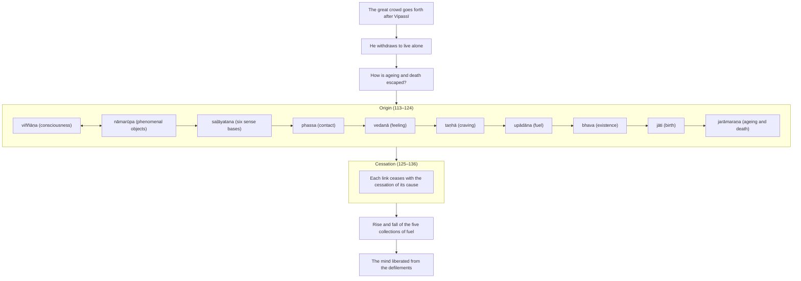

import { Tabs, TabItem } from '@astrojs/starlight/components';

Original text: [7D/1.10–1.11 Mahājanakāyaanupabbajjā and Bodhisattaabhinivesa 109–138](https://tipitaka2500.github.io/tipitaka/7D/1/1.10.html#109) in the [World Tipitaka Edition](https://tipitaka2500.github.io)

## Summary

Eighty-four thousand follow Vipassī into the going forth, until he withdraws to live alone. In seclusion he asks how the world, born, ageing and dying, can escape ageing and death, and traces each link to its cause — birth, existence, fuel, craving, feeling, contact, the six sense bases, phenomenal objects and consciousness, the last two conditioning each other — then the cessation of each with the cessation of its cause. Insight into origin and cessation arises in him; observing the rise and fall of the five collections of fuel, his mind is liberated from the defilements.

## Diagram

## Text

<Tabs syncKey="paliquote">
<TabItem label="My Translation">
(55.)

109\. A great crowd of people in the royal capital Bandhumatī, Bhikkhave, eighty-four thousand beings, heard: ‘Prince Vipassī, it is said, has shaved off his hair and beard, put on ochre robes, and gone forth from the home life into homelessness.’ Having heard, this thought occurred to them: ‘Surely that Dhamma and Discipline is not inferior, that going forth is not inferior, wherein Prince Vipassī has shaved off his hair and beard, put on ochre robes, and gone forth from the home life into homelessness. Indeed, even Prince Vipassī will shave off his hair and beard, put on ochre robes, and go forth from the home life into homelessness; how much more so, then, [should] we?’

110\. Then, Bhikkhave, that great crowd of people, eighty-four thousand beings, shaved off their hair and beards, put on ochre robes, and went forth after Vipassī the `bodhisatta` (Buddha before his awakening), who had gone forth from the home life into homelessness. Surrounded by that assembly, Bhikkhave, Vipassī the `bodhisatta` wandered on a journey through villages, towns, countries and royal capitals.

(56.)

111\. Then, Bhikkhave, while Vipassī the `bodhisatta` was alone in seclusion, this reflection arose in his mind: ‘It is not fitting for me that I dwell crowded in; what if I were to dwell alone, withdrawn from the group?’ Then, Bhikkhave, at a later time Vipassī the `bodhisatta` dwelt alone, withdrawn from the group; those eighty-four thousand who had gone forth went by one road, and Vipassī the `bodhisatta` by another road.

(57.)

112\. Then, Bhikkhave, while Vipassī the `bodhisatta`, having taken up residence, was alone in seclusion, this reflection arose in his mind: ‘This world has indeed fallen into difficulty: it is born, grows old, dies, passes away and is reborn, and yet it does not understand the escape from this suffering, from `jarāmaraṇa` (ageing and death). When indeed will the escape from this suffering, from ageing and death, be known?’

113\. Then, Bhikkhave, this thought occurred to Vipassī the `bodhisatta`: ‘When what exists is there ageing and death, with what as cause is there ageing and death?’ Then, Bhikkhave, through proper attention, Vipassī the `bodhisatta` had a complete comprehension by wisdom: ‘Indeed, when there is `jāti` (birth), there is ageing and death; with birth as cause, ageing and death [arise].’

114\. Then, Bhikkhave, this thought occurred to Vipassī the `bodhisatta`: ‘When what exists is there birth, with what as cause is there birth?’ Then, Bhikkhave, through proper attention, Vipassī the `bodhisatta` had a complete comprehension by wisdom: ‘Indeed, when there is `bhava` (existence), there is birth; with existence as cause, birth [arises].’

115\. Then, Bhikkhave, this thought occurred to Vipassī the `bodhisatta`: ‘When what exists is there existence, with what as cause is there existence?’ Then, Bhikkhave, through proper attention, Vipassī the `bodhisatta` had a complete comprehension by wisdom: ‘Indeed, when there is `upādāna` (fuel), there is existence; with fuel as cause, existence [arises].’

116\. Then, Bhikkhave, this thought occurred to Vipassī the `bodhisatta`: ‘When what exists is there fuel, with what as cause is there fuel?’ Then, Bhikkhave, through proper attention, Vipassī the `bodhisatta` had a complete comprehension by wisdom: ‘Indeed, when there is `taṇhā` (craving), there is fuel; with craving as cause, fuel [arises].’

117\. Then, Bhikkhave, this thought occurred to Vipassī the `bodhisatta`: ‘When what exists is there craving, with what as cause is there craving?’ Then, Bhikkhave, through proper attention, Vipassī the `bodhisatta` had a complete comprehension by wisdom: ‘Indeed, when there is `vedanā` (feeling), there is craving; with feeling as cause, craving [arises].’

118\. Then, Bhikkhave, this thought occurred to Vipassī the `bodhisatta`: ‘When what exists is there feeling, with what as cause is there feeling?’ Then, Bhikkhave, through proper attention, Vipassī the `bodhisatta` had a complete comprehension by wisdom: ‘Indeed, when there is `phassa` (contact), there is feeling; with contact as cause, feeling [arises].’

119\. Then, Bhikkhave, this thought occurred to Vipassī the `bodhisatta`: ‘When what exists is there contact, with what as cause is there contact?’ Then, Bhikkhave, through proper attention, Vipassī the `bodhisatta` had a complete comprehension by wisdom: ‘Indeed, when there are `saḷāyatana` (the six sense bases), there is contact; with the six sense bases as cause, contact [arises].’

120\. Then, Bhikkhave, this thought occurred to Vipassī the `bodhisatta`: ‘When what exists are there the six sense bases, with what as cause are there the six sense bases?’ Then, Bhikkhave, through proper attention, Vipassī the `bodhisatta` had a complete comprehension by wisdom: ‘Indeed, when there are `nāmarūpa` (phenomenal objects), there are the six sense bases; with phenomenal objects as cause, the six sense bases [arise].’

121\. Then, Bhikkhave, this thought occurred to Vipassī the `bodhisatta`: ‘When what exists are there phenomenal objects, with what as cause are there phenomenal objects?’ Then, Bhikkhave, through proper attention, Vipassī the `bodhisatta` had a complete comprehension by wisdom: ‘Indeed, when there is `viññāṇa` (consciousness), there are phenomenal objects; with consciousness as cause, phenomenal objects [arise].’

122\. Then, Bhikkhave, this thought occurred to Vipassī the `bodhisatta`: ‘When what exists is there consciousness, with what as cause is there consciousness?’ Then, Bhikkhave, through proper attention, Vipassī the `bodhisatta` had a complete comprehension by wisdom: ‘Indeed, when there are phenomenal objects, there is consciousness; with phenomenal objects as cause, consciousness [arises].’

(58.)

123\. Then, Bhikkhave, this thought occurred to Vipassī the `bodhisatta`: ‘This consciousness turns back from phenomenal objects, it goes no further. To this extent one may be born, or grow old, or die, or pass away, or be reborn, namely: with phenomenal objects as cause, consciousness [arises]; with consciousness as cause, phenomenal objects [arise]; with phenomenal objects as cause, the six sense bases [arise]; with the six sense bases as cause, contact [arises]; with contact as cause, feeling [arises]; with feeling as cause, craving [arises]; with craving as cause, fuel [arises]; with fuel as cause, existence [arises]; with existence as cause, birth [arises]; with birth as cause, ageing and death, sorrow, lamentation, pain, displeasure and despair come into being. Thus is the origin of this whole mass of suffering’.

(59.)

124\. ‘Origin, origin!’: indeed, Bhikkhave, for Vipassī the `bodhisatta`, concerning dhammas not heard before, insight arose, knowledge arose, wisdom arose, understanding arose, light arose.

(60.)

125\. Then, Bhikkhave, this thought occurred to Vipassī the `bodhisatta`: ‘When what does not exist is there no ageing and death, with the cessation of what is there the cessation of ageing and death?’ Then, Bhikkhave, through proper attention, Vipassī the `bodhisatta` had a complete comprehension by wisdom: ‘Indeed, when there is no birth, there is no ageing and death; with the cessation of birth comes the cessation of ageing and death.’

126\. Then, Bhikkhave, this thought occurred to Vipassī the `bodhisatta`: ‘When what does not exist is there no birth, with the cessation of what is there the cessation of birth?’ Then, Bhikkhave, through proper attention, Vipassī the `bodhisatta` had a complete comprehension by wisdom: ‘Indeed, when there is no existence, there is no birth; with the cessation of existence comes the cessation of birth.’

127\. Then, Bhikkhave, this thought occurred to Vipassī the `bodhisatta`: ‘When what does not exist is there no existence, with the cessation of what is there the cessation of existence?’ Then, Bhikkhave, through proper attention, Vipassī the `bodhisatta` had a complete comprehension by wisdom: ‘Indeed, when there is no fuel, there is no existence; with the cessation of fuel comes the cessation of existence.’

128\. Then, Bhikkhave, this thought occurred to Vipassī the `bodhisatta`: ‘When what does not exist is there no fuel, with the cessation of what is there the cessation of fuel?’ Then, Bhikkhave, through proper attention, Vipassī the `bodhisatta` had a complete comprehension by wisdom: ‘Indeed, when there is no craving, there is no fuel; with the cessation of craving comes the cessation of fuel.’

129\. Then, Bhikkhave, this thought occurred to Vipassī the `bodhisatta`: ‘When what does not exist is there no craving, with the cessation of what is there the cessation of craving?’ Then, Bhikkhave, through proper attention, Vipassī the `bodhisatta` had a complete comprehension by wisdom: ‘Indeed, when there is no feeling, there is no craving; with the cessation of feeling comes the cessation of craving.’

130\. Then, Bhikkhave, this thought occurred to Vipassī the `bodhisatta`: ‘When what does not exist is there no feeling, with the cessation of what is there the cessation of feeling?’ Then, Bhikkhave, through proper attention, Vipassī the `bodhisatta` had a complete comprehension by wisdom: ‘Indeed, when there is no contact, there is no feeling; with the cessation of contact comes the cessation of feeling.’

131\. Then, Bhikkhave, this thought occurred to Vipassī the `bodhisatta`: ‘When what does not exist is there no contact, with the cessation of what is there the cessation of contact?’ Then, Bhikkhave, through proper attention, Vipassī the `bodhisatta` had a complete comprehension by wisdom: ‘Indeed, when there are no six sense bases, there is no contact; with the cessation of the six sense bases comes the cessation of contact.’

132\. Then, Bhikkhave, this thought occurred to Vipassī the `bodhisatta`: ‘When what does not exist are there no six sense bases, with the cessation of what is there the cessation of the six sense bases?’ Then, Bhikkhave, through proper attention, Vipassī the `bodhisatta` had a complete comprehension by wisdom: ‘Indeed, when there are no phenomenal objects, there are no six sense bases; with the cessation of phenomenal objects comes the cessation of the six sense bases.’

133\. Then, Bhikkhave, this thought occurred to Vipassī the `bodhisatta`: ‘When what does not exist are there no phenomenal objects, with the cessation of what is there the cessation of phenomenal objects?’ Then, Bhikkhave, through proper attention, Vipassī the `bodhisatta` had a complete comprehension by wisdom: ‘Indeed, when there is no consciousness, there are no phenomenal objects; with the cessation of consciousness comes the cessation of phenomenal objects.’

134\. Then, Bhikkhave, this thought occurred to Vipassī the `bodhisatta`: ‘When what does not exist is there no consciousness, with the cessation of what is there the cessation of consciousness?’ Then, Bhikkhave, through proper attention, Vipassī the `bodhisatta` had a complete comprehension by wisdom: ‘Indeed, when there are no phenomenal objects, there is no consciousness; with the cessation of phenomenal objects comes the cessation of consciousness.’

(61.)

135\. Then indeed, Bhikkhave, this (thought) occurred to Vipassī the Bodhisatta — ‘Indeed, this path for full awakening has been attained by me, namely: with the cessation of phenomenal objects comes the cessation of consciousness; with the cessation of consciousness comes the cessation of phenomenal objects; with the cessation of phenomenal objects comes the cessation of the six sense bases; with the cessation of the six sense bases comes the cessation of contact; with the cessation of contact comes the cessation of feeling; with the cessation of feeling comes the cessation of craving; with the cessation of craving comes the cessation of fuel; with the cessation of fuel comes the cessation of existence; with the cessation of existence comes the cessation of birth; with the cessation of birth, ageing and death, sorrow, lamentation, pain, displeasure and despair cease. Thus is the cessation of this whole mass of suffering’.

(62.)

136\. ‘Cessation, cessation!’: indeed, Bhikkhave, for Vipassī the Bodhisatta, concerning dhammas not heard before, insight arose, knowledge arose, wisdom arose, understanding arose, light arose.

(63.)

137\. Then indeed, Bhikkhave, Vipassī the Bodhisatta, at a later time, dwelt observing the arising and passing away in the five collections of fuel — ‘Thus is form, thus is the origin of form, thus is the cessation of form; thus is feeling, thus is the origin of feeling, thus is the cessation of feeling; thus is apperception, thus is the origin of apperception, thus is the cessation of apperception; thus are mental constructions, thus is the origin of mental constructions, thus is the cessation of mental constructions; thus is consciousness, thus is the origin of consciousness, thus is the cessation of consciousness’, and for him, dwelling observing the arising and passing away in the five collections of fuel, not long after indeed, the mind, not grasping, was liberated from the defilements.

138\. The second `bhāṇavāra` (section for recitation).
</TabItem>

<TabItem label="Pāḷi (Roman IAST)">
(55.)

109\. Assosi kho, bhikkhave, bandhumatiyā rājadhāniyā mahājanakāyo caturāsītipāṇasahassāni— ‘vipassī kira kumāro kesamassuṃ ohāretvā kāsāyāni vatthāni acchādetvā agārasmā anagāriyaṃ pabbajito’ti. Sutvāna tesaṃ etadahosi— ‘na hi nūna so orako dhammavinayo, na sā orakā pabbajjā, yattha vipassī kumāro kesamassuṃ ohāretvā kāsāyāni vatthāni acchādetvā agārasmā anagāriyaṃ pabbajito. Vipassīpi nāma kumāro kesamassuṃ ohāretvā kāsāyāni vatthāni acchādetvā agārasmā anagāriyaṃ pabbajissati, kimaṅgaṃ pana mayan’ti.

110\. Atha kho, so bhikkhave, mahājanakāyo caturāsītipāṇasahassāni kesamassuṃ ohāretvā kāsāyāni vatthāni acchādetvā vipassiṃ bodhisattaṃ agārasmā anagāriyaṃ pabbajitaṃ anupabbajiṃsu. Tāya sudaṃ, bhikkhave, parisāya parivuto vipassī bodhisatto gāmanigamajanapadarājadhānīsu cārikaṃ carati.

(56.)

111\. Atha kho, bhikkhave, vipassissa bodhisattassa rahogatassa paṭisallīnassa evaṃ cetaso parivitakko udapādi— ‘na kho metaṃ patirūpaṃ yohaṃ ākiṇṇo viharāmi, yannūnāhaṃ eko gaṇamhā vūpakaṭṭho vihareyyan’ti. Atha kho, bhikkhave, vipassī bodhisatto aparena samayena eko gaṇamhā vūpakaṭṭho vihāsi, aññeneva tāni caturāsītipabbajitasahassāni agamaṃsu, aññena maggena vipassī bodhisatto.

(57.)

112\. Atha kho, bhikkhave, vipassissa bodhisattassa vāsūpagatassa rahogatassa paṭisallīnassa evaṃ cetaso parivitakko udapādi— ‘kicchaṃ vatāyaṃ loko āpanno, jāyati ca jīyati ca mīyati ca cavati ca upapajjati ca, atha ca panimassa dukkhassa nissaraṇaṃ nappajānāti jarāmaraṇassa, kudāssu nāma imassa dukkhassa nissaraṇaṃ paññāyissati jarāmaraṇassā’ti?

113\. Atha kho, bhikkhave, vipassissa bodhisattassa etadahosi— ‘kimhi nu kho sati jarāmaraṇaṃ hoti, kiṃpaccayā jarāmaraṇan’ti? Atha kho, bhikkhave, vipassissa bodhisattassa yoniso manasikārā ahu paññāya abhisamayo— ‘jātiyā kho sati jarāmaraṇaṃ hoti, jātipaccayā jarāmaraṇan’ti.

114\. Atha kho, bhikkhave, vipassissa bodhisattassa etadahosi— ‘kimhi nu kho sati jāti hoti, kiṃpaccayā jātī’ti? Atha kho, bhikkhave, vipassissa bodhisattassa yoniso manasikārā ahu paññāya abhisamayo— ‘bhave kho sati jāti hoti, bhavapaccayā jātī’ti.

115\. Atha kho, bhikkhave, vipassissa bodhisattassa etadahosi— ‘kimhi nu kho sati bhavo hoti, kiṃpaccayā bhavo’ti? Atha kho, bhikkhave, vipassissa bodhisattassa yoniso manasikārā ahu paññāya abhisamayo— ‘upādāne kho sati bhavo hoti, upādānapaccayā bhavo’ti.

116\. Atha kho, bhikkhave, vipassissa bodhisattassa etadahosi— ‘kimhi nu kho sati upādānaṃ hoti, kiṃpaccayā upādānan’ti? Atha kho, bhikkhave, vipassissa bodhisattassa yoniso manasikārā ahu paññāya abhisamayo— ‘taṇhāya kho sati upādānaṃ hoti, taṇhāpaccayā upādānan’ti.

117\. Atha kho, bhikkhave, vipassissa bodhisattassa etadahosi— ‘kimhi nu kho sati taṇhā hoti, kiṃpaccayā taṇhā’ti? Atha kho, bhikkhave, vipassissa bodhisattassa yoniso manasikārā ahu paññāya abhisamayo— ‘vedanāya kho sati taṇhā hoti, vedanāpaccayā taṇhā’ti.

118\. Atha kho, bhikkhave, vipassissa bodhisattassa etadahosi— ‘kimhi nu kho sati vedanā hoti, kiṃpaccayā vedanā’ti? Atha kho, bhikkhave, vipassissa bodhisattassa yoniso manasikārā ahu paññāya abhisamayo— ‘phasse kho sati vedanā hoti, phassapaccayā vedanā’ti.

119\. Atha kho, bhikkhave, vipassissa bodhisattassa etadahosi— ‘kimhi nu kho sati phasso hoti, kiṃpaccayā phasso’ti? Atha kho, bhikkhave, vipassissa bodhisattassa yoniso manasikārā ahu paññāya abhisamayo— ‘saḷāyatane kho sati phasso hoti, saḷāyatanapaccayā phasso’ti.

120\. Atha kho, bhikkhave, vipassissa bodhisattassa etadahosi— ‘kimhi nu kho sati saḷāyatanaṃ hoti, kiṃpaccayā saḷāyatanan’ti? Atha kho, bhikkhave, vipassissa bodhisattassa yoniso manasikārā ahu paññāya abhisamayo— ‘nāmarūpe kho sati saḷāyatanaṃ hoti, nāmarūpapaccayā saḷāyatanan’ti.

121\. Atha kho, bhikkhave, vipassissa bodhisattassa etadahosi— ‘kimhi nu kho sati nāmarūpaṃ hoti, kiṃpaccayā nāmarūpan’ti? Atha kho, bhikkhave, vipassissa bodhisattassa yoniso manasikārā ahu paññāya abhisamayo— ‘viññāṇe kho sati nāmarūpaṃ hoti, viññāṇapaccayā nāmarūpan’ti.

122\. Atha kho, bhikkhave, vipassissa bodhisattassa etadahosi— ‘kimhi nu kho sati viññāṇaṃ hoti, kiṃpaccayā viññāṇan’ti? Atha kho, bhikkhave, vipassissa bodhisattassa yoniso manasikārā ahu paññāya abhisamayo— ‘nāmarūpe kho sati viññāṇaṃ hoti, nāmarūpapaccayā viññāṇan’ti.

(58.)

123\. Atha kho, bhikkhave, vipassissa bodhisattassa etadahosi— ‘paccudāvattati kho idaṃ viññāṇaṃ nāmarūpamhā, nāparaṃ gacchati. Ettāvatā jāyetha vā jiyyetha vā miyyetha vā cavetha vā upapajjetha vā, yadidaṃ nāmarūpapaccayā viññāṇaṃ, viññāṇapaccayā nāmarūpaṃ, nāmarūpapaccayā saḷāyatanaṃ, saḷāyatanapaccayā phasso, phassapaccayā vedanā, vedanāpaccayā taṇhā, taṇhāpaccayā upādānaṃ, upādānapaccayā bhavo, bhavapaccayā jāti, jātipaccayā jarāmaraṇaṃ sokaparidevadukkhadomanassupāyāsā sambhavanti. Evametassa kevalassa dukkhakkhandhassa samudayo hoti’.

(59.)

124\. ‘Samudayo samudayo’ti kho, bhikkhave, vipassissa bodhisattassa pubbe ananussutesu dhammesu cakkhuṃ udapādi, ñāṇaṃ udapādi, paññā udapādi, vijjā udapādi, āloko udapādi.

(60.)

125\. Atha kho, bhikkhave, vipassissa bodhisattassa etadahosi— ‘kimhi nu kho asati jarāmaraṇaṃ na hoti, kissa nirodhā jarāmaraṇanirodho’ti? Atha kho, bhikkhave, vipassissa bodhisattassa yoniso manasikārā ahu paññāya abhisamayo— ‘jātiyā kho asati jarāmaraṇaṃ na hoti, jātinirodhā jarāmaraṇanirodho’ti.

126\. Atha kho, bhikkhave, vipassissa bodhisattassa etadahosi— ‘kimhi nu kho asati jāti na hoti, kissa nirodhā jātinirodho’ti? Atha kho, bhikkhave, vipassissa bodhisattassa yoniso manasikārā ahu paññāya abhisamayo— ‘bhave kho asati jāti na hoti, bhavanirodhā jātinirodho’ti.

127\. Atha kho, bhikkhave, vipassissa bodhisattassa etadahosi— ‘kimhi nu kho asati bhavo na hoti, kissa nirodhā bhavanirodho’ti? Atha kho, bhikkhave, vipassissa bodhisattassa yoniso manasikārā ahu paññāya abhisamayo— ‘upādāne kho asati bhavo na hoti, upādānanirodhā bhavanirodho’ti.

128\. Atha kho, bhikkhave, vipassissa bodhisattassa etadahosi— ‘kimhi nu kho asati upādānaṃ na hoti, kissa nirodhā upādānanirodho’ti? Atha kho, bhikkhave, vipassissa bodhisattassa yoniso manasikārā ahu paññāya abhisamayo— ‘taṇhāya kho asati upādānaṃ na hoti, taṇhānirodhā upādānanirodho’ti.

129\. Atha kho, bhikkhave, vipassissa bodhisattassa etadahosi— ‘kimhi nu kho asati taṇhā na hoti, kissa nirodhā taṇhānirodho’ti? Atha kho, bhikkhave, vipassissa bodhisattassa yoniso manasikārā ahu paññāya abhisamayo— ‘vedanāya kho asati taṇhā na hoti, vedanānirodhā taṇhānirodho’ti.

130\. Atha kho, bhikkhave, vipassissa bodhisattassa etadahosi— ‘kimhi nu kho asati vedanā na hoti, kissa nirodhā vedanānirodho’ti? Atha kho, bhikkhave, vipassissa bodhisattassa yoniso manasikārā ahu paññāya abhisamayo— ‘phasse kho asati vedanā na hoti, phassanirodhā vedanānirodho’ti.

131\. Atha kho, bhikkhave, vipassissa bodhisattassa etadahosi— ‘kimhi nu kho asati phasso na hoti, kissa nirodhā phassanirodho’ti? Atha kho, bhikkhave, vipassissa bodhisattassa yoniso manasikārā ahu paññāya abhisamayo— ‘saḷāyatane kho asati phasso na hoti, saḷāyatananirodhā phassanirodho’ti.

132\. Atha kho, bhikkhave, vipassissa bodhisattassa etadahosi— ‘kimhi nu kho asati saḷāyatanaṃ na hoti, kissa nirodhā saḷāyatananirodho’ti? Atha kho, bhikkhave, vipassissa bodhisattassa yoniso manasikārā ahu paññāya abhisamayo— ‘nāmarūpe kho asati saḷāyatanaṃ na hoti, nāmarūpanirodhā saḷāyatananirodho’ti.

133\. Atha kho, bhikkhave, vipassissa bodhisattassa etadahosi— ‘kimhi nu kho asati nāmarūpaṃ na hoti, kissa nirodhā nāmarūpanirodho’ti? Atha kho, bhikkhave, vipassissa bodhisattassa yoniso manasikārā ahu paññāya abhisamayo— ‘viññāṇe kho asati nāmarūpaṃ na hoti, viññāṇanirodhā nāmarūpanirodho’ti.

134\. Atha kho, bhikkhave, vipassissa bodhisattassa etadahosi— ‘kimhi nu kho asati viññāṇaṃ na hoti, kissa nirodhā viññāṇanirodho’ti? Atha kho, bhikkhave, vipassissa bodhisattassa yoniso manasikārā ahu paññāya abhisamayo— ‘nāmarūpe kho asati viññāṇaṃ na hoti, nāmarūpanirodhā viññāṇanirodho’ti.

(61.)

135\. Atha kho, bhikkhave, vipassissa bodhisattassa etadahosi— ‘adhigato kho myāyaṃ maggo sambodhāya yadidaṃ— nāmarūpanirodhā viññāṇanirodho, viññāṇanirodhā nāmarūpanirodho, nāmarūpanirodhā saḷāyatananirodho, saḷāyatananirodhā phassanirodho, phassanirodhā vedanānirodho, vedanānirodhā taṇhānirodho, taṇhānirodhā upādānanirodho, upādānanirodhā bhavanirodho, bhavanirodhā jātinirodho, jātinirodhā jarāmaraṇaṃ sokaparidevadukkhadomanassupāyāsā nirujjhanti. Evametassa kevalassa dukkhakkhandhassa nirodho hoti’.

(62.)

136\. ‘Nirodho nirodho’ti kho, bhikkhave, vipassissa bodhisattassa pubbe ananussutesu dhammesu cakkhuṃ udapādi, ñāṇaṃ udapādi, paññā udapādi, vijjā udapādi, āloko udapādi.

(63.)

137\. Atha kho, bhikkhave, vipassī bodhisatto aparena samayena pañcasu upādānakkhandhesu udayabbayānupassī vihāsi— ‘iti rūpaṃ, iti rūpassa samudayo, iti rūpassa atthaṅgamo; iti vedanā, iti vedanāya samudayo, iti vedanāya atthaṅgamo; iti saññā, iti saññāya samudayo, iti saññāya atthaṅgamo; iti saṅkhārā, iti saṅkhārānaṃ samudayo, iti saṅkhārānaṃ atthaṅgamo; iti viññāṇaṃ, iti viññāṇassa samudayo, iti viññāṇassa atthaṅgamo’ti, tassa pañcasu upādānakkhandhesu udayabbayānupassino viharato na cirasseva anupādāya āsavehi cittaṃ vimuccīti.

138\. Dutiyabhāṇavāro.
</TabItem>

<TabItem label="Pāḷi (Brahmi)">
(55.)

109\. 𑀅𑀲𑁆𑀲𑁄𑀲𑀺 𑀔𑁄, 𑀪𑀺𑀓𑁆𑀔𑀯𑁂, 𑀩𑀦𑁆𑀥𑀼𑀫𑀢𑀺𑀬𑀸 𑀭𑀸𑀚𑀥𑀸𑀦𑀺𑀬𑀸 𑀫𑀳𑀸𑀚𑀦𑀓𑀸𑀬𑁄 𑀘𑀢𑀼𑀭𑀸𑀲𑀻𑀢𑀺𑀧𑀸𑀡𑀲𑀳𑀲𑁆𑀲𑀸𑀦𑀺— ‘𑀯𑀺𑀧𑀲𑁆𑀲𑀻 𑀓𑀺𑀭 𑀓𑀼𑀫𑀸𑀭𑁄 𑀓𑁂𑀲𑀫𑀲𑁆𑀲𑀼𑀁 𑀑𑀳𑀸𑀭𑁂𑀢𑁆𑀯𑀸 𑀓𑀸𑀲𑀸𑀬𑀸𑀦𑀺 𑀯𑀢𑁆𑀣𑀸𑀦𑀺 𑀅𑀘𑁆𑀙𑀸𑀤𑁂𑀢𑁆𑀯𑀸 𑀅𑀕𑀸𑀭𑀲𑁆𑀫𑀸 𑀅𑀦𑀕𑀸𑀭𑀺𑀬𑀁 𑀧𑀩𑁆𑀩𑀚𑀺𑀢𑁄’𑀢𑀺. 𑀲𑀼𑀢𑁆𑀯𑀸𑀦 𑀢𑁂𑀲𑀁 𑀏𑀢𑀤𑀳𑁄𑀲𑀺— ‘𑀦 𑀳𑀺 𑀦𑀽𑀦 𑀲𑁄 𑀑𑀭𑀓𑁄 𑀥𑀫𑁆𑀫𑀯𑀺𑀦𑀬𑁄, 𑀦 𑀲𑀸 𑀑𑀭𑀓𑀸 𑀧𑀩𑁆𑀩𑀚𑁆𑀚𑀸, 𑀬𑀢𑁆𑀣 𑀯𑀺𑀧𑀲𑁆𑀲𑀻 𑀓𑀼𑀫𑀸𑀭𑁄 𑀓𑁂𑀲𑀫𑀲𑁆𑀲𑀼𑀁 𑀑𑀳𑀸𑀭𑁂𑀢𑁆𑀯𑀸 𑀓𑀸𑀲𑀸𑀬𑀸𑀦𑀺 𑀯𑀢𑁆𑀣𑀸𑀦𑀺 𑀅𑀘𑁆𑀙𑀸𑀤𑁂𑀢𑁆𑀯𑀸 𑀅𑀕𑀸𑀭𑀲𑁆𑀫𑀸 𑀅𑀦𑀕𑀸𑀭𑀺𑀬𑀁 𑀧𑀩𑁆𑀩𑀚𑀺𑀢𑁄. 𑀯𑀺𑀧𑀲𑁆𑀲𑀻𑀧𑀺 𑀦𑀸𑀫 𑀓𑀼𑀫𑀸𑀭𑁄 𑀓𑁂𑀲𑀫𑀲𑁆𑀲𑀼𑀁 𑀑𑀳𑀸𑀭𑁂𑀢𑁆𑀯𑀸 𑀓𑀸𑀲𑀸𑀬𑀸𑀦𑀺 𑀯𑀢𑁆𑀣𑀸𑀦𑀺 𑀅𑀘𑁆𑀙𑀸𑀤𑁂𑀢𑁆𑀯𑀸 𑀅𑀕𑀸𑀭𑀲𑁆𑀫𑀸 𑀅𑀦𑀕𑀸𑀭𑀺𑀬𑀁 𑀧𑀩𑁆𑀩𑀚𑀺𑀲𑁆𑀲𑀢𑀺, 𑀓𑀺𑀫𑀗𑁆𑀕𑀁 𑀧𑀦 𑀫𑀬𑀦𑁆’𑀢𑀺.

110\. 𑀅𑀣 𑀔𑁄, 𑀲𑁄 𑀪𑀺𑀓𑁆𑀔𑀯𑁂, 𑀫𑀳𑀸𑀚𑀦𑀓𑀸𑀬𑁄 𑀘𑀢𑀼𑀭𑀸𑀲𑀻𑀢𑀺𑀧𑀸𑀡𑀲𑀳𑀲𑁆𑀲𑀸𑀦𑀺 𑀓𑁂𑀲𑀫𑀲𑁆𑀲𑀼𑀁 𑀑𑀳𑀸𑀭𑁂𑀢𑁆𑀯𑀸 𑀓𑀸𑀲𑀸𑀬𑀸𑀦𑀺 𑀯𑀢𑁆𑀣𑀸𑀦𑀺 𑀅𑀘𑁆𑀙𑀸𑀤𑁂𑀢𑁆𑀯𑀸 𑀯𑀺𑀧𑀲𑁆𑀲𑀺𑀁 𑀩𑁄𑀥𑀺𑀲𑀢𑁆𑀢𑀁 𑀅𑀕𑀸𑀭𑀲𑁆𑀫𑀸 𑀅𑀦𑀕𑀸𑀭𑀺𑀬𑀁 𑀧𑀩𑁆𑀩𑀚𑀺𑀢𑀁 𑀅𑀦𑀼𑀧𑀩𑁆𑀩𑀚𑀺𑀁𑀲𑀼. 𑀢𑀸𑀬 𑀲𑀼𑀤𑀁, 𑀪𑀺𑀓𑁆𑀔𑀯𑁂, 𑀧𑀭𑀺𑀲𑀸𑀬 𑀧𑀭𑀺𑀯𑀼𑀢𑁄 𑀯𑀺𑀧𑀲𑁆𑀲𑀻 𑀩𑁄𑀥𑀺𑀲𑀢𑁆𑀢𑁄 𑀕𑀸𑀫𑀦𑀺𑀕𑀫𑀚𑀦𑀧𑀤𑀭𑀸𑀚𑀥𑀸𑀦𑀻𑀲𑀼 𑀘𑀸𑀭𑀺𑀓𑀁 𑀘𑀭𑀢𑀺.

(56.)

111\. 𑀅𑀣 𑀔𑁄, 𑀪𑀺𑀓𑁆𑀔𑀯𑁂, 𑀯𑀺𑀧𑀲𑁆𑀲𑀺𑀲𑁆𑀲 𑀩𑁄𑀥𑀺𑀲𑀢𑁆𑀢𑀲𑁆𑀲 𑀭𑀳𑁄𑀕𑀢𑀲𑁆𑀲 𑀧𑀝𑀺𑀲𑀮𑁆𑀮𑀻𑀦𑀲𑁆𑀲 𑀏𑀯𑀁 𑀘𑁂𑀢𑀲𑁄 𑀧𑀭𑀺𑀯𑀺𑀢𑀓𑁆𑀓𑁄 𑀉𑀤𑀧𑀸𑀤𑀺— ‘𑀦 𑀔𑁄 𑀫𑁂𑀢𑀁 𑀧𑀢𑀺𑀭𑀽𑀧𑀁 𑀬𑁄𑀳𑀁 𑀆𑀓𑀺𑀡𑁆𑀡𑁄 𑀯𑀺𑀳𑀭𑀸𑀫𑀺, 𑀬𑀦𑁆𑀦𑀽𑀦𑀸𑀳𑀁 𑀏𑀓𑁄 𑀕𑀡𑀫𑁆𑀳𑀸 𑀯𑀽𑀧𑀓𑀝𑁆𑀞𑁄 𑀯𑀺𑀳𑀭𑁂𑀬𑁆𑀬𑀦𑁆’𑀢𑀺. 𑀅𑀣 𑀔𑁄, 𑀪𑀺𑀓𑁆𑀔𑀯𑁂, 𑀯𑀺𑀧𑀲𑁆𑀲𑀻 𑀩𑁄𑀥𑀺𑀲𑀢𑁆𑀢𑁄 𑀅𑀧𑀭𑁂𑀦 𑀲𑀫𑀬𑁂𑀦 𑀏𑀓𑁄 𑀕𑀡𑀫𑁆𑀳𑀸 𑀯𑀽𑀧𑀓𑀝𑁆𑀞𑁄 𑀯𑀺𑀳𑀸𑀲𑀺, 𑀅𑀜𑁆𑀜𑁂𑀦𑁂𑀯 𑀢𑀸𑀦𑀺 𑀘𑀢𑀼𑀭𑀸𑀲𑀻𑀢𑀺𑀧𑀩𑁆𑀩𑀚𑀺𑀢𑀲𑀳𑀲𑁆𑀲𑀸𑀦𑀺 𑀅𑀕𑀫𑀁𑀲𑀼, 𑀅𑀜𑁆𑀜𑁂𑀦 𑀫𑀕𑁆𑀕𑁂𑀦 𑀯𑀺𑀧𑀲𑁆𑀲𑀻 𑀩𑁄𑀥𑀺𑀲𑀢𑁆𑀢𑁄.

(57.)

112\. 𑀅𑀣 𑀔𑁄, 𑀪𑀺𑀓𑁆𑀔𑀯𑁂, 𑀯𑀺𑀧𑀲𑁆𑀲𑀺𑀲𑁆𑀲 𑀩𑁄𑀥𑀺𑀲𑀢𑁆𑀢𑀲𑁆𑀲 𑀯𑀸𑀲𑀽𑀧𑀕𑀢𑀲𑁆𑀲 𑀭𑀳𑁄𑀕𑀢𑀲𑁆𑀲 𑀧𑀝𑀺𑀲𑀮𑁆𑀮𑀻𑀦𑀲𑁆𑀲 𑀏𑀯𑀁 𑀘𑁂𑀢𑀲𑁄 𑀧𑀭𑀺𑀯𑀺𑀢𑀓𑁆𑀓𑁄 𑀉𑀤𑀧𑀸𑀤𑀺— ‘𑀓𑀺𑀘𑁆𑀙𑀁 𑀯𑀢𑀸𑀬𑀁 𑀮𑁄𑀓𑁄 𑀆𑀧𑀦𑁆𑀦𑁄, 𑀚𑀸𑀬𑀢𑀺 𑀘 𑀚𑀻𑀬𑀢𑀺 𑀘 𑀫𑀻𑀬𑀢𑀺 𑀘 𑀘𑀯𑀢𑀺 𑀘 𑀉𑀧𑀧𑀚𑁆𑀚𑀢𑀺 𑀘, 𑀅𑀣 𑀘 𑀧𑀦𑀺𑀫𑀲𑁆𑀲 𑀤𑀼𑀓𑁆𑀔𑀲𑁆𑀲 𑀦𑀺𑀲𑁆𑀲𑀭𑀡𑀁 𑀦𑀧𑁆𑀧𑀚𑀸𑀦𑀸𑀢𑀺 𑀚𑀭𑀸𑀫𑀭𑀡𑀲𑁆𑀲, 𑀓𑀼𑀤𑀸𑀲𑁆𑀲𑀼 𑀦𑀸𑀫 𑀇𑀫𑀲𑁆𑀲 𑀤𑀼𑀓𑁆𑀔𑀲𑁆𑀲 𑀦𑀺𑀲𑁆𑀲𑀭𑀡𑀁 𑀧𑀜𑁆𑀜𑀸𑀬𑀺𑀲𑁆𑀲𑀢𑀺 𑀚𑀭𑀸𑀫𑀭𑀡𑀲𑁆𑀲𑀸’𑀢𑀺?

113\. 𑀅𑀣 𑀔𑁄, 𑀪𑀺𑀓𑁆𑀔𑀯𑁂, 𑀯𑀺𑀧𑀲𑁆𑀲𑀺𑀲𑁆𑀲 𑀩𑁄𑀥𑀺𑀲𑀢𑁆𑀢𑀲𑁆𑀲 𑀏𑀢𑀤𑀳𑁄𑀲𑀺— ‘𑀓𑀺𑀫𑁆𑀳𑀺 𑀦𑀼 𑀔𑁄 𑀲𑀢𑀺 𑀚𑀭𑀸𑀫𑀭𑀡𑀁 𑀳𑁄𑀢𑀺, 𑀓𑀺𑀁𑀧𑀘𑁆𑀘𑀬𑀸 𑀚𑀭𑀸𑀫𑀭𑀡𑀦𑁆’𑀢𑀺? 𑀅𑀣 𑀔𑁄, 𑀪𑀺𑀓𑁆𑀔𑀯𑁂, 𑀯𑀺𑀧𑀲𑁆𑀲𑀺𑀲𑁆𑀲 𑀩𑁄𑀥𑀺𑀲𑀢𑁆𑀢𑀲𑁆𑀲 𑀬𑁄𑀦𑀺𑀲𑁄 𑀫𑀦𑀲𑀺𑀓𑀸𑀭𑀸 𑀅𑀳𑀼 𑀧𑀜𑁆𑀜𑀸𑀬 𑀅𑀪𑀺𑀲𑀫𑀬𑁄— ‘𑀚𑀸𑀢𑀺𑀬𑀸 𑀔𑁄 𑀲𑀢𑀺 𑀚𑀭𑀸𑀫𑀭𑀡𑀁 𑀳𑁄𑀢𑀺, 𑀚𑀸𑀢𑀺𑀧𑀘𑁆𑀘𑀬𑀸 𑀚𑀭𑀸𑀫𑀭𑀡𑀦𑁆’𑀢𑀺.

114\. 𑀅𑀣 𑀔𑁄, 𑀪𑀺𑀓𑁆𑀔𑀯𑁂, 𑀯𑀺𑀧𑀲𑁆𑀲𑀺𑀲𑁆𑀲 𑀩𑁄𑀥𑀺𑀲𑀢𑁆𑀢𑀲𑁆𑀲 𑀏𑀢𑀤𑀳𑁄𑀲𑀺— ‘𑀓𑀺𑀫𑁆𑀳𑀺 𑀦𑀼 𑀔𑁄 𑀲𑀢𑀺 𑀚𑀸𑀢𑀺 𑀳𑁄𑀢𑀺, 𑀓𑀺𑀁𑀧𑀘𑁆𑀘𑀬𑀸 𑀚𑀸𑀢𑀻’𑀢𑀺? 𑀅𑀣 𑀔𑁄, 𑀪𑀺𑀓𑁆𑀔𑀯𑁂, 𑀯𑀺𑀧𑀲𑁆𑀲𑀺𑀲𑁆𑀲 𑀩𑁄𑀥𑀺𑀲𑀢𑁆𑀢𑀲𑁆𑀲 𑀬𑁄𑀦𑀺𑀲𑁄 𑀫𑀦𑀲𑀺𑀓𑀸𑀭𑀸 𑀅𑀳𑀼 𑀧𑀜𑁆𑀜𑀸𑀬 𑀅𑀪𑀺𑀲𑀫𑀬𑁄— ‘𑀪𑀯𑁂 𑀔𑁄 𑀲𑀢𑀺 𑀚𑀸𑀢𑀺 𑀳𑁄𑀢𑀺, 𑀪𑀯𑀧𑀘𑁆𑀘𑀬𑀸 𑀚𑀸𑀢𑀻’𑀢𑀺.

115\. 𑀅𑀣 𑀔𑁄, 𑀪𑀺𑀓𑁆𑀔𑀯𑁂, 𑀯𑀺𑀧𑀲𑁆𑀲𑀺𑀲𑁆𑀲 𑀩𑁄𑀥𑀺𑀲𑀢𑁆𑀢𑀲𑁆𑀲 𑀏𑀢𑀤𑀳𑁄𑀲𑀺— ‘𑀓𑀺𑀫𑁆𑀳𑀺 𑀦𑀼 𑀔𑁄 𑀲𑀢𑀺 𑀪𑀯𑁄 𑀳𑁄𑀢𑀺, 𑀓𑀺𑀁𑀧𑀘𑁆𑀘𑀬𑀸 𑀪𑀯𑁄’𑀢𑀺? 𑀅𑀣 𑀔𑁄, 𑀪𑀺𑀓𑁆𑀔𑀯𑁂, 𑀯𑀺𑀧𑀲𑁆𑀲𑀺𑀲𑁆𑀲 𑀩𑁄𑀥𑀺𑀲𑀢𑁆𑀢𑀲𑁆𑀲 𑀬𑁄𑀦𑀺𑀲𑁄 𑀫𑀦𑀲𑀺𑀓𑀸𑀭𑀸 𑀅𑀳𑀼 𑀧𑀜𑁆𑀜𑀸𑀬 𑀅𑀪𑀺𑀲𑀫𑀬𑁄— ‘𑀉𑀧𑀸𑀤𑀸𑀦𑁂 𑀔𑁄 𑀲𑀢𑀺 𑀪𑀯𑁄 𑀳𑁄𑀢𑀺, 𑀉𑀧𑀸𑀤𑀸𑀦𑀧𑀘𑁆𑀘𑀬𑀸 𑀪𑀯𑁄’𑀢𑀺.

116\. 𑀅𑀣 𑀔𑁄, 𑀪𑀺𑀓𑁆𑀔𑀯𑁂, 𑀯𑀺𑀧𑀲𑁆𑀲𑀺𑀲𑁆𑀲 𑀩𑁄𑀥𑀺𑀲𑀢𑁆𑀢𑀲𑁆𑀲 𑀏𑀢𑀤𑀳𑁄𑀲𑀺— ‘𑀓𑀺𑀫𑁆𑀳𑀺 𑀦𑀼 𑀔𑁄 𑀲𑀢𑀺 𑀉𑀧𑀸𑀤𑀸𑀦𑀁 𑀳𑁄𑀢𑀺, 𑀓𑀺𑀁𑀧𑀘𑁆𑀘𑀬𑀸 𑀉𑀧𑀸𑀤𑀸𑀦𑀦𑁆’𑀢𑀺? 𑀅𑀣 𑀔𑁄, 𑀪𑀺𑀓𑁆𑀔𑀯𑁂, 𑀯𑀺𑀧𑀲𑁆𑀲𑀺𑀲𑁆𑀲 𑀩𑁄𑀥𑀺𑀲𑀢𑁆𑀢𑀲𑁆𑀲 𑀬𑁄𑀦𑀺𑀲𑁄 𑀫𑀦𑀲𑀺𑀓𑀸𑀭𑀸 𑀅𑀳𑀼 𑀧𑀜𑁆𑀜𑀸𑀬 𑀅𑀪𑀺𑀲𑀫𑀬𑁄— ‘𑀢𑀡𑁆𑀳𑀸𑀬 𑀔𑁄 𑀲𑀢𑀺 𑀉𑀧𑀸𑀤𑀸𑀦𑀁 𑀳𑁄𑀢𑀺, 𑀢𑀡𑁆𑀳𑀸𑀧𑀘𑁆𑀘𑀬𑀸 𑀉𑀧𑀸𑀤𑀸𑀦𑀦𑁆’𑀢𑀺.

117\. 𑀅𑀣 𑀔𑁄, 𑀪𑀺𑀓𑁆𑀔𑀯𑁂, 𑀯𑀺𑀧𑀲𑁆𑀲𑀺𑀲𑁆𑀲 𑀩𑁄𑀥𑀺𑀲𑀢𑁆𑀢𑀲𑁆𑀲 𑀏𑀢𑀤𑀳𑁄𑀲𑀺— ‘𑀓𑀺𑀫𑁆𑀳𑀺 𑀦𑀼 𑀔𑁄 𑀲𑀢𑀺 𑀢𑀡𑁆𑀳𑀸 𑀳𑁄𑀢𑀺, 𑀓𑀺𑀁𑀧𑀘𑁆𑀘𑀬𑀸 𑀢𑀡𑁆𑀳𑀸’𑀢𑀺? 𑀅𑀣 𑀔𑁄, 𑀪𑀺𑀓𑁆𑀔𑀯𑁂, 𑀯𑀺𑀧𑀲𑁆𑀲𑀺𑀲𑁆𑀲 𑀩𑁄𑀥𑀺𑀲𑀢𑁆𑀢𑀲𑁆𑀲 𑀬𑁄𑀦𑀺𑀲𑁄 𑀫𑀦𑀲𑀺𑀓𑀸𑀭𑀸 𑀅𑀳𑀼 𑀧𑀜𑁆𑀜𑀸𑀬 𑀅𑀪𑀺𑀲𑀫𑀬𑁄— ‘𑀯𑁂𑀤𑀦𑀸𑀬 𑀔𑁄 𑀲𑀢𑀺 𑀢𑀡𑁆𑀳𑀸 𑀳𑁄𑀢𑀺, 𑀯𑁂𑀤𑀦𑀸𑀧𑀘𑁆𑀘𑀬𑀸 𑀢𑀡𑁆𑀳𑀸’𑀢𑀺.

118\. 𑀅𑀣 𑀔𑁄, 𑀪𑀺𑀓𑁆𑀔𑀯𑁂, 𑀯𑀺𑀧𑀲𑁆𑀲𑀺𑀲𑁆𑀲 𑀩𑁄𑀥𑀺𑀲𑀢𑁆𑀢𑀲𑁆𑀲 𑀏𑀢𑀤𑀳𑁄𑀲𑀺— ‘𑀓𑀺𑀫𑁆𑀳𑀺 𑀦𑀼 𑀔𑁄 𑀲𑀢𑀺 𑀯𑁂𑀤𑀦𑀸 𑀳𑁄𑀢𑀺, 𑀓𑀺𑀁𑀧𑀘𑁆𑀘𑀬𑀸 𑀯𑁂𑀤𑀦𑀸’𑀢𑀺? 𑀅𑀣 𑀔𑁄, 𑀪𑀺𑀓𑁆𑀔𑀯𑁂, 𑀯𑀺𑀧𑀲𑁆𑀲𑀺𑀲𑁆𑀲 𑀩𑁄𑀥𑀺𑀲𑀢𑁆𑀢𑀲𑁆𑀲 𑀬𑁄𑀦𑀺𑀲𑁄 𑀫𑀦𑀲𑀺𑀓𑀸𑀭𑀸 𑀅𑀳𑀼 𑀧𑀜𑁆𑀜𑀸𑀬 𑀅𑀪𑀺𑀲𑀫𑀬𑁄— ‘𑀨𑀲𑁆𑀲𑁂 𑀔𑁄 𑀲𑀢𑀺 𑀯𑁂𑀤𑀦𑀸 𑀳𑁄𑀢𑀺, 𑀨𑀲𑁆𑀲𑀧𑀘𑁆𑀘𑀬𑀸 𑀯𑁂𑀤𑀦𑀸’𑀢𑀺.

119\. 𑀅𑀣 𑀔𑁄, 𑀪𑀺𑀓𑁆𑀔𑀯𑁂, 𑀯𑀺𑀧𑀲𑁆𑀲𑀺𑀲𑁆𑀲 𑀩𑁄𑀥𑀺𑀲𑀢𑁆𑀢𑀲𑁆𑀲 𑀏𑀢𑀤𑀳𑁄𑀲𑀺— ‘𑀓𑀺𑀫𑁆𑀳𑀺 𑀦𑀼 𑀔𑁄 𑀲𑀢𑀺 𑀨𑀲𑁆𑀲𑁄 𑀳𑁄𑀢𑀺, 𑀓𑀺𑀁𑀧𑀘𑁆𑀘𑀬𑀸 𑀨𑀲𑁆𑀲𑁄’𑀢𑀺? 𑀅𑀣 𑀔𑁄, 𑀪𑀺𑀓𑁆𑀔𑀯𑁂, 𑀯𑀺𑀧𑀲𑁆𑀲𑀺𑀲𑁆𑀲 𑀩𑁄𑀥𑀺𑀲𑀢𑁆𑀢𑀲𑁆𑀲 𑀬𑁄𑀦𑀺𑀲𑁄 𑀫𑀦𑀲𑀺𑀓𑀸𑀭𑀸 𑀅𑀳𑀼 𑀧𑀜𑁆𑀜𑀸𑀬 𑀅𑀪𑀺𑀲𑀫𑀬𑁄— ‘𑀲𑀍𑀆𑀬𑀢𑀦𑁂 𑀔𑁄 𑀲𑀢𑀺 𑀨𑀲𑁆𑀲𑁄 𑀳𑁄𑀢𑀺, 𑀲𑀍𑀆𑀬𑀢𑀦𑀧𑀘𑁆𑀘𑀬𑀸 𑀨𑀲𑁆𑀲𑁄’𑀢𑀺.

120\. 𑀅𑀣 𑀔𑁄, 𑀪𑀺𑀓𑁆𑀔𑀯𑁂, 𑀯𑀺𑀧𑀲𑁆𑀲𑀺𑀲𑁆𑀲 𑀩𑁄𑀥𑀺𑀲𑀢𑁆𑀢𑀲𑁆𑀲 𑀏𑀢𑀤𑀳𑁄𑀲𑀺— ‘𑀓𑀺𑀫𑁆𑀳𑀺 𑀦𑀼 𑀔𑁄 𑀲𑀢𑀺 𑀲𑀍𑀆𑀬𑀢𑀦𑀁 𑀳𑁄𑀢𑀺, 𑀓𑀺𑀁𑀧𑀘𑁆𑀘𑀬𑀸 𑀲𑀍𑀆𑀬𑀢𑀦𑀦𑁆’𑀢𑀺? 𑀅𑀣 𑀔𑁄, 𑀪𑀺𑀓𑁆𑀔𑀯𑁂, 𑀯𑀺𑀧𑀲𑁆𑀲𑀺𑀲𑁆𑀲 𑀩𑁄𑀥𑀺𑀲𑀢𑁆𑀢𑀲𑁆𑀲 𑀬𑁄𑀦𑀺𑀲𑁄 𑀫𑀦𑀲𑀺𑀓𑀸𑀭𑀸 𑀅𑀳𑀼 𑀧𑀜𑁆𑀜𑀸𑀬 𑀅𑀪𑀺𑀲𑀫𑀬𑁄— ‘𑀦𑀸𑀫𑀭𑀽𑀧𑁂 𑀔𑁄 𑀲𑀢𑀺 𑀲𑀍𑀆𑀬𑀢𑀦𑀁 𑀳𑁄𑀢𑀺, 𑀦𑀸𑀫𑀭𑀽𑀧𑀧𑀘𑁆𑀘𑀬𑀸 𑀲𑀍𑀆𑀬𑀢𑀦𑀦𑁆’𑀢𑀺.

121\. 𑀅𑀣 𑀔𑁄, 𑀪𑀺𑀓𑁆𑀔𑀯𑁂, 𑀯𑀺𑀧𑀲𑁆𑀲𑀺𑀲𑁆𑀲 𑀩𑁄𑀥𑀺𑀲𑀢𑁆𑀢𑀲𑁆𑀲 𑀏𑀢𑀤𑀳𑁄𑀲𑀺— ‘𑀓𑀺𑀫𑁆𑀳𑀺 𑀦𑀼 𑀔𑁄 𑀲𑀢𑀺 𑀦𑀸𑀫𑀭𑀽𑀧𑀁 𑀳𑁄𑀢𑀺, 𑀓𑀺𑀁𑀧𑀘𑁆𑀘𑀬𑀸 𑀦𑀸𑀫𑀭𑀽𑀧𑀦𑁆’𑀢𑀺? 𑀅𑀣 𑀔𑁄, 𑀪𑀺𑀓𑁆𑀔𑀯𑁂, 𑀯𑀺𑀧𑀲𑁆𑀲𑀺𑀲𑁆𑀲 𑀩𑁄𑀥𑀺𑀲𑀢𑁆𑀢𑀲𑁆𑀲 𑀬𑁄𑀦𑀺𑀲𑁄 𑀫𑀦𑀲𑀺𑀓𑀸𑀭𑀸 𑀅𑀳𑀼 𑀧𑀜𑁆𑀜𑀸𑀬 𑀅𑀪𑀺𑀲𑀫𑀬𑁄— ‘𑀯𑀺𑀜𑁆𑀜𑀸𑀡𑁂 𑀔𑁄 𑀲𑀢𑀺 𑀦𑀸𑀫𑀭𑀽𑀧𑀁 𑀳𑁄𑀢𑀺, 𑀯𑀺𑀜𑁆𑀜𑀸𑀡𑀧𑀘𑁆𑀘𑀬𑀸 𑀦𑀸𑀫𑀭𑀽𑀧𑀦𑁆’𑀢𑀺.

122\. 𑀅𑀣 𑀔𑁄, 𑀪𑀺𑀓𑁆𑀔𑀯𑁂, 𑀯𑀺𑀧𑀲𑁆𑀲𑀺𑀲𑁆𑀲 𑀩𑁄𑀥𑀺𑀲𑀢𑁆𑀢𑀲𑁆𑀲 𑀏𑀢𑀤𑀳𑁄𑀲𑀺— ‘𑀓𑀺𑀫𑁆𑀳𑀺 𑀦𑀼 𑀔𑁄 𑀲𑀢𑀺 𑀯𑀺𑀜𑁆𑀜𑀸𑀡𑀁 𑀳𑁄𑀢𑀺, 𑀓𑀺𑀁𑀧𑀘𑁆𑀘𑀬𑀸 𑀯𑀺𑀜𑁆𑀜𑀸𑀡𑀦𑁆’𑀢𑀺? 𑀅𑀣 𑀔𑁄, 𑀪𑀺𑀓𑁆𑀔𑀯𑁂, 𑀯𑀺𑀧𑀲𑁆𑀲𑀺𑀲𑁆𑀲 𑀩𑁄𑀥𑀺𑀲𑀢𑁆𑀢𑀲𑁆𑀲 𑀬𑁄𑀦𑀺𑀲𑁄 𑀫𑀦𑀲𑀺𑀓𑀸𑀭𑀸 𑀅𑀳𑀼 𑀧𑀜𑁆𑀜𑀸𑀬 𑀅𑀪𑀺𑀲𑀫𑀬𑁄— ‘𑀦𑀸𑀫𑀭𑀽𑀧𑁂 𑀔𑁄 𑀲𑀢𑀺 𑀯𑀺𑀜𑁆𑀜𑀸𑀡𑀁 𑀳𑁄𑀢𑀺, 𑀦𑀸𑀫𑀭𑀽𑀧𑀧𑀘𑁆𑀘𑀬𑀸 𑀯𑀺𑀜𑁆𑀜𑀸𑀡𑀦𑁆’𑀢𑀺.

(58.)

123\. 𑀅𑀣 𑀔𑁄, 𑀪𑀺𑀓𑁆𑀔𑀯𑁂, 𑀯𑀺𑀧𑀲𑁆𑀲𑀺𑀲𑁆𑀲 𑀩𑁄𑀥𑀺𑀲𑀢𑁆𑀢𑀲𑁆𑀲 𑀏𑀢𑀤𑀳𑁄𑀲𑀺— ‘𑀧𑀘𑁆𑀘𑀼𑀤𑀸𑀯𑀢𑁆𑀢𑀢𑀺 𑀔𑁄 𑀇𑀤𑀁 𑀯𑀺𑀜𑁆𑀜𑀸𑀡𑀁 𑀦𑀸𑀫𑀭𑀽𑀧𑀫𑁆𑀳𑀸, 𑀦𑀸𑀧𑀭𑀁 𑀕𑀘𑁆𑀙𑀢𑀺. 𑀏𑀢𑁆𑀢𑀸𑀯𑀢𑀸 𑀚𑀸𑀬𑁂𑀣 𑀯𑀸 𑀚𑀺𑀬𑁆𑀬𑁂𑀣 𑀯𑀸 𑀫𑀺𑀬𑁆𑀬𑁂𑀣 𑀯𑀸 𑀘𑀯𑁂𑀣 𑀯𑀸 𑀉𑀧𑀧𑀚𑁆𑀚𑁂𑀣 𑀯𑀸, 𑀬𑀤𑀺𑀤𑀁 𑀦𑀸𑀫𑀭𑀽𑀧𑀧𑀘𑁆𑀘𑀬𑀸 𑀯𑀺𑀜𑁆𑀜𑀸𑀡𑀁, 𑀯𑀺𑀜𑁆𑀜𑀸𑀡𑀧𑀘𑁆𑀘𑀬𑀸 𑀦𑀸𑀫𑀭𑀽𑀧𑀁, 𑀦𑀸𑀫𑀭𑀽𑀧𑀧𑀘𑁆𑀘𑀬𑀸 𑀲𑀍𑀆𑀬𑀢𑀦𑀁, 𑀲𑀍𑀆𑀬𑀢𑀦𑀧𑀘𑁆𑀘𑀬𑀸 𑀨𑀲𑁆𑀲𑁄, 𑀨𑀲𑁆𑀲𑀧𑀘𑁆𑀘𑀬𑀸 𑀯𑁂𑀤𑀦𑀸, 𑀯𑁂𑀤𑀦𑀸𑀧𑀘𑁆𑀘𑀬𑀸 𑀢𑀡𑁆𑀳𑀸, 𑀢𑀡𑁆𑀳𑀸𑀧𑀘𑁆𑀘𑀬𑀸 𑀉𑀧𑀸𑀤𑀸𑀦𑀁, 𑀉𑀧𑀸𑀤𑀸𑀦𑀧𑀘𑁆𑀘𑀬𑀸 𑀪𑀯𑁄, 𑀪𑀯𑀧𑀘𑁆𑀘𑀬𑀸 𑀚𑀸𑀢𑀺, 𑀚𑀸𑀢𑀺𑀧𑀘𑁆𑀘𑀬𑀸 𑀚𑀭𑀸𑀫𑀭𑀡𑀁 𑀲𑁄𑀓𑀧𑀭𑀺𑀤𑁂𑀯𑀤𑀼𑀓𑁆𑀔𑀤𑁄𑀫𑀦𑀲𑁆𑀲𑀼𑀧𑀸𑀬𑀸𑀲𑀸 𑀲𑀫𑁆𑀪𑀯𑀦𑁆𑀢𑀺. 𑀏𑀯𑀫𑁂𑀢𑀲𑁆𑀲 𑀓𑁂𑀯𑀮𑀲𑁆𑀲 𑀤𑀼𑀓𑁆𑀔𑀓𑁆𑀔𑀦𑁆𑀥𑀲𑁆𑀲 𑀲𑀫𑀼𑀤𑀬𑁄 𑀳𑁄𑀢𑀺’.

(59.)

124\. ‘𑀲𑀫𑀼𑀤𑀬𑁄 𑀲𑀫𑀼𑀤𑀬𑁄’𑀢𑀺 𑀔𑁄, 𑀪𑀺𑀓𑁆𑀔𑀯𑁂, 𑀯𑀺𑀧𑀲𑁆𑀲𑀺𑀲𑁆𑀲 𑀩𑁄𑀥𑀺𑀲𑀢𑁆𑀢𑀲𑁆𑀲 𑀧𑀼𑀩𑁆𑀩𑁂 𑀅𑀦𑀦𑀼𑀲𑁆𑀲𑀼𑀢𑁂𑀲𑀼 𑀥𑀫𑁆𑀫𑁂𑀲𑀼 𑀘𑀓𑁆𑀔𑀼𑀁 𑀉𑀤𑀧𑀸𑀤𑀺, 𑀜𑀸𑀡𑀁 𑀉𑀤𑀧𑀸𑀤𑀺, 𑀧𑀜𑁆𑀜𑀸 𑀉𑀤𑀧𑀸𑀤𑀺, 𑀯𑀺𑀚𑁆𑀚𑀸 𑀉𑀤𑀧𑀸𑀤𑀺, 𑀆𑀮𑁄𑀓𑁄 𑀉𑀤𑀧𑀸𑀤𑀺.

(60.)

125\. 𑀅𑀣 𑀔𑁄, 𑀪𑀺𑀓𑁆𑀔𑀯𑁂, 𑀯𑀺𑀧𑀲𑁆𑀲𑀺𑀲𑁆𑀲 𑀩𑁄𑀥𑀺𑀲𑀢𑁆𑀢𑀲𑁆𑀲 𑀏𑀢𑀤𑀳𑁄𑀲𑀺— ‘𑀓𑀺𑀫𑁆𑀳𑀺 𑀦𑀼 𑀔𑁄 𑀅𑀲𑀢𑀺 𑀚𑀭𑀸𑀫𑀭𑀡𑀁 𑀦 𑀳𑁄𑀢𑀺, 𑀓𑀺𑀲𑁆𑀲 𑀦𑀺𑀭𑁄𑀥𑀸 𑀚𑀭𑀸𑀫𑀭𑀡𑀦𑀺𑀭𑁄𑀥𑁄’𑀢𑀺? 𑀅𑀣 𑀔𑁄, 𑀪𑀺𑀓𑁆𑀔𑀯𑁂, 𑀯𑀺𑀧𑀲𑁆𑀲𑀺𑀲𑁆𑀲 𑀩𑁄𑀥𑀺𑀲𑀢𑁆𑀢𑀲𑁆𑀲 𑀬𑁄𑀦𑀺𑀲𑁄 𑀫𑀦𑀲𑀺𑀓𑀸𑀭𑀸 𑀅𑀳𑀼 𑀧𑀜𑁆𑀜𑀸𑀬 𑀅𑀪𑀺𑀲𑀫𑀬𑁄— ‘𑀚𑀸𑀢𑀺𑀬𑀸 𑀔𑁄 𑀅𑀲𑀢𑀺 𑀚𑀭𑀸𑀫𑀭𑀡𑀁 𑀦 𑀳𑁄𑀢𑀺, 𑀚𑀸𑀢𑀺𑀦𑀺𑀭𑁄𑀥𑀸 𑀚𑀭𑀸𑀫𑀭𑀡𑀦𑀺𑀭𑁄𑀥𑁄’𑀢𑀺.

126\. 𑀅𑀣 𑀔𑁄, 𑀪𑀺𑀓𑁆𑀔𑀯𑁂, 𑀯𑀺𑀧𑀲𑁆𑀲𑀺𑀲𑁆𑀲 𑀩𑁄𑀥𑀺𑀲𑀢𑁆𑀢𑀲𑁆𑀲 𑀏𑀢𑀤𑀳𑁄𑀲𑀺— ‘𑀓𑀺𑀫𑁆𑀳𑀺 𑀦𑀼 𑀔𑁄 𑀅𑀲𑀢𑀺 𑀚𑀸𑀢𑀺 𑀦 𑀳𑁄𑀢𑀺, 𑀓𑀺𑀲𑁆𑀲 𑀦𑀺𑀭𑁄𑀥𑀸 𑀚𑀸𑀢𑀺𑀦𑀺𑀭𑁄𑀥𑁄’𑀢𑀺? 𑀅𑀣 𑀔𑁄, 𑀪𑀺𑀓𑁆𑀔𑀯𑁂, 𑀯𑀺𑀧𑀲𑁆𑀲𑀺𑀲𑁆𑀲 𑀩𑁄𑀥𑀺𑀲𑀢𑁆𑀢𑀲𑁆𑀲 𑀬𑁄𑀦𑀺𑀲𑁄 𑀫𑀦𑀲𑀺𑀓𑀸𑀭𑀸 𑀅𑀳𑀼 𑀧𑀜𑁆𑀜𑀸𑀬 𑀅𑀪𑀺𑀲𑀫𑀬𑁄— ‘𑀪𑀯𑁂 𑀔𑁄 𑀅𑀲𑀢𑀺 𑀚𑀸𑀢𑀺 𑀦 𑀳𑁄𑀢𑀺, 𑀪𑀯𑀦𑀺𑀭𑁄𑀥𑀸 𑀚𑀸𑀢𑀺𑀦𑀺𑀭𑁄𑀥𑁄’𑀢𑀺.

127\. 𑀅𑀣 𑀔𑁄, 𑀪𑀺𑀓𑁆𑀔𑀯𑁂, 𑀯𑀺𑀧𑀲𑁆𑀲𑀺𑀲𑁆𑀲 𑀩𑁄𑀥𑀺𑀲𑀢𑁆𑀢𑀲𑁆𑀲 𑀏𑀢𑀤𑀳𑁄𑀲𑀺— ‘𑀓𑀺𑀫𑁆𑀳𑀺 𑀦𑀼 𑀔𑁄 𑀅𑀲𑀢𑀺 𑀪𑀯𑁄 𑀦 𑀳𑁄𑀢𑀺, 𑀓𑀺𑀲𑁆𑀲 𑀦𑀺𑀭𑁄𑀥𑀸 𑀪𑀯𑀦𑀺𑀭𑁄𑀥𑁄’𑀢𑀺? 𑀅𑀣 𑀔𑁄, 𑀪𑀺𑀓𑁆𑀔𑀯𑁂, 𑀯𑀺𑀧𑀲𑁆𑀲𑀺𑀲𑁆𑀲 𑀩𑁄𑀥𑀺𑀲𑀢𑁆𑀢𑀲𑁆𑀲 𑀬𑁄𑀦𑀺𑀲𑁄 𑀫𑀦𑀲𑀺𑀓𑀸𑀭𑀸 𑀅𑀳𑀼 𑀧𑀜𑁆𑀜𑀸𑀬 𑀅𑀪𑀺𑀲𑀫𑀬𑁄— ‘𑀉𑀧𑀸𑀤𑀸𑀦𑁂 𑀔𑁄 𑀅𑀲𑀢𑀺 𑀪𑀯𑁄 𑀦 𑀳𑁄𑀢𑀺, 𑀉𑀧𑀸𑀤𑀸𑀦𑀦𑀺𑀭𑁄𑀥𑀸 𑀪𑀯𑀦𑀺𑀭𑁄𑀥𑁄’𑀢𑀺.

128\. 𑀅𑀣 𑀔𑁄, 𑀪𑀺𑀓𑁆𑀔𑀯𑁂, 𑀯𑀺𑀧𑀲𑁆𑀲𑀺𑀲𑁆𑀲 𑀩𑁄𑀥𑀺𑀲𑀢𑁆𑀢𑀲𑁆𑀲 𑀏𑀢𑀤𑀳𑁄𑀲𑀺— ‘𑀓𑀺𑀫𑁆𑀳𑀺 𑀦𑀼 𑀔𑁄 𑀅𑀲𑀢𑀺 𑀉𑀧𑀸𑀤𑀸𑀦𑀁 𑀦 𑀳𑁄𑀢𑀺, 𑀓𑀺𑀲𑁆𑀲 𑀦𑀺𑀭𑁄𑀥𑀸 𑀉𑀧𑀸𑀤𑀸𑀦𑀦𑀺𑀭𑁄𑀥𑁄’𑀢𑀺? 𑀅𑀣 𑀔𑁄, 𑀪𑀺𑀓𑁆𑀔𑀯𑁂, 𑀯𑀺𑀧𑀲𑁆𑀲𑀺𑀲𑁆𑀲 𑀩𑁄𑀥𑀺𑀲𑀢𑁆𑀢𑀲𑁆𑀲 𑀬𑁄𑀦𑀺𑀲𑁄 𑀫𑀦𑀲𑀺𑀓𑀸𑀭𑀸 𑀅𑀳𑀼 𑀧𑀜𑁆𑀜𑀸𑀬 𑀅𑀪𑀺𑀲𑀫𑀬𑁄— ‘𑀢𑀡𑁆𑀳𑀸𑀬 𑀔𑁄 𑀅𑀲𑀢𑀺 𑀉𑀧𑀸𑀤𑀸𑀦𑀁 𑀦 𑀳𑁄𑀢𑀺, 𑀢𑀡𑁆𑀳𑀸𑀦𑀺𑀭𑁄𑀥𑀸 𑀉𑀧𑀸𑀤𑀸𑀦𑀦𑀺𑀭𑁄𑀥𑁄’𑀢𑀺.

129\. 𑀅𑀣 𑀔𑁄, 𑀪𑀺𑀓𑁆𑀔𑀯𑁂, 𑀯𑀺𑀧𑀲𑁆𑀲𑀺𑀲𑁆𑀲 𑀩𑁄𑀥𑀺𑀲𑀢𑁆𑀢𑀲𑁆𑀲 𑀏𑀢𑀤𑀳𑁄𑀲𑀺— ‘𑀓𑀺𑀫𑁆𑀳𑀺 𑀦𑀼 𑀔𑁄 𑀅𑀲𑀢𑀺 𑀢𑀡𑁆𑀳𑀸 𑀦 𑀳𑁄𑀢𑀺, 𑀓𑀺𑀲𑁆𑀲 𑀦𑀺𑀭𑁄𑀥𑀸 𑀢𑀡𑁆𑀳𑀸𑀦𑀺𑀭𑁄𑀥𑁄’𑀢𑀺? 𑀅𑀣 𑀔𑁄, 𑀪𑀺𑀓𑁆𑀔𑀯𑁂, 𑀯𑀺𑀧𑀲𑁆𑀲𑀺𑀲𑁆𑀲 𑀩𑁄𑀥𑀺𑀲𑀢𑁆𑀢𑀲𑁆𑀲 𑀬𑁄𑀦𑀺𑀲𑁄 𑀫𑀦𑀲𑀺𑀓𑀸𑀭𑀸 𑀅𑀳𑀼 𑀧𑀜𑁆𑀜𑀸𑀬 𑀅𑀪𑀺𑀲𑀫𑀬𑁄— ‘𑀯𑁂𑀤𑀦𑀸𑀬 𑀔𑁄 𑀅𑀲𑀢𑀺 𑀢𑀡𑁆𑀳𑀸 𑀦 𑀳𑁄𑀢𑀺, 𑀯𑁂𑀤𑀦𑀸𑀦𑀺𑀭𑁄𑀥𑀸 𑀢𑀡𑁆𑀳𑀸𑀦𑀺𑀭𑁄𑀥𑁄’𑀢𑀺.

130\. 𑀅𑀣 𑀔𑁄, 𑀪𑀺𑀓𑁆𑀔𑀯𑁂, 𑀯𑀺𑀧𑀲𑁆𑀲𑀺𑀲𑁆𑀲 𑀩𑁄𑀥𑀺𑀲𑀢𑁆𑀢𑀲𑁆𑀲 𑀏𑀢𑀤𑀳𑁄𑀲𑀺— ‘𑀓𑀺𑀫𑁆𑀳𑀺 𑀦𑀼 𑀔𑁄 𑀅𑀲𑀢𑀺 𑀯𑁂𑀤𑀦𑀸 𑀦 𑀳𑁄𑀢𑀺, 𑀓𑀺𑀲𑁆𑀲 𑀦𑀺𑀭𑁄𑀥𑀸 𑀯𑁂𑀤𑀦𑀸𑀦𑀺𑀭𑁄𑀥𑁄’𑀢𑀺? 𑀅𑀣 𑀔𑁄, 𑀪𑀺𑀓𑁆𑀔𑀯𑁂, 𑀯𑀺𑀧𑀲𑁆𑀲𑀺𑀲𑁆𑀲 𑀩𑁄𑀥𑀺𑀲𑀢𑁆𑀢𑀲𑁆𑀲 𑀬𑁄𑀦𑀺𑀲𑁄 𑀫𑀦𑀲𑀺𑀓𑀸𑀭𑀸 𑀅𑀳𑀼 𑀧𑀜𑁆𑀜𑀸𑀬 𑀅𑀪𑀺𑀲𑀫𑀬𑁄— ‘𑀨𑀲𑁆𑀲𑁂 𑀔𑁄 𑀅𑀲𑀢𑀺 𑀯𑁂𑀤𑀦𑀸 𑀦 𑀳𑁄𑀢𑀺, 𑀨𑀲𑁆𑀲𑀦𑀺𑀭𑁄𑀥𑀸 𑀯𑁂𑀤𑀦𑀸𑀦𑀺𑀭𑁄𑀥𑁄’𑀢𑀺.

131\. 𑀅𑀣 𑀔𑁄, 𑀪𑀺𑀓𑁆𑀔𑀯𑁂, 𑀯𑀺𑀧𑀲𑁆𑀲𑀺𑀲𑁆𑀲 𑀩𑁄𑀥𑀺𑀲𑀢𑁆𑀢𑀲𑁆𑀲 𑀏𑀢𑀤𑀳𑁄𑀲𑀺— ‘𑀓𑀺𑀫𑁆𑀳𑀺 𑀦𑀼 𑀔𑁄 𑀅𑀲𑀢𑀺 𑀨𑀲𑁆𑀲𑁄 𑀦 𑀳𑁄𑀢𑀺, 𑀓𑀺𑀲𑁆𑀲 𑀦𑀺𑀭𑁄𑀥𑀸 𑀨𑀲𑁆𑀲𑀦𑀺𑀭𑁄𑀥𑁄’𑀢𑀺? 𑀅𑀣 𑀔𑁄, 𑀪𑀺𑀓𑁆𑀔𑀯𑁂, 𑀯𑀺𑀧𑀲𑁆𑀲𑀺𑀲𑁆𑀲 𑀩𑁄𑀥𑀺𑀲𑀢𑁆𑀢𑀲𑁆𑀲 𑀬𑁄𑀦𑀺𑀲𑁄 𑀫𑀦𑀲𑀺𑀓𑀸𑀭𑀸 𑀅𑀳𑀼 𑀧𑀜𑁆𑀜𑀸𑀬 𑀅𑀪𑀺𑀲𑀫𑀬𑁄— ‘𑀲𑀍𑀆𑀬𑀢𑀦𑁂 𑀔𑁄 𑀅𑀲𑀢𑀺 𑀨𑀲𑁆𑀲𑁄 𑀦 𑀳𑁄𑀢𑀺, 𑀲𑀍𑀆𑀬𑀢𑀦𑀦𑀺𑀭𑁄𑀥𑀸 𑀨𑀲𑁆𑀲𑀦𑀺𑀭𑁄𑀥𑁄’𑀢𑀺.

132\. 𑀅𑀣 𑀔𑁄, 𑀪𑀺𑀓𑁆𑀔𑀯𑁂, 𑀯𑀺𑀧𑀲𑁆𑀲𑀺𑀲𑁆𑀲 𑀩𑁄𑀥𑀺𑀲𑀢𑁆𑀢𑀲𑁆𑀲 𑀏𑀢𑀤𑀳𑁄𑀲𑀺— ‘𑀓𑀺𑀫𑁆𑀳𑀺 𑀦𑀼 𑀔𑁄 𑀅𑀲𑀢𑀺 𑀲𑀍𑀆𑀬𑀢𑀦𑀁 𑀦 𑀳𑁄𑀢𑀺, 𑀓𑀺𑀲𑁆𑀲 𑀦𑀺𑀭𑁄𑀥𑀸 𑀲𑀍𑀆𑀬𑀢𑀦𑀦𑀺𑀭𑁄𑀥𑁄’𑀢𑀺? 𑀅𑀣 𑀔𑁄, 𑀪𑀺𑀓𑁆𑀔𑀯𑁂, 𑀯𑀺𑀧𑀲𑁆𑀲𑀺𑀲𑁆𑀲 𑀩𑁄𑀥𑀺𑀲𑀢𑁆𑀢𑀲𑁆𑀲 𑀬𑁄𑀦𑀺𑀲𑁄 𑀫𑀦𑀲𑀺𑀓𑀸𑀭𑀸 𑀅𑀳𑀼 𑀧𑀜𑁆𑀜𑀸𑀬 𑀅𑀪𑀺𑀲𑀫𑀬𑁄— ‘𑀦𑀸𑀫𑀭𑀽𑀧𑁂 𑀔𑁄 𑀅𑀲𑀢𑀺 𑀲𑀍𑀆𑀬𑀢𑀦𑀁 𑀦 𑀳𑁄𑀢𑀺, 𑀦𑀸𑀫𑀭𑀽𑀧𑀦𑀺𑀭𑁄𑀥𑀸 𑀲𑀍𑀆𑀬𑀢𑀦𑀦𑀺𑀭𑁄𑀥𑁄’𑀢𑀺.

133\. 𑀅𑀣 𑀔𑁄, 𑀪𑀺𑀓𑁆𑀔𑀯𑁂, 𑀯𑀺𑀧𑀲𑁆𑀲𑀺𑀲𑁆𑀲 𑀩𑁄𑀥𑀺𑀲𑀢𑁆𑀢𑀲𑁆𑀲 𑀏𑀢𑀤𑀳𑁄𑀲𑀺— ‘𑀓𑀺𑀫𑁆𑀳𑀺 𑀦𑀼 𑀔𑁄 𑀅𑀲𑀢𑀺 𑀦𑀸𑀫𑀭𑀽𑀧𑀁 𑀦 𑀳𑁄𑀢𑀺, 𑀓𑀺𑀲𑁆𑀲 𑀦𑀺𑀭𑁄𑀥𑀸 𑀦𑀸𑀫𑀭𑀽𑀧𑀦𑀺𑀭𑁄𑀥𑁄’𑀢𑀺? 𑀅𑀣 𑀔𑁄, 𑀪𑀺𑀓𑁆𑀔𑀯𑁂, 𑀯𑀺𑀧𑀲𑁆𑀲𑀺𑀲𑁆𑀲 𑀩𑁄𑀥𑀺𑀲𑀢𑁆𑀢𑀲𑁆𑀲 𑀬𑁄𑀦𑀺𑀲𑁄 𑀫𑀦𑀲𑀺𑀓𑀸𑀭𑀸 𑀅𑀳𑀼 𑀧𑀜𑁆𑀜𑀸𑀬 𑀅𑀪𑀺𑀲𑀫𑀬𑁄— ‘𑀯𑀺𑀜𑁆𑀜𑀸𑀡𑁂 𑀔𑁄 𑀅𑀲𑀢𑀺 𑀦𑀸𑀫𑀭𑀽𑀧𑀁 𑀦 𑀳𑁄𑀢𑀺, 𑀯𑀺𑀜𑁆𑀜𑀸𑀡𑀦𑀺𑀭𑁄𑀥𑀸 𑀦𑀸𑀫𑀭𑀽𑀧𑀦𑀺𑀭𑁄𑀥𑁄’𑀢𑀺.

134\. 𑀅𑀣 𑀔𑁄, 𑀪𑀺𑀓𑁆𑀔𑀯𑁂, 𑀯𑀺𑀧𑀲𑁆𑀲𑀺𑀲𑁆𑀲 𑀩𑁄𑀥𑀺𑀲𑀢𑁆𑀢𑀲𑁆𑀲 𑀏𑀢𑀤𑀳𑁄𑀲𑀺— ‘𑀓𑀺𑀫𑁆𑀳𑀺 𑀦𑀼 𑀔𑁄 𑀅𑀲𑀢𑀺 𑀯𑀺𑀜𑁆𑀜𑀸𑀡𑀁 𑀦 𑀳𑁄𑀢𑀺, 𑀓𑀺𑀲𑁆𑀲 𑀦𑀺𑀭𑁄𑀥𑀸 𑀯𑀺𑀜𑁆𑀜𑀸𑀡𑀦𑀺𑀭𑁄𑀥𑁄’𑀢𑀺? 𑀅𑀣 𑀔𑁄, 𑀪𑀺𑀓𑁆𑀔𑀯𑁂, 𑀯𑀺𑀧𑀲𑁆𑀲𑀺𑀲𑁆𑀲 𑀩𑁄𑀥𑀺𑀲𑀢𑁆𑀢𑀲𑁆𑀲 𑀬𑁄𑀦𑀺𑀲𑁄 𑀫𑀦𑀲𑀺𑀓𑀸𑀭𑀸 𑀅𑀳𑀼 𑀧𑀜𑁆𑀜𑀸𑀬 𑀅𑀪𑀺𑀲𑀫𑀬𑁄— ‘𑀦𑀸𑀫𑀭𑀽𑀧𑁂 𑀔𑁄 𑀅𑀲𑀢𑀺 𑀯𑀺𑀜𑁆𑀜𑀸𑀡𑀁 𑀦 𑀳𑁄𑀢𑀺, 𑀦𑀸𑀫𑀭𑀽𑀧𑀦𑀺𑀭𑁄𑀥𑀸 𑀯𑀺𑀜𑁆𑀜𑀸𑀡𑀦𑀺𑀭𑁄𑀥𑁄’𑀢𑀺.

(61.)

135\. 𑀅𑀣 𑀔𑁄, 𑀪𑀺𑀓𑁆𑀔𑀯𑁂, 𑀯𑀺𑀧𑀲𑁆𑀲𑀺𑀲𑁆𑀲 𑀩𑁄𑀥𑀺𑀲𑀢𑁆𑀢𑀲𑁆𑀲 𑀏𑀢𑀤𑀳𑁄𑀲𑀺— ‘𑀅𑀥𑀺𑀕𑀢𑁄 𑀔𑁄 𑀫𑁆𑀬𑀸𑀬𑀁 𑀫𑀕𑁆𑀕𑁄 𑀲𑀫𑁆𑀩𑁄𑀥𑀸𑀬 𑀬𑀤𑀺𑀤𑀁— 𑀦𑀸𑀫𑀭𑀽𑀧𑀦𑀺𑀭𑁄𑀥𑀸 𑀯𑀺𑀜𑁆𑀜𑀸𑀡𑀦𑀺𑀭𑁄𑀥𑁄, 𑀯𑀺𑀜𑁆𑀜𑀸𑀡𑀦𑀺𑀭𑁄𑀥𑀸 𑀦𑀸𑀫𑀭𑀽𑀧𑀦𑀺𑀭𑁄𑀥𑁄, 𑀦𑀸𑀫𑀭𑀽𑀧𑀦𑀺𑀭𑁄𑀥𑀸 𑀲𑀍𑀆𑀬𑀢𑀦𑀦𑀺𑀭𑁄𑀥𑁄, 𑀲𑀍𑀆𑀬𑀢𑀦𑀦𑀺𑀭𑁄𑀥𑀸 𑀨𑀲𑁆𑀲𑀦𑀺𑀭𑁄𑀥𑁄, 𑀨𑀲𑁆𑀲𑀦𑀺𑀭𑁄𑀥𑀸 𑀯𑁂𑀤𑀦𑀸𑀦𑀺𑀭𑁄𑀥𑁄, 𑀯𑁂𑀤𑀦𑀸𑀦𑀺𑀭𑁄𑀥𑀸 𑀢𑀡𑁆𑀳𑀸𑀦𑀺𑀭𑁄𑀥𑁄, 𑀢𑀡𑁆𑀳𑀸𑀦𑀺𑀭𑁄𑀥𑀸 𑀉𑀧𑀸𑀤𑀸𑀦𑀦𑀺𑀭𑁄𑀥𑁄, 𑀉𑀧𑀸𑀤𑀸𑀦𑀦𑀺𑀭𑁄𑀥𑀸 𑀪𑀯𑀦𑀺𑀭𑁄𑀥𑁄, 𑀪𑀯𑀦𑀺𑀭𑁄𑀥𑀸 𑀚𑀸𑀢𑀺𑀦𑀺𑀭𑁄𑀥𑁄, 𑀚𑀸𑀢𑀺𑀦𑀺𑀭𑁄𑀥𑀸 𑀚𑀭𑀸𑀫𑀭𑀡𑀁 𑀲𑁄𑀓𑀧𑀭𑀺𑀤𑁂𑀯𑀤𑀼𑀓𑁆𑀔𑀤𑁄𑀫𑀦𑀲𑁆𑀲𑀼𑀧𑀸𑀬𑀸𑀲𑀸 𑀦𑀺𑀭𑀼𑀚𑁆𑀛𑀦𑁆𑀢𑀺. 𑀏𑀯𑀫𑁂𑀢𑀲𑁆𑀲 𑀓𑁂𑀯𑀮𑀲𑁆𑀲 𑀤𑀼𑀓𑁆𑀔𑀓𑁆𑀔𑀦𑁆𑀥𑀲𑁆𑀲 𑀦𑀺𑀭𑁄𑀥𑁄 𑀳𑁄𑀢𑀺’.

(62.)

136\. ‘𑀦𑀺𑀭𑁄𑀥𑁄 𑀦𑀺𑀭𑁄𑀥𑁄’𑀢𑀺 𑀔𑁄, 𑀪𑀺𑀓𑁆𑀔𑀯𑁂, 𑀯𑀺𑀧𑀲𑁆𑀲𑀺𑀲𑁆𑀲 𑀩𑁄𑀥𑀺𑀲𑀢𑁆𑀢𑀲𑁆𑀲 𑀧𑀼𑀩𑁆𑀩𑁂 𑀅𑀦𑀦𑀼𑀲𑁆𑀲𑀼𑀢𑁂𑀲𑀼 𑀥𑀫𑁆𑀫𑁂𑀲𑀼 𑀘𑀓𑁆𑀔𑀼𑀁 𑀉𑀤𑀧𑀸𑀤𑀺, 𑀜𑀸𑀡𑀁 𑀉𑀤𑀧𑀸𑀤𑀺, 𑀧𑀜𑁆𑀜𑀸 𑀉𑀤𑀧𑀸𑀤𑀺, 𑀯𑀺𑀚𑁆𑀚𑀸 𑀉𑀤𑀧𑀸𑀤𑀺, 𑀆𑀮𑁄𑀓𑁄 𑀉𑀤𑀧𑀸𑀤𑀺.

(63.)

137\. 𑀅𑀣 𑀔𑁄, 𑀪𑀺𑀓𑁆𑀔𑀯𑁂, 𑀯𑀺𑀧𑀲𑁆𑀲𑀻 𑀩𑁄𑀥𑀺𑀲𑀢𑁆𑀢𑁄 𑀅𑀧𑀭𑁂𑀦 𑀲𑀫𑀬𑁂𑀦 𑀧𑀜𑁆𑀘𑀲𑀼 𑀉𑀧𑀸𑀤𑀸𑀦𑀓𑁆𑀔𑀦𑁆𑀥𑁂𑀲𑀼 𑀉𑀤𑀬𑀩𑁆𑀩𑀬𑀸𑀦𑀼𑀧𑀲𑁆𑀲𑀻 𑀯𑀺𑀳𑀸𑀲𑀺— ‘𑀇𑀢𑀺 𑀭𑀽𑀧𑀁, 𑀇𑀢𑀺 𑀭𑀽𑀧𑀲𑁆𑀲 𑀲𑀫𑀼𑀤𑀬𑁄, 𑀇𑀢𑀺 𑀭𑀽𑀧𑀲𑁆𑀲 𑀅𑀢𑁆𑀣𑀗𑁆𑀕𑀫𑁄; 𑀇𑀢𑀺 𑀯𑁂𑀤𑀦𑀸, 𑀇𑀢𑀺 𑀯𑁂𑀤𑀦𑀸𑀬 𑀲𑀫𑀼𑀤𑀬𑁄, 𑀇𑀢𑀺 𑀯𑁂𑀤𑀦𑀸𑀬 𑀅𑀢𑁆𑀣𑀗𑁆𑀕𑀫𑁄; 𑀇𑀢𑀺 𑀲𑀜𑁆𑀜𑀸, 𑀇𑀢𑀺 𑀲𑀜𑁆𑀜𑀸𑀬 𑀲𑀫𑀼𑀤𑀬𑁄, 𑀇𑀢𑀺 𑀲𑀜𑁆𑀜𑀸𑀬 𑀅𑀢𑁆𑀣𑀗𑁆𑀕𑀫𑁄; 𑀇𑀢𑀺 𑀲𑀗𑁆𑀔𑀸𑀭𑀸, 𑀇𑀢𑀺 𑀲𑀗𑁆𑀔𑀸𑀭𑀸𑀦𑀁 𑀲𑀫𑀼𑀤𑀬𑁄, 𑀇𑀢𑀺 𑀲𑀗𑁆𑀔𑀸𑀭𑀸𑀦𑀁 𑀅𑀢𑁆𑀣𑀗𑁆𑀕𑀫𑁄; 𑀇𑀢𑀺 𑀯𑀺𑀜𑁆𑀜𑀸𑀡𑀁, 𑀇𑀢𑀺 𑀯𑀺𑀜𑁆𑀜𑀸𑀡𑀲𑁆𑀲 𑀲𑀫𑀼𑀤𑀬𑁄, 𑀇𑀢𑀺 𑀯𑀺𑀜𑁆𑀜𑀸𑀡𑀲𑁆𑀲 𑀅𑀢𑁆𑀣𑀗𑁆𑀕𑀫𑁄’𑀢𑀺, 𑀢𑀲𑁆𑀲 𑀧𑀜𑁆𑀘𑀲𑀼 𑀉𑀧𑀸𑀤𑀸𑀦𑀓𑁆𑀔𑀦𑁆𑀥𑁂𑀲𑀼 𑀉𑀤𑀬𑀩𑁆𑀩𑀬𑀸𑀦𑀼𑀧𑀲𑁆𑀲𑀺𑀦𑁄 𑀯𑀺𑀳𑀭𑀢𑁄 𑀦 𑀘𑀺𑀭𑀲𑁆𑀲𑁂𑀯 𑀅𑀦𑀼𑀧𑀸𑀤𑀸𑀬 𑀆𑀲𑀯𑁂𑀳𑀺 𑀘𑀺𑀢𑁆𑀢𑀁 𑀯𑀺𑀫𑀼𑀘𑁆𑀘𑀻𑀢𑀺.

138\. 𑀤𑀼𑀢𑀺𑀬𑀪𑀸𑀡𑀯𑀸𑀭𑁄.
</TabItem>

<TabItem label="Interlinear">
(55.)

[109](https://tipitaka2500.github.io/tipitaka/7D/1/1.10.html#109) Assosi kho, bhikkhave, bandhumatiyā rājadhāniyā mahājanakāyo caturāsītipāṇasahassāni— ‘vipassī kira kumāro kesamassuṃ ohāretvā kāsāyāni vatthāni acchādetvā agārasmā anagāriyaṃ pabbajito’ti.  
🟢⨀🤟⏮(suṇāti) ⏏️(kho) 🚹⨂⓪(bhikkhu) 🚺⨀⑦(bandhumatī) 🚺⨀⑦(rājadhānī) 🚹⨀①🆎(mahā+jana+kāya) 🚻⨂①🆎(caturāsīti+pāṇa+sahassa) 🚹⨀①(vipassī) ⏏️(kira) 🚹⨀①(kumāra) 🚻⨀②🆎(kesa+massu) 🔽(tvā)(ohāreti) 🚻⨂②(kāsāya) 🚻⨂②(vattha) 🔽(tvā)(acchādeti) 🚻⨀⑤(agāra) 🚻⨀②🆎(na+agāriya) 🚹⨀①🔽(ta)(pabbajita) ⏏️(iti)  
heard | indeed | Bhikkhave | in Bandhumatī | in the royal capital | great crowd of people | eighty-four thousand beings | Vipassī | it is said | the prince | hair and beard | having shaved off | ochre | robes | having put on | from household life | to homeless state | gone forth | (end quote)  
A great crowd of people in the royal capital Bandhumatī, Bhikkhave, eighty-four thousand beings, heard: ‘Prince Vipassī, it is said, has shaved off his hair and beard, put on ochre robes, and gone forth from the home life into homelessness.’

Sutvāna tesaṃ etadahosi— ‘na hi nūna so orako dhammavinayo, na sā orakā pabbajjā, yattha vipassī kumāro kesamassuṃ ohāretvā kāsāyāni vatthāni acchādetvā agārasmā anagāriyaṃ pabbajito.  
🔽(tvāna)(suṇāti) *️⃣🤟🚹⨂④(ta) *️⃣🤟🚻⨀①(eta) 🟢⨀🤟⏮(hoti) ⏏️(na) ⏏️(hi) ⏏️(nūna) *️⃣🤟🚹⨀①(ta) 🚹⨀①(oraka) 🚹⨀①🆎(dhamma+vinaya) ⏏️(na) *️⃣🤟🚺⨀①(ta) 🚺⨀①(oraka) 🚺⨀①(pabbajjā) ⏏️(yattha) 🚹⨀①(vipassī) 🚹⨀①(kumāra) 🚻⨀②🆎(kesa+massu) 🔽(tvā)(ohāreti) 🚻⨂②(kāsāya) 🚻⨂②(vattha) 🔽(tvā)(acchādeti) 🚻⨀⑤(agāra) 🚻⨀②🆎(na+agāriya) 🚹⨀①🔽(ta)(pabbajita)  
having heard | to them | this | occurred | not | indeed | surely | that | inferior | Dhamma and Discipline | not | that | inferior | going forth | wherein | Vipassī | the prince | hair and beard | having shaved off | ochre | robes | having put on | from household life | to homeless state | gone forth  
Having heard, this thought occurred to them: ‘Surely that Dhamma and Discipline is not inferior, that going forth is not inferior, wherein Prince Vipassī has shaved off his hair and beard, put on ochre robes, and gone forth from the home life into homelessness.

Vipassīpi nāma kumāro kesamassuṃ ohāretvā kāsāyāni vatthāni acchādetvā agārasmā anagāriyaṃ pabbajissati, kimaṅgaṃ pana mayan’ti.  
🚹⨀①(vipassī) ⏏️(api) ⏏️(nāma) 🚹⨀①(kumāra) 🚻⨀②🆎(kesa+massu) 🔽(tvā)(ohāreti) 🚻⨂②(kāsāya) 🚻⨂②(vattha) 🔽(tvā)(acchādeti) 🚻⨀⑤(agāra) 🚻⨀②🆎(na+agāriya) 🟢⨀🤟⏭(pabbajati) ⏏️(kimaṅgaṃ) ⏏️(pana) *️⃣👆⚧⨂①(ahaṃ) ⏏️(iti)  
Vipassī | even | indeed | the prince | hair and beard | having shaved off | ochre | robes | having put on | from household life | to homeless state | will go forth | how much more so | then | we | (end quote)  
Indeed, even Prince Vipassī will shave off his hair and beard, put on ochre robes, and go forth from the home life into homelessness; how much more so, then, [should] we?’

[110](https://tipitaka2500.github.io/tipitaka/7D/1/1.10.html#110) Atha kho, so bhikkhave, mahājanakāyo caturāsītipāṇasahassāni kesamassuṃ ohāretvā kāsāyāni vatthāni acchādetvā vipassiṃ bodhisattaṃ agārasmā anagāriyaṃ pabbajitaṃ anupabbajiṃsu.  
⏏️(atha) ⏏️(kho) *️⃣🤟🚹⨀①(ta) 🚹⨂⓪(bhikkhu) 🚹⨀①🆎(mahā+jana+kāya) 🚻⨂①🆎(caturāsīti+pāṇa+sahassa) 🚻⨀②🆎(kesa+massu) 🔽(tvā)(ohāreti) 🚻⨂②(kāsāya) 🚻⨂②(vattha) 🔽(tvā)(acchādeti) 🚹⨀②(vipassī) 🚹⨀②🆎(bodhi+satta) 🚻⨀⑤(agāra) 🚻⨀②🆎(na+agāriya) 🚹⨀②🔽(ta)(pabbajita) 🟢⨂🤟⏮(anupabbajati)  
then | indeed | that | Bhikkhave | great crowd of people | eighty-four thousand beings | hair and beard | having shaved off | ochre | robes | having put on | Vipassī | the Bodhisatta | from household life | to homeless state | gone forth | went forth after  
Then, Bhikkhave, that great crowd of people, eighty-four thousand beings, shaved off their hair and beards, put on ochre robes, and went forth after Vipassī the `bodhisatta` (Buddha before his awakening), who had gone forth from the home life into homelessness.

Tāya sudaṃ, bhikkhave, parisāya parivuto vipassī bodhisatto gāmanigamajanapadarājadhānīsu cārikaṃ carati.  
*️⃣🤟🚺⨀③(ta) ⏏️(sudaṃ) 🚹⨂⓪(bhikkhu) 🚺⨀③(parisā) 🚹⨀①🔽(ta)(parivuta) 🚹⨀①(vipassī) 🚹⨀①🆎(bodhi+satta) 🚺⨂⑦🆎(gāma+nigama+janapada+rājadhānī) 🚺⨀②(cārikā) 🟢⨀🤟▶️(carati)  
by that | indeed | Bhikkhave | assembly | surrounded | Vipassī | the Bodhisatta | in villages, towns, countries and royal capitals | on a journey | wanders  
Surrounded by that assembly, Bhikkhave, Vipassī the `bodhisatta` wandered on a journey through villages, towns, countries and royal capitals.

(56.)

[111](https://tipitaka2500.github.io/tipitaka/7D/1/1.10.html#111) Atha kho, bhikkhave, vipassissa bodhisattassa rahogatassa paṭisallīnassa evaṃ cetaso parivitakko udapādi— ‘na kho metaṃ patirūpaṃ yohaṃ ākiṇṇo viharāmi, yannūnāhaṃ eko gaṇamhā vūpakaṭṭho vihareyyan’ti.  
⏏️(atha) ⏏️(kho) 🚹⨂⓪(bhikkhu) 🚹⨀④(vipassī) 🚹⨀④🆎(bodhi+satta) 🚹⨀④🆎(raho+gata) 🚹⨀④🔽(ta)(paṭisallīna) ⏏️(evaṃ) 🚹⨀⑥(cetas) 🚹⨀①(parivitakka) 🟢⨀🤟⏮(uppajjati) ⏏️(na) ⏏️(kho) *️⃣👆⚧⨀④(ahaṃ) *️⃣🤟🚻⨀①(eta) 🚻⨀①(patirūpa) *️⃣🤟🚹⨀①(ya) *️⃣👆⚧⨀①(ahaṃ) 🚹⨀①🔽(ta)(ākiṇṇa) 🟢⨀👆▶️(viharati) *️⃣🤟🚻⨀①(ya) ⏏️(nūna) *️⃣👆⚧⨀①(ahaṃ) *️⃣🤟🚹⨀①(eka) 🚹⨀⑤(gaṇa) 🚹⨀①🔽(ta)(vūpakaṭṭha) 🔵⨀👆⏯(viharati) ⏏️(iti)  
then | indeed | Bhikkhave | to Vipassī | to the Bodhisatta | alone | in seclusion | thus | of mind | reflection | arose | not | indeed | for me | this | fitting | that | I | crowded | dwell | what | if | I | alone | from the group | withdrawn | were to dwell | (end quote)  
Then, Bhikkhave, while Vipassī the `bodhisatta` was alone in seclusion, this reflection arose in his mind: ‘It is not fitting for me that I dwell crowded in; what if I were to dwell alone, withdrawn from the group?’

Atha kho, bhikkhave, vipassī bodhisatto aparena samayena eko gaṇamhā vūpakaṭṭho vihāsi, aññeneva tāni caturāsītipabbajitasahassāni agamaṃsu, aññena maggena vipassī bodhisatto.  
⏏️(atha) ⏏️(kho) 🚹⨂⓪(bhikkhu) 🚹⨀①(vipassī) 🚹⨀①🆎(bodhi+satta) *️⃣🤟🚹⨀③(apara) 🚹⨀③(samaya) *️⃣🤟🚹⨀①(eka) 🚹⨀⑤(gaṇa) 🚹⨀①🔽(ta)(vūpakaṭṭha) 🟢⨀🤟⏮(viharati) *️⃣🤟🚹⨀③(añña) ⏏️(eva) *️⃣🤟🚻⨂①(ta) 🚻⨂①🆎(caturāsīti+pabbajita+sahassa) 🟢⨂🤟⏮(gacchati) *️⃣🤟🚹⨀③(añña) 🚹⨀③(magga) 🚹⨀①(vipassī) 🚹⨀①🆎(bodhi+satta)  
then | indeed | Bhikkhave | Vipassī | the Bodhisatta | at a later | time | alone | from the group | withdrawn | dwelt | by one | just | those | eighty-four thousand who had gone forth | went | by another | road | Vipassī | the Bodhisatta  
Then, Bhikkhave, at a later time Vipassī the `bodhisatta` dwelt alone, withdrawn from the group; those eighty-four thousand who had gone forth went by one road, and Vipassī the `bodhisatta` by another road.

(57.)

[112](https://tipitaka2500.github.io/tipitaka/7D/1/1.11.html#112) Atha kho, bhikkhave, vipassissa bodhisattassa vāsūpagatassa rahogatassa paṭisallīnassa evaṃ cetaso parivitakko udapādi— ‘kicchaṃ vatāyaṃ loko āpanno, jāyati ca jīyati ca mīyati ca cavati ca upapajjati ca, atha ca panimassa dukkhassa nissaraṇaṃ nappajānāti jarāmaraṇassa, kudāssu nāma imassa dukkhassa nissaraṇaṃ paññāyissati jarāmaraṇassā’ti?  
⏏️(atha) ⏏️(kho) 🚹⨂⓪(bhikkhu) 🚹⨀④(vipassī) 🚹⨀④🆎(bodhi+satta) 🚹⨀④🆎(vāsa+upagata) 🚹⨀④🆎(raho+gata) 🚹⨀④🔽(ta)(paṭisallīna) ⏏️(evaṃ) 🚹⨀⑥(cetas) 🚹⨀①(parivitakka) 🟢⨀🤟⏮(uppajjati) 🚻⨀②(kiccha) ⏏️(vata) *️⃣🤟🚹⨀①(ima) 🚹⨀①(loka) 🚹⨀①🔽(ta)(āpanna) 🟢⨀🤟▶️(jāyati) ⏏️(ca) 🟢⨀🤟▶️(jīyati) ⏏️(ca) 🟢⨀🤟▶️(mīyati) ⏏️(ca) 🟢⨀🤟▶️(cavati) ⏏️(ca) 🟢⨀🤟▶️(upapajjati) ⏏️(ca) ⏏️(atha) ⏏️(ca) ⏏️(pana) *️⃣🤟🚻⨀⑥(ima) 🚻⨀⑥(dukkha) 🚻⨀②(nissaraṇa) ⏏️(na) 🟢⨀🤟▶️(pajānāti) 🚻⨀⑥🆎(jarā+maraṇa) ⏏️(kudā) ⏏️(ssu) ⏏️(nāma) *️⃣🤟🚻⨀⑥(ima) 🚻⨀⑥(dukkha) 🚻⨀①(nissaraṇa) 🔴⨀🤟⏭(paññāyati) 🚻⨀⑥🆎(jarā+maraṇa) ⏏️(iti)  
then | indeed | Bhikkhave | to Vipassī | to the Bodhisatta | having taken up residence | alone | in seclusion | thus | of mind | reflection | arose | difficulty | indeed | this | world | fallen into | is born | and | grows old | and | dies | and | passes away | and | is reborn | and | and | yet | moreover | of this | of suffering | the escape | not | understands | of ageing and death | when | indeed | indeed | of this | of suffering | the escape | will be known | of ageing and death | (end quote)  
Then, Bhikkhave, while Vipassī the `bodhisatta`, having taken up residence, was alone in seclusion, this reflection arose in his mind: ‘This world has indeed fallen into difficulty: it is born, grows old, dies, passes away and is reborn, and yet it does not understand the escape from this suffering, from `jarāmaraṇa` (ageing and death). When indeed will the escape from this suffering, from ageing and death, be known?’

[113](https://tipitaka2500.github.io/tipitaka/7D/1/1.11.html#113) Atha kho, bhikkhave, vipassissa bodhisattassa etadahosi— ‘kimhi nu kho sati jarāmaraṇaṃ hoti, kiṃpaccayā jarāmaraṇan’ti?  
⏏️(atha) ⏏️(kho) 🚹⨂⓪(bhikkhu) 🚹⨀④(vipassī) 🚹⨀④🆎(bodhi+satta) *️⃣🤟🚻⨀①(eta) 🟢⨀🤟⏮(hoti) *️⃣🤟🚻⨀⑦(kiṃ) ⏏️(nu) ⏏️(kho) 🚻⨀⑦🔽(anta)(santa) 🚻⨀①🆎(jarā+maraṇa) 🟢⨀🤟▶️(hoti) 🚹⨀⑤🆎(kiṃ+paccaya) 🚻⨀①🆎(jarā+maraṇa) ⏏️(iti)  
then | indeed | Bhikkhave | to Vipassī | to the Bodhisatta | this | occurred | what | (question) | indeed | existing | ageing and death | is | with what as cause | ageing and death | (end quote)  
Then, Bhikkhave, this thought occurred to Vipassī the `bodhisatta`: ‘When what exists is there ageing and death, with what as cause is there ageing and death?’

Atha kho, bhikkhave, vipassissa bodhisattassa yoniso manasikārā ahu paññāya abhisamayo— ‘jātiyā kho sati jarāmaraṇaṃ hoti, jātipaccayā jarāmaraṇan’ti.  
⏏️(atha) ⏏️(kho) 🚹⨂⓪(bhikkhu) 🚹⨀④(vipassī) 🚹⨀④🆎(bodhi+satta) ⏏️(yoniso) 🚹⨀⑤(manasikāra) 🟢⨀🤟⏮(hoti) 🚺⨀③(paññā) 🚹⨀①(abhisamaya) 🚺⨀⑦(jāti) ⏏️(kho) 🚺⨀⑦🔽(anta)(santa) 🚻⨀①🆎(jarā+maraṇa) 🟢⨀🤟▶️(hoti) 🚹⨀⑤🆎(jāti+paccaya) 🚻⨀①🆎(jarā+maraṇa) ⏏️(iti)  
then | indeed | Bhikkhave | for Vipassī | for the Bodhisatta | properly | through attention | there was | by wisdom | complete comprehension | birth | indeed | existing | ageing and death | is | with birth as cause | ageing and death | (end quote)  
Then, Bhikkhave, through proper attention, Vipassī the `bodhisatta` had a complete comprehension by wisdom: ‘Indeed, when there is `jāti` (birth), there is ageing and death; with birth as cause, ageing and death [arise].’

[114](https://tipitaka2500.github.io/tipitaka/7D/1/1.11.html#114) Atha kho, bhikkhave, vipassissa bodhisattassa etadahosi— ‘kimhi nu kho sati jāti hoti, kiṃpaccayā jātī’ti?  
⏏️(atha) ⏏️(kho) 🚹⨂⓪(bhikkhu) 🚹⨀④(vipassī) 🚹⨀④🆎(bodhi+satta) *️⃣🤟🚻⨀①(eta) 🟢⨀🤟⏮(hoti) *️⃣🤟🚻⨀⑦(kiṃ) ⏏️(nu) ⏏️(kho) 🚻⨀⑦🔽(anta)(santa) 🚺⨀①(jāti) 🟢⨀🤟▶️(hoti) 🚹⨀⑤🆎(kiṃ+paccaya) 🚺⨀①(jāti) ⏏️(iti)  
then | indeed | Bhikkhave | to Vipassī | to the Bodhisatta | this | occurred | what | (question) | indeed | existing | birth | is | with what as cause | birth | (end quote)  
Then, Bhikkhave, this thought occurred to Vipassī the `bodhisatta`: ‘When what exists is there birth, with what as cause is there birth?’

Atha kho, bhikkhave, vipassissa bodhisattassa yoniso manasikārā ahu paññāya abhisamayo— ‘bhave kho sati jāti hoti, bhavapaccayā jātī’ti.  
⏏️(atha) ⏏️(kho) 🚹⨂⓪(bhikkhu) 🚹⨀④(vipassī) 🚹⨀④🆎(bodhi+satta) ⏏️(yoniso) 🚹⨀⑤(manasikāra) 🟢⨀🤟⏮(hoti) 🚺⨀③(paññā) 🚹⨀①(abhisamaya) 🚹⨀⑦(bhava) ⏏️(kho) 🚹⨀⑦🔽(anta)(santa) 🚺⨀①(jāti) 🟢⨀🤟▶️(hoti) 🚹⨀⑤🆎(bhava+paccaya) 🚺⨀①(jāti) ⏏️(iti)  
then | indeed | Bhikkhave | for Vipassī | for the Bodhisatta | properly | through attention | there was | by wisdom | complete comprehension | existence | indeed | existing | birth | is | with existence as cause | birth | (end quote)  
Then, Bhikkhave, through proper attention, Vipassī the `bodhisatta` had a complete comprehension by wisdom: ‘Indeed, when there is `bhava` (existence), there is birth; with existence as cause, birth [arises].’

[115](https://tipitaka2500.github.io/tipitaka/7D/1/1.11.html#115) Atha kho, bhikkhave, vipassissa bodhisattassa etadahosi— ‘kimhi nu kho sati bhavo hoti, kiṃpaccayā bhavo’ti?  
⏏️(atha) ⏏️(kho) 🚹⨂⓪(bhikkhu) 🚹⨀④(vipassī) 🚹⨀④🆎(bodhi+satta) *️⃣🤟🚻⨀①(eta) 🟢⨀🤟⏮(hoti) *️⃣🤟🚻⨀⑦(kiṃ) ⏏️(nu) ⏏️(kho) 🚻⨀⑦🔽(anta)(santa) 🚹⨀①(bhava) 🟢⨀🤟▶️(hoti) 🚹⨀⑤🆎(kiṃ+paccaya) 🚹⨀①(bhava) ⏏️(iti)  
then | indeed | Bhikkhave | to Vipassī | to the Bodhisatta | this | occurred | what | (question) | indeed | existing | existence | is | with what as cause | existence | (end quote)  
Then, Bhikkhave, this thought occurred to Vipassī the `bodhisatta`: ‘When what exists is there existence, with what as cause is there existence?’

Atha kho, bhikkhave, vipassissa bodhisattassa yoniso manasikārā ahu paññāya abhisamayo— ‘upādāne kho sati bhavo hoti, upādānapaccayā bhavo’ti.  
⏏️(atha) ⏏️(kho) 🚹⨂⓪(bhikkhu) 🚹⨀④(vipassī) 🚹⨀④🆎(bodhi+satta) ⏏️(yoniso) 🚹⨀⑤(manasikāra) 🟢⨀🤟⏮(hoti) 🚺⨀③(paññā) 🚹⨀①(abhisamaya) 🚻⨀⑦(upādāna) ⏏️(kho) 🚻⨀⑦🔽(anta)(santa) 🚹⨀①(bhava) 🟢⨀🤟▶️(hoti) 🚹⨀⑤🆎(upādāna+paccaya) 🚹⨀①(bhava) ⏏️(iti)  
then | indeed | Bhikkhave | for Vipassī | for the Bodhisatta | properly | through attention | there was | by wisdom | complete comprehension | fuel | indeed | existing | existence | is | with fuel as cause | existence | (end quote)  
Then, Bhikkhave, through proper attention, Vipassī the `bodhisatta` had a complete comprehension by wisdom: ‘Indeed, when there is `upādāna` (fuel), there is existence; with fuel as cause, existence [arises].’

[116](https://tipitaka2500.github.io/tipitaka/7D/1/1.11.html#116) Atha kho, bhikkhave, vipassissa bodhisattassa etadahosi— ‘kimhi nu kho sati upādānaṃ hoti, kiṃpaccayā upādānan’ti?  
⏏️(atha) ⏏️(kho) 🚹⨂⓪(bhikkhu) 🚹⨀④(vipassī) 🚹⨀④🆎(bodhi+satta) *️⃣🤟🚻⨀①(eta) 🟢⨀🤟⏮(hoti) *️⃣🤟🚻⨀⑦(kiṃ) ⏏️(nu) ⏏️(kho) 🚻⨀⑦🔽(anta)(santa) 🚻⨀①(upādāna) 🟢⨀🤟▶️(hoti) 🚹⨀⑤🆎(kiṃ+paccaya) 🚻⨀①(upādāna) ⏏️(iti)  
then | indeed | Bhikkhave | to Vipassī | to the Bodhisatta | this | occurred | what | (question) | indeed | existing | fuel | is | with what as cause | fuel | (end quote)  
Then, Bhikkhave, this thought occurred to Vipassī the `bodhisatta`: ‘When what exists is there fuel, with what as cause is there fuel?’

Atha kho, bhikkhave, vipassissa bodhisattassa yoniso manasikārā ahu paññāya abhisamayo— ‘taṇhāya kho sati upādānaṃ hoti, taṇhāpaccayā upādānan’ti.  
⏏️(atha) ⏏️(kho) 🚹⨂⓪(bhikkhu) 🚹⨀④(vipassī) 🚹⨀④🆎(bodhi+satta) ⏏️(yoniso) 🚹⨀⑤(manasikāra) 🟢⨀🤟⏮(hoti) 🚺⨀③(paññā) 🚹⨀①(abhisamaya) 🚺⨀⑦(taṇhā) ⏏️(kho) 🚺⨀⑦🔽(anta)(santa) 🚻⨀①(upādāna) 🟢⨀🤟▶️(hoti) 🚹⨀⑤🆎(taṇhā+paccaya) 🚻⨀①(upādāna) ⏏️(iti)  
then | indeed | Bhikkhave | for Vipassī | for the Bodhisatta | properly | through attention | there was | by wisdom | complete comprehension | craving | indeed | existing | fuel | is | with craving as cause | fuel | (end quote)  
Then, Bhikkhave, through proper attention, Vipassī the `bodhisatta` had a complete comprehension by wisdom: ‘Indeed, when there is `taṇhā` (craving), there is fuel; with craving as cause, fuel [arises].’

[117](https://tipitaka2500.github.io/tipitaka/7D/1/1.11.html#117) Atha kho, bhikkhave, vipassissa bodhisattassa etadahosi— ‘kimhi nu kho sati taṇhā hoti, kiṃpaccayā taṇhā’ti?  
⏏️(atha) ⏏️(kho) 🚹⨂⓪(bhikkhu) 🚹⨀④(vipassī) 🚹⨀④🆎(bodhi+satta) *️⃣🤟🚻⨀①(eta) 🟢⨀🤟⏮(hoti) *️⃣🤟🚻⨀⑦(kiṃ) ⏏️(nu) ⏏️(kho) 🚻⨀⑦🔽(anta)(santa) 🚺⨀①(taṇhā) 🟢⨀🤟▶️(hoti) 🚹⨀⑤🆎(kiṃ+paccaya) 🚺⨀①(taṇhā) ⏏️(iti)  
then | indeed | Bhikkhave | to Vipassī | to the Bodhisatta | this | occurred | what | (question) | indeed | existing | craving | is | with what as cause | craving | (end quote)  
Then, Bhikkhave, this thought occurred to Vipassī the `bodhisatta`: ‘When what exists is there craving, with what as cause is there craving?’

Atha kho, bhikkhave, vipassissa bodhisattassa yoniso manasikārā ahu paññāya abhisamayo— ‘vedanāya kho sati taṇhā hoti, vedanāpaccayā taṇhā’ti.  
⏏️(atha) ⏏️(kho) 🚹⨂⓪(bhikkhu) 🚹⨀④(vipassī) 🚹⨀④🆎(bodhi+satta) ⏏️(yoniso) 🚹⨀⑤(manasikāra) 🟢⨀🤟⏮(hoti) 🚺⨀③(paññā) 🚹⨀①(abhisamaya) 🚺⨀⑦(vedanā) ⏏️(kho) 🚺⨀⑦🔽(anta)(santa) 🚺⨀①(taṇhā) 🟢⨀🤟▶️(hoti) 🚹⨀⑤🆎(vedanā+paccaya) 🚺⨀①(taṇhā) ⏏️(iti)  
then | indeed | Bhikkhave | for Vipassī | for the Bodhisatta | properly | through attention | there was | by wisdom | complete comprehension | feeling | indeed | existing | craving | is | with feeling as cause | craving | (end quote)  
Then, Bhikkhave, through proper attention, Vipassī the `bodhisatta` had a complete comprehension by wisdom: ‘Indeed, when there is `vedanā` (feeling), there is craving; with feeling as cause, craving [arises].’

[118](https://tipitaka2500.github.io/tipitaka/7D/1/1.11.html#118) Atha kho, bhikkhave, vipassissa bodhisattassa etadahosi— ‘kimhi nu kho sati vedanā hoti, kiṃpaccayā vedanā’ti?  
⏏️(atha) ⏏️(kho) 🚹⨂⓪(bhikkhu) 🚹⨀④(vipassī) 🚹⨀④🆎(bodhi+satta) *️⃣🤟🚻⨀①(eta) 🟢⨀🤟⏮(hoti) *️⃣🤟🚻⨀⑦(kiṃ) ⏏️(nu) ⏏️(kho) 🚻⨀⑦🔽(anta)(santa) 🚺⨀①(vedanā) 🟢⨀🤟▶️(hoti) 🚹⨀⑤🆎(kiṃ+paccaya) 🚺⨀①(vedanā) ⏏️(iti)  
then | indeed | Bhikkhave | to Vipassī | to the Bodhisatta | this | occurred | what | (question) | indeed | existing | feeling | is | with what as cause | feeling | (end quote)  
Then, Bhikkhave, this thought occurred to Vipassī the `bodhisatta`: ‘When what exists is there feeling, with what as cause is there feeling?’

Atha kho, bhikkhave, vipassissa bodhisattassa yoniso manasikārā ahu paññāya abhisamayo— ‘phasse kho sati vedanā hoti, phassapaccayā vedanā’ti.  
⏏️(atha) ⏏️(kho) 🚹⨂⓪(bhikkhu) 🚹⨀④(vipassī) 🚹⨀④🆎(bodhi+satta) ⏏️(yoniso) 🚹⨀⑤(manasikāra) 🟢⨀🤟⏮(hoti) 🚺⨀③(paññā) 🚹⨀①(abhisamaya) 🚹⨀⑦(phassa) ⏏️(kho) 🚹⨀⑦🔽(anta)(santa) 🚺⨀①(vedanā) 🟢⨀🤟▶️(hoti) 🚹⨀⑤🆎(phassa+paccaya) 🚺⨀①(vedanā) ⏏️(iti)  
then | indeed | Bhikkhave | for Vipassī | for the Bodhisatta | properly | through attention | there was | by wisdom | complete comprehension | contact | indeed | existing | feeling | is | with contact as cause | feeling | (end quote)  
Then, Bhikkhave, through proper attention, Vipassī the `bodhisatta` had a complete comprehension by wisdom: ‘Indeed, when there is `phassa` (contact), there is feeling; with contact as cause, feeling [arises].’

[119](https://tipitaka2500.github.io/tipitaka/7D/1/1.11.html#119) Atha kho, bhikkhave, vipassissa bodhisattassa etadahosi— ‘kimhi nu kho sati phasso hoti, kiṃpaccayā phasso’ti?  
⏏️(atha) ⏏️(kho) 🚹⨂⓪(bhikkhu) 🚹⨀④(vipassī) 🚹⨀④🆎(bodhi+satta) *️⃣🤟🚻⨀①(eta) 🟢⨀🤟⏮(hoti) *️⃣🤟🚻⨀⑦(kiṃ) ⏏️(nu) ⏏️(kho) 🚻⨀⑦🔽(anta)(santa) 🚹⨀①(phassa) 🟢⨀🤟▶️(hoti) 🚹⨀⑤🆎(kiṃ+paccaya) 🚹⨀①(phassa) ⏏️(iti)  
then | indeed | Bhikkhave | to Vipassī | to the Bodhisatta | this | occurred | what | (question) | indeed | existing | contact | is | with what as cause | contact | (end quote)  
Then, Bhikkhave, this thought occurred to Vipassī the `bodhisatta`: ‘When what exists is there contact, with what as cause is there contact?’

Atha kho, bhikkhave, vipassissa bodhisattassa yoniso manasikārā ahu paññāya abhisamayo— ‘saḷāyatane kho sati phasso hoti, saḷāyatanapaccayā phasso’ti.  
⏏️(atha) ⏏️(kho) 🚹⨂⓪(bhikkhu) 🚹⨀④(vipassī) 🚹⨀④🆎(bodhi+satta) ⏏️(yoniso) 🚹⨀⑤(manasikāra) 🟢⨀🤟⏮(hoti) 🚺⨀③(paññā) 🚹⨀①(abhisamaya) 🚻⨀⑦🆎(cha+āyatana) ⏏️(kho) 🚻⨀⑦🔽(anta)(santa) 🚹⨀①(phassa) 🟢⨀🤟▶️(hoti) 🚹⨀⑤🆎(saḷāyatana+paccaya) 🚹⨀①(phassa) ⏏️(iti)  
then | indeed | Bhikkhave | for Vipassī | for the Bodhisatta | properly | through attention | there was | by wisdom | complete comprehension | the six sense bases | indeed | existing | contact | is | with the six sense bases as cause | contact | (end quote)  
Then, Bhikkhave, through proper attention, Vipassī the `bodhisatta` had a complete comprehension by wisdom: ‘Indeed, when there are `saḷāyatana` (the six sense bases), there is contact; with the six sense bases as cause, contact [arises].’

[120](https://tipitaka2500.github.io/tipitaka/7D/1/1.11.html#120) Atha kho, bhikkhave, vipassissa bodhisattassa etadahosi— ‘kimhi nu kho sati saḷāyatanaṃ hoti, kiṃpaccayā saḷāyatanan’ti?  
⏏️(atha) ⏏️(kho) 🚹⨂⓪(bhikkhu) 🚹⨀④(vipassī) 🚹⨀④🆎(bodhi+satta) *️⃣🤟🚻⨀①(eta) 🟢⨀🤟⏮(hoti) *️⃣🤟🚻⨀⑦(kiṃ) ⏏️(nu) ⏏️(kho) 🚻⨀⑦🔽(anta)(santa) 🚻⨀①🆎(cha+āyatana) 🟢⨀🤟▶️(hoti) 🚹⨀⑤🆎(kiṃ+paccaya) 🚻⨀①🆎(cha+āyatana) ⏏️(iti)  
then | indeed | Bhikkhave | to Vipassī | to the Bodhisatta | this | occurred | what | (question) | indeed | existing | the six sense bases | is | with what as cause | the six sense bases | (end quote)  
Then, Bhikkhave, this thought occurred to Vipassī the `bodhisatta`: ‘When what exists are there the six sense bases, with what as cause are there the six sense bases?’

Atha kho, bhikkhave, vipassissa bodhisattassa yoniso manasikārā ahu paññāya abhisamayo— ‘nāmarūpe kho sati saḷāyatanaṃ hoti, nāmarūpapaccayā saḷāyatanan’ti.  
⏏️(atha) ⏏️(kho) 🚹⨂⓪(bhikkhu) 🚹⨀④(vipassī) 🚹⨀④🆎(bodhi+satta) ⏏️(yoniso) 🚹⨀⑤(manasikāra) 🟢⨀🤟⏮(hoti) 🚺⨀③(paññā) 🚹⨀①(abhisamaya) 🚻⨀⑦🆎(nāma+rūpa) ⏏️(kho) 🚻⨀⑦🔽(anta)(santa) 🚻⨀①🆎(cha+āyatana) 🟢⨀🤟▶️(hoti) 🚹⨀⑤🆎(nāmarūpa+paccaya) 🚻⨀①🆎(cha+āyatana) ⏏️(iti)  
then | indeed | Bhikkhave | for Vipassī | for the Bodhisatta | properly | through attention | there was | by wisdom | complete comprehension | phenomenal objects | indeed | existing | the six sense bases | is | with phenomenal objects as cause | the six sense bases | (end quote)  
Then, Bhikkhave, through proper attention, Vipassī the `bodhisatta` had a complete comprehension by wisdom: ‘Indeed, when there are `nāmarūpa` (phenomenal objects), there are the six sense bases; with phenomenal objects as cause, the six sense bases [arise].’

[121](https://tipitaka2500.github.io/tipitaka/7D/1/1.11.html#121) Atha kho, bhikkhave, vipassissa bodhisattassa etadahosi— ‘kimhi nu kho sati nāmarūpaṃ hoti, kiṃpaccayā nāmarūpan’ti?  
⏏️(atha) ⏏️(kho) 🚹⨂⓪(bhikkhu) 🚹⨀④(vipassī) 🚹⨀④🆎(bodhi+satta) *️⃣🤟🚻⨀①(eta) 🟢⨀🤟⏮(hoti) *️⃣🤟🚻⨀⑦(kiṃ) ⏏️(nu) ⏏️(kho) 🚻⨀⑦🔽(anta)(santa) 🚻⨀①🆎(nāma+rūpa) 🟢⨀🤟▶️(hoti) 🚹⨀⑤🆎(kiṃ+paccaya) 🚻⨀①🆎(nāma+rūpa) ⏏️(iti)  
then | indeed | Bhikkhave | to Vipassī | to the Bodhisatta | this | occurred | what | (question) | indeed | existing | phenomenal objects | is | with what as cause | phenomenal objects | (end quote)  
Then, Bhikkhave, this thought occurred to Vipassī the `bodhisatta`: ‘When what exists are there phenomenal objects, with what as cause are there phenomenal objects?’

Atha kho, bhikkhave, vipassissa bodhisattassa yoniso manasikārā ahu paññāya abhisamayo— ‘viññāṇe kho sati nāmarūpaṃ hoti, viññāṇapaccayā nāmarūpan’ti.  
⏏️(atha) ⏏️(kho) 🚹⨂⓪(bhikkhu) 🚹⨀④(vipassī) 🚹⨀④🆎(bodhi+satta) ⏏️(yoniso) 🚹⨀⑤(manasikāra) 🟢⨀🤟⏮(hoti) 🚺⨀③(paññā) 🚹⨀①(abhisamaya) 🚻⨀⑦(viññāṇa) ⏏️(kho) 🚻⨀⑦🔽(anta)(santa) 🚻⨀①🆎(nāma+rūpa) 🟢⨀🤟▶️(hoti) 🚹⨀⑤🆎(viññāṇa+paccaya) 🚻⨀①🆎(nāma+rūpa) ⏏️(iti)  
then | indeed | Bhikkhave | for Vipassī | for the Bodhisatta | properly | through attention | there was | by wisdom | complete comprehension | consciousness | indeed | existing | phenomenal objects | is | with consciousness as cause | phenomenal objects | (end quote)  
Then, Bhikkhave, through proper attention, Vipassī the `bodhisatta` had a complete comprehension by wisdom: ‘Indeed, when there is `viññāṇa` (consciousness), there are phenomenal objects; with consciousness as cause, phenomenal objects [arise].’

[122](https://tipitaka2500.github.io/tipitaka/7D/1/1.11.html#122) Atha kho, bhikkhave, vipassissa bodhisattassa etadahosi— ‘kimhi nu kho sati viññāṇaṃ hoti, kiṃpaccayā viññāṇan’ti?  
⏏️(atha) ⏏️(kho) 🚹⨂⓪(bhikkhu) 🚹⨀④(vipassī) 🚹⨀④🆎(bodhi+satta) *️⃣🤟🚻⨀①(eta) 🟢⨀🤟⏮(hoti) *️⃣🤟🚻⨀⑦(kiṃ) ⏏️(nu) ⏏️(kho) 🚻⨀⑦🔽(anta)(santa) 🚻⨀①(viññāṇa) 🟢⨀🤟▶️(hoti) 🚹⨀⑤🆎(kiṃ+paccaya) 🚻⨀①(viññāṇa) ⏏️(iti)  
then | indeed | Bhikkhave | to Vipassī | to the Bodhisatta | this | occurred | what | (question) | indeed | existing | consciousness | is | with what as cause | consciousness | (end quote)  
Then, Bhikkhave, this thought occurred to Vipassī the `bodhisatta`: ‘When what exists is there consciousness, with what as cause is there consciousness?’

Atha kho, bhikkhave, vipassissa bodhisattassa yoniso manasikārā ahu paññāya abhisamayo— ‘nāmarūpe kho sati viññāṇaṃ hoti, nāmarūpapaccayā viññāṇan’ti.  
⏏️(atha) ⏏️(kho) 🚹⨂⓪(bhikkhu) 🚹⨀④(vipassī) 🚹⨀④🆎(bodhi+satta) ⏏️(yoniso) 🚹⨀⑤(manasikāra) 🟢⨀🤟⏮(hoti) 🚺⨀③(paññā) 🚹⨀①(abhisamaya) 🚻⨀⑦🆎(nāma+rūpa) ⏏️(kho) 🚻⨀⑦🔽(anta)(santa) 🚻⨀①(viññāṇa) 🟢⨀🤟▶️(hoti) 🚹⨀⑤🆎(nāmarūpa+paccaya) 🚻⨀①(viññāṇa) ⏏️(iti)  
then | indeed | Bhikkhave | for Vipassī | for the Bodhisatta | properly | through attention | there was | by wisdom | complete comprehension | phenomenal objects | indeed | existing | consciousness | is | with phenomenal objects as cause | consciousness | (end quote)  
Then, Bhikkhave, through proper attention, Vipassī the `bodhisatta` had a complete comprehension by wisdom: ‘Indeed, when there are phenomenal objects, there is consciousness; with phenomenal objects as cause, consciousness [arises].’

(58.)

[123](https://tipitaka2500.github.io/tipitaka/7D/1/1.11.html#123) Atha kho, bhikkhave, vipassissa bodhisattassa etadahosi— ‘paccudāvattati kho idaṃ viññāṇaṃ nāmarūpamhā, nāparaṃ gacchati.  
⏏️(atha) ⏏️(kho) 🚹⨂⓪(bhikkhu) 🚹⨀④(vipassī) 🚹⨀④🆎(bodhi+satta) *️⃣🤟🚻⨀①(eta) 🟢⨀🤟⏮(hoti) 🟢⨀🤟▶️(paccudāvattati) ⏏️(kho) *️⃣🤟🚻⨀①(ima) 🚻⨀①(viññāṇa) 🚻⨀⑤🆎(nāma+rūpa) 🚻⨀②🆎(na+apara) 🟢⨀🤟▶️(gacchati)  
then | indeed | Bhikkhave | to Vipassī | to the Bodhisatta | this | occurred | turns back | indeed | this | consciousness | from phenomenal objects | no further | goes  
Then, Bhikkhave, this thought occurred to Vipassī the `bodhisatta`: ‘This consciousness turns back from phenomenal objects, it goes no further.

Ettāvatā jāyetha vā jiyyetha vā miyyetha vā cavetha vā upapajjetha vā, yadidaṃ nāmarūpapaccayā viññāṇaṃ, viññāṇapaccayā nāmarūpaṃ, nāmarūpapaccayā saḷāyatanaṃ, saḷāyatanapaccayā phasso, phassapaccayā vedanā, vedanāpaccayā taṇhā, taṇhāpaccayā upādānaṃ, upādānapaccayā bhavo, bhavapaccayā jāti, jātipaccayā jarāmaraṇaṃ sokaparidevadukkhadomanassupāyāsā sambhavanti.  
⏏️(ettāvatā) 🔵⨀🤟⏯(jāyati) ⏏️(vā) 🔵⨀🤟⏯(jiyyati) ⏏️(vā) 🔵⨀🤟⏯(miyyati) ⏏️(vā) 🔵⨀🤟⏯(cavati) ⏏️(vā) 🔵⨀🤟⏯(upapajjati) ⏏️(vā) ⏏️(yadidaṃ) 🚹⨀⑤🆎(nāmarūpa+paccaya) 🚻⨀①(viññāṇa) 🚹⨀⑤🆎(viññāṇa+paccaya) 🚻⨀①🆎(nāma+rūpa) 🚹⨀⑤🆎(nāmarūpa+paccaya) 🚻⨀①🆎(cha+āyatana) 🚹⨀⑤🆎(saḷāyatana+paccaya) 🚹⨀①(phassa) 🚹⨀⑤🆎(phassa+paccaya) 🚺⨀①(vedanā) 🚹⨀⑤🆎(vedanā+paccaya) 🚺⨀①(taṇhā) 🚹⨀⑤🆎(taṇhā+paccaya) 🚻⨀①(upādāna) 🚹⨀⑤🆎(upādāna+paccaya) 🚹⨀①(bhava) 🚹⨀⑤🆎(bhava+paccaya) 🚺⨀①(jāti) 🚹⨀⑤🆎(jāti+paccaya) 🚻⨀①🆎(jarā+maraṇa) 🚹⨂①🆎(soka+parideva+dukkha+domanassa+upāyāsa) 🟢⨂🤟▶️(sambhavati)  
to this extent | one may be born | or | may grow old | or | may die | or | may pass away | or | may be reborn | or | namely | with phenomenal objects as cause | consciousness | with consciousness as cause | phenomenal objects | with phenomenal objects as cause | the six sense bases | with the six sense bases as cause | contact | with contact as cause | feeling | with feeling as cause | craving | with craving as cause | fuel | with fuel as cause | existence | with existence as cause | birth | with birth as cause | ageing and death | sorrow, lamentation, pain, displeasure and despair | come into being  
To this extent one may be born, or grow old, or die, or pass away, or be reborn, namely: with phenomenal objects as cause, consciousness [arises]; with consciousness as cause, phenomenal objects [arise]; with phenomenal objects as cause, the six sense bases [arise]; with the six sense bases as cause, contact [arises]; with contact as cause, feeling [arises]; with feeling as cause, craving [arises]; with craving as cause, fuel [arises]; with fuel as cause, existence [arises]; with existence as cause, birth [arises]; with birth as cause, ageing and death, sorrow, lamentation, pain, displeasure and despair come into being.

Evametassa kevalassa dukkhakkhandhassa samudayo hoti’.  
⏏️(evaṃ) *️⃣🤟🚹⨀⑥(eta) 🚹⨀⑥(kevala) 🚹⨀⑥🆎(dukkha+khandha) 🚹⨀①(samudaya) 🟢⨀🤟▶️(hoti)  
thus | of this | of the entire | of the mass of suffering | origin | is  
Thus is the origin of this whole mass of suffering’.

(59.)

[124](https://tipitaka2500.github.io/tipitaka/7D/1/1.11.html#124) ‘Samudayo samudayo’ti kho, bhikkhave, vipassissa bodhisattassa pubbe ananussutesu dhammesu cakkhuṃ udapādi, ñāṇaṃ udapādi, paññā udapādi, vijjā udapādi, āloko udapādi.  
🚹⨀①(samudaya) 🚹⨀①(samudaya) ⏏️(iti) ⏏️(kho) 🚹⨂⓪(bhikkhu) 🚹⨀④(vipassī) 🚹⨀④🆎(bodhi+satta) ⏏️(pubbe) 🚹⨂⑦🔽(ta)🆎(na+anussuta) 🚹⨂⑦(dhamma) 🚻⨀①(cakkhu) 🟢⨀🤟⏮(uppajjati) 🚻⨀①(ñāṇa) 🟢⨀🤟⏮(uppajjati) 🚺⨀①(paññā) 🟢⨀🤟⏮(uppajjati) 🚺⨀①(vijjā) 🟢⨀🤟⏮(uppajjati) 🚹⨀①(āloka) 🟢⨀🤟⏮(uppajjati)  
origin | origin | (end quote) | indeed | Bhikkhave | for Vipassī | for the Bodhisatta | before | not heard | in dhammas | insight | arose | knowledge | arose | wisdom | arose | understanding | arose | light | arose  
‘Origin, origin!’: indeed, Bhikkhave, for Vipassī the `bodhisatta`, concerning dhammas not heard before, insight arose, knowledge arose, wisdom arose, understanding arose, light arose.

(60.)

[125](https://tipitaka2500.github.io/tipitaka/7D/1/1.11.html#125) Atha kho, bhikkhave, vipassissa bodhisattassa etadahosi— ‘kimhi nu kho asati jarāmaraṇaṃ na hoti, kissa nirodhā jarāmaraṇanirodho’ti?  
⏏️(atha) ⏏️(kho) 🚹⨂⓪(bhikkhu) 🚹⨀④(vipassī) 🚹⨀④🆎(bodhi+satta) *️⃣🤟🚻⨀①(eta) 🟢⨀🤟⏮(hoti) *️⃣🤟🚻⨀⑦(kiṃ) ⏏️(nu) ⏏️(kho) 🚻⨀⑦🔽(anta)🆎(na+santa) 🚻⨀①🆎(jarā+maraṇa) ⏏️(na) 🟢⨀🤟▶️(hoti) *️⃣🤟🚻⨀⑥(kiṃ) 🚹⨀⑤(nirodha) 🚹⨀①🆎(jarāmaraṇa+nirodha) ⏏️(iti)  
then | indeed | Bhikkhave | to Vipassī | to the Bodhisatta | this | occurred | what | (question) | indeed | not existing | ageing and death | not | is | of what | with the cessation | the cessation of ageing and death | (end quote)  
Then, Bhikkhave, this thought occurred to Vipassī the `bodhisatta`: ‘When what does not exist is there no ageing and death, with the cessation of what is there the cessation of ageing and death?’

Atha kho, bhikkhave, vipassissa bodhisattassa yoniso manasikārā ahu paññāya abhisamayo— ‘jātiyā kho asati jarāmaraṇaṃ na hoti, jātinirodhā jarāmaraṇanirodho’ti.  
⏏️(atha) ⏏️(kho) 🚹⨂⓪(bhikkhu) 🚹⨀④(vipassī) 🚹⨀④🆎(bodhi+satta) ⏏️(yoniso) 🚹⨀⑤(manasikāra) 🟢⨀🤟⏮(hoti) 🚺⨀③(paññā) 🚹⨀①(abhisamaya) 🚺⨀⑦(jāti) ⏏️(kho) 🚺⨀⑦🔽(anta)🆎(na+santa) 🚻⨀①🆎(jarā+maraṇa) ⏏️(na) 🟢⨀🤟▶️(hoti) 🚹⨀⑤🆎(jāti+nirodha) 🚹⨀①🆎(jarāmaraṇa+nirodha) ⏏️(iti)  
then | indeed | Bhikkhave | for Vipassī | for the Bodhisatta | properly | through attention | there was | by wisdom | complete comprehension | birth | indeed | not existing | ageing and death | not | is | with the cessation of birth | the cessation of ageing and death | (end quote)  
Then, Bhikkhave, through proper attention, Vipassī the `bodhisatta` had a complete comprehension by wisdom: ‘Indeed, when there is no birth, there is no ageing and death; with the cessation of birth comes the cessation of ageing and death.’

[126](https://tipitaka2500.github.io/tipitaka/7D/1/1.11.html#126) Atha kho, bhikkhave, vipassissa bodhisattassa etadahosi— ‘kimhi nu kho asati jāti na hoti, kissa nirodhā jātinirodho’ti?  
⏏️(atha) ⏏️(kho) 🚹⨂⓪(bhikkhu) 🚹⨀④(vipassī) 🚹⨀④🆎(bodhi+satta) *️⃣🤟🚻⨀①(eta) 🟢⨀🤟⏮(hoti) *️⃣🤟🚻⨀⑦(kiṃ) ⏏️(nu) ⏏️(kho) 🚻⨀⑦🔽(anta)🆎(na+santa) 🚺⨀①(jāti) ⏏️(na) 🟢⨀🤟▶️(hoti) *️⃣🤟🚻⨀⑥(kiṃ) 🚹⨀⑤(nirodha) 🚹⨀①🆎(jāti+nirodha) ⏏️(iti)  
then | indeed | Bhikkhave | to Vipassī | to the Bodhisatta | this | occurred | what | (question) | indeed | not existing | birth | not | is | of what | with the cessation | the cessation of birth | (end quote)  
Then, Bhikkhave, this thought occurred to Vipassī the `bodhisatta`: ‘When what does not exist is there no birth, with the cessation of what is there the cessation of birth?’

Atha kho, bhikkhave, vipassissa bodhisattassa yoniso manasikārā ahu paññāya abhisamayo— ‘bhave kho asati jāti na hoti, bhavanirodhā jātinirodho’ti.  
⏏️(atha) ⏏️(kho) 🚹⨂⓪(bhikkhu) 🚹⨀④(vipassī) 🚹⨀④🆎(bodhi+satta) ⏏️(yoniso) 🚹⨀⑤(manasikāra) 🟢⨀🤟⏮(hoti) 🚺⨀③(paññā) 🚹⨀①(abhisamaya) 🚹⨀⑦(bhava) ⏏️(kho) 🚹⨀⑦🔽(anta)🆎(na+santa) 🚺⨀①(jāti) ⏏️(na) 🟢⨀🤟▶️(hoti) 🚹⨀⑤🆎(bhava+nirodha) 🚹⨀①🆎(jāti+nirodha) ⏏️(iti)  
then | indeed | Bhikkhave | for Vipassī | for the Bodhisatta | properly | through attention | there was | by wisdom | complete comprehension | existence | indeed | not existing | birth | not | is | with the cessation of existence | the cessation of birth | (end quote)  
Then, Bhikkhave, through proper attention, Vipassī the `bodhisatta` had a complete comprehension by wisdom: ‘Indeed, when there is no existence, there is no birth; with the cessation of existence comes the cessation of birth.’

[127](https://tipitaka2500.github.io/tipitaka/7D/1/1.11.html#127) Atha kho, bhikkhave, vipassissa bodhisattassa etadahosi— ‘kimhi nu kho asati bhavo na hoti, kissa nirodhā bhavanirodho’ti?  
⏏️(atha) ⏏️(kho) 🚹⨂⓪(bhikkhu) 🚹⨀④(vipassī) 🚹⨀④🆎(bodhi+satta) *️⃣🤟🚻⨀①(eta) 🟢⨀🤟⏮(hoti) *️⃣🤟🚻⨀⑦(kiṃ) ⏏️(nu) ⏏️(kho) 🚻⨀⑦🔽(anta)🆎(na+santa) 🚹⨀①(bhava) ⏏️(na) 🟢⨀🤟▶️(hoti) *️⃣🤟🚻⨀⑥(kiṃ) 🚹⨀⑤(nirodha) 🚹⨀①🆎(bhava+nirodha) ⏏️(iti)  
then | indeed | Bhikkhave | to Vipassī | to the Bodhisatta | this | occurred | what | (question) | indeed | not existing | existence | not | is | of what | with the cessation | the cessation of existence | (end quote)  
Then, Bhikkhave, this thought occurred to Vipassī the `bodhisatta`: ‘When what does not exist is there no existence, with the cessation of what is there the cessation of existence?’

Atha kho, bhikkhave, vipassissa bodhisattassa yoniso manasikārā ahu paññāya abhisamayo— ‘upādāne kho asati bhavo na hoti, upādānanirodhā bhavanirodho’ti.  
⏏️(atha) ⏏️(kho) 🚹⨂⓪(bhikkhu) 🚹⨀④(vipassī) 🚹⨀④🆎(bodhi+satta) ⏏️(yoniso) 🚹⨀⑤(manasikāra) 🟢⨀🤟⏮(hoti) 🚺⨀③(paññā) 🚹⨀①(abhisamaya) 🚻⨀⑦(upādāna) ⏏️(kho) 🚻⨀⑦🔽(anta)🆎(na+santa) 🚹⨀①(bhava) ⏏️(na) 🟢⨀🤟▶️(hoti) 🚹⨀⑤🆎(upādāna+nirodha) 🚹⨀①🆎(bhava+nirodha) ⏏️(iti)  
then | indeed | Bhikkhave | for Vipassī | for the Bodhisatta | properly | through attention | there was | by wisdom | complete comprehension | fuel | indeed | not existing | existence | not | is | with the cessation of fuel | the cessation of existence | (end quote)  
Then, Bhikkhave, through proper attention, Vipassī the `bodhisatta` had a complete comprehension by wisdom: ‘Indeed, when there is no fuel, there is no existence; with the cessation of fuel comes the cessation of existence.’

[128](https://tipitaka2500.github.io/tipitaka/7D/1/1.11.html#128) Atha kho, bhikkhave, vipassissa bodhisattassa etadahosi— ‘kimhi nu kho asati upādānaṃ na hoti, kissa nirodhā upādānanirodho’ti?  
⏏️(atha) ⏏️(kho) 🚹⨂⓪(bhikkhu) 🚹⨀④(vipassī) 🚹⨀④🆎(bodhi+satta) *️⃣🤟🚻⨀①(eta) 🟢⨀🤟⏮(hoti) *️⃣🤟🚻⨀⑦(kiṃ) ⏏️(nu) ⏏️(kho) 🚻⨀⑦🔽(anta)🆎(na+santa) 🚻⨀①(upādāna) ⏏️(na) 🟢⨀🤟▶️(hoti) *️⃣🤟🚻⨀⑥(kiṃ) 🚹⨀⑤(nirodha) 🚹⨀①🆎(upādāna+nirodha) ⏏️(iti)  
then | indeed | Bhikkhave | to Vipassī | to the Bodhisatta | this | occurred | what | (question) | indeed | not existing | fuel | not | is | of what | with the cessation | the cessation of fuel | (end quote)  
Then, Bhikkhave, this thought occurred to Vipassī the `bodhisatta`: ‘When what does not exist is there no fuel, with the cessation of what is there the cessation of fuel?’

Atha kho, bhikkhave, vipassissa bodhisattassa yoniso manasikārā ahu paññāya abhisamayo— ‘taṇhāya kho asati upādānaṃ na hoti, taṇhānirodhā upādānanirodho’ti.  
⏏️(atha) ⏏️(kho) 🚹⨂⓪(bhikkhu) 🚹⨀④(vipassī) 🚹⨀④🆎(bodhi+satta) ⏏️(yoniso) 🚹⨀⑤(manasikāra) 🟢⨀🤟⏮(hoti) 🚺⨀③(paññā) 🚹⨀①(abhisamaya) 🚺⨀⑦(taṇhā) ⏏️(kho) 🚺⨀⑦🔽(anta)🆎(na+santa) 🚻⨀①(upādāna) ⏏️(na) 🟢⨀🤟▶️(hoti) 🚹⨀⑤🆎(taṇhā+nirodha) 🚹⨀①🆎(upādāna+nirodha) ⏏️(iti)  
then | indeed | Bhikkhave | for Vipassī | for the Bodhisatta | properly | through attention | there was | by wisdom | complete comprehension | craving | indeed | not existing | fuel | not | is | with the cessation of craving | the cessation of fuel | (end quote)  
Then, Bhikkhave, through proper attention, Vipassī the `bodhisatta` had a complete comprehension by wisdom: ‘Indeed, when there is no craving, there is no fuel; with the cessation of craving comes the cessation of fuel.’

[129](https://tipitaka2500.github.io/tipitaka/7D/1/1.11.html#129) Atha kho, bhikkhave, vipassissa bodhisattassa etadahosi— ‘kimhi nu kho asati taṇhā na hoti, kissa nirodhā taṇhānirodho’ti?  
⏏️(atha) ⏏️(kho) 🚹⨂⓪(bhikkhu) 🚹⨀④(vipassī) 🚹⨀④🆎(bodhi+satta) *️⃣🤟🚻⨀①(eta) 🟢⨀🤟⏮(hoti) *️⃣🤟🚻⨀⑦(kiṃ) ⏏️(nu) ⏏️(kho) 🚻⨀⑦🔽(anta)🆎(na+santa) 🚺⨀①(taṇhā) ⏏️(na) 🟢⨀🤟▶️(hoti) *️⃣🤟🚻⨀⑥(kiṃ) 🚹⨀⑤(nirodha) 🚹⨀①🆎(taṇhā+nirodha) ⏏️(iti)  
then | indeed | Bhikkhave | to Vipassī | to the Bodhisatta | this | occurred | what | (question) | indeed | not existing | craving | not | is | of what | with the cessation | the cessation of craving | (end quote)  
Then, Bhikkhave, this thought occurred to Vipassī the `bodhisatta`: ‘When what does not exist is there no craving, with the cessation of what is there the cessation of craving?’

Atha kho, bhikkhave, vipassissa bodhisattassa yoniso manasikārā ahu paññāya abhisamayo— ‘vedanāya kho asati taṇhā na hoti, vedanānirodhā taṇhānirodho’ti.  
⏏️(atha) ⏏️(kho) 🚹⨂⓪(bhikkhu) 🚹⨀④(vipassī) 🚹⨀④🆎(bodhi+satta) ⏏️(yoniso) 🚹⨀⑤(manasikāra) 🟢⨀🤟⏮(hoti) 🚺⨀③(paññā) 🚹⨀①(abhisamaya) 🚺⨀⑦(vedanā) ⏏️(kho) 🚺⨀⑦🔽(anta)🆎(na+santa) 🚺⨀①(taṇhā) ⏏️(na) 🟢⨀🤟▶️(hoti) 🚹⨀⑤🆎(vedanā+nirodha) 🚹⨀①🆎(taṇhā+nirodha) ⏏️(iti)  
then | indeed | Bhikkhave | for Vipassī | for the Bodhisatta | properly | through attention | there was | by wisdom | complete comprehension | feeling | indeed | not existing | craving | not | is | with the cessation of feeling | the cessation of craving | (end quote)  
Then, Bhikkhave, through proper attention, Vipassī the `bodhisatta` had a complete comprehension by wisdom: ‘Indeed, when there is no feeling, there is no craving; with the cessation of feeling comes the cessation of craving.’

[130](https://tipitaka2500.github.io/tipitaka/7D/1/1.11.html#130) Atha kho, bhikkhave, vipassissa bodhisattassa etadahosi— ‘kimhi nu kho asati vedanā na hoti, kissa nirodhā vedanānirodho’ti?  
⏏️(atha) ⏏️(kho) 🚹⨂⓪(bhikkhu) 🚹⨀④(vipassī) 🚹⨀④🆎(bodhi+satta) *️⃣🤟🚻⨀①(eta) 🟢⨀🤟⏮(hoti) *️⃣🤟🚻⨀⑦(kiṃ) ⏏️(nu) ⏏️(kho) 🚻⨀⑦🔽(anta)🆎(na+santa) 🚺⨀①(vedanā) ⏏️(na) 🟢⨀🤟▶️(hoti) *️⃣🤟🚻⨀⑥(kiṃ) 🚹⨀⑤(nirodha) 🚹⨀①🆎(vedanā+nirodha) ⏏️(iti)  
then | indeed | Bhikkhave | to Vipassī | to the Bodhisatta | this | occurred | what | (question) | indeed | not existing | feeling | not | is | of what | with the cessation | the cessation of feeling | (end quote)  
Then, Bhikkhave, this thought occurred to Vipassī the `bodhisatta`: ‘When what does not exist is there no feeling, with the cessation of what is there the cessation of feeling?’

Atha kho, bhikkhave, vipassissa bodhisattassa yoniso manasikārā ahu paññāya abhisamayo— ‘phasse kho asati vedanā na hoti, phassanirodhā vedanānirodho’ti.  
⏏️(atha) ⏏️(kho) 🚹⨂⓪(bhikkhu) 🚹⨀④(vipassī) 🚹⨀④🆎(bodhi+satta) ⏏️(yoniso) 🚹⨀⑤(manasikāra) 🟢⨀🤟⏮(hoti) 🚺⨀③(paññā) 🚹⨀①(abhisamaya) 🚹⨀⑦(phassa) ⏏️(kho) 🚹⨀⑦🔽(anta)🆎(na+santa) 🚺⨀①(vedanā) ⏏️(na) 🟢⨀🤟▶️(hoti) 🚹⨀⑤🆎(phassa+nirodha) 🚹⨀①🆎(vedanā+nirodha) ⏏️(iti)  
then | indeed | Bhikkhave | for Vipassī | for the Bodhisatta | properly | through attention | there was | by wisdom | complete comprehension | contact | indeed | not existing | feeling | not | is | with the cessation of contact | the cessation of feeling | (end quote)  
Then, Bhikkhave, through proper attention, Vipassī the `bodhisatta` had a complete comprehension by wisdom: ‘Indeed, when there is no contact, there is no feeling; with the cessation of contact comes the cessation of feeling.’

[131](https://tipitaka2500.github.io/tipitaka/7D/1/1.11.html#131) Atha kho, bhikkhave, vipassissa bodhisattassa etadahosi— ‘kimhi nu kho asati phasso na hoti, kissa nirodhā phassanirodho’ti?  
⏏️(atha) ⏏️(kho) 🚹⨂⓪(bhikkhu) 🚹⨀④(vipassī) 🚹⨀④🆎(bodhi+satta) *️⃣🤟🚻⨀①(eta) 🟢⨀🤟⏮(hoti) *️⃣🤟🚻⨀⑦(kiṃ) ⏏️(nu) ⏏️(kho) 🚻⨀⑦🔽(anta)🆎(na+santa) 🚹⨀①(phassa) ⏏️(na) 🟢⨀🤟▶️(hoti) *️⃣🤟🚻⨀⑥(kiṃ) 🚹⨀⑤(nirodha) 🚹⨀①🆎(phassa+nirodha) ⏏️(iti)  
then | indeed | Bhikkhave | to Vipassī | to the Bodhisatta | this | occurred | what | (question) | indeed | not existing | contact | not | is | of what | with the cessation | the cessation of contact | (end quote)  
Then, Bhikkhave, this thought occurred to Vipassī the `bodhisatta`: ‘When what does not exist is there no contact, with the cessation of what is there the cessation of contact?’

Atha kho, bhikkhave, vipassissa bodhisattassa yoniso manasikārā ahu paññāya abhisamayo— ‘saḷāyatane kho asati phasso na hoti, saḷāyatananirodhā phassanirodho’ti.  
⏏️(atha) ⏏️(kho) 🚹⨂⓪(bhikkhu) 🚹⨀④(vipassī) 🚹⨀④🆎(bodhi+satta) ⏏️(yoniso) 🚹⨀⑤(manasikāra) 🟢⨀🤟⏮(hoti) 🚺⨀③(paññā) 🚹⨀①(abhisamaya) 🚻⨀⑦🆎(cha+āyatana) ⏏️(kho) 🚻⨀⑦🔽(anta)🆎(na+santa) 🚹⨀①(phassa) ⏏️(na) 🟢⨀🤟▶️(hoti) 🚹⨀⑤🆎(saḷāyatana+nirodha) 🚹⨀①🆎(phassa+nirodha) ⏏️(iti)  
then | indeed | Bhikkhave | for Vipassī | for the Bodhisatta | properly | through attention | there was | by wisdom | complete comprehension | the six sense bases | indeed | not existing | contact | not | is | with the cessation of the six sense bases | the cessation of contact | (end quote)  
Then, Bhikkhave, through proper attention, Vipassī the `bodhisatta` had a complete comprehension by wisdom: ‘Indeed, when there are no six sense bases, there is no contact; with the cessation of the six sense bases comes the cessation of contact.’

[132](https://tipitaka2500.github.io/tipitaka/7D/1/1.11.html#132) Atha kho, bhikkhave, vipassissa bodhisattassa etadahosi— ‘kimhi nu kho asati saḷāyatanaṃ na hoti, kissa nirodhā saḷāyatananirodho’ti?  
⏏️(atha) ⏏️(kho) 🚹⨂⓪(bhikkhu) 🚹⨀④(vipassī) 🚹⨀④🆎(bodhi+satta) *️⃣🤟🚻⨀①(eta) 🟢⨀🤟⏮(hoti) *️⃣🤟🚻⨀⑦(kiṃ) ⏏️(nu) ⏏️(kho) 🚻⨀⑦🔽(anta)🆎(na+santa) 🚻⨀①🆎(cha+āyatana) ⏏️(na) 🟢⨀🤟▶️(hoti) *️⃣🤟🚻⨀⑥(kiṃ) 🚹⨀⑤(nirodha) 🚹⨀①🆎(saḷāyatana+nirodha) ⏏️(iti)  
then | indeed | Bhikkhave | to Vipassī | to the Bodhisatta | this | occurred | what | (question) | indeed | not existing | the six sense bases | not | is | of what | with the cessation | the cessation of the six sense bases | (end quote)  
Then, Bhikkhave, this thought occurred to Vipassī the `bodhisatta`: ‘When what does not exist are there no six sense bases, with the cessation of what is there the cessation of the six sense bases?’

Atha kho, bhikkhave, vipassissa bodhisattassa yoniso manasikārā ahu paññāya abhisamayo— ‘nāmarūpe kho asati saḷāyatanaṃ na hoti, nāmarūpanirodhā saḷāyatananirodho’ti.  
⏏️(atha) ⏏️(kho) 🚹⨂⓪(bhikkhu) 🚹⨀④(vipassī) 🚹⨀④🆎(bodhi+satta) ⏏️(yoniso) 🚹⨀⑤(manasikāra) 🟢⨀🤟⏮(hoti) 🚺⨀③(paññā) 🚹⨀①(abhisamaya) 🚻⨀⑦🆎(nāma+rūpa) ⏏️(kho) 🚻⨀⑦🔽(anta)🆎(na+santa) 🚻⨀①🆎(cha+āyatana) ⏏️(na) 🟢⨀🤟▶️(hoti) 🚹⨀⑤🆎(nāmarūpa+nirodha) 🚹⨀①🆎(saḷāyatana+nirodha) ⏏️(iti)  
then | indeed | Bhikkhave | for Vipassī | for the Bodhisatta | properly | through attention | there was | by wisdom | complete comprehension | phenomenal objects | indeed | not existing | the six sense bases | not | is | with the cessation of phenomenal objects | the cessation of the six sense bases | (end quote)  
Then, Bhikkhave, through proper attention, Vipassī the `bodhisatta` had a complete comprehension by wisdom: ‘Indeed, when there are no phenomenal objects, there are no six sense bases; with the cessation of phenomenal objects comes the cessation of the six sense bases.’

[133](https://tipitaka2500.github.io/tipitaka/7D/1/1.11.html#133) Atha kho, bhikkhave, vipassissa bodhisattassa etadahosi— ‘kimhi nu kho asati nāmarūpaṃ na hoti, kissa nirodhā nāmarūpanirodho’ti?  
⏏️(atha) ⏏️(kho) 🚹⨂⓪(bhikkhu) 🚹⨀④(vipassī) 🚹⨀④🆎(bodhi+satta) *️⃣🤟🚻⨀①(eta) 🟢⨀🤟⏮(hoti) *️⃣🤟🚻⨀⑦(kiṃ) ⏏️(nu) ⏏️(kho) 🚻⨀⑦🔽(anta)🆎(na+santa) 🚻⨀①🆎(nāma+rūpa) ⏏️(na) 🟢⨀🤟▶️(hoti) *️⃣🤟🚻⨀⑥(kiṃ) 🚹⨀⑤(nirodha) 🚹⨀①🆎(nāmarūpa+nirodha) ⏏️(iti)  
then | indeed | Bhikkhave | to Vipassī | to the Bodhisatta | this | occurred | what | (question) | indeed | not existing | phenomenal objects | not | is | of what | with the cessation | the cessation of phenomenal objects | (end quote)  
Then, Bhikkhave, this thought occurred to Vipassī the `bodhisatta`: ‘When what does not exist are there no phenomenal objects, with the cessation of what is there the cessation of phenomenal objects?’

Atha kho, bhikkhave, vipassissa bodhisattassa yoniso manasikārā ahu paññāya abhisamayo— ‘viññāṇe kho asati nāmarūpaṃ na hoti, viññāṇanirodhā nāmarūpanirodho’ti.  
⏏️(atha) ⏏️(kho) 🚹⨂⓪(bhikkhu) 🚹⨀④(vipassī) 🚹⨀④🆎(bodhi+satta) ⏏️(yoniso) 🚹⨀⑤(manasikāra) 🟢⨀🤟⏮(hoti) 🚺⨀③(paññā) 🚹⨀①(abhisamaya) 🚻⨀⑦(viññāṇa) ⏏️(kho) 🚻⨀⑦🔽(anta)🆎(na+santa) 🚻⨀①🆎(nāma+rūpa) ⏏️(na) 🟢⨀🤟▶️(hoti) 🚹⨀⑤🆎(viññāṇa+nirodha) 🚹⨀①🆎(nāmarūpa+nirodha) ⏏️(iti)  
then | indeed | Bhikkhave | for Vipassī | for the Bodhisatta | properly | through attention | there was | by wisdom | complete comprehension | consciousness | indeed | not existing | phenomenal objects | not | is | with the cessation of consciousness | the cessation of phenomenal objects | (end quote)  
Then, Bhikkhave, through proper attention, Vipassī the `bodhisatta` had a complete comprehension by wisdom: ‘Indeed, when there is no consciousness, there are no phenomenal objects; with the cessation of consciousness comes the cessation of phenomenal objects.’

[134](https://tipitaka2500.github.io/tipitaka/7D/1/1.11.html#134) Atha kho, bhikkhave, vipassissa bodhisattassa etadahosi— ‘kimhi nu kho asati viññāṇaṃ na hoti, kissa nirodhā viññāṇanirodho’ti?  
⏏️(atha) ⏏️(kho) 🚹⨂⓪(bhikkhu) 🚹⨀④(vipassī) 🚹⨀④🆎(bodhi+satta) *️⃣🤟🚻⨀①(eta) 🟢⨀🤟⏮(hoti) *️⃣🤟🚻⨀⑦(kiṃ) ⏏️(nu) ⏏️(kho) 🚻⨀⑦🔽(anta)🆎(na+santa) 🚻⨀①(viññāṇa) ⏏️(na) 🟢⨀🤟▶️(hoti) *️⃣🤟🚻⨀⑥(kiṃ) 🚹⨀⑤(nirodha) 🚹⨀①🆎(viññāṇa+nirodha) ⏏️(iti)  
then | indeed | Bhikkhave | to Vipassī | to the Bodhisatta | this | occurred | what | (question) | indeed | not existing | consciousness | not | is | of what | with the cessation | the cessation of consciousness | (end quote)  
Then, Bhikkhave, this thought occurred to Vipassī the `bodhisatta`: ‘When what does not exist is there no consciousness, with the cessation of what is there the cessation of consciousness?’

Atha kho, bhikkhave, vipassissa bodhisattassa yoniso manasikārā ahu paññāya abhisamayo— ‘nāmarūpe kho asati viññāṇaṃ na hoti, nāmarūpanirodhā viññāṇanirodho’ti.  
⏏️(atha) ⏏️(kho) 🚹⨂⓪(bhikkhu) 🚹⨀④(vipassī) 🚹⨀④🆎(bodhi+satta) ⏏️(yoniso) 🚹⨀⑤(manasikāra) 🟢⨀🤟⏮(hoti) 🚺⨀③(paññā) 🚹⨀①(abhisamaya) 🚻⨀⑦🆎(nāma+rūpa) ⏏️(kho) 🚻⨀⑦🔽(anta)🆎(na+santa) 🚻⨀①(viññāṇa) ⏏️(na) 🟢⨀🤟▶️(hoti) 🚹⨀⑤🆎(nāmarūpa+nirodha) 🚹⨀①🆎(viññāṇa+nirodha) ⏏️(iti)  
then | indeed | Bhikkhave | for Vipassī | for the Bodhisatta | properly | through attention | there was | by wisdom | complete comprehension | phenomenal objects | indeed | not existing | consciousness | not | is | with the cessation of phenomenal objects | the cessation of consciousness | (end quote)  
Then, Bhikkhave, through proper attention, Vipassī the `bodhisatta` had a complete comprehension by wisdom: ‘Indeed, when there are no phenomenal objects, there is no consciousness; with the cessation of phenomenal objects comes the cessation of consciousness.’

(61.)

[135](https://tipitaka2500.github.io/tipitaka/7D/1/1.11.html#135) Atha kho, bhikkhave, vipassissa bodhisattassa etadahosi— ‘adhigato kho myāyaṃ maggo sambodhāya yadidaṃ— nāmarūpanirodhā viññāṇanirodho, viññāṇanirodhā nāmarūpanirodho, nāmarūpanirodhā saḷāyatananirodho, saḷāyatananirodhā phassanirodho, phassanirodhā vedanānirodho, vedanānirodhā taṇhānirodho, taṇhānirodhā upādānanirodho, upādānanirodhā bhavanirodho, bhavanirodhā jātinirodho, jātinirodhā jarāmaraṇaṃ sokaparidevadukkhadomanassupāyāsā nirujjhanti.  
⏏️(atha) ⏏️(kho) 🚹⨂⓪(bhikkhu) 🚹⨀④(vipassī) 🚹⨀④🆎(bodhi+satta) *️⃣🤟🚻⨀①(eta) 🟢⨀🤟⏮(hoti) 🚹⨀①🔽(ta)(adhigata) ⏏️(kho) *️⃣👆⚧⨀⑥(ahaṃ) *️⃣🤟🚹⨀①(ima) 🚹⨀①(magga) 🚹⨀④(sambodha) *️⃣🤟🚻⨀①(ya) *️⃣🤟🚻⨀①(ima) 🚹⨀⑤🆎(nāmarūpa+nirodha) 🚹⨀①🆎(viññāṇa+nirodha) 🚹⨀⑤🆎(viññāṇa+nirodha) 🚹⨀①🆎(nāmarūpa+nirodha) 🚹⨀⑤🆎(nāmarūpa+nirodha) 🚹⨀①🆎(saḷāyatana+nirodha) 🚹⨀⑤🆎(saḷāyatana+nirodha) 🚹⨀①🆎(phassa+nirodha) 🚹⨀⑤🆎(phassa+nirodha) 🚹⨀①🆎(vedanā+nirodha) 🚹⨀⑤🆎(vedanā+nirodha) 🚹⨀①🆎(taṇhā+nirodha) 🚹⨀⑤🆎(taṇhā+nirodha) 🚹⨀①🆎(upādāna+nirodha) 🚹⨀⑤🆎(upādāna+nirodha) 🚹⨀①🆎(bhava+nirodha) 🚹⨀⑤🆎(bhava+nirodha) 🚹⨀①🆎(jāti+nirodha) 🚹⨀⑤🆎(jāti+nirodha) 🚻⨀①🆎(jarā+maraṇa) 🚹⨂①🆎(soka+parideva+dukkha+domanassa+upāyāsa) 🔴⨂🤟▶️(nirujjhati)  
then | indeed | Bhikkhave | to Vipassī | to the Bodhisatta | this | occurred | attained | indeed | by me | this | path | for full awakening | which | this | with the cessation of phenomenal objects | the cessation of consciousness | with the cessation of consciousness | the cessation of phenomenal objects | with the cessation of phenomenal objects | the cessation of the six sense bases | with the cessation of the six sense bases | the cessation of contact | with the cessation of contact | the cessation of feeling | with the cessation of feeling | the cessation of craving | with the cessation of craving | the cessation of fuel | with the cessation of fuel | the cessation of existence | with the cessation of existence | the cessation of birth | with the cessation of birth | ageing and death | sorrow, lamentation, pain, displeasure and despair | cease  
Then indeed, Bhikkhave, this (thought) occurred to Vipassī the Bodhisatta — ‘Indeed, this path for full awakening has been attained by me, namely: with the cessation of phenomenal objects comes the cessation of consciousness; with the cessation of consciousness comes the cessation of phenomenal objects; with the cessation of phenomenal objects comes the cessation of the six sense bases; with the cessation of the six sense bases comes the cessation of contact; with the cessation of contact comes the cessation of feeling; with the cessation of feeling comes the cessation of craving; with the cessation of craving comes the cessation of fuel; with the cessation of fuel comes the cessation of existence; with the cessation of existence comes the cessation of birth; with the cessation of birth, ageing and death, sorrow, lamentation, pain, displeasure and despair cease.

Evametassa kevalassa dukkhakkhandhassa nirodho hoti’.  
⏏️(evaṃ) *️⃣🤟🚹⨀⑥(eta) 🚹⨀⑥(kevala) 🚹⨀⑥🆎(dukkha+khandha) 🚹⨀①(nirodha) 🟢⨀🤟▶️(hoti)  
thus | of this | of the entire | of the mass of suffering | cessation | is  
Thus is the cessation of this whole mass of suffering’.

(62.)

[136](https://tipitaka2500.github.io/tipitaka/7D/1/1.11.html#136) ‘Nirodho nirodho’ti kho, bhikkhave, vipassissa bodhisattassa pubbe ananussutesu dhammesu cakkhuṃ udapādi, ñāṇaṃ udapādi, paññā udapādi, vijjā udapādi, āloko udapādi.  
🚹⨀①(nirodha) 🚹⨀①(nirodha) ⏏️(iti) ⏏️(kho) 🚹⨂⓪(bhikkhu) 🚹⨀④(vipassī) 🚹⨀④🆎(bodhi+satta) ⏏️(pubbe) 🚹⨂⑦🔽(ta)🆎(na+anussuta) 🚹⨂⑦(dhamma) 🚻⨀①(cakkhu) 🟢⨀🤟⏮(uppajjati) 🚻⨀①(ñāṇa) 🟢⨀🤟⏮(uppajjati) 🚺⨀①(paññā) 🟢⨀🤟⏮(uppajjati) 🚺⨀①(vijjā) 🟢⨀🤟⏮(uppajjati) 🚹⨀①(āloka) 🟢⨀🤟⏮(uppajjati)  
cessation | cessation | (end quote) | indeed | Bhikkhave | for Vipassī | for the Bodhisatta | before | not heard | in dhammas | insight | arose | knowledge | arose | wisdom | arose | understanding | arose | light | arose  
‘Cessation, cessation!’: indeed, Bhikkhave, for Vipassī the Bodhisatta, concerning dhammas not heard before, insight arose, knowledge arose, wisdom arose, understanding arose, light arose.

(63.)

[137](https://tipitaka2500.github.io/tipitaka/7D/1/1.11.html#137) Atha kho, bhikkhave, vipassī bodhisatto aparena samayena pañcasu upādānakkhandhesu udayabbayānupassī vihāsi— ‘iti rūpaṃ, iti rūpassa samudayo, iti rūpassa atthaṅgamo;  
⏏️(atha) ⏏️(kho) 🚹⨂⓪(bhikkhu) 🚹⨀①(vipassī) 🚹⨀①🆎(bodhi+satta) *️⃣🤟🚹⨀③(apara) 🚹⨀③(samaya) ⚧⨂⑦(pañca) 🚹⨂⑦🆎(upādāna+khandha) 🚹⨀①🆎(udaya+vaya+anupassī) 🟢⨀🤟⏮(viharati) ⏏️(iti) 🚻⨀①(rūpa) ⏏️(iti) 🚻⨀⑥(rūpa) 🚹⨀①(samudaya) ⏏️(iti) 🚻⨀⑥(rūpa) 🚹⨀①🆎(attha+gama)  
then | indeed | Bhikkhave | Vipassī | the Bodhisatta | at a later | time | in the five | in the collections of fuel | observing the rise and fall | dwelt | thus | form | thus | of form | origin | thus | of form | disappearance  
Then indeed, Bhikkhave, Vipassī the Bodhisatta, at a later time, dwelt observing the arising and passing away in the five collections of fuel — ‘Thus is form, thus is the origin of form, thus is the cessation of form;

iti vedanā, iti vedanāya samudayo, iti vedanāya atthaṅgamo;  
⏏️(iti) 🚺⨀①(vedanā) ⏏️(iti) 🚺⨀⑥(vedanā) 🚹⨀①(samudaya) ⏏️(iti) 🚺⨀⑥(vedanā) 🚹⨀①🆎(attha+gama)  
thus | feeling | thus | of feeling | origin | thus | of feeling | disappearance  
thus is feeling, thus is the origin of feeling, thus is the cessation of feeling;

iti saññā, iti saññāya samudayo, iti saññāya atthaṅgamo;  
⏏️(iti) 🚺⨀①(saññā) ⏏️(iti) 🚺⨀⑥(saññā) 🚹⨀①(samudaya) ⏏️(iti) 🚺⨀⑥(saññā) 🚹⨀①🆎(attha+gama)  
thus | apperception | thus | of apperception | origin | thus | of apperception | disappearance  
thus is apperception, thus is the origin of apperception, thus is the cessation of apperception;

iti saṅkhārā, iti saṅkhārānaṃ samudayo, iti saṅkhārānaṃ atthaṅgamo;  
⏏️(iti) 🚹⨂①(saṅkhāra) ⏏️(iti) 🚹⨂⑥(saṅkhāra) 🚹⨀①(samudaya) ⏏️(iti) 🚹⨂⑥(saṅkhāra) 🚹⨀①🆎(attha+gama)  
thus | mental constructions | thus | of mental constructions | origin | thus | of mental constructions | disappearance  
thus are mental constructions, thus is the origin of mental constructions, thus is the cessation of mental constructions;

iti viññāṇaṃ, iti viññāṇassa samudayo, iti viññāṇassa atthaṅgamo’ti, tassa pañcasu upādānakkhandhesu udayabbayānupassino viharato na cirasseva anupādāya āsavehi cittaṃ vimuccīti.  
⏏️(iti) 🚻⨀①(viññāṇa) ⏏️(iti) 🚻⨀⑥(viññāṇa) 🚹⨀①(samudaya) ⏏️(iti) 🚻⨀⑥(viññāṇa) 🚹⨀①🆎(attha+gama) ⏏️(iti) *️⃣🤟🚹⨀⑥(ta) ⚧⨂⑦(pañca) 🚹⨂⑦🆎(upādāna+khandha) 🚹⨀⑥🆎(udaya+vaya+anupassī) 🚹⨀⑥🔽(anta)(viharanta) ⏏️(na) ⏏️(cirassa) ⏏️(eva) 🔽(ya)🆎(na+upādiyati) 🚹⨂⑤(āsava) 🚻⨀①(citta) 🔴⨀🤟⏮(vimuccati) ⏏️(iti)  
thus | consciousness | thus | of consciousness | origin | thus | of consciousness | disappearance | (end quote) | for him | in the five | in the collections of fuel | observing the rise and fall | dwelling | not | after a long time | indeed | not grasping | from the defilements | mind | was liberated | (end quote)  
thus is consciousness, thus is the origin of consciousness, thus is the cessation of consciousness’, and for him, dwelling observing the arising and passing away in the five collections of fuel, not long after indeed, the mind, not grasping, was liberated from the defilements.

[138](https://tipitaka2500.github.io/tipitaka/7D/1/1.11.html#138) Dutiyabhāṇavāro.  
🚹⨀①🆎(dutiya+bhāṇavāra)  
the second section for recitation  
The second `bhāṇavāra` (section for recitation).
</TabItem>
</Tabs>

## Commentary

- The text's own chain of dependent origination has ten links, consciousness and phenomenal objects conditioning each other, and no `avijjā` or `saṅkhāra`; the twelve-link form is the [Bodhikathā](/khandhaka/1-1/); the teaching is on buddhavacana: [dependent origination](https://buddhavacana.github.io/sutta/deporig/), [textbook chapter 3](https://buddhavacana.github.io/pali-textbook/3-awakening/).
- Paragraphs 135–137 are the author's own on buddhavacana ([Many Buddhas](https://buddhavacana.github.io/buddha/buddhas/)) and stand verbatim, with "Vipassī the Bodhisatta" and the links in plain English; the new sentences follow them for the links and write "Vipassī the `bodhisatta`" by the brief, to be brought together.
- The crowd's going forth uses the Yasa account's formulas ([Khandhaka 7](/khandhaka/1-7/)): "shaved off his hair and beard, put on ochre robes", "not inferior".
- Renderings: `abhisamaya` "complete comprehension" and `upapajjati` "is reborn" by the DPD, `yoniso manasikārā` "through proper attention", `cakkhu` "insight" as in the twin refrain.
- The edition's 109–137 are CST 55–63; the second `bhāṇavāra` ends with the part.

[Go to previous page (5. Jiṇṇapurisa to Bodhisattapabbajjā (The Old Man, the Sick Man, the Dead Man, the Renunciant, and the Bodhisatta's Going Forth))](/dighanikaya/mahapadanasutta/5-jinnapurisa/) / [Go to parent page (Mahāpadānasutta)](/dighanikaya/mahapadanasutta/) / [Go to next page (7. Brahmayācanakathā (The Account of Brahmā's Request))](/dighanikaya/mahapadanasutta/7-brahmayacanakatha/)
