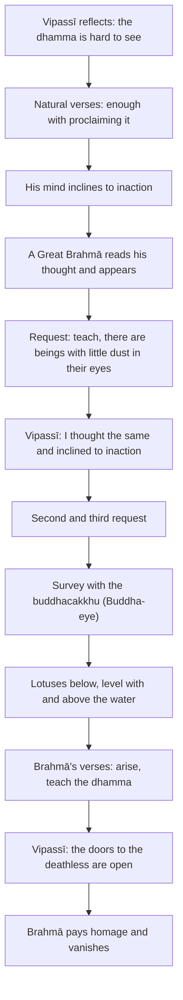

import { Tabs, TabItem } from '@astrojs/starlight/components';

Original text: [7D/1.12 Brahmayācanakathā 139–156](https://tipitaka2500.github.io/tipitaka/7D/1/1.12.html#139) in the [World Tipitaka Edition](https://tipitaka2500.github.io)

## Summary

Newly awakened, Vipassī reflects that the `dhamma` he has realised is profound and hard to see for a generation delighting in attachment, and his mind inclines to inaction. A Great Brahmā reads his thought, appears before him and asks him three times to teach, for there are beings with little dust in their eyes. Vipassī surveys the world with the Buddha-eye, sees beings of every capacity like lotuses at different heights in a pond, and declares the doors to the deathless open; Brahmā pays homage and vanishes.

## Diagram

## Text

<Tabs syncKey="paliquote">
<TabItem label="My Translation">
(64.)

139\. Then, Bhikkhave, this thought occurred to Vipassī the Bhagavā, the `arahant` (liberated one), the `sammāsambuddha` (perfectly awakened one): ‘What if I were to teach the `dhamma` (doctrine)?’ Then, Bhikkhave, this thought occurred to Vipassī the Bhagavā, the `arahant`, the `sammāsambuddha`: ‘This `dhamma` (phenomenal nature of experience) I have realised is indeed profound, hard to see, hard to comprehend, peaceful, refined, beyond the scope of reasoning, subtle, to be experienced by the wise. But this generation delights in `ālaya` (attachment), is pleased by `ālaya`, rejoices in `ālaya`. For a generation delighting in `ālaya`, pleased by `ālaya`, rejoicing in `ālaya`, this state is hard to see, namely `idappaccayatāpaṭiccasamuppāda` (specific causality, dependent origination). This state, too, is indeed hard to see, namely: the calming of all `saṅkhārā` (mental constructions), the relinquishing of all acquisitions, the destruction of craving, dispassion, cessation, extinguishment. But if I were to teach the `dhamma` (doctrine) and others did not understand me; that would be weariness for me, that would be trouble for me.’

(65.)

140\. And then, Bhikkhave, these natural verses, never heard before, occurred to Vipassī the Bhagavā, the `arahant`, the `sammāsambuddha`:

141\. _‘With difficulty have I realised it,_ \
_Enough now with proclaiming it;_ \
_For those consumed by `rāgadosa` (lust and hatred),_ \
_This `dhamma` (phenomenal nature of experience) is not easily understood._

142\. _`Paṭisotagāmī` (Going against the stream), subtle,_ \
_Profound, hard to see, minute;_ \
_`Rāgarattā` (Those inflamed by lust) will not see it,_ \
_Shrouded by `tamokhandha` (a mass of darkness).’_

143\. Thus, Bhikkhave, as Vipassī the Bhagavā, the `arahant`, the `sammāsambuddha`, reflected, his mind inclined to inaction, not to teaching the `dhamma` (doctrine).

(66.)

144\. Then, Bhikkhave, a certain `mahābrahmā` (Great Brahmā), knowing with his own mind the thought process of Vipassī the Bhagavā, the `arahant`, the `sammāsambuddha`, had this thought: ‘Alas, the world is perishing, alas, the world is being destroyed, inasmuch as the mind of Vipassī the Bhagavā, the `arahant`, the `sammāsambuddha`, inclines to inaction, not to teaching the `dhamma` (doctrine)!’ Then, Bhikkhave, that Great Brahmā — just as a strong man might extend his flexed arm or flex his extended arm; even so — having vanished from the Brahmā world, appeared before Vipassī the Bhagavā, the `arahant`, the `sammāsambuddha`. Then, Bhikkhave, that Great Brahmā, arranging his upper robe over one shoulder, lowering his right knee to the ground and extending his clasped hands towards Vipassī the Bhagavā, the `arahant`, the `sammāsambuddha`, said this to Vipassī the Bhagavā, the `arahant`, the `sammāsambuddha`: ‘Bhante, may the Bhagavā teach the `dhamma` (doctrine), may the `sugata` (Fortunate One) teach the `dhamma`; there are beings `apparajakkhajātikā` (with little dust in their eyes by nature); through not hearing the `dhamma` they are wasting away, and there will be those who understand the `dhamma`.’

(67.)

145\. When this was said, Bhikkhave, Vipassī the Bhagavā, the `arahant`, the `sammāsambuddha`, said this to that Great Brahmā: ‘To me too, Brahme, this thought occurred: “What if I were to teach the `dhamma` (doctrine)?” Then, Brahme, this thought occurred to me: “This `dhamma` (phenomenal nature of experience) I have realised is indeed profound, hard to see, hard to comprehend, peaceful, refined, beyond the scope of reasoning, subtle, to be experienced by the wise. But this generation delights in `ālaya` (attachment), is pleased by `ālaya`, rejoices in `ālaya`. For a generation delighting in `ālaya`, pleased by `ālaya`, rejoicing in `ālaya`, this state is hard to see, namely `idappaccayatāpaṭiccasamuppāda` (specific causality, dependent origination). This state, too, is indeed hard to see, namely: the calming of all `saṅkhārā` (mental constructions), the relinquishing of all acquisitions, the destruction of craving, dispassion, cessation, extinguishment. But if I were to teach the `dhamma` (doctrine) and others did not understand me; that would be weariness for me, that would be trouble for me.” And then, Brahme, these natural verses, never heard before, occurred to me:

146\. _“With difficulty have I realised it,_ \
_Enough now with proclaiming it;_ \
_For those consumed by `rāgadosa` (lust and hatred),_ \
_This `dhamma` (phenomenal nature of experience) is not easily understood._

147\. _`Paṭisotagāmī` (Going against the stream), subtle,_ \
_Profound, hard to see, minute;_ \
_`Rāgarattā` (Those inflamed by lust) will not see it,_ \
_Shrouded by `tamokhandha` (a mass of darkness).”_

148\. Thus, Brahme, as I reflected, my mind inclined to inaction, not to teaching the `dhamma` (doctrine).’

(68.)

149\. For a second time, Bhikkhave, that Great Brahmā … and so on … for a third time, Bhikkhave, that Great Brahmā said this to Vipassī the Bhagavā, the `arahant`, the `sammāsambuddha`: ‘Bhante, may the Bhagavā teach the `dhamma` (doctrine), may the `sugata` (Fortunate One) teach the `dhamma`; there are beings `apparajakkhajātikā` (with little dust in their eyes by nature) who are wasting away through not hearing the `dhamma`, and there will be those who understand the `dhamma`.’

(69.)

150\. Then, Bhikkhave, Vipassī the Bhagavā, the `arahant`, the `sammāsambuddha`, knowing Brahmā's request and out of `kāruññatā` (compassion) for beings, surveyed the world with the `buddhacakkhu` (Buddha-eye). Surveying the world with the `buddhacakkhu` (Buddha-eye), Bhikkhave, Vipassī the Bhagavā, the `arahant`, the `sammāsambuddha`, saw beings `apparajakkha` (with little dust in their eyes) and `mahārajakkha` (with much dust in their eyes), `tikkhindriya` (with keen faculties) and `mudindriya` (with dull faculties), `svākāra` (with good dispositions) and `dvākāra` (with bad dispositions), `suviññāpaya` (easy to teach) and `duviññāpaya` (hard to teach), some who dwelt seeing fear in wrongdoing and the next world, and some who did not dwell seeing fear in wrongdoing and the next world. Just as in a pond of blue lotuses, or red lotuses, or white lotuses, some blue lotuses, red lotuses or white lotuses, born in the water, grown in the water, not risen above the water, are nourished submerged within it. Some blue lotuses, red lotuses or white lotuses, born in the water, grown in the water, stand level with the water. Some blue lotuses, red lotuses or white lotuses, born in the water, grown in the water, stand having risen above the water, unsullied by the water. Even so, Bhikkhave, surveying the world with the `buddhacakkhu` (Buddha-eye), Vipassī the Bhagavā, the `arahant`, the `sammāsambuddha`, saw beings `apparajakkha` (with little dust in their eyes) and `mahārajakkha` (with much dust in their eyes), `tikkhindriya` (with keen faculties) and `mudindriya` (with dull faculties), `svākāra` (with good dispositions) and `dvākāra` (with bad dispositions), `suviññāpaya` (easy to teach) and `duviññāpaya` (hard to teach), some who dwelt seeing fear in wrongdoing and the next world, and some who did not dwell seeing fear in wrongdoing and the next world.

(70.)

151\. Then, Bhikkhave, that Great Brahmā, knowing with his own mind the thought process of Vipassī the Bhagavā, the `arahant`, the `sammāsambuddha`, addressed Vipassī the Bhagavā, the `arahant`, the `sammāsambuddha`, with verses:

152\. _‘As one standing on a rock on a mountain top_ \
_Might see the people all around;_ \
_Similarly, Sumedha (The Sage), Samantacakkhu (The All-Seeing One),_ \
_Having ascended the palace made of `dhamma` (truth),_ \
_Yourself free from sorrow, behold the people sunk in sorrow,_ \
_Overcome by birth and ageing._

153\. _Arise, Vīra (The Brave), Vijitasaṅgāma (Victorious in War),_ \
_Satthavāha (Caravan Leader), Aṇaṇa (Free of Obligation), wander in the world;_ \
_Teach the `dhamma` (truth), Bhagavā,_ \
_There will be those who understand.’_

(71.)

154\. Then, Bhikkhave, Vipassī the Bhagavā, the `arahant`, the `sammāsambuddha`, addressed that Great Brahmā with a verse:

155\. _‘Open for them are the doors to the `amata` (deathless),_ \
_Let those with ears release their `saddhā` (confidence);_ \
_Perceiving it as troublesome, Brahme, I did not speak_ \
_The excellent, sublime `dhamma` (phenomenal nature of experience) among humans.’_

156\. Then, Bhikkhave, that Great Brahmā, thinking, ‘Opportunity for the teaching of the `dhamma` (truth) has indeed been made by Vipassī the Bhagavā, the `arahant`, the `sammāsambuddha`,’ having paid homage to Vipassī the Bhagavā, the `arahant`, the `sammāsambuddha`, and circumambulated him keeping his right side towards him, vanished right there.
</TabItem>

<TabItem label="Pāḷi (Roman IAST)">
(64.)

139\. Atha kho, bhikkhave, vipassissa bhagavato arahato sammāsambuddhassa etadahosi— ‘yannūnāhaṃ dhammaṃ deseyyan’ti. Atha kho, bhikkhave, vipassissa bhagavato arahato sammāsambuddhassa etadahosi— ‘adhigato kho myāyaṃ dhammo gambhīro duddaso duranubodho santo paṇīto atakkāvacaro nipuṇo paṇḍitavedanīyo. Ālayarāmā kho panāyaṃ pajā ālayaratā ālayasammuditā. Ālayarāmāya kho pana pajāya ālayaratāya ālayasammuditāya duddasaṃ idaṃ ṭhānaṃ yadidaṃ idappaccayatāpaṭiccasamuppādo. Idampi kho ṭhānaṃ duddasaṃ yadidaṃ sabbasaṅkhārasamatho sabbūpadhipaṭinissaggo taṇhākkhayo virāgo nirodho nibbānaṃ. Ahañceva kho pana dhammaṃ deseyyaṃ, pare ca me na ājāneyyuṃ; so mamassa kilamatho, sā mamassa vihesā’ti.

(65.)

140\. Apissu, bhikkhave, vipassiṃ bhagavantaṃ arahantaṃ sammāsambuddhaṃ imā anacchariyā gāthāyo paṭibhaṃsu pubbe assutapubbā—

141\. _‘Kicchena me adhigataṃ,_  
_halaṃ dāni pakāsituṃ;_  
_Rāgadosaparetehi,_  
_nāyaṃ dhammo susambudho._

142\. _Paṭisotagāmiṃ nipuṇaṃ,_  
_gambhīraṃ duddasaṃ aṇuṃ;_  
_Rāgarattā na dakkhanti,_  
_tamokhandhena āvuṭā’ti._

143\. Itiha, bhikkhave, vipassissa bhagavato arahato sammāsambuddhassa paṭisañcikkhato appossukkatāya cittaṃ nami, no dhammadesanāya.

(66.)

144\. Atha kho, bhikkhave, aññatarassa mahābrahmuno vipassissa bhagavato arahato sammāsambuddhassa cetasā cetoparivitakkamaññāya etadahosi— ‘nassati vata bho loko, vinassati vata bho loko, yatra hi nāma vipassissa bhagavato arahato sammāsambuddhassa appossukkatāya cittaṃ namati, no dhammadesanāyā’ti. Atha kho so, bhikkhave, mahābrahmā seyyathāpi nāma balavā puriso samiñjitaṃ vā bāhaṃ pasāreyya, pasāritaṃ vā bāhaṃ samiñjeyya; evameva— brahmaloke antarahito vipassissa bhagavato arahato sammāsambuddhassa purato pāturahosi. Atha kho so, bhikkhave, mahābrahmā ekaṃsaṃ uttarāsaṅgaṃ karitvā dakkhiṇaṃ jāṇumaṇḍalaṃ pathaviyaṃ nihantvā yena vipassī bhagavā arahaṃ sammāsambuddho tenañjaliṃ paṇāmetvā vipassiṃ bhagavantaṃ arahantaṃ sammāsambuddhaṃ etadavoca— ‘desetu, bhante, bhagavā dhammaṃ, desetu sugato dhammaṃ, santi sattā apparajakkhajātikā; assavanatā dhammassa parihāyanti, bhavissanti dhammassa aññātāro’ti.

(67.)

145\. Evaṃ vutte, bhikkhave, vipassī bhagavā arahaṃ sammāsambuddho taṃ mahābrahmānaṃ etadavoca— ‘mayhampi kho, brahme, etadahosi— “yannūnāhaṃ dhammaṃ deseyyan”ti. Tassa mayhaṃ, brahme, etadahosi— “adhigato kho myāyaṃ dhammo gambhīro duddaso duranubodho santo paṇīto atakkāvacaro nipuṇo paṇḍitavedanīyo. Ālayarāmā kho panāyaṃ pajā ālayaratā ālayasammuditā. Ālayarāmāya kho pana pajāya ālayaratāya ālayasammuditāya duddasaṃ idaṃ ṭhānaṃ yadidaṃ idappaccayatāpaṭiccasamuppādo. Idampi kho ṭhānaṃ duddasaṃ yadidaṃ sabbasaṅkhārasamatho sabbūpadhipaṭinissaggo taṇhākkhayo virāgo nirodho nibbānaṃ. Ahañceva kho pana dhammaṃ deseyyaṃ, pare ca me na ājāneyyuṃ; so mamassa kilamatho, sā mamassa vihesā”ti. Apissu maṃ, brahme, imā anacchariyā gāthāyo paṭibhaṃsu pubbe assutapubbā—

146\. _“Kicchena me adhigataṃ,_  
_halaṃ dāni pakāsituṃ;_  
_Rāgadosaparetehi,_  
_nāyaṃ dhammo susambudho._

147\. _Paṭisotagāmiṃ nipuṇaṃ,_  
_gambhīraṃ duddasaṃ aṇuṃ;_  
_Rāgarattā na dakkhanti,_  
_tamokhandhena āvuṭā”ti._

148\. Itiha me, brahme, paṭisañcikkhato appossukkatāya cittaṃ nami, no dhammadesanāyā’ti.

(68.)

149\. Dutiyampi kho, bhikkhave, so mahābrahmā…pe… tatiyampi kho, bhikkhave, so mahābrahmā vipassiṃ bhagavantaṃ arahantaṃ sammāsambuddhaṃ etadavoca— ‘desetu, bhante, bhagavā dhammaṃ, desetu sugato dhammaṃ, santi sattā apparajakkhajātikā, assavanatā dhammassa parihāyanti, bhavissanti dhammassa aññātāro’ti.

(69.)

150\. Atha kho, bhikkhave, vipassī bhagavā arahaṃ sammāsambuddho brahmuno ca ajjhesanaṃ viditvā sattesu ca kāruññataṃ paṭicca buddhacakkhunā lokaṃ volokesi. Addasā kho, bhikkhave, vipassī bhagavā arahaṃ sammāsambuddho buddhacakkhunā lokaṃ volokento satte apparajakkhe mahārajakkhe tikkhindriye mudindriye svākāre dvākāre suviññāpaye duviññāpaye appekacce paralokavajjabhayadassāvine viharante, appekacce na paralokavajjabhayadassāvine viharante. Seyyathāpi nāma uppaliniyaṃ vā paduminiyaṃ vā puṇḍarīkiniyaṃ vā appekaccāni uppalāni vā padumāni vā puṇḍarīkāni vā udake jātāni udake saṃvaḍḍhāni udakānuggatāni anto nimuggaposīni. Appekaccāni uppalāni vā padumāni vā puṇḍarīkāni vā udake jātāni udake saṃvaḍḍhāni samodakaṃ ṭhitāni. Appekaccāni uppalāni vā padumāni vā puṇḍarīkāni vā udake jātāni udake saṃvaḍḍhāni udakā accuggamma ṭhitāni anupalittāni udakena. Evameva kho, bhikkhave, vipassī bhagavā arahaṃ sammāsambuddho buddhacakkhunā lokaṃ volokento addasa satte apparajakkhe mahārajakkhe tikkhindriye mudindriye svākāre dvākāre suviññāpaye duviññāpaye appekacce paralokavajjabhayadassāvine viharante, appekacce na paralokavajjabhayadassāvine viharante.

(70.)

151\. Atha kho so, bhikkhave, mahābrahmā vipassissa bhagavato arahato sammāsambuddhassa cetasā cetoparivitakkamaññāya vipassiṃ bhagavantaṃ arahantaṃ sammāsambuddhaṃ gāthāhi ajjhabhāsi—

152\. _‘Sele yathā pabbatamuddhaniṭṭhito,_  
_Yathāpi passe janataṃ samantato;_  
_Tathūpamaṃ dhammamayaṃ sumedha,_  
_Pāsādamāruyha samantacakkhu;_  
_Sokāvatiṇṇaṃ janatamapetasoko,_  
_Avekkhassu jātijarābhibhūtaṃ._

153\. _Uṭṭhehi vīra vijitasaṅgāma,_  
_Satthavāha aṇaṇa vicara loke;_  
_Desassu bhagavā dhammaṃ,_  
_Aññātāro bhavissantī’ti._

(71.)

154\. Atha kho, bhikkhave, vipassī bhagavā arahaṃ sammāsambuddho taṃ mahābrahmānaṃ gāthāya ajjhabhāsi—

155\. _‘Apārutā tesaṃ amatassa dvārā,_  
_Ye sotavanto pamuñcantu saddhaṃ;_  
_Vihiṃsasaññī paguṇaṃ na bhāsiṃ,_  
_Dhammaṃ paṇītaṃ manujesu brahme’ti._

156\. Atha kho so, bhikkhave, mahābrahmā— ‘katāvakāso khomhi vipassinā bhagavatā arahatā sammāsambuddhena dhammadesanāyā’ti vipassiṃ bhagavantaṃ arahantaṃ sammāsambuddhaṃ abhivādetvā padakkhiṇaṃ katvā tattheva antaradhāyi.
</TabItem>

<TabItem label="Pāḷi (Brahmi)">
(64.)

139\. 𑀅𑀣 𑀔𑁄, 𑀪𑀺𑀓𑁆𑀔𑀯𑁂, 𑀯𑀺𑀧𑀲𑁆𑀲𑀺𑀲𑁆𑀲 𑀪𑀕𑀯𑀢𑁄 𑀅𑀭𑀳𑀢𑁄 𑀲𑀫𑁆𑀫𑀸𑀲𑀫𑁆𑀩𑀼𑀤𑁆𑀥𑀲𑁆𑀲 𑀏𑀢𑀤𑀳𑁄𑀲𑀺— ‘𑀬𑀦𑁆𑀦𑀽𑀦𑀸𑀳𑀁 𑀥𑀫𑁆𑀫𑀁 𑀤𑁂𑀲𑁂𑀬𑁆𑀬𑀦𑁆’𑀢𑀺. 𑀅𑀣 𑀔𑁄, 𑀪𑀺𑀓𑁆𑀔𑀯𑁂, 𑀯𑀺𑀧𑀲𑁆𑀲𑀺𑀲𑁆𑀲 𑀪𑀕𑀯𑀢𑁄 𑀅𑀭𑀳𑀢𑁄 𑀲𑀫𑁆𑀫𑀸𑀲𑀫𑁆𑀩𑀼𑀤𑁆𑀥𑀲𑁆𑀲 𑀏𑀢𑀤𑀳𑁄𑀲𑀺— ‘𑀅𑀥𑀺𑀕𑀢𑁄 𑀔𑁄 𑀫𑁆𑀬𑀸𑀬𑀁 𑀥𑀫𑁆𑀫𑁄 𑀕𑀫𑁆𑀪𑀻𑀭𑁄 𑀤𑀼𑀤𑁆𑀤𑀲𑁄 𑀤𑀼𑀭𑀦𑀼𑀩𑁄𑀥𑁄 𑀲𑀦𑁆𑀢𑁄 𑀧𑀡𑀻𑀢𑁄 𑀅𑀢𑀓𑁆𑀓𑀸𑀯𑀘𑀭𑁄 𑀦𑀺𑀧𑀼𑀡𑁄 𑀧𑀡𑁆𑀟𑀺𑀢𑀯𑁂𑀤𑀦𑀻𑀬𑁄. 𑀆𑀮𑀬𑀭𑀸𑀫𑀸 𑀔𑁄 𑀧𑀦𑀸𑀬𑀁 𑀧𑀚𑀸 𑀆𑀮𑀬𑀭𑀢𑀸 𑀆𑀮𑀬𑀲𑀫𑁆𑀫𑀼𑀤𑀺𑀢𑀸. 𑀆𑀮𑀬𑀭𑀸𑀫𑀸𑀬 𑀔𑁄 𑀧𑀦 𑀧𑀚𑀸𑀬 𑀆𑀮𑀬𑀭𑀢𑀸𑀬 𑀆𑀮𑀬𑀲𑀫𑁆𑀫𑀼𑀤𑀺𑀢𑀸𑀬 𑀤𑀼𑀤𑁆𑀤𑀲𑀁 𑀇𑀤𑀁 𑀞𑀸𑀦𑀁 𑀬𑀤𑀺𑀤𑀁 𑀇𑀤𑀧𑁆𑀧𑀘𑁆𑀘𑀬𑀢𑀸𑀧𑀝𑀺𑀘𑁆𑀘𑀲𑀫𑀼𑀧𑁆𑀧𑀸𑀤𑁄. 𑀇𑀤𑀫𑁆𑀧𑀺 𑀔𑁄 𑀞𑀸𑀦𑀁 𑀤𑀼𑀤𑁆𑀤𑀲𑀁 𑀬𑀤𑀺𑀤𑀁 𑀲𑀩𑁆𑀩𑀲𑀗𑁆𑀔𑀸𑀭𑀲𑀫𑀣𑁄 𑀲𑀩𑁆𑀩𑀽𑀧𑀥𑀺𑀧𑀝𑀺𑀦𑀺𑀲𑁆𑀲𑀕𑁆𑀕𑁄 𑀢𑀡𑁆𑀳𑀸𑀓𑁆𑀔𑀬𑁄 𑀯𑀺𑀭𑀸𑀕𑁄 𑀦𑀺𑀭𑁄𑀥𑁄 𑀦𑀺𑀩𑁆𑀩𑀸𑀦𑀁. 𑀅𑀳𑀜𑁆𑀘𑁂𑀯 𑀔𑁄 𑀧𑀦 𑀥𑀫𑁆𑀫𑀁 𑀤𑁂𑀲𑁂𑀬𑁆𑀬𑀁, 𑀧𑀭𑁂 𑀘 𑀫𑁂 𑀦 𑀆𑀚𑀸𑀦𑁂𑀬𑁆𑀬𑀼𑀁; 𑀲𑁄 𑀫𑀫𑀲𑁆𑀲 𑀓𑀺𑀮𑀫𑀣𑁄, 𑀲𑀸 𑀫𑀫𑀲𑁆𑀲 𑀯𑀺𑀳𑁂𑀲𑀸’𑀢𑀺.

(65.)

140\. 𑀅𑀧𑀺𑀲𑁆𑀲𑀼, 𑀪𑀺𑀓𑁆𑀔𑀯𑁂, 𑀯𑀺𑀧𑀲𑁆𑀲𑀺𑀁 𑀪𑀕𑀯𑀦𑁆𑀢𑀁 𑀅𑀭𑀳𑀦𑁆𑀢𑀁 𑀲𑀫𑁆𑀫𑀸𑀲𑀫𑁆𑀩𑀼𑀤𑁆𑀥𑀁 𑀇𑀫𑀸 𑀅𑀦𑀘𑁆𑀙𑀭𑀺𑀬𑀸 𑀕𑀸𑀣𑀸𑀬𑁄 𑀧𑀝𑀺𑀪𑀁𑀲𑀼 𑀧𑀼𑀩𑁆𑀩𑁂 𑀅𑀲𑁆𑀲𑀼𑀢𑀧𑀼𑀩𑁆𑀩𑀸—

141\. _‘𑀓𑀺𑀘𑁆𑀙𑁂𑀦 𑀫𑁂 𑀅𑀥𑀺𑀕𑀢𑀁,_  
_𑀳𑀮𑀁 𑀤𑀸𑀦𑀺 𑀧𑀓𑀸𑀲𑀺𑀢𑀼𑀁;_  
_𑀭𑀸𑀕𑀤𑁄𑀲𑀧𑀭𑁂𑀢𑁂𑀳𑀺,_  
_𑀦𑀸𑀬𑀁 𑀥𑀫𑁆𑀫𑁄 𑀲𑀼𑀲𑀫𑁆𑀩𑀼𑀥𑁄._

142\. _𑀧𑀝𑀺𑀲𑁄𑀢𑀕𑀸𑀫𑀺𑀁 𑀦𑀺𑀧𑀼𑀡𑀁,_  
_𑀕𑀫𑁆𑀪𑀻𑀭𑀁 𑀤𑀼𑀤𑁆𑀤𑀲𑀁 𑀅𑀡𑀼𑀁;_  
_𑀭𑀸𑀕𑀭𑀢𑁆𑀢𑀸 𑀦 𑀤𑀓𑁆𑀔𑀦𑁆𑀢𑀺,_  
_𑀢𑀫𑁄𑀔𑀦𑁆𑀥𑁂𑀦 𑀆𑀯𑀼𑀝𑀸’𑀢𑀺._

143\. 𑀇𑀢𑀺𑀳, 𑀪𑀺𑀓𑁆𑀔𑀯𑁂, 𑀯𑀺𑀧𑀲𑁆𑀲𑀺𑀲𑁆𑀲 𑀪𑀕𑀯𑀢𑁄 𑀅𑀭𑀳𑀢𑁄 𑀲𑀫𑁆𑀫𑀸𑀲𑀫𑁆𑀩𑀼𑀤𑁆𑀥𑀲𑁆𑀲 𑀧𑀝𑀺𑀲𑀜𑁆𑀘𑀺𑀓𑁆𑀔𑀢𑁄 𑀅𑀧𑁆𑀧𑁄𑀲𑁆𑀲𑀼𑀓𑁆𑀓𑀢𑀸𑀬 𑀘𑀺𑀢𑁆𑀢𑀁 𑀦𑀫𑀺, 𑀦𑁄 𑀥𑀫𑁆𑀫𑀤𑁂𑀲𑀦𑀸𑀬.

(66.)

144\. 𑀅𑀣 𑀔𑁄, 𑀪𑀺𑀓𑁆𑀔𑀯𑁂, 𑀅𑀜𑁆𑀜𑀢𑀭𑀲𑁆𑀲 𑀫𑀳𑀸𑀩𑁆𑀭𑀳𑁆𑀫𑀼𑀦𑁄 𑀯𑀺𑀧𑀲𑁆𑀲𑀺𑀲𑁆𑀲 𑀪𑀕𑀯𑀢𑁄 𑀅𑀭𑀳𑀢𑁄 𑀲𑀫𑁆𑀫𑀸𑀲𑀫𑁆𑀩𑀼𑀤𑁆𑀥𑀲𑁆𑀲 𑀘𑁂𑀢𑀲𑀸 𑀘𑁂𑀢𑁄𑀧𑀭𑀺𑀯𑀺𑀢𑀓𑁆𑀓𑀫𑀜𑁆𑀜𑀸𑀬 𑀏𑀢𑀤𑀳𑁄𑀲𑀺— ‘𑀦𑀲𑁆𑀲𑀢𑀺 𑀯𑀢 𑀪𑁄 𑀮𑁄𑀓𑁄, 𑀯𑀺𑀦𑀲𑁆𑀲𑀢𑀺 𑀯𑀢 𑀪𑁄 𑀮𑁄𑀓𑁄, 𑀬𑀢𑁆𑀭 𑀳𑀺 𑀦𑀸𑀫 𑀯𑀺𑀧𑀲𑁆𑀲𑀺𑀲𑁆𑀲 𑀪𑀕𑀯𑀢𑁄 𑀅𑀭𑀳𑀢𑁄 𑀲𑀫𑁆𑀫𑀸𑀲𑀫𑁆𑀩𑀼𑀤𑁆𑀥𑀲𑁆𑀲 𑀅𑀧𑁆𑀧𑁄𑀲𑁆𑀲𑀼𑀓𑁆𑀓𑀢𑀸𑀬 𑀘𑀺𑀢𑁆𑀢𑀁 𑀦𑀫𑀢𑀺, 𑀦𑁄 𑀥𑀫𑁆𑀫𑀤𑁂𑀲𑀦𑀸𑀬𑀸’𑀢𑀺. 𑀅𑀣 𑀔𑁄 𑀲𑁄, 𑀪𑀺𑀓𑁆𑀔𑀯𑁂, 𑀫𑀳𑀸𑀩𑁆𑀭𑀳𑁆𑀫𑀸 𑀲𑁂𑀬𑁆𑀬𑀣𑀸𑀧𑀺 𑀦𑀸𑀫 𑀩𑀮𑀯𑀸 𑀧𑀼𑀭𑀺𑀲𑁄 𑀲𑀫𑀺𑀜𑁆𑀚𑀺𑀢𑀁 𑀯𑀸 𑀩𑀸𑀳𑀁 𑀧𑀲𑀸𑀭𑁂𑀬𑁆𑀬, 𑀧𑀲𑀸𑀭𑀺𑀢𑀁 𑀯𑀸 𑀩𑀸𑀳𑀁 𑀲𑀫𑀺𑀜𑁆𑀚𑁂𑀬𑁆𑀬; 𑀏𑀯𑀫𑁂𑀯— 𑀩𑁆𑀭𑀳𑁆𑀫𑀮𑁄𑀓𑁂 𑀅𑀦𑁆𑀢𑀭𑀳𑀺𑀢𑁄 𑀯𑀺𑀧𑀲𑁆𑀲𑀺𑀲𑁆𑀲 𑀪𑀕𑀯𑀢𑁄 𑀅𑀭𑀳𑀢𑁄 𑀲𑀫𑁆𑀫𑀸𑀲𑀫𑁆𑀩𑀼𑀤𑁆𑀥𑀲𑁆𑀲 𑀧𑀼𑀭𑀢𑁄 𑀧𑀸𑀢𑀼𑀭𑀳𑁄𑀲𑀺. 𑀅𑀣 𑀔𑁄 𑀲𑁄, 𑀪𑀺𑀓𑁆𑀔𑀯𑁂, 𑀫𑀳𑀸𑀩𑁆𑀭𑀳𑁆𑀫𑀸 𑀏𑀓𑀁𑀲𑀁 𑀉𑀢𑁆𑀢𑀭𑀸𑀲𑀗𑁆𑀕𑀁 𑀓𑀭𑀺𑀢𑁆𑀯𑀸 𑀤𑀓𑁆𑀔𑀺𑀡𑀁 𑀚𑀸𑀡𑀼𑀫𑀡𑁆𑀟𑀮𑀁 𑀧𑀣𑀯𑀺𑀬𑀁 𑀦𑀺𑀳𑀦𑁆𑀢𑁆𑀯𑀸 𑀬𑁂𑀦 𑀯𑀺𑀧𑀲𑁆𑀲𑀻 𑀪𑀕𑀯𑀸 𑀅𑀭𑀳𑀁 𑀲𑀫𑁆𑀫𑀸𑀲𑀫𑁆𑀩𑀼𑀤𑁆𑀥𑁄 𑀢𑁂𑀦𑀜𑁆𑀚𑀮𑀺𑀁 𑀧𑀡𑀸𑀫𑁂𑀢𑁆𑀯𑀸 𑀯𑀺𑀧𑀲𑁆𑀲𑀺𑀁 𑀪𑀕𑀯𑀦𑁆𑀢𑀁 𑀅𑀭𑀳𑀦𑁆𑀢𑀁 𑀲𑀫𑁆𑀫𑀸𑀲𑀫𑁆𑀩𑀼𑀤𑁆𑀥𑀁 𑀏𑀢𑀤𑀯𑁄𑀘— ‘𑀤𑁂𑀲𑁂𑀢𑀼, 𑀪𑀦𑁆𑀢𑁂, 𑀪𑀕𑀯𑀸 𑀥𑀫𑁆𑀫𑀁, 𑀤𑁂𑀲𑁂𑀢𑀼 𑀲𑀼𑀕𑀢𑁄 𑀥𑀫𑁆𑀫𑀁, 𑀲𑀦𑁆𑀢𑀺 𑀲𑀢𑁆𑀢𑀸 𑀅𑀧𑁆𑀧𑀭𑀚𑀓𑁆𑀔𑀚𑀸𑀢𑀺𑀓𑀸; 𑀅𑀲𑁆𑀲𑀯𑀦𑀢𑀸 𑀥𑀫𑁆𑀫𑀲𑁆𑀲 𑀧𑀭𑀺𑀳𑀸𑀬𑀦𑁆𑀢𑀺, 𑀪𑀯𑀺𑀲𑁆𑀲𑀦𑁆𑀢𑀺 𑀥𑀫𑁆𑀫𑀲𑁆𑀲 𑀅𑀜𑁆𑀜𑀸𑀢𑀸𑀭𑁄’𑀢𑀺.

(67.)

145\. 𑀏𑀯𑀁 𑀯𑀼𑀢𑁆𑀢𑁂, 𑀪𑀺𑀓𑁆𑀔𑀯𑁂, 𑀯𑀺𑀧𑀲𑁆𑀲𑀻 𑀪𑀕𑀯𑀸 𑀅𑀭𑀳𑀁 𑀲𑀫𑁆𑀫𑀸𑀲𑀫𑁆𑀩𑀼𑀤𑁆𑀥𑁄 𑀢𑀁 𑀫𑀳𑀸𑀩𑁆𑀭𑀳𑁆𑀫𑀸𑀦𑀁 𑀏𑀢𑀤𑀯𑁄𑀘— ‘𑀫𑀬𑁆𑀳𑀫𑁆𑀧𑀺 𑀔𑁄, 𑀩𑁆𑀭𑀳𑁆𑀫𑁂, 𑀏𑀢𑀤𑀳𑁄𑀲𑀺— “𑀬𑀦𑁆𑀦𑀽𑀦𑀸𑀳𑀁 𑀥𑀫𑁆𑀫𑀁 𑀤𑁂𑀲𑁂𑀬𑁆𑀬𑀦𑁆”𑀢𑀺. 𑀢𑀲𑁆𑀲 𑀫𑀬𑁆𑀳𑀁, 𑀩𑁆𑀭𑀳𑁆𑀫𑁂, 𑀏𑀢𑀤𑀳𑁄𑀲𑀺— “𑀅𑀥𑀺𑀕𑀢𑁄 𑀔𑁄 𑀫𑁆𑀬𑀸𑀬𑀁 𑀥𑀫𑁆𑀫𑁄 𑀕𑀫𑁆𑀪𑀻𑀭𑁄 𑀤𑀼𑀤𑁆𑀤𑀲𑁄 𑀤𑀼𑀭𑀦𑀼𑀩𑁄𑀥𑁄 𑀲𑀦𑁆𑀢𑁄 𑀧𑀡𑀻𑀢𑁄 𑀅𑀢𑀓𑁆𑀓𑀸𑀯𑀘𑀭𑁄 𑀦𑀺𑀧𑀼𑀡𑁄 𑀧𑀡𑁆𑀟𑀺𑀢𑀯𑁂𑀤𑀦𑀻𑀬𑁄. 𑀆𑀮𑀬𑀭𑀸𑀫𑀸 𑀔𑁄 𑀧𑀦𑀸𑀬𑀁 𑀧𑀚𑀸 𑀆𑀮𑀬𑀭𑀢𑀸 𑀆𑀮𑀬𑀲𑀫𑁆𑀫𑀼𑀤𑀺𑀢𑀸. 𑀆𑀮𑀬𑀭𑀸𑀫𑀸𑀬 𑀔𑁄 𑀧𑀦 𑀧𑀚𑀸𑀬 𑀆𑀮𑀬𑀭𑀢𑀸𑀬 𑀆𑀮𑀬𑀲𑀫𑁆𑀫𑀼𑀤𑀺𑀢𑀸𑀬 𑀤𑀼𑀤𑁆𑀤𑀲𑀁 𑀇𑀤𑀁 𑀞𑀸𑀦𑀁 𑀬𑀤𑀺𑀤𑀁 𑀇𑀤𑀧𑁆𑀧𑀘𑁆𑀘𑀬𑀢𑀸𑀧𑀝𑀺𑀘𑁆𑀘𑀲𑀫𑀼𑀧𑁆𑀧𑀸𑀤𑁄. 𑀇𑀤𑀫𑁆𑀧𑀺 𑀔𑁄 𑀞𑀸𑀦𑀁 𑀤𑀼𑀤𑁆𑀤𑀲𑀁 𑀬𑀤𑀺𑀤𑀁 𑀲𑀩𑁆𑀩𑀲𑀗𑁆𑀔𑀸𑀭𑀲𑀫𑀣𑁄 𑀲𑀩𑁆𑀩𑀽𑀧𑀥𑀺𑀧𑀝𑀺𑀦𑀺𑀲𑁆𑀲𑀕𑁆𑀕𑁄 𑀢𑀡𑁆𑀳𑀸𑀓𑁆𑀔𑀬𑁄 𑀯𑀺𑀭𑀸𑀕𑁄 𑀦𑀺𑀭𑁄𑀥𑁄 𑀦𑀺𑀩𑁆𑀩𑀸𑀦𑀁. 𑀅𑀳𑀜𑁆𑀘𑁂𑀯 𑀔𑁄 𑀧𑀦 𑀥𑀫𑁆𑀫𑀁 𑀤𑁂𑀲𑁂𑀬𑁆𑀬𑀁, 𑀧𑀭𑁂 𑀘 𑀫𑁂 𑀦 𑀆𑀚𑀸𑀦𑁂𑀬𑁆𑀬𑀼𑀁; 𑀲𑁄 𑀫𑀫𑀲𑁆𑀲 𑀓𑀺𑀮𑀫𑀣𑁄, 𑀲𑀸 𑀫𑀫𑀲𑁆𑀲 𑀯𑀺𑀳𑁂𑀲𑀸”𑀢𑀺. 𑀅𑀧𑀺𑀲𑁆𑀲𑀼 𑀫𑀁, 𑀩𑁆𑀭𑀳𑁆𑀫𑁂, 𑀇𑀫𑀸 𑀅𑀦𑀘𑁆𑀙𑀭𑀺𑀬𑀸 𑀕𑀸𑀣𑀸𑀬𑁄 𑀧𑀝𑀺𑀪𑀁𑀲𑀼 𑀧𑀼𑀩𑁆𑀩𑁂 𑀅𑀲𑁆𑀲𑀼𑀢𑀧𑀼𑀩𑁆𑀩𑀸—

146\. _“𑀓𑀺𑀘𑁆𑀙𑁂𑀦 𑀫𑁂 𑀅𑀥𑀺𑀕𑀢𑀁,_  
_𑀳𑀮𑀁 𑀤𑀸𑀦𑀺 𑀧𑀓𑀸𑀲𑀺𑀢𑀼𑀁;_  
_𑀭𑀸𑀕𑀤𑁄𑀲𑀧𑀭𑁂𑀢𑁂𑀳𑀺,_  
_𑀦𑀸𑀬𑀁 𑀥𑀫𑁆𑀫𑁄 𑀲𑀼𑀲𑀫𑁆𑀩𑀼𑀥𑁄._

147\. _𑀧𑀝𑀺𑀲𑁄𑀢𑀕𑀸𑀫𑀺𑀁 𑀦𑀺𑀧𑀼𑀡𑀁,_  
_𑀕𑀫𑁆𑀪𑀻𑀭𑀁 𑀤𑀼𑀤𑁆𑀤𑀲𑀁 𑀅𑀡𑀼𑀁;_  
_𑀭𑀸𑀕𑀭𑀢𑁆𑀢𑀸 𑀦 𑀤𑀓𑁆𑀔𑀦𑁆𑀢𑀺,_  
_𑀢𑀫𑁄𑀔𑀦𑁆𑀥𑁂𑀦 𑀆𑀯𑀼𑀝𑀸”𑀢𑀺._

148\. 𑀇𑀢𑀺𑀳 𑀫𑁂, 𑀩𑁆𑀭𑀳𑁆𑀫𑁂, 𑀧𑀝𑀺𑀲𑀜𑁆𑀘𑀺𑀓𑁆𑀔𑀢𑁄 𑀅𑀧𑁆𑀧𑁄𑀲𑁆𑀲𑀼𑀓𑁆𑀓𑀢𑀸𑀬 𑀘𑀺𑀢𑁆𑀢𑀁 𑀦𑀫𑀺, 𑀦𑁄 𑀥𑀫𑁆𑀫𑀤𑁂𑀲𑀦𑀸𑀬𑀸’𑀢𑀺.

(68.)

149\. 𑀤𑀼𑀢𑀺𑀬𑀫𑁆𑀧𑀺 𑀔𑁄, 𑀪𑀺𑀓𑁆𑀔𑀯𑁂, 𑀲𑁄 𑀫𑀳𑀸𑀩𑁆𑀭𑀳𑁆𑀫𑀸…𑀧𑁂… 𑀢𑀢𑀺𑀬𑀫𑁆𑀧𑀺 𑀔𑁄, 𑀪𑀺𑀓𑁆𑀔𑀯𑁂, 𑀲𑁄 𑀫𑀳𑀸𑀩𑁆𑀭𑀳𑁆𑀫𑀸 𑀯𑀺𑀧𑀲𑁆𑀲𑀺𑀁 𑀪𑀕𑀯𑀦𑁆𑀢𑀁 𑀅𑀭𑀳𑀦𑁆𑀢𑀁 𑀲𑀫𑁆𑀫𑀸𑀲𑀫𑁆𑀩𑀼𑀤𑁆𑀥𑀁 𑀏𑀢𑀤𑀯𑁄𑀘— ‘𑀤𑁂𑀲𑁂𑀢𑀼, 𑀪𑀦𑁆𑀢𑁂, 𑀪𑀕𑀯𑀸 𑀥𑀫𑁆𑀫𑀁, 𑀤𑁂𑀲𑁂𑀢𑀼 𑀲𑀼𑀕𑀢𑁄 𑀥𑀫𑁆𑀫𑀁, 𑀲𑀦𑁆𑀢𑀺 𑀲𑀢𑁆𑀢𑀸 𑀅𑀧𑁆𑀧𑀭𑀚𑀓𑁆𑀔𑀚𑀸𑀢𑀺𑀓𑀸, 𑀅𑀲𑁆𑀲𑀯𑀦𑀢𑀸 𑀥𑀫𑁆𑀫𑀲𑁆𑀲 𑀧𑀭𑀺𑀳𑀸𑀬𑀦𑁆𑀢𑀺, 𑀪𑀯𑀺𑀲𑁆𑀲𑀦𑁆𑀢𑀺 𑀥𑀫𑁆𑀫𑀲𑁆𑀲 𑀅𑀜𑁆𑀜𑀸𑀢𑀸𑀭𑁄’𑀢𑀺.

(69.)

150\. 𑀅𑀣 𑀔𑁄, 𑀪𑀺𑀓𑁆𑀔𑀯𑁂, 𑀯𑀺𑀧𑀲𑁆𑀲𑀻 𑀪𑀕𑀯𑀸 𑀅𑀭𑀳𑀁 𑀲𑀫𑁆𑀫𑀸𑀲𑀫𑁆𑀩𑀼𑀤𑁆𑀥𑁄 𑀩𑁆𑀭𑀳𑁆𑀫𑀼𑀦𑁄 𑀘 𑀅𑀚𑁆𑀛𑁂𑀲𑀦𑀁 𑀯𑀺𑀤𑀺𑀢𑁆𑀯𑀸 𑀲𑀢𑁆𑀢𑁂𑀲𑀼 𑀘 𑀓𑀸𑀭𑀼𑀜𑁆𑀜𑀢𑀁 𑀧𑀝𑀺𑀘𑁆𑀘 𑀩𑀼𑀤𑁆𑀥𑀘𑀓𑁆𑀔𑀼𑀦𑀸 𑀮𑁄𑀓𑀁 𑀯𑁄𑀮𑁄𑀓𑁂𑀲𑀺. 𑀅𑀤𑁆𑀤𑀲𑀸 𑀔𑁄, 𑀪𑀺𑀓𑁆𑀔𑀯𑁂, 𑀯𑀺𑀧𑀲𑁆𑀲𑀻 𑀪𑀕𑀯𑀸 𑀅𑀭𑀳𑀁 𑀲𑀫𑁆𑀫𑀸𑀲𑀫𑁆𑀩𑀼𑀤𑁆𑀥𑁄 𑀩𑀼𑀤𑁆𑀥𑀘𑀓𑁆𑀔𑀼𑀦𑀸 𑀮𑁄𑀓𑀁 𑀯𑁄𑀮𑁄𑀓𑁂𑀦𑁆𑀢𑁄 𑀲𑀢𑁆𑀢𑁂 𑀅𑀧𑁆𑀧𑀭𑀚𑀓𑁆𑀔𑁂 𑀫𑀳𑀸𑀭𑀚𑀓𑁆𑀔𑁂 𑀢𑀺𑀓𑁆𑀔𑀺𑀦𑁆𑀤𑁆𑀭𑀺𑀬𑁂 𑀫𑀼𑀤𑀺𑀦𑁆𑀤𑁆𑀭𑀺𑀬𑁂 𑀲𑁆𑀯𑀸𑀓𑀸𑀭𑁂 𑀤𑁆𑀯𑀸𑀓𑀸𑀭𑁂 𑀲𑀼𑀯𑀺𑀜𑁆𑀜𑀸𑀧𑀬𑁂 𑀤𑀼𑀯𑀺𑀜𑁆𑀜𑀸𑀧𑀬𑁂 𑀅𑀧𑁆𑀧𑁂𑀓𑀘𑁆𑀘𑁂 𑀧𑀭𑀮𑁄𑀓𑀯𑀚𑁆𑀚𑀪𑀬𑀤𑀲𑁆𑀲𑀸𑀯𑀺𑀦𑁂 𑀯𑀺𑀳𑀭𑀦𑁆𑀢𑁂, 𑀅𑀧𑁆𑀧𑁂𑀓𑀘𑁆𑀘𑁂 𑀦 𑀧𑀭𑀮𑁄𑀓𑀯𑀚𑁆𑀚𑀪𑀬𑀤𑀲𑁆𑀲𑀸𑀯𑀺𑀦𑁂 𑀯𑀺𑀳𑀭𑀦𑁆𑀢𑁂. 𑀲𑁂𑀬𑁆𑀬𑀣𑀸𑀧𑀺 𑀦𑀸𑀫 𑀉𑀧𑁆𑀧𑀮𑀺𑀦𑀺𑀬𑀁 𑀯𑀸 𑀧𑀤𑀼𑀫𑀺𑀦𑀺𑀬𑀁 𑀯𑀸 𑀧𑀼𑀡𑁆𑀟𑀭𑀻𑀓𑀺𑀦𑀺𑀬𑀁 𑀯𑀸 𑀅𑀧𑁆𑀧𑁂𑀓𑀘𑁆𑀘𑀸𑀦𑀺 𑀉𑀧𑁆𑀧𑀮𑀸𑀦𑀺 𑀯𑀸 𑀧𑀤𑀼𑀫𑀸𑀦𑀺 𑀯𑀸 𑀧𑀼𑀡𑁆𑀟𑀭𑀻𑀓𑀸𑀦𑀺 𑀯𑀸 𑀉𑀤𑀓𑁂 𑀚𑀸𑀢𑀸𑀦𑀺 𑀉𑀤𑀓𑁂 𑀲𑀁𑀯𑀟𑁆𑀠𑀸𑀦𑀺 𑀉𑀤𑀓𑀸𑀦𑀼𑀕𑁆𑀕𑀢𑀸𑀦𑀺 𑀅𑀦𑁆𑀢𑁄 𑀦𑀺𑀫𑀼𑀕𑁆𑀕𑀧𑁄𑀲𑀻𑀦𑀺. 𑀅𑀧𑁆𑀧𑁂𑀓𑀘𑁆𑀘𑀸𑀦𑀺 𑀉𑀧𑁆𑀧𑀮𑀸𑀦𑀺 𑀯𑀸 𑀧𑀤𑀼𑀫𑀸𑀦𑀺 𑀯𑀸 𑀧𑀼𑀡𑁆𑀟𑀭𑀻𑀓𑀸𑀦𑀺 𑀯𑀸 𑀉𑀤𑀓𑁂 𑀚𑀸𑀢𑀸𑀦𑀺 𑀉𑀤𑀓𑁂 𑀲𑀁𑀯𑀟𑁆𑀠𑀸𑀦𑀺 𑀲𑀫𑁄𑀤𑀓𑀁 𑀞𑀺𑀢𑀸𑀦𑀺. 𑀅𑀧𑁆𑀧𑁂𑀓𑀘𑁆𑀘𑀸𑀦𑀺 𑀉𑀧𑁆𑀧𑀮𑀸𑀦𑀺 𑀯𑀸 𑀧𑀤𑀼𑀫𑀸𑀦𑀺 𑀯𑀸 𑀧𑀼𑀡𑁆𑀟𑀭𑀻𑀓𑀸𑀦𑀺 𑀯𑀸 𑀉𑀤𑀓𑁂 𑀚𑀸𑀢𑀸𑀦𑀺 𑀉𑀤𑀓𑁂 𑀲𑀁𑀯𑀟𑁆𑀠𑀸𑀦𑀺 𑀉𑀤𑀓𑀸 𑀅𑀘𑁆𑀘𑀼𑀕𑁆𑀕𑀫𑁆𑀫 𑀞𑀺𑀢𑀸𑀦𑀺 𑀅𑀦𑀼𑀧𑀮𑀺𑀢𑁆𑀢𑀸𑀦𑀺 𑀉𑀤𑀓𑁂𑀦. 𑀏𑀯𑀫𑁂𑀯 𑀔𑁄, 𑀪𑀺𑀓𑁆𑀔𑀯𑁂, 𑀯𑀺𑀧𑀲𑁆𑀲𑀻 𑀪𑀕𑀯𑀸 𑀅𑀭𑀳𑀁 𑀲𑀫𑁆𑀫𑀸𑀲𑀫𑁆𑀩𑀼𑀤𑁆𑀥𑁄 𑀩𑀼𑀤𑁆𑀥𑀘𑀓𑁆𑀔𑀼𑀦𑀸 𑀮𑁄𑀓𑀁 𑀯𑁄𑀮𑁄𑀓𑁂𑀦𑁆𑀢𑁄 𑀅𑀤𑁆𑀤𑀲 𑀲𑀢𑁆𑀢𑁂 𑀅𑀧𑁆𑀧𑀭𑀚𑀓𑁆𑀔𑁂 𑀫𑀳𑀸𑀭𑀚𑀓𑁆𑀔𑁂 𑀢𑀺𑀓𑁆𑀔𑀺𑀦𑁆𑀤𑁆𑀭𑀺𑀬𑁂 𑀫𑀼𑀤𑀺𑀦𑁆𑀤𑁆𑀭𑀺𑀬𑁂 𑀲𑁆𑀯𑀸𑀓𑀸𑀭𑁂 𑀤𑁆𑀯𑀸𑀓𑀸𑀭𑁂 𑀲𑀼𑀯𑀺𑀜𑁆𑀜𑀸𑀧𑀬𑁂 𑀤𑀼𑀯𑀺𑀜𑁆𑀜𑀸𑀧𑀬𑁂 𑀅𑀧𑁆𑀧𑁂𑀓𑀘𑁆𑀘𑁂 𑀧𑀭𑀮𑁄𑀓𑀯𑀚𑁆𑀚𑀪𑀬𑀤𑀲𑁆𑀲𑀸𑀯𑀺𑀦𑁂 𑀯𑀺𑀳𑀭𑀦𑁆𑀢𑁂, 𑀅𑀧𑁆𑀧𑁂𑀓𑀘𑁆𑀘𑁂 𑀦 𑀧𑀭𑀮𑁄𑀓𑀯𑀚𑁆𑀚𑀪𑀬𑀤𑀲𑁆𑀲𑀸𑀯𑀺𑀦𑁂 𑀯𑀺𑀳𑀭𑀦𑁆𑀢𑁂.

(70.)

151\. 𑀅𑀣 𑀔𑁄 𑀲𑁄, 𑀪𑀺𑀓𑁆𑀔𑀯𑁂, 𑀫𑀳𑀸𑀩𑁆𑀭𑀳𑁆𑀫𑀸 𑀯𑀺𑀧𑀲𑁆𑀲𑀺𑀲𑁆𑀲 𑀪𑀕𑀯𑀢𑁄 𑀅𑀭𑀳𑀢𑁄 𑀲𑀫𑁆𑀫𑀸𑀲𑀫𑁆𑀩𑀼𑀤𑁆𑀥𑀲𑁆𑀲 𑀘𑁂𑀢𑀲𑀸 𑀘𑁂𑀢𑁄𑀧𑀭𑀺𑀯𑀺𑀢𑀓𑁆𑀓𑀫𑀜𑁆𑀜𑀸𑀬 𑀯𑀺𑀧𑀲𑁆𑀲𑀺𑀁 𑀪𑀕𑀯𑀦𑁆𑀢𑀁 𑀅𑀭𑀳𑀦𑁆𑀢𑀁 𑀲𑀫𑁆𑀫𑀸𑀲𑀫𑁆𑀩𑀼𑀤𑁆𑀥𑀁 𑀕𑀸𑀣𑀸𑀳𑀺 𑀅𑀚𑁆𑀛𑀪𑀸𑀲𑀺—

152\. _‘𑀲𑁂𑀮𑁂 𑀬𑀣𑀸 𑀧𑀩𑁆𑀩𑀢𑀫𑀼𑀤𑁆𑀥𑀦𑀺𑀝𑁆𑀞𑀺𑀢𑁄,_  
_𑀬𑀣𑀸𑀧𑀺 𑀧𑀲𑁆𑀲𑁂 𑀚𑀦𑀢𑀁 𑀲𑀫𑀦𑁆𑀢𑀢𑁄;_  
_𑀢𑀣𑀽𑀧𑀫𑀁 𑀥𑀫𑁆𑀫𑀫𑀬𑀁 𑀲𑀼𑀫𑁂𑀥,_  
_𑀧𑀸𑀲𑀸𑀤𑀫𑀸𑀭𑀼𑀬𑁆𑀳 𑀲𑀫𑀦𑁆𑀢𑀘𑀓𑁆𑀔𑀼;_  
_𑀲𑁄𑀓𑀸𑀯𑀢𑀺𑀡𑁆𑀡𑀁 𑀚𑀦𑀢𑀫𑀧𑁂𑀢𑀲𑁄𑀓𑁄,_  
_𑀅𑀯𑁂𑀓𑁆𑀔𑀲𑁆𑀲𑀼 𑀚𑀸𑀢𑀺𑀚𑀭𑀸𑀪𑀺𑀪𑀽𑀢𑀁._

153\. _𑀉𑀝𑁆𑀞𑁂𑀳𑀺 𑀯𑀻𑀭 𑀯𑀺𑀚𑀺𑀢𑀲𑀗𑁆𑀕𑀸𑀫,_  
_𑀲𑀢𑁆𑀣𑀯𑀸𑀳 𑀅𑀡𑀡 𑀯𑀺𑀘𑀭 𑀮𑁄𑀓𑁂;_  
_𑀤𑁂𑀲𑀲𑁆𑀲𑀼 𑀪𑀕𑀯𑀸 𑀥𑀫𑁆𑀫𑀁,_  
_𑀅𑀜𑁆𑀜𑀸𑀢𑀸𑀭𑁄 𑀪𑀯𑀺𑀲𑁆𑀲𑀦𑁆𑀢𑀻’𑀢𑀺._

(71.)

154\. 𑀅𑀣 𑀔𑁄, 𑀪𑀺𑀓𑁆𑀔𑀯𑁂, 𑀯𑀺𑀧𑀲𑁆𑀲𑀻 𑀪𑀕𑀯𑀸 𑀅𑀭𑀳𑀁 𑀲𑀫𑁆𑀫𑀸𑀲𑀫𑁆𑀩𑀼𑀤𑁆𑀥𑁄 𑀢𑀁 𑀫𑀳𑀸𑀩𑁆𑀭𑀳𑁆𑀫𑀸𑀦𑀁 𑀕𑀸𑀣𑀸𑀬 𑀅𑀚𑁆𑀛𑀪𑀸𑀲𑀺—

155\. _‘𑀅𑀧𑀸𑀭𑀼𑀢𑀸 𑀢𑁂𑀲𑀁 𑀅𑀫𑀢𑀲𑁆𑀲 𑀤𑁆𑀯𑀸𑀭𑀸,_  
_𑀬𑁂 𑀲𑁄𑀢𑀯𑀦𑁆𑀢𑁄 𑀧𑀫𑀼𑀜𑁆𑀘𑀦𑁆𑀢𑀼 𑀲𑀤𑁆𑀥𑀁;_  
_𑀯𑀺𑀳𑀺𑀁𑀲𑀲𑀜𑁆𑀜𑀻 𑀧𑀕𑀼𑀡𑀁 𑀦 𑀪𑀸𑀲𑀺𑀁,_  
_𑀥𑀫𑁆𑀫𑀁 𑀧𑀡𑀻𑀢𑀁 𑀫𑀦𑀼𑀚𑁂𑀲𑀼 𑀩𑁆𑀭𑀳𑁆𑀫𑁂’𑀢𑀺._

156\. 𑀅𑀣 𑀔𑁄 𑀲𑁄, 𑀪𑀺𑀓𑁆𑀔𑀯𑁂, 𑀫𑀳𑀸𑀩𑁆𑀭𑀳𑁆𑀫𑀸— ‘𑀓𑀢𑀸𑀯𑀓𑀸𑀲𑁄 𑀔𑁄𑀫𑁆𑀳𑀺 𑀯𑀺𑀧𑀲𑁆𑀲𑀺𑀦𑀸 𑀪𑀕𑀯𑀢𑀸 𑀅𑀭𑀳𑀢𑀸 𑀲𑀫𑁆𑀫𑀸𑀲𑀫𑁆𑀩𑀼𑀤𑁆𑀥𑁂𑀦 𑀥𑀫𑁆𑀫𑀤𑁂𑀲𑀦𑀸𑀬𑀸’𑀢𑀺 𑀯𑀺𑀧𑀲𑁆𑀲𑀺𑀁 𑀪𑀕𑀯𑀦𑁆𑀢𑀁 𑀅𑀭𑀳𑀦𑁆𑀢𑀁 𑀲𑀫𑁆𑀫𑀸𑀲𑀫𑁆𑀩𑀼𑀤𑁆𑀥𑀁 𑀅𑀪𑀺𑀯𑀸𑀤𑁂𑀢𑁆𑀯𑀸 𑀧𑀤𑀓𑁆𑀔𑀺𑀡𑀁 𑀓𑀢𑁆𑀯𑀸 𑀢𑀢𑁆𑀣𑁂𑀯 𑀅𑀦𑁆𑀢𑀭𑀥𑀸𑀬𑀺.
</TabItem>

<TabItem label="Interlinear">
(64.)

[139](https://tipitaka2500.github.io/tipitaka/7D/1/1.12.html#139) Atha kho, bhikkhave, vipassissa bhagavato arahato sammāsambuddhassa etadahosi— ‘yannūnāhaṃ dhammaṃ deseyyan’ti.  
⏏️(atha) ⏏️(kho) 🚹⨂⓪(bhikkhu) 🚹⨀④(vipassī) 🚹⨀④(bhagavant) 🚹⨀④(arahant) 🚹⨀④🆎(sammā+sambuddha) *️⃣🤟🚻⨀①(eta) 🟢⨀🤟⏮(hoti) *️⃣🤟🚻⨀①(ya) ⏏️(nūna) *️⃣👆⚧⨀①(ahaṃ) 🚹⨀②(dhamma) 🔵⨀👆⏯(deseti) ⏏️(iti)  
then | indeed | Bhikkhave | to Vipassī | to the Bhagavā | to the liberated one | to the perfectly awakened one | this | occurred | what | if | I | the Dhamma | were to teach | (end quote)  
Then, Bhikkhave, this thought occurred to Vipassī the Bhagavā, the `arahant` (liberated one), the `sammāsambuddha` (perfectly awakened one): ‘What if I were to teach the `dhamma` (doctrine)?’

Atha kho, bhikkhave, vipassissa bhagavato arahato sammāsambuddhassa etadahosi— ‘adhigato kho myāyaṃ dhammo gambhīro duddaso duranubodho santo paṇīto atakkāvacaro nipuṇo paṇḍitavedanīyo.  
⏏️(atha) ⏏️(kho) 🚹⨂⓪(bhikkhu) 🚹⨀④(vipassī) 🚹⨀④(bhagavant) 🚹⨀④(arahant) 🚹⨀④🆎(sammā+sambuddha) *️⃣🤟🚻⨀①(eta) 🟢⨀🤟⏮(hoti) 🚹⨀①🔽(ta)(adhigata) ⏏️(kho) *️⃣👆⚧⨀⑥(ahaṃ) *️⃣🤟🚹⨀①(ima) 🚹⨀①(dhamma) 🚹⨀①(gambhīra) 🚹⨀①🆎(dur+dasa) 🚹⨀①🆎(dur+anubodha) 🚹⨀①🔽(ta)(santa) 🚹⨀①🔽(ta)(paṇīta) 🚹⨀①🆎(na+takka+avacara) 🚹⨀①(nipuṇa) 🚹⨀①🆎(paṇḍita+vedanīya)  
then | indeed | Bhikkhave | to Vipassī | to the Bhagavā | to the liberated one | to the perfectly awakened one | this | occurred | realised | indeed | by me | this | Dhamma | profound | hard to see | hard to comprehend | peaceful | refined | beyond the scope of reasoning | subtle | to be experienced by the wise  
Then, Bhikkhave, this thought occurred to Vipassī the Bhagavā, the `arahant`, the `sammāsambuddha`: ‘This `dhamma` (phenomenal nature of experience) I have realised is indeed profound, hard to see, hard to comprehend, peaceful, refined, beyond the scope of reasoning, subtle, to be experienced by the wise.

Ālayarāmā kho panāyaṃ pajā ālayaratā ālayasammuditā.  
🚺⨀①🆎(ālaya+rāma) ⏏️(kho) ⏏️(pana) *️⃣🤟🚺⨀①(ima) 🚺⨀①(pajā) 🚺⨀①🆎(ālaya+rata) 🚺⨀①🆎(ālaya+sammudita)  
delighting in attachment | indeed | but | this | generation | pleased by attachment | rejoicing in attachment  
But this generation delights in `ālaya` (attachment), is pleased by `ālaya`, rejoices in `ālaya`.

Ālayarāmāya kho pana pajāya ālayaratāya ālayasammuditāya duddasaṃ idaṃ ṭhānaṃ yadidaṃ idappaccayatāpaṭiccasamuppādo.  
🚺⨀④🆎(ālaya+rāma) ⏏️(kho) ⏏️(pana) 🚺⨀④(pajā) 🚺⨀④🆎(ālaya+rata) 🚺⨀④🆎(ālaya+sammudita) 🚻⨀①🆎(dur+dasa) *️⃣🤟🚻⨀①(ima) 🚻⨀①(ṭhāna) *️⃣🤟🚻⨀①(ya) *️⃣🤟🚻⨀①(ima) 🚹⨀①🆎(idaṃ+paccayatā+paṭicca+samuppāda)  
delighting in attachment | indeed | but | for a generation | pleased by attachment | rejoicing in attachment | hard to see | this | state | which | this | specific causality, dependent origination  
For a generation delighting in `ālaya`, pleased by `ālaya`, rejoicing in `ālaya`, this state is hard to see, namely `idappaccayatāpaṭiccasamuppāda` (specific causality, dependent origination).

Idampi kho ṭhānaṃ duddasaṃ yadidaṃ sabbasaṅkhārasamatho sabbūpadhipaṭinissaggo taṇhākkhayo virāgo nirodho nibbānaṃ.  
*️⃣🤟🚻⨀①(ima) ⏏️(api) ⏏️(kho) 🚻⨀①(ṭhāna) 🚻⨀①🆎(dur+dasa) *️⃣🤟🚻⨀①(ya) *️⃣🤟🚻⨀①(ima) 🚹⨀①🆎(sabba+saṅkhāra+samatha) 🚹⨀①🆎(sabba+upadhi+paṭinissagga) 🚹⨀①🆎(taṇhā+khaya) 🚹⨀①(virāga) 🚹⨀①(nirodha) 🚻⨀①(nibbāna)  
this | too | indeed | state | hard to see | which | this | calming of all mental constructions | relinquishing of all acquisitions | destruction of craving | detachment | cessation | extinguishment  
This state, too, is indeed hard to see, namely: the calming of all `saṅkhārā` (mental constructions), the relinquishing of all acquisitions, the destruction of craving, dispassion, cessation, extinguishment.

Ahañceva kho pana dhammaṃ deseyyaṃ, pare ca me na ājāneyyuṃ;  
*️⃣👆⚧⨀①(ahaṃ) ⏏️(ce) ⏏️(eva) ⏏️(kho) ⏏️(pana) 🚹⨀②(dhamma) 🔵⨀👆⏯(deseti) *️⃣🤟🚹⨂①(para) ⏏️(ca) *️⃣👆⚧⨀⑥(ahaṃ) ⏏️(na) 🟢⨂🤟⏯(ājānāti)  
I | if | just | indeed | but | the Dhamma | were to teach | others | and | me | not | would understand  
But if I were to teach the `dhamma` (doctrine) and others did not understand me;

so mamassa kilamatho, sā mamassa vihesā’ti.  
*️⃣🤟🚹⨀①(ta) *️⃣👆⚧⨀⑥(ahaṃ) 🟢⨀🤟⏯(atthi) 🚹⨀①(kilamatha) *️⃣🤟🚺⨀①(ta) *️⃣👆⚧⨀⑥(ahaṃ) 🟢⨀🤟⏯(atthi) 🚺⨀①(vihesā) ⏏️(iti)  
that | for me | would be | weariness | that | for me | would be | trouble | (end quote)  
that would be weariness for me, that would be trouble for me.’

(65.)

[140](https://tipitaka2500.github.io/tipitaka/7D/1/1.12.html#140) Apissu, bhikkhave, vipassiṃ bhagavantaṃ arahantaṃ sammāsambuddhaṃ imā anacchariyā gāthāyo paṭibhaṃsu pubbe assutapubbā—  
⏏️(api) ⏏️(ssu) 🚹⨂⓪(bhikkhu) 🚹⨀②(vipassī) 🚹⨀②(bhagavant) 🚹⨀②(arahant) 🚹⨀②🆎(sammā+sambuddha) *️⃣🤟🚺⨂①(ima) 🚺⨂①🆎(na+acchariya) 🚺⨂①(gāthā) 🟢⨂🤟⏮(paṭibhāti) ⏏️(pubbe) 🚺⨂①🆎(na+suta+pubba)  
and | then | Bhikkhave | Vipassī | the Bhagavā | the liberated one | the perfectly awakened one | these | natural | verses | occurred | before | never heard before  
And then, Bhikkhave, these natural verses, never heard before, occurred to Vipassī the Bhagavā, the `arahant`, the `sammāsambuddha`:

[141](https://tipitaka2500.github.io/tipitaka/7D/1/1.12.html#141) ‘Kicchena me adhigataṃ,  
🚻⨀③(kiccha) *️⃣👆⚧⨀⑥(ahaṃ) 🚻⨀①🔽(ta)(adhigata)  
with difficulty | by me | realised  
halaṃ dāni pakāsituṃ;  
⏏️(hi) ⏏️(alaṃ) ⏏️(dāni) 🔽(tuṃ)(pakāseti)  
indeed | enough | now | to proclaim  
Rāgadosaparetehi,  
🚹⨂③🆎(rāga+dosa+pareta)  
by those consumed by lust and hatred  
nāyaṃ dhammo susambudho.  
⏏️(na) *️⃣🤟🚹⨀①(ima) 🚹⨀①(dhamma) 🚹⨀①🆎(su+sambudha)  
not | this | Dhamma | easily understood  

‘With difficulty have I realised it,  
Enough now with proclaiming it;  
For those consumed by `rāgadosa` (lust and hatred),  
This `dhamma` (phenomenal nature of experience) is not easily understood.

[142](https://tipitaka2500.github.io/tipitaka/7D/1/1.12.html#142) Paṭisotagāmiṃ nipuṇaṃ,  
🚹⨀②🆎(paṭisota+gāmī) 🚹⨀②(nipuṇa)  
going against the stream | subtle  
gambhīraṃ duddasaṃ aṇuṃ;  
🚹⨀②(gambhīra) 🚹⨀②🆎(dur+dasa) 🚹⨀②(aṇu)  
profound | hard to see | minute  
Rāgarattā na dakkhanti,  
🚹⨂①🆎(rāga+ratta) ⏏️(na) 🟢⨂🤟▶️(dakkhati)  
those inflamed by lust | not | see  
tamokhandhena āvuṭā’ti.  
🚹⨀③🆎(tama+khandha) 🚹⨂①🔽(ta)(āvuṭa) ⏏️(iti)  
by a mass of darkness | shrouded | (end quote)  

`Paṭisotagāmī` (Going against the stream), subtle,  
Profound, hard to see, minute;  
`Rāgarattā` (Those inflamed by lust) will not see it,  
Shrouded by `tamokhandha` (a mass of darkness).’

[143](https://tipitaka2500.github.io/tipitaka/7D/1/1.12.html#143) Itiha, bhikkhave, vipassissa bhagavato arahato sammāsambuddhassa paṭisañcikkhato appossukkatāya cittaṃ nami, no dhammadesanāya.  
⏏️(iti) ⏏️(ha) 🚹⨂⓪(bhikkhu) 🚹⨀⑥(vipassī) 🚹⨀⑥(bhagavant) 🚹⨀⑥(arahant) 🚹⨀⑥🆎(sammā+sambuddha) 🚹⨀⑥🔽(anta)(paṭisañcikkhanta) 🚺⨀④(appossukkatā) 🚻⨀①(citta) 🟢⨀🤟⏮(namati) ⏏️(no) 🚺⨀④🆎(dhamma+desanā)  
thus | indeed | Bhikkhave | of Vipassī | of the Bhagavā | of the liberated one | of the perfectly awakened one | reflecting | to inaction | mind | inclined | not | to teaching the Dhamma  
Thus, Bhikkhave, as Vipassī the Bhagavā, the `arahant`, the `sammāsambuddha`, reflected, his mind inclined to inaction, not to teaching the `dhamma` (doctrine).

(66.)

[144](https://tipitaka2500.github.io/tipitaka/7D/1/1.12.html#144) Atha kho, bhikkhave, aññatarassa mahābrahmuno vipassissa bhagavato arahato sammāsambuddhassa cetasā cetoparivitakkamaññāya etadahosi— ‘nassati vata bho loko, vinassati vata bho loko, yatra hi nāma vipassissa bhagavato arahato sammāsambuddhassa appossukkatāya cittaṃ namati, no dhammadesanāyā’ti.  
⏏️(atha) ⏏️(kho) 🚹⨂⓪(bhikkhu) *️⃣🤟🚹⨀④(aññatara) 🚹⨀④🆎(mahā+brahma) 🚹⨀⑥(vipassī) 🚹⨀⑥(bhagavant) 🚹⨀⑥(arahant) 🚹⨀⑥🆎(sammā+sambuddha) 🚹⨀③(cetas) 🚹⨀②🆎(cetas+parivitakka) 🔽(ya)(ājānāti) *️⃣🤟🚻⨀①(eta) 🟢⨀🤟⏮(hoti) 🟢⨀🤟▶️(nassati) ⏏️(vata) 🚹⨀⓪(bhavant) 🚹⨀①(loka) 🟢⨀🤟▶️(vinassati) ⏏️(vata) 🚹⨀⓪(bhavant) 🚹⨀①(loka) ⏏️(yatra) ⏏️(hi) ⏏️(nāma) 🚹⨀⑥(vipassī) 🚹⨀⑥(bhagavant) 🚹⨀⑥(arahant) 🚹⨀⑥🆎(sammā+sambuddha) 🚺⨀④(appossukkatā) 🚻⨀①(citta) 🟢⨀🤟▶️(namati) ⏏️(no) 🚺⨀④🆎(dhamma+desanā) ⏏️(iti)  
then | indeed | Bhikkhave | to a certain | to the Great Brahmā | of Vipassī | of the Bhagavā | of the liberated one | of the perfectly awakened one | with mind | thought process | having known | this | occurred | is perishing | alas | Bho | the world | is being destroyed | alas | Bho | the world | inasmuch as | indeed | truly | of Vipassī | of the Bhagavā | of the liberated one | of the perfectly awakened one | to inaction | mind | inclines | not | to teaching the Dhamma | (end quote)  
Then, Bhikkhave, a certain `mahābrahmā` (Great Brahmā), knowing with his own mind the thought process of Vipassī the Bhagavā, the `arahant`, the `sammāsambuddha`, had this thought: ‘Alas, the world is perishing, alas, the world is being destroyed, inasmuch as the mind of Vipassī the Bhagavā, the `arahant`, the `sammāsambuddha`, inclines to inaction, not to teaching the `dhamma` (doctrine)!’

Atha kho so, bhikkhave, mahābrahmā seyyathāpi nāma balavā puriso samiñjitaṃ vā bāhaṃ pasāreyya, pasāritaṃ vā bāhaṃ samiñjeyya;  
⏏️(atha) ⏏️(kho) *️⃣🤟🚹⨀①(ta) 🚹⨂⓪(bhikkhu) 🚹⨀①🆎(mahā+brahma) ⏏️(seyyathāpi) ⏏️(nāma) 🚹⨀①🔽(vantu)(balavant) 🚹⨀①(purisa) 🚺⨀②🔽(ta)(samiñjita) ⏏️(vā) 🚺⨀②(bāhā) 🟠⨀🤟⏯(pasāreti) 🚺⨀②🔽(ta)(pasārita) ⏏️(vā) 🚺⨀②(bāhā) 🟢⨀🤟⏯(samiñjati)  
then | indeed | that | Bhikkhave | the Great Brahmā | just as | indeed | strong | man | flexed | or | arm | might extend | extended | or | arm | might flex  
Then, Bhikkhave, that Great Brahmā — just as a strong man might extend his flexed arm or flex his extended arm;

evameva— brahmaloke antarahito vipassissa bhagavato arahato sammāsambuddhassa purato pāturahosi.  
⏏️(evaṃ) ⏏️(eva) 🚹⨀⑦🆎(brahma+loka) 🚹⨀①🆎(antara+hita) 🚹⨀⑥(vipassī) 🚹⨀⑥(bhagavant) 🚹⨀⑥(arahant) 🚹⨀⑥🆎(sammā+sambuddha) ⏏️(purato) 🟢⨀🤟⏮(pātubhavati)  
in the same way | just | from the Brahmā world | vanished | of Vipassī | of the Bhagavā | of the liberated one | of the perfectly awakened one | in front | appeared  
even so — having vanished from the Brahmā world, appeared before Vipassī the Bhagavā, the `arahant`, the `sammāsambuddha`.

Atha kho so, bhikkhave, mahābrahmā ekaṃsaṃ uttarāsaṅgaṃ karitvā dakkhiṇaṃ jāṇumaṇḍalaṃ pathaviyaṃ nihantvā yena vipassī bhagavā arahaṃ sammāsambuddho tenañjaliṃ paṇāmetvā vipassiṃ bhagavantaṃ arahantaṃ sammāsambuddhaṃ etadavoca— ‘desetu, bhante, bhagavā dhammaṃ, desetu sugato dhammaṃ, santi sattā apparajakkhajātikā;  
⏏️(atha) ⏏️(kho) *️⃣🤟🚹⨀①(ta) 🚹⨂⓪(bhikkhu) 🚹⨀①🆎(mahā+brahma) 🚹⨀②🆎(eka+aṃsa) 🚹⨀②🆎(uttara+āsaṅga) 🔽(tvā)(karoti) 🚻⨀②(dakkhiṇa) 🚻⨀②🆎(jāṇu+maṇḍala) 🚺⨀⑦(pathavī) 🔽(tvā)(nihanati) *️⃣🤟🚹⨀③(ya) 🚹⨀①(vipassī) 🚹⨀①(bhagavant) 🚹⨀①(arahant) 🚹⨀①🆎(sammā+sambuddha) *️⃣🤟🚹⨀③(ta) 🚹⨀②(añjali) 🔽(tvā)(paṇāmeti) 🚹⨀②(vipassī) 🚹⨀②(bhagavant) 🚹⨀②(arahant) 🚹⨀②🆎(sammā+sambuddha) *️⃣🤟🚻⨀②(eta) 🟢⨀🤟⏮(vadati) 🟠⨀🤟⏹(deseti) 🚹⨀⓪(bhavant) 🚹⨀①(bhagavant) 🚹⨀②(dhamma) 🟠⨀🤟⏹(deseti) 🚹⨀①🆎(su+gata) 🚹⨀②(dhamma) 🟢⨂🤟▶️(atthi) 🚹⨂①(satta) 🚹⨂①🆎(appa+rajas+akkha+jātika)  
then | indeed | that | Bhikkhave | the Great Brahmā | over one shoulder | upper robe | having arranged | right | kneecap | on the ground | having lowered | by where | Vipassī | the Bhagavā | the liberated one | the perfectly awakened one | by there | clasped hands | having extended | Vipassī | the Bhagavā | the liberated one | the perfectly awakened one | this | said | may teach | Bhante | the Bhagavā | the Dhamma | may teach | the Fortunate One | the Dhamma | there are | beings | with little dust in their eyes by nature  
Then, Bhikkhave, that Great Brahmā, arranging his upper robe over one shoulder, lowering his right knee to the ground and extending his clasped hands towards Vipassī the Bhagavā, the `arahant`, the `sammāsambuddha`, said this to Vipassī the Bhagavā, the `arahant`, the `sammāsambuddha`: ‘Bhante, may the Bhagavā teach the `dhamma` (doctrine), may the `sugata` (Fortunate One) teach the `dhamma`; there are beings `apparajakkhajātikā` (with little dust in their eyes by nature);

assavanatā dhammassa parihāyanti, bhavissanti dhammassa aññātāro’ti.  
🚺⨀③(assavanatā) 🚹⨀⑥(dhamma) 🟢⨂🤟▶️(parihāyati) 🟢⨂🤟⏭(bhavati) 🚹⨀⑥(dhamma) 🚹⨂①(aññātar) ⏏️(iti)  
through not hearing | of the Dhamma | are wasting away | there will be | of the Dhamma | those who understand | (end quote)  
through not hearing the `dhamma` they are wasting away, and there will be those who understand the `dhamma`.’

(67.)

[145](https://tipitaka2500.github.io/tipitaka/7D/1/1.12.html#145) Evaṃ vutte, bhikkhave, vipassī bhagavā arahaṃ sammāsambuddho taṃ mahābrahmānaṃ etadavoca— ‘mayhampi kho, brahme, etadahosi— “yannūnāhaṃ dhammaṃ deseyyan”ti.  
⏏️(evaṃ) 🚻⨀⑦🔽(ta)(vutta) 🚹⨂⓪(bhikkhu) 🚹⨀①(vipassī) 🚹⨀①(bhagavant) 🚹⨀①(arahant) 🚹⨀①🆎(sammā+sambuddha) *️⃣🤟🚹⨀②(ta) 🚹⨀②🆎(mahā+brahma) *️⃣🤟🚻⨀②(eta) 🟢⨀🤟⏮(vadati) *️⃣👆⚧⨀④(ahaṃ) ⏏️(api) ⏏️(kho) 🚹⨀⓪(brahma) *️⃣🤟🚻⨀①(eta) 🟢⨀🤟⏮(hoti) *️⃣🤟🚻⨀①(ya) ⏏️(nūna) *️⃣👆⚧⨀①(ahaṃ) 🚹⨀②(dhamma) 🔵⨀👆⏯(deseti) ⏏️(iti)  
thus | when said | Bhikkhave | Vipassī | the Bhagavā | the liberated one | the perfectly awakened one | that | the Great Brahmā | this | said | to me | too | indeed | Brahme | this | occurred | what | if | I | the Dhamma | were to teach | (end quote)  
When this was said, Bhikkhave, Vipassī the Bhagavā, the `arahant`, the `sammāsambuddha`, said this to that Great Brahmā: ‘To me too, Brahme, this thought occurred: “What if I were to teach the `dhamma` (doctrine)?”

Tassa mayhaṃ, brahme, etadahosi— “adhigato kho myāyaṃ dhammo gambhīro duddaso duranubodho santo paṇīto atakkāvacaro nipuṇo paṇḍitavedanīyo.  
*️⃣🤟🚹⨀④(ta) *️⃣👆⚧⨀④(ahaṃ) 🚹⨀⓪(brahma) *️⃣🤟🚻⨀①(eta) 🟢⨀🤟⏮(hoti) 🚹⨀①🔽(ta)(adhigata) ⏏️(kho) *️⃣👆⚧⨀⑥(ahaṃ) *️⃣🤟🚹⨀①(ima) 🚹⨀①(dhamma) 🚹⨀①(gambhīra) 🚹⨀①🆎(dur+dasa) 🚹⨀①🆎(dur+anubodha) 🚹⨀①🔽(ta)(santa) 🚹⨀①🔽(ta)(paṇīta) 🚹⨀①🆎(na+takka+avacara) 🚹⨀①(nipuṇa) 🚹⨀①🆎(paṇḍita+vedanīya)  
to that | to me | Brahme | this | occurred | realised | indeed | by me | this | Dhamma | profound | hard to see | hard to comprehend | peaceful | refined | beyond the scope of reasoning | subtle | to be experienced by the wise  
Then, Brahme, this thought occurred to me: “This `dhamma` (phenomenal nature of experience) I have realised is indeed profound, hard to see, hard to comprehend, peaceful, refined, beyond the scope of reasoning, subtle, to be experienced by the wise.

Ālayarāmā kho panāyaṃ pajā ālayaratā ālayasammuditā.  
🚺⨀①🆎(ālaya+rāma) ⏏️(kho) ⏏️(pana) *️⃣🤟🚺⨀①(ima) 🚺⨀①(pajā) 🚺⨀①🆎(ālaya+rata) 🚺⨀①🆎(ālaya+sammudita)  
delighting in attachment | indeed | but | this | generation | pleased by attachment | rejoicing in attachment  
But this generation delights in `ālaya` (attachment), is pleased by `ālaya`, rejoices in `ālaya`.

Ālayarāmāya kho pana pajāya ālayaratāya ālayasammuditāya duddasaṃ idaṃ ṭhānaṃ yadidaṃ idappaccayatāpaṭiccasamuppādo.  
🚺⨀④🆎(ālaya+rāma) ⏏️(kho) ⏏️(pana) 🚺⨀④(pajā) 🚺⨀④🆎(ālaya+rata) 🚺⨀④🆎(ālaya+sammudita) 🚻⨀①🆎(dur+dasa) *️⃣🤟🚻⨀①(ima) 🚻⨀①(ṭhāna) *️⃣🤟🚻⨀①(ya) *️⃣🤟🚻⨀①(ima) 🚹⨀①🆎(idaṃ+paccayatā+paṭicca+samuppāda)  
delighting in attachment | indeed | but | for a generation | pleased by attachment | rejoicing in attachment | hard to see | this | state | which | this | specific causality, dependent origination  
For a generation delighting in `ālaya`, pleased by `ālaya`, rejoicing in `ālaya`, this state is hard to see, namely `idappaccayatāpaṭiccasamuppāda` (specific causality, dependent origination).

Idampi kho ṭhānaṃ duddasaṃ yadidaṃ sabbasaṅkhārasamatho sabbūpadhipaṭinissaggo taṇhākkhayo virāgo nirodho nibbānaṃ.  
*️⃣🤟🚻⨀①(ima) ⏏️(api) ⏏️(kho) 🚻⨀①(ṭhāna) 🚻⨀①🆎(dur+dasa) *️⃣🤟🚻⨀①(ya) *️⃣🤟🚻⨀①(ima) 🚹⨀①🆎(sabba+saṅkhāra+samatha) 🚹⨀①🆎(sabba+upadhi+paṭinissagga) 🚹⨀①🆎(taṇhā+khaya) 🚹⨀①(virāga) 🚹⨀①(nirodha) 🚻⨀①(nibbāna)  
this | too | indeed | state | hard to see | which | this | calming of all mental constructions | relinquishing of all acquisitions | destruction of craving | detachment | cessation | extinguishment  
This state, too, is indeed hard to see, namely: the calming of all `saṅkhārā` (mental constructions), the relinquishing of all acquisitions, the destruction of craving, dispassion, cessation, extinguishment.

Ahañceva kho pana dhammaṃ deseyyaṃ, pare ca me na ājāneyyuṃ;  
*️⃣👆⚧⨀①(ahaṃ) ⏏️(ce) ⏏️(eva) ⏏️(kho) ⏏️(pana) 🚹⨀②(dhamma) 🔵⨀👆⏯(deseti) *️⃣🤟🚹⨂①(para) ⏏️(ca) *️⃣👆⚧⨀⑥(ahaṃ) ⏏️(na) 🟢⨂🤟⏯(ājānāti)  
I | if | just | indeed | but | the Dhamma | were to teach | others | and | me | not | would understand  
But if I were to teach the `dhamma` (doctrine) and others did not understand me;

so mamassa kilamatho, sā mamassa vihesā”ti.  
*️⃣🤟🚹⨀①(ta) *️⃣👆⚧⨀⑥(ahaṃ) 🟢⨀🤟⏯(atthi) 🚹⨀①(kilamatha) *️⃣🤟🚺⨀①(ta) *️⃣👆⚧⨀⑥(ahaṃ) 🟢⨀🤟⏯(atthi) 🚺⨀①(vihesā) ⏏️(iti)  
that | for me | would be | weariness | that | for me | would be | trouble | (end quote)  
that would be weariness for me, that would be trouble for me.”

Apissu maṃ, brahme, imā anacchariyā gāthāyo paṭibhaṃsu pubbe assutapubbā—  
⏏️(api) ⏏️(ssu) *️⃣👆⚧⨀②(ahaṃ) 🚹⨀⓪(brahma) *️⃣🤟🚺⨂①(ima) 🚺⨂①🆎(na+acchariya) 🚺⨂①(gāthā) 🟢⨂🤟⏮(paṭibhāti) ⏏️(pubbe) 🚺⨂①🆎(na+suta+pubba)  
and | then | to me | Brahme | these | natural | verses | occurred | before | never heard before  
And then, Brahme, these natural verses, never heard before, occurred to me:

[146](https://tipitaka2500.github.io/tipitaka/7D/1/1.12.html#146) “Kicchena me adhigataṃ,  
🚻⨀③(kiccha) *️⃣👆⚧⨀⑥(ahaṃ) 🚻⨀①🔽(ta)(adhigata)  
with difficulty | by me | realised  
halaṃ dāni pakāsituṃ;  
⏏️(hi) ⏏️(alaṃ) ⏏️(dāni) 🔽(tuṃ)(pakāseti)  
indeed | enough | now | to proclaim  
Rāgadosaparetehi,  
🚹⨂③🆎(rāga+dosa+pareta)  
by those consumed by lust and hatred  
nāyaṃ dhammo susambudho.  
⏏️(na) *️⃣🤟🚹⨀①(ima) 🚹⨀①(dhamma) 🚹⨀①🆎(su+sambudha)  
not | this | Dhamma | easily understood  

“With difficulty have I realised it,  
Enough now with proclaiming it;  
For those consumed by `rāgadosa` (lust and hatred),  
This `dhamma` (phenomenal nature of experience) is not easily understood.

[147](https://tipitaka2500.github.io/tipitaka/7D/1/1.12.html#147) Paṭisotagāmiṃ nipuṇaṃ,  
🚹⨀②🆎(paṭisota+gāmī) 🚹⨀②(nipuṇa)  
going against the stream | subtle  
gambhīraṃ duddasaṃ aṇuṃ;  
🚹⨀②(gambhīra) 🚹⨀②🆎(dur+dasa) 🚹⨀②(aṇu)  
profound | hard to see | minute  
Rāgarattā na dakkhanti,  
🚹⨂①🆎(rāga+ratta) ⏏️(na) 🟢⨂🤟▶️(dakkhati)  
those inflamed by lust | not | see  
tamokhandhena āvuṭā”ti.  
🚹⨀③🆎(tama+khandha) 🚹⨂①🔽(ta)(āvuṭa) ⏏️(iti)  
by a mass of darkness | shrouded | (end quote)  

`Paṭisotagāmī` (Going against the stream), subtle,  
Profound, hard to see, minute;  
`Rāgarattā` (Those inflamed by lust) will not see it,  
Shrouded by `tamokhandha` (a mass of darkness).”

[148](https://tipitaka2500.github.io/tipitaka/7D/1/1.12.html#148) Itiha me, brahme, paṭisañcikkhato appossukkatāya cittaṃ nami, no dhammadesanāyā’ti.  
⏏️(iti) ⏏️(ha) *️⃣👆⚧⨀⑥(ahaṃ) 🚹⨀⓪(brahma) 🚹⨀⑥🔽(anta)(paṭisañcikkhanta) 🚺⨀④(appossukkatā) 🚻⨀①(citta) 🟢⨀🤟⏮(namati) ⏏️(no) 🚺⨀④🆎(dhamma+desanā) ⏏️(iti)  
thus | indeed | my | Brahme | reflecting | to inaction | mind | inclined | not | to teaching the Dhamma | (end quote)  
Thus, Brahme, as I reflected, my mind inclined to inaction, not to teaching the `dhamma` (doctrine).’

(68.)

[149](https://tipitaka2500.github.io/tipitaka/7D/1/1.12.html#149) Dutiyampi kho, bhikkhave, so mahābrahmā…pe… tatiyampi kho, bhikkhave, so mahābrahmā vipassiṃ bhagavantaṃ arahantaṃ sammāsambuddhaṃ etadavoca— ‘desetu, bhante, bhagavā dhammaṃ, desetu sugato dhammaṃ, santi sattā apparajakkhajātikā, assavanatā dhammassa parihāyanti, bhavissanti dhammassa aññātāro’ti.  
🚻⨀②(dutiya) ⏏️(api) ⏏️(kho) 🚹⨂⓪(bhikkhu) *️⃣🤟🚹⨀①(ta) 🚹⨀①🆎(mahā+brahma) ⏏️(peyyāla) 🚻⨀②(tatiya) ⏏️(api) ⏏️(kho) 🚹⨂⓪(bhikkhu) *️⃣🤟🚹⨀①(ta) 🚹⨀①🆎(mahā+brahma) 🚹⨀②(vipassī) 🚹⨀②(bhagavant) 🚹⨀②(arahant) 🚹⨀②🆎(sammā+sambuddha) *️⃣🤟🚻⨀②(eta) 🟢⨀🤟⏮(vadati) 🟠⨀🤟⏹(deseti) 🚹⨀⓪(bhavant) 🚹⨀①(bhagavant) 🚹⨀②(dhamma) 🟠⨀🤟⏹(deseti) 🚹⨀①🆎(su+gata) 🚹⨀②(dhamma) 🟢⨂🤟▶️(atthi) 🚹⨂①(satta) 🚹⨂①🆎(appa+rajas+akkha+jātika) 🚺⨀③(assavanatā) 🚹⨀⑥(dhamma) 🟢⨂🤟▶️(parihāyati) 🟢⨂🤟⏭(bhavati) 🚹⨀⑥(dhamma) 🚹⨂①(aññātar) ⏏️(iti)  
a second time | too | indeed | Bhikkhave | that | the Great Brahmā | (and so on) | a third time | too | indeed | Bhikkhave | that | the Great Brahmā | Vipassī | the Bhagavā | the liberated one | the perfectly awakened one | this | said | may teach | Bhante | the Bhagavā | the Dhamma | may teach | the Fortunate One | the Dhamma | there are | beings | with little dust in their eyes by nature | through not hearing | of the Dhamma | are wasting away | there will be | of the Dhamma | those who understand | (end quote)  
For a second time, Bhikkhave, that Great Brahmā … and so on … for a third time, Bhikkhave, that Great Brahmā said this to Vipassī the Bhagavā, the `arahant`, the `sammāsambuddha`: ‘Bhante, may the Bhagavā teach the `dhamma` (doctrine), may the `sugata` (Fortunate One) teach the `dhamma`; there are beings `apparajakkhajātikā` (with little dust in their eyes by nature) who are wasting away through not hearing the `dhamma`, and there will be those who understand the `dhamma`.’

(69.)

[150](https://tipitaka2500.github.io/tipitaka/7D/1/1.12.html#150) Atha kho, bhikkhave, vipassī bhagavā arahaṃ sammāsambuddho brahmuno ca ajjhesanaṃ viditvā sattesu ca kāruññataṃ paṭicca buddhacakkhunā lokaṃ volokesi.  
⏏️(atha) ⏏️(kho) 🚹⨂⓪(bhikkhu) 🚹⨀①(vipassī) 🚹⨀①(bhagavant) 🚹⨀①(arahant) 🚹⨀①🆎(sammā+sambuddha) 🚹⨀⑥(brahma) ⏏️(ca) 🚺⨀②(ajjhesanā) 🔽(tvā)(vidati) 🚹⨂⑦(satta) ⏏️(ca) 🚺⨀②(kāruññatā) 🔽(ya)(pacceti) 🚻⨀③🆎(buddha+cakkhu) 🚹⨀②(loka) 🟢⨀🤟⏮(voloketi)  
then | indeed | Bhikkhave | Vipassī | the Bhagavā | the liberated one | the perfectly awakened one | of Brahmā | and | the request | having known | for beings | and | compassion | on account of | with the Buddha-eye | the world | surveyed  
Then, Bhikkhave, Vipassī the Bhagavā, the `arahant`, the `sammāsambuddha`, knowing Brahmā's request and out of `kāruññatā` (compassion) for beings, surveyed the world with the `buddhacakkhu` (Buddha-eye).

Addasā kho, bhikkhave, vipassī bhagavā arahaṃ sammāsambuddho buddhacakkhunā lokaṃ volokento satte apparajakkhe mahārajakkhe tikkhindriye mudindriye svākāre dvākāre suviññāpaye duviññāpaye appekacce paralokavajjabhayadassāvine viharante, appekacce na paralokavajjabhayadassāvine viharante.  
🟢⨀🤟⏮(passati) ⏏️(kho) 🚹⨂⓪(bhikkhu) 🚹⨀①(vipassī) 🚹⨀①(bhagavant) 🚹⨀①(arahant) 🚹⨀①🆎(sammā+sambuddha) 🚻⨀③🆎(buddha+cakkhu) 🚹⨀②(loka) 🚹⨀①🔽(anta)(volokenta) 🚹⨂②(satta) 🚹⨂②🆎(appa+rajas+akkha) 🚹⨂②🆎(mahā+rajas+akkha) 🚹⨂②🆎(tikkha+indriya) 🚹⨂②🆎(mudu+indriya) 🚹⨂②🆎(su+ākāra) 🚹⨂②🆎(dur+ākāra) 🚹⨂②🆎(su+viññāpaya) 🚹⨂②🆎(dur+viññāpaya) *️⃣🤟🚹⨂②🆎(api+ekacca) 🚹⨂②🆎(para+loka+vajja+bhaya+dassāvī) 🚹⨂②🔽(anta)(viharanta) *️⃣🤟🚹⨂②🆎(api+ekacca) ⏏️(na) 🚹⨂②🆎(para+loka+vajja+bhaya+dassāvī) 🚹⨂②🔽(anta)(viharanta)  
saw | indeed | Bhikkhave | Vipassī | the Bhagavā | the liberated one | the perfectly awakened one | with the Buddha-eye | the world | surveying | beings | with little dust in their eyes | with much dust in their eyes | with keen faculties | with dull faculties | with good dispositions | with bad dispositions | easy to teach | hard to teach | some | seeing fear in wrongdoing and the next world | dwelling | some | not | seeing fear in wrongdoing and the next world | dwelling  
Surveying the world with the `buddhacakkhu` (Buddha-eye), Bhikkhave, Vipassī the Bhagavā, the `arahant`, the `sammāsambuddha`, saw beings `apparajakkha` (with little dust in their eyes) and `mahārajakkha` (with much dust in their eyes), `tikkhindriya` (with keen faculties) and `mudindriya` (with dull faculties), `svākāra` (with good dispositions) and `dvākāra` (with bad dispositions), `suviññāpaya` (easy to teach) and `duviññāpaya` (hard to teach), some who dwelt seeing fear in wrongdoing and the next world, and some who did not dwell seeing fear in wrongdoing and the next world.

Seyyathāpi nāma uppaliniyaṃ vā paduminiyaṃ vā puṇḍarīkiniyaṃ vā appekaccāni uppalāni vā padumāni vā puṇḍarīkāni vā udake jātāni udake saṃvaḍḍhāni udakānuggatāni anto nimuggaposīni.  
⏏️(seyyathāpi) ⏏️(nāma) 🚺⨀⑦(uppalinī) ⏏️(vā) 🚺⨀⑦(paduminī) ⏏️(vā) 🚺⨀⑦(puṇḍarīkinī) ⏏️(vā) *️⃣🤟🚻⨂①🆎(api+ekacca) 🚻⨂①(uppala) ⏏️(vā) 🚻⨂①(paduma) ⏏️(vā) 🚻⨂①(puṇḍarīka) ⏏️(vā) 🚻⨀⑦(udaka) 🚻⨂①🔽(ta)(jāta) 🚻⨀⑦(udaka) 🚻⨂①🔽(ta)(saṃvaḍḍha) 🚻⨂①🔽(ta)🆎(udaka+na+uggata) ⏏️(anto) 🚻⨂①🆎(nimugga+posī)  
just as | indeed | in a pond of blue lotuses | or | in a pond of red lotuses | or | in a pond of white lotuses | or | some | blue lotuses | or | red lotuses | or | white lotuses | or | in the water | born | in the water | grown | not risen above the water | within | nourished submerged  
Just as in a pond of blue lotuses, or red lotuses, or white lotuses, some blue lotuses, red lotuses or white lotuses, born in the water, grown in the water, not risen above the water, are nourished submerged within it.

Appekaccāni uppalāni vā padumāni vā puṇḍarīkāni vā udake jātāni udake saṃvaḍḍhāni samodakaṃ ṭhitāni.  
*️⃣🤟🚻⨂①🆎(api+ekacca) 🚻⨂①(uppala) ⏏️(vā) 🚻⨂①(paduma) ⏏️(vā) 🚻⨂①(puṇḍarīka) ⏏️(vā) 🚻⨀⑦(udaka) 🚻⨂①🔽(ta)(jāta) 🚻⨀⑦(udaka) 🚻⨂①🔽(ta)(saṃvaḍḍha) ⏏️🆎(sama+udaka) 🚻⨂①🔽(ta)(ṭhita)  
some | blue lotuses | or | red lotuses | or | white lotuses | or | in the water | born | in the water | grown | level with the water | standing  
Some blue lotuses, red lotuses or white lotuses, born in the water, grown in the water, stand level with the water.

Appekaccāni uppalāni vā padumāni vā puṇḍarīkāni vā udake jātāni udake saṃvaḍḍhāni udakā accuggamma ṭhitāni anupalittāni udakena.  
*️⃣🤟🚻⨂①🆎(api+ekacca) 🚻⨂①(uppala) ⏏️(vā) 🚻⨂①(paduma) ⏏️(vā) 🚻⨂①(puṇḍarīka) ⏏️(vā) 🚻⨀⑦(udaka) 🚻⨂①🔽(ta)(jāta) 🚻⨀⑦(udaka) 🚻⨂①🔽(ta)(saṃvaḍḍha) 🚻⨀⑤(udaka) 🔽(ya)(accuggacchati) 🚻⨂①🔽(ta)(ṭhita) 🚻⨂①🔽(ta)🆎(na+upalitta) 🚻⨀③(udaka)  
some | blue lotuses | or | red lotuses | or | white lotuses | or | in the water | born | in the water | grown | from the water | having risen above | standing | unsullied | by the water  
Some blue lotuses, red lotuses or white lotuses, born in the water, grown in the water, stand having risen above the water, unsullied by the water.

Evameva kho, bhikkhave, vipassī bhagavā arahaṃ sammāsambuddho buddhacakkhunā lokaṃ volokento addasa satte apparajakkhe mahārajakkhe tikkhindriye mudindriye svākāre dvākāre suviññāpaye duviññāpaye appekacce paralokavajjabhayadassāvine viharante, appekacce na paralokavajjabhayadassāvine viharante.  
⏏️(evaṃ) ⏏️(eva) ⏏️(kho) 🚹⨂⓪(bhikkhu) 🚹⨀①(vipassī) 🚹⨀①(bhagavant) 🚹⨀①(arahant) 🚹⨀①🆎(sammā+sambuddha) 🚻⨀③🆎(buddha+cakkhu) 🚹⨀②(loka) 🚹⨀①🔽(anta)(volokenta) 🟢⨀🤟⏮(passati) 🚹⨂②(satta) 🚹⨂②🆎(appa+rajas+akkha) 🚹⨂②🆎(mahā+rajas+akkha) 🚹⨂②🆎(tikkha+indriya) 🚹⨂②🆎(mudu+indriya) 🚹⨂②🆎(su+ākāra) 🚹⨂②🆎(dur+ākāra) 🚹⨂②🆎(su+viññāpaya) 🚹⨂②🆎(dur+viññāpaya) *️⃣🤟🚹⨂②🆎(api+ekacca) 🚹⨂②🆎(para+loka+vajja+bhaya+dassāvī) 🚹⨂②🔽(anta)(viharanta) *️⃣🤟🚹⨂②🆎(api+ekacca) ⏏️(na) 🚹⨂②🆎(para+loka+vajja+bhaya+dassāvī) 🚹⨂②🔽(anta)(viharanta)  
in the same way | just | indeed | Bhikkhave | Vipassī | the Bhagavā | the liberated one | the perfectly awakened one | with the Buddha-eye | the world | surveying | saw | beings | with little dust in their eyes | with much dust in their eyes | with keen faculties | with dull faculties | with good dispositions | with bad dispositions | easy to teach | hard to teach | some | seeing fear in wrongdoing and the next world | dwelling | some | not | seeing fear in wrongdoing and the next world | dwelling  
Even so, Bhikkhave, surveying the world with the `buddhacakkhu` (Buddha-eye), Vipassī the Bhagavā, the `arahant`, the `sammāsambuddha`, saw beings `apparajakkha` (with little dust in their eyes) and `mahārajakkha` (with much dust in their eyes), `tikkhindriya` (with keen faculties) and `mudindriya` (with dull faculties), `svākāra` (with good dispositions) and `dvākāra` (with bad dispositions), `suviññāpaya` (easy to teach) and `duviññāpaya` (hard to teach), some who dwelt seeing fear in wrongdoing and the next world, and some who did not dwell seeing fear in wrongdoing and the next world.

(70.)

[151](https://tipitaka2500.github.io/tipitaka/7D/1/1.12.html#151) Atha kho so, bhikkhave, mahābrahmā vipassissa bhagavato arahato sammāsambuddhassa cetasā cetoparivitakkamaññāya vipassiṃ bhagavantaṃ arahantaṃ sammāsambuddhaṃ gāthāhi ajjhabhāsi—  
⏏️(atha) ⏏️(kho) *️⃣🤟🚹⨀①(ta) 🚹⨂⓪(bhikkhu) 🚹⨀①🆎(mahā+brahma) 🚹⨀⑥(vipassī) 🚹⨀⑥(bhagavant) 🚹⨀⑥(arahant) 🚹⨀⑥🆎(sammā+sambuddha) 🚹⨀③(cetas) 🚹⨀②🆎(cetas+parivitakka) 🔽(ya)(ājānāti) 🚹⨀②(vipassī) 🚹⨀②(bhagavant) 🚹⨀②(arahant) 🚹⨀②🆎(sammā+sambuddha) 🚺⨂③(gāthā) 🟢⨀🤟⏮(ajjhabhāsati)  
then | indeed | that | Bhikkhave | the Great Brahmā | of Vipassī | of the Bhagavā | of the liberated one | of the perfectly awakened one | with mind | thought process | having known | Vipassī | the Bhagavā | the liberated one | the perfectly awakened one | with verses | addressed  
Then, Bhikkhave, that Great Brahmā, knowing with his own mind the thought process of Vipassī the Bhagavā, the `arahant`, the `sammāsambuddha`, addressed Vipassī the Bhagavā, the `arahant`, the `sammāsambuddha`, with verses:

[152](https://tipitaka2500.github.io/tipitaka/7D/1/1.12.html#152) ‘Sele yathā pabbatamuddhaniṭṭhito,  
🚹⨀⑦(sela) ⏏️(yathā) 🚹⨀⑦🆎(pabbata+muddha) 🚹⨀①🔽(ta)(ṭhita)  
on a rock | as | on a mountain peak | standing  
Yathāpi passe janataṃ samantato;  
⏏️(yathā) ⏏️(api) 🟢⨀🤟⏯(passati) 🚺⨀②(janatā) ⏏️(samantato)  
just as | also | might see | the people | all around  
Tathūpamaṃ dhammamayaṃ sumedha,  
🚹⨀②🆎(tathā+upama) 🚹⨀②🆎(dhamma+maya) 🚹⨀⓪🆎(su+medha)  
similar to that | made of the Dhamma | O wise one  
Pāsādamāruyha samantacakkhu;  
🚹⨀②(pāsāda) 🔽(ya)(āruhati) 🚹⨀⓪🆎(samanta+cakkhu)  
the pavilion | having ascended | O all-seeing one  
Sokāvatiṇṇaṃ janatamapetasoko,  
🚺⨀②🆎(soka+avatiṇṇa) 🚺⨀②(janatā) 🚹⨀①🆎(apeta+soka)  
immersed in sorrow | the people | free from sorrow  
Avekkhassu jātijarābhibhūtaṃ.  
🔵⨀🤘⏹(avekkhati) 🚺⨀②🆎(jāti+jarā+abhibhūta)  
look upon | overcome by birth and ageing  

‘As one standing on a rock on a mountain top  
Might see the people all around;  
Similarly, Sumedha (The Sage), Samantacakkhu (The All-Seeing One),  
Having ascended the palace made of `dhamma` (truth),  
Yourself free from sorrow, behold the people sunk in sorrow,  
Overcome by birth and ageing.

[153](https://tipitaka2500.github.io/tipitaka/7D/1/1.12.html#153) Uṭṭhehi vīra vijitasaṅgāma,  
🟠⨀🤘⏹(uṭṭheti) 🚹⨀⓪(vīra) 🚹⨀⓪🆎(vijita+saṅgāma)  
arise | hero | victor in battle  
Satthavāha aṇaṇa vicara loke;  
🚹⨀⓪🆎(sattha+vāha) 🚹⨀⓪🆎(na+iṇa) 🟢⨀🤘⏹(vicarati) 🚹⨀⑦(loka)  
caravan-leader | debtless one | wander | in the world  
Desassu bhagavā dhammaṃ,  
🔵⨀🤘⏹(deseti) 🚹⨀⓪(bhagavant) 🚹⨀②(dhamma)  
teach | Bhagavā | the Dhamma  
Aññātāro bhavissantī’ti.  
🚹⨂①(aññātar) 🟢⨂🤟⏭(bhavati) ⏏️(iti)  
those who understand | there will be | (end quote)  

Arise, Vīra (The Brave), Vijitasaṅgāma (Victorious in War),  
Satthavāha (Caravan Leader), Aṇaṇa (Free of Obligation), wander in the world;  
Teach the `dhamma` (truth), Bhagavā,  
There will be those who understand.’

(71.)

[154](https://tipitaka2500.github.io/tipitaka/7D/1/1.12.html#154) Atha kho, bhikkhave, vipassī bhagavā arahaṃ sammāsambuddho taṃ mahābrahmānaṃ gāthāya ajjhabhāsi—  
⏏️(atha) ⏏️(kho) 🚹⨂⓪(bhikkhu) 🚹⨀①(vipassī) 🚹⨀①(bhagavant) 🚹⨀①(arahant) 🚹⨀①🆎(sammā+sambuddha) *️⃣🤟🚹⨀②(ta) 🚹⨀②🆎(mahā+brahma) 🚺⨀③(gāthā) 🟢⨀🤟⏮(ajjhabhāsati)  
then | indeed | Bhikkhave | Vipassī | the Bhagavā | the liberated one | the perfectly awakened one | that | the Great Brahmā | with a verse | addressed  
Then, Bhikkhave, Vipassī the Bhagavā, the `arahant`, the `sammāsambuddha`, addressed that Great Brahmā with a verse:

[155](https://tipitaka2500.github.io/tipitaka/7D/1/1.12.html#155) ‘Apārutā tesaṃ amatassa dvārā,  
🚻⨂①🔽(ta)(apāruta) *️⃣🤟🚹⨂④(ta) 🚻⨀⑥🔽(ta)🆎(na+mata) 🚻⨂①(dvāra)  
open | for them | of the deathless | the doors  
Ye sotavanto pamuñcantu saddhaṃ;  
*️⃣🤟🚹⨂①(ya) 🚹⨂①🔽(vantu)(sotavant) 🟢⨂🤟⏹(pamuñcati) 🚺⨀②(saddhā)  
those who | with ears | let them release | confidence  
Vihiṃsasaññī paguṇaṃ na bhāsiṃ,  
🚹⨀①🆎(vihiṃsā+saññī) 🚹⨀②(paguṇa) ⏏️(na) 🟢⨀👆⏮(bhāsati)  
perceiving it as troublesome | well-practised | not | I spoke  
Dhammaṃ paṇītaṃ manujesu brahme’ti.  
🚹⨀②(dhamma) 🚹⨀②(paṇīta) 🚹⨂⑦🆎(manu+ja) 🚹⨀⓪(brahma) ⏏️(iti)  
the Dhamma | refined | among humans | Brahme | (end quote)  

‘Open for them are the doors to the `amata` (deathless),  
Let those with ears release their `saddhā` (confidence);  
Perceiving it as troublesome, Brahme, I did not speak  
The excellent, sublime `dhamma` (phenomenal nature of experience) among humans.’

[156](https://tipitaka2500.github.io/tipitaka/7D/1/1.12.html#156) Atha kho so, bhikkhave, mahābrahmā— ‘katāvakāso khomhi vipassinā bhagavatā arahatā sammāsambuddhena dhammadesanāyā’ti vipassiṃ bhagavantaṃ arahantaṃ sammāsambuddhaṃ abhivādetvā padakkhiṇaṃ katvā tattheva antaradhāyi.  
⏏️(atha) ⏏️(kho) *️⃣🤟🚹⨀①(ta) 🚹⨂⓪(bhikkhu) 🚹⨀①🆎(mahā+brahma) 🚹⨀①🆎(kata+avakāsa) ⏏️(kho) 🟢⨀👆▶️(atthi) 🚹⨀③(vipassī) 🚹⨀③(bhagavant) 🚹⨀③(arahant) 🚹⨀③🆎(sammā+sambuddha) 🚺⨀④🆎(dhamma+desanā) ⏏️(iti) 🚹⨀②(vipassī) 🚹⨀②(bhagavant) 🚹⨀②(arahant) 🚹⨀②🆎(sammā+sambuddha) 🔽(tvā)(abhivādeti) 🚻⨀②(padakkhiṇa) 🔽(tvā)(karoti) ⏏️(tattha) ⏏️(eva) 🟢⨀🤟⏮(antaradhāyati)  
then | indeed | that | Bhikkhave | the Great Brahmā | made an opportunity | indeed | I am | by Vipassī | by the Bhagavā | by the liberated one | by the perfectly awakened one | for the teaching of the Dhamma | (end quote) | Vipassī | the Bhagavā | the liberated one | the perfectly awakened one | having paid homage to | keeping the right side towards | having done | there | just | vanished  
Then, Bhikkhave, that Great Brahmā, thinking, ‘Opportunity for the teaching of the `dhamma` (truth) has indeed been made by Vipassī the Bhagavā, the `arahant`, the `sammāsambuddha`,’ having paid homage to Vipassī the Bhagavā, the `arahant`, the `sammāsambuddha`, and circumambulated him keeping his right side towards him, vanished right there.
</TabItem>
</Tabs>

## Commentary

- Almost every sentence is a twin of the Khandhaka's [Brahmayācanakathā](/khandhaka/1-5/) and the [Pāsarāsisutta](https://buddhavacana.github.io/sutta/pasarasi/) and keeps that wording; here the Buddha is "Vipassī the Bhagavā, the `arahant`, the `sammāsambuddha`" and Brahmā an unnamed `mahābrahmā` (Great Brahmā).
- Against the Khandhaka, the survey with the Buddha-eye precedes Brahmā's verses, there is no "Pāturahosi magadhesu pubbe" stanza, and 139 reads `duddasaṃ` (hard to see) where it has `sududdasaṃ`.
- Renderings by the glossary: `ālaya` attachment, `anacchariyā gāthāyo` natural verses, `buddhacakkhu` Buddha-eye, `vihiṃsasaññī` perceiving it as troublesome; the verse epithets stay as vocatives with their gloss.
- The Great Brahmā is a figure of the text's rhetoric; the author's reading of the request is on the Khandhaka page.
- The edition's 139–156 are CST 64–71, shown in parentheses in the tabs.

[Go to previous page (6. Mahājanakāyaanupabbajjā and Bodhisattaabhinivesa (The Great Crowd's Going Forth after Him, and the Bodhisatta's Settling into Seclusion))](/dighanikaya/mahapadanasutta/6-mahajanakayaanupabbajja/) / [Go to parent page (Mahāpadānasutta)](/dighanikaya/mahapadanasutta/) / [Go to next page (8. Aggasāvakayuga to Purimapabbajitānaṃ dhammābhisamaya (The Pair of Chief Disciples, the Great Crowd's Going Forth, and the Earlier Renunciants' Arriving at the Dhamma))](/dighanikaya/mahapadanasutta/8-aggasavakayuga/)
