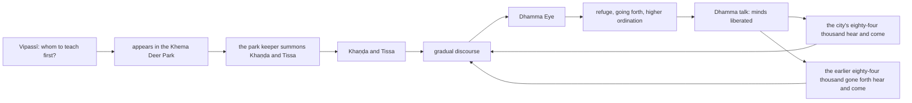

import { Tabs, TabItem } from '@astrojs/starlight/components';

Original text: [7D/1.13–1.15 Aggasāvakayuga to Purimapabbajitānaṃ dhammābhisamaya 157–170](https://tipitaka2500.github.io/tipitaka/7D/1/1.13.html#157) in the [World Tipitaka Edition](https://tipitaka2500.github.io)

## Summary

Vipassī the Bhagavā chooses his first hearers, Khaṇḍa the king's son and Tissa the chief priest's son, appears in the Khema Deer Park at Bandhumatī and has the park keeper summon them. The gradual discourse brings them the Dhamma Eye, they go forth, and a Dhamma talk liberates their minds. The eighty-four thousand of the city follow, and then the eighty-four thousand who had gone forth after him earlier; each company hears the same discourse and is liberated in the same words.

## Diagram

## Text

<Tabs syncKey="paliquote">
<TabItem label="My Translation">
(72.)

157\. Then, Bhikkhave, this thought occurred to Vipassī the Bhagavā, the `arahant` (liberated one), the `sammāsambuddha` (perfectly awakened one): ‘To whom should I teach the Dhamma first? Who will quickly understand this Dhamma?’ Then, Bhikkhave, this thought occurred to Vipassī the Bhagavā, the `arahant`, the `sammāsambuddha`: ‘This Khaṇḍa the king's son and Tissa the chief priest's son, living in the royal capital Bandhumatī, are indeed wise, experienced, intelligent, for a long time of a nature with little dust in their eyes. What if I were to teach the Dhamma first to Khaṇḍa the king's son and Tissa the chief priest's son; they will quickly understand this Dhamma.’

(73.)

158\. Then, Bhikkhave, Vipassī the Bhagavā, the `arahant`, the `sammāsambuddha` — just as a strong man might extend his flexed arm or flex his extended arm; even so — having vanished from the root of the bodhi tree, appeared in the Khema Deer Park in the royal capital Bandhumatī. Then, Bhikkhave, Vipassī the Bhagavā, the `arahant`, the `sammāsambuddha`, addressed the park keeper: ‘Come, friend park keeper, enter the royal capital Bandhumatī and speak thus to Khaṇḍa the king's son and Tissa the chief priest's son: Bhante, Vipassī the Bhagavā, the `arahant`, the `sammāsambuddha`, has arrived at the royal capital Bandhumatī and is dwelling in the Khema Deer Park; he wishes to see you.’ ‘Yes, Bhante,’ the park keeper replied, Bhikkhave, to Vipassī the Bhagavā, the `arahant`, the `sammāsambuddha`, and having entered the royal capital Bandhumatī, said this to Khaṇḍa the king's son and Tissa the chief priest's son: ‘Bhante, Vipassī the Bhagavā, the `arahant`, the `sammāsambuddha`, has arrived at the royal capital Bandhumatī and is dwelling in the Khema Deer Park; he wishes to see you.’

(74.)

159\. Then, Bhikkhave, Khaṇḍa the king's son and Tissa the chief priest's son, having had stately carriages harnessed, each mounted a stately carriage and set out from the royal capital Bandhumatī in stately carriages. They set out for the Khema Deer Park. Having gone by carriage as far as there was ground for a carriage, they dismounted from the carriage and approached Vipassī the Bhagavā, the `arahant`, the `sammāsambuddha`, on foot. Having approached, they bowed to Vipassī the Bhagavā, the `arahant`, the `sammāsambuddha`, and sat down to one side.

(75.)

160\. To them Vipassī the Bhagavā, the `arahant`, the `sammāsambuddha`, gave a gradual discourse, that is to say, `dānakathā` (talk on giving), `sīlakathā` (talk on virtue), `saggakathā` (talk on heaven); he explained the danger, baseness, and defilement of sensual pleasures, and the benefit of renunciation. When the Bhagavā knew them to have ready minds, pliable minds, minds free from hindrances, elated minds, confident minds, then he expounded that teaching of the Dhamma which is the most elevated of the Buddhas — `dukkha` (suffering), `samudaya` (origin), `nirodha` (cessation), `magga` (path). Just as a clean cloth, free from stains, would rightly receive dye; even so, for Khaṇḍa the king's son and Tissa the chief priest's son, on that very seat, there arose the `viraja` (pure), `vītamala` (stainless) `dhammacakkhu` (Dhamma Eye): ‘Whatever phenomenon is subject to origination is completely subject to cessation.’

(76.)

161\. They, who had seen the Dhamma, attained the Dhamma, understood the Dhamma, deeply penetrated the Dhamma, overcome uncertainty, free from doubt, attained confidence, not relying on another in the Teacher's instruction, said this to Vipassī the Bhagavā, the `arahant`, the `sammāsambuddha`: ‘Excellent, Bhante! Excellent, Bhante! Just as, Bhante, one might set upright what has been overturned, or reveal what is hidden, or point out the path to one who is lost, or hold up an oil lamp in the darkness, thinking, “those with eyes will see forms”; even so, the Dhamma has been made clear in many ways by the Bhagavā. We, Bhante, go for refuge to the Bhagavā and to the Dhamma. May we, Bhante, receive the `pabbajjā` (going forth) in the Bhagavā's presence, may we receive the `upasampadā` (higher ordination)?’

(77.)

162\. Khaṇḍa the king's son and Tissa the chief priest's son, Bhikkhave, gained the going forth in the presence of Vipassī the Bhagavā, the `arahant`, the `sammāsambuddha`; they gained the higher ordination. Vipassī the Bhagavā, the `arahant`, the `sammāsambuddha`, instructed, encouraged, fired up, and gladdened them with a Dhamma talk; he explained the danger, baseness, and defilement of `saṅkhāra` (mental constructions), and the benefit of `nibbāna` (extinguishment). While they were being instructed, encouraged, fired up, and gladdened by Vipassī the Bhagavā, the `arahant`, the `sammāsambuddha`, with a Dhamma talk, after only a short time their `cittāni` (minds), `anupādāya` (not grasping), were liberated from the `āsavā` (defilements).

(78.)

163\. The great crowd of people of the royal capital Bandhumatī, Bhikkhave, eighty-four thousand beings, heard: ‘Vipassī the Bhagavā, the `arahant`, the `sammāsambuddha`, it is said, has arrived at the royal capital Bandhumatī and is dwelling in the Khema Deer Park. And Khaṇḍa the king's son and Tissa the chief priest's son, it is said, have shaved off their hair and beard, put on ochre robes, and gone forth from the home life into homelessness in the presence of Vipassī the Bhagavā, the `arahant`, the `sammāsambuddha`.’ Having heard, this thought occurred to them: ‘Surely that Dhamma and Discipline is not inferior, that going forth is not inferior, wherein Khaṇḍa the king's son and Tissa the chief priest's son have shaved off their hair and beard, put on ochre robes, and gone forth from the home life into homelessness. Khaṇḍa the king's son and Tissa the chief priest's son, having shaved off their hair and beard and put on ochre robes, will go forth from the home life into homelessness — how much more so, then, we?’ Then, Bhikkhave, that great crowd of people, eighty-four thousand beings, having gone out from the royal capital Bandhumatī, approached the Khema Deer Park and Vipassī the Bhagavā, the `arahant`, the `sammāsambuddha`; having approached, they bowed to Vipassī the Bhagavā, the `arahant`, the `sammāsambuddha`, and sat down to one side.

(79.)

164\. To them Vipassī the Bhagavā, the `arahant`, the `sammāsambuddha`, gave a gradual discourse. That is to say, `dānakathā` (talk on giving), `sīlakathā` (talk on virtue), `saggakathā` (talk on heaven); he explained the danger, baseness, and defilement of sensual pleasures, and the benefit of renunciation. When the Bhagavā knew them to have ready minds, pliable minds, minds free from hindrances, elated minds, confident minds, then he expounded that teaching of the Dhamma which is the most elevated of the Buddhas — `dukkha` (suffering), `samudaya` (origin), `nirodha` (cessation), `magga` (path). Just as a clean cloth, free from stains, would rightly receive dye; even so, for those eighty-four thousand beings, on that very seat, there arose the `viraja` (pure), `vītamala` (stainless) `dhammacakkhu` (Dhamma Eye): ‘Whatever phenomenon is subject to origination is completely subject to cessation.’

(80.)

165\. They, who had seen the Dhamma, attained the Dhamma, understood the Dhamma, deeply penetrated the Dhamma, overcome uncertainty, free from doubt, attained confidence, not relying on another in the Teacher's instruction, said this to Vipassī the Bhagavā, the `arahant`, the `sammāsambuddha`: ‘Excellent, Bhante! Excellent, Bhante! Just as, Bhante, one might set upright what has been overturned, or reveal what is hidden, or point out the path to one who is lost, or hold up an oil lamp in the darkness, thinking, “those with eyes will see forms”; even so, the Dhamma has been made clear in many ways by the Bhagavā. We, Bhante, go for refuge to the Bhagavā, to the Dhamma, and to the `bhikkhusaṃgha` (Saṅgha of bhikkhū). May we, Bhante, receive the `pabbajjā` (going forth) in the Bhagavā's presence, may we receive the `upasampadā` (higher ordination)?’

(81.)

166\. Those eighty-four thousand beings, Bhikkhave, gained the going forth in the presence of Vipassī the Bhagavā, the `arahant`, the `sammāsambuddha`; they gained the higher ordination. Vipassī the Bhagavā, the `arahant`, the `sammāsambuddha`, instructed, encouraged, fired up, and gladdened them with a Dhamma talk; he explained the danger, baseness, and defilement of `saṅkhāra` (mental constructions), and the benefit of `nibbāna` (extinguishment). While they were being instructed, encouraged, fired up, and gladdened by Vipassī the Bhagavā, the `arahant`, the `sammāsambuddha`, with a Dhamma talk, after only a short time their `cittāni` (minds), `anupādāya` (not grasping), were liberated from the `āsavā` (defilements).

(82.)

167\. Those earlier eighty-four thousand who had gone forth, Bhikkhave, heard: ‘Vipassī the Bhagavā, the `arahant`, the `sammāsambuddha`, it is said, has arrived at the royal capital Bandhumatī and is dwelling in the Khema Deer Park, and it is said he teaches the Dhamma.’ Then, Bhikkhave, those eighty-four thousand who had gone forth approached the royal capital Bandhumatī, the Khema Deer Park, and Vipassī the Bhagavā, the `arahant`, the `sammāsambuddha`; having approached, they bowed to Vipassī the Bhagavā, the `arahant`, the `sammāsambuddha`, and sat down to one side.

(83.)

168\. To them Vipassī the Bhagavā, the `arahant`, the `sammāsambuddha`, gave a gradual discourse. That is to say, `dānakathā` (talk on giving), `sīlakathā` (talk on virtue), `saggakathā` (talk on heaven); he explained the danger, baseness, and defilement of sensual pleasures, and the benefit of renunciation. When the Bhagavā knew them to have ready minds, pliable minds, minds free from hindrances, elated minds, confident minds, then he expounded that teaching of the Dhamma which is the most elevated of the Buddhas — `dukkha` (suffering), `samudaya` (origin), `nirodha` (cessation), `magga` (path). Just as a clean cloth, free from stains, would rightly receive dye; even so, for those eighty-four thousand who had gone forth, on that very seat, there arose the `viraja` (pure), `vītamala` (stainless) `dhammacakkhu` (Dhamma Eye): ‘Whatever phenomenon is subject to origination is completely subject to cessation.’

(84.)

169\. They, who had seen the Dhamma, attained the Dhamma, understood the Dhamma, deeply penetrated the Dhamma, overcome uncertainty, free from doubt, attained confidence, not relying on another in the Teacher's instruction, said this to Vipassī the Bhagavā, the `arahant`, the `sammāsambuddha`: ‘Excellent, Bhante! Excellent, Bhante! Just as, Bhante, one might set upright what has been overturned, or reveal what is hidden, or point out the path to one who is lost, or hold up an oil lamp in the darkness, thinking, “those with eyes will see forms”; even so, the Dhamma has been made clear in many ways by the Bhagavā. We, Bhante, go for refuge to the Bhagavā, to the Dhamma, and to the `bhikkhusaṃgha` (Saṅgha of bhikkhū). May we, Bhante, receive the `pabbajjā` (going forth) in the Bhagavā's presence, may we receive the `upasampadā` (higher ordination)?’

(85.)

170\. Those eighty-four thousand who had gone forth, Bhikkhave, gained the going forth in the presence of Vipassī the Bhagavā, the `arahant`, the `sammāsambuddha`; they gained the higher ordination. Vipassī the Bhagavā, the `arahant`, the `sammāsambuddha`, instructed, encouraged, fired up, and gladdened them with a Dhamma talk; he explained the danger, baseness, and defilement of `saṅkhāra` (mental constructions), and the benefit of `nibbāna` (extinguishment). While they were being instructed, encouraged, fired up, and gladdened by Vipassī the Bhagavā, the `arahant`, the `sammāsambuddha`, with a Dhamma talk, after only a short time their `cittāni` (minds), `anupādāya` (not grasping), were liberated from the `āsavā` (defilements).
</TabItem>

<TabItem label="Pāḷi (Roman IAST)">
(72.)

157\. Atha kho, bhikkhave, vipassissa bhagavato arahato sammāsambuddhassa etadahosi— ‘kassa nu kho ahaṃ paṭhamaṃ dhammaṃ deseyyaṃ, ko imaṃ dhammaṃ khippameva ājānissatī’ti? Atha kho, bhikkhave, vipassissa bhagavato arahato sammāsambuddhassa etadahosi— ‘ayaṃ kho khaṇḍo ca rājaputto tisso ca purohitaputto bandhumatiyā rājadhāniyā paṭivasanti paṇḍitā viyattā medhāvino dīgharattaṃ apparajakkhajātikā. Yannūnāhaṃ khaṇḍassa ca rājaputtassa, tissassa ca purohitaputtassa paṭhamaṃ dhammaṃ deseyyaṃ, te imaṃ dhammaṃ khippameva ājānissantī’ti.

(73.)

158\. Atha kho, bhikkhave, vipassī bhagavā arahaṃ sammāsambuddho seyyathāpi nāma balavā puriso samiñjitaṃ vā bāhaṃ pasāreyya, pasāritaṃ vā bāhaṃ samiñjeyya; evameva— bodhirukkhamūle antarahito bandhumatiyā rājadhāniyā kheme migadāye pāturahosi. Atha kho, bhikkhave, vipassī bhagavā arahaṃ sammāsambuddho dāyapālaṃ āmantesi— ‘ehi tvaṃ, samma dāyapāla, bandhumatiṃ rājadhāniṃ pavisitvā khaṇḍañca rājaputtaṃ tissañca purohitaputtaṃ evaṃ vadehi— vipassī, bhante, bhagavā arahaṃ sammāsambuddho bandhumatiṃ rājadhāniṃ anuppatto kheme migadāye viharati, so tumhākaṃ dassanakāmo’ti. ‘Evaṃ, bhante’ti kho, bhikkhave, dāyapālo vipassissa bhagavato arahato sammāsambuddhassa paṭissutvā bandhumatiṃ rājadhāniṃ pavisitvā khaṇḍañca rājaputtaṃ tissañca purohitaputtaṃ etadavoca— ‘vipassī, bhante, bhagavā arahaṃ sammāsambuddho bandhumatiṃ rājadhāniṃ anuppatto kheme migadāye viharati; so tumhākaṃ dassanakāmo’ti.

(74.)

159\. Atha kho, bhikkhave, khaṇḍo ca rājaputto tisso ca purohitaputto bhaddāni bhaddāni yānāni yojāpetvā bhaddaṃ bhaddaṃ yānaṃ abhiruhitvā bhaddehi bhaddehi yānehi bandhumatiyā rājadhāniyā niyyiṃsu. Yena khemo migadāyo tena pāyiṃsu. Yāvatikā yānassa bhūmi, yānena gantvā yānā paccorohitvā pattikāva yena vipassī bhagavā arahaṃ sammāsambuddho tenupasaṅkamiṃsu. Upasaṅkamitvā vipassiṃ bhagavantaṃ arahantaṃ sammāsambuddhaṃ abhivādetvā ekamantaṃ nisīdiṃsu.

(75.)

160\. Tesaṃ vipassī bhagavā arahaṃ sammāsambuddho anupubbiṃ kathaṃ kathesi, seyyathidaṃ— dānakathaṃ sīlakathaṃ saggakathaṃ kāmānaṃ ādīnavaṃ okāraṃ saṃkilesaṃ nekkhamme ānisaṃsaṃ pakāsesi. Yadā te bhagavā aññāsi kallacitte muducitte vinīvaraṇacitte udaggacitte pasannacitte, atha yā buddhānaṃ sāmukkaṃsikā dhammadesanā, taṃ pakāsesi— dukkhaṃ samudayaṃ nirodhaṃ maggaṃ. Seyyathāpi nāma suddhaṃ vatthaṃ apagatakāḷakaṃ sammadeva rajanaṃ paṭiggaṇheyya; evameva khaṇḍassa ca rājaputtassa tissassa ca purohitaputtassa tasmiṃyeva āsane virajaṃ vītamalaṃ dhammacakkhuṃ udapādi— ‘yaṃ kiñci samudayadhammaṃ sabbaṃ taṃ nirodhadhamman’ti.

(76.)

161\. Te diṭṭhadhammā pattadhammā viditadhammā pariyogāḷhadhammā tiṇṇavicikicchā vigatakathaṃkathā vesārajjappattā aparappaccayā satthusāsane vipassiṃ bhagavantaṃ arahantaṃ sammāsambuddhaṃ etadavocuṃ— ‘abhikkantaṃ, bhante, abhikkantaṃ, bhante. Seyyathāpi, bhante, nikkujjitaṃ vā ukkujjeyya, paṭicchannaṃ vā vivareyya, mūḷhassa vā maggaṃ ācikkheyya, andhakāre vā telapajjotaṃ dhāreyya— “cakkhumanto rūpāni dakkhantī”ti; evamevaṃ bhagavatā anekapariyāyena dhammo pakāsito. Ete mayaṃ, bhante, bhagavantaṃ saraṇaṃ gacchāma dhammañca. Labheyyāma mayaṃ, bhante, bhagavato santike pabbajjaṃ, labheyyāma upasampadan’ti.

(77.)

162\. Alatthuṃ kho, bhikkhave, khaṇḍo ca rājaputto, tisso ca purohitaputto vipassissa bhagavato arahato sammāsambuddhassa santike pabbajjaṃ alatthuṃ upasampadaṃ. Te vipassī bhagavā arahaṃ sammāsambuddho dhammiyā kathāya sandassesi samādapesi samuttejesi sampahaṃsesi; saṅkhārānaṃ ādīnavaṃ okāraṃ saṃkilesaṃ nibbāne ānisaṃsaṃ pakāsesi. Tesaṃ vipassinā bhagavatā arahatā sammāsambuddhena dhammiyā kathāya sandassiyamānānaṃ samādapiyamānānaṃ samuttejiyamānānaṃ sampahaṃsiyamānānaṃ nacirasseva anupādāya āsavehi cittāni vimucciṃsu.

(78.)

163\. Assosi kho, bhikkhave, bandhumatiyā rājadhāniyā mahājanakāyo caturāsītipāṇasahassāni— ‘vipassī kira bhagavā arahaṃ sammāsambuddho bandhumatiṃ rājadhāniṃ anuppatto kheme migadāye viharati. Khaṇḍo ca kira rājaputto tisso ca purohitaputto vipassissa bhagavato arahato sammāsambuddhassa santike kesamassuṃ ohāretvā kāsāyāni vatthāni acchādetvā agārasmā anagāriyaṃ pabbajitā’ti. Sutvāna nesaṃ etadahosi— ‘na hi nūna so orako dhammavinayo, na sā orakā pabbajjā, yattha khaṇḍo ca rājaputto tisso ca purohitaputto kesamassuṃ ohāretvā kāsāyāni vatthāni acchādetvā agārasmā anagāriyaṃ pabbajitā. Khaṇḍo ca rājaputto tisso ca purohitaputto kesamassuṃ ohāretvā kāsāyāni vatthāni acchādetvā agārasmā anagāriyaṃ pabbajissanti, kimaṅgaṃ pana mayan’ti. Atha kho so, bhikkhave, mahājanakāyo caturāsītipāṇasahassāni bandhumatiyā rājadhāniyā nikkhamitvā yena khemo migadāyo yena vipassī bhagavā arahaṃ sammāsambuddho tenupasaṅkamiṃsu; upasaṅkamitvā vipassiṃ bhagavantaṃ arahantaṃ sammāsambuddhaṃ abhivādetvā ekamantaṃ nisīdiṃsu.

(79.)

164\. Tesaṃ vipassī bhagavā arahaṃ sammāsambuddho anupubbiṃ kathaṃ kathesi. Seyyathidaṃ— dānakathaṃ sīlakathaṃ saggakathaṃ kāmānaṃ ādīnavaṃ okāraṃ saṃkilesaṃ nekkhamme ānisaṃsaṃ pakāsesi. Yadā te bhagavā aññāsi kallacitte muducitte vinīvaraṇacitte udaggacitte pasannacitte, atha yā buddhānaṃ sāmukkaṃsikā dhammadesanā, taṃ pakāsesi— dukkhaṃ samudayaṃ nirodhaṃ maggaṃ. Seyyathāpi nāma suddhaṃ vatthaṃ apagatakāḷakaṃ sammadeva rajanaṃ paṭiggaṇheyya; evameva tesaṃ caturāsītipāṇasahassānaṃ tasmiṃyeva āsane virajaṃ vītamalaṃ dhammacakkhuṃ udapādi— ‘yaṃ kiñci samudayadhammaṃ sabbaṃ taṃ nirodhadhamman’ti.

(80.)

165\. Te diṭṭhadhammā pattadhammā viditadhammā pariyogāḷhadhammā tiṇṇavicikicchā vigatakathaṃkathā vesārajjappattā aparappaccayā satthusāsane vipassiṃ bhagavantaṃ arahantaṃ sammāsambuddhaṃ etadavocuṃ— ‘abhikkantaṃ, bhante, abhikkantaṃ, bhante. Seyyathāpi, bhante, nikkujjitaṃ vā ukkujjeyya, paṭicchannaṃ vā vivareyya, mūḷhassa vā maggaṃ ācikkheyya, andhakāre vā telapajjotaṃ dhāreyya— “cakkhumanto rūpāni dakkhantī”ti; evamevaṃ bhagavatā anekapariyāyena dhammo pakāsito. Ete mayaṃ, bhante, bhagavantaṃ saraṇaṃ gacchāma dhammañca bhikkhusaṃghañca. Labheyyāma mayaṃ, bhante, bhagavato santike pabbajjaṃ labheyyāma upasampadan’ti.

(81.)

166\. Alatthuṃ kho, bhikkhave, tāni caturāsītipāṇasahassāni vipassissa bhagavato arahato sammāsambuddhassa santike pabbajjaṃ, alatthuṃ upasampadaṃ. Te vipassī bhagavā arahaṃ sammāsambuddho dhammiyā kathāya sandassesi samādapesi samuttejesi sampahaṃsesi; saṅkhārānaṃ ādīnavaṃ okāraṃ saṃkilesaṃ nibbāne ānisaṃsaṃ pakāsesi. Tesaṃ vipassinā bhagavatā arahatā sammāsambuddhena dhammiyā kathāya sandassiyamānānaṃ samādapiyamānānaṃ samuttejiyamānānaṃ sampahaṃsiyamānānaṃ nacirasseva anupādāya āsavehi cittāni vimucciṃsu.

(82.)

167\. Assosuṃ kho, bhikkhave, tāni purimāni caturāsītipabbajitasahassāni— ‘vipassī kira bhagavā arahaṃ sammāsambuddho bandhumatiṃ rājadhāniṃ anuppatto kheme migadāye viharati, dhammañca kira desetī’ti. Atha kho, bhikkhave, tāni caturāsītipabbajitasahassāni yena bandhumatī rājadhānī yena khemo migadāyo yena vipassī bhagavā arahaṃ sammāsambuddho tenupasaṅkamiṃsu; upasaṅkamitvā vipassiṃ bhagavantaṃ arahantaṃ sammāsambuddhaṃ abhivādetvā ekamantaṃ nisīdiṃsu.

(83.)

168\. Tesaṃ vipassī bhagavā arahaṃ sammāsambuddho anupubbiṃ kathaṃ kathesi. Seyyathidaṃ— dānakathaṃ sīlakathaṃ saggakathaṃ kāmānaṃ ādīnavaṃ okāraṃ saṃkilesaṃ nekkhamme ānisaṃsaṃ pakāsesi. Yadā te bhagavā aññāsi kallacitte muducitte vinīvaraṇacitte udaggacitte pasannacitte, atha yā buddhānaṃ sāmukkaṃsikā dhammadesanā, taṃ pakāsesi— dukkhaṃ samudayaṃ nirodhaṃ maggaṃ. Seyyathāpi nāma suddhaṃ vatthaṃ apagatakāḷakaṃ sammadeva rajanaṃ paṭiggaṇheyya; evameva tesaṃ caturāsītipabbajitasahassānaṃ tasmiṃyeva āsane virajaṃ vītamalaṃ dhammacakkhuṃ udapādi— ‘yaṃ kiñci samudayadhammaṃ sabbaṃ taṃ nirodhadhamman’ti.

(84.)

169\. Te diṭṭhadhammā pattadhammā viditadhammā pariyogāḷhadhammā tiṇṇavicikicchā vigatakathaṃkathā vesārajjappattā aparappaccayā satthusāsane vipassiṃ bhagavantaṃ arahantaṃ sammāsambuddhaṃ etadavocuṃ— ‘abhikkantaṃ, bhante, abhikkantaṃ, bhante. Seyyathāpi, bhante, nikkujjitaṃ vā ukkujjeyya, paṭicchannaṃ vā vivareyya, mūḷhassa vā maggaṃ ācikkheyya, andhakāre vā telapajjotaṃ dhāreyya— “cakkhumanto rūpāni dakkhantī”ti; evamevaṃ bhagavatā anekapariyāyena dhammo pakāsito. Ete mayaṃ, bhante, bhagavantaṃ saraṇaṃ gacchāma dhammañca bhikkhusaṃghañca. Labheyyāma mayaṃ, bhante, bhagavato santike pabbajjaṃ labheyyāma upasampadan’ti.

(85.)

170\. Alatthuṃ kho, bhikkhave, tāni caturāsītipabbajitasahassāni vipassissa bhagavato arahato sammāsambuddhassa santike pabbajjaṃ alatthuṃ upasampadaṃ. Te vipassī bhagavā arahaṃ sammāsambuddho dhammiyā kathāya sandassesi samādapesi samuttejesi sampahaṃsesi; saṅkhārānaṃ ādīnavaṃ okāraṃ saṃkilesaṃ nibbāne ānisaṃsaṃ pakāsesi. Tesaṃ vipassinā bhagavatā arahatā sammāsambuddhena dhammiyā kathāya sandassiyamānānaṃ samādapiyamānānaṃ samuttejiyamānānaṃ sampahaṃsiyamānānaṃ nacirasseva anupādāya āsavehi cittāni vimucciṃsu.
</TabItem>

<TabItem label="Pāḷi (Brahmi)">
(72.)

157\. 𑀅𑀣 𑀔𑁄, 𑀪𑀺𑀓𑁆𑀔𑀯𑁂, 𑀯𑀺𑀧𑀲𑁆𑀲𑀺𑀲𑁆𑀲 𑀪𑀕𑀯𑀢𑁄 𑀅𑀭𑀳𑀢𑁄 𑀲𑀫𑁆𑀫𑀸𑀲𑀫𑁆𑀩𑀼𑀤𑁆𑀥𑀲𑁆𑀲 𑀏𑀢𑀤𑀳𑁄𑀲𑀺— ‘𑀓𑀲𑁆𑀲 𑀦𑀼 𑀔𑁄 𑀅𑀳𑀁 𑀧𑀞𑀫𑀁 𑀥𑀫𑁆𑀫𑀁 𑀤𑁂𑀲𑁂𑀬𑁆𑀬𑀁, 𑀓𑁄 𑀇𑀫𑀁 𑀥𑀫𑁆𑀫𑀁 𑀔𑀺𑀧𑁆𑀧𑀫𑁂𑀯 𑀆𑀚𑀸𑀦𑀺𑀲𑁆𑀲𑀢𑀻’𑀢𑀺? 𑀅𑀣 𑀔𑁄, 𑀪𑀺𑀓𑁆𑀔𑀯𑁂, 𑀯𑀺𑀧𑀲𑁆𑀲𑀺𑀲𑁆𑀲 𑀪𑀕𑀯𑀢𑁄 𑀅𑀭𑀳𑀢𑁄 𑀲𑀫𑁆𑀫𑀸𑀲𑀫𑁆𑀩𑀼𑀤𑁆𑀥𑀲𑁆𑀲 𑀏𑀢𑀤𑀳𑁄𑀲𑀺— ‘𑀅𑀬𑀁 𑀔𑁄 𑀔𑀡𑁆𑀟𑁄 𑀘 𑀭𑀸𑀚𑀧𑀼𑀢𑁆𑀢𑁄 𑀢𑀺𑀲𑁆𑀲𑁄 𑀘 𑀧𑀼𑀭𑁄𑀳𑀺𑀢𑀧𑀼𑀢𑁆𑀢𑁄 𑀩𑀦𑁆𑀥𑀼𑀫𑀢𑀺𑀬𑀸 𑀭𑀸𑀚𑀥𑀸𑀦𑀺𑀬𑀸 𑀧𑀝𑀺𑀯𑀲𑀦𑁆𑀢𑀺 𑀧𑀡𑁆𑀟𑀺𑀢𑀸 𑀯𑀺𑀬𑀢𑁆𑀢𑀸 𑀫𑁂𑀥𑀸𑀯𑀺𑀦𑁄 𑀤𑀻𑀖𑀭𑀢𑁆𑀢𑀁 𑀅𑀧𑁆𑀧𑀭𑀚𑀓𑁆𑀔𑀚𑀸𑀢𑀺𑀓𑀸. 𑀬𑀦𑁆𑀦𑀽𑀦𑀸𑀳𑀁 𑀔𑀡𑁆𑀟𑀲𑁆𑀲 𑀘 𑀭𑀸𑀚𑀧𑀼𑀢𑁆𑀢𑀲𑁆𑀲, 𑀢𑀺𑀲𑁆𑀲𑀲𑁆𑀲 𑀘 𑀧𑀼𑀭𑁄𑀳𑀺𑀢𑀧𑀼𑀢𑁆𑀢𑀲𑁆𑀲 𑀧𑀞𑀫𑀁 𑀥𑀫𑁆𑀫𑀁 𑀤𑁂𑀲𑁂𑀬𑁆𑀬𑀁, 𑀢𑁂 𑀇𑀫𑀁 𑀥𑀫𑁆𑀫𑀁 𑀔𑀺𑀧𑁆𑀧𑀫𑁂𑀯 𑀆𑀚𑀸𑀦𑀺𑀲𑁆𑀲𑀦𑁆𑀢𑀻’𑀢𑀺.

(73.)

158\. 𑀅𑀣 𑀔𑁄, 𑀪𑀺𑀓𑁆𑀔𑀯𑁂, 𑀯𑀺𑀧𑀲𑁆𑀲𑀻 𑀪𑀕𑀯𑀸 𑀅𑀭𑀳𑀁 𑀲𑀫𑁆𑀫𑀸𑀲𑀫𑁆𑀩𑀼𑀤𑁆𑀥𑁄 𑀲𑁂𑀬𑁆𑀬𑀣𑀸𑀧𑀺 𑀦𑀸𑀫 𑀩𑀮𑀯𑀸 𑀧𑀼𑀭𑀺𑀲𑁄 𑀲𑀫𑀺𑀜𑁆𑀚𑀺𑀢𑀁 𑀯𑀸 𑀩𑀸𑀳𑀁 𑀧𑀲𑀸𑀭𑁂𑀬𑁆𑀬, 𑀧𑀲𑀸𑀭𑀺𑀢𑀁 𑀯𑀸 𑀩𑀸𑀳𑀁 𑀲𑀫𑀺𑀜𑁆𑀚𑁂𑀬𑁆𑀬; 𑀏𑀯𑀫𑁂𑀯— 𑀩𑁄𑀥𑀺𑀭𑀼𑀓𑁆𑀔𑀫𑀽𑀮𑁂 𑀅𑀦𑁆𑀢𑀭𑀳𑀺𑀢𑁄 𑀩𑀦𑁆𑀥𑀼𑀫𑀢𑀺𑀬𑀸 𑀭𑀸𑀚𑀥𑀸𑀦𑀺𑀬𑀸 𑀔𑁂𑀫𑁂 𑀫𑀺𑀕𑀤𑀸𑀬𑁂 𑀧𑀸𑀢𑀼𑀭𑀳𑁄𑀲𑀺. 𑀅𑀣 𑀔𑁄, 𑀪𑀺𑀓𑁆𑀔𑀯𑁂, 𑀯𑀺𑀧𑀲𑁆𑀲𑀻 𑀪𑀕𑀯𑀸 𑀅𑀭𑀳𑀁 𑀲𑀫𑁆𑀫𑀸𑀲𑀫𑁆𑀩𑀼𑀤𑁆𑀥𑁄 𑀤𑀸𑀬𑀧𑀸𑀮𑀁 𑀆𑀫𑀦𑁆𑀢𑁂𑀲𑀺— ‘𑀏𑀳𑀺 𑀢𑁆𑀯𑀁, 𑀲𑀫𑁆𑀫 𑀤𑀸𑀬𑀧𑀸𑀮, 𑀩𑀦𑁆𑀥𑀼𑀫𑀢𑀺𑀁 𑀭𑀸𑀚𑀥𑀸𑀦𑀺𑀁 𑀧𑀯𑀺𑀲𑀺𑀢𑁆𑀯𑀸 𑀔𑀡𑁆𑀟𑀜𑁆𑀘 𑀭𑀸𑀚𑀧𑀼𑀢𑁆𑀢𑀁 𑀢𑀺𑀲𑁆𑀲𑀜𑁆𑀘 𑀧𑀼𑀭𑁄𑀳𑀺𑀢𑀧𑀼𑀢𑁆𑀢𑀁 𑀏𑀯𑀁 𑀯𑀤𑁂𑀳𑀺— 𑀯𑀺𑀧𑀲𑁆𑀲𑀻, 𑀪𑀦𑁆𑀢𑁂, 𑀪𑀕𑀯𑀸 𑀅𑀭𑀳𑀁 𑀲𑀫𑁆𑀫𑀸𑀲𑀫𑁆𑀩𑀼𑀤𑁆𑀥𑁄 𑀩𑀦𑁆𑀥𑀼𑀫𑀢𑀺𑀁 𑀭𑀸𑀚𑀥𑀸𑀦𑀺𑀁 𑀅𑀦𑀼𑀧𑁆𑀧𑀢𑁆𑀢𑁄 𑀔𑁂𑀫𑁂 𑀫𑀺𑀕𑀤𑀸𑀬𑁂 𑀯𑀺𑀳𑀭𑀢𑀺, 𑀲𑁄 𑀢𑀼𑀫𑁆𑀳𑀸𑀓𑀁 𑀤𑀲𑁆𑀲𑀦𑀓𑀸𑀫𑁄’𑀢𑀺. ‘𑀏𑀯𑀁, 𑀪𑀦𑁆𑀢𑁂’𑀢𑀺 𑀔𑁄, 𑀪𑀺𑀓𑁆𑀔𑀯𑁂, 𑀤𑀸𑀬𑀧𑀸𑀮𑁄 𑀯𑀺𑀧𑀲𑁆𑀲𑀺𑀲𑁆𑀲 𑀪𑀕𑀯𑀢𑁄 𑀅𑀭𑀳𑀢𑁄 𑀲𑀫𑁆𑀫𑀸𑀲𑀫𑁆𑀩𑀼𑀤𑁆𑀥𑀲𑁆𑀲 𑀧𑀝𑀺𑀲𑁆𑀲𑀼𑀢𑁆𑀯𑀸 𑀩𑀦𑁆𑀥𑀼𑀫𑀢𑀺𑀁 𑀭𑀸𑀚𑀥𑀸𑀦𑀺𑀁 𑀧𑀯𑀺𑀲𑀺𑀢𑁆𑀯𑀸 𑀔𑀡𑁆𑀟𑀜𑁆𑀘 𑀭𑀸𑀚𑀧𑀼𑀢𑁆𑀢𑀁 𑀢𑀺𑀲𑁆𑀲𑀜𑁆𑀘 𑀧𑀼𑀭𑁄𑀳𑀺𑀢𑀧𑀼𑀢𑁆𑀢𑀁 𑀏𑀢𑀤𑀯𑁄𑀘— ‘𑀯𑀺𑀧𑀲𑁆𑀲𑀻, 𑀪𑀦𑁆𑀢𑁂, 𑀪𑀕𑀯𑀸 𑀅𑀭𑀳𑀁 𑀲𑀫𑁆𑀫𑀸𑀲𑀫𑁆𑀩𑀼𑀤𑁆𑀥𑁄 𑀩𑀦𑁆𑀥𑀼𑀫𑀢𑀺𑀁 𑀭𑀸𑀚𑀥𑀸𑀦𑀺𑀁 𑀅𑀦𑀼𑀧𑁆𑀧𑀢𑁆𑀢𑁄 𑀔𑁂𑀫𑁂 𑀫𑀺𑀕𑀤𑀸𑀬𑁂 𑀯𑀺𑀳𑀭𑀢𑀺; 𑀲𑁄 𑀢𑀼𑀫𑁆𑀳𑀸𑀓𑀁 𑀤𑀲𑁆𑀲𑀦𑀓𑀸𑀫𑁄’𑀢𑀺.

(74.)

159\. 𑀅𑀣 𑀔𑁄, 𑀪𑀺𑀓𑁆𑀔𑀯𑁂, 𑀔𑀡𑁆𑀟𑁄 𑀘 𑀭𑀸𑀚𑀧𑀼𑀢𑁆𑀢𑁄 𑀢𑀺𑀲𑁆𑀲𑁄 𑀘 𑀧𑀼𑀭𑁄𑀳𑀺𑀢𑀧𑀼𑀢𑁆𑀢𑁄 𑀪𑀤𑁆𑀤𑀸𑀦𑀺 𑀪𑀤𑁆𑀤𑀸𑀦𑀺 𑀬𑀸𑀦𑀸𑀦𑀺 𑀬𑁄𑀚𑀸𑀧𑁂𑀢𑁆𑀯𑀸 𑀪𑀤𑁆𑀤𑀁 𑀪𑀤𑁆𑀤𑀁 𑀬𑀸𑀦𑀁 𑀅𑀪𑀺𑀭𑀼𑀳𑀺𑀢𑁆𑀯𑀸 𑀪𑀤𑁆𑀤𑁂𑀳𑀺 𑀪𑀤𑁆𑀤𑁂𑀳𑀺 𑀬𑀸𑀦𑁂𑀳𑀺 𑀩𑀦𑁆𑀥𑀼𑀫𑀢𑀺𑀬𑀸 𑀭𑀸𑀚𑀥𑀸𑀦𑀺𑀬𑀸 𑀦𑀺𑀬𑁆𑀬𑀺𑀁𑀲𑀼. 𑀬𑁂𑀦 𑀔𑁂𑀫𑁄 𑀫𑀺𑀕𑀤𑀸𑀬𑁄 𑀢𑁂𑀦 𑀧𑀸𑀬𑀺𑀁𑀲𑀼. 𑀬𑀸𑀯𑀢𑀺𑀓𑀸 𑀬𑀸𑀦𑀲𑁆𑀲 𑀪𑀽𑀫𑀺, 𑀬𑀸𑀦𑁂𑀦 𑀕𑀦𑁆𑀢𑁆𑀯𑀸 𑀬𑀸𑀦𑀸 𑀧𑀘𑁆𑀘𑁄𑀭𑁄𑀳𑀺𑀢𑁆𑀯𑀸 𑀧𑀢𑁆𑀢𑀺𑀓𑀸𑀯 𑀬𑁂𑀦 𑀯𑀺𑀧𑀲𑁆𑀲𑀻 𑀪𑀕𑀯𑀸 𑀅𑀭𑀳𑀁 𑀲𑀫𑁆𑀫𑀸𑀲𑀫𑁆𑀩𑀼𑀤𑁆𑀥𑁄 𑀢𑁂𑀦𑀼𑀧𑀲𑀗𑁆𑀓𑀫𑀺𑀁𑀲𑀼. 𑀉𑀧𑀲𑀗𑁆𑀓𑀫𑀺𑀢𑁆𑀯𑀸 𑀯𑀺𑀧𑀲𑁆𑀲𑀺𑀁 𑀪𑀕𑀯𑀦𑁆𑀢𑀁 𑀅𑀭𑀳𑀦𑁆𑀢𑀁 𑀲𑀫𑁆𑀫𑀸𑀲𑀫𑁆𑀩𑀼𑀤𑁆𑀥𑀁 𑀅𑀪𑀺𑀯𑀸𑀤𑁂𑀢𑁆𑀯𑀸 𑀏𑀓𑀫𑀦𑁆𑀢𑀁 𑀦𑀺𑀲𑀻𑀤𑀺𑀁𑀲𑀼.

(75.)

160\. 𑀢𑁂𑀲𑀁 𑀯𑀺𑀧𑀲𑁆𑀲𑀻 𑀪𑀕𑀯𑀸 𑀅𑀭𑀳𑀁 𑀲𑀫𑁆𑀫𑀸𑀲𑀫𑁆𑀩𑀼𑀤𑁆𑀥𑁄 𑀅𑀦𑀼𑀧𑀼𑀩𑁆𑀩𑀺𑀁 𑀓𑀣𑀁 𑀓𑀣𑁂𑀲𑀺, 𑀲𑁂𑀬𑁆𑀬𑀣𑀺𑀤𑀁— 𑀤𑀸𑀦𑀓𑀣𑀁 𑀲𑀻𑀮𑀓𑀣𑀁 𑀲𑀕𑁆𑀕𑀓𑀣𑀁 𑀓𑀸𑀫𑀸𑀦𑀁 𑀆𑀤𑀻𑀦𑀯𑀁 𑀑𑀓𑀸𑀭𑀁 𑀲𑀁𑀓𑀺𑀮𑁂𑀲𑀁 𑀦𑁂𑀓𑁆𑀔𑀫𑁆𑀫𑁂 𑀆𑀦𑀺𑀲𑀁𑀲𑀁 𑀧𑀓𑀸𑀲𑁂𑀲𑀺. 𑀬𑀤𑀸 𑀢𑁂 𑀪𑀕𑀯𑀸 𑀅𑀜𑁆𑀜𑀸𑀲𑀺 𑀓𑀮𑁆𑀮𑀘𑀺𑀢𑁆𑀢𑁂 𑀫𑀼𑀤𑀼𑀘𑀺𑀢𑁆𑀢𑁂 𑀯𑀺𑀦𑀻𑀯𑀭𑀡𑀘𑀺𑀢𑁆𑀢𑁂 𑀉𑀤𑀕𑁆𑀕𑀘𑀺𑀢𑁆𑀢𑁂 𑀧𑀲𑀦𑁆𑀦𑀘𑀺𑀢𑁆𑀢𑁂, 𑀅𑀣 𑀬𑀸 𑀩𑀼𑀤𑁆𑀥𑀸𑀦𑀁 𑀲𑀸𑀫𑀼𑀓𑁆𑀓𑀁𑀲𑀺𑀓𑀸 𑀥𑀫𑁆𑀫𑀤𑁂𑀲𑀦𑀸, 𑀢𑀁 𑀧𑀓𑀸𑀲𑁂𑀲𑀺— 𑀤𑀼𑀓𑁆𑀔𑀁 𑀲𑀫𑀼𑀤𑀬𑀁 𑀦𑀺𑀭𑁄𑀥𑀁 𑀫𑀕𑁆𑀕𑀁. 𑀲𑁂𑀬𑁆𑀬𑀣𑀸𑀧𑀺 𑀦𑀸𑀫 𑀲𑀼𑀤𑁆𑀥𑀁 𑀯𑀢𑁆𑀣𑀁 𑀅𑀧𑀕𑀢𑀓𑀸𑀍𑀅𑀓𑀁 𑀲𑀫𑁆𑀫𑀤𑁂𑀯 𑀭𑀚𑀦𑀁 𑀧𑀝𑀺𑀕𑁆𑀕𑀡𑁆𑀳𑁂𑀬𑁆𑀬; 𑀏𑀯𑀫𑁂𑀯 𑀔𑀡𑁆𑀟𑀲𑁆𑀲 𑀘 𑀭𑀸𑀚𑀧𑀼𑀢𑁆𑀢𑀲𑁆𑀲 𑀢𑀺𑀲𑁆𑀲𑀲𑁆𑀲 𑀘 𑀧𑀼𑀭𑁄𑀳𑀺𑀢𑀧𑀼𑀢𑁆𑀢𑀲𑁆𑀲 𑀢𑀲𑁆𑀫𑀺𑀁𑀬𑁂𑀯 𑀆𑀲𑀦𑁂 𑀯𑀺𑀭𑀚𑀁 𑀯𑀻𑀢𑀫𑀮𑀁 𑀥𑀫𑁆𑀫𑀘𑀓𑁆𑀔𑀼𑀁 𑀉𑀤𑀧𑀸𑀤𑀺— ‘𑀬𑀁 𑀓𑀺𑀜𑁆𑀘𑀺 𑀲𑀫𑀼𑀤𑀬𑀥𑀫𑁆𑀫𑀁 𑀲𑀩𑁆𑀩𑀁 𑀢𑀁 𑀦𑀺𑀭𑁄𑀥𑀥𑀫𑁆𑀫𑀦𑁆’𑀢𑀺.

(76.)

161\. 𑀢𑁂 𑀤𑀺𑀝𑁆𑀞𑀥𑀫𑁆𑀫𑀸 𑀧𑀢𑁆𑀢𑀥𑀫𑁆𑀫𑀸 𑀯𑀺𑀤𑀺𑀢𑀥𑀫𑁆𑀫𑀸 𑀧𑀭𑀺𑀬𑁄𑀕𑀸𑀍𑀳𑀥𑀫𑁆𑀫𑀸 𑀢𑀺𑀡𑁆𑀡𑀯𑀺𑀘𑀺𑀓𑀺𑀘𑁆𑀙𑀸 𑀯𑀺𑀕𑀢𑀓𑀣𑀁𑀓𑀣𑀸 𑀯𑁂𑀲𑀸𑀭𑀚𑁆𑀚𑀧𑁆𑀧𑀢𑁆𑀢𑀸 𑀅𑀧𑀭𑀧𑁆𑀧𑀘𑁆𑀘𑀬𑀸 𑀲𑀢𑁆𑀣𑀼𑀲𑀸𑀲𑀦𑁂 𑀯𑀺𑀧𑀲𑁆𑀲𑀺𑀁 𑀪𑀕𑀯𑀦𑁆𑀢𑀁 𑀅𑀭𑀳𑀦𑁆𑀢𑀁 𑀲𑀫𑁆𑀫𑀸𑀲𑀫𑁆𑀩𑀼𑀤𑁆𑀥𑀁 𑀏𑀢𑀤𑀯𑁄𑀘𑀼𑀁— ‘𑀅𑀪𑀺𑀓𑁆𑀓𑀦𑁆𑀢𑀁, 𑀪𑀦𑁆𑀢𑁂, 𑀅𑀪𑀺𑀓𑁆𑀓𑀦𑁆𑀢𑀁, 𑀪𑀦𑁆𑀢𑁂. 𑀲𑁂𑀬𑁆𑀬𑀣𑀸𑀧𑀺, 𑀪𑀦𑁆𑀢𑁂, 𑀦𑀺𑀓𑁆𑀓𑀼𑀚𑁆𑀚𑀺𑀢𑀁 𑀯𑀸 𑀉𑀓𑁆𑀓𑀼𑀚𑁆𑀚𑁂𑀬𑁆𑀬, 𑀧𑀝𑀺𑀘𑁆𑀙𑀦𑁆𑀦𑀁 𑀯𑀸 𑀯𑀺𑀯𑀭𑁂𑀬𑁆𑀬, 𑀫𑀽𑀍𑀳𑀲𑁆𑀲 𑀯𑀸 𑀫𑀕𑁆𑀕𑀁 𑀆𑀘𑀺𑀓𑁆𑀔𑁂𑀬𑁆𑀬, 𑀅𑀦𑁆𑀥𑀓𑀸𑀭𑁂 𑀯𑀸 𑀢𑁂𑀮𑀧𑀚𑁆𑀚𑁄𑀢𑀁 𑀥𑀸𑀭𑁂𑀬𑁆𑀬— “𑀘𑀓𑁆𑀔𑀼𑀫𑀦𑁆𑀢𑁄 𑀭𑀽𑀧𑀸𑀦𑀺 𑀤𑀓𑁆𑀔𑀦𑁆𑀢𑀻”𑀢𑀺; 𑀏𑀯𑀫𑁂𑀯𑀁 𑀪𑀕𑀯𑀢𑀸 𑀅𑀦𑁂𑀓𑀧𑀭𑀺𑀬𑀸𑀬𑁂𑀦 𑀥𑀫𑁆𑀫𑁄 𑀧𑀓𑀸𑀲𑀺𑀢𑁄. 𑀏𑀢𑁂 𑀫𑀬𑀁, 𑀪𑀦𑁆𑀢𑁂, 𑀪𑀕𑀯𑀦𑁆𑀢𑀁 𑀲𑀭𑀡𑀁 𑀕𑀘𑁆𑀙𑀸𑀫 𑀥𑀫𑁆𑀫𑀜𑁆𑀘. 𑀮𑀪𑁂𑀬𑁆𑀬𑀸𑀫 𑀫𑀬𑀁, 𑀪𑀦𑁆𑀢𑁂, 𑀪𑀕𑀯𑀢𑁄 𑀲𑀦𑁆𑀢𑀺𑀓𑁂 𑀧𑀩𑁆𑀩𑀚𑁆𑀚𑀁, 𑀮𑀪𑁂𑀬𑁆𑀬𑀸𑀫 𑀉𑀧𑀲𑀫𑁆𑀧𑀤𑀦𑁆’𑀢𑀺.

(77.)

162\. 𑀅𑀮𑀢𑁆𑀣𑀼𑀁 𑀔𑁄, 𑀪𑀺𑀓𑁆𑀔𑀯𑁂, 𑀔𑀡𑁆𑀟𑁄 𑀘 𑀭𑀸𑀚𑀧𑀼𑀢𑁆𑀢𑁄, 𑀢𑀺𑀲𑁆𑀲𑁄 𑀘 𑀧𑀼𑀭𑁄𑀳𑀺𑀢𑀧𑀼𑀢𑁆𑀢𑁄 𑀯𑀺𑀧𑀲𑁆𑀲𑀺𑀲𑁆𑀲 𑀪𑀕𑀯𑀢𑁄 𑀅𑀭𑀳𑀢𑁄 𑀲𑀫𑁆𑀫𑀸𑀲𑀫𑁆𑀩𑀼𑀤𑁆𑀥𑀲𑁆𑀲 𑀲𑀦𑁆𑀢𑀺𑀓𑁂 𑀧𑀩𑁆𑀩𑀚𑁆𑀚𑀁 𑀅𑀮𑀢𑁆𑀣𑀼𑀁 𑀉𑀧𑀲𑀫𑁆𑀧𑀤𑀁. 𑀢𑁂 𑀯𑀺𑀧𑀲𑁆𑀲𑀻 𑀪𑀕𑀯𑀸 𑀅𑀭𑀳𑀁 𑀲𑀫𑁆𑀫𑀸𑀲𑀫𑁆𑀩𑀼𑀤𑁆𑀥𑁄 𑀥𑀫𑁆𑀫𑀺𑀬𑀸 𑀓𑀣𑀸𑀬 𑀲𑀦𑁆𑀤𑀲𑁆𑀲𑁂𑀲𑀺 𑀲𑀫𑀸𑀤𑀧𑁂𑀲𑀺 𑀲𑀫𑀼𑀢𑁆𑀢𑁂𑀚𑁂𑀲𑀺 𑀲𑀫𑁆𑀧𑀳𑀁𑀲𑁂𑀲𑀺; 𑀲𑀗𑁆𑀔𑀸𑀭𑀸𑀦𑀁 𑀆𑀤𑀻𑀦𑀯𑀁 𑀑𑀓𑀸𑀭𑀁 𑀲𑀁𑀓𑀺𑀮𑁂𑀲𑀁 𑀦𑀺𑀩𑁆𑀩𑀸𑀦𑁂 𑀆𑀦𑀺𑀲𑀁𑀲𑀁 𑀧𑀓𑀸𑀲𑁂𑀲𑀺. 𑀢𑁂𑀲𑀁 𑀯𑀺𑀧𑀲𑁆𑀲𑀺𑀦𑀸 𑀪𑀕𑀯𑀢𑀸 𑀅𑀭𑀳𑀢𑀸 𑀲𑀫𑁆𑀫𑀸𑀲𑀫𑁆𑀩𑀼𑀤𑁆𑀥𑁂𑀦 𑀥𑀫𑁆𑀫𑀺𑀬𑀸 𑀓𑀣𑀸𑀬 𑀲𑀦𑁆𑀤𑀲𑁆𑀲𑀺𑀬𑀫𑀸𑀦𑀸𑀦𑀁 𑀲𑀫𑀸𑀤𑀧𑀺𑀬𑀫𑀸𑀦𑀸𑀦𑀁 𑀲𑀫𑀼𑀢𑁆𑀢𑁂𑀚𑀺𑀬𑀫𑀸𑀦𑀸𑀦𑀁 𑀲𑀫𑁆𑀧𑀳𑀁𑀲𑀺𑀬𑀫𑀸𑀦𑀸𑀦𑀁 𑀦𑀘𑀺𑀭𑀲𑁆𑀲𑁂𑀯 𑀅𑀦𑀼𑀧𑀸𑀤𑀸𑀬 𑀆𑀲𑀯𑁂𑀳𑀺 𑀘𑀺𑀢𑁆𑀢𑀸𑀦𑀺 𑀯𑀺𑀫𑀼𑀘𑁆𑀘𑀺𑀁𑀲𑀼.

(78.)

163\. 𑀅𑀲𑁆𑀲𑁄𑀲𑀺 𑀔𑁄, 𑀪𑀺𑀓𑁆𑀔𑀯𑁂, 𑀩𑀦𑁆𑀥𑀼𑀫𑀢𑀺𑀬𑀸 𑀭𑀸𑀚𑀥𑀸𑀦𑀺𑀬𑀸 𑀫𑀳𑀸𑀚𑀦𑀓𑀸𑀬𑁄 𑀘𑀢𑀼𑀭𑀸𑀲𑀻𑀢𑀺𑀧𑀸𑀡𑀲𑀳𑀲𑁆𑀲𑀸𑀦𑀺— ‘𑀯𑀺𑀧𑀲𑁆𑀲𑀻 𑀓𑀺𑀭 𑀪𑀕𑀯𑀸 𑀅𑀭𑀳𑀁 𑀲𑀫𑁆𑀫𑀸𑀲𑀫𑁆𑀩𑀼𑀤𑁆𑀥𑁄 𑀩𑀦𑁆𑀥𑀼𑀫𑀢𑀺𑀁 𑀭𑀸𑀚𑀥𑀸𑀦𑀺𑀁 𑀅𑀦𑀼𑀧𑁆𑀧𑀢𑁆𑀢𑁄 𑀔𑁂𑀫𑁂 𑀫𑀺𑀕𑀤𑀸𑀬𑁂 𑀯𑀺𑀳𑀭𑀢𑀺. 𑀔𑀡𑁆𑀟𑁄 𑀘 𑀓𑀺𑀭 𑀭𑀸𑀚𑀧𑀼𑀢𑁆𑀢𑁄 𑀢𑀺𑀲𑁆𑀲𑁄 𑀘 𑀧𑀼𑀭𑁄𑀳𑀺𑀢𑀧𑀼𑀢𑁆𑀢𑁄 𑀯𑀺𑀧𑀲𑁆𑀲𑀺𑀲𑁆𑀲 𑀪𑀕𑀯𑀢𑁄 𑀅𑀭𑀳𑀢𑁄 𑀲𑀫𑁆𑀫𑀸𑀲𑀫𑁆𑀩𑀼𑀤𑁆𑀥𑀲𑁆𑀲 𑀲𑀦𑁆𑀢𑀺𑀓𑁂 𑀓𑁂𑀲𑀫𑀲𑁆𑀲𑀼𑀁 𑀑𑀳𑀸𑀭𑁂𑀢𑁆𑀯𑀸 𑀓𑀸𑀲𑀸𑀬𑀸𑀦𑀺 𑀯𑀢𑁆𑀣𑀸𑀦𑀺 𑀅𑀘𑁆𑀙𑀸𑀤𑁂𑀢𑁆𑀯𑀸 𑀅𑀕𑀸𑀭𑀲𑁆𑀫𑀸 𑀅𑀦𑀕𑀸𑀭𑀺𑀬𑀁 𑀧𑀩𑁆𑀩𑀚𑀺𑀢𑀸’𑀢𑀺. 𑀲𑀼𑀢𑁆𑀯𑀸𑀦 𑀦𑁂𑀲𑀁 𑀏𑀢𑀤𑀳𑁄𑀲𑀺— ‘𑀦 𑀳𑀺 𑀦𑀽𑀦 𑀲𑁄 𑀑𑀭𑀓𑁄 𑀥𑀫𑁆𑀫𑀯𑀺𑀦𑀬𑁄, 𑀦 𑀲𑀸 𑀑𑀭𑀓𑀸 𑀧𑀩𑁆𑀩𑀚𑁆𑀚𑀸, 𑀬𑀢𑁆𑀣 𑀔𑀡𑁆𑀟𑁄 𑀘 𑀭𑀸𑀚𑀧𑀼𑀢𑁆𑀢𑁄 𑀢𑀺𑀲𑁆𑀲𑁄 𑀘 𑀧𑀼𑀭𑁄𑀳𑀺𑀢𑀧𑀼𑀢𑁆𑀢𑁄 𑀓𑁂𑀲𑀫𑀲𑁆𑀲𑀼𑀁 𑀑𑀳𑀸𑀭𑁂𑀢𑁆𑀯𑀸 𑀓𑀸𑀲𑀸𑀬𑀸𑀦𑀺 𑀯𑀢𑁆𑀣𑀸𑀦𑀺 𑀅𑀘𑁆𑀙𑀸𑀤𑁂𑀢𑁆𑀯𑀸 𑀅𑀕𑀸𑀭𑀲𑁆𑀫𑀸 𑀅𑀦𑀕𑀸𑀭𑀺𑀬𑀁 𑀧𑀩𑁆𑀩𑀚𑀺𑀢𑀸. 𑀔𑀡𑁆𑀟𑁄 𑀘 𑀭𑀸𑀚𑀧𑀼𑀢𑁆𑀢𑁄 𑀢𑀺𑀲𑁆𑀲𑁄 𑀘 𑀧𑀼𑀭𑁄𑀳𑀺𑀢𑀧𑀼𑀢𑁆𑀢𑁄 𑀓𑁂𑀲𑀫𑀲𑁆𑀲𑀼𑀁 𑀑𑀳𑀸𑀭𑁂𑀢𑁆𑀯𑀸 𑀓𑀸𑀲𑀸𑀬𑀸𑀦𑀺 𑀯𑀢𑁆𑀣𑀸𑀦𑀺 𑀅𑀘𑁆𑀙𑀸𑀤𑁂𑀢𑁆𑀯𑀸 𑀅𑀕𑀸𑀭𑀲𑁆𑀫𑀸 𑀅𑀦𑀕𑀸𑀭𑀺𑀬𑀁 𑀧𑀩𑁆𑀩𑀚𑀺𑀲𑁆𑀲𑀦𑁆𑀢𑀺, 𑀓𑀺𑀫𑀗𑁆𑀕𑀁 𑀧𑀦 𑀫𑀬𑀦𑁆’𑀢𑀺. 𑀅𑀣 𑀔𑁄 𑀲𑁄, 𑀪𑀺𑀓𑁆𑀔𑀯𑁂, 𑀫𑀳𑀸𑀚𑀦𑀓𑀸𑀬𑁄 𑀘𑀢𑀼𑀭𑀸𑀲𑀻𑀢𑀺𑀧𑀸𑀡𑀲𑀳𑀲𑁆𑀲𑀸𑀦𑀺 𑀩𑀦𑁆𑀥𑀼𑀫𑀢𑀺𑀬𑀸 𑀭𑀸𑀚𑀥𑀸𑀦𑀺𑀬𑀸 𑀦𑀺𑀓𑁆𑀔𑀫𑀺𑀢𑁆𑀯𑀸 𑀬𑁂𑀦 𑀔𑁂𑀫𑁄 𑀫𑀺𑀕𑀤𑀸𑀬𑁄 𑀬𑁂𑀦 𑀯𑀺𑀧𑀲𑁆𑀲𑀻 𑀪𑀕𑀯𑀸 𑀅𑀭𑀳𑀁 𑀲𑀫𑁆𑀫𑀸𑀲𑀫𑁆𑀩𑀼𑀤𑁆𑀥𑁄 𑀢𑁂𑀦𑀼𑀧𑀲𑀗𑁆𑀓𑀫𑀺𑀁𑀲𑀼; 𑀉𑀧𑀲𑀗𑁆𑀓𑀫𑀺𑀢𑁆𑀯𑀸 𑀯𑀺𑀧𑀲𑁆𑀲𑀺𑀁 𑀪𑀕𑀯𑀦𑁆𑀢𑀁 𑀅𑀭𑀳𑀦𑁆𑀢𑀁 𑀲𑀫𑁆𑀫𑀸𑀲𑀫𑁆𑀩𑀼𑀤𑁆𑀥𑀁 𑀅𑀪𑀺𑀯𑀸𑀤𑁂𑀢𑁆𑀯𑀸 𑀏𑀓𑀫𑀦𑁆𑀢𑀁 𑀦𑀺𑀲𑀻𑀤𑀺𑀁𑀲𑀼.

(79.)

164\. 𑀢𑁂𑀲𑀁 𑀯𑀺𑀧𑀲𑁆𑀲𑀻 𑀪𑀕𑀯𑀸 𑀅𑀭𑀳𑀁 𑀲𑀫𑁆𑀫𑀸𑀲𑀫𑁆𑀩𑀼𑀤𑁆𑀥𑁄 𑀅𑀦𑀼𑀧𑀼𑀩𑁆𑀩𑀺𑀁 𑀓𑀣𑀁 𑀓𑀣𑁂𑀲𑀺. 𑀲𑁂𑀬𑁆𑀬𑀣𑀺𑀤𑀁— 𑀤𑀸𑀦𑀓𑀣𑀁 𑀲𑀻𑀮𑀓𑀣𑀁 𑀲𑀕𑁆𑀕𑀓𑀣𑀁 𑀓𑀸𑀫𑀸𑀦𑀁 𑀆𑀤𑀻𑀦𑀯𑀁 𑀑𑀓𑀸𑀭𑀁 𑀲𑀁𑀓𑀺𑀮𑁂𑀲𑀁 𑀦𑁂𑀓𑁆𑀔𑀫𑁆𑀫𑁂 𑀆𑀦𑀺𑀲𑀁𑀲𑀁 𑀧𑀓𑀸𑀲𑁂𑀲𑀺. 𑀬𑀤𑀸 𑀢𑁂 𑀪𑀕𑀯𑀸 𑀅𑀜𑁆𑀜𑀸𑀲𑀺 𑀓𑀮𑁆𑀮𑀘𑀺𑀢𑁆𑀢𑁂 𑀫𑀼𑀤𑀼𑀘𑀺𑀢𑁆𑀢𑁂 𑀯𑀺𑀦𑀻𑀯𑀭𑀡𑀘𑀺𑀢𑁆𑀢𑁂 𑀉𑀤𑀕𑁆𑀕𑀘𑀺𑀢𑁆𑀢𑁂 𑀧𑀲𑀦𑁆𑀦𑀘𑀺𑀢𑁆𑀢𑁂, 𑀅𑀣 𑀬𑀸 𑀩𑀼𑀤𑁆𑀥𑀸𑀦𑀁 𑀲𑀸𑀫𑀼𑀓𑁆𑀓𑀁𑀲𑀺𑀓𑀸 𑀥𑀫𑁆𑀫𑀤𑁂𑀲𑀦𑀸, 𑀢𑀁 𑀧𑀓𑀸𑀲𑁂𑀲𑀺— 𑀤𑀼𑀓𑁆𑀔𑀁 𑀲𑀫𑀼𑀤𑀬𑀁 𑀦𑀺𑀭𑁄𑀥𑀁 𑀫𑀕𑁆𑀕𑀁. 𑀲𑁂𑀬𑁆𑀬𑀣𑀸𑀧𑀺 𑀦𑀸𑀫 𑀲𑀼𑀤𑁆𑀥𑀁 𑀯𑀢𑁆𑀣𑀁 𑀅𑀧𑀕𑀢𑀓𑀸𑀍𑀅𑀓𑀁 𑀲𑀫𑁆𑀫𑀤𑁂𑀯 𑀭𑀚𑀦𑀁 𑀧𑀝𑀺𑀕𑁆𑀕𑀡𑁆𑀳𑁂𑀬𑁆𑀬; 𑀏𑀯𑀫𑁂𑀯 𑀢𑁂𑀲𑀁 𑀘𑀢𑀼𑀭𑀸𑀲𑀻𑀢𑀺𑀧𑀸𑀡𑀲𑀳𑀲𑁆𑀲𑀸𑀦𑀁 𑀢𑀲𑁆𑀫𑀺𑀁𑀬𑁂𑀯 𑀆𑀲𑀦𑁂 𑀯𑀺𑀭𑀚𑀁 𑀯𑀻𑀢𑀫𑀮𑀁 𑀥𑀫𑁆𑀫𑀘𑀓𑁆𑀔𑀼𑀁 𑀉𑀤𑀧𑀸𑀤𑀺— ‘𑀬𑀁 𑀓𑀺𑀜𑁆𑀘𑀺 𑀲𑀫𑀼𑀤𑀬𑀥𑀫𑁆𑀫𑀁 𑀲𑀩𑁆𑀩𑀁 𑀢𑀁 𑀦𑀺𑀭𑁄𑀥𑀥𑀫𑁆𑀫𑀦𑁆’𑀢𑀺.

(80.)

165\. 𑀢𑁂 𑀤𑀺𑀝𑁆𑀞𑀥𑀫𑁆𑀫𑀸 𑀧𑀢𑁆𑀢𑀥𑀫𑁆𑀫𑀸 𑀯𑀺𑀤𑀺𑀢𑀥𑀫𑁆𑀫𑀸 𑀧𑀭𑀺𑀬𑁄𑀕𑀸𑀍𑀳𑀥𑀫𑁆𑀫𑀸 𑀢𑀺𑀡𑁆𑀡𑀯𑀺𑀘𑀺𑀓𑀺𑀘𑁆𑀙𑀸 𑀯𑀺𑀕𑀢𑀓𑀣𑀁𑀓𑀣𑀸 𑀯𑁂𑀲𑀸𑀭𑀚𑁆𑀚𑀧𑁆𑀧𑀢𑁆𑀢𑀸 𑀅𑀧𑀭𑀧𑁆𑀧𑀘𑁆𑀘𑀬𑀸 𑀲𑀢𑁆𑀣𑀼𑀲𑀸𑀲𑀦𑁂 𑀯𑀺𑀧𑀲𑁆𑀲𑀺𑀁 𑀪𑀕𑀯𑀦𑁆𑀢𑀁 𑀅𑀭𑀳𑀦𑁆𑀢𑀁 𑀲𑀫𑁆𑀫𑀸𑀲𑀫𑁆𑀩𑀼𑀤𑁆𑀥𑀁 𑀏𑀢𑀤𑀯𑁄𑀘𑀼𑀁— ‘𑀅𑀪𑀺𑀓𑁆𑀓𑀦𑁆𑀢𑀁, 𑀪𑀦𑁆𑀢𑁂, 𑀅𑀪𑀺𑀓𑁆𑀓𑀦𑁆𑀢𑀁, 𑀪𑀦𑁆𑀢𑁂. 𑀲𑁂𑀬𑁆𑀬𑀣𑀸𑀧𑀺, 𑀪𑀦𑁆𑀢𑁂, 𑀦𑀺𑀓𑁆𑀓𑀼𑀚𑁆𑀚𑀺𑀢𑀁 𑀯𑀸 𑀉𑀓𑁆𑀓𑀼𑀚𑁆𑀚𑁂𑀬𑁆𑀬, 𑀧𑀝𑀺𑀘𑁆𑀙𑀦𑁆𑀦𑀁 𑀯𑀸 𑀯𑀺𑀯𑀭𑁂𑀬𑁆𑀬, 𑀫𑀽𑀍𑀳𑀲𑁆𑀲 𑀯𑀸 𑀫𑀕𑁆𑀕𑀁 𑀆𑀘𑀺𑀓𑁆𑀔𑁂𑀬𑁆𑀬, 𑀅𑀦𑁆𑀥𑀓𑀸𑀭𑁂 𑀯𑀸 𑀢𑁂𑀮𑀧𑀚𑁆𑀚𑁄𑀢𑀁 𑀥𑀸𑀭𑁂𑀬𑁆𑀬— “𑀘𑀓𑁆𑀔𑀼𑀫𑀦𑁆𑀢𑁄 𑀭𑀽𑀧𑀸𑀦𑀺 𑀤𑀓𑁆𑀔𑀦𑁆𑀢𑀻”𑀢𑀺; 𑀏𑀯𑀫𑁂𑀯𑀁 𑀪𑀕𑀯𑀢𑀸 𑀅𑀦𑁂𑀓𑀧𑀭𑀺𑀬𑀸𑀬𑁂𑀦 𑀥𑀫𑁆𑀫𑁄 𑀧𑀓𑀸𑀲𑀺𑀢𑁄. 𑀏𑀢𑁂 𑀫𑀬𑀁, 𑀪𑀦𑁆𑀢𑁂, 𑀪𑀕𑀯𑀦𑁆𑀢𑀁 𑀲𑀭𑀡𑀁 𑀕𑀘𑁆𑀙𑀸𑀫 𑀥𑀫𑁆𑀫𑀜𑁆𑀘 𑀪𑀺𑀓𑁆𑀔𑀼𑀲𑀁𑀖𑀜𑁆𑀘. 𑀮𑀪𑁂𑀬𑁆𑀬𑀸𑀫 𑀫𑀬𑀁, 𑀪𑀦𑁆𑀢𑁂, 𑀪𑀕𑀯𑀢𑁄 𑀲𑀦𑁆𑀢𑀺𑀓𑁂 𑀧𑀩𑁆𑀩𑀚𑁆𑀚𑀁 𑀮𑀪𑁂𑀬𑁆𑀬𑀸𑀫 𑀉𑀧𑀲𑀫𑁆𑀧𑀤𑀦𑁆’𑀢𑀺.

(81.)

166\. 𑀅𑀮𑀢𑁆𑀣𑀼𑀁 𑀔𑁄, 𑀪𑀺𑀓𑁆𑀔𑀯𑁂, 𑀢𑀸𑀦𑀺 𑀘𑀢𑀼𑀭𑀸𑀲𑀻𑀢𑀺𑀧𑀸𑀡𑀲𑀳𑀲𑁆𑀲𑀸𑀦𑀺 𑀯𑀺𑀧𑀲𑁆𑀲𑀺𑀲𑁆𑀲 𑀪𑀕𑀯𑀢𑁄 𑀅𑀭𑀳𑀢𑁄 𑀲𑀫𑁆𑀫𑀸𑀲𑀫𑁆𑀩𑀼𑀤𑁆𑀥𑀲𑁆𑀲 𑀲𑀦𑁆𑀢𑀺𑀓𑁂 𑀧𑀩𑁆𑀩𑀚𑁆𑀚𑀁, 𑀅𑀮𑀢𑁆𑀣𑀼𑀁 𑀉𑀧𑀲𑀫𑁆𑀧𑀤𑀁. 𑀢𑁂 𑀯𑀺𑀧𑀲𑁆𑀲𑀻 𑀪𑀕𑀯𑀸 𑀅𑀭𑀳𑀁 𑀲𑀫𑁆𑀫𑀸𑀲𑀫𑁆𑀩𑀼𑀤𑁆𑀥𑁄 𑀥𑀫𑁆𑀫𑀺𑀬𑀸 𑀓𑀣𑀸𑀬 𑀲𑀦𑁆𑀤𑀲𑁆𑀲𑁂𑀲𑀺 𑀲𑀫𑀸𑀤𑀧𑁂𑀲𑀺 𑀲𑀫𑀼𑀢𑁆𑀢𑁂𑀚𑁂𑀲𑀺 𑀲𑀫𑁆𑀧𑀳𑀁𑀲𑁂𑀲𑀺; 𑀲𑀗𑁆𑀔𑀸𑀭𑀸𑀦𑀁 𑀆𑀤𑀻𑀦𑀯𑀁 𑀑𑀓𑀸𑀭𑀁 𑀲𑀁𑀓𑀺𑀮𑁂𑀲𑀁 𑀦𑀺𑀩𑁆𑀩𑀸𑀦𑁂 𑀆𑀦𑀺𑀲𑀁𑀲𑀁 𑀧𑀓𑀸𑀲𑁂𑀲𑀺. 𑀢𑁂𑀲𑀁 𑀯𑀺𑀧𑀲𑁆𑀲𑀺𑀦𑀸 𑀪𑀕𑀯𑀢𑀸 𑀅𑀭𑀳𑀢𑀸 𑀲𑀫𑁆𑀫𑀸𑀲𑀫𑁆𑀩𑀼𑀤𑁆𑀥𑁂𑀦 𑀥𑀫𑁆𑀫𑀺𑀬𑀸 𑀓𑀣𑀸𑀬 𑀲𑀦𑁆𑀤𑀲𑁆𑀲𑀺𑀬𑀫𑀸𑀦𑀸𑀦𑀁 𑀲𑀫𑀸𑀤𑀧𑀺𑀬𑀫𑀸𑀦𑀸𑀦𑀁 𑀲𑀫𑀼𑀢𑁆𑀢𑁂𑀚𑀺𑀬𑀫𑀸𑀦𑀸𑀦𑀁 𑀲𑀫𑁆𑀧𑀳𑀁𑀲𑀺𑀬𑀫𑀸𑀦𑀸𑀦𑀁 𑀦𑀘𑀺𑀭𑀲𑁆𑀲𑁂𑀯 𑀅𑀦𑀼𑀧𑀸𑀤𑀸𑀬 𑀆𑀲𑀯𑁂𑀳𑀺 𑀘𑀺𑀢𑁆𑀢𑀸𑀦𑀺 𑀯𑀺𑀫𑀼𑀘𑁆𑀘𑀺𑀁𑀲𑀼.

(82.)

167\. 𑀅𑀲𑁆𑀲𑁄𑀲𑀼𑀁 𑀔𑁄, 𑀪𑀺𑀓𑁆𑀔𑀯𑁂, 𑀢𑀸𑀦𑀺 𑀧𑀼𑀭𑀺𑀫𑀸𑀦𑀺 𑀘𑀢𑀼𑀭𑀸𑀲𑀻𑀢𑀺𑀧𑀩𑁆𑀩𑀚𑀺𑀢𑀲𑀳𑀲𑁆𑀲𑀸𑀦𑀺— ‘𑀯𑀺𑀧𑀲𑁆𑀲𑀻 𑀓𑀺𑀭 𑀪𑀕𑀯𑀸 𑀅𑀭𑀳𑀁 𑀲𑀫𑁆𑀫𑀸𑀲𑀫𑁆𑀩𑀼𑀤𑁆𑀥𑁄 𑀩𑀦𑁆𑀥𑀼𑀫𑀢𑀺𑀁 𑀭𑀸𑀚𑀥𑀸𑀦𑀺𑀁 𑀅𑀦𑀼𑀧𑁆𑀧𑀢𑁆𑀢𑁄 𑀔𑁂𑀫𑁂 𑀫𑀺𑀕𑀤𑀸𑀬𑁂 𑀯𑀺𑀳𑀭𑀢𑀺, 𑀥𑀫𑁆𑀫𑀜𑁆𑀘 𑀓𑀺𑀭 𑀤𑁂𑀲𑁂𑀢𑀻’𑀢𑀺. 𑀅𑀣 𑀔𑁄, 𑀪𑀺𑀓𑁆𑀔𑀯𑁂, 𑀢𑀸𑀦𑀺 𑀘𑀢𑀼𑀭𑀸𑀲𑀻𑀢𑀺𑀧𑀩𑁆𑀩𑀚𑀺𑀢𑀲𑀳𑀲𑁆𑀲𑀸𑀦𑀺 𑀬𑁂𑀦 𑀩𑀦𑁆𑀥𑀼𑀫𑀢𑀻 𑀭𑀸𑀚𑀥𑀸𑀦𑀻 𑀬𑁂𑀦 𑀔𑁂𑀫𑁄 𑀫𑀺𑀕𑀤𑀸𑀬𑁄 𑀬𑁂𑀦 𑀯𑀺𑀧𑀲𑁆𑀲𑀻 𑀪𑀕𑀯𑀸 𑀅𑀭𑀳𑀁 𑀲𑀫𑁆𑀫𑀸𑀲𑀫𑁆𑀩𑀼𑀤𑁆𑀥𑁄 𑀢𑁂𑀦𑀼𑀧𑀲𑀗𑁆𑀓𑀫𑀺𑀁𑀲𑀼; 𑀉𑀧𑀲𑀗𑁆𑀓𑀫𑀺𑀢𑁆𑀯𑀸 𑀯𑀺𑀧𑀲𑁆𑀲𑀺𑀁 𑀪𑀕𑀯𑀦𑁆𑀢𑀁 𑀅𑀭𑀳𑀦𑁆𑀢𑀁 𑀲𑀫𑁆𑀫𑀸𑀲𑀫𑁆𑀩𑀼𑀤𑁆𑀥𑀁 𑀅𑀪𑀺𑀯𑀸𑀤𑁂𑀢𑁆𑀯𑀸 𑀏𑀓𑀫𑀦𑁆𑀢𑀁 𑀦𑀺𑀲𑀻𑀤𑀺𑀁𑀲𑀼.

(83.)

168\. 𑀢𑁂𑀲𑀁 𑀯𑀺𑀧𑀲𑁆𑀲𑀻 𑀪𑀕𑀯𑀸 𑀅𑀭𑀳𑀁 𑀲𑀫𑁆𑀫𑀸𑀲𑀫𑁆𑀩𑀼𑀤𑁆𑀥𑁄 𑀅𑀦𑀼𑀧𑀼𑀩𑁆𑀩𑀺𑀁 𑀓𑀣𑀁 𑀓𑀣𑁂𑀲𑀺. 𑀲𑁂𑀬𑁆𑀬𑀣𑀺𑀤𑀁— 𑀤𑀸𑀦𑀓𑀣𑀁 𑀲𑀻𑀮𑀓𑀣𑀁 𑀲𑀕𑁆𑀕𑀓𑀣𑀁 𑀓𑀸𑀫𑀸𑀦𑀁 𑀆𑀤𑀻𑀦𑀯𑀁 𑀑𑀓𑀸𑀭𑀁 𑀲𑀁𑀓𑀺𑀮𑁂𑀲𑀁 𑀦𑁂𑀓𑁆𑀔𑀫𑁆𑀫𑁂 𑀆𑀦𑀺𑀲𑀁𑀲𑀁 𑀧𑀓𑀸𑀲𑁂𑀲𑀺. 𑀬𑀤𑀸 𑀢𑁂 𑀪𑀕𑀯𑀸 𑀅𑀜𑁆𑀜𑀸𑀲𑀺 𑀓𑀮𑁆𑀮𑀘𑀺𑀢𑁆𑀢𑁂 𑀫𑀼𑀤𑀼𑀘𑀺𑀢𑁆𑀢𑁂 𑀯𑀺𑀦𑀻𑀯𑀭𑀡𑀘𑀺𑀢𑁆𑀢𑁂 𑀉𑀤𑀕𑁆𑀕𑀘𑀺𑀢𑁆𑀢𑁂 𑀧𑀲𑀦𑁆𑀦𑀘𑀺𑀢𑁆𑀢𑁂, 𑀅𑀣 𑀬𑀸 𑀩𑀼𑀤𑁆𑀥𑀸𑀦𑀁 𑀲𑀸𑀫𑀼𑀓𑁆𑀓𑀁𑀲𑀺𑀓𑀸 𑀥𑀫𑁆𑀫𑀤𑁂𑀲𑀦𑀸, 𑀢𑀁 𑀧𑀓𑀸𑀲𑁂𑀲𑀺— 𑀤𑀼𑀓𑁆𑀔𑀁 𑀲𑀫𑀼𑀤𑀬𑀁 𑀦𑀺𑀭𑁄𑀥𑀁 𑀫𑀕𑁆𑀕𑀁. 𑀲𑁂𑀬𑁆𑀬𑀣𑀸𑀧𑀺 𑀦𑀸𑀫 𑀲𑀼𑀤𑁆𑀥𑀁 𑀯𑀢𑁆𑀣𑀁 𑀅𑀧𑀕𑀢𑀓𑀸𑀍𑀅𑀓𑀁 𑀲𑀫𑁆𑀫𑀤𑁂𑀯 𑀭𑀚𑀦𑀁 𑀧𑀝𑀺𑀕𑁆𑀕𑀡𑁆𑀳𑁂𑀬𑁆𑀬; 𑀏𑀯𑀫𑁂𑀯 𑀢𑁂𑀲𑀁 𑀘𑀢𑀼𑀭𑀸𑀲𑀻𑀢𑀺𑀧𑀩𑁆𑀩𑀚𑀺𑀢𑀲𑀳𑀲𑁆𑀲𑀸𑀦𑀁 𑀢𑀲𑁆𑀫𑀺𑀁𑀬𑁂𑀯 𑀆𑀲𑀦𑁂 𑀯𑀺𑀭𑀚𑀁 𑀯𑀻𑀢𑀫𑀮𑀁 𑀥𑀫𑁆𑀫𑀘𑀓𑁆𑀔𑀼𑀁 𑀉𑀤𑀧𑀸𑀤𑀺— ‘𑀬𑀁 𑀓𑀺𑀜𑁆𑀘𑀺 𑀲𑀫𑀼𑀤𑀬𑀥𑀫𑁆𑀫𑀁 𑀲𑀩𑁆𑀩𑀁 𑀢𑀁 𑀦𑀺𑀭𑁄𑀥𑀥𑀫𑁆𑀫𑀦𑁆’𑀢𑀺.

(84.)

169\. 𑀢𑁂 𑀤𑀺𑀝𑁆𑀞𑀥𑀫𑁆𑀫𑀸 𑀧𑀢𑁆𑀢𑀥𑀫𑁆𑀫𑀸 𑀯𑀺𑀤𑀺𑀢𑀥𑀫𑁆𑀫𑀸 𑀧𑀭𑀺𑀬𑁄𑀕𑀸𑀍𑀳𑀥𑀫𑁆𑀫𑀸 𑀢𑀺𑀡𑁆𑀡𑀯𑀺𑀘𑀺𑀓𑀺𑀘𑁆𑀙𑀸 𑀯𑀺𑀕𑀢𑀓𑀣𑀁𑀓𑀣𑀸 𑀯𑁂𑀲𑀸𑀭𑀚𑁆𑀚𑀧𑁆𑀧𑀢𑁆𑀢𑀸 𑀅𑀧𑀭𑀧𑁆𑀧𑀘𑁆𑀘𑀬𑀸 𑀲𑀢𑁆𑀣𑀼𑀲𑀸𑀲𑀦𑁂 𑀯𑀺𑀧𑀲𑁆𑀲𑀺𑀁 𑀪𑀕𑀯𑀦𑁆𑀢𑀁 𑀅𑀭𑀳𑀦𑁆𑀢𑀁 𑀲𑀫𑁆𑀫𑀸𑀲𑀫𑁆𑀩𑀼𑀤𑁆𑀥𑀁 𑀏𑀢𑀤𑀯𑁄𑀘𑀼𑀁— ‘𑀅𑀪𑀺𑀓𑁆𑀓𑀦𑁆𑀢𑀁, 𑀪𑀦𑁆𑀢𑁂, 𑀅𑀪𑀺𑀓𑁆𑀓𑀦𑁆𑀢𑀁, 𑀪𑀦𑁆𑀢𑁂. 𑀲𑁂𑀬𑁆𑀬𑀣𑀸𑀧𑀺, 𑀪𑀦𑁆𑀢𑁂, 𑀦𑀺𑀓𑁆𑀓𑀼𑀚𑁆𑀚𑀺𑀢𑀁 𑀯𑀸 𑀉𑀓𑁆𑀓𑀼𑀚𑁆𑀚𑁂𑀬𑁆𑀬, 𑀧𑀝𑀺𑀘𑁆𑀙𑀦𑁆𑀦𑀁 𑀯𑀸 𑀯𑀺𑀯𑀭𑁂𑀬𑁆𑀬, 𑀫𑀽𑀍𑀳𑀲𑁆𑀲 𑀯𑀸 𑀫𑀕𑁆𑀕𑀁 𑀆𑀘𑀺𑀓𑁆𑀔𑁂𑀬𑁆𑀬, 𑀅𑀦𑁆𑀥𑀓𑀸𑀭𑁂 𑀯𑀸 𑀢𑁂𑀮𑀧𑀚𑁆𑀚𑁄𑀢𑀁 𑀥𑀸𑀭𑁂𑀬𑁆𑀬— “𑀘𑀓𑁆𑀔𑀼𑀫𑀦𑁆𑀢𑁄 𑀭𑀽𑀧𑀸𑀦𑀺 𑀤𑀓𑁆𑀔𑀦𑁆𑀢𑀻”𑀢𑀺; 𑀏𑀯𑀫𑁂𑀯𑀁 𑀪𑀕𑀯𑀢𑀸 𑀅𑀦𑁂𑀓𑀧𑀭𑀺𑀬𑀸𑀬𑁂𑀦 𑀥𑀫𑁆𑀫𑁄 𑀧𑀓𑀸𑀲𑀺𑀢𑁄. 𑀏𑀢𑁂 𑀫𑀬𑀁, 𑀪𑀦𑁆𑀢𑁂, 𑀪𑀕𑀯𑀦𑁆𑀢𑀁 𑀲𑀭𑀡𑀁 𑀕𑀘𑁆𑀙𑀸𑀫 𑀥𑀫𑁆𑀫𑀜𑁆𑀘 𑀪𑀺𑀓𑁆𑀔𑀼𑀲𑀁𑀖𑀜𑁆𑀘. 𑀮𑀪𑁂𑀬𑁆𑀬𑀸𑀫 𑀫𑀬𑀁, 𑀪𑀦𑁆𑀢𑁂, 𑀪𑀕𑀯𑀢𑁄 𑀲𑀦𑁆𑀢𑀺𑀓𑁂 𑀧𑀩𑁆𑀩𑀚𑁆𑀚𑀁 𑀮𑀪𑁂𑀬𑁆𑀬𑀸𑀫 𑀉𑀧𑀲𑀫𑁆𑀧𑀤𑀦𑁆’𑀢𑀺.

(85.)

170\. 𑀅𑀮𑀢𑁆𑀣𑀼𑀁 𑀔𑁄, 𑀪𑀺𑀓𑁆𑀔𑀯𑁂, 𑀢𑀸𑀦𑀺 𑀘𑀢𑀼𑀭𑀸𑀲𑀻𑀢𑀺𑀧𑀩𑁆𑀩𑀚𑀺𑀢𑀲𑀳𑀲𑁆𑀲𑀸𑀦𑀺 𑀯𑀺𑀧𑀲𑁆𑀲𑀺𑀲𑁆𑀲 𑀪𑀕𑀯𑀢𑁄 𑀅𑀭𑀳𑀢𑁄 𑀲𑀫𑁆𑀫𑀸𑀲𑀫𑁆𑀩𑀼𑀤𑁆𑀥𑀲𑁆𑀲 𑀲𑀦𑁆𑀢𑀺𑀓𑁂 𑀧𑀩𑁆𑀩𑀚𑁆𑀚𑀁 𑀅𑀮𑀢𑁆𑀣𑀼𑀁 𑀉𑀧𑀲𑀫𑁆𑀧𑀤𑀁. 𑀢𑁂 𑀯𑀺𑀧𑀲𑁆𑀲𑀻 𑀪𑀕𑀯𑀸 𑀅𑀭𑀳𑀁 𑀲𑀫𑁆𑀫𑀸𑀲𑀫𑁆𑀩𑀼𑀤𑁆𑀥𑁄 𑀥𑀫𑁆𑀫𑀺𑀬𑀸 𑀓𑀣𑀸𑀬 𑀲𑀦𑁆𑀤𑀲𑁆𑀲𑁂𑀲𑀺 𑀲𑀫𑀸𑀤𑀧𑁂𑀲𑀺 𑀲𑀫𑀼𑀢𑁆𑀢𑁂𑀚𑁂𑀲𑀺 𑀲𑀫𑁆𑀧𑀳𑀁𑀲𑁂𑀲𑀺; 𑀲𑀗𑁆𑀔𑀸𑀭𑀸𑀦𑀁 𑀆𑀤𑀻𑀦𑀯𑀁 𑀑𑀓𑀸𑀭𑀁 𑀲𑀁𑀓𑀺𑀮𑁂𑀲𑀁 𑀦𑀺𑀩𑁆𑀩𑀸𑀦𑁂 𑀆𑀦𑀺𑀲𑀁𑀲𑀁 𑀧𑀓𑀸𑀲𑁂𑀲𑀺. 𑀢𑁂𑀲𑀁 𑀯𑀺𑀧𑀲𑁆𑀲𑀺𑀦𑀸 𑀪𑀕𑀯𑀢𑀸 𑀅𑀭𑀳𑀢𑀸 𑀲𑀫𑁆𑀫𑀸𑀲𑀫𑁆𑀩𑀼𑀤𑁆𑀥𑁂𑀦 𑀥𑀫𑁆𑀫𑀺𑀬𑀸 𑀓𑀣𑀸𑀬 𑀲𑀦𑁆𑀤𑀲𑁆𑀲𑀺𑀬𑀫𑀸𑀦𑀸𑀦𑀁 𑀲𑀫𑀸𑀤𑀧𑀺𑀬𑀫𑀸𑀦𑀸𑀦𑀁 𑀲𑀫𑀼𑀢𑁆𑀢𑁂𑀚𑀺𑀬𑀫𑀸𑀦𑀸𑀦𑀁 𑀲𑀫𑁆𑀧𑀳𑀁𑀲𑀺𑀬𑀫𑀸𑀦𑀸𑀦𑀁 𑀦𑀘𑀺𑀭𑀲𑁆𑀲𑁂𑀯 𑀅𑀦𑀼𑀧𑀸𑀤𑀸𑀬 𑀆𑀲𑀯𑁂𑀳𑀺 𑀘𑀺𑀢𑁆𑀢𑀸𑀦𑀺 𑀯𑀺𑀫𑀼𑀘𑁆𑀘𑀺𑀁𑀲𑀼.
</TabItem>

<TabItem label="Interlinear">
(72.)

[157](https://tipitaka2500.github.io/tipitaka/7D/1/1.13.html#157) Atha kho, bhikkhave, vipassissa bhagavato arahato sammāsambuddhassa etadahosi— ‘kassa nu kho ahaṃ paṭhamaṃ dhammaṃ deseyyaṃ, ko imaṃ dhammaṃ khippameva ājānissatī’ti?  
⏏️(atha) ⏏️(kho) 🚹⨂⓪(bhikkhu) 🚹⨀④(vipassī) 🚹⨀④(bhagavant) 🚹⨀④(arahant) 🚹⨀④🆎(sammā+sambuddha) *️⃣🤟🚻⨀①(eta) 🟢⨀🤟⏮(hoti) *️⃣🤟🚹⨀④(kiṃ) ⏏️(nu) ⏏️(kho) *️⃣👆⚧⨀①(ahaṃ) 🚻⨀②(paṭhama) 🚹⨀②(dhamma) 🔵⨀👆⏯(deseti) *️⃣🤟🚹⨀①(kiṃ) *️⃣🤟🚹⨀②(ima) 🚹⨀②(dhamma) 🚻⨀②(khippa) ⏏️(eva) 🟢⨀🤟⏭(ājānāti) ⏏️(iti)  
then | indeed | Bhikkhave | to Vipassī | to the Bhagavā | to the liberated one | to the perfectly awakened one | this | occurred | to whom | (question) | indeed | I | first | the Dhamma | should I teach | who | this | Dhamma | quickly | very | will understand | (end quote)  
Then, Bhikkhave, this thought occurred to Vipassī the Bhagavā, the `arahant` (liberated one), the `sammāsambuddha` (perfectly awakened one): ‘To whom should I teach the Dhamma first? Who will quickly understand this Dhamma?’

Atha kho, bhikkhave, vipassissa bhagavato arahato sammāsambuddhassa etadahosi— ‘ayaṃ kho khaṇḍo ca rājaputto tisso ca purohitaputto bandhumatiyā rājadhāniyā paṭivasanti paṇḍitā viyattā medhāvino dīgharattaṃ apparajakkhajātikā.  
⏏️(atha) ⏏️(kho) 🚹⨂⓪(bhikkhu) 🚹⨀④(vipassī) 🚹⨀④(bhagavant) 🚹⨀④(arahant) 🚹⨀④🆎(sammā+sambuddha) *️⃣🤟🚻⨀①(eta) 🟢⨀🤟⏮(hoti) *️⃣🤟🚹⨀①(ima) ⏏️(kho) 🚹⨀①(khaṇḍa) ⏏️(ca) 🚹⨀①🆎(rāja+putta) 🚹⨀①(tissa) ⏏️(ca) 🚹⨀①🆎(purohita+putta) 🚺⨀⑦(bandhumatī) 🚺⨀⑦🆎(rāja+dhānī) 🟢⨂🤟▶️(paṭivasati) 🚹⨂①(paṇḍita) 🚹⨂①🔽(ta)(viyatta) 🚹⨂①🔽(vī)(medhāvī) 🚻⨀②🆎(dīgha+ratta) 🚹⨂①🆎(appa+rajas+akkha+jātika)  
then | indeed | Bhikkhave | to Vipassī | to the Bhagavā | to the liberated one | to the perfectly awakened one | this | occurred | this | indeed | Khaṇḍa | and | the king's son | Tissa | and | the chief priest's son | in Bandhumatī | in the royal capital | live | wise | experienced | intelligent | for a long time | of a nature with little dust in the eyes  
Then, Bhikkhave, this thought occurred to Vipassī the Bhagavā, the `arahant`, the `sammāsambuddha`: ‘This Khaṇḍa the king's son and Tissa the chief priest's son, living in the royal capital Bandhumatī, are indeed wise, experienced, intelligent, for a long time of a nature with little dust in their eyes.

Yannūnāhaṃ khaṇḍassa ca rājaputtassa, tissassa ca purohitaputtassa paṭhamaṃ dhammaṃ deseyyaṃ, te imaṃ dhammaṃ khippameva ājānissantī’ti.  
*️⃣🤟🚻⨀①(ya) ⏏️(nūna) *️⃣👆⚧⨀①(ahaṃ) 🚹⨀④(khaṇḍa) ⏏️(ca) 🚹⨀④🆎(rāja+putta) 🚹⨀④(tissa) ⏏️(ca) 🚹⨀④🆎(purohita+putta) 🚻⨀②(paṭhama) 🚹⨀②(dhamma) 🔵⨀👆⏯(deseti) *️⃣🤟🚹⨂①(ta) *️⃣🤟🚹⨀②(ima) 🚹⨀②(dhamma) 🚻⨀②(khippa) ⏏️(eva) 🟢⨂🤟⏭(ājānāti) ⏏️(iti)  
what | if | I | to Khaṇḍa | and | the king's son | Tissa | and | the chief priest's son | first | the Dhamma | were to teach | they | this | Dhamma | quickly | very | will understand | (end quote)  
What if I were to teach the Dhamma first to Khaṇḍa the king's son and Tissa the chief priest's son; they will quickly understand this Dhamma.’

(73.)

[158](https://tipitaka2500.github.io/tipitaka/7D/1/1.13.html#158) Atha kho, bhikkhave, vipassī bhagavā arahaṃ sammāsambuddho seyyathāpi nāma balavā puriso samiñjitaṃ vā bāhaṃ pasāreyya, pasāritaṃ vā bāhaṃ samiñjeyya;  
⏏️(atha) ⏏️(kho) 🚹⨂⓪(bhikkhu) 🚹⨀①(vipassī) 🚹⨀①(bhagavant) 🚹⨀①(arahant) 🚹⨀①🆎(sammā+sambuddha) ⏏️(seyyathāpi) ⏏️(nāma) 🚹⨀①🔽(vantu)(balavant) 🚹⨀①(purisa) 🚺⨀②🔽(ta)(samiñjita) ⏏️(vā) 🚺⨀②(bāhā) 🟠⨀🤟⏯(pasāreti) 🚺⨀②🔽(ta)(pasārita) ⏏️(vā) 🚺⨀②(bāhā) 🟢⨀🤟⏯(samiñjati)  
then | indeed | Bhikkhave | Vipassī | the Bhagavā | a liberated one | a perfectly awakened one | just as | indeed | strong | man | flexed | or | arm | might extend | extended | or | arm | might flex  
Then, Bhikkhave, Vipassī the Bhagavā, the `arahant`, the `sammāsambuddha` — just as a strong man might extend his flexed arm or flex his extended arm;

evameva— bodhirukkhamūle antarahito bandhumatiyā rājadhāniyā kheme migadāye pāturahosi.  
⏏️(evaṃ) ⏏️(eva) 🚻⨀⑦🆎(bodhi+rukkha+mūla) 🚹⨀①🆎(antara+hita) 🚺⨀⑦(bandhumatī) 🚺⨀⑦🆎(rāja+dhānī) 🚹⨀⑦(khema) 🚹⨀⑦(migadāya) 🟢⨀🤟⏮(pātubhavati)  
in the same way | just | from the root of the bodhi tree | vanished | in Bandhumatī | in the royal capital | at Khema | in the Deer Park | appeared  
even so — having vanished from the root of the bodhi tree, appeared in the Khema Deer Park in the royal capital Bandhumatī.

Atha kho, bhikkhave, vipassī bhagavā arahaṃ sammāsambuddho dāyapālaṃ āmantesi— ‘ehi tvaṃ, samma dāyapāla, bandhumatiṃ rājadhāniṃ pavisitvā khaṇḍañca rājaputtaṃ tissañca purohitaputtaṃ evaṃ vadehi— vipassī, bhante, bhagavā arahaṃ sammāsambuddho bandhumatiṃ rājadhāniṃ anuppatto kheme migadāye viharati, so tumhākaṃ dassanakāmo’ti.  
⏏️(atha) ⏏️(kho) 🚹⨂⓪(bhikkhu) 🚹⨀①(vipassī) 🚹⨀①(bhagavant) 🚹⨀①(arahant) 🚹⨀①🆎(sammā+sambuddha) 🚹⨀②(dāyapāla) 🟢⨀🤟⏮(āmanteti) 🟢⨀🤘⏹(eti) *️⃣🤘⚧⨀①(tvaṃ) ⏏️(samma) 🚹⨀⓪(dāyapāla) 🚺⨀②(bandhumatī) 🚺⨀②🆎(rāja+dhānī) 🔽(tvā)(pavisati) 🚹⨀②(khaṇḍa) ⏏️(ca) 🚹⨀②🆎(rāja+putta) 🚹⨀②(tissa) ⏏️(ca) 🚹⨀②🆎(purohita+putta) ⏏️(evaṃ) 🟢⨀🤘⏹(vadeti) 🚹⨀①(vipassī) 🚹⨀⓪(bhavant) 🚹⨀①(bhagavant) 🚹⨀①(arahant) 🚹⨀①🆎(sammā+sambuddha) 🚺⨀②(bandhumatī) 🚺⨀②🆎(rāja+dhānī) 🚹⨀①🔽(ta)(anuppatta) 🚹⨀⑦(khema) 🚹⨀⑦(migadāya) 🟢⨀🤟▶️(viharati) *️⃣🤟🚹⨀①(ta) *️⃣🤘⚧⨂②(tvaṃ) 🚹⨀①🆎(dassana+kāma) ⏏️(iti)  
then | indeed | Bhikkhave | Vipassī | the Bhagavā | a liberated one | a perfectly awakened one | the park keeper | addressed | come | you | friend | park keeper | Bandhumatī | the royal capital | having entered | Khaṇḍa | and | the king's son | Tissa | and | the chief priest's son | thus | say | Vipassī | Bhante | the Bhagavā | a liberated one | a perfectly awakened one | Bandhumatī | the royal capital | arrived at | at Khema | in the Deer Park | dwells | he | you | wishing to see | (end quote)  
Then, Bhikkhave, Vipassī the Bhagavā, the `arahant`, the `sammāsambuddha`, addressed the park keeper: ‘Come, friend park keeper, enter the royal capital Bandhumatī and speak thus to Khaṇḍa the king's son and Tissa the chief priest's son: Bhante, Vipassī the Bhagavā, the `arahant`, the `sammāsambuddha`, has arrived at the royal capital Bandhumatī and is dwelling in the Khema Deer Park; he wishes to see you.’

‘Evaṃ, bhante’ti kho, bhikkhave, dāyapālo vipassissa bhagavato arahato sammāsambuddhassa paṭissutvā bandhumatiṃ rājadhāniṃ pavisitvā khaṇḍañca rājaputtaṃ tissañca purohitaputtaṃ etadavoca— ‘vipassī, bhante, bhagavā arahaṃ sammāsambuddho bandhumatiṃ rājadhāniṃ anuppatto kheme migadāye viharati;  
⏏️(evaṃ) 🚹⨀⓪(bhavant) ⏏️(iti) ⏏️(kho) 🚹⨂⓪(bhikkhu) 🚹⨀①(dāyapāla) 🚹⨀④(vipassī) 🚹⨀④(bhagavant) 🚹⨀④(arahant) 🚹⨀④🆎(sammā+sambuddha) 🔽(tvā)(paṭissuṇāti) 🚺⨀②(bandhumatī) 🚺⨀②🆎(rāja+dhānī) 🔽(tvā)(pavisati) 🚹⨀④(khaṇḍa) ⏏️(ca) 🚹⨀④🆎(rāja+putta) 🚹⨀④(tissa) ⏏️(ca) 🚹⨀④🆎(purohita+putta) *️⃣🤟🚻⨀②(eta) 🟢⨀🤟⏮(vadati) 🚹⨀①(vipassī) 🚹⨀⓪(bhavant) 🚹⨀①(bhagavant) 🚹⨀①(arahant) 🚹⨀①🆎(sammā+sambuddha) 🚺⨀②(bandhumatī) 🚺⨀②🆎(rāja+dhānī) 🚹⨀①🔽(ta)(anuppatta) 🚹⨀⑦(khema) 🚹⨀⑦(migadāya) 🟢⨀🤟▶️(viharati)  
yes | Bhante | (end quote) | indeed | Bhikkhave | the park keeper | to Vipassī | to the Bhagavā | to the liberated one | to the perfectly awakened one | having replied | Bandhumatī | the royal capital | having entered | to Khaṇḍa | and | the king's son | Tissa | and | the chief priest's son | this | said | Vipassī | Bhante | the Bhagavā | a liberated one | a perfectly awakened one | Bandhumatī | the royal capital | arrived at | at Khema | in the Deer Park | dwells  
‘Yes, Bhante,’ the park keeper replied, Bhikkhave, to Vipassī the Bhagavā, the `arahant`, the `sammāsambuddha`, and having entered the royal capital Bandhumatī, said this to Khaṇḍa the king's son and Tissa the chief priest's son: ‘Bhante, Vipassī the Bhagavā, the `arahant`, the `sammāsambuddha`, has arrived at the royal capital Bandhumatī and is dwelling in the Khema Deer Park;

so tumhākaṃ dassanakāmo’ti.  
*️⃣🤟🚹⨀①(ta) *️⃣🤘⚧⨂②(tvaṃ) 🚹⨀①🆎(dassana+kāma) ⏏️(iti)  
he | you | wishing to see | (end quote)  
he wishes to see you.’

(74.)

[159](https://tipitaka2500.github.io/tipitaka/7D/1/1.13.html#159) Atha kho, bhikkhave, khaṇḍo ca rājaputto tisso ca purohitaputto bhaddāni bhaddāni yānāni yojāpetvā bhaddaṃ bhaddaṃ yānaṃ abhiruhitvā bhaddehi bhaddehi yānehi bandhumatiyā rājadhāniyā niyyiṃsu.  
⏏️(atha) ⏏️(kho) 🚹⨂⓪(bhikkhu) 🚹⨀①(khaṇḍa) ⏏️(ca) 🚹⨀①🆎(rāja+putta) 🚹⨀①(tissa) ⏏️(ca) 🚹⨀①🆎(purohita+putta) 🚻⨂②(bhadda) 🚻⨂②(bhadda) 🚻⨂②(yāna) 🔽(tvā)(yojāpeti) 🚻⨀②(bhadda) 🚻⨀②(bhadda) 🚻⨀②(yāna) 🔽(tvā)(abhiruhati) 🚻⨂③(bhadda) 🚻⨂③(bhadda) 🚻⨂③(yāna) 🚺⨀⑤(bandhumatī) 🚺⨀⑤🆎(rāja+dhānī) 🟢⨂🤟⏮(niyyāti)  
then | indeed | Bhikkhave | Khaṇḍa | and | the king's son | Tissa | and | the chief priest's son | stately | stately | carriages | having had harnessed | stately | stately | carriage | having mounted | stately | stately | in carriages | from Bandhumatī | from the royal capital | set out  
Then, Bhikkhave, Khaṇḍa the king's son and Tissa the chief priest's son, having had stately carriages harnessed, each mounted a stately carriage and set out from the royal capital Bandhumatī in stately carriages.

Yena khemo migadāyo tena pāyiṃsu.  
*️⃣🤟🚹⨀③(ya) 🚹⨀①(khema) 🚹⨀①(migadāya) *️⃣🤟🚹⨀③(ta) 🟢⨂🤟⏮(pāyāti)  
by where | Khema | the Deer Park | by there | set out  
They set out for the Khema Deer Park.

Yāvatikā yānassa bhūmi, yānena gantvā yānā paccorohitvā pattikāva yena vipassī bhagavā arahaṃ sammāsambuddho tenupasaṅkamiṃsu.  
🚺⨀①(yāvatika) 🚻⨀⑥(yāna) 🚺⨀①(bhūmi) 🚻⨀③(yāna) 🔽(tvā)(gacchati) 🚻⨀⑤(yāna) 🔽(tvā)(paccorohati) 🚹⨂①(pattika) ⏏️(eva) *️⃣🤟🚹⨀③(ya) 🚹⨀①(vipassī) 🚹⨀①(bhagavant) 🚹⨀①(arahant) 🚹⨀①🆎(sammā+sambuddha) *️⃣🤟🚹⨀③(ta) 🟢⨂🤟⏮(upasaṅkamati)  
as far as | for a carriage | ground | by carriage | having gone | from the carriage | having dismounted | on foot | just | by where | Vipassī | the Bhagavā | a liberated one | a perfectly awakened one | by there | approached  
Having gone by carriage as far as there was ground for a carriage, they dismounted from the carriage and approached Vipassī the Bhagavā, the `arahant`, the `sammāsambuddha`, on foot.

Upasaṅkamitvā vipassiṃ bhagavantaṃ arahantaṃ sammāsambuddhaṃ abhivādetvā ekamantaṃ nisīdiṃsu.  
🔽(tvā)(upasaṅkamati) 🚹⨀②(vipassī) 🚹⨀②(bhagavant) 🚹⨀②(arahant) 🚹⨀②🆎(sammā+sambuddha) 🔽(tvā)(abhivādeti) ⏏️🆎(eka+anta) 🟢⨂🤟⏮(nisīdati)  
having approached | Vipassī | the Bhagavā | the liberated one | the perfectly awakened one | having bowed down to | to one side | sat down  
Having approached, they bowed to Vipassī the Bhagavā, the `arahant`, the `sammāsambuddha`, and sat down to one side.

(75.)

[160](https://tipitaka2500.github.io/tipitaka/7D/1/1.13.html#160) Tesaṃ vipassī bhagavā arahaṃ sammāsambuddho anupubbiṃ kathaṃ kathesi, seyyathidaṃ— dānakathaṃ sīlakathaṃ saggakathaṃ kāmānaṃ ādīnavaṃ okāraṃ saṃkilesaṃ nekkhamme ānisaṃsaṃ pakāsesi.  
*️⃣🤟🚹⨂④(ta) 🚹⨀①(vipassī) 🚹⨀①(bhagavant) 🚹⨀①(arahant) 🚹⨀①🆎(sammā+sambuddha) 🚺⨀②(anupubbī) 🚺⨀②(kathā) 🟢⨀🤟⏮(katheti) ⏏️(seyyathidaṃ) 🚺⨀②🆎(dāna+kathā) 🚺⨀②🆎(sīla+kathā) 🚺⨀②🆎(sagga+kathā) 🚹⨂⑥(kāma) 🚹⨀②(ādīnava) 🚹⨀②(okāra) 🚹⨀②(saṃkilesa) 🚻⨀⑦(nekkhamma) 🚹⨀②(ānisaṃsa) 🟠⨀🤟⏮(pakāseti)  
to them | Vipassī | the Bhagavā | a liberated one | a perfectly awakened one | gradual | discourse | gave | that is to say | talk on giving | talk on virtue | talk on heaven | of sensual pleasures | the danger | the baseness | the defilement | in renunciation | the benefit | explained  
To them Vipassī the Bhagavā, the `arahant`, the `sammāsambuddha`, gave a gradual discourse, that is to say, `dānakathā` (talk on giving), `sīlakathā` (talk on virtue), `saggakathā` (talk on heaven); he explained the danger, baseness, and defilement of sensual pleasures, and the benefit of renunciation.

Yadā te bhagavā aññāsi kallacitte muducitte vinīvaraṇacitte udaggacitte pasannacitte, atha yā buddhānaṃ sāmukkaṃsikā dhammadesanā, taṃ pakāsesi— dukkhaṃ samudayaṃ nirodhaṃ maggaṃ.  
⏏️(yadā) *️⃣🤟🚹⨂②(ta) 🚹⨀①(bhagavant) 🟢⨀🤟⏮(ājānāti) 🚹⨂②🆎(kalla+citta) 🚹⨂②🆎(mudu+citta) 🚹⨂②🆎(vinīvaraṇa+citta) 🚹⨂②🆎(udagga+citta) 🚹⨂②🆎(pasanna+citta) ⏏️(atha) *️⃣🤟🚺⨀①(ya) 🚹⨂⑥(buddha) 🚺⨀①(sāmukkaṃsika) 🚺⨀①🆎(dhamma+desanā) *️⃣🤟🚺⨀②(ta) 🟠⨀🤟⏮(pakāseti) 🚻⨀②(dukkha) 🚹⨀②(samudaya) 🚹⨀②(nirodha) 🚹⨀②(magga)  
when | them | the Bhagavā | knew | with ready minds | with pliable minds | with minds free from hindrances | with elated minds | with confident minds | then | which | of the Buddhas | distinctive | Dhamma teaching | that | explained | suffering | origin | cessation | path  
When the Bhagavā knew them to have ready minds, pliable minds, minds free from hindrances, elated minds, confident minds, then he expounded that teaching of the Dhamma which is the most elevated of the Buddhas — `dukkha` (suffering), `samudaya` (origin), `nirodha` (cessation), `magga` (path).

Seyyathāpi nāma suddhaṃ vatthaṃ apagatakāḷakaṃ sammadeva rajanaṃ paṭiggaṇheyya;  
⏏️(seyyathāpi) ⏏️(nāma) 🚻⨀①🔽(ta)(suddha) 🚻⨀①(vattha) 🚻⨀①🆎(apagata+kāḷaka) ⏏️(sammā) ⏏️(eva) 🚻⨀②(rajana) 🟢⨀🤟⏯(paṭiggaṇhāti)  
just as | indeed | clean | a cloth | free from stains | properly | just | dye | would receive  
Just as a clean cloth, free from stains, would rightly receive dye;

evameva khaṇḍassa ca rājaputtassa tissassa ca purohitaputtassa tasmiṃyeva āsane virajaṃ vītamalaṃ dhammacakkhuṃ udapādi— ‘yaṃ kiñci samudayadhammaṃ sabbaṃ taṃ nirodhadhamman’ti.  
⏏️(evaṃ) ⏏️(eva) 🚹⨀④(khaṇḍa) ⏏️(ca) 🚹⨀④🆎(rāja+putta) 🚹⨀④(tissa) ⏏️(ca) 🚹⨀④🆎(purohita+putta) *️⃣🤟🚻⨀⑦(ta) ⏏️(eva) 🚻⨀⑦(āsana) 🚻⨀①(viraja) 🚻⨀①🆎(vīta+mala) 🚻⨀①🆎(dhamma+cakkhu) 🟢⨀🤟⏮(uppajjati) *️⃣🤟🚻⨀①(ya) *️⃣🤟🚻⨀①(kaci) 🚻⨀①🆎(samudaya+dhamma) *️⃣🤟🚻⨀①(sabba) *️⃣🤟🚻⨀①(ta) 🚻⨀①🆎(nirodha+dhamma) ⏏️(iti)  
in the same way | just | for Khaṇḍa | and | the king's son | Tissa | and | the chief priest's son | on that | very | seat | pure | stainless | Dhamma Eye | arose | whatever | anything | subject to origination | all | that | subject to cessation | (end quote)  
even so, for Khaṇḍa the king's son and Tissa the chief priest's son, on that very seat, there arose the `viraja` (pure), `vītamala` (stainless) `dhammacakkhu` (Dhamma Eye): ‘Whatever phenomenon is subject to origination is completely subject to cessation.’

(76.)

[161](https://tipitaka2500.github.io/tipitaka/7D/1/1.13.html#161) Te diṭṭhadhammā pattadhammā viditadhammā pariyogāḷhadhammā tiṇṇavicikicchā vigatakathaṃkathā vesārajjappattā aparappaccayā satthusāsane vipassiṃ bhagavantaṃ arahantaṃ sammāsambuddhaṃ etadavocuṃ— ‘abhikkantaṃ, bhante, abhikkantaṃ, bhante.  
*️⃣🤟🚹⨂①(ta) 🚹⨂①🆎(diṭṭha+dhamma) 🚹⨂①🆎(patta+dhamma) 🚹⨂①🆎(vidita+dhamma) 🚹⨂①🆎(pariyogāḷha+dhamma) 🚹⨂①🆎(tiṇṇa+vicikicchā) 🚹⨂①🆎(vigata+kathaṃkathā) 🚹⨂①🆎(vesārajja+patta) 🚹⨂①🆎(na+para+paccaya) 🚻⨀⑦🆎(satthar+sāsana) 🚹⨀②(vipassī) 🚹⨀②(bhagavant) 🚹⨀②(arahant) 🚹⨀②🆎(sammā+sambuddha) *️⃣🤟🚻⨀②(eta) 🟢⨂🤟⏮(vadati) ⏏️(abhikkantaṃ) 🚹⨀⓪(bhavant) ⏏️(abhikkantaṃ) 🚹⨀⓪(bhavant)  
they | who have seen the Dhamma | who have attained the Dhamma | who have understood the Dhamma | who have deeply penetrated the Dhamma | having crossed over doubt | free from doubt | who have attained confidence | not relying on another | in the Teacher's instruction | Vipassī | the Bhagavā | the liberated one | the perfectly awakened one | this | said | excellent | Bhante | excellent | Bhante  
They, who had seen the Dhamma, attained the Dhamma, understood the Dhamma, deeply penetrated the Dhamma, overcome uncertainty, free from doubt, attained confidence, not relying on another in the Teacher's instruction, said this to Vipassī the Bhagavā, the `arahant`, the `sammāsambuddha`: ‘Excellent, Bhante! Excellent, Bhante!

Seyyathāpi, bhante, nikkujjitaṃ vā ukkujjeyya, paṭicchannaṃ vā vivareyya, mūḷhassa vā maggaṃ ācikkheyya, andhakāre vā telapajjotaṃ dhāreyya— “cakkhumanto rūpāni dakkhantī”ti;  
⏏️(seyyathāpi) 🚹⨀⓪(bhavant) 🚻⨀②🔽(ta)(nikkujjita) ⏏️(vā) 🟢⨀🤟⏯(ukkujjati) 🚻⨀②🔽(ta)(paṭicchanna) ⏏️(vā) 🟢⨀🤟⏯(vivarati) 🚹⨀④🔽(ta)(mūḷha) ⏏️(vā) 🚹⨀②(magga) 🟢⨀🤟⏯(ācikkhati) 🚹⨀⑦🆎(andha+kāra) ⏏️(vā) 🚹⨀②🆎(tela+pajjota) 🟢⨀🤟⏯(dhāreti) 🚹⨂①🔽(vantu)(cakkhumant) 🚻⨂②(rūpa) 🟢⨂🤟▶️(dakkhati) ⏏️(iti)  
just as | Bhante | overturned | or | would set upright | hidden | or | would reveal | to one who is lost | or | the way | would show | in the darkness | or | an oil lamp | would hold up | those with eyes | forms | see | (end quote)  
Just as, Bhante, one might set upright what has been overturned, or reveal what is hidden, or point out the path to one who is lost, or hold up an oil lamp in the darkness, thinking, “those with eyes will see forms”;

evamevaṃ bhagavatā anekapariyāyena dhammo pakāsito.  
⏏️(evaṃ) ⏏️(evaṃ) 🚹⨀③(bhagavant) 🚹⨀③🆎(na+eka+pariyāya) 🚹⨀①(dhamma) 🚹⨀①🔽(ta)(pakāsita)  
even | so | by the Bhagavā | in many ways | the Dhamma | made known  
even so, the Dhamma has been made clear in many ways by the Bhagavā.

Ete mayaṃ, bhante, bhagavantaṃ saraṇaṃ gacchāma dhammañca.  
*️⃣🤟🚹⨂①(eta) *️⃣👆⚧⨂①(ahaṃ) 🚹⨀⓪(bhavant) 🚹⨀②(bhagavant) 🚻⨀②(saraṇa) 🟢⨂👆▶️(gacchati) 🚹⨀②(dhamma) ⏏️(ca)  
these | we | Bhante | to the Bhagavā | as refuge | go | to the Dhamma | and  
We, Bhante, go for refuge to the Bhagavā and to the Dhamma.

Labheyyāma mayaṃ, bhante, bhagavato santike pabbajjaṃ, labheyyāma upasampadan’ti.  
🟢⨂👆⏯(labhati) *️⃣👆⚧⨂①(ahaṃ) 🚹⨀⓪(bhavant) 🚹⨀⑥(bhagavant) ⏏️(santike) 🚺⨀②(pabbajjā) 🟢⨂👆⏯(labhati) 🚺⨀②(upasampadā) ⏏️(iti)  
may we receive | we | Bhante | of the Bhagavā | in the presence | the going forth | may we receive | the higher ordination | (end quote)  
May we, Bhante, receive the `pabbajjā` (going forth) in the Bhagavā's presence, may we receive the `upasampadā` (higher ordination)?’

(77.)

[162](https://tipitaka2500.github.io/tipitaka/7D/1/1.13.html#162) Alatthuṃ kho, bhikkhave, khaṇḍo ca rājaputto, tisso ca purohitaputto vipassissa bhagavato arahato sammāsambuddhassa santike pabbajjaṃ alatthuṃ upasampadaṃ.  
🟢⨂🤟⏮(labhati) ⏏️(kho) 🚹⨂⓪(bhikkhu) 🚹⨀①(khaṇḍa) ⏏️(ca) 🚹⨀①🆎(rāja+putta) 🚹⨀①(tissa) ⏏️(ca) 🚹⨀①🆎(purohita+putta) 🚹⨀⑥(vipassī) 🚹⨀⑥(bhagavant) 🚹⨀⑥(arahant) 🚹⨀⑥🆎(sammā+sambuddha) ⏏️(santike) 🚺⨀②(pabbajjā) 🟢⨂🤟⏮(labhati) 🚺⨀②(upasampadā)  
gained | indeed | Bhikkhave | Khaṇḍa | and | the king's son | Tissa | and | the chief priest's son | of Vipassī | of the Bhagavā | of the liberated one | of the perfectly awakened one | in the presence | the going forth | gained | the higher ordination  
Khaṇḍa the king's son and Tissa the chief priest's son, Bhikkhave, gained the going forth in the presence of Vipassī the Bhagavā, the `arahant`, the `sammāsambuddha`; they gained the higher ordination.

Te vipassī bhagavā arahaṃ sammāsambuddho dhammiyā kathāya sandassesi samādapesi samuttejesi sampahaṃsesi;  
*️⃣🤟🚹⨂②(ta) 🚹⨀①(vipassī) 🚹⨀①(bhagavant) 🚹⨀①(arahant) 🚹⨀①🆎(sammā+sambuddha) 🚺⨀③(dhammī) 🚺⨀③(kathā) 🟠⨀🤟⏮(sandasseti) 🟠⨀🤟⏮(samādapeti) 🟠⨀🤟⏮(samuttejeti) 🟠⨀🤟⏮(sampahaṃseti)  
them | Vipassī | the Bhagavā | a liberated one | a perfectly awakened one | with a Dhamma | talk | instructed | encouraged | fired up | gladdened  
Vipassī the Bhagavā, the `arahant`, the `sammāsambuddha`, instructed, encouraged, fired up, and gladdened them with a Dhamma talk;

saṅkhārānaṃ ādīnavaṃ okāraṃ saṃkilesaṃ nibbāne ānisaṃsaṃ pakāsesi.  
🚹⨂⑥(saṅkhāra) 🚹⨀②(ādīnava) 🚹⨀②(okāra) 🚹⨀②(saṃkilesa) 🚻⨀⑦(nibbāna) 🚹⨀②(ānisaṃsa) 🟠⨀🤟⏮(pakāseti)  
of mental constructions | the danger | the baseness | the defilement | in extinguishment | the benefit | explained  
he explained the danger, baseness, and defilement of `saṅkhāra` (mental constructions), and the benefit of `nibbāna` (extinguishment).

Tesaṃ vipassinā bhagavatā arahatā sammāsambuddhena dhammiyā kathāya sandassiyamānānaṃ samādapiyamānānaṃ samuttejiyamānānaṃ sampahaṃsiyamānānaṃ nacirasseva anupādāya āsavehi cittāni vimucciṃsu.  
*️⃣🤟🚹⨂⑥(ta) 🚹⨀③(vipassī) 🚹⨀③(bhagavant) 🚹⨀③(arahant) 🚹⨀③🆎(sammā+sambuddha) 🚺⨀③(dhammī) 🚺⨀③(kathā) 🚹⨂⑥🔽(māna)(sandassiyamāna) 🚹⨂⑥🔽(māna)(samādapiyamāna) 🚹⨂⑥🔽(māna)(samuttejiyamāna) 🚹⨂⑥🔽(māna)(sampahaṃsiyamāna) ⏏️(na) ⏏️(cirassa) ⏏️(eva) 🔽(ya)🆎(na+upādiyati) 🚹⨂⑤(āsava) 🚻⨂①(citta) 🔴⨂🤟⏮(vimuccati)  
of them | by Vipassī | by the Bhagavā | by the liberated one | by the perfectly awakened one | with a Dhamma | talk | being instructed | being encouraged | being fired up | being gladdened | not | after a long time | only | not grasping | from the defilements | minds | were liberated  
While they were being instructed, encouraged, fired up, and gladdened by Vipassī the Bhagavā, the `arahant`, the `sammāsambuddha`, with a Dhamma talk, after only a short time their `cittāni` (minds), `anupādāya` (not grasping), were liberated from the `āsavā` (defilements).

(78.)

[163](https://tipitaka2500.github.io/tipitaka/7D/1/1.14.html#163) Assosi kho, bhikkhave, bandhumatiyā rājadhāniyā mahājanakāyo caturāsītipāṇasahassāni— ‘vipassī kira bhagavā arahaṃ sammāsambuddho bandhumatiṃ rājadhāniṃ anuppatto kheme migadāye viharati.  
🟢⨀🤟⏮(suṇāti) ⏏️(kho) 🚹⨂⓪(bhikkhu) 🚺⨀⑥(bandhumatī) 🚺⨀⑥🆎(rāja+dhānī) 🚹⨀①🆎(mahā+jana+kāya) 🚻⨂①🆎(caturāsīti+pāṇa+sahassa) 🚹⨀①(vipassī) ⏏️(kira) 🚹⨀①(bhagavant) 🚹⨀①(arahant) 🚹⨀①🆎(sammā+sambuddha) 🚺⨀②(bandhumatī) 🚺⨀②🆎(rāja+dhānī) 🚹⨀①🔽(ta)(anuppatta) 🚹⨀⑦(khema) 🚹⨀⑦(migadāya) 🟢⨀🤟▶️(viharati)  
heard | indeed | Bhikkhave | of Bandhumatī | of the royal capital | great crowd of people | eighty-four thousand beings | Vipassī | it is said | the Bhagavā | a liberated one | a perfectly awakened one | Bandhumatī | the royal capital | arrived at | at Khema | in the Deer Park | dwells  
The great crowd of people of the royal capital Bandhumatī, Bhikkhave, eighty-four thousand beings, heard: ‘Vipassī the Bhagavā, the `arahant`, the `sammāsambuddha`, it is said, has arrived at the royal capital Bandhumatī and is dwelling in the Khema Deer Park.

Khaṇḍo ca kira rājaputto tisso ca purohitaputto vipassissa bhagavato arahato sammāsambuddhassa santike kesamassuṃ ohāretvā kāsāyāni vatthāni acchādetvā agārasmā anagāriyaṃ pabbajitā’ti.  
🚹⨀①(khaṇḍa) ⏏️(ca) ⏏️(kira) 🚹⨀①🆎(rāja+putta) 🚹⨀①(tissa) ⏏️(ca) 🚹⨀①🆎(purohita+putta) 🚹⨀⑥(vipassī) 🚹⨀⑥(bhagavant) 🚹⨀⑥(arahant) 🚹⨀⑥🆎(sammā+sambuddha) ⏏️(santike) 🚻⨀②🆎(kesa+massu) 🔽(tvā)(ohāreti) 🚻⨂②(kāsāya) 🚻⨂②(vattha) 🔽(tvā)(acchādeti) 🚻⨀⑤(agāra) 🚻⨀②🆎(na+agāriya) 🚹⨂①🔽(ta)(pabbajita) ⏏️(iti)  
Khaṇḍa | and | it is said | the king's son | Tissa | and | the chief priest's son | of Vipassī | of the Bhagavā | of the liberated one | of the perfectly awakened one | in the presence | hair and beard | having shaved off | ochre | robes | having put on | from household life | to homeless state | gone forth | (end quote)  
And Khaṇḍa the king's son and Tissa the chief priest's son, it is said, have shaved off their hair and beard, put on ochre robes, and gone forth from the home life into homelessness in the presence of Vipassī the Bhagavā, the `arahant`, the `sammāsambuddha`.’

Sutvāna nesaṃ etadahosi— ‘na hi nūna so orako dhammavinayo, na sā orakā pabbajjā, yattha khaṇḍo ca rājaputto tisso ca purohitaputto kesamassuṃ ohāretvā kāsāyāni vatthāni acchādetvā agārasmā anagāriyaṃ pabbajitā.  
🔽(tvāna)(suṇāti) *️⃣🤟🚹⨂④(ta) *️⃣🤟🚻⨀①(eta) 🟢⨀🤟⏮(hoti) ⏏️(na) ⏏️(hi) ⏏️(nūna) *️⃣🤟🚹⨀①(ta) 🚹⨀①(oraka) 🚹⨀①🆎(dhamma+vinaya) ⏏️(na) *️⃣🤟🚺⨀①(ta) 🚺⨀①(oraka) 🚺⨀①(pabbajjā) ⏏️(yattha) 🚹⨀①(khaṇḍa) ⏏️(ca) 🚹⨀①🆎(rāja+putta) 🚹⨀①(tissa) ⏏️(ca) 🚹⨀①🆎(purohita+putta) 🚻⨀②🆎(kesa+massu) 🔽(tvā)(ohāreti) 🚻⨂②(kāsāya) 🚻⨂②(vattha) 🔽(tvā)(acchādeti) 🚻⨀⑤(agāra) 🚻⨀②🆎(na+agāriya) 🚹⨂①🔽(ta)(pabbajita)  
having heard | to them | this | occurred | not | indeed | surely | that | inferior | Dhamma and Discipline | not | that | inferior | going forth | wherein | Khaṇḍa | and | the king's son | Tissa | and | the chief priest's son | hair and beard | having shaved off | ochre | robes | having put on | from household life | to homeless state | gone forth  
Having heard, this thought occurred to them: ‘Surely that Dhamma and Discipline is not inferior, that going forth is not inferior, wherein Khaṇḍa the king's son and Tissa the chief priest's son have shaved off their hair and beard, put on ochre robes, and gone forth from the home life into homelessness.

Khaṇḍo ca rājaputto tisso ca purohitaputto kesamassuṃ ohāretvā kāsāyāni vatthāni acchādetvā agārasmā anagāriyaṃ pabbajissanti, kimaṅgaṃ pana mayan’ti.  
🚹⨀①(khaṇḍa) ⏏️(ca) 🚹⨀①🆎(rāja+putta) 🚹⨀①(tissa) ⏏️(ca) 🚹⨀①🆎(purohita+putta) 🚻⨀②🆎(kesa+massu) 🔽(tvā)(ohāreti) 🚻⨂②(kāsāya) 🚻⨂②(vattha) 🔽(tvā)(acchādeti) 🚻⨀⑤(agāra) 🚻⨀②🆎(na+agāriya) 🟢⨂🤟⏭(pabbajati) ⏏️(kimaṅgaṃ) ⏏️(pana) *️⃣👆⚧⨂①(ahaṃ) ⏏️(iti)  
Khaṇḍa | and | the king's son | Tissa | and | the chief priest's son | hair and beard | having shaved off | ochre | robes | having put on | from household life | to homeless state | will go forth | how much more so | then | we | (end quote)  
Khaṇḍa the king's son and Tissa the chief priest's son, having shaved off their hair and beard and put on ochre robes, will go forth from the home life into homelessness — how much more so, then, we?’

Atha kho so, bhikkhave, mahājanakāyo caturāsītipāṇasahassāni bandhumatiyā rājadhāniyā nikkhamitvā yena khemo migadāyo yena vipassī bhagavā arahaṃ sammāsambuddho tenupasaṅkamiṃsu;  
⏏️(atha) ⏏️(kho) *️⃣🤟🚹⨀①(ta) 🚹⨂⓪(bhikkhu) 🚹⨀①🆎(mahā+jana+kāya) 🚻⨂①🆎(caturāsīti+pāṇa+sahassa) 🚺⨀⑤(bandhumatī) 🚺⨀⑤🆎(rāja+dhānī) 🔽(tvā)(nikkhamati) *️⃣🤟🚹⨀③(ya) 🚹⨀①(khema) 🚹⨀①(migadāya) *️⃣🤟🚹⨀③(ya) 🚹⨀①(vipassī) 🚹⨀①(bhagavant) 🚹⨀①(arahant) 🚹⨀①🆎(sammā+sambuddha) *️⃣🤟🚹⨀③(ta) 🟢⨂🤟⏮(upasaṅkamati)  
then | indeed | that | Bhikkhave | great crowd of people | eighty-four thousand beings | from Bandhumatī | from the royal capital | having gone out | by where | Khema | the Deer Park | by where | Vipassī | the Bhagavā | a liberated one | a perfectly awakened one | by there | approached  
Then, Bhikkhave, that great crowd of people, eighty-four thousand beings, having gone out from the royal capital Bandhumatī, approached the Khema Deer Park and Vipassī the Bhagavā, the `arahant`, the `sammāsambuddha`;

upasaṅkamitvā vipassiṃ bhagavantaṃ arahantaṃ sammāsambuddhaṃ abhivādetvā ekamantaṃ nisīdiṃsu.  
🔽(tvā)(upasaṅkamati) 🚹⨀②(vipassī) 🚹⨀②(bhagavant) 🚹⨀②(arahant) 🚹⨀②🆎(sammā+sambuddha) 🔽(tvā)(abhivādeti) ⏏️🆎(eka+anta) 🟢⨂🤟⏮(nisīdati)  
having approached | Vipassī | the Bhagavā | the liberated one | the perfectly awakened one | having bowed down to | to one side | sat down  
having approached, they bowed to Vipassī the Bhagavā, the `arahant`, the `sammāsambuddha`, and sat down to one side.

(79.)

[164](https://tipitaka2500.github.io/tipitaka/7D/1/1.14.html#164) Tesaṃ vipassī bhagavā arahaṃ sammāsambuddho anupubbiṃ kathaṃ kathesi.  
*️⃣🤟🚹⨂④(ta) 🚹⨀①(vipassī) 🚹⨀①(bhagavant) 🚹⨀①(arahant) 🚹⨀①🆎(sammā+sambuddha) 🚺⨀②(anupubbī) 🚺⨀②(kathā) 🟢⨀🤟⏮(katheti)  
to them | Vipassī | the Bhagavā | a liberated one | a perfectly awakened one | gradual | discourse | gave  
To them Vipassī the Bhagavā, the `arahant`, the `sammāsambuddha`, gave a gradual discourse.

Seyyathidaṃ— dānakathaṃ sīlakathaṃ saggakathaṃ kāmānaṃ ādīnavaṃ okāraṃ saṃkilesaṃ nekkhamme ānisaṃsaṃ pakāsesi.  
⏏️(seyyathidaṃ) 🚺⨀②🆎(dāna+kathā) 🚺⨀②🆎(sīla+kathā) 🚺⨀②🆎(sagga+kathā) 🚹⨂⑥(kāma) 🚹⨀②(ādīnava) 🚹⨀②(okāra) 🚹⨀②(saṃkilesa) 🚻⨀⑦(nekkhamma) 🚹⨀②(ānisaṃsa) 🟠⨀🤟⏮(pakāseti)  
that is to say | talk on giving | talk on virtue | talk on heaven | of sensual pleasures | the danger | the baseness | the defilement | in renunciation | the benefit | explained  
That is to say, `dānakathā` (talk on giving), `sīlakathā` (talk on virtue), `saggakathā` (talk on heaven); he explained the danger, baseness, and defilement of sensual pleasures, and the benefit of renunciation.

Yadā te bhagavā aññāsi kallacitte muducitte vinīvaraṇacitte udaggacitte pasannacitte, atha yā buddhānaṃ sāmukkaṃsikā dhammadesanā, taṃ pakāsesi— dukkhaṃ samudayaṃ nirodhaṃ maggaṃ.  
⏏️(yadā) *️⃣🤟🚹⨂②(ta) 🚹⨀①(bhagavant) 🟢⨀🤟⏮(ājānāti) 🚹⨂②🆎(kalla+citta) 🚹⨂②🆎(mudu+citta) 🚹⨂②🆎(vinīvaraṇa+citta) 🚹⨂②🆎(udagga+citta) 🚹⨂②🆎(pasanna+citta) ⏏️(atha) *️⃣🤟🚺⨀①(ya) 🚹⨂⑥(buddha) 🚺⨀①(sāmukkaṃsika) 🚺⨀①🆎(dhamma+desanā) *️⃣🤟🚺⨀②(ta) 🟠⨀🤟⏮(pakāseti) 🚻⨀②(dukkha) 🚹⨀②(samudaya) 🚹⨀②(nirodha) 🚹⨀②(magga)  
when | them | the Bhagavā | knew | with ready minds | with pliable minds | with minds free from hindrances | with elated minds | with confident minds | then | which | of the Buddhas | distinctive | Dhamma teaching | that | explained | suffering | origin | cessation | path  
When the Bhagavā knew them to have ready minds, pliable minds, minds free from hindrances, elated minds, confident minds, then he expounded that teaching of the Dhamma which is the most elevated of the Buddhas — `dukkha` (suffering), `samudaya` (origin), `nirodha` (cessation), `magga` (path).

Seyyathāpi nāma suddhaṃ vatthaṃ apagatakāḷakaṃ sammadeva rajanaṃ paṭiggaṇheyya;  
⏏️(seyyathāpi) ⏏️(nāma) 🚻⨀①🔽(ta)(suddha) 🚻⨀①(vattha) 🚻⨀①🆎(apagata+kāḷaka) ⏏️(sammā) ⏏️(eva) 🚻⨀②(rajana) 🟢⨀🤟⏯(paṭiggaṇhāti)  
just as | indeed | clean | a cloth | free from stains | properly | just | dye | would receive  
Just as a clean cloth, free from stains, would rightly receive dye;

evameva tesaṃ caturāsītipāṇasahassānaṃ tasmiṃyeva āsane virajaṃ vītamalaṃ dhammacakkhuṃ udapādi— ‘yaṃ kiñci samudayadhammaṃ sabbaṃ taṃ nirodhadhamman’ti.  
⏏️(evaṃ) ⏏️(eva) *️⃣🤟🚻⨂④(ta) 🚻⨂④🆎(caturāsīti+pāṇa+sahassa) *️⃣🤟🚻⨀⑦(ta) ⏏️(eva) 🚻⨀⑦(āsana) 🚻⨀①(viraja) 🚻⨀①🆎(vīta+mala) 🚻⨀①🆎(dhamma+cakkhu) 🟢⨀🤟⏮(uppajjati) *️⃣🤟🚻⨀①(ya) *️⃣🤟🚻⨀①(kaci) 🚻⨀①🆎(samudaya+dhamma) *️⃣🤟🚻⨀①(sabba) *️⃣🤟🚻⨀①(ta) 🚻⨀①🆎(nirodha+dhamma) ⏏️(iti)  
in the same way | just | for those | eighty-four thousand beings | on that | very | seat | pure | stainless | Dhamma Eye | arose | whatever | anything | subject to origination | all | that | subject to cessation | (end quote)  
even so, for those eighty-four thousand beings, on that very seat, there arose the `viraja` (pure), `vītamala` (stainless) `dhammacakkhu` (Dhamma Eye): ‘Whatever phenomenon is subject to origination is completely subject to cessation.’

(80.)

[165](https://tipitaka2500.github.io/tipitaka/7D/1/1.14.html#165) Te diṭṭhadhammā pattadhammā viditadhammā pariyogāḷhadhammā tiṇṇavicikicchā vigatakathaṃkathā vesārajjappattā aparappaccayā satthusāsane vipassiṃ bhagavantaṃ arahantaṃ sammāsambuddhaṃ etadavocuṃ— ‘abhikkantaṃ, bhante, abhikkantaṃ, bhante.  
*️⃣🤟🚹⨂①(ta) 🚹⨂①🆎(diṭṭha+dhamma) 🚹⨂①🆎(patta+dhamma) 🚹⨂①🆎(vidita+dhamma) 🚹⨂①🆎(pariyogāḷha+dhamma) 🚹⨂①🆎(tiṇṇa+vicikicchā) 🚹⨂①🆎(vigata+kathaṃkathā) 🚹⨂①🆎(vesārajja+patta) 🚹⨂①🆎(na+para+paccaya) 🚻⨀⑦🆎(satthar+sāsana) 🚹⨀②(vipassī) 🚹⨀②(bhagavant) 🚹⨀②(arahant) 🚹⨀②🆎(sammā+sambuddha) *️⃣🤟🚻⨀②(eta) 🟢⨂🤟⏮(vadati) ⏏️(abhikkantaṃ) 🚹⨀⓪(bhavant) ⏏️(abhikkantaṃ) 🚹⨀⓪(bhavant)  
they | who have seen the Dhamma | who have attained the Dhamma | who have understood the Dhamma | who have deeply penetrated the Dhamma | having crossed over doubt | free from doubt | who have attained confidence | not relying on another | in the Teacher's instruction | Vipassī | the Bhagavā | the liberated one | the perfectly awakened one | this | said | excellent | Bhante | excellent | Bhante  
They, who had seen the Dhamma, attained the Dhamma, understood the Dhamma, deeply penetrated the Dhamma, overcome uncertainty, free from doubt, attained confidence, not relying on another in the Teacher's instruction, said this to Vipassī the Bhagavā, the `arahant`, the `sammāsambuddha`: ‘Excellent, Bhante! Excellent, Bhante!

Seyyathāpi, bhante, nikkujjitaṃ vā ukkujjeyya, paṭicchannaṃ vā vivareyya, mūḷhassa vā maggaṃ ācikkheyya, andhakāre vā telapajjotaṃ dhāreyya— “cakkhumanto rūpāni dakkhantī”ti;  
⏏️(seyyathāpi) 🚹⨀⓪(bhavant) 🚻⨀②🔽(ta)(nikkujjita) ⏏️(vā) 🟢⨀🤟⏯(ukkujjati) 🚻⨀②🔽(ta)(paṭicchanna) ⏏️(vā) 🟢⨀🤟⏯(vivarati) 🚹⨀④🔽(ta)(mūḷha) ⏏️(vā) 🚹⨀②(magga) 🟢⨀🤟⏯(ācikkhati) 🚹⨀⑦🆎(andha+kāra) ⏏️(vā) 🚹⨀②🆎(tela+pajjota) 🟢⨀🤟⏯(dhāreti) 🚹⨂①🔽(vantu)(cakkhumant) 🚻⨂②(rūpa) 🟢⨂🤟▶️(dakkhati) ⏏️(iti)  
just as | Bhante | overturned | or | would set upright | hidden | or | would reveal | to one who is lost | or | the way | would show | in the darkness | or | an oil lamp | would hold up | those with eyes | forms | see | (end quote)  
Just as, Bhante, one might set upright what has been overturned, or reveal what is hidden, or point out the path to one who is lost, or hold up an oil lamp in the darkness, thinking, “those with eyes will see forms”;

evamevaṃ bhagavatā anekapariyāyena dhammo pakāsito.  
⏏️(evaṃ) ⏏️(evaṃ) 🚹⨀③(bhagavant) 🚹⨀③🆎(na+eka+pariyāya) 🚹⨀①(dhamma) 🚹⨀①🔽(ta)(pakāsita)  
even | so | by the Bhagavā | in many ways | the Dhamma | made known  
even so, the Dhamma has been made clear in many ways by the Bhagavā.

Ete mayaṃ, bhante, bhagavantaṃ saraṇaṃ gacchāma dhammañca bhikkhusaṃghañca.  
*️⃣🤟🚹⨂①(eta) *️⃣👆⚧⨂①(ahaṃ) 🚹⨀⓪(bhavant) 🚹⨀②(bhagavant) 🚻⨀②(saraṇa) 🟢⨂👆▶️(gacchati) 🚹⨀②(dhamma) ⏏️(ca) 🚹⨀②🆎(bhikkhu+saṃgha) ⏏️(ca)  
these | we | Bhante | to the Bhagavā | as refuge | go | to the Dhamma | and | to the Saṅgha of bhikkhū | and  
We, Bhante, go for refuge to the Bhagavā, to the Dhamma, and to the `bhikkhusaṃgha` (Saṅgha of bhikkhū).

Labheyyāma mayaṃ, bhante, bhagavato santike pabbajjaṃ labheyyāma upasampadan’ti.  
🟢⨂👆⏯(labhati) *️⃣👆⚧⨂①(ahaṃ) 🚹⨀⓪(bhavant) 🚹⨀⑥(bhagavant) ⏏️(santike) 🚺⨀②(pabbajjā) 🟢⨂👆⏯(labhati) 🚺⨀②(upasampadā) ⏏️(iti)  
may we receive | we | Bhante | of the Bhagavā | in the presence | the going forth | may we receive | the higher ordination | (end quote)  
May we, Bhante, receive the `pabbajjā` (going forth) in the Bhagavā's presence, may we receive the `upasampadā` (higher ordination)?’

(81.)

[166](https://tipitaka2500.github.io/tipitaka/7D/1/1.14.html#166) Alatthuṃ kho, bhikkhave, tāni caturāsītipāṇasahassāni vipassissa bhagavato arahato sammāsambuddhassa santike pabbajjaṃ, alatthuṃ upasampadaṃ.  
🟢⨂🤟⏮(labhati) ⏏️(kho) 🚹⨂⓪(bhikkhu) *️⃣🤟🚻⨂①(ta) 🚻⨂①🆎(caturāsīti+pāṇa+sahassa) 🚹⨀⑥(vipassī) 🚹⨀⑥(bhagavant) 🚹⨀⑥(arahant) 🚹⨀⑥🆎(sammā+sambuddha) ⏏️(santike) 🚺⨀②(pabbajjā) 🟢⨂🤟⏮(labhati) 🚺⨀②(upasampadā)  
gained | indeed | Bhikkhave | those | eighty-four thousand beings | of Vipassī | of the Bhagavā | of the liberated one | of the perfectly awakened one | in the presence | the going forth | gained | the higher ordination  
Those eighty-four thousand beings, Bhikkhave, gained the going forth in the presence of Vipassī the Bhagavā, the `arahant`, the `sammāsambuddha`; they gained the higher ordination.

Te vipassī bhagavā arahaṃ sammāsambuddho dhammiyā kathāya sandassesi samādapesi samuttejesi sampahaṃsesi;  
*️⃣🤟🚹⨂②(ta) 🚹⨀①(vipassī) 🚹⨀①(bhagavant) 🚹⨀①(arahant) 🚹⨀①🆎(sammā+sambuddha) 🚺⨀③(dhammī) 🚺⨀③(kathā) 🟠⨀🤟⏮(sandasseti) 🟠⨀🤟⏮(samādapeti) 🟠⨀🤟⏮(samuttejeti) 🟠⨀🤟⏮(sampahaṃseti)  
them | Vipassī | the Bhagavā | a liberated one | a perfectly awakened one | with a Dhamma | talk | instructed | encouraged | fired up | gladdened  
Vipassī the Bhagavā, the `arahant`, the `sammāsambuddha`, instructed, encouraged, fired up, and gladdened them with a Dhamma talk;

saṅkhārānaṃ ādīnavaṃ okāraṃ saṃkilesaṃ nibbāne ānisaṃsaṃ pakāsesi.  
🚹⨂⑥(saṅkhāra) 🚹⨀②(ādīnava) 🚹⨀②(okāra) 🚹⨀②(saṃkilesa) 🚻⨀⑦(nibbāna) 🚹⨀②(ānisaṃsa) 🟠⨀🤟⏮(pakāseti)  
of mental constructions | the danger | the baseness | the defilement | in extinguishment | the benefit | explained  
he explained the danger, baseness, and defilement of `saṅkhāra` (mental constructions), and the benefit of `nibbāna` (extinguishment).

Tesaṃ vipassinā bhagavatā arahatā sammāsambuddhena dhammiyā kathāya sandassiyamānānaṃ samādapiyamānānaṃ samuttejiyamānānaṃ sampahaṃsiyamānānaṃ nacirasseva anupādāya āsavehi cittāni vimucciṃsu.  
*️⃣🤟🚹⨂⑥(ta) 🚹⨀③(vipassī) 🚹⨀③(bhagavant) 🚹⨀③(arahant) 🚹⨀③🆎(sammā+sambuddha) 🚺⨀③(dhammī) 🚺⨀③(kathā) 🚹⨂⑥🔽(māna)(sandassiyamāna) 🚹⨂⑥🔽(māna)(samādapiyamāna) 🚹⨂⑥🔽(māna)(samuttejiyamāna) 🚹⨂⑥🔽(māna)(sampahaṃsiyamāna) ⏏️(na) ⏏️(cirassa) ⏏️(eva) 🔽(ya)🆎(na+upādiyati) 🚹⨂⑤(āsava) 🚻⨂①(citta) 🔴⨂🤟⏮(vimuccati)  
of them | by Vipassī | by the Bhagavā | by the liberated one | by the perfectly awakened one | with a Dhamma | talk | being instructed | being encouraged | being fired up | being gladdened | not | after a long time | only | not grasping | from the defilements | minds | were liberated  
While they were being instructed, encouraged, fired up, and gladdened by Vipassī the Bhagavā, the `arahant`, the `sammāsambuddha`, with a Dhamma talk, after only a short time their `cittāni` (minds), `anupādāya` (not grasping), were liberated from the `āsavā` (defilements).

(82.)

[167](https://tipitaka2500.github.io/tipitaka/7D/1/1.15.html#167) Assosuṃ kho, bhikkhave, tāni purimāni caturāsītipabbajitasahassāni— ‘vipassī kira bhagavā arahaṃ sammāsambuddho bandhumatiṃ rājadhāniṃ anuppatto kheme migadāye viharati, dhammañca kira desetī’ti.  
🟢⨂🤟⏮(suṇāti) ⏏️(kho) 🚹⨂⓪(bhikkhu) *️⃣🤟🚻⨂①(ta) 🚻⨂①(purima) 🚻⨂①🆎(caturāsīti+pabbajita+sahassa) 🚹⨀①(vipassī) ⏏️(kira) 🚹⨀①(bhagavant) 🚹⨀①(arahant) 🚹⨀①🆎(sammā+sambuddha) 🚺⨀②(bandhumatī) 🚺⨀②🆎(rāja+dhānī) 🚹⨀①🔽(ta)(anuppatta) 🚹⨀⑦(khema) 🚹⨀⑦(migadāya) 🟢⨀🤟▶️(viharati) 🚹⨀②(dhamma) ⏏️(ca) ⏏️(kira) 🟠⨀🤟▶️(deseti) ⏏️(iti)  
heard | indeed | Bhikkhave | those | earlier | eighty-four thousand who had gone forth | Vipassī | it is said | the Bhagavā | a liberated one | a perfectly awakened one | Bandhumatī | the royal capital | arrived at | at Khema | in the Deer Park | dwells | the Dhamma | and | it is said | teaches | (end quote)  
Those earlier eighty-four thousand who had gone forth, Bhikkhave, heard: ‘Vipassī the Bhagavā, the `arahant`, the `sammāsambuddha`, it is said, has arrived at the royal capital Bandhumatī and is dwelling in the Khema Deer Park, and it is said he teaches the Dhamma.’

Atha kho, bhikkhave, tāni caturāsītipabbajitasahassāni yena bandhumatī rājadhānī yena khemo migadāyo yena vipassī bhagavā arahaṃ sammāsambuddho tenupasaṅkamiṃsu;  
⏏️(atha) ⏏️(kho) 🚹⨂⓪(bhikkhu) *️⃣🤟🚻⨂①(ta) 🚻⨂①🆎(caturāsīti+pabbajita+sahassa) *️⃣🤟🚹⨀③(ya) 🚺⨀①(bandhumatī) 🚺⨀①🆎(rāja+dhānī) *️⃣🤟🚹⨀③(ya) 🚹⨀①(khema) 🚹⨀①(migadāya) *️⃣🤟🚹⨀③(ya) 🚹⨀①(vipassī) 🚹⨀①(bhagavant) 🚹⨀①(arahant) 🚹⨀①🆎(sammā+sambuddha) *️⃣🤟🚹⨀③(ta) 🟢⨂🤟⏮(upasaṅkamati)  
then | indeed | Bhikkhave | those | eighty-four thousand who had gone forth | by where | Bandhumatī | the royal capital | by where | Khema | the Deer Park | by where | Vipassī | the Bhagavā | a liberated one | a perfectly awakened one | by there | approached  
Then, Bhikkhave, those eighty-four thousand who had gone forth approached the royal capital Bandhumatī, the Khema Deer Park, and Vipassī the Bhagavā, the `arahant`, the `sammāsambuddha`;

upasaṅkamitvā vipassiṃ bhagavantaṃ arahantaṃ sammāsambuddhaṃ abhivādetvā ekamantaṃ nisīdiṃsu.  
🔽(tvā)(upasaṅkamati) 🚹⨀②(vipassī) 🚹⨀②(bhagavant) 🚹⨀②(arahant) 🚹⨀②🆎(sammā+sambuddha) 🔽(tvā)(abhivādeti) ⏏️🆎(eka+anta) 🟢⨂🤟⏮(nisīdati)  
having approached | Vipassī | the Bhagavā | the liberated one | the perfectly awakened one | having bowed down to | to one side | sat down  
having approached, they bowed to Vipassī the Bhagavā, the `arahant`, the `sammāsambuddha`, and sat down to one side.

(83.)

[168](https://tipitaka2500.github.io/tipitaka/7D/1/1.15.html#168) Tesaṃ vipassī bhagavā arahaṃ sammāsambuddho anupubbiṃ kathaṃ kathesi.  
*️⃣🤟🚹⨂④(ta) 🚹⨀①(vipassī) 🚹⨀①(bhagavant) 🚹⨀①(arahant) 🚹⨀①🆎(sammā+sambuddha) 🚺⨀②(anupubbī) 🚺⨀②(kathā) 🟢⨀🤟⏮(katheti)  
to them | Vipassī | the Bhagavā | a liberated one | a perfectly awakened one | gradual | discourse | gave  
To them Vipassī the Bhagavā, the `arahant`, the `sammāsambuddha`, gave a gradual discourse.

Seyyathidaṃ— dānakathaṃ sīlakathaṃ saggakathaṃ kāmānaṃ ādīnavaṃ okāraṃ saṃkilesaṃ nekkhamme ānisaṃsaṃ pakāsesi.  
⏏️(seyyathidaṃ) 🚺⨀②🆎(dāna+kathā) 🚺⨀②🆎(sīla+kathā) 🚺⨀②🆎(sagga+kathā) 🚹⨂⑥(kāma) 🚹⨀②(ādīnava) 🚹⨀②(okāra) 🚹⨀②(saṃkilesa) 🚻⨀⑦(nekkhamma) 🚹⨀②(ānisaṃsa) 🟠⨀🤟⏮(pakāseti)  
that is to say | talk on giving | talk on virtue | talk on heaven | of sensual pleasures | the danger | the baseness | the defilement | in renunciation | the benefit | explained  
That is to say, `dānakathā` (talk on giving), `sīlakathā` (talk on virtue), `saggakathā` (talk on heaven); he explained the danger, baseness, and defilement of sensual pleasures, and the benefit of renunciation.

Yadā te bhagavā aññāsi kallacitte muducitte vinīvaraṇacitte udaggacitte pasannacitte, atha yā buddhānaṃ sāmukkaṃsikā dhammadesanā, taṃ pakāsesi— dukkhaṃ samudayaṃ nirodhaṃ maggaṃ.  
⏏️(yadā) *️⃣🤟🚹⨂②(ta) 🚹⨀①(bhagavant) 🟢⨀🤟⏮(ājānāti) 🚹⨂②🆎(kalla+citta) 🚹⨂②🆎(mudu+citta) 🚹⨂②🆎(vinīvaraṇa+citta) 🚹⨂②🆎(udagga+citta) 🚹⨂②🆎(pasanna+citta) ⏏️(atha) *️⃣🤟🚺⨀①(ya) 🚹⨂⑥(buddha) 🚺⨀①(sāmukkaṃsika) 🚺⨀①🆎(dhamma+desanā) *️⃣🤟🚺⨀②(ta) 🟠⨀🤟⏮(pakāseti) 🚻⨀②(dukkha) 🚹⨀②(samudaya) 🚹⨀②(nirodha) 🚹⨀②(magga)  
when | them | the Bhagavā | knew | with ready minds | with pliable minds | with minds free from hindrances | with elated minds | with confident minds | then | which | of the Buddhas | distinctive | Dhamma teaching | that | explained | suffering | origin | cessation | path  
When the Bhagavā knew them to have ready minds, pliable minds, minds free from hindrances, elated minds, confident minds, then he expounded that teaching of the Dhamma which is the most elevated of the Buddhas — `dukkha` (suffering), `samudaya` (origin), `nirodha` (cessation), `magga` (path).

Seyyathāpi nāma suddhaṃ vatthaṃ apagatakāḷakaṃ sammadeva rajanaṃ paṭiggaṇheyya;  
⏏️(seyyathāpi) ⏏️(nāma) 🚻⨀①🔽(ta)(suddha) 🚻⨀①(vattha) 🚻⨀①🆎(apagata+kāḷaka) ⏏️(sammā) ⏏️(eva) 🚻⨀②(rajana) 🟢⨀🤟⏯(paṭiggaṇhāti)  
just as | indeed | clean | a cloth | free from stains | properly | just | dye | would receive  
Just as a clean cloth, free from stains, would rightly receive dye;

evameva tesaṃ caturāsītipabbajitasahassānaṃ tasmiṃyeva āsane virajaṃ vītamalaṃ dhammacakkhuṃ udapādi— ‘yaṃ kiñci samudayadhammaṃ sabbaṃ taṃ nirodhadhamman’ti.  
⏏️(evaṃ) ⏏️(eva) *️⃣🤟🚻⨂④(ta) 🚻⨂④🆎(caturāsīti+pabbajita+sahassa) *️⃣🤟🚻⨀⑦(ta) ⏏️(eva) 🚻⨀⑦(āsana) 🚻⨀①(viraja) 🚻⨀①🆎(vīta+mala) 🚻⨀①🆎(dhamma+cakkhu) 🟢⨀🤟⏮(uppajjati) *️⃣🤟🚻⨀①(ya) *️⃣🤟🚻⨀①(kaci) 🚻⨀①🆎(samudaya+dhamma) *️⃣🤟🚻⨀①(sabba) *️⃣🤟🚻⨀①(ta) 🚻⨀①🆎(nirodha+dhamma) ⏏️(iti)  
in the same way | just | for those | eighty-four thousand who had gone forth | on that | very | seat | pure | stainless | Dhamma Eye | arose | whatever | anything | subject to origination | all | that | subject to cessation | (end quote)  
even so, for those eighty-four thousand who had gone forth, on that very seat, there arose the `viraja` (pure), `vītamala` (stainless) `dhammacakkhu` (Dhamma Eye): ‘Whatever phenomenon is subject to origination is completely subject to cessation.’

(84.)

[169](https://tipitaka2500.github.io/tipitaka/7D/1/1.15.html#169) Te diṭṭhadhammā pattadhammā viditadhammā pariyogāḷhadhammā tiṇṇavicikicchā vigatakathaṃkathā vesārajjappattā aparappaccayā satthusāsane vipassiṃ bhagavantaṃ arahantaṃ sammāsambuddhaṃ etadavocuṃ— ‘abhikkantaṃ, bhante, abhikkantaṃ, bhante.  
*️⃣🤟🚹⨂①(ta) 🚹⨂①🆎(diṭṭha+dhamma) 🚹⨂①🆎(patta+dhamma) 🚹⨂①🆎(vidita+dhamma) 🚹⨂①🆎(pariyogāḷha+dhamma) 🚹⨂①🆎(tiṇṇa+vicikicchā) 🚹⨂①🆎(vigata+kathaṃkathā) 🚹⨂①🆎(vesārajja+patta) 🚹⨂①🆎(na+para+paccaya) 🚻⨀⑦🆎(satthar+sāsana) 🚹⨀②(vipassī) 🚹⨀②(bhagavant) 🚹⨀②(arahant) 🚹⨀②🆎(sammā+sambuddha) *️⃣🤟🚻⨀②(eta) 🟢⨂🤟⏮(vadati) ⏏️(abhikkantaṃ) 🚹⨀⓪(bhavant) ⏏️(abhikkantaṃ) 🚹⨀⓪(bhavant)  
they | who have seen the Dhamma | who have attained the Dhamma | who have understood the Dhamma | who have deeply penetrated the Dhamma | having crossed over doubt | free from doubt | who have attained confidence | not relying on another | in the Teacher's instruction | Vipassī | the Bhagavā | the liberated one | the perfectly awakened one | this | said | excellent | Bhante | excellent | Bhante  
They, who had seen the Dhamma, attained the Dhamma, understood the Dhamma, deeply penetrated the Dhamma, overcome uncertainty, free from doubt, attained confidence, not relying on another in the Teacher's instruction, said this to Vipassī the Bhagavā, the `arahant`, the `sammāsambuddha`: ‘Excellent, Bhante! Excellent, Bhante!

Seyyathāpi, bhante, nikkujjitaṃ vā ukkujjeyya, paṭicchannaṃ vā vivareyya, mūḷhassa vā maggaṃ ācikkheyya, andhakāre vā telapajjotaṃ dhāreyya— “cakkhumanto rūpāni dakkhantī”ti;  
⏏️(seyyathāpi) 🚹⨀⓪(bhavant) 🚻⨀②🔽(ta)(nikkujjita) ⏏️(vā) 🟢⨀🤟⏯(ukkujjati) 🚻⨀②🔽(ta)(paṭicchanna) ⏏️(vā) 🟢⨀🤟⏯(vivarati) 🚹⨀④🔽(ta)(mūḷha) ⏏️(vā) 🚹⨀②(magga) 🟢⨀🤟⏯(ācikkhati) 🚹⨀⑦🆎(andha+kāra) ⏏️(vā) 🚹⨀②🆎(tela+pajjota) 🟢⨀🤟⏯(dhāreti) 🚹⨂①🔽(vantu)(cakkhumant) 🚻⨂②(rūpa) 🟢⨂🤟▶️(dakkhati) ⏏️(iti)  
just as | Bhante | overturned | or | would set upright | hidden | or | would reveal | to one who is lost | or | the way | would show | in the darkness | or | an oil lamp | would hold up | those with eyes | forms | see | (end quote)  
Just as, Bhante, one might set upright what has been overturned, or reveal what is hidden, or point out the path to one who is lost, or hold up an oil lamp in the darkness, thinking, “those with eyes will see forms”;

evamevaṃ bhagavatā anekapariyāyena dhammo pakāsito.  
⏏️(evaṃ) ⏏️(evaṃ) 🚹⨀③(bhagavant) 🚹⨀③🆎(na+eka+pariyāya) 🚹⨀①(dhamma) 🚹⨀①🔽(ta)(pakāsita)  
even | so | by the Bhagavā | in many ways | the Dhamma | made known  
even so, the Dhamma has been made clear in many ways by the Bhagavā.

Ete mayaṃ, bhante, bhagavantaṃ saraṇaṃ gacchāma dhammañca bhikkhusaṃghañca.  
*️⃣🤟🚹⨂①(eta) *️⃣👆⚧⨂①(ahaṃ) 🚹⨀⓪(bhavant) 🚹⨀②(bhagavant) 🚻⨀②(saraṇa) 🟢⨂👆▶️(gacchati) 🚹⨀②(dhamma) ⏏️(ca) 🚹⨀②🆎(bhikkhu+saṃgha) ⏏️(ca)  
these | we | Bhante | to the Bhagavā | as refuge | go | to the Dhamma | and | to the Saṅgha of bhikkhū | and  
We, Bhante, go for refuge to the Bhagavā, to the Dhamma, and to the `bhikkhusaṃgha` (Saṅgha of bhikkhū).

Labheyyāma mayaṃ, bhante, bhagavato santike pabbajjaṃ labheyyāma upasampadan’ti.  
🟢⨂👆⏯(labhati) *️⃣👆⚧⨂①(ahaṃ) 🚹⨀⓪(bhavant) 🚹⨀⑥(bhagavant) ⏏️(santike) 🚺⨀②(pabbajjā) 🟢⨂👆⏯(labhati) 🚺⨀②(upasampadā) ⏏️(iti)  
may we receive | we | Bhante | of the Bhagavā | in the presence | the going forth | may we receive | the higher ordination | (end quote)  
May we, Bhante, receive the `pabbajjā` (going forth) in the Bhagavā's presence, may we receive the `upasampadā` (higher ordination)?’

(85.)

[170](https://tipitaka2500.github.io/tipitaka/7D/1/1.15.html#170) Alatthuṃ kho, bhikkhave, tāni caturāsītipabbajitasahassāni vipassissa bhagavato arahato sammāsambuddhassa santike pabbajjaṃ alatthuṃ upasampadaṃ.  
🟢⨂🤟⏮(labhati) ⏏️(kho) 🚹⨂⓪(bhikkhu) *️⃣🤟🚻⨂①(ta) 🚻⨂①🆎(caturāsīti+pabbajita+sahassa) 🚹⨀⑥(vipassī) 🚹⨀⑥(bhagavant) 🚹⨀⑥(arahant) 🚹⨀⑥🆎(sammā+sambuddha) ⏏️(santike) 🚺⨀②(pabbajjā) 🟢⨂🤟⏮(labhati) 🚺⨀②(upasampadā)  
gained | indeed | Bhikkhave | those | eighty-four thousand who had gone forth | of Vipassī | of the Bhagavā | of the liberated one | of the perfectly awakened one | in the presence | the going forth | gained | the higher ordination  
Those eighty-four thousand who had gone forth, Bhikkhave, gained the going forth in the presence of Vipassī the Bhagavā, the `arahant`, the `sammāsambuddha`; they gained the higher ordination.

Te vipassī bhagavā arahaṃ sammāsambuddho dhammiyā kathāya sandassesi samādapesi samuttejesi sampahaṃsesi;  
*️⃣🤟🚹⨂②(ta) 🚹⨀①(vipassī) 🚹⨀①(bhagavant) 🚹⨀①(arahant) 🚹⨀①🆎(sammā+sambuddha) 🚺⨀③(dhammī) 🚺⨀③(kathā) 🟠⨀🤟⏮(sandasseti) 🟠⨀🤟⏮(samādapeti) 🟠⨀🤟⏮(samuttejeti) 🟠⨀🤟⏮(sampahaṃseti)  
them | Vipassī | the Bhagavā | a liberated one | a perfectly awakened one | with a Dhamma | talk | instructed | encouraged | fired up | gladdened  
Vipassī the Bhagavā, the `arahant`, the `sammāsambuddha`, instructed, encouraged, fired up, and gladdened them with a Dhamma talk;

saṅkhārānaṃ ādīnavaṃ okāraṃ saṃkilesaṃ nibbāne ānisaṃsaṃ pakāsesi.  
🚹⨂⑥(saṅkhāra) 🚹⨀②(ādīnava) 🚹⨀②(okāra) 🚹⨀②(saṃkilesa) 🚻⨀⑦(nibbāna) 🚹⨀②(ānisaṃsa) 🟠⨀🤟⏮(pakāseti)  
of mental constructions | the danger | the baseness | the defilement | in extinguishment | the benefit | explained  
he explained the danger, baseness, and defilement of `saṅkhāra` (mental constructions), and the benefit of `nibbāna` (extinguishment).

Tesaṃ vipassinā bhagavatā arahatā sammāsambuddhena dhammiyā kathāya sandassiyamānānaṃ samādapiyamānānaṃ samuttejiyamānānaṃ sampahaṃsiyamānānaṃ nacirasseva anupādāya āsavehi cittāni vimucciṃsu.  
*️⃣🤟🚹⨂⑥(ta) 🚹⨀③(vipassī) 🚹⨀③(bhagavant) 🚹⨀③(arahant) 🚹⨀③🆎(sammā+sambuddha) 🚺⨀③(dhammī) 🚺⨀③(kathā) 🚹⨂⑥🔽(māna)(sandassiyamāna) 🚹⨂⑥🔽(māna)(samādapiyamāna) 🚹⨂⑥🔽(māna)(samuttejiyamāna) 🚹⨂⑥🔽(māna)(sampahaṃsiyamāna) ⏏️(na) ⏏️(cirassa) ⏏️(eva) 🔽(ya)🆎(na+upādiyati) 🚹⨂⑤(āsava) 🚻⨂①(citta) 🔴⨂🤟⏮(vimuccati)  
of them | by Vipassī | by the Bhagavā | by the liberated one | by the perfectly awakened one | with a Dhamma | talk | being instructed | being encouraged | being fired up | being gladdened | not | after a long time | only | not grasping | from the defilements | minds | were liberated  
While they were being instructed, encouraged, fired up, and gladdened by Vipassī the Bhagavā, the `arahant`, the `sammāsambuddha`, with a Dhamma talk, after only a short time their `cittāni` (minds), `anupādāya` (not grasping), were liberated from the `āsavā` (defilements).
</TabItem>
</Tabs>

## Commentary

- Three conversions in one formula: gradual discourse, Dhamma Eye, request for the going forth, liberating Dhamma talk are the Khandhaka's sentences for the group of five and Yasa's friends, twins on [1.6](/khandhaka/1-6/), [1.7](/khandhaka/1-7/), [1.11](/khandhaka/1-11/) and [1.13](/khandhaka/1-13/); the gradual discourse is on [buddhavacana](https://buddhavacana.github.io/sutta/gradual/).
- Khaṇḍa and Tissa take two refuges, the Bhagavā and the Dhamma (161), since there is no Saṅgha yet; the city's eighty-four thousand take three (165).
- Renderings: `vipassī bhagavā arahaṃ sammāsambuddho` "Vipassī the Bhagavā, the `arahant`, the `sammāsambuddha`" as in part 7, glossed at 157 and bare after; `kheme migadāye` "the Khema Deer Park" (DPD: a park in Bandhumatī); `caturāsītipabbajitasahassāni` "eighty-four thousand who had gone forth"; `saṅkhārānaṃ ādīnavaṃ` "mental constructions" by the glossary, where the sense is conditioned things.
- `sandassesi samādapesi samuttejesi sampahaṃsesi` "instructed, encouraged, fired up, and gladdened" from the DPD; buddhavacana has two other sets.
- The edition's 157–170 are CST 72–85.

[Go to previous page (7. Brahmayācanakathā (The Account of Brahmā's Request))](/dighanikaya/mahapadanasutta/7-brahmayacanakatha/) / [Go to parent page (Mahāpadānasutta)](/dighanikaya/mahapadanasutta/) / [Go to next page (9. Cārikāanujānana (The Permission to Wander))](/dighanikaya/mahapadanasutta/9-carikaanujanana/)
