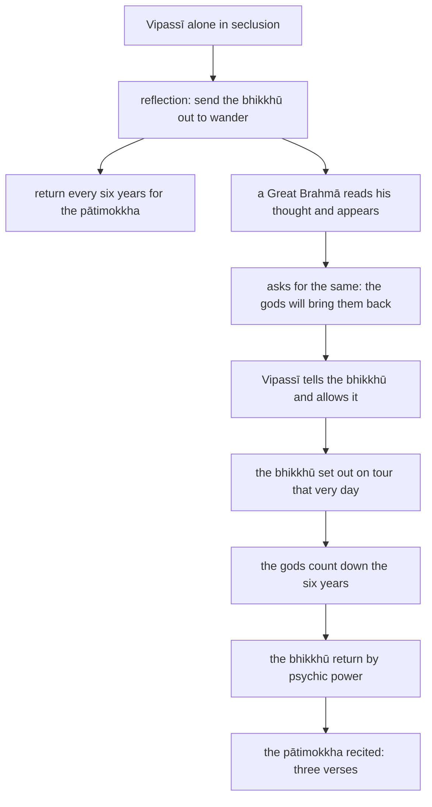

import { Tabs, TabItem } from '@astrojs/starlight/components';

Original text: [World Tipitaka Edition](https://tipitaka2500.github.io/tipitaka/7D/1/1.16.html)

## Summary

With six million eight hundred thousand bhikkhū gathered in the royal capital Bandhumatī, Vipassī the Bhagavā reflects that he should send them out to wander for the welfare of the many, no two by one way, and have them return every six years to recite the `pātimokkha`. A Great Brahmā reads his thought, appears, asks for the same and promises that the gods will bring the bhikkhū back in time. Vipassī allows it; the bhikkhū disperse, the gods count down the years, and on their return he recites the `pātimokkha` in three verses.

## Diagram

## Text

<Tabs syncKey="paliquote">
<TabItem label="My Translation">
(86.)

171\. Now at that time, Bhikkhave, a great Saṅgha of bhikkhū was staying in the royal capital Bandhumatī, six million eight hundred thousand bhikkhū. Then, Bhikkhave, while Vipassī the Bhagavā, the `arahant` (liberated one), the `sammāsambuddha` (perfectly awakened one), was alone in seclusion, this reflection arose in his mind: ‘A great Saṅgha of bhikkhū is now staying in the royal capital Bandhumatī, six million eight hundred thousand bhikkhū; what if I were to allow the bhikkhū: “Wander, Bhikkhave, on tour for the welfare of the many, for the happiness of the many, out of compassion for the world, for the good, welfare, and happiness of devas (deities) and humans; Let not two go by one [way]. Teach, Bhikkhave, the `Dhamma` (doctrine) that is good in the beginning, good in the middle, and good in the end, meaningful and well-phrased; make known the `brahmacariya` (the optimal life) that is wholly complete and perfectly pure. There are beings `apparajakkhajātikā` (with little dust in their eyes by nature) who are wasting away through not hearing the `Dhamma` (doctrine), and there will be those who understand the `Dhamma`. And moreover, after the passing of every six years, the royal capital Bandhumatī should be approached for the recitation of the `pātimokkha` (precepts for monastics).”’

(87.)

172\. Then, Bhikkhave, a certain Great Brahmā, knowing with his own mind the thought process of Vipassī the Bhagavā, the `arahant`, the `sammāsambuddha` — just as a strong man might extend his flexed arm or flex his extended arm; even so — having vanished from the Brahmā world, appeared before Vipassī the Bhagavā, the `arahant`, the `sammāsambuddha`. Then, Bhikkhave, that Great Brahmā, arranging his upper robe over one shoulder and extending his clasped hands towards Vipassī the Bhagavā, the `arahant`, the `sammāsambuddha`, said this to Vipassī the Bhagavā, the `arahant`, the `sammāsambuddha`: ‘So it is, Bhagavā, so it is, Sugata (Fortunate One). A great Saṅgha of bhikkhū, Bhante, is now staying in the royal capital Bandhumatī, six million eight hundred thousand bhikkhū; may the Bhagavā, Bhante, allow the bhikkhū: “Wander, Bhikkhave, on tour for the welfare of the many, for the happiness of the many, out of compassion for the world, for the good, welfare, and happiness of devas (deities) and humans; Let not two go by one [way]. Teach, Bhikkhave, the `Dhamma` (doctrine) that is good in the beginning, good in the middle, and good in the end, meaningful and well-phrased; make known the `brahmacariya` (the optimal life) that is wholly complete and perfectly pure. There are beings `apparajakkhajātikā` (with little dust in their eyes by nature) who are wasting away through not hearing the `dhamma`, and there will be those who understand the `dhamma`.” And moreover, Bhante, we will act so that the bhikkhū will approach the royal capital Bandhumatī after the passing of every six years for the recitation of the `pātimokkha`.’ That Great Brahmā said this, Bhikkhave. Having said this, he bowed to Vipassī the Bhagavā, the `arahant`, the `sammāsambuddha`, circumambulated him keeping his right side towards him, and vanished right there.

(88.)

173\. Then, Bhikkhave, Vipassī the Bhagavā, the `arahant`, the `sammāsambuddha`, having risen from seclusion in the evening, addressed the bhikkhū: ‘Here, Bhikkhave, while I was alone in seclusion, this reflection arose in my mind: “A great Saṅgha of bhikkhū is now staying in the royal capital Bandhumatī, six million eight hundred thousand bhikkhū. What if I were to allow the bhikkhū: Wander, Bhikkhave, on tour for the welfare of the many, for the happiness of the many, out of compassion for the world, for the good, welfare, and happiness of devas (deities) and humans; Let not two go by one [way]. Teach, Bhikkhave, the `Dhamma` (doctrine) that is good in the beginning, good in the middle, and good in the end, meaningful and well-phrased; make known the `brahmacariya` (the optimal life) that is wholly complete and perfectly pure. There are beings `apparajakkhajātikā` (with little dust in their eyes by nature) who are wasting away through not hearing the `Dhamma` (doctrine), and there will be those who understand the `Dhamma`. And moreover, after the passing of every six years, the royal capital Bandhumatī should be approached for the recitation of the `pātimokkha`.”’

174\. Then, Bhikkhave, a certain Great Brahmā, knowing my thought process with his own mind — just as a strong man might extend his flexed arm or flex his extended arm; even so, having vanished from the Brahmā world, appeared before me. Then, Bhikkhave, that Great Brahmā, arranging his upper robe over one shoulder, and having extended his clasped hands towards me, said this to me: ‘So it is, Bhagavā, so it is, Sugata (Fortunate One). A great Saṅgha of bhikkhū, Bhante, is now staying in the royal capital Bandhumatī, six million eight hundred thousand bhikkhū. May the Bhagavā, Bhante, allow the bhikkhū: Wander, Bhikkhave, on tour for the welfare of the many, for the happiness of the many, out of compassion for the world, for the good, welfare, and happiness of devas (deities) and humans; Let not two go by one [way]. Teach, Bhikkhave, the `Dhamma` (doctrine) … and so on … there are beings `apparajakkhajātikā` (with little dust in their eyes by nature) who are wasting away through not hearing the `Dhamma` (doctrine), and there will be those who understand the `Dhamma`. And moreover, Bhante, we will act so that the bhikkhū will approach the royal capital Bandhumatī after the passing of every six years for the recitation of the `pātimokkha`.’ That Great Brahmā said this, Bhikkhave. Having said this, he bowed to me, circumambulated me keeping his right side towards me, and vanished right there.

175\. ‘I allow, Bhikkhave: wander on tour for the welfare of the many, for the happiness of the many, out of compassion for the world, for the good, welfare, and happiness of devas (deities) and humans; Let not two go by one [way]. Teach, Bhikkhave, the `Dhamma` (doctrine) that is good in the beginning, good in the middle, and good in the end, meaningful and well-phrased; make known the `brahmacariya` (the optimal life) that is wholly complete and perfectly pure. There are beings `apparajakkhajātikā` (with little dust in their eyes by nature) who are wasting away through not hearing the `Dhamma` (doctrine), and there will be those who understand the `Dhamma`. And moreover, Bhikkhave, after the passing of every six years, the royal capital Bandhumatī should be approached for the recitation of the `pātimokkha`.’ Then, Bhikkhave, the bhikkhū, for the most part on that very day, set out on a tour of the country.

(89.)

176\. Now at that time there were eighty-four thousand dwellings in Jambudīpa. For when one year had passed, the gods raised a cry: ‘One year has passed, Mārisā (venerable sirs); five years now remain; after the passing of five years the royal capital Bandhumatī should be approached for the recitation of the `pātimokkha`.’ When two years had passed … when three years had passed … when four years had passed … when five years had passed, the gods raised a cry: ‘Five years have passed, Mārisā; one year now remains; after the passing of one year the royal capital Bandhumatī should be approached for the recitation of the `pātimokkha`.’ When six years had passed, the gods raised a cry: ‘Six years have passed, Mārisā; it is now time to approach the royal capital Bandhumatī for the recitation of the `pātimokkha`.’ Then, Bhikkhave, those bhikkhū, some by their own psychic power, some by the psychic power of the gods, approached the royal capital Bandhumatī that very day for the recitation of the `pātimokkha`.

(90.)

177\. There, Bhikkhave, Vipassī the Bhagavā, the `arahant`, the `sammāsambuddha`, recited the `pātimokkha` in the Saṅgha of bhikkhū thus:

178\. _‘Patience, forbearance, is the supreme austerity,_ \
_The Buddhas say `nibbāna` (extinguishment) is supreme;_ \
_For one who harms others is not one gone forth,_ \
_One troubling another is not a `samaṇa` (wanderer)._

179\. _Non-doing of all wrongdoing,_ \
_taking up wholesome (thoughts);_ \
_Purifying one's own mind,_ \
_this is the teaching of the Buddhas._

180\. _Not blaming, not harming,_ \
_And restraint in the `pātimokkha`;_ \
_And moderation in food,_ \
_And a secluded living place;_ \
_And devotion to `adhicitta` (the higher mind),_ \
_This is the teaching of the Buddhas.’_
</TabItem>

<TabItem label="Pāḷi (Roman IAST)">
(86.)

171\. Tena kho pana, bhikkhave, samayena bandhumatiyā rājadhāniyā mahābhikkhusaṃgho paṭivasati aṭṭhasaṭṭhibhikkhusatasahassaṃ. Atha kho, bhikkhave, vipassissa bhagavato arahato sammāsambuddhassa rahogatassa paṭisallīnassa evaṃ cetaso parivitakko udapādi— ‘mahā kho etarahi bhikkhusaṃgho bandhumatiyā rājadhāniyā paṭivasati aṭṭhasaṭṭhibhikkhusatasahassaṃ, yannūnāhaṃ bhikkhū anujāneyyaṃ— “caratha, bhikkhave, cārikaṃ bahujanahitāya bahujanasukhāya lokānukampāya atthāya hitāya sukhāya devamanussānaṃ; mā ekena dve agamittha; desetha, bhikkhave, dhammaṃ ādikalyāṇaṃ majjhekalyāṇaṃ pariyosānakalyāṇaṃ sātthaṃ sabyañjanaṃ kevalaparipuṇṇaṃ parisuddhaṃ brahmacariyaṃ pakāsetha. Santi sattā apparajakkhajātikā, assavanatā dhammassa parihāyanti, bhavissanti dhammassa aññātāro. Api ca channaṃ channaṃ vassānaṃ accayena bandhumatī rājadhānī upasaṅkamitabbā pātimokkhuddesāyā”’ti.

(87.)

172\. Atha kho, bhikkhave, aññataro mahābrahmā vipassissa bhagavato arahato sammāsambuddhassa cetasā cetoparivitakkamaññāya seyyathāpi nāma balavā puriso samiñjitaṃ vā bāhaṃ pasāreyya, pasāritaṃ vā bāhaṃ samiñjeyya; evameva— brahmaloke antarahito vipassissa bhagavato arahato sammāsambuddhassa purato pāturahosi. Atha kho so, bhikkhave, mahābrahmā ekaṃsaṃ uttarāsaṅgaṃ karitvā yena vipassī bhagavā arahaṃ sammāsambuddho tenañjaliṃ paṇāmetvā vipassiṃ bhagavantaṃ arahantaṃ sammāsambuddhaṃ etadavoca— ‘evametaṃ, bhagavā, evametaṃ, sugata. Mahā kho, bhante, etarahi bhikkhusaṃgho bandhumatiyā rājadhāniyā paṭivasati aṭṭhasaṭṭhibhikkhusatasahassaṃ, anujānātu, bhante, bhagavā bhikkhū— “caratha, bhikkhave, cārikaṃ bahujanahitāya bahujanasukhāya lokānukampāya atthāya hitāya sukhāya devamanussānaṃ; mā ekena dve agamittha; desetha, bhikkhave, dhammaṃ ādikalyāṇaṃ majjhekalyāṇaṃ pariyosānakalyāṇaṃ sātthaṃ sabyañjanaṃ kevalaparipuṇṇaṃ parisuddhaṃ brahmacariyaṃ pakāsetha. Santi sattā apparajakkhajātikā, assavanatā dhammassa parihāyanti, bhavissanti dhammassa aññātāro”ti. Api ca, bhante, mayaṃ tathā karissāma yathā bhikkhū channaṃ channaṃ vassānaṃ accayena bandhumatiṃ rājadhāniṃ upasaṅkamissanti pātimokkhuddesāyā’ti. Idamavoca, bhikkhave, so mahābrahmā. Idaṃ vatvā vipassiṃ bhagavantaṃ arahantaṃ sammāsambuddhaṃ abhivādetvā padakkhiṇaṃ katvā tattheva antaradhāyi.

(88.)

173\. Atha kho, bhikkhave, vipassī bhagavā arahaṃ sammāsambuddho sāyanhasamayaṃ paṭisallānā vuṭṭhito bhikkhū āmantesi— ‘idha mayhaṃ, bhikkhave, rahogatassa paṭisallīnassa evaṃ cetaso parivitakko udapādi— “mahā kho etarahi bhikkhusaṃgho bandhumatiyā rājadhāniyā paṭivasati aṭṭhasaṭṭhibhikkhusatasahassaṃ. Yannūnāhaṃ bhikkhū anujāneyyaṃ— caratha, bhikkhave, cārikaṃ bahujanahitāya bahujanasukhāya lokānukampāya atthāya hitāya sukhāya devamanussānaṃ; mā ekena dve agamittha; desetha, bhikkhave, dhammaṃ ādikalyāṇaṃ majjhekalyāṇaṃ pariyosānakalyāṇaṃ sātthaṃ sabyañjanaṃ kevalaparipuṇṇaṃ parisuddhaṃ brahmacariyaṃ pakāsetha. Santi sattā apparajakkhajātikā, assavanatā dhammassa parihāyanti, bhavissanti dhammassa aññātāro. Api ca channaṃ channaṃ vassānaṃ accayena bandhumatī rājadhānī upasaṅkamitabbā pātimokkhuddesāyā”’ti.

174\. Atha kho, bhikkhave, aññataro mahābrahmā mama cetasā cetoparivitakkamaññāya seyyathāpi nāma balavā puriso samiñjitaṃ vā bāhaṃ pasāreyya, pasāritaṃ vā bāhaṃ samiñjeyya; evameva— brahmaloke antarahito mama purato pāturahosi. Atha kho so, bhikkhave, mahābrahmā ekaṃsaṃ uttarāsaṅgaṃ karitvā yenāhaṃ tenañjaliṃ paṇāmetvā maṃ etadavoca— ‘evametaṃ, bhagavā, evametaṃ, sugata. Mahā kho, bhante, etarahi bhikkhusaṃgho bandhumatiyā rājadhāniyā paṭivasati aṭṭhasaṭṭhibhikkhusatasahassaṃ. Anujānātu, bhante, bhagavā bhikkhū— caratha, bhikkhave, cārikaṃ bahujanahitāya bahujanasukhāya lokānukampāya atthāya hitāya sukhāya devamanussānaṃ; mā ekena dve agamittha; desetha, bhikkhave, dhammaṃ…pe… santi sattā apparajakkhajātikā, assavanatā dhammassa parihāyanti, bhavissanti dhammassa aññātāroti. Api ca, bhante, mayaṃ tathā karissāma, yathā bhikkhū channaṃ channaṃ vassānaṃ accayena bandhumatiṃ rājadhāniṃ upasaṅkamissanti pātimokkhuddesāyā’ti. Idamavoca, bhikkhave, so mahābrahmā. Idaṃ vatvā maṃ abhivādetvā padakkhiṇaṃ katvā tattheva antaradhāyi.

175\. ‘Anujānāmi, bhikkhave, caratha cārikaṃ bahujanahitāya bahujanasukhāya lokānukampāya atthāya hitāya sukhāya devamanussānaṃ; mā ekena dve agamittha; desetha, bhikkhave, dhammaṃ ādikalyāṇaṃ majjhekalyāṇaṃ pariyosānakalyāṇaṃ sātthaṃ sabyañjanaṃ kevalaparipuṇṇaṃ parisuddhaṃ brahmacariyaṃ pakāsetha. Santi sattā apparajakkhajātikā, assavanatā dhammassa parihāyanti, bhavissanti dhammassa aññātāro. Api ca, bhikkhave, channaṃ channaṃ vassānaṃ accayena bandhumatī rājadhānī upasaṅkamitabbā pātimokkhuddesāyā’ti. Atha kho, bhikkhave, bhikkhū yebhuyyena ekāheneva janapadacārikaṃ pakkamiṃsu.

(89.)

176\. Tena kho pana samayena jambudīpe caturāsīti āvāsasahassāni honti. Ekamhi hi vasse nikkhante devatā saddamanussāvesuṃ— ‘nikkhantaṃ kho, mārisā, ekaṃ vassaṃ; pañca dāni vassāni sesāni; pañcannaṃ vassānaṃ accayena bandhumatī rājadhānī upasaṅkamitabbā pātimokkhuddesāyā’ti. Dvīsu vassesu nikkhantesu… tīsu vassesu nikkhantesu… catūsu vassesu nikkhantesu… pañcasu vassesu nikkhantesu devatā saddamanussāvesuṃ— ‘nikkhantāni kho, mārisā, pañcavassāni; ekaṃ dāni vassaṃ sesaṃ; ekassa vassassa accayena bandhumatī rājadhānī upasaṅkamitabbā pātimokkhuddesāyā’ti. Chasu vassesu nikkhantesu devatā saddamanussāvesuṃ— ‘nikkhantāni kho, mārisā, chabbassāni, samayo dāni bandhumatiṃ rājadhāniṃ upasaṅkamituṃ pātimokkhuddesāyā’ti. Atha kho te, bhikkhave, bhikkhū appekacce sakena iddhānubhāvena appekacce devatānaṃ iddhānubhāvena ekāheneva bandhumatiṃ rājadhāniṃ upasaṅkamiṃsu pātimokkhuddesāyāti.

(90.)

177\. Tatra sudaṃ, bhikkhave, vipassī bhagavā arahaṃ sammāsambuddho bhikkhusaṃghe evaṃ pātimokkhaṃ uddisati—

178\. _‘Khantī paramaṃ tapo titikkhā,_  
_Nibbānaṃ paramaṃ vadanti buddhā;_  
_Na hi pabbajito parūpaghātī,_  
_Na samaṇo hoti paraṃ viheṭhayanto._

179\. _Sabbapāpassa akaraṇaṃ,_  
_kusalassa upasampadā;_  
_Sacittapariyodapanaṃ,_  
_etaṃ buddhānasāsanaṃ._

180\. _Anūpavādo anūpaghāto,_  
_Pātimokkhe ca saṃvaro;_  
_Mattaññutā ca bhattasmiṃ,_  
_Pantañca sayanāsanaṃ;_  
_Adhicitte ca āyogo,_  
_Etaṃ buddhānasāsanan’ti._
</TabItem>

<TabItem label="Pāḷi (Brahmi)">
(86.)

171\. 𑀢𑁂𑀦 𑀔𑁄 𑀧𑀦, 𑀪𑀺𑀓𑁆𑀔𑀯𑁂, 𑀲𑀫𑀬𑁂𑀦 𑀩𑀦𑁆𑀥𑀼𑀫𑀢𑀺𑀬𑀸 𑀭𑀸𑀚𑀥𑀸𑀦𑀺𑀬𑀸 𑀫𑀳𑀸𑀪𑀺𑀓𑁆𑀔𑀼𑀲𑀁𑀖𑁄 𑀧𑀝𑀺𑀯𑀲𑀢𑀺 𑀅𑀝𑁆𑀞𑀲𑀝𑁆𑀞𑀺𑀪𑀺𑀓𑁆𑀔𑀼𑀲𑀢𑀲𑀳𑀲𑁆𑀲𑀁. 𑀅𑀣 𑀔𑁄, 𑀪𑀺𑀓𑁆𑀔𑀯𑁂, 𑀯𑀺𑀧𑀲𑁆𑀲𑀺𑀲𑁆𑀲 𑀪𑀕𑀯𑀢𑁄 𑀅𑀭𑀳𑀢𑁄 𑀲𑀫𑁆𑀫𑀸𑀲𑀫𑁆𑀩𑀼𑀤𑁆𑀥𑀲𑁆𑀲 𑀭𑀳𑁄𑀕𑀢𑀲𑁆𑀲 𑀧𑀝𑀺𑀲𑀮𑁆𑀮𑀻𑀦𑀲𑁆𑀲 𑀏𑀯𑀁 𑀘𑁂𑀢𑀲𑁄 𑀧𑀭𑀺𑀯𑀺𑀢𑀓𑁆𑀓𑁄 𑀉𑀤𑀧𑀸𑀤𑀺— ‘𑀫𑀳𑀸 𑀔𑁄 𑀏𑀢𑀭𑀳𑀺 𑀪𑀺𑀓𑁆𑀔𑀼𑀲𑀁𑀖𑁄 𑀩𑀦𑁆𑀥𑀼𑀫𑀢𑀺𑀬𑀸 𑀭𑀸𑀚𑀥𑀸𑀦𑀺𑀬𑀸 𑀧𑀝𑀺𑀯𑀲𑀢𑀺 𑀅𑀝𑁆𑀞𑀲𑀝𑁆𑀞𑀺𑀪𑀺𑀓𑁆𑀔𑀼𑀲𑀢𑀲𑀳𑀲𑁆𑀲𑀁, 𑀬𑀦𑁆𑀦𑀽𑀦𑀸𑀳𑀁 𑀪𑀺𑀓𑁆𑀔𑀽 𑀅𑀦𑀼𑀚𑀸𑀦𑁂𑀬𑁆𑀬𑀁— “𑀘𑀭𑀣, 𑀪𑀺𑀓𑁆𑀔𑀯𑁂, 𑀘𑀸𑀭𑀺𑀓𑀁 𑀩𑀳𑀼𑀚𑀦𑀳𑀺𑀢𑀸𑀬 𑀩𑀳𑀼𑀚𑀦𑀲𑀼𑀔𑀸𑀬 𑀮𑁄𑀓𑀸𑀦𑀼𑀓𑀫𑁆𑀧𑀸𑀬 𑀅𑀢𑁆𑀣𑀸𑀬 𑀳𑀺𑀢𑀸𑀬 𑀲𑀼𑀔𑀸𑀬 𑀤𑁂𑀯𑀫𑀦𑀼𑀲𑁆𑀲𑀸𑀦𑀁; 𑀫𑀸 𑀏𑀓𑁂𑀦 𑀤𑁆𑀯𑁂 𑀅𑀕𑀫𑀺𑀢𑁆𑀣; 𑀤𑁂𑀲𑁂𑀣, 𑀪𑀺𑀓𑁆𑀔𑀯𑁂, 𑀥𑀫𑁆𑀫𑀁 𑀆𑀤𑀺𑀓𑀮𑁆𑀬𑀸𑀡𑀁 𑀫𑀚𑁆𑀛𑁂𑀓𑀮𑁆𑀬𑀸𑀡𑀁 𑀧𑀭𑀺𑀬𑁄𑀲𑀸𑀦𑀓𑀮𑁆𑀬𑀸𑀡𑀁 𑀲𑀸𑀢𑁆𑀣𑀁 𑀲𑀩𑁆𑀬𑀜𑁆𑀚𑀦𑀁 𑀓𑁂𑀯𑀮𑀧𑀭𑀺𑀧𑀼𑀡𑁆𑀡𑀁 𑀧𑀭𑀺𑀲𑀼𑀤𑁆𑀥𑀁 𑀩𑁆𑀭𑀳𑁆𑀫𑀘𑀭𑀺𑀬𑀁 𑀧𑀓𑀸𑀲𑁂𑀣. 𑀲𑀦𑁆𑀢𑀺 𑀲𑀢𑁆𑀢𑀸 𑀅𑀧𑁆𑀧𑀭𑀚𑀓𑁆𑀔𑀚𑀸𑀢𑀺𑀓𑀸, 𑀅𑀲𑁆𑀲𑀯𑀦𑀢𑀸 𑀥𑀫𑁆𑀫𑀲𑁆𑀲 𑀧𑀭𑀺𑀳𑀸𑀬𑀦𑁆𑀢𑀺, 𑀪𑀯𑀺𑀲𑁆𑀲𑀦𑁆𑀢𑀺 𑀥𑀫𑁆𑀫𑀲𑁆𑀲 𑀅𑀜𑁆𑀜𑀸𑀢𑀸𑀭𑁄. 𑀅𑀧𑀺 𑀘 𑀙𑀦𑁆𑀦𑀁 𑀙𑀦𑁆𑀦𑀁 𑀯𑀲𑁆𑀲𑀸𑀦𑀁 𑀅𑀘𑁆𑀘𑀬𑁂𑀦 𑀩𑀦𑁆𑀥𑀼𑀫𑀢𑀻 𑀭𑀸𑀚𑀥𑀸𑀦𑀻 𑀉𑀧𑀲𑀗𑁆𑀓𑀫𑀺𑀢𑀩𑁆𑀩𑀸 𑀧𑀸𑀢𑀺𑀫𑁄𑀓𑁆𑀔𑀼𑀤𑁆𑀤𑁂𑀲𑀸𑀬𑀸”’𑀢𑀺.

(87.)

172\. 𑀅𑀣 𑀔𑁄, 𑀪𑀺𑀓𑁆𑀔𑀯𑁂, 𑀅𑀜𑁆𑀜𑀢𑀭𑁄 𑀫𑀳𑀸𑀩𑁆𑀭𑀳𑁆𑀫𑀸 𑀯𑀺𑀧𑀲𑁆𑀲𑀺𑀲𑁆𑀲 𑀪𑀕𑀯𑀢𑁄 𑀅𑀭𑀳𑀢𑁄 𑀲𑀫𑁆𑀫𑀸𑀲𑀫𑁆𑀩𑀼𑀤𑁆𑀥𑀲𑁆𑀲 𑀘𑁂𑀢𑀲𑀸 𑀘𑁂𑀢𑁄𑀧𑀭𑀺𑀯𑀺𑀢𑀓𑁆𑀓𑀫𑀜𑁆𑀜𑀸𑀬 𑀲𑁂𑀬𑁆𑀬𑀣𑀸𑀧𑀺 𑀦𑀸𑀫 𑀩𑀮𑀯𑀸 𑀧𑀼𑀭𑀺𑀲𑁄 𑀲𑀫𑀺𑀜𑁆𑀚𑀺𑀢𑀁 𑀯𑀸 𑀩𑀸𑀳𑀁 𑀧𑀲𑀸𑀭𑁂𑀬𑁆𑀬, 𑀧𑀲𑀸𑀭𑀺𑀢𑀁 𑀯𑀸 𑀩𑀸𑀳𑀁 𑀲𑀫𑀺𑀜𑁆𑀚𑁂𑀬𑁆𑀬; 𑀏𑀯𑀫𑁂𑀯— 𑀩𑁆𑀭𑀳𑁆𑀫𑀮𑁄𑀓𑁂 𑀅𑀦𑁆𑀢𑀭𑀳𑀺𑀢𑁄 𑀯𑀺𑀧𑀲𑁆𑀲𑀺𑀲𑁆𑀲 𑀪𑀕𑀯𑀢𑁄 𑀅𑀭𑀳𑀢𑁄 𑀲𑀫𑁆𑀫𑀸𑀲𑀫𑁆𑀩𑀼𑀤𑁆𑀥𑀲𑁆𑀲 𑀧𑀼𑀭𑀢𑁄 𑀧𑀸𑀢𑀼𑀭𑀳𑁄𑀲𑀺. 𑀅𑀣 𑀔𑁄 𑀲𑁄, 𑀪𑀺𑀓𑁆𑀔𑀯𑁂, 𑀫𑀳𑀸𑀩𑁆𑀭𑀳𑁆𑀫𑀸 𑀏𑀓𑀁𑀲𑀁 𑀉𑀢𑁆𑀢𑀭𑀸𑀲𑀗𑁆𑀕𑀁 𑀓𑀭𑀺𑀢𑁆𑀯𑀸 𑀬𑁂𑀦 𑀯𑀺𑀧𑀲𑁆𑀲𑀻 𑀪𑀕𑀯𑀸 𑀅𑀭𑀳𑀁 𑀲𑀫𑁆𑀫𑀸𑀲𑀫𑁆𑀩𑀼𑀤𑁆𑀥𑁄 𑀢𑁂𑀦𑀜𑁆𑀚𑀮𑀺𑀁 𑀧𑀡𑀸𑀫𑁂𑀢𑁆𑀯𑀸 𑀯𑀺𑀧𑀲𑁆𑀲𑀺𑀁 𑀪𑀕𑀯𑀦𑁆𑀢𑀁 𑀅𑀭𑀳𑀦𑁆𑀢𑀁 𑀲𑀫𑁆𑀫𑀸𑀲𑀫𑁆𑀩𑀼𑀤𑁆𑀥𑀁 𑀏𑀢𑀤𑀯𑁄𑀘— ‘𑀏𑀯𑀫𑁂𑀢𑀁, 𑀪𑀕𑀯𑀸, 𑀏𑀯𑀫𑁂𑀢𑀁, 𑀲𑀼𑀕𑀢. 𑀫𑀳𑀸 𑀔𑁄, 𑀪𑀦𑁆𑀢𑁂, 𑀏𑀢𑀭𑀳𑀺 𑀪𑀺𑀓𑁆𑀔𑀼𑀲𑀁𑀖𑁄 𑀩𑀦𑁆𑀥𑀼𑀫𑀢𑀺𑀬𑀸 𑀭𑀸𑀚𑀥𑀸𑀦𑀺𑀬𑀸 𑀧𑀝𑀺𑀯𑀲𑀢𑀺 𑀅𑀝𑁆𑀞𑀲𑀝𑁆𑀞𑀺𑀪𑀺𑀓𑁆𑀔𑀼𑀲𑀢𑀲𑀳𑀲𑁆𑀲𑀁, 𑀅𑀦𑀼𑀚𑀸𑀦𑀸𑀢𑀼, 𑀪𑀦𑁆𑀢𑁂, 𑀪𑀕𑀯𑀸 𑀪𑀺𑀓𑁆𑀔𑀽— “𑀘𑀭𑀣, 𑀪𑀺𑀓𑁆𑀔𑀯𑁂, 𑀘𑀸𑀭𑀺𑀓𑀁 𑀩𑀳𑀼𑀚𑀦𑀳𑀺𑀢𑀸𑀬 𑀩𑀳𑀼𑀚𑀦𑀲𑀼𑀔𑀸𑀬 𑀮𑁄𑀓𑀸𑀦𑀼𑀓𑀫𑁆𑀧𑀸𑀬 𑀅𑀢𑁆𑀣𑀸𑀬 𑀳𑀺𑀢𑀸𑀬 𑀲𑀼𑀔𑀸𑀬 𑀤𑁂𑀯𑀫𑀦𑀼𑀲𑁆𑀲𑀸𑀦𑀁; 𑀫𑀸 𑀏𑀓𑁂𑀦 𑀤𑁆𑀯𑁂 𑀅𑀕𑀫𑀺𑀢𑁆𑀣; 𑀤𑁂𑀲𑁂𑀣, 𑀪𑀺𑀓𑁆𑀔𑀯𑁂, 𑀥𑀫𑁆𑀫𑀁 𑀆𑀤𑀺𑀓𑀮𑁆𑀬𑀸𑀡𑀁 𑀫𑀚𑁆𑀛𑁂𑀓𑀮𑁆𑀬𑀸𑀡𑀁 𑀧𑀭𑀺𑀬𑁄𑀲𑀸𑀦𑀓𑀮𑁆𑀬𑀸𑀡𑀁 𑀲𑀸𑀢𑁆𑀣𑀁 𑀲𑀩𑁆𑀬𑀜𑁆𑀚𑀦𑀁 𑀓𑁂𑀯𑀮𑀧𑀭𑀺𑀧𑀼𑀡𑁆𑀡𑀁 𑀧𑀭𑀺𑀲𑀼𑀤𑁆𑀥𑀁 𑀩𑁆𑀭𑀳𑁆𑀫𑀘𑀭𑀺𑀬𑀁 𑀧𑀓𑀸𑀲𑁂𑀣. 𑀲𑀦𑁆𑀢𑀺 𑀲𑀢𑁆𑀢𑀸 𑀅𑀧𑁆𑀧𑀭𑀚𑀓𑁆𑀔𑀚𑀸𑀢𑀺𑀓𑀸, 𑀅𑀲𑁆𑀲𑀯𑀦𑀢𑀸 𑀥𑀫𑁆𑀫𑀲𑁆𑀲 𑀧𑀭𑀺𑀳𑀸𑀬𑀦𑁆𑀢𑀺, 𑀪𑀯𑀺𑀲𑁆𑀲𑀦𑁆𑀢𑀺 𑀥𑀫𑁆𑀫𑀲𑁆𑀲 𑀅𑀜𑁆𑀜𑀸𑀢𑀸𑀭𑁄”𑀢𑀺. 𑀅𑀧𑀺 𑀘, 𑀪𑀦𑁆𑀢𑁂, 𑀫𑀬𑀁 𑀢𑀣𑀸 𑀓𑀭𑀺𑀲𑁆𑀲𑀸𑀫 𑀬𑀣𑀸 𑀪𑀺𑀓𑁆𑀔𑀽 𑀙𑀦𑁆𑀦𑀁 𑀙𑀦𑁆𑀦𑀁 𑀯𑀲𑁆𑀲𑀸𑀦𑀁 𑀅𑀘𑁆𑀘𑀬𑁂𑀦 𑀩𑀦𑁆𑀥𑀼𑀫𑀢𑀺𑀁 𑀭𑀸𑀚𑀥𑀸𑀦𑀺𑀁 𑀉𑀧𑀲𑀗𑁆𑀓𑀫𑀺𑀲𑁆𑀲𑀦𑁆𑀢𑀺 𑀧𑀸𑀢𑀺𑀫𑁄𑀓𑁆𑀔𑀼𑀤𑁆𑀤𑁂𑀲𑀸𑀬𑀸’𑀢𑀺. 𑀇𑀤𑀫𑀯𑁄𑀘, 𑀪𑀺𑀓𑁆𑀔𑀯𑁂, 𑀲𑁄 𑀫𑀳𑀸𑀩𑁆𑀭𑀳𑁆𑀫𑀸. 𑀇𑀤𑀁 𑀯𑀢𑁆𑀯𑀸 𑀯𑀺𑀧𑀲𑁆𑀲𑀺𑀁 𑀪𑀕𑀯𑀦𑁆𑀢𑀁 𑀅𑀭𑀳𑀦𑁆𑀢𑀁 𑀲𑀫𑁆𑀫𑀸𑀲𑀫𑁆𑀩𑀼𑀤𑁆𑀥𑀁 𑀅𑀪𑀺𑀯𑀸𑀤𑁂𑀢𑁆𑀯𑀸 𑀧𑀤𑀓𑁆𑀔𑀺𑀡𑀁 𑀓𑀢𑁆𑀯𑀸 𑀢𑀢𑁆𑀣𑁂𑀯 𑀅𑀦𑁆𑀢𑀭𑀥𑀸𑀬𑀺.

(88.)

173\. 𑀅𑀣 𑀔𑁄, 𑀪𑀺𑀓𑁆𑀔𑀯𑁂, 𑀯𑀺𑀧𑀲𑁆𑀲𑀻 𑀪𑀕𑀯𑀸 𑀅𑀭𑀳𑀁 𑀲𑀫𑁆𑀫𑀸𑀲𑀫𑁆𑀩𑀼𑀤𑁆𑀥𑁄 𑀲𑀸𑀬𑀦𑁆𑀳𑀲𑀫𑀬𑀁 𑀧𑀝𑀺𑀲𑀮𑁆𑀮𑀸𑀦𑀸 𑀯𑀼𑀝𑁆𑀞𑀺𑀢𑁄 𑀪𑀺𑀓𑁆𑀔𑀽 𑀆𑀫𑀦𑁆𑀢𑁂𑀲𑀺— ‘𑀇𑀥 𑀫𑀬𑁆𑀳𑀁, 𑀪𑀺𑀓𑁆𑀔𑀯𑁂, 𑀭𑀳𑁄𑀕𑀢𑀲𑁆𑀲 𑀧𑀝𑀺𑀲𑀮𑁆𑀮𑀻𑀦𑀲𑁆𑀲 𑀏𑀯𑀁 𑀘𑁂𑀢𑀲𑁄 𑀧𑀭𑀺𑀯𑀺𑀢𑀓𑁆𑀓𑁄 𑀉𑀤𑀧𑀸𑀤𑀺— “𑀫𑀳𑀸 𑀔𑁄 𑀏𑀢𑀭𑀳𑀺 𑀪𑀺𑀓𑁆𑀔𑀼𑀲𑀁𑀖𑁄 𑀩𑀦𑁆𑀥𑀼𑀫𑀢𑀺𑀬𑀸 𑀭𑀸𑀚𑀥𑀸𑀦𑀺𑀬𑀸 𑀧𑀝𑀺𑀯𑀲𑀢𑀺 𑀅𑀝𑁆𑀞𑀲𑀝𑁆𑀞𑀺𑀪𑀺𑀓𑁆𑀔𑀼𑀲𑀢𑀲𑀳𑀲𑁆𑀲𑀁. 𑀬𑀦𑁆𑀦𑀽𑀦𑀸𑀳𑀁 𑀪𑀺𑀓𑁆𑀔𑀽 𑀅𑀦𑀼𑀚𑀸𑀦𑁂𑀬𑁆𑀬𑀁— 𑀘𑀭𑀣, 𑀪𑀺𑀓𑁆𑀔𑀯𑁂, 𑀘𑀸𑀭𑀺𑀓𑀁 𑀩𑀳𑀼𑀚𑀦𑀳𑀺𑀢𑀸𑀬 𑀩𑀳𑀼𑀚𑀦𑀲𑀼𑀔𑀸𑀬 𑀮𑁄𑀓𑀸𑀦𑀼𑀓𑀫𑁆𑀧𑀸𑀬 𑀅𑀢𑁆𑀣𑀸𑀬 𑀳𑀺𑀢𑀸𑀬 𑀲𑀼𑀔𑀸𑀬 𑀤𑁂𑀯𑀫𑀦𑀼𑀲𑁆𑀲𑀸𑀦𑀁; 𑀫𑀸 𑀏𑀓𑁂𑀦 𑀤𑁆𑀯𑁂 𑀅𑀕𑀫𑀺𑀢𑁆𑀣; 𑀤𑁂𑀲𑁂𑀣, 𑀪𑀺𑀓𑁆𑀔𑀯𑁂, 𑀥𑀫𑁆𑀫𑀁 𑀆𑀤𑀺𑀓𑀮𑁆𑀬𑀸𑀡𑀁 𑀫𑀚𑁆𑀛𑁂𑀓𑀮𑁆𑀬𑀸𑀡𑀁 𑀧𑀭𑀺𑀬𑁄𑀲𑀸𑀦𑀓𑀮𑁆𑀬𑀸𑀡𑀁 𑀲𑀸𑀢𑁆𑀣𑀁 𑀲𑀩𑁆𑀬𑀜𑁆𑀚𑀦𑀁 𑀓𑁂𑀯𑀮𑀧𑀭𑀺𑀧𑀼𑀡𑁆𑀡𑀁 𑀧𑀭𑀺𑀲𑀼𑀤𑁆𑀥𑀁 𑀩𑁆𑀭𑀳𑁆𑀫𑀘𑀭𑀺𑀬𑀁 𑀧𑀓𑀸𑀲𑁂𑀣. 𑀲𑀦𑁆𑀢𑀺 𑀲𑀢𑁆𑀢𑀸 𑀅𑀧𑁆𑀧𑀭𑀚𑀓𑁆𑀔𑀚𑀸𑀢𑀺𑀓𑀸, 𑀅𑀲𑁆𑀲𑀯𑀦𑀢𑀸 𑀥𑀫𑁆𑀫𑀲𑁆𑀲 𑀧𑀭𑀺𑀳𑀸𑀬𑀦𑁆𑀢𑀺, 𑀪𑀯𑀺𑀲𑁆𑀲𑀦𑁆𑀢𑀺 𑀥𑀫𑁆𑀫𑀲𑁆𑀲 𑀅𑀜𑁆𑀜𑀸𑀢𑀸𑀭𑁄. 𑀅𑀧𑀺 𑀘 𑀙𑀦𑁆𑀦𑀁 𑀙𑀦𑁆𑀦𑀁 𑀯𑀲𑁆𑀲𑀸𑀦𑀁 𑀅𑀘𑁆𑀘𑀬𑁂𑀦 𑀩𑀦𑁆𑀥𑀼𑀫𑀢𑀻 𑀭𑀸𑀚𑀥𑀸𑀦𑀻 𑀉𑀧𑀲𑀗𑁆𑀓𑀫𑀺𑀢𑀩𑁆𑀩𑀸 𑀧𑀸𑀢𑀺𑀫𑁄𑀓𑁆𑀔𑀼𑀤𑁆𑀤𑁂𑀲𑀸𑀬𑀸”’𑀢𑀺.

174\. 𑀅𑀣 𑀔𑁄, 𑀪𑀺𑀓𑁆𑀔𑀯𑁂, 𑀅𑀜𑁆𑀜𑀢𑀭𑁄 𑀫𑀳𑀸𑀩𑁆𑀭𑀳𑁆𑀫𑀸 𑀫𑀫 𑀘𑁂𑀢𑀲𑀸 𑀘𑁂𑀢𑁄𑀧𑀭𑀺𑀯𑀺𑀢𑀓𑁆𑀓𑀫𑀜𑁆𑀜𑀸𑀬 𑀲𑁂𑀬𑁆𑀬𑀣𑀸𑀧𑀺 𑀦𑀸𑀫 𑀩𑀮𑀯𑀸 𑀧𑀼𑀭𑀺𑀲𑁄 𑀲𑀫𑀺𑀜𑁆𑀚𑀺𑀢𑀁 𑀯𑀸 𑀩𑀸𑀳𑀁 𑀧𑀲𑀸𑀭𑁂𑀬𑁆𑀬, 𑀧𑀲𑀸𑀭𑀺𑀢𑀁 𑀯𑀸 𑀩𑀸𑀳𑀁 𑀲𑀫𑀺𑀜𑁆𑀚𑁂𑀬𑁆𑀬; 𑀏𑀯𑀫𑁂𑀯— 𑀩𑁆𑀭𑀳𑁆𑀫𑀮𑁄𑀓𑁂 𑀅𑀦𑁆𑀢𑀭𑀳𑀺𑀢𑁄 𑀫𑀫 𑀧𑀼𑀭𑀢𑁄 𑀧𑀸𑀢𑀼𑀭𑀳𑁄𑀲𑀺. 𑀅𑀣 𑀔𑁄 𑀲𑁄, 𑀪𑀺𑀓𑁆𑀔𑀯𑁂, 𑀫𑀳𑀸𑀩𑁆𑀭𑀳𑁆𑀫𑀸 𑀏𑀓𑀁𑀲𑀁 𑀉𑀢𑁆𑀢𑀭𑀸𑀲𑀗𑁆𑀕𑀁 𑀓𑀭𑀺𑀢𑁆𑀯𑀸 𑀬𑁂𑀦𑀸𑀳𑀁 𑀢𑁂𑀦𑀜𑁆𑀚𑀮𑀺𑀁 𑀧𑀡𑀸𑀫𑁂𑀢𑁆𑀯𑀸 𑀫𑀁 𑀏𑀢𑀤𑀯𑁄𑀘— ‘𑀏𑀯𑀫𑁂𑀢𑀁, 𑀪𑀕𑀯𑀸, 𑀏𑀯𑀫𑁂𑀢𑀁, 𑀲𑀼𑀕𑀢. 𑀫𑀳𑀸 𑀔𑁄, 𑀪𑀦𑁆𑀢𑁂, 𑀏𑀢𑀭𑀳𑀺 𑀪𑀺𑀓𑁆𑀔𑀼𑀲𑀁𑀖𑁄 𑀩𑀦𑁆𑀥𑀼𑀫𑀢𑀺𑀬𑀸 𑀭𑀸𑀚𑀥𑀸𑀦𑀺𑀬𑀸 𑀧𑀝𑀺𑀯𑀲𑀢𑀺 𑀅𑀝𑁆𑀞𑀲𑀝𑁆𑀞𑀺𑀪𑀺𑀓𑁆𑀔𑀼𑀲𑀢𑀲𑀳𑀲𑁆𑀲𑀁. 𑀅𑀦𑀼𑀚𑀸𑀦𑀸𑀢𑀼, 𑀪𑀦𑁆𑀢𑁂, 𑀪𑀕𑀯𑀸 𑀪𑀺𑀓𑁆𑀔𑀽— 𑀘𑀭𑀣, 𑀪𑀺𑀓𑁆𑀔𑀯𑁂, 𑀘𑀸𑀭𑀺𑀓𑀁 𑀩𑀳𑀼𑀚𑀦𑀳𑀺𑀢𑀸𑀬 𑀩𑀳𑀼𑀚𑀦𑀲𑀼𑀔𑀸𑀬 𑀮𑁄𑀓𑀸𑀦𑀼𑀓𑀫𑁆𑀧𑀸𑀬 𑀅𑀢𑁆𑀣𑀸𑀬 𑀳𑀺𑀢𑀸𑀬 𑀲𑀼𑀔𑀸𑀬 𑀤𑁂𑀯𑀫𑀦𑀼𑀲𑁆𑀲𑀸𑀦𑀁; 𑀫𑀸 𑀏𑀓𑁂𑀦 𑀤𑁆𑀯𑁂 𑀅𑀕𑀫𑀺𑀢𑁆𑀣; 𑀤𑁂𑀲𑁂𑀣, 𑀪𑀺𑀓𑁆𑀔𑀯𑁂, 𑀥𑀫𑁆𑀫𑀁…𑀧𑁂… 𑀲𑀦𑁆𑀢𑀺 𑀲𑀢𑁆𑀢𑀸 𑀅𑀧𑁆𑀧𑀭𑀚𑀓𑁆𑀔𑀚𑀸𑀢𑀺𑀓𑀸, 𑀅𑀲𑁆𑀲𑀯𑀦𑀢𑀸 𑀥𑀫𑁆𑀫𑀲𑁆𑀲 𑀧𑀭𑀺𑀳𑀸𑀬𑀦𑁆𑀢𑀺, 𑀪𑀯𑀺𑀲𑁆𑀲𑀦𑁆𑀢𑀺 𑀥𑀫𑁆𑀫𑀲𑁆𑀲 𑀅𑀜𑁆𑀜𑀸𑀢𑀸𑀭𑁄𑀢𑀺. 𑀅𑀧𑀺 𑀘, 𑀪𑀦𑁆𑀢𑁂, 𑀫𑀬𑀁 𑀢𑀣𑀸 𑀓𑀭𑀺𑀲𑁆𑀲𑀸𑀫, 𑀬𑀣𑀸 𑀪𑀺𑀓𑁆𑀔𑀽 𑀙𑀦𑁆𑀦𑀁 𑀙𑀦𑁆𑀦𑀁 𑀯𑀲𑁆𑀲𑀸𑀦𑀁 𑀅𑀘𑁆𑀘𑀬𑁂𑀦 𑀩𑀦𑁆𑀥𑀼𑀫𑀢𑀺𑀁 𑀭𑀸𑀚𑀥𑀸𑀦𑀺𑀁 𑀉𑀧𑀲𑀗𑁆𑀓𑀫𑀺𑀲𑁆𑀲𑀦𑁆𑀢𑀺 𑀧𑀸𑀢𑀺𑀫𑁄𑀓𑁆𑀔𑀼𑀤𑁆𑀤𑁂𑀲𑀸𑀬𑀸’𑀢𑀺. 𑀇𑀤𑀫𑀯𑁄𑀘, 𑀪𑀺𑀓𑁆𑀔𑀯𑁂, 𑀲𑁄 𑀫𑀳𑀸𑀩𑁆𑀭𑀳𑁆𑀫𑀸. 𑀇𑀤𑀁 𑀯𑀢𑁆𑀯𑀸 𑀫𑀁 𑀅𑀪𑀺𑀯𑀸𑀤𑁂𑀢𑁆𑀯𑀸 𑀧𑀤𑀓𑁆𑀔𑀺𑀡𑀁 𑀓𑀢𑁆𑀯𑀸 𑀢𑀢𑁆𑀣𑁂𑀯 𑀅𑀦𑁆𑀢𑀭𑀥𑀸𑀬𑀺.

175\. ‘𑀅𑀦𑀼𑀚𑀸𑀦𑀸𑀫𑀺, 𑀪𑀺𑀓𑁆𑀔𑀯𑁂, 𑀘𑀭𑀣 𑀘𑀸𑀭𑀺𑀓𑀁 𑀩𑀳𑀼𑀚𑀦𑀳𑀺𑀢𑀸𑀬 𑀩𑀳𑀼𑀚𑀦𑀲𑀼𑀔𑀸𑀬 𑀮𑁄𑀓𑀸𑀦𑀼𑀓𑀫𑁆𑀧𑀸𑀬 𑀅𑀢𑁆𑀣𑀸𑀬 𑀳𑀺𑀢𑀸𑀬 𑀲𑀼𑀔𑀸𑀬 𑀤𑁂𑀯𑀫𑀦𑀼𑀲𑁆𑀲𑀸𑀦𑀁; 𑀫𑀸 𑀏𑀓𑁂𑀦 𑀤𑁆𑀯𑁂 𑀅𑀕𑀫𑀺𑀢𑁆𑀣; 𑀤𑁂𑀲𑁂𑀣, 𑀪𑀺𑀓𑁆𑀔𑀯𑁂, 𑀥𑀫𑁆𑀫𑀁 𑀆𑀤𑀺𑀓𑀮𑁆𑀬𑀸𑀡𑀁 𑀫𑀚𑁆𑀛𑁂𑀓𑀮𑁆𑀬𑀸𑀡𑀁 𑀧𑀭𑀺𑀬𑁄𑀲𑀸𑀦𑀓𑀮𑁆𑀬𑀸𑀡𑀁 𑀲𑀸𑀢𑁆𑀣𑀁 𑀲𑀩𑁆𑀬𑀜𑁆𑀚𑀦𑀁 𑀓𑁂𑀯𑀮𑀧𑀭𑀺𑀧𑀼𑀡𑁆𑀡𑀁 𑀧𑀭𑀺𑀲𑀼𑀤𑁆𑀥𑀁 𑀩𑁆𑀭𑀳𑁆𑀫𑀘𑀭𑀺𑀬𑀁 𑀧𑀓𑀸𑀲𑁂𑀣. 𑀲𑀦𑁆𑀢𑀺 𑀲𑀢𑁆𑀢𑀸 𑀅𑀧𑁆𑀧𑀭𑀚𑀓𑁆𑀔𑀚𑀸𑀢𑀺𑀓𑀸, 𑀅𑀲𑁆𑀲𑀯𑀦𑀢𑀸 𑀥𑀫𑁆𑀫𑀲𑁆𑀲 𑀧𑀭𑀺𑀳𑀸𑀬𑀦𑁆𑀢𑀺, 𑀪𑀯𑀺𑀲𑁆𑀲𑀦𑁆𑀢𑀺 𑀥𑀫𑁆𑀫𑀲𑁆𑀲 𑀅𑀜𑁆𑀜𑀸𑀢𑀸𑀭𑁄. 𑀅𑀧𑀺 𑀘, 𑀪𑀺𑀓𑁆𑀔𑀯𑁂, 𑀙𑀦𑁆𑀦𑀁 𑀙𑀦𑁆𑀦𑀁 𑀯𑀲𑁆𑀲𑀸𑀦𑀁 𑀅𑀘𑁆𑀘𑀬𑁂𑀦 𑀩𑀦𑁆𑀥𑀼𑀫𑀢𑀻 𑀭𑀸𑀚𑀥𑀸𑀦𑀻 𑀉𑀧𑀲𑀗𑁆𑀓𑀫𑀺𑀢𑀩𑁆𑀩𑀸 𑀧𑀸𑀢𑀺𑀫𑁄𑀓𑁆𑀔𑀼𑀤𑁆𑀤𑁂𑀲𑀸𑀬𑀸’𑀢𑀺. 𑀅𑀣 𑀔𑁄, 𑀪𑀺𑀓𑁆𑀔𑀯𑁂, 𑀪𑀺𑀓𑁆𑀔𑀽 𑀬𑁂𑀪𑀼𑀬𑁆𑀬𑁂𑀦 𑀏𑀓𑀸𑀳𑁂𑀦𑁂𑀯 𑀚𑀦𑀧𑀤𑀘𑀸𑀭𑀺𑀓𑀁 𑀧𑀓𑁆𑀓𑀫𑀺𑀁𑀲𑀼.

(89.)

176\. 𑀢𑁂𑀦 𑀔𑁄 𑀧𑀦 𑀲𑀫𑀬𑁂𑀦 𑀚𑀫𑁆𑀩𑀼𑀤𑀻𑀧𑁂 𑀘𑀢𑀼𑀭𑀸𑀲𑀻𑀢𑀺 𑀆𑀯𑀸𑀲𑀲𑀳𑀲𑁆𑀲𑀸𑀦𑀺 𑀳𑁄𑀦𑁆𑀢𑀺. 𑀏𑀓𑀫𑁆𑀳𑀺 𑀳𑀺 𑀯𑀲𑁆𑀲𑁂 𑀦𑀺𑀓𑁆𑀔𑀦𑁆𑀢𑁂 𑀤𑁂𑀯𑀢𑀸 𑀲𑀤𑁆𑀤𑀫𑀦𑀼𑀲𑁆𑀲𑀸𑀯𑁂𑀲𑀼𑀁— ‘𑀦𑀺𑀓𑁆𑀔𑀦𑁆𑀢𑀁 𑀔𑁄, 𑀫𑀸𑀭𑀺𑀲𑀸, 𑀏𑀓𑀁 𑀯𑀲𑁆𑀲𑀁; 𑀧𑀜𑁆𑀘 𑀤𑀸𑀦𑀺 𑀯𑀲𑁆𑀲𑀸𑀦𑀺 𑀲𑁂𑀲𑀸𑀦𑀺; 𑀧𑀜𑁆𑀘𑀦𑁆𑀦𑀁 𑀯𑀲𑁆𑀲𑀸𑀦𑀁 𑀅𑀘𑁆𑀘𑀬𑁂𑀦 𑀩𑀦𑁆𑀥𑀼𑀫𑀢𑀻 𑀭𑀸𑀚𑀥𑀸𑀦𑀻 𑀉𑀧𑀲𑀗𑁆𑀓𑀫𑀺𑀢𑀩𑁆𑀩𑀸 𑀧𑀸𑀢𑀺𑀫𑁄𑀓𑁆𑀔𑀼𑀤𑁆𑀤𑁂𑀲𑀸𑀬𑀸’𑀢𑀺. 𑀤𑁆𑀯𑀻𑀲𑀼 𑀯𑀲𑁆𑀲𑁂𑀲𑀼 𑀦𑀺𑀓𑁆𑀔𑀦𑁆𑀢𑁂𑀲𑀼… 𑀢𑀻𑀲𑀼 𑀯𑀲𑁆𑀲𑁂𑀲𑀼 𑀦𑀺𑀓𑁆𑀔𑀦𑁆𑀢𑁂𑀲𑀼… 𑀘𑀢𑀽𑀲𑀼 𑀯𑀲𑁆𑀲𑁂𑀲𑀼 𑀦𑀺𑀓𑁆𑀔𑀦𑁆𑀢𑁂𑀲𑀼… 𑀧𑀜𑁆𑀘𑀲𑀼 𑀯𑀲𑁆𑀲𑁂𑀲𑀼 𑀦𑀺𑀓𑁆𑀔𑀦𑁆𑀢𑁂𑀲𑀼 𑀤𑁂𑀯𑀢𑀸 𑀲𑀤𑁆𑀤𑀫𑀦𑀼𑀲𑁆𑀲𑀸𑀯𑁂𑀲𑀼𑀁— ‘𑀦𑀺𑀓𑁆𑀔𑀦𑁆𑀢𑀸𑀦𑀺 𑀔𑁄, 𑀫𑀸𑀭𑀺𑀲𑀸, 𑀧𑀜𑁆𑀘𑀯𑀲𑁆𑀲𑀸𑀦𑀺; 𑀏𑀓𑀁 𑀤𑀸𑀦𑀺 𑀯𑀲𑁆𑀲𑀁 𑀲𑁂𑀲𑀁; 𑀏𑀓𑀲𑁆𑀲 𑀯𑀲𑁆𑀲𑀲𑁆𑀲 𑀅𑀘𑁆𑀘𑀬𑁂𑀦 𑀩𑀦𑁆𑀥𑀼𑀫𑀢𑀻 𑀭𑀸𑀚𑀥𑀸𑀦𑀻 𑀉𑀧𑀲𑀗𑁆𑀓𑀫𑀺𑀢𑀩𑁆𑀩𑀸 𑀧𑀸𑀢𑀺𑀫𑁄𑀓𑁆𑀔𑀼𑀤𑁆𑀤𑁂𑀲𑀸𑀬𑀸’𑀢𑀺. 𑀙𑀲𑀼 𑀯𑀲𑁆𑀲𑁂𑀲𑀼 𑀦𑀺𑀓𑁆𑀔𑀦𑁆𑀢𑁂𑀲𑀼 𑀤𑁂𑀯𑀢𑀸 𑀲𑀤𑁆𑀤𑀫𑀦𑀼𑀲𑁆𑀲𑀸𑀯𑁂𑀲𑀼𑀁— ‘𑀦𑀺𑀓𑁆𑀔𑀦𑁆𑀢𑀸𑀦𑀺 𑀔𑁄, 𑀫𑀸𑀭𑀺𑀲𑀸, 𑀙𑀩𑁆𑀩𑀲𑁆𑀲𑀸𑀦𑀺, 𑀲𑀫𑀬𑁄 𑀤𑀸𑀦𑀺 𑀩𑀦𑁆𑀥𑀼𑀫𑀢𑀺𑀁 𑀭𑀸𑀚𑀥𑀸𑀦𑀺𑀁 𑀉𑀧𑀲𑀗𑁆𑀓𑀫𑀺𑀢𑀼𑀁 𑀧𑀸𑀢𑀺𑀫𑁄𑀓𑁆𑀔𑀼𑀤𑁆𑀤𑁂𑀲𑀸𑀬𑀸’𑀢𑀺. 𑀅𑀣 𑀔𑁄 𑀢𑁂, 𑀪𑀺𑀓𑁆𑀔𑀯𑁂, 𑀪𑀺𑀓𑁆𑀔𑀽 𑀅𑀧𑁆𑀧𑁂𑀓𑀘𑁆𑀘𑁂 𑀲𑀓𑁂𑀦 𑀇𑀤𑁆𑀥𑀸𑀦𑀼𑀪𑀸𑀯𑁂𑀦 𑀅𑀧𑁆𑀧𑁂𑀓𑀘𑁆𑀘𑁂 𑀤𑁂𑀯𑀢𑀸𑀦𑀁 𑀇𑀤𑁆𑀥𑀸𑀦𑀼𑀪𑀸𑀯𑁂𑀦 𑀏𑀓𑀸𑀳𑁂𑀦𑁂𑀯 𑀩𑀦𑁆𑀥𑀼𑀫𑀢𑀺𑀁 𑀭𑀸𑀚𑀥𑀸𑀦𑀺𑀁 𑀉𑀧𑀲𑀗𑁆𑀓𑀫𑀺𑀁𑀲𑀼 𑀧𑀸𑀢𑀺𑀫𑁄𑀓𑁆𑀔𑀼𑀤𑁆𑀤𑁂𑀲𑀸𑀬𑀸𑀢𑀺.

(90.)

177\. 𑀢𑀢𑁆𑀭 𑀲𑀼𑀤𑀁, 𑀪𑀺𑀓𑁆𑀔𑀯𑁂, 𑀯𑀺𑀧𑀲𑁆𑀲𑀻 𑀪𑀕𑀯𑀸 𑀅𑀭𑀳𑀁 𑀲𑀫𑁆𑀫𑀸𑀲𑀫𑁆𑀩𑀼𑀤𑁆𑀥𑁄 𑀪𑀺𑀓𑁆𑀔𑀼𑀲𑀁𑀖𑁂 𑀏𑀯𑀁 𑀧𑀸𑀢𑀺𑀫𑁄𑀓𑁆𑀔𑀁 𑀉𑀤𑁆𑀤𑀺𑀲𑀢𑀺—

178\. _‘𑀔𑀦𑁆𑀢𑀻 𑀧𑀭𑀫𑀁 𑀢𑀧𑁄 𑀢𑀺𑀢𑀺𑀓𑁆𑀔𑀸,_  
_𑀦𑀺𑀩𑁆𑀩𑀸𑀦𑀁 𑀧𑀭𑀫𑀁 𑀯𑀤𑀦𑁆𑀢𑀺 𑀩𑀼𑀤𑁆𑀥𑀸;_  
_𑀦 𑀳𑀺 𑀧𑀩𑁆𑀩𑀚𑀺𑀢𑁄 𑀧𑀭𑀽𑀧𑀖𑀸𑀢𑀻,_  
_𑀦 𑀲𑀫𑀡𑁄 𑀳𑁄𑀢𑀺 𑀧𑀭𑀁 𑀯𑀺𑀳𑁂𑀞𑀬𑀦𑁆𑀢𑁄._

179\. _𑀲𑀩𑁆𑀩𑀧𑀸𑀧𑀲𑁆𑀲 𑀅𑀓𑀭𑀡𑀁,_  
_𑀓𑀼𑀲𑀮𑀲𑁆𑀲 𑀉𑀧𑀲𑀫𑁆𑀧𑀤𑀸;_  
_𑀲𑀘𑀺𑀢𑁆𑀢𑀧𑀭𑀺𑀬𑁄𑀤𑀧𑀦𑀁,_  
_𑀏𑀢𑀁 𑀩𑀼𑀤𑁆𑀥𑀸𑀦𑀲𑀸𑀲𑀦𑀁._

180\. _𑀅𑀦𑀽𑀧𑀯𑀸𑀤𑁄 𑀅𑀦𑀽𑀧𑀖𑀸𑀢𑁄,_  
_𑀧𑀸𑀢𑀺𑀫𑁄𑀓𑁆𑀔𑁂 𑀘 𑀲𑀁𑀯𑀭𑁄;_  
_𑀫𑀢𑁆𑀢𑀜𑁆𑀜𑀼𑀢𑀸 𑀘 𑀪𑀢𑁆𑀢𑀲𑁆𑀫𑀺𑀁,_  
_𑀧𑀦𑁆𑀢𑀜𑁆𑀘 𑀲𑀬𑀦𑀸𑀲𑀦𑀁;_  
_𑀅𑀥𑀺𑀘𑀺𑀢𑁆𑀢𑁂 𑀘 𑀆𑀬𑁄𑀕𑁄,_  
_𑀏𑀢𑀁 𑀩𑀼𑀤𑁆𑀥𑀸𑀦𑀲𑀸𑀲𑀦𑀦𑁆’𑀢𑀺._
</TabItem>

<TabItem label="Interlinear">
(86.)

[171](https://tipitaka2500.github.io/tipitaka/7D/1/1.16.html#171) Tena kho pana, bhikkhave, samayena bandhumatiyā rājadhāniyā mahābhikkhusaṃgho paṭivasati aṭṭhasaṭṭhibhikkhusatasahassaṃ.  
*️⃣🤟🚹⨀③(ta) ⏏️(kho) ⏏️(pana) 🚹⨂⓪(bhikkhu) 🚹⨀③(samaya) 🚺⨀⑦(bandhumatī) 🚺⨀⑦🆎(rāja+dhānī) 🚹⨀①🆎(mahā+bhikkhu+saṃgha) 🟢⨀🤟▶️(paṭivasati) 🚻⨀①🆎(aṭṭhasaṭṭhi+bhikkhu+sata+sahassa)  
at that | indeed | now | Bhikkhave | time | in Bandhumatī | in the royal capital | a great Saṅgha of bhikkhū | stays | six million eight hundred thousand bhikkhū  
Now at that time, Bhikkhave, a great Saṅgha of bhikkhū was staying in the royal capital Bandhumatī, six million eight hundred thousand bhikkhū.

Atha kho, bhikkhave, vipassissa bhagavato arahato sammāsambuddhassa rahogatassa paṭisallīnassa evaṃ cetaso parivitakko udapādi— ‘mahā kho etarahi bhikkhusaṃgho bandhumatiyā rājadhāniyā paṭivasati aṭṭhasaṭṭhibhikkhusatasahassaṃ, yannūnāhaṃ bhikkhū anujāneyyaṃ— “caratha, bhikkhave, cārikaṃ bahujanahitāya bahujanasukhāya lokānukampāya atthāya hitāya sukhāya devamanussānaṃ;  
⏏️(atha) ⏏️(kho) 🚹⨂⓪(bhikkhu) 🚹⨀⑥(vipassī) 🚹⨀⑥(bhagavant) 🚹⨀⑥(arahant) 🚹⨀⑥🆎(sammā+sambuddha) 🚹⨀⑥🆎(raho+gata) 🚹⨀⑥🔽(ta)(paṭisallīna) ⏏️(evaṃ) 🚹⨀⑥(cetas) 🚹⨀①(parivitakka) 🟢⨀🤟⏮(uppajjati) 🚹⨀①(mahanta) ⏏️(kho) ⏏️(etarahi) 🚹⨀①🆎(bhikkhu+saṃgha) 🚺⨀⑦(bandhumatī) 🚺⨀⑦🆎(rāja+dhānī) 🟢⨀🤟▶️(paṭivasati) 🚻⨀①🆎(aṭṭhasaṭṭhi+bhikkhu+sata+sahassa) *️⃣🤟🚻⨀①(ya) ⏏️(nūna) *️⃣👆⚧⨀①(ahaṃ) 🚹⨂②(bhikkhu) 🔵⨀👆⏯(anujānāti) 🟢⨂🤘⏹(carati) 🚹⨂⓪(bhikkhu) 🚺⨀②(cārikā) 🚻⨀④🆎(bahu+jana+hita) 🚻⨀④🆎(bahu+jana+sukha) 🚺⨀④🆎(loka+anukampā) 🚹⨀④(attha) 🚻⨀④(hita) 🚻⨀④(sukha) 🚹⨂⑥🆎(deva+manussa)  
then | indeed | Bhikkhave | of Vipassī | of the Bhagavā | of the liberated one | of the perfectly awakened one | alone | in seclusion | thus | of mind | reflection | arose | great | indeed | now | the Saṅgha of bhikkhū | in Bandhumatī | in the royal capital | stays | six million eight hundred thousand bhikkhū | what | if | I | the bhikkhū | were to allow | wander | Bhikkhave | on a journey | for the welfare of many people | for the happiness of many people | out of compassion for the world | for the good | for the welfare | for the happiness | of gods and humans  
Then, Bhikkhave, while Vipassī the Bhagavā, the `arahant` (liberated one), the `sammāsambuddha` (perfectly awakened one), was alone in seclusion, this reflection arose in his mind: ‘A great Saṅgha of bhikkhū is now staying in the royal capital Bandhumatī, six million eight hundred thousand bhikkhū; what if I were to allow the bhikkhū: “Wander, Bhikkhave, on tour for the welfare of the many, for the happiness of the many, out of compassion for the world, for the good, welfare, and happiness of devas (deities) and humans;

mā ekena dve agamittha;  
⏏️(mā) *️⃣🤟🚹⨀③(eka) ⚧⨂①(dvi) 🟢⨂🤘⏮(gacchati)  
do not | by one | two | go  
Let not two go by one [way].

desetha, bhikkhave, dhammaṃ ādikalyāṇaṃ majjhekalyāṇaṃ pariyosānakalyāṇaṃ sātthaṃ sabyañjanaṃ kevalaparipuṇṇaṃ parisuddhaṃ brahmacariyaṃ pakāsetha.  
🟠⨂🤘⏹(deseti) 🚹⨂⓪(bhikkhu) 🚹⨀②(dhamma) 🚹⨀②🆎(ādi+kalyāṇa) 🚹⨀②🆎(majjhe+kalyāṇa) 🚹⨀②🆎(pariyosāna+kalyāṇa) 🚹⨀②🆎(sa+attha) 🚹⨀②🆎(sa+byañjana) 🚻⨀②🆎(kevala+paripuṇṇa) 🚻⨀②🔽(ta)(parisuddha) 🚻⨀②🆎(brahma+cariya) 🟠⨂🤘⏹(pakāseti)  
teach | Bhikkhave | the Dhamma | good in the beginning | good in the middle | good in the end | meaningful | well-phrased | wholly complete | perfectly pure | the optimal life | make known  
Teach, Bhikkhave, the `Dhamma` (doctrine) that is good in the beginning, good in the middle, and good in the end, meaningful and well-phrased; make known the `brahmacariya` (the optimal life) that is wholly complete and perfectly pure.

Santi sattā apparajakkhajātikā, assavanatā dhammassa parihāyanti, bhavissanti dhammassa aññātāro.  
🟢⨂🤟▶️(atthi) 🚹⨂①(satta) 🚹⨂①🆎(appa+rajas+akkha+jātika) 🚺⨀③(assavanatā) 🚹⨀⑥(dhamma) 🟢⨂🤟▶️(parihāyati) 🟢⨂🤟⏭(bhavati) 🚹⨀⑥(dhamma) 🚹⨂①(aññātar)  
there are | beings | with little dust in their eyes by nature | through not hearing | of the Dhamma | are wasting away | there will be | of the Dhamma | those who understand  
There are beings `apparajakkhajātikā` (with little dust in their eyes by nature) who are wasting away through not hearing the `Dhamma` (doctrine), and there will be those who understand the `Dhamma`.

Api ca channaṃ channaṃ vassānaṃ accayena bandhumatī rājadhānī upasaṅkamitabbā pātimokkhuddesāyā”’ti.  
⏏️(api) ⏏️(ca) ⚧⨂⑥(cha) ⚧⨂⑥(cha) 🚻⨂⑥(vassa) ⏏️(accayena) 🚺⨀①(bandhumatī) 🚺⨀①🆎(rāja+dhānī) 🚺⨀①🔽(tabba)(upasaṅkamitabba) 🚹⨀④🆎(pātimokkha+uddesa) ⏏️(iti)  
and | moreover | of six | of six | years | after the passing | Bandhumatī | the royal capital | should be approached | for the recitation of the pātimokkha | (end quote)  
And moreover, after the passing of every six years, the royal capital Bandhumatī should be approached for the recitation of the `pātimokkha` (precepts for monastics).”’

(87.)

[172](https://tipitaka2500.github.io/tipitaka/7D/1/1.16.html#172) Atha kho, bhikkhave, aññataro mahābrahmā vipassissa bhagavato arahato sammāsambuddhassa cetasā cetoparivitakkamaññāya seyyathāpi nāma balavā puriso samiñjitaṃ vā bāhaṃ pasāreyya, pasāritaṃ vā bāhaṃ samiñjeyya;  
⏏️(atha) ⏏️(kho) 🚹⨂⓪(bhikkhu) *️⃣🤟🚹⨀①(aññatara) 🚹⨀①🆎(mahā+brahma) 🚹⨀⑥(vipassī) 🚹⨀⑥(bhagavant) 🚹⨀⑥(arahant) 🚹⨀⑥🆎(sammā+sambuddha) 🚹⨀③(cetas) 🚹⨀②🆎(cetas+parivitakka) 🔽(ya)(ājānāti) ⏏️(seyyathāpi) ⏏️(nāma) 🚹⨀①🔽(vantu)(balavant) 🚹⨀①(purisa) 🚺⨀②🔽(ta)(samiñjita) ⏏️(vā) 🚺⨀②(bāhā) 🟠⨀🤟⏯(pasāreti) 🚺⨀②🔽(ta)(pasārita) ⏏️(vā) 🚺⨀②(bāhā) 🟢⨀🤟⏯(samiñjati)  
then | indeed | Bhikkhave | a certain | Great Brahmā | of Vipassī | of the Bhagavā | of the liberated one | of the perfectly awakened one | with mind | thought process | having known | just as | indeed | strong | man | flexed | or | arm | might extend | extended | or | arm | might flex  
Then, Bhikkhave, a certain Great Brahmā, knowing with his own mind the thought process of Vipassī the Bhagavā, the `arahant`, the `sammāsambuddha` — just as a strong man might extend his flexed arm or flex his extended arm;

evameva— brahmaloke antarahito vipassissa bhagavato arahato sammāsambuddhassa purato pāturahosi.  
⏏️(evaṃ) ⏏️(eva) 🚹⨀⑦🆎(brahma+loka) 🚹⨀①🆎(antara+hita) 🚹⨀⑥(vipassī) 🚹⨀⑥(bhagavant) 🚹⨀⑥(arahant) 🚹⨀⑥🆎(sammā+sambuddha) ⏏️(purato) 🟢⨀🤟⏮(pātubhavati)  
in the same way | just | from the Brahmā world | vanished | of Vipassī | of the Bhagavā | of the liberated one | of the perfectly awakened one | in front | appeared  
even so — having vanished from the Brahmā world, appeared before Vipassī the Bhagavā, the `arahant`, the `sammāsambuddha`.

Atha kho so, bhikkhave, mahābrahmā ekaṃsaṃ uttarāsaṅgaṃ karitvā yena vipassī bhagavā arahaṃ sammāsambuddho tenañjaliṃ paṇāmetvā vipassiṃ bhagavantaṃ arahantaṃ sammāsambuddhaṃ etadavoca— ‘evametaṃ, bhagavā, evametaṃ, sugata.  
⏏️(atha) ⏏️(kho) *️⃣🤟🚹⨀①(ta) 🚹⨂⓪(bhikkhu) 🚹⨀①🆎(mahā+brahma) 🚹⨀②🆎(eka+aṃsa) 🚹⨀②🆎(uttara+āsaṅga) 🔽(tvā)(karoti) *️⃣🤟🚹⨀③(ya) 🚹⨀①(vipassī) 🚹⨀①(bhagavant) 🚹⨀①(arahant) 🚹⨀①🆎(sammā+sambuddha) *️⃣🤟🚹⨀③(ta) 🚹⨀②(añjali) 🔽(tvā)(paṇāmeti) 🚹⨀②(vipassī) 🚹⨀②(bhagavant) 🚹⨀②(arahant) 🚹⨀②🆎(sammā+sambuddha) *️⃣🤟🚻⨀②(eta) 🟢⨀🤟⏮(vadati) ⏏️(evaṃ) *️⃣🤟🚻⨀①(eta) 🚹⨀⓪(bhagavant) ⏏️(evaṃ) *️⃣🤟🚻⨀①(eta) 🚹⨀⓪🆎(su+gata)  
then | indeed | that | Bhikkhave | Great Brahmā | over one shoulder | upper robe | having arranged | by where | Vipassī | the Bhagavā | a liberated one | a perfectly awakened one | by there | clasped hands | having extended | Vipassī | the Bhagavā | the liberated one | the perfectly awakened one | this | said | so | it is | Bhagavā | so | it is | Fortunate One  
Then, Bhikkhave, that Great Brahmā, arranging his upper robe over one shoulder and extending his clasped hands towards Vipassī the Bhagavā, the `arahant`, the `sammāsambuddha`, said this to Vipassī the Bhagavā, the `arahant`, the `sammāsambuddha`: ‘So it is, Bhagavā, so it is, Sugata (Fortunate One).

Mahā kho, bhante, etarahi bhikkhusaṃgho bandhumatiyā rājadhāniyā paṭivasati aṭṭhasaṭṭhibhikkhusatasahassaṃ, anujānātu, bhante, bhagavā bhikkhū— “caratha, bhikkhave, cārikaṃ bahujanahitāya bahujanasukhāya lokānukampāya atthāya hitāya sukhāya devamanussānaṃ;  
🚹⨀①(mahanta) ⏏️(kho) 🚹⨀⓪(bhavant) ⏏️(etarahi) 🚹⨀①🆎(bhikkhu+saṃgha) 🚺⨀⑦(bandhumatī) 🚺⨀⑦🆎(rāja+dhānī) 🟢⨀🤟▶️(paṭivasati) 🚻⨀①🆎(aṭṭhasaṭṭhi+bhikkhu+sata+sahassa) 🟢⨀🤟⏹(anujānāti) 🚹⨀⓪(bhavant) 🚹⨀①(bhagavant) 🚹⨂②(bhikkhu) 🟢⨂🤘⏹(carati) 🚹⨂⓪(bhikkhu) 🚺⨀②(cārikā) 🚻⨀④🆎(bahu+jana+hita) 🚻⨀④🆎(bahu+jana+sukha) 🚺⨀④🆎(loka+anukampā) 🚹⨀④(attha) 🚻⨀④(hita) 🚻⨀④(sukha) 🚹⨂⑥🆎(deva+manussa)  
great | indeed | Bhante | now | the Saṅgha of bhikkhū | in Bandhumatī | in the royal capital | stays | six million eight hundred thousand bhikkhū | may allow | Bhante | the Bhagavā | the bhikkhū | wander | Bhikkhave | on a journey | for the welfare of many people | for the happiness of many people | out of compassion for the world | for the good | for the welfare | for the happiness | of gods and humans  
A great Saṅgha of bhikkhū, Bhante, is now staying in the royal capital Bandhumatī, six million eight hundred thousand bhikkhū; may the Bhagavā, Bhante, allow the bhikkhū: “Wander, Bhikkhave, on tour for the welfare of the many, for the happiness of the many, out of compassion for the world, for the good, welfare, and happiness of devas (deities) and humans;

mā ekena dve agamittha;  
⏏️(mā) *️⃣🤟🚹⨀③(eka) ⚧⨂①(dvi) 🟢⨂🤘⏮(gacchati)  
do not | by one | two | go  
Let not two go by one [way].

desetha, bhikkhave, dhammaṃ ādikalyāṇaṃ majjhekalyāṇaṃ pariyosānakalyāṇaṃ sātthaṃ sabyañjanaṃ kevalaparipuṇṇaṃ parisuddhaṃ brahmacariyaṃ pakāsetha.  
🟠⨂🤘⏹(deseti) 🚹⨂⓪(bhikkhu) 🚹⨀②(dhamma) 🚹⨀②🆎(ādi+kalyāṇa) 🚹⨀②🆎(majjhe+kalyāṇa) 🚹⨀②🆎(pariyosāna+kalyāṇa) 🚹⨀②🆎(sa+attha) 🚹⨀②🆎(sa+byañjana) 🚻⨀②🆎(kevala+paripuṇṇa) 🚻⨀②🔽(ta)(parisuddha) 🚻⨀②🆎(brahma+cariya) 🟠⨂🤘⏹(pakāseti)  
teach | Bhikkhave | the Dhamma | good in the beginning | good in the middle | good in the end | meaningful | well-phrased | wholly complete | perfectly pure | the optimal life | make known  
Teach, Bhikkhave, the `Dhamma` (doctrine) that is good in the beginning, good in the middle, and good in the end, meaningful and well-phrased; make known the `brahmacariya` (the optimal life) that is wholly complete and perfectly pure.

Santi sattā apparajakkhajātikā, assavanatā dhammassa parihāyanti, bhavissanti dhammassa aññātāro”ti.  
🟢⨂🤟▶️(atthi) 🚹⨂①(satta) 🚹⨂①🆎(appa+rajas+akkha+jātika) 🚺⨀③(assavanatā) 🚹⨀⑥(dhamma) 🟢⨂🤟▶️(parihāyati) 🟢⨂🤟⏭(bhavati) 🚹⨀⑥(dhamma) 🚹⨂①(aññātar) ⏏️(iti)  
there are | beings | with little dust in their eyes by nature | through not hearing | of the Dhamma | are wasting away | there will be | of the Dhamma | those who understand | (end quote)  
There are beings `apparajakkhajātikā` (with little dust in their eyes by nature) who are wasting away through not hearing the `dhamma`, and there will be those who understand the `dhamma`.”

Api ca, bhante, mayaṃ tathā karissāma yathā bhikkhū channaṃ channaṃ vassānaṃ accayena bandhumatiṃ rājadhāniṃ upasaṅkamissanti pātimokkhuddesāyā’ti.  
⏏️(api) ⏏️(ca) 🚹⨀⓪(bhavant) *️⃣👆⚧⨂①(ahaṃ) ⏏️(tathā) 🟢⨂👆⏭(karoti) ⏏️(yathā) 🚹⨂①(bhikkhu) ⚧⨂⑥(cha) ⚧⨂⑥(cha) 🚻⨂⑥(vassa) ⏏️(accayena) 🚺⨀②(bandhumatī) 🚺⨀②🆎(rāja+dhānī) 🟢⨂🤟⏭(upasaṅkamati) 🚹⨀④🆎(pātimokkha+uddesa) ⏏️(iti)  
and | moreover | Bhante | we | so | will act | that | the bhikkhū | of six | of six | years | after the passing | Bandhumatī | the royal capital | will approach | for the recitation of the pātimokkha | (end quote)  
And moreover, Bhante, we will act so that the bhikkhū will approach the royal capital Bandhumatī after the passing of every six years for the recitation of the `pātimokkha`.’

Idamavoca, bhikkhave, so mahābrahmā.  
*️⃣🤟🚻⨀②(ima) 🟢⨀🤟⏮(vadati) 🚹⨂⓪(bhikkhu) *️⃣🤟🚹⨀①(ta) 🚹⨀①🆎(mahā+brahma)  
this | said | Bhikkhave | that | Great Brahmā  
That Great Brahmā said this, Bhikkhave.

Idaṃ vatvā vipassiṃ bhagavantaṃ arahantaṃ sammāsambuddhaṃ abhivādetvā padakkhiṇaṃ katvā tattheva antaradhāyi.  
*️⃣🤟🚻⨀②(ima) 🔽(tvā)(vadati) 🚹⨀②(vipassī) 🚹⨀②(bhagavant) 🚹⨀②(arahant) 🚹⨀②🆎(sammā+sambuddha) 🔽(tvā)(abhivādeti) 🚻⨀②(padakkhiṇa) 🔽(tvā)(karoti) ⏏️(tattha) ⏏️(eva) 🟢⨀🤟⏮(antaradhāyati)  
this | having said | Vipassī | the Bhagavā | the liberated one | the perfectly awakened one | having bowed to | keeping the right side towards | having done | there | just | vanished  
Having said this, he bowed to Vipassī the Bhagavā, the `arahant`, the `sammāsambuddha`, circumambulated him keeping his right side towards him, and vanished right there.

(88.)

[173](https://tipitaka2500.github.io/tipitaka/7D/1/1.16.html#173) Atha kho, bhikkhave, vipassī bhagavā arahaṃ sammāsambuddho sāyanhasamayaṃ paṭisallānā vuṭṭhito bhikkhū āmantesi— ‘idha mayhaṃ, bhikkhave, rahogatassa paṭisallīnassa evaṃ cetaso parivitakko udapādi— “mahā kho etarahi bhikkhusaṃgho bandhumatiyā rājadhāniyā paṭivasati aṭṭhasaṭṭhibhikkhusatasahassaṃ.  
⏏️(atha) ⏏️(kho) 🚹⨂⓪(bhikkhu) 🚹⨀①(vipassī) 🚹⨀①(bhagavant) 🚹⨀①(arahant) 🚹⨀①🆎(sammā+sambuddha) 🚹⨀②🆎(sāyanha+samaya) 🚻⨀⑤(paṭisallāna) 🚹⨀①🔽(ta)(vuṭṭhita) 🚹⨂②(bhikkhu) 🟢⨀🤟⏮(āmanteti) ⏏️(idha) *️⃣👆⚧⨀④(ahaṃ) 🚹⨂⓪(bhikkhu) 🚹⨀④🆎(raho+gata) 🚹⨀④🔽(ta)(paṭisallīna) ⏏️(evaṃ) 🚹⨀⑥(cetas) 🚹⨀①(parivitakka) 🟢⨀🤟⏮(uppajjati) 🚹⨀①(mahanta) ⏏️(kho) ⏏️(etarahi) 🚹⨀①🆎(bhikkhu+saṃgha) 🚺⨀⑦(bandhumatī) 🚺⨀⑦🆎(rāja+dhānī) 🟢⨀🤟▶️(paṭivasati) 🚻⨀①🆎(aṭṭhasaṭṭhi+bhikkhu+sata+sahassa)  
then | indeed | Bhikkhave | Vipassī | the Bhagavā | a liberated one | a perfectly awakened one | in the evening | from seclusion | having risen | the bhikkhū | addressed | here | to me | Bhikkhave | alone | in seclusion | thus | of mind | reflection | arose | great | indeed | now | the Saṅgha of bhikkhū | in Bandhumatī | in the royal capital | stays | six million eight hundred thousand bhikkhū  
Then, Bhikkhave, Vipassī the Bhagavā, the `arahant`, the `sammāsambuddha`, having risen from seclusion in the evening, addressed the bhikkhū: ‘Here, Bhikkhave, while I was alone in seclusion, this reflection arose in my mind: “A great Saṅgha of bhikkhū is now staying in the royal capital Bandhumatī, six million eight hundred thousand bhikkhū.

Yannūnāhaṃ bhikkhū anujāneyyaṃ— caratha, bhikkhave, cārikaṃ bahujanahitāya bahujanasukhāya lokānukampāya atthāya hitāya sukhāya devamanussānaṃ;  
*️⃣🤟🚻⨀①(ya) ⏏️(nūna) *️⃣👆⚧⨀①(ahaṃ) 🚹⨂②(bhikkhu) 🔵⨀👆⏯(anujānāti) 🟢⨂🤘⏹(carati) 🚹⨂⓪(bhikkhu) 🚺⨀②(cārikā) 🚻⨀④🆎(bahu+jana+hita) 🚻⨀④🆎(bahu+jana+sukha) 🚺⨀④🆎(loka+anukampā) 🚹⨀④(attha) 🚻⨀④(hita) 🚻⨀④(sukha) 🚹⨂⑥🆎(deva+manussa)  
what | if | I | the bhikkhū | were to allow | wander | Bhikkhave | on a journey | for the welfare of many people | for the happiness of many people | out of compassion for the world | for the good | for the welfare | for the happiness | of gods and humans  
What if I were to allow the bhikkhū: Wander, Bhikkhave, on tour for the welfare of the many, for the happiness of the many, out of compassion for the world, for the good, welfare, and happiness of devas (deities) and humans;

mā ekena dve agamittha;  
⏏️(mā) *️⃣🤟🚹⨀③(eka) ⚧⨂①(dvi) 🟢⨂🤘⏮(gacchati)  
do not | by one | two | go  
Let not two go by one [way].

desetha, bhikkhave, dhammaṃ ādikalyāṇaṃ majjhekalyāṇaṃ pariyosānakalyāṇaṃ sātthaṃ sabyañjanaṃ kevalaparipuṇṇaṃ parisuddhaṃ brahmacariyaṃ pakāsetha.  
🟠⨂🤘⏹(deseti) 🚹⨂⓪(bhikkhu) 🚹⨀②(dhamma) 🚹⨀②🆎(ādi+kalyāṇa) 🚹⨀②🆎(majjhe+kalyāṇa) 🚹⨀②🆎(pariyosāna+kalyāṇa) 🚹⨀②🆎(sa+attha) 🚹⨀②🆎(sa+byañjana) 🚻⨀②🆎(kevala+paripuṇṇa) 🚻⨀②🔽(ta)(parisuddha) 🚻⨀②🆎(brahma+cariya) 🟠⨂🤘⏹(pakāseti)  
teach | Bhikkhave | the Dhamma | good in the beginning | good in the middle | good in the end | meaningful | well-phrased | wholly complete | perfectly pure | the optimal life | make known  
Teach, Bhikkhave, the `Dhamma` (doctrine) that is good in the beginning, good in the middle, and good in the end, meaningful and well-phrased; make known the `brahmacariya` (the optimal life) that is wholly complete and perfectly pure.

Santi sattā apparajakkhajātikā, assavanatā dhammassa parihāyanti, bhavissanti dhammassa aññātāro.  
🟢⨂🤟▶️(atthi) 🚹⨂①(satta) 🚹⨂①🆎(appa+rajas+akkha+jātika) 🚺⨀③(assavanatā) 🚹⨀⑥(dhamma) 🟢⨂🤟▶️(parihāyati) 🟢⨂🤟⏭(bhavati) 🚹⨀⑥(dhamma) 🚹⨂①(aññātar)  
there are | beings | with little dust in their eyes by nature | through not hearing | of the Dhamma | are wasting away | there will be | of the Dhamma | those who understand  
There are beings `apparajakkhajātikā` (with little dust in their eyes by nature) who are wasting away through not hearing the `Dhamma` (doctrine), and there will be those who understand the `Dhamma`.

Api ca channaṃ channaṃ vassānaṃ accayena bandhumatī rājadhānī upasaṅkamitabbā pātimokkhuddesāyā”’ti.  
⏏️(api) ⏏️(ca) ⚧⨂⑥(cha) ⚧⨂⑥(cha) 🚻⨂⑥(vassa) ⏏️(accayena) 🚺⨀①(bandhumatī) 🚺⨀①🆎(rāja+dhānī) 🚺⨀①🔽(tabba)(upasaṅkamitabba) 🚹⨀④🆎(pātimokkha+uddesa) ⏏️(iti)  
and | moreover | of six | of six | years | after the passing | Bandhumatī | the royal capital | should be approached | for the recitation of the pātimokkha | (end quote)  
And moreover, after the passing of every six years, the royal capital Bandhumatī should be approached for the recitation of the `pātimokkha`.”’

[174](https://tipitaka2500.github.io/tipitaka/7D/1/1.16.html#174) Atha kho, bhikkhave, aññataro mahābrahmā mama cetasā cetoparivitakkamaññāya seyyathāpi nāma balavā puriso samiñjitaṃ vā bāhaṃ pasāreyya, pasāritaṃ vā bāhaṃ samiñjeyya;  
⏏️(atha) ⏏️(kho) 🚹⨂⓪(bhikkhu) *️⃣🤟🚹⨀①(aññatara) 🚹⨀①🆎(mahā+brahma) *️⃣👆⚧⨀⑥(ahaṃ) 🚹⨀③(cetas) 🚹⨀②🆎(cetas+parivitakka) 🔽(ya)(ājānāti) ⏏️(seyyathāpi) ⏏️(nāma) 🚹⨀①🔽(vantu)(balavant) 🚹⨀①(purisa) 🚺⨀②🔽(ta)(samiñjita) ⏏️(vā) 🚺⨀②(bāhā) 🟠⨀🤟⏯(pasāreti) 🚺⨀②🔽(ta)(pasārita) ⏏️(vā) 🚺⨀②(bāhā) 🟢⨀🤟⏯(samiñjati)  
then | indeed | Bhikkhave | a certain | Great Brahmā | my | with mind | thought process | having known | just as | indeed | strong | man | flexed | or | arm | might extend | extended | or | arm | might flex  
Then, Bhikkhave, a certain Great Brahmā, knowing my thought process with his own mind — just as a strong man might extend his flexed arm or flex his extended arm;

evameva— brahmaloke antarahito mama purato pāturahosi.  
⏏️(evaṃ) ⏏️(eva) 🚹⨀⑦🆎(brahma+loka) 🚹⨀①🆎(antara+hita) *️⃣👆⚧⨀⑥(ahaṃ) ⏏️(purato) 🟢⨀🤟⏮(pātubhavati)  
in the same way | just | from the Brahmā world | vanished | of me | in front | appeared  
even so, having vanished from the Brahmā world, appeared before me.

Atha kho so, bhikkhave, mahābrahmā ekaṃsaṃ uttarāsaṅgaṃ karitvā yenāhaṃ tenañjaliṃ paṇāmetvā maṃ etadavoca— ‘evametaṃ, bhagavā, evametaṃ, sugata.  
⏏️(atha) ⏏️(kho) *️⃣🤟🚹⨀①(ta) 🚹⨂⓪(bhikkhu) 🚹⨀①🆎(mahā+brahma) 🚹⨀②🆎(eka+aṃsa) 🚹⨀②🆎(uttara+āsaṅga) 🔽(tvā)(karoti) *️⃣🤟🚹⨀③(ya) *️⃣👆⚧⨀①(ahaṃ) *️⃣🤟🚹⨀③(ta) 🚹⨀②(añjali) 🔽(tvā)(paṇāmeti) *️⃣👆⚧⨀②(ahaṃ) *️⃣🤟🚻⨀②(eta) 🟢⨀🤟⏮(vadati) ⏏️(evaṃ) *️⃣🤟🚻⨀①(eta) 🚹⨀⓪(bhagavant) ⏏️(evaṃ) *️⃣🤟🚻⨀①(eta) 🚹⨀⓪🆎(su+gata)  
then | indeed | that | Bhikkhave | Great Brahmā | over one shoulder | upper robe | having arranged | by where | I | by there | clasped hands | having extended | me | this | said | so | it is | Bhagavā | so | it is | Fortunate One  
Then, Bhikkhave, that Great Brahmā, arranging his upper robe over one shoulder, and having extended his clasped hands towards me, said this to me: ‘So it is, Bhagavā, so it is, Sugata (Fortunate One).

Mahā kho, bhante, etarahi bhikkhusaṃgho bandhumatiyā rājadhāniyā paṭivasati aṭṭhasaṭṭhibhikkhusatasahassaṃ.  
🚹⨀①(mahanta) ⏏️(kho) 🚹⨀⓪(bhavant) ⏏️(etarahi) 🚹⨀①🆎(bhikkhu+saṃgha) 🚺⨀⑦(bandhumatī) 🚺⨀⑦🆎(rāja+dhānī) 🟢⨀🤟▶️(paṭivasati) 🚻⨀①🆎(aṭṭhasaṭṭhi+bhikkhu+sata+sahassa)  
great | indeed | Bhante | now | the Saṅgha of bhikkhū | in Bandhumatī | in the royal capital | stays | six million eight hundred thousand bhikkhū  
A great Saṅgha of bhikkhū, Bhante, is now staying in the royal capital Bandhumatī, six million eight hundred thousand bhikkhū.

Anujānātu, bhante, bhagavā bhikkhū— caratha, bhikkhave, cārikaṃ bahujanahitāya bahujanasukhāya lokānukampāya atthāya hitāya sukhāya devamanussānaṃ;  
🟢⨀🤟⏹(anujānāti) 🚹⨀⓪(bhavant) 🚹⨀①(bhagavant) 🚹⨂②(bhikkhu) 🟢⨂🤘⏹(carati) 🚹⨂⓪(bhikkhu) 🚺⨀②(cārikā) 🚻⨀④🆎(bahu+jana+hita) 🚻⨀④🆎(bahu+jana+sukha) 🚺⨀④🆎(loka+anukampā) 🚹⨀④(attha) 🚻⨀④(hita) 🚻⨀④(sukha) 🚹⨂⑥🆎(deva+manussa)  
may allow | Bhante | the Bhagavā | the bhikkhū | wander | Bhikkhave | on a journey | for the welfare of many people | for the happiness of many people | out of compassion for the world | for the good | for the welfare | for the happiness | of gods and humans  
May the Bhagavā, Bhante, allow the bhikkhū: Wander, Bhikkhave, on tour for the welfare of the many, for the happiness of the many, out of compassion for the world, for the good, welfare, and happiness of devas (deities) and humans;

mā ekena dve agamittha;  
⏏️(mā) *️⃣🤟🚹⨀③(eka) ⚧⨂①(dvi) 🟢⨂🤘⏮(gacchati)  
do not | by one | two | go  
Let not two go by one [way].

desetha, bhikkhave, dhammaṃ…pe… santi sattā apparajakkhajātikā, assavanatā dhammassa parihāyanti, bhavissanti dhammassa aññātāroti.  
🟠⨂🤘⏹(deseti) 🚹⨂⓪(bhikkhu) 🚹⨀②(dhamma) ⏏️(peyyāla) 🟢⨂🤟▶️(atthi) 🚹⨂①(satta) 🚹⨂①🆎(appa+rajas+akkha+jātika) 🚺⨀③(assavanatā) 🚹⨀⑥(dhamma) 🟢⨂🤟▶️(parihāyati) 🟢⨂🤟⏭(bhavati) 🚹⨀⑥(dhamma) 🚹⨂①(aññātar) ⏏️(iti)  
teach | Bhikkhave | the Dhamma | (and so on) | there are | beings | with little dust in their eyes by nature | through not hearing | of the Dhamma | are wasting away | there will be | of the Dhamma | those who understand | thus  
Teach, Bhikkhave, the `Dhamma` (doctrine) … and so on … there are beings `apparajakkhajātikā` (with little dust in their eyes by nature) who are wasting away through not hearing the `Dhamma` (doctrine), and there will be those who understand the `Dhamma`.

Api ca, bhante, mayaṃ tathā karissāma, yathā bhikkhū channaṃ channaṃ vassānaṃ accayena bandhumatiṃ rājadhāniṃ upasaṅkamissanti pātimokkhuddesāyā’ti.  
⏏️(api) ⏏️(ca) 🚹⨀⓪(bhavant) *️⃣👆⚧⨂①(ahaṃ) ⏏️(tathā) 🟢⨂👆⏭(karoti) ⏏️(yathā) 🚹⨂①(bhikkhu) ⚧⨂⑥(cha) ⚧⨂⑥(cha) 🚻⨂⑥(vassa) ⏏️(accayena) 🚺⨀②(bandhumatī) 🚺⨀②🆎(rāja+dhānī) 🟢⨂🤟⏭(upasaṅkamati) 🚹⨀④🆎(pātimokkha+uddesa) ⏏️(iti)  
and | moreover | Bhante | we | so | will act | that | the bhikkhū | of six | of six | years | after the passing | Bandhumatī | the royal capital | will approach | for the recitation of the pātimokkha | (end quote)  
And moreover, Bhante, we will act so that the bhikkhū will approach the royal capital Bandhumatī after the passing of every six years for the recitation of the `pātimokkha`.’

Idamavoca, bhikkhave, so mahābrahmā.  
*️⃣🤟🚻⨀②(ima) 🟢⨀🤟⏮(vadati) 🚹⨂⓪(bhikkhu) *️⃣🤟🚹⨀①(ta) 🚹⨀①🆎(mahā+brahma)  
this | said | Bhikkhave | that | Great Brahmā  
That Great Brahmā said this, Bhikkhave.

Idaṃ vatvā maṃ abhivādetvā padakkhiṇaṃ katvā tattheva antaradhāyi.  
*️⃣🤟🚻⨀②(ima) 🔽(tvā)(vadati) *️⃣👆⚧⨀②(ahaṃ) 🔽(tvā)(abhivādeti) 🚻⨀②(padakkhiṇa) 🔽(tvā)(karoti) ⏏️(tattha) ⏏️(eva) 🟢⨀🤟⏮(antaradhāyati)  
this | having said | me | having bowed to | keeping the right side towards | having done | there | just | vanished  
Having said this, he bowed to me, circumambulated me keeping his right side towards me, and vanished right there.

[175](https://tipitaka2500.github.io/tipitaka/7D/1/1.16.html#175) ‘Anujānāmi, bhikkhave, caratha cārikaṃ bahujanahitāya bahujanasukhāya lokānukampāya atthāya hitāya sukhāya devamanussānaṃ;  
🟢⨀👆▶️(anujānāti) 🚹⨂⓪(bhikkhu) 🟢⨂🤘⏹(carati) 🚺⨀②(cārikā) 🚻⨀④🆎(bahu+jana+hita) 🚻⨀④🆎(bahu+jana+sukha) 🚺⨀④🆎(loka+anukampā) 🚹⨀④(attha) 🚻⨀④(hita) 🚻⨀④(sukha) 🚹⨂⑥🆎(deva+manussa)  
I allow | Bhikkhave | wander | on a journey | for the welfare of many people | for the happiness of many people | out of compassion for the world | for the good | for the welfare | for the happiness | of gods and humans  
‘I allow, Bhikkhave: wander on tour for the welfare of the many, for the happiness of the many, out of compassion for the world, for the good, welfare, and happiness of devas (deities) and humans;

mā ekena dve agamittha;  
⏏️(mā) *️⃣🤟🚹⨀③(eka) ⚧⨂①(dvi) 🟢⨂🤘⏮(gacchati)  
do not | by one | two | go  
Let not two go by one [way].

desetha, bhikkhave, dhammaṃ ādikalyāṇaṃ majjhekalyāṇaṃ pariyosānakalyāṇaṃ sātthaṃ sabyañjanaṃ kevalaparipuṇṇaṃ parisuddhaṃ brahmacariyaṃ pakāsetha.  
🟠⨂🤘⏹(deseti) 🚹⨂⓪(bhikkhu) 🚹⨀②(dhamma) 🚹⨀②🆎(ādi+kalyāṇa) 🚹⨀②🆎(majjhe+kalyāṇa) 🚹⨀②🆎(pariyosāna+kalyāṇa) 🚹⨀②🆎(sa+attha) 🚹⨀②🆎(sa+byañjana) 🚻⨀②🆎(kevala+paripuṇṇa) 🚻⨀②🔽(ta)(parisuddha) 🚻⨀②🆎(brahma+cariya) 🟠⨂🤘⏹(pakāseti)  
teach | Bhikkhave | the Dhamma | good in the beginning | good in the middle | good in the end | meaningful | well-phrased | wholly complete | perfectly pure | the optimal life | make known  
Teach, Bhikkhave, the `Dhamma` (doctrine) that is good in the beginning, good in the middle, and good in the end, meaningful and well-phrased; make known the `brahmacariya` (the optimal life) that is wholly complete and perfectly pure.

Santi sattā apparajakkhajātikā, assavanatā dhammassa parihāyanti, bhavissanti dhammassa aññātāro.  
🟢⨂🤟▶️(atthi) 🚹⨂①(satta) 🚹⨂①🆎(appa+rajas+akkha+jātika) 🚺⨀③(assavanatā) 🚹⨀⑥(dhamma) 🟢⨂🤟▶️(parihāyati) 🟢⨂🤟⏭(bhavati) 🚹⨀⑥(dhamma) 🚹⨂①(aññātar)  
there are | beings | with little dust in their eyes by nature | through not hearing | of the Dhamma | are wasting away | there will be | of the Dhamma | those who understand  
There are beings `apparajakkhajātikā` (with little dust in their eyes by nature) who are wasting away through not hearing the `Dhamma` (doctrine), and there will be those who understand the `Dhamma`.

Api ca, bhikkhave, channaṃ channaṃ vassānaṃ accayena bandhumatī rājadhānī upasaṅkamitabbā pātimokkhuddesāyā’ti.  
⏏️(api) ⏏️(ca) 🚹⨂⓪(bhikkhu) ⚧⨂⑥(cha) ⚧⨂⑥(cha) 🚻⨂⑥(vassa) ⏏️(accayena) 🚺⨀①(bandhumatī) 🚺⨀①🆎(rāja+dhānī) 🚺⨀①🔽(tabba)(upasaṅkamitabba) 🚹⨀④🆎(pātimokkha+uddesa) ⏏️(iti)  
and | moreover | Bhikkhave | of six | of six | years | after the passing | Bandhumatī | the royal capital | should be approached | for the recitation of the pātimokkha | (end quote)  
And moreover, Bhikkhave, after the passing of every six years, the royal capital Bandhumatī should be approached for the recitation of the `pātimokkha`.’

Atha kho, bhikkhave, bhikkhū yebhuyyena ekāheneva janapadacārikaṃ pakkamiṃsu.  
⏏️(atha) ⏏️(kho) 🚹⨂⓪(bhikkhu) 🚹⨂①(bhikkhu) ⏏️(yebhuyyena) 🚻⨀③(ekāha) ⏏️(eva) 🚺⨀②🆎(janapada+cārikā) 🟢⨂🤟⏮(pakkamati)  
then | indeed | Bhikkhave | the bhikkhū | for the most part | that very day | just | on a tour of the country | set out  
Then, Bhikkhave, the bhikkhū, for the most part on that very day, set out on a tour of the country.

(89.)

[176](https://tipitaka2500.github.io/tipitaka/7D/1/1.16.html#176) Tena kho pana samayena jambudīpe caturāsīti āvāsasahassāni honti.  
*️⃣🤟🚹⨀③(ta) ⏏️(kho) ⏏️(pana) 🚹⨀③(samaya) 🚹⨀⑦(jambudīpa) 🚺⨀①(caturāsīti) 🚻⨂①🆎(āvāsa+sahassa) 🟢⨂🤟▶️(hoti)  
at that | indeed | now | time | in Jambudīpa | eighty-four | thousand dwellings | there were  
Now at that time there were eighty-four thousand dwellings in Jambudīpa.

Ekamhi hi vasse nikkhante devatā saddamanussāvesuṃ— ‘nikkhantaṃ kho, mārisā, ekaṃ vassaṃ;  
🚻⨀⑦(eka) ⏏️(hi) 🚻⨀⑦(vassa) 🚻⨀⑦🔽(ta)(nikkhanta) 🚺⨂①(devatā) 🟠⨂🤟⏮(saddamanussāveti) 🚻⨀①🔽(ta)(nikkhanta) ⏏️(kho) 🚹⨂⓪(mārisa) 🚻⨀①(eka) 🚻⨀①(vassa)  
one | for | year | when passed | devas | raised a cry | passed | indeed | Mārisā | one | year  
For when one year had passed, the gods raised a cry: ‘One year has passed, Mārisā (venerable sirs);

pañca dāni vassāni sesāni;  
⚧⨂①(pañca) ⏏️(dāni) 🚻⨂①(vassa) 🚻⨂①(sesa)  
five | now | years | remaining  
five years now remain;

pañcannaṃ vassānaṃ accayena bandhumatī rājadhānī upasaṅkamitabbā pātimokkhuddesāyā’ti.  
⚧⨂⑥(pañca) 🚻⨂⑥(vassa) ⏏️(accayena) 🚺⨀①(bandhumatī) 🚺⨀①🆎(rāja+dhānī) 🚺⨀①🔽(tabba)(upasaṅkamitabba) 🚹⨀④🆎(pātimokkha+uddesa) ⏏️(iti)  
of five | years | after the passing | Bandhumatī | the royal capital | should be approached | for the recitation of the pātimokkha | (end quote)  
after the passing of five years the royal capital Bandhumatī should be approached for the recitation of the `pātimokkha`.’

Dvīsu vassesu nikkhantesu… tīsu vassesu nikkhantesu… catūsu vassesu nikkhantesu… pañcasu vassesu nikkhantesu devatā saddamanussāvesuṃ— ‘nikkhantāni kho, mārisā, pañcavassāni;  
⚧⨂⑦(dvi) 🚻⨂⑦(vassa) 🚻⨂⑦🔽(ta)(nikkhanta) ⚧⨂⑦(ti) 🚻⨂⑦(vassa) 🚻⨂⑦🔽(ta)(nikkhanta) ⚧⨂⑦(catu) 🚻⨂⑦(vassa) 🚻⨂⑦🔽(ta)(nikkhanta) ⚧⨂⑦(pañca) 🚻⨂⑦(vassa) 🚻⨂⑦🔽(ta)(nikkhanta) 🚺⨂①(devatā) 🟠⨂🤟⏮(saddamanussāveti) 🚻⨂①🔽(ta)(nikkhanta) ⏏️(kho) 🚹⨂⓪(mārisa) 🚻⨂①🆎(pañca+vassa)  
two | years | when passed | three | years | when passed | four | years | when passed | five | years | when passed | devas | raised a cry | passed | indeed | Mārisā | five years  
When two years had passed … when three years had passed … when four years had passed … when five years had passed, the gods raised a cry: ‘Five years have passed, Mārisā;

ekaṃ dāni vassaṃ sesaṃ;  
🚻⨀①(eka) ⏏️(dāni) 🚻⨀①(vassa) 🚻⨀①(sesa)  
one | now | year | remaining  
one year now remains;

ekassa vassassa accayena bandhumatī rājadhānī upasaṅkamitabbā pātimokkhuddesāyā’ti.  
🚻⨀⑥(eka) 🚻⨀⑥(vassa) ⏏️(accayena) 🚺⨀①(bandhumatī) 🚺⨀①🆎(rāja+dhānī) 🚺⨀①🔽(tabba)(upasaṅkamitabba) 🚹⨀④🆎(pātimokkha+uddesa) ⏏️(iti)  
of one | year | after the passing | Bandhumatī | the royal capital | should be approached | for the recitation of the pātimokkha | (end quote)  
after the passing of one year the royal capital Bandhumatī should be approached for the recitation of the `pātimokkha`.’

Chasu vassesu nikkhantesu devatā saddamanussāvesuṃ— ‘nikkhantāni kho, mārisā, chabbassāni, samayo dāni bandhumatiṃ rājadhāniṃ upasaṅkamituṃ pātimokkhuddesāyā’ti.  
⚧⨂⑦(cha) 🚻⨂⑦(vassa) 🚻⨂⑦🔽(ta)(nikkhanta) 🚺⨂①(devatā) 🟠⨂🤟⏮(saddamanussāveti) 🚻⨂①🔽(ta)(nikkhanta) ⏏️(kho) 🚹⨂⓪(mārisa) 🚻⨂①🆎(cha+vassa) 🚹⨀①(samaya) ⏏️(dāni) 🚺⨀②(bandhumatī) 🚺⨀②🆎(rāja+dhānī) 🔽(tuṃ)(upasaṅkamati) 🚹⨀④🆎(pātimokkha+uddesa) ⏏️(iti)  
six | years | when passed | devas | raised a cry | passed | indeed | Mārisā | six years | time | now | Bandhumatī | the royal capital | to approach | for the recitation of the pātimokkha | (end quote)  
When six years had passed, the gods raised a cry: ‘Six years have passed, Mārisā; it is now time to approach the royal capital Bandhumatī for the recitation of the `pātimokkha`.’

Atha kho te, bhikkhave, bhikkhū appekacce sakena iddhānubhāvena appekacce devatānaṃ iddhānubhāvena ekāheneva bandhumatiṃ rājadhāniṃ upasaṅkamiṃsu pātimokkhuddesāyāti.  
⏏️(atha) ⏏️(kho) *️⃣🤟🚹⨂①(ta) 🚹⨂⓪(bhikkhu) 🚹⨂①(bhikkhu) *️⃣🤟🚹⨂①🆎(api+ekacca) 🚹⨀③(saka) 🚹⨀③🆎(iddhi+ānubhāva) *️⃣🤟🚹⨂①🆎(api+ekacca) 🚺⨂⑥(devatā) 🚹⨀③🆎(iddhi+ānubhāva) 🚻⨀③(ekāha) ⏏️(eva) 🚺⨀②(bandhumatī) 🚺⨀②🆎(rāja+dhānī) 🟢⨂🤟⏮(upasaṅkamati) 🚹⨀④🆎(pātimokkha+uddesa) ⏏️(iti)  
then | indeed | those | Bhikkhave | bhikkhū | some | by their own | psychic power | some | of the devas | by the psychic power | that very day | just | Bandhumatī | the royal capital | approached | for the recitation of the pātimokkha | thus  
Then, Bhikkhave, those bhikkhū, some by their own psychic power, some by the psychic power of the gods, approached the royal capital Bandhumatī that very day for the recitation of the `pātimokkha`.

(90.)

[177](https://tipitaka2500.github.io/tipitaka/7D/1/1.16.html#177) Tatra sudaṃ, bhikkhave, vipassī bhagavā arahaṃ sammāsambuddho bhikkhusaṃghe evaṃ pātimokkhaṃ uddisati—  
⏏️(tatra) ⏏️(sudaṃ) 🚹⨂⓪(bhikkhu) 🚹⨀①(vipassī) 🚹⨀①(bhagavant) 🚹⨀①(arahant) 🚹⨀①🆎(sammā+sambuddha) 🚹⨀⑦🆎(bhikkhu+saṃgha) ⏏️(evaṃ) 🚻⨀②(pātimokkha) 🟢⨀🤟▶️(uddisati)  
there | indeed | Bhikkhave | Vipassī | the Bhagavā | a liberated one | a perfectly awakened one | in the Saṅgha of bhikkhū | thus | the pātimokkha | recites  
There, Bhikkhave, Vipassī the Bhagavā, the `arahant`, the `sammāsambuddha`, recited the `pātimokkha` in the Saṅgha of bhikkhū thus:

[178](https://tipitaka2500.github.io/tipitaka/7D/1/1.16.html#178) ‘Khantī paramaṃ tapo titikkhā,  
🚺⨀①(khantī) 🚻⨀①(parama) 🚹⨀①(tapas) 🚺⨀①(titikkhā)  
patience | supreme | austerity | forbearance  
Nibbānaṃ paramaṃ vadanti buddhā;  
🚻⨀①(nibbāna) 🚻⨀①(parama) 🟢⨂🤟▶️(vadati) 🚹⨂①(buddha)  
extinguishment | supreme | say | the Buddhas  
Na hi pabbajito parūpaghātī,  
⏏️(na) ⏏️(hi) 🚹⨀①🔽(ta)(pabbajita) 🚹⨀①🆎(para+upaghātī)  
not | for | one gone forth | who harms others  
Na samaṇo hoti paraṃ viheṭhayanto.  
⏏️(na) 🚹⨀①(samaṇa) 🟢⨀🤟▶️(hoti) 🚹⨀②(para) 🚹⨀①🔽(anta)(viheṭhayanta)  
not | a wanderer | is | another | troubling  

‘Patience, forbearance, is the supreme austerity,  
The Buddhas say `nibbāna` (extinguishment) is supreme;  
For one who harms others is not one gone forth,  
One troubling another is not a `samaṇa` (wanderer).

[179](https://tipitaka2500.github.io/tipitaka/7D/1/1.16.html#179) Sabbapāpassa akaraṇaṃ,  
🚻⨀⑥🆎(sabba+pāpa) 🚻⨀①🆎(na+karaṇa)  
of all wrongdoing | non-doing  
kusalassa upasampadā;  
🚻⨀⑥(kusala) 🚺⨀①(upasampadā)  
of wholesome | taking up  
Sacittapariyodapanaṃ,  
🚻⨀①🆎(sa+citta+pariyodapana)  
purifying one's own mind  
etaṃ buddhānasāsanaṃ.  
*️⃣🤟🚻⨀①(eta) 🚻⨀①🆎(buddha+sāsana)  
this | the teaching of the Buddhas  

Non-doing of all wrongdoing,  
taking up wholesome (thoughts);  
Purifying one's own mind,  
this is the teaching of the Buddhas.

[180](https://tipitaka2500.github.io/tipitaka/7D/1/1.16.html#180) Anūpavādo anūpaghāto,  
🚹⨀①🆎(na+upavāda) 🚹⨀①🆎(na+upaghāta)  
not blaming | not harming  
Pātimokkhe ca saṃvaro;  
🚻⨀⑦(pātimokkha) ⏏️(ca) 🚹⨀①(saṃvara)  
in the pātimokkha | and | restraint  
Mattaññutā ca bhattasmiṃ,  
🚺⨀①🔽(tā)(mattaññutā) ⏏️(ca) 🚻⨀⑦(bhatta)  
moderation | and | in food  
Pantañca sayanāsanaṃ;  
🚻⨀①(panta) ⏏️(ca) 🚻⨀①🆎(sayana+āsana)  
secluded | and | living place  
Adhicitte ca āyogo,  
🚻⨀⑦(adhicitta) ⏏️(ca) 🚹⨀①(āyoga)  
in the higher mind | and | devotion  
Etaṃ buddhānasāsanan’ti.  
*️⃣🤟🚻⨀①(eta) 🚻⨀①🆎(buddha+sāsana) ⏏️(iti)  
this | the teaching of the Buddhas | (end quote)  

Not blaming, not harming,  
And restraint in the `pātimokkha`;  
And moderation in food,  
And a secluded living place;  
And devotion to `adhicitta` (the higher mind),  
This is the teaching of the Buddhas.’
</TabItem>
</Tabs>

## Commentary

- The sending out repeats the Khandhaka's words to the first sixty bhikkhū ([1.8](/khandhaka/1-8/)), the twins at 171, 173 and 175, with the six-yearly recitation added; Brahmā's reading of the thought and his appearance have the form of [1.5](/khandhaka/1-5/) and part 7.
- The `pātimokkha` recited is three verses, Dhammapada 183–185; 183 is in the textbook's [bonus chapter](https://buddhavacana.github.io/pali-textbook/11-pbt/) and keeps its wording, 184–185 are new here.
- Renderings: `aṭṭhasaṭṭhibhikkhusatasahassaṃ` "six million eight hundred thousand bhikkhū" (DPD); `aññataro mahābrahmā` "a certain Great Brahmā"; `devatā saddamanussāvesuṃ` "the gods raised a cry" as in the Dhammacakka; `tapo` "austerity" (DPD tapas 2); `adhicitta` "the higher mind".
- The Khandhaka twin's "devas (deities)" stands in the sending-out sentence where the sutta elsewhere has "gods": for the author to bring together.
- The gods' yearly announcements and the return "by psychic power" are the narrative's calendar, a point for the author's rational reading.

[Go to previous page (8. Aggasāvakayuga to Purimapabbajitānaṃ dhammābhisamaya (The Pair of Chief Disciples, the Great Crowd's Going Forth, and the Earlier Renunciants' Arriving at the Dhamma))](/dighanikaya/mahapadanasutta/8-aggasavakayuga/) / [Go to parent page (Mahāpadānasutta)](/dighanikaya/mahapadanasutta/) / [Go to next page (10. Devatārocana (The Deities' Report))](/dighanikaya/mahapadanasutta/10-devatarocana/)
