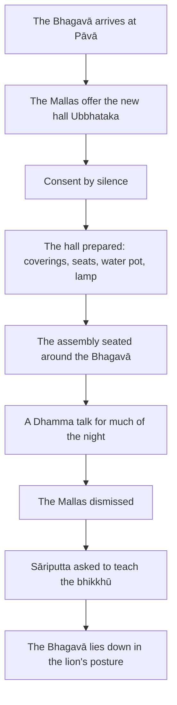

import { Tabs, TabItem } from '@astrojs/starlight/components';

Original text: [8D/10 Ubbhatakanavasandhāgāra 773–778](https://tipitaka2500.github.io/tipitaka/8D/10.html#773) in the [World Tipitaka Edition](https://tipitaka2500.github.io)

## Summary

The opening of the Saṅgītisutta (8D/10), the recitation of the Dhamma in lists that āyasmā Sāriputta gives in the parts that follow. The Bhagavā, travelling through the Malla country with five hundred bhikkhū, stays at Pāvā, and the Mallas of Pāvā ask him to be the first to use their new assembly hall, Ubbhataka. He teaches them for much of the night, sends them home and, his back aching, asks Sāriputta to give the bhikkhū a Dhamma talk while he lies down in the lion's posture.

## Diagram

## Text

<Tabs syncKey="paliquote">
<TabItem label="My Translation">
(296.)

773\. Thus heard by me — At one time the Bhagavā, while travelling through the Malla country together with a large Saṅgha of bhikkhū, about five hundred bhikkhū, arrived at Pāvā, a town of the Mallas. There, indeed, the Bhagavā was dwelling at Pāvā, in the mango grove of Cunda the smith's son.

(297.)

774\. Now at that time, a new assembly hall called ‘Ubbhataka’ had been recently built by the Mallas of Pāvā, and it had not been occupied by any wanderer, brahmin, or any human being. The Mallas of Pāvā heard, “The Bhagavā, it is said, while travelling through the Malla country together with a large Saṅgha of bhikkhū, about five hundred bhikkhū, has arrived at Pāvā, and is dwelling at Pāvā in the mango grove of Cunda the smith's son.” Then the Mallas of Pāvā approached the Bhagavā; having approached, they bowed to the Bhagavā and sat down to one side. Seated to one side, the Mallas of Pāvā said this to the Bhagavā, “Here, Bhante, a new assembly hall called ‘Ubbhataka’ has been recently built by the Mallas of Pāvā, and it has not been occupied by any wanderer, brahmin, or any human being. And may the Bhagavā, Bhante, indeed be the first to use it; after it has been used by the Bhagavā first, the Mallas of Pāvā will use it. That would be for the Mallas of Pāvā’s long-term welfare and happiness.” The Bhagavā consented by silence.

(298.)

775\. Then the Mallas of Pāvā, knowing the Bhagavā's consent, rose from their seats, bowed to the Bhagavā, circumambulated him keeping their right side towards him, and approached the assembly hall. Having approached, they spread the assembly hall with a complete floor covering, prepared seats for the Bhagavā, set up a water pot, lit an oil lamp, and then approached the Bhagavā. Having approached, they bowed to the Bhagavā and stood to one side. Standing to one side, those Mallas of Pāvā said this to the Bhagavā, “Bhante, the assembly hall is completely spread with floor coverings, seats are prepared for the Bhagavā, a water pot is set up, and an oil lamp is lit. May the Bhagavā, Bhante, do now as he sees fit.”

(299.)

776\. Then the Bhagavā, having dressed and taking his bowl and robes, approached the assembly hall together with the Saṅgha of bhikkhū. Having approached, he washed his feet, entered the assembly hall, and sat facing east, leaning against the central pillar. The Saṅgha of bhikkhū also washed their feet, entered the assembly hall, and sat facing east, leaning against the western wall, keeping the Bhagavā in front. The Mallas of Pāvā also washed their feet, entered the assembly hall, and sat facing west, leaning against the eastern wall, keeping the Bhagavā in front. Then the Bhagavā, for much of the night, instructed, encouraged, inspired, and gladdened the Mallas of Pāvā with a Dhamma talk, and then dismissed them, saying, “The night is indeed far advanced, Vāseṭṭhas. Do now as you see fit.” “Yes, Bhante,” the Mallas of Pāvā replied to the Bhagavā, and rising from their seats, they bowed to the Bhagavā, circumambulated him keeping their right side towards him, and departed.

(300.)

777\. Then, soon after the Mallas of Pāvā had departed, the Bhagavā looked over the utterly silent Saṅgha of bhikkhū and addressed āyasmā Sāriputta, “The Saṅgha of bhikkhū, Sāriputta, is indeed free from sloth and torpor. May a Dhamma talk for the bhikkhū occur to you, Sāriputta. My back aches. I shall stretch it.” “Yes, Bhante,” āyasmā Sāriputta replied to the Bhagavā.

778\. Then the Bhagavā, having laid out his four-folded outer robe, lay down on his right side in the lion's posture, placing one foot on the other, aware and clearly comprehending, having fixed his mind on the apperception of rising.
</TabItem>

<TabItem label="Pāḷi (Roman IAST)">
(296.)

773\. Evaṃ me sutaṃ— ekaṃ samayaṃ bhagavā mallesu cārikaṃ caramāno mahatā bhikkhusaṃghena saddhiṃ pañcamattehi bhikkhusatehi yena pāvā nāma mallānaṃ nagaraṃ tadavasari. Tatra sudaṃ bhagavā pāvāyaṃ viharati cundassa kammāraputtassa ambavane.

(297.)

774\. Tena kho pana samayena pāveyyakānaṃ mallānaṃ ubbhatakaṃ nāma navaṃ sandhāgāraṃ acirakāritaṃ hoti anajjhāvuṭṭhaṃ samaṇena vā brāhmaṇena vā kenaci vā manussabhūtena. Assosuṃ kho pāveyyakā mallā— “bhagavā kira mallesu cārikaṃ caramāno mahatā bhikkhusaṃghena saddhiṃ pañcamattehi bhikkhusatehi pāvaṃ anuppatto pāvāyaṃ viharati cundassa kammāraputtassa ambavane”ti. Atha kho pāveyyakā mallā yena bhagavā tenupasaṅkamiṃsu; upasaṅkamitvā bhagavantaṃ abhivādetvā ekamantaṃ nisīdiṃsu. Ekamantaṃ nisinnā kho pāveyyakā mallā bhagavantaṃ etadavocuṃ— “idha, bhante, pāveyyakānaṃ mallānaṃ ubbhatakaṃ nāma navaṃ sandhāgāraṃ acirakāritaṃ hoti anajjhāvuṭṭhaṃ samaṇena vā brāhmaṇena vā kenaci vā manussabhūtena. Tañca kho, bhante, bhagavā paṭhamaṃ paribhuñjatu, bhagavatā paṭhamaṃ paribhuttaṃ pacchā pāveyyakā mallā paribhuñjissanti. Tadassa pāveyyakānaṃ mallānaṃ dīgharattaṃ hitāya sukhāyā”ti. Adhivāsesi kho bhagavā tuṇhībhāvena.

(298.)

775\. Atha kho pāveyyakā mallā bhagavato adhivāsanaṃ viditvā uṭṭhāyāsanā bhagavantaṃ abhivādetvā padakkhiṇaṃ katvā yena sandhāgāraṃ tenupasaṅkamiṃsu; upasaṅkamitvā sabbasanthariṃ sandhāgāraṃ santharitvā bhagavato āsanāni paññāpetvā udakamaṇikaṃ patiṭṭhapetvā telapadīpaṃ āropetvā yena bhagavā tenupasaṅkamiṃsu; upasaṅkamitvā bhagavantaṃ abhivādetvā ekamantaṃ aṭṭhaṃsu. Ekamantaṃ ṭhitā kho te pāveyyakā mallā bhagavantaṃ etadavocuṃ— “sabbasantharisanthataṃ, bhante, sandhāgāraṃ, bhagavato āsanāni paññattāni, udakamaṇiko patiṭṭhāpito, telapadīpo āropito. Yassadāni, bhante, bhagavā kālaṃ maññatī”ti.

(299.)

776\. Atha kho bhagavā nivāsetvā pattacīvaramādāya saddhiṃ bhikkhusaṃghena yena sandhāgāraṃ tenupasaṅkami; upasaṅkamitvā pāde pakkhāletvā sandhāgāraṃ pavisitvā majjhimaṃ thambhaṃ nissāya puratthābhimukho nisīdi. Bhikkhusaṃghopi kho pāde pakkhāletvā sandhāgāraṃ pavisitvā pacchimaṃ bhittiṃ nissāya puratthābhimukho nisīdi bhagavantaṃyeva purakkhatvā. Pāveyyakāpi kho mallā pāde pakkhāletvā sandhāgāraṃ pavisitvā puratthimaṃ bhittiṃ nissāya pacchimābhimukhā nisīdiṃsu bhagavantaṃyeva purakkhatvā. Atha kho bhagavā pāveyyake malle bahudeva rattiṃ dhammiyā kathāya sandassetvā samādapetvā samuttejetvā sampahaṃsetvā uyyojesi— “abhikkantā kho, vāseṭṭhā, ratti. Yassadāni tumhe kālaṃ maññathā”ti. “Evaṃ, bhante”ti kho pāveyyakā mallā bhagavato paṭissutvā uṭṭhāyāsanā bhagavantaṃ abhivādetvā padakkhiṇaṃ katvā pakkamiṃsu.

(300.)

777\. Atha kho bhagavā acirapakkantesu pāveyyakesu mallesu tuṇhībhūtaṃ tuṇhībhūtaṃ bhikkhusaṃghaṃ anuviloketvā āyasmantaṃ sāriputtaṃ āmantesi— “vigatathinamiddho kho, sāriputta, bhikkhusaṃgho. Paṭibhātu taṃ, sāriputta, bhikkhūnaṃ dhammīkathā. Piṭṭhi me āgilāyati. Tamahaṃ āyamissāmī”ti. “Evaṃ, bhante”ti kho āyasmā sāriputto bhagavato paccassosi.

778\. Atha kho bhagavā catugguṇaṃ saṅghāṭiṃ paññāpetvā dakkhiṇena passena sīhaseyyaṃ kappesi pāde pādaṃ accādhāya, sato sampajāno uṭṭhānasaññaṃ manasi karitvā.
</TabItem>

<TabItem label="Pāḷi (Brahmi)">
(296.)

773\. 𑀏𑀯𑀁 𑀫𑁂 𑀲𑀼𑀢𑀁— 𑀏𑀓𑀁 𑀲𑀫𑀬𑀁 𑀪𑀕𑀯𑀸 𑀫𑀮𑁆𑀮𑁂𑀲𑀼 𑀘𑀸𑀭𑀺𑀓𑀁 𑀘𑀭𑀫𑀸𑀦𑁄 𑀫𑀳𑀢𑀸 𑀪𑀺𑀓𑁆𑀔𑀼𑀲𑀁𑀖𑁂𑀦 𑀲𑀤𑁆𑀥𑀺𑀁 𑀧𑀜𑁆𑀘𑀫𑀢𑁆𑀢𑁂𑀳𑀺 𑀪𑀺𑀓𑁆𑀔𑀼𑀲𑀢𑁂𑀳𑀺 𑀬𑁂𑀦 𑀧𑀸𑀯𑀸 𑀦𑀸𑀫 𑀫𑀮𑁆𑀮𑀸𑀦𑀁 𑀦𑀕𑀭𑀁 𑀢𑀤𑀯𑀲𑀭𑀺. 𑀢𑀢𑁆𑀭 𑀲𑀼𑀤𑀁 𑀪𑀕𑀯𑀸 𑀧𑀸𑀯𑀸𑀬𑀁 𑀯𑀺𑀳𑀭𑀢𑀺 𑀘𑀼𑀦𑁆𑀤𑀲𑁆𑀲 𑀓𑀫𑁆𑀫𑀸𑀭𑀧𑀼𑀢𑁆𑀢𑀲𑁆𑀲 𑀅𑀫𑁆𑀩𑀯𑀦𑁂.

(297.)

774\. 𑀢𑁂𑀦 𑀔𑁄 𑀧𑀦 𑀲𑀫𑀬𑁂𑀦 𑀧𑀸𑀯𑁂𑀬𑁆𑀬𑀓𑀸𑀦𑀁 𑀫𑀮𑁆𑀮𑀸𑀦𑀁 𑀉𑀩𑁆𑀪𑀢𑀓𑀁 𑀦𑀸𑀫 𑀦𑀯𑀁 𑀲𑀦𑁆𑀥𑀸𑀕𑀸𑀭𑀁 𑀅𑀘𑀺𑀭𑀓𑀸𑀭𑀺𑀢𑀁 𑀳𑁄𑀢𑀺 𑀅𑀦𑀚𑁆𑀛𑀸𑀯𑀼𑀝𑁆𑀞𑀁 𑀲𑀫𑀡𑁂𑀦 𑀯𑀸 𑀩𑁆𑀭𑀸𑀳𑁆𑀫𑀡𑁂𑀦 𑀯𑀸 𑀓𑁂𑀦𑀘𑀺 𑀯𑀸 𑀫𑀦𑀼𑀲𑁆𑀲𑀪𑀽𑀢𑁂𑀦. 𑀅𑀲𑁆𑀲𑁄𑀲𑀼𑀁 𑀔𑁄 𑀧𑀸𑀯𑁂𑀬𑁆𑀬𑀓𑀸 𑀫𑀮𑁆𑀮𑀸— “𑀪𑀕𑀯𑀸 𑀓𑀺𑀭 𑀫𑀮𑁆𑀮𑁂𑀲𑀼 𑀘𑀸𑀭𑀺𑀓𑀁 𑀘𑀭𑀫𑀸𑀦𑁄 𑀫𑀳𑀢𑀸 𑀪𑀺𑀓𑁆𑀔𑀼𑀲𑀁𑀖𑁂𑀦 𑀲𑀤𑁆𑀥𑀺𑀁 𑀧𑀜𑁆𑀘𑀫𑀢𑁆𑀢𑁂𑀳𑀺 𑀪𑀺𑀓𑁆𑀔𑀼𑀲𑀢𑁂𑀳𑀺 𑀧𑀸𑀯𑀁 𑀅𑀦𑀼𑀧𑁆𑀧𑀢𑁆𑀢𑁄 𑀧𑀸𑀯𑀸𑀬𑀁 𑀯𑀺𑀳𑀭𑀢𑀺 𑀘𑀼𑀦𑁆𑀤𑀲𑁆𑀲 𑀓𑀫𑁆𑀫𑀸𑀭𑀧𑀼𑀢𑁆𑀢𑀲𑁆𑀲 𑀅𑀫𑁆𑀩𑀯𑀦𑁂”𑀢𑀺. 𑀅𑀣 𑀔𑁄 𑀧𑀸𑀯𑁂𑀬𑁆𑀬𑀓𑀸 𑀫𑀮𑁆𑀮𑀸 𑀬𑁂𑀦 𑀪𑀕𑀯𑀸 𑀢𑁂𑀦𑀼𑀧𑀲𑀗𑁆𑀓𑀫𑀺𑀁𑀲𑀼; 𑀉𑀧𑀲𑀗𑁆𑀓𑀫𑀺𑀢𑁆𑀯𑀸 𑀪𑀕𑀯𑀦𑁆𑀢𑀁 𑀅𑀪𑀺𑀯𑀸𑀤𑁂𑀢𑁆𑀯𑀸 𑀏𑀓𑀫𑀦𑁆𑀢𑀁 𑀦𑀺𑀲𑀻𑀤𑀺𑀁𑀲𑀼. 𑀏𑀓𑀫𑀦𑁆𑀢𑀁 𑀦𑀺𑀲𑀺𑀦𑁆𑀦𑀸 𑀔𑁄 𑀧𑀸𑀯𑁂𑀬𑁆𑀬𑀓𑀸 𑀫𑀮𑁆𑀮𑀸 𑀪𑀕𑀯𑀦𑁆𑀢𑀁 𑀏𑀢𑀤𑀯𑁄𑀘𑀼𑀁— “𑀇𑀥, 𑀪𑀦𑁆𑀢𑁂, 𑀧𑀸𑀯𑁂𑀬𑁆𑀬𑀓𑀸𑀦𑀁 𑀫𑀮𑁆𑀮𑀸𑀦𑀁 𑀉𑀩𑁆𑀪𑀢𑀓𑀁 𑀦𑀸𑀫 𑀦𑀯𑀁 𑀲𑀦𑁆𑀥𑀸𑀕𑀸𑀭𑀁 𑀅𑀘𑀺𑀭𑀓𑀸𑀭𑀺𑀢𑀁 𑀳𑁄𑀢𑀺 𑀅𑀦𑀚𑁆𑀛𑀸𑀯𑀼𑀝𑁆𑀞𑀁 𑀲𑀫𑀡𑁂𑀦 𑀯𑀸 𑀩𑁆𑀭𑀸𑀳𑁆𑀫𑀡𑁂𑀦 𑀯𑀸 𑀓𑁂𑀦𑀘𑀺 𑀯𑀸 𑀫𑀦𑀼𑀲𑁆𑀲𑀪𑀽𑀢𑁂𑀦. 𑀢𑀜𑁆𑀘 𑀔𑁄, 𑀪𑀦𑁆𑀢𑁂, 𑀪𑀕𑀯𑀸 𑀧𑀞𑀫𑀁 𑀧𑀭𑀺𑀪𑀼𑀜𑁆𑀚𑀢𑀼, 𑀪𑀕𑀯𑀢𑀸 𑀧𑀞𑀫𑀁 𑀧𑀭𑀺𑀪𑀼𑀢𑁆𑀢𑀁 𑀧𑀘𑁆𑀙𑀸 𑀧𑀸𑀯𑁂𑀬𑁆𑀬𑀓𑀸 𑀫𑀮𑁆𑀮𑀸 𑀧𑀭𑀺𑀪𑀼𑀜𑁆𑀚𑀺𑀲𑁆𑀲𑀦𑁆𑀢𑀺. 𑀢𑀤𑀲𑁆𑀲 𑀧𑀸𑀯𑁂𑀬𑁆𑀬𑀓𑀸𑀦𑀁 𑀫𑀮𑁆𑀮𑀸𑀦𑀁 𑀤𑀻𑀖𑀭𑀢𑁆𑀢𑀁 𑀳𑀺𑀢𑀸𑀬 𑀲𑀼𑀔𑀸𑀬𑀸”𑀢𑀺. 𑀅𑀥𑀺𑀯𑀸𑀲𑁂𑀲𑀺 𑀔𑁄 𑀪𑀕𑀯𑀸 𑀢𑀼𑀡𑁆𑀳𑀻𑀪𑀸𑀯𑁂𑀦.

(298.)

775\. 𑀅𑀣 𑀔𑁄 𑀧𑀸𑀯𑁂𑀬𑁆𑀬𑀓𑀸 𑀫𑀮𑁆𑀮𑀸 𑀪𑀕𑀯𑀢𑁄 𑀅𑀥𑀺𑀯𑀸𑀲𑀦𑀁 𑀯𑀺𑀤𑀺𑀢𑁆𑀯𑀸 𑀉𑀝𑁆𑀞𑀸𑀬𑀸𑀲𑀦𑀸 𑀪𑀕𑀯𑀦𑁆𑀢𑀁 𑀅𑀪𑀺𑀯𑀸𑀤𑁂𑀢𑁆𑀯𑀸 𑀧𑀤𑀓𑁆𑀔𑀺𑀡𑀁 𑀓𑀢𑁆𑀯𑀸 𑀬𑁂𑀦 𑀲𑀦𑁆𑀥𑀸𑀕𑀸𑀭𑀁 𑀢𑁂𑀦𑀼𑀧𑀲𑀗𑁆𑀓𑀫𑀺𑀁𑀲𑀼; 𑀉𑀧𑀲𑀗𑁆𑀓𑀫𑀺𑀢𑁆𑀯𑀸 𑀲𑀩𑁆𑀩𑀲𑀦𑁆𑀣𑀭𑀺𑀁 𑀲𑀦𑁆𑀥𑀸𑀕𑀸𑀭𑀁 𑀲𑀦𑁆𑀣𑀭𑀺𑀢𑁆𑀯𑀸 𑀪𑀕𑀯𑀢𑁄 𑀆𑀲𑀦𑀸𑀦𑀺 𑀧𑀜𑁆𑀜𑀸𑀧𑁂𑀢𑁆𑀯𑀸 𑀉𑀤𑀓𑀫𑀡𑀺𑀓𑀁 𑀧𑀢𑀺𑀝𑁆𑀞𑀧𑁂𑀢𑁆𑀯𑀸 𑀢𑁂𑀮𑀧𑀤𑀻𑀧𑀁 𑀆𑀭𑁄𑀧𑁂𑀢𑁆𑀯𑀸 𑀬𑁂𑀦 𑀪𑀕𑀯𑀸 𑀢𑁂𑀦𑀼𑀧𑀲𑀗𑁆𑀓𑀫𑀺𑀁𑀲𑀼; 𑀉𑀧𑀲𑀗𑁆𑀓𑀫𑀺𑀢𑁆𑀯𑀸 𑀪𑀕𑀯𑀦𑁆𑀢𑀁 𑀅𑀪𑀺𑀯𑀸𑀤𑁂𑀢𑁆𑀯𑀸 𑀏𑀓𑀫𑀦𑁆𑀢𑀁 𑀅𑀝𑁆𑀞𑀁𑀲𑀼. 𑀏𑀓𑀫𑀦𑁆𑀢𑀁 𑀞𑀺𑀢𑀸 𑀔𑁄 𑀢𑁂 𑀧𑀸𑀯𑁂𑀬𑁆𑀬𑀓𑀸 𑀫𑀮𑁆𑀮𑀸 𑀪𑀕𑀯𑀦𑁆𑀢𑀁 𑀏𑀢𑀤𑀯𑁄𑀘𑀼𑀁— “𑀲𑀩𑁆𑀩𑀲𑀦𑁆𑀣𑀭𑀺𑀲𑀦𑁆𑀣𑀢𑀁, 𑀪𑀦𑁆𑀢𑁂, 𑀲𑀦𑁆𑀥𑀸𑀕𑀸𑀭𑀁, 𑀪𑀕𑀯𑀢𑁄 𑀆𑀲𑀦𑀸𑀦𑀺 𑀧𑀜𑁆𑀜𑀢𑁆𑀢𑀸𑀦𑀺, 𑀉𑀤𑀓𑀫𑀡𑀺𑀓𑁄 𑀧𑀢𑀺𑀝𑁆𑀞𑀸𑀧𑀺𑀢𑁄, 𑀢𑁂𑀮𑀧𑀤𑀻𑀧𑁄 𑀆𑀭𑁄𑀧𑀺𑀢𑁄. 𑀬𑀲𑁆𑀲𑀤𑀸𑀦𑀺, 𑀪𑀦𑁆𑀢𑁂, 𑀪𑀕𑀯𑀸 𑀓𑀸𑀮𑀁 𑀫𑀜𑁆𑀜𑀢𑀻”𑀢𑀺.

(299.)

776\. 𑀅𑀣 𑀔𑁄 𑀪𑀕𑀯𑀸 𑀦𑀺𑀯𑀸𑀲𑁂𑀢𑁆𑀯𑀸 𑀧𑀢𑁆𑀢𑀘𑀻𑀯𑀭𑀫𑀸𑀤𑀸𑀬 𑀲𑀤𑁆𑀥𑀺𑀁 𑀪𑀺𑀓𑁆𑀔𑀼𑀲𑀁𑀖𑁂𑀦 𑀬𑁂𑀦 𑀲𑀦𑁆𑀥𑀸𑀕𑀸𑀭𑀁 𑀢𑁂𑀦𑀼𑀧𑀲𑀗𑁆𑀓𑀫𑀺; 𑀉𑀧𑀲𑀗𑁆𑀓𑀫𑀺𑀢𑁆𑀯𑀸 𑀧𑀸𑀤𑁂 𑀧𑀓𑁆𑀔𑀸𑀮𑁂𑀢𑁆𑀯𑀸 𑀲𑀦𑁆𑀥𑀸𑀕𑀸𑀭𑀁 𑀧𑀯𑀺𑀲𑀺𑀢𑁆𑀯𑀸 𑀫𑀚𑁆𑀛𑀺𑀫𑀁 𑀣𑀫𑁆𑀪𑀁 𑀦𑀺𑀲𑁆𑀲𑀸𑀬 𑀧𑀼𑀭𑀢𑁆𑀣𑀸𑀪𑀺𑀫𑀼𑀔𑁄 𑀦𑀺𑀲𑀻𑀤𑀺. 𑀪𑀺𑀓𑁆𑀔𑀼𑀲𑀁𑀖𑁄𑀧𑀺 𑀔𑁄 𑀧𑀸𑀤𑁂 𑀧𑀓𑁆𑀔𑀸𑀮𑁂𑀢𑁆𑀯𑀸 𑀲𑀦𑁆𑀥𑀸𑀕𑀸𑀭𑀁 𑀧𑀯𑀺𑀲𑀺𑀢𑁆𑀯𑀸 𑀧𑀘𑁆𑀙𑀺𑀫𑀁 𑀪𑀺𑀢𑁆𑀢𑀺𑀁 𑀦𑀺𑀲𑁆𑀲𑀸𑀬 𑀧𑀼𑀭𑀢𑁆𑀣𑀸𑀪𑀺𑀫𑀼𑀔𑁄 𑀦𑀺𑀲𑀻𑀤𑀺 𑀪𑀕𑀯𑀦𑁆𑀢𑀁𑀬𑁂𑀯 𑀧𑀼𑀭𑀓𑁆𑀔𑀢𑁆𑀯𑀸. 𑀧𑀸𑀯𑁂𑀬𑁆𑀬𑀓𑀸𑀧𑀺 𑀔𑁄 𑀫𑀮𑁆𑀮𑀸 𑀧𑀸𑀤𑁂 𑀧𑀓𑁆𑀔𑀸𑀮𑁂𑀢𑁆𑀯𑀸 𑀲𑀦𑁆𑀥𑀸𑀕𑀸𑀭𑀁 𑀧𑀯𑀺𑀲𑀺𑀢𑁆𑀯𑀸 𑀧𑀼𑀭𑀢𑁆𑀣𑀺𑀫𑀁 𑀪𑀺𑀢𑁆𑀢𑀺𑀁 𑀦𑀺𑀲𑁆𑀲𑀸𑀬 𑀧𑀘𑁆𑀙𑀺𑀫𑀸𑀪𑀺𑀫𑀼𑀔𑀸 𑀦𑀺𑀲𑀻𑀤𑀺𑀁𑀲𑀼 𑀪𑀕𑀯𑀦𑁆𑀢𑀁𑀬𑁂𑀯 𑀧𑀼𑀭𑀓𑁆𑀔𑀢𑁆𑀯𑀸. 𑀅𑀣 𑀔𑁄 𑀪𑀕𑀯𑀸 𑀧𑀸𑀯𑁂𑀬𑁆𑀬𑀓𑁂 𑀫𑀮𑁆𑀮𑁂 𑀩𑀳𑀼𑀤𑁂𑀯 𑀭𑀢𑁆𑀢𑀺𑀁 𑀥𑀫𑁆𑀫𑀺𑀬𑀸 𑀓𑀣𑀸𑀬 𑀲𑀦𑁆𑀤𑀲𑁆𑀲𑁂𑀢𑁆𑀯𑀸 𑀲𑀫𑀸𑀤𑀧𑁂𑀢𑁆𑀯𑀸 𑀲𑀫𑀼𑀢𑁆𑀢𑁂𑀚𑁂𑀢𑁆𑀯𑀸 𑀲𑀫𑁆𑀧𑀳𑀁𑀲𑁂𑀢𑁆𑀯𑀸 𑀉𑀬𑁆𑀬𑁄𑀚𑁂𑀲𑀺— “𑀅𑀪𑀺𑀓𑁆𑀓𑀦𑁆𑀢𑀸 𑀔𑁄, 𑀯𑀸𑀲𑁂𑀝𑁆𑀞𑀸, 𑀭𑀢𑁆𑀢𑀺. 𑀬𑀲𑁆𑀲𑀤𑀸𑀦𑀺 𑀢𑀼𑀫𑁆𑀳𑁂 𑀓𑀸𑀮𑀁 𑀫𑀜𑁆𑀜𑀣𑀸”𑀢𑀺. “𑀏𑀯𑀁, 𑀪𑀦𑁆𑀢𑁂”𑀢𑀺 𑀔𑁄 𑀧𑀸𑀯𑁂𑀬𑁆𑀬𑀓𑀸 𑀫𑀮𑁆𑀮𑀸 𑀪𑀕𑀯𑀢𑁄 𑀧𑀝𑀺𑀲𑁆𑀲𑀼𑀢𑁆𑀯𑀸 𑀉𑀝𑁆𑀞𑀸𑀬𑀸𑀲𑀦𑀸 𑀪𑀕𑀯𑀦𑁆𑀢𑀁 𑀅𑀪𑀺𑀯𑀸𑀤𑁂𑀢𑁆𑀯𑀸 𑀧𑀤𑀓𑁆𑀔𑀺𑀡𑀁 𑀓𑀢𑁆𑀯𑀸 𑀧𑀓𑁆𑀓𑀫𑀺𑀁𑀲𑀼.

(300.)

777\. 𑀅𑀣 𑀔𑁄 𑀪𑀕𑀯𑀸 𑀅𑀘𑀺𑀭𑀧𑀓𑁆𑀓𑀦𑁆𑀢𑁂𑀲𑀼 𑀧𑀸𑀯𑁂𑀬𑁆𑀬𑀓𑁂𑀲𑀼 𑀫𑀮𑁆𑀮𑁂𑀲𑀼 𑀢𑀼𑀡𑁆𑀳𑀻𑀪𑀽𑀢𑀁 𑀢𑀼𑀡𑁆𑀳𑀻𑀪𑀽𑀢𑀁 𑀪𑀺𑀓𑁆𑀔𑀼𑀲𑀁𑀖𑀁 𑀅𑀦𑀼𑀯𑀺𑀮𑁄𑀓𑁂𑀢𑁆𑀯𑀸 𑀆𑀬𑀲𑁆𑀫𑀦𑁆𑀢𑀁 𑀲𑀸𑀭𑀺𑀧𑀼𑀢𑁆𑀢𑀁 𑀆𑀫𑀦𑁆𑀢𑁂𑀲𑀺— “𑀯𑀺𑀕𑀢𑀣𑀺𑀦𑀫𑀺𑀤𑁆𑀥𑁄 𑀔𑁄, 𑀲𑀸𑀭𑀺𑀧𑀼𑀢𑁆𑀢, 𑀪𑀺𑀓𑁆𑀔𑀼𑀲𑀁𑀖𑁄. 𑀧𑀝𑀺𑀪𑀸𑀢𑀼 𑀢𑀁, 𑀲𑀸𑀭𑀺𑀧𑀼𑀢𑁆𑀢, 𑀪𑀺𑀓𑁆𑀔𑀽𑀦𑀁 𑀥𑀫𑁆𑀫𑀻𑀓𑀣𑀸. 𑀧𑀺𑀝𑁆𑀞𑀺 𑀫𑁂 𑀆𑀕𑀺𑀮𑀸𑀬𑀢𑀺. 𑀢𑀫𑀳𑀁 𑀆𑀬𑀫𑀺𑀲𑁆𑀲𑀸𑀫𑀻”𑀢𑀺. “𑀏𑀯𑀁, 𑀪𑀦𑁆𑀢𑁂”𑀢𑀺 𑀔𑁄 𑀆𑀬𑀲𑁆𑀫𑀸 𑀲𑀸𑀭𑀺𑀧𑀼𑀢𑁆𑀢𑁄 𑀪𑀕𑀯𑀢𑁄 𑀧𑀘𑁆𑀘𑀲𑁆𑀲𑁄𑀲𑀺.

778\. 𑀅𑀣 𑀔𑁄 𑀪𑀕𑀯𑀸 𑀘𑀢𑀼𑀕𑁆𑀕𑀼𑀡𑀁 𑀲𑀗𑁆𑀖𑀸𑀝𑀺𑀁 𑀧𑀜𑁆𑀜𑀸𑀧𑁂𑀢𑁆𑀯𑀸 𑀤𑀓𑁆𑀔𑀺𑀡𑁂𑀦 𑀧𑀲𑁆𑀲𑁂𑀦 𑀲𑀻𑀳𑀲𑁂𑀬𑁆𑀬𑀁 𑀓𑀧𑁆𑀧𑁂𑀲𑀺 𑀧𑀸𑀤𑁂 𑀧𑀸𑀤𑀁 𑀅𑀘𑁆𑀘𑀸𑀥𑀸𑀬, 𑀲𑀢𑁄 𑀲𑀫𑁆𑀧𑀚𑀸𑀦𑁄 𑀉𑀝𑁆𑀞𑀸𑀦𑀲𑀜𑁆𑀜𑀁 𑀫𑀦𑀲𑀺 𑀓𑀭𑀺𑀢𑁆𑀯𑀸.
</TabItem>

<TabItem label="Interlinear">
(296.)

[773](https://tipitaka2500.github.io/tipitaka/8D/10.html#773) Evaṃ me sutaṃ— ekaṃ samayaṃ bhagavā mallesu cārikaṃ caramāno mahatā bhikkhusaṃghena saddhiṃ pañcamattehi bhikkhusatehi yena pāvā nāma mallānaṃ nagaraṃ tadavasari.  
⏏️(evaṃ) *️⃣👆⚧⨀⑥(ahaṃ) 🚻⨀①🔽(ta)(suta) *️⃣🤟🚹⨀②(eka) 🚹⨀②(samaya) 🚹⨀①(bhagavant) 🚹⨂⑦(malla) 🚺⨀②(cārikā) 🚹⨀①🔽(māna)(caramāna) 🚹⨀③(mahanta) 🚹⨀③🆎(bhikkhu+saṃgha) ⏏️(saddhiṃ) 🚹⨂③🆎(pañca+matta) 🚻⨂③🆎(bhikkhu+sata) *️⃣🤟🚹⨀③(ya) 🚺⨀①(pāvā) ⏏️(nāma) 🚹⨂⑥(malla) 🚻⨀①(nagara) *️⃣🤟🚻⨀②(ta) 🟢⨀🤟⏮(avasarati)  
thus | by me | heard | one | time | the Bhagavā | among the Mallas | on a journey | wandering | with a large | Saṅgha of bhikkhū | together | about five | hundred bhikkhū | by where | Pāvā | called | of the Mallas | a town | there | arrived  
Thus heard by me — At one time the Bhagavā, while travelling through the Malla country together with a large Saṅgha of bhikkhū, about five hundred bhikkhū, arrived at Pāvā, a town of the Mallas.

Tatra sudaṃ bhagavā pāvāyaṃ viharati cundassa kammāraputtassa ambavane.  
⏏️(tatra) ⏏️(sudaṃ) 🚹⨀①(bhagavant) 🚺⨀⑦(pāvā) 🟢⨀🤟▶️(viharati) 🚹⨀⑥(cunda) 🚹⨀⑥🆎(kammāra+putta) 🚻⨀⑦🆎(amba+vana)  
there | indeed | the Bhagavā | at Pāvā | dwells | of Cunda | the smith's son | in the mango grove  
There, indeed, the Bhagavā was dwelling at Pāvā, in the mango grove of Cunda the smith's son.

(297.)

[774](https://tipitaka2500.github.io/tipitaka/8D/10/Ubbhatakanavasandhagara.html#774) Tena kho pana samayena pāveyyakānaṃ mallānaṃ ubbhatakaṃ nāma navaṃ sandhāgāraṃ acirakāritaṃ hoti anajjhāvuṭṭhaṃ samaṇena vā brāhmaṇena vā kenaci vā manussabhūtena.  
*️⃣🤟🚹⨀③(ta) ⏏️(kho) ⏏️(pana) 🚹⨀③(samaya) 🚹⨂⑥(pāveyyaka) 🚹⨂⑥(malla) 🚻⨀①(ubbhataka) ⏏️(nāma) 🚻⨀①(nava) 🚻⨀①🆎(sandha+agāra) 🚻⨀①🆎(acira+kārita) 🟢⨀🤟▶️(hoti) 🚻⨀①🔽(ta)🆎(na+ajjhāvuṭṭha) 🚹⨀③(samaṇa) ⏏️(vā) 🚹⨀③(brāhmaṇa) ⏏️(vā) *️⃣🤟🚹⨀③(kaci) ⏏️(vā) 🚹⨀③🆎(manussa+bhūta)  
at that | indeed | now | time | of Pāvā | of the Mallas | Ubbhataka | called | new | assembly hall | recently built | is | not occupied | by a wanderer | or | by a brahmin | or | by any | or | human being  
Now at that time, a new assembly hall called ‘Ubbhataka’ had been recently built by the Mallas of Pāvā, and it had not been occupied by any wanderer, brahmin, or any human being.

Assosuṃ kho pāveyyakā mallā— “bhagavā kira mallesu cārikaṃ caramāno mahatā bhikkhusaṃghena saddhiṃ pañcamattehi bhikkhusatehi pāvaṃ anuppatto pāvāyaṃ viharati cundassa kammāraputtassa ambavane”ti.  
🟢⨂🤟⏮(suṇāti) ⏏️(kho) 🚹⨂①(pāveyyaka) 🚹⨂①(malla) 🚹⨀①(bhagavant) ⏏️(kira) 🚹⨂⑦(malla) 🚺⨀②(cārikā) 🚹⨀①🔽(māna)(caramāna) 🚹⨀③(mahanta) 🚹⨀③🆎(bhikkhu+saṃgha) ⏏️(saddhiṃ) 🚹⨂③🆎(pañca+matta) 🚻⨂③🆎(bhikkhu+sata) 🚺⨀②(pāvā) 🚹⨀①🔽(ta)(anuppatta) 🚺⨀⑦(pāvā) 🟢⨀🤟▶️(viharati) 🚹⨀⑥(cunda) 🚹⨀⑥🆎(kammāra+putta) 🚻⨀⑦🆎(amba+vana) ⏏️(iti)  
heard | indeed | of Pāvā | the Mallas | the Bhagavā | it is said | among the Mallas | on a journey | wandering | with a large | Saṅgha of bhikkhū | together | about five | hundred bhikkhū | Pāvā | arrived at | at Pāvā | dwells | of Cunda | the smith's son | in the mango grove | (end quote)  
The Mallas of Pāvā heard, “The Bhagavā, it is said, while travelling through the Malla country together with a large Saṅgha of bhikkhū, about five hundred bhikkhū, has arrived at Pāvā, and is dwelling at Pāvā in the mango grove of Cunda the smith's son.”

Atha kho pāveyyakā mallā yena bhagavā tenupasaṅkamiṃsu;  
⏏️(atha) ⏏️(kho) 🚹⨂①(pāveyyaka) 🚹⨂①(malla) *️⃣🤟🚹⨀③(ya) 🚹⨀①(bhagavant) *️⃣🤟🚹⨀③(ta) 🟢⨂🤟⏮(upasaṅkamati)  
then | indeed | of Pāvā | the Mallas | by where | the Bhagavā | by there | approached  
Then the Mallas of Pāvā approached the Bhagavā;

upasaṅkamitvā bhagavantaṃ abhivādetvā ekamantaṃ nisīdiṃsu.  
🔽(tvā)(upasaṅkamati) 🚹⨀②(bhagavant) 🔽(tvā)(abhivādeti) ⏏️🆎(eka+anta) 🟢⨂🤟⏮(nisīdati)  
having approached | the Bhagavā | having bowed down to | to one side | sat down  
having approached, they bowed to the Bhagavā and sat down to one side.

Ekamantaṃ nisinnā kho pāveyyakā mallā bhagavantaṃ etadavocuṃ— “idha, bhante, pāveyyakānaṃ mallānaṃ ubbhatakaṃ nāma navaṃ sandhāgāraṃ acirakāritaṃ hoti anajjhāvuṭṭhaṃ samaṇena vā brāhmaṇena vā kenaci vā manussabhūtena.  
⏏️🆎(eka+anta) 🚹⨂①🔽(ta)(nisinna) ⏏️(kho) 🚹⨂①(pāveyyaka) 🚹⨂①(malla) 🚹⨀②(bhagavant) *️⃣🤟🚻⨀②(eta) 🟢⨂🤟⏮(vadati) ⏏️(idha) 🚹⨀⓪(bhavant) 🚹⨂⑥(pāveyyaka) 🚹⨂⑥(malla) 🚻⨀①(ubbhataka) ⏏️(nāma) 🚻⨀①(nava) 🚻⨀①🆎(sandha+agāra) 🚻⨀①🆎(acira+kārita) 🟢⨀🤟▶️(hoti) 🚻⨀①🔽(ta)🆎(na+ajjhāvuṭṭha) 🚹⨀③(samaṇa) ⏏️(vā) 🚹⨀③(brāhmaṇa) ⏏️(vā) *️⃣🤟🚹⨀③(kaci) ⏏️(vā) 🚹⨀③🆎(manussa+bhūta)  
to one side | seated | indeed | of Pāvā | the Mallas | the Bhagavā | this | said | here | Bhante | of Pāvā | of the Mallas | Ubbhataka | called | new | assembly hall | recently built | is | not occupied | by a wanderer | or | by a brahmin | or | by any | or | human being  
Seated to one side, the Mallas of Pāvā said this to the Bhagavā, “Here, Bhante, a new assembly hall called ‘Ubbhataka’ has been recently built by the Mallas of Pāvā, and it has not been occupied by any wanderer, brahmin, or any human being.

Tañca kho, bhante, bhagavā paṭhamaṃ paribhuñjatu, bhagavatā paṭhamaṃ paribhuttaṃ pacchā pāveyyakā mallā paribhuñjissanti.  
*️⃣🤟🚻⨀②(ta) ⏏️(ca) ⏏️(kho) 🚹⨀⓪(bhavant) 🚹⨀①(bhagavant) 🚻⨀②(paṭhama) 🟢⨀🤟⏹(paribhuñjati) 🚹⨀③(bhagavant) 🚻⨀②(paṭhama) 🚻⨀②🔽(ta)(paribhutta) ⏏️(pacchā) 🚹⨂①(pāveyyaka) 🚹⨂①(malla) 🟢⨂🤟⏭(paribhuñjati)  
it | and | indeed | Bhante | the Bhagavā | first | may use | by the Bhagavā | first | used | afterwards | of Pāvā | the Mallas | will use  
And may the Bhagavā, Bhante, indeed be the first to use it; after it has been used by the Bhagavā first, the Mallas of Pāvā will use it.

Tadassa pāveyyakānaṃ mallānaṃ dīgharattaṃ hitāya sukhāyā”ti.  
*️⃣🤟🚻⨀①(ta) 🟢⨀🤟⏯(atthi) 🚹⨂⑥(pāveyyaka) 🚹⨂⑥(malla) 🚻⨀②🆎(dīgha+ratta) 🚻⨀④(hita) 🚻⨀④(sukha) ⏏️(iti)  
that | would be | of Pāvā | of the Mallas | for a long time | for the welfare | for the happiness | (end quote)  
That would be for the Mallas of Pāvā’s long-term welfare and happiness.”

Adhivāsesi kho bhagavā tuṇhībhāvena.  
🟠⨀🤟⏮(adhivāseti) ⏏️(kho) 🚹⨀①(bhagavant) 🚹⨀③🆎(tuṇhī+bhāva)  
consented | indeed | the Bhagavā | by silence  
The Bhagavā consented by silence.

(298.)

[775](https://tipitaka2500.github.io/tipitaka/8D/10/Ubbhatakanavasandhagara.html#775) Atha kho pāveyyakā mallā bhagavato adhivāsanaṃ viditvā uṭṭhāyāsanā bhagavantaṃ abhivādetvā padakkhiṇaṃ katvā yena sandhāgāraṃ tenupasaṅkamiṃsu;  
⏏️(atha) ⏏️(kho) 🚹⨂①(pāveyyaka) 🚹⨂①(malla) 🚹⨀⑥(bhagavant) 🚻⨀②(adhivāsana) 🔽(tvā)(vidati) 🔽(ya)(uṭṭhāti) 🚻⨀⑤(āsana) 🚹⨀②(bhagavant) 🔽(tvā)(abhivādeti) 🚻⨀②(padakkhiṇa) 🔽(tvā)(karoti) *️⃣🤟🚹⨀③(ya) 🚻⨀①🆎(sandha+agāra) *️⃣🤟🚹⨀③(ta) 🟢⨂🤟⏮(upasaṅkamati)  
then | indeed | of Pāvā | the Mallas | of the Bhagavā | consent | having known | having risen | from their seats | the Bhagavā | having bowed down to | keeping the right side towards | having done | by where | the assembly hall | by there | approached  
Then the Mallas of Pāvā, knowing the Bhagavā's consent, rose from their seats, bowed to the Bhagavā, circumambulated him keeping their right side towards him, and approached the assembly hall.

upasaṅkamitvā sabbasanthariṃ sandhāgāraṃ santharitvā bhagavato āsanāni paññāpetvā udakamaṇikaṃ patiṭṭhapetvā telapadīpaṃ āropetvā yena bhagavā tenupasaṅkamiṃsu;  
🔽(tvā)(upasaṅkamati) ⏏️🆎(sabba+santhara) 🚻⨀②🆎(sandha+agāra) 🔽(tvā)(santharati) 🚹⨀④(bhagavant) 🚻⨂②(āsana) 🔽(tvā)(paññāpeti) 🚹⨀②🆎(udaka+maṇika) 🔽(tvā)(patiṭṭhapeti) 🚹⨀②🆎(tela+padīpa) 🔽(tvā)(āropeti) *️⃣🤟🚹⨀③(ya) 🚹⨀①(bhagavant) *️⃣🤟🚹⨀③(ta) 🟢⨂🤟⏮(upasaṅkamati)  
having approached | with a complete floor covering | the assembly hall | having spread | for the Bhagavā | seats | having prepared | a water pot | having set up | an oil lamp | having lit | by where | the Bhagavā | by there | approached  
Having approached, they spread the assembly hall with a complete floor covering, prepared seats for the Bhagavā, set up a water pot, lit an oil lamp, and then approached the Bhagavā.

upasaṅkamitvā bhagavantaṃ abhivādetvā ekamantaṃ aṭṭhaṃsu.  
🔽(tvā)(upasaṅkamati) 🚹⨀②(bhagavant) 🔽(tvā)(abhivādeti) ⏏️🆎(eka+anta) 🟢⨂🤟⏮(tiṭṭhati)  
having approached | the Bhagavā | having bowed down to | to one side | stood  
Having approached, they bowed to the Bhagavā and stood to one side.

Ekamantaṃ ṭhitā kho te pāveyyakā mallā bhagavantaṃ etadavocuṃ— “sabbasantharisanthataṃ, bhante, sandhāgāraṃ, bhagavato āsanāni paññattāni, udakamaṇiko patiṭṭhāpito, telapadīpo āropito.  
⏏️🆎(eka+anta) 🚹⨂①🔽(ta)(ṭhita) ⏏️(kho) *️⃣🤟🚹⨂①(ta) 🚹⨂①(pāveyyaka) 🚹⨂①(malla) 🚹⨀②(bhagavant) *️⃣🤟🚻⨀②(eta) 🟢⨂🤟⏮(vadati) 🚻⨀①🆎(sabba+santhara+santhata) 🚹⨀⓪(bhavant) 🚻⨀①🆎(sandha+agāra) 🚹⨀④(bhagavant) 🚻⨂①(āsana) 🚻⨂①🔽(ta)(paññatta) 🚹⨀①🆎(udaka+maṇika) 🚹⨀①🔽(ta)(patiṭṭhāpita) 🚹⨀①🆎(tela+padīpa) 🚹⨀①🔽(ta)(āropita)  
to one side | standing | indeed | those | of Pāvā | the Mallas | the Bhagavā | this | said | completely spread with floor coverings | Bhante | the assembly hall | for the Bhagavā | seats | prepared | a water pot | set up | an oil lamp | lit  
Standing to one side, those Mallas of Pāvā said this to the Bhagavā, “Bhante, the assembly hall is completely spread with floor coverings, seats are prepared for the Bhagavā, a water pot is set up, and an oil lamp is lit.

Yassadāni, bhante, bhagavā kālaṃ maññatī”ti.  
*️⃣🤟🚻⨀④(ya) ⏏️(dāni) 🚹⨀⓪(bhavant) 🚹⨀①(bhagavant) 🚹⨀②(kāla) 🟢⨀🤟▶️(maññati) ⏏️(iti)  
for which | now | Bhante | the Bhagavā | the time | thinks | (end quote)  
May the Bhagavā, Bhante, do now as he sees fit.”

(299.)

[776](https://tipitaka2500.github.io/tipitaka/8D/10/Ubbhatakanavasandhagara.html#776) Atha kho bhagavā nivāsetvā pattacīvaramādāya saddhiṃ bhikkhusaṃghena yena sandhāgāraṃ tenupasaṅkami;  
⏏️(atha) ⏏️(kho) 🚹⨀①(bhagavant) 🔽(tvā)(nivāseti) 🚻⨀②🆎(patta+cīvara) 🔽(ya)(ādāti) ⏏️(saddhiṃ) 🚹⨀③🆎(bhikkhu+saṃgha) *️⃣🤟🚹⨀③(ya) 🚻⨀①🆎(sandha+agāra) *️⃣🤟🚹⨀③(ta) 🟢⨀🤟⏮(upasaṅkamati)  
then | indeed | the Bhagavā | having dressed | bowl and robes | taking | together | with the Saṅgha of bhikkhū | by where | the assembly hall | by there | approached  
Then the Bhagavā, having dressed and taking his bowl and robes, approached the assembly hall together with the Saṅgha of bhikkhū.

upasaṅkamitvā pāde pakkhāletvā sandhāgāraṃ pavisitvā majjhimaṃ thambhaṃ nissāya puratthābhimukho nisīdi.  
🔽(tvā)(upasaṅkamati) 🚹⨂②(pāda) 🔽(tvā)(pakkhāleti) 🚻⨀②🆎(sandha+agāra) 🔽(tvā)(pavisati) 🚹⨀②(majjhima) 🚹⨀②(thambha) 🔽(ya)(nissayati) 🚹⨀①🆎(puratthā+abhimukha) 🟢⨀🤟⏮(nisīdati)  
having approached | feet | having washed | the assembly hall | having entered | the central | pillar | leaning against | facing east | sat  
Having approached, he washed his feet, entered the assembly hall, and sat facing east, leaning against the central pillar.

Bhikkhusaṃghopi kho pāde pakkhāletvā sandhāgāraṃ pavisitvā pacchimaṃ bhittiṃ nissāya puratthābhimukho nisīdi bhagavantaṃyeva purakkhatvā.  
🚹⨀①🆎(bhikkhu+saṃgha) ⏏️(api) ⏏️(kho) 🚹⨂②(pāda) 🔽(tvā)(pakkhāleti) 🚻⨀②🆎(sandha+agāra) 🔽(tvā)(pavisati) 🚺⨀②(pacchima) 🚺⨀②(bhitti) 🔽(ya)(nissayati) 🚹⨀①🆎(puratthā+abhimukha) 🟢⨀🤟⏮(nisīdati) 🚹⨀②(bhagavant) ⏏️(eva) 🔽(tvā)(purakkharoti)  
the Saṅgha of bhikkhū | also | indeed | feet | having washed | the assembly hall | having entered | the western | wall | leaning against | facing east | sat | the Bhagavā | just | keeping in front  
The Saṅgha of bhikkhū also washed their feet, entered the assembly hall, and sat facing east, leaning against the western wall, keeping the Bhagavā in front.

Pāveyyakāpi kho mallā pāde pakkhāletvā sandhāgāraṃ pavisitvā puratthimaṃ bhittiṃ nissāya pacchimābhimukhā nisīdiṃsu bhagavantaṃyeva purakkhatvā.  
🚹⨂①(pāveyyaka) ⏏️(api) ⏏️(kho) 🚹⨂①(malla) 🚹⨂②(pāda) 🔽(tvā)(pakkhāleti) 🚻⨀②🆎(sandha+agāra) 🔽(tvā)(pavisati) 🚺⨀②(puratthima) 🚺⨀②(bhitti) 🔽(ya)(nissayati) 🚹⨂①🆎(pacchima+abhimukha) 🟢⨂🤟⏮(nisīdati) 🚹⨀②(bhagavant) ⏏️(eva) 🔽(tvā)(purakkharoti)  
of Pāvā | also | indeed | the Mallas | feet | having washed | the assembly hall | having entered | the eastern | wall | leaning against | facing west | sat | the Bhagavā | just | keeping in front  
The Mallas of Pāvā also washed their feet, entered the assembly hall, and sat facing west, leaning against the eastern wall, keeping the Bhagavā in front.

Atha kho bhagavā pāveyyake malle bahudeva rattiṃ dhammiyā kathāya sandassetvā samādapetvā samuttejetvā sampahaṃsetvā uyyojesi— “abhikkantā kho, vāseṭṭhā, ratti.  
⏏️(atha) ⏏️(kho) 🚹⨀①(bhagavant) 🚹⨂②(pāveyyaka) 🚹⨂②(malla) 🚺⨀②(bahu) ⏏️(eva) 🚺⨀②(ratti) 🚺⨀③(dhammī) 🚺⨀③(kathā) 🔽(tvā)(sandasseti) 🔽(tvā)(samādapeti) 🔽(tvā)(samuttejeti) 🔽(tvā)(sampahaṃseti) 🟠⨀🤟⏮(uyyojeti) 🚺⨀①🔽(ta)(abhikkanta) ⏏️(kho) 🚹⨂⓪🔽(ṇa)(vāseṭṭha) 🚺⨀①(ratti)  
then | indeed | the Bhagavā | of Pāvā | the Mallas | for much | indeed | of the night | with a Dhamma | talk | having instructed | having encouraged | having inspired | having gladdened | dismissed | far advanced | indeed | Vāseṭṭhas | the night  
Then the Bhagavā, for much of the night, instructed, encouraged, inspired, and gladdened the Mallas of Pāvā with a Dhamma talk, and then dismissed them, saying, “The night is indeed far advanced, Vāseṭṭhas.

Yassadāni tumhe kālaṃ maññathā”ti.  
*️⃣🤟🚻⨀④(ya) ⏏️(dāni) *️⃣🤘⚧⨂①(tvaṃ) 🚹⨀②(kāla) 🟢⨂🤘▶️(maññati) ⏏️(iti)  
for which | now | you | the time | think | (end quote)  
Do now as you see fit.”

“Evaṃ, bhante”ti kho pāveyyakā mallā bhagavato paṭissutvā uṭṭhāyāsanā bhagavantaṃ abhivādetvā padakkhiṇaṃ katvā pakkamiṃsu.  
⏏️(evaṃ) 🚹⨀⓪(bhavant) ⏏️(iti) ⏏️(kho) 🚹⨂①(pāveyyaka) 🚹⨂①(malla) 🚹⨀④(bhagavant) 🔽(tvā)(paṭissuṇāti) 🔽(ya)(uṭṭhāti) 🚻⨀⑤(āsana) 🚹⨀②(bhagavant) 🔽(tvā)(abhivādeti) 🚻⨀②(padakkhiṇa) 🔽(tvā)(karoti) 🟢⨂🤟⏮(pakkamati)  
yes | Bhante | (end quote) | indeed | of Pāvā | the Mallas | to the Bhagavā | having replied | having risen | from their seats | the Bhagavā | having bowed down to | keeping the right side towards | having done | departed  
“Yes, Bhante,” the Mallas of Pāvā replied to the Bhagavā, and rising from their seats, they bowed to the Bhagavā, circumambulated him keeping their right side towards him, and departed.

(300.)

[777](https://tipitaka2500.github.io/tipitaka/8D/10/Ubbhatakanavasandhagara.html#777) Atha kho bhagavā acirapakkantesu pāveyyakesu mallesu tuṇhībhūtaṃ tuṇhībhūtaṃ bhikkhusaṃghaṃ anuviloketvā āyasmantaṃ sāriputtaṃ āmantesi— “vigatathinamiddho kho, sāriputta, bhikkhusaṃgho.  
⏏️(atha) ⏏️(kho) 🚹⨀①(bhagavant) 🚹⨂⑦🆎(acira+pakkanta) 🚹⨂⑦(pāveyyaka) 🚹⨂⑦(malla) 🚹⨀②🆎(tuṇhī+bhūta) 🚹⨀②🆎(tuṇhī+bhūta) 🚹⨀②🆎(bhikkhu+saṃgha) 🔽(tvā)(anuviloketi) 🚹⨀②(āyasmant) 🚹⨀②(sāriputta) 🟢⨀🤟⏮(āmanteti) 🚹⨀①🆎(vigata+thina+middha) ⏏️(kho) 🚹⨀⓪(sāriputta) 🚹⨀①🆎(bhikkhu+saṃgha)  
then | indeed | the Bhagavā | soon after departed | of Pāvā | the Mallas | silent | silent | the Saṅgha of bhikkhū | having looked over | Venerable | Sāriputta | addressed | free from sloth and torpor | indeed | Sāriputta | the Saṅgha of bhikkhū  
Then, soon after the Mallas of Pāvā had departed, the Bhagavā looked over the utterly silent Saṅgha of bhikkhū and addressed āyasmā Sāriputta, “The Saṅgha of bhikkhū, Sāriputta, is indeed free from sloth and torpor.

Paṭibhātu taṃ, sāriputta, bhikkhūnaṃ dhammīkathā.  
🟢⨀🤟⏹(paṭibhāti) *️⃣🤘⚧⨀②(tvaṃ) 🚹⨀⓪(sāriputta) 🚹⨂④(bhikkhu) 🚺⨀①🆎(dhammī+kathā)  
may occur to | you | Sāriputta | for the bhikkhū | a Dhamma talk  
May a Dhamma talk for the bhikkhū occur to you, Sāriputta.

Piṭṭhi me āgilāyati.  
🚺⨀①(piṭṭhi) *️⃣👆⚧⨀⑥(ahaṃ) 🟢⨀🤟▶️(āgilāyati)  
back | my | aches  
My back aches.

Tamahaṃ āyamissāmī”ti.  
*️⃣🤟🚺⨀②(ta) *️⃣👆⚧⨀①(ahaṃ) 🟢⨀👆⏭(āyamati) ⏏️(iti)  
it | I | shall stretch | (end quote)  
I shall stretch it.”

“Evaṃ, bhante”ti kho āyasmā sāriputto bhagavato paccassosi.  
⏏️(evaṃ) 🚹⨀⓪(bhavant) ⏏️(iti) ⏏️(kho) 🚹⨀①(āyasmant) 🚹⨀①(sāriputta) 🚹⨀④(bhagavant) 🟢⨀🤟⏮(paṭissuṇāti)  
yes | Bhante | (end quote) | indeed | Venerable | Sāriputta | to the Bhagavā | replied  
“Yes, Bhante,” āyasmā Sāriputta replied to the Bhagavā.

[778](https://tipitaka2500.github.io/tipitaka/8D/10/Ubbhatakanavasandhagara.html#778) Atha kho bhagavā catugguṇaṃ saṅghāṭiṃ paññāpetvā dakkhiṇena passena sīhaseyyaṃ kappesi pāde pādaṃ accādhāya, sato sampajāno uṭṭhānasaññaṃ manasi karitvā.  
⏏️(atha) ⏏️(kho) 🚹⨀①(bhagavant) 🚺⨀②🆎(catu+guṇa) 🚺⨀②(saṅghāṭi) 🔽(tvā)(paññāpeti) *️⃣🤟🚻⨀③(dakkhiṇa) 🚻⨀③(passa) 🚺⨀②🆎(sīha+seyyā) 🟠⨀🤟⏮(kappeti) 🚹⨀⑦(pāda) 🚹⨀②(pāda) 🔽(ya)(accādhāya) 🚹⨀①🔽(ta)(sata) 🚹⨀①(sampajāna) 🚺⨀②🆎(uṭṭhāna+saññā) 🚹⨀⑦(mano) 🔽(tvā)(karoti)  
then | indeed | the Bhagavā | four-folded | outer robe | having laid out | on the right | side | the lion's posture | lay down in | on the foot | the foot | placing | aware | clearly comprehending | the apperception of rising | in mind | having fixed  
Then the Bhagavā, having laid out his four-folded outer robe, lay down on his right side in the lion's posture, placing one foot on the other, aware and clearly comprehending, having fixed his mind on the apperception of rising.
</TabItem>
</Tabs>

## Commentary

- The frame of the Saṅgītisutta: the lists that follow are āyasmā Sāriputta's recitation to the bhikkhū, spoken while the Bhagavā lies down and listens; the sutta and its lists are discussed on the [index page](/dighanikaya/sangitisutta/).
- The narrative formulas are twins of the Khandhaka pages: dressing and taking the bowl and robes (Khandhaka 7, 13, 14), "instructed, encouraged, inspired, and gladdened" with a Dhamma talk (Khandhaka 7, 13).
- Renderings by the glossary: `samaṇa` wanderer (774), `saññā` apperception in "the apperception of rising" (778); `thinamiddha` "sloth and torpor" and `sīhaseyya` "the lion's posture" (777–778) follow the DPD.
- "Vāseṭṭhas" (776) keeps the Mallas' clan vocative in Pāḷi, as the site keeps every vocative.
- The edition's 773–778 are CST 296–300, shown in parentheses in the tabs.

[Go to parent page (Saṅgītisutta)](/dighanikaya/sangitisutta/) / [Go to next page (2. Bhinnanigaṇṭhavatthu (The Breakup of the Jains))](/dighanikaya/sangitisutta/2-bhinnaniganthavatthu/)
