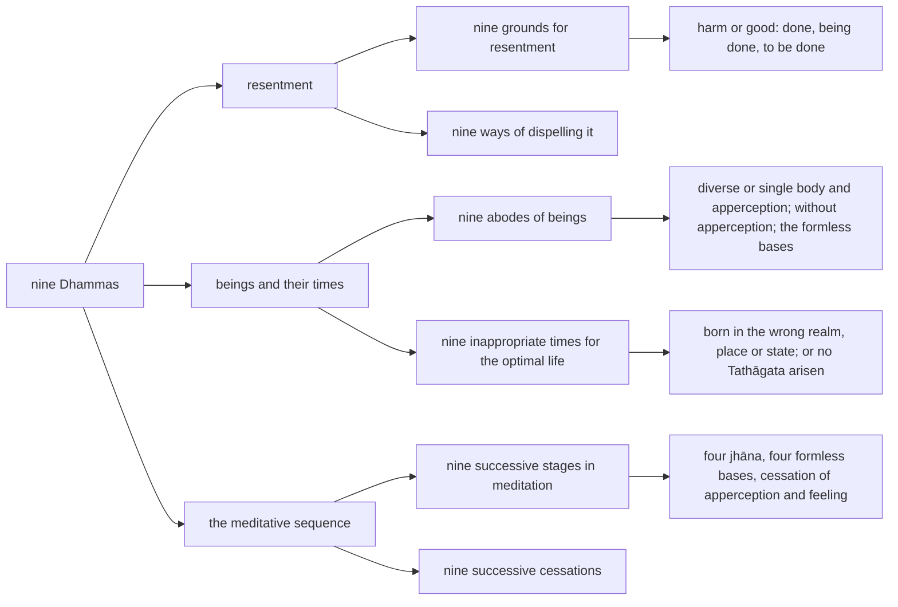

import { Tabs, TabItem } from '@astrojs/starlight/components';

Original text: [8D/10.9 Navaka 1078–1101](https://tipitaka2500.github.io/tipitaka/8D/10/10.9.html#1078) in the [World Tipitaka Edition](https://tipitaka2500.github.io)

## Summary

The ninth section of the Saṅgītisutta: āyasmā Sāriputta recites six groups of nine Dhammas. Two concern resentment, the nine grounds on which it forms and the nine reflections that dispel it; two map where beings dwell and when the optimal life cannot be lived, the nine abodes of beings and the nine inappropriate times; and two set out the meditative sequence, the nine successive stages from the first `jhāna` (mental disposition) to the cessation of apperception and feeling, and what ceases at each stage.

## Diagram

## Text

<Tabs syncKey="paliquote">
<TabItem label="My Translation">
(340.)

1078\. Āvuso, there are nine Dhammas well proclaimed by the Bhagavā, the liberated one, the perfectly awakened one, who knows and sees. Therein all should recite in harmony, not quarrel, so that this optimal life may endure long and last for a long time, which would be for the welfare and happiness of many people, out of compassion for the world, for the good, welfare, and happiness of gods and humans. What nine?

1079\. Nine grounds for resentment. Thinking, ‘He did me harm,’ one forms resentment; thinking, ‘He is doing me harm,’ one forms resentment; thinking, ‘He will do me harm,’ one forms resentment; thinking, ‘He did harm to one dear and pleasant to me,’ one forms resentment; … and so on … thinking that he is doing harm, one forms resentment; … and so on … thinking that he will do harm, one forms resentment; thinking, ‘He did good to one not dear and unpleasant to me,’ one forms resentment; … and so on … thinking that he is doing good, one forms resentment; … and so on … thinking that he will do good, one forms resentment. (1)

1080\. Nine ways of dispelling resentment. Thinking, ‘He did me harm; what is possible about that here?’ one dispels resentment; thinking, ‘He is doing me harm; what is possible about that here?’ one dispels resentment; thinking, ‘He will do me harm; what is possible about that here?’ one dispels resentment; thinking, ‘He did harm to one dear and pleasant to me … and so on … he is doing harm … and so on … he will do harm; what is possible about that here?’ one dispels resentment; thinking, ‘He did good to one not dear and unpleasant to me … and so on … he is doing good … and so on … he will do good; what is possible about that here?’ one dispels resentment. (2)

(341.)

1081\. Nine abodes of beings. There are, Āvuso, beings with diverse bodies and diverse apperceptions, such as humans, some gods, and some beings in the lower realms. This is the first abode of beings.

1082\. There are, Āvuso, beings with diverse bodies and a single apperception, such as the Brahmakāyika gods, produced by the first [mental disposition]. This is the second abode of beings.

1083\. There are, Āvuso, beings with a single body and diverse apperceptions, such as the Ābhassara gods. This is the third abode of beings.

1084\. There are, Āvuso, beings with a single body and a single apperception, such as the Subhakiṇhā gods. This is the fourth abode of beings.

1085\. There are, Āvuso, beings without apperception, not experiencing, such as the Asaññasatta gods. This is the fifth abode of beings.

1086\. There are, Āvuso, beings who, going beyond `rūpasaññā` (apperceptions of form) altogether, with the disappearance of apperceptions of sense impressions, ignoring the apperceptions of diversity, thinking: ‘Space is infinite,’ have gone to the base of the infinity of space. This is the sixth abode of beings.

1087\. There are, Āvuso, beings who, going beyond the base of the infinity of space altogether, thinking: ‘Consciousness is infinite,’ have gone to the base of the infinity of consciousness. This is the seventh abode of beings.

1088\. There are, Āvuso, beings who, going beyond the base of the infinity of consciousness altogether, thinking: ‘There is nothing,’ have gone to the base of nothingness. This is the eighth abode of beings.

1089\. There are, Āvuso, beings who, going beyond the base of nothingness altogether, have gone to the base of neither apperception nor non-apperception. This is the ninth abode of beings. (3)

(342.)

1090\. Nine inappropriate times, wrong times, for living the optimal life. Here, Āvuso, a Tathāgata has arisen in the world, a liberated one, a perfectly awakened one, and the Dhamma is taught, calming, leading to complete extinguishment, leading to full awakening, proclaimed by the `sugata` (Fortunate One). And this person has appeared in hell. This is the first inappropriate time, wrong time, for living the optimal life.

1091\. And furthermore, Āvuso, a Tathāgata has arisen in the world, a liberated one, a perfectly awakened one, and the Dhamma is taught, calming, leading to complete extinguishment, leading to full awakening, proclaimed by the `sugata` (Fortunate One). And this person has appeared in the animal realm. This is the second inappropriate time, wrong time, for living the optimal life.

1092\. And furthermore … and so on … he has appeared in the ghost realm. This is the third inappropriate time, wrong time, for living the optimal life.

1093\. And furthermore … and so on … he has appeared in the horde of asuras. This is the fourth inappropriate time, wrong time, for living the optimal life.

1094\. And furthermore … and so on … he has appeared in a certain long-lived class of gods. This is the fifth inappropriate time, wrong time, for living the optimal life.

1095\. And furthermore … and so on … he has been born again in the border countries, among barbarians who do not understand, where bhikkhū, bhikkhuniyo, `upāsakā` (lay disciples), and `upāsikā` (female lay disciples) do not go. This is the sixth inappropriate time, wrong time, for living the optimal life.

1096\. And furthermore … and so on … he has been born again in the middle countries. And he has wrong view, with distorted vision: ‘There is nothing given, nothing offered, nothing sacrificed; there is no fruit or result of actions well done and badly done; this world does not exist; the other world does not exist; there is no mother; there is no father; there are no spontaneously reborn beings; there are no religious practitioners in the world who, going the right way, practising correctly, make known this world and the other world, having realised them themselves through experiential understanding.’ This is the seventh inappropriate time, wrong time, for living the optimal life.

1097\. And furthermore … and so on … he has been born again in the middle countries. And he is foolish, stupid, a drooling fool, not able to know the meaning of what is well spoken and badly spoken. This is the eighth inappropriate time, wrong time, for living the optimal life.

1098\. And furthermore, Āvuso, a Tathāgata has not arisen in the world, a liberated one, a perfectly awakened one, and the Dhamma is not taught, calming, leading to complete extinguishment, leading to full awakening, proclaimed by the `sugata` (Fortunate One). And this person has been born again in the middle countries, and he is wise, not stupid, not a drooling fool, able to know the meaning of what is well spoken and badly spoken. This is the ninth inappropriate time, wrong time, for living the optimal life. (4)

(343.)

1099\. Nine successive stages in meditation. Here, Āvuso, a bhikkhu, secluding himself from sensual pleasures, detaching from unwholesome characteristics, enters and remains in the first `jhāna` (mental disposition), accompanied by reflection and consideration, secluded from defilements, with felicity and satisfaction. With the conclusion of reflection and consideration … and so on … he enters and remains in the second jhāna. With the detachment from felicity … and so on … he enters and remains in the third jhāna. With the giving up of the pleasant … and so on … he enters and remains in the fourth jhāna. Going beyond `rūpasaññā` (apperceptions of form) altogether … and so on … he enters and remains in the base of the infinity of space. Going beyond the base of the infinity of space altogether, thinking: ‘Consciousness is infinite,’ he enters and remains in the base of the infinity of consciousness. Going beyond the base of the infinity of consciousness altogether, thinking: ‘There is nothing,’ he enters and remains in the base of nothingness. Going beyond the base of nothingness altogether, he enters and remains in the base of neither apperception nor non-apperception. Going beyond the base of neither apperception nor non-apperception altogether, he enters and remains in the cessation of apperception and feeling. (5)

(344.)

1100\. Nine successive cessations. For one who has entered the first `jhāna` (mental disposition), the apperception of sensual pleasure has ceased. For one who has entered the second jhāna, reflection and consideration have ceased. For one who has entered the third jhāna, felicity has ceased. For one who has entered the fourth jhāna, in-breaths and out-breaths have ceased. For one who has entered the base of the infinity of space, the apperception of form has ceased. For one who has entered the base of the infinity of consciousness, the apperception of the base of the infinity of space has ceased. For one who has entered the base of nothingness, the apperception of the base of the infinity of consciousness has ceased. For one who has entered the base of neither apperception nor non-apperception, the apperception of the base of nothingness has ceased. For one who has entered the cessation of apperception and feeling, apperception and feeling have ceased. (6)

1101\. Āvuso, these are the nine Dhammas well proclaimed by the Bhagavā, the liberated one, the perfectly awakened one, who knows and sees. Therein all should recite in harmony, not quarrel, so that this optimal life may endure long and last for a long time, which would be for the welfare and happiness of many people, out of compassion for the world, for the good, welfare, and happiness of gods and humans.
</TabItem>

<TabItem label="Pāḷi (Roman IAST)">
(340.)

1078\. Atthi kho, āvuso, tena bhagavatā jānatā passatā arahatā sammāsambuddhena nava dhammā sammadakkhātā; tattha sabbeheva saṅgāyitabbaṃ…pe… atthāya hitāya sukhāya devamanussānaṃ. Katame nava?

1079\. Nava āghātavatthūni. ‘Anatthaṃ me acarī’ti āghātaṃ bandhati; ‘anatthaṃ me caratī’ti āghātaṃ bandhati; ‘anatthaṃ me carissatī’ti āghātaṃ bandhati; ‘piyassa me manāpassa anatthaṃ acarī’ti āghātaṃ bandhati…pe… anatthaṃ caratīti āghātaṃ bandhati…pe… anatthaṃ carissatīti āghātaṃ bandhati; ‘appiyassa me amanāpassa atthaṃ acarī’ti āghātaṃ bandhati…pe… atthaṃ caratīti āghātaṃ bandhati…pe… atthaṃ carissatīti āghātaṃ bandhati. (1)

1080\. Nava āghātapaṭivinayā. ‘Anatthaṃ me acari, taṃ kutettha labbhā’ti āghātaṃ paṭivineti; ‘anatthaṃ me carati, taṃ kutettha labbhā’ti āghātaṃ paṭivineti; ‘anatthaṃ me carissati, taṃ kutettha labbhā’ti āghātaṃ paṭivineti; ‘piyassa me manāpassa anatthaṃ acari…pe… anatthaṃ carati…pe… anatthaṃ carissati, taṃ kutettha labbhā’ti āghātaṃ paṭivineti; ‘appiyassa me amanāpassa atthaṃ acari…pe… atthaṃ carati…pe… atthaṃ carissati, taṃ kutettha labbhā’ti āghātaṃ paṭivineti. (2)

(341.)

1081\. Nava sattāvāsā. Santāvuso, sattā nānattakāyā nānattasaññino, seyyathāpi manussā ekacce ca devā ekacce ca vinipātikā. Ayaṃ paṭhamo sattāvāso.

1082\. Santāvuso, sattā nānattakāyā ekattasaññino, seyyathāpi devā brahmakāyikā paṭhamābhinibbattā. Ayaṃ dutiyo sattāvāso.

1083\. Santāvuso, sattā ekattakāyā nānattasaññino, seyyathāpi devā ābhassarā. Ayaṃ tatiyo sattāvāso.

1084\. Santāvuso, sattā ekattakāyā ekattasaññino, seyyathāpi devā subhakiṇhā. Ayaṃ catuttho sattāvāso.

1085\. Santāvuso, sattā asaññino appaṭisaṃvedino, seyyathāpi devā asaññasattā. Ayaṃ pañcamo sattāvāso.

1086\. Santāvuso, sattā sabbaso rūpasaññānaṃ samatikkamā paṭighasaññānaṃ atthaṅgamā nānattasaññānaṃ amanasikārā ‘ananto ākāso’ti ākāsānañcāyatanūpagā. Ayaṃ chaṭṭho sattāvāso.

1087\. Santāvuso, sattā sabbaso ākāsānañcāyatanaṃ samatikkamma ‘anantaṃ viññāṇan’ti viññāṇañcāyatanūpagā. Ayaṃ sattamo sattāvāso.

1088\. Santāvuso, sattā sabbaso viññāṇañcāyatanaṃ samatikkamma ‘natthi kiñcī’ti ākiñcaññāyatanūpagā. Ayaṃ aṭṭhamo sattāvāso.

1089\. Santāvuso, sattā sabbaso ākiñcaññāyatanaṃ samatikkamma nevasaññānāsaññāyatanūpagā. Ayaṃ navamo sattāvāso. (3)

(342.)

1090\. Nava akkhaṇā asamayā brahmacariyavāsāya. Idhāvuso, tathāgato ca loke uppanno hoti arahaṃ sammāsambuddho, dhammo ca desiyati opasamiko parinibbāniko sambodhagāmī sugatappavedito. Ayañca puggalo nirayaṃ upapanno hoti. Ayaṃ paṭhamo akkhaṇo asamayo brahmacariyavāsāya.

1091\. Puna caparaṃ, āvuso, tathāgato ca loke uppanno hoti arahaṃ sammāsambuddho, dhammo ca desiyati opasamiko parinibbāniko sambodhagāmī sugatappavedito. Ayañca puggalo tiracchānayoniṃ upapanno hoti. Ayaṃ dutiyo akkhaṇo asamayo brahmacariyavāsāya.

1092\. Puna caparaṃ…pe… pettivisayaṃ upapanno hoti. Ayaṃ tatiyo akkhaṇo asamayo brahmacariyavāsāya.

1093\. Puna caparaṃ…pe… asurakāyaṃ upapanno hoti. Ayaṃ catuttho akkhaṇo asamayo brahmacariyavāsāya.

1094\. Puna caparaṃ…pe… aññataraṃ dīghāyukaṃ devanikāyaṃ upapanno hoti. Ayaṃ pañcamo akkhaṇo asamayo brahmacariyavāsāya.

1095\. Puna caparaṃ…pe… paccantimesu janapadesu paccājāto hoti milakkhesu aviññātāresu, yattha natthi gati bhikkhūnaṃ bhikkhunīnaṃ upāsakānaṃ upāsikānaṃ. Ayaṃ chaṭṭho akkhaṇo asamayo brahmacariyavāsāya.

1096\. Puna caparaṃ…pe… majjhimesu janapadesu paccājāto hoti. So ca hoti micchādiṭṭhiko viparītadassano— ‘natthi dinnaṃ, natthi yiṭṭhaṃ, natthi hutaṃ, natthi sukatadukkaṭānaṃ kammānaṃ phalaṃ vipāko, natthi ayaṃ loko, natthi paro loko, natthi mātā, natthi pitā, natthi sattā opapātikā, natthi loke samaṇabrāhmaṇā sammaggatā sammāpaṭipannā ye imañca lokaṃ parañca lokaṃ sayaṃ abhiññā sacchikatvā pavedentī’ti. Ayaṃ sattamo akkhaṇo asamayo brahmacariyavāsāya.

1097\. Puna caparaṃ…pe… majjhimesu janapadesu paccājāto hoti. So ca hoti duppañño jaḷo eḷamūgo, nappaṭibalo subhāsitadubbhāsitānamatthamaññātuṃ. Ayaṃ aṭṭhamo akkhaṇo asamayo brahmacariyavāsāya.

1098\. Puna caparaṃ, āvuso, tathāgato ca loke na uppanno hoti arahaṃ sammāsambuddho, dhammo ca na desiyati opasamiko parinibbāniko sambodhagāmī sugatappavedito. Ayañca puggalo majjhimesu janapadesu paccājāto hoti, so ca hoti paññavā ajaḷo aneḷamūgo, paṭibalo subhāsitadubbhāsitānamatthamaññātuṃ. Ayaṃ navamo akkhaṇo asamayo brahmacariyavāsāya. (4)

(343.)

1099\. Nava anupubbavihārā. Idhāvuso, bhikkhu vivicceva kāmehi vivicca akusalehi dhammehi savitakkaṃ savicāraṃ vivekajaṃ pītisukhaṃ paṭhamaṃ jhānaṃ upasampajja viharati. Vitakkavicārānaṃ vūpasamā…pe… dutiyaṃ jhānaṃ upasampajja viharati. Pītiyā ca virāgā…pe… tatiyaṃ jhānaṃ upasampajja viharati. Sukhassa ca pahānā…pe… catutthaṃ jhānaṃ upasampajja viharati. Sabbaso rūpasaññānaṃ samatikkamā…pe… ākāsānañcāyatanaṃ upasampajja viharati. Sabbaso ākāsānañcāyatanaṃ samatikkamma ‘anantaṃ viññāṇan’ti viññāṇañcāyatanaṃ upasampajja viharati. Sabbaso viññāṇañcāyatanaṃ samatikkamma ‘natthi kiñcī’ti ākiñcaññāyatanaṃ upasampajja viharati. Sabbaso ākiñcaññāyatanaṃ samatikkamma nevasaññānāsaññāyatanaṃ upasampajja viharati. Sabbaso nevasaññānāsaññāyatanaṃ samatikkamma saññāvedayitanirodhaṃ upasampajja viharati. (5)

(344.)

1100\. Nava anupubbanirodhā. Paṭhamaṃ jhānaṃ samāpannassa kāmasaññā niruddhā hoti. Dutiyaṃ jhānaṃ samāpannassa vitakkavicārā niruddhā honti. Tatiyaṃ jhānaṃ samāpannassa pīti niruddhā hoti. Catutthaṃ jhānaṃ samāpannassa assāsapassāssā niruddhā honti. Ākāsānañcāyatanaṃ samāpannassa rūpasaññā niruddhā hoti. Viññāṇañcāyatanaṃ samāpannassa ākāsānañcāyatanasaññā niruddhā hoti. Ākiñcaññāyatanaṃ samāpannassa viññāṇañcāyatanasaññā niruddhā hoti. Nevasaññānāsaññāyatanaṃ samāpannassa ākiñcaññāyatanasaññā niruddhā hoti. Saññāvedayitanirodhaṃ samāpannassa saññā ca vedanā ca niruddhā honti. (6)

1101\. Ime kho, āvuso, tena bhagavatā jānatā passatā arahatā sammāsambuddhena nava dhammā sammadakkhātā. Tattha sabbeheva saṅgāyitabbaṃ…pe… atthāya hitāya sukhāya devamanussānaṃ.
</TabItem>

<TabItem label="Pāḷi (Brahmi)">
(340.)

1078\. 𑀅𑀢𑁆𑀣𑀺 𑀔𑁄, 𑀆𑀯𑀼𑀲𑁄, 𑀢𑁂𑀦 𑀪𑀕𑀯𑀢𑀸 𑀚𑀸𑀦𑀢𑀸 𑀧𑀲𑁆𑀲𑀢𑀸 𑀅𑀭𑀳𑀢𑀸 𑀲𑀫𑁆𑀫𑀸𑀲𑀫𑁆𑀩𑀼𑀤𑁆𑀥𑁂𑀦 𑀦𑀯 𑀥𑀫𑁆𑀫𑀸 𑀲𑀫𑁆𑀫𑀤𑀓𑁆𑀔𑀸𑀢𑀸; 𑀢𑀢𑁆𑀣 𑀲𑀩𑁆𑀩𑁂𑀳𑁂𑀯 𑀲𑀗𑁆𑀕𑀸𑀬𑀺𑀢𑀩𑁆𑀩𑀁…𑀧𑁂… 𑀅𑀢𑁆𑀣𑀸𑀬 𑀳𑀺𑀢𑀸𑀬 𑀲𑀼𑀔𑀸𑀬 𑀤𑁂𑀯𑀫𑀦𑀼𑀲𑁆𑀲𑀸𑀦𑀁. 𑀓𑀢𑀫𑁂 𑀦𑀯?

1079\. 𑀦𑀯 𑀆𑀖𑀸𑀢𑀯𑀢𑁆𑀣𑀽𑀦𑀺. ‘𑀅𑀦𑀢𑁆𑀣𑀁 𑀫𑁂 𑀅𑀘𑀭𑀻’𑀢𑀺 𑀆𑀖𑀸𑀢𑀁 𑀩𑀦𑁆𑀥𑀢𑀺; ‘𑀅𑀦𑀢𑁆𑀣𑀁 𑀫𑁂 𑀘𑀭𑀢𑀻’𑀢𑀺 𑀆𑀖𑀸𑀢𑀁 𑀩𑀦𑁆𑀥𑀢𑀺; ‘𑀅𑀦𑀢𑁆𑀣𑀁 𑀫𑁂 𑀘𑀭𑀺𑀲𑁆𑀲𑀢𑀻’𑀢𑀺 𑀆𑀖𑀸𑀢𑀁 𑀩𑀦𑁆𑀥𑀢𑀺; ‘𑀧𑀺𑀬𑀲𑁆𑀲 𑀫𑁂 𑀫𑀦𑀸𑀧𑀲𑁆𑀲 𑀅𑀦𑀢𑁆𑀣𑀁 𑀅𑀘𑀭𑀻’𑀢𑀺 𑀆𑀖𑀸𑀢𑀁 𑀩𑀦𑁆𑀥𑀢𑀺…𑀧𑁂… 𑀅𑀦𑀢𑁆𑀣𑀁 𑀘𑀭𑀢𑀻𑀢𑀺 𑀆𑀖𑀸𑀢𑀁 𑀩𑀦𑁆𑀥𑀢𑀺…𑀧𑁂… 𑀅𑀦𑀢𑁆𑀣𑀁 𑀘𑀭𑀺𑀲𑁆𑀲𑀢𑀻𑀢𑀺 𑀆𑀖𑀸𑀢𑀁 𑀩𑀦𑁆𑀥𑀢𑀺; ‘𑀅𑀧𑁆𑀧𑀺𑀬𑀲𑁆𑀲 𑀫𑁂 𑀅𑀫𑀦𑀸𑀧𑀲𑁆𑀲 𑀅𑀢𑁆𑀣𑀁 𑀅𑀘𑀭𑀻’𑀢𑀺 𑀆𑀖𑀸𑀢𑀁 𑀩𑀦𑁆𑀥𑀢𑀺…𑀧𑁂… 𑀅𑀢𑁆𑀣𑀁 𑀘𑀭𑀢𑀻𑀢𑀺 𑀆𑀖𑀸𑀢𑀁 𑀩𑀦𑁆𑀥𑀢𑀺…𑀧𑁂… 𑀅𑀢𑁆𑀣𑀁 𑀘𑀭𑀺𑀲𑁆𑀲𑀢𑀻𑀢𑀺 𑀆𑀖𑀸𑀢𑀁 𑀩𑀦𑁆𑀥𑀢𑀺. (1)

1080\. 𑀦𑀯 𑀆𑀖𑀸𑀢𑀧𑀝𑀺𑀯𑀺𑀦𑀬𑀸. ‘𑀅𑀦𑀢𑁆𑀣𑀁 𑀫𑁂 𑀅𑀘𑀭𑀺, 𑀢𑀁 𑀓𑀼𑀢𑁂𑀢𑁆𑀣 𑀮𑀩𑁆𑀪𑀸’𑀢𑀺 𑀆𑀖𑀸𑀢𑀁 𑀧𑀝𑀺𑀯𑀺𑀦𑁂𑀢𑀺; ‘𑀅𑀦𑀢𑁆𑀣𑀁 𑀫𑁂 𑀘𑀭𑀢𑀺, 𑀢𑀁 𑀓𑀼𑀢𑁂𑀢𑁆𑀣 𑀮𑀩𑁆𑀪𑀸’𑀢𑀺 𑀆𑀖𑀸𑀢𑀁 𑀧𑀝𑀺𑀯𑀺𑀦𑁂𑀢𑀺; ‘𑀅𑀦𑀢𑁆𑀣𑀁 𑀫𑁂 𑀘𑀭𑀺𑀲𑁆𑀲𑀢𑀺, 𑀢𑀁 𑀓𑀼𑀢𑁂𑀢𑁆𑀣 𑀮𑀩𑁆𑀪𑀸’𑀢𑀺 𑀆𑀖𑀸𑀢𑀁 𑀧𑀝𑀺𑀯𑀺𑀦𑁂𑀢𑀺; ‘𑀧𑀺𑀬𑀲𑁆𑀲 𑀫𑁂 𑀫𑀦𑀸𑀧𑀲𑁆𑀲 𑀅𑀦𑀢𑁆𑀣𑀁 𑀅𑀘𑀭𑀺…𑀧𑁂… 𑀅𑀦𑀢𑁆𑀣𑀁 𑀘𑀭𑀢𑀺…𑀧𑁂… 𑀅𑀦𑀢𑁆𑀣𑀁 𑀘𑀭𑀺𑀲𑁆𑀲𑀢𑀺, 𑀢𑀁 𑀓𑀼𑀢𑁂𑀢𑁆𑀣 𑀮𑀩𑁆𑀪𑀸’𑀢𑀺 𑀆𑀖𑀸𑀢𑀁 𑀧𑀝𑀺𑀯𑀺𑀦𑁂𑀢𑀺; ‘𑀅𑀧𑁆𑀧𑀺𑀬𑀲𑁆𑀲 𑀫𑁂 𑀅𑀫𑀦𑀸𑀧𑀲𑁆𑀲 𑀅𑀢𑁆𑀣𑀁 𑀅𑀘𑀭𑀺…𑀧𑁂… 𑀅𑀢𑁆𑀣𑀁 𑀘𑀭𑀢𑀺…𑀧𑁂… 𑀅𑀢𑁆𑀣𑀁 𑀘𑀭𑀺𑀲𑁆𑀲𑀢𑀺, 𑀢𑀁 𑀓𑀼𑀢𑁂𑀢𑁆𑀣 𑀮𑀩𑁆𑀪𑀸’𑀢𑀺 𑀆𑀖𑀸𑀢𑀁 𑀧𑀝𑀺𑀯𑀺𑀦𑁂𑀢𑀺. (2)

(341.)

1081\. 𑀦𑀯 𑀲𑀢𑁆𑀢𑀸𑀯𑀸𑀲𑀸. 𑀲𑀦𑁆𑀢𑀸𑀯𑀼𑀲𑁄, 𑀲𑀢𑁆𑀢𑀸 𑀦𑀸𑀦𑀢𑁆𑀢𑀓𑀸𑀬𑀸 𑀦𑀸𑀦𑀢𑁆𑀢𑀲𑀜𑁆𑀜𑀺𑀦𑁄, 𑀲𑁂𑀬𑁆𑀬𑀣𑀸𑀧𑀺 𑀫𑀦𑀼𑀲𑁆𑀲𑀸 𑀏𑀓𑀘𑁆𑀘𑁂 𑀘 𑀤𑁂𑀯𑀸 𑀏𑀓𑀘𑁆𑀘𑁂 𑀘 𑀯𑀺𑀦𑀺𑀧𑀸𑀢𑀺𑀓𑀸. 𑀅𑀬𑀁 𑀧𑀞𑀫𑁄 𑀲𑀢𑁆𑀢𑀸𑀯𑀸𑀲𑁄.

1082\. 𑀲𑀦𑁆𑀢𑀸𑀯𑀼𑀲𑁄, 𑀲𑀢𑁆𑀢𑀸 𑀦𑀸𑀦𑀢𑁆𑀢𑀓𑀸𑀬𑀸 𑀏𑀓𑀢𑁆𑀢𑀲𑀜𑁆𑀜𑀺𑀦𑁄, 𑀲𑁂𑀬𑁆𑀬𑀣𑀸𑀧𑀺 𑀤𑁂𑀯𑀸 𑀩𑁆𑀭𑀳𑁆𑀫𑀓𑀸𑀬𑀺𑀓𑀸 𑀧𑀞𑀫𑀸𑀪𑀺𑀦𑀺𑀩𑁆𑀩𑀢𑁆𑀢𑀸. 𑀅𑀬𑀁 𑀤𑀼𑀢𑀺𑀬𑁄 𑀲𑀢𑁆𑀢𑀸𑀯𑀸𑀲𑁄.

1083\. 𑀲𑀦𑁆𑀢𑀸𑀯𑀼𑀲𑁄, 𑀲𑀢𑁆𑀢𑀸 𑀏𑀓𑀢𑁆𑀢𑀓𑀸𑀬𑀸 𑀦𑀸𑀦𑀢𑁆𑀢𑀲𑀜𑁆𑀜𑀺𑀦𑁄, 𑀲𑁂𑀬𑁆𑀬𑀣𑀸𑀧𑀺 𑀤𑁂𑀯𑀸 𑀆𑀪𑀲𑁆𑀲𑀭𑀸. 𑀅𑀬𑀁 𑀢𑀢𑀺𑀬𑁄 𑀲𑀢𑁆𑀢𑀸𑀯𑀸𑀲𑁄.

1084\. 𑀲𑀦𑁆𑀢𑀸𑀯𑀼𑀲𑁄, 𑀲𑀢𑁆𑀢𑀸 𑀏𑀓𑀢𑁆𑀢𑀓𑀸𑀬𑀸 𑀏𑀓𑀢𑁆𑀢𑀲𑀜𑁆𑀜𑀺𑀦𑁄, 𑀲𑁂𑀬𑁆𑀬𑀣𑀸𑀧𑀺 𑀤𑁂𑀯𑀸 𑀲𑀼𑀪𑀓𑀺𑀡𑁆𑀳𑀸. 𑀅𑀬𑀁 𑀘𑀢𑀼𑀢𑁆𑀣𑁄 𑀲𑀢𑁆𑀢𑀸𑀯𑀸𑀲𑁄.

1085\. 𑀲𑀦𑁆𑀢𑀸𑀯𑀼𑀲𑁄, 𑀲𑀢𑁆𑀢𑀸 𑀅𑀲𑀜𑁆𑀜𑀺𑀦𑁄 𑀅𑀧𑁆𑀧𑀝𑀺𑀲𑀁𑀯𑁂𑀤𑀺𑀦𑁄, 𑀲𑁂𑀬𑁆𑀬𑀣𑀸𑀧𑀺 𑀤𑁂𑀯𑀸 𑀅𑀲𑀜𑁆𑀜𑀲𑀢𑁆𑀢𑀸. 𑀅𑀬𑀁 𑀧𑀜𑁆𑀘𑀫𑁄 𑀲𑀢𑁆𑀢𑀸𑀯𑀸𑀲𑁄.

1086\. 𑀲𑀦𑁆𑀢𑀸𑀯𑀼𑀲𑁄, 𑀲𑀢𑁆𑀢𑀸 𑀲𑀩𑁆𑀩𑀲𑁄 𑀭𑀽𑀧𑀲𑀜𑁆𑀜𑀸𑀦𑀁 𑀲𑀫𑀢𑀺𑀓𑁆𑀓𑀫𑀸 𑀧𑀝𑀺𑀖𑀲𑀜𑁆𑀜𑀸𑀦𑀁 𑀅𑀢𑁆𑀣𑀗𑁆𑀕𑀫𑀸 𑀦𑀸𑀦𑀢𑁆𑀢𑀲𑀜𑁆𑀜𑀸𑀦𑀁 𑀅𑀫𑀦𑀲𑀺𑀓𑀸𑀭𑀸 ‘𑀅𑀦𑀦𑁆𑀢𑁄 𑀆𑀓𑀸𑀲𑁄’𑀢𑀺 𑀆𑀓𑀸𑀲𑀸𑀦𑀜𑁆𑀘𑀸𑀬𑀢𑀦𑀽𑀧𑀕𑀸. 𑀅𑀬𑀁 𑀙𑀝𑁆𑀞𑁄 𑀲𑀢𑁆𑀢𑀸𑀯𑀸𑀲𑁄.

1087\. 𑀲𑀦𑁆𑀢𑀸𑀯𑀼𑀲𑁄, 𑀲𑀢𑁆𑀢𑀸 𑀲𑀩𑁆𑀩𑀲𑁄 𑀆𑀓𑀸𑀲𑀸𑀦𑀜𑁆𑀘𑀸𑀬𑀢𑀦𑀁 𑀲𑀫𑀢𑀺𑀓𑁆𑀓𑀫𑁆𑀫 ‘𑀅𑀦𑀦𑁆𑀢𑀁 𑀯𑀺𑀜𑁆𑀜𑀸𑀡𑀦𑁆’𑀢𑀺 𑀯𑀺𑀜𑁆𑀜𑀸𑀡𑀜𑁆𑀘𑀸𑀬𑀢𑀦𑀽𑀧𑀕𑀸. 𑀅𑀬𑀁 𑀲𑀢𑁆𑀢𑀫𑁄 𑀲𑀢𑁆𑀢𑀸𑀯𑀸𑀲𑁄.

1088\. 𑀲𑀦𑁆𑀢𑀸𑀯𑀼𑀲𑁄, 𑀲𑀢𑁆𑀢𑀸 𑀲𑀩𑁆𑀩𑀲𑁄 𑀯𑀺𑀜𑁆𑀜𑀸𑀡𑀜𑁆𑀘𑀸𑀬𑀢𑀦𑀁 𑀲𑀫𑀢𑀺𑀓𑁆𑀓𑀫𑁆𑀫 ‘𑀦𑀢𑁆𑀣𑀺 𑀓𑀺𑀜𑁆𑀘𑀻’𑀢𑀺 𑀆𑀓𑀺𑀜𑁆𑀘𑀜𑁆𑀜𑀸𑀬𑀢𑀦𑀽𑀧𑀕𑀸. 𑀅𑀬𑀁 𑀅𑀝𑁆𑀞𑀫𑁄 𑀲𑀢𑁆𑀢𑀸𑀯𑀸𑀲𑁄.

1089\. 𑀲𑀦𑁆𑀢𑀸𑀯𑀼𑀲𑁄, 𑀲𑀢𑁆𑀢𑀸 𑀲𑀩𑁆𑀩𑀲𑁄 𑀆𑀓𑀺𑀜𑁆𑀘𑀜𑁆𑀜𑀸𑀬𑀢𑀦𑀁 𑀲𑀫𑀢𑀺𑀓𑁆𑀓𑀫𑁆𑀫 𑀦𑁂𑀯𑀲𑀜𑁆𑀜𑀸𑀦𑀸𑀲𑀜𑁆𑀜𑀸𑀬𑀢𑀦𑀽𑀧𑀕𑀸. 𑀅𑀬𑀁 𑀦𑀯𑀫𑁄 𑀲𑀢𑁆𑀢𑀸𑀯𑀸𑀲𑁄. (3)

(342.)

1090\. 𑀦𑀯 𑀅𑀓𑁆𑀔𑀡𑀸 𑀅𑀲𑀫𑀬𑀸 𑀩𑁆𑀭𑀳𑁆𑀫𑀘𑀭𑀺𑀬𑀯𑀸𑀲𑀸𑀬. 𑀇𑀥𑀸𑀯𑀼𑀲𑁄, 𑀢𑀣𑀸𑀕𑀢𑁄 𑀘 𑀮𑁄𑀓𑁂 𑀉𑀧𑁆𑀧𑀦𑁆𑀦𑁄 𑀳𑁄𑀢𑀺 𑀅𑀭𑀳𑀁 𑀲𑀫𑁆𑀫𑀸𑀲𑀫𑁆𑀩𑀼𑀤𑁆𑀥𑁄, 𑀥𑀫𑁆𑀫𑁄 𑀘 𑀤𑁂𑀲𑀺𑀬𑀢𑀺 𑀑𑀧𑀲𑀫𑀺𑀓𑁄 𑀧𑀭𑀺𑀦𑀺𑀩𑁆𑀩𑀸𑀦𑀺𑀓𑁄 𑀲𑀫𑁆𑀩𑁄𑀥𑀕𑀸𑀫𑀻 𑀲𑀼𑀕𑀢𑀧𑁆𑀧𑀯𑁂𑀤𑀺𑀢𑁄. 𑀅𑀬𑀜𑁆𑀘 𑀧𑀼𑀕𑁆𑀕𑀮𑁄 𑀦𑀺𑀭𑀬𑀁 𑀉𑀧𑀧𑀦𑁆𑀦𑁄 𑀳𑁄𑀢𑀺. 𑀅𑀬𑀁 𑀧𑀞𑀫𑁄 𑀅𑀓𑁆𑀔𑀡𑁄 𑀅𑀲𑀫𑀬𑁄 𑀩𑁆𑀭𑀳𑁆𑀫𑀘𑀭𑀺𑀬𑀯𑀸𑀲𑀸𑀬.

1091\. 𑀧𑀼𑀦 𑀘𑀧𑀭𑀁, 𑀆𑀯𑀼𑀲𑁄, 𑀢𑀣𑀸𑀕𑀢𑁄 𑀘 𑀮𑁄𑀓𑁂 𑀉𑀧𑁆𑀧𑀦𑁆𑀦𑁄 𑀳𑁄𑀢𑀺 𑀅𑀭𑀳𑀁 𑀲𑀫𑁆𑀫𑀸𑀲𑀫𑁆𑀩𑀼𑀤𑁆𑀥𑁄, 𑀥𑀫𑁆𑀫𑁄 𑀘 𑀤𑁂𑀲𑀺𑀬𑀢𑀺 𑀑𑀧𑀲𑀫𑀺𑀓𑁄 𑀧𑀭𑀺𑀦𑀺𑀩𑁆𑀩𑀸𑀦𑀺𑀓𑁄 𑀲𑀫𑁆𑀩𑁄𑀥𑀕𑀸𑀫𑀻 𑀲𑀼𑀕𑀢𑀧𑁆𑀧𑀯𑁂𑀤𑀺𑀢𑁄. 𑀅𑀬𑀜𑁆𑀘 𑀧𑀼𑀕𑁆𑀕𑀮𑁄 𑀢𑀺𑀭𑀘𑁆𑀙𑀸𑀦𑀬𑁄𑀦𑀺𑀁 𑀉𑀧𑀧𑀦𑁆𑀦𑁄 𑀳𑁄𑀢𑀺. 𑀅𑀬𑀁 𑀤𑀼𑀢𑀺𑀬𑁄 𑀅𑀓𑁆𑀔𑀡𑁄 𑀅𑀲𑀫𑀬𑁄 𑀩𑁆𑀭𑀳𑁆𑀫𑀘𑀭𑀺𑀬𑀯𑀸𑀲𑀸𑀬.

1092\. 𑀧𑀼𑀦 𑀘𑀧𑀭𑀁…𑀧𑁂… 𑀧𑁂𑀢𑁆𑀢𑀺𑀯𑀺𑀲𑀬𑀁 𑀉𑀧𑀧𑀦𑁆𑀦𑁄 𑀳𑁄𑀢𑀺. 𑀅𑀬𑀁 𑀢𑀢𑀺𑀬𑁄 𑀅𑀓𑁆𑀔𑀡𑁄 𑀅𑀲𑀫𑀬𑁄 𑀩𑁆𑀭𑀳𑁆𑀫𑀘𑀭𑀺𑀬𑀯𑀸𑀲𑀸𑀬.

1093\. 𑀧𑀼𑀦 𑀘𑀧𑀭𑀁…𑀧𑁂… 𑀅𑀲𑀼𑀭𑀓𑀸𑀬𑀁 𑀉𑀧𑀧𑀦𑁆𑀦𑁄 𑀳𑁄𑀢𑀺. 𑀅𑀬𑀁 𑀘𑀢𑀼𑀢𑁆𑀣𑁄 𑀅𑀓𑁆𑀔𑀡𑁄 𑀅𑀲𑀫𑀬𑁄 𑀩𑁆𑀭𑀳𑁆𑀫𑀘𑀭𑀺𑀬𑀯𑀸𑀲𑀸𑀬.

1094\. 𑀧𑀼𑀦 𑀘𑀧𑀭𑀁…𑀧𑁂… 𑀅𑀜𑁆𑀜𑀢𑀭𑀁 𑀤𑀻𑀖𑀸𑀬𑀼𑀓𑀁 𑀤𑁂𑀯𑀦𑀺𑀓𑀸𑀬𑀁 𑀉𑀧𑀧𑀦𑁆𑀦𑁄 𑀳𑁄𑀢𑀺. 𑀅𑀬𑀁 𑀧𑀜𑁆𑀘𑀫𑁄 𑀅𑀓𑁆𑀔𑀡𑁄 𑀅𑀲𑀫𑀬𑁄 𑀩𑁆𑀭𑀳𑁆𑀫𑀘𑀭𑀺𑀬𑀯𑀸𑀲𑀸𑀬.

1095\. 𑀧𑀼𑀦 𑀘𑀧𑀭𑀁…𑀧𑁂… 𑀧𑀘𑁆𑀘𑀦𑁆𑀢𑀺𑀫𑁂𑀲𑀼 𑀚𑀦𑀧𑀤𑁂𑀲𑀼 𑀧𑀘𑁆𑀘𑀸𑀚𑀸𑀢𑁄 𑀳𑁄𑀢𑀺 𑀫𑀺𑀮𑀓𑁆𑀔𑁂𑀲𑀼 𑀅𑀯𑀺𑀜𑁆𑀜𑀸𑀢𑀸𑀭𑁂𑀲𑀼, 𑀬𑀢𑁆𑀣 𑀦𑀢𑁆𑀣𑀺 𑀕𑀢𑀺 𑀪𑀺𑀓𑁆𑀔𑀽𑀦𑀁 𑀪𑀺𑀓𑁆𑀔𑀼𑀦𑀻𑀦𑀁 𑀉𑀧𑀸𑀲𑀓𑀸𑀦𑀁 𑀉𑀧𑀸𑀲𑀺𑀓𑀸𑀦𑀁. 𑀅𑀬𑀁 𑀙𑀝𑁆𑀞𑁄 𑀅𑀓𑁆𑀔𑀡𑁄 𑀅𑀲𑀫𑀬𑁄 𑀩𑁆𑀭𑀳𑁆𑀫𑀘𑀭𑀺𑀬𑀯𑀸𑀲𑀸𑀬.

1096\. 𑀧𑀼𑀦 𑀘𑀧𑀭𑀁…𑀧𑁂… 𑀫𑀚𑁆𑀛𑀺𑀫𑁂𑀲𑀼 𑀚𑀦𑀧𑀤𑁂𑀲𑀼 𑀧𑀘𑁆𑀘𑀸𑀚𑀸𑀢𑁄 𑀳𑁄𑀢𑀺. 𑀲𑁄 𑀘 𑀳𑁄𑀢𑀺 𑀫𑀺𑀘𑁆𑀙𑀸𑀤𑀺𑀝𑁆𑀞𑀺𑀓𑁄 𑀯𑀺𑀧𑀭𑀻𑀢𑀤𑀲𑁆𑀲𑀦𑁄— ‘𑀦𑀢𑁆𑀣𑀺 𑀤𑀺𑀦𑁆𑀦𑀁, 𑀦𑀢𑁆𑀣𑀺 𑀬𑀺𑀝𑁆𑀞𑀁, 𑀦𑀢𑁆𑀣𑀺 𑀳𑀼𑀢𑀁, 𑀦𑀢𑁆𑀣𑀺 𑀲𑀼𑀓𑀢𑀤𑀼𑀓𑁆𑀓𑀝𑀸𑀦𑀁 𑀓𑀫𑁆𑀫𑀸𑀦𑀁 𑀨𑀮𑀁 𑀯𑀺𑀧𑀸𑀓𑁄, 𑀦𑀢𑁆𑀣𑀺 𑀅𑀬𑀁 𑀮𑁄𑀓𑁄, 𑀦𑀢𑁆𑀣𑀺 𑀧𑀭𑁄 𑀮𑁄𑀓𑁄, 𑀦𑀢𑁆𑀣𑀺 𑀫𑀸𑀢𑀸, 𑀦𑀢𑁆𑀣𑀺 𑀧𑀺𑀢𑀸, 𑀦𑀢𑁆𑀣𑀺 𑀲𑀢𑁆𑀢𑀸 𑀑𑀧𑀧𑀸𑀢𑀺𑀓𑀸, 𑀦𑀢𑁆𑀣𑀺 𑀮𑁄𑀓𑁂 𑀲𑀫𑀡𑀩𑁆𑀭𑀸𑀳𑁆𑀫𑀡𑀸 𑀲𑀫𑁆𑀫𑀕𑁆𑀕𑀢𑀸 𑀲𑀫𑁆𑀫𑀸𑀧𑀝𑀺𑀧𑀦𑁆𑀦𑀸 𑀬𑁂 𑀇𑀫𑀜𑁆𑀘 𑀮𑁄𑀓𑀁 𑀧𑀭𑀜𑁆𑀘 𑀮𑁄𑀓𑀁 𑀲𑀬𑀁 𑀅𑀪𑀺𑀜𑁆𑀜𑀸 𑀲𑀘𑁆𑀙𑀺𑀓𑀢𑁆𑀯𑀸 𑀧𑀯𑁂𑀤𑁂𑀦𑁆𑀢𑀻’𑀢𑀺. 𑀅𑀬𑀁 𑀲𑀢𑁆𑀢𑀫𑁄 𑀅𑀓𑁆𑀔𑀡𑁄 𑀅𑀲𑀫𑀬𑁄 𑀩𑁆𑀭𑀳𑁆𑀫𑀘𑀭𑀺𑀬𑀯𑀸𑀲𑀸𑀬.

1097\. 𑀧𑀼𑀦 𑀘𑀧𑀭𑀁…𑀧𑁂… 𑀫𑀚𑁆𑀛𑀺𑀫𑁂𑀲𑀼 𑀚𑀦𑀧𑀤𑁂𑀲𑀼 𑀧𑀘𑁆𑀘𑀸𑀚𑀸𑀢𑁄 𑀳𑁄𑀢𑀺. 𑀲𑁄 𑀘 𑀳𑁄𑀢𑀺 𑀤𑀼𑀧𑁆𑀧𑀜𑁆𑀜𑁄 𑀚𑀍𑀑 𑀏𑀍𑀅𑀫𑀽𑀕𑁄, 𑀦𑀧𑁆𑀧𑀝𑀺𑀩𑀮𑁄 𑀲𑀼𑀪𑀸𑀲𑀺𑀢𑀤𑀼𑀩𑁆𑀪𑀸𑀲𑀺𑀢𑀸𑀦𑀫𑀢𑁆𑀣𑀫𑀜𑁆𑀜𑀸𑀢𑀼𑀁. 𑀅𑀬𑀁 𑀅𑀝𑁆𑀞𑀫𑁄 𑀅𑀓𑁆𑀔𑀡𑁄 𑀅𑀲𑀫𑀬𑁄 𑀩𑁆𑀭𑀳𑁆𑀫𑀘𑀭𑀺𑀬𑀯𑀸𑀲𑀸𑀬.

1098\. 𑀧𑀼𑀦 𑀘𑀧𑀭𑀁, 𑀆𑀯𑀼𑀲𑁄, 𑀢𑀣𑀸𑀕𑀢𑁄 𑀘 𑀮𑁄𑀓𑁂 𑀦 𑀉𑀧𑁆𑀧𑀦𑁆𑀦𑁄 𑀳𑁄𑀢𑀺 𑀅𑀭𑀳𑀁 𑀲𑀫𑁆𑀫𑀸𑀲𑀫𑁆𑀩𑀼𑀤𑁆𑀥𑁄, 𑀥𑀫𑁆𑀫𑁄 𑀘 𑀦 𑀤𑁂𑀲𑀺𑀬𑀢𑀺 𑀑𑀧𑀲𑀫𑀺𑀓𑁄 𑀧𑀭𑀺𑀦𑀺𑀩𑁆𑀩𑀸𑀦𑀺𑀓𑁄 𑀲𑀫𑁆𑀩𑁄𑀥𑀕𑀸𑀫𑀻 𑀲𑀼𑀕𑀢𑀧𑁆𑀧𑀯𑁂𑀤𑀺𑀢𑁄. 𑀅𑀬𑀜𑁆𑀘 𑀧𑀼𑀕𑁆𑀕𑀮𑁄 𑀫𑀚𑁆𑀛𑀺𑀫𑁂𑀲𑀼 𑀚𑀦𑀧𑀤𑁂𑀲𑀼 𑀧𑀘𑁆𑀘𑀸𑀚𑀸𑀢𑁄 𑀳𑁄𑀢𑀺, 𑀲𑁄 𑀘 𑀳𑁄𑀢𑀺 𑀧𑀜𑁆𑀜𑀯𑀸 𑀅𑀚𑀍𑀑 𑀅𑀦𑁂𑀍𑀅𑀫𑀽𑀕𑁄, 𑀧𑀝𑀺𑀩𑀮𑁄 𑀲𑀼𑀪𑀸𑀲𑀺𑀢𑀤𑀼𑀩𑁆𑀪𑀸𑀲𑀺𑀢𑀸𑀦𑀫𑀢𑁆𑀣𑀫𑀜𑁆𑀜𑀸𑀢𑀼𑀁. 𑀅𑀬𑀁 𑀦𑀯𑀫𑁄 𑀅𑀓𑁆𑀔𑀡𑁄 𑀅𑀲𑀫𑀬𑁄 𑀩𑁆𑀭𑀳𑁆𑀫𑀘𑀭𑀺𑀬𑀯𑀸𑀲𑀸𑀬. (4)

(343.)

1099\. 𑀦𑀯 𑀅𑀦𑀼𑀧𑀼𑀩𑁆𑀩𑀯𑀺𑀳𑀸𑀭𑀸. 𑀇𑀥𑀸𑀯𑀼𑀲𑁄, 𑀪𑀺𑀓𑁆𑀔𑀼 𑀯𑀺𑀯𑀺𑀘𑁆𑀘𑁂𑀯 𑀓𑀸𑀫𑁂𑀳𑀺 𑀯𑀺𑀯𑀺𑀘𑁆𑀘 𑀅𑀓𑀼𑀲𑀮𑁂𑀳𑀺 𑀥𑀫𑁆𑀫𑁂𑀳𑀺 𑀲𑀯𑀺𑀢𑀓𑁆𑀓𑀁 𑀲𑀯𑀺𑀘𑀸𑀭𑀁 𑀯𑀺𑀯𑁂𑀓𑀚𑀁 𑀧𑀻𑀢𑀺𑀲𑀼𑀔𑀁 𑀧𑀞𑀫𑀁 𑀛𑀸𑀦𑀁 𑀉𑀧𑀲𑀫𑁆𑀧𑀚𑁆𑀚 𑀯𑀺𑀳𑀭𑀢𑀺. 𑀯𑀺𑀢𑀓𑁆𑀓𑀯𑀺𑀘𑀸𑀭𑀸𑀦𑀁 𑀯𑀽𑀧𑀲𑀫𑀸…𑀧𑁂… 𑀤𑀼𑀢𑀺𑀬𑀁 𑀛𑀸𑀦𑀁 𑀉𑀧𑀲𑀫𑁆𑀧𑀚𑁆𑀚 𑀯𑀺𑀳𑀭𑀢𑀺. 𑀧𑀻𑀢𑀺𑀬𑀸 𑀘 𑀯𑀺𑀭𑀸𑀕𑀸…𑀧𑁂… 𑀢𑀢𑀺𑀬𑀁 𑀛𑀸𑀦𑀁 𑀉𑀧𑀲𑀫𑁆𑀧𑀚𑁆𑀚 𑀯𑀺𑀳𑀭𑀢𑀺. 𑀲𑀼𑀔𑀲𑁆𑀲 𑀘 𑀧𑀳𑀸𑀦𑀸…𑀧𑁂… 𑀘𑀢𑀼𑀢𑁆𑀣𑀁 𑀛𑀸𑀦𑀁 𑀉𑀧𑀲𑀫𑁆𑀧𑀚𑁆𑀚 𑀯𑀺𑀳𑀭𑀢𑀺. 𑀲𑀩𑁆𑀩𑀲𑁄 𑀭𑀽𑀧𑀲𑀜𑁆𑀜𑀸𑀦𑀁 𑀲𑀫𑀢𑀺𑀓𑁆𑀓𑀫𑀸…𑀧𑁂… 𑀆𑀓𑀸𑀲𑀸𑀦𑀜𑁆𑀘𑀸𑀬𑀢𑀦𑀁 𑀉𑀧𑀲𑀫𑁆𑀧𑀚𑁆𑀚 𑀯𑀺𑀳𑀭𑀢𑀺. 𑀲𑀩𑁆𑀩𑀲𑁄 𑀆𑀓𑀸𑀲𑀸𑀦𑀜𑁆𑀘𑀸𑀬𑀢𑀦𑀁 𑀲𑀫𑀢𑀺𑀓𑁆𑀓𑀫𑁆𑀫 ‘𑀅𑀦𑀦𑁆𑀢𑀁 𑀯𑀺𑀜𑁆𑀜𑀸𑀡𑀦𑁆’𑀢𑀺 𑀯𑀺𑀜𑁆𑀜𑀸𑀡𑀜𑁆𑀘𑀸𑀬𑀢𑀦𑀁 𑀉𑀧𑀲𑀫𑁆𑀧𑀚𑁆𑀚 𑀯𑀺𑀳𑀭𑀢𑀺. 𑀲𑀩𑁆𑀩𑀲𑁄 𑀯𑀺𑀜𑁆𑀜𑀸𑀡𑀜𑁆𑀘𑀸𑀬𑀢𑀦𑀁 𑀲𑀫𑀢𑀺𑀓𑁆𑀓𑀫𑁆𑀫 ‘𑀦𑀢𑁆𑀣𑀺 𑀓𑀺𑀜𑁆𑀘𑀻’𑀢𑀺 𑀆𑀓𑀺𑀜𑁆𑀘𑀜𑁆𑀜𑀸𑀬𑀢𑀦𑀁 𑀉𑀧𑀲𑀫𑁆𑀧𑀚𑁆𑀚 𑀯𑀺𑀳𑀭𑀢𑀺. 𑀲𑀩𑁆𑀩𑀲𑁄 𑀆𑀓𑀺𑀜𑁆𑀘𑀜𑁆𑀜𑀸𑀬𑀢𑀦𑀁 𑀲𑀫𑀢𑀺𑀓𑁆𑀓𑀫𑁆𑀫 𑀦𑁂𑀯𑀲𑀜𑁆𑀜𑀸𑀦𑀸𑀲𑀜𑁆𑀜𑀸𑀬𑀢𑀦𑀁 𑀉𑀧𑀲𑀫𑁆𑀧𑀚𑁆𑀚 𑀯𑀺𑀳𑀭𑀢𑀺. 𑀲𑀩𑁆𑀩𑀲𑁄 𑀦𑁂𑀯𑀲𑀜𑁆𑀜𑀸𑀦𑀸𑀲𑀜𑁆𑀜𑀸𑀬𑀢𑀦𑀁 𑀲𑀫𑀢𑀺𑀓𑁆𑀓𑀫𑁆𑀫 𑀲𑀜𑁆𑀜𑀸𑀯𑁂𑀤𑀬𑀺𑀢𑀦𑀺𑀭𑁄𑀥𑀁 𑀉𑀧𑀲𑀫𑁆𑀧𑀚𑁆𑀚 𑀯𑀺𑀳𑀭𑀢𑀺. (5)

(344.)

1100\. 𑀦𑀯 𑀅𑀦𑀼𑀧𑀼𑀩𑁆𑀩𑀦𑀺𑀭𑁄𑀥𑀸. 𑀧𑀞𑀫𑀁 𑀛𑀸𑀦𑀁 𑀲𑀫𑀸𑀧𑀦𑁆𑀦𑀲𑁆𑀲 𑀓𑀸𑀫𑀲𑀜𑁆𑀜𑀸 𑀦𑀺𑀭𑀼𑀤𑁆𑀥𑀸 𑀳𑁄𑀢𑀺. 𑀤𑀼𑀢𑀺𑀬𑀁 𑀛𑀸𑀦𑀁 𑀲𑀫𑀸𑀧𑀦𑁆𑀦𑀲𑁆𑀲 𑀯𑀺𑀢𑀓𑁆𑀓𑀯𑀺𑀘𑀸𑀭𑀸 𑀦𑀺𑀭𑀼𑀤𑁆𑀥𑀸 𑀳𑁄𑀦𑁆𑀢𑀺. 𑀢𑀢𑀺𑀬𑀁 𑀛𑀸𑀦𑀁 𑀲𑀫𑀸𑀧𑀦𑁆𑀦𑀲𑁆𑀲 𑀧𑀻𑀢𑀺 𑀦𑀺𑀭𑀼𑀤𑁆𑀥𑀸 𑀳𑁄𑀢𑀺. 𑀘𑀢𑀼𑀢𑁆𑀣𑀁 𑀛𑀸𑀦𑀁 𑀲𑀫𑀸𑀧𑀦𑁆𑀦𑀲𑁆𑀲 𑀅𑀲𑁆𑀲𑀸𑀲𑀧𑀲𑁆𑀲𑀸𑀲𑁆𑀲𑀸 𑀦𑀺𑀭𑀼𑀤𑁆𑀥𑀸 𑀳𑁄𑀦𑁆𑀢𑀺. 𑀆𑀓𑀸𑀲𑀸𑀦𑀜𑁆𑀘𑀸𑀬𑀢𑀦𑀁 𑀲𑀫𑀸𑀧𑀦𑁆𑀦𑀲𑁆𑀲 𑀭𑀽𑀧𑀲𑀜𑁆𑀜𑀸 𑀦𑀺𑀭𑀼𑀤𑁆𑀥𑀸 𑀳𑁄𑀢𑀺. 𑀯𑀺𑀜𑁆𑀜𑀸𑀡𑀜𑁆𑀘𑀸𑀬𑀢𑀦𑀁 𑀲𑀫𑀸𑀧𑀦𑁆𑀦𑀲𑁆𑀲 𑀆𑀓𑀸𑀲𑀸𑀦𑀜𑁆𑀘𑀸𑀬𑀢𑀦𑀲𑀜𑁆𑀜𑀸 𑀦𑀺𑀭𑀼𑀤𑁆𑀥𑀸 𑀳𑁄𑀢𑀺. 𑀆𑀓𑀺𑀜𑁆𑀘𑀜𑁆𑀜𑀸𑀬𑀢𑀦𑀁 𑀲𑀫𑀸𑀧𑀦𑁆𑀦𑀲𑁆𑀲 𑀯𑀺𑀜𑁆𑀜𑀸𑀡𑀜𑁆𑀘𑀸𑀬𑀢𑀦𑀲𑀜𑁆𑀜𑀸 𑀦𑀺𑀭𑀼𑀤𑁆𑀥𑀸 𑀳𑁄𑀢𑀺. 𑀦𑁂𑀯𑀲𑀜𑁆𑀜𑀸𑀦𑀸𑀲𑀜𑁆𑀜𑀸𑀬𑀢𑀦𑀁 𑀲𑀫𑀸𑀧𑀦𑁆𑀦𑀲𑁆𑀲 𑀆𑀓𑀺𑀜𑁆𑀘𑀜𑁆𑀜𑀸𑀬𑀢𑀦𑀲𑀜𑁆𑀜𑀸 𑀦𑀺𑀭𑀼𑀤𑁆𑀥𑀸 𑀳𑁄𑀢𑀺. 𑀲𑀜𑁆𑀜𑀸𑀯𑁂𑀤𑀬𑀺𑀢𑀦𑀺𑀭𑁄𑀥𑀁 𑀲𑀫𑀸𑀧𑀦𑁆𑀦𑀲𑁆𑀲 𑀲𑀜𑁆𑀜𑀸 𑀘 𑀯𑁂𑀤𑀦𑀸 𑀘 𑀦𑀺𑀭𑀼𑀤𑁆𑀥𑀸 𑀳𑁄𑀦𑁆𑀢𑀺. (6)

1101\. 𑀇𑀫𑁂 𑀔𑁄, 𑀆𑀯𑀼𑀲𑁄, 𑀢𑁂𑀦 𑀪𑀕𑀯𑀢𑀸 𑀚𑀸𑀦𑀢𑀸 𑀧𑀲𑁆𑀲𑀢𑀸 𑀅𑀭𑀳𑀢𑀸 𑀲𑀫𑁆𑀫𑀸𑀲𑀫𑁆𑀩𑀼𑀤𑁆𑀥𑁂𑀦 𑀦𑀯 𑀥𑀫𑁆𑀫𑀸 𑀲𑀫𑁆𑀫𑀤𑀓𑁆𑀔𑀸𑀢𑀸. 𑀢𑀢𑁆𑀣 𑀲𑀩𑁆𑀩𑁂𑀳𑁂𑀯 𑀲𑀗𑁆𑀕𑀸𑀬𑀺𑀢𑀩𑁆𑀩𑀁…𑀧𑁂… 𑀅𑀢𑁆𑀣𑀸𑀬 𑀳𑀺𑀢𑀸𑀬 𑀲𑀼𑀔𑀸𑀬 𑀤𑁂𑀯𑀫𑀦𑀼𑀲𑁆𑀲𑀸𑀦𑀁.
</TabItem>

<TabItem label="Interlinear">
(340.)

[1078](https://tipitaka2500.github.io/tipitaka/8D/10/10.9.html#1078) Atthi kho, āvuso, tena bhagavatā jānatā passatā arahatā sammāsambuddhena nava dhammā sammadakkhātā;  
🟢⨀🤟▶️(atthi) ⏏️(kho) ⏏️(āvuso) *️⃣🤟🚹⨀③(ta) 🚹⨀③(bhagavant) 🚹⨀③🔽(anta)(jānanta) 🚹⨀③🔽(anta)(passanta) 🚹⨀③(arahant) 🚹⨀③🆎(sammā+sambuddha) ⚧⨂①(nava) 🚹⨂①(dhamma) 🚹⨂①🆎(sammā+akkhāta)  
there are | indeed | Āvuso | by that | by the Bhagavā | by the one who knows | by the one who sees | by the liberated one | by the perfectly awakened one | nine | Dhammas | well proclaimed  
Āvuso, there are nine Dhammas well proclaimed by the Bhagavā, the liberated one, the perfectly awakened one, who knows and sees.

tattha sabbeheva saṅgāyitabbaṃ…pe… atthāya hitāya sukhāya devamanussānaṃ.  
⏏️(tattha) *️⃣🤟🚹⨂③(sabba) ⏏️(eva) 🚻⨀①🔽(tabba)(saṅgāyitabba) ⏏️(peyyāla) 🚹⨀④(attha) 🚻⨀④(hita) 🚻⨀④(sukha) 🚹⨂⑥🆎(deva+manussa)  
therein | by all | just | should be recited together | (and so on) | for the good | for the welfare | for the happiness | of gods and humans  
Therein all should recite in harmony, not quarrel, so that this optimal life may endure long and last for a long time, which would be for the welfare and happiness of many people, out of compassion for the world, for the good, welfare, and happiness of gods and humans.

Katame nava?  
*️⃣🤟🚹⨂①(katama) ⚧⨂①(nava)  
which | nine  
What nine?

[1079](https://tipitaka2500.github.io/tipitaka/8D/10/10.9.html#1079) Nava āghātavatthūni.  
⚧⨂①(nava) 🚻⨂①🆎(āghāta+vatthu)  
nine | grounds for resentment  
Nine grounds for resentment.

‘Anatthaṃ me acarī’ti āghātaṃ bandhati;  
🚹⨀②🆎(na+attha) *️⃣👆⚧⨀④(ahaṃ) 🟢⨀🤟⏮(carati) ⏏️(iti) 🚹⨀②(āghāta) 🟢⨀🤟▶️(bandhati)  
harm | to me | he did | (end quote) | resentment | forms  
Thinking, ‘He did me harm,’ one forms resentment;

‘anatthaṃ me caratī’ti āghātaṃ bandhati;  
🚹⨀②🆎(na+attha) *️⃣👆⚧⨀④(ahaṃ) 🟢⨀🤟▶️(carati) ⏏️(iti) 🚹⨀②(āghāta) 🟢⨀🤟▶️(bandhati)  
harm | to me | he is doing | (end quote) | resentment | forms  
thinking, ‘He is doing me harm,’ one forms resentment;

‘anatthaṃ me carissatī’ti āghātaṃ bandhati;  
🚹⨀②🆎(na+attha) *️⃣👆⚧⨀④(ahaṃ) 🟢⨀🤟⏭(carati) ⏏️(iti) 🚹⨀②(āghāta) 🟢⨀🤟▶️(bandhati)  
harm | to me | he will do | (end quote) | resentment | forms  
thinking, ‘He will do me harm,’ one forms resentment;

‘piyassa me manāpassa anatthaṃ acarī’ti āghātaṃ bandhati…pe… anatthaṃ caratīti āghātaṃ bandhati…pe… anatthaṃ carissatīti āghātaṃ bandhati;  
🚹⨀④(piya) *️⃣👆⚧⨀④(ahaṃ) 🚹⨀④(manāpa) 🚹⨀②🆎(na+attha) 🟢⨀🤟⏮(carati) ⏏️(iti) 🚹⨀②(āghāta) 🟢⨀🤟▶️(bandhati) ⏏️(peyyāla) 🚹⨀②🆎(na+attha) 🟢⨀🤟▶️(carati) ⏏️(iti) 🚹⨀②(āghāta) 🟢⨀🤟▶️(bandhati) ⏏️(peyyāla) 🚹⨀②🆎(na+attha) 🟢⨀🤟⏭(carati) ⏏️(iti) 🚹⨀②(āghāta) 🟢⨀🤟▶️(bandhati)  
to one dear | to me | pleasant | harm | he did | (end quote) | resentment | forms | (and so on) | harm | he is doing | thus | resentment | forms | (and so on) | harm | he will do | thus | resentment | forms  
thinking, ‘He did harm to one dear and pleasant to me,’ one forms resentment; … and so on … thinking that he is doing harm, one forms resentment; … and so on … thinking that he will do harm, one forms resentment;

‘appiyassa me amanāpassa atthaṃ acarī’ti āghātaṃ bandhati…pe… atthaṃ caratīti āghātaṃ bandhati…pe… atthaṃ carissatīti āghātaṃ bandhati. (1)  
🚹⨀④🆎(na+piya) *️⃣👆⚧⨀④(ahaṃ) 🚹⨀④🆎(na+manāpa) 🚹⨀②(attha) 🟢⨀🤟⏮(carati) ⏏️(iti) 🚹⨀②(āghāta) 🟢⨀🤟▶️(bandhati) ⏏️(peyyāla) 🚹⨀②(attha) 🟢⨀🤟▶️(carati) ⏏️(iti) 🚹⨀②(āghāta) 🟢⨀🤟▶️(bandhati) ⏏️(peyyāla) 🚹⨀②(attha) 🟢⨀🤟⏭(carati) ⏏️(iti) 🚹⨀②(āghāta) 🟢⨀🤟▶️(bandhati)  
to one not dear | to me | unpleasant | good | he did | (end quote) | resentment | forms | (and so on) | good | he is doing | thus | resentment | forms | (and so on) | good | he will do | thus | resentment | forms  
thinking, ‘He did good to one not dear and unpleasant to me,’ one forms resentment; … and so on … thinking that he is doing good, one forms resentment; … and so on … thinking that he will do good, one forms resentment. (1)

[1080](https://tipitaka2500.github.io/tipitaka/8D/10/10.9.html#1080) Nava āghātapaṭivinayā.  
⚧⨂①(nava) 🚹⨂①🆎(āghāta+paṭivinaya)  
nine | ways of dispelling resentment  
Nine ways of dispelling resentment.

‘Anatthaṃ me acari, taṃ kutettha labbhā’ti āghātaṃ paṭivineti;  
🚹⨀②🆎(na+attha) *️⃣👆⚧⨀④(ahaṃ) 🟢⨀🤟⏮(carati) *️⃣🤟🚻⨀①(ta) ⏏️(kuto) ⏏️(ettha) ⏏️(labbhā) ⏏️(iti) 🚹⨀②(āghāta) 🟢⨀🤟▶️(paṭivineti)  
harm | to me | he did | that | how | here | is possible | (end quote) | resentment | dispels  
Thinking, ‘He did me harm; what is possible about that here?’ one dispels resentment;

‘anatthaṃ me carati, taṃ kutettha labbhā’ti āghātaṃ paṭivineti;  
🚹⨀②🆎(na+attha) *️⃣👆⚧⨀④(ahaṃ) 🟢⨀🤟▶️(carati) *️⃣🤟🚻⨀①(ta) ⏏️(kuto) ⏏️(ettha) ⏏️(labbhā) ⏏️(iti) 🚹⨀②(āghāta) 🟢⨀🤟▶️(paṭivineti)  
harm | to me | he is doing | that | how | here | is possible | (end quote) | resentment | dispels  
thinking, ‘He is doing me harm; what is possible about that here?’ one dispels resentment;

‘anatthaṃ me carissati, taṃ kutettha labbhā’ti āghātaṃ paṭivineti;  
🚹⨀②🆎(na+attha) *️⃣👆⚧⨀④(ahaṃ) 🟢⨀🤟⏭(carati) *️⃣🤟🚻⨀①(ta) ⏏️(kuto) ⏏️(ettha) ⏏️(labbhā) ⏏️(iti) 🚹⨀②(āghāta) 🟢⨀🤟▶️(paṭivineti)  
harm | to me | he will do | that | how | here | is possible | (end quote) | resentment | dispels  
thinking, ‘He will do me harm; what is possible about that here?’ one dispels resentment;

‘piyassa me manāpassa anatthaṃ acari…pe… anatthaṃ carati…pe… anatthaṃ carissati, taṃ kutettha labbhā’ti āghātaṃ paṭivineti;  
🚹⨀④(piya) *️⃣👆⚧⨀④(ahaṃ) 🚹⨀④(manāpa) 🚹⨀②🆎(na+attha) 🟢⨀🤟⏮(carati) ⏏️(peyyāla) 🚹⨀②🆎(na+attha) 🟢⨀🤟▶️(carati) ⏏️(peyyāla) 🚹⨀②🆎(na+attha) 🟢⨀🤟⏭(carati) *️⃣🤟🚻⨀①(ta) ⏏️(kuto) ⏏️(ettha) ⏏️(labbhā) ⏏️(iti) 🚹⨀②(āghāta) 🟢⨀🤟▶️(paṭivineti)  
to one dear | to me | pleasant | harm | he did | (and so on) | harm | he is doing | (and so on) | harm | he will do | that | how | here | is possible | (end quote) | resentment | dispels  
thinking, ‘He did harm to one dear and pleasant to me … and so on … he is doing harm … and so on … he will do harm; what is possible about that here?’ one dispels resentment;

‘appiyassa me amanāpassa atthaṃ acari…pe… atthaṃ carati…pe… atthaṃ carissati, taṃ kutettha labbhā’ti āghātaṃ paṭivineti. (2)  
🚹⨀④🆎(na+piya) *️⃣👆⚧⨀④(ahaṃ) 🚹⨀④🆎(na+manāpa) 🚹⨀②(attha) 🟢⨀🤟⏮(carati) ⏏️(peyyāla) 🚹⨀②(attha) 🟢⨀🤟▶️(carati) ⏏️(peyyāla) 🚹⨀②(attha) 🟢⨀🤟⏭(carati) *️⃣🤟🚻⨀①(ta) ⏏️(kuto) ⏏️(ettha) ⏏️(labbhā) ⏏️(iti) 🚹⨀②(āghāta) 🟢⨀🤟▶️(paṭivineti)  
to one not dear | to me | unpleasant | good | he did | (and so on) | good | he is doing | (and so on) | good | he will do | that | how | here | is possible | (end quote) | resentment | dispels  
thinking, ‘He did good to one not dear and unpleasant to me … and so on … he is doing good … and so on … he will do good; what is possible about that here?’ one dispels resentment. (2)

(341.)

[1081](https://tipitaka2500.github.io/tipitaka/8D/10/10.9.html#1081) Nava sattāvāsā.  
⚧⨂①(nava) 🚹⨂①🆎(satta+āvāsa)  
nine | abodes of beings  
Nine abodes of beings.

Santāvuso, sattā nānattakāyā nānattasaññino, seyyathāpi manussā ekacce ca devā ekacce ca vinipātikā.  
🟢⨂🤟▶️(atthi) ⏏️(āvuso) 🚹⨂①(satta) 🚹⨂①🆎(nānatta+kāya) 🚹⨂①🆎(nānatta+saññī) ⏏️(seyyathāpi) 🚹⨂①(manussa) *️⃣🤟🚹⨂①(ekacca) ⏏️(ca) 🚹⨂①(deva) *️⃣🤟🚹⨂①(ekacca) ⏏️(ca) 🚹⨂①(vinipātika)  
there are | Āvuso | beings | with diverse bodies | with diverse apperceptions | just as | humans | some | and | devas | some | and | beings in the lower realms  
There are, Āvuso, beings with diverse bodies and diverse apperceptions, such as humans, some gods, and some beings in the lower realms.

Ayaṃ paṭhamo sattāvāso.  
*️⃣🤟🚹⨀①(ima) 🚹⨀①(paṭhama) 🚹⨀①🆎(satta+āvāsa)  
this | first | abode of beings  
This is the first abode of beings.

[1082](https://tipitaka2500.github.io/tipitaka/8D/10/10.9.html#1082) Santāvuso, sattā nānattakāyā ekattasaññino, seyyathāpi devā brahmakāyikā paṭhamābhinibbattā.  
🟢⨂🤟▶️(atthi) ⏏️(āvuso) 🚹⨂①(satta) 🚹⨂①🆎(nānatta+kāya) 🚹⨂①🆎(ekatta+saññī) ⏏️(seyyathāpi) 🚹⨂①(deva) 🚹⨂①🆎(brahma+kāyika) 🚹⨂①🆎(paṭhama+abhinibbatta)  
there are | Āvuso | beings | with diverse bodies | with a single apperception | just as | devas | the Brahmakāyika | produced by the first  
There are, Āvuso, beings with diverse bodies and a single apperception, such as the Brahmakāyika gods, produced by the first [mental disposition].

Ayaṃ dutiyo sattāvāso.  
*️⃣🤟🚹⨀①(ima) 🚹⨀①(dutiya) 🚹⨀①🆎(satta+āvāsa)  
this | second | abode of beings  
This is the second abode of beings.

[1083](https://tipitaka2500.github.io/tipitaka/8D/10/10.9.html#1083) Santāvuso, sattā ekattakāyā nānattasaññino, seyyathāpi devā ābhassarā.  
🟢⨂🤟▶️(atthi) ⏏️(āvuso) 🚹⨂①(satta) 🚹⨂①🆎(ekatta+kāya) 🚹⨂①🆎(nānatta+saññī) ⏏️(seyyathāpi) 🚹⨂①(deva) 🚹⨂①(ābhassara)  
there are | Āvuso | beings | with a single body | with diverse apperceptions | just as | devas | the Ābhassara  
There are, Āvuso, beings with a single body and diverse apperceptions, such as the Ābhassara gods.

Ayaṃ tatiyo sattāvāso.  
*️⃣🤟🚹⨀①(ima) 🚹⨀①(tatiya) 🚹⨀①🆎(satta+āvāsa)  
this | third | abode of beings  
This is the third abode of beings.

[1084](https://tipitaka2500.github.io/tipitaka/8D/10/10.9.html#1084) Santāvuso, sattā ekattakāyā ekattasaññino, seyyathāpi devā subhakiṇhā.  
🟢⨂🤟▶️(atthi) ⏏️(āvuso) 🚹⨂①(satta) 🚹⨂①🆎(ekatta+kāya) 🚹⨂①🆎(ekatta+saññī) ⏏️(seyyathāpi) 🚹⨂①(deva) 🚹⨂①(subhakiṇha)  
there are | Āvuso | beings | with a single body | with a single apperception | just as | devas | the Subhakiṇha  
There are, Āvuso, beings with a single body and a single apperception, such as the Subhakiṇhā gods.

Ayaṃ catuttho sattāvāso.  
*️⃣🤟🚹⨀①(ima) 🚹⨀①(catuttha) 🚹⨀①🆎(satta+āvāsa)  
this | fourth | abode of beings  
This is the fourth abode of beings.

[1085](https://tipitaka2500.github.io/tipitaka/8D/10/10.9.html#1085) Santāvuso, sattā asaññino appaṭisaṃvedino, seyyathāpi devā asaññasattā.  
🟢⨂🤟▶️(atthi) ⏏️(āvuso) 🚹⨂①(satta) 🚹⨂①🆎(na+saññī) 🚹⨂①🆎(na+paṭisaṃvedī) ⏏️(seyyathāpi) 🚹⨂①(deva) 🚹⨂①(asaññasatta)  
there are | Āvuso | beings | without apperception | not experiencing | just as | devas | the Asaññasatta  
There are, Āvuso, beings without apperception, not experiencing, such as the Asaññasatta gods.

Ayaṃ pañcamo sattāvāso.  
*️⃣🤟🚹⨀①(ima) 🚹⨀①(pañcama) 🚹⨀①🆎(satta+āvāsa)  
this | fifth | abode of beings  
This is the fifth abode of beings.

[1086](https://tipitaka2500.github.io/tipitaka/8D/10/10.9.html#1086) Santāvuso, sattā sabbaso rūpasaññānaṃ samatikkamā paṭighasaññānaṃ atthaṅgamā nānattasaññānaṃ amanasikārā ‘ananto ākāso’ti ākāsānañcāyatanūpagā.  
🟢⨂🤟▶️(atthi) ⏏️(āvuso) 🚹⨂①(satta) ⏏️(sabbaso) 🚺⨂⑥🆎(rūpa+saññā) 🚹⨀⑤(samatikkama) 🚺⨂⑥🆎(paṭigha+saññā) 🚹⨀⑤🆎(attha+gama) 🚺⨂⑥🆎(nānatta+saññā) 🚹⨀⑤🆎(na+manasikāra) 🚹⨀①🆎(na+anta) 🚹⨀①(ākāsa) ⏏️(iti) 🚹⨂①🆎(ākāsa+ānañca+āyatana+upaga)  
there are | Āvuso | beings | altogether | of apperceptions of form | going beyond | of apperceptions of sense impressions | with the disappearance | of apperceptions of diversity | ignoring | infinite | space | (end quote) | gone to the base of the infinity of space  
There are, Āvuso, beings who, going beyond `rūpasaññā` (apperceptions of form) altogether, with the disappearance of apperceptions of sense impressions, ignoring the apperceptions of diversity, thinking: ‘Space is infinite,’ have gone to the base of the infinity of space.

Ayaṃ chaṭṭho sattāvāso.  
*️⃣🤟🚹⨀①(ima) 🚹⨀①(chaṭṭha) 🚹⨀①🆎(satta+āvāsa)  
this | sixth | abode of beings  
This is the sixth abode of beings.

[1087](https://tipitaka2500.github.io/tipitaka/8D/10/10.9.html#1087) Santāvuso, sattā sabbaso ākāsānañcāyatanaṃ samatikkamma ‘anantaṃ viññāṇan’ti viññāṇañcāyatanūpagā.  
🟢⨂🤟▶️(atthi) ⏏️(āvuso) 🚹⨂①(satta) ⏏️(sabbaso) 🚻⨀②🆎(ākāsa+ānañca+āyatana) 🔽(ya)(samatikkamati) 🚻⨀①🆎(na+anta) 🚻⨀①(viññāṇa) ⏏️(iti) 🚹⨂①🆎(viññāṇa+ānañca+āyatana+upaga)  
there are | Āvuso | beings | altogether | the base of the infinity of space | going beyond | infinite | consciousness | (end quote) | gone to the base of the infinity of consciousness  
There are, Āvuso, beings who, going beyond the base of the infinity of space altogether, thinking: ‘Consciousness is infinite,’ have gone to the base of the infinity of consciousness.

Ayaṃ sattamo sattāvāso.  
*️⃣🤟🚹⨀①(ima) 🚹⨀①(sattama) 🚹⨀①🆎(satta+āvāsa)  
this | seventh | abode of beings  
This is the seventh abode of beings.

[1088](https://tipitaka2500.github.io/tipitaka/8D/10/10.9.html#1088) Santāvuso, sattā sabbaso viññāṇañcāyatanaṃ samatikkamma ‘natthi kiñcī’ti ākiñcaññāyatanūpagā.  
🟢⨂🤟▶️(atthi) ⏏️(āvuso) 🚹⨂①(satta) ⏏️(sabbaso) 🚻⨀②🆎(viññāṇa+ānañca+āyatana) 🔽(ya)(samatikkamati) ⏏️(na) 🟢⨀🤟▶️(atthi) *️⃣🤟🚻⨀①(kaci) ⏏️(iti) 🚹⨂①🆎(ākiñcañña+āyatana+upaga)  
there are | Āvuso | beings | altogether | the base of the infinity of consciousness | going beyond | not | there is | anything | (end quote) | gone to the base of nothingness  
There are, Āvuso, beings who, going beyond the base of the infinity of consciousness altogether, thinking: ‘There is nothing,’ have gone to the base of nothingness.

Ayaṃ aṭṭhamo sattāvāso.  
*️⃣🤟🚹⨀①(ima) 🚹⨀①(aṭṭhama) 🚹⨀①🆎(satta+āvāsa)  
this | eighth | abode of beings  
This is the eighth abode of beings.

[1089](https://tipitaka2500.github.io/tipitaka/8D/10/10.9.html#1089) Santāvuso, sattā sabbaso ākiñcaññāyatanaṃ samatikkamma nevasaññānāsaññāyatanūpagā.  
🟢⨂🤟▶️(atthi) ⏏️(āvuso) 🚹⨂①(satta) ⏏️(sabbaso) 🚻⨀②🆎(ākiñcañña+āyatana) 🔽(ya)(samatikkamati) 🚹⨂①🆎(na+eva+saññā+na+saññā+āyatana+upaga)  
there are | Āvuso | beings | altogether | the base of nothingness | going beyond | gone to the base of neither apperception nor non-apperception  
There are, Āvuso, beings who, going beyond the base of nothingness altogether, have gone to the base of neither apperception nor non-apperception.

Ayaṃ navamo sattāvāso. (3)  
*️⃣🤟🚹⨀①(ima) 🚹⨀①(navama) 🚹⨀①🆎(satta+āvāsa)  
this | ninth | abode of beings  
This is the ninth abode of beings. (3)

(342.)

[1090](https://tipitaka2500.github.io/tipitaka/8D/10/10.9.html#1090) Nava akkhaṇā asamayā brahmacariyavāsāya.  
⚧⨂①(nava) 🚹⨂①🆎(na+khaṇa) 🚹⨂①🆎(na+samaya) 🚹⨀④🆎(brahmacariya+vāsa)  
nine | inappropriate times | wrong times | for living the optimal life  
Nine inappropriate times, wrong times, for living the optimal life.

Idhāvuso, tathāgato ca loke uppanno hoti arahaṃ sammāsambuddho, dhammo ca desiyati opasamiko parinibbāniko sambodhagāmī sugatappavedito.  
⏏️(idha) ⏏️(āvuso) 🚹⨀①🆎(tathā+gata) ⏏️(ca) 🚹⨀⑦(loka) 🚹⨀①🔽(ta)(uppanna) 🟢⨀🤟▶️(hoti) 🚹⨀①(arahant) 🚹⨀①🆎(sammā+sambuddha) 🚹⨀①(dhamma) ⏏️(ca) 🔴⨀🤟▶️(desiyati) 🚹⨀①(opasamika) 🚹⨀①(parinibbānika) 🚹⨀①🆎(sambodha+gāmī) 🚹⨀①🆎(sugata+pavedita)  
here | Āvuso | a Tathāgata | and | in the world | arisen | is | a liberated one | a perfectly awakened one | the Dhamma | and | is taught | calming | leading to complete extinguishment | leading to full awakening | proclaimed by the Fortunate One  
Here, Āvuso, a Tathāgata has arisen in the world, a liberated one, a perfectly awakened one, and the Dhamma is taught, calming, leading to complete extinguishment, leading to full awakening, proclaimed by the `sugata` (Fortunate One).

Ayañca puggalo nirayaṃ upapanno hoti.  
*️⃣🤟🚹⨀①(ima) ⏏️(ca) 🚹⨀①(puggala) 🚹⨀②(niraya) 🚹⨀①🔽(ta)(upapanna) 🟢⨀🤟▶️(hoti)  
this | and | person | in hell | appeared | is  
And this person has appeared in hell.

Ayaṃ paṭhamo akkhaṇo asamayo brahmacariyavāsāya.  
*️⃣🤟🚹⨀①(ima) 🚹⨀①(paṭhama) 🚹⨀①🆎(na+khaṇa) 🚹⨀①🆎(na+samaya) 🚹⨀④🆎(brahmacariya+vāsa)  
this | first | inappropriate time | wrong time | for living the optimal life  
This is the first inappropriate time, wrong time, for living the optimal life.

[1091](https://tipitaka2500.github.io/tipitaka/8D/10/10.9.html#1091) Puna caparaṃ, āvuso, tathāgato ca loke uppanno hoti arahaṃ sammāsambuddho, dhammo ca desiyati opasamiko parinibbāniko sambodhagāmī sugatappavedito.  
⏏️(puna) ⏏️(ca) ⏏️(paraṃ) ⏏️(āvuso) 🚹⨀①🆎(tathā+gata) ⏏️(ca) 🚹⨀⑦(loka) 🚹⨀①🔽(ta)(uppanna) 🟢⨀🤟▶️(hoti) 🚹⨀①(arahant) 🚹⨀①🆎(sammā+sambuddha) 🚹⨀①(dhamma) ⏏️(ca) 🔴⨀🤟▶️(desiyati) 🚹⨀①(opasamika) 🚹⨀①(parinibbānika) 🚹⨀①🆎(sambodha+gāmī) 🚹⨀①🆎(sugata+pavedita)  
again | and | further | Āvuso | a Tathāgata | and | in the world | arisen | is | a liberated one | a perfectly awakened one | the Dhamma | and | is taught | calming | leading to complete extinguishment | leading to full awakening | proclaimed by the Fortunate One  
And furthermore, Āvuso, a Tathāgata has arisen in the world, a liberated one, a perfectly awakened one, and the Dhamma is taught, calming, leading to complete extinguishment, leading to full awakening, proclaimed by the `sugata` (Fortunate One).

Ayañca puggalo tiracchānayoniṃ upapanno hoti.  
*️⃣🤟🚹⨀①(ima) ⏏️(ca) 🚹⨀①(puggala) 🚺⨀②🆎(tiracchāna+yoni) 🚹⨀①🔽(ta)(upapanna) 🟢⨀🤟▶️(hoti)  
this | and | person | in the animal realm | appeared | is  
And this person has appeared in the animal realm.

Ayaṃ dutiyo akkhaṇo asamayo brahmacariyavāsāya.  
*️⃣🤟🚹⨀①(ima) 🚹⨀①(dutiya) 🚹⨀①🆎(na+khaṇa) 🚹⨀①🆎(na+samaya) 🚹⨀④🆎(brahmacariya+vāsa)  
this | second | inappropriate time | wrong time | for living the optimal life  
This is the second inappropriate time, wrong time, for living the optimal life.

[1092](https://tipitaka2500.github.io/tipitaka/8D/10/10.9.html#1092) Puna caparaṃ…pe… pettivisayaṃ upapanno hoti.  
⏏️(puna) ⏏️(ca) ⏏️(paraṃ) ⏏️(peyyāla) 🚹⨀②🆎(petti+visaya) 🚹⨀①🔽(ta)(upapanna) 🟢⨀🤟▶️(hoti)  
again | and | further | (and so on) | in the ghost realm | appeared | is  
And furthermore … and so on … he has appeared in the ghost realm.

Ayaṃ tatiyo akkhaṇo asamayo brahmacariyavāsāya.  
*️⃣🤟🚹⨀①(ima) 🚹⨀①(tatiya) 🚹⨀①🆎(na+khaṇa) 🚹⨀①🆎(na+samaya) 🚹⨀④🆎(brahmacariya+vāsa)  
this | third | inappropriate time | wrong time | for living the optimal life  
This is the third inappropriate time, wrong time, for living the optimal life.

[1093](https://tipitaka2500.github.io/tipitaka/8D/10/10.9.html#1093) Puna caparaṃ…pe… asurakāyaṃ upapanno hoti.  
⏏️(puna) ⏏️(ca) ⏏️(paraṃ) ⏏️(peyyāla) 🚹⨀②🆎(asura+kāya) 🚹⨀①🔽(ta)(upapanna) 🟢⨀🤟▶️(hoti)  
again | and | further | (and so on) | in the horde of asuras | appeared | is  
And furthermore … and so on … he has appeared in the horde of asuras.

Ayaṃ catuttho akkhaṇo asamayo brahmacariyavāsāya.  
*️⃣🤟🚹⨀①(ima) 🚹⨀①(catuttha) 🚹⨀①🆎(na+khaṇa) 🚹⨀①🆎(na+samaya) 🚹⨀④🆎(brahmacariya+vāsa)  
this | fourth | inappropriate time | wrong time | for living the optimal life  
This is the fourth inappropriate time, wrong time, for living the optimal life.

[1094](https://tipitaka2500.github.io/tipitaka/8D/10/10.9.html#1094) Puna caparaṃ…pe… aññataraṃ dīghāyukaṃ devanikāyaṃ upapanno hoti.  
⏏️(puna) ⏏️(ca) ⏏️(paraṃ) ⏏️(peyyāla) *️⃣🤟🚹⨀②(aññatara) 🚹⨀②🆎(dīgha+āyuka) 🚹⨀②🆎(deva+nikāya) 🚹⨀①🔽(ta)(upapanna) 🟢⨀🤟▶️(hoti)  
again | and | further | (and so on) | a certain | long-lived | in a class of gods | appeared | is  
And furthermore … and so on … he has appeared in a certain long-lived class of gods.

Ayaṃ pañcamo akkhaṇo asamayo brahmacariyavāsāya.  
*️⃣🤟🚹⨀①(ima) 🚹⨀①(pañcama) 🚹⨀①🆎(na+khaṇa) 🚹⨀①🆎(na+samaya) 🚹⨀④🆎(brahmacariya+vāsa)  
this | fifth | inappropriate time | wrong time | for living the optimal life  
This is the fifth inappropriate time, wrong time, for living the optimal life.

[1095](https://tipitaka2500.github.io/tipitaka/8D/10/10.9.html#1095) Puna caparaṃ…pe… paccantimesu janapadesu paccājāto hoti milakkhesu aviññātāresu, yattha natthi gati bhikkhūnaṃ bhikkhunīnaṃ upāsakānaṃ upāsikānaṃ.  
⏏️(puna) ⏏️(ca) ⏏️(paraṃ) ⏏️(peyyāla) 🚹⨂⑦(paccantima) 🚹⨂⑦(janapada) 🚹⨀①🔽(ta)(paccājāta) 🟢⨀🤟▶️(hoti) 🚹⨂⑦(milakkha) 🚹⨂⑦🆎(na+viññātar) ⏏️(yattha) 🟢⨀🤟▶️(natthi) 🚺⨀①(gati) 🚹⨂⑥(bhikkhu) 🚺⨂⑥(bhikkhunī) 🚹⨂⑥(upāsaka) 🚺⨂⑥(upāsikā)  
again | and | further | (and so on) | in the border | countries | born again | is | among barbarians | who do not understand | where | there is no | going | of bhikkhū | of bhikkhuniyo | of upāsakā | of upāsikā  
And furthermore … and so on … he has been born again in the border countries, among barbarians who do not understand, where bhikkhū, bhikkhuniyo, `upāsakā` (lay disciples), and `upāsikā` (female lay disciples) do not go.

Ayaṃ chaṭṭho akkhaṇo asamayo brahmacariyavāsāya.  
*️⃣🤟🚹⨀①(ima) 🚹⨀①(chaṭṭha) 🚹⨀①🆎(na+khaṇa) 🚹⨀①🆎(na+samaya) 🚹⨀④🆎(brahmacariya+vāsa)  
this | sixth | inappropriate time | wrong time | for living the optimal life  
This is the sixth inappropriate time, wrong time, for living the optimal life.

[1096](https://tipitaka2500.github.io/tipitaka/8D/10/10.9.html#1096) Puna caparaṃ…pe… majjhimesu janapadesu paccājāto hoti.  
⏏️(puna) ⏏️(ca) ⏏️(paraṃ) ⏏️(peyyāla) 🚹⨂⑦(majjhima) 🚹⨂⑦(janapada) 🚹⨀①🔽(ta)(paccājāta) 🟢⨀🤟▶️(hoti)  
again | and | further | (and so on) | in the middle | countries | born again | is  
And furthermore … and so on … he has been born again in the middle countries.

So ca hoti micchādiṭṭhiko viparītadassano— ‘natthi dinnaṃ, natthi yiṭṭhaṃ, natthi hutaṃ, natthi sukatadukkaṭānaṃ kammānaṃ phalaṃ vipāko, natthi ayaṃ loko, natthi paro loko, natthi mātā, natthi pitā, natthi sattā opapātikā, natthi loke samaṇabrāhmaṇā sammaggatā sammāpaṭipannā ye imañca lokaṃ parañca lokaṃ sayaṃ abhiññā sacchikatvā pavedentī’ti.  
*️⃣🤟🚹⨀①(ta) ⏏️(ca) 🟢⨀🤟▶️(hoti) 🚹⨀①🆎(micchā+diṭṭhika) 🚹⨀①🆎(viparīta+dassana) 🟢⨀🤟▶️(natthi) 🚻⨀①🔽(ta)(dinna) 🟢⨀🤟▶️(natthi) 🚻⨀①🔽(ta)(yiṭṭha) 🟢⨀🤟▶️(natthi) 🚻⨀①🔽(ta)(huta) 🟢⨀🤟▶️(natthi) 🚻⨂⑥🆎(sukata+dukkaṭa) 🚻⨂⑥(kamma) 🚻⨀①(phala) 🚹⨀①(vipāka) 🟢⨀🤟▶️(natthi) *️⃣🤟🚹⨀①(ima) 🚹⨀①(loka) 🟢⨀🤟▶️(natthi) *️⃣🤟🚹⨀①(para) 🚹⨀①(loka) 🟢⨀🤟▶️(natthi) 🚺⨀①(mātar) 🟢⨀🤟▶️(natthi) 🚹⨀①(pitar) 🟢⨀🤟▶️(natthi) 🚹⨂①(satta) 🚹⨂①(opapātika) 🟢⨀🤟▶️(natthi) 🚹⨀⑦(loka) 🚹⨂①🆎(samaṇa+brāhmaṇa) 🚹⨂①🆎(sammā+gata) 🚹⨂①🆎(sammā+paṭipanna) *️⃣🤟🚹⨂①(ya) *️⃣🤟🚹⨀②(ima) ⏏️(ca) 🚹⨀②(loka) *️⃣🤟🚹⨀②(para) ⏏️(ca) 🚹⨀②(loka) ⏏️(sayaṃ) 🚺⨀③(abhiññā) 🔽(tvā)(sacchikaroti) 🟠⨂🤟▶️(pavedeti) ⏏️(iti)  
he | and | is | having wrong view | with distorted vision | there is no | given | there is no | offered | there is no | sacrificed | there is no | well done and badly done | of actions | fruit | result | there is no | this | world | there is no | other | world | there is no | mother | there is no | father | there are no | beings | spontaneously reborn | there are no | in the world | religious practitioners | going the right way | practising correctly | who | this | and | world | other | and | world | themselves | through experiential understanding | having realised | make known | (end quote)  
And he has wrong view, with distorted vision: ‘There is nothing given, nothing offered, nothing sacrificed; there is no fruit or result of actions well done and badly done; this world does not exist; the other world does not exist; there is no mother; there is no father; there are no spontaneously reborn beings; there are no religious practitioners in the world who, going the right way, practising correctly, make known this world and the other world, having realised them themselves through experiential understanding.’

Ayaṃ sattamo akkhaṇo asamayo brahmacariyavāsāya.  
*️⃣🤟🚹⨀①(ima) 🚹⨀①(sattama) 🚹⨀①🆎(na+khaṇa) 🚹⨀①🆎(na+samaya) 🚹⨀④🆎(brahmacariya+vāsa)  
this | seventh | inappropriate time | wrong time | for living the optimal life  
This is the seventh inappropriate time, wrong time, for living the optimal life.

[1097](https://tipitaka2500.github.io/tipitaka/8D/10/10.9.html#1097) Puna caparaṃ…pe… majjhimesu janapadesu paccājāto hoti.  
⏏️(puna) ⏏️(ca) ⏏️(paraṃ) ⏏️(peyyāla) 🚹⨂⑦(majjhima) 🚹⨂⑦(janapada) 🚹⨀①🔽(ta)(paccājāta) 🟢⨀🤟▶️(hoti)  
again | and | further | (and so on) | in the middle | countries | born again | is  
And furthermore … and so on … he has been born again in the middle countries.

So ca hoti duppañño jaḷo eḷamūgo, nappaṭibalo subhāsitadubbhāsitānamatthamaññātuṃ.  
*️⃣🤟🚹⨀①(ta) ⏏️(ca) 🟢⨀🤟▶️(hoti) 🚹⨀①(duppañña) 🚹⨀①(jaḷa) 🚹⨀①(eḷamūga) 🚹⨀①🆎(na+paṭibala) 🚹⨂⑥🆎(subhāsita+dubbhāsita) 🚹⨀②(attha) 🔽(tuṃ)(ājānāti)  
he | and | is | foolish | stupid | a drooling fool | not able | of what is well spoken and badly spoken | the meaning | to know  
And he is foolish, stupid, a drooling fool, not able to know the meaning of what is well spoken and badly spoken.

Ayaṃ aṭṭhamo akkhaṇo asamayo brahmacariyavāsāya.  
*️⃣🤟🚹⨀①(ima) 🚹⨀①(aṭṭhama) 🚹⨀①🆎(na+khaṇa) 🚹⨀①🆎(na+samaya) 🚹⨀④🆎(brahmacariya+vāsa)  
this | eighth | inappropriate time | wrong time | for living the optimal life  
This is the eighth inappropriate time, wrong time, for living the optimal life.

[1098](https://tipitaka2500.github.io/tipitaka/8D/10/10.9.html#1098) Puna caparaṃ, āvuso, tathāgato ca loke na uppanno hoti arahaṃ sammāsambuddho, dhammo ca na desiyati opasamiko parinibbāniko sambodhagāmī sugatappavedito.  
⏏️(puna) ⏏️(ca) ⏏️(paraṃ) ⏏️(āvuso) 🚹⨀①🆎(tathā+gata) ⏏️(ca) 🚹⨀⑦(loka) ⏏️(na) 🚹⨀①🔽(ta)(uppanna) 🟢⨀🤟▶️(hoti) 🚹⨀①(arahant) 🚹⨀①🆎(sammā+sambuddha) 🚹⨀①(dhamma) ⏏️(ca) ⏏️(na) 🔴⨀🤟▶️(desiyati) 🚹⨀①(opasamika) 🚹⨀①(parinibbānika) 🚹⨀①🆎(sambodha+gāmī) 🚹⨀①🆎(sugata+pavedita)  
again | and | further | Āvuso | a Tathāgata | and | in the world | not | arisen | is | a liberated one | a perfectly awakened one | the Dhamma | and | not | is taught | calming | leading to complete extinguishment | leading to full awakening | proclaimed by the Fortunate One  
And furthermore, Āvuso, a Tathāgata has not arisen in the world, a liberated one, a perfectly awakened one, and the Dhamma is not taught, calming, leading to complete extinguishment, leading to full awakening, proclaimed by the `sugata` (Fortunate One).

Ayañca puggalo majjhimesu janapadesu paccājāto hoti, so ca hoti paññavā ajaḷo aneḷamūgo, paṭibalo subhāsitadubbhāsitānamatthamaññātuṃ.  
*️⃣🤟🚹⨀①(ima) ⏏️(ca) 🚹⨀①(puggala) 🚹⨂⑦(majjhima) 🚹⨂⑦(janapada) 🚹⨀①🔽(ta)(paccājāta) 🟢⨀🤟▶️(hoti) *️⃣🤟🚹⨀①(ta) ⏏️(ca) 🟢⨀🤟▶️(hoti) 🚹⨀①🔽(vantu)(paññavant) 🚹⨀①🆎(na+jaḷa) 🚹⨀①🆎(na+eḷamūga) 🚹⨀①(paṭibala) 🚹⨂⑥🆎(subhāsita+dubbhāsita) 🚹⨀②(attha) 🔽(tuṃ)(ājānāti)  
this | and | person | in the middle | countries | born again | is | he | and | is | wise | not stupid | not a drooling fool | able | of what is well spoken and badly spoken | the meaning | to know  
And this person has been born again in the middle countries, and he is wise, not stupid, not a drooling fool, able to know the meaning of what is well spoken and badly spoken.

Ayaṃ navamo akkhaṇo asamayo brahmacariyavāsāya. (4)  
*️⃣🤟🚹⨀①(ima) 🚹⨀①(navama) 🚹⨀①🆎(na+khaṇa) 🚹⨀①🆎(na+samaya) 🚹⨀④🆎(brahmacariya+vāsa)  
this | ninth | inappropriate time | wrong time | for living the optimal life  
This is the ninth inappropriate time, wrong time, for living the optimal life. (4)

(343.)

[1099](https://tipitaka2500.github.io/tipitaka/8D/10/10.9.html#1099) Nava anupubbavihārā.  
⚧⨂①(nava) 🚹⨂①🆎(anupubba+vihāra)  
nine | successive stages in meditation  
Nine successive stages in meditation.

Idhāvuso, bhikkhu vivicceva kāmehi vivicca akusalehi dhammehi savitakkaṃ savicāraṃ vivekajaṃ pītisukhaṃ paṭhamaṃ jhānaṃ upasampajja viharati.  
⏏️(idha) ⏏️(āvuso) 🚹⨀①(bhikkhu) 🔽(ya)(viviccati) ⏏️(eva) 🚹⨂⑤(kāma) 🔽(ya)(viviccati) 🚹⨂⑤🆎(na+kusala) 🚹⨂⑤(dhamma) 🚻⨀②🆎(sa+vitakka) 🚻⨀②🆎(sa+vicāra) 🚻⨀②🆎(viveka+ja) 🚻⨀②🆎(pīti+sukha) 🚻⨀②(paṭhama) 🚻⨀②(jhāna) 🔽(ya)(upasampajjati) 🟢⨀🤟▶️(viharati)  
here | Āvuso | bhikkhu | secluding oneself from | just | sensual pleasures | detaching from | unwholesome | characteristics | accompanied by reflection | with consideration | secluded from defilements | with felicity and satisfaction | first | mental disposition | entering | remains in  
Here, Āvuso, a bhikkhu, secluding himself from sensual pleasures, detaching from unwholesome characteristics, enters and remains in the first `jhāna` (mental disposition), accompanied by reflection and consideration, secluded from defilements, with felicity and satisfaction.

Vitakkavicārānaṃ vūpasamā…pe… dutiyaṃ jhānaṃ upasampajja viharati.  
🚹⨂⑥🆎(vitakka+vicāra) 🚹⨀⑤(vūpasama) ⏏️(peyyāla) 🚻⨀②(dutiya) 🚻⨀②(jhāna) 🔽(ya)(upasampajjati) 🟢⨀🤟▶️(viharati)  
of reflection and consideration | with the conclusion | (and so on) | second | mental disposition | entering | remains in  
With the conclusion of reflection and consideration … and so on … he enters and remains in the second jhāna.

Pītiyā ca virāgā…pe… tatiyaṃ jhānaṃ upasampajja viharati.  
🚺⨀⑥(pīti) ⏏️(ca) 🚹⨀⑤(virāga) ⏏️(peyyāla) 🚻⨀②(tatiya) 🚻⨀②(jhāna) 🔽(ya)(upasampajjati) 🟢⨀🤟▶️(viharati)  
of felicity | and | with the detachment | (and so on) | third | mental disposition | entering | remains in  
With the detachment from felicity … and so on … he enters and remains in the third jhāna.

Sukhassa ca pahānā…pe… catutthaṃ jhānaṃ upasampajja viharati.  
🚻⨀⑥(sukha) ⏏️(ca) 🚻⨀⑤(pahāna) ⏏️(peyyāla) 🚻⨀②(catuttha) 🚻⨀②(jhāna) 🔽(ya)(upasampajjati) 🟢⨀🤟▶️(viharati)  
of the pleasant | and | with the giving up | (and so on) | fourth | mental disposition | entering | remains in  
With the giving up of the pleasant … and so on … he enters and remains in the fourth jhāna.

Sabbaso rūpasaññānaṃ samatikkamā…pe… ākāsānañcāyatanaṃ upasampajja viharati.  
⏏️(sabbaso) 🚺⨂⑥🆎(rūpa+saññā) 🚹⨀⑤(samatikkama) ⏏️(peyyāla) 🚻⨀②🆎(ākāsa+ānañca+āyatana) 🔽(ya)(upasampajjati) 🟢⨀🤟▶️(viharati)  
altogether | of apperceptions of form | going beyond | (and so on) | the base of the infinity of space | entering | remains in  
Going beyond `rūpasaññā` (apperceptions of form) altogether … and so on … he enters and remains in the base of the infinity of space.

Sabbaso ākāsānañcāyatanaṃ samatikkamma ‘anantaṃ viññāṇan’ti viññāṇañcāyatanaṃ upasampajja viharati.  
⏏️(sabbaso) 🚻⨀②🆎(ākāsa+ānañca+āyatana) 🔽(ya)(samatikkamati) 🚻⨀①🆎(na+anta) 🚻⨀①(viññāṇa) ⏏️(iti) 🚻⨀②🆎(viññāṇa+ānañca+āyatana) 🔽(ya)(upasampajjati) 🟢⨀🤟▶️(viharati)  
altogether | the base of the infinity of space | going beyond | infinite | consciousness | (end quote) | the base of the infinity of consciousness | entering | remains in  
Going beyond the base of the infinity of space altogether, thinking: ‘Consciousness is infinite,’ he enters and remains in the base of the infinity of consciousness.

Sabbaso viññāṇañcāyatanaṃ samatikkamma ‘natthi kiñcī’ti ākiñcaññāyatanaṃ upasampajja viharati.  
⏏️(sabbaso) 🚻⨀②🆎(viññāṇa+ānañca+āyatana) 🔽(ya)(samatikkamati) ⏏️(na) 🟢⨀🤟▶️(atthi) *️⃣🤟🚻⨀①(kaci) ⏏️(iti) 🚻⨀②🆎(ākiñcañña+āyatana) 🔽(ya)(upasampajjati) 🟢⨀🤟▶️(viharati)  
altogether | the base of the infinity of consciousness | going beyond | not | there is | anything | (end quote) | the base of nothingness | entering | remains in  
Going beyond the base of the infinity of consciousness altogether, thinking: ‘There is nothing,’ he enters and remains in the base of nothingness.

Sabbaso ākiñcaññāyatanaṃ samatikkamma nevasaññānāsaññāyatanaṃ upasampajja viharati.  
⏏️(sabbaso) 🚻⨀②🆎(ākiñcañña+āyatana) 🔽(ya)(samatikkamati) 🚻⨀②🆎(na+eva+saññā+na+saññā+āyatana) 🔽(ya)(upasampajjati) 🟢⨀🤟▶️(viharati)  
altogether | the base of nothingness | going beyond | the base of neither apperception nor non-apperception | entering | remains in  
Going beyond the base of nothingness altogether, he enters and remains in the base of neither apperception nor non-apperception.

Sabbaso nevasaññānāsaññāyatanaṃ samatikkamma saññāvedayitanirodhaṃ upasampajja viharati. (5)  
⏏️(sabbaso) 🚻⨀②🆎(na+eva+saññā+na+saññā+āyatana) 🔽(ya)(samatikkamati) 🚹⨀②🆎(saññā+vedayita+nirodha) 🔽(ya)(upasampajjati) 🟢⨀🤟▶️(viharati)  
altogether | the base of neither apperception nor non-apperception | going beyond | the cessation of apperception and feeling | entering | remains in  
Going beyond the base of neither apperception nor non-apperception altogether, he enters and remains in the cessation of apperception and feeling. (5)

(344.)

[1100](https://tipitaka2500.github.io/tipitaka/8D/10/10.9.html#1100) Nava anupubbanirodhā.  
⚧⨂①(nava) 🚹⨂①🆎(anupubba+nirodha)  
nine | successive cessations  
Nine successive cessations.

Paṭhamaṃ jhānaṃ samāpannassa kāmasaññā niruddhā hoti.  
🚻⨀②(paṭhama) 🚻⨀②(jhāna) 🚹⨀⑥🔽(ta)(samāpanna) 🚺⨀①🆎(kāma+saññā) 🚺⨀①🔽(ta)(niruddha) 🟢⨀🤟▶️(hoti)  
first | mental disposition | for one who has entered | the apperception of sensual pleasure | ceased | is  
For one who has entered the first `jhāna` (mental disposition), the apperception of sensual pleasure has ceased.

Dutiyaṃ jhānaṃ samāpannassa vitakkavicārā niruddhā honti.  
🚻⨀②(dutiya) 🚻⨀②(jhāna) 🚹⨀⑥🔽(ta)(samāpanna) 🚹⨂①🆎(vitakka+vicāra) 🚹⨂①🔽(ta)(niruddha) 🟢⨂🤟▶️(hoti)  
second | mental disposition | for one who has entered | reflection and consideration | ceased | are  
For one who has entered the second jhāna, reflection and consideration have ceased.

Tatiyaṃ jhānaṃ samāpannassa pīti niruddhā hoti.  
🚻⨀②(tatiya) 🚻⨀②(jhāna) 🚹⨀⑥🔽(ta)(samāpanna) 🚺⨀①(pīti) 🚺⨀①🔽(ta)(niruddha) 🟢⨀🤟▶️(hoti)  
third | mental disposition | for one who has entered | felicity | ceased | is  
For one who has entered the third jhāna, felicity has ceased.

Catutthaṃ jhānaṃ samāpannassa assāsapassāssā niruddhā honti.  
🚻⨀②(catuttha) 🚻⨀②(jhāna) 🚹⨀⑥🔽(ta)(samāpanna) 🚹⨂①🆎(assāsa+passāsa) 🚹⨂①🔽(ta)(niruddha) 🟢⨂🤟▶️(hoti)  
fourth | mental disposition | for one who has entered | in-breaths and out-breaths | ceased | are  
For one who has entered the fourth jhāna, in-breaths and out-breaths have ceased.

Ākāsānañcāyatanaṃ samāpannassa rūpasaññā niruddhā hoti.  
🚻⨀②🆎(ākāsa+ānañca+āyatana) 🚹⨀⑥🔽(ta)(samāpanna) 🚺⨀①🆎(rūpa+saññā) 🚺⨀①🔽(ta)(niruddha) 🟢⨀🤟▶️(hoti)  
the base of the infinity of space | for one who has entered | the apperception of form | ceased | is  
For one who has entered the base of the infinity of space, the apperception of form has ceased.

Viññāṇañcāyatanaṃ samāpannassa ākāsānañcāyatanasaññā niruddhā hoti.  
🚻⨀②🆎(viññāṇa+ānañca+āyatana) 🚹⨀⑥🔽(ta)(samāpanna) 🚺⨀①🆎(ākāsa+ānañca+āyatana+saññā) 🚺⨀①🔽(ta)(niruddha) 🟢⨀🤟▶️(hoti)  
the base of the infinity of consciousness | for one who has entered | the apperception of the base of the infinity of space | ceased | is  
For one who has entered the base of the infinity of consciousness, the apperception of the base of the infinity of space has ceased.

Ākiñcaññāyatanaṃ samāpannassa viññāṇañcāyatanasaññā niruddhā hoti.  
🚻⨀②🆎(ākiñcañña+āyatana) 🚹⨀⑥🔽(ta)(samāpanna) 🚺⨀①🆎(viññāṇa+ānañca+āyatana+saññā) 🚺⨀①🔽(ta)(niruddha) 🟢⨀🤟▶️(hoti)  
the base of nothingness | for one who has entered | the apperception of the base of the infinity of consciousness | ceased | is  
For one who has entered the base of nothingness, the apperception of the base of the infinity of consciousness has ceased.

Nevasaññānāsaññāyatanaṃ samāpannassa ākiñcaññāyatanasaññā niruddhā hoti.  
🚻⨀②🆎(na+eva+saññā+na+saññā+āyatana) 🚹⨀⑥🔽(ta)(samāpanna) 🚺⨀①🆎(ākiñcañña+āyatana+saññā) 🚺⨀①🔽(ta)(niruddha) 🟢⨀🤟▶️(hoti)  
the base of neither apperception nor non-apperception | for one who has entered | the apperception of the base of nothingness | ceased | is  
For one who has entered the base of neither apperception nor non-apperception, the apperception of the base of nothingness has ceased.

Saññāvedayitanirodhaṃ samāpannassa saññā ca vedanā ca niruddhā honti. (6)  
🚹⨀②🆎(saññā+vedayita+nirodha) 🚹⨀⑥🔽(ta)(samāpanna) 🚺⨀①(saññā) ⏏️(ca) 🚺⨀①(vedanā) ⏏️(ca) 🚺⨂①🔽(ta)(niruddha) 🟢⨂🤟▶️(hoti)  
the cessation of apperception and feeling | for one who has entered | apperception | and | feeling | and | ceased | are  
For one who has entered the cessation of apperception and feeling, apperception and feeling have ceased. (6)

[1101](https://tipitaka2500.github.io/tipitaka/8D/10/10.9.html#1101) Ime kho, āvuso, tena bhagavatā jānatā passatā arahatā sammāsambuddhena nava dhammā sammadakkhātā.  
*️⃣🤟🚹⨂①(ima) ⏏️(kho) ⏏️(āvuso) *️⃣🤟🚹⨀③(ta) 🚹⨀③(bhagavant) 🚹⨀③🔽(anta)(jānanta) 🚹⨀③🔽(anta)(passanta) 🚹⨀③(arahant) 🚹⨀③🆎(sammā+sambuddha) ⚧⨂①(nava) 🚹⨂①(dhamma) 🚹⨂①🆎(sammā+akkhāta)  
these | indeed | Āvuso | by that | by the Bhagavā | by the one who knows | by the one who sees | by the liberated one | by the perfectly awakened one | nine | Dhammas | well proclaimed  
Āvuso, these are the nine Dhammas well proclaimed by the Bhagavā, the liberated one, the perfectly awakened one, who knows and sees.

Tattha sabbeheva saṅgāyitabbaṃ…pe… atthāya hitāya sukhāya devamanussānaṃ.  
⏏️(tattha) *️⃣🤟🚹⨂③(sabba) ⏏️(eva) 🚻⨀①🔽(tabba)(saṅgāyitabba) ⏏️(peyyāla) 🚹⨀④(attha) 🚻⨀④(hita) 🚻⨀④(sukha) 🚹⨂⑥🆎(deva+manussa)  
therein | by all | just | should be recited together | (and so on) | for the good | for the welfare | for the happiness | of gods and humans  
Therein all should recite in harmony, not quarrel, so that this optimal life may endure long and last for a long time, which would be for the welfare and happiness of many people, out of compassion for the world, for the good, welfare, and happiness of gods and humans.
</TabItem>
</Tabs>

## Commentary

- The frame sentences are the Threes' word for word; the Nines carry no `bhāṇavāra` marker.
- The nine abodes of beings (1081–1089) repeat the Sevens' seven stations of consciousness and add the beings without apperception and the base of neither apperception nor non-apperception; the formless formulas are worded as on /majjhimanikaya/pasarasisutta/.
- The successive stages (1099) and cessations (1100) take the four `jhāna` from https://buddhavacana.github.io/sutta/dispositions/ and the attainments from /majjhimanikaya/pasarasisutta/ verbatim where the Pāḷi is the same; `anupubbavihāra` "successive stages in meditation" is the textbook's gloss.
- Renderings: `āghātaṃ bandhati` "forms resentment", `paṭivineti` "dispels" (DPD); `taṃ kutettha labbhā` literally "what is possible about that here?", idiomatically "what could be done about it?"; `upapanna` "appeared (in)", `paccājāta` "born again" (DPD).
- The realms and the inappropriate times (1090–1098) are translated as the text states them; the author's reading of them belongs to the commentary, not to the translation.

[Go to previous page (9. Aṭṭhaka (Eights))](/dighanikaya/sangitisutta/9-atthaka/) / [Go to parent page (Saṅgītisutta)](/dighanikaya/sangitisutta/) / [Go to next page (11. Dasaka (Tens))](/dighanikaya/sangitisutta/11-dasaka/)
