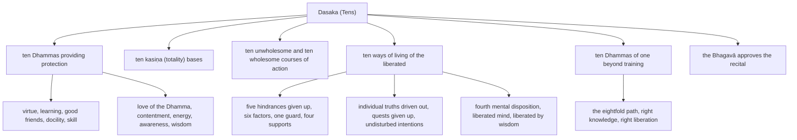

import { Tabs, TabItem } from '@astrojs/starlight/components';

Original text: [8D/10.10 Dasaka 1102–1131](https://tipitaka2500.github.io/tipitaka/8D/10/10.10.html#1102) in the [World Tipitaka Edition](https://tipitaka2500.github.io)

## Summary

The Tens close the Saṅgītisutta: six lists of ten, recited by āyasmā Sāriputta to the bhikkhū at Pāvā. Four are bare lists—the `kasiṇa` (totality) bases, the unwholesome and the wholesome courses of action, and the Dhammas of one beyond training—and two are explained item by item: the ten Dhammas providing protection, which describe a bhikkhu's training from virtue to wisdom, and the ten ways of living of the liberated, which describe one whose training is complete. The Bhagavā then gets up, approves the recital, and the bhikkhū rejoice.

## Diagram

## Text

<Tabs syncKey="paliquote">
<TabItem label="My Translation">
(345.)

1102\. Āvuso, there are ten Dhammas well proclaimed by the Bhagavā, the liberated one, the perfectly awakened one, who knows and sees. Therein all should recite in harmony, not quarrel, so that this optimal life may endure long and last for a long time, which would be for the welfare and happiness of many people, out of compassion for the world, for the good, welfare, and happiness of gods and humans. What ten?

1103\. Ten Dhammas providing protection. Here, Āvuso, a bhikkhu is virtuous. He dwells restrained by the restraint of the `pātimokkha` (precepts for monastics), knowing how to behave and keep to suitable places, seeing danger in the tiniest faults; he trains in the training rules having undertaken them. That, Āvuso, a bhikkhu is virtuous, dwells restrained by the restraint of the `pātimokkha`, knows how to behave and keep to suitable places, sees danger in the tiniest faults, and trains in the training rules having undertaken them. This too is a Dhamma providing protection. (1.1)

1104\. And furthermore, Āvuso, a bhikkhu is very learned, has learned by heart, and stores up learning. Those teachings that are good in the beginning, good in the middle, and good in the end, meaningful and well-phrased, which proclaim the wholly complete and perfectly pure optimal life — such teachings he has learned much of, remembered, rehearsed verbally, mentally recollected, and thoroughly penetrated by view. That, Āvuso, a bhikkhu is very learned … and so on … thoroughly penetrated by view. This too is a Dhamma providing protection. (1.2)

1105\. And furthermore, Āvuso, a bhikkhu has good friends, good companions, and good associates. That, Āvuso, a bhikkhu has good friends, good companions, and good associates. This too is a Dhamma providing protection. (1.3)

1106\. And furthermore, Āvuso, a bhikkhu is docile, endowed with qualities that make for docility, patient, and grasps instruction in the right way. That, Āvuso, a bhikkhu is docile … and so on … grasps instruction in the right way. This too is a Dhamma providing protection. (1.4)

1107\. And furthermore, Āvuso, whatever various duties there are for his spiritual companions, a bhikkhu is skilled and active in them, endowed with the inquiry relevant to them, able to do them and able to organise them. That, Āvuso, a bhikkhu, whatever [duties] there are for his spiritual companions … and so on … able to organise them. This too is a Dhamma providing protection. (1.5)

1108\. And furthermore, Āvuso, a bhikkhu loves the Dhamma, is lovely to talk to, and experiences great happiness in the details of the Dhamma and the details of the Vinaya. That, Āvuso, a bhikkhu loves the Dhamma … and so on … experiences great happiness. This too is a Dhamma providing protection. (1.6)

1109\. And furthermore, Āvuso, a bhikkhu is content with any kind of robes, alms food, lodgings, and medicines for the sick. That, Āvuso, a bhikkhu is content … and so on … requisites. This too is a Dhamma providing protection. (1.7)

1110\. And furthermore, Āvuso, a bhikkhu dwells energetic for the giving up of unwholesome characteristics and for the taking up of wholesome characteristics; he has stamina, has persistent effort, and does not shirk his duty towards wholesome characteristics. That, Āvuso, a bhikkhu dwells energetic … and so on … does not shirk his duty towards wholesome characteristics. This too is a Dhamma providing protection. (1.8)

1111\. And furthermore, Āvuso, a bhikkhu has awareness, is endowed with the highest careful awareness, and remembers and recollects even what was done long ago and even what was said long ago. That, Āvuso, a bhikkhu has awareness … and so on … remembers and recollects. This too is a Dhamma providing protection. (1.9)

1112\. And furthermore, Āvuso, a bhikkhu is wise, endowed with wisdom that discerns appearance and disappearance, which is of the liberated, penetrating, and leads to the complete wearing away of suffering. That, Āvuso, a bhikkhu is wise … and so on … leads to the complete wearing away of suffering. This too is a Dhamma providing protection. (1.10)

(346.)

1113\. Ten `kasiṇa` (totality) bases. One perceives the earth `kasiṇa` above, below, across, non-dual, immeasurable. One perceives the water `kasiṇa` … and so on … one perceives the fire `kasiṇa` … one perceives the wind `kasiṇa` … one perceives the blue `kasiṇa` … one perceives the yellow `kasiṇa` … one perceives the red `kasiṇa` … one perceives the white `kasiṇa` … one perceives the space `kasiṇa` … one perceives the consciousness `kasiṇa` above, below, across, non-dual, immeasurable. (2)

(347.)

1114\. Ten unwholesome courses of action: killing living beings, theft, sexual misconduct, false speech, slanderous speech, harsh speech, gossip, covetousness, ill will, and wrong view. (3)

1115\. Ten wholesome courses of action: abstinence from killing living beings, abstinence from theft, abstinence from sexual misconduct, abstinence from false speech, abstinence from slanderous speech, abstinence from harsh speech, abstinence from gossip, non-covetousness, non-ill will, and right view. (4)

(348.)

1116\. Ten ways of living of the liberated. Here, Āvuso, a bhikkhu has given up five factors, is endowed with six factors, has a single guard, has four supports, has driven out the individual truths, has given up all quests, has undisturbed intentions, has tranquillised the physical processes, has a well-liberated mind, and is well liberated by wisdom.

1117\. And how, Āvuso, has a bhikkhu given up five factors? Here, Āvuso, a bhikkhu's sensual desire is given up, his ill will is given up, his sloth and torpor are given up, his restlessness and remorse are given up, and his doubt is given up. Thus, Āvuso, a bhikkhu has given up five factors. (5.1)

1118\. And how, Āvuso, is a bhikkhu endowed with six factors? Here, Āvuso, when a bhikkhu sees a form with the eye, he is neither glad nor dejected; he remains equanimous, aware, and clearly comprehending. When he hears a sound with the ear … and so on … when he cognises a mind-object with the mind, he is neither glad nor dejected; he remains equanimous, aware and clearly comprehending. Thus, Āvuso, a bhikkhu is endowed with six factors. (5.2)

1119\. And how, Āvuso, does a bhikkhu have a single guard? Here, Āvuso, a bhikkhu is endowed with a mind guarded by awareness. Thus, Āvuso, a bhikkhu has a single guard. (5.3)

1120\. And how, Āvuso, does a bhikkhu have four supports? Here, Āvuso, having reckoned, a bhikkhu uses one thing; having reckoned, he endures one thing; having reckoned, he avoids one thing; having reckoned, he dispels one thing. Thus, Āvuso, a bhikkhu has four supports. (5.4)

1121\. And how, Āvuso, has a bhikkhu driven out the individual truths? Here, Āvuso, whatever various individual truths of the various religious practitioners a bhikkhu has, they are all dispelled, driven out, abandoned, cast off, released, given up, and renounced. Thus, Āvuso, a bhikkhu has driven out the individual truths. (5.5)

1122\. And how, Āvuso, has a bhikkhu given up all quests? Here, Āvuso, a bhikkhu's quest for sensual pleasures is given up, his quest for existence is given up, and his quest for the optimal life has subsided. Thus, Āvuso, a bhikkhu has given up all quests. (5.6)

1123\. And how, Āvuso, does a bhikkhu have undisturbed intentions? Here, Āvuso, a bhikkhu's intention of sensual desire is given up, his intention of ill will is given up, and his intention of harming is given up. Thus, Āvuso, a bhikkhu has undisturbed intentions. (5.7)

1124\. And how, Āvuso, has a bhikkhu tranquillised the physical processes? Here, Āvuso, a bhikkhu, with the giving up of the pleasant and the unpleasant, and with the previous disappearance of mental pleasure and displeasure, enters and remains in the fourth mental disposition, in a neutral state, and possessing purification of awareness by equanimity. Thus, Āvuso, a bhikkhu has tranquillised the physical processes. (5.8)

1125\. And how, Āvuso, does a bhikkhu have a well-liberated mind? Here, Āvuso, a bhikkhu's mind is liberated from passion, his mind is liberated from hatred, and his mind is liberated from delusion. Thus, Āvuso, a bhikkhu has a well-liberated mind. (5.9)

1126\. And how, Āvuso, is a bhikkhu well liberated by wisdom? Here, Āvuso, a bhikkhu knows clearly: ‘My passion is given up, cut off at the root, made like a palm stump, obliterated, and not subject to future arising.’ He knows clearly: ‘My hatred is given up, cut off at the root, made like a palm stump, obliterated, and not subject to future arising.’ He knows clearly: ‘My delusion is given up, cut off at the root, made like a palm stump, obliterated, and not subject to future arising.’ Thus, Āvuso, a bhikkhu is well liberated by wisdom. (5.10)

1127\. Ten Dhammas of one beyond training: the right view of one beyond training, the right resolve of one beyond training, the right speech of one beyond training, the right action of one beyond training, the right livelihood of one beyond training, the right effort of one beyond training, the right awareness of one beyond training, the right focus of one beyond training, the right knowledge of one beyond training, and the right liberation of one beyond training. (6)

1128\. Āvuso, these are the ten Dhammas well proclaimed by the Bhagavā, the liberated one, the perfectly awakened one, who knows and sees. Therein all should recite in harmony, not quarrel, so that this optimal life may endure long and last for a long time, which would be for the welfare and happiness of many people, out of compassion for the world, for the good, welfare, and happiness of gods and humans.”

(349.)

1129\. Then the Bhagavā, having got up, addressed āyasmā Sāriputta, “Excellent, excellent, Sāriputta; it is excellent indeed, Sāriputta, that you have spoken the `saṅgītipariyāya` (discourse for communal recitation) to the bhikkhū.”

1130\. This āyasmā Sāriputta said, and the Teacher approved. Those bhikkhū, delighted, rejoiced in āyasmā Sāriputta’s words.

1131\. The Discourse on Communal Recitation, the tenth, is finished.
</TabItem>

<TabItem label="Pāḷi (Roman IAST)">
(345.)

1102\. Atthi kho, āvuso, tena bhagavatā jānatā passatā arahatā sammāsambuddhena dasa dhammā sammadakkhātā. Tattha sabbeheva saṅgāyitabbaṃ…pe… atthāya hitāya sukhāya devamanussānaṃ. Katame dasa?

1103\. Dasa nāthakaraṇā dhammā. Idhāvuso, bhikkhu sīlavā hoti. Pātimokkhasaṃvarasaṃvuto viharati ācāragocarasampanno, aṇumattesu vajjesu bhayadassāvī samādāya sikkhati sikkhāpadesu. Yaṃpāvuso, bhikkhu sīlavā hoti, pātimokkhasaṃvarasaṃvuto viharati, ācāragocarasampanno, aṇumattesu vajjesu bhayadassāvī samādāya sikkhati sikkhāpadesu. Ayampi dhammo nāthakaraṇo. (1.1)

1104\. Puna caparaṃ, āvuso, bhikkhu bahussuto hoti sutadharo sutasannicayo. Ye te dhammā ādikalyāṇā majjhekalyāṇā pariyosānakalyāṇā sātthā sabyañjanā kevalaparipuṇṇaṃ parisuddhaṃ brahmacariyaṃ abhivadanti, tathārūpāssa dhammā bahussutā honti dhātā vacasā paricitā manasānupekkhitā diṭṭhiyā suppaṭividdhā. Yaṃpāvuso, bhikkhu bahussuto hoti…pe… diṭṭhiyā suppaṭividdhā. Ayampi dhammo nāthakaraṇo. (1.2)

1105\. Puna caparaṃ, āvuso, bhikkhu kalyāṇamitto hoti kalyāṇasahāyo kalyāṇasampavaṅko. Yaṃpāvuso, bhikkhu kalyāṇamitto hoti kalyāṇasahāyo kalyāṇasampavaṅko. Ayampi dhammo nāthakaraṇo. (1.3)

1106\. Puna caparaṃ, āvuso, bhikkhu suvaco hoti sovacassakaraṇehi dhammehi samannāgato khamo padakkhiṇaggāhī anusāsaniṃ. Yaṃpāvuso, bhikkhu suvaco hoti…pe… padakkhiṇaggāhī anusāsaniṃ. Ayampi dhammo nāthakaraṇo. (1.4)

1107\. Puna caparaṃ, āvuso, bhikkhu yāni tāni sabrahmacārīnaṃ uccāvacāni kiṃkaraṇīyāni, tattha dakkho hoti analaso tatrupāyāya vīmaṃsāya samannāgato, alaṃ kātuṃ alaṃ saṃvidhātuṃ. Yaṃpāvuso, bhikkhu yāni tāni sabrahmacārīnaṃ…pe… alaṃ saṃvidhātuṃ. Ayampi dhammo nāthakaraṇo. (1.5)

1108\. Puna caparaṃ, āvuso, bhikkhu dhammakāmo hoti piyasamudāhāro, abhidhamme abhivinaye uḷārapāmojjo. Yaṃpāvuso, bhikkhu dhammakāmo hoti…pe… uḷārapāmojjo. Ayampi dhammo nāthakaraṇo. (1.6)

1109\. Puna caparaṃ, āvuso, bhikkhu santuṭṭho hoti itarītarehi cīvarapiṇḍapātasenāsanagilānappaccayabhesajjaparikkhārehi. Yaṃpāvuso, bhikkhu santuṭṭho hoti…pe… parikkhārehi. Ayampi dhammo nāthakaraṇo. (1.7)

1110\. Puna caparaṃ, āvuso, bhikkhu āraddhavīriyo viharati akusalānaṃ dhammānaṃ pahānāya kusalānaṃ dhammānaṃ upasampadāya, thāmavā daḷhaparakkamo anikkhittadhuro kusalesu dhammesu. Yaṃpāvuso, bhikkhu āraddhavīriyo viharati…pe… anikkhittadhuro kusalesu dhammesu. Ayampi dhammo nāthakaraṇo. (1.8)

1111\. Puna caparaṃ, āvuso, bhikkhu satimā hoti paramena satinepakkena samannāgato cirakatampi cirabhāsitampi saritā anussaritā. Yaṃpāvuso, bhikkhu satimā hoti…pe… saritā anussaritā. Ayampi dhammo nāthakaraṇo. (1.9)

1112\. Puna caparaṃ, āvuso, bhikkhu paññavā hoti, udayatthagāminiyā paññāya samannāgato ariyāya nibbedhikāya sammādukkhakkhayagāminiyā. Yaṃpāvuso, bhikkhu paññavā hoti…pe… sammādukkhakkhayagāminiyā. Ayampi dhammo nāthakaraṇo. (1.10)

(346.)

1113\. Dasa kasiṇāyatanāni. Pathavīkasiṇameko sañjānāti, uddhaṃ adho tiriyaṃ advayaṃ appamāṇaṃ. Āpokasiṇameko sañjānāti…pe… tejokasiṇameko sañjānāti… vāyokasiṇameko sañjānāti… nīlakasiṇameko sañjānāti… pītakasiṇameko sañjānāti… lohitakasiṇameko sañjānāti… odātakasiṇameko sañjānāti… ākāsakasiṇameko sañjānāti… viññāṇakasiṇameko sañjānāti, uddhaṃ adho tiriyaṃ advayaṃ appamāṇaṃ. (2)

(347.)

1114\. Dasa akusalakammapathā— pāṇātipāto, adinnādānaṃ, kāmesumicchācāro, musāvādo, pisuṇā vācā, pharusā vācā, samphappalāpo, abhijjhā, byāpādo, micchādiṭṭhi. (3)

1115\. Dasa kusalakammapathā— pāṇātipātā veramaṇī, adinnādānā veramaṇī, kāmesumicchācārā veramaṇī, musāvādā veramaṇī, pisuṇāya vācāya veramaṇī, pharusāya vācāya veramaṇī, samphappalāpā veramaṇī, anabhijjhā, abyāpādo, sammādiṭṭhi. (4)

(348.)

1116\. Dasa ariyavāsā. Idhāvuso, bhikkhu pañcaṅgavippahīno hoti, chaḷaṅgasamannāgato, ekārakkho, caturāpasseno, paṇunnapaccekasacco, samavayasaṭṭhesano, anāvilasaṅkappo, passaddhakāyasaṅkhāro, suvimuttacitto, suvimuttapañño.

1117\. Kathañcāvuso, bhikkhu pañcaṅgavippahīno hoti? Idhāvuso, bhikkhuno kāmacchando pahīno hoti, byāpādo pahīno hoti, thinamiddhaṃ pahīnaṃ hoti, uddhaccakukkuccaṃ pahīnaṃ hoti, vicikicchā pahīnā hoti. Evaṃ kho, āvuso, bhikkhu pañcaṅgavippahīno hoti. (5.1)

1118\. Kathañcāvuso, bhikkhu chaḷaṅgasamannāgato hoti? Idhāvuso, bhikkhu cakkhunā rūpaṃ disvā neva sumano hoti na dummano, upekkhako viharati sato sampajāno. Sotena saddaṃ sutvā…pe… manasā dhammaṃ viññāya neva sumano hoti na dummano, upekkhako viharati sato sampajāno. Evaṃ kho, āvuso, bhikkhu chaḷaṅgasamannāgato hoti. (5.2)

1119\. Kathañcāvuso, bhikkhu ekārakkho hoti? Idhāvuso, bhikkhu satārakkhena cetasā samannāgato hoti. Evaṃ kho, āvuso, bhikkhu ekārakkho hoti. (5.3)

1120\. Kathañcāvuso, bhikkhu caturāpasseno hoti? Idhāvuso, bhikkhu saṅkhāyekaṃ paṭisevati, saṅkhāyekaṃ adhivāseti, saṅkhāyekaṃ parivajjeti, saṅkhāyekaṃ vinodeti. Evaṃ kho, āvuso, bhikkhu caturāpasseno hoti. (5.4)

1121\. Kathañcāvuso, bhikkhu paṇunnapaccekasacco hoti? Idhāvuso, bhikkhuno yāni tāni puthusamaṇabrāhmaṇānaṃ puthupaccekasaccāni, sabbāni tāni nunnāni honti paṇunnāni cattāni vantāni muttāni pahīnāni paṭinissaṭṭhāni. Evaṃ kho, āvuso, bhikkhu paṇunnapaccekasacco hoti. (5.5)

1122\. Kathañcāvuso, bhikkhu samavayasaṭṭhesano hoti? Idhāvuso, bhikkhuno kāmesanā pahīnā hoti, bhavesanā pahīnā hoti, brahmacariyesanā paṭippassaddhā. Evaṃ kho, āvuso, bhikkhu samavayasaṭṭhesano hoti. (5.6)

1123\. Kathañcāvuso, bhikkhu anāvilasaṅkappo hoti? Idhāvuso, bhikkhuno kāmasaṅkappo pahīno hoti, byāpādasaṅkappo pahīno hoti, vihiṃsāsaṅkappo pahīno hoti. Evaṃ kho, āvuso, bhikkhu anāvilasaṅkappo hoti. (5.7)

1124\. Kathañcāvuso, bhikkhu passaddhakāyasaṅkhāro hoti? Idhāvuso, bhikkhu sukhassa ca pahānā dukkhassa ca pahānā pubbeva somanassadomanassānaṃ atthaṅgamā adukkhamasukhaṃ upekkhāsatipārisuddhiṃ catutthaṃ jhānaṃ upasampajja viharati. Evaṃ kho, āvuso, bhikkhu passaddhakāyasaṅkhāro hoti. (5.8)

1125\. Kathañcāvuso, bhikkhu suvimuttacitto hoti? Idhāvuso, bhikkhuno rāgā cittaṃ vimuttaṃ hoti, dosā cittaṃ vimuttaṃ hoti, mohā cittaṃ vimuttaṃ hoti. Evaṃ kho, āvuso, bhikkhu suvimuttacitto hoti. (5.9)

1126\. Kathañcāvuso, bhikkhu suvimuttapañño hoti? Idhāvuso, bhikkhu ‘rāgo me pahīno ucchinnamūlo tālāvatthukato anabhāvaṃkato āyatiṃ anuppādadhammo’ti pajānāti. ‘Doso me pahīno ucchinnamūlo tālāvatthukato anabhāvaṃkato āyatiṃ anuppādadhammo’ti pajānāti. ‘Moho me pahīno ucchinnamūlo tālāvatthukato anabhāvaṃkato āyatiṃ anuppādadhammo’ti pajānāti. Evaṃ kho, āvuso, bhikkhu suvimuttapañño hoti. (5.10)

1127\. Dasa asekkhā dhammā— asekkhā sammādiṭṭhi, asekkho sammāsaṅkappo, asekkhā sammāvācā, asekkho sammākammanto, asekkho sammāājīvo, asekkho sammāvāyāmo, asekkhā sammāsati, asekkho sammāsamādhi, asekkhaṃ sammāñāṇaṃ, asekkhā sammāvimutti. (6)

1128\. Ime kho, āvuso, tena bhagavatā jānatā passatā arahatā sammāsambuddhena dasa dhammā sammadakkhātā. Tattha sabbeheva saṅgāyitabbaṃ na vivaditabbaṃ, yathayidaṃ brahmacariyaṃ addhaniyaṃ assa ciraṭṭhitikaṃ, tadassa bahujanahitāya bahujanasukhāya lokānukampāya atthāya hitāya sukhāya devamanussānan”ti.

(349.)

1129\. Atha kho bhagavā uṭṭhahitvā āyasmantaṃ sāriputtaṃ āmantesi— “sādhu sādhu, sāriputta, sādhu kho tvaṃ, sāriputta, bhikkhūnaṃ saṅgītipariyāyaṃ abhāsī”ti.

1130\. Idamavocāyasmā sāriputto, samanuñño satthā ahosi. Attamanā te bhikkhū āyasmato sāriputtassa bhāsitaṃ abhinandunti.

1131\. Saṅgītisuttaṃ niṭṭhitaṃ dasamaṃ.
</TabItem>

<TabItem label="Pāḷi (Brahmi)">
(345.)

1102\. 𑀅𑀢𑁆𑀣𑀺 𑀔𑁄, 𑀆𑀯𑀼𑀲𑁄, 𑀢𑁂𑀦 𑀪𑀕𑀯𑀢𑀸 𑀚𑀸𑀦𑀢𑀸 𑀧𑀲𑁆𑀲𑀢𑀸 𑀅𑀭𑀳𑀢𑀸 𑀲𑀫𑁆𑀫𑀸𑀲𑀫𑁆𑀩𑀼𑀤𑁆𑀥𑁂𑀦 𑀤𑀲 𑀥𑀫𑁆𑀫𑀸 𑀲𑀫𑁆𑀫𑀤𑀓𑁆𑀔𑀸𑀢𑀸. 𑀢𑀢𑁆𑀣 𑀲𑀩𑁆𑀩𑁂𑀳𑁂𑀯 𑀲𑀗𑁆𑀕𑀸𑀬𑀺𑀢𑀩𑁆𑀩𑀁…𑀧𑁂… 𑀅𑀢𑁆𑀣𑀸𑀬 𑀳𑀺𑀢𑀸𑀬 𑀲𑀼𑀔𑀸𑀬 𑀤𑁂𑀯𑀫𑀦𑀼𑀲𑁆𑀲𑀸𑀦𑀁. 𑀓𑀢𑀫𑁂 𑀤𑀲?

1103\. 𑀤𑀲 𑀦𑀸𑀣𑀓𑀭𑀡𑀸 𑀥𑀫𑁆𑀫𑀸. 𑀇𑀥𑀸𑀯𑀼𑀲𑁄, 𑀪𑀺𑀓𑁆𑀔𑀼 𑀲𑀻𑀮𑀯𑀸 𑀳𑁄𑀢𑀺. 𑀧𑀸𑀢𑀺𑀫𑁄𑀓𑁆𑀔𑀲𑀁𑀯𑀭𑀲𑀁𑀯𑀼𑀢𑁄 𑀯𑀺𑀳𑀭𑀢𑀺 𑀆𑀘𑀸𑀭𑀕𑁄𑀘𑀭𑀲𑀫𑁆𑀧𑀦𑁆𑀦𑁄, 𑀅𑀡𑀼𑀫𑀢𑁆𑀢𑁂𑀲𑀼 𑀯𑀚𑁆𑀚𑁂𑀲𑀼 𑀪𑀬𑀤𑀲𑁆𑀲𑀸𑀯𑀻 𑀲𑀫𑀸𑀤𑀸𑀬 𑀲𑀺𑀓𑁆𑀔𑀢𑀺 𑀲𑀺𑀓𑁆𑀔𑀸𑀧𑀤𑁂𑀲𑀼. 𑀬𑀁𑀧𑀸𑀯𑀼𑀲𑁄, 𑀪𑀺𑀓𑁆𑀔𑀼 𑀲𑀻𑀮𑀯𑀸 𑀳𑁄𑀢𑀺, 𑀧𑀸𑀢𑀺𑀫𑁄𑀓𑁆𑀔𑀲𑀁𑀯𑀭𑀲𑀁𑀯𑀼𑀢𑁄 𑀯𑀺𑀳𑀭𑀢𑀺, 𑀆𑀘𑀸𑀭𑀕𑁄𑀘𑀭𑀲𑀫𑁆𑀧𑀦𑁆𑀦𑁄, 𑀅𑀡𑀼𑀫𑀢𑁆𑀢𑁂𑀲𑀼 𑀯𑀚𑁆𑀚𑁂𑀲𑀼 𑀪𑀬𑀤𑀲𑁆𑀲𑀸𑀯𑀻 𑀲𑀫𑀸𑀤𑀸𑀬 𑀲𑀺𑀓𑁆𑀔𑀢𑀺 𑀲𑀺𑀓𑁆𑀔𑀸𑀧𑀤𑁂𑀲𑀼. 𑀅𑀬𑀫𑁆𑀧𑀺 𑀥𑀫𑁆𑀫𑁄 𑀦𑀸𑀣𑀓𑀭𑀡𑁄. (1.1)

1104\. 𑀧𑀼𑀦 𑀘𑀧𑀭𑀁, 𑀆𑀯𑀼𑀲𑁄, 𑀪𑀺𑀓𑁆𑀔𑀼 𑀩𑀳𑀼𑀲𑁆𑀲𑀼𑀢𑁄 𑀳𑁄𑀢𑀺 𑀲𑀼𑀢𑀥𑀭𑁄 𑀲𑀼𑀢𑀲𑀦𑁆𑀦𑀺𑀘𑀬𑁄. 𑀬𑁂 𑀢𑁂 𑀥𑀫𑁆𑀫𑀸 𑀆𑀤𑀺𑀓𑀮𑁆𑀬𑀸𑀡𑀸 𑀫𑀚𑁆𑀛𑁂𑀓𑀮𑁆𑀬𑀸𑀡𑀸 𑀧𑀭𑀺𑀬𑁄𑀲𑀸𑀦𑀓𑀮𑁆𑀬𑀸𑀡𑀸 𑀲𑀸𑀢𑁆𑀣𑀸 𑀲𑀩𑁆𑀬𑀜𑁆𑀚𑀦𑀸 𑀓𑁂𑀯𑀮𑀧𑀭𑀺𑀧𑀼𑀡𑁆𑀡𑀁 𑀧𑀭𑀺𑀲𑀼𑀤𑁆𑀥𑀁 𑀩𑁆𑀭𑀳𑁆𑀫𑀘𑀭𑀺𑀬𑀁 𑀅𑀪𑀺𑀯𑀤𑀦𑁆𑀢𑀺, 𑀢𑀣𑀸𑀭𑀽𑀧𑀸𑀲𑁆𑀲 𑀥𑀫𑁆𑀫𑀸 𑀩𑀳𑀼𑀲𑁆𑀲𑀼𑀢𑀸 𑀳𑁄𑀦𑁆𑀢𑀺 𑀥𑀸𑀢𑀸 𑀯𑀘𑀲𑀸 𑀧𑀭𑀺𑀘𑀺𑀢𑀸 𑀫𑀦𑀲𑀸𑀦𑀼𑀧𑁂𑀓𑁆𑀔𑀺𑀢𑀸 𑀤𑀺𑀝𑁆𑀞𑀺𑀬𑀸 𑀲𑀼𑀧𑁆𑀧𑀝𑀺𑀯𑀺𑀤𑁆𑀥𑀸. 𑀬𑀁𑀧𑀸𑀯𑀼𑀲𑁄, 𑀪𑀺𑀓𑁆𑀔𑀼 𑀩𑀳𑀼𑀲𑁆𑀲𑀼𑀢𑁄 𑀳𑁄𑀢𑀺…𑀧𑁂… 𑀤𑀺𑀝𑁆𑀞𑀺𑀬𑀸 𑀲𑀼𑀧𑁆𑀧𑀝𑀺𑀯𑀺𑀤𑁆𑀥𑀸. 𑀅𑀬𑀫𑁆𑀧𑀺 𑀥𑀫𑁆𑀫𑁄 𑀦𑀸𑀣𑀓𑀭𑀡𑁄. (1.2)

1105\. 𑀧𑀼𑀦 𑀘𑀧𑀭𑀁, 𑀆𑀯𑀼𑀲𑁄, 𑀪𑀺𑀓𑁆𑀔𑀼 𑀓𑀮𑁆𑀬𑀸𑀡𑀫𑀺𑀢𑁆𑀢𑁄 𑀳𑁄𑀢𑀺 𑀓𑀮𑁆𑀬𑀸𑀡𑀲𑀳𑀸𑀬𑁄 𑀓𑀮𑁆𑀬𑀸𑀡𑀲𑀫𑁆𑀧𑀯𑀗𑁆𑀓𑁄. 𑀬𑀁𑀧𑀸𑀯𑀼𑀲𑁄, 𑀪𑀺𑀓𑁆𑀔𑀼 𑀓𑀮𑁆𑀬𑀸𑀡𑀫𑀺𑀢𑁆𑀢𑁄 𑀳𑁄𑀢𑀺 𑀓𑀮𑁆𑀬𑀸𑀡𑀲𑀳𑀸𑀬𑁄 𑀓𑀮𑁆𑀬𑀸𑀡𑀲𑀫𑁆𑀧𑀯𑀗𑁆𑀓𑁄. 𑀅𑀬𑀫𑁆𑀧𑀺 𑀥𑀫𑁆𑀫𑁄 𑀦𑀸𑀣𑀓𑀭𑀡𑁄. (1.3)

1106\. 𑀧𑀼𑀦 𑀘𑀧𑀭𑀁, 𑀆𑀯𑀼𑀲𑁄, 𑀪𑀺𑀓𑁆𑀔𑀼 𑀲𑀼𑀯𑀘𑁄 𑀳𑁄𑀢𑀺 𑀲𑁄𑀯𑀘𑀲𑁆𑀲𑀓𑀭𑀡𑁂𑀳𑀺 𑀥𑀫𑁆𑀫𑁂𑀳𑀺 𑀲𑀫𑀦𑁆𑀦𑀸𑀕𑀢𑁄 𑀔𑀫𑁄 𑀧𑀤𑀓𑁆𑀔𑀺𑀡𑀕𑁆𑀕𑀸𑀳𑀻 𑀅𑀦𑀼𑀲𑀸𑀲𑀦𑀺𑀁. 𑀬𑀁𑀧𑀸𑀯𑀼𑀲𑁄, 𑀪𑀺𑀓𑁆𑀔𑀼 𑀲𑀼𑀯𑀘𑁄 𑀳𑁄𑀢𑀺…𑀧𑁂… 𑀧𑀤𑀓𑁆𑀔𑀺𑀡𑀕𑁆𑀕𑀸𑀳𑀻 𑀅𑀦𑀼𑀲𑀸𑀲𑀦𑀺𑀁. 𑀅𑀬𑀫𑁆𑀧𑀺 𑀥𑀫𑁆𑀫𑁄 𑀦𑀸𑀣𑀓𑀭𑀡𑁄. (1.4)

1107\. 𑀧𑀼𑀦 𑀘𑀧𑀭𑀁, 𑀆𑀯𑀼𑀲𑁄, 𑀪𑀺𑀓𑁆𑀔𑀼 𑀬𑀸𑀦𑀺 𑀢𑀸𑀦𑀺 𑀲𑀩𑁆𑀭𑀳𑁆𑀫𑀘𑀸𑀭𑀻𑀦𑀁 𑀉𑀘𑁆𑀘𑀸𑀯𑀘𑀸𑀦𑀺 𑀓𑀺𑀁𑀓𑀭𑀡𑀻𑀬𑀸𑀦𑀺, 𑀢𑀢𑁆𑀣 𑀤𑀓𑁆𑀔𑁄 𑀳𑁄𑀢𑀺 𑀅𑀦𑀮𑀲𑁄 𑀢𑀢𑁆𑀭𑀼𑀧𑀸𑀬𑀸𑀬 𑀯𑀻𑀫𑀁𑀲𑀸𑀬 𑀲𑀫𑀦𑁆𑀦𑀸𑀕𑀢𑁄, 𑀅𑀮𑀁 𑀓𑀸𑀢𑀼𑀁 𑀅𑀮𑀁 𑀲𑀁𑀯𑀺𑀥𑀸𑀢𑀼𑀁. 𑀬𑀁𑀧𑀸𑀯𑀼𑀲𑁄, 𑀪𑀺𑀓𑁆𑀔𑀼 𑀬𑀸𑀦𑀺 𑀢𑀸𑀦𑀺 𑀲𑀩𑁆𑀭𑀳𑁆𑀫𑀘𑀸𑀭𑀻𑀦𑀁…𑀧𑁂… 𑀅𑀮𑀁 𑀲𑀁𑀯𑀺𑀥𑀸𑀢𑀼𑀁. 𑀅𑀬𑀫𑁆𑀧𑀺 𑀥𑀫𑁆𑀫𑁄 𑀦𑀸𑀣𑀓𑀭𑀡𑁄. (1.5)

1108\. 𑀧𑀼𑀦 𑀘𑀧𑀭𑀁, 𑀆𑀯𑀼𑀲𑁄, 𑀪𑀺𑀓𑁆𑀔𑀼 𑀥𑀫𑁆𑀫𑀓𑀸𑀫𑁄 𑀳𑁄𑀢𑀺 𑀧𑀺𑀬𑀲𑀫𑀼𑀤𑀸𑀳𑀸𑀭𑁄, 𑀅𑀪𑀺𑀥𑀫𑁆𑀫𑁂 𑀅𑀪𑀺𑀯𑀺𑀦𑀬𑁂 𑀉𑀍𑀆𑀭𑀧𑀸𑀫𑁄𑀚𑁆𑀚𑁄. 𑀬𑀁𑀧𑀸𑀯𑀼𑀲𑁄, 𑀪𑀺𑀓𑁆𑀔𑀼 𑀥𑀫𑁆𑀫𑀓𑀸𑀫𑁄 𑀳𑁄𑀢𑀺…𑀧𑁂… 𑀉𑀍𑀆𑀭𑀧𑀸𑀫𑁄𑀚𑁆𑀚𑁄. 𑀅𑀬𑀫𑁆𑀧𑀺 𑀥𑀫𑁆𑀫𑁄 𑀦𑀸𑀣𑀓𑀭𑀡𑁄. (1.6)

1109\. 𑀧𑀼𑀦 𑀘𑀧𑀭𑀁, 𑀆𑀯𑀼𑀲𑁄, 𑀪𑀺𑀓𑁆𑀔𑀼 𑀲𑀦𑁆𑀢𑀼𑀝𑁆𑀞𑁄 𑀳𑁄𑀢𑀺 𑀇𑀢𑀭𑀻𑀢𑀭𑁂𑀳𑀺 𑀘𑀻𑀯𑀭𑀧𑀺𑀡𑁆𑀟𑀧𑀸𑀢𑀲𑁂𑀦𑀸𑀲𑀦𑀕𑀺𑀮𑀸𑀦𑀧𑁆𑀧𑀘𑁆𑀘𑀬𑀪𑁂𑀲𑀚𑁆𑀚𑀧𑀭𑀺𑀓𑁆𑀔𑀸𑀭𑁂𑀳𑀺. 𑀬𑀁𑀧𑀸𑀯𑀼𑀲𑁄, 𑀪𑀺𑀓𑁆𑀔𑀼 𑀲𑀦𑁆𑀢𑀼𑀝𑁆𑀞𑁄 𑀳𑁄𑀢𑀺…𑀧𑁂… 𑀧𑀭𑀺𑀓𑁆𑀔𑀸𑀭𑁂𑀳𑀺. 𑀅𑀬𑀫𑁆𑀧𑀺 𑀥𑀫𑁆𑀫𑁄 𑀦𑀸𑀣𑀓𑀭𑀡𑁄. (1.7)

1110\. 𑀧𑀼𑀦 𑀘𑀧𑀭𑀁, 𑀆𑀯𑀼𑀲𑁄, 𑀪𑀺𑀓𑁆𑀔𑀼 𑀆𑀭𑀤𑁆𑀥𑀯𑀻𑀭𑀺𑀬𑁄 𑀯𑀺𑀳𑀭𑀢𑀺 𑀅𑀓𑀼𑀲𑀮𑀸𑀦𑀁 𑀥𑀫𑁆𑀫𑀸𑀦𑀁 𑀧𑀳𑀸𑀦𑀸𑀬 𑀓𑀼𑀲𑀮𑀸𑀦𑀁 𑀥𑀫𑁆𑀫𑀸𑀦𑀁 𑀉𑀧𑀲𑀫𑁆𑀧𑀤𑀸𑀬, 𑀣𑀸𑀫𑀯𑀸 𑀤𑀍𑀳𑀧𑀭𑀓𑁆𑀓𑀫𑁄 𑀅𑀦𑀺𑀓𑁆𑀔𑀺𑀢𑁆𑀢𑀥𑀼𑀭𑁄 𑀓𑀼𑀲𑀮𑁂𑀲𑀼 𑀥𑀫𑁆𑀫𑁂𑀲𑀼. 𑀬𑀁𑀧𑀸𑀯𑀼𑀲𑁄, 𑀪𑀺𑀓𑁆𑀔𑀼 𑀆𑀭𑀤𑁆𑀥𑀯𑀻𑀭𑀺𑀬𑁄 𑀯𑀺𑀳𑀭𑀢𑀺…𑀧𑁂… 𑀅𑀦𑀺𑀓𑁆𑀔𑀺𑀢𑁆𑀢𑀥𑀼𑀭𑁄 𑀓𑀼𑀲𑀮𑁂𑀲𑀼 𑀥𑀫𑁆𑀫𑁂𑀲𑀼. 𑀅𑀬𑀫𑁆𑀧𑀺 𑀥𑀫𑁆𑀫𑁄 𑀦𑀸𑀣𑀓𑀭𑀡𑁄. (1.8)

1111\. 𑀧𑀼𑀦 𑀘𑀧𑀭𑀁, 𑀆𑀯𑀼𑀲𑁄, 𑀪𑀺𑀓𑁆𑀔𑀼 𑀲𑀢𑀺𑀫𑀸 𑀳𑁄𑀢𑀺 𑀧𑀭𑀫𑁂𑀦 𑀲𑀢𑀺𑀦𑁂𑀧𑀓𑁆𑀓𑁂𑀦 𑀲𑀫𑀦𑁆𑀦𑀸𑀕𑀢𑁄 𑀘𑀺𑀭𑀓𑀢𑀫𑁆𑀧𑀺 𑀘𑀺𑀭𑀪𑀸𑀲𑀺𑀢𑀫𑁆𑀧𑀺 𑀲𑀭𑀺𑀢𑀸 𑀅𑀦𑀼𑀲𑁆𑀲𑀭𑀺𑀢𑀸. 𑀬𑀁𑀧𑀸𑀯𑀼𑀲𑁄, 𑀪𑀺𑀓𑁆𑀔𑀼 𑀲𑀢𑀺𑀫𑀸 𑀳𑁄𑀢𑀺…𑀧𑁂… 𑀲𑀭𑀺𑀢𑀸 𑀅𑀦𑀼𑀲𑁆𑀲𑀭𑀺𑀢𑀸. 𑀅𑀬𑀫𑁆𑀧𑀺 𑀥𑀫𑁆𑀫𑁄 𑀦𑀸𑀣𑀓𑀭𑀡𑁄. (1.9)

1112\. 𑀧𑀼𑀦 𑀘𑀧𑀭𑀁, 𑀆𑀯𑀼𑀲𑁄, 𑀪𑀺𑀓𑁆𑀔𑀼 𑀧𑀜𑁆𑀜𑀯𑀸 𑀳𑁄𑀢𑀺, 𑀉𑀤𑀬𑀢𑁆𑀣𑀕𑀸𑀫𑀺𑀦𑀺𑀬𑀸 𑀧𑀜𑁆𑀜𑀸𑀬 𑀲𑀫𑀦𑁆𑀦𑀸𑀕𑀢𑁄 𑀅𑀭𑀺𑀬𑀸𑀬 𑀦𑀺𑀩𑁆𑀩𑁂𑀥𑀺𑀓𑀸𑀬 𑀲𑀫𑁆𑀫𑀸𑀤𑀼𑀓𑁆𑀔𑀓𑁆𑀔𑀬𑀕𑀸𑀫𑀺𑀦𑀺𑀬𑀸. 𑀬𑀁𑀧𑀸𑀯𑀼𑀲𑁄, 𑀪𑀺𑀓𑁆𑀔𑀼 𑀧𑀜𑁆𑀜𑀯𑀸 𑀳𑁄𑀢𑀺…𑀧𑁂… 𑀲𑀫𑁆𑀫𑀸𑀤𑀼𑀓𑁆𑀔𑀓𑁆𑀔𑀬𑀕𑀸𑀫𑀺𑀦𑀺𑀬𑀸. 𑀅𑀬𑀫𑁆𑀧𑀺 𑀥𑀫𑁆𑀫𑁄 𑀦𑀸𑀣𑀓𑀭𑀡𑁄. (1.10)

(346.)

1113\. 𑀤𑀲 𑀓𑀲𑀺𑀡𑀸𑀬𑀢𑀦𑀸𑀦𑀺. 𑀧𑀣𑀯𑀻𑀓𑀲𑀺𑀡𑀫𑁂𑀓𑁄 𑀲𑀜𑁆𑀚𑀸𑀦𑀸𑀢𑀺, 𑀉𑀤𑁆𑀥𑀁 𑀅𑀥𑁄 𑀢𑀺𑀭𑀺𑀬𑀁 𑀅𑀤𑁆𑀯𑀬𑀁 𑀅𑀧𑁆𑀧𑀫𑀸𑀡𑀁. 𑀆𑀧𑁄𑀓𑀲𑀺𑀡𑀫𑁂𑀓𑁄 𑀲𑀜𑁆𑀚𑀸𑀦𑀸𑀢𑀺…𑀧𑁂… 𑀢𑁂𑀚𑁄𑀓𑀲𑀺𑀡𑀫𑁂𑀓𑁄 𑀲𑀜𑁆𑀚𑀸𑀦𑀸𑀢𑀺… 𑀯𑀸𑀬𑁄𑀓𑀲𑀺𑀡𑀫𑁂𑀓𑁄 𑀲𑀜𑁆𑀚𑀸𑀦𑀸𑀢𑀺… 𑀦𑀻𑀮𑀓𑀲𑀺𑀡𑀫𑁂𑀓𑁄 𑀲𑀜𑁆𑀚𑀸𑀦𑀸𑀢𑀺… 𑀧𑀻𑀢𑀓𑀲𑀺𑀡𑀫𑁂𑀓𑁄 𑀲𑀜𑁆𑀚𑀸𑀦𑀸𑀢𑀺… 𑀮𑁄𑀳𑀺𑀢𑀓𑀲𑀺𑀡𑀫𑁂𑀓𑁄 𑀲𑀜𑁆𑀚𑀸𑀦𑀸𑀢𑀺… 𑀑𑀤𑀸𑀢𑀓𑀲𑀺𑀡𑀫𑁂𑀓𑁄 𑀲𑀜𑁆𑀚𑀸𑀦𑀸𑀢𑀺… 𑀆𑀓𑀸𑀲𑀓𑀲𑀺𑀡𑀫𑁂𑀓𑁄 𑀲𑀜𑁆𑀚𑀸𑀦𑀸𑀢𑀺… 𑀯𑀺𑀜𑁆𑀜𑀸𑀡𑀓𑀲𑀺𑀡𑀫𑁂𑀓𑁄 𑀲𑀜𑁆𑀚𑀸𑀦𑀸𑀢𑀺, 𑀉𑀤𑁆𑀥𑀁 𑀅𑀥𑁄 𑀢𑀺𑀭𑀺𑀬𑀁 𑀅𑀤𑁆𑀯𑀬𑀁 𑀅𑀧𑁆𑀧𑀫𑀸𑀡𑀁. (2)

(347.)

1114\. 𑀤𑀲 𑀅𑀓𑀼𑀲𑀮𑀓𑀫𑁆𑀫𑀧𑀣𑀸— 𑀧𑀸𑀡𑀸𑀢𑀺𑀧𑀸𑀢𑁄, 𑀅𑀤𑀺𑀦𑁆𑀦𑀸𑀤𑀸𑀦𑀁, 𑀓𑀸𑀫𑁂𑀲𑀼𑀫𑀺𑀘𑁆𑀙𑀸𑀘𑀸𑀭𑁄, 𑀫𑀼𑀲𑀸𑀯𑀸𑀤𑁄, 𑀧𑀺𑀲𑀼𑀡𑀸 𑀯𑀸𑀘𑀸, 𑀨𑀭𑀼𑀲𑀸 𑀯𑀸𑀘𑀸, 𑀲𑀫𑁆𑀨𑀧𑁆𑀧𑀮𑀸𑀧𑁄, 𑀅𑀪𑀺𑀚𑁆𑀛𑀸, 𑀩𑁆𑀬𑀸𑀧𑀸𑀤𑁄, 𑀫𑀺𑀘𑁆𑀙𑀸𑀤𑀺𑀝𑁆𑀞𑀺. (3)

1115\. 𑀤𑀲 𑀓𑀼𑀲𑀮𑀓𑀫𑁆𑀫𑀧𑀣𑀸— 𑀧𑀸𑀡𑀸𑀢𑀺𑀧𑀸𑀢𑀸 𑀯𑁂𑀭𑀫𑀡𑀻, 𑀅𑀤𑀺𑀦𑁆𑀦𑀸𑀤𑀸𑀦𑀸 𑀯𑁂𑀭𑀫𑀡𑀻, 𑀓𑀸𑀫𑁂𑀲𑀼𑀫𑀺𑀘𑁆𑀙𑀸𑀘𑀸𑀭𑀸 𑀯𑁂𑀭𑀫𑀡𑀻, 𑀫𑀼𑀲𑀸𑀯𑀸𑀤𑀸 𑀯𑁂𑀭𑀫𑀡𑀻, 𑀧𑀺𑀲𑀼𑀡𑀸𑀬 𑀯𑀸𑀘𑀸𑀬 𑀯𑁂𑀭𑀫𑀡𑀻, 𑀨𑀭𑀼𑀲𑀸𑀬 𑀯𑀸𑀘𑀸𑀬 𑀯𑁂𑀭𑀫𑀡𑀻, 𑀲𑀫𑁆𑀨𑀧𑁆𑀧𑀮𑀸𑀧𑀸 𑀯𑁂𑀭𑀫𑀡𑀻, 𑀅𑀦𑀪𑀺𑀚𑁆𑀛𑀸, 𑀅𑀩𑁆𑀬𑀸𑀧𑀸𑀤𑁄, 𑀲𑀫𑁆𑀫𑀸𑀤𑀺𑀝𑁆𑀞𑀺. (4)

(348.)

1116\. 𑀤𑀲 𑀅𑀭𑀺𑀬𑀯𑀸𑀲𑀸. 𑀇𑀥𑀸𑀯𑀼𑀲𑁄, 𑀪𑀺𑀓𑁆𑀔𑀼 𑀧𑀜𑁆𑀘𑀗𑁆𑀕𑀯𑀺𑀧𑁆𑀧𑀳𑀻𑀦𑁄 𑀳𑁄𑀢𑀺, 𑀙𑀍𑀅𑀗𑁆𑀕𑀲𑀫𑀦𑁆𑀦𑀸𑀕𑀢𑁄, 𑀏𑀓𑀸𑀭𑀓𑁆𑀔𑁄, 𑀘𑀢𑀼𑀭𑀸𑀧𑀲𑁆𑀲𑁂𑀦𑁄, 𑀧𑀡𑀼𑀦𑁆𑀦𑀧𑀘𑁆𑀘𑁂𑀓𑀲𑀘𑁆𑀘𑁄, 𑀲𑀫𑀯𑀬𑀲𑀝𑁆𑀞𑁂𑀲𑀦𑁄, 𑀅𑀦𑀸𑀯𑀺𑀮𑀲𑀗𑁆𑀓𑀧𑁆𑀧𑁄, 𑀧𑀲𑁆𑀲𑀤𑁆𑀥𑀓𑀸𑀬𑀲𑀗𑁆𑀔𑀸𑀭𑁄, 𑀲𑀼𑀯𑀺𑀫𑀼𑀢𑁆𑀢𑀘𑀺𑀢𑁆𑀢𑁄, 𑀲𑀼𑀯𑀺𑀫𑀼𑀢𑁆𑀢𑀧𑀜𑁆𑀜𑁄.

1117\. 𑀓𑀣𑀜𑁆𑀘𑀸𑀯𑀼𑀲𑁄, 𑀪𑀺𑀓𑁆𑀔𑀼 𑀧𑀜𑁆𑀘𑀗𑁆𑀕𑀯𑀺𑀧𑁆𑀧𑀳𑀻𑀦𑁄 𑀳𑁄𑀢𑀺? 𑀇𑀥𑀸𑀯𑀼𑀲𑁄, 𑀪𑀺𑀓𑁆𑀔𑀼𑀦𑁄 𑀓𑀸𑀫𑀘𑁆𑀙𑀦𑁆𑀤𑁄 𑀧𑀳𑀻𑀦𑁄 𑀳𑁄𑀢𑀺, 𑀩𑁆𑀬𑀸𑀧𑀸𑀤𑁄 𑀧𑀳𑀻𑀦𑁄 𑀳𑁄𑀢𑀺, 𑀣𑀺𑀦𑀫𑀺𑀤𑁆𑀥𑀁 𑀧𑀳𑀻𑀦𑀁 𑀳𑁄𑀢𑀺, 𑀉𑀤𑁆𑀥𑀘𑁆𑀘𑀓𑀼𑀓𑁆𑀓𑀼𑀘𑁆𑀘𑀁 𑀧𑀳𑀻𑀦𑀁 𑀳𑁄𑀢𑀺, 𑀯𑀺𑀘𑀺𑀓𑀺𑀘𑁆𑀙𑀸 𑀧𑀳𑀻𑀦𑀸 𑀳𑁄𑀢𑀺. 𑀏𑀯𑀁 𑀔𑁄, 𑀆𑀯𑀼𑀲𑁄, 𑀪𑀺𑀓𑁆𑀔𑀼 𑀧𑀜𑁆𑀘𑀗𑁆𑀕𑀯𑀺𑀧𑁆𑀧𑀳𑀻𑀦𑁄 𑀳𑁄𑀢𑀺. (5.1)

1118\. 𑀓𑀣𑀜𑁆𑀘𑀸𑀯𑀼𑀲𑁄, 𑀪𑀺𑀓𑁆𑀔𑀼 𑀙𑀍𑀅𑀗𑁆𑀕𑀲𑀫𑀦𑁆𑀦𑀸𑀕𑀢𑁄 𑀳𑁄𑀢𑀺? 𑀇𑀥𑀸𑀯𑀼𑀲𑁄, 𑀪𑀺𑀓𑁆𑀔𑀼 𑀘𑀓𑁆𑀔𑀼𑀦𑀸 𑀭𑀽𑀧𑀁 𑀤𑀺𑀲𑁆𑀯𑀸 𑀦𑁂𑀯 𑀲𑀼𑀫𑀦𑁄 𑀳𑁄𑀢𑀺 𑀦 𑀤𑀼𑀫𑁆𑀫𑀦𑁄, 𑀉𑀧𑁂𑀓𑁆𑀔𑀓𑁄 𑀯𑀺𑀳𑀭𑀢𑀺 𑀲𑀢𑁄 𑀲𑀫𑁆𑀧𑀚𑀸𑀦𑁄. 𑀲𑁄𑀢𑁂𑀦 𑀲𑀤𑁆𑀤𑀁 𑀲𑀼𑀢𑁆𑀯𑀸…𑀧𑁂… 𑀫𑀦𑀲𑀸 𑀥𑀫𑁆𑀫𑀁 𑀯𑀺𑀜𑁆𑀜𑀸𑀬 𑀦𑁂𑀯 𑀲𑀼𑀫𑀦𑁄 𑀳𑁄𑀢𑀺 𑀦 𑀤𑀼𑀫𑁆𑀫𑀦𑁄, 𑀉𑀧𑁂𑀓𑁆𑀔𑀓𑁄 𑀯𑀺𑀳𑀭𑀢𑀺 𑀲𑀢𑁄 𑀲𑀫𑁆𑀧𑀚𑀸𑀦𑁄. 𑀏𑀯𑀁 𑀔𑁄, 𑀆𑀯𑀼𑀲𑁄, 𑀪𑀺𑀓𑁆𑀔𑀼 𑀙𑀍𑀅𑀗𑁆𑀕𑀲𑀫𑀦𑁆𑀦𑀸𑀕𑀢𑁄 𑀳𑁄𑀢𑀺. (5.2)

1119\. 𑀓𑀣𑀜𑁆𑀘𑀸𑀯𑀼𑀲𑁄, 𑀪𑀺𑀓𑁆𑀔𑀼 𑀏𑀓𑀸𑀭𑀓𑁆𑀔𑁄 𑀳𑁄𑀢𑀺? 𑀇𑀥𑀸𑀯𑀼𑀲𑁄, 𑀪𑀺𑀓𑁆𑀔𑀼 𑀲𑀢𑀸𑀭𑀓𑁆𑀔𑁂𑀦 𑀘𑁂𑀢𑀲𑀸 𑀲𑀫𑀦𑁆𑀦𑀸𑀕𑀢𑁄 𑀳𑁄𑀢𑀺. 𑀏𑀯𑀁 𑀔𑁄, 𑀆𑀯𑀼𑀲𑁄, 𑀪𑀺𑀓𑁆𑀔𑀼 𑀏𑀓𑀸𑀭𑀓𑁆𑀔𑁄 𑀳𑁄𑀢𑀺. (5.3)

1120\. 𑀓𑀣𑀜𑁆𑀘𑀸𑀯𑀼𑀲𑁄, 𑀪𑀺𑀓𑁆𑀔𑀼 𑀘𑀢𑀼𑀭𑀸𑀧𑀲𑁆𑀲𑁂𑀦𑁄 𑀳𑁄𑀢𑀺? 𑀇𑀥𑀸𑀯𑀼𑀲𑁄, 𑀪𑀺𑀓𑁆𑀔𑀼 𑀲𑀗𑁆𑀔𑀸𑀬𑁂𑀓𑀁 𑀧𑀝𑀺𑀲𑁂𑀯𑀢𑀺, 𑀲𑀗𑁆𑀔𑀸𑀬𑁂𑀓𑀁 𑀅𑀥𑀺𑀯𑀸𑀲𑁂𑀢𑀺, 𑀲𑀗𑁆𑀔𑀸𑀬𑁂𑀓𑀁 𑀧𑀭𑀺𑀯𑀚𑁆𑀚𑁂𑀢𑀺, 𑀲𑀗𑁆𑀔𑀸𑀬𑁂𑀓𑀁 𑀯𑀺𑀦𑁄𑀤𑁂𑀢𑀺. 𑀏𑀯𑀁 𑀔𑁄, 𑀆𑀯𑀼𑀲𑁄, 𑀪𑀺𑀓𑁆𑀔𑀼 𑀘𑀢𑀼𑀭𑀸𑀧𑀲𑁆𑀲𑁂𑀦𑁄 𑀳𑁄𑀢𑀺. (5.4)

1121\. 𑀓𑀣𑀜𑁆𑀘𑀸𑀯𑀼𑀲𑁄, 𑀪𑀺𑀓𑁆𑀔𑀼 𑀧𑀡𑀼𑀦𑁆𑀦𑀧𑀘𑁆𑀘𑁂𑀓𑀲𑀘𑁆𑀘𑁄 𑀳𑁄𑀢𑀺? 𑀇𑀥𑀸𑀯𑀼𑀲𑁄, 𑀪𑀺𑀓𑁆𑀔𑀼𑀦𑁄 𑀬𑀸𑀦𑀺 𑀢𑀸𑀦𑀺 𑀧𑀼𑀣𑀼𑀲𑀫𑀡𑀩𑁆𑀭𑀸𑀳𑁆𑀫𑀡𑀸𑀦𑀁 𑀧𑀼𑀣𑀼𑀧𑀘𑁆𑀘𑁂𑀓𑀲𑀘𑁆𑀘𑀸𑀦𑀺, 𑀲𑀩𑁆𑀩𑀸𑀦𑀺 𑀢𑀸𑀦𑀺 𑀦𑀼𑀦𑁆𑀦𑀸𑀦𑀺 𑀳𑁄𑀦𑁆𑀢𑀺 𑀧𑀡𑀼𑀦𑁆𑀦𑀸𑀦𑀺 𑀘𑀢𑁆𑀢𑀸𑀦𑀺 𑀯𑀦𑁆𑀢𑀸𑀦𑀺 𑀫𑀼𑀢𑁆𑀢𑀸𑀦𑀺 𑀧𑀳𑀻𑀦𑀸𑀦𑀺 𑀧𑀝𑀺𑀦𑀺𑀲𑁆𑀲𑀝𑁆𑀞𑀸𑀦𑀺. 𑀏𑀯𑀁 𑀔𑁄, 𑀆𑀯𑀼𑀲𑁄, 𑀪𑀺𑀓𑁆𑀔𑀼 𑀧𑀡𑀼𑀦𑁆𑀦𑀧𑀘𑁆𑀘𑁂𑀓𑀲𑀘𑁆𑀘𑁄 𑀳𑁄𑀢𑀺. (5.5)

1122\. 𑀓𑀣𑀜𑁆𑀘𑀸𑀯𑀼𑀲𑁄, 𑀪𑀺𑀓𑁆𑀔𑀼 𑀲𑀫𑀯𑀬𑀲𑀝𑁆𑀞𑁂𑀲𑀦𑁄 𑀳𑁄𑀢𑀺? 𑀇𑀥𑀸𑀯𑀼𑀲𑁄, 𑀪𑀺𑀓𑁆𑀔𑀼𑀦𑁄 𑀓𑀸𑀫𑁂𑀲𑀦𑀸 𑀧𑀳𑀻𑀦𑀸 𑀳𑁄𑀢𑀺, 𑀪𑀯𑁂𑀲𑀦𑀸 𑀧𑀳𑀻𑀦𑀸 𑀳𑁄𑀢𑀺, 𑀩𑁆𑀭𑀳𑁆𑀫𑀘𑀭𑀺𑀬𑁂𑀲𑀦𑀸 𑀧𑀝𑀺𑀧𑁆𑀧𑀲𑁆𑀲𑀤𑁆𑀥𑀸. 𑀏𑀯𑀁 𑀔𑁄, 𑀆𑀯𑀼𑀲𑁄, 𑀪𑀺𑀓𑁆𑀔𑀼 𑀲𑀫𑀯𑀬𑀲𑀝𑁆𑀞𑁂𑀲𑀦𑁄 𑀳𑁄𑀢𑀺. (5.6)

1123\. 𑀓𑀣𑀜𑁆𑀘𑀸𑀯𑀼𑀲𑁄, 𑀪𑀺𑀓𑁆𑀔𑀼 𑀅𑀦𑀸𑀯𑀺𑀮𑀲𑀗𑁆𑀓𑀧𑁆𑀧𑁄 𑀳𑁄𑀢𑀺? 𑀇𑀥𑀸𑀯𑀼𑀲𑁄, 𑀪𑀺𑀓𑁆𑀔𑀼𑀦𑁄 𑀓𑀸𑀫𑀲𑀗𑁆𑀓𑀧𑁆𑀧𑁄 𑀧𑀳𑀻𑀦𑁄 𑀳𑁄𑀢𑀺, 𑀩𑁆𑀬𑀸𑀧𑀸𑀤𑀲𑀗𑁆𑀓𑀧𑁆𑀧𑁄 𑀧𑀳𑀻𑀦𑁄 𑀳𑁄𑀢𑀺, 𑀯𑀺𑀳𑀺𑀁𑀲𑀸𑀲𑀗𑁆𑀓𑀧𑁆𑀧𑁄 𑀧𑀳𑀻𑀦𑁄 𑀳𑁄𑀢𑀺. 𑀏𑀯𑀁 𑀔𑁄, 𑀆𑀯𑀼𑀲𑁄, 𑀪𑀺𑀓𑁆𑀔𑀼 𑀅𑀦𑀸𑀯𑀺𑀮𑀲𑀗𑁆𑀓𑀧𑁆𑀧𑁄 𑀳𑁄𑀢𑀺. (5.7)

1124\. 𑀓𑀣𑀜𑁆𑀘𑀸𑀯𑀼𑀲𑁄, 𑀪𑀺𑀓𑁆𑀔𑀼 𑀧𑀲𑁆𑀲𑀤𑁆𑀥𑀓𑀸𑀬𑀲𑀗𑁆𑀔𑀸𑀭𑁄 𑀳𑁄𑀢𑀺? 𑀇𑀥𑀸𑀯𑀼𑀲𑁄, 𑀪𑀺𑀓𑁆𑀔𑀼 𑀲𑀼𑀔𑀲𑁆𑀲 𑀘 𑀧𑀳𑀸𑀦𑀸 𑀤𑀼𑀓𑁆𑀔𑀲𑁆𑀲 𑀘 𑀧𑀳𑀸𑀦𑀸 𑀧𑀼𑀩𑁆𑀩𑁂𑀯 𑀲𑁄𑀫𑀦𑀲𑁆𑀲𑀤𑁄𑀫𑀦𑀲𑁆𑀲𑀸𑀦𑀁 𑀅𑀢𑁆𑀣𑀗𑁆𑀕𑀫𑀸 𑀅𑀤𑀼𑀓𑁆𑀔𑀫𑀲𑀼𑀔𑀁 𑀉𑀧𑁂𑀓𑁆𑀔𑀸𑀲𑀢𑀺𑀧𑀸𑀭𑀺𑀲𑀼𑀤𑁆𑀥𑀺𑀁 𑀘𑀢𑀼𑀢𑁆𑀣𑀁 𑀛𑀸𑀦𑀁 𑀉𑀧𑀲𑀫𑁆𑀧𑀚𑁆𑀚 𑀯𑀺𑀳𑀭𑀢𑀺. 𑀏𑀯𑀁 𑀔𑁄, 𑀆𑀯𑀼𑀲𑁄, 𑀪𑀺𑀓𑁆𑀔𑀼 𑀧𑀲𑁆𑀲𑀤𑁆𑀥𑀓𑀸𑀬𑀲𑀗𑁆𑀔𑀸𑀭𑁄 𑀳𑁄𑀢𑀺. (5.8)

1125\. 𑀓𑀣𑀜𑁆𑀘𑀸𑀯𑀼𑀲𑁄, 𑀪𑀺𑀓𑁆𑀔𑀼 𑀲𑀼𑀯𑀺𑀫𑀼𑀢𑁆𑀢𑀘𑀺𑀢𑁆𑀢𑁄 𑀳𑁄𑀢𑀺? 𑀇𑀥𑀸𑀯𑀼𑀲𑁄, 𑀪𑀺𑀓𑁆𑀔𑀼𑀦𑁄 𑀭𑀸𑀕𑀸 𑀘𑀺𑀢𑁆𑀢𑀁 𑀯𑀺𑀫𑀼𑀢𑁆𑀢𑀁 𑀳𑁄𑀢𑀺, 𑀤𑁄𑀲𑀸 𑀘𑀺𑀢𑁆𑀢𑀁 𑀯𑀺𑀫𑀼𑀢𑁆𑀢𑀁 𑀳𑁄𑀢𑀺, 𑀫𑁄𑀳𑀸 𑀘𑀺𑀢𑁆𑀢𑀁 𑀯𑀺𑀫𑀼𑀢𑁆𑀢𑀁 𑀳𑁄𑀢𑀺. 𑀏𑀯𑀁 𑀔𑁄, 𑀆𑀯𑀼𑀲𑁄, 𑀪𑀺𑀓𑁆𑀔𑀼 𑀲𑀼𑀯𑀺𑀫𑀼𑀢𑁆𑀢𑀘𑀺𑀢𑁆𑀢𑁄 𑀳𑁄𑀢𑀺. (5.9)

1126\. 𑀓𑀣𑀜𑁆𑀘𑀸𑀯𑀼𑀲𑁄, 𑀪𑀺𑀓𑁆𑀔𑀼 𑀲𑀼𑀯𑀺𑀫𑀼𑀢𑁆𑀢𑀧𑀜𑁆𑀜𑁄 𑀳𑁄𑀢𑀺? 𑀇𑀥𑀸𑀯𑀼𑀲𑁄, 𑀪𑀺𑀓𑁆𑀔𑀼 ‘𑀭𑀸𑀕𑁄 𑀫𑁂 𑀧𑀳𑀻𑀦𑁄 𑀉𑀘𑁆𑀙𑀺𑀦𑁆𑀦𑀫𑀽𑀮𑁄 𑀢𑀸𑀮𑀸𑀯𑀢𑁆𑀣𑀼𑀓𑀢𑁄 𑀅𑀦𑀪𑀸𑀯𑀁𑀓𑀢𑁄 𑀆𑀬𑀢𑀺𑀁 𑀅𑀦𑀼𑀧𑁆𑀧𑀸𑀤𑀥𑀫𑁆𑀫𑁄’𑀢𑀺 𑀧𑀚𑀸𑀦𑀸𑀢𑀺. ‘𑀤𑁄𑀲𑁄 𑀫𑁂 𑀧𑀳𑀻𑀦𑁄 𑀉𑀘𑁆𑀙𑀺𑀦𑁆𑀦𑀫𑀽𑀮𑁄 𑀢𑀸𑀮𑀸𑀯𑀢𑁆𑀣𑀼𑀓𑀢𑁄 𑀅𑀦𑀪𑀸𑀯𑀁𑀓𑀢𑁄 𑀆𑀬𑀢𑀺𑀁 𑀅𑀦𑀼𑀧𑁆𑀧𑀸𑀤𑀥𑀫𑁆𑀫𑁄’𑀢𑀺 𑀧𑀚𑀸𑀦𑀸𑀢𑀺. ‘𑀫𑁄𑀳𑁄 𑀫𑁂 𑀧𑀳𑀻𑀦𑁄 𑀉𑀘𑁆𑀙𑀺𑀦𑁆𑀦𑀫𑀽𑀮𑁄 𑀢𑀸𑀮𑀸𑀯𑀢𑁆𑀣𑀼𑀓𑀢𑁄 𑀅𑀦𑀪𑀸𑀯𑀁𑀓𑀢𑁄 𑀆𑀬𑀢𑀺𑀁 𑀅𑀦𑀼𑀧𑁆𑀧𑀸𑀤𑀥𑀫𑁆𑀫𑁄’𑀢𑀺 𑀧𑀚𑀸𑀦𑀸𑀢𑀺. 𑀏𑀯𑀁 𑀔𑁄, 𑀆𑀯𑀼𑀲𑁄, 𑀪𑀺𑀓𑁆𑀔𑀼 𑀲𑀼𑀯𑀺𑀫𑀼𑀢𑁆𑀢𑀧𑀜𑁆𑀜𑁄 𑀳𑁄𑀢𑀺. (5.10)

1127\. 𑀤𑀲 𑀅𑀲𑁂𑀓𑁆𑀔𑀸 𑀥𑀫𑁆𑀫𑀸— 𑀅𑀲𑁂𑀓𑁆𑀔𑀸 𑀲𑀫𑁆𑀫𑀸𑀤𑀺𑀝𑁆𑀞𑀺, 𑀅𑀲𑁂𑀓𑁆𑀔𑁄 𑀲𑀫𑁆𑀫𑀸𑀲𑀗𑁆𑀓𑀧𑁆𑀧𑁄, 𑀅𑀲𑁂𑀓𑁆𑀔𑀸 𑀲𑀫𑁆𑀫𑀸𑀯𑀸𑀘𑀸, 𑀅𑀲𑁂𑀓𑁆𑀔𑁄 𑀲𑀫𑁆𑀫𑀸𑀓𑀫𑁆𑀫𑀦𑁆𑀢𑁄, 𑀅𑀲𑁂𑀓𑁆𑀔𑁄 𑀲𑀫𑁆𑀫𑀸𑀆𑀚𑀻𑀯𑁄, 𑀅𑀲𑁂𑀓𑁆𑀔𑁄 𑀲𑀫𑁆𑀫𑀸𑀯𑀸𑀬𑀸𑀫𑁄, 𑀅𑀲𑁂𑀓𑁆𑀔𑀸 𑀲𑀫𑁆𑀫𑀸𑀲𑀢𑀺, 𑀅𑀲𑁂𑀓𑁆𑀔𑁄 𑀲𑀫𑁆𑀫𑀸𑀲𑀫𑀸𑀥𑀺, 𑀅𑀲𑁂𑀓𑁆𑀔𑀁 𑀲𑀫𑁆𑀫𑀸𑀜𑀸𑀡𑀁, 𑀅𑀲𑁂𑀓𑁆𑀔𑀸 𑀲𑀫𑁆𑀫𑀸𑀯𑀺𑀫𑀼𑀢𑁆𑀢𑀺. (6)

1128\. 𑀇𑀫𑁂 𑀔𑁄, 𑀆𑀯𑀼𑀲𑁄, 𑀢𑁂𑀦 𑀪𑀕𑀯𑀢𑀸 𑀚𑀸𑀦𑀢𑀸 𑀧𑀲𑁆𑀲𑀢𑀸 𑀅𑀭𑀳𑀢𑀸 𑀲𑀫𑁆𑀫𑀸𑀲𑀫𑁆𑀩𑀼𑀤𑁆𑀥𑁂𑀦 𑀤𑀲 𑀥𑀫𑁆𑀫𑀸 𑀲𑀫𑁆𑀫𑀤𑀓𑁆𑀔𑀸𑀢𑀸. 𑀢𑀢𑁆𑀣 𑀲𑀩𑁆𑀩𑁂𑀳𑁂𑀯 𑀲𑀗𑁆𑀕𑀸𑀬𑀺𑀢𑀩𑁆𑀩𑀁 𑀦 𑀯𑀺𑀯𑀤𑀺𑀢𑀩𑁆𑀩𑀁, 𑀬𑀣𑀬𑀺𑀤𑀁 𑀩𑁆𑀭𑀳𑁆𑀫𑀘𑀭𑀺𑀬𑀁 𑀅𑀤𑁆𑀥𑀦𑀺𑀬𑀁 𑀅𑀲𑁆𑀲 𑀘𑀺𑀭𑀝𑁆𑀞𑀺𑀢𑀺𑀓𑀁, 𑀢𑀤𑀲𑁆𑀲 𑀩𑀳𑀼𑀚𑀦𑀳𑀺𑀢𑀸𑀬 𑀩𑀳𑀼𑀚𑀦𑀲𑀼𑀔𑀸𑀬 𑀮𑁄𑀓𑀸𑀦𑀼𑀓𑀫𑁆𑀧𑀸𑀬 𑀅𑀢𑁆𑀣𑀸𑀬 𑀳𑀺𑀢𑀸𑀬 𑀲𑀼𑀔𑀸𑀬 𑀤𑁂𑀯𑀫𑀦𑀼𑀲𑁆𑀲𑀸𑀦𑀦𑁆”𑀢𑀺.

(349.)

1129\. 𑀅𑀣 𑀔𑁄 𑀪𑀕𑀯𑀸 𑀉𑀝𑁆𑀞𑀳𑀺𑀢𑁆𑀯𑀸 𑀆𑀬𑀲𑁆𑀫𑀦𑁆𑀢𑀁 𑀲𑀸𑀭𑀺𑀧𑀼𑀢𑁆𑀢𑀁 𑀆𑀫𑀦𑁆𑀢𑁂𑀲𑀺— “𑀲𑀸𑀥𑀼 𑀲𑀸𑀥𑀼, 𑀲𑀸𑀭𑀺𑀧𑀼𑀢𑁆𑀢, 𑀲𑀸𑀥𑀼 𑀔𑁄 𑀢𑁆𑀯𑀁, 𑀲𑀸𑀭𑀺𑀧𑀼𑀢𑁆𑀢, 𑀪𑀺𑀓𑁆𑀔𑀽𑀦𑀁 𑀲𑀗𑁆𑀕𑀻𑀢𑀺𑀧𑀭𑀺𑀬𑀸𑀬𑀁 𑀅𑀪𑀸𑀲𑀻”𑀢𑀺.

1130\. 𑀇𑀤𑀫𑀯𑁄𑀘𑀸𑀬𑀲𑁆𑀫𑀸 𑀲𑀸𑀭𑀺𑀧𑀼𑀢𑁆𑀢𑁄, 𑀲𑀫𑀦𑀼𑀜𑁆𑀜𑁄 𑀲𑀢𑁆𑀣𑀸 𑀅𑀳𑁄𑀲𑀺. 𑀅𑀢𑁆𑀢𑀫𑀦𑀸 𑀢𑁂 𑀪𑀺𑀓𑁆𑀔𑀽 𑀆𑀬𑀲𑁆𑀫𑀢𑁄 𑀲𑀸𑀭𑀺𑀧𑀼𑀢𑁆𑀢𑀲𑁆𑀲 𑀪𑀸𑀲𑀺𑀢𑀁 𑀅𑀪𑀺𑀦𑀦𑁆𑀤𑀼𑀦𑁆𑀢𑀺.

1131\. 𑀲𑀗𑁆𑀕𑀻𑀢𑀺𑀲𑀼𑀢𑁆𑀢𑀁 𑀦𑀺𑀝𑁆𑀞𑀺𑀢𑀁 𑀤𑀲𑀫𑀁.
</TabItem>

<TabItem label="Interlinear">
(345.)

[1102](https://tipitaka2500.github.io/tipitaka/8D/10/10.10.html#1102) Atthi kho, āvuso, tena bhagavatā jānatā passatā arahatā sammāsambuddhena dasa dhammā sammadakkhātā.  
🟢⨀🤟▶️(atthi) ⏏️(kho) ⏏️(āvuso) *️⃣🤟🚹⨀③(ta) 🚹⨀③(bhagavant) 🚹⨀③🔽(anta)(jānanta) 🚹⨀③🔽(anta)(passanta) 🚹⨀③(arahant) 🚹⨀③🆎(sammā+sambuddha) ⚧⨂①(dasa) 🚹⨂①(dhamma) 🚹⨂①🆎(sammā+akkhāta)  
there are | indeed | Āvuso | by that | by the Bhagavā | by the one who knows | by the one who sees | by the liberated one | by the perfectly awakened one | ten | Dhammas | well proclaimed  
Āvuso, there are ten Dhammas well proclaimed by the Bhagavā, the liberated one, the perfectly awakened one, who knows and sees.

Tattha sabbeheva saṅgāyitabbaṃ…pe… atthāya hitāya sukhāya devamanussānaṃ.  
⏏️(tattha) *️⃣🤟🚹⨂③(sabba) ⏏️(eva) 🚻⨀①🔽(tabba)(saṅgāyitabba) ⏏️(peyyāla) 🚹⨀④(attha) 🚻⨀④(hita) 🚻⨀④(sukha) 🚹⨂⑥🆎(deva+manussa)  
therein | by all | just | should be recited together | (and so on) | for the good | for the welfare | for the happiness | of gods and humans  
Therein all should recite in harmony, not quarrel, so that this optimal life may endure long and last for a long time, which would be for the welfare and happiness of many people, out of compassion for the world, for the good, welfare, and happiness of gods and humans.

Katame dasa?  
*️⃣🤟🚹⨂①(katama) ⚧⨂①(dasa)  
which | ten  
What ten?

[1103](https://tipitaka2500.github.io/tipitaka/8D/10/10.10.html#1103) Dasa nāthakaraṇā dhammā.  
⚧⨂①(dasa) 🚹⨂①🆎(nātha+karaṇa) 🚹⨂①(dhamma)  
ten | providing protection | Dhammas  
Ten Dhammas providing protection.

Idhāvuso, bhikkhu sīlavā hoti.  
⏏️(idha) ⏏️(āvuso) 🚹⨀①(bhikkhu) 🚹⨀①🔽(vantu)(sīlavant) 🟢⨀🤟▶️(hoti)  
here | Āvuso | a bhikkhu | virtuous | is  
Here, Āvuso, a bhikkhu is virtuous.

Pātimokkhasaṃvarasaṃvuto viharati ācāragocarasampanno, aṇumattesu vajjesu bhayadassāvī samādāya sikkhati sikkhāpadesu.  
🚹⨀①🆎(pātimokkha+saṃvara+saṃvuta) 🟢⨀🤟▶️(viharati) 🚹⨀①🆎(ācāra+gocara+sampanna) 🚻⨂⑦🆎(aṇu+matta) 🚻⨂⑦(vajja) 🚹⨀①🆎(bhaya+dassāvī) 🔽(ya)(samādiyati) 🟢⨀🤟▶️(sikkhati) 🚻⨂⑦🆎(sikkhā+pada)  
restrained by the restraint of the pātimokkha | dwells | knowing how to behave and keep to suitable places | in the tiniest | faults | seeing danger | having undertaken | trains | in the training rules  
He dwells restrained by the restraint of the `pātimokkha` (precepts for monastics), knowing how to behave and keep to suitable places, seeing danger in the tiniest faults; he trains in the training rules having undertaken them.

Yaṃpāvuso, bhikkhu sīlavā hoti, pātimokkhasaṃvarasaṃvuto viharati, ācāragocarasampanno, aṇumattesu vajjesu bhayadassāvī samādāya sikkhati sikkhāpadesu.  
*️⃣🤟🚻⨀①(ya) ⏏️(api) ⏏️(āvuso) 🚹⨀①(bhikkhu) 🚹⨀①🔽(vantu)(sīlavant) 🟢⨀🤟▶️(hoti) 🚹⨀①🆎(pātimokkha+saṃvara+saṃvuta) 🟢⨀🤟▶️(viharati) 🚹⨀①🆎(ācāra+gocara+sampanna) 🚻⨂⑦🆎(aṇu+matta) 🚻⨂⑦(vajja) 🚹⨀①🆎(bhaya+dassāvī) 🔽(ya)(samādiyati) 🟢⨀🤟▶️(sikkhati) 🚻⨂⑦🆎(sikkhā+pada)  
that | too | Āvuso | a bhikkhu | virtuous | is | restrained by the restraint of the pātimokkha | dwells | knowing how to behave and keep to suitable places | in the tiniest | faults | seeing danger | having undertaken | trains | in the training rules  
That, Āvuso, a bhikkhu is virtuous, dwells restrained by the restraint of the `pātimokkha`, knows how to behave and keep to suitable places, sees danger in the tiniest faults, and trains in the training rules having undertaken them.

Ayampi dhammo nāthakaraṇo. (1.1)  
*️⃣🤟🚹⨀①(ima) ⏏️(api) 🚹⨀①(dhamma) 🚹⨀①🆎(nātha+karaṇa)  
this | too | Dhamma | providing protection  
This too is a Dhamma providing protection. (1.1)

[1104](https://tipitaka2500.github.io/tipitaka/8D/10/10.10.html#1104) Puna caparaṃ, āvuso, bhikkhu bahussuto hoti sutadharo sutasannicayo.  
⏏️(puna) ⏏️(ca) ⏏️(paraṃ) ⏏️(āvuso) 🚹⨀①(bhikkhu) 🚹⨀①🆎(bahu+suta) 🟢⨀🤟▶️(hoti) 🚹⨀①🆎(suta+dhara) 🚹⨀①🆎(suta+sannicaya)  
again | and | further | Āvuso | a bhikkhu | very learned | is | having learned by heart | storing up learning  
And furthermore, Āvuso, a bhikkhu is very learned, has learned by heart, and stores up learning.

Ye te dhammā ādikalyāṇā majjhekalyāṇā pariyosānakalyāṇā sātthā sabyañjanā kevalaparipuṇṇaṃ parisuddhaṃ brahmacariyaṃ abhivadanti, tathārūpāssa dhammā bahussutā honti dhātā vacasā paricitā manasānupekkhitā diṭṭhiyā suppaṭividdhā.  
*️⃣🤟🚹⨂①(ya) *️⃣🤟🚹⨂①(ta) 🚹⨂①(dhamma) 🚹⨂①🆎(ādi+kalyāṇa) 🚹⨂①🆎(majjhe+kalyāṇa) 🚹⨂①🆎(pariyosāna+kalyāṇa) 🚹⨂①🆎(sa+attha) 🚹⨂①🆎(sa+byañjana) 🚻⨀②🆎(kevala+paripuṇṇa) 🚻⨀②🔽(ta)(parisuddha) 🚻⨀②🆎(brahma+cariya) 🟢⨂🤟▶️(abhivadati) 🚹⨂①🆎(tathā+rūpa) *️⃣🤟🚹⨀⑥(ta) 🚹⨂①(dhamma) 🚹⨂①🆎(bahu+suta) 🟢⨂🤟▶️(hoti) 🚹⨂①🔽(ta)(dhāta) 🚹⨀③(vacas) 🚹⨂①🔽(ta)(paricita) 🚹⨂①🔽(ta)(manasānupekkhita) 🚺⨀③(diṭṭhi) 🚹⨂①🔽(ta)(suppaṭividdha)  
those which | those | teachings | good in the beginning | good in the middle | good in the end | meaningful | well-phrased | wholly complete | perfectly pure | the optimal life | proclaim | such | his | teachings | much learned | are | remembered | verbally | rehearsed | mentally recollected | by view | thoroughly penetrated  
Those teachings that are good in the beginning, good in the middle, and good in the end, meaningful and well-phrased, which proclaim the wholly complete and perfectly pure optimal life — such teachings he has learned much of, remembered, rehearsed verbally, mentally recollected, and thoroughly penetrated by view.

Yaṃpāvuso, bhikkhu bahussuto hoti…pe… diṭṭhiyā suppaṭividdhā.  
*️⃣🤟🚻⨀①(ya) ⏏️(api) ⏏️(āvuso) 🚹⨀①(bhikkhu) 🚹⨀①🆎(bahu+suta) 🟢⨀🤟▶️(hoti) ⏏️(peyyāla) 🚺⨀③(diṭṭhi) 🚹⨂①🔽(ta)(suppaṭividdha)  
that | too | Āvuso | a bhikkhu | very learned | is | (and so on) | by view | thoroughly penetrated  
That, Āvuso, a bhikkhu is very learned … and so on … thoroughly penetrated by view.

Ayampi dhammo nāthakaraṇo. (1.2)  
*️⃣🤟🚹⨀①(ima) ⏏️(api) 🚹⨀①(dhamma) 🚹⨀①🆎(nātha+karaṇa)  
this | too | Dhamma | providing protection  
This too is a Dhamma providing protection. (1.2)

[1105](https://tipitaka2500.github.io/tipitaka/8D/10/10.10.html#1105) Puna caparaṃ, āvuso, bhikkhu kalyāṇamitto hoti kalyāṇasahāyo kalyāṇasampavaṅko.  
⏏️(puna) ⏏️(ca) ⏏️(paraṃ) ⏏️(āvuso) 🚹⨀①(bhikkhu) 🚹⨀①🆎(kalyāṇa+mitta) 🟢⨀🤟▶️(hoti) 🚹⨀①🆎(kalyāṇa+sahāya) 🚹⨀①🆎(kalyāṇa+sampavaṅka)  
again | and | further | Āvuso | a bhikkhu | with good friends | is | with good companions | with good associates  
And furthermore, Āvuso, a bhikkhu has good friends, good companions, and good associates.

Yaṃpāvuso, bhikkhu kalyāṇamitto hoti kalyāṇasahāyo kalyāṇasampavaṅko.  
*️⃣🤟🚻⨀①(ya) ⏏️(api) ⏏️(āvuso) 🚹⨀①(bhikkhu) 🚹⨀①🆎(kalyāṇa+mitta) 🟢⨀🤟▶️(hoti) 🚹⨀①🆎(kalyāṇa+sahāya) 🚹⨀①🆎(kalyāṇa+sampavaṅka)  
that | too | Āvuso | a bhikkhu | with good friends | is | with good companions | with good associates  
That, Āvuso, a bhikkhu has good friends, good companions, and good associates.

Ayampi dhammo nāthakaraṇo. (1.3)  
*️⃣🤟🚹⨀①(ima) ⏏️(api) 🚹⨀①(dhamma) 🚹⨀①🆎(nātha+karaṇa)  
this | too | Dhamma | providing protection  
This too is a Dhamma providing protection. (1.3)

[1106](https://tipitaka2500.github.io/tipitaka/8D/10/10.10.html#1106) Puna caparaṃ, āvuso, bhikkhu suvaco hoti sovacassakaraṇehi dhammehi samannāgato khamo padakkhiṇaggāhī anusāsaniṃ.  
⏏️(puna) ⏏️(ca) ⏏️(paraṃ) ⏏️(āvuso) 🚹⨀①(bhikkhu) 🚹⨀①🆎(su+vaca) 🟢⨀🤟▶️(hoti) 🚹⨂③🆎(sovacassa+karaṇa) 🚹⨂③(dhamma) 🚹⨀①🔽(ta)(samannāgata) 🚹⨀①(khama) 🚹⨀①🆎(padakkhiṇa+gāhī) 🚺⨀②(anusāsanī)  
again | and | further | Āvuso | a bhikkhu | docile | is | making for docility | with qualities | endowed | patient | grasping in the right way | instruction  
And furthermore, Āvuso, a bhikkhu is docile, endowed with qualities that make for docility, patient, and grasps instruction in the right way.

Yaṃpāvuso, bhikkhu suvaco hoti…pe… padakkhiṇaggāhī anusāsaniṃ.  
*️⃣🤟🚻⨀①(ya) ⏏️(api) ⏏️(āvuso) 🚹⨀①(bhikkhu) 🚹⨀①🆎(su+vaca) 🟢⨀🤟▶️(hoti) ⏏️(peyyāla) 🚹⨀①🆎(padakkhiṇa+gāhī) 🚺⨀②(anusāsanī)  
that | too | Āvuso | a bhikkhu | docile | is | (and so on) | grasping in the right way | instruction  
That, Āvuso, a bhikkhu is docile … and so on … grasps instruction in the right way.

Ayampi dhammo nāthakaraṇo. (1.4)  
*️⃣🤟🚹⨀①(ima) ⏏️(api) 🚹⨀①(dhamma) 🚹⨀①🆎(nātha+karaṇa)  
this | too | Dhamma | providing protection  
This too is a Dhamma providing protection. (1.4)

[1107](https://tipitaka2500.github.io/tipitaka/8D/10/10.10.html#1107) Puna caparaṃ, āvuso, bhikkhu yāni tāni sabrahmacārīnaṃ uccāvacāni kiṃkaraṇīyāni, tattha dakkho hoti analaso tatrupāyāya vīmaṃsāya samannāgato, alaṃ kātuṃ alaṃ saṃvidhātuṃ.  
⏏️(puna) ⏏️(ca) ⏏️(paraṃ) ⏏️(āvuso) 🚹⨀①(bhikkhu) *️⃣🤟🚻⨂①(ya) *️⃣🤟🚻⨂①(ta) 🚹⨂⑥🆎(sa+brahma+cārī) 🚻⨂①🆎(ucca+avaca) 🚻⨂①🆎(kiṃ+karaṇīya) ⏏️(tattha) 🚹⨀①(dakkha) 🟢⨀🤟▶️(hoti) 🚹⨀①🆎(na+alasa) 🚺⨀③🆎(tatra+upāya) 🚺⨀③(vīmaṃsā) 🚹⨀①🔽(ta)(samannāgata) ⏏️(alaṃ) 🔽(tuṃ)(karoti) ⏏️(alaṃ) 🔽(tuṃ)(saṃvidahati)  
again | and | further | Āvuso | a bhikkhu | whatever | those | of his spiritual companions | various | duties | in them | skilled | is | active | relevant to them | with the inquiry | endowed | able | to do | able | to organise  
And furthermore, Āvuso, whatever various duties there are for his spiritual companions, a bhikkhu is skilled and active in them, endowed with the inquiry relevant to them, able to do them and able to organise them.

Yaṃpāvuso, bhikkhu yāni tāni sabrahmacārīnaṃ…pe… alaṃ saṃvidhātuṃ.  
*️⃣🤟🚻⨀①(ya) ⏏️(api) ⏏️(āvuso) 🚹⨀①(bhikkhu) *️⃣🤟🚻⨂①(ya) *️⃣🤟🚻⨂①(ta) 🚹⨂⑥🆎(sa+brahma+cārī) ⏏️(peyyāla) ⏏️(alaṃ) 🔽(tuṃ)(saṃvidahati)  
that | too | Āvuso | a bhikkhu | whatever | those | of his spiritual companions | (and so on) | able | to organise  
That, Āvuso, a bhikkhu, whatever [duties] there are for his spiritual companions … and so on … able to organise them.

Ayampi dhammo nāthakaraṇo. (1.5)  
*️⃣🤟🚹⨀①(ima) ⏏️(api) 🚹⨀①(dhamma) 🚹⨀①🆎(nātha+karaṇa)  
this | too | Dhamma | providing protection  
This too is a Dhamma providing protection. (1.5)

[1108](https://tipitaka2500.github.io/tipitaka/8D/10/10.10.html#1108) Puna caparaṃ, āvuso, bhikkhu dhammakāmo hoti piyasamudāhāro, abhidhamme abhivinaye uḷārapāmojjo.  
⏏️(puna) ⏏️(ca) ⏏️(paraṃ) ⏏️(āvuso) 🚹⨀①(bhikkhu) 🚹⨀①🆎(dhamma+kāma) 🟢⨀🤟▶️(hoti) 🚹⨀①🆎(piya+samudāhāra) 🚹⨀⑦(abhidhamma) 🚹⨀⑦(abhivinaya) 🚹⨀①🆎(uḷāra+pāmojja)  
again | and | further | Āvuso | a bhikkhu | loving the Dhamma | is | lovely to talk to | in the details of the Dhamma | in the details of the Vinaya | experiencing great happiness  
And furthermore, Āvuso, a bhikkhu loves the Dhamma, is lovely to talk to, and experiences great happiness in the details of the Dhamma and the details of the Vinaya.

Yaṃpāvuso, bhikkhu dhammakāmo hoti…pe… uḷārapāmojjo.  
*️⃣🤟🚻⨀①(ya) ⏏️(api) ⏏️(āvuso) 🚹⨀①(bhikkhu) 🚹⨀①🆎(dhamma+kāma) 🟢⨀🤟▶️(hoti) ⏏️(peyyāla) 🚹⨀①🆎(uḷāra+pāmojja)  
that | too | Āvuso | a bhikkhu | loving the Dhamma | is | (and so on) | experiencing great happiness  
That, Āvuso, a bhikkhu loves the Dhamma … and so on … experiences great happiness.

Ayampi dhammo nāthakaraṇo. (1.6)  
*️⃣🤟🚹⨀①(ima) ⏏️(api) 🚹⨀①(dhamma) 🚹⨀①🆎(nātha+karaṇa)  
this | too | Dhamma | providing protection  
This too is a Dhamma providing protection. (1.6)

[1109](https://tipitaka2500.github.io/tipitaka/8D/10/10.10.html#1109) Puna caparaṃ, āvuso, bhikkhu santuṭṭho hoti itarītarehi cīvarapiṇḍapātasenāsanagilānappaccayabhesajjaparikkhārehi.  
⏏️(puna) ⏏️(ca) ⏏️(paraṃ) ⏏️(āvuso) 🚹⨀①(bhikkhu) 🚹⨀①🔽(ta)(santuṭṭha) 🟢⨀🤟▶️(hoti) 🚹⨂③🆎(itara+itara) 🚹⨂③🆎(cīvara+piṇḍapāta+senāsana+gilānappaccaya+bhesajja+parikkhāra)  
again | and | further | Āvuso | a bhikkhu | content | is | with any kind of | robes, alms food, lodgings, and medicines for the sick  
And furthermore, Āvuso, a bhikkhu is content with any kind of robes, alms food, lodgings, and medicines for the sick.

Yaṃpāvuso, bhikkhu santuṭṭho hoti…pe… parikkhārehi.  
*️⃣🤟🚻⨀①(ya) ⏏️(api) ⏏️(āvuso) 🚹⨀①(bhikkhu) 🚹⨀①🔽(ta)(santuṭṭha) 🟢⨀🤟▶️(hoti) ⏏️(peyyāla) 🚹⨂③(parikkhāra)  
that | too | Āvuso | a bhikkhu | content | is | (and so on) | with requisites  
That, Āvuso, a bhikkhu is content … and so on … requisites.

Ayampi dhammo nāthakaraṇo. (1.7)  
*️⃣🤟🚹⨀①(ima) ⏏️(api) 🚹⨀①(dhamma) 🚹⨀①🆎(nātha+karaṇa)  
this | too | Dhamma | providing protection  
This too is a Dhamma providing protection. (1.7)

[1110](https://tipitaka2500.github.io/tipitaka/8D/10/10.10.html#1110) Puna caparaṃ, āvuso, bhikkhu āraddhavīriyo viharati akusalānaṃ dhammānaṃ pahānāya kusalānaṃ dhammānaṃ upasampadāya, thāmavā daḷhaparakkamo anikkhittadhuro kusalesu dhammesu.  
⏏️(puna) ⏏️(ca) ⏏️(paraṃ) ⏏️(āvuso) 🚹⨀①(bhikkhu) 🚹⨀①🆎(āraddha+vīriya) 🟢⨀🤟▶️(viharati) 🚹⨂⑥🆎(na+kusala) 🚹⨂⑥(dhamma) 🚻⨀④(pahāna) 🚹⨂⑥(kusala) 🚹⨂⑥(dhamma) 🚺⨀④(upasampadā) 🚹⨀①🔽(vantu)(thāmavant) 🚹⨀①🆎(daḷha+parakkama) 🚹⨀①🆎(na+nikkhitta+dhura) 🚹⨂⑦(kusala) 🚹⨂⑦(dhamma)  
again | and | further | Āvuso | a bhikkhu | energetic | dwells | of unwholesome | of characteristics | for giving up of | of wholesome | of characteristics | for taking up of | having stamina | having persistent effort | not shirking his duty | towards wholesome | characteristics  
And furthermore, Āvuso, a bhikkhu dwells energetic for the giving up of unwholesome characteristics and for the taking up of wholesome characteristics; he has stamina, has persistent effort, and does not shirk his duty towards wholesome characteristics.

Yaṃpāvuso, bhikkhu āraddhavīriyo viharati…pe… anikkhittadhuro kusalesu dhammesu.  
*️⃣🤟🚻⨀①(ya) ⏏️(api) ⏏️(āvuso) 🚹⨀①(bhikkhu) 🚹⨀①🆎(āraddha+vīriya) 🟢⨀🤟▶️(viharati) ⏏️(peyyāla) 🚹⨀①🆎(na+nikkhitta+dhura) 🚹⨂⑦(kusala) 🚹⨂⑦(dhamma)  
that | too | Āvuso | a bhikkhu | energetic | dwells | (and so on) | not shirking his duty | towards wholesome | characteristics  
That, Āvuso, a bhikkhu dwells energetic … and so on … does not shirk his duty towards wholesome characteristics.

Ayampi dhammo nāthakaraṇo. (1.8)  
*️⃣🤟🚹⨀①(ima) ⏏️(api) 🚹⨀①(dhamma) 🚹⨀①🆎(nātha+karaṇa)  
this | too | Dhamma | providing protection  
This too is a Dhamma providing protection. (1.8)

[1111](https://tipitaka2500.github.io/tipitaka/8D/10/10.10.html#1111) Puna caparaṃ, āvuso, bhikkhu satimā hoti paramena satinepakkena samannāgato cirakatampi cirabhāsitampi saritā anussaritā.  
⏏️(puna) ⏏️(ca) ⏏️(paraṃ) ⏏️(āvuso) 🚹⨀①(bhikkhu) 🚹⨀①🔽(mantu)(satimant) 🟢⨀🤟▶️(hoti) 🚻⨀③(parama) 🚻⨀③🆎(sati+nepakka) 🚹⨀①🔽(ta)(samannāgata) 🚻⨀②🆎(cira+kata) ⏏️(api) 🚻⨀②🆎(cira+bhāsita) ⏏️(api) 🚹⨀①(saritar) 🚹⨀①(anussaritar)  
again | and | further | Āvuso | a bhikkhu | with awareness | is | with the highest | careful awareness | endowed | what was done long ago | even | what was said long ago | even | one who remembers | one who recollects  
And furthermore, Āvuso, a bhikkhu has awareness, is endowed with the highest careful awareness, and remembers and recollects even what was done long ago and even what was said long ago.

Yaṃpāvuso, bhikkhu satimā hoti…pe… saritā anussaritā.  
*️⃣🤟🚻⨀①(ya) ⏏️(api) ⏏️(āvuso) 🚹⨀①(bhikkhu) 🚹⨀①🔽(mantu)(satimant) 🟢⨀🤟▶️(hoti) ⏏️(peyyāla) 🚹⨀①(saritar) 🚹⨀①(anussaritar)  
that | too | Āvuso | a bhikkhu | with awareness | is | (and so on) | one who remembers | one who recollects  
That, Āvuso, a bhikkhu has awareness … and so on … remembers and recollects.

Ayampi dhammo nāthakaraṇo. (1.9)  
*️⃣🤟🚹⨀①(ima) ⏏️(api) 🚹⨀①(dhamma) 🚹⨀①🆎(nātha+karaṇa)  
this | too | Dhamma | providing protection  
This too is a Dhamma providing protection. (1.9)

[1112](https://tipitaka2500.github.io/tipitaka/8D/10/10.10.html#1112) Puna caparaṃ, āvuso, bhikkhu paññavā hoti, udayatthagāminiyā paññāya samannāgato ariyāya nibbedhikāya sammādukkhakkhayagāminiyā.  
⏏️(puna) ⏏️(ca) ⏏️(paraṃ) ⏏️(āvuso) 🚹⨀①(bhikkhu) 🚹⨀①🔽(vantu)(paññavant) 🟢⨀🤟▶️(hoti) 🚺⨀③🆎(udaya+atthagāmī) 🚺⨀③(paññā) 🚹⨀①🔽(ta)(samannāgata) 🚺⨀③(ariya) 🚺⨀③(nibbedhika) 🚺⨀③🆎(sammā+dukkha+khaya+gāmī)  
again | and | further | Āvuso | a bhikkhu | wise | is | discerning appearance and disappearance | with wisdom | endowed | of the liberated | penetrating | leading to the complete wearing away of suffering  
And furthermore, Āvuso, a bhikkhu is wise, endowed with wisdom that discerns appearance and disappearance, which is of the liberated, penetrating, and leads to the complete wearing away of suffering.

Yaṃpāvuso, bhikkhu paññavā hoti…pe… sammādukkhakkhayagāminiyā.  
*️⃣🤟🚻⨀①(ya) ⏏️(api) ⏏️(āvuso) 🚹⨀①(bhikkhu) 🚹⨀①🔽(vantu)(paññavant) 🟢⨀🤟▶️(hoti) ⏏️(peyyāla) 🚺⨀③🆎(sammā+dukkha+khaya+gāmī)  
that | too | Āvuso | a bhikkhu | wise | is | (and so on) | leading to the complete wearing away of suffering  
That, Āvuso, a bhikkhu is wise … and so on … leads to the complete wearing away of suffering.

Ayampi dhammo nāthakaraṇo. (1.10)  
*️⃣🤟🚹⨀①(ima) ⏏️(api) 🚹⨀①(dhamma) 🚹⨀①🆎(nātha+karaṇa)  
this | too | Dhamma | providing protection  
This too is a Dhamma providing protection. (1.10)

(346.)

[1113](https://tipitaka2500.github.io/tipitaka/8D/10/10.10.html#1113) Dasa kasiṇāyatanāni.  
⚧⨂①(dasa) 🚻⨂①🆎(kasiṇa+āyatana)  
ten | kasiṇa bases  
Ten `kasiṇa` (totality) bases.

Pathavīkasiṇameko sañjānāti, uddhaṃ adho tiriyaṃ advayaṃ appamāṇaṃ.  
🚻⨀②(pathavīkasiṇa) 🚹⨀①(eka) 🟢⨀🤟▶️(sañjānāti) ⏏️(uddhaṃ) ⏏️(adho) ⏏️(tiriyaṃ) 🚻⨀②🆎(na+dvaya) 🚻⨀②🆎(na+pamāṇa)  
the earth kasiṇa | one | perceives | above | below | across | non-dual | immeasurable  
One perceives the earth `kasiṇa` above, below, across, non-dual, immeasurable.

Āpokasiṇameko sañjānāti…pe… tejokasiṇameko sañjānāti… vāyokasiṇameko sañjānāti… nīlakasiṇameko sañjānāti… pītakasiṇameko sañjānāti… lohitakasiṇameko sañjānāti… odātakasiṇameko sañjānāti… ākāsakasiṇameko sañjānāti… viññāṇakasiṇameko sañjānāti, uddhaṃ adho tiriyaṃ advayaṃ appamāṇaṃ. (2)  
🚻⨀②(āpokasiṇa) 🚹⨀①(eka) 🟢⨀🤟▶️(sañjānāti) ⏏️(peyyāla) 🚻⨀②(tejokasiṇa) 🚹⨀①(eka) 🟢⨀🤟▶️(sañjānāti) 🚻⨀②(vāyokasiṇa) 🚹⨀①(eka) 🟢⨀🤟▶️(sañjānāti) 🚻⨀②(nīlakasiṇa) 🚹⨀①(eka) 🟢⨀🤟▶️(sañjānāti) 🚻⨀②(pītakasiṇa) 🚹⨀①(eka) 🟢⨀🤟▶️(sañjānāti) 🚻⨀②(lohitakasiṇa) 🚹⨀①(eka) 🟢⨀🤟▶️(sañjānāti) 🚻⨀②(odātakasiṇa) 🚹⨀①(eka) 🟢⨀🤟▶️(sañjānāti) 🚻⨀②(ākāsakasiṇa) 🚹⨀①(eka) 🟢⨀🤟▶️(sañjānāti) 🚻⨀②(viññāṇakasiṇa) 🚹⨀①(eka) 🟢⨀🤟▶️(sañjānāti) ⏏️(uddhaṃ) ⏏️(adho) ⏏️(tiriyaṃ) 🚻⨀②🆎(na+dvaya) 🚻⨀②🆎(na+pamāṇa)  
the water kasiṇa | one | perceives | (and so on) | the fire kasiṇa | one | perceives | the wind kasiṇa | one | perceives | the blue kasiṇa | one | perceives | the yellow kasiṇa | one | perceives | the red kasiṇa | one | perceives | the white kasiṇa | one | perceives | the space kasiṇa | one | perceives | the consciousness kasiṇa | one | perceives | above | below | across | non-dual | immeasurable  
One perceives the water `kasiṇa` … and so on … one perceives the fire `kasiṇa` … one perceives the wind `kasiṇa` … one perceives the blue `kasiṇa` … one perceives the yellow `kasiṇa` … one perceives the red `kasiṇa` … one perceives the white `kasiṇa` … one perceives the space `kasiṇa` … one perceives the consciousness `kasiṇa` above, below, across, non-dual, immeasurable. (2)

(347.)

[1114](https://tipitaka2500.github.io/tipitaka/8D/10/10.10.html#1114) Dasa akusalakammapathā— pāṇātipāto, adinnādānaṃ, kāmesumicchācāro, musāvādo, pisuṇā vācā, pharusā vācā, samphappalāpo, abhijjhā, byāpādo, micchādiṭṭhi. (3)  
⚧⨂①(dasa) 🚹⨂①🆎(na+kusala+kamma+patha) 🚹⨀①🆎(pāṇa+atipāta) 🚻⨀①🆎(na+dinna+ādāna) 🚹⨀①🆎(kāma+micchā+cāra) 🚹⨀①🆎(musā+vāda) 🚺⨀①(pisuṇa) 🚺⨀①(vācā) 🚺⨀①(pharusa) 🚺⨀①(vācā) 🚹⨀①🆎(sampha+palāpa) 🚺⨀①(abhijjhā) 🚹⨀①(byāpāda) 🚺⨀①🆎(micchā+diṭṭhi)  
ten | unwholesome courses of action | killing living beings | theft | sexual misconduct | false speech | slanderous | speech | harsh | speech | gossip | covetousness | ill will | wrong view  
Ten unwholesome courses of action: killing living beings, theft, sexual misconduct, false speech, slanderous speech, harsh speech, gossip, covetousness, ill will, and wrong view. (3)

[1115](https://tipitaka2500.github.io/tipitaka/8D/10/10.10.html#1115) Dasa kusalakammapathā— pāṇātipātā veramaṇī, adinnādānā veramaṇī, kāmesumicchācārā veramaṇī, musāvādā veramaṇī, pisuṇāya vācāya veramaṇī, pharusāya vācāya veramaṇī, samphappalāpā veramaṇī, anabhijjhā, abyāpādo, sammādiṭṭhi. (4)  
⚧⨂①(dasa) 🚹⨂①🆎(kusala+kamma+patha) 🚹⨀⑤🆎(pāṇa+atipāta) 🚺⨀①(veramaṇī) 🚻⨀⑤🆎(na+dinna+ādāna) 🚺⨀①(veramaṇī) 🚹⨀⑤🆎(kāma+micchā+cāra) 🚺⨀①(veramaṇī) 🚹⨀⑤🆎(musā+vāda) 🚺⨀①(veramaṇī) 🚺⨀⑤(pisuṇa) 🚺⨀⑤(vācā) 🚺⨀①(veramaṇī) 🚺⨀⑤(pharusa) 🚺⨀⑤(vācā) 🚺⨀①(veramaṇī) 🚹⨀⑤🆎(sampha+palāpa) 🚺⨀①(veramaṇī) 🚺⨀①🆎(na+abhijjhā) 🚹⨀①🆎(na+byāpāda) 🚺⨀①🆎(sammā+diṭṭhi)  
ten | wholesome courses of action | from killing living beings | abstinence from | from theft | abstinence from | from sexual misconduct | abstinence from | from false speech | abstinence from | from slanderous | from speech | abstinence from | from harsh | from speech | abstinence from | from gossip | abstinence from | non-covetousness | non-ill will | right view  
Ten wholesome courses of action: abstinence from killing living beings, abstinence from theft, abstinence from sexual misconduct, abstinence from false speech, abstinence from slanderous speech, abstinence from harsh speech, abstinence from gossip, non-covetousness, non-ill will, and right view. (4)

(348.)

[1116](https://tipitaka2500.github.io/tipitaka/8D/10/10.10.html#1116) Dasa ariyavāsā.  
⚧⨂①(dasa) 🚹⨂①🆎(ariya+vāsa)  
ten | ways of living of the liberated  
Ten ways of living of the liberated.

Idhāvuso, bhikkhu pañcaṅgavippahīno hoti, chaḷaṅgasamannāgato, ekārakkho, caturāpasseno, paṇunnapaccekasacco, samavayasaṭṭhesano, anāvilasaṅkappo, passaddhakāyasaṅkhāro, suvimuttacitto, suvimuttapañño.  
⏏️(idha) ⏏️(āvuso) 🚹⨀①(bhikkhu) 🚹⨀①🆎(pañca+aṅga+vippahīna) 🟢⨀🤟▶️(hoti) 🚹⨀①🆎(cha+aṅga+samannāgata) 🚹⨀①🆎(eka+ārakkha) 🚹⨀①🆎(catu+apassena) 🚹⨀①🆎(paṇunna+pacceka+sacca) 🚹⨀①🆎(samavaya+saṭṭha+esanā) 🚹⨀①🆎(anāvila+saṅkappa) 🚹⨀①🆎(passaddha+kāya+saṅkhāra) 🚹⨀①🆎(su+vimutta+citta) 🚹⨀①🆎(su+vimutta+paññā)  
here | Āvuso | a bhikkhu | having given up five factors | is | endowed with six factors | with a single guard | with four supports | having driven out the individual truths | having given up all quests | with undisturbed intentions | having tranquillised the physical processes | with a well-liberated mind | well liberated by wisdom  
Here, Āvuso, a bhikkhu has given up five factors, is endowed with six factors, has a single guard, has four supports, has driven out the individual truths, has given up all quests, has undisturbed intentions, has tranquillised the physical processes, has a well-liberated mind, and is well liberated by wisdom.

[1117](https://tipitaka2500.github.io/tipitaka/8D/10/10.10.html#1117) Kathañcāvuso, bhikkhu pañcaṅgavippahīno hoti?  
⏏️(kathaṃ) ⏏️(ca) ⏏️(āvuso) 🚹⨀①(bhikkhu) 🚹⨀①🆎(pañca+aṅga+vippahīna) 🟢⨀🤟▶️(hoti)  
how | and | Āvuso | a bhikkhu | having given up five factors | is  
And how, Āvuso, has a bhikkhu given up five factors?

Idhāvuso, bhikkhuno kāmacchando pahīno hoti, byāpādo pahīno hoti, thinamiddhaṃ pahīnaṃ hoti, uddhaccakukkuccaṃ pahīnaṃ hoti, vicikicchā pahīnā hoti.  
⏏️(idha) ⏏️(āvuso) 🚹⨀⑥(bhikkhu) 🚹⨀①🆎(kāma+chanda) 🚹⨀①🔽(ta)(pahīna) 🟢⨀🤟▶️(hoti) 🚹⨀①(byāpāda) 🚹⨀①🔽(ta)(pahīna) 🟢⨀🤟▶️(hoti) 🚻⨀①🆎(thina+middha) 🚻⨀①🔽(ta)(pahīna) 🟢⨀🤟▶️(hoti) 🚻⨀①🆎(uddhacca+kukkucca) 🚻⨀①🔽(ta)(pahīna) 🟢⨀🤟▶️(hoti) 🚺⨀①(vicikicchā) 🚺⨀①🔽(ta)(pahīna) 🟢⨀🤟▶️(hoti)  
here | Āvuso | a bhikkhu's | sensual desire | given up | is | ill will | given up | is | sloth and torpor | given up | is | restlessness and remorse | given up | is | doubt | given up | is  
Here, Āvuso, a bhikkhu's sensual desire is given up, his ill will is given up, his sloth and torpor are given up, his restlessness and remorse are given up, and his doubt is given up.

Evaṃ kho, āvuso, bhikkhu pañcaṅgavippahīno hoti. (5.1)  
⏏️(evaṃ) ⏏️(kho) ⏏️(āvuso) 🚹⨀①(bhikkhu) 🚹⨀①🆎(pañca+aṅga+vippahīna) 🟢⨀🤟▶️(hoti)  
thus | indeed | Āvuso | a bhikkhu | having given up five factors | is  
Thus, Āvuso, a bhikkhu has given up five factors. (5.1)

[1118](https://tipitaka2500.github.io/tipitaka/8D/10/10.10.html#1118) Kathañcāvuso, bhikkhu chaḷaṅgasamannāgato hoti?  
⏏️(kathaṃ) ⏏️(ca) ⏏️(āvuso) 🚹⨀①(bhikkhu) 🚹⨀①🆎(cha+aṅga+samannāgata) 🟢⨀🤟▶️(hoti)  
how | and | Āvuso | a bhikkhu | endowed with six factors | is  
And how, Āvuso, is a bhikkhu endowed with six factors?

Idhāvuso, bhikkhu cakkhunā rūpaṃ disvā neva sumano hoti na dummano, upekkhako viharati sato sampajāno.  
⏏️(idha) ⏏️(āvuso) 🚹⨀①(bhikkhu) 🚻⨀③(cakkhu) 🚻⨀②(rūpa) 🔽(tvā)(passati) ⏏️(na) ⏏️(eva) 🚹⨀①🆎(su+mana) 🟢⨀🤟▶️(hoti) ⏏️(na) 🚹⨀①🆎(dur+mana) 🚹⨀①(upekkhaka) 🟢⨀🤟▶️(viharati) 🚹⨀①🔽(ta)(sata) 🚹⨀①(sampajāna)  
here | Āvuso | a bhikkhu | with the eye | a form | having seen | neither | just | glad | is | nor | dejected | equanimous | remains | aware | clearly comprehending  
Here, Āvuso, when a bhikkhu sees a form with the eye, he is neither glad nor dejected; he remains equanimous, aware, and clearly comprehending.

Sotena saddaṃ sutvā…pe… manasā dhammaṃ viññāya neva sumano hoti na dummano, upekkhako viharati sato sampajāno.  
🚻⨀③(sota) 🚹⨀②(sadda) 🔽(tvā)(suṇāti) ⏏️(peyyāla) 🚹⨀③(mano) 🚹⨀②(dhamma) 🔽(ya)(vijānāti) ⏏️(na) ⏏️(eva) 🚹⨀①🆎(su+mana) 🟢⨀🤟▶️(hoti) ⏏️(na) 🚹⨀①🆎(dur+mana) 🚹⨀①(upekkhaka) 🟢⨀🤟▶️(viharati) 🚹⨀①🔽(ta)(sata) 🚹⨀①(sampajāna)  
with the ear | a sound | having heard | (and so on) | with the mind | a mind-object | having cognised | neither | just | glad | is | nor | dejected | equanimous | remains | aware | clearly comprehending  
When he hears a sound with the ear … and so on … when he cognises a mind-object with the mind, he is neither glad nor dejected; he remains equanimous, aware and clearly comprehending.

Evaṃ kho, āvuso, bhikkhu chaḷaṅgasamannāgato hoti. (5.2)  
⏏️(evaṃ) ⏏️(kho) ⏏️(āvuso) 🚹⨀①(bhikkhu) 🚹⨀①🆎(cha+aṅga+samannāgata) 🟢⨀🤟▶️(hoti)  
thus | indeed | Āvuso | a bhikkhu | endowed with six factors | is  
Thus, Āvuso, a bhikkhu is endowed with six factors. (5.2)

[1119](https://tipitaka2500.github.io/tipitaka/8D/10/10.10.html#1119) Kathañcāvuso, bhikkhu ekārakkho hoti?  
⏏️(kathaṃ) ⏏️(ca) ⏏️(āvuso) 🚹⨀①(bhikkhu) 🚹⨀①🆎(eka+ārakkha) 🟢⨀🤟▶️(hoti)  
how | and | Āvuso | a bhikkhu | with a single guard | is  
And how, Āvuso, does a bhikkhu have a single guard?

Idhāvuso, bhikkhu satārakkhena cetasā samannāgato hoti.  
⏏️(idha) ⏏️(āvuso) 🚹⨀①(bhikkhu) 🚹⨀③🆎(sati+ārakkha) 🚹⨀③(cetas) 🚹⨀①🔽(ta)(samannāgata) 🟢⨀🤟▶️(hoti)  
here | Āvuso | a bhikkhu | guarded by awareness | with a mind | endowed | is  
Here, Āvuso, a bhikkhu is endowed with a mind guarded by awareness.

Evaṃ kho, āvuso, bhikkhu ekārakkho hoti. (5.3)  
⏏️(evaṃ) ⏏️(kho) ⏏️(āvuso) 🚹⨀①(bhikkhu) 🚹⨀①🆎(eka+ārakkha) 🟢⨀🤟▶️(hoti)  
thus | indeed | Āvuso | a bhikkhu | with a single guard | is  
Thus, Āvuso, a bhikkhu has a single guard. (5.3)

[1120](https://tipitaka2500.github.io/tipitaka/8D/10/10.10.html#1120) Kathañcāvuso, bhikkhu caturāpasseno hoti?  
⏏️(kathaṃ) ⏏️(ca) ⏏️(āvuso) 🚹⨀①(bhikkhu) 🚹⨀①🆎(catu+apassena) 🟢⨀🤟▶️(hoti)  
how | and | Āvuso | a bhikkhu | with four supports | is  
And how, Āvuso, does a bhikkhu have four supports?

Idhāvuso, bhikkhu saṅkhāyekaṃ paṭisevati, saṅkhāyekaṃ adhivāseti, saṅkhāyekaṃ parivajjeti, saṅkhāyekaṃ vinodeti.  
⏏️(idha) ⏏️(āvuso) 🚹⨀①(bhikkhu) 🔽(ya)(saṅkhāti) 🚻⨀②(eka) 🟢⨀🤟▶️(paṭisevati) 🔽(ya)(saṅkhāti) 🚻⨀②(eka) 🟠⨀🤟▶️(adhivāseti) 🔽(ya)(saṅkhāti) 🚻⨀②(eka) 🟠⨀🤟▶️(parivajjeti) 🔽(ya)(saṅkhāti) 🚻⨀②(eka) 🟠⨀🤟▶️(vinodeti)  
here | Āvuso | a bhikkhu | having reckoned | one thing | uses | having reckoned | one thing | endures | having reckoned | one thing | avoids | having reckoned | one thing | dispels  
Here, Āvuso, having reckoned, a bhikkhu uses one thing; having reckoned, he endures one thing; having reckoned, he avoids one thing; having reckoned, he dispels one thing.

Evaṃ kho, āvuso, bhikkhu caturāpasseno hoti. (5.4)  
⏏️(evaṃ) ⏏️(kho) ⏏️(āvuso) 🚹⨀①(bhikkhu) 🚹⨀①🆎(catu+apassena) 🟢⨀🤟▶️(hoti)  
thus | indeed | Āvuso | a bhikkhu | with four supports | is  
Thus, Āvuso, a bhikkhu has four supports. (5.4)

[1121](https://tipitaka2500.github.io/tipitaka/8D/10/10.10.html#1121) Kathañcāvuso, bhikkhu paṇunnapaccekasacco hoti?  
⏏️(kathaṃ) ⏏️(ca) ⏏️(āvuso) 🚹⨀①(bhikkhu) 🚹⨀①🆎(paṇunna+pacceka+sacca) 🟢⨀🤟▶️(hoti)  
how | and | Āvuso | a bhikkhu | having driven out the individual truths | is  
And how, Āvuso, has a bhikkhu driven out the individual truths?

Idhāvuso, bhikkhuno yāni tāni puthusamaṇabrāhmaṇānaṃ puthupaccekasaccāni, sabbāni tāni nunnāni honti paṇunnāni cattāni vantāni muttāni pahīnāni paṭinissaṭṭhāni.  
⏏️(idha) ⏏️(āvuso) 🚹⨀⑥(bhikkhu) *️⃣🤟🚻⨂①(ya) *️⃣🤟🚻⨂①(ta) 🚹⨂⑥🆎(puthu+samaṇa+brāhmaṇa) 🚻⨂①🆎(puthu+pacceka+sacca) *️⃣🤟🚻⨂①(sabba) *️⃣🤟🚻⨂①(ta) 🚻⨂①🔽(ta)(nunna) 🟢⨂🤟▶️(hoti) 🚻⨂①🔽(ta)(paṇunna) 🚻⨂①🔽(ta)(catta) 🚻⨂①🔽(ta)(vanta) 🚻⨂①🔽(ta)(mutta) 🚻⨂①🔽(ta)(pahīna) 🚻⨂①🔽(ta)(paṭinissaṭṭha)  
here | Āvuso | a bhikkhu's | whatever | those | of the various religious practitioners | various individual truths | all | those | dispelled | are | driven out | abandoned | cast off | released | given up | renounced  
Here, Āvuso, whatever various individual truths of the various religious practitioners a bhikkhu has, they are all dispelled, driven out, abandoned, cast off, released, given up, and renounced.

Evaṃ kho, āvuso, bhikkhu paṇunnapaccekasacco hoti. (5.5)  
⏏️(evaṃ) ⏏️(kho) ⏏️(āvuso) 🚹⨀①(bhikkhu) 🚹⨀①🆎(paṇunna+pacceka+sacca) 🟢⨀🤟▶️(hoti)  
thus | indeed | Āvuso | a bhikkhu | having driven out the individual truths | is  
Thus, Āvuso, a bhikkhu has driven out the individual truths. (5.5)

[1122](https://tipitaka2500.github.io/tipitaka/8D/10/10.10.html#1122) Kathañcāvuso, bhikkhu samavayasaṭṭhesano hoti?  
⏏️(kathaṃ) ⏏️(ca) ⏏️(āvuso) 🚹⨀①(bhikkhu) 🚹⨀①🆎(samavaya+saṭṭha+esanā) 🟢⨀🤟▶️(hoti)  
how | and | Āvuso | a bhikkhu | having given up all quests | is  
And how, Āvuso, has a bhikkhu given up all quests?

Idhāvuso, bhikkhuno kāmesanā pahīnā hoti, bhavesanā pahīnā hoti, brahmacariyesanā paṭippassaddhā.  
⏏️(idha) ⏏️(āvuso) 🚹⨀⑥(bhikkhu) 🚺⨀①🆎(kāma+esanā) 🚺⨀①🔽(ta)(pahīna) 🟢⨀🤟▶️(hoti) 🚺⨀①🆎(bhava+esanā) 🚺⨀①🔽(ta)(pahīna) 🟢⨀🤟▶️(hoti) 🚺⨀①🆎(brahma+cariya+esanā) 🚺⨀①🔽(ta)(paṭippassaddha)  
here | Āvuso | a bhikkhu's | quest for sensual pleasures | given up | is | quest for existence | given up | is | quest for the optimal life | subsided  
Here, Āvuso, a bhikkhu's quest for sensual pleasures is given up, his quest for existence is given up, and his quest for the optimal life has subsided.

Evaṃ kho, āvuso, bhikkhu samavayasaṭṭhesano hoti. (5.6)  
⏏️(evaṃ) ⏏️(kho) ⏏️(āvuso) 🚹⨀①(bhikkhu) 🚹⨀①🆎(samavaya+saṭṭha+esanā) 🟢⨀🤟▶️(hoti)  
thus | indeed | Āvuso | a bhikkhu | having given up all quests | is  
Thus, Āvuso, a bhikkhu has given up all quests. (5.6)

[1123](https://tipitaka2500.github.io/tipitaka/8D/10/10.10.html#1123) Kathañcāvuso, bhikkhu anāvilasaṅkappo hoti?  
⏏️(kathaṃ) ⏏️(ca) ⏏️(āvuso) 🚹⨀①(bhikkhu) 🚹⨀①🆎(anāvila+saṅkappa) 🟢⨀🤟▶️(hoti)  
how | and | Āvuso | a bhikkhu | with undisturbed intentions | is  
And how, Āvuso, does a bhikkhu have undisturbed intentions?

Idhāvuso, bhikkhuno kāmasaṅkappo pahīno hoti, byāpādasaṅkappo pahīno hoti, vihiṃsāsaṅkappo pahīno hoti.  
⏏️(idha) ⏏️(āvuso) 🚹⨀⑥(bhikkhu) 🚹⨀①🆎(kāma+saṅkappa) 🚹⨀①🔽(ta)(pahīna) 🟢⨀🤟▶️(hoti) 🚹⨀①🆎(byāpāda+saṅkappa) 🚹⨀①🔽(ta)(pahīna) 🟢⨀🤟▶️(hoti) 🚹⨀①🆎(vihiṃsā+saṅkappa) 🚹⨀①🔽(ta)(pahīna) 🟢⨀🤟▶️(hoti)  
here | Āvuso | a bhikkhu's | intention of sensual desire | given up | is | intention of ill will | given up | is | intention of harming | given up | is  
Here, Āvuso, a bhikkhu's intention of sensual desire is given up, his intention of ill will is given up, and his intention of harming is given up.

Evaṃ kho, āvuso, bhikkhu anāvilasaṅkappo hoti. (5.7)  
⏏️(evaṃ) ⏏️(kho) ⏏️(āvuso) 🚹⨀①(bhikkhu) 🚹⨀①🆎(anāvila+saṅkappa) 🟢⨀🤟▶️(hoti)  
thus | indeed | Āvuso | a bhikkhu | with undisturbed intentions | is  
Thus, Āvuso, a bhikkhu has undisturbed intentions. (5.7)

[1124](https://tipitaka2500.github.io/tipitaka/8D/10/10.10.html#1124) Kathañcāvuso, bhikkhu passaddhakāyasaṅkhāro hoti?  
⏏️(kathaṃ) ⏏️(ca) ⏏️(āvuso) 🚹⨀①(bhikkhu) 🚹⨀①🆎(passaddha+kāya+saṅkhāra) 🟢⨀🤟▶️(hoti)  
how | and | Āvuso | a bhikkhu | having tranquillised the physical processes | is  
And how, Āvuso, has a bhikkhu tranquillised the physical processes?

Idhāvuso, bhikkhu sukhassa ca pahānā dukkhassa ca pahānā pubbeva somanassadomanassānaṃ atthaṅgamā adukkhamasukhaṃ upekkhāsatipārisuddhiṃ catutthaṃ jhānaṃ upasampajja viharati.  
⏏️(idha) ⏏️(āvuso) 🚹⨀①(bhikkhu) 🚻⨀⑥(sukha) ⏏️(ca) 🚻⨀⑤(pahāna) 🚻⨀⑥(dukkha) ⏏️(ca) 🚻⨀⑤(pahāna) ⏏️(pubbe) ⏏️(eva) 🚻⨂⑥🆎(somanassa+domanassa) 🚹⨀⑤🆎(attha+gama) 🚻⨀②🆎(na+dukkha+na+sukha) 🚻⨀②🆎(upekkhā+sati+pārisuddhi) 🚻⨀②(catuttha) 🚻⨀②(jhāna) 🔽(ya)(upasampajjati) 🟢⨀🤟▶️(viharati)  
here | Āvuso | a bhikkhu | of the pleasant | and | with the giving up | of the unpleasant | and | with the giving up | before | just | of mental pleasure and displeasure | with the disappearance | neutral | possessing purification of awareness by equanimity | fourth | mental disposition | entering | remains in  
Here, Āvuso, a bhikkhu, with the giving up of the pleasant and the unpleasant, and with the previous disappearance of mental pleasure and displeasure, enters and remains in the fourth mental disposition, in a neutral state, and possessing purification of awareness by equanimity.

Evaṃ kho, āvuso, bhikkhu passaddhakāyasaṅkhāro hoti. (5.8)  
⏏️(evaṃ) ⏏️(kho) ⏏️(āvuso) 🚹⨀①(bhikkhu) 🚹⨀①🆎(passaddha+kāya+saṅkhāra) 🟢⨀🤟▶️(hoti)  
thus | indeed | Āvuso | a bhikkhu | having tranquillised the physical processes | is  
Thus, Āvuso, a bhikkhu has tranquillised the physical processes. (5.8)

[1125](https://tipitaka2500.github.io/tipitaka/8D/10/10.10.html#1125) Kathañcāvuso, bhikkhu suvimuttacitto hoti?  
⏏️(kathaṃ) ⏏️(ca) ⏏️(āvuso) 🚹⨀①(bhikkhu) 🚹⨀①🆎(su+vimutta+citta) 🟢⨀🤟▶️(hoti)  
how | and | Āvuso | a bhikkhu | with a well-liberated mind | is  
And how, Āvuso, does a bhikkhu have a well-liberated mind?

Idhāvuso, bhikkhuno rāgā cittaṃ vimuttaṃ hoti, dosā cittaṃ vimuttaṃ hoti, mohā cittaṃ vimuttaṃ hoti.  
⏏️(idha) ⏏️(āvuso) 🚹⨀⑥(bhikkhu) 🚹⨀⑤(rāga) 🚻⨀①(citta) 🚻⨀①🔽(ta)(vimutta) 🟢⨀🤟▶️(hoti) 🚹⨀⑤(dosa) 🚻⨀①(citta) 🚻⨀①🔽(ta)(vimutta) 🟢⨀🤟▶️(hoti) 🚹⨀⑤(moha) 🚻⨀①(citta) 🚻⨀①🔽(ta)(vimutta) 🟢⨀🤟▶️(hoti)  
here | Āvuso | a bhikkhu's | from passion | mind | liberated | is | from hatred | mind | liberated | is | from delusion | mind | liberated | is  
Here, Āvuso, a bhikkhu's mind is liberated from passion, his mind is liberated from hatred, and his mind is liberated from delusion.

Evaṃ kho, āvuso, bhikkhu suvimuttacitto hoti. (5.9)  
⏏️(evaṃ) ⏏️(kho) ⏏️(āvuso) 🚹⨀①(bhikkhu) 🚹⨀①🆎(su+vimutta+citta) 🟢⨀🤟▶️(hoti)  
thus | indeed | Āvuso | a bhikkhu | with a well-liberated mind | is  
Thus, Āvuso, a bhikkhu has a well-liberated mind. (5.9)

[1126](https://tipitaka2500.github.io/tipitaka/8D/10/10.10.html#1126) Kathañcāvuso, bhikkhu suvimuttapañño hoti?  
⏏️(kathaṃ) ⏏️(ca) ⏏️(āvuso) 🚹⨀①(bhikkhu) 🚹⨀①🆎(su+vimutta+paññā) 🟢⨀🤟▶️(hoti)  
how | and | Āvuso | a bhikkhu | well liberated by wisdom | is  
And how, Āvuso, is a bhikkhu well liberated by wisdom?

Idhāvuso, bhikkhu ‘rāgo me pahīno ucchinnamūlo tālāvatthukato anabhāvaṃkato āyatiṃ anuppādadhammo’ti pajānāti.  
⏏️(idha) ⏏️(āvuso) 🚹⨀①(bhikkhu) 🚹⨀①(rāga) *️⃣👆⚧⨀⑥(ahaṃ) 🚹⨀①🔽(ta)(pahīna) 🚹⨀①🆎(ucchinna+mūla) 🚹⨀①🆎(tāla+avatthu+kata) 🚹⨀①🆎(anabhāva+kata) ⏏️(āyatiṃ) 🚹⨀①🆎(na+uppāda+dhamma) ⏏️(iti) 🟢⨀🤟▶️(pajānāti)  
here | Āvuso | a bhikkhu | passion | my | given up | cut off at the root | made like a palm stump | obliterated | in future | not subject to arising | (end quote) | knows clearly  
Here, Āvuso, a bhikkhu knows clearly: ‘My passion is given up, cut off at the root, made like a palm stump, obliterated, and not subject to future arising.’

‘Doso me pahīno ucchinnamūlo tālāvatthukato anabhāvaṃkato āyatiṃ anuppādadhammo’ti pajānāti.  
🚹⨀①(dosa) *️⃣👆⚧⨀⑥(ahaṃ) 🚹⨀①🔽(ta)(pahīna) 🚹⨀①🆎(ucchinna+mūla) 🚹⨀①🆎(tāla+avatthu+kata) 🚹⨀①🆎(anabhāva+kata) ⏏️(āyatiṃ) 🚹⨀①🆎(na+uppāda+dhamma) ⏏️(iti) 🟢⨀🤟▶️(pajānāti)  
hatred | my | given up | cut off at the root | made like a palm stump | obliterated | in future | not subject to arising | (end quote) | knows clearly  
He knows clearly: ‘My hatred is given up, cut off at the root, made like a palm stump, obliterated, and not subject to future arising.’

‘Moho me pahīno ucchinnamūlo tālāvatthukato anabhāvaṃkato āyatiṃ anuppādadhammo’ti pajānāti.  
🚹⨀①(moha) *️⃣👆⚧⨀⑥(ahaṃ) 🚹⨀①🔽(ta)(pahīna) 🚹⨀①🆎(ucchinna+mūla) 🚹⨀①🆎(tāla+avatthu+kata) 🚹⨀①🆎(anabhāva+kata) ⏏️(āyatiṃ) 🚹⨀①🆎(na+uppāda+dhamma) ⏏️(iti) 🟢⨀🤟▶️(pajānāti)  
delusion | my | given up | cut off at the root | made like a palm stump | obliterated | in future | not subject to arising | (end quote) | knows clearly  
He knows clearly: ‘My delusion is given up, cut off at the root, made like a palm stump, obliterated, and not subject to future arising.’

Evaṃ kho, āvuso, bhikkhu suvimuttapañño hoti. (5.10)  
⏏️(evaṃ) ⏏️(kho) ⏏️(āvuso) 🚹⨀①(bhikkhu) 🚹⨀①🆎(su+vimutta+paññā) 🟢⨀🤟▶️(hoti)  
thus | indeed | Āvuso | a bhikkhu | well liberated by wisdom | is  
Thus, Āvuso, a bhikkhu is well liberated by wisdom. (5.10)

[1127](https://tipitaka2500.github.io/tipitaka/8D/10/10.10.html#1127) Dasa asekkhā dhammā— asekkhā sammādiṭṭhi, asekkho sammāsaṅkappo, asekkhā sammāvācā, asekkho sammākammanto, asekkho sammāājīvo, asekkho sammāvāyāmo, asekkhā sammāsati, asekkho sammāsamādhi, asekkhaṃ sammāñāṇaṃ, asekkhā sammāvimutti. (6)  
⚧⨂①(dasa) 🚹⨂①🆎(na+sekkha) 🚹⨂①(dhamma) 🚺⨀①🆎(na+sekkha) 🚺⨀①🆎(sammā+diṭṭhi) 🚹⨀①🆎(na+sekkha) 🚹⨀①🆎(sammā+saṅkappa) 🚺⨀①🆎(na+sekkha) 🚺⨀①🆎(sammā+vācā) 🚹⨀①🆎(na+sekkha) 🚹⨀①🆎(sammā+kammanta) 🚹⨀①🆎(na+sekkha) 🚹⨀①🆎(sammā+ājīva) 🚹⨀①🆎(na+sekkha) 🚹⨀①🆎(sammā+vāyāma) 🚺⨀①🆎(na+sekkha) 🚺⨀①🆎(sammā+sati) 🚹⨀①🆎(na+sekkha) 🚹⨀①🆎(sammā+samādhi) 🚻⨀①🆎(na+sekkha) 🚻⨀①🆎(sammā+ñāṇa) 🚺⨀①🆎(na+sekkha) 🚺⨀①🆎(sammā+vimutti)  
ten | of one beyond training | Dhammas | of one beyond training | right view | of one beyond training | right resolve | of one beyond training | right speech | of one beyond training | right action | of one beyond training | right livelihood | of one beyond training | right effort | of one beyond training | right awareness | of one beyond training | right focus | of one beyond training | right knowledge | of one beyond training | right liberation  
Ten Dhammas of one beyond training: the right view of one beyond training, the right resolve of one beyond training, the right speech of one beyond training, the right action of one beyond training, the right livelihood of one beyond training, the right effort of one beyond training, the right awareness of one beyond training, the right focus of one beyond training, the right knowledge of one beyond training, and the right liberation of one beyond training. (6)

[1128](https://tipitaka2500.github.io/tipitaka/8D/10/10.10.html#1128) Ime kho, āvuso, tena bhagavatā jānatā passatā arahatā sammāsambuddhena dasa dhammā sammadakkhātā.  
*️⃣🤟🚹⨂①(ima) ⏏️(kho) ⏏️(āvuso) *️⃣🤟🚹⨀③(ta) 🚹⨀③(bhagavant) 🚹⨀③🔽(anta)(jānanta) 🚹⨀③🔽(anta)(passanta) 🚹⨀③(arahant) 🚹⨀③🆎(sammā+sambuddha) ⚧⨂①(dasa) 🚹⨂①(dhamma) 🚹⨂①🆎(sammā+akkhāta)  
these | indeed | Āvuso | by that | by the Bhagavā | by the one who knows | by the one who sees | by the liberated one | by the perfectly awakened one | ten | Dhammas | well proclaimed  
Āvuso, these are the ten Dhammas well proclaimed by the Bhagavā, the liberated one, the perfectly awakened one, who knows and sees.

Tattha sabbeheva saṅgāyitabbaṃ na vivaditabbaṃ, yathayidaṃ brahmacariyaṃ addhaniyaṃ assa ciraṭṭhitikaṃ, tadassa bahujanahitāya bahujanasukhāya lokānukampāya atthāya hitāya sukhāya devamanussānan”ti.  
⏏️(tattha) *️⃣🤟🚹⨂③(sabba) ⏏️(eva) 🚻⨀①🔽(tabba)(saṅgāyitabba) ⏏️(na) 🚻⨀①🔽(tabba)(vivaditabba) ⏏️(yathā) *️⃣🤟🚻⨀①(ima) 🚻⨀①🆎(brahma+cariya) 🚻⨀①(addhaniya) 🟢⨀🤟⏯(atthi) 🚻⨀①🆎(cira+ṭhitika) *️⃣🤟🚻⨀①(ta) 🟢⨀🤟⏯(atthi) 🚻⨀④🆎(bahu+jana+hita) 🚻⨀④🆎(bahu+jana+sukha) 🚺⨀④🆎(loka+anukampā) 🚹⨀④(attha) 🚻⨀④(hita) 🚻⨀④(sukha) 🚹⨂⑥🆎(deva+manussa) ⏏️(iti)  
therein | by all | just | should be recited together | not | should be disputed | so that | this | the optimal life | long-lasting | may be | lasting for a long time | that | may be | for the welfare of many people | for the happiness of many people | out of compassion for the world | for the good | for the welfare | for the happiness | of gods and humans | (end quote)  
Therein all should recite in harmony, not quarrel, so that this optimal life may endure long and last for a long time, which would be for the welfare and happiness of many people, out of compassion for the world, for the good, welfare, and happiness of gods and humans.”

(349.)

[1129](https://tipitaka2500.github.io/tipitaka/8D/10/10.10.html#1129) Atha kho bhagavā uṭṭhahitvā āyasmantaṃ sāriputtaṃ āmantesi— “sādhu sādhu, sāriputta, sādhu kho tvaṃ, sāriputta, bhikkhūnaṃ saṅgītipariyāyaṃ abhāsī”ti.  
⏏️(atha) ⏏️(kho) 🚹⨀①(bhagavant) 🔽(tvā)(uṭṭhahati) 🚹⨀②(āyasmant) 🚹⨀②(sāriputta) 🟢⨀🤟⏮(āmanteti) ⏏️(sādhu) ⏏️(sādhu) 🚹⨀⓪(sāriputta) ⏏️(sādhu) ⏏️(kho) *️⃣🤘⚧⨀①(tvaṃ) 🚹⨀⓪(sāriputta) 🚹⨂④(bhikkhu) 🚹⨀②🆎(saṅgīti+pariyāya) 🟢⨀🤘⏮(bhāsati) ⏏️(iti)  
then | indeed | the Bhagavā | having got up | Venerable | Sāriputta | addressed | excellent | excellent | Sāriputta | excellent | indeed | you | Sāriputta | to the bhikkhū | the discourse for communal recitation | spoke | (end quote)  
Then the Bhagavā, having got up, addressed āyasmā Sāriputta, “Excellent, excellent, Sāriputta; it is excellent indeed, Sāriputta, that you have spoken the `saṅgītipariyāya` (discourse for communal recitation) to the bhikkhū.”

[1130](https://tipitaka2500.github.io/tipitaka/8D/10/10.10.html#1130) Idamavocāyasmā sāriputto, samanuñño satthā ahosi.  
*️⃣🤟🚻⨀②(ima) 🟢⨀🤟⏮(vadati) 🚹⨀①(āyasmant) 🚹⨀①(sāriputta) 🚹⨀①(samanuñña) 🚹⨀①(satthar) 🟢⨀🤟⏮(hoti)  
this | said | Venerable | Sāriputta | approving | the Teacher | was  
This āyasmā Sāriputta said, and the Teacher approved.

Attamanā te bhikkhū āyasmato sāriputtassa bhāsitaṃ abhinandunti.  
🚹⨂①🆎(atta+mana) *️⃣🤟🚹⨂①(ta) 🚹⨂①(bhikkhu) 🚹⨀⑥(āyasmant) 🚹⨀⑥(sāriputta) 🚻⨀②🔽(ta)(bhāsita) 🟢⨂🤟⏮(abhinandati) ⏏️(iti)  
delighted | those | bhikkhū | of the venerable | Sāriputta | what was spoken | rejoiced in | (end quote)  
Those bhikkhū, delighted, rejoiced in āyasmā Sāriputta’s words.

[1131](https://tipitaka2500.github.io/tipitaka/8D/10/10.10.html#1131) Saṅgītisuttaṃ niṭṭhitaṃ dasamaṃ.  
🚻⨀①🆎(saṅgīti+sutta) 🚻⨀①🔽(ta)(niṭṭhita) 🚻⨀①(dasama)  
the Saṅgītisutta | finished | the tenth  
The Discourse on Communal Recitation, the tenth, is finished.
</TabItem>
</Tabs>

## Commentary

- The frame sentences and the closing formula take the author's wording from the Threes; the quotation that āyasmā Sāriputta opened in part 3 closes with the `ti` of 1128.
- `nāthakaraṇa` "providing protection", `ariyavāsa` "ways of living of the liberated" and `kasiṇa` "totality" follow the DPD's first meanings, with `ariya` "liberated" by the glossary; `suvaca` "docile" follows the Twos' "docility".
- The fourth `jhāna` and the palm-stump formulas take their wording from [Dispositions](https://buddhavacana.github.io/sutta/dispositions/) and [Mahāsaccaka](https://buddhavacana.github.io/sutta/saccaka/), the courses of action from the [Saccavibhaṅga](https://buddhavacana.github.io/sutta/arealisations/) page.
- The edition's item numbers `(1.1)`–`(5.10)` stand after their sentence, as the Threes print `(30)`.
- The Bhagavā, lying down since part 1, gets up to approve the recital; both `sādhu` are kept, "Excellent, excellent".
- The lists as a whole are discussed on the [sutta's index page](/dighanikaya/sangitisutta/).

[Go to previous page (10. Navaka (Nines))](/dighanikaya/sangitisutta/10-navaka/) / [Go to parent page (Saṅgītisutta)](/dighanikaya/sangitisutta/)
