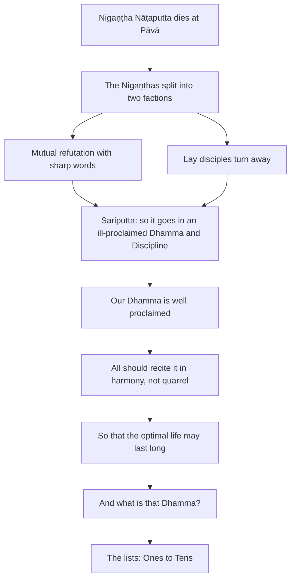

import { Tabs, TabItem } from '@astrojs/starlight/components';

Original text: [World Tipitaka Edition](https://tipitaka2500.github.io/tipitaka/8D/10/Bhinnaniganthavatthu.html)

## Summary

Nigaṇṭha Nāṭaputta has just died at Pāvā, and his followers have split into quarrelling factions, their lay disciples disgusted. Āyasmā Sāriputta tells the bhikkhū that this is what happens in a Dhamma and Discipline that is ill proclaimed, while the Bhagavā's Dhamma is well proclaimed, and that all should recite it in harmony, not quarrel, so that the optimal life may last long. He asks what that Dhamma is, and the lists that follow are his answer.

## Diagram

## Text

<Tabs syncKey="paliquote">
<TabItem label="My Translation">
(301.)

779\. Now at that time, Nigaṇṭha Nāṭaputta had recently passed away in Pāvā. Because of his death, the Nigaṇṭhas were divided, split into two factions, had become quarrelsome, engaged in disputes, fallen into arguments, stabbing one another with sharp words, saying: “You don’t understand this Dhamma and Discipline; I understand this Dhamma and Discipline. How will you understand this Dhamma and Discipline? You are practising wrongly; I am practising rightly. Mine is coherent, yours is incoherent. You said last what should have been said first, and first what should have been said last. What you have rehearsed is overturned. Your thesis is refuted. You are defeated. Go and rescue your thesis, or disentangle yourself if you can.” It seemed indeed as if murder itself was occurring among the Nigaṇṭhas, Nāṭaputta's followers. Even those lay disciples of Nigaṇṭha Nāṭaputta who wore white clothes were disgusted with, indifferent to, and turned away from the Nigaṇṭhas, Nāṭaputta's followers, just as it happens in a Dhamma and Discipline that is ill proclaimed, ill expounded, not leading to liberation, not conducive to peace, not proclaimed by a `sammāsambuddha` (perfectly awakened one), with a broken pillar (foundation), and without a refuge.

(302.)

780\. Then āyasmā Sāriputta addressed the bhikkhū: “Āvuso, Nigaṇṭha Nāṭaputta has recently passed away in Pāvā. Because of his death, the Nigaṇṭhas are divided, split into two factions, have become quarrelsome, engaged in disputes, fallen into arguments, stabbing one another with sharp words, saying: ‘You don’t understand this Dhamma and Discipline; I understand this Dhamma and Discipline. How will you understand this Dhamma and Discipline? You are practising wrongly; I am practising rightly. Mine is coherent, yours is incoherent. You said last what should have been said first, and first what should have been said last. What you have rehearsed is overturned. Your thesis is refuted. You are defeated. Go and rescue your thesis, or disentangle yourself if you can.’ It seems indeed as if murder itself is occurring among the Nigaṇṭhas, Nāṭaputta's followers. Even those lay disciples of Nigaṇṭha Nāṭaputta who wear white clothes are disgusted with, indifferent to, and turned away from the Nigaṇṭhas, Nāṭaputta's followers, just as it happens in a Dhamma and Discipline that is ill proclaimed, ill expounded, not leading to liberation, not conducive to peace, not proclaimed by a perfectly awakened one, with a broken pillar (foundation), and without a refuge. This is indeed what happens, Āvuso, in a Dhamma and Discipline that is ill proclaimed, ill expounded, not leading to liberation, not conducive to peace, and not proclaimed by a perfectly awakened one. But this Dhamma, Āvuso, is well proclaimed by our Bhagavā, well expounded, leading to liberation, conducive to peace, proclaimed by a perfectly awakened one. Therein all should recite in harmony, not quarrel, so that this `brahmacariya` (optimal life) may endure long and last for a long time, which would be for the welfare and happiness of many people, out of compassion for the world, for the good, welfare, and happiness of gods and humans.

781\. And what, Āvuso, is the Dhamma well proclaimed by our Bhagavā, well expounded, leading to liberation, conducive to peace, proclaimed by a perfectly awakened one; concerning which all should recite in harmony, not quarrel, so that this optimal life may endure long and last for a long time, which would be for the welfare and happiness of many people, out of compassion for the world, for the good, welfare, and happiness of gods and humans?
</TabItem>

<TabItem label="Pāḷi (Roman IAST)">
(301.)

779\. Tena kho pana samayena nigaṇṭho nāṭaputto pāvāyaṃ adhunākālaṅkato hoti. Tassa kālaṃkiriyāya bhinnā nigaṇṭhā dvedhikajātā bhaṇḍanajātā kalahajātā vivādāpannā aññamaññaṃ mukhasattīhi vitudantā viharanti— “na tvaṃ imaṃ dhammavinayaṃ ājānāsi, ahaṃ imaṃ dhammavinayaṃ ājānāmi, kiṃ tvaṃ imaṃ dhammavinayaṃ ājānissasi. Micchāpaṭipanno tvamasi, ahamasmi sammāpaṭipanno. Sahitaṃ me, asahitaṃ te. Purevacanīyaṃ pacchā avaca, pacchāvacanīyaṃ pure avaca. Adhiciṇṇaṃ te viparāvattaṃ, āropito te vādo, niggahito tvamasi, cara vādappamokkhāya, nibbeṭhehi vā sace pahosī”ti. Vadhoyeva kho maññe nigaṇṭhesu nāṭaputtiyesu vattati. Yepi nigaṇṭhassa nāṭaputtassa sāvakā gihī odātavasanā, tepi nigaṇṭhesu nāṭaputtiyesu nibbinnarūpā virattarūpā paṭivānarūpā, yathā taṃ durakkhāte dhammavinaye duppavedite aniyyānike anupasamasaṃvattanike asammāsambuddhappavedite bhinnathūpe appaṭisaraṇe.

(302.)

780\. Atha kho āyasmā sāriputto bhikkhū āmantesi— “nigaṇṭho, āvuso, nāṭaputto pāvāyaṃ adhunākālaṅkato, tassa kālaṃkiriyāya bhinnā nigaṇṭhā dvedhikajātā…pe… bhinnathūpe appaṭisaraṇe. Evañhetaṃ, āvuso, hoti durakkhāte dhammavinaye duppavedite aniyyānike anupasamasaṃvattanike asammāsambuddhappavedite. Ayaṃ kho panāvuso, amhākaṃ bhagavatā dhammo svākkhāto suppavedito niyyāniko upasamasaṃvattaniko sammāsambuddhappavedito. Tattha sabbeheva saṅgāyitabbaṃ, na vivaditabbaṃ, yathayidaṃ brahmacariyaṃ addhaniyaṃ assa ciraṭṭhitikaṃ, tadassa bahujanahitāya bahujanasukhāya lokānukampāya atthāya hitāya sukhāya devamanussānaṃ.

781\. Katamo cāvuso, amhākaṃ bhagavatā dhammo svākkhāto suppavedito niyyāniko upasamasaṃvattaniko sammāsambuddhappavedito; yattha sabbeheva saṅgāyitabbaṃ, na vivaditabbaṃ, yathayidaṃ brahmacariyaṃ addhaniyaṃ assa ciraṭṭhitikaṃ, tadassa bahujanahitāya bahujanasukhāya lokānukampāya atthāya hitāya sukhāya devamanussānaṃ?
</TabItem>

<TabItem label="Pāḷi (Brahmi)">
(301.)

779\. 𑀢𑁂𑀦 𑀔𑁄 𑀧𑀦 𑀲𑀫𑀬𑁂𑀦 𑀦𑀺𑀕𑀡𑁆𑀞𑁄 𑀦𑀸𑀝𑀧𑀼𑀢𑁆𑀢𑁄 𑀧𑀸𑀯𑀸𑀬𑀁 𑀅𑀥𑀼𑀦𑀸𑀓𑀸𑀮𑀗𑁆𑀓𑀢𑁄 𑀳𑁄𑀢𑀺. 𑀢𑀲𑁆𑀲 𑀓𑀸𑀮𑀁𑀓𑀺𑀭𑀺𑀬𑀸𑀬 𑀪𑀺𑀦𑁆𑀦𑀸 𑀦𑀺𑀕𑀡𑁆𑀞𑀸 𑀤𑁆𑀯𑁂𑀥𑀺𑀓𑀚𑀸𑀢𑀸 𑀪𑀡𑁆𑀟𑀦𑀚𑀸𑀢𑀸 𑀓𑀮𑀳𑀚𑀸𑀢𑀸 𑀯𑀺𑀯𑀸𑀤𑀸𑀧𑀦𑁆𑀦𑀸 𑀅𑀜𑁆𑀜𑀫𑀜𑁆𑀜𑀁 𑀫𑀼𑀔𑀲𑀢𑁆𑀢𑀻𑀳𑀺 𑀯𑀺𑀢𑀼𑀤𑀦𑁆𑀢𑀸 𑀯𑀺𑀳𑀭𑀦𑁆𑀢𑀺— “𑀦 𑀢𑁆𑀯𑀁 𑀇𑀫𑀁 𑀥𑀫𑁆𑀫𑀯𑀺𑀦𑀬𑀁 𑀆𑀚𑀸𑀦𑀸𑀲𑀺, 𑀅𑀳𑀁 𑀇𑀫𑀁 𑀥𑀫𑁆𑀫𑀯𑀺𑀦𑀬𑀁 𑀆𑀚𑀸𑀦𑀸𑀫𑀺, 𑀓𑀺𑀁 𑀢𑁆𑀯𑀁 𑀇𑀫𑀁 𑀥𑀫𑁆𑀫𑀯𑀺𑀦𑀬𑀁 𑀆𑀚𑀸𑀦𑀺𑀲𑁆𑀲𑀲𑀺. 𑀫𑀺𑀘𑁆𑀙𑀸𑀧𑀝𑀺𑀧𑀦𑁆𑀦𑁄 𑀢𑁆𑀯𑀫𑀲𑀺, 𑀅𑀳𑀫𑀲𑁆𑀫𑀺 𑀲𑀫𑁆𑀫𑀸𑀧𑀝𑀺𑀧𑀦𑁆𑀦𑁄. 𑀲𑀳𑀺𑀢𑀁 𑀫𑁂, 𑀅𑀲𑀳𑀺𑀢𑀁 𑀢𑁂. 𑀧𑀼𑀭𑁂𑀯𑀘𑀦𑀻𑀬𑀁 𑀧𑀘𑁆𑀙𑀸 𑀅𑀯𑀘, 𑀧𑀘𑁆𑀙𑀸𑀯𑀘𑀦𑀻𑀬𑀁 𑀧𑀼𑀭𑁂 𑀅𑀯𑀘. 𑀅𑀥𑀺𑀘𑀺𑀡𑁆𑀡𑀁 𑀢𑁂 𑀯𑀺𑀧𑀭𑀸𑀯𑀢𑁆𑀢𑀁, 𑀆𑀭𑁄𑀧𑀺𑀢𑁄 𑀢𑁂 𑀯𑀸𑀤𑁄, 𑀦𑀺𑀕𑁆𑀕𑀳𑀺𑀢𑁄 𑀢𑁆𑀯𑀫𑀲𑀺, 𑀘𑀭 𑀯𑀸𑀤𑀧𑁆𑀧𑀫𑁄𑀓𑁆𑀔𑀸𑀬, 𑀦𑀺𑀩𑁆𑀩𑁂𑀞𑁂𑀳𑀺 𑀯𑀸 𑀲𑀘𑁂 𑀧𑀳𑁄𑀲𑀻”𑀢𑀺. 𑀯𑀥𑁄𑀬𑁂𑀯 𑀔𑁄 𑀫𑀜𑁆𑀜𑁂 𑀦𑀺𑀕𑀡𑁆𑀞𑁂𑀲𑀼 𑀦𑀸𑀝𑀧𑀼𑀢𑁆𑀢𑀺𑀬𑁂𑀲𑀼 𑀯𑀢𑁆𑀢𑀢𑀺. 𑀬𑁂𑀧𑀺 𑀦𑀺𑀕𑀡𑁆𑀞𑀲𑁆𑀲 𑀦𑀸𑀝𑀧𑀼𑀢𑁆𑀢𑀲𑁆𑀲 𑀲𑀸𑀯𑀓𑀸 𑀕𑀺𑀳𑀻 𑀑𑀤𑀸𑀢𑀯𑀲𑀦𑀸, 𑀢𑁂𑀧𑀺 𑀦𑀺𑀕𑀡𑁆𑀞𑁂𑀲𑀼 𑀦𑀸𑀝𑀧𑀼𑀢𑁆𑀢𑀺𑀬𑁂𑀲𑀼 𑀦𑀺𑀩𑁆𑀩𑀺𑀦𑁆𑀦𑀭𑀽𑀧𑀸 𑀯𑀺𑀭𑀢𑁆𑀢𑀭𑀽𑀧𑀸 𑀧𑀝𑀺𑀯𑀸𑀦𑀭𑀽𑀧𑀸, 𑀬𑀣𑀸 𑀢𑀁 𑀤𑀼𑀭𑀓𑁆𑀔𑀸𑀢𑁂 𑀥𑀫𑁆𑀫𑀯𑀺𑀦𑀬𑁂 𑀤𑀼𑀧𑁆𑀧𑀯𑁂𑀤𑀺𑀢𑁂 𑀅𑀦𑀺𑀬𑁆𑀬𑀸𑀦𑀺𑀓𑁂 𑀅𑀦𑀼𑀧𑀲𑀫𑀲𑀁𑀯𑀢𑁆𑀢𑀦𑀺𑀓𑁂 𑀅𑀲𑀫𑁆𑀫𑀸𑀲𑀫𑁆𑀩𑀼𑀤𑁆𑀥𑀧𑁆𑀧𑀯𑁂𑀤𑀺𑀢𑁂 𑀪𑀺𑀦𑁆𑀦𑀣𑀽𑀧𑁂 𑀅𑀧𑁆𑀧𑀝𑀺𑀲𑀭𑀡𑁂.

(302.)

780\. 𑀅𑀣 𑀔𑁄 𑀆𑀬𑀲𑁆𑀫𑀸 𑀲𑀸𑀭𑀺𑀧𑀼𑀢𑁆𑀢𑁄 𑀪𑀺𑀓𑁆𑀔𑀽 𑀆𑀫𑀦𑁆𑀢𑁂𑀲𑀺— “𑀦𑀺𑀕𑀡𑁆𑀞𑁄, 𑀆𑀯𑀼𑀲𑁄, 𑀦𑀸𑀝𑀧𑀼𑀢𑁆𑀢𑁄 𑀧𑀸𑀯𑀸𑀬𑀁 𑀅𑀥𑀼𑀦𑀸𑀓𑀸𑀮𑀗𑁆𑀓𑀢𑁄, 𑀢𑀲𑁆𑀲 𑀓𑀸𑀮𑀁𑀓𑀺𑀭𑀺𑀬𑀸𑀬 𑀪𑀺𑀦𑁆𑀦𑀸 𑀦𑀺𑀕𑀡𑁆𑀞𑀸 𑀤𑁆𑀯𑁂𑀥𑀺𑀓𑀚𑀸𑀢𑀸…𑀧𑁂… 𑀪𑀺𑀦𑁆𑀦𑀣𑀽𑀧𑁂 𑀅𑀧𑁆𑀧𑀝𑀺𑀲𑀭𑀡𑁂. 𑀏𑀯𑀜𑁆𑀳𑁂𑀢𑀁, 𑀆𑀯𑀼𑀲𑁄, 𑀳𑁄𑀢𑀺 𑀤𑀼𑀭𑀓𑁆𑀔𑀸𑀢𑁂 𑀥𑀫𑁆𑀫𑀯𑀺𑀦𑀬𑁂 𑀤𑀼𑀧𑁆𑀧𑀯𑁂𑀤𑀺𑀢𑁂 𑀅𑀦𑀺𑀬𑁆𑀬𑀸𑀦𑀺𑀓𑁂 𑀅𑀦𑀼𑀧𑀲𑀫𑀲𑀁𑀯𑀢𑁆𑀢𑀦𑀺𑀓𑁂 𑀅𑀲𑀫𑁆𑀫𑀸𑀲𑀫𑁆𑀩𑀼𑀤𑁆𑀥𑀧𑁆𑀧𑀯𑁂𑀤𑀺𑀢𑁂. 𑀅𑀬𑀁 𑀔𑁄 𑀧𑀦𑀸𑀯𑀼𑀲𑁄, 𑀅𑀫𑁆𑀳𑀸𑀓𑀁 𑀪𑀕𑀯𑀢𑀸 𑀥𑀫𑁆𑀫𑁄 𑀲𑁆𑀯𑀸𑀓𑁆𑀔𑀸𑀢𑁄 𑀲𑀼𑀧𑁆𑀧𑀯𑁂𑀤𑀺𑀢𑁄 𑀦𑀺𑀬𑁆𑀬𑀸𑀦𑀺𑀓𑁄 𑀉𑀧𑀲𑀫𑀲𑀁𑀯𑀢𑁆𑀢𑀦𑀺𑀓𑁄 𑀲𑀫𑁆𑀫𑀸𑀲𑀫𑁆𑀩𑀼𑀤𑁆𑀥𑀧𑁆𑀧𑀯𑁂𑀤𑀺𑀢𑁄. 𑀢𑀢𑁆𑀣 𑀲𑀩𑁆𑀩𑁂𑀳𑁂𑀯 𑀲𑀗𑁆𑀕𑀸𑀬𑀺𑀢𑀩𑁆𑀩𑀁, 𑀦 𑀯𑀺𑀯𑀤𑀺𑀢𑀩𑁆𑀩𑀁, 𑀬𑀣𑀬𑀺𑀤𑀁 𑀩𑁆𑀭𑀳𑁆𑀫𑀘𑀭𑀺𑀬𑀁 𑀅𑀤𑁆𑀥𑀦𑀺𑀬𑀁 𑀅𑀲𑁆𑀲 𑀘𑀺𑀭𑀝𑁆𑀞𑀺𑀢𑀺𑀓𑀁, 𑀢𑀤𑀲𑁆𑀲 𑀩𑀳𑀼𑀚𑀦𑀳𑀺𑀢𑀸𑀬 𑀩𑀳𑀼𑀚𑀦𑀲𑀼𑀔𑀸𑀬 𑀮𑁄𑀓𑀸𑀦𑀼𑀓𑀫𑁆𑀧𑀸𑀬 𑀅𑀢𑁆𑀣𑀸𑀬 𑀳𑀺𑀢𑀸𑀬 𑀲𑀼𑀔𑀸𑀬 𑀤𑁂𑀯𑀫𑀦𑀼𑀲𑁆𑀲𑀸𑀦𑀁.

781\. 𑀓𑀢𑀫𑁄 𑀘𑀸𑀯𑀼𑀲𑁄, 𑀅𑀫𑁆𑀳𑀸𑀓𑀁 𑀪𑀕𑀯𑀢𑀸 𑀥𑀫𑁆𑀫𑁄 𑀲𑁆𑀯𑀸𑀓𑁆𑀔𑀸𑀢𑁄 𑀲𑀼𑀧𑁆𑀧𑀯𑁂𑀤𑀺𑀢𑁄 𑀦𑀺𑀬𑁆𑀬𑀸𑀦𑀺𑀓𑁄 𑀉𑀧𑀲𑀫𑀲𑀁𑀯𑀢𑁆𑀢𑀦𑀺𑀓𑁄 𑀲𑀫𑁆𑀫𑀸𑀲𑀫𑁆𑀩𑀼𑀤𑁆𑀥𑀧𑁆𑀧𑀯𑁂𑀤𑀺𑀢𑁄; 𑀬𑀢𑁆𑀣 𑀲𑀩𑁆𑀩𑁂𑀳𑁂𑀯 𑀲𑀗𑁆𑀕𑀸𑀬𑀺𑀢𑀩𑁆𑀩𑀁, 𑀦 𑀯𑀺𑀯𑀤𑀺𑀢𑀩𑁆𑀩𑀁, 𑀬𑀣𑀬𑀺𑀤𑀁 𑀩𑁆𑀭𑀳𑁆𑀫𑀘𑀭𑀺𑀬𑀁 𑀅𑀤𑁆𑀥𑀦𑀺𑀬𑀁 𑀅𑀲𑁆𑀲 𑀘𑀺𑀭𑀝𑁆𑀞𑀺𑀢𑀺𑀓𑀁, 𑀢𑀤𑀲𑁆𑀲 𑀩𑀳𑀼𑀚𑀦𑀳𑀺𑀢𑀸𑀬 𑀩𑀳𑀼𑀚𑀦𑀲𑀼𑀔𑀸𑀬 𑀮𑁄𑀓𑀸𑀦𑀼𑀓𑀫𑁆𑀧𑀸𑀬 𑀅𑀢𑁆𑀣𑀸𑀬 𑀳𑀺𑀢𑀸𑀬 𑀲𑀼𑀔𑀸𑀬 𑀤𑁂𑀯𑀫𑀦𑀼𑀲𑁆𑀲𑀸𑀦𑀁?
</TabItem>

<TabItem label="Interlinear">
(301.)

[779](https://tipitaka2500.github.io/tipitaka/8D/10/Bhinnaniganthavatthu.html#779) Tena kho pana samayena nigaṇṭho nāṭaputto pāvāyaṃ adhunākālaṅkato hoti.  
*️⃣🤟🚹⨀③(ta) ⏏️(kho) ⏏️(pana) 🚹⨀③(samaya) 🚹⨀①(nigaṇṭha) 🚹⨀①(nāṭaputta) 🚺⨀⑦(pāvā) 🚹⨀①🆎(adhunā+kāla+kata) 🟢⨀🤟▶️(hoti)  
at that | indeed | now | time | the Nigaṇṭha | Nāṭaputta | in Pāvā | recently passed away | is  
Now at that time, Nigaṇṭha Nāṭaputta had recently passed away in Pāvā.

Tassa kālaṃkiriyāya bhinnā nigaṇṭhā dvedhikajātā bhaṇḍanajātā kalahajātā vivādāpannā aññamaññaṃ mukhasattīhi vitudantā viharanti— “na tvaṃ imaṃ dhammavinayaṃ ājānāsi, ahaṃ imaṃ dhammavinayaṃ ājānāmi, kiṃ tvaṃ imaṃ dhammavinayaṃ ājānissasi.  
*️⃣🤟🚹⨀⑥(ta) 🚺⨀③🆎(kāla+kiriyā) 🚹⨂①🔽(ta)(bhinna) 🚹⨂①(nigaṇṭha) 🚹⨂①🆎(dvedhika+jāta) 🚹⨂①🆎(bhaṇḍana+jāta) 🚹⨂①🆎(kalaha+jāta) 🚹⨂①🆎(vivāda+āpanna) *️⃣🤟🚹⨀②(añña) *️⃣🤟🚹⨀②(añña) 🚺⨂③🆎(mukha+satti) 🚹⨂①🔽(anta)(vitudanta) 🟢⨂🤟▶️(viharati) ⏏️(na) *️⃣🤘⚧⨀①(tvaṃ) *️⃣🤟🚹⨀②(ima) 🚹⨀②🆎(dhamma+vinaya) 🟢⨀🤘▶️(ājānāti) *️⃣👆⚧⨀①(ahaṃ) *️⃣🤟🚹⨀②(ima) 🚹⨀②🆎(dhamma+vinaya) 🟢⨀👆▶️(ājānāti) *️⃣🤟🚻⨀②(kiṃ) *️⃣🤘⚧⨀①(tvaṃ) *️⃣🤟🚹⨀②(ima) 🚹⨀②🆎(dhamma+vinaya) 🟢⨀🤘⏭(ājānāti)  
his | because of the death | divided | the Nigaṇṭhas | split into two factions | become quarrelsome | engaged in disputes | fallen into arguments | one | another | with sharp words | stabbing | dwell | not | you | this | Dhamma and Discipline | understand | I | this | Dhamma and Discipline | understand | how | you | this | Dhamma and Discipline | will understand  
Because of his death, the Nigaṇṭhas were divided, split into two factions, had become quarrelsome, engaged in disputes, fallen into arguments, stabbing one another with sharp words, saying: “You don’t understand this Dhamma and Discipline; I understand this Dhamma and Discipline. How will you understand this Dhamma and Discipline?

Micchāpaṭipanno tvamasi, ahamasmi sammāpaṭipanno.  
🚹⨀①🆎(micchā+paṭipanna) *️⃣🤘⚧⨀①(tvaṃ) 🟢⨀🤘▶️(atthi) *️⃣👆⚧⨀①(ahaṃ) 🟢⨀👆▶️(atthi) 🚹⨀①🆎(sammā+paṭipanna)  
practising wrongly | you | are | I | am | practising rightly  
You are practising wrongly; I am practising rightly.

Sahitaṃ me, asahitaṃ te.  
🚻⨀①🔽(ta)(sahita) *️⃣👆⚧⨀⑥(ahaṃ) 🚻⨀①🔽(ta)🆎(na+sahita) *️⃣🤘⚧⨀⑥(tvaṃ)  
coherent | mine | incoherent | yours  
Mine is coherent, yours is incoherent.

Purevacanīyaṃ pacchā avaca, pacchāvacanīyaṃ pure avaca.  
🚻⨀②🆎(pure+vacanīya) ⏏️(pacchā) 🟢⨀🤘↩️(vadati) 🚻⨀②🆎(pacchā+vacanīya) ⏏️(pure) 🟢⨀🤘↩️(vadati)  
what should have been said first | last | you said | what should have been said last | first | you said  
You said last what should have been said first, and first what should have been said last.

Adhiciṇṇaṃ te viparāvattaṃ, āropito te vādo, niggahito tvamasi, cara vādappamokkhāya, nibbeṭhehi vā sace pahosī”ti.  
🚻⨀①(adhiciṇṇa) *️⃣🤘⚧⨀⑥(tvaṃ) 🚻⨀①🔽(ta)(viparāvatta) 🚹⨀①🔽(ta)(āropita) *️⃣🤘⚧⨀⑥(tvaṃ) 🚹⨀①(vāda) 🚹⨀①🔽(ta)(niggahita) *️⃣🤘⚧⨀①(tvaṃ) 🟢⨀🤘▶️(atthi) 🟢⨀🤘⏹(carati) 🚹⨀④🆎(vāda+pamokkha) 🟢⨀🤘⏹(nibbeṭheti) ⏏️(vā) ⏏️(sace) 🟢⨀🤘▶️(pahoti) ⏏️(iti)  
what you have rehearsed | your | overturned | refuted | your | thesis | defeated | you | are | go | to rescue the thesis | disentangle yourself | or | if | you can | (end quote)  
What you have rehearsed is overturned. Your thesis is refuted. You are defeated. Go and rescue your thesis, or disentangle yourself if you can.”

Vadhoyeva kho maññe nigaṇṭhesu nāṭaputtiyesu vattati.  
🚹⨀①(vadha) ⏏️(eva) ⏏️(kho) ⏏️(maññe) 🚹⨂⑦(nigaṇṭha) 🚹⨂⑦🔽(iya)(nāṭaputtiya) 🟢⨀🤟▶️(vattati)  
murder | itself | indeed | it seems | among the Nigaṇṭhas | Nāṭaputta's followers | is occurring  
It seemed indeed as if murder itself was occurring among the Nigaṇṭhas, Nāṭaputta's followers.

Yepi nigaṇṭhassa nāṭaputtassa sāvakā gihī odātavasanā, tepi nigaṇṭhesu nāṭaputtiyesu nibbinnarūpā virattarūpā paṭivānarūpā, yathā taṃ durakkhāte dhammavinaye duppavedite aniyyānike anupasamasaṃvattanike asammāsambuddhappavedite bhinnathūpe appaṭisaraṇe.  
*️⃣🤟🚹⨂①(ya) ⏏️(api) 🚹⨀⑥(nigaṇṭha) 🚹⨀⑥(nāṭaputta) 🚹⨂①(sāvaka) 🚹⨂①(gihī) 🚹⨂①🆎(odāta+vasana) *️⃣🤟🚹⨂①(ta) ⏏️(api) 🚹⨂⑦(nigaṇṭha) 🚹⨂⑦🔽(iya)(nāṭaputtiya) 🚹⨂①🆎(nibbinna+rūpa) 🚹⨂①🆎(viratta+rūpa) 🚹⨂①🆎(paṭivāna+rūpa) ⏏️(yathā) *️⃣🤟🚻⨀①(ta) 🚹⨀⑦🆎(dur+akkhāta) 🚹⨀⑦🆎(dhamma+vinaya) 🚹⨀⑦🆎(dur+pavedita) 🚹⨀⑦🔽(ṇika)🆎(na+niyyānika) 🚹⨀⑦🆎(na+upasama+saṃvattanika) 🚹⨀⑦🆎(na+sammā+sambuddha+pavedita) 🚹⨀⑦🆎(bhinna+thūpa) 🚹⨀⑦🆎(na+paṭisaraṇa)  
those who | even | of the Nigaṇṭha | of Nāṭaputta | disciples | lay | wearing white clothes | they | even | with the Nigaṇṭhas | Nāṭaputta's followers | disgusted with | indifferent to | turned away from | just as | it | in an ill proclaimed | Dhamma and Discipline | ill expounded | not leading to liberation | not conducive to peace | not proclaimed by a perfectly awakened one | with a broken pillar | without a refuge  
Even those lay disciples of Nigaṇṭha Nāṭaputta who wore white clothes were disgusted with, indifferent to, and turned away from the Nigaṇṭhas, Nāṭaputta's followers, just as it happens in a Dhamma and Discipline that is ill proclaimed, ill expounded, not leading to liberation, not conducive to peace, not proclaimed by a `sammāsambuddha` (perfectly awakened one), with a broken pillar (foundation), and without a refuge.

(302.)

[780](https://tipitaka2500.github.io/tipitaka/8D/10/Bhinnaniganthavatthu.html#780) Atha kho āyasmā sāriputto bhikkhū āmantesi— “nigaṇṭho, āvuso, nāṭaputto pāvāyaṃ adhunākālaṅkato, tassa kālaṃkiriyāya bhinnā nigaṇṭhā dvedhikajātā…pe… bhinnathūpe appaṭisaraṇe.  
⏏️(atha) ⏏️(kho) 🚹⨀①(āyasmant) 🚹⨀①(sāriputta) 🚹⨂②(bhikkhu) 🟢⨀🤟⏮(āmanteti) 🚹⨀①(nigaṇṭha) ⏏️(āvuso) 🚹⨀①(nāṭaputta) 🚺⨀⑦(pāvā) 🚹⨀①🆎(adhunā+kāla+kata) *️⃣🤟🚹⨀⑥(ta) 🚺⨀③🆎(kāla+kiriyā) 🚹⨂①🔽(ta)(bhinna) 🚹⨂①(nigaṇṭha) 🚹⨂①🆎(dvedhika+jāta) ⏏️(peyyāla) 🚹⨀⑦🆎(bhinna+thūpa) 🚹⨀⑦🆎(na+paṭisaraṇa)  
then | indeed | Venerable | Sāriputta | the bhikkhū | addressed | the Nigaṇṭha | Āvuso | Nāṭaputta | in Pāvā | recently passed away | his | because of the death | divided | the Nigaṇṭhas | split into two factions | (and so on) | with a broken pillar | without a refuge  
Then āyasmā Sāriputta addressed the bhikkhū: “Āvuso, Nigaṇṭha Nāṭaputta has recently passed away in Pāvā. Because of his death, the Nigaṇṭhas are divided, split into two factions, have become quarrelsome, engaged in disputes, fallen into arguments, stabbing one another with sharp words, saying: ‘You don’t understand this Dhamma and Discipline; I understand this Dhamma and Discipline. How will you understand this Dhamma and Discipline? You are practising wrongly; I am practising rightly. Mine is coherent, yours is incoherent. You said last what should have been said first, and first what should have been said last. What you have rehearsed is overturned. Your thesis is refuted. You are defeated. Go and rescue your thesis, or disentangle yourself if you can.’ It seems indeed as if murder itself is occurring among the Nigaṇṭhas, Nāṭaputta's followers. Even those lay disciples of Nigaṇṭha Nāṭaputta who wear white clothes are disgusted with, indifferent to, and turned away from the Nigaṇṭhas, Nāṭaputta's followers, just as it happens in a Dhamma and Discipline that is ill proclaimed, ill expounded, not leading to liberation, not conducive to peace, not proclaimed by a perfectly awakened one, with a broken pillar (foundation), and without a refuge.

Evañhetaṃ, āvuso, hoti durakkhāte dhammavinaye duppavedite aniyyānike anupasamasaṃvattanike asammāsambuddhappavedite.  
⏏️(evaṃ) ⏏️(hi) *️⃣🤟🚻⨀①(eta) ⏏️(āvuso) 🟢⨀🤟▶️(hoti) 🚹⨀⑦🆎(dur+akkhāta) 🚹⨀⑦🆎(dhamma+vinaya) 🚹⨀⑦🆎(dur+pavedita) 🚹⨀⑦🔽(ṇika)🆎(na+niyyānika) 🚹⨀⑦🆎(na+upasama+saṃvattanika) 🚹⨀⑦🆎(na+sammā+sambuddha+pavedita)  
thus | indeed | this | Āvuso | happens | in an ill proclaimed | Dhamma and Discipline | ill expounded | not leading to liberation | not conducive to peace | not proclaimed by a perfectly awakened one  
This is indeed what happens, Āvuso, in a Dhamma and Discipline that is ill proclaimed, ill expounded, not leading to liberation, not conducive to peace, and not proclaimed by a perfectly awakened one.

Ayaṃ kho panāvuso, amhākaṃ bhagavatā dhammo svākkhāto suppavedito niyyāniko upasamasaṃvattaniko sammāsambuddhappavedito.  
*️⃣🤟🚹⨀①(ima) ⏏️(kho) ⏏️(pana) ⏏️(āvuso) *️⃣👆⚧⨂⑥(ahaṃ) 🚹⨀③(bhagavant) 🚹⨀①(dhamma) 🚹⨀①🆎(su+akkhāta) 🚹⨀①🆎(su+pavedita) 🚹⨀①🔽(ṇika)(niyyānika) 🚹⨀①🆎(upasama+saṃvattanika) 🚹⨀①🆎(sammā+sambuddha+pavedita)  
this | indeed | but | Āvuso | our | by the Bhagavā | Dhamma | well proclaimed | well expounded | leading to liberation | conducive to peace | proclaimed by a perfectly awakened one  
But this Dhamma, Āvuso, is well proclaimed by our Bhagavā, well expounded, leading to liberation, conducive to peace, proclaimed by a perfectly awakened one.

Tattha sabbeheva saṅgāyitabbaṃ, na vivaditabbaṃ, yathayidaṃ brahmacariyaṃ addhaniyaṃ assa ciraṭṭhitikaṃ, tadassa bahujanahitāya bahujanasukhāya lokānukampāya atthāya hitāya sukhāya devamanussānaṃ.  
⏏️(tattha) *️⃣🤟🚹⨂③(sabba) ⏏️(eva) 🚻⨀①🔽(tabba)(saṅgāyitabba) ⏏️(na) 🚻⨀①🔽(tabba)(vivaditabba) ⏏️(yathā) *️⃣🤟🚻⨀①(ima) 🚻⨀①🆎(brahma+cariya) 🚻⨀①(addhaniya) 🟢⨀🤟⏯(atthi) 🚻⨀①🆎(cira+ṭhitika) *️⃣🤟🚻⨀①(ta) 🟢⨀🤟⏯(atthi) 🚻⨀④🆎(bahu+jana+hita) 🚻⨀④🆎(bahu+jana+sukha) 🚺⨀③🆎(loka+anukampā) 🚹⨀④(attha) 🚻⨀④(hita) 🚻⨀④(sukha) 🚹⨂⑥🆎(deva+manussa)  
therein | by all | just | should be recited together | not | should be disputed | so that | this | the optimal life | long-lasting | may be | lasting for a long time | that | would be | for the welfare of many people | for the happiness of many people | out of compassion for the world | for the good | for the welfare | for the happiness | of gods and humans  
Therein all should recite in harmony, not quarrel, so that this `brahmacariya` (optimal life) may endure long and last for a long time, which would be for the welfare and happiness of many people, out of compassion for the world, for the good, welfare, and happiness of gods and humans.

[781](https://tipitaka2500.github.io/tipitaka/8D/10/Bhinnaniganthavatthu.html#781) Katamo cāvuso, amhākaṃ bhagavatā dhammo svākkhāto suppavedito niyyāniko upasamasaṃvattaniko sammāsambuddhappavedito;  
*️⃣🤟🚹⨀①(katama) ⏏️(ca) ⏏️(āvuso) *️⃣👆⚧⨂⑥(ahaṃ) 🚹⨀③(bhagavant) 🚹⨀①(dhamma) 🚹⨀①🆎(su+akkhāta) 🚹⨀①🆎(su+pavedita) 🚹⨀①🔽(ṇika)(niyyānika) 🚹⨀①🆎(upasama+saṃvattanika) 🚹⨀①🆎(sammā+sambuddha+pavedita)  
which | and | Āvuso | our | by the Bhagavā | Dhamma | well proclaimed | well expounded | leading to liberation | conducive to peace | proclaimed by a perfectly awakened one  
And what, Āvuso, is the Dhamma well proclaimed by our Bhagavā, well expounded, leading to liberation, conducive to peace, proclaimed by a perfectly awakened one;

yattha sabbeheva saṅgāyitabbaṃ, na vivaditabbaṃ, yathayidaṃ brahmacariyaṃ addhaniyaṃ assa ciraṭṭhitikaṃ, tadassa bahujanahitāya bahujanasukhāya lokānukampāya atthāya hitāya sukhāya devamanussānaṃ?  
⏏️(yattha) *️⃣🤟🚹⨂③(sabba) ⏏️(eva) 🚻⨀①🔽(tabba)(saṅgāyitabba) ⏏️(na) 🚻⨀①🔽(tabba)(vivaditabba) ⏏️(yathā) *️⃣🤟🚻⨀①(ima) 🚻⨀①🆎(brahma+cariya) 🚻⨀①(addhaniya) 🟢⨀🤟⏯(atthi) 🚻⨀①🆎(cira+ṭhitika) *️⃣🤟🚻⨀①(ta) 🟢⨀🤟⏯(atthi) 🚻⨀④🆎(bahu+jana+hita) 🚻⨀④🆎(bahu+jana+sukha) 🚺⨀④🆎(loka+anukampā) 🚹⨀④(attha) 🚻⨀④(hita) 🚻⨀④(sukha) 🚹⨂⑥🆎(deva+manussa)  
concerning which | by all | just | should be recited together | not | should be disputed | so that | this | the optimal life | long-lasting | may be | lasting for a long time | that | may be | for the welfare of many people | for the happiness of many people | out of compassion for the world | for the good | for the welfare | for the happiness | of gods and humans  
concerning which all should recite in harmony, not quarrel, so that this optimal life may endure long and last for a long time, which would be for the welfare and happiness of many people, out of compassion for the world, for the good, welfare, and happiness of gods and humans?
</TabItem>
</Tabs>

## Commentary

- The occasion of the recitation: the schism after Nāṭaputta's death is why Sāriputta has the bhikkhū recite the Dhamma together; the historical setting and the sutta's dating are discussed on the [sutta's index page](/dighanikaya/sangitisutta/).
- `saṅgāyitabbaṃ` "should recite in harmony" names the sutta; the refrain of 780 recurs at the head and foot of every list section (782–1131) as a twin.
- 780 writes the edition's `…pe…` out in full, repeating 779 inside Sāriputta's speech with nested quotation marks, as the author does again at 818 and 879.
- Renderings: `dhammavinaya` "Dhamma and Discipline"; `sammāsambuddha` glossed "perfectly awakened one" at 779 and bare after; `bhinnathūpa` "with a broken pillar (foundation)" keeps the author's gloss; the Nigaṇṭhas stay a name.
- The edition's 779–781 are CST 301–302.

[Go to previous page (1. Ubbhatakanavasandhāgāra (The New Assembly Hall at Ubbhataka))](/dighanikaya/sangitisutta/1-ubbhatakanavasandhagara/) / [Go to parent page (Saṅgītisutta)](/dighanikaya/sangitisutta/) / [Go to next page (3. Ekaka and Duka (Ones and Pairs))](/dighanikaya/sangitisutta/3-ekaka-duka/)
