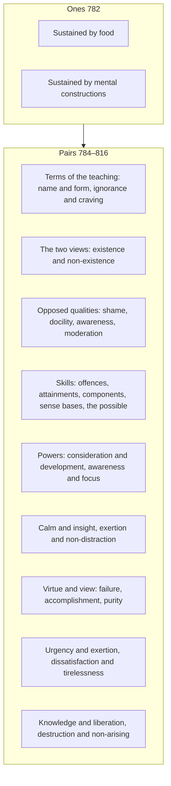

import { Tabs, TabItem } from '@astrojs/starlight/components';

Original text: [8D/10.1–10.2 Ekaka and Duka 782–817](https://tipitaka2500.github.io/tipitaka/8D/10/10.1.html#782) in the [World Tipitaka Edition](https://tipitaka2500.github.io)

## Summary

The first two lists of Sāriputta's recitation. The one Dhamma is stated twice, as the edition prints it: all beings are sustained by food, and by mental constructions. The thirty-three pairs set terms of the teaching side by side (name and form, ignorance and craving for existence, calm and insight, knowledge and liberation) and opposed qualities against each other (shamelessness and shame, lack of awareness and awareness, failure and accomplishment in virtue and view), each list framed by the refrain that all should recite it in harmony.

## Diagram

## Text

<Tabs syncKey="paliquote">
<TabItem label="My Translation">
(303.)

782\. Āvuso, there is one Dhamma well proclaimed by the Bhagavā, the `arahant` (liberated one), the perfectly awakened one, who knows and sees. Therein all should recite in harmony, not quarrel, so that this optimal life may endure long and last for a long time, which would be for the welfare and happiness of many people, out of compassion for the world, for the good, welfare, and happiness of gods and humans. What one Dhamma? All beings are sustained by food. All beings are sustained by `saṅkhārā` (mental constructions). Āvuso, this is the one Dhamma well proclaimed by the Bhagavā, the liberated one, the perfectly awakened one, who knows and sees. Therein all should recite in harmony, not quarrel, so that this optimal life may endure long and last for a long time, which would be for the welfare and happiness of many people, out of compassion for the world, for the good, welfare, and happiness of gods and humans.

(304.)

783\. Āvuso, there are two Dhammas well proclaimed by the Bhagavā, the liberated one, the perfectly awakened one, who knows and sees. Therein all should recite in harmony, not quarrel, so that this optimal life may endure long and last for a long time, which would be for the welfare and happiness of many people, out of compassion for the world, for the good, welfare, and happiness of gods and humans. What two?

784\. `Nāma` (name) and `rūpa` (form). (1)

785\. `Avijjā` (ignorance) and `bhavataṇhā` (craving for existence). (2)

786\. `Bhavadiṭṭhi` (view of existence, eternalism) and `vibhavadiṭṭhi` (view of non-existence, annihilationism). (3)

787\. Shamelessness and lack of moral dread. (4)

788\. Shame and moral dread. (5)

789\. Intractability and bad friendship. (6)

790\. Docility and good friendship. (7)

791\. Skill in offences and skill in rising from offences. (8)

792\. Skill in attainments and skill in rising from attainments. (9)

793\. Skill in components and skill in attention. (10)

794\. Skill in `āyatanā` (sense bases) and skill in `paṭiccasamuppāda` (dependent origination). (11)

795\. Skill in what is possible and skill in what is impossible. (12)

796\. Honesty and scrupulousness. (13)

797\. Patience and gentleness. (14)

798\. Friendliness and hospitality. (15)

799\. Not harming and purity. (16)

800\. Lack of awareness and lack of clear comprehension. (17)

801\. `Sati` (awareness) and `sampajañña` (clear comprehension). (18)

802\. Lack of guard over the doors of the faculties and immoderation in food. (19)

803\. Guard over the doors of the faculties and moderation in food. (20)

804\. The power of careful consideration and the power of development. (21)

805\. The power of awareness and the power of `samādhi` (focus). (22)

806\. `Samatha` (calm) and `vipassanā` (insight). (23)

807\. The sign of calm and the sign of exertion. (24)

808\. Exertion and non-distraction. (25)

809\. Failure in virtue and failure in view. (26)

810\. Accomplishment in virtue and accomplishment in view. (27)

811\. Purity of virtue and purity of view. (28)

812\. Purity of view, moreover, and the exertion of one with such a view. (29)

813\. A sense of urgency about things that should arouse urgency, and the proper exertion of one who is stirred. (30)

814\. Dissatisfaction with wholesome characteristics and tirelessness in exertion. (31)

815\. `Vijjā` (knowledge) and `vimutti` (liberation). (32)

816\. Knowledge of destruction and knowledge of non-arising. (33)

817\. Āvuso, these are the two Dhammas well proclaimed by the Bhagavā, the liberated one, the perfectly awakened one, who knows and sees. Therein all should recite in harmony, not quarrel, so that this optimal life may endure long and last for a long time, which would be for the welfare and happiness of many people, out of compassion for the world, for the good, welfare, and happiness of gods and humans.
</TabItem>

<TabItem label="Pāḷi (Roman IAST)">
(303.)

782\. Atthi kho, āvuso, tena bhagavatā jānatā passatā arahatā sammāsambuddhena eko dhammo sammadakkhāto. Tattha sabbeheva saṅgāyitabbaṃ, na vivaditabbaṃ, yathayidaṃ brahmacariyaṃ addhaniyaṃ assa ciraṭṭhitikaṃ, tadassa bahujanahitāya bahujanasukhāya lokānukampāya atthāya hitāya sukhāya devamanussānaṃ. Katamo eko dhammo? Sabbe sattā āhāraṭṭhitikā. Sabbe sattā saṅkhāraṭṭhitikā. Ayaṃ kho, āvuso, tena bhagavatā jānatā passatā arahatā sammāsambuddhena eko dhammo sammadakkhāto. Tattha sabbeheva saṅgāyitabbaṃ, na vivaditabbaṃ, yathayidaṃ brahmacariyaṃ addhaniyaṃ assa ciraṭṭhitikaṃ, tadassa bahujanahitāya bahujanasukhāya lokānukampāya atthāya hitāya sukhāya devamanussānaṃ.

(304.)

783\. Atthi kho, āvuso, tena bhagavatā jānatā passatā arahatā sammāsambuddhena dve dhammā sammadakkhātā. Tattha sabbeheva saṅgāyitabbaṃ, na vivaditabbaṃ, yathayidaṃ brahmacariyaṃ addhaniyaṃ assa ciraṭṭhitikaṃ, tadassa bahujanahitāya bahujanasukhāya lokānukampāya atthāya hitāya sukhāya devamanussānaṃ. Katame dve?

784\. Nāmañca rūpañca. (1)

785\. Avijjā ca bhavataṇhā ca. (2)

786\. Bhavadiṭṭhi ca vibhavadiṭṭhi ca. (3)

787\. Ahirikañca anottappañca. (4)

788\. Hirī ca ottappañca. (5)

789\. Dovacassatā ca pāpamittatā ca. (6)

790\. Sovacassatā ca kalyāṇamittatā ca. (7)

791\. Āpattikusalatā ca āpattivuṭṭhānakusalatā ca. (8)

792\. Samāpattikusalatā ca samāpattivuṭṭhānakusalatā ca. (9)

793\. Dhātukusalatā ca manasikārakusalatā ca. (10)

794\. Āyatanakusalatā ca paṭiccasamuppādakusalatā ca. (11)

795\. Ṭhānakusalatā ca aṭṭhānakusalatā ca. (12)

796\. Ajjavañca lajjavañca. (13)

797\. Khanti ca soraccañca. (14)

798\. Sākhalyañca paṭisanthāro ca. (15)

799\. Avihiṃsā ca soceyyañca. (16)

800\. Muṭṭhassaccañca asampajaññañca. (17)

801\. Sati ca sampajaññañca. (18)

802\. Indriyesu aguttadvāratā ca bhojane amattaññutā ca. (19)

803\. Indriyesu guttadvāratā ca bhojane mattaññutā ca. (20)

804\. Paṭisaṅkhānabalañca bhāvanābalañca. (21)

805\. Satibalañca samādhibalañca. (22)

806\. Samatho ca vipassanā ca. (23)

807\. Samathanimittañca paggahanimittañca. (24)

808\. Paggaho ca avikkhepo ca. (25)

809\. Sīlavipatti ca diṭṭhivipatti ca. (26)

810\. Sīlasampadā ca diṭṭhisampadā ca. (27)

811\. Sīlavisuddhi ca diṭṭhivisuddhi ca. (28)

812\. Diṭṭhivisuddhi kho pana yathā diṭṭhissa ca padhānaṃ. (29)

813\. Saṃvego ca saṃvejanīyesu ṭhānesu saṃviggassa ca yoniso padhānaṃ. (30)

814\. Asantuṭṭhitā ca kusalesu dhammesu appaṭivānitā ca padhānasmiṃ. (31)

815\. Vijjā ca vimutti ca. (32)

816\. Khayeñāṇaṃ anuppādeñāṇaṃ. (33)

817\. Ime kho, āvuso, tena bhagavatā jānatā passatā arahatā sammāsambuddhena dve dhammā sammadakkhātā. Tattha sabbeheva saṅgāyitabbaṃ, na vivaditabbaṃ, yathayidaṃ brahmacariyaṃ addhaniyaṃ assa ciraṭṭhitikaṃ, tadassa bahujanahitāya bahujanasukhāya lokānukampāya atthāya hitāya sukhāya devamanussānaṃ.
</TabItem>

<TabItem label="Pāḷi (Brahmi)">
(303.)

782\. 𑀅𑀢𑁆𑀣𑀺 𑀔𑁄, 𑀆𑀯𑀼𑀲𑁄, 𑀢𑁂𑀦 𑀪𑀕𑀯𑀢𑀸 𑀚𑀸𑀦𑀢𑀸 𑀧𑀲𑁆𑀲𑀢𑀸 𑀅𑀭𑀳𑀢𑀸 𑀲𑀫𑁆𑀫𑀸𑀲𑀫𑁆𑀩𑀼𑀤𑁆𑀥𑁂𑀦 𑀏𑀓𑁄 𑀥𑀫𑁆𑀫𑁄 𑀲𑀫𑁆𑀫𑀤𑀓𑁆𑀔𑀸𑀢𑁄. 𑀢𑀢𑁆𑀣 𑀲𑀩𑁆𑀩𑁂𑀳𑁂𑀯 𑀲𑀗𑁆𑀕𑀸𑀬𑀺𑀢𑀩𑁆𑀩𑀁, 𑀦 𑀯𑀺𑀯𑀤𑀺𑀢𑀩𑁆𑀩𑀁, 𑀬𑀣𑀬𑀺𑀤𑀁 𑀩𑁆𑀭𑀳𑁆𑀫𑀘𑀭𑀺𑀬𑀁 𑀅𑀤𑁆𑀥𑀦𑀺𑀬𑀁 𑀅𑀲𑁆𑀲 𑀘𑀺𑀭𑀝𑁆𑀞𑀺𑀢𑀺𑀓𑀁, 𑀢𑀤𑀲𑁆𑀲 𑀩𑀳𑀼𑀚𑀦𑀳𑀺𑀢𑀸𑀬 𑀩𑀳𑀼𑀚𑀦𑀲𑀼𑀔𑀸𑀬 𑀮𑁄𑀓𑀸𑀦𑀼𑀓𑀫𑁆𑀧𑀸𑀬 𑀅𑀢𑁆𑀣𑀸𑀬 𑀳𑀺𑀢𑀸𑀬 𑀲𑀼𑀔𑀸𑀬 𑀤𑁂𑀯𑀫𑀦𑀼𑀲𑁆𑀲𑀸𑀦𑀁. 𑀓𑀢𑀫𑁄 𑀏𑀓𑁄 𑀥𑀫𑁆𑀫𑁄? 𑀲𑀩𑁆𑀩𑁂 𑀲𑀢𑁆𑀢𑀸 𑀆𑀳𑀸𑀭𑀝𑁆𑀞𑀺𑀢𑀺𑀓𑀸. 𑀲𑀩𑁆𑀩𑁂 𑀲𑀢𑁆𑀢𑀸 𑀲𑀗𑁆𑀔𑀸𑀭𑀝𑁆𑀞𑀺𑀢𑀺𑀓𑀸. 𑀅𑀬𑀁 𑀔𑁄, 𑀆𑀯𑀼𑀲𑁄, 𑀢𑁂𑀦 𑀪𑀕𑀯𑀢𑀸 𑀚𑀸𑀦𑀢𑀸 𑀧𑀲𑁆𑀲𑀢𑀸 𑀅𑀭𑀳𑀢𑀸 𑀲𑀫𑁆𑀫𑀸𑀲𑀫𑁆𑀩𑀼𑀤𑁆𑀥𑁂𑀦 𑀏𑀓𑁄 𑀥𑀫𑁆𑀫𑁄 𑀲𑀫𑁆𑀫𑀤𑀓𑁆𑀔𑀸𑀢𑁄. 𑀢𑀢𑁆𑀣 𑀲𑀩𑁆𑀩𑁂𑀳𑁂𑀯 𑀲𑀗𑁆𑀕𑀸𑀬𑀺𑀢𑀩𑁆𑀩𑀁, 𑀦 𑀯𑀺𑀯𑀤𑀺𑀢𑀩𑁆𑀩𑀁, 𑀬𑀣𑀬𑀺𑀤𑀁 𑀩𑁆𑀭𑀳𑁆𑀫𑀘𑀭𑀺𑀬𑀁 𑀅𑀤𑁆𑀥𑀦𑀺𑀬𑀁 𑀅𑀲𑁆𑀲 𑀘𑀺𑀭𑀝𑁆𑀞𑀺𑀢𑀺𑀓𑀁, 𑀢𑀤𑀲𑁆𑀲 𑀩𑀳𑀼𑀚𑀦𑀳𑀺𑀢𑀸𑀬 𑀩𑀳𑀼𑀚𑀦𑀲𑀼𑀔𑀸𑀬 𑀮𑁄𑀓𑀸𑀦𑀼𑀓𑀫𑁆𑀧𑀸𑀬 𑀅𑀢𑁆𑀣𑀸𑀬 𑀳𑀺𑀢𑀸𑀬 𑀲𑀼𑀔𑀸𑀬 𑀤𑁂𑀯𑀫𑀦𑀼𑀲𑁆𑀲𑀸𑀦𑀁.

(304.)

783\. 𑀅𑀢𑁆𑀣𑀺 𑀔𑁄, 𑀆𑀯𑀼𑀲𑁄, 𑀢𑁂𑀦 𑀪𑀕𑀯𑀢𑀸 𑀚𑀸𑀦𑀢𑀸 𑀧𑀲𑁆𑀲𑀢𑀸 𑀅𑀭𑀳𑀢𑀸 𑀲𑀫𑁆𑀫𑀸𑀲𑀫𑁆𑀩𑀼𑀤𑁆𑀥𑁂𑀦 𑀤𑁆𑀯𑁂 𑀥𑀫𑁆𑀫𑀸 𑀲𑀫𑁆𑀫𑀤𑀓𑁆𑀔𑀸𑀢𑀸. 𑀢𑀢𑁆𑀣 𑀲𑀩𑁆𑀩𑁂𑀳𑁂𑀯 𑀲𑀗𑁆𑀕𑀸𑀬𑀺𑀢𑀩𑁆𑀩𑀁, 𑀦 𑀯𑀺𑀯𑀤𑀺𑀢𑀩𑁆𑀩𑀁, 𑀬𑀣𑀬𑀺𑀤𑀁 𑀩𑁆𑀭𑀳𑁆𑀫𑀘𑀭𑀺𑀬𑀁 𑀅𑀤𑁆𑀥𑀦𑀺𑀬𑀁 𑀅𑀲𑁆𑀲 𑀘𑀺𑀭𑀝𑁆𑀞𑀺𑀢𑀺𑀓𑀁, 𑀢𑀤𑀲𑁆𑀲 𑀩𑀳𑀼𑀚𑀦𑀳𑀺𑀢𑀸𑀬 𑀩𑀳𑀼𑀚𑀦𑀲𑀼𑀔𑀸𑀬 𑀮𑁄𑀓𑀸𑀦𑀼𑀓𑀫𑁆𑀧𑀸𑀬 𑀅𑀢𑁆𑀣𑀸𑀬 𑀳𑀺𑀢𑀸𑀬 𑀲𑀼𑀔𑀸𑀬 𑀤𑁂𑀯𑀫𑀦𑀼𑀲𑁆𑀲𑀸𑀦𑀁. 𑀓𑀢𑀫𑁂 𑀤𑁆𑀯𑁂?

784\. 𑀦𑀸𑀫𑀜𑁆𑀘 𑀭𑀽𑀧𑀜𑁆𑀘. (1)

785\. 𑀅𑀯𑀺𑀚𑁆𑀚𑀸 𑀘 𑀪𑀯𑀢𑀡𑁆𑀳𑀸 𑀘. (2)

786\. 𑀪𑀯𑀤𑀺𑀝𑁆𑀞𑀺 𑀘 𑀯𑀺𑀪𑀯𑀤𑀺𑀝𑁆𑀞𑀺 𑀘. (3)

787\. 𑀅𑀳𑀺𑀭𑀺𑀓𑀜𑁆𑀘 𑀅𑀦𑁄𑀢𑁆𑀢𑀧𑁆𑀧𑀜𑁆𑀘. (4)

788\. 𑀳𑀺𑀭𑀻 𑀘 𑀑𑀢𑁆𑀢𑀧𑁆𑀧𑀜𑁆𑀘. (5)

789\. 𑀤𑁄𑀯𑀘𑀲𑁆𑀲𑀢𑀸 𑀘 𑀧𑀸𑀧𑀫𑀺𑀢𑁆𑀢𑀢𑀸 𑀘. (6)

790\. 𑀲𑁄𑀯𑀘𑀲𑁆𑀲𑀢𑀸 𑀘 𑀓𑀮𑁆𑀬𑀸𑀡𑀫𑀺𑀢𑁆𑀢𑀢𑀸 𑀘. (7)

791\. 𑀆𑀧𑀢𑁆𑀢𑀺𑀓𑀼𑀲𑀮𑀢𑀸 𑀘 𑀆𑀧𑀢𑁆𑀢𑀺𑀯𑀼𑀝𑁆𑀞𑀸𑀦𑀓𑀼𑀲𑀮𑀢𑀸 𑀘. (8)

792\. 𑀲𑀫𑀸𑀧𑀢𑁆𑀢𑀺𑀓𑀼𑀲𑀮𑀢𑀸 𑀘 𑀲𑀫𑀸𑀧𑀢𑁆𑀢𑀺𑀯𑀼𑀝𑁆𑀞𑀸𑀦𑀓𑀼𑀲𑀮𑀢𑀸 𑀘. (9)

793\. 𑀥𑀸𑀢𑀼𑀓𑀼𑀲𑀮𑀢𑀸 𑀘 𑀫𑀦𑀲𑀺𑀓𑀸𑀭𑀓𑀼𑀲𑀮𑀢𑀸 𑀘. (10)

794\. 𑀆𑀬𑀢𑀦𑀓𑀼𑀲𑀮𑀢𑀸 𑀘 𑀧𑀝𑀺𑀘𑁆𑀘𑀲𑀫𑀼𑀧𑁆𑀧𑀸𑀤𑀓𑀼𑀲𑀮𑀢𑀸 𑀘. (11)

795\. 𑀞𑀸𑀦𑀓𑀼𑀲𑀮𑀢𑀸 𑀘 𑀅𑀝𑁆𑀞𑀸𑀦𑀓𑀼𑀲𑀮𑀢𑀸 𑀘. (12)

796\. 𑀅𑀚𑁆𑀚𑀯𑀜𑁆𑀘 𑀮𑀚𑁆𑀚𑀯𑀜𑁆𑀘. (13)

797\. 𑀔𑀦𑁆𑀢𑀺 𑀘 𑀲𑁄𑀭𑀘𑁆𑀘𑀜𑁆𑀘. (14)

798\. 𑀲𑀸𑀔𑀮𑁆𑀬𑀜𑁆𑀘 𑀧𑀝𑀺𑀲𑀦𑁆𑀣𑀸𑀭𑁄 𑀘. (15)

799\. 𑀅𑀯𑀺𑀳𑀺𑀁𑀲𑀸 𑀘 𑀲𑁄𑀘𑁂𑀬𑁆𑀬𑀜𑁆𑀘. (16)

800\. 𑀫𑀼𑀝𑁆𑀞𑀲𑁆𑀲𑀘𑁆𑀘𑀜𑁆𑀘 𑀅𑀲𑀫𑁆𑀧𑀚𑀜𑁆𑀜𑀜𑁆𑀘. (17)

801\. 𑀲𑀢𑀺 𑀘 𑀲𑀫𑁆𑀧𑀚𑀜𑁆𑀜𑀜𑁆𑀘. (18)

802\. 𑀇𑀦𑁆𑀤𑁆𑀭𑀺𑀬𑁂𑀲𑀼 𑀅𑀕𑀼𑀢𑁆𑀢𑀤𑁆𑀯𑀸𑀭𑀢𑀸 𑀘 𑀪𑁄𑀚𑀦𑁂 𑀅𑀫𑀢𑁆𑀢𑀜𑁆𑀜𑀼𑀢𑀸 𑀘. (19)

803\. 𑀇𑀦𑁆𑀤𑁆𑀭𑀺𑀬𑁂𑀲𑀼 𑀕𑀼𑀢𑁆𑀢𑀤𑁆𑀯𑀸𑀭𑀢𑀸 𑀘 𑀪𑁄𑀚𑀦𑁂 𑀫𑀢𑁆𑀢𑀜𑁆𑀜𑀼𑀢𑀸 𑀘. (20)

804\. 𑀧𑀝𑀺𑀲𑀗𑁆𑀔𑀸𑀦𑀩𑀮𑀜𑁆𑀘 𑀪𑀸𑀯𑀦𑀸𑀩𑀮𑀜𑁆𑀘. (21)

805\. 𑀲𑀢𑀺𑀩𑀮𑀜𑁆𑀘 𑀲𑀫𑀸𑀥𑀺𑀩𑀮𑀜𑁆𑀘. (22)

806\. 𑀲𑀫𑀣𑁄 𑀘 𑀯𑀺𑀧𑀲𑁆𑀲𑀦𑀸 𑀘. (23)

807\. 𑀲𑀫𑀣𑀦𑀺𑀫𑀺𑀢𑁆𑀢𑀜𑁆𑀘 𑀧𑀕𑁆𑀕𑀳𑀦𑀺𑀫𑀺𑀢𑁆𑀢𑀜𑁆𑀘. (24)

808\. 𑀧𑀕𑁆𑀕𑀳𑁄 𑀘 𑀅𑀯𑀺𑀓𑁆𑀔𑁂𑀧𑁄 𑀘. (25)

809\. 𑀲𑀻𑀮𑀯𑀺𑀧𑀢𑁆𑀢𑀺 𑀘 𑀤𑀺𑀝𑁆𑀞𑀺𑀯𑀺𑀧𑀢𑁆𑀢𑀺 𑀘. (26)

810\. 𑀲𑀻𑀮𑀲𑀫𑁆𑀧𑀤𑀸 𑀘 𑀤𑀺𑀝𑁆𑀞𑀺𑀲𑀫𑁆𑀧𑀤𑀸 𑀘. (27)

811\. 𑀲𑀻𑀮𑀯𑀺𑀲𑀼𑀤𑁆𑀥𑀺 𑀘 𑀤𑀺𑀝𑁆𑀞𑀺𑀯𑀺𑀲𑀼𑀤𑁆𑀥𑀺 𑀘. (28)

812\. 𑀤𑀺𑀝𑁆𑀞𑀺𑀯𑀺𑀲𑀼𑀤𑁆𑀥𑀺 𑀔𑁄 𑀧𑀦 𑀬𑀣𑀸 𑀤𑀺𑀝𑁆𑀞𑀺𑀲𑁆𑀲 𑀘 𑀧𑀥𑀸𑀦𑀁. (29)

813\. 𑀲𑀁𑀯𑁂𑀕𑁄 𑀘 𑀲𑀁𑀯𑁂𑀚𑀦𑀻𑀬𑁂𑀲𑀼 𑀞𑀸𑀦𑁂𑀲𑀼 𑀲𑀁𑀯𑀺𑀕𑁆𑀕𑀲𑁆𑀲 𑀘 𑀬𑁄𑀦𑀺𑀲𑁄 𑀧𑀥𑀸𑀦𑀁. (30)

814\. 𑀅𑀲𑀦𑁆𑀢𑀼𑀝𑁆𑀞𑀺𑀢𑀸 𑀘 𑀓𑀼𑀲𑀮𑁂𑀲𑀼 𑀥𑀫𑁆𑀫𑁂𑀲𑀼 𑀅𑀧𑁆𑀧𑀝𑀺𑀯𑀸𑀦𑀺𑀢𑀸 𑀘 𑀧𑀥𑀸𑀦𑀲𑁆𑀫𑀺𑀁. (31)

815\. 𑀯𑀺𑀚𑁆𑀚𑀸 𑀘 𑀯𑀺𑀫𑀼𑀢𑁆𑀢𑀺 𑀘. (32)

816\. 𑀔𑀬𑁂𑀜𑀸𑀡𑀁 𑀅𑀦𑀼𑀧𑁆𑀧𑀸𑀤𑁂𑀜𑀸𑀡𑀁. (33)

817\. 𑀇𑀫𑁂 𑀔𑁄, 𑀆𑀯𑀼𑀲𑁄, 𑀢𑁂𑀦 𑀪𑀕𑀯𑀢𑀸 𑀚𑀸𑀦𑀢𑀸 𑀧𑀲𑁆𑀲𑀢𑀸 𑀅𑀭𑀳𑀢𑀸 𑀲𑀫𑁆𑀫𑀸𑀲𑀫𑁆𑀩𑀼𑀤𑁆𑀥𑁂𑀦 𑀤𑁆𑀯𑁂 𑀥𑀫𑁆𑀫𑀸 𑀲𑀫𑁆𑀫𑀤𑀓𑁆𑀔𑀸𑀢𑀸. 𑀢𑀢𑁆𑀣 𑀲𑀩𑁆𑀩𑁂𑀳𑁂𑀯 𑀲𑀗𑁆𑀕𑀸𑀬𑀺𑀢𑀩𑁆𑀩𑀁, 𑀦 𑀯𑀺𑀯𑀤𑀺𑀢𑀩𑁆𑀩𑀁, 𑀬𑀣𑀬𑀺𑀤𑀁 𑀩𑁆𑀭𑀳𑁆𑀫𑀘𑀭𑀺𑀬𑀁 𑀅𑀤𑁆𑀥𑀦𑀺𑀬𑀁 𑀅𑀲𑁆𑀲 𑀘𑀺𑀭𑀝𑁆𑀞𑀺𑀢𑀺𑀓𑀁, 𑀢𑀤𑀲𑁆𑀲 𑀩𑀳𑀼𑀚𑀦𑀳𑀺𑀢𑀸𑀬 𑀩𑀳𑀼𑀚𑀦𑀲𑀼𑀔𑀸𑀬 𑀮𑁄𑀓𑀸𑀦𑀼𑀓𑀫𑁆𑀧𑀸𑀬 𑀅𑀢𑁆𑀣𑀸𑀬 𑀳𑀺𑀢𑀸𑀬 𑀲𑀼𑀔𑀸𑀬 𑀤𑁂𑀯𑀫𑀦𑀼𑀲𑁆𑀲𑀸𑀦𑀁.
</TabItem>

<TabItem label="Interlinear">
(303.)

[782](https://tipitaka2500.github.io/tipitaka/8D/10/10.1.html#782) Atthi kho, āvuso, tena bhagavatā jānatā passatā arahatā sammāsambuddhena eko dhammo sammadakkhāto.  
🟢⨀🤟▶️(atthi) ⏏️(kho) ⏏️(āvuso) *️⃣🤟🚹⨀③(ta) 🚹⨀③(bhagavant) 🚹⨀③🔽(anta)(jānanta) 🚹⨀③🔽(anta)(passanta) 🚹⨀③(arahant) 🚹⨀③🆎(sammā+sambuddha) *️⃣🤟🚹⨀①(eka) 🚹⨀①(dhamma) 🚹⨀①🆎(sammā+akkhāta)  
there is | indeed | Āvuso | by that | by the Bhagavā | by the one who knows | by the one who sees | by the liberated one | by the perfectly awakened one | one | Dhamma | well proclaimed  
Āvuso, there is one Dhamma well proclaimed by the Bhagavā, the `arahant` (liberated one), the perfectly awakened one, who knows and sees.

Tattha sabbeheva saṅgāyitabbaṃ, na vivaditabbaṃ, yathayidaṃ brahmacariyaṃ addhaniyaṃ assa ciraṭṭhitikaṃ, tadassa bahujanahitāya bahujanasukhāya lokānukampāya atthāya hitāya sukhāya devamanussānaṃ.  
⏏️(tattha) *️⃣🤟🚹⨂③(sabba) ⏏️(eva) 🚻⨀①🔽(tabba)(saṅgāyitabba) ⏏️(na) 🚻⨀①🔽(tabba)(vivaditabba) ⏏️(yathā) *️⃣🤟🚻⨀①(ima) 🚻⨀①🆎(brahma+cariya) 🚻⨀①(addhaniya) 🟢⨀🤟⏯(atthi) 🚻⨀①🆎(cira+ṭhitika) *️⃣🤟🚻⨀①(ta) 🟢⨀🤟⏯(atthi) 🚻⨀④🆎(bahu+jana+hita) 🚻⨀④🆎(bahu+jana+sukha) 🚺⨀③🆎(loka+anukampā) 🚹⨀④(attha) 🚻⨀④(hita) 🚻⨀④(sukha) 🚹⨂⑥🆎(deva+manussa)  
therein | by all | just | should be recited together | not | should be disputed | so that | this | the optimal life | long-lasting | may be | lasting for a long time | that | would be | for the welfare of many people | for the happiness of many people | out of compassion for the world | for the good | for the welfare | for the happiness | of gods and humans  
Therein all should recite in harmony, not quarrel, so that this optimal life may endure long and last for a long time, which would be for the welfare and happiness of many people, out of compassion for the world, for the good, welfare, and happiness of gods and humans.

Katamo eko dhammo?  
*️⃣🤟🚹⨀①(katama) *️⃣🤟🚹⨀①(eka) 🚹⨀①(dhamma)  
which | one | Dhamma  
What one Dhamma?

Sabbe sattā āhāraṭṭhitikā.  
*️⃣🤟🚹⨂①(sabba) 🚹⨂①(satta) 🚹⨂①🆎(āhāra+ṭhitika)  
all | beings | sustained by food  
All beings are sustained by food.

Sabbe sattā saṅkhāraṭṭhitikā.  
*️⃣🤟🚹⨂①(sabba) 🚹⨂①(satta) 🚹⨂①🆎(saṅkhāra+ṭhitika)  
all | beings | sustained by mental constructions  
All beings are sustained by `saṅkhārā` (mental constructions).

Ayaṃ kho, āvuso, tena bhagavatā jānatā passatā arahatā sammāsambuddhena eko dhammo sammadakkhāto.  
*️⃣🤟🚹⨀①(ima) ⏏️(kho) ⏏️(āvuso) *️⃣🤟🚹⨀③(ta) 🚹⨀③(bhagavant) 🚹⨀③🔽(anta)(jānanta) 🚹⨀③🔽(anta)(passanta) 🚹⨀③(arahant) 🚹⨀③🆎(sammā+sambuddha) *️⃣🤟🚹⨀①(eka) 🚹⨀①(dhamma) 🚹⨀①🆎(sammā+akkhāta)  
this | indeed | Āvuso | by that | by the Bhagavā | by the one who knows | by the one who sees | by the liberated one | by the perfectly awakened one | one | Dhamma | well proclaimed  
Āvuso, this is the one Dhamma well proclaimed by the Bhagavā, the liberated one, the perfectly awakened one, who knows and sees.

Tattha sabbeheva saṅgāyitabbaṃ, na vivaditabbaṃ, yathayidaṃ brahmacariyaṃ addhaniyaṃ assa ciraṭṭhitikaṃ, tadassa bahujanahitāya bahujanasukhāya lokānukampāya atthāya hitāya sukhāya devamanussānaṃ.  
⏏️(tattha) *️⃣🤟🚹⨂③(sabba) ⏏️(eva) 🚻⨀①🔽(tabba)(saṅgāyitabba) ⏏️(na) 🚻⨀①🔽(tabba)(vivaditabba) ⏏️(yathā) *️⃣🤟🚻⨀①(ima) 🚻⨀①🆎(brahma+cariya) 🚻⨀①(addhaniya) 🟢⨀🤟⏯(atthi) 🚻⨀①🆎(cira+ṭhitika) *️⃣🤟🚻⨀①(ta) 🟢⨀🤟⏯(atthi) 🚻⨀④🆎(bahu+jana+hita) 🚻⨀④🆎(bahu+jana+sukha) 🚺⨀③🆎(loka+anukampā) 🚹⨀④(attha) 🚻⨀④(hita) 🚻⨀④(sukha) 🚹⨂⑥🆎(deva+manussa)  
therein | by all | just | should be recited together | not | should be disputed | so that | this | the optimal life | long-lasting | may be | lasting for a long time | that | would be | for the welfare of many people | for the happiness of many people | out of compassion for the world | for the good | for the welfare | for the happiness | of gods and humans  
Therein all should recite in harmony, not quarrel, so that this optimal life may endure long and last for a long time, which would be for the welfare and happiness of many people, out of compassion for the world, for the good, welfare, and happiness of gods and humans.

(304.)

[783](https://tipitaka2500.github.io/tipitaka/8D/10/10.2.html#783) Atthi kho, āvuso, tena bhagavatā jānatā passatā arahatā sammāsambuddhena dve dhammā sammadakkhātā.  
🟢⨀🤟▶️(atthi) ⏏️(kho) ⏏️(āvuso) *️⃣🤟🚹⨀③(ta) 🚹⨀③(bhagavant) 🚹⨀③🔽(anta)(jānanta) 🚹⨀③🔽(anta)(passanta) 🚹⨀③(arahant) 🚹⨀③🆎(sammā+sambuddha) ⚧⨂①(dvi) 🚹⨂①(dhamma) 🚹⨂①🆎(sammā+akkhāta)  
there are | indeed | Āvuso | by that | by the Bhagavā | by the one who knows | by the one who sees | by the liberated one | by the perfectly awakened one | two | Dhammas | well proclaimed  
Āvuso, there are two Dhammas well proclaimed by the Bhagavā, the liberated one, the perfectly awakened one, who knows and sees.

Tattha sabbeheva saṅgāyitabbaṃ, na vivaditabbaṃ, yathayidaṃ brahmacariyaṃ addhaniyaṃ assa ciraṭṭhitikaṃ, tadassa bahujanahitāya bahujanasukhāya lokānukampāya atthāya hitāya sukhāya devamanussānaṃ.  
⏏️(tattha) *️⃣🤟🚹⨂③(sabba) ⏏️(eva) 🚻⨀①🔽(tabba)(saṅgāyitabba) ⏏️(na) 🚻⨀①🔽(tabba)(vivaditabba) ⏏️(yathā) *️⃣🤟🚻⨀①(ima) 🚻⨀①🆎(brahma+cariya) 🚻⨀①(addhaniya) 🟢⨀🤟⏯(atthi) 🚻⨀①🆎(cira+ṭhitika) *️⃣🤟🚻⨀①(ta) 🟢⨀🤟⏯(atthi) 🚻⨀④🆎(bahu+jana+hita) 🚻⨀④🆎(bahu+jana+sukha) 🚺⨀③🆎(loka+anukampā) 🚹⨀④(attha) 🚻⨀④(hita) 🚻⨀④(sukha) 🚹⨂⑥🆎(deva+manussa)  
therein | by all | just | should be recited together | not | should be disputed | so that | this | the optimal life | long-lasting | may be | lasting for a long time | that | would be | for the welfare of many people | for the happiness of many people | out of compassion for the world | for the good | for the welfare | for the happiness | of gods and humans  
Therein all should recite in harmony, not quarrel, so that this optimal life may endure long and last for a long time, which would be for the welfare and happiness of many people, out of compassion for the world, for the good, welfare, and happiness of gods and humans.

Katame dve?  
*️⃣🤟🚹⨂①(katama) ⚧⨂①(dvi)  
which | two  
What two?

[784](https://tipitaka2500.github.io/tipitaka/8D/10/10.2.html#784) Nāmañca rūpañca. (1)  
🚻⨀①(nāma) ⏏️(ca) 🚻⨀①(rūpa) ⏏️(ca)  
name | and | form | and  
`Nāma` (name) and `rūpa` (form). (1)

[785](https://tipitaka2500.github.io/tipitaka/8D/10/10.2.html#785) Avijjā ca bhavataṇhā ca. (2)  
🚺⨀①(avijjā) ⏏️(ca) 🚺⨀①🆎(bhava+taṇhā) ⏏️(ca)  
ignorance | and | craving for existence | and  
`Avijjā` (ignorance) and `bhavataṇhā` (craving for existence). (2)

[786](https://tipitaka2500.github.io/tipitaka/8D/10/10.2.html#786) Bhavadiṭṭhi ca vibhavadiṭṭhi ca. (3)  
🚺⨀①🆎(bhava+diṭṭhi) ⏏️(ca) 🚺⨀①🆎(vibhava+diṭṭhi) ⏏️(ca)  
view of existence | and | view of non-existence | and  
`Bhavadiṭṭhi` (view of existence, eternalism) and `vibhavadiṭṭhi` (view of non-existence, annihilationism). (3)

[787](https://tipitaka2500.github.io/tipitaka/8D/10/10.2.html#787) Ahirikañca anottappañca. (4)  
🚻⨀①🆎(na+hirika) ⏏️(ca) 🚻⨀①🆎(na+ottappa) ⏏️(ca)  
shamelessness | and | lack of moral dread | and  
Shamelessness and lack of moral dread. (4)

[788](https://tipitaka2500.github.io/tipitaka/8D/10/10.2.html#788) Hirī ca ottappañca. (5)  
🚺⨀①(hirī) ⏏️(ca) 🚻⨀①(ottappa) ⏏️(ca)  
shame | and | moral dread | and  
Shame and moral dread. (5)

[789](https://tipitaka2500.github.io/tipitaka/8D/10/10.2.html#789) Dovacassatā ca pāpamittatā ca. (6)  
🚺⨀①🔽(tā)(dovacassatā) ⏏️(ca) 🚺⨀①🆎(pāpa+mittatā) ⏏️(ca)  
intractability | and | bad friendship | and  
Intractability and bad friendship. (6)

[790](https://tipitaka2500.github.io/tipitaka/8D/10/10.2.html#790) Sovacassatā ca kalyāṇamittatā ca. (7)  
🚺⨀①🔽(tā)(sovacassatā) ⏏️(ca) 🚺⨀①🆎(kalyāṇa+mittatā) ⏏️(ca)  
docility | and | good friendship | and  
Docility and good friendship. (7)

[791](https://tipitaka2500.github.io/tipitaka/8D/10/10.2.html#791) Āpattikusalatā ca āpattivuṭṭhānakusalatā ca. (8)  
🚺⨀①🆎(āpatti+kusalatā) ⏏️(ca) 🚺⨀①🆎(āpatti+vuṭṭhāna+kusalatā) ⏏️(ca)  
skill in offences | and | skill in rising from offences | and  
Skill in offences and skill in rising from offences. (8)

[792](https://tipitaka2500.github.io/tipitaka/8D/10/10.2.html#792) Samāpattikusalatā ca samāpattivuṭṭhānakusalatā ca. (9)  
🚺⨀①🆎(samāpatti+kusalatā) ⏏️(ca) 🚺⨀①🆎(samāpatti+vuṭṭhāna+kusalatā) ⏏️(ca)  
skill in attainments | and | skill in rising from attainments | and  
Skill in attainments and skill in rising from attainments. (9)

[793](https://tipitaka2500.github.io/tipitaka/8D/10/10.2.html#793) Dhātukusalatā ca manasikārakusalatā ca. (10)  
🚺⨀①🆎(dhātu+kusalatā) ⏏️(ca) 🚺⨀①🆎(manasikāra+kusalatā) ⏏️(ca)  
skill in components | and | skill in attention | and  
Skill in components and skill in attention. (10)

[794](https://tipitaka2500.github.io/tipitaka/8D/10/10.2.html#794) Āyatanakusalatā ca paṭiccasamuppādakusalatā ca. (11)  
🚺⨀①🆎(āyatana+kusalatā) ⏏️(ca) 🚺⨀①🆎(paṭicca+samuppāda+kusalatā) ⏏️(ca)  
skill in sense bases | and | skill in dependent origination | and  
Skill in `āyatanā` (sense bases) and skill in `paṭiccasamuppāda` (dependent origination). (11)

[795](https://tipitaka2500.github.io/tipitaka/8D/10/10.2.html#795) Ṭhānakusalatā ca aṭṭhānakusalatā ca. (12)  
🚺⨀①🆎(ṭhāna+kusalatā) ⏏️(ca) 🚺⨀①🆎(na+ṭhāna+kusalatā) ⏏️(ca)  
skill in what is possible | and | skill in what is impossible | and  
Skill in what is possible and skill in what is impossible. (12)

[796](https://tipitaka2500.github.io/tipitaka/8D/10/10.2.html#796) Ajjavañca lajjavañca. (13)  
🚻⨀①(ajjava) ⏏️(ca) 🚻⨀①(lajjava) ⏏️(ca)  
honesty | and | scrupulousness | and  
Honesty and scrupulousness. (13)

[797](https://tipitaka2500.github.io/tipitaka/8D/10/10.2.html#797) Khanti ca soraccañca. (14)  
🚺⨀①(khanti) ⏏️(ca) 🚻⨀①(soracca) ⏏️(ca)  
patience | and | gentleness | and  
Patience and gentleness. (14)

[798](https://tipitaka2500.github.io/tipitaka/8D/10/10.2.html#798) Sākhalyañca paṭisanthāro ca. (15)  
🚻⨀①(sākhalya) ⏏️(ca) 🚹⨀①(paṭisanthāra) ⏏️(ca)  
friendliness | and | hospitality | and  
Friendliness and hospitality. (15)

[799](https://tipitaka2500.github.io/tipitaka/8D/10/10.2.html#799) Avihiṃsā ca soceyyañca. (16)  
🚺⨀①🆎(na+vihiṃsā) ⏏️(ca) 🚻⨀①(soceyya) ⏏️(ca)  
not harming | and | purity | and  
Not harming and purity. (16)

[800](https://tipitaka2500.github.io/tipitaka/8D/10/10.2.html#800) Muṭṭhassaccañca asampajaññañca. (17)  
🚻⨀①🆎(muṭṭha+sacca) ⏏️(ca) 🚻⨀①🆎(na+sampajañña) ⏏️(ca)  
lack of awareness | and | lack of clear comprehension | and  
Lack of awareness and lack of clear comprehension. (17)

[801](https://tipitaka2500.github.io/tipitaka/8D/10/10.2.html#801) Sati ca sampajaññañca. (18)  
🚺⨀①(sati) ⏏️(ca) 🚻⨀①(sampajañña) ⏏️(ca)  
awareness | and | clear comprehension | and  
`Sati` (awareness) and `sampajañña` (clear comprehension). (18)

[802](https://tipitaka2500.github.io/tipitaka/8D/10/10.2.html#802) Indriyesu aguttadvāratā ca bhojane amattaññutā ca. (19)  
🚻⨂⑦(indriya) 🚺⨀①🆎(na+gutta+dvāratā) ⏏️(ca) 🚻⨀⑦(bhojana) 🚺⨀①🆎(na+mattaññutā) ⏏️(ca)  
in the faculties | lack of guard over the doors | and | in food | immoderation | and  
Lack of guard over the doors of the faculties and immoderation in food. (19)

[803](https://tipitaka2500.github.io/tipitaka/8D/10/10.2.html#803) Indriyesu guttadvāratā ca bhojane mattaññutā ca. (20)  
🚻⨂⑦(indriya) 🚺⨀①🆎(gutta+dvāratā) ⏏️(ca) 🚻⨀⑦(bhojana) 🚺⨀①🔽(tā)(mattaññutā) ⏏️(ca)  
in the faculties | guard over the doors | and | in food | moderation | and  
Guard over the doors of the faculties and moderation in food. (20)

[804](https://tipitaka2500.github.io/tipitaka/8D/10/10.2.html#804) Paṭisaṅkhānabalañca bhāvanābalañca. (21)  
🚻⨀①🆎(paṭisaṅkhāna+bala) ⏏️(ca) 🚻⨀①🆎(bhāvanā+bala) ⏏️(ca)  
the power of careful consideration | and | the power of development | and  
The power of careful consideration and the power of development. (21)

[805](https://tipitaka2500.github.io/tipitaka/8D/10/10.2.html#805) Satibalañca samādhibalañca. (22)  
🚻⨀①🆎(sati+bala) ⏏️(ca) 🚻⨀①🆎(samādhi+bala) ⏏️(ca)  
the power of awareness | and | the power of focus | and  
The power of awareness and the power of `samādhi` (focus). (22)

[806](https://tipitaka2500.github.io/tipitaka/8D/10/10.2.html#806) Samatho ca vipassanā ca. (23)  
🚹⨀①(samatha) ⏏️(ca) 🚺⨀①(vipassanā) ⏏️(ca)  
calm | and | insight | and  
`Samatha` (calm) and `vipassanā` (insight). (23)

[807](https://tipitaka2500.github.io/tipitaka/8D/10/10.2.html#807) Samathanimittañca paggahanimittañca. (24)  
🚻⨀①🆎(samatha+nimitta) ⏏️(ca) 🚻⨀①🆎(paggaha+nimitta) ⏏️(ca)  
the sign of calm | and | the sign of exertion | and  
The sign of calm and the sign of exertion. (24)

[808](https://tipitaka2500.github.io/tipitaka/8D/10/10.2.html#808) Paggaho ca avikkhepo ca. (25)  
🚹⨀①(paggaha) ⏏️(ca) 🚹⨀①🆎(na+vikkhepa) ⏏️(ca)  
exertion | and | non-distraction | and  
Exertion and non-distraction. (25)

[809](https://tipitaka2500.github.io/tipitaka/8D/10/10.2.html#809) Sīlavipatti ca diṭṭhivipatti ca. (26)  
🚺⨀①🆎(sīla+vipatti) ⏏️(ca) 🚺⨀①🆎(diṭṭhi+vipatti) ⏏️(ca)  
failure in virtue | and | failure in view | and  
Failure in virtue and failure in view. (26)

[810](https://tipitaka2500.github.io/tipitaka/8D/10/10.2.html#810) Sīlasampadā ca diṭṭhisampadā ca. (27)  
🚺⨀①🆎(sīla+sampadā) ⏏️(ca) 🚺⨀①🆎(diṭṭhi+sampadā) ⏏️(ca)  
accomplishment in virtue | and | accomplishment in view | and  
Accomplishment in virtue and accomplishment in view. (27)

[811](https://tipitaka2500.github.io/tipitaka/8D/10/10.2.html#811) Sīlavisuddhi ca diṭṭhivisuddhi ca. (28)  
🚺⨀①🆎(sīla+visuddhi) ⏏️(ca) 🚺⨀①🆎(diṭṭhi+visuddhi) ⏏️(ca)  
purity of virtue | and | purity of view | and  
Purity of virtue and purity of view. (28)

[812](https://tipitaka2500.github.io/tipitaka/8D/10/10.2.html#812) Diṭṭhivisuddhi kho pana yathā diṭṭhissa ca padhānaṃ. (29)  
🚺⨀①🆎(diṭṭhi+visuddhi) ⏏️(kho) ⏏️(pana) ⏏️(yathā) 🚹⨀⑥(diṭṭhī) ⏏️(ca) 🚻⨀①(padhāna)  
purity of view | indeed | moreover | according to | of one with a view | and | exertion  
Purity of view, moreover, and the exertion of one with such a view. (29)

[813](https://tipitaka2500.github.io/tipitaka/8D/10/10.2.html#813) Saṃvego ca saṃvejanīyesu ṭhānesu saṃviggassa ca yoniso padhānaṃ. (30)  
🚹⨀①(saṃvega) ⏏️(ca) 🚻⨂⑦🔽(anīya)(saṃvejanīya) 🚻⨂⑦(ṭhāna) 🚹⨀⑥🔽(ta)(saṃvigga) ⏏️(ca) ⏏️(yoniso) 🚻⨀①(padhāna)  
a sense of urgency | and | that should arouse urgency | about things | of one who is stirred | and | properly | exertion  
A sense of urgency about things that should arouse urgency, and the proper exertion of one who is stirred. (30)

[814](https://tipitaka2500.github.io/tipitaka/8D/10/10.2.html#814) Asantuṭṭhitā ca kusalesu dhammesu appaṭivānitā ca padhānasmiṃ. (31)  
🚺⨀①🆎(na+santuṭṭhitā) ⏏️(ca) 🚹⨂⑦(kusala) 🚹⨂⑦(dhamma) 🚺⨀①🔽(tā)(appaṭivānitā) ⏏️(ca) 🚻⨀⑦(padhāna)  
dissatisfaction | and | wholesome | with characteristics | tirelessness | and | in exertion  
Dissatisfaction with wholesome characteristics and tirelessness in exertion. (31)

[815](https://tipitaka2500.github.io/tipitaka/8D/10/10.2.html#815) Vijjā ca vimutti ca. (32)  
🚺⨀①(vijjā) ⏏️(ca) 🚺⨀①(vimutti) ⏏️(ca)  
knowledge | and | liberation | and  
`Vijjā` (knowledge) and `vimutti` (liberation). (32)

[816](https://tipitaka2500.github.io/tipitaka/8D/10/10.2.html#816) Khayeñāṇaṃ anuppādeñāṇaṃ. (33)  
🚻⨀①🆎(khaya+ñāṇa) 🚻⨀①🆎(anuppāda+ñāṇa)  
knowledge of destruction | knowledge of non-arising  
Knowledge of destruction and knowledge of non-arising. (33)

[817](https://tipitaka2500.github.io/tipitaka/8D/10/10.2.html#817) Ime kho, āvuso, tena bhagavatā jānatā passatā arahatā sammāsambuddhena dve dhammā sammadakkhātā.  
*️⃣🤟🚹⨂①(ima) ⏏️(kho) ⏏️(āvuso) *️⃣🤟🚹⨀③(ta) 🚹⨀③(bhagavant) 🚹⨀③🔽(anta)(jānanta) 🚹⨀③🔽(anta)(passanta) 🚹⨀③(arahant) 🚹⨀③🆎(sammā+sambuddha) ⚧⨂①(dvi) 🚹⨂①(dhamma) 🚹⨂①🆎(sammā+akkhāta)  
these | indeed | Āvuso | by that | by the Bhagavā | by the one who knows | by the one who sees | by the liberated one | by the perfectly awakened one | two | Dhammas | well proclaimed  
Āvuso, these are the two Dhammas well proclaimed by the Bhagavā, the liberated one, the perfectly awakened one, who knows and sees.

Tattha sabbeheva saṅgāyitabbaṃ, na vivaditabbaṃ, yathayidaṃ brahmacariyaṃ addhaniyaṃ assa ciraṭṭhitikaṃ, tadassa bahujanahitāya bahujanasukhāya lokānukampāya atthāya hitāya sukhāya devamanussānaṃ.  
⏏️(tattha) *️⃣🤟🚹⨂③(sabba) ⏏️(eva) 🚻⨀①🔽(tabba)(saṅgāyitabba) ⏏️(na) 🚻⨀①🔽(tabba)(vivaditabba) ⏏️(yathā) *️⃣🤟🚻⨀①(ima) 🚻⨀①🆎(brahma+cariya) 🚻⨀①(addhaniya) 🟢⨀🤟⏯(atthi) 🚻⨀①🆎(cira+ṭhitika) *️⃣🤟🚻⨀①(ta) 🟢⨀🤟⏯(atthi) 🚻⨀④🆎(bahu+jana+hita) 🚻⨀④🆎(bahu+jana+sukha) 🚺⨀③🆎(loka+anukampā) 🚹⨀④(attha) 🚻⨀④(hita) 🚻⨀④(sukha) 🚹⨂⑥🆎(deva+manussa)  
therein | by all | just | should be recited together | not | should be disputed | so that | this | the optimal life | long-lasting | may be | lasting for a long time | that | would be | for the welfare of many people | for the happiness of many people | out of compassion for the world | for the good | for the welfare | for the happiness | of gods and humans  
Therein all should recite in harmony, not quarrel, so that this optimal life may endure long and last for a long time, which would be for the welfare and happiness of many people, out of compassion for the world, for the good, welfare, and happiness of gods and humans.
</TabItem>
</Tabs>

## Commentary

- The Ones and the Pairs are the first two of the sutta's ten lists; their sources and dating are discussed on the [sutta's index page](/dighanikaya/sangitisutta/).
- Each pair is a bare noun phrase with the edition's item number in parentheses, a Pāḷi term in backticks only where the glossary fixes its word: `saṅkhārā` mental constructions, `sati` awareness, `samādhi` focus, `āyatanā` sense bases.
- Name and form, and ignorance and craving for existence (784–785), are links of dependent origination: https://buddhavacana.github.io/sutta/deporig/; the components (793): https://buddhavacana.github.io/sutta/components/; the sense bases (794): https://buddhavacana.github.io/sutta/senses/
- `dhātu` "component" (793) is the glossary's word; `sampajañña` "clear comprehension" and `vijjā` "knowledge" follow the DPD.
- The refrain of 782, 783 and 817 is the twin of 780 and of every later list section; the one Dhamma is stated twice, as the edition prints it.

[Go to previous page (2. Bhinnanigaṇṭhavatthu (The Breakup of the Jains))](/dighanikaya/sangitisutta/2-bhinnaniganthavatthu/) / [Go to parent page (Saṅgītisutta)](/dighanikaya/sangitisutta/) / [Go to next page (4. Tika (Threes))](/dighanikaya/sangitisutta/4-tika/)
