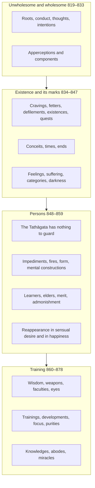

import { Tabs, TabItem } from '@astrojs/starlight/components';

Original text: [World Tipitaka Edition](https://tipitaka2500.github.io/tipitaka/8D/10/10.3.html)

## Summary

Sixty triads, the longest of the sutta's lists: roots, conducts, thoughts, intentions, apperceptions and components, unwholesome and wholesome; cravings, defilements, existences, feelings and kinds of suffering; persons, elders, trainings, developments, kinds of focus, knowledges and miracles. Most are bare lists of three; the three kinds of reappearance in the realm of sensual desire and in happiness, the three things of the Tathāgata that need not be guarded, and the three topics of conversation are spelled out.

## Diagram

## Text

<Tabs syncKey="paliquote">
<TabItem label="My Translation">
(305.)

818\. Āvuso, there are three Dhammas well proclaimed by the Bhagavā, the liberated one, the perfectly awakened one, who knows and sees. Therein all should recite in harmony, not quarrel, so that this optimal life may endure long and last for a long time, which would be for the welfare and happiness of many people, out of compassion for the world, for the good, welfare, and happiness of gods and humans. What three?

819\. Three unwholesome roots: greed, hatred, and delusion. (1)

820\. Three wholesome roots: non-greed, non-hatred, and non-delusion. (2)

821\. Three bad conducts: bodily, verbal, and mental. (3)

822\. Three good conducts: bodily, verbal, and mental. (4)

823\. Three unwholesome thoughts: the thought of sensual desire, the thought of ill will, and the thought of harming. (5)

824\. Three wholesome thoughts: the thought of renunciation, the thought of good, and the thought of not harming. (6)

825\. Three unwholesome intentions: the intention of sensual desire, the intention of ill will, and the intention of harming. (7)

826\. Three wholesome intentions: the intention of renunciation, the intention of good, and the intention of not harming. (8)

827\. Three unwholesome `saññā` (apperceptions): the apperception of sensual desire, the apperception of ill will, and the apperception of harming. (9)

828\. Three wholesome apperceptions: the apperception of renunciation, the apperception of good, and the apperception of not harming. (10)

829\. Three unwholesome components: the component of sensual desire, the component of ill will, and the component of harming. (11)

830\. Three wholesome components: the component of renunciation, the component of good, and the component of not harming. (12)

831\. Another three components: the component of sensual desire, the component of form, and the component of the formless. (13)

832\. Another three components: the component of form, the component of the formless, and the component of cessation. (14)

833\. Another three components: the inferior, the middling, and the superior. (15)

834\. Three `taṇhā` (cravings): `kāmataṇhā` (craving for sensual pleasures), craving for existence, and `vibhavataṇhā` (craving for non-existence). (16)

835\. Another three cravings: craving for sensual pleasures, craving for form, and craving for the formless. (17)

836\. Another three cravings: craving for form, craving for the formless, and craving for cessation (of existence). (18)

837\. Three fetters: identity view, doubt, and adherence to rites and rituals. (19)

838\. Three `āsavā` (defilements): of sensual pleasure, of existence, and of ignorance. (20)

839\. Three `bhavā` (existences): `kāmabhava` (existence in the realm of sensual desire), existence in the realm of form, and existence in the formless realm. (21)

840\. Three quests: for sensual pleasures, for existence, and for the optimal life. (22)

841\. Three kinds of conceit: ‘I am better’, ‘I am equal’, and ‘I am worse’. (23)

842\. Three times: past, future, and present. (24)

843\. Three ends: identity, the origin of identity, and the cessation of identity. (25)

844\. Three `vedanā` (feelings): pleasant, painful, and neutral. (26)

845\. Three kinds of `dukkhatā` (suffering): suffering as pain, suffering due to mental constructions, and suffering due to change. (27)

846\. Three categories: fixed in wrongness, fixed in rightness, and unfixed. (28)

847\. Three kinds of darkness: one doubts, is perplexed, is not fully convinced, and is not confident concerning the past; concerning the future; and concerning the present now. (29)

848\. Three things of the Tathāgata that need not be guarded: The Tathāgata, Āvuso, has perfectly pure bodily conduct; there is no bodily bad conduct of the Tathāgata that the Tathāgata would need to guard, thinking, ‘May others not know this about me.’ The Tathāgata, Āvuso, has perfectly pure verbal conduct; there is no verbal bad conduct of the Tathāgata that the Tathāgata would need to guard, thinking, ‘May others not know this about me.’ The Tathāgata, Āvuso, has perfectly pure mental conduct; there is no mental bad conduct of the Tathāgata that the Tathāgata would need to guard, thinking, ‘May others not know this about me.’ (30)

849\. Three impediments: passion, hatred, and delusion. (31)

850\. Three fires: the fire of passion, the fire of hatred, and the fire of delusion. (32)

851\. Another three fires: the fire of those worthy of offerings, the householder's fire, and the fire of those worthy of gifts. (33)

852\. Three ways of classifying form: visible and impinging, invisible and impinging, and invisible and non-impinging. (34)

853\. Three mental constructions: meritorious, demeritorious, and imperturbable. (35)

854\. Three kinds of persons: the learner, the one beyond training, and the one who is neither a learner nor beyond training. (36)

855\. Three kinds of elders: by birth, by Dhamma, and by convention. (37)

856\. Three bases for making merit: by giving, by virtue, and by development (meditation). (38)

857\. Three bases for admonishment: by what is seen, by what is heard, and by what is suspected. (39)

858\. Three kinds of reappearance in the realm of sensual desire: There are, Āvuso, beings who desire what is present; they wield power over the sensual pleasures that are present, such as humans, some gods, and some beings in the lower realms. This is the first kind of reappearance in the realm of sensual desire. There are, Āvuso, beings who desire what is created; having created and created, they wield power over sensual pleasures, such as the Nimmānaratī gods. This is the second kind of reappearance in the realm of sensual desire. There are, Āvuso, beings who desire what is created by others; they wield power over sensual pleasures created by others, such as the Paranimmitavasavattī gods. This is the third kind of reappearance in the realm of sensual desire. (40)

859\. Three kinds of reappearance in happiness: There are, Āvuso, beings who generate happiness again and again and dwell in happiness, such as the Brahmakāyika gods. This is the first kind of reappearance in happiness. There are, Āvuso, beings who are permeated, pervaded, filled, and suffused with happiness. They utter an inspired utterance now and then: ‘Oh, what happiness! Oh, what happiness!’, such as the Ābhassara gods. This is the second kind of reappearance in happiness. There are, Āvuso, beings who are permeated, pervaded, filled, and suffused with happiness. Contented, they experience only a peaceful happiness, such as the Subhakiṇhā gods. This is the third kind of reappearance in happiness. (41)

860\. Three kinds of `paññā` (wisdom): the learner's, that of one beyond training, and that of one who is neither a learner nor beyond training. (42)

861\. Another three kinds of wisdom: based on thinking, based on learning, and based on development (meditation). (43)

862\. Three weapons: learning, seclusion, and wisdom. (44)

863\. Three faculties: the faculty of thinking ‘I shall know the unknown’, the faculty of final knowledge, and the faculty of one who has final knowledge. (45)

864\. Three eyes: the physical eye, the divine eye, and the eye of wisdom. (46)

865\. Three trainings: in higher virtue, in higher mind, and in higher wisdom. (47)

866\. Three developments: of the body, of the mind, and of wisdom. (48)

867\. Three supreme things: supreme vision, supreme path, and supreme liberation. (49)

868\. Three kinds of focus: focus with reflection and consideration, focus without reflection but with consideration only, and focus without reflection or consideration. (50)

869\. Another three kinds of focus: empty, signless, and undirected. (51)

870\. Three purities: bodily, verbal, and mental. (52)

871\. Three sagacities: bodily, verbal, and mental. (53)

872\. Three skills: in gain, in loss, and in means. (54)

873\. Three forms of intoxication: with health, with youth, and with life. (55)

874\. Three authorities: oneself as authority, the world as authority, and the Dhamma as authority. (56)

875\. Three topics of conversation: one might speak about the past, saying, ‘Thus it was in the past’; or about the future, saying, ‘Thus it will be in the future’; or about the present now, saying, ‘Thus it is now in the present.’ (57)

876\. Three kinds of knowledge: knowledge of the recollection of past lives, knowledge of the passing away and reappearance of beings, and knowledge of the destruction of the defilements. (58)

877\. Three abodes: divine, Brahmā, and of the liberated. (59)

878\. Three kinds of miracles: of psychic power, of mind reading, and of instruction. (60)

879\. Āvuso, these are the three Dhammas well proclaimed by the Bhagavā, the liberated one, the perfectly awakened one, who knows and sees. Therein all should recite in harmony, not quarrel, so that this optimal life may endure long and last for a long time, which would be for the welfare and happiness of many people, out of compassion for the world, for the good, welfare, and happiness of gods and humans.
</TabItem>

<TabItem label="Pāḷi (Roman IAST)">
(305.)

818\. Atthi kho, āvuso, tena bhagavatā jānatā passatā arahatā sammāsambuddhena tayo dhammā sammadakkhātā. Tattha sabbeheva saṅgāyitabbaṃ…pe… atthāya hitāya sukhāya devamanussānaṃ. Katame tayo?

819\. Tīṇi akusalamūlāni— lobho akusalamūlaṃ, doso akusalamūlaṃ, moho akusalamūlaṃ. (1)

820\. Tīṇi kusalamūlāni— alobho kusalamūlaṃ, adoso kusalamūlaṃ, amoho kusalamūlaṃ. (2)

821\. Tīṇi duccaritāni— kāyaduccaritaṃ, vacīduccaritaṃ, manoduccaritaṃ. (3)

822\. Tīṇi sucaritāni— kāyasucaritaṃ, vacīsucaritaṃ, manosucaritaṃ. (4)

823\. Tayo akusalavitakkā— kāmavitakko, byāpādavitakko, vihiṃsāvitakko. (5)

824\. Tayo kusalavitakkā— nekkhammavitakko, abyāpādavitakko, avihiṃsāvitakko. (6)

825\. Tayo akusalasaṅkappā— kāmasaṅkappo, byāpādasaṅkappo, vihiṃsāsaṅkappo. (7)

826\. Tayo kusalasaṅkappā— nekkhammasaṅkappo, abyāpādasaṅkappo, avihiṃsāsaṅkappo. (8)

827\. Tisso akusalasaññā— kāmasaññā, byāpādasaññā, vihiṃsāsaññā. (9)

828\. Tisso kusalasaññā— nekkhammasaññā, abyāpādasaññā, avihiṃsāsaññā. (10)

829\. Tisso akusaladhātuyo— kāmadhātu, byāpādadhātu, vihiṃsādhātu. (11)

830\. Tisso kusaladhātuyo— nekkhammadhātu, abyāpādadhātu, avihiṃsādhātu. (12)

831\. Aparāpi tisso dhātuyo— kāmadhātu, rūpadhātu, arūpadhātu. (13)

832\. Aparāpi tisso dhātuyo— rūpadhātu, arūpadhātu, nirodhadhātu. (14)

833\. Aparāpi tisso dhātuyo— hīnadhātu, majjhimadhātu, paṇītadhātu. (15)

834\. Tisso taṇhā— kāmataṇhā, bhavataṇhā, vibhavataṇhā. (16)

835\. Aparāpi tisso taṇhā— kāmataṇhā, rūpataṇhā, arūpataṇhā. (17)

836\. Aparāpi tisso taṇhā— rūpataṇhā, arūpataṇhā, nirodhataṇhā. (18)

837\. Tīṇi saṃyojanāni— sakkāyadiṭṭhi, vicikicchā, sīlabbataparāmāso. (19)

838\. Tayo āsavā— kāmāsavo, bhavāsavo, avijjāsavo. (20)

839\. Tayo bhavā— kāmabhavo, rūpabhavo, arūpabhavo. (21)

840\. Tisso esanā— kāmesanā, bhavesanā, brahmacariyesanā. (22)

841\. Tisso vidhā— seyyohamasmīti vidhā, sadisohamasmīti vidhā, hīnohamasmīti vidhā. (23)

842\. Tayo addhā— atīto addhā, anāgato addhā, paccuppanno addhā. (24)

843\. Tayo antā— sakkāyo anto, sakkāyasamudayo anto, sakkāyanirodho anto. (25)

844\. Tisso vedanā— sukhā vedanā, dukkhā vedanā, adukkhamasukhā vedanā. (26)

845\. Tisso dukkhatā— dukkhadukkhatā, saṅkhāradukkhatā, vipariṇāmadukkhatā. (27)

846\. Tayo rāsī— micchattaniyato rāsi, sammattaniyato rāsi, aniyato rāsi. (28)

847\. Tayo tamā— atītaṃ vā addhānaṃ ārabbha kaṅkhati vicikicchati nādhimuccati na sampasīdati, anāgataṃ vā addhānaṃ ārabbha kaṅkhati vicikicchati nādhimuccati na sampasīdati, etarahi vā paccuppannaṃ addhānaṃ ārabbha kaṅkhati vicikicchati nādhimuccati na sampasīdati. (29)

848\. Tīṇi tathāgatassa arakkheyyāni— parisuddhakāyasamācāro āvuso tathāgato, natthi tathāgatassa kāyaduccaritaṃ, yaṃ tathāgato rakkheyya— ‘mā me idaṃ paro aññāsī’ti. Parisuddhavacīsamācāro āvuso, tathāgato, natthi tathāgatassa vacīduccaritaṃ, yaṃ tathāgato rakkheyya— ‘mā me idaṃ paro aññāsī’ti. Parisuddhamanosamācāro, āvuso, tathāgato, natthi tathāgatassa manoduccaritaṃ yaṃ tathāgato rakkheyya— ‘mā me idaṃ paro aññāsī’ti. (30)

849\. Tayo kiñcanā— rāgo kiñcanaṃ, doso kiñcanaṃ, moho kiñcanaṃ. (31)

850\. Tayo aggī— rāgaggi, dosaggi, mohaggi. (32)

851\. Aparepi tayo aggī— āhuneyyaggi, gahapataggi, dakkhiṇeyyaggi. (33)

852\. Tividhena rūpasaṅgaho— sanidassanasappaṭighaṃ rūpaṃ, anidassanasappaṭighaṃ rūpaṃ, anidassanaappaṭighaṃ rūpaṃ. (34)

853\. Tayo saṅkhārā— puññābhisaṅkhāro, apuññābhisaṅkhāro, āneñjābhisaṅkhāro. (35)

854\. Tayo puggalā— sekkho puggalo, asekkho puggalo, nevasekkho nāsekkho puggalo. (36)

855\. Tayo therā— jātithero, dhammathero, sammutithero. (37)

856\. Tīṇi puññakiriyavatthūni— dānamayaṃ puññakiriyavatthu, sīlamayaṃ puññakiriyavatthu, bhāvanāmayaṃ puññakiriyavatthu. (38)

857\. Tīṇi codanāvatthūni— diṭṭhena, sutena, parisaṅkāya. (39)

858\. Tisso kāmūpapattiyo— santāvuso sattā paccupaṭṭhitakāmā, te paccupaṭṭhitesu kāmesu vasaṃ vattenti, seyyathāpi manussā ekacce ca devā ekacce ca vinipātikā. Ayaṃ paṭhamā kāmūpapatti. Santāvuso, sattā nimmitakāmā, te nimminitvā nimminitvā kāmesu vasaṃ vattenti, seyyathāpi devā nimmānaratī. Ayaṃ dutiyā kāmūpapatti. Santāvuso sattā paranimmitakāmā, te paranimmitesu kāmesu vasaṃ vattenti, seyyathāpi devā paranimmitavasavattī. Ayaṃ tatiyā kāmūpapatti. (40)

859\. Tisso sukhūpapattiyo— santāvuso sattā uppādetvā uppādetvā sukhaṃ viharanti, seyyathāpi devā brahmakāyikā. Ayaṃ paṭhamā sukhūpapatti. Santāvuso, sattā sukhena abhisannā parisannā paripūrā paripphuṭā. Te kadāci karahaci udānaṃ udānenti— ‘aho sukhaṃ, aho sukhan’ti, seyyathāpi devā ābhassarā. Ayaṃ dutiyā sukhūpapatti. Santāvuso, sattā sukhena abhisannā parisannā paripūrā paripphuṭā. Te santaṃyeva tusitā sukhaṃ paṭisaṃvedenti, seyyathāpi devā subhakiṇhā. Ayaṃ tatiyā sukhūpapatti. (41)

860\. Tisso paññā— sekkhā paññā, asekkhā paññā, nevasekkhānāsekkhā paññā. (42)

861\. Aparāpi tisso paññā— cintāmayā paññā, sutamayā paññā, bhāvanāmayā paññā. (43)

862\. Tīṇāvudhāni— sutāvudhaṃ, pavivekāvudhaṃ, paññāvudhaṃ. (44)

863\. Tīṇindriyāni— anaññātaññassāmītindriyaṃ, aññindriyaṃ, aññātāvindriyaṃ. (45)

864\. Tīṇi cakkhūni— maṃsacakkhu, dibbacakkhu, paññācakkhu. (46)

865\. Tisso sikkhā— adhisīlasikkhā, adhicittasikkhā, adhipaññāsikkhā. (47)

866\. Tisso bhāvanā— kāyabhāvanā, cittabhāvanā, paññābhāvanā. (48)

867\. Tīṇi anuttariyāni— dassanānuttariyaṃ, paṭipadānuttariyaṃ, vimuttānuttariyaṃ. (49)

868\. Tayo samādhī— savitakkasavicāro samādhi, avitakkavicāramatto samādhi, avitakkaavicāro samādhi. (50)

869\. Aparepi tayo samādhī— suññato samādhi, animitto samādhi, appaṇihito samādhi. (51)

870\. Tīṇi soceyyāni— kāyasoceyyaṃ, vacīsoceyyaṃ, manosoceyyaṃ. (52)

871\. Tīṇi moneyyāni— kāyamoneyyaṃ, vacīmoneyyaṃ, manomoneyyaṃ. (53)

872\. Tīṇi kosallāni— āyakosallaṃ, apāyakosallaṃ, upāyakosallaṃ. (54)

873\. Tayo madā— ārogyamado, yobbanamado, jīvitamado. (55)

874\. Tīṇi ādhipateyyāni— attādhipateyyaṃ, lokādhipateyyaṃ, dhammādhipateyyaṃ. (56)

875\. Tīṇi kathāvatthūni— atītaṃ vā addhānaṃ ārabbha kathaṃ katheyya— ‘evaṃ ahosi atītamaddhānan’ti; anāgataṃ vā addhānaṃ ārabbha kathaṃ katheyya— ‘evaṃ bhavissati anāgatamaddhānan’ti; etarahi vā paccuppannaṃ addhānaṃ ārabbha kathaṃ katheyya— ‘evaṃ hoti etarahi paccuppannaṃ addhānan’ti. (57)

876\. Tisso vijjā— pubbenivāsānussatiñāṇaṃ vijjā, sattānaṃ cutūpapāteñāṇaṃ vijjā, āsavānaṃ khayeñāṇaṃ vijjā. (58)

877\. Tayo vihārā— dibbo vihāro, brahmā vihāro, ariyo vihāro. (59)

878\. Tīṇi pāṭihāriyāni— iddhipāṭihāriyaṃ, ādesanāpāṭihāriyaṃ, anusāsanīpāṭihāriyaṃ. (60)

879\. Ime kho, āvuso, tena bhagavatā jānatā passatā arahatā sammāsambuddhena tayo dhammā sammadakkhātā. Tattha sabbeheva saṅgāyitabbaṃ…pe… atthāya hitāya sukhāya devamanussānaṃ.
</TabItem>

<TabItem label="Pāḷi (Brahmi)">
(305.)

818\. 𑀅𑀢𑁆𑀣𑀺 𑀔𑁄, 𑀆𑀯𑀼𑀲𑁄, 𑀢𑁂𑀦 𑀪𑀕𑀯𑀢𑀸 𑀚𑀸𑀦𑀢𑀸 𑀧𑀲𑁆𑀲𑀢𑀸 𑀅𑀭𑀳𑀢𑀸 𑀲𑀫𑁆𑀫𑀸𑀲𑀫𑁆𑀩𑀼𑀤𑁆𑀥𑁂𑀦 𑀢𑀬𑁄 𑀥𑀫𑁆𑀫𑀸 𑀲𑀫𑁆𑀫𑀤𑀓𑁆𑀔𑀸𑀢𑀸. 𑀢𑀢𑁆𑀣 𑀲𑀩𑁆𑀩𑁂𑀳𑁂𑀯 𑀲𑀗𑁆𑀕𑀸𑀬𑀺𑀢𑀩𑁆𑀩𑀁…𑀧𑁂… 𑀅𑀢𑁆𑀣𑀸𑀬 𑀳𑀺𑀢𑀸𑀬 𑀲𑀼𑀔𑀸𑀬 𑀤𑁂𑀯𑀫𑀦𑀼𑀲𑁆𑀲𑀸𑀦𑀁. 𑀓𑀢𑀫𑁂 𑀢𑀬𑁄?

819\. 𑀢𑀻𑀡𑀺 𑀅𑀓𑀼𑀲𑀮𑀫𑀽𑀮𑀸𑀦𑀺— 𑀮𑁄𑀪𑁄 𑀅𑀓𑀼𑀲𑀮𑀫𑀽𑀮𑀁, 𑀤𑁄𑀲𑁄 𑀅𑀓𑀼𑀲𑀮𑀫𑀽𑀮𑀁, 𑀫𑁄𑀳𑁄 𑀅𑀓𑀼𑀲𑀮𑀫𑀽𑀮𑀁. (1)

820\. 𑀢𑀻𑀡𑀺 𑀓𑀼𑀲𑀮𑀫𑀽𑀮𑀸𑀦𑀺— 𑀅𑀮𑁄𑀪𑁄 𑀓𑀼𑀲𑀮𑀫𑀽𑀮𑀁, 𑀅𑀤𑁄𑀲𑁄 𑀓𑀼𑀲𑀮𑀫𑀽𑀮𑀁, 𑀅𑀫𑁄𑀳𑁄 𑀓𑀼𑀲𑀮𑀫𑀽𑀮𑀁. (2)

821\. 𑀢𑀻𑀡𑀺 𑀤𑀼𑀘𑁆𑀘𑀭𑀺𑀢𑀸𑀦𑀺— 𑀓𑀸𑀬𑀤𑀼𑀘𑁆𑀘𑀭𑀺𑀢𑀁, 𑀯𑀘𑀻𑀤𑀼𑀘𑁆𑀘𑀭𑀺𑀢𑀁, 𑀫𑀦𑁄𑀤𑀼𑀘𑁆𑀘𑀭𑀺𑀢𑀁. (3)

822\. 𑀢𑀻𑀡𑀺 𑀲𑀼𑀘𑀭𑀺𑀢𑀸𑀦𑀺— 𑀓𑀸𑀬𑀲𑀼𑀘𑀭𑀺𑀢𑀁, 𑀯𑀘𑀻𑀲𑀼𑀘𑀭𑀺𑀢𑀁, 𑀫𑀦𑁄𑀲𑀼𑀘𑀭𑀺𑀢𑀁. (4)

823\. 𑀢𑀬𑁄 𑀅𑀓𑀼𑀲𑀮𑀯𑀺𑀢𑀓𑁆𑀓𑀸— 𑀓𑀸𑀫𑀯𑀺𑀢𑀓𑁆𑀓𑁄, 𑀩𑁆𑀬𑀸𑀧𑀸𑀤𑀯𑀺𑀢𑀓𑁆𑀓𑁄, 𑀯𑀺𑀳𑀺𑀁𑀲𑀸𑀯𑀺𑀢𑀓𑁆𑀓𑁄. (5)

824\. 𑀢𑀬𑁄 𑀓𑀼𑀲𑀮𑀯𑀺𑀢𑀓𑁆𑀓𑀸— 𑀦𑁂𑀓𑁆𑀔𑀫𑁆𑀫𑀯𑀺𑀢𑀓𑁆𑀓𑁄, 𑀅𑀩𑁆𑀬𑀸𑀧𑀸𑀤𑀯𑀺𑀢𑀓𑁆𑀓𑁄, 𑀅𑀯𑀺𑀳𑀺𑀁𑀲𑀸𑀯𑀺𑀢𑀓𑁆𑀓𑁄. (6)

825\. 𑀢𑀬𑁄 𑀅𑀓𑀼𑀲𑀮𑀲𑀗𑁆𑀓𑀧𑁆𑀧𑀸— 𑀓𑀸𑀫𑀲𑀗𑁆𑀓𑀧𑁆𑀧𑁄, 𑀩𑁆𑀬𑀸𑀧𑀸𑀤𑀲𑀗𑁆𑀓𑀧𑁆𑀧𑁄, 𑀯𑀺𑀳𑀺𑀁𑀲𑀸𑀲𑀗𑁆𑀓𑀧𑁆𑀧𑁄. (7)

826\. 𑀢𑀬𑁄 𑀓𑀼𑀲𑀮𑀲𑀗𑁆𑀓𑀧𑁆𑀧𑀸— 𑀦𑁂𑀓𑁆𑀔𑀫𑁆𑀫𑀲𑀗𑁆𑀓𑀧𑁆𑀧𑁄, 𑀅𑀩𑁆𑀬𑀸𑀧𑀸𑀤𑀲𑀗𑁆𑀓𑀧𑁆𑀧𑁄, 𑀅𑀯𑀺𑀳𑀺𑀁𑀲𑀸𑀲𑀗𑁆𑀓𑀧𑁆𑀧𑁄. (8)

827\. 𑀢𑀺𑀲𑁆𑀲𑁄 𑀅𑀓𑀼𑀲𑀮𑀲𑀜𑁆𑀜𑀸— 𑀓𑀸𑀫𑀲𑀜𑁆𑀜𑀸, 𑀩𑁆𑀬𑀸𑀧𑀸𑀤𑀲𑀜𑁆𑀜𑀸, 𑀯𑀺𑀳𑀺𑀁𑀲𑀸𑀲𑀜𑁆𑀜𑀸. (9)

828\. 𑀢𑀺𑀲𑁆𑀲𑁄 𑀓𑀼𑀲𑀮𑀲𑀜𑁆𑀜𑀸— 𑀦𑁂𑀓𑁆𑀔𑀫𑁆𑀫𑀲𑀜𑁆𑀜𑀸, 𑀅𑀩𑁆𑀬𑀸𑀧𑀸𑀤𑀲𑀜𑁆𑀜𑀸, 𑀅𑀯𑀺𑀳𑀺𑀁𑀲𑀸𑀲𑀜𑁆𑀜𑀸. (10)

829\. 𑀢𑀺𑀲𑁆𑀲𑁄 𑀅𑀓𑀼𑀲𑀮𑀥𑀸𑀢𑀼𑀬𑁄— 𑀓𑀸𑀫𑀥𑀸𑀢𑀼, 𑀩𑁆𑀬𑀸𑀧𑀸𑀤𑀥𑀸𑀢𑀼, 𑀯𑀺𑀳𑀺𑀁𑀲𑀸𑀥𑀸𑀢𑀼. (11)

830\. 𑀢𑀺𑀲𑁆𑀲𑁄 𑀓𑀼𑀲𑀮𑀥𑀸𑀢𑀼𑀬𑁄— 𑀦𑁂𑀓𑁆𑀔𑀫𑁆𑀫𑀥𑀸𑀢𑀼, 𑀅𑀩𑁆𑀬𑀸𑀧𑀸𑀤𑀥𑀸𑀢𑀼, 𑀅𑀯𑀺𑀳𑀺𑀁𑀲𑀸𑀥𑀸𑀢𑀼. (12)

831\. 𑀅𑀧𑀭𑀸𑀧𑀺 𑀢𑀺𑀲𑁆𑀲𑁄 𑀥𑀸𑀢𑀼𑀬𑁄— 𑀓𑀸𑀫𑀥𑀸𑀢𑀼, 𑀭𑀽𑀧𑀥𑀸𑀢𑀼, 𑀅𑀭𑀽𑀧𑀥𑀸𑀢𑀼. (13)

832\. 𑀅𑀧𑀭𑀸𑀧𑀺 𑀢𑀺𑀲𑁆𑀲𑁄 𑀥𑀸𑀢𑀼𑀬𑁄— 𑀭𑀽𑀧𑀥𑀸𑀢𑀼, 𑀅𑀭𑀽𑀧𑀥𑀸𑀢𑀼, 𑀦𑀺𑀭𑁄𑀥𑀥𑀸𑀢𑀼. (14)

833\. 𑀅𑀧𑀭𑀸𑀧𑀺 𑀢𑀺𑀲𑁆𑀲𑁄 𑀥𑀸𑀢𑀼𑀬𑁄— 𑀳𑀻𑀦𑀥𑀸𑀢𑀼, 𑀫𑀚𑁆𑀛𑀺𑀫𑀥𑀸𑀢𑀼, 𑀧𑀡𑀻𑀢𑀥𑀸𑀢𑀼. (15)

834\. 𑀢𑀺𑀲𑁆𑀲𑁄 𑀢𑀡𑁆𑀳𑀸— 𑀓𑀸𑀫𑀢𑀡𑁆𑀳𑀸, 𑀪𑀯𑀢𑀡𑁆𑀳𑀸, 𑀯𑀺𑀪𑀯𑀢𑀡𑁆𑀳𑀸. (16)

835\. 𑀅𑀧𑀭𑀸𑀧𑀺 𑀢𑀺𑀲𑁆𑀲𑁄 𑀢𑀡𑁆𑀳𑀸— 𑀓𑀸𑀫𑀢𑀡𑁆𑀳𑀸, 𑀭𑀽𑀧𑀢𑀡𑁆𑀳𑀸, 𑀅𑀭𑀽𑀧𑀢𑀡𑁆𑀳𑀸. (17)

836\. 𑀅𑀧𑀭𑀸𑀧𑀺 𑀢𑀺𑀲𑁆𑀲𑁄 𑀢𑀡𑁆𑀳𑀸— 𑀭𑀽𑀧𑀢𑀡𑁆𑀳𑀸, 𑀅𑀭𑀽𑀧𑀢𑀡𑁆𑀳𑀸, 𑀦𑀺𑀭𑁄𑀥𑀢𑀡𑁆𑀳𑀸. (18)

837\. 𑀢𑀻𑀡𑀺 𑀲𑀁𑀬𑁄𑀚𑀦𑀸𑀦𑀺— 𑀲𑀓𑁆𑀓𑀸𑀬𑀤𑀺𑀝𑁆𑀞𑀺, 𑀯𑀺𑀘𑀺𑀓𑀺𑀘𑁆𑀙𑀸, 𑀲𑀻𑀮𑀩𑁆𑀩𑀢𑀧𑀭𑀸𑀫𑀸𑀲𑁄. (19)

838\. 𑀢𑀬𑁄 𑀆𑀲𑀯𑀸— 𑀓𑀸𑀫𑀸𑀲𑀯𑁄, 𑀪𑀯𑀸𑀲𑀯𑁄, 𑀅𑀯𑀺𑀚𑁆𑀚𑀸𑀲𑀯𑁄. (20)

839\. 𑀢𑀬𑁄 𑀪𑀯𑀸— 𑀓𑀸𑀫𑀪𑀯𑁄, 𑀭𑀽𑀧𑀪𑀯𑁄, 𑀅𑀭𑀽𑀧𑀪𑀯𑁄. (21)

840\. 𑀢𑀺𑀲𑁆𑀲𑁄 𑀏𑀲𑀦𑀸— 𑀓𑀸𑀫𑁂𑀲𑀦𑀸, 𑀪𑀯𑁂𑀲𑀦𑀸, 𑀩𑁆𑀭𑀳𑁆𑀫𑀘𑀭𑀺𑀬𑁂𑀲𑀦𑀸. (22)

841\. 𑀢𑀺𑀲𑁆𑀲𑁄 𑀯𑀺𑀥𑀸— 𑀲𑁂𑀬𑁆𑀬𑁄𑀳𑀫𑀲𑁆𑀫𑀻𑀢𑀺 𑀯𑀺𑀥𑀸, 𑀲𑀤𑀺𑀲𑁄𑀳𑀫𑀲𑁆𑀫𑀻𑀢𑀺 𑀯𑀺𑀥𑀸, 𑀳𑀻𑀦𑁄𑀳𑀫𑀲𑁆𑀫𑀻𑀢𑀺 𑀯𑀺𑀥𑀸. (23)

842\. 𑀢𑀬𑁄 𑀅𑀤𑁆𑀥𑀸— 𑀅𑀢𑀻𑀢𑁄 𑀅𑀤𑁆𑀥𑀸, 𑀅𑀦𑀸𑀕𑀢𑁄 𑀅𑀤𑁆𑀥𑀸, 𑀧𑀘𑁆𑀘𑀼𑀧𑁆𑀧𑀦𑁆𑀦𑁄 𑀅𑀤𑁆𑀥𑀸. (24)

843\. 𑀢𑀬𑁄 𑀅𑀦𑁆𑀢𑀸— 𑀲𑀓𑁆𑀓𑀸𑀬𑁄 𑀅𑀦𑁆𑀢𑁄, 𑀲𑀓𑁆𑀓𑀸𑀬𑀲𑀫𑀼𑀤𑀬𑁄 𑀅𑀦𑁆𑀢𑁄, 𑀲𑀓𑁆𑀓𑀸𑀬𑀦𑀺𑀭𑁄𑀥𑁄 𑀅𑀦𑁆𑀢𑁄. (25)

844\. 𑀢𑀺𑀲𑁆𑀲𑁄 𑀯𑁂𑀤𑀦𑀸— 𑀲𑀼𑀔𑀸 𑀯𑁂𑀤𑀦𑀸, 𑀤𑀼𑀓𑁆𑀔𑀸 𑀯𑁂𑀤𑀦𑀸, 𑀅𑀤𑀼𑀓𑁆𑀔𑀫𑀲𑀼𑀔𑀸 𑀯𑁂𑀤𑀦𑀸. (26)

845\. 𑀢𑀺𑀲𑁆𑀲𑁄 𑀤𑀼𑀓𑁆𑀔𑀢𑀸— 𑀤𑀼𑀓𑁆𑀔𑀤𑀼𑀓𑁆𑀔𑀢𑀸, 𑀲𑀗𑁆𑀔𑀸𑀭𑀤𑀼𑀓𑁆𑀔𑀢𑀸, 𑀯𑀺𑀧𑀭𑀺𑀡𑀸𑀫𑀤𑀼𑀓𑁆𑀔𑀢𑀸. (27)

846\. 𑀢𑀬𑁄 𑀭𑀸𑀲𑀻— 𑀫𑀺𑀘𑁆𑀙𑀢𑁆𑀢𑀦𑀺𑀬𑀢𑁄 𑀭𑀸𑀲𑀺, 𑀲𑀫𑁆𑀫𑀢𑁆𑀢𑀦𑀺𑀬𑀢𑁄 𑀭𑀸𑀲𑀺, 𑀅𑀦𑀺𑀬𑀢𑁄 𑀭𑀸𑀲𑀺. (28)

847\. 𑀢𑀬𑁄 𑀢𑀫𑀸— 𑀅𑀢𑀻𑀢𑀁 𑀯𑀸 𑀅𑀤𑁆𑀥𑀸𑀦𑀁 𑀆𑀭𑀩𑁆𑀪 𑀓𑀗𑁆𑀔𑀢𑀺 𑀯𑀺𑀘𑀺𑀓𑀺𑀘𑁆𑀙𑀢𑀺 𑀦𑀸𑀥𑀺𑀫𑀼𑀘𑁆𑀘𑀢𑀺 𑀦 𑀲𑀫𑁆𑀧𑀲𑀻𑀤𑀢𑀺, 𑀅𑀦𑀸𑀕𑀢𑀁 𑀯𑀸 𑀅𑀤𑁆𑀥𑀸𑀦𑀁 𑀆𑀭𑀩𑁆𑀪 𑀓𑀗𑁆𑀔𑀢𑀺 𑀯𑀺𑀘𑀺𑀓𑀺𑀘𑁆𑀙𑀢𑀺 𑀦𑀸𑀥𑀺𑀫𑀼𑀘𑁆𑀘𑀢𑀺 𑀦 𑀲𑀫𑁆𑀧𑀲𑀻𑀤𑀢𑀺, 𑀏𑀢𑀭𑀳𑀺 𑀯𑀸 𑀧𑀘𑁆𑀘𑀼𑀧𑁆𑀧𑀦𑁆𑀦𑀁 𑀅𑀤𑁆𑀥𑀸𑀦𑀁 𑀆𑀭𑀩𑁆𑀪 𑀓𑀗𑁆𑀔𑀢𑀺 𑀯𑀺𑀘𑀺𑀓𑀺𑀘𑁆𑀙𑀢𑀺 𑀦𑀸𑀥𑀺𑀫𑀼𑀘𑁆𑀘𑀢𑀺 𑀦 𑀲𑀫𑁆𑀧𑀲𑀻𑀤𑀢𑀺. (29)

848\. 𑀢𑀻𑀡𑀺 𑀢𑀣𑀸𑀕𑀢𑀲𑁆𑀲 𑀅𑀭𑀓𑁆𑀔𑁂𑀬𑁆𑀬𑀸𑀦𑀺— 𑀧𑀭𑀺𑀲𑀼𑀤𑁆𑀥𑀓𑀸𑀬𑀲𑀫𑀸𑀘𑀸𑀭𑁄 𑀆𑀯𑀼𑀲𑁄 𑀢𑀣𑀸𑀕𑀢𑁄, 𑀦𑀢𑁆𑀣𑀺 𑀢𑀣𑀸𑀕𑀢𑀲𑁆𑀲 𑀓𑀸𑀬𑀤𑀼𑀘𑁆𑀘𑀭𑀺𑀢𑀁, 𑀬𑀁 𑀢𑀣𑀸𑀕𑀢𑁄 𑀭𑀓𑁆𑀔𑁂𑀬𑁆𑀬— ‘𑀫𑀸 𑀫𑁂 𑀇𑀤𑀁 𑀧𑀭𑁄 𑀅𑀜𑁆𑀜𑀸𑀲𑀻’𑀢𑀺. 𑀧𑀭𑀺𑀲𑀼𑀤𑁆𑀥𑀯𑀘𑀻𑀲𑀫𑀸𑀘𑀸𑀭𑁄 𑀆𑀯𑀼𑀲𑁄, 𑀢𑀣𑀸𑀕𑀢𑁄, 𑀦𑀢𑁆𑀣𑀺 𑀢𑀣𑀸𑀕𑀢𑀲𑁆𑀲 𑀯𑀘𑀻𑀤𑀼𑀘𑁆𑀘𑀭𑀺𑀢𑀁, 𑀬𑀁 𑀢𑀣𑀸𑀕𑀢𑁄 𑀭𑀓𑁆𑀔𑁂𑀬𑁆𑀬— ‘𑀫𑀸 𑀫𑁂 𑀇𑀤𑀁 𑀧𑀭𑁄 𑀅𑀜𑁆𑀜𑀸𑀲𑀻’𑀢𑀺. 𑀧𑀭𑀺𑀲𑀼𑀤𑁆𑀥𑀫𑀦𑁄𑀲𑀫𑀸𑀘𑀸𑀭𑁄, 𑀆𑀯𑀼𑀲𑁄, 𑀢𑀣𑀸𑀕𑀢𑁄, 𑀦𑀢𑁆𑀣𑀺 𑀢𑀣𑀸𑀕𑀢𑀲𑁆𑀲 𑀫𑀦𑁄𑀤𑀼𑀘𑁆𑀘𑀭𑀺𑀢𑀁 𑀬𑀁 𑀢𑀣𑀸𑀕𑀢𑁄 𑀭𑀓𑁆𑀔𑁂𑀬𑁆𑀬— ‘𑀫𑀸 𑀫𑁂 𑀇𑀤𑀁 𑀧𑀭𑁄 𑀅𑀜𑁆𑀜𑀸𑀲𑀻’𑀢𑀺. (30)

849\. 𑀢𑀬𑁄 𑀓𑀺𑀜𑁆𑀘𑀦𑀸— 𑀭𑀸𑀕𑁄 𑀓𑀺𑀜𑁆𑀘𑀦𑀁, 𑀤𑁄𑀲𑁄 𑀓𑀺𑀜𑁆𑀘𑀦𑀁, 𑀫𑁄𑀳𑁄 𑀓𑀺𑀜𑁆𑀘𑀦𑀁. (31)

850\. 𑀢𑀬𑁄 𑀅𑀕𑁆𑀕𑀻— 𑀭𑀸𑀕𑀕𑁆𑀕𑀺, 𑀤𑁄𑀲𑀕𑁆𑀕𑀺, 𑀫𑁄𑀳𑀕𑁆𑀕𑀺. (32)

851\. 𑀅𑀧𑀭𑁂𑀧𑀺 𑀢𑀬𑁄 𑀅𑀕𑁆𑀕𑀻— 𑀆𑀳𑀼𑀦𑁂𑀬𑁆𑀬𑀕𑁆𑀕𑀺, 𑀕𑀳𑀧𑀢𑀕𑁆𑀕𑀺, 𑀤𑀓𑁆𑀔𑀺𑀡𑁂𑀬𑁆𑀬𑀕𑁆𑀕𑀺. (33)

852\. 𑀢𑀺𑀯𑀺𑀥𑁂𑀦 𑀭𑀽𑀧𑀲𑀗𑁆𑀕𑀳𑁄— 𑀲𑀦𑀺𑀤𑀲𑁆𑀲𑀦𑀲𑀧𑁆𑀧𑀝𑀺𑀖𑀁 𑀭𑀽𑀧𑀁, 𑀅𑀦𑀺𑀤𑀲𑁆𑀲𑀦𑀲𑀧𑁆𑀧𑀝𑀺𑀖𑀁 𑀭𑀽𑀧𑀁, 𑀅𑀦𑀺𑀤𑀲𑁆𑀲𑀦𑀅𑀧𑁆𑀧𑀝𑀺𑀖𑀁 𑀭𑀽𑀧𑀁. (34)

853\. 𑀢𑀬𑁄 𑀲𑀗𑁆𑀔𑀸𑀭𑀸— 𑀧𑀼𑀜𑁆𑀜𑀸𑀪𑀺𑀲𑀗𑁆𑀔𑀸𑀭𑁄, 𑀅𑀧𑀼𑀜𑁆𑀜𑀸𑀪𑀺𑀲𑀗𑁆𑀔𑀸𑀭𑁄, 𑀆𑀦𑁂𑀜𑁆𑀚𑀸𑀪𑀺𑀲𑀗𑁆𑀔𑀸𑀭𑁄. (35)

854\. 𑀢𑀬𑁄 𑀧𑀼𑀕𑁆𑀕𑀮𑀸— 𑀲𑁂𑀓𑁆𑀔𑁄 𑀧𑀼𑀕𑁆𑀕𑀮𑁄, 𑀅𑀲𑁂𑀓𑁆𑀔𑁄 𑀧𑀼𑀕𑁆𑀕𑀮𑁄, 𑀦𑁂𑀯𑀲𑁂𑀓𑁆𑀔𑁄 𑀦𑀸𑀲𑁂𑀓𑁆𑀔𑁄 𑀧𑀼𑀕𑁆𑀕𑀮𑁄. (36)

855\. 𑀢𑀬𑁄 𑀣𑁂𑀭𑀸— 𑀚𑀸𑀢𑀺𑀣𑁂𑀭𑁄, 𑀥𑀫𑁆𑀫𑀣𑁂𑀭𑁄, 𑀲𑀫𑁆𑀫𑀼𑀢𑀺𑀣𑁂𑀭𑁄. (37)

856\. 𑀢𑀻𑀡𑀺 𑀧𑀼𑀜𑁆𑀜𑀓𑀺𑀭𑀺𑀬𑀯𑀢𑁆𑀣𑀽𑀦𑀺— 𑀤𑀸𑀦𑀫𑀬𑀁 𑀧𑀼𑀜𑁆𑀜𑀓𑀺𑀭𑀺𑀬𑀯𑀢𑁆𑀣𑀼, 𑀲𑀻𑀮𑀫𑀬𑀁 𑀧𑀼𑀜𑁆𑀜𑀓𑀺𑀭𑀺𑀬𑀯𑀢𑁆𑀣𑀼, 𑀪𑀸𑀯𑀦𑀸𑀫𑀬𑀁 𑀧𑀼𑀜𑁆𑀜𑀓𑀺𑀭𑀺𑀬𑀯𑀢𑁆𑀣𑀼. (38)

857\. 𑀢𑀻𑀡𑀺 𑀘𑁄𑀤𑀦𑀸𑀯𑀢𑁆𑀣𑀽𑀦𑀺— 𑀤𑀺𑀝𑁆𑀞𑁂𑀦, 𑀲𑀼𑀢𑁂𑀦, 𑀧𑀭𑀺𑀲𑀗𑁆𑀓𑀸𑀬. (39)

858\. 𑀢𑀺𑀲𑁆𑀲𑁄 𑀓𑀸𑀫𑀽𑀧𑀧𑀢𑁆𑀢𑀺𑀬𑁄— 𑀲𑀦𑁆𑀢𑀸𑀯𑀼𑀲𑁄 𑀲𑀢𑁆𑀢𑀸 𑀧𑀘𑁆𑀘𑀼𑀧𑀝𑁆𑀞𑀺𑀢𑀓𑀸𑀫𑀸, 𑀢𑁂 𑀧𑀘𑁆𑀘𑀼𑀧𑀝𑁆𑀞𑀺𑀢𑁂𑀲𑀼 𑀓𑀸𑀫𑁂𑀲𑀼 𑀯𑀲𑀁 𑀯𑀢𑁆𑀢𑁂𑀦𑁆𑀢𑀺, 𑀲𑁂𑀬𑁆𑀬𑀣𑀸𑀧𑀺 𑀫𑀦𑀼𑀲𑁆𑀲𑀸 𑀏𑀓𑀘𑁆𑀘𑁂 𑀘 𑀤𑁂𑀯𑀸 𑀏𑀓𑀘𑁆𑀘𑁂 𑀘 𑀯𑀺𑀦𑀺𑀧𑀸𑀢𑀺𑀓𑀸. 𑀅𑀬𑀁 𑀧𑀞𑀫𑀸 𑀓𑀸𑀫𑀽𑀧𑀧𑀢𑁆𑀢𑀺. 𑀲𑀦𑁆𑀢𑀸𑀯𑀼𑀲𑁄, 𑀲𑀢𑁆𑀢𑀸 𑀦𑀺𑀫𑁆𑀫𑀺𑀢𑀓𑀸𑀫𑀸, 𑀢𑁂 𑀦𑀺𑀫𑁆𑀫𑀺𑀦𑀺𑀢𑁆𑀯𑀸 𑀦𑀺𑀫𑁆𑀫𑀺𑀦𑀺𑀢𑁆𑀯𑀸 𑀓𑀸𑀫𑁂𑀲𑀼 𑀯𑀲𑀁 𑀯𑀢𑁆𑀢𑁂𑀦𑁆𑀢𑀺, 𑀲𑁂𑀬𑁆𑀬𑀣𑀸𑀧𑀺 𑀤𑁂𑀯𑀸 𑀦𑀺𑀫𑁆𑀫𑀸𑀦𑀭𑀢𑀻. 𑀅𑀬𑀁 𑀤𑀼𑀢𑀺𑀬𑀸 𑀓𑀸𑀫𑀽𑀧𑀧𑀢𑁆𑀢𑀺. 𑀲𑀦𑁆𑀢𑀸𑀯𑀼𑀲𑁄 𑀲𑀢𑁆𑀢𑀸 𑀧𑀭𑀦𑀺𑀫𑁆𑀫𑀺𑀢𑀓𑀸𑀫𑀸, 𑀢𑁂 𑀧𑀭𑀦𑀺𑀫𑁆𑀫𑀺𑀢𑁂𑀲𑀼 𑀓𑀸𑀫𑁂𑀲𑀼 𑀯𑀲𑀁 𑀯𑀢𑁆𑀢𑁂𑀦𑁆𑀢𑀺, 𑀲𑁂𑀬𑁆𑀬𑀣𑀸𑀧𑀺 𑀤𑁂𑀯𑀸 𑀧𑀭𑀦𑀺𑀫𑁆𑀫𑀺𑀢𑀯𑀲𑀯𑀢𑁆𑀢𑀻. 𑀅𑀬𑀁 𑀢𑀢𑀺𑀬𑀸 𑀓𑀸𑀫𑀽𑀧𑀧𑀢𑁆𑀢𑀺. (40)

859\. 𑀢𑀺𑀲𑁆𑀲𑁄 𑀲𑀼𑀔𑀽𑀧𑀧𑀢𑁆𑀢𑀺𑀬𑁄— 𑀲𑀦𑁆𑀢𑀸𑀯𑀼𑀲𑁄 𑀲𑀢𑁆𑀢𑀸 𑀉𑀧𑁆𑀧𑀸𑀤𑁂𑀢𑁆𑀯𑀸 𑀉𑀧𑁆𑀧𑀸𑀤𑁂𑀢𑁆𑀯𑀸 𑀲𑀼𑀔𑀁 𑀯𑀺𑀳𑀭𑀦𑁆𑀢𑀺, 𑀲𑁂𑀬𑁆𑀬𑀣𑀸𑀧𑀺 𑀤𑁂𑀯𑀸 𑀩𑁆𑀭𑀳𑁆𑀫𑀓𑀸𑀬𑀺𑀓𑀸. 𑀅𑀬𑀁 𑀧𑀞𑀫𑀸 𑀲𑀼𑀔𑀽𑀧𑀧𑀢𑁆𑀢𑀺. 𑀲𑀦𑁆𑀢𑀸𑀯𑀼𑀲𑁄, 𑀲𑀢𑁆𑀢𑀸 𑀲𑀼𑀔𑁂𑀦 𑀅𑀪𑀺𑀲𑀦𑁆𑀦𑀸 𑀧𑀭𑀺𑀲𑀦𑁆𑀦𑀸 𑀧𑀭𑀺𑀧𑀽𑀭𑀸 𑀧𑀭𑀺𑀧𑁆𑀨𑀼𑀝𑀸. 𑀢𑁂 𑀓𑀤𑀸𑀘𑀺 𑀓𑀭𑀳𑀘𑀺 𑀉𑀤𑀸𑀦𑀁 𑀉𑀤𑀸𑀦𑁂𑀦𑁆𑀢𑀺— ‘𑀅𑀳𑁄 𑀲𑀼𑀔𑀁, 𑀅𑀳𑁄 𑀲𑀼𑀔𑀦𑁆’𑀢𑀺, 𑀲𑁂𑀬𑁆𑀬𑀣𑀸𑀧𑀺 𑀤𑁂𑀯𑀸 𑀆𑀪𑀲𑁆𑀲𑀭𑀸. 𑀅𑀬𑀁 𑀤𑀼𑀢𑀺𑀬𑀸 𑀲𑀼𑀔𑀽𑀧𑀧𑀢𑁆𑀢𑀺. 𑀲𑀦𑁆𑀢𑀸𑀯𑀼𑀲𑁄, 𑀲𑀢𑁆𑀢𑀸 𑀲𑀼𑀔𑁂𑀦 𑀅𑀪𑀺𑀲𑀦𑁆𑀦𑀸 𑀧𑀭𑀺𑀲𑀦𑁆𑀦𑀸 𑀧𑀭𑀺𑀧𑀽𑀭𑀸 𑀧𑀭𑀺𑀧𑁆𑀨𑀼𑀝𑀸. 𑀢𑁂 𑀲𑀦𑁆𑀢𑀁𑀬𑁂𑀯 𑀢𑀼𑀲𑀺𑀢𑀸 𑀲𑀼𑀔𑀁 𑀧𑀝𑀺𑀲𑀁𑀯𑁂𑀤𑁂𑀦𑁆𑀢𑀺, 𑀲𑁂𑀬𑁆𑀬𑀣𑀸𑀧𑀺 𑀤𑁂𑀯𑀸 𑀲𑀼𑀪𑀓𑀺𑀡𑁆𑀳𑀸. 𑀅𑀬𑀁 𑀢𑀢𑀺𑀬𑀸 𑀲𑀼𑀔𑀽𑀧𑀧𑀢𑁆𑀢𑀺. (41)

860\. 𑀢𑀺𑀲𑁆𑀲𑁄 𑀧𑀜𑁆𑀜𑀸— 𑀲𑁂𑀓𑁆𑀔𑀸 𑀧𑀜𑁆𑀜𑀸, 𑀅𑀲𑁂𑀓𑁆𑀔𑀸 𑀧𑀜𑁆𑀜𑀸, 𑀦𑁂𑀯𑀲𑁂𑀓𑁆𑀔𑀸𑀦𑀸𑀲𑁂𑀓𑁆𑀔𑀸 𑀧𑀜𑁆𑀜𑀸. (42)

861\. 𑀅𑀧𑀭𑀸𑀧𑀺 𑀢𑀺𑀲𑁆𑀲𑁄 𑀧𑀜𑁆𑀜𑀸— 𑀘𑀺𑀦𑁆𑀢𑀸𑀫𑀬𑀸 𑀧𑀜𑁆𑀜𑀸, 𑀲𑀼𑀢𑀫𑀬𑀸 𑀧𑀜𑁆𑀜𑀸, 𑀪𑀸𑀯𑀦𑀸𑀫𑀬𑀸 𑀧𑀜𑁆𑀜𑀸. (43)

862\. 𑀢𑀻𑀡𑀸𑀯𑀼𑀥𑀸𑀦𑀺— 𑀲𑀼𑀢𑀸𑀯𑀼𑀥𑀁, 𑀧𑀯𑀺𑀯𑁂𑀓𑀸𑀯𑀼𑀥𑀁, 𑀧𑀜𑁆𑀜𑀸𑀯𑀼𑀥𑀁. (44)

863\. 𑀢𑀻𑀡𑀺𑀦𑁆𑀤𑁆𑀭𑀺𑀬𑀸𑀦𑀺— 𑀅𑀦𑀜𑁆𑀜𑀸𑀢𑀜𑁆𑀜𑀲𑁆𑀲𑀸𑀫𑀻𑀢𑀺𑀦𑁆𑀤𑁆𑀭𑀺𑀬𑀁, 𑀅𑀜𑁆𑀜𑀺𑀦𑁆𑀤𑁆𑀭𑀺𑀬𑀁, 𑀅𑀜𑁆𑀜𑀸𑀢𑀸𑀯𑀺𑀦𑁆𑀤𑁆𑀭𑀺𑀬𑀁. (45)

864\. 𑀢𑀻𑀡𑀺 𑀘𑀓𑁆𑀔𑀽𑀦𑀺— 𑀫𑀁𑀲𑀘𑀓𑁆𑀔𑀼, 𑀤𑀺𑀩𑁆𑀩𑀘𑀓𑁆𑀔𑀼, 𑀧𑀜𑁆𑀜𑀸𑀘𑀓𑁆𑀔𑀼. (46)

865\. 𑀢𑀺𑀲𑁆𑀲𑁄 𑀲𑀺𑀓𑁆𑀔𑀸— 𑀅𑀥𑀺𑀲𑀻𑀮𑀲𑀺𑀓𑁆𑀔𑀸, 𑀅𑀥𑀺𑀘𑀺𑀢𑁆𑀢𑀲𑀺𑀓𑁆𑀔𑀸, 𑀅𑀥𑀺𑀧𑀜𑁆𑀜𑀸𑀲𑀺𑀓𑁆𑀔𑀸. (47)

866\. 𑀢𑀺𑀲𑁆𑀲𑁄 𑀪𑀸𑀯𑀦𑀸— 𑀓𑀸𑀬𑀪𑀸𑀯𑀦𑀸, 𑀘𑀺𑀢𑁆𑀢𑀪𑀸𑀯𑀦𑀸, 𑀧𑀜𑁆𑀜𑀸𑀪𑀸𑀯𑀦𑀸. (48)

867\. 𑀢𑀻𑀡𑀺 𑀅𑀦𑀼𑀢𑁆𑀢𑀭𑀺𑀬𑀸𑀦𑀺— 𑀤𑀲𑁆𑀲𑀦𑀸𑀦𑀼𑀢𑁆𑀢𑀭𑀺𑀬𑀁, 𑀧𑀝𑀺𑀧𑀤𑀸𑀦𑀼𑀢𑁆𑀢𑀭𑀺𑀬𑀁, 𑀯𑀺𑀫𑀼𑀢𑁆𑀢𑀸𑀦𑀼𑀢𑁆𑀢𑀭𑀺𑀬𑀁. (49)

868\. 𑀢𑀬𑁄 𑀲𑀫𑀸𑀥𑀻— 𑀲𑀯𑀺𑀢𑀓𑁆𑀓𑀲𑀯𑀺𑀘𑀸𑀭𑁄 𑀲𑀫𑀸𑀥𑀺, 𑀅𑀯𑀺𑀢𑀓𑁆𑀓𑀯𑀺𑀘𑀸𑀭𑀫𑀢𑁆𑀢𑁄 𑀲𑀫𑀸𑀥𑀺, 𑀅𑀯𑀺𑀢𑀓𑁆𑀓𑀅𑀯𑀺𑀘𑀸𑀭𑁄 𑀲𑀫𑀸𑀥𑀺. (50)

869\. 𑀅𑀧𑀭𑁂𑀧𑀺 𑀢𑀬𑁄 𑀲𑀫𑀸𑀥𑀻— 𑀲𑀼𑀜𑁆𑀜𑀢𑁄 𑀲𑀫𑀸𑀥𑀺, 𑀅𑀦𑀺𑀫𑀺𑀢𑁆𑀢𑁄 𑀲𑀫𑀸𑀥𑀺, 𑀅𑀧𑁆𑀧𑀡𑀺𑀳𑀺𑀢𑁄 𑀲𑀫𑀸𑀥𑀺. (51)

870\. 𑀢𑀻𑀡𑀺 𑀲𑁄𑀘𑁂𑀬𑁆𑀬𑀸𑀦𑀺— 𑀓𑀸𑀬𑀲𑁄𑀘𑁂𑀬𑁆𑀬𑀁, 𑀯𑀘𑀻𑀲𑁄𑀘𑁂𑀬𑁆𑀬𑀁, 𑀫𑀦𑁄𑀲𑁄𑀘𑁂𑀬𑁆𑀬𑀁. (52)

871\. 𑀢𑀻𑀡𑀺 𑀫𑁄𑀦𑁂𑀬𑁆𑀬𑀸𑀦𑀺— 𑀓𑀸𑀬𑀫𑁄𑀦𑁂𑀬𑁆𑀬𑀁, 𑀯𑀘𑀻𑀫𑁄𑀦𑁂𑀬𑁆𑀬𑀁, 𑀫𑀦𑁄𑀫𑁄𑀦𑁂𑀬𑁆𑀬𑀁. (53)

872\. 𑀢𑀻𑀡𑀺 𑀓𑁄𑀲𑀮𑁆𑀮𑀸𑀦𑀺— 𑀆𑀬𑀓𑁄𑀲𑀮𑁆𑀮𑀁, 𑀅𑀧𑀸𑀬𑀓𑁄𑀲𑀮𑁆𑀮𑀁, 𑀉𑀧𑀸𑀬𑀓𑁄𑀲𑀮𑁆𑀮𑀁. (54)

873\. 𑀢𑀬𑁄 𑀫𑀤𑀸— 𑀆𑀭𑁄𑀕𑁆𑀬𑀫𑀤𑁄, 𑀬𑁄𑀩𑁆𑀩𑀦𑀫𑀤𑁄, 𑀚𑀻𑀯𑀺𑀢𑀫𑀤𑁄. (55)

874\. 𑀢𑀻𑀡𑀺 𑀆𑀥𑀺𑀧𑀢𑁂𑀬𑁆𑀬𑀸𑀦𑀺— 𑀅𑀢𑁆𑀢𑀸𑀥𑀺𑀧𑀢𑁂𑀬𑁆𑀬𑀁, 𑀮𑁄𑀓𑀸𑀥𑀺𑀧𑀢𑁂𑀬𑁆𑀬𑀁, 𑀥𑀫𑁆𑀫𑀸𑀥𑀺𑀧𑀢𑁂𑀬𑁆𑀬𑀁. (56)

875\. 𑀢𑀻𑀡𑀺 𑀓𑀣𑀸𑀯𑀢𑁆𑀣𑀽𑀦𑀺— 𑀅𑀢𑀻𑀢𑀁 𑀯𑀸 𑀅𑀤𑁆𑀥𑀸𑀦𑀁 𑀆𑀭𑀩𑁆𑀪 𑀓𑀣𑀁 𑀓𑀣𑁂𑀬𑁆𑀬— ‘𑀏𑀯𑀁 𑀅𑀳𑁄𑀲𑀺 𑀅𑀢𑀻𑀢𑀫𑀤𑁆𑀥𑀸𑀦𑀦𑁆’𑀢𑀺; 𑀅𑀦𑀸𑀕𑀢𑀁 𑀯𑀸 𑀅𑀤𑁆𑀥𑀸𑀦𑀁 𑀆𑀭𑀩𑁆𑀪 𑀓𑀣𑀁 𑀓𑀣𑁂𑀬𑁆𑀬— ‘𑀏𑀯𑀁 𑀪𑀯𑀺𑀲𑁆𑀲𑀢𑀺 𑀅𑀦𑀸𑀕𑀢𑀫𑀤𑁆𑀥𑀸𑀦𑀦𑁆’𑀢𑀺; 𑀏𑀢𑀭𑀳𑀺 𑀯𑀸 𑀧𑀘𑁆𑀘𑀼𑀧𑁆𑀧𑀦𑁆𑀦𑀁 𑀅𑀤𑁆𑀥𑀸𑀦𑀁 𑀆𑀭𑀩𑁆𑀪 𑀓𑀣𑀁 𑀓𑀣𑁂𑀬𑁆𑀬— ‘𑀏𑀯𑀁 𑀳𑁄𑀢𑀺 𑀏𑀢𑀭𑀳𑀺 𑀧𑀘𑁆𑀘𑀼𑀧𑁆𑀧𑀦𑁆𑀦𑀁 𑀅𑀤𑁆𑀥𑀸𑀦𑀦𑁆’𑀢𑀺. (57)

876\. 𑀢𑀺𑀲𑁆𑀲𑁄 𑀯𑀺𑀚𑁆𑀚𑀸— 𑀧𑀼𑀩𑁆𑀩𑁂𑀦𑀺𑀯𑀸𑀲𑀸𑀦𑀼𑀲𑁆𑀲𑀢𑀺𑀜𑀸𑀡𑀁 𑀯𑀺𑀚𑁆𑀚𑀸, 𑀲𑀢𑁆𑀢𑀸𑀦𑀁 𑀘𑀼𑀢𑀽𑀧𑀧𑀸𑀢𑁂𑀜𑀸𑀡𑀁 𑀯𑀺𑀚𑁆𑀚𑀸, 𑀆𑀲𑀯𑀸𑀦𑀁 𑀔𑀬𑁂𑀜𑀸𑀡𑀁 𑀯𑀺𑀚𑁆𑀚𑀸. (58)

877\. 𑀢𑀬𑁄 𑀯𑀺𑀳𑀸𑀭𑀸— 𑀤𑀺𑀩𑁆𑀩𑁄 𑀯𑀺𑀳𑀸𑀭𑁄, 𑀩𑁆𑀭𑀳𑁆𑀫𑀸 𑀯𑀺𑀳𑀸𑀭𑁄, 𑀅𑀭𑀺𑀬𑁄 𑀯𑀺𑀳𑀸𑀭𑁄. (59)

878\. 𑀢𑀻𑀡𑀺 𑀧𑀸𑀝𑀺𑀳𑀸𑀭𑀺𑀬𑀸𑀦𑀺— 𑀇𑀤𑁆𑀥𑀺𑀧𑀸𑀝𑀺𑀳𑀸𑀭𑀺𑀬𑀁, 𑀆𑀤𑁂𑀲𑀦𑀸𑀧𑀸𑀝𑀺𑀳𑀸𑀭𑀺𑀬𑀁, 𑀅𑀦𑀼𑀲𑀸𑀲𑀦𑀻𑀧𑀸𑀝𑀺𑀳𑀸𑀭𑀺𑀬𑀁. (60)

879\. 𑀇𑀫𑁂 𑀔𑁄, 𑀆𑀯𑀼𑀲𑁄, 𑀢𑁂𑀦 𑀪𑀕𑀯𑀢𑀸 𑀚𑀸𑀦𑀢𑀸 𑀧𑀲𑁆𑀲𑀢𑀸 𑀅𑀭𑀳𑀢𑀸 𑀲𑀫𑁆𑀫𑀸𑀲𑀫𑁆𑀩𑀼𑀤𑁆𑀥𑁂𑀦 𑀢𑀬𑁄 𑀥𑀫𑁆𑀫𑀸 𑀲𑀫𑁆𑀫𑀤𑀓𑁆𑀔𑀸𑀢𑀸. 𑀢𑀢𑁆𑀣 𑀲𑀩𑁆𑀩𑁂𑀳𑁂𑀯 𑀲𑀗𑁆𑀕𑀸𑀬𑀺𑀢𑀩𑁆𑀩𑀁…𑀧𑁂… 𑀅𑀢𑁆𑀣𑀸𑀬 𑀳𑀺𑀢𑀸𑀬 𑀲𑀼𑀔𑀸𑀬 𑀤𑁂𑀯𑀫𑀦𑀼𑀲𑁆𑀲𑀸𑀦𑀁.
</TabItem>

<TabItem label="Interlinear">
(305.)

[818](https://tipitaka2500.github.io/tipitaka/8D/10/10.3.html#818) Atthi kho, āvuso, tena bhagavatā jānatā passatā arahatā sammāsambuddhena tayo dhammā sammadakkhātā.  
🟢⨀🤟▶️(atthi) ⏏️(kho) ⏏️(āvuso) *️⃣🤟🚹⨀③(ta) 🚹⨀③(bhagavant) 🚹⨀③🔽(anta)(jānanta) 🚹⨀③🔽(anta)(passanta) 🚹⨀③(arahant) 🚹⨀③🆎(sammā+sambuddha) 🚹⨂①(ti) 🚹⨂①(dhamma) 🚹⨂①🆎(sammā+akkhāta)  
there are | indeed | Āvuso | by that | by the Bhagavā | by the one who knows | by the one who sees | by the liberated one | by the perfectly awakened one | three | Dhammas | well proclaimed  
Āvuso, there are three Dhammas well proclaimed by the Bhagavā, the liberated one, the perfectly awakened one, who knows and sees.

Tattha sabbeheva saṅgāyitabbaṃ…pe… atthāya hitāya sukhāya devamanussānaṃ.  
⏏️(tattha) *️⃣🤟🚹⨂③(sabba) ⏏️(eva) 🚻⨀①🔽(tabba)(saṅgāyitabba) ⏏️(peyyāla) 🚹⨀④(attha) 🚻⨀④(hita) 🚻⨀④(sukha) 🚹⨂⑥🆎(deva+manussa)  
therein | by all | just | should be recited together | (and so on) | for the good | for the welfare | for the happiness | of gods and humans  
Therein all should recite in harmony, not quarrel, so that this optimal life may endure long and last for a long time, which would be for the welfare and happiness of many people, out of compassion for the world, for the good, welfare, and happiness of gods and humans.

Katame tayo?  
*️⃣🤟🚹⨂①(katama) 🚹⨂①(ti)  
which | three  
What three?

[819](https://tipitaka2500.github.io/tipitaka/8D/10/10.3.html#819) Tīṇi akusalamūlāni— lobho akusalamūlaṃ, doso akusalamūlaṃ, moho akusalamūlaṃ. (1)  
🚻⨂①(ti) 🚻⨂①🆎(na+kusala+mūla) 🚹⨀①(lobha) 🚻⨀①🆎(na+kusala+mūla) 🚹⨀①(dosa) 🚻⨀①🆎(na+kusala+mūla) 🚹⨀①(moha) 🚻⨀①🆎(na+kusala+mūla)  
three | unwholesome roots | greed | unwholesome root | hatred | unwholesome root | delusion | unwholesome root  
Three unwholesome roots: greed, hatred, and delusion. (1)

[820](https://tipitaka2500.github.io/tipitaka/8D/10/10.3.html#820) Tīṇi kusalamūlāni— alobho kusalamūlaṃ, adoso kusalamūlaṃ, amoho kusalamūlaṃ. (2)  
🚻⨂①(ti) 🚻⨂①🆎(kusala+mūla) 🚹⨀①🆎(na+lobha) 🚻⨀①🆎(kusala+mūla) 🚹⨀①🆎(na+dosa) 🚻⨀①🆎(kusala+mūla) 🚹⨀①🆎(na+moha) 🚻⨀①🆎(kusala+mūla)  
three | wholesome roots | non-greed | wholesome root | non-hatred | wholesome root | non-delusion | wholesome root  
Three wholesome roots: non-greed, non-hatred, and non-delusion. (2)

[821](https://tipitaka2500.github.io/tipitaka/8D/10/10.3.html#821) Tīṇi duccaritāni— kāyaduccaritaṃ, vacīduccaritaṃ, manoduccaritaṃ. (3)  
🚻⨂①(ti) 🚻⨂①🆎(dur+carita) 🚻⨀①🆎(kāya+dur+carita) 🚻⨀①🆎(vacī+dur+carita) 🚻⨀①🆎(mano+dur+carita)  
three | bad conducts | bodily bad conduct | verbal bad conduct | mental bad conduct  
Three bad conducts: bodily, verbal, and mental. (3)

[822](https://tipitaka2500.github.io/tipitaka/8D/10/10.3.html#822) Tīṇi sucaritāni— kāyasucaritaṃ, vacīsucaritaṃ, manosucaritaṃ. (4)  
🚻⨂①(ti) 🚻⨂①🆎(su+carita) 🚻⨀①🆎(kāya+su+carita) 🚻⨀①🆎(vacī+su+carita) 🚻⨀①🆎(mano+su+carita)  
three | good conducts | bodily good conduct | verbal good conduct | mental good conduct  
Three good conducts: bodily, verbal, and mental. (4)

[823](https://tipitaka2500.github.io/tipitaka/8D/10/10.3.html#823) Tayo akusalavitakkā— kāmavitakko, byāpādavitakko, vihiṃsāvitakko. (5)  
🚹⨂①(ti) 🚹⨂①🆎(na+kusala+vitakka) 🚹⨀①🆎(kāma+vitakka) 🚹⨀①🆎(byāpāda+vitakka) 🚹⨀①🆎(vihiṃsā+vitakka)  
three | unwholesome thoughts | thought of sensual desire | thought of ill will | thought of harming  
Three unwholesome thoughts: the thought of sensual desire, the thought of ill will, and the thought of harming. (5)

[824](https://tipitaka2500.github.io/tipitaka/8D/10/10.3.html#824) Tayo kusalavitakkā— nekkhammavitakko, abyāpādavitakko, avihiṃsāvitakko. (6)  
🚹⨂①(ti) 🚹⨂①🆎(kusala+vitakka) 🚹⨀①🆎(nekkhamma+vitakka) 🚹⨀①🆎(na+byāpāda+vitakka) 🚹⨀①🆎(na+vihiṃsā+vitakka)  
three | wholesome thoughts | thought of renunciation | thought of goodwill | thought of not harming  
Three wholesome thoughts: the thought of renunciation, the thought of good, and the thought of not harming. (6)

[825](https://tipitaka2500.github.io/tipitaka/8D/10/10.3.html#825) Tayo akusalasaṅkappā— kāmasaṅkappo, byāpādasaṅkappo, vihiṃsāsaṅkappo. (7)  
🚹⨂①(ti) 🚹⨂①🆎(na+kusala+saṅkappa) 🚹⨀①🆎(kāma+saṅkappa) 🚹⨀①🆎(byāpāda+saṅkappa) 🚹⨀①🆎(vihiṃsā+saṅkappa)  
three | unwholesome intentions | intention of sensual desire | intention of ill will | intention of harming  
Three unwholesome intentions: the intention of sensual desire, the intention of ill will, and the intention of harming. (7)

[826](https://tipitaka2500.github.io/tipitaka/8D/10/10.3.html#826) Tayo kusalasaṅkappā— nekkhammasaṅkappo, abyāpādasaṅkappo, avihiṃsāsaṅkappo. (8)  
🚹⨂①(ti) 🚹⨂①🆎(kusala+saṅkappa) 🚹⨀①🆎(nekkhamma+saṅkappa) 🚹⨀①🆎(na+byāpāda+saṅkappa) 🚹⨀①🆎(na+vihiṃsā+saṅkappa)  
three | wholesome intentions | intention of renunciation | intention of goodwill | intention of not harming  
Three wholesome intentions: the intention of renunciation, the intention of good, and the intention of not harming. (8)

[827](https://tipitaka2500.github.io/tipitaka/8D/10/10.3.html#827) Tisso akusalasaññā— kāmasaññā, byāpādasaññā, vihiṃsāsaññā. (9)  
🚺⨂①(ti) 🚺⨂①🆎(na+kusala+saññā) 🚺⨀①🆎(kāma+saññā) 🚺⨀①🆎(byāpāda+saññā) 🚺⨀①🆎(vihiṃsā+saññā)  
three | unwholesome apperceptions | apperception of sensual desire | apperception of ill will | apperception of harming  
Three unwholesome `saññā` (apperceptions): the apperception of sensual desire, the apperception of ill will, and the apperception of harming. (9)

[828](https://tipitaka2500.github.io/tipitaka/8D/10/10.3.html#828) Tisso kusalasaññā— nekkhammasaññā, abyāpādasaññā, avihiṃsāsaññā. (10)  
🚺⨂①(ti) 🚺⨂①🆎(kusala+saññā) 🚺⨀①🆎(nekkhamma+saññā) 🚺⨀①🆎(na+byāpāda+saññā) 🚺⨀①🆎(na+vihiṃsā+saññā)  
three | wholesome apperceptions | apperception of renunciation | apperception of goodwill | apperception of not harming  
Three wholesome apperceptions: the apperception of renunciation, the apperception of good, and the apperception of not harming. (10)

[829](https://tipitaka2500.github.io/tipitaka/8D/10/10.3.html#829) Tisso akusaladhātuyo— kāmadhātu, byāpādadhātu, vihiṃsādhātu. (11)  
🚺⨂①(ti) 🚺⨂①🆎(na+kusala+dhātu) 🚺⨀①🆎(kāma+dhātu) 🚺⨀①🆎(byāpāda+dhātu) 🚺⨀①🆎(vihiṃsā+dhātu)  
three | unwholesome components | component of sensual desire | component of ill will | component of harming  
Three unwholesome components: the component of sensual desire, the component of ill will, and the component of harming. (11)

[830](https://tipitaka2500.github.io/tipitaka/8D/10/10.3.html#830) Tisso kusaladhātuyo— nekkhammadhātu, abyāpādadhātu, avihiṃsādhātu. (12)  
🚺⨂①(ti) 🚺⨂①🆎(kusala+dhātu) 🚺⨀①🆎(nekkhamma+dhātu) 🚺⨀①🆎(na+byāpāda+dhātu) 🚺⨀①🆎(na+vihiṃsā+dhātu)  
three | wholesome components | component of renunciation | component of goodwill | component of not harming  
Three wholesome components: the component of renunciation, the component of good, and the component of not harming. (12)

[831](https://tipitaka2500.github.io/tipitaka/8D/10/10.3.html#831) Aparāpi tisso dhātuyo— kāmadhātu, rūpadhātu, arūpadhātu. (13)  
*️⃣🤟🚺⨂①(apara) ⏏️(api) 🚺⨂①(ti) 🚺⨂①(dhātu) 🚺⨀①🆎(kāma+dhātu) 🚺⨀①🆎(rūpa+dhātu) 🚺⨀①🆎(na+rūpa+dhātu)  
another | also | three | components | component of sensual desire | component of form | component of the formless  
Another three components: the component of sensual desire, the component of form, and the component of the formless. (13)

[832](https://tipitaka2500.github.io/tipitaka/8D/10/10.3.html#832) Aparāpi tisso dhātuyo— rūpadhātu, arūpadhātu, nirodhadhātu. (14)  
*️⃣🤟🚺⨂①(apara) ⏏️(api) 🚺⨂①(ti) 🚺⨂①(dhātu) 🚺⨀①🆎(rūpa+dhātu) 🚺⨀①🆎(na+rūpa+dhātu) 🚺⨀①🆎(nirodha+dhātu)  
another | also | three | components | component of form | component of the formless | component of cessation  
Another three components: the component of form, the component of the formless, and the component of cessation. (14)

[833](https://tipitaka2500.github.io/tipitaka/8D/10/10.3.html#833) Aparāpi tisso dhātuyo— hīnadhātu, majjhimadhātu, paṇītadhātu. (15)  
*️⃣🤟🚺⨂①(apara) ⏏️(api) 🚺⨂①(ti) 🚺⨂①(dhātu) 🚺⨀①🆎(hīna+dhātu) 🚺⨀①🆎(majjhima+dhātu) 🚺⨀①🆎(paṇīta+dhātu)  
another | also | three | components | inferior component | middling component | superior component  
Another three components: the inferior, the middling, and the superior. (15)

[834](https://tipitaka2500.github.io/tipitaka/8D/10/10.3.html#834) Tisso taṇhā— kāmataṇhā, bhavataṇhā, vibhavataṇhā. (16)  
🚺⨂①(ti) 🚺⨂①(taṇhā) 🚺⨀①🆎(kāma+taṇhā) 🚺⨀①🆎(bhava+taṇhā) 🚺⨀①🆎(vibhava+taṇhā)  
three | cravings | craving for sensual pleasures | craving for existence | craving for non-existence  
Three `taṇhā` (cravings): `kāmataṇhā` (craving for sensual pleasures), craving for existence, and `vibhavataṇhā` (craving for non-existence). (16)

[835](https://tipitaka2500.github.io/tipitaka/8D/10/10.3.html#835) Aparāpi tisso taṇhā— kāmataṇhā, rūpataṇhā, arūpataṇhā. (17)  
*️⃣🤟🚺⨂①(apara) ⏏️(api) 🚺⨂①(ti) 🚺⨂①(taṇhā) 🚺⨀①🆎(kāma+taṇhā) 🚺⨀①🆎(rūpa+taṇhā) 🚺⨀①🆎(na+rūpa+taṇhā)  
another | also | three | cravings | craving for sensual pleasures | craving for form | craving for the formless  
Another three cravings: craving for sensual pleasures, craving for form, and craving for the formless. (17)

[836](https://tipitaka2500.github.io/tipitaka/8D/10/10.3.html#836) Aparāpi tisso taṇhā— rūpataṇhā, arūpataṇhā, nirodhataṇhā. (18)  
*️⃣🤟🚺⨂①(apara) ⏏️(api) 🚺⨂①(ti) 🚺⨂①(taṇhā) 🚺⨀①🆎(rūpa+taṇhā) 🚺⨀①🆎(na+rūpa+taṇhā) 🚺⨀①🆎(nirodha+taṇhā)  
another | also | three | cravings | craving for form | craving for the formless | craving for cessation  
Another three cravings: craving for form, craving for the formless, and craving for cessation (of existence). (18)

[837](https://tipitaka2500.github.io/tipitaka/8D/10/10.3.html#837) Tīṇi saṃyojanāni— sakkāyadiṭṭhi, vicikicchā, sīlabbataparāmāso. (19)  
🚻⨂①(ti) 🚻⨂①(saṃyojana) 🚺⨀①🆎(sakkāya+diṭṭhi) 🚺⨀①(vicikicchā) 🚹⨀①🆎(sīla+vata+parāmāsa)  
three | fetters | identity view | doubt | adherence to rites and rituals  
Three fetters: identity view, doubt, and adherence to rites and rituals. (19)

[838](https://tipitaka2500.github.io/tipitaka/8D/10/10.3.html#838) Tayo āsavā— kāmāsavo, bhavāsavo, avijjāsavo. (20)  
🚹⨂①(ti) 🚹⨂①(āsava) 🚹⨀①🆎(kāma+āsava) 🚹⨀①🆎(bhava+āsava) 🚹⨀①🆎(avijjā+āsava)  
three | defilements | defilement of sensual pleasure | defilement of existence | defilement of ignorance  
Three `āsavā` (defilements): of sensual pleasure, of existence, and of ignorance. (20)

[839](https://tipitaka2500.github.io/tipitaka/8D/10/10.3.html#839) Tayo bhavā— kāmabhavo, rūpabhavo, arūpabhavo. (21)  
🚹⨂①(ti) 🚹⨂①(bhava) 🚹⨀①🆎(kāma+bhava) 🚹⨀①🆎(rūpa+bhava) 🚹⨀①🆎(na+rūpa+bhava)  
three | existences | existence in the realm of sensual desire | existence in the realm of form | existence in the formless realm  
Three `bhavā` (existences): `kāmabhava` (existence in the realm of sensual desire), existence in the realm of form, and existence in the formless realm. (21)

[840](https://tipitaka2500.github.io/tipitaka/8D/10/10.3.html#840) Tisso esanā— kāmesanā, bhavesanā, brahmacariyesanā. (22)  
🚺⨂①(ti) 🚺⨂①(esanā) 🚺⨀①🆎(kāma+esanā) 🚺⨀①🆎(bhava+esanā) 🚺⨀①🆎(brahma+cariya+esanā)  
three | quests | quest for sensual pleasures | quest for existence | quest for the optimal life  
Three quests: for sensual pleasures, for existence, and for the optimal life. (22)

[841](https://tipitaka2500.github.io/tipitaka/8D/10/10.3.html#841) Tisso vidhā— seyyohamasmīti vidhā, sadisohamasmīti vidhā, hīnohamasmīti vidhā. (23)  
🚺⨂①(ti) 🚺⨂①(vidhā) 🚹⨀①(seyya) *️⃣👆⚧⨀①(ahaṃ) 🟢⨀👆▶️(atthi) ⏏️(iti) 🚺⨀①(vidhā) 🚹⨀①(sadisa) *️⃣👆⚧⨀①(ahaṃ) 🟢⨀👆▶️(atthi) ⏏️(iti) 🚺⨀①(vidhā) 🚹⨀①(hīna) *️⃣👆⚧⨀①(ahaṃ) 🟢⨀👆▶️(atthi) ⏏️(iti) 🚺⨀①(vidhā)  
three | conceits | better | I | am | (end quote) | conceit | equal | I | am | (end quote) | conceit | worse | I | am | (end quote) | conceit  
Three kinds of conceit: ‘I am better’, ‘I am equal’, and ‘I am worse’. (23)

[842](https://tipitaka2500.github.io/tipitaka/8D/10/10.3.html#842) Tayo addhā— atīto addhā, anāgato addhā, paccuppanno addhā. (24)  
🚹⨂①(ti) 🚹⨂①(addha) 🚹⨀①🔽(ta)(atīta) 🚹⨀①(addha) 🚹⨀①🔽(ta)🆎(na+āgata) 🚹⨀①(addha) 🚹⨀①🔽(ta)(paccuppanna) 🚹⨀①(addha)  
three | times | past | time | future | time | present | time  
Three times: past, future, and present. (24)

[843](https://tipitaka2500.github.io/tipitaka/8D/10/10.3.html#843) Tayo antā— sakkāyo anto, sakkāyasamudayo anto, sakkāyanirodho anto. (25)  
🚹⨂①(ti) 🚹⨂①(anta) 🚹⨀①(sakkāya) 🚹⨀①(anta) 🚹⨀①🆎(sakkāya+samudaya) 🚹⨀①(anta) 🚹⨀①🆎(sakkāya+nirodha) 🚹⨀①(anta)  
three | ends | identity | end | origin of identity | end | cessation of identity | end  
Three ends: identity, the origin of identity, and the cessation of identity. (25)

[844](https://tipitaka2500.github.io/tipitaka/8D/10/10.3.html#844) Tisso vedanā— sukhā vedanā, dukkhā vedanā, adukkhamasukhā vedanā. (26)  
🚺⨂①(ti) 🚺⨂①(vedanā) 🚺⨀①(sukha) 🚺⨀①(vedanā) 🚺⨀①(dukkha) 🚺⨀①(vedanā) 🚺⨀①🆎(na+dukkha+na+sukha) 🚺⨀①(vedanā)  
three | feelings | pleasant | feeling | painful | feeling | neutral | feeling  
Three `vedanā` (feelings): pleasant, painful, and neutral. (26)

[845](https://tipitaka2500.github.io/tipitaka/8D/10/10.3.html#845) Tisso dukkhatā— dukkhadukkhatā, saṅkhāradukkhatā, vipariṇāmadukkhatā. (27)  
🚺⨂①(ti) 🚺⨂①(dukkhatā) 🚺⨀①🆎(dukkha+dukkhatā) 🚺⨀①🆎(saṅkhāra+dukkhatā) 🚺⨀①🆎(vipariṇāma+dukkhatā)  
three | kinds of suffering | suffering as pain | suffering due to mental constructions | suffering due to change  
Three kinds of `dukkhatā` (suffering): suffering as pain, suffering due to mental constructions, and suffering due to change. (27)

[846](https://tipitaka2500.github.io/tipitaka/8D/10/10.3.html#846) Tayo rāsī— micchattaniyato rāsi, sammattaniyato rāsi, aniyato rāsi. (28)  
🚹⨂①(ti) 🚹⨂①(rāsi) 🚹⨀①🆎(micchatta+niyata) 🚹⨀①(rāsi) 🚹⨀①🆎(sammatta+niyata) 🚹⨀①(rāsi) 🚹⨀①🔽(ta)🆎(na+niyata) 🚹⨀①(rāsi)  
three | categories | fixed in wrongness | category | fixed in rightness | category | unfixed | category  
Three categories: fixed in wrongness, fixed in rightness, and unfixed. (28)

[847](https://tipitaka2500.github.io/tipitaka/8D/10/10.3.html#847) Tayo tamā— atītaṃ vā addhānaṃ ārabbha kaṅkhati vicikicchati nādhimuccati na sampasīdati, anāgataṃ vā addhānaṃ ārabbha kaṅkhati vicikicchati nādhimuccati na sampasīdati, etarahi vā paccuppannaṃ addhānaṃ ārabbha kaṅkhati vicikicchati nādhimuccati na sampasīdati. (29)  
🚹⨂①(ti) 🚹⨂①(tamas) 🚹⨀②🔽(ta)(atīta) ⏏️(vā) 🚹⨀②(addha) 🔽(ya)(ārabhati) 🟢⨀🤟▶️(kaṅkhati) 🟢⨀🤟▶️(vicikicchati) ⏏️(na) 🔴⨀🤟▶️(adhimuccati) ⏏️(na) 🟢⨀🤟▶️(sampasīdati) 🚹⨀②🔽(ta)🆎(na+āgata) ⏏️(vā) 🚹⨀②(addha) 🔽(ya)(ārabhati) 🟢⨀🤟▶️(kaṅkhati) 🟢⨀🤟▶️(vicikicchati) ⏏️(na) 🔴⨀🤟▶️(adhimuccati) ⏏️(na) 🟢⨀🤟▶️(sampasīdati) ⏏️(etarahi) ⏏️(vā) 🚹⨀②🔽(ta)(paccuppanna) 🚹⨀②(addha) 🔽(ya)(ārabhati) 🟢⨀🤟▶️(kaṅkhati) 🟢⨀🤟▶️(vicikicchati) ⏏️(na) 🔴⨀🤟▶️(adhimuccati) ⏏️(na) 🟢⨀🤟▶️(sampasīdati)  
three | kinds of darkness | past | or | time | concerning | doubts | is perplexed | not | is fully convinced | not | is confident | future | or | time | concerning | doubts | is perplexed | not | is fully convinced | not | is confident | now | or | present | time | concerning | doubts | is perplexed | not | is fully convinced | not | is confident  
Three kinds of darkness: one doubts, is perplexed, is not fully convinced, and is not confident concerning the past; concerning the future; and concerning the present now. (29)

[848](https://tipitaka2500.github.io/tipitaka/8D/10/10.3.html#848) Tīṇi tathāgatassa arakkheyyāni— parisuddhakāyasamācāro āvuso tathāgato, natthi tathāgatassa kāyaduccaritaṃ, yaṃ tathāgato rakkheyya— ‘mā me idaṃ paro aññāsī’ti.  
🚻⨂①(ti) 🚹⨀⑥🆎(tathā+gata) 🚻⨂①🔽(ṇya)🆎(na+rakkheyya) 🚹⨀①🆎(parisuddha+kāya+samācāra) ⏏️(āvuso) 🚹⨀①🆎(tathā+gata) ⏏️(na) 🟢⨀🤟▶️(atthi) 🚹⨀⑥🆎(tathā+gata) 🚻⨀①🆎(kāya+dur+carita) *️⃣🤟🚻⨀②(ya) 🚹⨀①🆎(tathā+gata) 🟢⨀🤟⏯(rakkhati) ⏏️(mā) *️⃣👆⚧⨀⑥(ahaṃ) *️⃣🤟🚻⨀②(ima) *️⃣🤟🚹⨀①(para) 🟢⨀🤟⏮(ājānāti) ⏏️(iti)  
three | of the Tathāgata | things that need not be guarded | having perfectly pure bodily conduct | Āvuso | the Tathāgata | not | there is | of the Tathāgata | bodily bad conduct | which | the Tathāgata | would guard | not | about me | this | another | may know | (end quote)  
Three things of the Tathāgata that need not be guarded: The Tathāgata, Āvuso, has perfectly pure bodily conduct; there is no bodily bad conduct of the Tathāgata that the Tathāgata would need to guard, thinking, ‘May others not know this about me.’

Parisuddhavacīsamācāro āvuso, tathāgato, natthi tathāgatassa vacīduccaritaṃ, yaṃ tathāgato rakkheyya— ‘mā me idaṃ paro aññāsī’ti.  
🚹⨀①🆎(parisuddha+vacī+samācāra) ⏏️(āvuso) 🚹⨀①🆎(tathā+gata) ⏏️(na) 🟢⨀🤟▶️(atthi) 🚹⨀⑥🆎(tathā+gata) 🚻⨀①🆎(vacī+dur+carita) *️⃣🤟🚻⨀②(ya) 🚹⨀①🆎(tathā+gata) 🟢⨀🤟⏯(rakkhati) ⏏️(mā) *️⃣👆⚧⨀⑥(ahaṃ) *️⃣🤟🚻⨀②(ima) *️⃣🤟🚹⨀①(para) 🟢⨀🤟⏮(ājānāti) ⏏️(iti)  
having perfectly pure verbal conduct | Āvuso | the Tathāgata | not | there is | of the Tathāgata | verbal bad conduct | which | the Tathāgata | would guard | not | about me | this | another | may know | (end quote)  
The Tathāgata, Āvuso, has perfectly pure verbal conduct; there is no verbal bad conduct of the Tathāgata that the Tathāgata would need to guard, thinking, ‘May others not know this about me.’

Parisuddhamanosamācāro, āvuso, tathāgato, natthi tathāgatassa manoduccaritaṃ yaṃ tathāgato rakkheyya— ‘mā me idaṃ paro aññāsī’ti. (30)  
🚹⨀①🆎(parisuddha+mano+samācāra) ⏏️(āvuso) 🚹⨀①🆎(tathā+gata) ⏏️(na) 🟢⨀🤟▶️(atthi) 🚹⨀⑥🆎(tathā+gata) 🚻⨀①🆎(mano+dur+carita) *️⃣🤟🚻⨀②(ya) 🚹⨀①🆎(tathā+gata) 🟢⨀🤟⏯(rakkhati) ⏏️(mā) *️⃣👆⚧⨀⑥(ahaṃ) *️⃣🤟🚻⨀②(ima) *️⃣🤟🚹⨀①(para) 🟢⨀🤟⏮(ājānāti) ⏏️(iti)  
having perfectly pure mental conduct | Āvuso | the Tathāgata | not | there is | of the Tathāgata | mental bad conduct | which | the Tathāgata | would guard | not | about me | this | another | may know | (end quote)  
The Tathāgata, Āvuso, has perfectly pure mental conduct; there is no mental bad conduct of the Tathāgata that the Tathāgata would need to guard, thinking, ‘May others not know this about me.’ (30)

[849](https://tipitaka2500.github.io/tipitaka/8D/10/10.3.html#849) Tayo kiñcanā— rāgo kiñcanaṃ, doso kiñcanaṃ, moho kiñcanaṃ. (31)  
🚹⨂①(ti) 🚹⨂①(kiñcana) 🚹⨀①(rāga) 🚻⨀①(kiñcana) 🚹⨀①(dosa) 🚻⨀①(kiñcana) 🚹⨀①(moha) 🚻⨀①(kiñcana)  
three | impediments | passion | impediment | hatred | impediment | delusion | impediment  
Three impediments: passion, hatred, and delusion. (31)

[850](https://tipitaka2500.github.io/tipitaka/8D/10/10.3.html#850) Tayo aggī— rāgaggi, dosaggi, mohaggi. (32)  
🚹⨂①(ti) 🚹⨂①(aggi) 🚹⨀①🆎(rāga+aggi) 🚹⨀①🆎(dosa+aggi) 🚹⨀①🆎(moha+aggi)  
three | fires | fire of passion | fire of hatred | fire of delusion  
Three fires: the fire of passion, the fire of hatred, and the fire of delusion. (32)

[851](https://tipitaka2500.github.io/tipitaka/8D/10/10.3.html#851) Aparepi tayo aggī— āhuneyyaggi, gahapataggi, dakkhiṇeyyaggi. (33)  
*️⃣🤟🚹⨂①(apara) ⏏️(api) 🚹⨂①(ti) 🚹⨂①(aggi) 🚹⨀①🆎(āhuneyya+aggi) 🚹⨀①🆎(gahapati+aggi) 🚹⨀①🆎(dakkhiṇeyya+aggi)  
another | also | three | fires | fire of those worthy of offerings | householder's fire | fire of those worthy of gifts  
Another three fires: the fire of those worthy of offerings, the householder's fire, and the fire of those worthy of gifts. (33)

[852](https://tipitaka2500.github.io/tipitaka/8D/10/10.3.html#852) Tividhena rūpasaṅgaho— sanidassanasappaṭighaṃ rūpaṃ, anidassanasappaṭighaṃ rūpaṃ, anidassanaappaṭighaṃ rūpaṃ. (34)  
🚻⨀③(tividha) 🚹⨀①🆎(rūpa+saṅgaha) 🚻⨀①🆎(sa+nidassana+sa+paṭigha) 🚻⨀①(rūpa) 🚻⨀①🆎(na+nidassana+sa+paṭigha) 🚻⨀①(rūpa) 🚻⨀①🆎(na+nidassana+na+paṭigha) 🚻⨀①(rūpa)  
in three ways | classification of form | visible and impinging | form | invisible and impinging | form | invisible and non-impinging | form  
Three ways of classifying form: visible and impinging, invisible and impinging, and invisible and non-impinging. (34)

[853](https://tipitaka2500.github.io/tipitaka/8D/10/10.3.html#853) Tayo saṅkhārā— puññābhisaṅkhāro, apuññābhisaṅkhāro, āneñjābhisaṅkhāro. (35)  
🚹⨂①(ti) 🚹⨂①(saṅkhāra) 🚹⨀①🆎(puñña+abhisaṅkhāra) 🚹⨀①🆎(na+puñña+abhisaṅkhāra) 🚹⨀①🆎(āneñja+abhisaṅkhāra)  
three | mental constructions | meritorious mental construction | demeritorious mental construction | imperturbable mental construction  
Three mental constructions: meritorious, demeritorious, and imperturbable. (35)

[854](https://tipitaka2500.github.io/tipitaka/8D/10/10.3.html#854) Tayo puggalā— sekkho puggalo, asekkho puggalo, nevasekkho nāsekkho puggalo. (36)  
🚹⨂①(ti) 🚹⨂①(puggala) 🚹⨀①(sekkha) 🚹⨀①(puggala) 🚹⨀①🆎(na+sekkha) 🚹⨀①(puggala) ⏏️(na) ⏏️(eva) 🚹⨀①(sekkha) 🚹⨀①🆎(na+asekkha) 🚹⨀①(puggala)  
three | kinds of persons | learner | person | beyond training | person | neither | just | learner | nor beyond training | person  
Three kinds of persons: the learner, the one beyond training, and the one who is neither a learner nor beyond training. (36)

[855](https://tipitaka2500.github.io/tipitaka/8D/10/10.3.html#855) Tayo therā— jātithero, dhammathero, sammutithero. (37)  
🚹⨂①(ti) 🚹⨂①(thera) 🚹⨀①🆎(jāti+thera) 🚹⨀①🆎(dhamma+thera) 🚹⨀①🆎(sammuti+thera)  
three | kinds of elders | elder by birth | elder by Dhamma | elder by convention  
Three kinds of elders: by birth, by Dhamma, and by convention. (37)

[856](https://tipitaka2500.github.io/tipitaka/8D/10/10.3.html#856) Tīṇi puññakiriyavatthūni— dānamayaṃ puññakiriyavatthu, sīlamayaṃ puññakiriyavatthu, bhāvanāmayaṃ puññakiriyavatthu. (38)  
🚻⨂①(ti) 🚻⨂①🆎(puñña+kiriya+vatthu) 🚻⨀①🆎(dāna+maya) 🚻⨀①🆎(puñña+kiriya+vatthu) 🚻⨀①🆎(sīla+maya) 🚻⨀①🆎(puñña+kiriya+vatthu) 🚻⨀①🆎(bhāvanā+maya) 🚻⨀①🆎(puñña+kiriya+vatthu)  
three | bases for making merit | consisting of giving | basis for making merit | consisting of virtue | basis for making merit | consisting of development | basis for making merit  
Three bases for making merit: by giving, by virtue, and by development (meditation). (38)

[857](https://tipitaka2500.github.io/tipitaka/8D/10/10.3.html#857) Tīṇi codanāvatthūni— diṭṭhena, sutena, parisaṅkāya. (39)  
🚻⨂①(ti) 🚻⨂①🆎(codanā+vatthu) 🚻⨀③🔽(ta)(diṭṭha) 🚻⨀③(suta) 🚺⨀③(parisaṅkā)  
three | bases for admonishment | by what is seen | by what is heard | by suspicion  
Three bases for admonishment: by what is seen, by what is heard, and by what is suspected. (39)

[858](https://tipitaka2500.github.io/tipitaka/8D/10/10.3.html#858) Tisso kāmūpapattiyo— santāvuso sattā paccupaṭṭhitakāmā, te paccupaṭṭhitesu kāmesu vasaṃ vattenti, seyyathāpi manussā ekacce ca devā ekacce ca vinipātikā.  
🚺⨂①(ti) 🚺⨂①🆎(kāma+upapatti) 🟢⨂🤟▶️(atthi) ⏏️(āvuso) 🚹⨂①(satta) 🚹⨂①🆎(paccupaṭṭhita+kāma) *️⃣🤟🚹⨂①(ta) 🚹⨂⑦🔽(ta)(paccupaṭṭhita) 🚹⨂⑦(kāma) 🚹⨀②(vasa) 🟠⨂🤟▶️(vatteti) ⏏️(seyyathāpi) 🚹⨂①(manussa) *️⃣🤟🚹⨂①(ekacca) ⏏️(ca) 🚹⨂①(deva) *️⃣🤟🚹⨂①(ekacca) ⏏️(ca) 🚹⨂①(vinipātika)  
three | kinds of reappearance in the realm of sensual desire | there are | Āvuso | beings | who desire what is present | they | that are present | over sensual pleasures | power | wield | just as | humans | some | and | devas | some | and | beings in the lower realms  
Three kinds of reappearance in the realm of sensual desire: There are, Āvuso, beings who desire what is present; they wield power over the sensual pleasures that are present, such as humans, some gods, and some beings in the lower realms.

Ayaṃ paṭhamā kāmūpapatti.  
*️⃣🤟🚺⨀①(ima) 🚺⨀①(paṭhama) 🚺⨀①🆎(kāma+upapatti)  
this | first | kind of reappearance in the realm of sensual desire  
This is the first kind of reappearance in the realm of sensual desire.

Santāvuso, sattā nimmitakāmā, te nimminitvā nimminitvā kāmesu vasaṃ vattenti, seyyathāpi devā nimmānaratī.  
🟢⨂🤟▶️(atthi) ⏏️(āvuso) 🚹⨂①(satta) 🚹⨂①🆎(nimmita+kāma) *️⃣🤟🚹⨂①(ta) 🔽(tvā)(nimmināti) 🔽(tvā)(nimmināti) 🚹⨂⑦(kāma) 🚹⨀②(vasa) 🟠⨂🤟▶️(vatteti) ⏏️(seyyathāpi) 🚹⨂①(deva) 🚹⨂①🆎(nimmāna+ratī)  
there are | Āvuso | beings | who desire what is created | they | having created | having created | over sensual pleasures | power | wield | just as | devas | the Nimmānaratī  
There are, Āvuso, beings who desire what is created; having created and created, they wield power over sensual pleasures, such as the Nimmānaratī gods.

Ayaṃ dutiyā kāmūpapatti.  
*️⃣🤟🚺⨀①(ima) 🚺⨀①(dutiya) 🚺⨀①🆎(kāma+upapatti)  
this | second | kind of reappearance in the realm of sensual desire  
This is the second kind of reappearance in the realm of sensual desire.

Santāvuso sattā paranimmitakāmā, te paranimmitesu kāmesu vasaṃ vattenti, seyyathāpi devā paranimmitavasavattī.  
🟢⨂🤟▶️(atthi) ⏏️(āvuso) 🚹⨂①(satta) 🚹⨂①🆎(para+nimmita+kāma) *️⃣🤟🚹⨂①(ta) 🚹⨂⑦🆎(para+nimmita) 🚹⨂⑦(kāma) 🚹⨀②(vasa) 🟠⨂🤟▶️(vatteti) ⏏️(seyyathāpi) 🚹⨂①(deva) 🚹⨂①🆎(para+nimmita+vasa+vattī)  
there are | Āvuso | beings | who desire what is created by others | they | created by others | over sensual pleasures | power | wield | just as | devas | the Paranimmitavasavattī  
There are, Āvuso, beings who desire what is created by others; they wield power over sensual pleasures created by others, such as the Paranimmitavasavattī gods.

Ayaṃ tatiyā kāmūpapatti. (40)  
*️⃣🤟🚺⨀①(ima) 🚺⨀①(tatiya) 🚺⨀①🆎(kāma+upapatti)  
this | third | kind of reappearance in the realm of sensual desire  
This is the third kind of reappearance in the realm of sensual desire. (40)

[859](https://tipitaka2500.github.io/tipitaka/8D/10/10.3.html#859) Tisso sukhūpapattiyo— santāvuso sattā uppādetvā uppādetvā sukhaṃ viharanti, seyyathāpi devā brahmakāyikā.  
🚺⨂①(ti) 🚺⨂①🆎(sukha+upapatti) 🟢⨂🤟▶️(atthi) ⏏️(āvuso) 🚹⨂①(satta) 🔽(tvā)(uppādeti) 🔽(tvā)(uppādeti) 🚻⨀②(sukha) 🟢⨂🤟▶️(viharati) ⏏️(seyyathāpi) 🚹⨂①(deva) 🚹⨂①🆎(brahma+kāyika)  
three | kinds of reappearance in happiness | there are | Āvuso | beings | having generated | having generated | in happiness | dwell | just as | devas | the Brahmakāyika  
Three kinds of reappearance in happiness: There are, Āvuso, beings who generate happiness again and again and dwell in happiness, such as the Brahmakāyika gods.

Ayaṃ paṭhamā sukhūpapatti.  
*️⃣🤟🚺⨀①(ima) 🚺⨀①(paṭhama) 🚺⨀①🆎(sukha+upapatti)  
this | first | kind of reappearance in happiness  
This is the first kind of reappearance in happiness.

Santāvuso, sattā sukhena abhisannā parisannā paripūrā paripphuṭā.  
🟢⨂🤟▶️(atthi) ⏏️(āvuso) 🚹⨂①(satta) 🚻⨀③(sukha) 🚹⨂①🔽(ta)(abhisanna) 🚹⨂①🔽(ta)(parisanna) 🚹⨂①(paripūra) 🚹⨂①🔽(ta)(paripphuṭa)  
there are | Āvuso | beings | with happiness | permeated | pervaded | filled | suffused  
There are, Āvuso, beings who are permeated, pervaded, filled, and suffused with happiness.

Te kadāci karahaci udānaṃ udānenti— ‘aho sukhaṃ, aho sukhan’ti, seyyathāpi devā ābhassarā.  
*️⃣🤟🚹⨂①(ta) ⏏️(kadāci) ⏏️(karahaci) 🚹⨀②(udāna) 🟠⨂🤟▶️(udāneti) ⏏️(aho) 🚻⨀①(sukha) ⏏️(aho) 🚻⨀①(sukha) ⏏️(iti) ⏏️(seyyathāpi) 🚹⨂①(deva) 🚹⨂①(ābhassara)  
they | sometimes | at times | an inspired utterance | utter | oh | happiness | oh | happiness | (end quote) | just as | devas | the Ābhassara  
They utter an inspired utterance now and then: ‘Oh, what happiness! Oh, what happiness!’, such as the Ābhassara gods.

Ayaṃ dutiyā sukhūpapatti.  
*️⃣🤟🚺⨀①(ima) 🚺⨀①(dutiya) 🚺⨀①🆎(sukha+upapatti)  
this | second | kind of reappearance in happiness  
This is the second kind of reappearance in happiness.

Santāvuso, sattā sukhena abhisannā parisannā paripūrā paripphuṭā.  
🟢⨂🤟▶️(atthi) ⏏️(āvuso) 🚹⨂①(satta) 🚻⨀③(sukha) 🚹⨂①🔽(ta)(abhisanna) 🚹⨂①🔽(ta)(parisanna) 🚹⨂①(paripūra) 🚹⨂①🔽(ta)(paripphuṭa)  
there are | Āvuso | beings | with happiness | permeated | pervaded | filled | suffused  
There are, Āvuso, beings who are permeated, pervaded, filled, and suffused with happiness.

Te santaṃyeva tusitā sukhaṃ paṭisaṃvedenti, seyyathāpi devā subhakiṇhā.  
*️⃣🤟🚹⨂①(ta) 🚻⨀②🔽(ta)(santa) ⏏️(eva) 🚹⨂①🔽(ta)(tusita) 🚻⨀②(sukha) 🟢⨂🤟▶️(paṭisaṃvedeti) ⏏️(seyyathāpi) 🚹⨂①(deva) 🚹⨂①(subhakiṇha)  
they | peaceful | only | contented | happiness | experience | just as | devas | the Subhakiṇha  
Contented, they experience only a peaceful happiness, such as the Subhakiṇhā gods.

Ayaṃ tatiyā sukhūpapatti. (41)  
*️⃣🤟🚺⨀①(ima) 🚺⨀①(tatiya) 🚺⨀①🆎(sukha+upapatti)  
this | third | kind of reappearance in happiness  
This is the third kind of reappearance in happiness. (41)

[860](https://tipitaka2500.github.io/tipitaka/8D/10/10.3.html#860) Tisso paññā— sekkhā paññā, asekkhā paññā, nevasekkhānāsekkhā paññā. (42)  
🚺⨂①(ti) 🚺⨂①(paññā) 🚺⨀①(sekkha) 🚺⨀①(paññā) 🚺⨀①🆎(na+sekkha) 🚺⨀①(paññā) 🚺⨀①🆎(na+eva+sekkha+na+asekkha) 🚺⨀①(paññā)  
three | kinds of wisdom | the learner's | wisdom | of one beyond training | wisdom | of neither a learner nor one beyond training | wisdom  
Three kinds of `paññā` (wisdom): the learner's, that of one beyond training, and that of one who is neither a learner nor beyond training. (42)

[861](https://tipitaka2500.github.io/tipitaka/8D/10/10.3.html#861) Aparāpi tisso paññā— cintāmayā paññā, sutamayā paññā, bhāvanāmayā paññā. (43)  
*️⃣🤟🚺⨂①(apara) ⏏️(api) 🚺⨂①(ti) 🚺⨂①(paññā) 🚺⨀①🆎(cintā+maya) 🚺⨀①(paññā) 🚺⨀①🆎(suta+maya) 🚺⨀①(paññā) 🚺⨀①🆎(bhāvanā+maya) 🚺⨀①(paññā)  
another | also | three | kinds of wisdom | based on thinking | wisdom | based on learning | wisdom | based on development | wisdom  
Another three kinds of wisdom: based on thinking, based on learning, and based on development (meditation). (43)

[862](https://tipitaka2500.github.io/tipitaka/8D/10/10.3.html#862) Tīṇāvudhāni— sutāvudhaṃ, pavivekāvudhaṃ, paññāvudhaṃ. (44)  
🚻⨂①(ti) 🚻⨂①(āvudha) 🚻⨀①🆎(suta+āvudha) 🚻⨀①🆎(paviveka+āvudha) 🚻⨀①🆎(paññā+āvudha)  
three | weapons | the weapon of learning | the weapon of seclusion | the weapon of wisdom  
Three weapons: learning, seclusion, and wisdom. (44)

[863](https://tipitaka2500.github.io/tipitaka/8D/10/10.3.html#863) Tīṇindriyāni— anaññātaññassāmītindriyaṃ, aññindriyaṃ, aññātāvindriyaṃ. (45)  
🚻⨂①(ti) 🚻⨂①(indriya) 🚻⨀①(anaññātaññassāmītindriya) 🚻⨀①🆎(aññā+indriya) 🚻⨀①🆎(aññātāvī+indriya)  
three | faculties | the faculty of thinking ‘I shall know the unknown’ | the faculty of final knowledge | the faculty of one who has final knowledge  
Three faculties: the faculty of thinking ‘I shall know the unknown’, the faculty of final knowledge, and the faculty of one who has final knowledge. (45)

[864](https://tipitaka2500.github.io/tipitaka/8D/10/10.3.html#864) Tīṇi cakkhūni— maṃsacakkhu, dibbacakkhu, paññācakkhu. (46)  
🚻⨂①(ti) 🚻⨂①(cakkhu) 🚻⨀①🆎(maṃsa+cakkhu) 🚻⨀①🆎(dibba+cakkhu) 🚻⨀①🆎(paññā+cakkhu)  
three | eyes | the physical eye | the divine eye | the eye of wisdom  
Three eyes: the physical eye, the divine eye, and the eye of wisdom. (46)

[865](https://tipitaka2500.github.io/tipitaka/8D/10/10.3.html#865) Tisso sikkhā— adhisīlasikkhā, adhicittasikkhā, adhipaññāsikkhā. (47)  
🚺⨂①(ti) 🚺⨂①(sikkhā) 🚺⨀①🆎(adhisīla+sikkhā) 🚺⨀①🆎(adhicitta+sikkhā) 🚺⨀①🆎(adhipaññā+sikkhā)  
three | trainings | training in higher virtue | training in higher mind | training in higher wisdom  
Three trainings: in higher virtue, in higher mind, and in higher wisdom. (47)

[866](https://tipitaka2500.github.io/tipitaka/8D/10/10.3.html#866) Tisso bhāvanā— kāyabhāvanā, cittabhāvanā, paññābhāvanā. (48)  
🚺⨂①(ti) 🚺⨂①(bhāvanā) 🚺⨀①🆎(kāya+bhāvanā) 🚺⨀①🆎(citta+bhāvanā) 🚺⨀①🆎(paññā+bhāvanā)  
three | developments | development of the body | development of the mind | development of wisdom  
Three developments: of the body, of the mind, and of wisdom. (48)

[867](https://tipitaka2500.github.io/tipitaka/8D/10/10.3.html#867) Tīṇi anuttariyāni— dassanānuttariyaṃ, paṭipadānuttariyaṃ, vimuttānuttariyaṃ. (49)  
🚻⨂①(ti) 🚻⨂①🆎(na+uttariya) 🚻⨀①🆎(dassana+na+uttariya) 🚻⨀①🆎(paṭipadā+na+uttariya) 🚻⨀①🆎(vimutti+na+uttariya)  
three | supreme things | supreme vision | supreme path | supreme liberation  
Three supreme things: supreme vision, supreme path, and supreme liberation. (49)

[868](https://tipitaka2500.github.io/tipitaka/8D/10/10.3.html#868) Tayo samādhī— savitakkasavicāro samādhi, avitakkavicāramatto samādhi, avitakkaavicāro samādhi. (50)  
🚹⨂①(ti) 🚹⨂①(samādhi) 🚹⨀①🆎(sa+vitakka+sa+vicāra) 🚹⨀①(samādhi) 🚹⨀①🆎(na+vitakka+vicāra+matta) 🚹⨀①(samādhi) 🚹⨀①🆎(na+vitakka+na+vicāra) 🚹⨀①(samādhi)  
three | kinds of focus | with reflection and consideration | focus | without reflection but with consideration only | focus | without reflection or consideration | focus  
Three kinds of focus: focus with reflection and consideration, focus without reflection but with consideration only, and focus without reflection or consideration. (50)

[869](https://tipitaka2500.github.io/tipitaka/8D/10/10.3.html#869) Aparepi tayo samādhī— suññato samādhi, animitto samādhi, appaṇihito samādhi. (51)  
*️⃣🤟🚹⨂①(apara) ⏏️(api) 🚹⨂①(ti) 🚹⨂①(samādhi) 🚹⨀①(suññata) 🚹⨀①(samādhi) 🚹⨀①🔽(ta)🆎(na+nimitta) 🚹⨀①(samādhi) 🚹⨀①🔽(ta)🆎(na+paṇihita) 🚹⨀①(samādhi)  
another | also | three | kinds of focus | empty | focus | signless | focus | undirected | focus  
Another three kinds of focus: empty, signless, and undirected. (51)

[870](https://tipitaka2500.github.io/tipitaka/8D/10/10.3.html#870) Tīṇi soceyyāni— kāyasoceyyaṃ, vacīsoceyyaṃ, manosoceyyaṃ. (52)  
🚻⨂①(ti) 🚻⨂①(soceyya) 🚻⨀①🆎(kāya+soceyya) 🚻⨀①🆎(vacī+soceyya) 🚻⨀①🆎(mano+soceyya)  
three | purities | bodily purity | verbal purity | mental purity  
Three purities: bodily, verbal, and mental. (52)

[871](https://tipitaka2500.github.io/tipitaka/8D/10/10.3.html#871) Tīṇi moneyyāni— kāyamoneyyaṃ, vacīmoneyyaṃ, manomoneyyaṃ. (53)  
🚻⨂①(ti) 🚻⨂①(moneyya) 🚻⨀①🆎(kāya+moneyya) 🚻⨀①🆎(vacī+moneyya) 🚻⨀①🆎(mano+moneyya)  
three | sagacities | bodily sagacity | verbal sagacity | mental sagacity  
Three sagacities: bodily, verbal, and mental. (53)

[872](https://tipitaka2500.github.io/tipitaka/8D/10/10.3.html#872) Tīṇi kosallāni— āyakosallaṃ, apāyakosallaṃ, upāyakosallaṃ. (54)  
🚻⨂①(ti) 🚻⨂①(kosalla) 🚻⨀①🆎(āya+kosalla) 🚻⨀①🆎(apāya+kosalla) 🚻⨀①🆎(upāya+kosalla)  
three | skills | skill in gain | skill in loss | skill in means  
Three skills: in gain, in loss, and in means. (54)

[873](https://tipitaka2500.github.io/tipitaka/8D/10/10.3.html#873) Tayo madā— ārogyamado, yobbanamado, jīvitamado. (55)  
🚹⨂①(ti) 🚹⨂①(mada) 🚹⨀①🆎(ārogya+mada) 🚹⨀①🆎(yobbana+mada) 🚹⨀①🆎(jīvita+mada)  
three | forms of intoxication | intoxication with health | intoxication with youth | intoxication with life  
Three forms of intoxication: with health, with youth, and with life. (55)

[874](https://tipitaka2500.github.io/tipitaka/8D/10/10.3.html#874) Tīṇi ādhipateyyāni— attādhipateyyaṃ, lokādhipateyyaṃ, dhammādhipateyyaṃ. (56)  
🚻⨂①(ti) 🚻⨂①(ādhipateyya) 🚻⨀①🆎(atta+ādhipateyya) 🚻⨀①🆎(loka+ādhipateyya) 🚻⨀①🆎(dhamma+ādhipateyya)  
three | authorities | oneself as authority | the world as authority | the Dhamma as authority  
Three authorities: oneself as authority, the world as authority, and the Dhamma as authority. (56)

[875](https://tipitaka2500.github.io/tipitaka/8D/10/10.3.html#875) Tīṇi kathāvatthūni— atītaṃ vā addhānaṃ ārabbha kathaṃ katheyya— ‘evaṃ ahosi atītamaddhānan’ti;  
🚻⨂①(ti) 🚻⨂①🆎(kathā+vatthu) 🚹⨀②🔽(ta)(atīta) ⏏️(vā) 🚹⨀②(addha) ⏏️(ārabbha) 🚺⨀②(kathā) 🟢⨀🤟⏯(katheti) ⏏️(evaṃ) 🟢⨀🤟⏮(hoti) 🚹⨀②🔽(ta)(atīta) 🚹⨀②(addha) ⏏️(iti)  
three | topics of conversation | past | or | time | concerning | talk | might speak | thus | it was | past | time | (end quote)  
Three topics of conversation: one might speak about the past, saying, ‘Thus it was in the past’;

anāgataṃ vā addhānaṃ ārabbha kathaṃ katheyya— ‘evaṃ bhavissati anāgatamaddhānan’ti;  
🚹⨀②🔽(ta)🆎(na+āgata) ⏏️(vā) 🚹⨀②(addha) ⏏️(ārabbha) 🚺⨀②(kathā) 🟢⨀🤟⏯(katheti) ⏏️(evaṃ) 🟢⨀🤟⏭(bhavati) 🚹⨀②🔽(ta)🆎(na+āgata) 🚹⨀②(addha) ⏏️(iti)  
future | or | time | concerning | talk | might speak | thus | it will be | future | time | (end quote)  
or about the future, saying, ‘Thus it will be in the future’;

etarahi vā paccuppannaṃ addhānaṃ ārabbha kathaṃ katheyya— ‘evaṃ hoti etarahi paccuppannaṃ addhānan’ti. (57)  
⏏️(etarahi) ⏏️(vā) 🚹⨀②🔽(ta)(paccuppanna) 🚹⨀②(addha) ⏏️(ārabbha) 🚺⨀②(kathā) 🟢⨀🤟⏯(katheti) ⏏️(evaṃ) 🟢⨀🤟▶️(hoti) ⏏️(etarahi) 🚹⨀②🔽(ta)(paccuppanna) 🚹⨀②(addha) ⏏️(iti)  
now | or | present | time | concerning | talk | might speak | thus | it is | now | present | time | (end quote)  
or about the present now, saying, ‘Thus it is now in the present.’ (57)

[876](https://tipitaka2500.github.io/tipitaka/8D/10/10.3.html#876) Tisso vijjā— pubbenivāsānussatiñāṇaṃ vijjā, sattānaṃ cutūpapāteñāṇaṃ vijjā, āsavānaṃ khayeñāṇaṃ vijjā. (58)  
🚺⨂①(ti) 🚺⨂①(vijjā) 🚻⨀①🆎(pubbe+nivāsa+anussati+ñāṇa) 🚺⨀①(vijjā) 🚹⨂⑥(satta) 🚻⨀①🆎(cuti+upapāta+ñāṇa) 🚺⨀①(vijjā) 🚹⨂⑥(āsava) 🚻⨀①🆎(khaya+ñāṇa) 🚺⨀①(vijjā)  
three | kinds of knowledge | knowledge of the recollection of past lives | knowledge | of beings | knowledge of the passing away and reappearance | knowledge | of the defilements | knowledge of the destruction | knowledge  
Three kinds of knowledge: knowledge of the recollection of past lives, knowledge of the passing away and reappearance of beings, and knowledge of the destruction of the defilements. (58)

[877](https://tipitaka2500.github.io/tipitaka/8D/10/10.3.html#877) Tayo vihārā— dibbo vihāro, brahmā vihāro, ariyo vihāro. (59)  
🚹⨂①(ti) 🚹⨂①(vihāra) 🚹⨀①(dibba) 🚹⨀①(vihāra) 🚹⨀①(brahma) 🚹⨀①(vihāra) 🚹⨀①(ariya) 🚹⨀①(vihāra)  
three | abodes | divine | abode | Brahmā | abode | of the liberated | abode  
Three abodes: divine, Brahmā, and of the liberated. (59)

[878](https://tipitaka2500.github.io/tipitaka/8D/10/10.3.html#878) Tīṇi pāṭihāriyāni— iddhipāṭihāriyaṃ, ādesanāpāṭihāriyaṃ, anusāsanīpāṭihāriyaṃ. (60)  
🚻⨂①(ti) 🚻⨂①(pāṭihāriya) 🚻⨀①🆎(iddhi+pāṭihāriya) 🚻⨀①🆎(ādesanā+pāṭihāriya) 🚻⨀①🆎(anusāsanī+pāṭihāriya)  
three | kinds of miracles | the miracle of psychic power | the miracle of mind reading | the miracle of instruction  
Three kinds of miracles: of psychic power, of mind reading, and of instruction. (60)

[879](https://tipitaka2500.github.io/tipitaka/8D/10/10.3.html#879) Ime kho, āvuso, tena bhagavatā jānatā passatā arahatā sammāsambuddhena tayo dhammā sammadakkhātā.  
*️⃣🤟🚹⨂①(ima) ⏏️(kho) ⏏️(āvuso) *️⃣🤟🚹⨀③(ta) 🚹⨀③(bhagavant) 🚹⨀③🔽(anta)(jānanta) 🚹⨀③🔽(anta)(passanta) 🚹⨀③(arahant) 🚹⨀③🆎(sammā+sambuddha) 🚹⨂①(ti) 🚹⨂①(dhamma) 🚹⨂①🆎(sammā+akkhāta)  
these | indeed | Āvuso | by that | by the Bhagavā | by the one who knows | by the one who sees | by the liberated one | by the perfectly awakened one | three | Dhammas | well proclaimed  
Āvuso, these are the three Dhammas well proclaimed by the Bhagavā, the liberated one, the perfectly awakened one, who knows and sees.

Tattha sabbeheva saṅgāyitabbaṃ…pe… atthāya hitāya sukhāya devamanussānaṃ.  
⏏️(tattha) *️⃣🤟🚹⨂③(sabba) ⏏️(eva) 🚻⨀①🔽(tabba)(saṅgāyitabba) ⏏️(peyyāla) 🚹⨀④(attha) 🚻⨀④(hita) 🚻⨀④(sukha) 🚹⨂⑥🆎(deva+manussa)  
therein | by all | just | should be recited together | (and so on) | for the good | for the welfare | for the happiness | of gods and humans  
Therein all should recite in harmony, not quarrel, so that this optimal life may endure long and last for a long time, which would be for the welfare and happiness of many people, out of compassion for the world, for the good, welfare, and happiness of gods and humans.
</TabItem>
</Tabs>

## Commentary

- The Threes are the model for the sutta's list form on this site: "Three X: a, b, and c. (n)", a term in backticks only where the glossary fixes its word; the lists' sources and dating are discussed on the [sutta's index page](/dighanikaya/sangitisutta/).
- By the glossary: `dhātu` component (829–833), `saññā` apperception (827), `āsava` defilement (838), `bhava` existence (839), `vedanā` feeling (844), `samādhi` focus (868), `ariya` liberated (877), `ādesanā` mind reading (878).
- The refrain's `…pe…` at 818 and 879 is written out in full, as at 780; the line is the twin of 782–817's.
- The gods of 858–859 (Nimmānaratī, Paranimmitavasavattī, Brahmakāyika, Ābhassara, Subhakiṇhā) stay as names, the text's own picture of the realms; `upapatti` is "reappearance", as `punabbhava` is "appearing again".
- The three cravings (834) and the three fires (850) on buddhavacana: https://buddhavacana.github.io/pali-textbook/5-dhammacakka/ and https://buddhavacana.github.io/pali-textbook/9-fire/

[Go to previous page (3. Ekaka and Duka (Ones and Pairs))](/dighanikaya/sangitisutta/3-ekaka-duka/) / [Go to parent page (Saṅgītisutta)](/dighanikaya/sangitisutta/) / [Go to next page (5. Catukka (Fours))](/dighanikaya/sangitisutta/5-catukka/)
