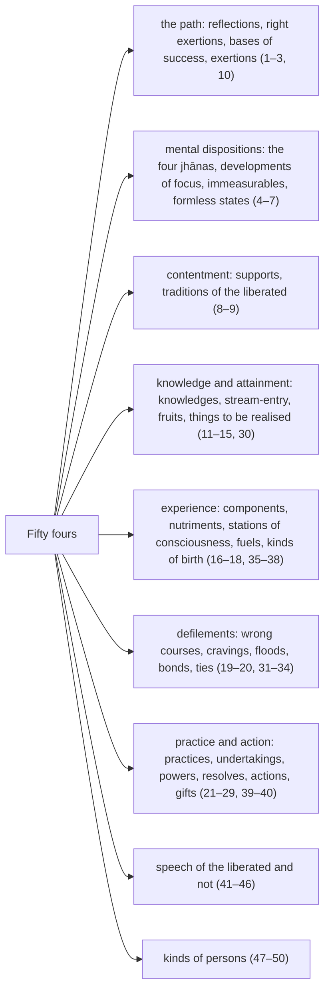

import { Tabs, TabItem } from '@astrojs/starlight/components';

Original text: [8D/10.4 Catukka 880–942](https://tipitaka2500.github.io/tipitaka/8D/10/10.4.html#880) in the [World Tipitaka Edition](https://tipitaka2500.github.io)

## Summary

The Catukka (Fours) is the fourth list section of the Saṅgītisutta: fifty sets of four Dhammas that āyasmā Sāriputta recites to the bhikkhū for them to recite in harmony, from the four reflections, right exertions, bases of success and mental dispositions, through the developments of focus, the immeasurables and the formless states, to the fours of knowledge, action, birth, speech and persons. Many are spelt out in their stock formulas or explained; the rest are bare lists. The section closes the first `bhāṇavāra` (section for recitation).

## Diagram

## Text

<Tabs syncKey="paliquote">
<TabItem label="My Translation">
(306.)

880\. Āvuso, there are four Dhammas well proclaimed by the Bhagavā, the liberated one, the perfectly awakened one, who knows and sees. Therein all should recite in harmony, not quarrel, so that this optimal life may endure long and last for a long time, which would be for the welfare and happiness of many people, out of compassion for the world, for the good, welfare, and happiness of gods and humans. What four?

881\. Four `satipaṭṭhānā` (reflections). Here, Āvuso, a bhikkhu stays aware, observing the body in the body, ardent, clearly comprehending, with awareness, having removed covetousness and displeasure in the world. He stays aware, observing feelings in feelings … and so on … the mind in the mind … and so on … perceptual objects in perceptual objects, ardent, clearly comprehending, with awareness, having removed covetousness and displeasure in the world. (1)

882\. Four `sammappadhānā` (right exertions). Here, Āvuso, a bhikkhu, for the non-arising of unarisen evil and unwholesome characteristics, generates a desire, tries to make an effort, starts effort, strives on with the mind, and exerts himself. He generates a desire for the giving up of the arisen evil and unwholesome characteristics, tries to make an effort, starts effort, strives on with the mind, and exerts himself. For the arising of unarisen wholesome characteristics, he generates a desire, tries to make an effort, starts effort, strives on with the mind, and exerts himself. He generates a desire for the persistence of, non-confusion of, increase of, maturity of, developing of, fulfilment of arisen wholesome characteristics, tries to make an effort, starts effort, strives on with the mind, and exerts himself. (2)

883\. Four `iddhipādā` (bases of success). Here, Āvuso, a bhikkhu cultivates the basis of success that possesses focus born of desire, along with the mental constructions of exertion. He cultivates the basis of success that possesses focus born of mind, along with the mental constructions of exertion. He cultivates the basis of success that possesses focus born of energy, along with the mental constructions of exertion. He cultivates the basis of success that possesses focus born of discrimination, along with the mental constructions of exertion. (3)

884\. Four `jhānāni` (mental dispositions). Here, Āvuso, a bhikkhu, secluding himself from sensual pleasures, detaching from unwholesome characteristics, enters and remains in the first `jhāna` (mental disposition), accompanied by reflection and consideration, secluded from defilements, with felicity and satisfaction. `Vitakkavicārānaṃ vūpasamā` (With the conclusion of reflection and consideration), he enters and remains in the second mental disposition, `ajjhattaṃ sampasādanaṃ cetaso` (accompanied by an inner calming of intention), `ekodibhāvaṃ` (focused), `avitakkaṃ` (without reflection), `avicāraṃ` (without consideration), `samādhijaṃ` (born from focus), with felicity and satisfaction. `Pītiyā ca virāgā` (With the detachment from felicity), he remains `upekkhako` (equanimous), `sato` (aware) and `sampajāno` (clearly comprehending), and experiences body comfort, as the liberated ones describe: ‘equanimous, `satimā` (aware), `sukhavihārī` (living at ease)’ — he enters and remains in the third mental disposition. With the giving up of the pleasant and the unpleasant, and with the previous disappearance of mental pleasure and displeasure, he enters and remains in the fourth mental disposition, `adukkhamasukhaṃ upekkhāsatipārisuddhiṃ` (in a neutral state, and possessing purification of awareness by equanimity). (4)

(307.)

885\. Four developments of focus. There is, Āvuso, a development of focus which, when cultivated and practised often, leads to a pleasant abiding in this very life. There is, Āvuso, a development of focus which, when cultivated and practised often, leads to the acquisition of knowledge and vision. There is, Āvuso, a development of focus which, when cultivated and practised often, leads to awareness and clear comprehension. There is, Āvuso, a development of focus which, when cultivated and practised often, leads to the destruction of the defilements.

886\. And what, Āvuso, is the development of focus which, when cultivated and practised often, leads to a pleasant abiding in this very life? Here, Āvuso, a bhikkhu, secluding himself from sensual pleasures, detaching from unwholesome characteristics, accompanied by reflection … and so on … enters and remains in the fourth mental disposition. This, Āvuso, is the development of focus which, when cultivated and practised often, leads to a pleasant abiding in this very life. (5.1)

887\. And what, Āvuso, is the development of focus which, when cultivated and practised often, leads to the acquisition of knowledge and vision? Here, Āvuso, a bhikkhu attends to the apperception of light, focuses on the apperception of day: as by day, so by night; as by night, so by day. Thus, with a mind open and unenveloped, he cultivates a radiant mind. This, Āvuso, is the development of focus which, when cultivated and practised often, leads to the acquisition of knowledge and vision. (5.2)

888\. And what, Āvuso, is the development of focus which, when cultivated and practised often, leads to awareness and clear comprehension? Here, Āvuso, a bhikkhu's feelings are known as they arise, known as they remain present, and known as they disappear. Apperceptions are known as they arise, known as they remain present, and known as they disappear. Thoughts are known as they arise, known as they remain present, and known as they disappear. This, Āvuso, is the development of focus which, when cultivated and practised often, leads to awareness and clear comprehension. (5.3)

889\. And what, Āvuso, is the development of focus which, when cultivated and practised often, leads to the destruction of the defilements? Here, Āvuso, a bhikkhu dwells observing the arising and passing away in the five collections of fuel. Thus is form, thus is the origin of form, thus is the disappearance of form. Thus is feeling … and so on … thus is apperception… thus are mental constructions… thus is consciousness, thus is the origin of consciousness, thus is the disappearance of consciousness. This, Āvuso, is the development of focus which, when cultivated and practised often, leads to the destruction of the defilements. (5.4)

(308.)

890\. Four immeasurables. Here, Āvuso, a bhikkhu, with intent, stays aware having filled one direction with goodwill/friendliness. Similarly the second. Similarly the third. Similarly the fourth. Thus, with intent, he stays aware having filled above and below, horizontally, everywhere, to all beings in the entire universe, with expansive, grand, infinite, peaceful, without ill will, goodwill/friendliness. With intent filled with compassion/pity … and so on … with intent filled with happiness for others … and so on … with intent filled with balance/equanimity, he stays aware having filled one direction. Similarly the second. Similarly the third. Similarly the fourth. Thus, with intent, he stays aware having filled above and below, horizontally, everywhere, to all beings in the entire universe, with expansive, grand, infinite, peaceful, without ill will, balance/equanimity. (6)

891\. Four formless states. Here, Āvuso, a bhikkhu, going beyond apperceptions of form altogether, with the disappearance of apperceptions of sense impressions, ignoring the apperceptions of diversity, thinking: ‘Space is infinite,’ enters and remains in the base of the infinity of space. Going beyond the base of the infinity of space altogether, thinking: ‘Consciousness is infinite,’ he enters and remains in the base of the infinity of consciousness. Going beyond the base of the infinity of consciousness altogether, thinking: ‘There is nothing,’ he enters and remains in the base of nothingness. Going beyond the base of nothingness altogether, he enters and remains in the base of neither apperception nor non-apperception. (7)

892\. Four supports. Here, Āvuso, a bhikkhu, having reckoned, uses one thing; having reckoned, endures one thing; having reckoned, avoids one thing; having reckoned, dispels one thing. (8)

(309.)

893\. Four traditions of the liberated. Here, Āvuso, a bhikkhu is content with any robe whatsoever, and speaks in praise of contentment with any robe whatsoever, and does not fall into an unsuitable, improper search for the sake of a robe; and not having obtained a robe he is not perturbed, and having obtained a robe he uses it, not bound, not infatuated, not fallen into error, seeing the danger, knowing the escape; and moreover, because of that contentment with any robe whatsoever, he neither exalts himself nor disparages another. Whoever indeed is skilled therein, energetic, clearly comprehending, and aware, this one, Āvuso, is called ‘a bhikkhu standing in the ancient, primordial tradition of the liberated’. (9.1)

894\. And furthermore, Āvuso, a bhikkhu is content with any alms food whatsoever, and speaks in praise of contentment with any alms food whatsoever, and does not fall into an unsuitable, improper search for the sake of alms food; and not having obtained alms food he is not perturbed, and having obtained alms food he uses it, not bound, not infatuated, not fallen into error, seeing the danger, knowing the escape; and moreover, because of that contentment with any alms food whatsoever, he neither exalts himself nor disparages another. Whoever indeed is skilled therein, energetic, clearly comprehending, and aware, this one, Āvuso, is called ‘a bhikkhu standing in the ancient, primordial tradition of the liberated’. (9.2)

895\. And furthermore, Āvuso, a bhikkhu is content with any dwelling whatsoever, and speaks in praise of contentment with any dwelling whatsoever, and does not fall into an unsuitable, improper search for the sake of a dwelling; and not having obtained a dwelling he is not perturbed, and having obtained a dwelling he uses it, not bound, not infatuated, not fallen into error, seeing the danger, knowing the escape; and moreover, because of that contentment with any dwelling whatsoever, he neither exalts himself nor disparages another. Whoever indeed is skilled therein, energetic, clearly comprehending, and aware, this one, Āvuso, is called ‘a bhikkhu standing in the ancient, primordial tradition of the liberated’. (9.3)

896\. And furthermore, Āvuso, a bhikkhu is one who enjoys giving up, delighting in giving up; one who enjoys development, delighting in development; and moreover, because of that enjoyment of giving up, delight in giving up, enjoyment of development, delight in development, he neither exalts himself nor disparages another. Whoever indeed is skilled therein, energetic, clearly comprehending, and aware, this one, Āvuso, is called ‘a bhikkhu standing in the ancient, primordial tradition of the liberated’. (9.4)

(310.)

897\. Four exertions. The exertion of restraint, the exertion of giving up, the exertion of development, and the exertion of protection. And what, Āvuso, is the exertion of restraint? Here, Āvuso, when a bhikkhu sees a form with the eye, he does not grasp at its representations or details. He practises for the restraint of that eye faculty, through which, if it were unrestrained, evil, unwholesome characteristics of covetousness and displeasure might invade him. He guards the eye faculty; he undertakes restraint of the eye faculty. When he hears a sound with the ear… when he smells an odour with the nose… when he tastes a taste with the tongue… when he touches a tangible with the body… when he cognises a mind-object with the mind, he does not grasp at its representations or details. He practises for the restraint of that mind faculty, through which, if it were unrestrained, evil, unwholesome characteristics of covetousness and displeasure might invade him. He guards the mind faculty; he undertakes restraint of the mind faculty. This, Āvuso, is called the exertion of restraint. (10.1)

898\. And what, Āvuso, is the exertion of giving up? Here, Āvuso, a bhikkhu does not tolerate an arisen thought of sensual desire; he gives it up, dispels it, makes an end of it, and causes it to go to annihilation. An arisen thought of ill will … and so on … an arisen thought of harming… whatever evil, unwholesome characteristics have arisen, he does not tolerate; he gives them up, dispels them, makes an end of them, and causes them to go to annihilation. This, Āvuso, is called the exertion of giving up. (10.2)

899\. And what, Āvuso, is exertion for development? Here, Āvuso, a bhikkhu cultivates the factor of awakening of `sati` (awareness), which is based on seclusion, dispassion, cessation, and culminates in relinquishment. He cultivates the factor of awakening of `dhammavicaya` (investigation of phenomena)…; he cultivates the factor of awakening of `vīriya` (energy)…; he cultivates the factor of awakening of `pīti` (joy)…; he cultivates the factor of awakening of `passaddhi` (tranquillity)…; he cultivates the factor of awakening of `samādhi` (focus)…; he cultivates the factor of awakening of `upekkhā` (equanimity), which is based on seclusion, dispassion, cessation, and culminates in relinquishment. This, Āvuso, is called exertion for development. (10.3)

900\. And what, Āvuso, is exertion for protection? Here, Āvuso, a bhikkhu protects a good `samādhinimitta` (object of focus) that has arisen: the `saññā` (apperception) of a skeleton, the apperception of a worm-infested corpse, the apperception of a livid corpse, the apperception of a broken corpse, the apperception of a bloated corpse. This, Āvuso, is called exertion for protection. (10.4)

901\. Four kinds of knowledge: knowledge of the Dhamma, knowledge of inference, knowledge of comprehending, and knowledge of convention. (11)

902\. Another four kinds of knowledge: knowledge of suffering, knowledge of the origin of suffering, knowledge of the cessation of suffering, and knowledge of the path leading to the cessation of suffering. (12)

(311.)

903\. Four factors of stream-entry: association with good people, hearing the true Dhamma, proper attention, and practice of the Dhamma in accordance with the Dhamma. (13)

904\. Four factors of a stream-enterer. Here, Āvuso, an `ariyasāvaka` (disciple of the liberated) is endowed with confidence founded in understanding in the Buddha: ‘Such indeed is the Bhagavā: an `arahant` (liberated one), a `sammāsambuddha` (perfectly awakened one), accomplished in knowledge and conduct, fortunate, knower of the world, unsurpassed trainer of persons to be tamed, teacher of gods and humans, the Awakened One, the Bhagavā.’ He is endowed with confidence founded in understanding in the Dhamma: ‘The Dhamma has been well proclaimed by the Bhagavā, is directly visible, immediate, inviting one to come and see, leading onward, to be personally known by the wise.’ He is endowed with confidence founded in understanding in the Saṅgha: ‘The Saṅgha of the Bhagavā’s disciples has practised well, the Saṅgha of the Bhagavā’s disciples has practised uprightly, the Saṅgha of the Bhagavā’s disciples has practised methodically, the Saṅgha of the Bhagavā’s disciples has practised properly, namely the four pairs of persons, the eight individual persons; this Saṅgha of the Bhagavā’s disciples is worthy of offerings, worthy of hospitality, worthy of gifts, worthy of reverence, an unsurpassed field of merit for the world.’ He is endowed with virtues pleasing to the liberated: unbroken, flawless, unspotted, unblemished, freeing, praised by the wise, not clung to, leading to focus. (14)

905\. Four fruits of the wanderer’s life: the fruit of stream-entry, the fruit of once-returning, the fruit of non-returning, and the fruit of the liberated state. (15)

906\. Four components: the earth component, the water component, the fire component, and the air component. (16)

907\. Four foods: physical food, solid or subtle; contact, the second; mental intention, the third; and consciousness, the fourth. (17)

908\. Four stations of consciousness. Consciousness, Āvuso, when it persists, persists either attached to form, with form as its object, with form as its support, sprinkled with delight, and comes to growth, increase, and maturity; or attached to feeling, Āvuso…; or attached to apperception, Āvuso… and so on …; or consciousness, Āvuso, when it persists, persists attached to mental constructions, with mental constructions as its object, with mental constructions as its support, sprinkled with delight, and comes to growth, increase, and maturity. (18)

909\. Four ways of going a wrong course: one goes a wrong course through desire, goes a wrong course through hatred, goes a wrong course through delusion, goes a wrong course through fear. (19)

910\. Four arisings of `taṇhā` (craving): either for the sake of a robe, Āvuso, a bhikkhu’s craving, when it arises, arises; or for the sake of alms food, Āvuso, a bhikkhu’s craving, when it arises, arises; or for the sake of a dwelling, Āvuso, a bhikkhu’s craving, when it arises, arises; or for the sake of this or that state of existence, Āvuso, a bhikkhu’s craving, when it arises, arises. (20)

911\. Four ways: painful with slow experiential understanding, painful with quick experiential understanding, pleasant with slow experiential understanding, and pleasant with quick experiential understanding. (21)

912\. Another four ways: impatient, patient, taming, and calming. (22)

913\. Four aspects of the Dhamma: absence of covetousness, absence of ill will, right awareness, and right focus. (23)

914\. Four undertakings of practice: there is, Āvuso, an undertaking of practice that is both painful in the present and results in suffering in the future. There is, Āvuso, an undertaking of practice that is painful in the present and results in happiness in the future. There is, Āvuso, an undertaking of practice that is pleasant in the present and results in suffering in the future. There is, Āvuso, an undertaking of practice that is both pleasant in the present and results in happiness in the future. (24)

915\. Four collections of Dhamma: the collection of virtue, the collection of focus, the collection of wisdom, and the collection of liberation. (25)

916\. Four powers: the power of energy, the power of awareness, the power of focus, and the power of wisdom. (26)

917\. Four foundations: the foundation of wisdom, the foundation of truth, the foundation of giving up, and the foundation of calm. (27)

(312.)

918\. Four ways of answering a question: a question to be answered categorically, a question to be answered with a counter-question, a question to be answered with analysis, and a question to be set aside. (28)

919\. Four actions: there is, Āvuso, dark action with dark result. There is, Āvuso, bright action with bright result. There is, Āvuso, dark-and-bright action with dark-and-bright result. There is, Āvuso, neither-dark-nor-bright action with neither-dark-nor-bright result, which leads to the destruction of action. (29)

920\. Four things to be personally realised: past lives are to be personally realised with awareness; the passing away and reappearance of beings is to be personally realised with the eye; the eight liberations are to be personally realised with the body; the destruction of the `āsavā` (defilements) is to be personally realised with wisdom. (30)

921\. Four floods: of sensual pleasure, of existence, of views, and of ignorance. (31)

922\. Four yokes: of sensual pleasure, of existence, of views, and of ignorance. (32)

923\. Four detachments: detachment from the yoke of sensual pleasure, detachment from the yoke of existence, detachment from the yoke of views, and detachment from the yoke of ignorance. (33)

924\. Four ties: covetousness is a bodily tie, ill will is a bodily tie, adherence to rites and rituals is a bodily tie, and clinging to the idea that ‘this is the truth’ is a bodily tie. (34)

925\. Four `upādānāni` (fuels): the fuel of sensual pleasures, the fuel of views, the fuel of rites and rituals, and the fuel of the theory of self. (35)

926\. Four modes of generation: egg-born, placenta-born, moisture-born, and spontaneously born. (36)

927\. Four kinds of conception. Here, Āvuso, a certain one enters the mother’s womb not clearly comprehending, remains in the mother’s womb not clearly comprehending, and comes out from the mother’s womb not clearly comprehending; this is the first conception. And furthermore, Āvuso, here a certain one enters the mother’s womb clearly comprehending, remains in the mother’s womb not clearly comprehending, and comes out from the mother’s womb not clearly comprehending; this is the second conception. And furthermore, Āvuso, here a certain one enters the mother’s womb clearly comprehending, remains in the mother’s womb clearly comprehending, and comes out from the mother’s womb not clearly comprehending; this is the third conception. And furthermore, Āvuso, here a certain one enters the mother’s womb clearly comprehending, remains in the mother’s womb clearly comprehending, and comes out from the mother’s womb clearly comprehending; this is the fourth conception. (37)

928\. Four acquisitions of individual existence. There is, Āvuso, an acquisition of individual existence in which only one’s own intention has an effect, not another’s intention. There is, Āvuso, an acquisition of individual existence in which only another’s intention has an effect, not one’s own intention. There is, Āvuso, an acquisition of individual existence in which both one’s own intention and another’s intention have an effect. There is, Āvuso, an acquisition of individual existence in which neither one’s own intention nor another’s intention has an effect. (38)

(313.)

929\. Four purifications of a gift. There is, Āvuso, a gift that is purified by the giver, not by the receiver. There is, Āvuso, a gift that is purified by the receiver, not by the giver. There is, Āvuso, a gift that is purified neither by the giver nor by the receiver. There is, Āvuso, a gift that is purified both by the giver and by the receiver. (39)

930\. Four bases for sustaining relationships: giving, kind words, beneficial conduct, and equality. (40)

931\. Four modes of expression of the unliberated: false speech, slanderous speech, harsh speech, and gossip. (41)

932\. Four modes of expression of the liberated: abstinence from false speech, abstinence from slanderous speech, abstinence from harsh speech, and abstinence from gossip. (42)

933\. Another four modes of expression of the unliberated: saying of the unseen that it was seen, saying of the unheard that it was heard, saying of the unsensed that it was sensed, and saying of the unknown that it was known. (43)

934\. Another four modes of expression of the liberated: saying of the unseen that it was unseen, saying of the unheard that it was unheard, saying of the unsensed that it was unsensed, and saying of the unknown that it was unknown. (44)

935\. Another four modes of expression of the unliberated: saying of the seen that it was unseen, saying of the heard that it was unheard, saying of the sensed that it was unsensed, and saying of the known that it was unknown. (45)

936\. Another four modes of expression of the liberated: saying of the seen that it was seen, saying of the heard that it was heard, saying of the sensed that it was sensed, and saying of the known that it was known. (46)

(314.)

937\. Four kinds of persons. Here, Āvuso, a certain person is one who harms himself, devoted to the practice of harming himself. Here, Āvuso, a certain person is one who harms others, devoted to the practice of harming others. Here, Āvuso, a certain person is both one who harms himself, devoted to the practice of harming himself, and one who harms others, devoted to the practice of harming others. Here, Āvuso, a certain person is neither one who harms himself nor devoted to the practice of harming himself, nor one who harms others nor devoted to the practice of harming others. He, not harming himself, not harming others, dwells in this very life satisfied, extinguished, cooled, experiencing happiness, with a self become Brahmā. (47)

938\. Another four kinds of persons. Here, Āvuso, a certain person is practising for his own welfare, not for the welfare of others. Here, Āvuso, a certain person is practising for the welfare of others, not for his own welfare. Here, Āvuso, a certain person is practising neither for his own welfare nor for the welfare of others. Here, Āvuso, a certain person is practising both for his own welfare and for the welfare of others. (48)

939\. Another four kinds of persons: darkness bound for darkness, darkness bound for light, light bound for darkness, and light bound for light. (49)

940\. Another four kinds of persons: the unshakeable wanderer, the lotus wanderer, the white-lotus wanderer, and the refined wanderer among wanderers. (50)

941\. Āvuso, these are the four Dhammas well proclaimed by the Bhagavā, the liberated one, the perfectly awakened one, who knows and sees. Therein all should recite in harmony, not quarrel, so that this optimal life may endure long and last for a long time, which would be for the welfare and happiness of many people, out of compassion for the world, for the good, welfare, and happiness of gods and humans.

---

942\. The first `bhāṇavāra` (section for recitation) is finished.
</TabItem>

<TabItem label="Pāḷi (Roman IAST)">
(306.)

880\. Atthi kho, āvuso, tena bhagavatā jānatā passatā arahatā sammāsambuddhena cattāro dhammā sammadakkhātā. Tattha sabbeheva saṅgāyitabbaṃ, na vivaditabbaṃ…pe… atthāya hitāya sukhāya devamanussānaṃ. Katame cattāro?

881\. Cattāro satipaṭṭhānā. Idhāvuso, bhikkhu kāye kāyānupassī viharati ātāpī sampajāno satimā, vineyya loke abhijjhādomanassaṃ. Vedanāsu vedanānupassī…pe… citte cittānupassī…pe… dhammesu dhammānupassī viharati ātāpī sampajāno satimā vineyya loke abhijjhādomanassaṃ. (1)

882\. Cattāro sammappadhānā. Idhāvuso, bhikkhu anuppannānaṃ pāpakānaṃ akusalānaṃ dhammānaṃ anuppādāya chandaṃ janeti vāyamati vīriyaṃ ārabhati cittaṃ paggaṇhāti padahati. Uppannānaṃ pāpakānaṃ akusalānaṃ dhammānaṃ pahānāya chandaṃ janeti vāyamati vīriyaṃ ārabhati cittaṃ paggaṇhāti padahati. Anuppannānaṃ kusalānaṃ dhammānaṃ uppādāya chandaṃ janeti vāyamati vīriyaṃ ārabhati cittaṃ paggaṇhāti padahati. Uppannānaṃ kusalānaṃ dhammānaṃ ṭhitiyā asammosāya bhiyyobhāvāya vepullāya bhāvanāya pāripūriyā chandaṃ janeti vāyamati vīriyaṃ ārabhati cittaṃ paggaṇhāti padahati. (2)

883\. Cattāro iddhipādā. Idhāvuso, bhikkhu chandasamādhipadhānasaṅkhārasamannāgataṃ iddhipādaṃ bhāveti. Cittasamādhipadhānasaṅkhārasamannāgataṃ iddhipādaṃ bhāveti. Vīriyasamādhipadhānasaṅkhārasamannāgataṃ iddhipādaṃ bhāveti. Vīmaṃsāsamādhipadhānasaṅkhārasamannāgataṃ iddhipādaṃ bhāveti. (3)

884\. Cattāri jhānāni. Idhāvuso, bhikkhu vivicceva kāmehi vivicca akusalehi dhammehi savitakkaṃ savicāraṃ vivekajaṃ pītisukhaṃ paṭhamaṃ jhānaṃ upasampajja viharati. Vitakkavicārānaṃ vūpasamā ajjhattaṃ sampasādanaṃ cetaso ekodibhāvaṃ avitakkaṃ avicāraṃ samādhijaṃ pītisukhaṃ dutiyaṃ jhānaṃ upasampajja viharati. Pītiyā ca virāgā upekkhako ca viharati sato ca sampajāno, sukhañca kāyena paṭisaṃvedeti, yaṃ taṃ ariyā ācikkhanti— ‘upekkhako satimā sukhavihārī’ti tatiyaṃ jhānaṃ upasampajja viharati. Sukhassa ca pahānā dukkhassa ca pahānā, pubbeva somanassadomanassānaṃ atthaṅgamā, adukkhamasukhaṃ upekkhāsatipārisuddhiṃ catutthaṃ jhānaṃ upasampajja viharati. (4)

(307.)

885\. Catasso samādhibhāvanā. Atthāvuso, samādhibhāvanā bhāvitā bahulīkatā diṭṭhadhammasukhavihārāya saṃvattati. Atthāvuso, samādhibhāvanā bhāvitā bahulīkatā ñāṇadassanapaṭilābhāya saṃvattati. Atthāvuso samādhibhāvanā bhāvitā bahulīkatā satisampajaññāya saṃvattati. Atthāvuso samādhibhāvanā bhāvitā bahulīkatā āsavānaṃ khayāya saṃvattati.

886\. Katamā cāvuso, samādhibhāvanā bhāvitā bahulīkatā diṭṭhadhammasukhavihārāya saṃvattati? Idhāvuso, bhikkhu vivicceva kāmehi vivicca akusalehi dhammehi savitakkaṃ…pe… catutthaṃ jhānaṃ upasampajja viharati. Ayaṃ, āvuso, samādhibhāvanā bhāvitā bahulīkatā diṭṭhadhammasukhavihārāya saṃvattati. (5.1)

887\. Katamā cāvuso, samādhibhāvanā bhāvitā bahulīkatā ñāṇadassanapaṭilābhāya saṃvattati? Idhāvuso, bhikkhu ālokasaññaṃ manasi karoti, divāsaññaṃ adhiṭṭhāti yathā divā tathā rattiṃ, yathā rattiṃ tathā divā. Iti vivaṭena cetasā apariyonaddhena sappabhāsaṃ cittaṃ bhāveti. Ayaṃ, āvuso, samādhibhāvanā bhāvitā bahulīkatā ñāṇadassanapaṭilābhāya saṃvattati. (5.2)

888\. Katamā cāvuso, samādhibhāvanā bhāvitā bahulīkatā satisampajaññāya saṃvattati? Idhāvuso, bhikkhuno viditā vedanā uppajjanti, viditā upaṭṭhahanti, viditā abbhatthaṃ gacchanti. Viditā saññā uppajjanti, viditā upaṭṭhahanti, viditā abbhatthaṃ gacchanti. Viditā vitakkā uppajjanti, viditā upaṭṭhahanti, viditā abbhatthaṃ gacchanti. Ayaṃ, āvuso, samādhibhāvanā bhāvitā bahulīkatā satisampajaññāya saṃvattati. (5.3)

889\. Katamā cāvuso, samādhibhāvanā bhāvitā bahulīkatā āsavānaṃ khayāya saṃvattati? Idhāvuso, bhikkhu pañcasu upādānakkhandhesu udayabbayānupassī viharati. Iti rūpaṃ, iti rūpassa samudayo, iti rūpassa atthaṅgamo. Iti vedanā…pe… iti saññā… iti saṅkhārā… iti viññāṇaṃ, iti viññāṇassa samudayo, iti viññāṇassa atthaṅgamo. Ayaṃ, āvuso, samādhibhāvanā bhāvitā bahulīkatā āsavānaṃ khayāya saṃvattati. (5.4)

(308.)

890\. Catasso appamaññā. Idhāvuso, bhikkhu mettāsahagatena cetasā ekaṃ disaṃ pharitvā viharati. Tathā dutiyaṃ. Tathā tatiyaṃ. Tathā catutthaṃ. Iti uddhamadho tiriyaṃ sabbadhi sabbattatāya sabbāvantaṃ lokaṃ mettāsahagatena cetasā vipulena mahaggatena appamāṇena averena abyāpajjena pharitvā viharati. Karuṇāsahagatena cetasā…pe… muditāsahagatena cetasā…pe… upekkhāsahagatena cetasā ekaṃ disaṃ pharitvā viharati. Tathā dutiyaṃ. Tathā tatiyaṃ. Tathā catutthaṃ. Iti uddhamadho tiriyaṃ sabbadhi sabbattatāya sabbāvantaṃ lokaṃ upekkhāsahagatena cetasā vipulena mahaggatena appamāṇena averena abyāpajjena pharitvā viharati. (6)

891\. Cattāro āruppā. Idhāvuso, bhikkhu sabbaso rūpasaññānaṃ samatikkamā paṭighasaññānaṃ atthaṅgamā nānattasaññānaṃ amanasikārā ‘ananto ākāso’ti ākāsānañcāyatanaṃ upasampajja viharati. Sabbaso ākāsānañcāyatanaṃ samatikkamma ‘anantaṃ viññāṇan’ti viññāṇañcāyatanaṃ upasampajja viharati. Sabbaso viññāṇañcāyatanaṃ samatikkamma ‘natthi kiñcī’ti ākiñcaññāyatanaṃ upasampajja viharati. Sabbaso ākiñcaññāyatanaṃ samatikkamma nevasaññānāsaññāyatanaṃ upasampajja viharati. (7)

892\. Cattāri apassenāni. Idhāvuso, bhikkhu saṅkhāyekaṃ paṭisevati, saṅkhāyekaṃ adhivāseti, saṅkhāyekaṃ parivajjeti, saṅkhāyekaṃ vinodeti. (8)

(309.)

893\. Cattāro ariyavaṃsā. Idhāvuso, bhikkhu santuṭṭho hoti itarītarena cīvarena, itarītaracīvarasantuṭṭhiyā ca vaṇṇavādī, na ca cīvarahetu anesanaṃ appatirūpaṃ āpajjati; aladdhā ca cīvaraṃ na paritassati, laddhā ca cīvaraṃ agadhito amucchito anajjhāpanno ādīnavadassāvī nissaraṇapañño paribhuñjati; tāya ca pana itarītaracīvarasantuṭṭhiyā nevattānukkaṃseti na paraṃ vambheti. Yo hi tattha dakkho analaso sampajāno paṭissato, ayaṃ vuccatāvuso— ‘bhikkhu porāṇe aggaññe ariyavaṃse ṭhito’. (9.1)

894\. Puna caparaṃ, āvuso, bhikkhu santuṭṭho hoti itarītarena piṇḍapātena, itarītarapiṇḍapātasantuṭṭhiyā ca vaṇṇavādī, na ca piṇḍapātahetu anesanaṃ appatirūpaṃ āpajjati; aladdhā ca piṇḍapātaṃ na paritassati, laddhā ca piṇḍapātaṃ agadhito amucchito anajjhāpanno ādīnavadassāvī nissaraṇapañño paribhuñjati; tāya ca pana itarītarapiṇḍapātasantuṭṭhiyā nevattānukkaṃseti na paraṃ vambheti. Yo hi tattha dakkho analaso sampajāno paṭissato, ayaṃ vuccatāvuso— ‘bhikkhu porāṇe aggaññe ariyavaṃse ṭhito’. (9.2)

895\. Puna caparaṃ, āvuso, bhikkhu santuṭṭho hoti itarītarena senāsanena, itarītarasenāsanasantuṭṭhiyā ca vaṇṇavādī, na ca senāsanahetu anesanaṃ appatirūpaṃ āpajjati; aladdhā ca senāsanaṃ na paritassati, laddhā ca senāsanaṃ agadhito amucchito anajjhāpanno ādīnavadassāvī nissaraṇapañño paribhuñjati; tāya ca pana itarītarasenāsanasantuṭṭhiyā nevattānukkaṃseti na paraṃ vambheti. Yo hi tattha dakkho analaso sampajāno paṭissato, ayaṃ vuccatāvuso— ‘bhikkhu porāṇe aggaññe ariyavaṃse ṭhito’. (9.3)

896\. Puna caparaṃ, āvuso, bhikkhu pahānārāmo hoti pahānarato, bhāvanārāmo hoti bhāvanārato; tāya ca pana pahānārāmatāya pahānaratiyā bhāvanārāmatāya bhāvanāratiyā nevattānukkaṃseti na paraṃ vambheti. Yo hi tattha dakkho analaso sampajāno paṭissato ayaṃ vuccatāvuso— ‘bhikkhu porāṇe aggaññe ariyavaṃse ṭhito’. (9.4)

(310.)

897\. Cattāri padhānāni. Saṃvarapadhānaṃ pahānapadhānaṃ bhāvanāpadhānaṃ anurakkhaṇāpadhānaṃ. Katamañcāvuso, saṃvarapadhānaṃ? Idhāvuso, bhikkhu cakkhunā rūpaṃ disvā na nimittaggāhī hoti nānubyañjanaggāhī. Yatvādhikaraṇamenaṃ cakkhundriyaṃ asaṃvutaṃ viharantaṃ abhijjhādomanassā pāpakā akusalā dhammā anvāssaveyyuṃ, tassa saṃvarāya paṭipajjati, rakkhati cakkhundriyaṃ, cakkhundriye saṃvaraṃ āpajjati. Sotena saddaṃ sutvā… ghānena gandhaṃ ghāyitvā… jivhāya rasaṃ sāyitvā… kāyena phoṭṭhabbaṃ phusitvā… manasā dhammaṃ viññāya na nimittaggāhī hoti nānubyañjanaggāhī. Yatvādhikaraṇamenaṃ manindriyaṃ asaṃvutaṃ viharantaṃ abhijjhādomanassā pāpakā akusalā dhammā anvāssaveyyuṃ, tassa saṃvarāya paṭipajjati, rakkhati manindriyaṃ, manindriye saṃvaraṃ āpajjati. Idaṃ vuccatāvuso, saṃvarapadhānaṃ. (10.1)

898\. Katamañcāvuso, pahānapadhānaṃ? Idhāvuso, bhikkhu uppannaṃ kāmavitakkaṃ nādhivāseti pajahati vinodeti byantiṃ karoti anabhāvaṃ gameti. Uppannaṃ byāpādavitakkaṃ…pe… uppannaṃ vihiṃsāvitakkaṃ… uppannuppanne pāpake akusale dhamme nādhivāseti pajahati vinodeti byantiṃ karoti anabhāvaṃ gameti. Idaṃ vuccatāvuso, pahānapadhānaṃ. (10.2)

899\. Katamañcāvuso, bhāvanāpadhānaṃ? Idhāvuso, bhikkhu satisambojjhaṅgaṃ bhāveti vivekanissitaṃ virāganissitaṃ nirodhanissitaṃ vossaggapariṇāmiṃ. Dhammavicayasambojjhaṅgaṃ bhāveti… vīriyasambojjhaṅgaṃ bhāveti… pītisambojjhaṅgaṃ bhāveti… passaddhisambojjhaṅgaṃ bhāveti… samādhisambojjhaṅgaṃ bhāveti… upekkhāsambojjhaṅgaṃ bhāveti vivekanissitaṃ virāganissitaṃ nirodhanissitaṃ vossaggapariṇāmiṃ. Idaṃ vuccatāvuso, bhāvanāpadhānaṃ. (10.3)

900\. Katamañcāvuso, anurakkhaṇāpadhānaṃ? Idhāvuso, bhikkhu uppannaṃ bhadrakaṃ samādhinimittaṃ anurakkhati— aṭṭhikasaññaṃ, puḷuvakasaññaṃ, vinīlakasaññaṃ, vicchiddakasaññaṃ, uddhumātakasaññaṃ. Idaṃ vuccatāvuso, anurakkhaṇāpadhānaṃ. (10.4)

901\. Cattāri ñāṇāni— dhamme ñāṇaṃ, anvaye ñāṇaṃ, pariye ñāṇaṃ, sammutiyā ñāṇaṃ. (11)

902\. Aparānipi cattāri ñāṇāni— dukkhe ñāṇaṃ, dukkhasamudaye ñāṇaṃ, dukkhanirodhe ñāṇaṃ, dukkhanirodhagāminiyā paṭipadāya ñāṇaṃ. (12)

(311.)

903\. Cattāri sotāpattiyaṅgāni— sappurisasaṃsevo, saddhammassavanaṃ, yonisomanasikāro, dhammānudhammappaṭipatti. (13)

904\. Cattāri sotāpannassa aṅgāni. Idhāvuso, ariyasāvako buddhe aveccappasādena samannāgato hoti— ‘itipi so bhagavā arahaṃ sammāsambuddho vijjācaraṇasampanno sugato lokavidū anuttaro purisadammasārathi satthā devamanussānaṃ buddho, bhagavā’ti. Dhamme aveccappasādena samannāgato hoti— ‘svākkhāto bhagavatā dhammo sandiṭṭhiko akāliko ehipassiko opaneyyiko paccattaṃ veditabbo viññūhī’ti. Saṃghe aveccappasādena samannāgato hoti— ‘suppaṭipanno bhagavato sāvakasaṃgho ujuppaṭipanno bhagavato sāvakasaṃgho ñāyappaṭipanno bhagavato sāvakasaṃgho sāmīcippaṭipanno bhagavato sāvakasaṃgho yadidaṃ cattāri purisayugāni aṭṭha purisapuggalā, esa bhagavato sāvakasaṃgho āhuneyyo pāhuneyyo dakkhiṇeyyo añjalikaraṇīyo anuttaraṃ puññakkhettaṃ lokassā’ti. Ariyakantehi sīlehi samannāgato hoti akhaṇḍehi acchiddehi asabalehi akammāsehi bhujissehi viññuppasatthehi aparāmaṭṭhehi samādhisaṃvattanikehi. (14)

905\. Cattāri sāmaññaphalāni— sotāpattiphalaṃ, sakadāgāmiphalaṃ, anāgāmiphalaṃ, arahattaphalaṃ. (15)

906\. Catasso dhātuyo— pathavīdhātu, āpodhātu, tejodhātu, vāyodhātu. (16)

907\. Cattāro āhārā— kabaḷīkāro āhāro oḷāriko vā sukhumo vā, phasso dutiyo, manosañcetanā tatiyā, viññāṇaṃ catutthaṃ. (17)

908\. Catasso viññāṇaṭṭhitiyo. Rūpūpāyaṃ vā, āvuso, viññāṇaṃ tiṭṭhamānaṃ tiṭṭhati rūpārammaṇaṃ rūpappatiṭṭhaṃ nandūpasecanaṃ vuddhiṃ virūḷhiṃ vepullaṃ āpajjati; vedanūpāyaṃ vā āvuso… saññūpāyaṃ vā, āvuso…pe… saṅkhārūpāyaṃ vā, āvuso, viññāṇaṃ tiṭṭhamānaṃ tiṭṭhati saṅkhārārammaṇaṃ saṅkhārappatiṭṭhaṃ nandūpasecanaṃ vuddhiṃ virūḷhiṃ vepullaṃ āpajjati. (18)

909\. Cattāri agatigamanāni— chandāgatiṃ gacchati, dosāgatiṃ gacchati, mohāgatiṃ gacchati, bhayāgatiṃ gacchati. (19)

910\. Cattāro taṇhuppādā— cīvarahetu vā, āvuso, bhikkhuno taṇhā uppajjamānā uppajjati; piṇḍapātahetu vā, āvuso, bhikkhuno taṇhā uppajjamānā uppajjati; senāsanahetu vā, āvuso, bhikkhuno taṇhā uppajjamānā uppajjati; itibhavābhavahetu vā, āvuso, bhikkhuno taṇhā uppajjamānā uppajjati. (20)

911\. Catasso paṭipadā— dukkhā paṭipadā dandhābhiññā, dukkhā paṭipadā khippābhiññā, sukhā paṭipadā dandhābhiññā, sukhā paṭipadā khippābhiññā. (21)

912\. Aparāpi catasso paṭipadā— akkhamā paṭipadā, khamā paṭipadā, damā paṭipadā, samā paṭipadā. (22)

913\. Cattāri dhammapadāni— anabhijjhā dhammapadaṃ, abyāpādo dhammapadaṃ, sammāsati dhammapadaṃ, sammāsamādhi dhammapadaṃ. (23)

914\. Cattāri dhammasamādānāni— atthāvuso, dhammasamādānaṃ paccuppannadukkhañceva āyatiñca dukkhavipākaṃ. Atthāvuso, dhammasamādānaṃ paccuppannadukkhaṃ āyatiṃ sukhavipākaṃ. Atthāvuso, dhammasamādānaṃ paccuppannasukhaṃ āyatiṃ dukkhavipākaṃ. Atthāvuso, dhammasamādānaṃ paccuppannasukhañceva āyatiñca sukhavipākaṃ. (24)

915\. Cattāro dhammakkhandhā— sīlakkhandho, samādhikkhandho, paññākkhandho, vimuttikkhandho. (25)

916\. Cattāri balāni— vīriyabalaṃ, satibalaṃ, samādhibalaṃ, paññābalaṃ. (26)

917\. Cattāri adhiṭṭhānāni— paññādhiṭṭhānaṃ, saccādhiṭṭhānaṃ, cāgādhiṭṭhānaṃ, upasamādhiṭṭhānaṃ. (27)

(312.)

918\. Cattāri pañhabyākaraṇāni — ekaṃsabyākaraṇīyo pañho, paṭipucchābyākaraṇīyo pañho, vibhajjabyākaraṇīyo pañho, ṭhapanīyo pañho. (28)

919\. Cattāri kammāni— atthāvuso, kammaṃ kaṇhaṃ kaṇhavipākaṃ. Atthāvuso, kammaṃ sukkaṃ sukkavipākaṃ. Atthāvuso, kammaṃ kaṇhasukkaṃ kaṇhasukkavipākaṃ. Atthāvuso, kammaṃ akaṇhaasukkaṃ akaṇhaasukkavipākaṃ kammakkhayāya saṃvattati. (29)

920\. Cattāro sacchikaraṇīyā dhammā— pubbenivāso satiyā sacchikaraṇīyo; sattānaṃ cutūpapāto cakkhunā sacchikaraṇīyo; aṭṭha vimokkhā kāyena sacchikaraṇīyā; āsavānaṃ khayo paññāya sacchikaraṇīyo. (30)

921\. Cattāro oghā— kāmogho, bhavogho, diṭṭhogho, avijjogho. (31)

922\. Cattāro yogā— kāmayogo, bhavayogo, diṭṭhiyogo, avijjāyogo. (32)

923\. Cattāro visaññogā— kāmayogavisaññogo, bhavayogavisaññogo, diṭṭhiyogavisaññogo, avijjāyogavisaññogo. (33)

924\. Cattāro ganthā— abhijjhā kāyagantho, byāpādo kāyagantho, sīlabbataparāmāso kāyagantho, idaṃsaccābhiniveso kāyagantho. (34)

925\. Cattāri upādānāni— kāmupādānaṃ, diṭṭhupādānaṃ, sīlabbatupādānaṃ, attavādupādānaṃ. (35)

926\. Catasso yoniyo— aṇḍajayoni, jalābujayoni, saṃsedajayoni, opapātikayoni. (36)

927\. Catasso gabbhāvakkantiyo. Idhāvuso, ekacco asampajāno mātukucchiṃ okkamati, asampajāno mātukucchismiṃ ṭhāti, asampajāno mātukucchimhā nikkhamati, ayaṃ paṭhamā gabbhāvakkanti. Puna caparaṃ, āvuso, idhekacco sampajāno mātukucchiṃ okkamati, asampajāno mātukucchismiṃ ṭhāti, asampajāno mātukucchimhā nikkhamati, ayaṃ dutiyā gabbhāvakkanti. Puna caparaṃ, āvuso, idhekacco sampajāno mātukucchiṃ okkamati, sampajāno mātukucchismiṃ ṭhāti, asampajāno mātukucchimhā nikkhamati, ayaṃ tatiyā gabbhāvakkanti. Puna caparaṃ, āvuso, idhekacco sampajāno mātukucchiṃ okkamati, sampajāno mātukucchismiṃ ṭhāti, sampajāno mātukucchimhā nikkhamati, ayaṃ catutthā gabbhāvakkanti. (37)

928\. Cattāro attabhāvapaṭilābhā. Atthāvuso, attabhāvapaṭilābho, yasmiṃ attabhāvapaṭilābhe attasañcetanāyeva kamati, no parasañcetanā. Atthāvuso, attabhāvapaṭilābho, yasmiṃ attabhāvapaṭilābhe parasañcetanāyeva kamati, no attasañcetanā. Atthāvuso, attabhāvapaṭilābho, yasmiṃ attabhāvapaṭilābhe attasañcetanā ceva kamati parasañcetanā ca. Atthāvuso, attabhāvapaṭilābho, yasmiṃ attabhāvapaṭilābhe neva attasañcetanā kamati, no parasañcetanā. (38)

(313.)

929\. Catasso dakkhiṇāvisuddhiyo. Atthāvuso, dakkhiṇā dāyakato visujjhati no paṭiggāhakato. Atthāvuso, dakkhiṇā paṭiggāhakato visujjhati no dāyakato. Atthāvuso, dakkhiṇā neva dāyakato visujjhati no paṭiggāhakato. Atthāvuso, dakkhiṇā dāyakato ceva visujjhati paṭiggāhakato ca. (39)

930\. Cattāri saṅgahavatthūni— dānaṃ, peyyavajjaṃ, atthacariyā, samānattatā. (40)

931\. Cattāro anariyavohārā— musāvādo, pisuṇāvācā, pharusāvācā, samphappalāpo. (41)

932\. Cattāro ariyavohārā— musāvādā veramaṇī, pisuṇāya vācāya veramaṇī, pharusāya vācāya veramaṇī, samphappalāpā veramaṇī. (42)

933\. Aparepi cattāro anariyavohārā— adiṭṭhe diṭṭhavāditā, assute sutavāditā, amute mutavāditā, aviññāte viññātavāditā. (43)

934\. Aparepi cattāro ariyavohārā— adiṭṭhe adiṭṭhavāditā, assute assutavāditā, amute amutavāditā, aviññāte aviññātavāditā. (44)

935\. Aparepi cattāro anariyavohārā— diṭṭhe adiṭṭhavāditā, sute assutavāditā, mute amutavāditā, viññāte aviññātavāditā. (45)

936\. Aparepi cattāro ariyavohārā— diṭṭhe diṭṭhavāditā, sute sutavāditā, mute mutavāditā, viññāte viññātavāditā. (46)

(314.)

937\. Cattāro puggalā. Idhāvuso, ekacco puggalo attantapo hoti attaparitāpanānuyogamanuyutto. Idhāvuso, ekacco puggalo parantapo hoti paraparitāpanānuyogamanuyutto. Idhāvuso, ekacco puggalo attantapo ca hoti attaparitāpanānuyogamanuyutto, parantapo ca paraparitāpanānuyogamanuyutto. Idhāvuso, ekacco puggalo neva attantapo hoti na attaparitāpanānuyogamanuyutto na parantapo na paraparitāpanānuyogamanuyutto. So anattantapo aparantapo diṭṭheva dhamme nicchāto nibbuto sītībhūto sukhappaṭisaṃvedī brahmabhūtena attanā viharati. (47)

938\. Aparepi cattāro puggalā. Idhāvuso, ekacco puggalo attahitāya paṭipanno hoti no parahitāya. Idhāvuso, ekacco puggalo parahitāya paṭipanno hoti no attahitāya. Idhāvuso, ekacco puggalo neva attahitāya paṭipanno hoti no parahitāya. Idhāvuso, ekacco puggalo attahitāya ceva paṭipanno hoti parahitāya ca. (48)

939\. Aparepi cattāro puggalā— tamo tamaparāyano, tamo jotiparāyano, joti tamaparāyano, joti jotiparāyano. (49)

940\. Aparepi cattāro puggalā— samaṇamacalo, samaṇapadumo, samaṇapuṇḍarīko, samaṇesu samaṇasukhumālo. (50)

941\. Ime kho, āvuso, tena bhagavatā jānatā passatā arahatā sammāsambuddhena cattāro dhammā sammadakkhātā; tattha sabbeheva saṅgāyitabbaṃ…pe… atthāya hitāya sukhāya devamanussānaṃ.

---

942\. Paṭhamabhāṇavāro niṭṭhito.
</TabItem>

<TabItem label="Pāḷi (Brahmi)">
(306.)

880\. 𑀅𑀢𑁆𑀣𑀺 𑀔𑁄, 𑀆𑀯𑀼𑀲𑁄, 𑀢𑁂𑀦 𑀪𑀕𑀯𑀢𑀸 𑀚𑀸𑀦𑀢𑀸 𑀧𑀲𑁆𑀲𑀢𑀸 𑀅𑀭𑀳𑀢𑀸 𑀲𑀫𑁆𑀫𑀸𑀲𑀫𑁆𑀩𑀼𑀤𑁆𑀥𑁂𑀦 𑀘𑀢𑁆𑀢𑀸𑀭𑁄 𑀥𑀫𑁆𑀫𑀸 𑀲𑀫𑁆𑀫𑀤𑀓𑁆𑀔𑀸𑀢𑀸. 𑀢𑀢𑁆𑀣 𑀲𑀩𑁆𑀩𑁂𑀳𑁂𑀯 𑀲𑀗𑁆𑀕𑀸𑀬𑀺𑀢𑀩𑁆𑀩𑀁, 𑀦 𑀯𑀺𑀯𑀤𑀺𑀢𑀩𑁆𑀩𑀁…𑀧𑁂… 𑀅𑀢𑁆𑀣𑀸𑀬 𑀳𑀺𑀢𑀸𑀬 𑀲𑀼𑀔𑀸𑀬 𑀤𑁂𑀯𑀫𑀦𑀼𑀲𑁆𑀲𑀸𑀦𑀁. 𑀓𑀢𑀫𑁂 𑀘𑀢𑁆𑀢𑀸𑀭𑁄?

881\. 𑀘𑀢𑁆𑀢𑀸𑀭𑁄 𑀲𑀢𑀺𑀧𑀝𑁆𑀞𑀸𑀦𑀸. 𑀇𑀥𑀸𑀯𑀼𑀲𑁄, 𑀪𑀺𑀓𑁆𑀔𑀼 𑀓𑀸𑀬𑁂 𑀓𑀸𑀬𑀸𑀦𑀼𑀧𑀲𑁆𑀲𑀻 𑀯𑀺𑀳𑀭𑀢𑀺 𑀆𑀢𑀸𑀧𑀻 𑀲𑀫𑁆𑀧𑀚𑀸𑀦𑁄 𑀲𑀢𑀺𑀫𑀸, 𑀯𑀺𑀦𑁂𑀬𑁆𑀬 𑀮𑁄𑀓𑁂 𑀅𑀪𑀺𑀚𑁆𑀛𑀸𑀤𑁄𑀫𑀦𑀲𑁆𑀲𑀁. 𑀯𑁂𑀤𑀦𑀸𑀲𑀼 𑀯𑁂𑀤𑀦𑀸𑀦𑀼𑀧𑀲𑁆𑀲𑀻…𑀧𑁂… 𑀘𑀺𑀢𑁆𑀢𑁂 𑀘𑀺𑀢𑁆𑀢𑀸𑀦𑀼𑀧𑀲𑁆𑀲𑀻…𑀧𑁂… 𑀥𑀫𑁆𑀫𑁂𑀲𑀼 𑀥𑀫𑁆𑀫𑀸𑀦𑀼𑀧𑀲𑁆𑀲𑀻 𑀯𑀺𑀳𑀭𑀢𑀺 𑀆𑀢𑀸𑀧𑀻 𑀲𑀫𑁆𑀧𑀚𑀸𑀦𑁄 𑀲𑀢𑀺𑀫𑀸 𑀯𑀺𑀦𑁂𑀬𑁆𑀬 𑀮𑁄𑀓𑁂 𑀅𑀪𑀺𑀚𑁆𑀛𑀸𑀤𑁄𑀫𑀦𑀲𑁆𑀲𑀁. (1)

882\. 𑀘𑀢𑁆𑀢𑀸𑀭𑁄 𑀲𑀫𑁆𑀫𑀧𑁆𑀧𑀥𑀸𑀦𑀸. 𑀇𑀥𑀸𑀯𑀼𑀲𑁄, 𑀪𑀺𑀓𑁆𑀔𑀼 𑀅𑀦𑀼𑀧𑁆𑀧𑀦𑁆𑀦𑀸𑀦𑀁 𑀧𑀸𑀧𑀓𑀸𑀦𑀁 𑀅𑀓𑀼𑀲𑀮𑀸𑀦𑀁 𑀥𑀫𑁆𑀫𑀸𑀦𑀁 𑀅𑀦𑀼𑀧𑁆𑀧𑀸𑀤𑀸𑀬 𑀙𑀦𑁆𑀤𑀁 𑀚𑀦𑁂𑀢𑀺 𑀯𑀸𑀬𑀫𑀢𑀺 𑀯𑀻𑀭𑀺𑀬𑀁 𑀆𑀭𑀪𑀢𑀺 𑀘𑀺𑀢𑁆𑀢𑀁 𑀧𑀕𑁆𑀕𑀡𑁆𑀳𑀸𑀢𑀺 𑀧𑀤𑀳𑀢𑀺. 𑀉𑀧𑁆𑀧𑀦𑁆𑀦𑀸𑀦𑀁 𑀧𑀸𑀧𑀓𑀸𑀦𑀁 𑀅𑀓𑀼𑀲𑀮𑀸𑀦𑀁 𑀥𑀫𑁆𑀫𑀸𑀦𑀁 𑀧𑀳𑀸𑀦𑀸𑀬 𑀙𑀦𑁆𑀤𑀁 𑀚𑀦𑁂𑀢𑀺 𑀯𑀸𑀬𑀫𑀢𑀺 𑀯𑀻𑀭𑀺𑀬𑀁 𑀆𑀭𑀪𑀢𑀺 𑀘𑀺𑀢𑁆𑀢𑀁 𑀧𑀕𑁆𑀕𑀡𑁆𑀳𑀸𑀢𑀺 𑀧𑀤𑀳𑀢𑀺. 𑀅𑀦𑀼𑀧𑁆𑀧𑀦𑁆𑀦𑀸𑀦𑀁 𑀓𑀼𑀲𑀮𑀸𑀦𑀁 𑀥𑀫𑁆𑀫𑀸𑀦𑀁 𑀉𑀧𑁆𑀧𑀸𑀤𑀸𑀬 𑀙𑀦𑁆𑀤𑀁 𑀚𑀦𑁂𑀢𑀺 𑀯𑀸𑀬𑀫𑀢𑀺 𑀯𑀻𑀭𑀺𑀬𑀁 𑀆𑀭𑀪𑀢𑀺 𑀘𑀺𑀢𑁆𑀢𑀁 𑀧𑀕𑁆𑀕𑀡𑁆𑀳𑀸𑀢𑀺 𑀧𑀤𑀳𑀢𑀺. 𑀉𑀧𑁆𑀧𑀦𑁆𑀦𑀸𑀦𑀁 𑀓𑀼𑀲𑀮𑀸𑀦𑀁 𑀥𑀫𑁆𑀫𑀸𑀦𑀁 𑀞𑀺𑀢𑀺𑀬𑀸 𑀅𑀲𑀫𑁆𑀫𑁄𑀲𑀸𑀬 𑀪𑀺𑀬𑁆𑀬𑁄𑀪𑀸𑀯𑀸𑀬 𑀯𑁂𑀧𑀼𑀮𑁆𑀮𑀸𑀬 𑀪𑀸𑀯𑀦𑀸𑀬 𑀧𑀸𑀭𑀺𑀧𑀽𑀭𑀺𑀬𑀸 𑀙𑀦𑁆𑀤𑀁 𑀚𑀦𑁂𑀢𑀺 𑀯𑀸𑀬𑀫𑀢𑀺 𑀯𑀻𑀭𑀺𑀬𑀁 𑀆𑀭𑀪𑀢𑀺 𑀘𑀺𑀢𑁆𑀢𑀁 𑀧𑀕𑁆𑀕𑀡𑁆𑀳𑀸𑀢𑀺 𑀧𑀤𑀳𑀢𑀺. (2)

883\. 𑀘𑀢𑁆𑀢𑀸𑀭𑁄 𑀇𑀤𑁆𑀥𑀺𑀧𑀸𑀤𑀸. 𑀇𑀥𑀸𑀯𑀼𑀲𑁄, 𑀪𑀺𑀓𑁆𑀔𑀼 𑀙𑀦𑁆𑀤𑀲𑀫𑀸𑀥𑀺𑀧𑀥𑀸𑀦𑀲𑀗𑁆𑀔𑀸𑀭𑀲𑀫𑀦𑁆𑀦𑀸𑀕𑀢𑀁 𑀇𑀤𑁆𑀥𑀺𑀧𑀸𑀤𑀁 𑀪𑀸𑀯𑁂𑀢𑀺. 𑀘𑀺𑀢𑁆𑀢𑀲𑀫𑀸𑀥𑀺𑀧𑀥𑀸𑀦𑀲𑀗𑁆𑀔𑀸𑀭𑀲𑀫𑀦𑁆𑀦𑀸𑀕𑀢𑀁 𑀇𑀤𑁆𑀥𑀺𑀧𑀸𑀤𑀁 𑀪𑀸𑀯𑁂𑀢𑀺. 𑀯𑀻𑀭𑀺𑀬𑀲𑀫𑀸𑀥𑀺𑀧𑀥𑀸𑀦𑀲𑀗𑁆𑀔𑀸𑀭𑀲𑀫𑀦𑁆𑀦𑀸𑀕𑀢𑀁 𑀇𑀤𑁆𑀥𑀺𑀧𑀸𑀤𑀁 𑀪𑀸𑀯𑁂𑀢𑀺. 𑀯𑀻𑀫𑀁𑀲𑀸𑀲𑀫𑀸𑀥𑀺𑀧𑀥𑀸𑀦𑀲𑀗𑁆𑀔𑀸𑀭𑀲𑀫𑀦𑁆𑀦𑀸𑀕𑀢𑀁 𑀇𑀤𑁆𑀥𑀺𑀧𑀸𑀤𑀁 𑀪𑀸𑀯𑁂𑀢𑀺. (3)

884\. 𑀘𑀢𑁆𑀢𑀸𑀭𑀺 𑀛𑀸𑀦𑀸𑀦𑀺. 𑀇𑀥𑀸𑀯𑀼𑀲𑁄, 𑀪𑀺𑀓𑁆𑀔𑀼 𑀯𑀺𑀯𑀺𑀘𑁆𑀘𑁂𑀯 𑀓𑀸𑀫𑁂𑀳𑀺 𑀯𑀺𑀯𑀺𑀘𑁆𑀘 𑀅𑀓𑀼𑀲𑀮𑁂𑀳𑀺 𑀥𑀫𑁆𑀫𑁂𑀳𑀺 𑀲𑀯𑀺𑀢𑀓𑁆𑀓𑀁 𑀲𑀯𑀺𑀘𑀸𑀭𑀁 𑀯𑀺𑀯𑁂𑀓𑀚𑀁 𑀧𑀻𑀢𑀺𑀲𑀼𑀔𑀁 𑀧𑀞𑀫𑀁 𑀛𑀸𑀦𑀁 𑀉𑀧𑀲𑀫𑁆𑀧𑀚𑁆𑀚 𑀯𑀺𑀳𑀭𑀢𑀺. 𑀯𑀺𑀢𑀓𑁆𑀓𑀯𑀺𑀘𑀸𑀭𑀸𑀦𑀁 𑀯𑀽𑀧𑀲𑀫𑀸 𑀅𑀚𑁆𑀛𑀢𑁆𑀢𑀁 𑀲𑀫𑁆𑀧𑀲𑀸𑀤𑀦𑀁 𑀘𑁂𑀢𑀲𑁄 𑀏𑀓𑁄𑀤𑀺𑀪𑀸𑀯𑀁 𑀅𑀯𑀺𑀢𑀓𑁆𑀓𑀁 𑀅𑀯𑀺𑀘𑀸𑀭𑀁 𑀲𑀫𑀸𑀥𑀺𑀚𑀁 𑀧𑀻𑀢𑀺𑀲𑀼𑀔𑀁 𑀤𑀼𑀢𑀺𑀬𑀁 𑀛𑀸𑀦𑀁 𑀉𑀧𑀲𑀫𑁆𑀧𑀚𑁆𑀚 𑀯𑀺𑀳𑀭𑀢𑀺. 𑀧𑀻𑀢𑀺𑀬𑀸 𑀘 𑀯𑀺𑀭𑀸𑀕𑀸 𑀉𑀧𑁂𑀓𑁆𑀔𑀓𑁄 𑀘 𑀯𑀺𑀳𑀭𑀢𑀺 𑀲𑀢𑁄 𑀘 𑀲𑀫𑁆𑀧𑀚𑀸𑀦𑁄, 𑀲𑀼𑀔𑀜𑁆𑀘 𑀓𑀸𑀬𑁂𑀦 𑀧𑀝𑀺𑀲𑀁𑀯𑁂𑀤𑁂𑀢𑀺, 𑀬𑀁 𑀢𑀁 𑀅𑀭𑀺𑀬𑀸 𑀆𑀘𑀺𑀓𑁆𑀔𑀦𑁆𑀢𑀺— ‘𑀉𑀧𑁂𑀓𑁆𑀔𑀓𑁄 𑀲𑀢𑀺𑀫𑀸 𑀲𑀼𑀔𑀯𑀺𑀳𑀸𑀭𑀻’𑀢𑀺 𑀢𑀢𑀺𑀬𑀁 𑀛𑀸𑀦𑀁 𑀉𑀧𑀲𑀫𑁆𑀧𑀚𑁆𑀚 𑀯𑀺𑀳𑀭𑀢𑀺. 𑀲𑀼𑀔𑀲𑁆𑀲 𑀘 𑀧𑀳𑀸𑀦𑀸 𑀤𑀼𑀓𑁆𑀔𑀲𑁆𑀲 𑀘 𑀧𑀳𑀸𑀦𑀸, 𑀧𑀼𑀩𑁆𑀩𑁂𑀯 𑀲𑁄𑀫𑀦𑀲𑁆𑀲𑀤𑁄𑀫𑀦𑀲𑁆𑀲𑀸𑀦𑀁 𑀅𑀢𑁆𑀣𑀗𑁆𑀕𑀫𑀸, 𑀅𑀤𑀼𑀓𑁆𑀔𑀫𑀲𑀼𑀔𑀁 𑀉𑀧𑁂𑀓𑁆𑀔𑀸𑀲𑀢𑀺𑀧𑀸𑀭𑀺𑀲𑀼𑀤𑁆𑀥𑀺𑀁 𑀘𑀢𑀼𑀢𑁆𑀣𑀁 𑀛𑀸𑀦𑀁 𑀉𑀧𑀲𑀫𑁆𑀧𑀚𑁆𑀚 𑀯𑀺𑀳𑀭𑀢𑀺. (4)

(307.)

885\. 𑀘𑀢𑀲𑁆𑀲𑁄 𑀲𑀫𑀸𑀥𑀺𑀪𑀸𑀯𑀦𑀸. 𑀅𑀢𑁆𑀣𑀸𑀯𑀼𑀲𑁄, 𑀲𑀫𑀸𑀥𑀺𑀪𑀸𑀯𑀦𑀸 𑀪𑀸𑀯𑀺𑀢𑀸 𑀩𑀳𑀼𑀮𑀻𑀓𑀢𑀸 𑀤𑀺𑀝𑁆𑀞𑀥𑀫𑁆𑀫𑀲𑀼𑀔𑀯𑀺𑀳𑀸𑀭𑀸𑀬 𑀲𑀁𑀯𑀢𑁆𑀢𑀢𑀺. 𑀅𑀢𑁆𑀣𑀸𑀯𑀼𑀲𑁄, 𑀲𑀫𑀸𑀥𑀺𑀪𑀸𑀯𑀦𑀸 𑀪𑀸𑀯𑀺𑀢𑀸 𑀩𑀳𑀼𑀮𑀻𑀓𑀢𑀸 𑀜𑀸𑀡𑀤𑀲𑁆𑀲𑀦𑀧𑀝𑀺𑀮𑀸𑀪𑀸𑀬 𑀲𑀁𑀯𑀢𑁆𑀢𑀢𑀺. 𑀅𑀢𑁆𑀣𑀸𑀯𑀼𑀲𑁄 𑀲𑀫𑀸𑀥𑀺𑀪𑀸𑀯𑀦𑀸 𑀪𑀸𑀯𑀺𑀢𑀸 𑀩𑀳𑀼𑀮𑀻𑀓𑀢𑀸 𑀲𑀢𑀺𑀲𑀫𑁆𑀧𑀚𑀜𑁆𑀜𑀸𑀬 𑀲𑀁𑀯𑀢𑁆𑀢𑀢𑀺. 𑀅𑀢𑁆𑀣𑀸𑀯𑀼𑀲𑁄 𑀲𑀫𑀸𑀥𑀺𑀪𑀸𑀯𑀦𑀸 𑀪𑀸𑀯𑀺𑀢𑀸 𑀩𑀳𑀼𑀮𑀻𑀓𑀢𑀸 𑀆𑀲𑀯𑀸𑀦𑀁 𑀔𑀬𑀸𑀬 𑀲𑀁𑀯𑀢𑁆𑀢𑀢𑀺.

886\. 𑀓𑀢𑀫𑀸 𑀘𑀸𑀯𑀼𑀲𑁄, 𑀲𑀫𑀸𑀥𑀺𑀪𑀸𑀯𑀦𑀸 𑀪𑀸𑀯𑀺𑀢𑀸 𑀩𑀳𑀼𑀮𑀻𑀓𑀢𑀸 𑀤𑀺𑀝𑁆𑀞𑀥𑀫𑁆𑀫𑀲𑀼𑀔𑀯𑀺𑀳𑀸𑀭𑀸𑀬 𑀲𑀁𑀯𑀢𑁆𑀢𑀢𑀺? 𑀇𑀥𑀸𑀯𑀼𑀲𑁄, 𑀪𑀺𑀓𑁆𑀔𑀼 𑀯𑀺𑀯𑀺𑀘𑁆𑀘𑁂𑀯 𑀓𑀸𑀫𑁂𑀳𑀺 𑀯𑀺𑀯𑀺𑀘𑁆𑀘 𑀅𑀓𑀼𑀲𑀮𑁂𑀳𑀺 𑀥𑀫𑁆𑀫𑁂𑀳𑀺 𑀲𑀯𑀺𑀢𑀓𑁆𑀓𑀁…𑀧𑁂… 𑀘𑀢𑀼𑀢𑁆𑀣𑀁 𑀛𑀸𑀦𑀁 𑀉𑀧𑀲𑀫𑁆𑀧𑀚𑁆𑀚 𑀯𑀺𑀳𑀭𑀢𑀺. 𑀅𑀬𑀁, 𑀆𑀯𑀼𑀲𑁄, 𑀲𑀫𑀸𑀥𑀺𑀪𑀸𑀯𑀦𑀸 𑀪𑀸𑀯𑀺𑀢𑀸 𑀩𑀳𑀼𑀮𑀻𑀓𑀢𑀸 𑀤𑀺𑀝𑁆𑀞𑀥𑀫𑁆𑀫𑀲𑀼𑀔𑀯𑀺𑀳𑀸𑀭𑀸𑀬 𑀲𑀁𑀯𑀢𑁆𑀢𑀢𑀺. (5.1)

887\. 𑀓𑀢𑀫𑀸 𑀘𑀸𑀯𑀼𑀲𑁄, 𑀲𑀫𑀸𑀥𑀺𑀪𑀸𑀯𑀦𑀸 𑀪𑀸𑀯𑀺𑀢𑀸 𑀩𑀳𑀼𑀮𑀻𑀓𑀢𑀸 𑀜𑀸𑀡𑀤𑀲𑁆𑀲𑀦𑀧𑀝𑀺𑀮𑀸𑀪𑀸𑀬 𑀲𑀁𑀯𑀢𑁆𑀢𑀢𑀺? 𑀇𑀥𑀸𑀯𑀼𑀲𑁄, 𑀪𑀺𑀓𑁆𑀔𑀼 𑀆𑀮𑁄𑀓𑀲𑀜𑁆𑀜𑀁 𑀫𑀦𑀲𑀺 𑀓𑀭𑁄𑀢𑀺, 𑀤𑀺𑀯𑀸𑀲𑀜𑁆𑀜𑀁 𑀅𑀥𑀺𑀝𑁆𑀞𑀸𑀢𑀺 𑀬𑀣𑀸 𑀤𑀺𑀯𑀸 𑀢𑀣𑀸 𑀭𑀢𑁆𑀢𑀺𑀁, 𑀬𑀣𑀸 𑀭𑀢𑁆𑀢𑀺𑀁 𑀢𑀣𑀸 𑀤𑀺𑀯𑀸. 𑀇𑀢𑀺 𑀯𑀺𑀯𑀝𑁂𑀦 𑀘𑁂𑀢𑀲𑀸 𑀅𑀧𑀭𑀺𑀬𑁄𑀦𑀤𑁆𑀥𑁂𑀦 𑀲𑀧𑁆𑀧𑀪𑀸𑀲𑀁 𑀘𑀺𑀢𑁆𑀢𑀁 𑀪𑀸𑀯𑁂𑀢𑀺. 𑀅𑀬𑀁, 𑀆𑀯𑀼𑀲𑁄, 𑀲𑀫𑀸𑀥𑀺𑀪𑀸𑀯𑀦𑀸 𑀪𑀸𑀯𑀺𑀢𑀸 𑀩𑀳𑀼𑀮𑀻𑀓𑀢𑀸 𑀜𑀸𑀡𑀤𑀲𑁆𑀲𑀦𑀧𑀝𑀺𑀮𑀸𑀪𑀸𑀬 𑀲𑀁𑀯𑀢𑁆𑀢𑀢𑀺. (5.2)

888\. 𑀓𑀢𑀫𑀸 𑀘𑀸𑀯𑀼𑀲𑁄, 𑀲𑀫𑀸𑀥𑀺𑀪𑀸𑀯𑀦𑀸 𑀪𑀸𑀯𑀺𑀢𑀸 𑀩𑀳𑀼𑀮𑀻𑀓𑀢𑀸 𑀲𑀢𑀺𑀲𑀫𑁆𑀧𑀚𑀜𑁆𑀜𑀸𑀬 𑀲𑀁𑀯𑀢𑁆𑀢𑀢𑀺? 𑀇𑀥𑀸𑀯𑀼𑀲𑁄, 𑀪𑀺𑀓𑁆𑀔𑀼𑀦𑁄 𑀯𑀺𑀤𑀺𑀢𑀸 𑀯𑁂𑀤𑀦𑀸 𑀉𑀧𑁆𑀧𑀚𑁆𑀚𑀦𑁆𑀢𑀺, 𑀯𑀺𑀤𑀺𑀢𑀸 𑀉𑀧𑀝𑁆𑀞𑀳𑀦𑁆𑀢𑀺, 𑀯𑀺𑀤𑀺𑀢𑀸 𑀅𑀩𑁆𑀪𑀢𑁆𑀣𑀁 𑀕𑀘𑁆𑀙𑀦𑁆𑀢𑀺. 𑀯𑀺𑀤𑀺𑀢𑀸 𑀲𑀜𑁆𑀜𑀸 𑀉𑀧𑁆𑀧𑀚𑁆𑀚𑀦𑁆𑀢𑀺, 𑀯𑀺𑀤𑀺𑀢𑀸 𑀉𑀧𑀝𑁆𑀞𑀳𑀦𑁆𑀢𑀺, 𑀯𑀺𑀤𑀺𑀢𑀸 𑀅𑀩𑁆𑀪𑀢𑁆𑀣𑀁 𑀕𑀘𑁆𑀙𑀦𑁆𑀢𑀺. 𑀯𑀺𑀤𑀺𑀢𑀸 𑀯𑀺𑀢𑀓𑁆𑀓𑀸 𑀉𑀧𑁆𑀧𑀚𑁆𑀚𑀦𑁆𑀢𑀺, 𑀯𑀺𑀤𑀺𑀢𑀸 𑀉𑀧𑀝𑁆𑀞𑀳𑀦𑁆𑀢𑀺, 𑀯𑀺𑀤𑀺𑀢𑀸 𑀅𑀩𑁆𑀪𑀢𑁆𑀣𑀁 𑀕𑀘𑁆𑀙𑀦𑁆𑀢𑀺. 𑀅𑀬𑀁, 𑀆𑀯𑀼𑀲𑁄, 𑀲𑀫𑀸𑀥𑀺𑀪𑀸𑀯𑀦𑀸 𑀪𑀸𑀯𑀺𑀢𑀸 𑀩𑀳𑀼𑀮𑀻𑀓𑀢𑀸 𑀲𑀢𑀺𑀲𑀫𑁆𑀧𑀚𑀜𑁆𑀜𑀸𑀬 𑀲𑀁𑀯𑀢𑁆𑀢𑀢𑀺. (5.3)

889\. 𑀓𑀢𑀫𑀸 𑀘𑀸𑀯𑀼𑀲𑁄, 𑀲𑀫𑀸𑀥𑀺𑀪𑀸𑀯𑀦𑀸 𑀪𑀸𑀯𑀺𑀢𑀸 𑀩𑀳𑀼𑀮𑀻𑀓𑀢𑀸 𑀆𑀲𑀯𑀸𑀦𑀁 𑀔𑀬𑀸𑀬 𑀲𑀁𑀯𑀢𑁆𑀢𑀢𑀺? 𑀇𑀥𑀸𑀯𑀼𑀲𑁄, 𑀪𑀺𑀓𑁆𑀔𑀼 𑀧𑀜𑁆𑀘𑀲𑀼 𑀉𑀧𑀸𑀤𑀸𑀦𑀓𑁆𑀔𑀦𑁆𑀥𑁂𑀲𑀼 𑀉𑀤𑀬𑀩𑁆𑀩𑀬𑀸𑀦𑀼𑀧𑀲𑁆𑀲𑀻 𑀯𑀺𑀳𑀭𑀢𑀺. 𑀇𑀢𑀺 𑀭𑀽𑀧𑀁, 𑀇𑀢𑀺 𑀭𑀽𑀧𑀲𑁆𑀲 𑀲𑀫𑀼𑀤𑀬𑁄, 𑀇𑀢𑀺 𑀭𑀽𑀧𑀲𑁆𑀲 𑀅𑀢𑁆𑀣𑀗𑁆𑀕𑀫𑁄. 𑀇𑀢𑀺 𑀯𑁂𑀤𑀦𑀸…𑀧𑁂… 𑀇𑀢𑀺 𑀲𑀜𑁆𑀜𑀸… 𑀇𑀢𑀺 𑀲𑀗𑁆𑀔𑀸𑀭𑀸… 𑀇𑀢𑀺 𑀯𑀺𑀜𑁆𑀜𑀸𑀡𑀁, 𑀇𑀢𑀺 𑀯𑀺𑀜𑁆𑀜𑀸𑀡𑀲𑁆𑀲 𑀲𑀫𑀼𑀤𑀬𑁄, 𑀇𑀢𑀺 𑀯𑀺𑀜𑁆𑀜𑀸𑀡𑀲𑁆𑀲 𑀅𑀢𑁆𑀣𑀗𑁆𑀕𑀫𑁄. 𑀅𑀬𑀁, 𑀆𑀯𑀼𑀲𑁄, 𑀲𑀫𑀸𑀥𑀺𑀪𑀸𑀯𑀦𑀸 𑀪𑀸𑀯𑀺𑀢𑀸 𑀩𑀳𑀼𑀮𑀻𑀓𑀢𑀸 𑀆𑀲𑀯𑀸𑀦𑀁 𑀔𑀬𑀸𑀬 𑀲𑀁𑀯𑀢𑁆𑀢𑀢𑀺. (5.4)

(308.)

890\. 𑀘𑀢𑀲𑁆𑀲𑁄 𑀅𑀧𑁆𑀧𑀫𑀜𑁆𑀜𑀸. 𑀇𑀥𑀸𑀯𑀼𑀲𑁄, 𑀪𑀺𑀓𑁆𑀔𑀼 𑀫𑁂𑀢𑁆𑀢𑀸𑀲𑀳𑀕𑀢𑁂𑀦 𑀘𑁂𑀢𑀲𑀸 𑀏𑀓𑀁 𑀤𑀺𑀲𑀁 𑀨𑀭𑀺𑀢𑁆𑀯𑀸 𑀯𑀺𑀳𑀭𑀢𑀺. 𑀢𑀣𑀸 𑀤𑀼𑀢𑀺𑀬𑀁. 𑀢𑀣𑀸 𑀢𑀢𑀺𑀬𑀁. 𑀢𑀣𑀸 𑀘𑀢𑀼𑀢𑁆𑀣𑀁. 𑀇𑀢𑀺 𑀉𑀤𑁆𑀥𑀫𑀥𑁄 𑀢𑀺𑀭𑀺𑀬𑀁 𑀲𑀩𑁆𑀩𑀥𑀺 𑀲𑀩𑁆𑀩𑀢𑁆𑀢𑀢𑀸𑀬 𑀲𑀩𑁆𑀩𑀸𑀯𑀦𑁆𑀢𑀁 𑀮𑁄𑀓𑀁 𑀫𑁂𑀢𑁆𑀢𑀸𑀲𑀳𑀕𑀢𑁂𑀦 𑀘𑁂𑀢𑀲𑀸 𑀯𑀺𑀧𑀼𑀮𑁂𑀦 𑀫𑀳𑀕𑁆𑀕𑀢𑁂𑀦 𑀅𑀧𑁆𑀧𑀫𑀸𑀡𑁂𑀦 𑀅𑀯𑁂𑀭𑁂𑀦 𑀅𑀩𑁆𑀬𑀸𑀧𑀚𑁆𑀚𑁂𑀦 𑀨𑀭𑀺𑀢𑁆𑀯𑀸 𑀯𑀺𑀳𑀭𑀢𑀺. 𑀓𑀭𑀼𑀡𑀸𑀲𑀳𑀕𑀢𑁂𑀦 𑀘𑁂𑀢𑀲𑀸…𑀧𑁂… 𑀫𑀼𑀤𑀺𑀢𑀸𑀲𑀳𑀕𑀢𑁂𑀦 𑀘𑁂𑀢𑀲𑀸…𑀧𑁂… 𑀉𑀧𑁂𑀓𑁆𑀔𑀸𑀲𑀳𑀕𑀢𑁂𑀦 𑀘𑁂𑀢𑀲𑀸 𑀏𑀓𑀁 𑀤𑀺𑀲𑀁 𑀨𑀭𑀺𑀢𑁆𑀯𑀸 𑀯𑀺𑀳𑀭𑀢𑀺. 𑀢𑀣𑀸 𑀤𑀼𑀢𑀺𑀬𑀁. 𑀢𑀣𑀸 𑀢𑀢𑀺𑀬𑀁. 𑀢𑀣𑀸 𑀘𑀢𑀼𑀢𑁆𑀣𑀁. 𑀇𑀢𑀺 𑀉𑀤𑁆𑀥𑀫𑀥𑁄 𑀢𑀺𑀭𑀺𑀬𑀁 𑀲𑀩𑁆𑀩𑀥𑀺 𑀲𑀩𑁆𑀩𑀢𑁆𑀢𑀢𑀸𑀬 𑀲𑀩𑁆𑀩𑀸𑀯𑀦𑁆𑀢𑀁 𑀮𑁄𑀓𑀁 𑀉𑀧𑁂𑀓𑁆𑀔𑀸𑀲𑀳𑀕𑀢𑁂𑀦 𑀘𑁂𑀢𑀲𑀸 𑀯𑀺𑀧𑀼𑀮𑁂𑀦 𑀫𑀳𑀕𑁆𑀕𑀢𑁂𑀦 𑀅𑀧𑁆𑀧𑀫𑀸𑀡𑁂𑀦 𑀅𑀯𑁂𑀭𑁂𑀦 𑀅𑀩𑁆𑀬𑀸𑀧𑀚𑁆𑀚𑁂𑀦 𑀨𑀭𑀺𑀢𑁆𑀯𑀸 𑀯𑀺𑀳𑀭𑀢𑀺. (6)

891\. 𑀘𑀢𑁆𑀢𑀸𑀭𑁄 𑀆𑀭𑀼𑀧𑁆𑀧𑀸. 𑀇𑀥𑀸𑀯𑀼𑀲𑁄, 𑀪𑀺𑀓𑁆𑀔𑀼 𑀲𑀩𑁆𑀩𑀲𑁄 𑀭𑀽𑀧𑀲𑀜𑁆𑀜𑀸𑀦𑀁 𑀲𑀫𑀢𑀺𑀓𑁆𑀓𑀫𑀸 𑀧𑀝𑀺𑀖𑀲𑀜𑁆𑀜𑀸𑀦𑀁 𑀅𑀢𑁆𑀣𑀗𑁆𑀕𑀫𑀸 𑀦𑀸𑀦𑀢𑁆𑀢𑀲𑀜𑁆𑀜𑀸𑀦𑀁 𑀅𑀫𑀦𑀲𑀺𑀓𑀸𑀭𑀸 ‘𑀅𑀦𑀦𑁆𑀢𑁄 𑀆𑀓𑀸𑀲𑁄’𑀢𑀺 𑀆𑀓𑀸𑀲𑀸𑀦𑀜𑁆𑀘𑀸𑀬𑀢𑀦𑀁 𑀉𑀧𑀲𑀫𑁆𑀧𑀚𑁆𑀚 𑀯𑀺𑀳𑀭𑀢𑀺. 𑀲𑀩𑁆𑀩𑀲𑁄 𑀆𑀓𑀸𑀲𑀸𑀦𑀜𑁆𑀘𑀸𑀬𑀢𑀦𑀁 𑀲𑀫𑀢𑀺𑀓𑁆𑀓𑀫𑁆𑀫 ‘𑀅𑀦𑀦𑁆𑀢𑀁 𑀯𑀺𑀜𑁆𑀜𑀸𑀡𑀦𑁆’𑀢𑀺 𑀯𑀺𑀜𑁆𑀜𑀸𑀡𑀜𑁆𑀘𑀸𑀬𑀢𑀦𑀁 𑀉𑀧𑀲𑀫𑁆𑀧𑀚𑁆𑀚 𑀯𑀺𑀳𑀭𑀢𑀺. 𑀲𑀩𑁆𑀩𑀲𑁄 𑀯𑀺𑀜𑁆𑀜𑀸𑀡𑀜𑁆𑀘𑀸𑀬𑀢𑀦𑀁 𑀲𑀫𑀢𑀺𑀓𑁆𑀓𑀫𑁆𑀫 ‘𑀦𑀢𑁆𑀣𑀺 𑀓𑀺𑀜𑁆𑀘𑀻’𑀢𑀺 𑀆𑀓𑀺𑀜𑁆𑀘𑀜𑁆𑀜𑀸𑀬𑀢𑀦𑀁 𑀉𑀧𑀲𑀫𑁆𑀧𑀚𑁆𑀚 𑀯𑀺𑀳𑀭𑀢𑀺. 𑀲𑀩𑁆𑀩𑀲𑁄 𑀆𑀓𑀺𑀜𑁆𑀘𑀜𑁆𑀜𑀸𑀬𑀢𑀦𑀁 𑀲𑀫𑀢𑀺𑀓𑁆𑀓𑀫𑁆𑀫 𑀦𑁂𑀯𑀲𑀜𑁆𑀜𑀸𑀦𑀸𑀲𑀜𑁆𑀜𑀸𑀬𑀢𑀦𑀁 𑀉𑀧𑀲𑀫𑁆𑀧𑀚𑁆𑀚 𑀯𑀺𑀳𑀭𑀢𑀺. (7)

892\. 𑀘𑀢𑁆𑀢𑀸𑀭𑀺 𑀅𑀧𑀲𑁆𑀲𑁂𑀦𑀸𑀦𑀺. 𑀇𑀥𑀸𑀯𑀼𑀲𑁄, 𑀪𑀺𑀓𑁆𑀔𑀼 𑀲𑀗𑁆𑀔𑀸𑀬𑁂𑀓𑀁 𑀧𑀝𑀺𑀲𑁂𑀯𑀢𑀺, 𑀲𑀗𑁆𑀔𑀸𑀬𑁂𑀓𑀁 𑀅𑀥𑀺𑀯𑀸𑀲𑁂𑀢𑀺, 𑀲𑀗𑁆𑀔𑀸𑀬𑁂𑀓𑀁 𑀧𑀭𑀺𑀯𑀚𑁆𑀚𑁂𑀢𑀺, 𑀲𑀗𑁆𑀔𑀸𑀬𑁂𑀓𑀁 𑀯𑀺𑀦𑁄𑀤𑁂𑀢𑀺. (8)

(309.)

893\. 𑀘𑀢𑁆𑀢𑀸𑀭𑁄 𑀅𑀭𑀺𑀬𑀯𑀁𑀲𑀸. 𑀇𑀥𑀸𑀯𑀼𑀲𑁄, 𑀪𑀺𑀓𑁆𑀔𑀼 𑀲𑀦𑁆𑀢𑀼𑀝𑁆𑀞𑁄 𑀳𑁄𑀢𑀺 𑀇𑀢𑀭𑀻𑀢𑀭𑁂𑀦 𑀘𑀻𑀯𑀭𑁂𑀦, 𑀇𑀢𑀭𑀻𑀢𑀭𑀘𑀻𑀯𑀭𑀲𑀦𑁆𑀢𑀼𑀝𑁆𑀞𑀺𑀬𑀸 𑀘 𑀯𑀡𑁆𑀡𑀯𑀸𑀤𑀻, 𑀦 𑀘 𑀘𑀻𑀯𑀭𑀳𑁂𑀢𑀼 𑀅𑀦𑁂𑀲𑀦𑀁 𑀅𑀧𑁆𑀧𑀢𑀺𑀭𑀽𑀧𑀁 𑀆𑀧𑀚𑁆𑀚𑀢𑀺; 𑀅𑀮𑀤𑁆𑀥𑀸 𑀘 𑀘𑀻𑀯𑀭𑀁 𑀦 𑀧𑀭𑀺𑀢𑀲𑁆𑀲𑀢𑀺, 𑀮𑀤𑁆𑀥𑀸 𑀘 𑀘𑀻𑀯𑀭𑀁 𑀅𑀕𑀥𑀺𑀢𑁄 𑀅𑀫𑀼𑀘𑁆𑀙𑀺𑀢𑁄 𑀅𑀦𑀚𑁆𑀛𑀸𑀧𑀦𑁆𑀦𑁄 𑀆𑀤𑀻𑀦𑀯𑀤𑀲𑁆𑀲𑀸𑀯𑀻 𑀦𑀺𑀲𑁆𑀲𑀭𑀡𑀧𑀜𑁆𑀜𑁄 𑀧𑀭𑀺𑀪𑀼𑀜𑁆𑀚𑀢𑀺; 𑀢𑀸𑀬 𑀘 𑀧𑀦 𑀇𑀢𑀭𑀻𑀢𑀭𑀘𑀻𑀯𑀭𑀲𑀦𑁆𑀢𑀼𑀝𑁆𑀞𑀺𑀬𑀸 𑀦𑁂𑀯𑀢𑁆𑀢𑀸𑀦𑀼𑀓𑁆𑀓𑀁𑀲𑁂𑀢𑀺 𑀦 𑀧𑀭𑀁 𑀯𑀫𑁆𑀪𑁂𑀢𑀺. 𑀬𑁄 𑀳𑀺 𑀢𑀢𑁆𑀣 𑀤𑀓𑁆𑀔𑁄 𑀅𑀦𑀮𑀲𑁄 𑀲𑀫𑁆𑀧𑀚𑀸𑀦𑁄 𑀧𑀝𑀺𑀲𑁆𑀲𑀢𑁄, 𑀅𑀬𑀁 𑀯𑀼𑀘𑁆𑀘𑀢𑀸𑀯𑀼𑀲𑁄— ‘𑀪𑀺𑀓𑁆𑀔𑀼 𑀧𑁄𑀭𑀸𑀡𑁂 𑀅𑀕𑁆𑀕𑀜𑁆𑀜𑁂 𑀅𑀭𑀺𑀬𑀯𑀁𑀲𑁂 𑀞𑀺𑀢𑁄’. (9.1)

894\. 𑀧𑀼𑀦 𑀘𑀧𑀭𑀁, 𑀆𑀯𑀼𑀲𑁄, 𑀪𑀺𑀓𑁆𑀔𑀼 𑀲𑀦𑁆𑀢𑀼𑀝𑁆𑀞𑁄 𑀳𑁄𑀢𑀺 𑀇𑀢𑀭𑀻𑀢𑀭𑁂𑀦 𑀧𑀺𑀡𑁆𑀟𑀧𑀸𑀢𑁂𑀦, 𑀇𑀢𑀭𑀻𑀢𑀭𑀧𑀺𑀡𑁆𑀟𑀧𑀸𑀢𑀲𑀦𑁆𑀢𑀼𑀝𑁆𑀞𑀺𑀬𑀸 𑀘 𑀯𑀡𑁆𑀡𑀯𑀸𑀤𑀻, 𑀦 𑀘 𑀧𑀺𑀡𑁆𑀟𑀧𑀸𑀢𑀳𑁂𑀢𑀼 𑀅𑀦𑁂𑀲𑀦𑀁 𑀅𑀧𑁆𑀧𑀢𑀺𑀭𑀽𑀧𑀁 𑀆𑀧𑀚𑁆𑀚𑀢𑀺; 𑀅𑀮𑀤𑁆𑀥𑀸 𑀘 𑀧𑀺𑀡𑁆𑀟𑀧𑀸𑀢𑀁 𑀦 𑀧𑀭𑀺𑀢𑀲𑁆𑀲𑀢𑀺, 𑀮𑀤𑁆𑀥𑀸 𑀘 𑀧𑀺𑀡𑁆𑀟𑀧𑀸𑀢𑀁 𑀅𑀕𑀥𑀺𑀢𑁄 𑀅𑀫𑀼𑀘𑁆𑀙𑀺𑀢𑁄 𑀅𑀦𑀚𑁆𑀛𑀸𑀧𑀦𑁆𑀦𑁄 𑀆𑀤𑀻𑀦𑀯𑀤𑀲𑁆𑀲𑀸𑀯𑀻 𑀦𑀺𑀲𑁆𑀲𑀭𑀡𑀧𑀜𑁆𑀜𑁄 𑀧𑀭𑀺𑀪𑀼𑀜𑁆𑀚𑀢𑀺; 𑀢𑀸𑀬 𑀘 𑀧𑀦 𑀇𑀢𑀭𑀻𑀢𑀭𑀧𑀺𑀡𑁆𑀟𑀧𑀸𑀢𑀲𑀦𑁆𑀢𑀼𑀝𑁆𑀞𑀺𑀬𑀸 𑀦𑁂𑀯𑀢𑁆𑀢𑀸𑀦𑀼𑀓𑁆𑀓𑀁𑀲𑁂𑀢𑀺 𑀦 𑀧𑀭𑀁 𑀯𑀫𑁆𑀪𑁂𑀢𑀺. 𑀬𑁄 𑀳𑀺 𑀢𑀢𑁆𑀣 𑀤𑀓𑁆𑀔𑁄 𑀅𑀦𑀮𑀲𑁄 𑀲𑀫𑁆𑀧𑀚𑀸𑀦𑁄 𑀧𑀝𑀺𑀲𑁆𑀲𑀢𑁄, 𑀅𑀬𑀁 𑀯𑀼𑀘𑁆𑀘𑀢𑀸𑀯𑀼𑀲𑁄— ‘𑀪𑀺𑀓𑁆𑀔𑀼 𑀧𑁄𑀭𑀸𑀡𑁂 𑀅𑀕𑁆𑀕𑀜𑁆𑀜𑁂 𑀅𑀭𑀺𑀬𑀯𑀁𑀲𑁂 𑀞𑀺𑀢𑁄’. (9.2)

895\. 𑀧𑀼𑀦 𑀘𑀧𑀭𑀁, 𑀆𑀯𑀼𑀲𑁄, 𑀪𑀺𑀓𑁆𑀔𑀼 𑀲𑀦𑁆𑀢𑀼𑀝𑁆𑀞𑁄 𑀳𑁄𑀢𑀺 𑀇𑀢𑀭𑀻𑀢𑀭𑁂𑀦 𑀲𑁂𑀦𑀸𑀲𑀦𑁂𑀦, 𑀇𑀢𑀭𑀻𑀢𑀭𑀲𑁂𑀦𑀸𑀲𑀦𑀲𑀦𑁆𑀢𑀼𑀝𑁆𑀞𑀺𑀬𑀸 𑀘 𑀯𑀡𑁆𑀡𑀯𑀸𑀤𑀻, 𑀦 𑀘 𑀲𑁂𑀦𑀸𑀲𑀦𑀳𑁂𑀢𑀼 𑀅𑀦𑁂𑀲𑀦𑀁 𑀅𑀧𑁆𑀧𑀢𑀺𑀭𑀽𑀧𑀁 𑀆𑀧𑀚𑁆𑀚𑀢𑀺; 𑀅𑀮𑀤𑁆𑀥𑀸 𑀘 𑀲𑁂𑀦𑀸𑀲𑀦𑀁 𑀦 𑀧𑀭𑀺𑀢𑀲𑁆𑀲𑀢𑀺, 𑀮𑀤𑁆𑀥𑀸 𑀘 𑀲𑁂𑀦𑀸𑀲𑀦𑀁 𑀅𑀕𑀥𑀺𑀢𑁄 𑀅𑀫𑀼𑀘𑁆𑀙𑀺𑀢𑁄 𑀅𑀦𑀚𑁆𑀛𑀸𑀧𑀦𑁆𑀦𑁄 𑀆𑀤𑀻𑀦𑀯𑀤𑀲𑁆𑀲𑀸𑀯𑀻 𑀦𑀺𑀲𑁆𑀲𑀭𑀡𑀧𑀜𑁆𑀜𑁄 𑀧𑀭𑀺𑀪𑀼𑀜𑁆𑀚𑀢𑀺; 𑀢𑀸𑀬 𑀘 𑀧𑀦 𑀇𑀢𑀭𑀻𑀢𑀭𑀲𑁂𑀦𑀸𑀲𑀦𑀲𑀦𑁆𑀢𑀼𑀝𑁆𑀞𑀺𑀬𑀸 𑀦𑁂𑀯𑀢𑁆𑀢𑀸𑀦𑀼𑀓𑁆𑀓𑀁𑀲𑁂𑀢𑀺 𑀦 𑀧𑀭𑀁 𑀯𑀫𑁆𑀪𑁂𑀢𑀺. 𑀬𑁄 𑀳𑀺 𑀢𑀢𑁆𑀣 𑀤𑀓𑁆𑀔𑁄 𑀅𑀦𑀮𑀲𑁄 𑀲𑀫𑁆𑀧𑀚𑀸𑀦𑁄 𑀧𑀝𑀺𑀲𑁆𑀲𑀢𑁄, 𑀅𑀬𑀁 𑀯𑀼𑀘𑁆𑀘𑀢𑀸𑀯𑀼𑀲𑁄— ‘𑀪𑀺𑀓𑁆𑀔𑀼 𑀧𑁄𑀭𑀸𑀡𑁂 𑀅𑀕𑁆𑀕𑀜𑁆𑀜𑁂 𑀅𑀭𑀺𑀬𑀯𑀁𑀲𑁂 𑀞𑀺𑀢𑁄’. (9.3)

896\. 𑀧𑀼𑀦 𑀘𑀧𑀭𑀁, 𑀆𑀯𑀼𑀲𑁄, 𑀪𑀺𑀓𑁆𑀔𑀼 𑀧𑀳𑀸𑀦𑀸𑀭𑀸𑀫𑁄 𑀳𑁄𑀢𑀺 𑀧𑀳𑀸𑀦𑀭𑀢𑁄, 𑀪𑀸𑀯𑀦𑀸𑀭𑀸𑀫𑁄 𑀳𑁄𑀢𑀺 𑀪𑀸𑀯𑀦𑀸𑀭𑀢𑁄; 𑀢𑀸𑀬 𑀘 𑀧𑀦 𑀧𑀳𑀸𑀦𑀸𑀭𑀸𑀫𑀢𑀸𑀬 𑀧𑀳𑀸𑀦𑀭𑀢𑀺𑀬𑀸 𑀪𑀸𑀯𑀦𑀸𑀭𑀸𑀫𑀢𑀸𑀬 𑀪𑀸𑀯𑀦𑀸𑀭𑀢𑀺𑀬𑀸 𑀦𑁂𑀯𑀢𑁆𑀢𑀸𑀦𑀼𑀓𑁆𑀓𑀁𑀲𑁂𑀢𑀺 𑀦 𑀧𑀭𑀁 𑀯𑀫𑁆𑀪𑁂𑀢𑀺. 𑀬𑁄 𑀳𑀺 𑀢𑀢𑁆𑀣 𑀤𑀓𑁆𑀔𑁄 𑀅𑀦𑀮𑀲𑁄 𑀲𑀫𑁆𑀧𑀚𑀸𑀦𑁄 𑀧𑀝𑀺𑀲𑁆𑀲𑀢𑁄 𑀅𑀬𑀁 𑀯𑀼𑀘𑁆𑀘𑀢𑀸𑀯𑀼𑀲𑁄— ‘𑀪𑀺𑀓𑁆𑀔𑀼 𑀧𑁄𑀭𑀸𑀡𑁂 𑀅𑀕𑁆𑀕𑀜𑁆𑀜𑁂 𑀅𑀭𑀺𑀬𑀯𑀁𑀲𑁂 𑀞𑀺𑀢𑁄’. (9.4)

(310.)

897\. 𑀘𑀢𑁆𑀢𑀸𑀭𑀺 𑀧𑀥𑀸𑀦𑀸𑀦𑀺. 𑀲𑀁𑀯𑀭𑀧𑀥𑀸𑀦𑀁 𑀧𑀳𑀸𑀦𑀧𑀥𑀸𑀦𑀁 𑀪𑀸𑀯𑀦𑀸𑀧𑀥𑀸𑀦𑀁 𑀅𑀦𑀼𑀭𑀓𑁆𑀔𑀡𑀸𑀧𑀥𑀸𑀦𑀁. 𑀓𑀢𑀫𑀜𑁆𑀘𑀸𑀯𑀼𑀲𑁄, 𑀲𑀁𑀯𑀭𑀧𑀥𑀸𑀦𑀁? 𑀇𑀥𑀸𑀯𑀼𑀲𑁄, 𑀪𑀺𑀓𑁆𑀔𑀼 𑀘𑀓𑁆𑀔𑀼𑀦𑀸 𑀭𑀽𑀧𑀁 𑀤𑀺𑀲𑁆𑀯𑀸 𑀦 𑀦𑀺𑀫𑀺𑀢𑁆𑀢𑀕𑁆𑀕𑀸𑀳𑀻 𑀳𑁄𑀢𑀺 𑀦𑀸𑀦𑀼𑀩𑁆𑀬𑀜𑁆𑀚𑀦𑀕𑁆𑀕𑀸𑀳𑀻. 𑀬𑀢𑁆𑀯𑀸𑀥𑀺𑀓𑀭𑀡𑀫𑁂𑀦𑀁 𑀘𑀓𑁆𑀔𑀼𑀦𑁆𑀤𑁆𑀭𑀺𑀬𑀁 𑀅𑀲𑀁𑀯𑀼𑀢𑀁 𑀯𑀺𑀳𑀭𑀦𑁆𑀢𑀁 𑀅𑀪𑀺𑀚𑁆𑀛𑀸𑀤𑁄𑀫𑀦𑀲𑁆𑀲𑀸 𑀧𑀸𑀧𑀓𑀸 𑀅𑀓𑀼𑀲𑀮𑀸 𑀥𑀫𑁆𑀫𑀸 𑀅𑀦𑁆𑀯𑀸𑀲𑁆𑀲𑀯𑁂𑀬𑁆𑀬𑀼𑀁, 𑀢𑀲𑁆𑀲 𑀲𑀁𑀯𑀭𑀸𑀬 𑀧𑀝𑀺𑀧𑀚𑁆𑀚𑀢𑀺, 𑀭𑀓𑁆𑀔𑀢𑀺 𑀘𑀓𑁆𑀔𑀼𑀦𑁆𑀤𑁆𑀭𑀺𑀬𑀁, 𑀘𑀓𑁆𑀔𑀼𑀦𑁆𑀤𑁆𑀭𑀺𑀬𑁂 𑀲𑀁𑀯𑀭𑀁 𑀆𑀧𑀚𑁆𑀚𑀢𑀺. 𑀲𑁄𑀢𑁂𑀦 𑀲𑀤𑁆𑀤𑀁 𑀲𑀼𑀢𑁆𑀯𑀸… 𑀖𑀸𑀦𑁂𑀦 𑀕𑀦𑁆𑀥𑀁 𑀖𑀸𑀬𑀺𑀢𑁆𑀯𑀸… 𑀚𑀺𑀯𑁆𑀳𑀸𑀬 𑀭𑀲𑀁 𑀲𑀸𑀬𑀺𑀢𑁆𑀯𑀸… 𑀓𑀸𑀬𑁂𑀦 𑀨𑁄𑀝𑁆𑀞𑀩𑁆𑀩𑀁 𑀨𑀼𑀲𑀺𑀢𑁆𑀯𑀸… 𑀫𑀦𑀲𑀸 𑀥𑀫𑁆𑀫𑀁 𑀯𑀺𑀜𑁆𑀜𑀸𑀬 𑀦 𑀦𑀺𑀫𑀺𑀢𑁆𑀢𑀕𑁆𑀕𑀸𑀳𑀻 𑀳𑁄𑀢𑀺 𑀦𑀸𑀦𑀼𑀩𑁆𑀬𑀜𑁆𑀚𑀦𑀕𑁆𑀕𑀸𑀳𑀻. 𑀬𑀢𑁆𑀯𑀸𑀥𑀺𑀓𑀭𑀡𑀫𑁂𑀦𑀁 𑀫𑀦𑀺𑀦𑁆𑀤𑁆𑀭𑀺𑀬𑀁 𑀅𑀲𑀁𑀯𑀼𑀢𑀁 𑀯𑀺𑀳𑀭𑀦𑁆𑀢𑀁 𑀅𑀪𑀺𑀚𑁆𑀛𑀸𑀤𑁄𑀫𑀦𑀲𑁆𑀲𑀸 𑀧𑀸𑀧𑀓𑀸 𑀅𑀓𑀼𑀲𑀮𑀸 𑀥𑀫𑁆𑀫𑀸 𑀅𑀦𑁆𑀯𑀸𑀲𑁆𑀲𑀯𑁂𑀬𑁆𑀬𑀼𑀁, 𑀢𑀲𑁆𑀲 𑀲𑀁𑀯𑀭𑀸𑀬 𑀧𑀝𑀺𑀧𑀚𑁆𑀚𑀢𑀺, 𑀭𑀓𑁆𑀔𑀢𑀺 𑀫𑀦𑀺𑀦𑁆𑀤𑁆𑀭𑀺𑀬𑀁, 𑀫𑀦𑀺𑀦𑁆𑀤𑁆𑀭𑀺𑀬𑁂 𑀲𑀁𑀯𑀭𑀁 𑀆𑀧𑀚𑁆𑀚𑀢𑀺. 𑀇𑀤𑀁 𑀯𑀼𑀘𑁆𑀘𑀢𑀸𑀯𑀼𑀲𑁄, 𑀲𑀁𑀯𑀭𑀧𑀥𑀸𑀦𑀁. (10.1)

898\. 𑀓𑀢𑀫𑀜𑁆𑀘𑀸𑀯𑀼𑀲𑁄, 𑀧𑀳𑀸𑀦𑀧𑀥𑀸𑀦𑀁? 𑀇𑀥𑀸𑀯𑀼𑀲𑁄, 𑀪𑀺𑀓𑁆𑀔𑀼 𑀉𑀧𑁆𑀧𑀦𑁆𑀦𑀁 𑀓𑀸𑀫𑀯𑀺𑀢𑀓𑁆𑀓𑀁 𑀦𑀸𑀥𑀺𑀯𑀸𑀲𑁂𑀢𑀺 𑀧𑀚𑀳𑀢𑀺 𑀯𑀺𑀦𑁄𑀤𑁂𑀢𑀺 𑀩𑁆𑀬𑀦𑁆𑀢𑀺𑀁 𑀓𑀭𑁄𑀢𑀺 𑀅𑀦𑀪𑀸𑀯𑀁 𑀕𑀫𑁂𑀢𑀺. 𑀉𑀧𑁆𑀧𑀦𑁆𑀦𑀁 𑀩𑁆𑀬𑀸𑀧𑀸𑀤𑀯𑀺𑀢𑀓𑁆𑀓𑀁…𑀧𑁂… 𑀉𑀧𑁆𑀧𑀦𑁆𑀦𑀁 𑀯𑀺𑀳𑀺𑀁𑀲𑀸𑀯𑀺𑀢𑀓𑁆𑀓𑀁… 𑀉𑀧𑁆𑀧𑀦𑁆𑀦𑀼𑀧𑁆𑀧𑀦𑁆𑀦𑁂 𑀧𑀸𑀧𑀓𑁂 𑀅𑀓𑀼𑀲𑀮𑁂 𑀥𑀫𑁆𑀫𑁂 𑀦𑀸𑀥𑀺𑀯𑀸𑀲𑁂𑀢𑀺 𑀧𑀚𑀳𑀢𑀺 𑀯𑀺𑀦𑁄𑀤𑁂𑀢𑀺 𑀩𑁆𑀬𑀦𑁆𑀢𑀺𑀁 𑀓𑀭𑁄𑀢𑀺 𑀅𑀦𑀪𑀸𑀯𑀁 𑀕𑀫𑁂𑀢𑀺. 𑀇𑀤𑀁 𑀯𑀼𑀘𑁆𑀘𑀢𑀸𑀯𑀼𑀲𑁄, 𑀧𑀳𑀸𑀦𑀧𑀥𑀸𑀦𑀁. (10.2)

899\. 𑀓𑀢𑀫𑀜𑁆𑀘𑀸𑀯𑀼𑀲𑁄, 𑀪𑀸𑀯𑀦𑀸𑀧𑀥𑀸𑀦𑀁? 𑀇𑀥𑀸𑀯𑀼𑀲𑁄, 𑀪𑀺𑀓𑁆𑀔𑀼 𑀲𑀢𑀺𑀲𑀫𑁆𑀩𑁄𑀚𑁆𑀛𑀗𑁆𑀕𑀁 𑀪𑀸𑀯𑁂𑀢𑀺 𑀯𑀺𑀯𑁂𑀓𑀦𑀺𑀲𑁆𑀲𑀺𑀢𑀁 𑀯𑀺𑀭𑀸𑀕𑀦𑀺𑀲𑁆𑀲𑀺𑀢𑀁 𑀦𑀺𑀭𑁄𑀥𑀦𑀺𑀲𑁆𑀲𑀺𑀢𑀁 𑀯𑁄𑀲𑁆𑀲𑀕𑁆𑀕𑀧𑀭𑀺𑀡𑀸𑀫𑀺𑀁. 𑀥𑀫𑁆𑀫𑀯𑀺𑀘𑀬𑀲𑀫𑁆𑀩𑁄𑀚𑁆𑀛𑀗𑁆𑀕𑀁 𑀪𑀸𑀯𑁂𑀢𑀺… 𑀯𑀻𑀭𑀺𑀬𑀲𑀫𑁆𑀩𑁄𑀚𑁆𑀛𑀗𑁆𑀕𑀁 𑀪𑀸𑀯𑁂𑀢𑀺… 𑀧𑀻𑀢𑀺𑀲𑀫𑁆𑀩𑁄𑀚𑁆𑀛𑀗𑁆𑀕𑀁 𑀪𑀸𑀯𑁂𑀢𑀺… 𑀧𑀲𑁆𑀲𑀤𑁆𑀥𑀺𑀲𑀫𑁆𑀩𑁄𑀚𑁆𑀛𑀗𑁆𑀕𑀁 𑀪𑀸𑀯𑁂𑀢𑀺… 𑀲𑀫𑀸𑀥𑀺𑀲𑀫𑁆𑀩𑁄𑀚𑁆𑀛𑀗𑁆𑀕𑀁 𑀪𑀸𑀯𑁂𑀢𑀺… 𑀉𑀧𑁂𑀓𑁆𑀔𑀸𑀲𑀫𑁆𑀩𑁄𑀚𑁆𑀛𑀗𑁆𑀕𑀁 𑀪𑀸𑀯𑁂𑀢𑀺 𑀯𑀺𑀯𑁂𑀓𑀦𑀺𑀲𑁆𑀲𑀺𑀢𑀁 𑀯𑀺𑀭𑀸𑀕𑀦𑀺𑀲𑁆𑀲𑀺𑀢𑀁 𑀦𑀺𑀭𑁄𑀥𑀦𑀺𑀲𑁆𑀲𑀺𑀢𑀁 𑀯𑁄𑀲𑁆𑀲𑀕𑁆𑀕𑀧𑀭𑀺𑀡𑀸𑀫𑀺𑀁. 𑀇𑀤𑀁 𑀯𑀼𑀘𑁆𑀘𑀢𑀸𑀯𑀼𑀲𑁄, 𑀪𑀸𑀯𑀦𑀸𑀧𑀥𑀸𑀦𑀁. (10.3)

900\. 𑀓𑀢𑀫𑀜𑁆𑀘𑀸𑀯𑀼𑀲𑁄, 𑀅𑀦𑀼𑀭𑀓𑁆𑀔𑀡𑀸𑀧𑀥𑀸𑀦𑀁? 𑀇𑀥𑀸𑀯𑀼𑀲𑁄, 𑀪𑀺𑀓𑁆𑀔𑀼 𑀉𑀧𑁆𑀧𑀦𑁆𑀦𑀁 𑀪𑀤𑁆𑀭𑀓𑀁 𑀲𑀫𑀸𑀥𑀺𑀦𑀺𑀫𑀺𑀢𑁆𑀢𑀁 𑀅𑀦𑀼𑀭𑀓𑁆𑀔𑀢𑀺— 𑀅𑀝𑁆𑀞𑀺𑀓𑀲𑀜𑁆𑀜𑀁, 𑀧𑀼𑀍𑀉𑀯𑀓𑀲𑀜𑁆𑀜𑀁, 𑀯𑀺𑀦𑀻𑀮𑀓𑀲𑀜𑁆𑀜𑀁, 𑀯𑀺𑀘𑁆𑀙𑀺𑀤𑁆𑀤𑀓𑀲𑀜𑁆𑀜𑀁, 𑀉𑀤𑁆𑀥𑀼𑀫𑀸𑀢𑀓𑀲𑀜𑁆𑀜𑀁. 𑀇𑀤𑀁 𑀯𑀼𑀘𑁆𑀘𑀢𑀸𑀯𑀼𑀲𑁄, 𑀅𑀦𑀼𑀭𑀓𑁆𑀔𑀡𑀸𑀧𑀥𑀸𑀦𑀁. (10.4)

901\. 𑀘𑀢𑁆𑀢𑀸𑀭𑀺 𑀜𑀸𑀡𑀸𑀦𑀺— 𑀥𑀫𑁆𑀫𑁂 𑀜𑀸𑀡𑀁, 𑀅𑀦𑁆𑀯𑀬𑁂 𑀜𑀸𑀡𑀁, 𑀧𑀭𑀺𑀬𑁂 𑀜𑀸𑀡𑀁, 𑀲𑀫𑁆𑀫𑀼𑀢𑀺𑀬𑀸 𑀜𑀸𑀡𑀁. (11)

902\. 𑀅𑀧𑀭𑀸𑀦𑀺𑀧𑀺 𑀘𑀢𑁆𑀢𑀸𑀭𑀺 𑀜𑀸𑀡𑀸𑀦𑀺— 𑀤𑀼𑀓𑁆𑀔𑁂 𑀜𑀸𑀡𑀁, 𑀤𑀼𑀓𑁆𑀔𑀲𑀫𑀼𑀤𑀬𑁂 𑀜𑀸𑀡𑀁, 𑀤𑀼𑀓𑁆𑀔𑀦𑀺𑀭𑁄𑀥𑁂 𑀜𑀸𑀡𑀁, 𑀤𑀼𑀓𑁆𑀔𑀦𑀺𑀭𑁄𑀥𑀕𑀸𑀫𑀺𑀦𑀺𑀬𑀸 𑀧𑀝𑀺𑀧𑀤𑀸𑀬 𑀜𑀸𑀡𑀁. (12)

(311.)

903\. 𑀘𑀢𑁆𑀢𑀸𑀭𑀺 𑀲𑁄𑀢𑀸𑀧𑀢𑁆𑀢𑀺𑀬𑀗𑁆𑀕𑀸𑀦𑀺— 𑀲𑀧𑁆𑀧𑀼𑀭𑀺𑀲𑀲𑀁𑀲𑁂𑀯𑁄, 𑀲𑀤𑁆𑀥𑀫𑁆𑀫𑀲𑁆𑀲𑀯𑀦𑀁, 𑀬𑁄𑀦𑀺𑀲𑁄𑀫𑀦𑀲𑀺𑀓𑀸𑀭𑁄, 𑀥𑀫𑁆𑀫𑀸𑀦𑀼𑀥𑀫𑁆𑀫𑀧𑁆𑀧𑀝𑀺𑀧𑀢𑁆𑀢𑀺. (13)

904\. 𑀘𑀢𑁆𑀢𑀸𑀭𑀺 𑀲𑁄𑀢𑀸𑀧𑀦𑁆𑀦𑀲𑁆𑀲 𑀅𑀗𑁆𑀕𑀸𑀦𑀺. 𑀇𑀥𑀸𑀯𑀼𑀲𑁄, 𑀅𑀭𑀺𑀬𑀲𑀸𑀯𑀓𑁄 𑀩𑀼𑀤𑁆𑀥𑁂 𑀅𑀯𑁂𑀘𑁆𑀘𑀧𑁆𑀧𑀲𑀸𑀤𑁂𑀦 𑀲𑀫𑀦𑁆𑀦𑀸𑀕𑀢𑁄 𑀳𑁄𑀢𑀺— ‘𑀇𑀢𑀺𑀧𑀺 𑀲𑁄 𑀪𑀕𑀯𑀸 𑀅𑀭𑀳𑀁 𑀲𑀫𑁆𑀫𑀸𑀲𑀫𑁆𑀩𑀼𑀤𑁆𑀥𑁄 𑀯𑀺𑀚𑁆𑀚𑀸𑀘𑀭𑀡𑀲𑀫𑁆𑀧𑀦𑁆𑀦𑁄 𑀲𑀼𑀕𑀢𑁄 𑀮𑁄𑀓𑀯𑀺𑀤𑀽 𑀅𑀦𑀼𑀢𑁆𑀢𑀭𑁄 𑀧𑀼𑀭𑀺𑀲𑀤𑀫𑁆𑀫𑀲𑀸𑀭𑀣𑀺 𑀲𑀢𑁆𑀣𑀸 𑀤𑁂𑀯𑀫𑀦𑀼𑀲𑁆𑀲𑀸𑀦𑀁 𑀩𑀼𑀤𑁆𑀥𑁄, 𑀪𑀕𑀯𑀸’𑀢𑀺. 𑀥𑀫𑁆𑀫𑁂 𑀅𑀯𑁂𑀘𑁆𑀘𑀧𑁆𑀧𑀲𑀸𑀤𑁂𑀦 𑀲𑀫𑀦𑁆𑀦𑀸𑀕𑀢𑁄 𑀳𑁄𑀢𑀺— ‘𑀲𑁆𑀯𑀸𑀓𑁆𑀔𑀸𑀢𑁄 𑀪𑀕𑀯𑀢𑀸 𑀥𑀫𑁆𑀫𑁄 𑀲𑀦𑁆𑀤𑀺𑀝𑁆𑀞𑀺𑀓𑁄 𑀅𑀓𑀸𑀮𑀺𑀓𑁄 𑀏𑀳𑀺𑀧𑀲𑁆𑀲𑀺𑀓𑁄 𑀑𑀧𑀦𑁂𑀬𑁆𑀬𑀺𑀓𑁄 𑀧𑀘𑁆𑀘𑀢𑁆𑀢𑀁 𑀯𑁂𑀤𑀺𑀢𑀩𑁆𑀩𑁄 𑀯𑀺𑀜𑁆𑀜𑀽𑀳𑀻’𑀢𑀺. 𑀲𑀁𑀖𑁂 𑀅𑀯𑁂𑀘𑁆𑀘𑀧𑁆𑀧𑀲𑀸𑀤𑁂𑀦 𑀲𑀫𑀦𑁆𑀦𑀸𑀕𑀢𑁄 𑀳𑁄𑀢𑀺— ‘𑀲𑀼𑀧𑁆𑀧𑀝𑀺𑀧𑀦𑁆𑀦𑁄 𑀪𑀕𑀯𑀢𑁄 𑀲𑀸𑀯𑀓𑀲𑀁𑀖𑁄 𑀉𑀚𑀼𑀧𑁆𑀧𑀝𑀺𑀧𑀦𑁆𑀦𑁄 𑀪𑀕𑀯𑀢𑁄 𑀲𑀸𑀯𑀓𑀲𑀁𑀖𑁄 𑀜𑀸𑀬𑀧𑁆𑀧𑀝𑀺𑀧𑀦𑁆𑀦𑁄 𑀪𑀕𑀯𑀢𑁄 𑀲𑀸𑀯𑀓𑀲𑀁𑀖𑁄 𑀲𑀸𑀫𑀻𑀘𑀺𑀧𑁆𑀧𑀝𑀺𑀧𑀦𑁆𑀦𑁄 𑀪𑀕𑀯𑀢𑁄 𑀲𑀸𑀯𑀓𑀲𑀁𑀖𑁄 𑀬𑀤𑀺𑀤𑀁 𑀘𑀢𑁆𑀢𑀸𑀭𑀺 𑀧𑀼𑀭𑀺𑀲𑀬𑀼𑀕𑀸𑀦𑀺 𑀅𑀝𑁆𑀞 𑀧𑀼𑀭𑀺𑀲𑀧𑀼𑀕𑁆𑀕𑀮𑀸, 𑀏𑀲 𑀪𑀕𑀯𑀢𑁄 𑀲𑀸𑀯𑀓𑀲𑀁𑀖𑁄 𑀆𑀳𑀼𑀦𑁂𑀬𑁆𑀬𑁄 𑀧𑀸𑀳𑀼𑀦𑁂𑀬𑁆𑀬𑁄 𑀤𑀓𑁆𑀔𑀺𑀡𑁂𑀬𑁆𑀬𑁄 𑀅𑀜𑁆𑀚𑀮𑀺𑀓𑀭𑀡𑀻𑀬𑁄 𑀅𑀦𑀼𑀢𑁆𑀢𑀭𑀁 𑀧𑀼𑀜𑁆𑀜𑀓𑁆𑀔𑁂𑀢𑁆𑀢𑀁 𑀮𑁄𑀓𑀲𑁆𑀲𑀸’𑀢𑀺. 𑀅𑀭𑀺𑀬𑀓𑀦𑁆𑀢𑁂𑀳𑀺 𑀲𑀻𑀮𑁂𑀳𑀺 𑀲𑀫𑀦𑁆𑀦𑀸𑀕𑀢𑁄 𑀳𑁄𑀢𑀺 𑀅𑀔𑀡𑁆𑀟𑁂𑀳𑀺 𑀅𑀘𑁆𑀙𑀺𑀤𑁆𑀤𑁂𑀳𑀺 𑀅𑀲𑀩𑀮𑁂𑀳𑀺 𑀅𑀓𑀫𑁆𑀫𑀸𑀲𑁂𑀳𑀺 𑀪𑀼𑀚𑀺𑀲𑁆𑀲𑁂𑀳𑀺 𑀯𑀺𑀜𑁆𑀜𑀼𑀧𑁆𑀧𑀲𑀢𑁆𑀣𑁂𑀳𑀺 𑀅𑀧𑀭𑀸𑀫𑀝𑁆𑀞𑁂𑀳𑀺 𑀲𑀫𑀸𑀥𑀺𑀲𑀁𑀯𑀢𑁆𑀢𑀦𑀺𑀓𑁂𑀳𑀺. (14)

905\. 𑀘𑀢𑁆𑀢𑀸𑀭𑀺 𑀲𑀸𑀫𑀜𑁆𑀜𑀨𑀮𑀸𑀦𑀺— 𑀲𑁄𑀢𑀸𑀧𑀢𑁆𑀢𑀺𑀨𑀮𑀁, 𑀲𑀓𑀤𑀸𑀕𑀸𑀫𑀺𑀨𑀮𑀁, 𑀅𑀦𑀸𑀕𑀸𑀫𑀺𑀨𑀮𑀁, 𑀅𑀭𑀳𑀢𑁆𑀢𑀨𑀮𑀁. (15)

906\. 𑀘𑀢𑀲𑁆𑀲𑁄 𑀥𑀸𑀢𑀼𑀬𑁄— 𑀧𑀣𑀯𑀻𑀥𑀸𑀢𑀼, 𑀆𑀧𑁄𑀥𑀸𑀢𑀼, 𑀢𑁂𑀚𑁄𑀥𑀸𑀢𑀼, 𑀯𑀸𑀬𑁄𑀥𑀸𑀢𑀼. (16)

907\. 𑀘𑀢𑁆𑀢𑀸𑀭𑁄 𑀆𑀳𑀸𑀭𑀸— 𑀓𑀩𑀍𑀈𑀓𑀸𑀭𑁄 𑀆𑀳𑀸𑀭𑁄 𑀑𑀍𑀆𑀭𑀺𑀓𑁄 𑀯𑀸 𑀲𑀼𑀔𑀼𑀫𑁄 𑀯𑀸, 𑀨𑀲𑁆𑀲𑁄 𑀤𑀼𑀢𑀺𑀬𑁄, 𑀫𑀦𑁄𑀲𑀜𑁆𑀘𑁂𑀢𑀦𑀸 𑀢𑀢𑀺𑀬𑀸, 𑀯𑀺𑀜𑁆𑀜𑀸𑀡𑀁 𑀘𑀢𑀼𑀢𑁆𑀣𑀁. (17)

908\. 𑀘𑀢𑀲𑁆𑀲𑁄 𑀯𑀺𑀜𑁆𑀜𑀸𑀡𑀝𑁆𑀞𑀺𑀢𑀺𑀬𑁄. 𑀭𑀽𑀧𑀽𑀧𑀸𑀬𑀁 𑀯𑀸, 𑀆𑀯𑀼𑀲𑁄, 𑀯𑀺𑀜𑁆𑀜𑀸𑀡𑀁 𑀢𑀺𑀝𑁆𑀞𑀫𑀸𑀦𑀁 𑀢𑀺𑀝𑁆𑀞𑀢𑀺 𑀭𑀽𑀧𑀸𑀭𑀫𑁆𑀫𑀡𑀁 𑀭𑀽𑀧𑀧𑁆𑀧𑀢𑀺𑀝𑁆𑀞𑀁 𑀦𑀦𑁆𑀤𑀽𑀧𑀲𑁂𑀘𑀦𑀁 𑀯𑀼𑀤𑁆𑀥𑀺𑀁 𑀯𑀺𑀭𑀽𑀍𑀳𑀺𑀁 𑀯𑁂𑀧𑀼𑀮𑁆𑀮𑀁 𑀆𑀧𑀚𑁆𑀚𑀢𑀺; 𑀯𑁂𑀤𑀦𑀽𑀧𑀸𑀬𑀁 𑀯𑀸 𑀆𑀯𑀼𑀲𑁄… 𑀲𑀜𑁆𑀜𑀽𑀧𑀸𑀬𑀁 𑀯𑀸, 𑀆𑀯𑀼𑀲𑁄…𑀧𑁂… 𑀲𑀗𑁆𑀔𑀸𑀭𑀽𑀧𑀸𑀬𑀁 𑀯𑀸, 𑀆𑀯𑀼𑀲𑁄, 𑀯𑀺𑀜𑁆𑀜𑀸𑀡𑀁 𑀢𑀺𑀝𑁆𑀞𑀫𑀸𑀦𑀁 𑀢𑀺𑀝𑁆𑀞𑀢𑀺 𑀲𑀗𑁆𑀔𑀸𑀭𑀸𑀭𑀫𑁆𑀫𑀡𑀁 𑀲𑀗𑁆𑀔𑀸𑀭𑀧𑁆𑀧𑀢𑀺𑀝𑁆𑀞𑀁 𑀦𑀦𑁆𑀤𑀽𑀧𑀲𑁂𑀘𑀦𑀁 𑀯𑀼𑀤𑁆𑀥𑀺𑀁 𑀯𑀺𑀭𑀽𑀍𑀳𑀺𑀁 𑀯𑁂𑀧𑀼𑀮𑁆𑀮𑀁 𑀆𑀧𑀚𑁆𑀚𑀢𑀺. (18)

909\. 𑀘𑀢𑁆𑀢𑀸𑀭𑀺 𑀅𑀕𑀢𑀺𑀕𑀫𑀦𑀸𑀦𑀺— 𑀙𑀦𑁆𑀤𑀸𑀕𑀢𑀺𑀁 𑀕𑀘𑁆𑀙𑀢𑀺, 𑀤𑁄𑀲𑀸𑀕𑀢𑀺𑀁 𑀕𑀘𑁆𑀙𑀢𑀺, 𑀫𑁄𑀳𑀸𑀕𑀢𑀺𑀁 𑀕𑀘𑁆𑀙𑀢𑀺, 𑀪𑀬𑀸𑀕𑀢𑀺𑀁 𑀕𑀘𑁆𑀙𑀢𑀺. (19)

910\. 𑀘𑀢𑁆𑀢𑀸𑀭𑁄 𑀢𑀡𑁆𑀳𑀼𑀧𑁆𑀧𑀸𑀤𑀸— 𑀘𑀻𑀯𑀭𑀳𑁂𑀢𑀼 𑀯𑀸, 𑀆𑀯𑀼𑀲𑁄, 𑀪𑀺𑀓𑁆𑀔𑀼𑀦𑁄 𑀢𑀡𑁆𑀳𑀸 𑀉𑀧𑁆𑀧𑀚𑁆𑀚𑀫𑀸𑀦𑀸 𑀉𑀧𑁆𑀧𑀚𑁆𑀚𑀢𑀺; 𑀧𑀺𑀡𑁆𑀟𑀧𑀸𑀢𑀳𑁂𑀢𑀼 𑀯𑀸, 𑀆𑀯𑀼𑀲𑁄, 𑀪𑀺𑀓𑁆𑀔𑀼𑀦𑁄 𑀢𑀡𑁆𑀳𑀸 𑀉𑀧𑁆𑀧𑀚𑁆𑀚𑀫𑀸𑀦𑀸 𑀉𑀧𑁆𑀧𑀚𑁆𑀚𑀢𑀺; 𑀲𑁂𑀦𑀸𑀲𑀦𑀳𑁂𑀢𑀼 𑀯𑀸, 𑀆𑀯𑀼𑀲𑁄, 𑀪𑀺𑀓𑁆𑀔𑀼𑀦𑁄 𑀢𑀡𑁆𑀳𑀸 𑀉𑀧𑁆𑀧𑀚𑁆𑀚𑀫𑀸𑀦𑀸 𑀉𑀧𑁆𑀧𑀚𑁆𑀚𑀢𑀺; 𑀇𑀢𑀺𑀪𑀯𑀸𑀪𑀯𑀳𑁂𑀢𑀼 𑀯𑀸, 𑀆𑀯𑀼𑀲𑁄, 𑀪𑀺𑀓𑁆𑀔𑀼𑀦𑁄 𑀢𑀡𑁆𑀳𑀸 𑀉𑀧𑁆𑀧𑀚𑁆𑀚𑀫𑀸𑀦𑀸 𑀉𑀧𑁆𑀧𑀚𑁆𑀚𑀢𑀺. (20)

911\. 𑀘𑀢𑀲𑁆𑀲𑁄 𑀧𑀝𑀺𑀧𑀤𑀸— 𑀤𑀼𑀓𑁆𑀔𑀸 𑀧𑀝𑀺𑀧𑀤𑀸 𑀤𑀦𑁆𑀥𑀸𑀪𑀺𑀜𑁆𑀜𑀸, 𑀤𑀼𑀓𑁆𑀔𑀸 𑀧𑀝𑀺𑀧𑀤𑀸 𑀔𑀺𑀧𑁆𑀧𑀸𑀪𑀺𑀜𑁆𑀜𑀸, 𑀲𑀼𑀔𑀸 𑀧𑀝𑀺𑀧𑀤𑀸 𑀤𑀦𑁆𑀥𑀸𑀪𑀺𑀜𑁆𑀜𑀸, 𑀲𑀼𑀔𑀸 𑀧𑀝𑀺𑀧𑀤𑀸 𑀔𑀺𑀧𑁆𑀧𑀸𑀪𑀺𑀜𑁆𑀜𑀸. (21)

912\. 𑀅𑀧𑀭𑀸𑀧𑀺 𑀘𑀢𑀲𑁆𑀲𑁄 𑀧𑀝𑀺𑀧𑀤𑀸— 𑀅𑀓𑁆𑀔𑀫𑀸 𑀧𑀝𑀺𑀧𑀤𑀸, 𑀔𑀫𑀸 𑀧𑀝𑀺𑀧𑀤𑀸, 𑀤𑀫𑀸 𑀧𑀝𑀺𑀧𑀤𑀸, 𑀲𑀫𑀸 𑀧𑀝𑀺𑀧𑀤𑀸. (22)

913\. 𑀘𑀢𑁆𑀢𑀸𑀭𑀺 𑀥𑀫𑁆𑀫𑀧𑀤𑀸𑀦𑀺— 𑀅𑀦𑀪𑀺𑀚𑁆𑀛𑀸 𑀥𑀫𑁆𑀫𑀧𑀤𑀁, 𑀅𑀩𑁆𑀬𑀸𑀧𑀸𑀤𑁄 𑀥𑀫𑁆𑀫𑀧𑀤𑀁, 𑀲𑀫𑁆𑀫𑀸𑀲𑀢𑀺 𑀥𑀫𑁆𑀫𑀧𑀤𑀁, 𑀲𑀫𑁆𑀫𑀸𑀲𑀫𑀸𑀥𑀺 𑀥𑀫𑁆𑀫𑀧𑀤𑀁. (23)

914\. 𑀘𑀢𑁆𑀢𑀸𑀭𑀺 𑀥𑀫𑁆𑀫𑀲𑀫𑀸𑀤𑀸𑀦𑀸𑀦𑀺— 𑀅𑀢𑁆𑀣𑀸𑀯𑀼𑀲𑁄, 𑀥𑀫𑁆𑀫𑀲𑀫𑀸𑀤𑀸𑀦𑀁 𑀧𑀘𑁆𑀘𑀼𑀧𑁆𑀧𑀦𑁆𑀦𑀤𑀼𑀓𑁆𑀔𑀜𑁆𑀘𑁂𑀯 𑀆𑀬𑀢𑀺𑀜𑁆𑀘 𑀤𑀼𑀓𑁆𑀔𑀯𑀺𑀧𑀸𑀓𑀁. 𑀅𑀢𑁆𑀣𑀸𑀯𑀼𑀲𑁄, 𑀥𑀫𑁆𑀫𑀲𑀫𑀸𑀤𑀸𑀦𑀁 𑀧𑀘𑁆𑀘𑀼𑀧𑁆𑀧𑀦𑁆𑀦𑀤𑀼𑀓𑁆𑀔𑀁 𑀆𑀬𑀢𑀺𑀁 𑀲𑀼𑀔𑀯𑀺𑀧𑀸𑀓𑀁. 𑀅𑀢𑁆𑀣𑀸𑀯𑀼𑀲𑁄, 𑀥𑀫𑁆𑀫𑀲𑀫𑀸𑀤𑀸𑀦𑀁 𑀧𑀘𑁆𑀘𑀼𑀧𑁆𑀧𑀦𑁆𑀦𑀲𑀼𑀔𑀁 𑀆𑀬𑀢𑀺𑀁 𑀤𑀼𑀓𑁆𑀔𑀯𑀺𑀧𑀸𑀓𑀁. 𑀅𑀢𑁆𑀣𑀸𑀯𑀼𑀲𑁄, 𑀥𑀫𑁆𑀫𑀲𑀫𑀸𑀤𑀸𑀦𑀁 𑀧𑀘𑁆𑀘𑀼𑀧𑁆𑀧𑀦𑁆𑀦𑀲𑀼𑀔𑀜𑁆𑀘𑁂𑀯 𑀆𑀬𑀢𑀺𑀜𑁆𑀘 𑀲𑀼𑀔𑀯𑀺𑀧𑀸𑀓𑀁. (24)

915\. 𑀘𑀢𑁆𑀢𑀸𑀭𑁄 𑀥𑀫𑁆𑀫𑀓𑁆𑀔𑀦𑁆𑀥𑀸— 𑀲𑀻𑀮𑀓𑁆𑀔𑀦𑁆𑀥𑁄, 𑀲𑀫𑀸𑀥𑀺𑀓𑁆𑀔𑀦𑁆𑀥𑁄, 𑀧𑀜𑁆𑀜𑀸𑀓𑁆𑀔𑀦𑁆𑀥𑁄, 𑀯𑀺𑀫𑀼𑀢𑁆𑀢𑀺𑀓𑁆𑀔𑀦𑁆𑀥𑁄. (25)

916\. 𑀘𑀢𑁆𑀢𑀸𑀭𑀺 𑀩𑀮𑀸𑀦𑀺— 𑀯𑀻𑀭𑀺𑀬𑀩𑀮𑀁, 𑀲𑀢𑀺𑀩𑀮𑀁, 𑀲𑀫𑀸𑀥𑀺𑀩𑀮𑀁, 𑀧𑀜𑁆𑀜𑀸𑀩𑀮𑀁. (26)

917\. 𑀘𑀢𑁆𑀢𑀸𑀭𑀺 𑀅𑀥𑀺𑀝𑁆𑀞𑀸𑀦𑀸𑀦𑀺— 𑀧𑀜𑁆𑀜𑀸𑀥𑀺𑀝𑁆𑀞𑀸𑀦𑀁, 𑀲𑀘𑁆𑀘𑀸𑀥𑀺𑀝𑁆𑀞𑀸𑀦𑀁, 𑀘𑀸𑀕𑀸𑀥𑀺𑀝𑁆𑀞𑀸𑀦𑀁, 𑀉𑀧𑀲𑀫𑀸𑀥𑀺𑀝𑁆𑀞𑀸𑀦𑀁. (27)

(312.)

918\. 𑀘𑀢𑁆𑀢𑀸𑀭𑀺 𑀧𑀜𑁆𑀳𑀩𑁆𑀬𑀸𑀓𑀭𑀡𑀸𑀦𑀺 — 𑀏𑀓𑀁𑀲𑀩𑁆𑀬𑀸𑀓𑀭𑀡𑀻𑀬𑁄 𑀧𑀜𑁆𑀳𑁄, 𑀧𑀝𑀺𑀧𑀼𑀘𑁆𑀙𑀸𑀩𑁆𑀬𑀸𑀓𑀭𑀡𑀻𑀬𑁄 𑀧𑀜𑁆𑀳𑁄, 𑀯𑀺𑀪𑀚𑁆𑀚𑀩𑁆𑀬𑀸𑀓𑀭𑀡𑀻𑀬𑁄 𑀧𑀜𑁆𑀳𑁄, 𑀞𑀧𑀦𑀻𑀬𑁄 𑀧𑀜𑁆𑀳𑁄. (28)

919\. 𑀘𑀢𑁆𑀢𑀸𑀭𑀺 𑀓𑀫𑁆𑀫𑀸𑀦𑀺— 𑀅𑀢𑁆𑀣𑀸𑀯𑀼𑀲𑁄, 𑀓𑀫𑁆𑀫𑀁 𑀓𑀡𑁆𑀳𑀁 𑀓𑀡𑁆𑀳𑀯𑀺𑀧𑀸𑀓𑀁. 𑀅𑀢𑁆𑀣𑀸𑀯𑀼𑀲𑁄, 𑀓𑀫𑁆𑀫𑀁 𑀲𑀼𑀓𑁆𑀓𑀁 𑀲𑀼𑀓𑁆𑀓𑀯𑀺𑀧𑀸𑀓𑀁. 𑀅𑀢𑁆𑀣𑀸𑀯𑀼𑀲𑁄, 𑀓𑀫𑁆𑀫𑀁 𑀓𑀡𑁆𑀳𑀲𑀼𑀓𑁆𑀓𑀁 𑀓𑀡𑁆𑀳𑀲𑀼𑀓𑁆𑀓𑀯𑀺𑀧𑀸𑀓𑀁. 𑀅𑀢𑁆𑀣𑀸𑀯𑀼𑀲𑁄, 𑀓𑀫𑁆𑀫𑀁 𑀅𑀓𑀡𑁆𑀳𑀅𑀲𑀼𑀓𑁆𑀓𑀁 𑀅𑀓𑀡𑁆𑀳𑀅𑀲𑀼𑀓𑁆𑀓𑀯𑀺𑀧𑀸𑀓𑀁 𑀓𑀫𑁆𑀫𑀓𑁆𑀔𑀬𑀸𑀬 𑀲𑀁𑀯𑀢𑁆𑀢𑀢𑀺. (29)

920\. 𑀘𑀢𑁆𑀢𑀸𑀭𑁄 𑀲𑀘𑁆𑀙𑀺𑀓𑀭𑀡𑀻𑀬𑀸 𑀥𑀫𑁆𑀫𑀸— 𑀧𑀼𑀩𑁆𑀩𑁂𑀦𑀺𑀯𑀸𑀲𑁄 𑀲𑀢𑀺𑀬𑀸 𑀲𑀘𑁆𑀙𑀺𑀓𑀭𑀡𑀻𑀬𑁄; 𑀲𑀢𑁆𑀢𑀸𑀦𑀁 𑀘𑀼𑀢𑀽𑀧𑀧𑀸𑀢𑁄 𑀘𑀓𑁆𑀔𑀼𑀦𑀸 𑀲𑀘𑁆𑀙𑀺𑀓𑀭𑀡𑀻𑀬𑁄; 𑀅𑀝𑁆𑀞 𑀯𑀺𑀫𑁄𑀓𑁆𑀔𑀸 𑀓𑀸𑀬𑁂𑀦 𑀲𑀘𑁆𑀙𑀺𑀓𑀭𑀡𑀻𑀬𑀸; 𑀆𑀲𑀯𑀸𑀦𑀁 𑀔𑀬𑁄 𑀧𑀜𑁆𑀜𑀸𑀬 𑀲𑀘𑁆𑀙𑀺𑀓𑀭𑀡𑀻𑀬𑁄. (30)

921\. 𑀘𑀢𑁆𑀢𑀸𑀭𑁄 𑀑𑀖𑀸— 𑀓𑀸𑀫𑁄𑀖𑁄, 𑀪𑀯𑁄𑀖𑁄, 𑀤𑀺𑀝𑁆𑀞𑁄𑀖𑁄, 𑀅𑀯𑀺𑀚𑁆𑀚𑁄𑀖𑁄. (31)

922\. 𑀘𑀢𑁆𑀢𑀸𑀭𑁄 𑀬𑁄𑀕𑀸— 𑀓𑀸𑀫𑀬𑁄𑀕𑁄, 𑀪𑀯𑀬𑁄𑀕𑁄, 𑀤𑀺𑀝𑁆𑀞𑀺𑀬𑁄𑀕𑁄, 𑀅𑀯𑀺𑀚𑁆𑀚𑀸𑀬𑁄𑀕𑁄. (32)

923\. 𑀘𑀢𑁆𑀢𑀸𑀭𑁄 𑀯𑀺𑀲𑀜𑁆𑀜𑁄𑀕𑀸— 𑀓𑀸𑀫𑀬𑁄𑀕𑀯𑀺𑀲𑀜𑁆𑀜𑁄𑀕𑁄, 𑀪𑀯𑀬𑁄𑀕𑀯𑀺𑀲𑀜𑁆𑀜𑁄𑀕𑁄, 𑀤𑀺𑀝𑁆𑀞𑀺𑀬𑁄𑀕𑀯𑀺𑀲𑀜𑁆𑀜𑁄𑀕𑁄, 𑀅𑀯𑀺𑀚𑁆𑀚𑀸𑀬𑁄𑀕𑀯𑀺𑀲𑀜𑁆𑀜𑁄𑀕𑁄. (33)

924\. 𑀘𑀢𑁆𑀢𑀸𑀭𑁄 𑀕𑀦𑁆𑀣𑀸— 𑀅𑀪𑀺𑀚𑁆𑀛𑀸 𑀓𑀸𑀬𑀕𑀦𑁆𑀣𑁄, 𑀩𑁆𑀬𑀸𑀧𑀸𑀤𑁄 𑀓𑀸𑀬𑀕𑀦𑁆𑀣𑁄, 𑀲𑀻𑀮𑀩𑁆𑀩𑀢𑀧𑀭𑀸𑀫𑀸𑀲𑁄 𑀓𑀸𑀬𑀕𑀦𑁆𑀣𑁄, 𑀇𑀤𑀁𑀲𑀘𑁆𑀘𑀸𑀪𑀺𑀦𑀺𑀯𑁂𑀲𑁄 𑀓𑀸𑀬𑀕𑀦𑁆𑀣𑁄. (34)

925\. 𑀘𑀢𑁆𑀢𑀸𑀭𑀺 𑀉𑀧𑀸𑀤𑀸𑀦𑀸𑀦𑀺— 𑀓𑀸𑀫𑀼𑀧𑀸𑀤𑀸𑀦𑀁, 𑀤𑀺𑀝𑁆𑀞𑀼𑀧𑀸𑀤𑀸𑀦𑀁, 𑀲𑀻𑀮𑀩𑁆𑀩𑀢𑀼𑀧𑀸𑀤𑀸𑀦𑀁, 𑀅𑀢𑁆𑀢𑀯𑀸𑀤𑀼𑀧𑀸𑀤𑀸𑀦𑀁. (35)

926\. 𑀘𑀢𑀲𑁆𑀲𑁄 𑀬𑁄𑀦𑀺𑀬𑁄— 𑀅𑀡𑁆𑀟𑀚𑀬𑁄𑀦𑀺, 𑀚𑀮𑀸𑀩𑀼𑀚𑀬𑁄𑀦𑀺, 𑀲𑀁𑀲𑁂𑀤𑀚𑀬𑁄𑀦𑀺, 𑀑𑀧𑀧𑀸𑀢𑀺𑀓𑀬𑁄𑀦𑀺. (36)

927\. 𑀘𑀢𑀲𑁆𑀲𑁄 𑀕𑀩𑁆𑀪𑀸𑀯𑀓𑁆𑀓𑀦𑁆𑀢𑀺𑀬𑁄. 𑀇𑀥𑀸𑀯𑀼𑀲𑁄, 𑀏𑀓𑀘𑁆𑀘𑁄 𑀅𑀲𑀫𑁆𑀧𑀚𑀸𑀦𑁄 𑀫𑀸𑀢𑀼𑀓𑀼𑀘𑁆𑀙𑀺𑀁 𑀑𑀓𑁆𑀓𑀫𑀢𑀺, 𑀅𑀲𑀫𑁆𑀧𑀚𑀸𑀦𑁄 𑀫𑀸𑀢𑀼𑀓𑀼𑀘𑁆𑀙𑀺𑀲𑁆𑀫𑀺𑀁 𑀞𑀸𑀢𑀺, 𑀅𑀲𑀫𑁆𑀧𑀚𑀸𑀦𑁄 𑀫𑀸𑀢𑀼𑀓𑀼𑀘𑁆𑀙𑀺𑀫𑁆𑀳𑀸 𑀦𑀺𑀓𑁆𑀔𑀫𑀢𑀺, 𑀅𑀬𑀁 𑀧𑀞𑀫𑀸 𑀕𑀩𑁆𑀪𑀸𑀯𑀓𑁆𑀓𑀦𑁆𑀢𑀺. 𑀧𑀼𑀦 𑀘𑀧𑀭𑀁, 𑀆𑀯𑀼𑀲𑁄, 𑀇𑀥𑁂𑀓𑀘𑁆𑀘𑁄 𑀲𑀫𑁆𑀧𑀚𑀸𑀦𑁄 𑀫𑀸𑀢𑀼𑀓𑀼𑀘𑁆𑀙𑀺𑀁 𑀑𑀓𑁆𑀓𑀫𑀢𑀺, 𑀅𑀲𑀫𑁆𑀧𑀚𑀸𑀦𑁄 𑀫𑀸𑀢𑀼𑀓𑀼𑀘𑁆𑀙𑀺𑀲𑁆𑀫𑀺𑀁 𑀞𑀸𑀢𑀺, 𑀅𑀲𑀫𑁆𑀧𑀚𑀸𑀦𑁄 𑀫𑀸𑀢𑀼𑀓𑀼𑀘𑁆𑀙𑀺𑀫𑁆𑀳𑀸 𑀦𑀺𑀓𑁆𑀔𑀫𑀢𑀺, 𑀅𑀬𑀁 𑀤𑀼𑀢𑀺𑀬𑀸 𑀕𑀩𑁆𑀪𑀸𑀯𑀓𑁆𑀓𑀦𑁆𑀢𑀺. 𑀧𑀼𑀦 𑀘𑀧𑀭𑀁, 𑀆𑀯𑀼𑀲𑁄, 𑀇𑀥𑁂𑀓𑀘𑁆𑀘𑁄 𑀲𑀫𑁆𑀧𑀚𑀸𑀦𑁄 𑀫𑀸𑀢𑀼𑀓𑀼𑀘𑁆𑀙𑀺𑀁 𑀑𑀓𑁆𑀓𑀫𑀢𑀺, 𑀲𑀫𑁆𑀧𑀚𑀸𑀦𑁄 𑀫𑀸𑀢𑀼𑀓𑀼𑀘𑁆𑀙𑀺𑀲𑁆𑀫𑀺𑀁 𑀞𑀸𑀢𑀺, 𑀅𑀲𑀫𑁆𑀧𑀚𑀸𑀦𑁄 𑀫𑀸𑀢𑀼𑀓𑀼𑀘𑁆𑀙𑀺𑀫𑁆𑀳𑀸 𑀦𑀺𑀓𑁆𑀔𑀫𑀢𑀺, 𑀅𑀬𑀁 𑀢𑀢𑀺𑀬𑀸 𑀕𑀩𑁆𑀪𑀸𑀯𑀓𑁆𑀓𑀦𑁆𑀢𑀺. 𑀧𑀼𑀦 𑀘𑀧𑀭𑀁, 𑀆𑀯𑀼𑀲𑁄, 𑀇𑀥𑁂𑀓𑀘𑁆𑀘𑁄 𑀲𑀫𑁆𑀧𑀚𑀸𑀦𑁄 𑀫𑀸𑀢𑀼𑀓𑀼𑀘𑁆𑀙𑀺𑀁 𑀑𑀓𑁆𑀓𑀫𑀢𑀺, 𑀲𑀫𑁆𑀧𑀚𑀸𑀦𑁄 𑀫𑀸𑀢𑀼𑀓𑀼𑀘𑁆𑀙𑀺𑀲𑁆𑀫𑀺𑀁 𑀞𑀸𑀢𑀺, 𑀲𑀫𑁆𑀧𑀚𑀸𑀦𑁄 𑀫𑀸𑀢𑀼𑀓𑀼𑀘𑁆𑀙𑀺𑀫𑁆𑀳𑀸 𑀦𑀺𑀓𑁆𑀔𑀫𑀢𑀺, 𑀅𑀬𑀁 𑀘𑀢𑀼𑀢𑁆𑀣𑀸 𑀕𑀩𑁆𑀪𑀸𑀯𑀓𑁆𑀓𑀦𑁆𑀢𑀺. (37)

928\. 𑀘𑀢𑁆𑀢𑀸𑀭𑁄 𑀅𑀢𑁆𑀢𑀪𑀸𑀯𑀧𑀝𑀺𑀮𑀸𑀪𑀸. 𑀅𑀢𑁆𑀣𑀸𑀯𑀼𑀲𑁄, 𑀅𑀢𑁆𑀢𑀪𑀸𑀯𑀧𑀝𑀺𑀮𑀸𑀪𑁄, 𑀬𑀲𑁆𑀫𑀺𑀁 𑀅𑀢𑁆𑀢𑀪𑀸𑀯𑀧𑀝𑀺𑀮𑀸𑀪𑁂 𑀅𑀢𑁆𑀢𑀲𑀜𑁆𑀘𑁂𑀢𑀦𑀸𑀬𑁂𑀯 𑀓𑀫𑀢𑀺, 𑀦𑁄 𑀧𑀭𑀲𑀜𑁆𑀘𑁂𑀢𑀦𑀸. 𑀅𑀢𑁆𑀣𑀸𑀯𑀼𑀲𑁄, 𑀅𑀢𑁆𑀢𑀪𑀸𑀯𑀧𑀝𑀺𑀮𑀸𑀪𑁄, 𑀬𑀲𑁆𑀫𑀺𑀁 𑀅𑀢𑁆𑀢𑀪𑀸𑀯𑀧𑀝𑀺𑀮𑀸𑀪𑁂 𑀧𑀭𑀲𑀜𑁆𑀘𑁂𑀢𑀦𑀸𑀬𑁂𑀯 𑀓𑀫𑀢𑀺, 𑀦𑁄 𑀅𑀢𑁆𑀢𑀲𑀜𑁆𑀘𑁂𑀢𑀦𑀸. 𑀅𑀢𑁆𑀣𑀸𑀯𑀼𑀲𑁄, 𑀅𑀢𑁆𑀢𑀪𑀸𑀯𑀧𑀝𑀺𑀮𑀸𑀪𑁄, 𑀬𑀲𑁆𑀫𑀺𑀁 𑀅𑀢𑁆𑀢𑀪𑀸𑀯𑀧𑀝𑀺𑀮𑀸𑀪𑁂 𑀅𑀢𑁆𑀢𑀲𑀜𑁆𑀘𑁂𑀢𑀦𑀸 𑀘𑁂𑀯 𑀓𑀫𑀢𑀺 𑀧𑀭𑀲𑀜𑁆𑀘𑁂𑀢𑀦𑀸 𑀘. 𑀅𑀢𑁆𑀣𑀸𑀯𑀼𑀲𑁄, 𑀅𑀢𑁆𑀢𑀪𑀸𑀯𑀧𑀝𑀺𑀮𑀸𑀪𑁄, 𑀬𑀲𑁆𑀫𑀺𑀁 𑀅𑀢𑁆𑀢𑀪𑀸𑀯𑀧𑀝𑀺𑀮𑀸𑀪𑁂 𑀦𑁂𑀯 𑀅𑀢𑁆𑀢𑀲𑀜𑁆𑀘𑁂𑀢𑀦𑀸 𑀓𑀫𑀢𑀺, 𑀦𑁄 𑀧𑀭𑀲𑀜𑁆𑀘𑁂𑀢𑀦𑀸. (38)

(313.)

929\. 𑀘𑀢𑀲𑁆𑀲𑁄 𑀤𑀓𑁆𑀔𑀺𑀡𑀸𑀯𑀺𑀲𑀼𑀤𑁆𑀥𑀺𑀬𑁄. 𑀅𑀢𑁆𑀣𑀸𑀯𑀼𑀲𑁄, 𑀤𑀓𑁆𑀔𑀺𑀡𑀸 𑀤𑀸𑀬𑀓𑀢𑁄 𑀯𑀺𑀲𑀼𑀚𑁆𑀛𑀢𑀺 𑀦𑁄 𑀧𑀝𑀺𑀕𑁆𑀕𑀸𑀳𑀓𑀢𑁄. 𑀅𑀢𑁆𑀣𑀸𑀯𑀼𑀲𑁄, 𑀤𑀓𑁆𑀔𑀺𑀡𑀸 𑀧𑀝𑀺𑀕𑁆𑀕𑀸𑀳𑀓𑀢𑁄 𑀯𑀺𑀲𑀼𑀚𑁆𑀛𑀢𑀺 𑀦𑁄 𑀤𑀸𑀬𑀓𑀢𑁄. 𑀅𑀢𑁆𑀣𑀸𑀯𑀼𑀲𑁄, 𑀤𑀓𑁆𑀔𑀺𑀡𑀸 𑀦𑁂𑀯 𑀤𑀸𑀬𑀓𑀢𑁄 𑀯𑀺𑀲𑀼𑀚𑁆𑀛𑀢𑀺 𑀦𑁄 𑀧𑀝𑀺𑀕𑁆𑀕𑀸𑀳𑀓𑀢𑁄. 𑀅𑀢𑁆𑀣𑀸𑀯𑀼𑀲𑁄, 𑀤𑀓𑁆𑀔𑀺𑀡𑀸 𑀤𑀸𑀬𑀓𑀢𑁄 𑀘𑁂𑀯 𑀯𑀺𑀲𑀼𑀚𑁆𑀛𑀢𑀺 𑀧𑀝𑀺𑀕𑁆𑀕𑀸𑀳𑀓𑀢𑁄 𑀘. (39)

930\. 𑀘𑀢𑁆𑀢𑀸𑀭𑀺 𑀲𑀗𑁆𑀕𑀳𑀯𑀢𑁆𑀣𑀽𑀦𑀺— 𑀤𑀸𑀦𑀁, 𑀧𑁂𑀬𑁆𑀬𑀯𑀚𑁆𑀚𑀁, 𑀅𑀢𑁆𑀣𑀘𑀭𑀺𑀬𑀸, 𑀲𑀫𑀸𑀦𑀢𑁆𑀢𑀢𑀸. (40)

931\. 𑀘𑀢𑁆𑀢𑀸𑀭𑁄 𑀅𑀦𑀭𑀺𑀬𑀯𑁄𑀳𑀸𑀭𑀸— 𑀫𑀼𑀲𑀸𑀯𑀸𑀤𑁄, 𑀧𑀺𑀲𑀼𑀡𑀸𑀯𑀸𑀘𑀸, 𑀨𑀭𑀼𑀲𑀸𑀯𑀸𑀘𑀸, 𑀲𑀫𑁆𑀨𑀧𑁆𑀧𑀮𑀸𑀧𑁄. (41)

932\. 𑀘𑀢𑁆𑀢𑀸𑀭𑁄 𑀅𑀭𑀺𑀬𑀯𑁄𑀳𑀸𑀭𑀸— 𑀫𑀼𑀲𑀸𑀯𑀸𑀤𑀸 𑀯𑁂𑀭𑀫𑀡𑀻, 𑀧𑀺𑀲𑀼𑀡𑀸𑀬 𑀯𑀸𑀘𑀸𑀬 𑀯𑁂𑀭𑀫𑀡𑀻, 𑀨𑀭𑀼𑀲𑀸𑀬 𑀯𑀸𑀘𑀸𑀬 𑀯𑁂𑀭𑀫𑀡𑀻, 𑀲𑀫𑁆𑀨𑀧𑁆𑀧𑀮𑀸𑀧𑀸 𑀯𑁂𑀭𑀫𑀡𑀻. (42)

933\. 𑀅𑀧𑀭𑁂𑀧𑀺 𑀘𑀢𑁆𑀢𑀸𑀭𑁄 𑀅𑀦𑀭𑀺𑀬𑀯𑁄𑀳𑀸𑀭𑀸— 𑀅𑀤𑀺𑀝𑁆𑀞𑁂 𑀤𑀺𑀝𑁆𑀞𑀯𑀸𑀤𑀺𑀢𑀸, 𑀅𑀲𑁆𑀲𑀼𑀢𑁂 𑀲𑀼𑀢𑀯𑀸𑀤𑀺𑀢𑀸, 𑀅𑀫𑀼𑀢𑁂 𑀫𑀼𑀢𑀯𑀸𑀤𑀺𑀢𑀸, 𑀅𑀯𑀺𑀜𑁆𑀜𑀸𑀢𑁂 𑀯𑀺𑀜𑁆𑀜𑀸𑀢𑀯𑀸𑀤𑀺𑀢𑀸. (43)

934\. 𑀅𑀧𑀭𑁂𑀧𑀺 𑀘𑀢𑁆𑀢𑀸𑀭𑁄 𑀅𑀭𑀺𑀬𑀯𑁄𑀳𑀸𑀭𑀸— 𑀅𑀤𑀺𑀝𑁆𑀞𑁂 𑀅𑀤𑀺𑀝𑁆𑀞𑀯𑀸𑀤𑀺𑀢𑀸, 𑀅𑀲𑁆𑀲𑀼𑀢𑁂 𑀅𑀲𑁆𑀲𑀼𑀢𑀯𑀸𑀤𑀺𑀢𑀸, 𑀅𑀫𑀼𑀢𑁂 𑀅𑀫𑀼𑀢𑀯𑀸𑀤𑀺𑀢𑀸, 𑀅𑀯𑀺𑀜𑁆𑀜𑀸𑀢𑁂 𑀅𑀯𑀺𑀜𑁆𑀜𑀸𑀢𑀯𑀸𑀤𑀺𑀢𑀸. (44)

935\. 𑀅𑀧𑀭𑁂𑀧𑀺 𑀘𑀢𑁆𑀢𑀸𑀭𑁄 𑀅𑀦𑀭𑀺𑀬𑀯𑁄𑀳𑀸𑀭𑀸— 𑀤𑀺𑀝𑁆𑀞𑁂 𑀅𑀤𑀺𑀝𑁆𑀞𑀯𑀸𑀤𑀺𑀢𑀸, 𑀲𑀼𑀢𑁂 𑀅𑀲𑁆𑀲𑀼𑀢𑀯𑀸𑀤𑀺𑀢𑀸, 𑀫𑀼𑀢𑁂 𑀅𑀫𑀼𑀢𑀯𑀸𑀤𑀺𑀢𑀸, 𑀯𑀺𑀜𑁆𑀜𑀸𑀢𑁂 𑀅𑀯𑀺𑀜𑁆𑀜𑀸𑀢𑀯𑀸𑀤𑀺𑀢𑀸. (45)

936\. 𑀅𑀧𑀭𑁂𑀧𑀺 𑀘𑀢𑁆𑀢𑀸𑀭𑁄 𑀅𑀭𑀺𑀬𑀯𑁄𑀳𑀸𑀭𑀸— 𑀤𑀺𑀝𑁆𑀞𑁂 𑀤𑀺𑀝𑁆𑀞𑀯𑀸𑀤𑀺𑀢𑀸, 𑀲𑀼𑀢𑁂 𑀲𑀼𑀢𑀯𑀸𑀤𑀺𑀢𑀸, 𑀫𑀼𑀢𑁂 𑀫𑀼𑀢𑀯𑀸𑀤𑀺𑀢𑀸, 𑀯𑀺𑀜𑁆𑀜𑀸𑀢𑁂 𑀯𑀺𑀜𑁆𑀜𑀸𑀢𑀯𑀸𑀤𑀺𑀢𑀸. (46)

(314.)

937\. 𑀘𑀢𑁆𑀢𑀸𑀭𑁄 𑀧𑀼𑀕𑁆𑀕𑀮𑀸. 𑀇𑀥𑀸𑀯𑀼𑀲𑁄, 𑀏𑀓𑀘𑁆𑀘𑁄 𑀧𑀼𑀕𑁆𑀕𑀮𑁄 𑀅𑀢𑁆𑀢𑀦𑁆𑀢𑀧𑁄 𑀳𑁄𑀢𑀺 𑀅𑀢𑁆𑀢𑀧𑀭𑀺𑀢𑀸𑀧𑀦𑀸𑀦𑀼𑀬𑁄𑀕𑀫𑀦𑀼𑀬𑀼𑀢𑁆𑀢𑁄. 𑀇𑀥𑀸𑀯𑀼𑀲𑁄, 𑀏𑀓𑀘𑁆𑀘𑁄 𑀧𑀼𑀕𑁆𑀕𑀮𑁄 𑀧𑀭𑀦𑁆𑀢𑀧𑁄 𑀳𑁄𑀢𑀺 𑀧𑀭𑀧𑀭𑀺𑀢𑀸𑀧𑀦𑀸𑀦𑀼𑀬𑁄𑀕𑀫𑀦𑀼𑀬𑀼𑀢𑁆𑀢𑁄. 𑀇𑀥𑀸𑀯𑀼𑀲𑁄, 𑀏𑀓𑀘𑁆𑀘𑁄 𑀧𑀼𑀕𑁆𑀕𑀮𑁄 𑀅𑀢𑁆𑀢𑀦𑁆𑀢𑀧𑁄 𑀘 𑀳𑁄𑀢𑀺 𑀅𑀢𑁆𑀢𑀧𑀭𑀺𑀢𑀸𑀧𑀦𑀸𑀦𑀼𑀬𑁄𑀕𑀫𑀦𑀼𑀬𑀼𑀢𑁆𑀢𑁄, 𑀧𑀭𑀦𑁆𑀢𑀧𑁄 𑀘 𑀧𑀭𑀧𑀭𑀺𑀢𑀸𑀧𑀦𑀸𑀦𑀼𑀬𑁄𑀕𑀫𑀦𑀼𑀬𑀼𑀢𑁆𑀢𑁄. 𑀇𑀥𑀸𑀯𑀼𑀲𑁄, 𑀏𑀓𑀘𑁆𑀘𑁄 𑀧𑀼𑀕𑁆𑀕𑀮𑁄 𑀦𑁂𑀯 𑀅𑀢𑁆𑀢𑀦𑁆𑀢𑀧𑁄 𑀳𑁄𑀢𑀺 𑀦 𑀅𑀢𑁆𑀢𑀧𑀭𑀺𑀢𑀸𑀧𑀦𑀸𑀦𑀼𑀬𑁄𑀕𑀫𑀦𑀼𑀬𑀼𑀢𑁆𑀢𑁄 𑀦 𑀧𑀭𑀦𑁆𑀢𑀧𑁄 𑀦 𑀧𑀭𑀧𑀭𑀺𑀢𑀸𑀧𑀦𑀸𑀦𑀼𑀬𑁄𑀕𑀫𑀦𑀼𑀬𑀼𑀢𑁆𑀢𑁄. 𑀲𑁄 𑀅𑀦𑀢𑁆𑀢𑀦𑁆𑀢𑀧𑁄 𑀅𑀧𑀭𑀦𑁆𑀢𑀧𑁄 𑀤𑀺𑀝𑁆𑀞𑁂𑀯 𑀥𑀫𑁆𑀫𑁂 𑀦𑀺𑀘𑁆𑀙𑀸𑀢𑁄 𑀦𑀺𑀩𑁆𑀩𑀼𑀢𑁄 𑀲𑀻𑀢𑀻𑀪𑀽𑀢𑁄 𑀲𑀼𑀔𑀧𑁆𑀧𑀝𑀺𑀲𑀁𑀯𑁂𑀤𑀻 𑀩𑁆𑀭𑀳𑁆𑀫𑀪𑀽𑀢𑁂𑀦 𑀅𑀢𑁆𑀢𑀦𑀸 𑀯𑀺𑀳𑀭𑀢𑀺. (47)

938\. 𑀅𑀧𑀭𑁂𑀧𑀺 𑀘𑀢𑁆𑀢𑀸𑀭𑁄 𑀧𑀼𑀕𑁆𑀕𑀮𑀸. 𑀇𑀥𑀸𑀯𑀼𑀲𑁄, 𑀏𑀓𑀘𑁆𑀘𑁄 𑀧𑀼𑀕𑁆𑀕𑀮𑁄 𑀅𑀢𑁆𑀢𑀳𑀺𑀢𑀸𑀬 𑀧𑀝𑀺𑀧𑀦𑁆𑀦𑁄 𑀳𑁄𑀢𑀺 𑀦𑁄 𑀧𑀭𑀳𑀺𑀢𑀸𑀬. 𑀇𑀥𑀸𑀯𑀼𑀲𑁄, 𑀏𑀓𑀘𑁆𑀘𑁄 𑀧𑀼𑀕𑁆𑀕𑀮𑁄 𑀧𑀭𑀳𑀺𑀢𑀸𑀬 𑀧𑀝𑀺𑀧𑀦𑁆𑀦𑁄 𑀳𑁄𑀢𑀺 𑀦𑁄 𑀅𑀢𑁆𑀢𑀳𑀺𑀢𑀸𑀬. 𑀇𑀥𑀸𑀯𑀼𑀲𑁄, 𑀏𑀓𑀘𑁆𑀘𑁄 𑀧𑀼𑀕𑁆𑀕𑀮𑁄 𑀦𑁂𑀯 𑀅𑀢𑁆𑀢𑀳𑀺𑀢𑀸𑀬 𑀧𑀝𑀺𑀧𑀦𑁆𑀦𑁄 𑀳𑁄𑀢𑀺 𑀦𑁄 𑀧𑀭𑀳𑀺𑀢𑀸𑀬. 𑀇𑀥𑀸𑀯𑀼𑀲𑁄, 𑀏𑀓𑀘𑁆𑀘𑁄 𑀧𑀼𑀕𑁆𑀕𑀮𑁄 𑀅𑀢𑁆𑀢𑀳𑀺𑀢𑀸𑀬 𑀘𑁂𑀯 𑀧𑀝𑀺𑀧𑀦𑁆𑀦𑁄 𑀳𑁄𑀢𑀺 𑀧𑀭𑀳𑀺𑀢𑀸𑀬 𑀘. (48)

939\. 𑀅𑀧𑀭𑁂𑀧𑀺 𑀘𑀢𑁆𑀢𑀸𑀭𑁄 𑀧𑀼𑀕𑁆𑀕𑀮𑀸— 𑀢𑀫𑁄 𑀢𑀫𑀧𑀭𑀸𑀬𑀦𑁄, 𑀢𑀫𑁄 𑀚𑁄𑀢𑀺𑀧𑀭𑀸𑀬𑀦𑁄, 𑀚𑁄𑀢𑀺 𑀢𑀫𑀧𑀭𑀸𑀬𑀦𑁄, 𑀚𑁄𑀢𑀺 𑀚𑁄𑀢𑀺𑀧𑀭𑀸𑀬𑀦𑁄. (49)

940\. 𑀅𑀧𑀭𑁂𑀧𑀺 𑀘𑀢𑁆𑀢𑀸𑀭𑁄 𑀧𑀼𑀕𑁆𑀕𑀮𑀸— 𑀲𑀫𑀡𑀫𑀘𑀮𑁄, 𑀲𑀫𑀡𑀧𑀤𑀼𑀫𑁄, 𑀲𑀫𑀡𑀧𑀼𑀡𑁆𑀟𑀭𑀻𑀓𑁄, 𑀲𑀫𑀡𑁂𑀲𑀼 𑀲𑀫𑀡𑀲𑀼𑀔𑀼𑀫𑀸𑀮𑁄. (50)

941\. 𑀇𑀫𑁂 𑀔𑁄, 𑀆𑀯𑀼𑀲𑁄, 𑀢𑁂𑀦 𑀪𑀕𑀯𑀢𑀸 𑀚𑀸𑀦𑀢𑀸 𑀧𑀲𑁆𑀲𑀢𑀸 𑀅𑀭𑀳𑀢𑀸 𑀲𑀫𑁆𑀫𑀸𑀲𑀫𑁆𑀩𑀼𑀤𑁆𑀥𑁂𑀦 𑀘𑀢𑁆𑀢𑀸𑀭𑁄 𑀥𑀫𑁆𑀫𑀸 𑀲𑀫𑁆𑀫𑀤𑀓𑁆𑀔𑀸𑀢𑀸; 𑀢𑀢𑁆𑀣 𑀲𑀩𑁆𑀩𑁂𑀳𑁂𑀯 𑀲𑀗𑁆𑀕𑀸𑀬𑀺𑀢𑀩𑁆𑀩𑀁…𑀧𑁂… 𑀅𑀢𑁆𑀣𑀸𑀬 𑀳𑀺𑀢𑀸𑀬 𑀲𑀼𑀔𑀸𑀬 𑀤𑁂𑀯𑀫𑀦𑀼𑀲𑁆𑀲𑀸𑀦𑀁.

---

942\. 𑀧𑀞𑀫𑀪𑀸𑀡𑀯𑀸𑀭𑁄 𑀦𑀺𑀝𑁆𑀞𑀺𑀢𑁄.
</TabItem>

<TabItem label="Interlinear">
(306.)

[880](https://tipitaka2500.github.io/tipitaka/8D/10/10.4.html#880) Atthi kho, āvuso, tena bhagavatā jānatā passatā arahatā sammāsambuddhena cattāro dhammā sammadakkhātā.  
🟢⨀🤟▶️(atthi) ⏏️(kho) ⏏️(āvuso) *️⃣🤟🚹⨀③(ta) 🚹⨀③(bhagavant) 🚹⨀③🔽(anta)(jānanta) 🚹⨀③🔽(anta)(passanta) 🚹⨀③(arahant) 🚹⨀③🆎(sammā+sambuddha) 🚹⨂①(catu) 🚹⨂①(dhamma) 🚹⨂①🆎(sammā+akkhāta)  
there are | indeed | Āvuso | by that | by the Bhagavā | by the one who knows | by the one who sees | by the liberated one | by the perfectly awakened one | four | Dhammas | well proclaimed  
Āvuso, there are four Dhammas well proclaimed by the Bhagavā, the liberated one, the perfectly awakened one, who knows and sees.

Tattha sabbeheva saṅgāyitabbaṃ, na vivaditabbaṃ…pe… atthāya hitāya sukhāya devamanussānaṃ.  
⏏️(tattha) *️⃣🤟🚹⨂③(sabba) ⏏️(eva) 🚻⨀①🔽(tabba)(saṅgāyitabba) ⏏️(na) 🚻⨀①🔽(tabba)(vivaditabba) ⏏️(peyyāla) 🚹⨀④(attha) 🚻⨀④(hita) 🚻⨀④(sukha) 🚹⨂⑥🆎(deva+manussa)  
therein | by all | just | should be recited together | not | should be disputed | (and so on) | for the good | for the welfare | for the happiness | of gods and humans  
Therein all should recite in harmony, not quarrel, so that this optimal life may endure long and last for a long time, which would be for the welfare and happiness of many people, out of compassion for the world, for the good, welfare, and happiness of gods and humans.

Katame cattāro?  
*️⃣🤟🚹⨂①(katama) 🚹⨂①(catu)  
which | four  
What four?

[881](https://tipitaka2500.github.io/tipitaka/8D/10/10.4.html#881) Cattāro satipaṭṭhānā.  
🚹⨂①(catu) 🚹⨂①🆎(sati+upaṭṭhāna)  
four | reflections  
Four `satipaṭṭhānā` (reflections).

Idhāvuso, bhikkhu kāye kāyānupassī viharati ātāpī sampajāno satimā, vineyya loke abhijjhādomanassaṃ.  
⏏️(idha) ⏏️(āvuso) 🚹⨀①(bhikkhu) 🚹⨀⑦(kāya) 🚹⨀①🆎(kāya+anupassī) 🟢⨀🤟▶️(viharati) 🚹⨀①(ātāpī) 🚹⨀①(sampajāna) 🚹⨀①🔽(mantu)(satimant) 🔽(ya)(vineti) 🚹⨀⑦(loka) 🚹⨀②🆎(abhijjhā+domanassa)  
here | Āvuso | bhikkhu | in the body | observing the body | stays aware | ardent | clearly comprehending | with awareness | having removed | in the world | covetousness and displeasure  
Here, Āvuso, a bhikkhu stays aware, observing the body in the body, ardent, clearly comprehending, with awareness, having removed covetousness and displeasure in the world.

Vedanāsu vedanānupassī…pe… citte cittānupassī…pe… dhammesu dhammānupassī viharati ātāpī sampajāno satimā vineyya loke abhijjhādomanassaṃ. (1)  
🚺⨂⑦(vedanā) 🚹⨀①🆎(vedanā+anupassī) ⏏️(peyyāla) 🚻⨀⑦(citta) 🚹⨀①🆎(citta+anupassī) ⏏️(peyyāla) 🚹⨂⑦(dhamma) 🚹⨀①🆎(dhamma+anupassī) 🟢⨀🤟▶️(viharati) 🚹⨀①(ātāpī) 🚹⨀①(sampajāna) 🚹⨀①🔽(mantu)(satimant) 🔽(ya)(vineti) 🚹⨀⑦(loka) 🚹⨀②🆎(abhijjhā+domanassa)  
in feelings | observing feelings | (and so on) | in the mind | observing the mind | (and so on) | in perceptual objects | observing perceptual objects | stays aware | ardent | clearly comprehending | with awareness | having removed | in the world | covetousness and displeasure  
He stays aware, observing feelings in feelings … and so on … the mind in the mind … and so on … perceptual objects in perceptual objects, ardent, clearly comprehending, with awareness, having removed covetousness and displeasure in the world. (1)

[882](https://tipitaka2500.github.io/tipitaka/8D/10/10.4.html#882) Cattāro sammappadhānā.  
🚹⨂①(catu) 🚹⨂①🆎(sammā+padhāna)  
four | right exertions  
Four `sammappadhānā` (right exertions).

Idhāvuso, bhikkhu anuppannānaṃ pāpakānaṃ akusalānaṃ dhammānaṃ anuppādāya chandaṃ janeti vāyamati vīriyaṃ ārabhati cittaṃ paggaṇhāti padahati.  
⏏️(idha) ⏏️(āvuso) 🚹⨀①(bhikkhu) 🚹⨂⑥🔽(ta)🆎(na+uppanna) 🚹⨂⑥(pāpaka) 🚹⨂⑥🆎(na+kusala) 🚹⨂⑥(dhamma) 🚹⨀④🆎(na+uppāda) 🚹⨀②(chanda) 🟠⨀🤟▶️(janeti) 🟢⨀🤟▶️(vāyamati) 🚻⨀②(vīriya) 🟢⨀🤟▶️(ārabhati) 🚻⨀②(citta) 🟢⨀🤟▶️(paggaṇhāti) 🟢⨀🤟▶️(padahati)  
here | Āvuso | a bhikkhu | of unarisen | of evil | of unwholesome | of characteristics | for non-arising | desire | generates | tries to make an effort to | effort | start | mind | strives on | exerts oneself  
Here, Āvuso, a bhikkhu, for the non-arising of unarisen evil and unwholesome characteristics, generates a desire, tries to make an effort, starts effort, strives on with the mind, and exerts himself.

Uppannānaṃ pāpakānaṃ akusalānaṃ dhammānaṃ pahānāya chandaṃ janeti vāyamati vīriyaṃ ārabhati cittaṃ paggaṇhāti padahati.  
🚹⨂⑥🔽(ta)(uppanna) 🚹⨂⑥(pāpaka) 🚹⨂⑥🆎(na+kusala) 🚹⨂⑥(dhamma) 🚻⨀④(pahāna) 🚹⨀②(chanda) 🟠⨀🤟▶️(janeti) 🟢⨀🤟▶️(vāyamati) 🚻⨀②(vīriya) 🟢⨀🤟▶️(ārabhati) 🚻⨀②(citta) 🟢⨀🤟▶️(paggaṇhāti) 🟢⨀🤟▶️(padahati)  
of arisen | of evil | of unwholesome | of characteristics | for giving up of | desire | generates | tries to make an effort to | effort | start | mind | strives on | exerts oneself  
He generates a desire for the giving up of the arisen evil and unwholesome characteristics, tries to make an effort, starts effort, strives on with the mind, and exerts himself.

Anuppannānaṃ kusalānaṃ dhammānaṃ uppādāya chandaṃ janeti vāyamati vīriyaṃ ārabhati cittaṃ paggaṇhāti padahati.  
🚹⨂⑥🔽(ta)🆎(na+uppanna) 🚹⨂⑥(kusala) 🚹⨂⑥(dhamma) 🚹⨀④(uppāda) 🚹⨀②(chanda) 🟠⨀🤟▶️(janeti) 🟢⨀🤟▶️(vāyamati) 🚻⨀②(vīriya) 🟢⨀🤟▶️(ārabhati) 🚻⨀②(citta) 🟢⨀🤟▶️(paggaṇhāti) 🟢⨀🤟▶️(padahati)  
of unarisen | of wholesome | of characteristics | for arising of | desire | generates | tries to make an effort to | effort | start | mind | strives on | exerts oneself  
For the arising of unarisen wholesome characteristics, he generates a desire, tries to make an effort, starts effort, strives on with the mind, and exerts himself.

Uppannānaṃ kusalānaṃ dhammānaṃ ṭhitiyā asammosāya bhiyyobhāvāya vepullāya bhāvanāya pāripūriyā chandaṃ janeti vāyamati vīriyaṃ ārabhati cittaṃ paggaṇhāti padahati. (2)  
🚹⨂⑥🔽(ta)(uppanna) 🚹⨂⑥(kusala) 🚹⨂⑥(dhamma) 🚺⨀④(ṭhiti) 🚹⨀④🆎(na+sammosa) 🚹⨀④🆎(bhiyyo+bhāva) 🚻⨀④(vepulla) 🚺⨀④(bhāvanā) 🚺⨀④(pāripūri) 🚹⨀②(chanda) 🟠⨀🤟▶️(janeti) 🟢⨀🤟▶️(vāyamati) 🚻⨀②(vīriya) 🟢⨀🤟▶️(ārabhati) 🚻⨀②(citta) 🟢⨀🤟▶️(paggaṇhāti) 🟢⨀🤟▶️(padahati)  
of arisen | of wholesome | of characteristics | for persistence of | for non-confusion | for increase of | for maturity | for developing | for fulfilment | desire | generates | tries to make an effort to | effort | start | mind | strives on | exerts oneself  
He generates a desire for the persistence of, non-confusion of, increase of, maturity of, developing of, fulfilment of arisen wholesome characteristics, tries to make an effort, starts effort, strives on with the mind, and exerts himself. (2)

[883](https://tipitaka2500.github.io/tipitaka/8D/10/10.4.html#883) Cattāro iddhipādā.  
🚹⨂①(catu) 🚹⨂①🆎(iddhi+pāda)  
four | bases of success  
Four `iddhipādā` (bases of success).

Idhāvuso, bhikkhu chandasamādhipadhānasaṅkhārasamannāgataṃ iddhipādaṃ bhāveti.  
⏏️(idha) ⏏️(āvuso) 🚹⨀①(bhikkhu) 🚹⨀②🆎(chanda+samādhi+padhāna+saṅkhāra+samannāgata) 🚹⨀②🆎(iddhi+pāda) 🟠⨀🤟▶️(bhāveti)  
here | Āvuso | a bhikkhu | possessing focus born of desire along with the mental constructions of exertion | basis of success | cultivates  
Here, Āvuso, a bhikkhu cultivates the basis of success that possesses focus born of desire, along with the mental constructions of exertion.

Cittasamādhipadhānasaṅkhārasamannāgataṃ iddhipādaṃ bhāveti.  
🚹⨀②🆎(citta+samādhi+padhāna+saṅkhāra+samannāgata) 🚹⨀②🆎(iddhi+pāda) 🟠⨀🤟▶️(bhāveti)  
possessing focus born of mind along with the mental constructions of exertion | basis of success | cultivates  
He cultivates the basis of success that possesses focus born of mind, along with the mental constructions of exertion.

Vīriyasamādhipadhānasaṅkhārasamannāgataṃ iddhipādaṃ bhāveti.  
🚹⨀②🆎(vīriya+samādhi+padhāna+saṅkhāra+samannāgata) 🚹⨀②🆎(iddhi+pāda) 🟠⨀🤟▶️(bhāveti)  
possessing focus born of energy along with the mental constructions of exertion | basis of success | cultivates  
He cultivates the basis of success that possesses focus born of energy, along with the mental constructions of exertion.

Vīmaṃsāsamādhipadhānasaṅkhārasamannāgataṃ iddhipādaṃ bhāveti. (3)  
🚹⨀②🆎(vīmaṃsā+samādhi+padhāna+saṅkhāra+samannāgata) 🚹⨀②🆎(iddhi+pāda) 🟠⨀🤟▶️(bhāveti)  
possessing focus born of discrimination along with the mental constructions of exertion | basis of success | cultivates  
He cultivates the basis of success that possesses focus born of discrimination, along with the mental constructions of exertion. (3)

[884](https://tipitaka2500.github.io/tipitaka/8D/10/10.4.html#884) Cattāri jhānāni.  
🚻⨂①(catu) 🚻⨂①(jhāna)  
four | mental dispositions  
Four `jhānāni` (mental dispositions).

Idhāvuso, bhikkhu vivicceva kāmehi vivicca akusalehi dhammehi savitakkaṃ savicāraṃ vivekajaṃ pītisukhaṃ paṭhamaṃ jhānaṃ upasampajja viharati.  
⏏️(idha) ⏏️(āvuso) 🚹⨀①(bhikkhu) 🔽(ya)(viviccati) ⏏️(eva) 🚹⨂⑤(kāma) 🔽(ya)(viviccati) 🚹⨂⑤🆎(na+kusala) 🚹⨂⑤(dhamma) 🚻⨀②🆎(sa+vitakka) 🚻⨀②🆎(sa+vicāra) 🚻⨀②🆎(viveka+ja) 🚻⨀②🆎(pīti+sukha) 🚻⨀②(paṭhama) 🚻⨀②(jhāna) 🔽(ya)(upasampajjati) 🟢⨀🤟▶️(viharati)  
here | Āvuso | a bhikkhu | secluding oneself from | just | sensual pleasures | detaching from | unwholesome | characteristics | accompanied by reflection | with consideration | secluded from defilements | with felicity and satisfaction | first | mental disposition | entering | remains in  
Here, Āvuso, a bhikkhu, secluding himself from sensual pleasures, detaching from unwholesome characteristics, enters and remains in the first mental disposition, accompanied by reflection and consideration, secluded from defilements, with felicity and satisfaction.

Vitakkavicārānaṃ vūpasamā ajjhattaṃ sampasādanaṃ cetaso ekodibhāvaṃ avitakkaṃ avicāraṃ samādhijaṃ pītisukhaṃ dutiyaṃ jhānaṃ upasampajja viharati.  
🚹⨂⑥🆎(vitakka+vicāra) 🚹⨀⑤(vūpasama) 🚻⨀②(ajjhatta) 🚻⨀②(sampasādana) 🚹⨀⑥(cetas) 🚹⨀②🆎(ekodi+bhāva) 🚻⨀②🆎(na+vitakka) 🚻⨀②🆎(na+vicāra) 🚻⨀②🆎(samādhi+ja) 🚻⨀②🆎(pīti+sukha) 🚻⨀②(dutiya) 🚻⨀②(jhāna) 🔽(ya)(upasampajjati) 🟢⨀🤟▶️(viharati)  
of reflection and consideration | with the conclusion | inner | calming | of intention | focused | without reflection | without consideration | born from focus | with felicity and satisfaction | second | mental disposition | entering | remains in  
`Vitakkavicārānaṃ vūpasamā` (With the conclusion of reflection and consideration), he enters and remains in the second mental disposition, `ajjhattaṃ sampasādanaṃ cetaso` (accompanied by an inner calming of intention), `ekodibhāvaṃ` (focused), `avitakkaṃ` (without reflection), `avicāraṃ` (without consideration), `samādhijaṃ` (born from focus), with felicity and satisfaction.

Pītiyā ca virāgā upekkhako ca viharati sato ca sampajāno, sukhañca kāyena paṭisaṃvedeti, yaṃ taṃ ariyā ācikkhanti— ‘upekkhako satimā sukhavihārī’ti tatiyaṃ jhānaṃ upasampajja viharati.  
🚺⨀⑥(pīti) ⏏️(ca) 🚹⨀⑤(virāga) 🚹⨀①(upekkhaka) ⏏️(ca) 🟢⨀🤟▶️(viharati) 🚹⨀①🔽(ta)(sata) ⏏️(ca) 🚹⨀①(sampajāna) 🚻⨀②(sukha) ⏏️(ca) 🚹⨀③(kāya) 🟢⨀🤟▶️(paṭisaṃvedeti) *️⃣🤟🚻⨀②(ya) *️⃣🤟🚻⨀②(ta) 🚹⨂①(ariya) 🟢⨂🤟▶️(ācikkhati) 🚹⨀①(upekkhaka) 🚹⨀①🔽(mantu)(satimant) 🚹⨀①🆎(sukha+vihārī) ⏏️(iti) 🚻⨀②(tatiya) 🚻⨀②(jhāna) 🔽(ya)(upasampajjati) 🟢⨀🤟▶️(viharati)  
of felicity | and | with the detachment | equanimous | and | remains | aware | and | clearly comprehending | comfort | and | with the body | experiences | which | that | the liberated ones | describe | equanimous | aware | living at ease | (end quote) | third | mental disposition | entering | remains in  
`Pītiyā ca virāgā` (With the detachment from felicity), he remains `upekkhako` (equanimous), `sato` (aware) and `sampajāno` (clearly comprehending), and experiences body comfort, as the liberated ones describe: ‘equanimous, `satimā` (aware), `sukhavihārī` (living at ease)’ — he enters and remains in the third mental disposition.

Sukhassa ca pahānā dukkhassa ca pahānā, pubbeva somanassadomanassānaṃ atthaṅgamā, adukkhamasukhaṃ upekkhāsatipārisuddhiṃ catutthaṃ jhānaṃ upasampajja viharati. (4)  
🚻⨀⑥(sukha) ⏏️(ca) 🚻⨀⑤(pahāna) 🚻⨀⑥(dukkha) ⏏️(ca) 🚻⨀⑤(pahāna) ⏏️(pubbe) ⏏️(eva) 🚻⨂⑥🆎(somanassa+domanassa) 🚹⨀⑤🆎(attha+gama) 🚻⨀②🆎(na+dukkha+na+sukha) 🚻⨀②🆎(upekkhā+sati+pārisuddhi) 🚻⨀②(catuttha) 🚻⨀②(jhāna) 🔽(ya)(upasampajjati) 🟢⨀🤟▶️(viharati)  
of the pleasant | and | with the giving up | of the unpleasant | and | with the giving up | before | just | of mental pleasure and displeasure | with the disappearance | neutral | possessing purification of awareness by equanimity | fourth | mental disposition | entering | remains in  
With the giving up of the pleasant and the unpleasant, and with the previous disappearance of mental pleasure and displeasure, he enters and remains in the fourth mental disposition, `adukkhamasukhaṃ upekkhāsatipārisuddhiṃ` (in a neutral state, and possessing purification of awareness by equanimity). (4)

(307.)

[885](https://tipitaka2500.github.io/tipitaka/8D/10/10.4.html#885) Catasso samādhibhāvanā.  
🚺⨂①(catu) 🚺⨂①🆎(samādhi+bhāvanā)  
four | developments of focus  
Four developments of focus.

Atthāvuso, samādhibhāvanā bhāvitā bahulīkatā diṭṭhadhammasukhavihārāya saṃvattati.  
🟢⨀🤟▶️(atthi) ⏏️(āvuso) 🚺⨀①🆎(samādhi+bhāvanā) 🚺⨀①🔽(ta)(bhāvita) 🚺⨀①🆎(bahula+kata) 🚹⨀④🆎(diṭṭha+dhamma+sukha+vihāra) 🟢⨀🤟▶️(saṃvattati)  
there is | Āvuso | development of focus | cultivated | practised often | to a pleasant abiding in this very life | leads  
There is, Āvuso, a development of focus which, when cultivated and practised often, leads to a pleasant abiding in this very life.

Atthāvuso, samādhibhāvanā bhāvitā bahulīkatā ñāṇadassanapaṭilābhāya saṃvattati.  
🟢⨀🤟▶️(atthi) ⏏️(āvuso) 🚺⨀①🆎(samādhi+bhāvanā) 🚺⨀①🔽(ta)(bhāvita) 🚺⨀①🆎(bahula+kata) 🚹⨀④🆎(ñāṇa+dassana+paṭilābha) 🟢⨀🤟▶️(saṃvattati)  
there is | Āvuso | development of focus | cultivated | practised often | to the acquisition of knowledge and vision | leads  
There is, Āvuso, a development of focus which, when cultivated and practised often, leads to the acquisition of knowledge and vision.

Atthāvuso samādhibhāvanā bhāvitā bahulīkatā satisampajaññāya saṃvattati.  
🟢⨀🤟▶️(atthi) ⏏️(āvuso) 🚺⨀①🆎(samādhi+bhāvanā) 🚺⨀①🔽(ta)(bhāvita) 🚺⨀①🆎(bahula+kata) 🚻⨀④🆎(sati+sampajañña) 🟢⨀🤟▶️(saṃvattati)  
there is | Āvuso | development of focus | cultivated | practised often | to awareness and clear comprehension | leads  
There is, Āvuso, a development of focus which, when cultivated and practised often, leads to awareness and clear comprehension.

Atthāvuso samādhibhāvanā bhāvitā bahulīkatā āsavānaṃ khayāya saṃvattati.  
🟢⨀🤟▶️(atthi) ⏏️(āvuso) 🚺⨀①🆎(samādhi+bhāvanā) 🚺⨀①🔽(ta)(bhāvita) 🚺⨀①🆎(bahula+kata) 🚹⨂⑥(āsava) 🚹⨀④(khaya) 🟢⨀🤟▶️(saṃvattati)  
there is | Āvuso | development of focus | cultivated | practised often | of the defilements | to the destruction | leads  
There is, Āvuso, a development of focus which, when cultivated and practised often, leads to the destruction of the defilements.

[886](https://tipitaka2500.github.io/tipitaka/8D/10/10.4.html#886) Katamā cāvuso, samādhibhāvanā bhāvitā bahulīkatā diṭṭhadhammasukhavihārāya saṃvattati?  
*️⃣🤟🚺⨀①(katama) ⏏️(ca) ⏏️(āvuso) 🚺⨀①🆎(samādhi+bhāvanā) 🚺⨀①🔽(ta)(bhāvita) 🚺⨀①🆎(bahula+kata) 🚹⨀④🆎(diṭṭha+dhamma+sukha+vihāra) 🟢⨀🤟▶️(saṃvattati)  
which | and | Āvuso | development of focus | cultivated | practised often | to a pleasant abiding in this very life | leads  
And what, Āvuso, is the development of focus which, when cultivated and practised often, leads to a pleasant abiding in this very life?

Idhāvuso, bhikkhu vivicceva kāmehi vivicca akusalehi dhammehi savitakkaṃ…pe… catutthaṃ jhānaṃ upasampajja viharati.  
⏏️(idha) ⏏️(āvuso) 🚹⨀①(bhikkhu) 🔽(ya)(viviccati) ⏏️(eva) 🚹⨂⑤(kāma) 🔽(ya)(viviccati) 🚹⨂⑤🆎(na+kusala) 🚹⨂⑤(dhamma) 🚻⨀②🆎(sa+vitakka) ⏏️(peyyāla) 🚻⨀②(catuttha) 🚻⨀②(jhāna) 🔽(ya)(upasampajjati) 🟢⨀🤟▶️(viharati)  
here | Āvuso | a bhikkhu | secluding oneself from | just | sensual pleasures | detaching from | unwholesome | characteristics | accompanied by reflection | (and so on) | fourth | mental disposition | entering | remains in  
Here, Āvuso, a bhikkhu, secluding himself from sensual pleasures, detaching from unwholesome characteristics, accompanied by reflection … and so on … enters and remains in the fourth mental disposition.

Ayaṃ, āvuso, samādhibhāvanā bhāvitā bahulīkatā diṭṭhadhammasukhavihārāya saṃvattati. (5.1)  
*️⃣🤟🚺⨀①(ima) ⏏️(āvuso) 🚺⨀①🆎(samādhi+bhāvanā) 🚺⨀①🔽(ta)(bhāvita) 🚺⨀①🆎(bahula+kata) 🚹⨀④🆎(diṭṭha+dhamma+sukha+vihāra) 🟢⨀🤟▶️(saṃvattati)  
this | Āvuso | development of focus | cultivated | practised often | to a pleasant abiding in this very life | leads  
This, Āvuso, is the development of focus which, when cultivated and practised often, leads to a pleasant abiding in this very life. (5.1)

[887](https://tipitaka2500.github.io/tipitaka/8D/10/10.4.html#887) Katamā cāvuso, samādhibhāvanā bhāvitā bahulīkatā ñāṇadassanapaṭilābhāya saṃvattati?  
*️⃣🤟🚺⨀①(katama) ⏏️(ca) ⏏️(āvuso) 🚺⨀①🆎(samādhi+bhāvanā) 🚺⨀①🔽(ta)(bhāvita) 🚺⨀①🆎(bahula+kata) 🚹⨀④🆎(ñāṇa+dassana+paṭilābha) 🟢⨀🤟▶️(saṃvattati)  
which | and | Āvuso | development of focus | cultivated | practised often | to the acquisition of knowledge and vision | leads  
And what, Āvuso, is the development of focus which, when cultivated and practised often, leads to the acquisition of knowledge and vision?

Idhāvuso, bhikkhu ālokasaññaṃ manasi karoti, divāsaññaṃ adhiṭṭhāti yathā divā tathā rattiṃ, yathā rattiṃ tathā divā.  
⏏️(idha) ⏏️(āvuso) 🚹⨀①(bhikkhu) 🚺⨀②🆎(āloka+saññā) 🚹⨀⑦(mano) 🟢⨀🤟▶️(karoti) 🚺⨀②🆎(divā+saññā) 🟢⨀🤟▶️(adhiṭṭhāti) ⏏️(yathā) ⏏️(divā) ⏏️(tathā) 🚺⨀②(ratti) ⏏️(yathā) 🚺⨀②(ratti) ⏏️(tathā) ⏏️(divā)  
here | Āvuso | a bhikkhu | apperception of light | in mind | does | apperception of day | focuses on | as | by day | so | by night | as | by night | so | by day  
Here, Āvuso, a bhikkhu attends to the apperception of light, focuses on the apperception of day: as by day, so by night; as by night, so by day.

Iti vivaṭena cetasā apariyonaddhena sappabhāsaṃ cittaṃ bhāveti.  
⏏️(iti) 🚹⨀③🔽(ta)(vivaṭa) 🚹⨀③(cetas) 🚹⨀③🔽(ta)🆎(na+pariyonaddha) 🚻⨀②(sappabhāsa) 🚻⨀②(citta) 🟠⨀🤟▶️(bhāveti)  
thus | open | with mind | unenveloped | radiant | mind | cultivates  
Thus, with a mind open and unenveloped, he cultivates a radiant mind.

Ayaṃ, āvuso, samādhibhāvanā bhāvitā bahulīkatā ñāṇadassanapaṭilābhāya saṃvattati. (5.2)  
*️⃣🤟🚺⨀①(ima) ⏏️(āvuso) 🚺⨀①🆎(samādhi+bhāvanā) 🚺⨀①🔽(ta)(bhāvita) 🚺⨀①🆎(bahula+kata) 🚹⨀④🆎(ñāṇa+dassana+paṭilābha) 🟢⨀🤟▶️(saṃvattati)  
this | Āvuso | development of focus | cultivated | practised often | to the acquisition of knowledge and vision | leads  
This, Āvuso, is the development of focus which, when cultivated and practised often, leads to the acquisition of knowledge and vision. (5.2)

[888](https://tipitaka2500.github.io/tipitaka/8D/10/10.4.html#888) Katamā cāvuso, samādhibhāvanā bhāvitā bahulīkatā satisampajaññāya saṃvattati?  
*️⃣🤟🚺⨀①(katama) ⏏️(ca) ⏏️(āvuso) 🚺⨀①🆎(samādhi+bhāvanā) 🚺⨀①🔽(ta)(bhāvita) 🚺⨀①🆎(bahula+kata) 🚻⨀④🆎(sati+sampajañña) 🟢⨀🤟▶️(saṃvattati)  
which | and | Āvuso | development of focus | cultivated | practised often | to awareness and clear comprehension | leads  
And what, Āvuso, is the development of focus which, when cultivated and practised often, leads to awareness and clear comprehension?

Idhāvuso, bhikkhuno viditā vedanā uppajjanti, viditā upaṭṭhahanti, viditā abbhatthaṃ gacchanti.  
⏏️(idha) ⏏️(āvuso) 🚹⨀⑥(bhikkhu) 🚺⨂①🔽(ta)(vidita) 🚺⨂①(vedanā) 🟢⨂🤟▶️(uppajjati) 🚺⨂①🔽(ta)(vidita) 🟢⨂🤟▶️(upaṭṭhahati) 🚺⨂①🔽(ta)(vidita) 🚻⨀②(abbhattha) 🟢⨂🤟▶️(gacchati)  
here | Āvuso | of a bhikkhu | known | feelings | arise | known | remain present | known | to disappearance | go  
Here, Āvuso, a bhikkhu's feelings are known as they arise, known as they remain present, and known as they disappear.

Viditā saññā uppajjanti, viditā upaṭṭhahanti, viditā abbhatthaṃ gacchanti.  
🚺⨂①🔽(ta)(vidita) 🚺⨂①(saññā) 🟢⨂🤟▶️(uppajjati) 🚺⨂①🔽(ta)(vidita) 🟢⨂🤟▶️(upaṭṭhahati) 🚺⨂①🔽(ta)(vidita) 🚻⨀②(abbhattha) 🟢⨂🤟▶️(gacchati)  
known | apperceptions | arise | known | remain present | known | to disappearance | go  
Apperceptions are known as they arise, known as they remain present, and known as they disappear.

Viditā vitakkā uppajjanti, viditā upaṭṭhahanti, viditā abbhatthaṃ gacchanti.  
🚹⨂①🔽(ta)(vidita) 🚹⨂①(vitakka) 🟢⨂🤟▶️(uppajjati) 🚹⨂①🔽(ta)(vidita) 🟢⨂🤟▶️(upaṭṭhahati) 🚹⨂①🔽(ta)(vidita) 🚻⨀②(abbhattha) 🟢⨂🤟▶️(gacchati)  
known | thoughts | arise | known | remain present | known | to disappearance | go  
Thoughts are known as they arise, known as they remain present, and known as they disappear.

Ayaṃ, āvuso, samādhibhāvanā bhāvitā bahulīkatā satisampajaññāya saṃvattati. (5.3)  
*️⃣🤟🚺⨀①(ima) ⏏️(āvuso) 🚺⨀①🆎(samādhi+bhāvanā) 🚺⨀①🔽(ta)(bhāvita) 🚺⨀①🆎(bahula+kata) 🚻⨀④🆎(sati+sampajañña) 🟢⨀🤟▶️(saṃvattati)  
this | Āvuso | development of focus | cultivated | practised often | to awareness and clear comprehension | leads  
This, Āvuso, is the development of focus which, when cultivated and practised often, leads to awareness and clear comprehension. (5.3)

[889](https://tipitaka2500.github.io/tipitaka/8D/10/10.4.html#889) Katamā cāvuso, samādhibhāvanā bhāvitā bahulīkatā āsavānaṃ khayāya saṃvattati?  
*️⃣🤟🚺⨀①(katama) ⏏️(ca) ⏏️(āvuso) 🚺⨀①🆎(samādhi+bhāvanā) 🚺⨀①🔽(ta)(bhāvita) 🚺⨀①🆎(bahula+kata) 🚹⨂⑥(āsava) 🚹⨀④(khaya) 🟢⨀🤟▶️(saṃvattati)  
which | and | Āvuso | development of focus | cultivated | practised often | of the defilements | to the destruction | leads  
And what, Āvuso, is the development of focus which, when cultivated and practised often, leads to the destruction of the defilements?

Idhāvuso, bhikkhu pañcasu upādānakkhandhesu udayabbayānupassī viharati.  
⏏️(idha) ⏏️(āvuso) 🚹⨀①(bhikkhu) ⚧⨂⑦(pañca) 🚹⨂⑦🆎(upādāna+khandha) 🚹⨀①🆎(udaya+vaya+anupassī) 🟢⨀🤟▶️(viharati)  
here | Āvuso | a bhikkhu | in the five | in the collections of fuel | observing the rise and fall | dwells  
Here, Āvuso, a bhikkhu dwells observing the arising and passing away in the five collections of fuel.

Iti rūpaṃ, iti rūpassa samudayo, iti rūpassa atthaṅgamo.  
⏏️(iti) 🚻⨀①(rūpa) ⏏️(iti) 🚻⨀⑥(rūpa) 🚹⨀①(samudaya) ⏏️(iti) 🚻⨀⑥(rūpa) 🚹⨀①🆎(attha+gama)  
thus | form | thus | of form | origin | thus | of form | disappearance  
Thus is form, thus is the origin of form, thus is the disappearance of form.

Iti vedanā…pe… iti saññā… iti saṅkhārā… iti viññāṇaṃ, iti viññāṇassa samudayo, iti viññāṇassa atthaṅgamo.  
⏏️(iti) 🚺⨀①(vedanā) ⏏️(peyyāla) ⏏️(iti) 🚺⨀①(saññā) ⏏️(iti) 🚹⨂①(saṅkhāra) ⏏️(iti) 🚻⨀①(viññāṇa) ⏏️(iti) 🚻⨀⑥(viññāṇa) 🚹⨀①(samudaya) ⏏️(iti) 🚻⨀⑥(viññāṇa) 🚹⨀①🆎(attha+gama)  
thus | feeling | (and so on) | thus | apperception | thus | mental constructions | thus | consciousness | thus | of consciousness | origin | thus | of consciousness | disappearance  
Thus is feeling … and so on … thus is apperception… thus are mental constructions… thus is consciousness, thus is the origin of consciousness, thus is the disappearance of consciousness.

Ayaṃ, āvuso, samādhibhāvanā bhāvitā bahulīkatā āsavānaṃ khayāya saṃvattati. (5.4)  
*️⃣🤟🚺⨀①(ima) ⏏️(āvuso) 🚺⨀①🆎(samādhi+bhāvanā) 🚺⨀①🔽(ta)(bhāvita) 🚺⨀①🆎(bahula+kata) 🚹⨂⑥(āsava) 🚹⨀④(khaya) 🟢⨀🤟▶️(saṃvattati)  
this | Āvuso | development of focus | cultivated | practised often | of the defilements | to the destruction | leads  
This, Āvuso, is the development of focus which, when cultivated and practised often, leads to the destruction of the defilements. (5.4)

(308.)

[890](https://tipitaka2500.github.io/tipitaka/8D/10/10.4.html#890) Catasso appamaññā.  
🚺⨂①(catu) 🚺⨂①(appamaññā)  
four | immeasurables  
Four immeasurables.

Idhāvuso, bhikkhu mettāsahagatena cetasā ekaṃ disaṃ pharitvā viharati.  
⏏️(idha) ⏏️(āvuso) 🚹⨀①(bhikkhu) 🚹⨀③🆎(mettā+sahagata) 🚹⨀③(cetas) *️⃣🤟🚺⨀②(eka) 🚺⨀②(disā) 🔽(tvā)(pharati) 🟢⨀🤟▶️(viharati)  
here | Āvuso | bhikkhu | filled with goodwill/friendliness | with intent | one | direction | having filled | stays aware  
Here, Āvuso, a bhikkhu, with intent, stays aware having filled one direction with goodwill/friendliness.

Tathā dutiyaṃ.  
⏏️(tathā) 🚺⨀②(dutiya)  
similarly | the second  
Similarly the second.

Tathā tatiyaṃ.  
⏏️(tathā) 🚺⨀②(tatiya)  
similarly | the third  
Similarly the third.

Tathā catutthaṃ.  
⏏️(tathā) 🚺⨀②(catuttha)  
similarly | the fourth  
Similarly the fourth.

Iti uddhamadho tiriyaṃ sabbadhi sabbattatāya sabbāvantaṃ lokaṃ mettāsahagatena cetasā vipulena mahaggatena appamāṇena averena abyāpajjena pharitvā viharati.  
⏏️(iti) ⏏️(uddhaṃ) ⏏️(adho) ⏏️(tiriyaṃ) ⏏️(sabbadhi) ⏏️🆎(sabba+attatā) 🚹⨀②(sabbāvant) 🚹⨀②(loka) 🚹⨀③🆎(mettā+sahagata) 🚹⨀③(cetas) 🚹⨀③(vipula) 🚹⨀③🆎(mahā+gata) 🚹⨀③🆎(na+pamāṇa) 🚹⨀③🆎(na+vera) 🚹⨀③(abyāpajjha) 🔽(tvā)(pharati) 🟢⨀🤟▶️(viharati)  
like this | above | below | horizontally | everywhere | to all beings | entire | universe | filled with goodwill/friendliness | with intent | with expansive | with grand | with infinite | with peaceful | without ill will | having filled | stays aware  
Thus, with intent, he stays aware having filled above and below, horizontally, everywhere, to all beings in the entire universe, with expansive, grand, infinite, peaceful, without ill will, goodwill/friendliness.

Karuṇāsahagatena cetasā…pe… muditāsahagatena cetasā…pe… upekkhāsahagatena cetasā ekaṃ disaṃ pharitvā viharati.  
🚹⨀③🆎(karuṇā+sahagata) 🚹⨀③(cetas) ⏏️(peyyāla) 🚹⨀③🆎(muditā+sahagata) 🚹⨀③(cetas) ⏏️(peyyāla) 🚹⨀③🆎(upekkhā+sahagata) 🚹⨀③(cetas) *️⃣🤟🚺⨀②(eka) 🚺⨀②(disā) 🔽(tvā)(pharati) 🟢⨀🤟▶️(viharati)  
filled with compassion/pity | with intent | (and so on) | filled with happiness for others | with intent | (and so on) | filled with balance/equanimity | with intent | one | direction | having filled | stays aware  
With intent filled with compassion/pity … and so on … with intent filled with happiness for others … and so on … with intent filled with balance/equanimity, he stays aware having filled one direction.

Tathā dutiyaṃ.  
⏏️(tathā) 🚺⨀②(dutiya)  
similarly | the second  
Similarly the second.

Tathā tatiyaṃ.  
⏏️(tathā) 🚺⨀②(tatiya)  
similarly | the third  
Similarly the third.

Tathā catutthaṃ.  
⏏️(tathā) 🚺⨀②(catuttha)  
similarly | the fourth  
Similarly the fourth.

Iti uddhamadho tiriyaṃ sabbadhi sabbattatāya sabbāvantaṃ lokaṃ upekkhāsahagatena cetasā vipulena mahaggatena appamāṇena averena abyāpajjena pharitvā viharati. (6)  
⏏️(iti) ⏏️(uddhaṃ) ⏏️(adho) ⏏️(tiriyaṃ) ⏏️(sabbadhi) ⏏️🆎(sabba+attatā) 🚹⨀②(sabbāvant) 🚹⨀②(loka) 🚹⨀③🆎(upekkhā+sahagata) 🚹⨀③(cetas) 🚹⨀③(vipula) 🚹⨀③🆎(mahā+gata) 🚹⨀③🆎(na+pamāṇa) 🚹⨀③🆎(na+vera) 🚹⨀③(abyāpajjha) 🔽(tvā)(pharati) 🟢⨀🤟▶️(viharati)  
like this | above | below | horizontally | everywhere | to all beings | entire | universe | filled with balance/equanimity | with intent | with expansive | with grand | with infinite | with peaceful | without ill will | having filled | stays aware  
Thus, with intent, he stays aware having filled above and below, horizontally, everywhere, to all beings in the entire universe, with expansive, grand, infinite, peaceful, without ill will, balance/equanimity. (6)

[891](https://tipitaka2500.github.io/tipitaka/8D/10/10.4.html#891) Cattāro āruppā.  
🚹⨂①(catu) 🚹⨂①(āruppa)  
four | formless states  
Four formless states.

Idhāvuso, bhikkhu sabbaso rūpasaññānaṃ samatikkamā paṭighasaññānaṃ atthaṅgamā nānattasaññānaṃ amanasikārā ‘ananto ākāso’ti ākāsānañcāyatanaṃ upasampajja viharati.  
⏏️(idha) ⏏️(āvuso) 🚹⨀①(bhikkhu) ⏏️(sabbaso) 🚺⨂⑥🆎(rūpa+saññā) 🚹⨀⑤(samatikkama) 🚺⨂⑥🆎(paṭigha+saññā) 🚹⨀⑤🆎(attha+gama) 🚺⨂⑥🆎(nānatta+saññā) 🚹⨀⑤🆎(na+manasikāra) 🚹⨀①🆎(na+anta) 🚹⨀①(ākāsa) ⏏️(iti) 🚻⨀②🆎(ākāsa+ānañca+āyatana) 🔽(ya)(upasampajjati) 🟢⨀🤟▶️(viharati)  
here | Āvuso | a bhikkhu | altogether | of apperceptions of form | going beyond | of apperceptions of sense impressions | with the disappearance | of apperceptions of diversity | ignoring | infinite | space | (end quote) | the base of the infinity of space | entering | remains in  
Here, Āvuso, a bhikkhu, going beyond apperceptions of form altogether, with the disappearance of apperceptions of sense impressions, ignoring the apperceptions of diversity, thinking: ‘Space is infinite,’ enters and remains in the base of the infinity of space.

Sabbaso ākāsānañcāyatanaṃ samatikkamma ‘anantaṃ viññāṇan’ti viññāṇañcāyatanaṃ upasampajja viharati.  
⏏️(sabbaso) 🚻⨀②🆎(ākāsa+ānañca+āyatana) 🔽(ya)(samatikkamati) 🚻⨀①🆎(na+anta) 🚻⨀①(viññāṇa) ⏏️(iti) 🚻⨀②🆎(viññāṇa+ānañca+āyatana) 🔽(ya)(upasampajjati) 🟢⨀🤟▶️(viharati)  
altogether | the base of the infinity of space | going beyond | infinite | consciousness | (end quote) | the base of the infinity of consciousness | entering | remains in  
Going beyond the base of the infinity of space altogether, thinking: ‘Consciousness is infinite,’ he enters and remains in the base of the infinity of consciousness.

Sabbaso viññāṇañcāyatanaṃ samatikkamma ‘natthi kiñcī’ti ākiñcaññāyatanaṃ upasampajja viharati.  
⏏️(sabbaso) 🚻⨀②🆎(viññāṇa+ānañca+āyatana) 🔽(ya)(samatikkamati) ⏏️(na) 🟢⨀🤟▶️(atthi) *️⃣🤟🚻⨀①(kaci) ⏏️(iti) 🚻⨀②🆎(ākiñcañña+āyatana) 🔽(ya)(upasampajjati) 🟢⨀🤟▶️(viharati)  
altogether | the base of the infinity of consciousness | going beyond | not | there is | anything | (end quote) | the base of nothingness | entering | remains in  
Going beyond the base of the infinity of consciousness altogether, thinking: ‘There is nothing,’ he enters and remains in the base of nothingness.

Sabbaso ākiñcaññāyatanaṃ samatikkamma nevasaññānāsaññāyatanaṃ upasampajja viharati. (7)  
⏏️(sabbaso) 🚻⨀②🆎(ākiñcañña+āyatana) 🔽(ya)(samatikkamati) 🚻⨀②🆎(na+eva+saññā+na+saññā+āyatana) 🔽(ya)(upasampajjati) 🟢⨀🤟▶️(viharati)  
altogether | the base of nothingness | going beyond | the base of neither apperception nor non-apperception | entering | remains in  
Going beyond the base of nothingness altogether, he enters and remains in the base of neither apperception nor non-apperception. (7)

[892](https://tipitaka2500.github.io/tipitaka/8D/10/10.4.html#892) Cattāri apassenāni.  
🚻⨂①(catu) 🚻⨂①(apassena)  
four | supports  
Four supports.

Idhāvuso, bhikkhu saṅkhāyekaṃ paṭisevati, saṅkhāyekaṃ adhivāseti, saṅkhāyekaṃ parivajjeti, saṅkhāyekaṃ vinodeti. (8)  
⏏️(idha) ⏏️(āvuso) 🚹⨀①(bhikkhu) 🔽(ya)(saṅkhāti) *️⃣🤟🚻⨀②(eka) 🟢⨀🤟▶️(paṭisevati) 🔽(ya)(saṅkhāti) *️⃣🤟🚻⨀②(eka) 🟠⨀🤟▶️(adhivāseti) 🔽(ya)(saṅkhāti) *️⃣🤟🚻⨀②(eka) 🟢⨀🤟▶️(parivajjeti) 🔽(ya)(saṅkhāti) *️⃣🤟🚻⨀②(eka) 🟢⨀🤟▶️(vinodeti)  
here | Āvuso | a bhikkhu | having reckoned | one thing | uses | having reckoned | one thing | endures | having reckoned | one thing | avoids | having reckoned | one thing | dispels  
Here, Āvuso, a bhikkhu, having reckoned, uses one thing; having reckoned, endures one thing; having reckoned, avoids one thing; having reckoned, dispels one thing. (8)

(309.)

[893](https://tipitaka2500.github.io/tipitaka/8D/10/10.4.html#893) Cattāro ariyavaṃsā.  
🚹⨂①(catu) 🚹⨂①🆎(ariya+vaṃsa)  
four | traditions of the liberated  
Four traditions of the liberated.

Idhāvuso, bhikkhu santuṭṭho hoti itarītarena cīvarena, itarītaracīvarasantuṭṭhiyā ca vaṇṇavādī, na ca cīvarahetu anesanaṃ appatirūpaṃ āpajjati;  
⏏️(idha) ⏏️(āvuso) 🚹⨀①(bhikkhu) 🚹⨀①🔽(ta)(santuṭṭha) 🟢⨀🤟▶️(hoti) 🚻⨀③🆎(itara+itara) 🚻⨀③(cīvara) 🚺⨀⑥🆎(itara+itara+cīvara+santuṭṭhi) ⏏️(ca) 🚹⨀①🆎(vaṇṇa+vādī) ⏏️(na) ⏏️(ca) ⏏️🆎(cīvara+hetu) 🚻⨀②🆎(na+esana) 🚻⨀②🆎(na+patirūpa) 🟢⨀🤟▶️(āpajjati)  
here | Āvuso | a bhikkhu | content | is | with any whatsoever | with a robe | of contentment with any robe whatsoever | and | speaking in praise | not | and | for the sake of a robe | improper search | unsuitable | falls into  
Here, Āvuso, a bhikkhu is content with any robe whatsoever, and speaks in praise of contentment with any robe whatsoever, and does not fall into an unsuitable, improper search for the sake of a robe;

aladdhā ca cīvaraṃ na paritassati, laddhā ca cīvaraṃ agadhito amucchito anajjhāpanno ādīnavadassāvī nissaraṇapañño paribhuñjati;  
🔽(tvā)🆎(na+labhati) ⏏️(ca) 🚻⨀②(cīvara) ⏏️(na) 🔵⨀🤟▶️(paritassati) 🔽(tvā)(labhati) ⏏️(ca) 🚻⨀②(cīvara) 🚹⨀①🔽(ta)🆎(na+gadhita) 🚹⨀①🔽(ta)🆎(na+mucchita) 🚹⨀①🔽(ta)🆎(na+ajjhāpanna) 🚹⨀①🆎(ādīnava+dassāvī) 🚹⨀①🆎(nissaraṇa+pañña) 🟢⨀🤟▶️(paribhuñjati)  
not having obtained | and | a robe | not | is perturbed | having obtained | and | a robe | not bound | not infatuated | not fallen into error | seeing the danger | knowing the escape | uses  
and not having obtained a robe he is not perturbed, and having obtained a robe he uses it, not bound, not infatuated, not fallen into error, seeing the danger, knowing the escape;

tāya ca pana itarītaracīvarasantuṭṭhiyā nevattānukkaṃseti na paraṃ vambheti.  
*️⃣🤟🚺⨀③(ta) ⏏️(ca) ⏏️(pana) 🚺⨀③🆎(itara+itara+cīvara+santuṭṭhi) ⏏️(na) ⏏️(eva) 🚹⨀②(atta) 🟢⨀🤟▶️(ukkaṃseti) ⏏️(na) *️⃣🤟🚹⨀②(para) 🟢⨀🤟▶️(vambheti)  
by that | and | moreover | by contentment with any robe whatsoever | not | just | himself | exalts | not | another | disparages  
and moreover, because of that contentment with any robe whatsoever, he neither exalts himself nor disparages another.

Yo hi tattha dakkho analaso sampajāno paṭissato, ayaṃ vuccatāvuso— ‘bhikkhu porāṇe aggaññe ariyavaṃse ṭhito’. (9.1)  
*️⃣🤟🚹⨀①(ya) ⏏️(hi) ⏏️(tattha) 🚹⨀①(dakkha) 🚹⨀①🆎(na+alasa) 🚹⨀①(sampajāna) 🚹⨀①🔽(ta)(paṭissata) *️⃣🤟🚹⨀①(ima) 🔴⨀🤟▶️(vuccati) ⏏️(āvuso) 🚹⨀①(bhikkhu) 🚹⨀⑦(porāṇa) 🚹⨀⑦(aggañña) 🚹⨀⑦🆎(ariya+vaṃsa) 🚹⨀①🔽(ta)(ṭhita)  
whoever | indeed | therein | skilled | energetic | clearly comprehending | aware | this one | is called | Āvuso | a bhikkhu | in the ancient | primordial | in the tradition of the liberated | standing  
Whoever indeed is skilled therein, energetic, clearly comprehending, and aware, this one, Āvuso, is called ‘a bhikkhu standing in the ancient, primordial tradition of the liberated’. (9.1)

[894](https://tipitaka2500.github.io/tipitaka/8D/10/10.4.html#894) Puna caparaṃ, āvuso, bhikkhu santuṭṭho hoti itarītarena piṇḍapātena, itarītarapiṇḍapātasantuṭṭhiyā ca vaṇṇavādī, na ca piṇḍapātahetu anesanaṃ appatirūpaṃ āpajjati;  
⏏️(puna) ⏏️(ca) ⏏️(paraṃ) ⏏️(āvuso) 🚹⨀①(bhikkhu) 🚹⨀①🔽(ta)(santuṭṭha) 🟢⨀🤟▶️(hoti) 🚹⨀③🆎(itara+itara) 🚹⨀③🆎(piṇḍa+pāta) 🚺⨀⑥🆎(itara+itara+piṇḍa+pāta+santuṭṭhi) ⏏️(ca) 🚹⨀①🆎(vaṇṇa+vādī) ⏏️(na) ⏏️(ca) ⏏️🆎(piṇḍa+pāta+hetu) 🚻⨀②🆎(na+esana) 🚻⨀②🆎(na+patirūpa) 🟢⨀🤟▶️(āpajjati)  
again | and | further | Āvuso | a bhikkhu | content | is | with any whatsoever | with alms food | of contentment with any alms food whatsoever | and | speaking in praise | not | and | for the sake of alms food | improper search | unsuitable | falls into  
And furthermore, Āvuso, a bhikkhu is content with any alms food whatsoever, and speaks in praise of contentment with any alms food whatsoever, and does not fall into an unsuitable, improper search for the sake of alms food;

aladdhā ca piṇḍapātaṃ na paritassati, laddhā ca piṇḍapātaṃ agadhito amucchito anajjhāpanno ādīnavadassāvī nissaraṇapañño paribhuñjati;  
🔽(tvā)🆎(na+labhati) ⏏️(ca) 🚹⨀②🆎(piṇḍa+pāta) ⏏️(na) 🔵⨀🤟▶️(paritassati) 🔽(tvā)(labhati) ⏏️(ca) 🚹⨀②🆎(piṇḍa+pāta) 🚹⨀①🔽(ta)🆎(na+gadhita) 🚹⨀①🔽(ta)🆎(na+mucchita) 🚹⨀①🔽(ta)🆎(na+ajjhāpanna) 🚹⨀①🆎(ādīnava+dassāvī) 🚹⨀①🆎(nissaraṇa+pañña) 🟢⨀🤟▶️(paribhuñjati)  
not having obtained | and | alms food | not | is perturbed | having obtained | and | alms food | not bound | not infatuated | not fallen into error | seeing the danger | knowing the escape | uses  
and not having obtained alms food he is not perturbed, and having obtained alms food he uses it, not bound, not infatuated, not fallen into error, seeing the danger, knowing the escape;

tāya ca pana itarītarapiṇḍapātasantuṭṭhiyā nevattānukkaṃseti na paraṃ vambheti.  
*️⃣🤟🚺⨀③(ta) ⏏️(ca) ⏏️(pana) 🚺⨀③🆎(itara+itara+piṇḍa+pāta+santuṭṭhi) ⏏️(na) ⏏️(eva) 🚹⨀②(atta) 🟢⨀🤟▶️(ukkaṃseti) ⏏️(na) *️⃣🤟🚹⨀②(para) 🟢⨀🤟▶️(vambheti)  
by that | and | moreover | by contentment with any alms food whatsoever | not | just | himself | exalts | not | another | disparages  
and moreover, because of that contentment with any alms food whatsoever, he neither exalts himself nor disparages another.

Yo hi tattha dakkho analaso sampajāno paṭissato, ayaṃ vuccatāvuso— ‘bhikkhu porāṇe aggaññe ariyavaṃse ṭhito’. (9.2)  
*️⃣🤟🚹⨀①(ya) ⏏️(hi) ⏏️(tattha) 🚹⨀①(dakkha) 🚹⨀①🆎(na+alasa) 🚹⨀①(sampajāna) 🚹⨀①🔽(ta)(paṭissata) *️⃣🤟🚹⨀①(ima) 🔴⨀🤟▶️(vuccati) ⏏️(āvuso) 🚹⨀①(bhikkhu) 🚹⨀⑦(porāṇa) 🚹⨀⑦(aggañña) 🚹⨀⑦🆎(ariya+vaṃsa) 🚹⨀①🔽(ta)(ṭhita)  
whoever | indeed | therein | skilled | energetic | clearly comprehending | aware | this one | is called | Āvuso | a bhikkhu | in the ancient | primordial | in the tradition of the liberated | standing  
Whoever indeed is skilled therein, energetic, clearly comprehending, and aware, this one, Āvuso, is called ‘a bhikkhu standing in the ancient, primordial tradition of the liberated’. (9.2)

[895](https://tipitaka2500.github.io/tipitaka/8D/10/10.4.html#895) Puna caparaṃ, āvuso, bhikkhu santuṭṭho hoti itarītarena senāsanena, itarītarasenāsanasantuṭṭhiyā ca vaṇṇavādī, na ca senāsanahetu anesanaṃ appatirūpaṃ āpajjati;  
⏏️(puna) ⏏️(ca) ⏏️(paraṃ) ⏏️(āvuso) 🚹⨀①(bhikkhu) 🚹⨀①🔽(ta)(santuṭṭha) 🟢⨀🤟▶️(hoti) 🚻⨀③🆎(itara+itara) 🚻⨀③🆎(sena+āsana) 🚺⨀⑥🆎(itara+itara+sena+āsana+santuṭṭhi) ⏏️(ca) 🚹⨀①🆎(vaṇṇa+vādī) ⏏️(na) ⏏️(ca) ⏏️🆎(sena+āsana+hetu) 🚻⨀②🆎(na+esana) 🚻⨀②🆎(na+patirūpa) 🟢⨀🤟▶️(āpajjati)  
again | and | further | Āvuso | a bhikkhu | content | is | with any whatsoever | with a dwelling | of contentment with any dwelling whatsoever | and | speaking in praise | not | and | for the sake of a dwelling | improper search | unsuitable | falls into  
And furthermore, Āvuso, a bhikkhu is content with any dwelling whatsoever, and speaks in praise of contentment with any dwelling whatsoever, and does not fall into an unsuitable, improper search for the sake of a dwelling;

aladdhā ca senāsanaṃ na paritassati, laddhā ca senāsanaṃ agadhito amucchito anajjhāpanno ādīnavadassāvī nissaraṇapañño paribhuñjati;  
🔽(tvā)🆎(na+labhati) ⏏️(ca) 🚻⨀②🆎(sena+āsana) ⏏️(na) 🔵⨀🤟▶️(paritassati) 🔽(tvā)(labhati) ⏏️(ca) 🚻⨀②🆎(sena+āsana) 🚹⨀①🔽(ta)🆎(na+gadhita) 🚹⨀①🔽(ta)🆎(na+mucchita) 🚹⨀①🔽(ta)🆎(na+ajjhāpanna) 🚹⨀①🆎(ādīnava+dassāvī) 🚹⨀①🆎(nissaraṇa+pañña) 🟢⨀🤟▶️(paribhuñjati)  
not having obtained | and | a dwelling | not | is perturbed | having obtained | and | a dwelling | not bound | not infatuated | not fallen into error | seeing the danger | knowing the escape | uses  
and not having obtained a dwelling he is not perturbed, and having obtained a dwelling he uses it, not bound, not infatuated, not fallen into error, seeing the danger, knowing the escape;

tāya ca pana itarītarasenāsanasantuṭṭhiyā nevattānukkaṃseti na paraṃ vambheti.  
*️⃣🤟🚺⨀③(ta) ⏏️(ca) ⏏️(pana) 🚺⨀③🆎(itara+itara+sena+āsana+santuṭṭhi) ⏏️(na) ⏏️(eva) 🚹⨀②(atta) 🟢⨀🤟▶️(ukkaṃseti) ⏏️(na) *️⃣🤟🚹⨀②(para) 🟢⨀🤟▶️(vambheti)  
by that | and | moreover | by contentment with any dwelling whatsoever | not | just | himself | exalts | not | another | disparages  
and moreover, because of that contentment with any dwelling whatsoever, he neither exalts himself nor disparages another.

Yo hi tattha dakkho analaso sampajāno paṭissato, ayaṃ vuccatāvuso— ‘bhikkhu porāṇe aggaññe ariyavaṃse ṭhito’. (9.3)  
*️⃣🤟🚹⨀①(ya) ⏏️(hi) ⏏️(tattha) 🚹⨀①(dakkha) 🚹⨀①🆎(na+alasa) 🚹⨀①(sampajāna) 🚹⨀①🔽(ta)(paṭissata) *️⃣🤟🚹⨀①(ima) 🔴⨀🤟▶️(vuccati) ⏏️(āvuso) 🚹⨀①(bhikkhu) 🚹⨀⑦(porāṇa) 🚹⨀⑦(aggañña) 🚹⨀⑦🆎(ariya+vaṃsa) 🚹⨀①🔽(ta)(ṭhita)  
whoever | indeed | therein | skilled | energetic | clearly comprehending | aware | this one | is called | Āvuso | a bhikkhu | in the ancient | primordial | in the tradition of the liberated | standing  
Whoever indeed is skilled therein, energetic, clearly comprehending, and aware, this one, Āvuso, is called ‘a bhikkhu standing in the ancient, primordial tradition of the liberated’. (9.3)

[896](https://tipitaka2500.github.io/tipitaka/8D/10/10.4.html#896) Puna caparaṃ, āvuso, bhikkhu pahānārāmo hoti pahānarato, bhāvanārāmo hoti bhāvanārato;  
⏏️(puna) ⏏️(ca) ⏏️(paraṃ) ⏏️(āvuso) 🚹⨀①(bhikkhu) 🚹⨀①🆎(pahāna+ārāma) 🟢⨀🤟▶️(hoti) 🚹⨀①🔽(ta)🆎(pahāna+rata) 🚹⨀①🆎(bhāvanā+ārāma) 🟢⨀🤟▶️(hoti) 🚹⨀①🔽(ta)🆎(bhāvanā+rata)  
again | and | further | Āvuso | a bhikkhu | enjoying giving up | is | delighting in giving up | enjoying development | is | delighting in development  
And furthermore, Āvuso, a bhikkhu is one who enjoys giving up, delighting in giving up; one who enjoys development, delighting in development;

tāya ca pana pahānārāmatāya pahānaratiyā bhāvanārāmatāya bhāvanāratiyā nevattānukkaṃseti na paraṃ vambheti.  
*️⃣🤟🚺⨀③(ta) ⏏️(ca) ⏏️(pana) 🚺⨀③🆎(pahāna+ārāmatā) 🚺⨀③🆎(pahāna+rati) 🚺⨀③🆎(bhāvanā+ārāmatā) 🚺⨀③🆎(bhāvanā+rati) ⏏️(na) ⏏️(eva) 🚹⨀②(atta) 🟢⨀🤟▶️(ukkaṃseti) ⏏️(na) *️⃣🤟🚹⨀②(para) 🟢⨀🤟▶️(vambheti)  
by that | and | moreover | by enjoyment of giving up | by delight in giving up | by enjoyment of development | by delight in development | not | just | himself | exalts | not | another | disparages  
and moreover, because of that enjoyment of giving up, delight in giving up, enjoyment of development, delight in development, he neither exalts himself nor disparages another.

Yo hi tattha dakkho analaso sampajāno paṭissato ayaṃ vuccatāvuso— ‘bhikkhu porāṇe aggaññe ariyavaṃse ṭhito’. (9.4)  
*️⃣🤟🚹⨀①(ya) ⏏️(hi) ⏏️(tattha) 🚹⨀①(dakkha) 🚹⨀①🆎(na+alasa) 🚹⨀①(sampajāna) 🚹⨀①🔽(ta)(paṭissata) *️⃣🤟🚹⨀①(ima) 🔴⨀🤟▶️(vuccati) ⏏️(āvuso) 🚹⨀①(bhikkhu) 🚹⨀⑦(porāṇa) 🚹⨀⑦(aggañña) 🚹⨀⑦🆎(ariya+vaṃsa) 🚹⨀①🔽(ta)(ṭhita)  
whoever | indeed | therein | skilled | energetic | clearly comprehending | aware | this one | is called | Āvuso | a bhikkhu | in the ancient | primordial | in the tradition of the liberated | standing  
Whoever indeed is skilled therein, energetic, clearly comprehending, and aware, this one, Āvuso, is called ‘a bhikkhu standing in the ancient, primordial tradition of the liberated’. (9.4)

(310.)

[897](https://tipitaka2500.github.io/tipitaka/8D/10/10.4.html#897) Cattāri padhānāni.  
🚻⨂①(catu) 🚻⨂①(padhāna)  
four | exertions  
Four exertions.

Saṃvarapadhānaṃ pahānapadhānaṃ bhāvanāpadhānaṃ anurakkhaṇāpadhānaṃ.  
🚻⨀①🆎(saṃvara+padhāna) 🚻⨀①🆎(pahāna+padhāna) 🚻⨀①🆎(bhāvanā+padhāna) 🚻⨀①🆎(anurakkhaṇā+padhāna)  
the exertion of restraint | the exertion of giving up | the exertion of development | the exertion of protection  
The exertion of restraint, the exertion of giving up, the exertion of development, and the exertion of protection.

Katamañcāvuso, saṃvarapadhānaṃ?  
*️⃣🤟🚻⨀①(katama) ⏏️(ca) ⏏️(āvuso) 🚻⨀①🆎(saṃvara+padhāna)  
which | and | Āvuso | the exertion of restraint  
And what, Āvuso, is the exertion of restraint?

Idhāvuso, bhikkhu cakkhunā rūpaṃ disvā na nimittaggāhī hoti nānubyañjanaggāhī.  
⏏️(idha) ⏏️(āvuso) 🚹⨀①(bhikkhu) 🚻⨀③(cakkhu) 🚻⨀②(rūpa) 🔽(tvā)(passati) ⏏️(na) 🚹⨀①🆎(nimitta+gāhī) 🟢⨀🤟▶️(hoti) 🚹⨀①🆎(na+anubyañjana+gāhī)  
here | Āvuso | a bhikkhu | with the eye | a form | having seen | not | grasping at representations | is | not grasping at details  
Here, Āvuso, when a bhikkhu sees a form with the eye, he does not grasp at its representations or details.

Yatvādhikaraṇamenaṃ cakkhundriyaṃ asaṃvutaṃ viharantaṃ abhijjhādomanassā pāpakā akusalā dhammā anvāssaveyyuṃ, tassa saṃvarāya paṭipajjati, rakkhati cakkhundriyaṃ, cakkhundriye saṃvaraṃ āpajjati.  
⏏️(yato) ⏏️(adhikaraṇaṃ) *️⃣🤟🚹⨀②(eta) 🚻⨀②🆎(cakkhu+indriya) 🚻⨀②🔽(ta)🆎(na+saṃvuta) 🚹⨀②🔽(anta)(viharanta) 🚹⨂①🆎(abhijjhā+domanassa) 🚹⨂①(pāpaka) 🚹⨂①🆎(na+kusala) 🚹⨂①(dhamma) 🟢⨂🤟⏯(anvāssavati) *️⃣🤟🚻⨀⑥(ta) 🚹⨀④(saṃvara) 🟢⨀🤟▶️(paṭipajjati) 🟢⨀🤟▶️(rakkhati) 🚻⨀②🆎(cakkhu+indriya) 🚻⨀⑦🆎(cakkhu+indriya) 🚹⨀②(saṃvara) 🟢⨀🤟▶️(āpajjati)  
through which | on account of | him | the eye faculty | unrestrained | dwelling | covetousness and displeasure | evil | unwholesome | characteristics | might invade | of that | for the restraint | practises | guards | the eye faculty | in the eye faculty | restraint | undertakes  
He practises for the restraint of that eye faculty, through which, if it were unrestrained, evil, unwholesome characteristics of covetousness and displeasure might invade him. He guards the eye faculty; he undertakes restraint of the eye faculty.

Sotena saddaṃ sutvā… ghānena gandhaṃ ghāyitvā… jivhāya rasaṃ sāyitvā… kāyena phoṭṭhabbaṃ phusitvā… manasā dhammaṃ viññāya na nimittaggāhī hoti nānubyañjanaggāhī.  
🚻⨀③(sota) 🚹⨀②(sadda) 🔽(tvā)(suṇāti) 🚻⨀③(ghāna) 🚹⨀②(gandha) 🔽(tvā)(ghāyati) 🚺⨀③(jivhā) 🚹⨀②(rasa) 🔽(tvā)(sāyati) 🚹⨀③(kāya) 🚻⨀②🔽(tabba)(phoṭṭhabba) 🔽(tvā)(phusati) 🚹⨀③(mano) 🚹⨀②(dhamma) 🔽(ya)(vijānāti) ⏏️(na) 🚹⨀①🆎(nimitta+gāhī) 🟢⨀🤟▶️(hoti) 🚹⨀①🆎(na+anubyañjana+gāhī)  
with the ear | a sound | having heard | with the nose | an odour | having smelled | with the tongue | a taste | having tasted | with the body | a tangible | having touched | with the mind | a mind-object | having cognised | not | grasping at representations | is | not grasping at details  
When he hears a sound with the ear… when he smells an odour with the nose… when he tastes a taste with the tongue… when he touches a tangible with the body… when he cognises a mind-object with the mind, he does not grasp at its representations or details.

Yatvādhikaraṇamenaṃ manindriyaṃ asaṃvutaṃ viharantaṃ abhijjhādomanassā pāpakā akusalā dhammā anvāssaveyyuṃ, tassa saṃvarāya paṭipajjati, rakkhati manindriyaṃ, manindriye saṃvaraṃ āpajjati.  
⏏️(yato) ⏏️(adhikaraṇaṃ) *️⃣🤟🚹⨀②(eta) 🚻⨀②🆎(mano+indriya) 🚻⨀②🔽(ta)🆎(na+saṃvuta) 🚹⨀②🔽(anta)(viharanta) 🚹⨂①🆎(abhijjhā+domanassa) 🚹⨂①(pāpaka) 🚹⨂①🆎(na+kusala) 🚹⨂①(dhamma) 🟢⨂🤟⏯(anvāssavati) *️⃣🤟🚻⨀⑥(ta) 🚹⨀④(saṃvara) 🟢⨀🤟▶️(paṭipajjati) 🟢⨀🤟▶️(rakkhati) 🚻⨀②🆎(mano+indriya) 🚻⨀⑦🆎(mano+indriya) 🚹⨀②(saṃvara) 🟢⨀🤟▶️(āpajjati)  
through which | on account of | him | the mind faculty | unrestrained | dwelling | covetousness and displeasure | evil | unwholesome | characteristics | might invade | of that | for the restraint | practises | guards | the mind faculty | in the mind faculty | restraint | undertakes  
He practises for the restraint of that mind faculty, through which, if it were unrestrained, evil, unwholesome characteristics of covetousness and displeasure might invade him. He guards the mind faculty; he undertakes restraint of the mind faculty.

Idaṃ vuccatāvuso, saṃvarapadhānaṃ. (10.1)  
*️⃣🤟🚻⨀①(ima) 🔴⨀🤟▶️(vuccati) ⏏️(āvuso) 🚻⨀①🆎(saṃvara+padhāna)  
this | is called | Āvuso | the exertion of restraint  
This, Āvuso, is called the exertion of restraint. (10.1)

[898](https://tipitaka2500.github.io/tipitaka/8D/10/10.4.html#898) Katamañcāvuso, pahānapadhānaṃ?  
*️⃣🤟🚻⨀①(katama) ⏏️(ca) ⏏️(āvuso) 🚻⨀①🆎(pahāna+padhāna)  
which | and | Āvuso | the exertion of giving up  
And what, Āvuso, is the exertion of giving up?

Idhāvuso, bhikkhu uppannaṃ kāmavitakkaṃ nādhivāseti pajahati vinodeti byantiṃ karoti anabhāvaṃ gameti.  
⏏️(idha) ⏏️(āvuso) 🚹⨀①(bhikkhu) 🚹⨀②🔽(ta)(uppanna) 🚹⨀②🆎(kāma+vitakka) ⏏️(na) 🟠⨀🤟▶️(adhivāseti) 🟢⨀🤟▶️(pajahati) 🟢⨀🤟▶️(vinodeti) 🚻⨀②(byanti) 🟢⨀🤟▶️(karoti) 🚹⨀②(anabhāva) 🟠⨀🤟▶️(gameti)  
here | Āvuso | a bhikkhu | arisen | thought of sensual desire | not | tolerates | gives up | dispels | an end | makes | to annihilation | causes to go  
Here, Āvuso, a bhikkhu does not tolerate an arisen thought of sensual desire; he gives it up, dispels it, makes an end of it, and causes it to go to annihilation.

Uppannaṃ byāpādavitakkaṃ…pe… uppannaṃ vihiṃsāvitakkaṃ… uppannuppanne pāpake akusale dhamme nādhivāseti pajahati vinodeti byantiṃ karoti anabhāvaṃ gameti.  
🚹⨀②🔽(ta)(uppanna) 🚹⨀②🆎(byāpāda+vitakka) ⏏️(peyyāla) 🚹⨀②🔽(ta)(uppanna) 🚹⨀②🆎(vihiṃsā+vitakka) 🚹⨂②🔽(ta)🆎(uppanna+uppanna) 🚹⨂②(pāpaka) 🚹⨂②🆎(na+kusala) 🚹⨂②(dhamma) ⏏️(na) 🟠⨀🤟▶️(adhivāseti) 🟢⨀🤟▶️(pajahati) 🟢⨀🤟▶️(vinodeti) 🚻⨀②(byanti) 🟢⨀🤟▶️(karoti) 🚹⨀②(anabhāva) 🟠⨀🤟▶️(gameti)  
arisen | thought of ill will | (and so on) | arisen | thought of harming | whatever arisen | evil | unwholesome | characteristics | not | tolerates | gives up | dispels | an end | makes | to annihilation | causes to go  
An arisen thought of ill will … and so on … an arisen thought of harming… whatever evil, unwholesome characteristics have arisen, he does not tolerate; he gives them up, dispels them, makes an end of them, and causes them to go to annihilation.

Idaṃ vuccatāvuso, pahānapadhānaṃ. (10.2)  
*️⃣🤟🚻⨀①(ima) 🔴⨀🤟▶️(vuccati) ⏏️(āvuso) 🚻⨀①🆎(pahāna+padhāna)  
this | is called | Āvuso | the exertion of giving up  
This, Āvuso, is called the exertion of giving up. (10.2)

[899](https://tipitaka2500.github.io/tipitaka/8D/10/10.4.html#899) Katamañcāvuso, bhāvanāpadhānaṃ?  
*️⃣🤟🚻⨀①(katama) ⏏️(ca) ⏏️(āvuso) 🚻⨀①🆎(bhāvanā+padhāna)  
which | and | Āvuso | exertion for development  
And what, Āvuso, is exertion for development?

Idhāvuso, bhikkhu satisambojjhaṅgaṃ bhāveti vivekanissitaṃ virāganissitaṃ nirodhanissitaṃ vossaggapariṇāmiṃ.  
⏏️(idha) ⏏️(āvuso) 🚹⨀①(bhikkhu) 🚹⨀②🆎(sati+sambodhi+aṅga) 🟠⨀🤟▶️(bhāveti) 🚹⨀②🆎(viveka+nissita) 🚹⨀②🆎(virāga+nissita) 🚹⨀②🆎(nirodha+nissita) 🚹⨀②🆎(vossagga+pariṇāmī)  
here | Āvuso | bhikkhu | the factor of awakening of awareness | cultivates | based on seclusion | based on dispassion | based on cessation | culminating in relinquishment  
Here, Āvuso, a bhikkhu cultivates the factor of awakening of `sati` (awareness), which is based on seclusion, dispassion, cessation, and culminates in relinquishment.

Dhammavicayasambojjhaṅgaṃ bhāveti… vīriyasambojjhaṅgaṃ bhāveti… pītisambojjhaṅgaṃ bhāveti… passaddhisambojjhaṅgaṃ bhāveti… samādhisambojjhaṅgaṃ bhāveti… upekkhāsambojjhaṅgaṃ bhāveti vivekanissitaṃ virāganissitaṃ nirodhanissitaṃ vossaggapariṇāmiṃ.  
🚹⨀②🆎(dhamma+vicaya+sambodhi+aṅga) 🟠⨀🤟▶️(bhāveti) 🚹⨀②🆎(vīriya+sambodhi+aṅga) 🟠⨀🤟▶️(bhāveti) 🚹⨀②🆎(pīti+sambodhi+aṅga) 🟠⨀🤟▶️(bhāveti) 🚹⨀②🆎(passaddhi+sambodhi+aṅga) 🟠⨀🤟▶️(bhāveti) 🚹⨀②🆎(samādhi+sambodhi+aṅga) 🟠⨀🤟▶️(bhāveti) 🚹⨀②🆎(upekkhā+sambodhi+aṅga) 🟠⨀🤟▶️(bhāveti) 🚹⨀②🆎(viveka+nissita) 🚹⨀②🆎(virāga+nissita) 🚹⨀②🆎(nirodha+nissita) 🚹⨀②🆎(vossagga+pariṇāmī)  
the factor of awakening of investigation of phenomena | cultivates | the factor of awakening of energy | cultivates | the factor of awakening of joy | cultivates | the factor of awakening of tranquillity | cultivates | the factor of awakening of focus | cultivates | the factor of awakening of equanimity | cultivates | based on seclusion | based on dispassion | based on cessation | culminating in relinquishment  
He cultivates the factor of awakening of `dhammavicaya` (investigation of phenomena)…; he cultivates the factor of awakening of `vīriya` (energy)…; he cultivates the factor of awakening of `pīti` (joy)…; he cultivates the factor of awakening of `passaddhi` (tranquillity)…; he cultivates the factor of awakening of `samādhi` (focus)…; he cultivates the factor of awakening of `upekkhā` (equanimity), which is based on seclusion, dispassion, cessation, and culminates in relinquishment.

Idaṃ vuccatāvuso, bhāvanāpadhānaṃ. (10.3)  
*️⃣🤟🚻⨀①(ima) 🔴⨀🤟▶️(vuccati) ⏏️(āvuso) 🚻⨀①🆎(bhāvanā+padhāna)  
this | is called | Āvuso | exertion for development  
This, Āvuso, is called exertion for development. (10.3)

[900](https://tipitaka2500.github.io/tipitaka/8D/10/10.4.html#900) Katamañcāvuso, anurakkhaṇāpadhānaṃ?  
*️⃣🤟🚻⨀①(katama) ⏏️(ca) ⏏️(āvuso) 🚻⨀①🆎(anurakkhaṇā+padhāna)  
which | and | Āvuso | exertion for protection  
And what, Āvuso, is exertion for protection?

Idhāvuso, bhikkhu uppannaṃ bhadrakaṃ samādhinimittaṃ anurakkhati— aṭṭhikasaññaṃ, puḷuvakasaññaṃ, vinīlakasaññaṃ, vicchiddakasaññaṃ, uddhumātakasaññaṃ.  
⏏️(idha) ⏏️(āvuso) 🚹⨀①(bhikkhu) 🚻⨀②🔽(ta)(uppanna) 🚻⨀②(bhadraka) 🚻⨀②🆎(samādhi+nimitta) 🟢⨀🤟▶️(anurakkhati) 🚺⨀②🆎(aṭṭhika+saññā) 🚺⨀②🆎(puḷuvaka+saññā) 🚺⨀②🆎(vinīlaka+saññā) 🚺⨀②🆎(vicchiddaka+saññā) 🚺⨀②🆎(uddhumātaka+saññā)  
here | Āvuso | bhikkhu | arisen | good | object of focus | protects | the apperception of a skeleton | the apperception of a worm-infested corpse | the apperception of a livid corpse | the apperception of a broken corpse | the apperception of a bloated corpse  
Here, Āvuso, a bhikkhu protects a good `samādhinimitta` (object of focus) that has arisen: the `saññā` (apperception) of a skeleton, the apperception of a worm-infested corpse, the apperception of a livid corpse, the apperception of a broken corpse, the apperception of a bloated corpse.

Idaṃ vuccatāvuso, anurakkhaṇāpadhānaṃ. (10.4)  
*️⃣🤟🚻⨀①(ima) 🔴⨀🤟▶️(vuccati) ⏏️(āvuso) 🚻⨀①🆎(anurakkhaṇā+padhāna)  
this | is called | Āvuso | exertion for protection  
This, Āvuso, is called exertion for protection. (10.4)

[901](https://tipitaka2500.github.io/tipitaka/8D/10/10.4.html#901) Cattāri ñāṇāni— dhamme ñāṇaṃ, anvaye ñāṇaṃ, pariye ñāṇaṃ, sammutiyā ñāṇaṃ. (11)  
🚻⨂①(catu) 🚻⨂①(ñāṇa) 🚹⨀⑦(dhamma) 🚻⨀①(ñāṇa) 🚹⨀⑦(anvaya) 🚻⨀①(ñāṇa) 🚹⨀⑦(pariya) 🚻⨀①(ñāṇa) 🚺⨀⑦(sammuti) 🚻⨀①(ñāṇa)  
four | kinds of knowledge | of the Dhamma | knowledge | of inference | knowledge | of comprehending | knowledge | of convention | knowledge  
Four kinds of knowledge: knowledge of the Dhamma, knowledge of inference, knowledge of comprehending, and knowledge of convention. (11)

[902](https://tipitaka2500.github.io/tipitaka/8D/10/10.4.html#902) Aparānipi cattāri ñāṇāni— dukkhe ñāṇaṃ, dukkhasamudaye ñāṇaṃ, dukkhanirodhe ñāṇaṃ, dukkhanirodhagāminiyā paṭipadāya ñāṇaṃ. (12)  
*️⃣🤟🚻⨂①(apara) ⏏️(api) 🚻⨂①(catu) 🚻⨂①(ñāṇa) 🚻⨀⑦(dukkha) 🚻⨀①(ñāṇa) 🚹⨀⑦🆎(dukkha+samudaya) 🚻⨀①(ñāṇa) 🚹⨀⑦🆎(dukkha+nirodha) 🚻⨀①(ñāṇa) 🚺⨀⑦🆎(dukkha+nirodha+gāmī) 🚺⨀⑦(paṭipadā) 🚻⨀①(ñāṇa)  
another | also | four | kinds of knowledge | of suffering | knowledge | of the origin of suffering | knowledge | of the cessation of suffering | knowledge | leading to the cessation of suffering | of the path | knowledge  
Another four kinds of knowledge: knowledge of suffering, knowledge of the origin of suffering, knowledge of the cessation of suffering, and knowledge of the path leading to the cessation of suffering. (12)

(311.)

[903](https://tipitaka2500.github.io/tipitaka/8D/10/10.4.html#903) Cattāri sotāpattiyaṅgāni— sappurisasaṃsevo, saddhammassavanaṃ, yonisomanasikāro, dhammānudhammappaṭipatti. (13)  
🚻⨂①(catu) 🚻⨂①🆎(sotāpatti+aṅga) 🚹⨀①🆎(sappurisa+saṃseva) 🚻⨀①🆎(saddhamma+savana) 🚹⨀①🆎(yoniso+manasikāra) 🚺⨀①🆎(dhamma+anudhamma+paṭipatti)  
four | factors of stream-entry | association with good people | hearing the true Dhamma | proper attention | practice of the Dhamma in accordance with the Dhamma  
Four factors of stream-entry: association with good people, hearing the true Dhamma, proper attention, and practice of the Dhamma in accordance with the Dhamma. (13)

[904](https://tipitaka2500.github.io/tipitaka/8D/10/10.4.html#904) Cattāri sotāpannassa aṅgāni.  
🚻⨂①(catu) 🚹⨀⑥(sotāpanna) 🚻⨂①(aṅga)  
four | of a stream-enterer | factors  
Four factors of a stream-enterer.

Idhāvuso, ariyasāvako buddhe aveccappasādena samannāgato hoti— ‘itipi so bhagavā arahaṃ sammāsambuddho vijjācaraṇasampanno sugato lokavidū anuttaro purisadammasārathi satthā devamanussānaṃ buddho, bhagavā’ti.  
⏏️(idha) ⏏️(āvuso) 🚹⨀①🆎(ariya+sāvaka) 🚹⨀⑦(buddha) 🚹⨀③🆎(avecca+pasāda) 🚹⨀①🔽(ta)(samannāgata) 🟢⨀🤟▶️(hoti) ⏏️(iti) ⏏️(api) *️⃣🤟🚹⨀①(ta) 🚹⨀①(bhagavant) 🚹⨀①(arahant) 🚹⨀①🆎(sammā+sambuddha) 🚹⨀①🆎(vijjā+caraṇa+sampanna) 🚹⨀①🆎(su+gata) 🚹⨀①🆎(loka+vidū) 🚹⨀①🆎(na+uttara) 🚹⨀①🆎(purisa+damma+sārathi) 🚹⨀①(satthar) 🚹⨂⑥🆎(deva+manussa) 🚹⨀①(buddha) 🚹⨀①(bhagavant) ⏏️(iti)  
here | Āvuso | disciple of the liberated | in the Buddha | with confidence founded in understanding | endowed | is | thus | indeed | he | the Bhagavā | liberated one | perfectly awakened one | accomplished in knowledge and conduct | fortunate | knower of the world | unsurpassed | trainer of persons to be tamed | teacher | of gods and humans | the Awakened One | the Bhagavā | (end quote)  
Here, Āvuso, an `ariyasāvaka` (disciple of the liberated) is endowed with confidence founded in understanding in the Buddha: ‘Such indeed is the Bhagavā: an `arahant` (liberated one), a `sammāsambuddha` (perfectly awakened one), accomplished in knowledge and conduct, fortunate, knower of the world, unsurpassed trainer of persons to be tamed, teacher of gods and humans, the Awakened One, the Bhagavā.’

Dhamme aveccappasādena samannāgato hoti— ‘svākkhāto bhagavatā dhammo sandiṭṭhiko akāliko ehipassiko opaneyyiko paccattaṃ veditabbo viññūhī’ti.  
🚹⨀⑦(dhamma) 🚹⨀③🆎(avecca+pasāda) 🚹⨀①🔽(ta)(samannāgata) 🟢⨀🤟▶️(hoti) 🚹⨀①🆎(su+akkhāta) 🚹⨀③(bhagavant) 🚹⨀①(dhamma) 🚹⨀①(sandiṭṭhika) 🚹⨀①🆎(na+kālika) 🚹⨀①(ehipassika) 🚹⨀①(opaneyyika) ⏏️(paccattaṃ) 🚹⨀①🔽(tabba)(veditabba) 🚹⨂③(viññū) ⏏️(iti)  
in the Dhamma | with confidence founded in understanding | endowed | is | well proclaimed | by the Bhagavā | the Dhamma | directly visible | immediate | inviting one to come and see | leading onward | personally | to be known | by the wise | (end quote)  
He is endowed with confidence founded in understanding in the Dhamma: ‘The Dhamma has been well proclaimed by the Bhagavā, is directly visible, immediate, inviting one to come and see, leading onward, to be personally known by the wise.’

Saṃghe aveccappasādena samannāgato hoti— ‘suppaṭipanno bhagavato sāvakasaṃgho ujuppaṭipanno bhagavato sāvakasaṃgho ñāyappaṭipanno bhagavato sāvakasaṃgho sāmīcippaṭipanno bhagavato sāvakasaṃgho yadidaṃ cattāri purisayugāni aṭṭha purisapuggalā, esa bhagavato sāvakasaṃgho āhuneyyo pāhuneyyo dakkhiṇeyyo añjalikaraṇīyo anuttaraṃ puññakkhettaṃ lokassā’ti.  
🚹⨀⑦(saṃgha) 🚹⨀③🆎(avecca+pasāda) 🚹⨀①🔽(ta)(samannāgata) 🟢⨀🤟▶️(hoti) 🚹⨀①🆎(su+paṭipanna) 🚹⨀⑥(bhagavant) 🚹⨀①🆎(sāvaka+saṃgha) 🚹⨀①🆎(uju+paṭipanna) 🚹⨀⑥(bhagavant) 🚹⨀①🆎(sāvaka+saṃgha) 🚹⨀①🆎(ñāya+paṭipanna) 🚹⨀⑥(bhagavant) 🚹⨀①🆎(sāvaka+saṃgha) 🚹⨀①🆎(sāmīci+paṭipanna) 🚹⨀⑥(bhagavant) 🚹⨀①🆎(sāvaka+saṃgha) ⏏️(yadidaṃ) 🚻⨂①(catu) 🚻⨂①🆎(purisa+yuga) ⚧⨂①(aṭṭha) 🚹⨂①🆎(purisa+puggala) *️⃣🤟🚹⨀①(eta) 🚹⨀⑥(bhagavant) 🚹⨀①🆎(sāvaka+saṃgha) 🚹⨀①(āhuneyya) 🚹⨀①(pāhuneyya) 🚹⨀①(dakkhiṇeyya) 🚹⨀①🆎(añjali+karaṇīya) 🚻⨀①🆎(na+uttara) 🚻⨀①🆎(puñña+khetta) 🚹⨀⑥(loka) ⏏️(iti)  
in the Saṅgha | with confidence founded in understanding | endowed | is | has practised well | of the Bhagavā | the Saṅgha of disciples | has practised uprightly | of the Bhagavā | the Saṅgha of disciples | has practised methodically | of the Bhagavā | the Saṅgha of disciples | has practised properly | of the Bhagavā | the Saṅgha of disciples | namely | four | pairs of persons | eight | individual persons | this | of the Bhagavā | the Saṅgha of disciples | worthy of offerings | worthy of hospitality | worthy of gifts | worthy of reverence | unsurpassed | field of merit | for the world | (end quote)  
He is endowed with confidence founded in understanding in the Saṅgha: ‘The Saṅgha of the Bhagavā’s disciples has practised well, the Saṅgha of the Bhagavā’s disciples has practised uprightly, the Saṅgha of the Bhagavā’s disciples has practised methodically, the Saṅgha of the Bhagavā’s disciples has practised properly, namely the four pairs of persons, the eight individual persons; this Saṅgha of the Bhagavā’s disciples is worthy of offerings, worthy of hospitality, worthy of gifts, worthy of reverence, an unsurpassed field of merit for the world.’

Ariyakantehi sīlehi samannāgato hoti akhaṇḍehi acchiddehi asabalehi akammāsehi bhujissehi viññuppasatthehi aparāmaṭṭhehi samādhisaṃvattanikehi. (14)  
🚻⨂③🆎(ariya+kanta) 🚻⨂③(sīla) 🚹⨀①🔽(ta)(samannāgata) 🟢⨀🤟▶️(hoti) 🚻⨂③🆎(na+khaṇḍa) 🚻⨂③🆎(na+chidda) 🚻⨂③🆎(na+sabala) 🚻⨂③🆎(na+kammāsa) 🚻⨂③(bhujissa) 🚻⨂③🆎(viññū+pasattha) 🚻⨂③🔽(ta)🆎(na+parāmaṭṭha) 🚻⨂③🆎(samādhi+saṃvattanika)  
pleasing to the liberated | with virtues | endowed | is | unbroken | flawless | unspotted | unblemished | freeing | praised by the wise | not clung to | leading to focus  
He is endowed with virtues pleasing to the liberated: unbroken, flawless, unspotted, unblemished, freeing, praised by the wise, not clung to, leading to focus. (14)

[905](https://tipitaka2500.github.io/tipitaka/8D/10/10.4.html#905) Cattāri sāmaññaphalāni— sotāpattiphalaṃ, sakadāgāmiphalaṃ, anāgāmiphalaṃ, arahattaphalaṃ. (15)  
🚻⨂①(catu) 🚻⨂①🆎(sāmañña+phala) 🚻⨀①🆎(sotāpatti+phala) 🚻⨀①🆎(sakadāgāmī+phala) 🚻⨀①🆎(anāgāmī+phala) 🚻⨀①🆎(arahatta+phala)  
four | fruits of the wanderer’s life | the fruit of stream-entry | the fruit of once-returning | the fruit of non-returning | the fruit of the liberated state  
Four fruits of the wanderer’s life: the fruit of stream-entry, the fruit of once-returning, the fruit of non-returning, and the fruit of the liberated state. (15)

[906](https://tipitaka2500.github.io/tipitaka/8D/10/10.4.html#906) Catasso dhātuyo— pathavīdhātu, āpodhātu, tejodhātu, vāyodhātu. (16)  
🚺⨂①(catu) 🚺⨂①(dhātu) 🚺⨀①🆎(pathavī+dhātu) 🚺⨀①🆎(āpa+dhātu) 🚺⨀①🆎(tejo+dhātu) 🚺⨀①🆎(vāyo+dhātu)  
four | components | the earth component | the water component | the fire component | the air component  
Four components: the earth component, the water component, the fire component, and the air component. (16)

[907](https://tipitaka2500.github.io/tipitaka/8D/10/10.4.html#907) Cattāro āhārā— kabaḷīkāro āhāro oḷāriko vā sukhumo vā, phasso dutiyo, manosañcetanā tatiyā, viññāṇaṃ catutthaṃ. (17)  
🚹⨂①(catu) 🚹⨂①(āhāra) 🚹⨀①(kabaḷīkāra) 🚹⨀①(āhāra) 🚹⨀①(oḷārika) ⏏️(vā) 🚹⨀①(sukhuma) ⏏️(vā) 🚹⨀①(phassa) 🚹⨀①(dutiya) 🚺⨀①🆎(mano+sañcetanā) 🚺⨀①(tatiya) 🚻⨀①(viññāṇa) 🚻⨀①(catuttha)  
four | foods | physical | food | solid | or | subtle | or | contact | second | mental intention | third | consciousness | fourth  
Four foods: physical food, solid or subtle; contact, the second; mental intention, the third; and consciousness, the fourth. (17)

[908](https://tipitaka2500.github.io/tipitaka/8D/10/10.4.html#908) Catasso viññāṇaṭṭhitiyo.  
🚺⨂①(catu) 🚺⨂①🆎(viññāṇa+ṭhiti)  
four | stations of consciousness  
Four stations of consciousness.

Rūpūpāyaṃ vā, āvuso, viññāṇaṃ tiṭṭhamānaṃ tiṭṭhati rūpārammaṇaṃ rūpappatiṭṭhaṃ nandūpasecanaṃ vuddhiṃ virūḷhiṃ vepullaṃ āpajjati;  
🚻⨀①🆎(rūpa+upāya) ⏏️(vā) ⏏️(āvuso) 🚻⨀①(viññāṇa) 🚻⨀①🔽(māna)(tiṭṭhamāna) 🟢⨀🤟▶️(tiṭṭhati) 🚻⨀①🆎(rūpa+ārammaṇa) 🚻⨀①🆎(rūpa+patiṭṭha) 🚻⨀①🆎(nandī+upasecana) 🚺⨀②(vuddhi) 🚺⨀②(virūḷhi) 🚻⨀②(vepulla) 🟢⨀🤟▶️(āpajjati)  
attached to form | or | Āvuso | consciousness | persisting | persists | with form as object | with form as support | sprinkled with delight | growth | increase | maturity | comes to  
Consciousness, Āvuso, when it persists, persists either attached to form, with form as its object, with form as its support, sprinkled with delight, and comes to growth, increase, and maturity;

vedanūpāyaṃ vā āvuso… saññūpāyaṃ vā, āvuso…pe… saṅkhārūpāyaṃ vā, āvuso, viññāṇaṃ tiṭṭhamānaṃ tiṭṭhati saṅkhārārammaṇaṃ saṅkhārappatiṭṭhaṃ nandūpasecanaṃ vuddhiṃ virūḷhiṃ vepullaṃ āpajjati. (18)  
🚻⨀①🆎(vedanā+upāya) ⏏️(vā) ⏏️(āvuso) 🚻⨀①🆎(saññā+upāya) ⏏️(vā) ⏏️(āvuso) ⏏️(peyyāla) 🚻⨀①🆎(saṅkhāra+upāya) ⏏️(vā) ⏏️(āvuso) 🚻⨀①(viññāṇa) 🚻⨀①🔽(māna)(tiṭṭhamāna) 🟢⨀🤟▶️(tiṭṭhati) 🚻⨀①🆎(saṅkhāra+ārammaṇa) 🚻⨀①🆎(saṅkhāra+patiṭṭha) 🚻⨀①🆎(nandī+upasecana) 🚺⨀②(vuddhi) 🚺⨀②(virūḷhi) 🚻⨀②(vepulla) 🟢⨀🤟▶️(āpajjati)  
attached to feeling | or | Āvuso | attached to apperception | or | Āvuso | (and so on) | attached to mental constructions | or | Āvuso | consciousness | persisting | persists | with mental constructions as object | with mental constructions as support | sprinkled with delight | growth | increase | maturity | comes to  
or attached to feeling, Āvuso…; or attached to apperception, Āvuso… and so on …; or consciousness, Āvuso, when it persists, persists attached to mental constructions, with mental constructions as its object, with mental constructions as its support, sprinkled with delight, and comes to growth, increase, and maturity. (18)

[909](https://tipitaka2500.github.io/tipitaka/8D/10/10.4.html#909) Cattāri agatigamanāni— chandāgatiṃ gacchati, dosāgatiṃ gacchati, mohāgatiṃ gacchati, bhayāgatiṃ gacchati. (19)  
🚻⨂①(catu) 🚻⨂①🆎(agati+gamana) 🚺⨀②🆎(chanda+agati) 🟢⨀🤟▶️(gacchati) 🚺⨀②🆎(dosa+agati) 🟢⨀🤟▶️(gacchati) 🚺⨀②🆎(moha+agati) 🟢⨀🤟▶️(gacchati) 🚺⨀②🆎(bhaya+agati) 🟢⨀🤟▶️(gacchati)  
four | ways of going a wrong course | a wrong course through desire | goes | a wrong course through hatred | goes | a wrong course through delusion | goes | a wrong course through fear | goes  
Four ways of going a wrong course: one goes a wrong course through desire, goes a wrong course through hatred, goes a wrong course through delusion, goes a wrong course through fear. (19)

[910](https://tipitaka2500.github.io/tipitaka/8D/10/10.4.html#910) Cattāro taṇhuppādā— cīvarahetu vā, āvuso, bhikkhuno taṇhā uppajjamānā uppajjati;  
🚹⨂①(catu) 🚹⨂①🆎(taṇhā+uppāda) ⏏️🆎(cīvara+hetu) ⏏️(vā) ⏏️(āvuso) 🚹⨀⑥(bhikkhu) 🚺⨀①(taṇhā) 🚺⨀①🔽(māna)(uppajjamāna) 🟢⨀🤟▶️(uppajjati)  
four | arisings of craving | for the sake of a robe | or | Āvuso | of a bhikkhu | craving | arising | arises  
Four arisings of `taṇhā` (craving): either for the sake of a robe, Āvuso, a bhikkhu’s craving, when it arises, arises;

piṇḍapātahetu vā, āvuso, bhikkhuno taṇhā uppajjamānā uppajjati;  
⏏️🆎(piṇḍapāta+hetu) ⏏️(vā) ⏏️(āvuso) 🚹⨀⑥(bhikkhu) 🚺⨀①(taṇhā) 🚺⨀①🔽(māna)(uppajjamāna) 🟢⨀🤟▶️(uppajjati)  
for the sake of alms food | or | Āvuso | of a bhikkhu | craving | arising | arises  
or for the sake of alms food, Āvuso, a bhikkhu’s craving, when it arises, arises;

senāsanahetu vā, āvuso, bhikkhuno taṇhā uppajjamānā uppajjati;  
⏏️🆎(senāsana+hetu) ⏏️(vā) ⏏️(āvuso) 🚹⨀⑥(bhikkhu) 🚺⨀①(taṇhā) 🚺⨀①🔽(māna)(uppajjamāna) 🟢⨀🤟▶️(uppajjati)  
for the sake of a dwelling | or | Āvuso | of a bhikkhu | craving | arising | arises  
or for the sake of a dwelling, Āvuso, a bhikkhu’s craving, when it arises, arises;

itibhavābhavahetu vā, āvuso, bhikkhuno taṇhā uppajjamānā uppajjati. (20)  
⏏️🆎(iti+bhavābhava+hetu) ⏏️(vā) ⏏️(āvuso) 🚹⨀⑥(bhikkhu) 🚺⨀①(taṇhā) 🚺⨀①🔽(māna)(uppajjamāna) 🟢⨀🤟▶️(uppajjati)  
for the sake of this or that state of existence | or | Āvuso | of a bhikkhu | craving | arising | arises  
or for the sake of this or that state of existence, Āvuso, a bhikkhu’s craving, when it arises, arises. (20)

[911](https://tipitaka2500.github.io/tipitaka/8D/10/10.4.html#911) Catasso paṭipadā— dukkhā paṭipadā dandhābhiññā, dukkhā paṭipadā khippābhiññā, sukhā paṭipadā dandhābhiññā, sukhā paṭipadā khippābhiññā. (21)  
🚺⨂①(catu) 🚺⨂①(paṭipadā) 🚺⨀①(dukkha) 🚺⨀①(paṭipadā) 🚺⨀①🆎(dandha+abhiñña) 🚺⨀①(dukkha) 🚺⨀①(paṭipadā) 🚺⨀①🆎(khippa+abhiñña) 🚺⨀①(sukha) 🚺⨀①(paṭipadā) 🚺⨀①🆎(dandha+abhiñña) 🚺⨀①(sukha) 🚺⨀①(paṭipadā) 🚺⨀①🆎(khippa+abhiñña)  
four | ways | painful | way | with slow experiential understanding | painful | way | with quick experiential understanding | pleasant | way | with slow experiential understanding | pleasant | way | with quick experiential understanding  
Four ways: painful with slow experiential understanding, painful with quick experiential understanding, pleasant with slow experiential understanding, and pleasant with quick experiential understanding. (21)

[912](https://tipitaka2500.github.io/tipitaka/8D/10/10.4.html#912) Aparāpi catasso paṭipadā— akkhamā paṭipadā, khamā paṭipadā, damā paṭipadā, samā paṭipadā. (22)  
*️⃣🤟🚺⨂①(apara) ⏏️(api) 🚺⨂①(catu) 🚺⨂①(paṭipadā) 🚺⨀①🆎(na+khama) 🚺⨀①(paṭipadā) 🚺⨀①(khama) 🚺⨀①(paṭipadā) 🚺⨀①(dama) 🚺⨀①(paṭipadā) 🚺⨀①(sama) 🚺⨀①(paṭipadā)  
another | also | four | ways | impatient | way | patient | way | taming | way | calming | way  
Another four ways: impatient, patient, taming, and calming. (22)

[913](https://tipitaka2500.github.io/tipitaka/8D/10/10.4.html#913) Cattāri dhammapadāni— anabhijjhā dhammapadaṃ, abyāpādo dhammapadaṃ, sammāsati dhammapadaṃ, sammāsamādhi dhammapadaṃ. (23)  
🚻⨂①(catu) 🚻⨂①🆎(dhamma+pada) 🚺⨀①🆎(na+abhijjhā) 🚻⨀①🆎(dhamma+pada) 🚹⨀①🆎(na+byāpāda) 🚻⨀①🆎(dhamma+pada) 🚺⨀①🆎(sammā+sati) 🚻⨀①🆎(dhamma+pada) 🚹⨀①🆎(sammā+samādhi) 🚻⨀①🆎(dhamma+pada)  
four | aspects of the Dhamma | absence of covetousness | aspect of the Dhamma | absence of ill will | aspect of the Dhamma | right awareness | aspect of the Dhamma | right focus | aspect of the Dhamma  
Four aspects of the Dhamma: absence of covetousness, absence of ill will, right awareness, and right focus. (23)

[914](https://tipitaka2500.github.io/tipitaka/8D/10/10.4.html#914) Cattāri dhammasamādānāni— atthāvuso, dhammasamādānaṃ paccuppannadukkhañceva āyatiñca dukkhavipākaṃ.  
🚻⨂①(catu) 🚻⨂①🆎(dhamma+samādāna) 🟢⨀🤟▶️(atthi) ⏏️(āvuso) 🚻⨀①🆎(dhamma+samādāna) 🚻⨀①🆎(paccuppanna+dukkha) ⏏️(ca) ⏏️(eva) ⏏️(āyatiṃ) ⏏️(ca) 🚻⨀①🆎(dukkha+vipāka)  
four | undertakings of practice | there is | Āvuso | an undertaking of practice | painful in the present | both | just | in future | and | resulting in suffering  
Four undertakings of practice: there is, Āvuso, an undertaking of practice that is both painful in the present and results in suffering in the future.

Atthāvuso, dhammasamādānaṃ paccuppannadukkhaṃ āyatiṃ sukhavipākaṃ.  
🟢⨀🤟▶️(atthi) ⏏️(āvuso) 🚻⨀①🆎(dhamma+samādāna) 🚻⨀①🆎(paccuppanna+dukkha) ⏏️(āyatiṃ) 🚻⨀①🆎(sukha+vipāka)  
there is | Āvuso | an undertaking of practice | painful in the present | in future | resulting in happiness  
There is, Āvuso, an undertaking of practice that is painful in the present and results in happiness in the future.

Atthāvuso, dhammasamādānaṃ paccuppannasukhaṃ āyatiṃ dukkhavipākaṃ.  
🟢⨀🤟▶️(atthi) ⏏️(āvuso) 🚻⨀①🆎(dhamma+samādāna) 🚻⨀①🆎(paccuppanna+sukha) ⏏️(āyatiṃ) 🚻⨀①🆎(dukkha+vipāka)  
there is | Āvuso | an undertaking of practice | pleasant in the present | in future | resulting in suffering  
There is, Āvuso, an undertaking of practice that is pleasant in the present and results in suffering in the future.

Atthāvuso, dhammasamādānaṃ paccuppannasukhañceva āyatiñca sukhavipākaṃ. (24)  
🟢⨀🤟▶️(atthi) ⏏️(āvuso) 🚻⨀①🆎(dhamma+samādāna) 🚻⨀①🆎(paccuppanna+sukha) ⏏️(ca) ⏏️(eva) ⏏️(āyatiṃ) ⏏️(ca) 🚻⨀①🆎(sukha+vipāka)  
there is | Āvuso | an undertaking of practice | pleasant in the present | both | just | in future | and | resulting in happiness  
There is, Āvuso, an undertaking of practice that is both pleasant in the present and results in happiness in the future. (24)

[915](https://tipitaka2500.github.io/tipitaka/8D/10/10.4.html#915) Cattāro dhammakkhandhā— sīlakkhandho, samādhikkhandho, paññākkhandho, vimuttikkhandho. (25)  
🚹⨂①(catu) 🚹⨂①🆎(dhamma+khandha) 🚹⨀①🆎(sīla+khandha) 🚹⨀①🆎(samādhi+khandha) 🚹⨀①🆎(paññā+khandha) 🚹⨀①🆎(vimutti+khandha)  
four | collections of Dhamma | the collection of virtue | the collection of focus | the collection of wisdom | the collection of liberation  
Four collections of Dhamma: the collection of virtue, the collection of focus, the collection of wisdom, and the collection of liberation. (25)

[916](https://tipitaka2500.github.io/tipitaka/8D/10/10.4.html#916) Cattāri balāni— vīriyabalaṃ, satibalaṃ, samādhibalaṃ, paññābalaṃ. (26)  
🚻⨂①(catu) 🚻⨂①(bala) 🚻⨀①🆎(vīriya+bala) 🚻⨀①🆎(sati+bala) 🚻⨀①🆎(samādhi+bala) 🚻⨀①🆎(paññā+bala)  
four | powers | the power of energy | the power of awareness | the power of focus | the power of wisdom  
Four powers: the power of energy, the power of awareness, the power of focus, and the power of wisdom. (26)

[917](https://tipitaka2500.github.io/tipitaka/8D/10/10.4.html#917) Cattāri adhiṭṭhānāni— paññādhiṭṭhānaṃ, saccādhiṭṭhānaṃ, cāgādhiṭṭhānaṃ, upasamādhiṭṭhānaṃ. (27)  
🚻⨂①(catu) 🚻⨂①(adhiṭṭhāna) 🚻⨀①🆎(paññā+adhiṭṭhāna) 🚻⨀①🆎(sacca+adhiṭṭhāna) 🚻⨀①🆎(cāga+adhiṭṭhāna) 🚻⨀①🆎(upasama+adhiṭṭhāna)  
four | foundations | the foundation of wisdom | the foundation of truth | the foundation of giving up | the foundation of calm  
Four foundations: the foundation of wisdom, the foundation of truth, the foundation of giving up, and the foundation of calm. (27)

(312.)

[918](https://tipitaka2500.github.io/tipitaka/8D/10/10.4.html#918) Cattāri pañhabyākaraṇāni — ekaṃsabyākaraṇīyo pañho, paṭipucchābyākaraṇīyo pañho, vibhajjabyākaraṇīyo pañho, ṭhapanīyo pañho. (28)  
🚻⨂①(catu) 🚻⨂①🆎(pañha+byākaraṇa) 🚹⨀①🆎(ekaṃsa+byākaraṇīya) 🚹⨀①(pañha) 🚹⨀①🆎(paṭipucchā+byākaraṇīya) 🚹⨀①(pañha) 🚹⨀①🆎(vibhajja+byākaraṇīya) 🚹⨀①(pañha) 🚹⨀①🔽(anīya)(ṭhapanīya) 🚹⨀①(pañha)  
four | ways of answering a question | to be answered categorically | question | to be answered with a counter-question | question | to be answered with analysis | question | to be set aside | question  
Four ways of answering a question: a question to be answered categorically, a question to be answered with a counter-question, a question to be answered with analysis, and a question to be set aside. (28)

[919](https://tipitaka2500.github.io/tipitaka/8D/10/10.4.html#919) Cattāri kammāni— atthāvuso, kammaṃ kaṇhaṃ kaṇhavipākaṃ.  
🚻⨂①(catu) 🚻⨂①(kamma) 🟢⨀🤟▶️(atthi) ⏏️(āvuso) 🚻⨀①(kamma) 🚻⨀①(kaṇha) 🚻⨀①🆎(kaṇha+vipāka)  
four | actions | there is | Āvuso | action | dark | with dark result  
Four actions: there is, Āvuso, dark action with dark result.

Atthāvuso, kammaṃ sukkaṃ sukkavipākaṃ.  
🟢⨀🤟▶️(atthi) ⏏️(āvuso) 🚻⨀①(kamma) 🚻⨀①(sukka) 🚻⨀①🆎(sukka+vipāka)  
there is | Āvuso | action | bright | with bright result  
There is, Āvuso, bright action with bright result.

Atthāvuso, kammaṃ kaṇhasukkaṃ kaṇhasukkavipākaṃ.  
🟢⨀🤟▶️(atthi) ⏏️(āvuso) 🚻⨀①(kamma) 🚻⨀①🆎(kaṇha+sukka) 🚻⨀①🆎(kaṇha+sukka+vipāka)  
there is | Āvuso | action | dark and bright | with dark and bright result  
There is, Āvuso, dark-and-bright action with dark-and-bright result.

Atthāvuso, kammaṃ akaṇhaasukkaṃ akaṇhaasukkavipākaṃ kammakkhayāya saṃvattati. (29)  
🟢⨀🤟▶️(atthi) ⏏️(āvuso) 🚻⨀①(kamma) 🚻⨀①🆎(na+kaṇha+na+sukka) 🚻⨀①🆎(na+kaṇha+na+sukka+vipāka) 🚹⨀④🆎(kamma+khaya) 🟢⨀🤟▶️(saṃvattati)  
there is | Āvuso | action | neither dark nor bright | with neither dark nor bright result | to the destruction of action | leads  
There is, Āvuso, neither-dark-nor-bright action with neither-dark-nor-bright result, which leads to the destruction of action. (29)

[920](https://tipitaka2500.github.io/tipitaka/8D/10/10.4.html#920) Cattāro sacchikaraṇīyā dhammā— pubbenivāso satiyā sacchikaraṇīyo;  
🚹⨂①(catu) 🚹⨂①🔽(anīya)(sacchikaraṇīya) 🚹⨂①(dhamma) 🚹⨀①🆎(pubbe+nivāsa) 🚺⨀③(sati) 🚹⨀①🔽(anīya)(sacchikaraṇīya)  
four | to be personally realised | things | past lives | with awareness | to be personally realised  
Four things to be personally realised: past lives are to be personally realised with awareness;

sattānaṃ cutūpapāto cakkhunā sacchikaraṇīyo;  
🚹⨂⑥(satta) 🚹⨀①🆎(cuti+upapāta) 🚻⨀③(cakkhu) 🚹⨀①🔽(anīya)(sacchikaraṇīya)  
of beings | the passing away and reappearance | with the eye | to be personally realised  
the passing away and reappearance of beings is to be personally realised with the eye;

aṭṭha vimokkhā kāyena sacchikaraṇīyā;  
⚧⨂①(aṭṭha) 🚹⨂①(vimokkha) 🚹⨀③(kāya) 🚹⨂①🔽(anīya)(sacchikaraṇīya)  
eight | liberations | with the body | to be personally realised  
the eight liberations are to be personally realised with the body;

āsavānaṃ khayo paññāya sacchikaraṇīyo. (30)  
🚹⨂⑥(āsava) 🚹⨀①(khaya) 🚺⨀③(paññā) 🚹⨀①🔽(anīya)(sacchikaraṇīya)  
of the defilements | the destruction | with wisdom | to be personally realised  
the destruction of the `āsavā` (defilements) is to be personally realised with wisdom. (30)

[921](https://tipitaka2500.github.io/tipitaka/8D/10/10.4.html#921) Cattāro oghā— kāmogho, bhavogho, diṭṭhogho, avijjogho. (31)  
🚹⨂①(catu) 🚹⨂①(ogha) 🚹⨀①🆎(kāma+ogha) 🚹⨀①🆎(bhava+ogha) 🚹⨀①🆎(diṭṭhi+ogha) 🚹⨀①🆎(avijjā+ogha)  
four | floods | the flood of sensual pleasure | the flood of existence | the flood of views | the flood of ignorance  
Four floods: of sensual pleasure, of existence, of views, and of ignorance. (31)

[922](https://tipitaka2500.github.io/tipitaka/8D/10/10.4.html#922) Cattāro yogā— kāmayogo, bhavayogo, diṭṭhiyogo, avijjāyogo. (32)  
🚹⨂①(catu) 🚹⨂①(yoga) 🚹⨀①🆎(kāma+yoga) 🚹⨀①🆎(bhava+yoga) 🚹⨀①🆎(diṭṭhi+yoga) 🚹⨀①🆎(avijjā+yoga)  
four | yokes | the yoke of sensual pleasure | the yoke of existence | the yoke of views | the yoke of ignorance  
Four yokes: of sensual pleasure, of existence, of views, and of ignorance. (32)

[923](https://tipitaka2500.github.io/tipitaka/8D/10/10.4.html#923) Cattāro visaññogā— kāmayogavisaññogo, bhavayogavisaññogo, diṭṭhiyogavisaññogo, avijjāyogavisaññogo. (33)  
🚹⨂①(catu) 🚹⨂①(visaññoga) 🚹⨀①🆎(kāma+yoga+visaññoga) 🚹⨀①🆎(bhava+yoga+visaññoga) 🚹⨀①🆎(diṭṭhi+yoga+visaññoga) 🚹⨀①🆎(avijjā+yoga+visaññoga)  
four | detachments | detachment from the yoke of sensual pleasure | detachment from the yoke of existence | detachment from the yoke of views | detachment from the yoke of ignorance  
Four detachments: detachment from the yoke of sensual pleasure, detachment from the yoke of existence, detachment from the yoke of views, and detachment from the yoke of ignorance. (33)

[924](https://tipitaka2500.github.io/tipitaka/8D/10/10.4.html#924) Cattāro ganthā— abhijjhā kāyagantho, byāpādo kāyagantho, sīlabbataparāmāso kāyagantho, idaṃsaccābhiniveso kāyagantho. (34)  
🚹⨂①(catu) 🚹⨂①(gantha) 🚺⨀①(abhijjhā) 🚹⨀①🆎(kāya+gantha) 🚹⨀①(byāpāda) 🚹⨀①🆎(kāya+gantha) 🚹⨀①🆎(sīla+vata+parāmāsa) 🚹⨀①🆎(kāya+gantha) 🚹⨀①🆎(idaṃ+sacca+abhinivesa) 🚹⨀①🆎(kāya+gantha)  
four | ties | covetousness | bodily tie | ill will | bodily tie | adherence to rites and rituals | bodily tie | clinging to the idea that ‘this is the truth’ | bodily tie  
Four ties: covetousness is a bodily tie, ill will is a bodily tie, adherence to rites and rituals is a bodily tie, and clinging to the idea that ‘this is the truth’ is a bodily tie. (34)

[925](https://tipitaka2500.github.io/tipitaka/8D/10/10.4.html#925) Cattāri upādānāni— kāmupādānaṃ, diṭṭhupādānaṃ, sīlabbatupādānaṃ, attavādupādānaṃ. (35)  
🚻⨂①(catu) 🚻⨂①(upādāna) 🚻⨀①🆎(kāma+upādāna) 🚻⨀①🆎(diṭṭhi+upādāna) 🚻⨀①🆎(sīla+vata+upādāna) 🚻⨀①🆎(atta+vāda+upādāna)  
four | fuels | the fuel of sensual pleasures | the fuel of views | the fuel of rites and rituals | the fuel of the theory of self  
Four `upādānāni` (fuels): the fuel of sensual pleasures, the fuel of views, the fuel of rites and rituals, and the fuel of the theory of self. (35)

[926](https://tipitaka2500.github.io/tipitaka/8D/10/10.4.html#926) Catasso yoniyo— aṇḍajayoni, jalābujayoni, saṃsedajayoni, opapātikayoni. (36)  
🚺⨂①(catu) 🚺⨂①(yoni) 🚺⨀①🆎(aṇḍaja+yoni) 🚺⨀①🆎(jalābuja+yoni) 🚺⨀①🆎(saṃsedaja+yoni) 🚺⨀①🆎(opapātika+yoni)  
four | modes of generation | the egg-born mode of generation | the placenta-born mode of generation | the moisture-born mode of generation | the spontaneously born mode of generation  
Four modes of generation: egg-born, placenta-born, moisture-born, and spontaneously born. (36)

[927](https://tipitaka2500.github.io/tipitaka/8D/10/10.4.html#927) Catasso gabbhāvakkantiyo.  
🚺⨂①(catu) 🚺⨂①🆎(gabbha+avakkanti)  
four | kinds of conception  
Four kinds of conception.

Idhāvuso, ekacco asampajāno mātukucchiṃ okkamati, asampajāno mātukucchismiṃ ṭhāti, asampajāno mātukucchimhā nikkhamati, ayaṃ paṭhamā gabbhāvakkanti.  
⏏️(idha) ⏏️(āvuso) *️⃣🤟🚹⨀①(ekacca) 🚹⨀①🆎(na+sampajāna) 🚹⨀②🆎(mātu+kucchi) 🟢⨀🤟▶️(okkamati) 🚹⨀①🆎(na+sampajāna) 🚹⨀⑦🆎(mātu+kucchi) 🟢⨀🤟▶️(ṭhāti) 🚹⨀①🆎(na+sampajāna) 🚹⨀⑤🆎(mātu+kucchi) 🟢⨀🤟▶️(nikkhamati) *️⃣🤟🚺⨀①(ima) 🚺⨀①(paṭhama) 🚺⨀①🆎(gabbha+avakkanti)  
here | Āvuso | a certain one | not clearly comprehending | the mother’s womb | enters | not clearly comprehending | in the mother’s womb | remains | not clearly comprehending | from the mother’s womb | comes out | this | first | conception  
Here, Āvuso, a certain one enters the mother’s womb not clearly comprehending, remains in the mother’s womb not clearly comprehending, and comes out from the mother’s womb not clearly comprehending; this is the first conception.

Puna caparaṃ, āvuso, idhekacco sampajāno mātukucchiṃ okkamati, asampajāno mātukucchismiṃ ṭhāti, asampajāno mātukucchimhā nikkhamati, ayaṃ dutiyā gabbhāvakkanti.  
⏏️(puna) ⏏️(ca) ⏏️(paraṃ) ⏏️(āvuso) ⏏️(idha) *️⃣🤟🚹⨀①(ekacca) 🚹⨀①(sampajāna) 🚹⨀②🆎(mātu+kucchi) 🟢⨀🤟▶️(okkamati) 🚹⨀①🆎(na+sampajāna) 🚹⨀⑦🆎(mātu+kucchi) 🟢⨀🤟▶️(ṭhāti) 🚹⨀①🆎(na+sampajāna) 🚹⨀⑤🆎(mātu+kucchi) 🟢⨀🤟▶️(nikkhamati) *️⃣🤟🚺⨀①(ima) 🚺⨀①(dutiya) 🚺⨀①🆎(gabbha+avakkanti)  
again | and | further | Āvuso | here | a certain one | clearly comprehending | the mother’s womb | enters | not clearly comprehending | in the mother’s womb | remains | not clearly comprehending | from the mother’s womb | comes out | this | second | conception  
And furthermore, Āvuso, here a certain one enters the mother’s womb clearly comprehending, remains in the mother’s womb not clearly comprehending, and comes out from the mother’s womb not clearly comprehending; this is the second conception.

Puna caparaṃ, āvuso, idhekacco sampajāno mātukucchiṃ okkamati, sampajāno mātukucchismiṃ ṭhāti, asampajāno mātukucchimhā nikkhamati, ayaṃ tatiyā gabbhāvakkanti.  
⏏️(puna) ⏏️(ca) ⏏️(paraṃ) ⏏️(āvuso) ⏏️(idha) *️⃣🤟🚹⨀①(ekacca) 🚹⨀①(sampajāna) 🚹⨀②🆎(mātu+kucchi) 🟢⨀🤟▶️(okkamati) 🚹⨀①(sampajāna) 🚹⨀⑦🆎(mātu+kucchi) 🟢⨀🤟▶️(ṭhāti) 🚹⨀①🆎(na+sampajāna) 🚹⨀⑤🆎(mātu+kucchi) 🟢⨀🤟▶️(nikkhamati) *️⃣🤟🚺⨀①(ima) 🚺⨀①(tatiya) 🚺⨀①🆎(gabbha+avakkanti)  
again | and | further | Āvuso | here | a certain one | clearly comprehending | the mother’s womb | enters | clearly comprehending | in the mother’s womb | remains | not clearly comprehending | from the mother’s womb | comes out | this | third | conception  
And furthermore, Āvuso, here a certain one enters the mother’s womb clearly comprehending, remains in the mother’s womb clearly comprehending, and comes out from the mother’s womb not clearly comprehending; this is the third conception.

Puna caparaṃ, āvuso, idhekacco sampajāno mātukucchiṃ okkamati, sampajāno mātukucchismiṃ ṭhāti, sampajāno mātukucchimhā nikkhamati, ayaṃ catutthā gabbhāvakkanti. (37)  
⏏️(puna) ⏏️(ca) ⏏️(paraṃ) ⏏️(āvuso) ⏏️(idha) *️⃣🤟🚹⨀①(ekacca) 🚹⨀①(sampajāna) 🚹⨀②🆎(mātu+kucchi) 🟢⨀🤟▶️(okkamati) 🚹⨀①(sampajāna) 🚹⨀⑦🆎(mātu+kucchi) 🟢⨀🤟▶️(ṭhāti) 🚹⨀①(sampajāna) 🚹⨀⑤🆎(mātu+kucchi) 🟢⨀🤟▶️(nikkhamati) *️⃣🤟🚺⨀①(ima) 🚺⨀①(catuttha) 🚺⨀①🆎(gabbha+avakkanti)  
again | and | further | Āvuso | here | a certain one | clearly comprehending | the mother’s womb | enters | clearly comprehending | in the mother’s womb | remains | clearly comprehending | from the mother’s womb | comes out | this | fourth | conception  
And furthermore, Āvuso, here a certain one enters the mother’s womb clearly comprehending, remains in the mother’s womb clearly comprehending, and comes out from the mother’s womb clearly comprehending; this is the fourth conception. (37)

[928](https://tipitaka2500.github.io/tipitaka/8D/10/10.4.html#928) Cattāro attabhāvapaṭilābhā.  
🚹⨂①(catu) 🚹⨂①🆎(attabhāva+paṭilābha)  
four | acquisitions of individual existence  
Four acquisitions of individual existence.

Atthāvuso, attabhāvapaṭilābho, yasmiṃ attabhāvapaṭilābhe attasañcetanāyeva kamati, no parasañcetanā.  
🟢⨀🤟▶️(atthi) ⏏️(āvuso) 🚹⨀①🆎(attabhāva+paṭilābha) *️⃣🤟🚹⨀⑦(ya) 🚹⨀⑦🆎(attabhāva+paṭilābha) 🚺⨀①🆎(atta+sañcetanā) ⏏️(eva) 🟢⨀🤟▶️(kamati) ⏏️(no) 🚺⨀①🆎(para+sañcetanā)  
there is | Āvuso | an acquisition of individual existence | in which | acquisition of individual existence | one’s own intention | only | has an effect | not | another’s intention  
There is, Āvuso, an acquisition of individual existence in which only one’s own intention has an effect, not another’s intention.

Atthāvuso, attabhāvapaṭilābho, yasmiṃ attabhāvapaṭilābhe parasañcetanāyeva kamati, no attasañcetanā.  
🟢⨀🤟▶️(atthi) ⏏️(āvuso) 🚹⨀①🆎(attabhāva+paṭilābha) *️⃣🤟🚹⨀⑦(ya) 🚹⨀⑦🆎(attabhāva+paṭilābha) 🚺⨀①🆎(para+sañcetanā) ⏏️(eva) 🟢⨀🤟▶️(kamati) ⏏️(no) 🚺⨀①🆎(atta+sañcetanā)  
there is | Āvuso | an acquisition of individual existence | in which | acquisition of individual existence | another’s intention | only | has an effect | not | one’s own intention  
There is, Āvuso, an acquisition of individual existence in which only another’s intention has an effect, not one’s own intention.

Atthāvuso, attabhāvapaṭilābho, yasmiṃ attabhāvapaṭilābhe attasañcetanā ceva kamati parasañcetanā ca.  
🟢⨀🤟▶️(atthi) ⏏️(āvuso) 🚹⨀①🆎(attabhāva+paṭilābha) *️⃣🤟🚹⨀⑦(ya) 🚹⨀⑦🆎(attabhāva+paṭilābha) 🚺⨀①🆎(atta+sañcetanā) ⏏️(ca) ⏏️(eva) 🟢⨀🤟▶️(kamati) 🚺⨀①🆎(para+sañcetanā) ⏏️(ca)  
there is | Āvuso | an acquisition of individual existence | in which | acquisition of individual existence | one’s own intention | both | just | has an effect | another’s intention | and  
There is, Āvuso, an acquisition of individual existence in which both one’s own intention and another’s intention have an effect.

Atthāvuso, attabhāvapaṭilābho, yasmiṃ attabhāvapaṭilābhe neva attasañcetanā kamati, no parasañcetanā. (38)  
🟢⨀🤟▶️(atthi) ⏏️(āvuso) 🚹⨀①🆎(attabhāva+paṭilābha) *️⃣🤟🚹⨀⑦(ya) 🚹⨀⑦🆎(attabhāva+paṭilābha) ⏏️(na) ⏏️(eva) 🚺⨀①🆎(atta+sañcetanā) 🟢⨀🤟▶️(kamati) ⏏️(no) 🚺⨀①🆎(para+sañcetanā)  
there is | Āvuso | an acquisition of individual existence | in which | acquisition of individual existence | neither | just | one’s own intention | has an effect | nor | another’s intention  
There is, Āvuso, an acquisition of individual existence in which neither one’s own intention nor another’s intention has an effect. (38)

(313.)

[929](https://tipitaka2500.github.io/tipitaka/8D/10/10.4.html#929) Catasso dakkhiṇāvisuddhiyo.  
🚺⨂①(catu) 🚺⨂①🆎(dakkhiṇā+visuddhi)  
four | purifications of a gift  
Four purifications of a gift.

Atthāvuso, dakkhiṇā dāyakato visujjhati no paṭiggāhakato.  
🟢⨀🤟▶️(atthi) ⏏️(āvuso) 🚺⨀①(dakkhiṇā) 🚹⨀⑤(dāyaka) 🔴⨀🤟▶️(visujjhati) ⏏️(no) 🚹⨀⑤(paṭiggāhaka)  
there is | Āvuso | a gift | by the giver | is purified | not | by the receiver  
There is, Āvuso, a gift that is purified by the giver, not by the receiver.

Atthāvuso, dakkhiṇā paṭiggāhakato visujjhati no dāyakato.  
🟢⨀🤟▶️(atthi) ⏏️(āvuso) 🚺⨀①(dakkhiṇā) 🚹⨀⑤(paṭiggāhaka) 🔴⨀🤟▶️(visujjhati) ⏏️(no) 🚹⨀⑤(dāyaka)  
there is | Āvuso | a gift | by the receiver | is purified | not | by the giver  
There is, Āvuso, a gift that is purified by the receiver, not by the giver.

Atthāvuso, dakkhiṇā neva dāyakato visujjhati no paṭiggāhakato.  
🟢⨀🤟▶️(atthi) ⏏️(āvuso) 🚺⨀①(dakkhiṇā) ⏏️(na) ⏏️(eva) 🚹⨀⑤(dāyaka) 🔴⨀🤟▶️(visujjhati) ⏏️(no) 🚹⨀⑤(paṭiggāhaka)  
there is | Āvuso | a gift | neither | just | by the giver | is purified | nor | by the receiver  
There is, Āvuso, a gift that is purified neither by the giver nor by the receiver.

Atthāvuso, dakkhiṇā dāyakato ceva visujjhati paṭiggāhakato ca. (39)  
🟢⨀🤟▶️(atthi) ⏏️(āvuso) 🚺⨀①(dakkhiṇā) 🚹⨀⑤(dāyaka) ⏏️(ca) ⏏️(eva) 🔴⨀🤟▶️(visujjhati) 🚹⨀⑤(paṭiggāhaka) ⏏️(ca)  
there is | Āvuso | a gift | by the giver | both | just | is purified | by the receiver | and  
There is, Āvuso, a gift that is purified both by the giver and by the receiver. (39)

[930](https://tipitaka2500.github.io/tipitaka/8D/10/10.4.html#930) Cattāri saṅgahavatthūni— dānaṃ, peyyavajjaṃ, atthacariyā, samānattatā. (40)  
🚻⨂①(catu) 🚻⨂①🆎(saṅgaha+vatthu) 🚻⨀①(dāna) 🚻⨀①🆎(peyya+vajja) 🚺⨀①🆎(attha+cariyā) 🚺⨀①(samānattatā)  
four | bases for sustaining relationships | giving | kind words | beneficial conduct | equality  
Four bases for sustaining relationships: giving, kind words, beneficial conduct, and equality. (40)

[931](https://tipitaka2500.github.io/tipitaka/8D/10/10.4.html#931) Cattāro anariyavohārā— musāvādo, pisuṇāvācā, pharusāvācā, samphappalāpo. (41)  
🚹⨂①(catu) 🚹⨂①🆎(na+ariya+vohāra) 🚹⨀①🆎(musā+vāda) 🚺⨀①🆎(pisuṇa+vācā) 🚺⨀①🆎(pharusa+vācā) 🚹⨀①🆎(sampha+palāpa)  
four | modes of expression of the unliberated | false speech | slanderous speech | harsh speech | gossip  
Four modes of expression of the unliberated: false speech, slanderous speech, harsh speech, and gossip. (41)

[932](https://tipitaka2500.github.io/tipitaka/8D/10/10.4.html#932) Cattāro ariyavohārā— musāvādā veramaṇī, pisuṇāya vācāya veramaṇī, pharusāya vācāya veramaṇī, samphappalāpā veramaṇī. (42)  
🚹⨂①(catu) 🚹⨂①🆎(ariya+vohāra) 🚹⨀⑤🆎(musā+vāda) 🚺⨀①(veramaṇī) 🚺⨀⑤(pisuṇa) 🚺⨀⑤(vācā) 🚺⨀①(veramaṇī) 🚺⨀⑤(pharusa) 🚺⨀⑤(vācā) 🚺⨀①(veramaṇī) 🚹⨀⑤🆎(sampha+palāpa) 🚺⨀①(veramaṇī)  
four | modes of expression of the liberated | from false speech | abstinence from | from slanderous | from speech | abstinence from | from harsh | from speech | abstinence from | from gossip | abstinence from  
Four modes of expression of the liberated: abstinence from false speech, abstinence from slanderous speech, abstinence from harsh speech, and abstinence from gossip. (42)

[933](https://tipitaka2500.github.io/tipitaka/8D/10/10.4.html#933) Aparepi cattāro anariyavohārā— adiṭṭhe diṭṭhavāditā, assute sutavāditā, amute mutavāditā, aviññāte viññātavāditā. (43)  
*️⃣🤟🚹⨂①(apara) ⏏️(api) 🚹⨂①(catu) 🚹⨂①🆎(na+ariya+vohāra) 🚻⨀⑦🔽(ta)🆎(na+diṭṭha) 🚹⨀①🆎(diṭṭha+vāditar) 🚻⨀⑦🔽(ta)🆎(na+suta) 🚹⨀①🆎(suta+vāditar) 🚻⨀⑦🔽(ta)🆎(na+muta) 🚹⨀①🆎(muta+vāditar) 🚻⨀⑦🔽(ta)🆎(na+viññāta) 🚹⨀①🆎(viññāta+vāditar)  
another | also | four | modes of expression of the unliberated | of the unseen | one who says it was seen | of the unheard | one who says it was heard | of the unsensed | one who says it was sensed | of the unknown | one who says it was known  
Another four modes of expression of the unliberated: saying of the unseen that it was seen, saying of the unheard that it was heard, saying of the unsensed that it was sensed, and saying of the unknown that it was known. (43)

[934](https://tipitaka2500.github.io/tipitaka/8D/10/10.4.html#934) Aparepi cattāro ariyavohārā— adiṭṭhe adiṭṭhavāditā, assute assutavāditā, amute amutavāditā, aviññāte aviññātavāditā. (44)  
*️⃣🤟🚹⨂①(apara) ⏏️(api) 🚹⨂①(catu) 🚹⨂①🆎(ariya+vohāra) 🚻⨀⑦🔽(ta)🆎(na+diṭṭha) 🚹⨀①🆎(na+diṭṭha+vāditar) 🚻⨀⑦🔽(ta)🆎(na+suta) 🚹⨀①🆎(na+suta+vāditar) 🚻⨀⑦🔽(ta)🆎(na+muta) 🚹⨀①🆎(na+muta+vāditar) 🚻⨀⑦🔽(ta)🆎(na+viññāta) 🚹⨀①🆎(na+viññāta+vāditar)  
another | also | four | modes of expression of the liberated | of the unseen | one who says it was unseen | of the unheard | one who says it was unheard | of the unsensed | one who says it was unsensed | of the unknown | one who says it was unknown  
Another four modes of expression of the liberated: saying of the unseen that it was unseen, saying of the unheard that it was unheard, saying of the unsensed that it was unsensed, and saying of the unknown that it was unknown. (44)

[935](https://tipitaka2500.github.io/tipitaka/8D/10/10.4.html#935) Aparepi cattāro anariyavohārā— diṭṭhe adiṭṭhavāditā, sute assutavāditā, mute amutavāditā, viññāte aviññātavāditā. (45)  
*️⃣🤟🚹⨂①(apara) ⏏️(api) 🚹⨂①(catu) 🚹⨂①🆎(na+ariya+vohāra) 🚻⨀⑦🔽(ta)(diṭṭha) 🚹⨀①🆎(na+diṭṭha+vāditar) 🚻⨀⑦🔽(ta)(suta) 🚹⨀①🆎(na+suta+vāditar) 🚻⨀⑦🔽(ta)(muta) 🚹⨀①🆎(na+muta+vāditar) 🚻⨀⑦🔽(ta)(viññāta) 🚹⨀①🆎(na+viññāta+vāditar)  
another | also | four | modes of expression of the unliberated | of the seen | one who says it was unseen | of the heard | one who says it was unheard | of the sensed | one who says it was unsensed | of the known | one who says it was unknown  
Another four modes of expression of the unliberated: saying of the seen that it was unseen, saying of the heard that it was unheard, saying of the sensed that it was unsensed, and saying of the known that it was unknown. (45)

[936](https://tipitaka2500.github.io/tipitaka/8D/10/10.4.html#936) Aparepi cattāro ariyavohārā— diṭṭhe diṭṭhavāditā, sute sutavāditā, mute mutavāditā, viññāte viññātavāditā. (46)  
*️⃣🤟🚹⨂①(apara) ⏏️(api) 🚹⨂①(catu) 🚹⨂①🆎(ariya+vohāra) 🚻⨀⑦🔽(ta)(diṭṭha) 🚹⨀①🆎(diṭṭha+vāditar) 🚻⨀⑦🔽(ta)(suta) 🚹⨀①🆎(suta+vāditar) 🚻⨀⑦🔽(ta)(muta) 🚹⨀①🆎(muta+vāditar) 🚻⨀⑦🔽(ta)(viññāta) 🚹⨀①🆎(viññāta+vāditar)  
another | also | four | modes of expression of the liberated | of the seen | one who says it was seen | of the heard | one who says it was heard | of the sensed | one who says it was sensed | of the known | one who says it was known  
Another four modes of expression of the liberated: saying of the seen that it was seen, saying of the heard that it was heard, saying of the sensed that it was sensed, and saying of the known that it was known. (46)

(314.)

[937](https://tipitaka2500.github.io/tipitaka/8D/10/10.4.html#937) Cattāro puggalā.  
🚹⨂①(catu) 🚹⨂①(puggala)  
four | kinds of persons  
Four kinds of persons.

Idhāvuso, ekacco puggalo attantapo hoti attaparitāpanānuyogamanuyutto.  
⏏️(idha) ⏏️(āvuso) *️⃣🤟🚹⨀①(ekacca) 🚹⨀①(puggala) 🚹⨀①🆎(atta+tapa) 🟢⨀🤟▶️(hoti) 🚹⨀①🆎(atta+paritāpana+anuyoga+anuyutta)  
here | Āvuso | a certain | person | harming himself | is | devoted to the practice of harming himself  
Here, Āvuso, a certain person is one who harms himself, devoted to the practice of harming himself.

Idhāvuso, ekacco puggalo parantapo hoti paraparitāpanānuyogamanuyutto.  
⏏️(idha) ⏏️(āvuso) *️⃣🤟🚹⨀①(ekacca) 🚹⨀①(puggala) 🚹⨀①🆎(para+tapa) 🟢⨀🤟▶️(hoti) 🚹⨀①🆎(para+paritāpana+anuyoga+anuyutta)  
here | Āvuso | a certain | person | harming others | is | devoted to the practice of harming others  
Here, Āvuso, a certain person is one who harms others, devoted to the practice of harming others.

Idhāvuso, ekacco puggalo attantapo ca hoti attaparitāpanānuyogamanuyutto, parantapo ca paraparitāpanānuyogamanuyutto.  
⏏️(idha) ⏏️(āvuso) *️⃣🤟🚹⨀①(ekacca) 🚹⨀①(puggala) 🚹⨀①🆎(atta+tapa) ⏏️(ca) 🟢⨀🤟▶️(hoti) 🚹⨀①🆎(atta+paritāpana+anuyoga+anuyutta) 🚹⨀①🆎(para+tapa) ⏏️(ca) 🚹⨀①🆎(para+paritāpana+anuyoga+anuyutta)  
here | Āvuso | a certain | person | harming himself | both | is | devoted to the practice of harming himself | harming others | and | devoted to the practice of harming others  
Here, Āvuso, a certain person is both one who harms himself, devoted to the practice of harming himself, and one who harms others, devoted to the practice of harming others.

Idhāvuso, ekacco puggalo neva attantapo hoti na attaparitāpanānuyogamanuyutto na parantapo na paraparitāpanānuyogamanuyutto.  
⏏️(idha) ⏏️(āvuso) *️⃣🤟🚹⨀①(ekacca) 🚹⨀①(puggala) ⏏️(na) ⏏️(eva) 🚹⨀①🆎(atta+tapa) 🟢⨀🤟▶️(hoti) ⏏️(na) 🚹⨀①🆎(atta+paritāpana+anuyoga+anuyutta) ⏏️(na) 🚹⨀①🆎(para+tapa) ⏏️(na) 🚹⨀①🆎(para+paritāpana+anuyoga+anuyutta)  
here | Āvuso | a certain | person | neither | just | harming himself | is | nor | devoted to the practice of harming himself | nor | harming others | nor | devoted to the practice of harming others  
Here, Āvuso, a certain person is neither one who harms himself nor devoted to the practice of harming himself, nor one who harms others nor devoted to the practice of harming others.

So anattantapo aparantapo diṭṭheva dhamme nicchāto nibbuto sītībhūto sukhappaṭisaṃvedī brahmabhūtena attanā viharati. (47)  
*️⃣🤟🚹⨀①(ta) 🚹⨀①🆎(na+atta+tapa) 🚹⨀①🆎(na+para+tapa) 🚹⨀⑦🔽(ta)(diṭṭha) ⏏️(eva) 🚹⨀⑦(dhamma) 🚹⨀①(nicchāta) 🚹⨀①🔽(ta)(nibbuta) 🚹⨀①🆎(sīta+bhūta) 🚹⨀①🆎(sukha+paṭisaṃvedī) 🚹⨀③🆎(brahma+bhūta) 🚹⨀③(atta) 🟢⨀🤟▶️(viharati)  
he | not harming himself | not harming others | in the seen | very | life | satisfied | extinguished | cooled | experiencing happiness | become Brahmā | with a self | dwells  
He, not harming himself, not harming others, dwells in this very life satisfied, extinguished, cooled, experiencing happiness, with a self become Brahmā. (47)

[938](https://tipitaka2500.github.io/tipitaka/8D/10/10.4.html#938) Aparepi cattāro puggalā.  
*️⃣🤟🚹⨂①(apara) ⏏️(api) 🚹⨂①(catu) 🚹⨂①(puggala)  
another | also | four | kinds of persons  
Another four kinds of persons.

Idhāvuso, ekacco puggalo attahitāya paṭipanno hoti no parahitāya.  
⏏️(idha) ⏏️(āvuso) *️⃣🤟🚹⨀①(ekacca) 🚹⨀①(puggala) 🚹⨀④🆎(atta+hita) 🚹⨀①🔽(ta)(paṭipanna) 🟢⨀🤟▶️(hoti) ⏏️(no) 🚹⨀④🆎(para+hita)  
here | Āvuso | a certain | person | for his own welfare | practising | is | not | for the welfare of others  
Here, Āvuso, a certain person is practising for his own welfare, not for the welfare of others.

Idhāvuso, ekacco puggalo parahitāya paṭipanno hoti no attahitāya.  
⏏️(idha) ⏏️(āvuso) *️⃣🤟🚹⨀①(ekacca) 🚹⨀①(puggala) 🚹⨀④🆎(para+hita) 🚹⨀①🔽(ta)(paṭipanna) 🟢⨀🤟▶️(hoti) ⏏️(no) 🚹⨀④🆎(atta+hita)  
here | Āvuso | a certain | person | for the welfare of others | practising | is | not | for his own welfare  
Here, Āvuso, a certain person is practising for the welfare of others, not for his own welfare.

Idhāvuso, ekacco puggalo neva attahitāya paṭipanno hoti no parahitāya.  
⏏️(idha) ⏏️(āvuso) *️⃣🤟🚹⨀①(ekacca) 🚹⨀①(puggala) ⏏️(na) ⏏️(eva) 🚹⨀④🆎(atta+hita) 🚹⨀①🔽(ta)(paṭipanna) 🟢⨀🤟▶️(hoti) ⏏️(no) 🚹⨀④🆎(para+hita)  
here | Āvuso | a certain | person | neither | just | for his own welfare | practising | is | nor | for the welfare of others  
Here, Āvuso, a certain person is practising neither for his own welfare nor for the welfare of others.

Idhāvuso, ekacco puggalo attahitāya ceva paṭipanno hoti parahitāya ca. (48)  
⏏️(idha) ⏏️(āvuso) *️⃣🤟🚹⨀①(ekacca) 🚹⨀①(puggala) 🚹⨀④🆎(atta+hita) ⏏️(ca) ⏏️(eva) 🚹⨀①🔽(ta)(paṭipanna) 🟢⨀🤟▶️(hoti) 🚹⨀④🆎(para+hita) ⏏️(ca)  
here | Āvuso | a certain | person | for his own welfare | both | just | practising | is | for the welfare of others | and  
Here, Āvuso, a certain person is practising both for his own welfare and for the welfare of others. (48)

[939](https://tipitaka2500.github.io/tipitaka/8D/10/10.4.html#939) Aparepi cattāro puggalā— tamo tamaparāyano, tamo jotiparāyano, joti tamaparāyano, joti jotiparāyano. (49)  
*️⃣🤟🚹⨂①(apara) ⏏️(api) 🚹⨂①(catu) 🚹⨂①(puggala) 🚹⨀①(tamas) 🚹⨀①🆎(tamas+parāyana) 🚹⨀①(tamas) 🚹⨀①🆎(joti+parāyana) 🚹⨀①(joti) 🚹⨀①🆎(tamas+parāyana) 🚹⨀①(joti) 🚹⨀①🆎(joti+parāyana)  
another | also | four | kinds of persons | darkness | bound for darkness | darkness | bound for light | light | bound for darkness | light | bound for light  
Another four kinds of persons: darkness bound for darkness, darkness bound for light, light bound for darkness, and light bound for light. (49)

[940](https://tipitaka2500.github.io/tipitaka/8D/10/10.4.html#940) Aparepi cattāro puggalā— samaṇamacalo, samaṇapadumo, samaṇapuṇḍarīko, samaṇesu samaṇasukhumālo. (50)  
*️⃣🤟🚹⨂①(apara) ⏏️(api) 🚹⨂①(catu) 🚹⨂①(puggala) 🚹⨀①🆎(samaṇa+acala) 🚹⨀①🆎(samaṇa+paduma) 🚹⨀①🆎(samaṇa+puṇḍarīka) 🚹⨂⑦(samaṇa) 🚹⨀①🆎(samaṇa+sukhumāla)  
another | also | four | kinds of persons | the unshakeable wanderer | the lotus wanderer | the white-lotus wanderer | among wanderers | the refined wanderer  
Another four kinds of persons: the unshakeable wanderer, the lotus wanderer, the white-lotus wanderer, and the refined wanderer among wanderers. (50)

[941](https://tipitaka2500.github.io/tipitaka/8D/10/10.4.html#941) Ime kho, āvuso, tena bhagavatā jānatā passatā arahatā sammāsambuddhena cattāro dhammā sammadakkhātā;  
*️⃣🤟🚹⨂①(ima) ⏏️(kho) ⏏️(āvuso) *️⃣🤟🚹⨀③(ta) 🚹⨀③(bhagavant) 🚹⨀③🔽(anta)(jānanta) 🚹⨀③🔽(anta)(passanta) 🚹⨀③(arahant) 🚹⨀③🆎(sammā+sambuddha) 🚹⨂①(catu) 🚹⨂①(dhamma) 🚹⨂①🆎(sammā+akkhāta)  
these | indeed | Āvuso | by that | by the Bhagavā | by the one who knows | by the one who sees | by the liberated one | by the perfectly awakened one | four | Dhammas | well proclaimed  
Āvuso, these are the four Dhammas well proclaimed by the Bhagavā, the liberated one, the perfectly awakened one, who knows and sees.

tattha sabbeheva saṅgāyitabbaṃ…pe… atthāya hitāya sukhāya devamanussānaṃ.  
⏏️(tattha) *️⃣🤟🚹⨂③(sabba) ⏏️(eva) 🚻⨀①🔽(tabba)(saṅgāyitabba) ⏏️(peyyāla) 🚹⨀④(attha) 🚻⨀④(hita) 🚻⨀④(sukha) 🚹⨂⑥🆎(deva+manussa)  
therein | by all | just | should be recited together | (and so on) | for the good | for the welfare | for the happiness | of gods and humans  
Therein all should recite in harmony, not quarrel, so that this optimal life may endure long and last for a long time, which would be for the welfare and happiness of many people, out of compassion for the world, for the good, welfare, and happiness of gods and humans.

[942](https://tipitaka2500.github.io/tipitaka/8D/10/10.4.html#942) Paṭhamabhāṇavāro niṭṭhito.  
🚹⨀①🆎(paṭhama+bhāṇavāra) 🚹⨀①🔽(ta)(niṭṭhita)  
the first section for recitation | finished  
The first `bhāṇavāra` (section for recitation) is finished.
</TabItem>
</Tabs>

## Commentary

- The fourth of the sutta's numbered lists: fifty fours, closing the first `bhāṇavāra`; the frame sentences are the Threes' with the number changed.
- The spelt-out formulas keep the wording of the buddhavacana pages they stand on: the [reflections](https://buddhavacana.github.io/sutta/reflections/), [right exertions](https://buddhavacana.github.io/sutta/exertions/), [bases of success](https://buddhavacana.github.io/sutta/success/) and [mental dispositions](https://buddhavacana.github.io/sutta/dispositions/), the formless states of the [Pāsarāsisutta](/majjhimanikaya/pasarasisutta/), the immeasurables of the [textbook's bonus chapter](https://buddhavacana.github.io/pali-textbook/11-pbt/) and the sense restraint of the [gradual training](https://buddhavacana.github.io/sutta/gradual/).
- Renderings by the site's rulings: `ariya` "the liberated" (the traditions and the speech of the liberated), `saññā` "apperception", `upādāna` "fuel", `dhātu` "component", `samaṇa` "wanderer"; `vitakka` is "thought" in the lists and "reflection" in the jhāna formula, as in the Threes.
- The kinds of birth, the descents into the womb and the acquisitions of individuality (36–38) are the text's cosmology, for the author's rational reading.
- The general analysis of the sutta's lists is on the [sutta's index page](/dighanikaya/sangitisutta/).

[Go to previous page (4. Tika (Threes))](/dighanikaya/sangitisutta/4-tika/) / [Go to parent page (Saṅgītisutta)](/dighanikaya/sangitisutta/) / [Go to next page (6. Pañcaka (Fives))](/dighanikaya/sangitisutta/6-pancaka/)
