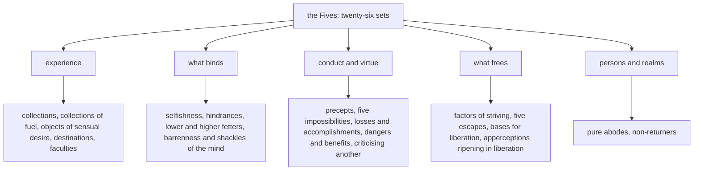

import { Tabs, TabItem } from '@astrojs/starlight/components';

Original text: [World Tipitaka Edition](https://tipitaka2500.github.io/tipitaka/8D/10/10.5.html)

## Summary

The fifth section of the Saṅgītisutta: twenty-six sets of five Dhammas that āyasmā Sāriputta recites for the bhikkhū to chant in harmony. The sets run from the familiar fives — the collections, the hindrances, the lower and higher fetters, the precepts, the faculties — through the dangers of failing in virtue and the benefits of keeping it, to the five escapes from sensual pleasures, ill will, harm, forms and identity, and the five bases for liberation.

## Diagram

## Text

<Tabs syncKey="paliquote">
<TabItem label="My Translation">
(315.)

943\. Āvuso, there are five Dhammas well proclaimed by the Bhagavā, the liberated one, the perfectly awakened one, who knows and sees. Therein all should recite in harmony, not quarrel, so that this optimal life may endure long and last for a long time, which would be for the welfare and happiness of many people, out of compassion for the world, for the good, welfare, and happiness of gods and humans. What five?

944\. Five `khandhā` (collections): the collection of form, the collection of feeling, the collection of apperception, the collection of mental constructions, and the collection of consciousness. (1)

945\. Five `upādānakkhandhā` (collections of fuel): the collection of form as fuel, the collection of feeling as fuel, the collection of apperception as fuel, the collection of mental constructions as fuel, and the collection of consciousness as fuel. (2)

946\. Five `kāmaguṇā` (objects of sensual desire): forms cognisable by the eye — agreeable, pleasant, charming, alluring, accompanied by sensual desire, and stimulating; sounds cognisable by the ear …; odours cognisable by the nose …; tastes cognisable by the tongue …; tactile objects cognisable by the body — agreeable, pleasant, charming, alluring, accompanied by sensual desire, and stimulating. (3)

947\. Five destinations: hell, the animal realm, the realm of ghosts, humans, and gods. (4)

948\. Five kinds of selfishness: selfishness about lodgings, selfishness about families, selfishness about gains, selfishness about praise, and selfishness about the Dhamma. (5)

949\. Five `nīvaraṇā` (hindrances): the hindrance of sensual desire, the hindrance of ill will, the hindrance of sloth and torpor, the hindrance of restlessness and remorse, and the hindrance of doubt. (6)

950\. Five lower fetters: identity view, doubt, adherence to rites and rituals, sensual desire, and ill will. (7)

951\. Five higher fetters: passion for form, passion for the formless, conceit, restlessness, and ignorance. (8)

952\. Five precepts: abstinence from killing living beings, abstinence from theft, abstinence from sexual misconduct, abstinence from false speech, and abstinence from wine, spirits, drugs and states of intoxication. (9)

(316.)

953\. Five impossibilities: A bhikkhu with the defilements destroyed, Āvuso, is incapable of intentionally depriving a living being of life. A bhikkhu with the defilements destroyed is incapable of taking what is not given with intent to steal. A bhikkhu with the defilements destroyed is incapable of engaging in the sexual act. A bhikkhu with the defilements destroyed is incapable of telling a deliberate lie. A bhikkhu with the defilements destroyed is incapable of enjoying sensual pleasures by storing them up, as before, when he was a householder. (10)

954\. Five losses: loss of relatives, loss of wealth, loss of health, loss of virtue, and loss of view. It is not, Āvuso, because of loss of relatives, or loss of wealth, or loss of health that beings, with the breakup of the body, after death, reappear in a state of deprivation, a bad destination, a lower realm, hell. It is because of loss of virtue, Āvuso, or because of loss of view that beings, with the breakup of the body, after death, reappear in a state of deprivation, a bad destination, a lower realm, hell. (11)

955\. Five accomplishments: accomplishment in relatives, accomplishment in wealth, accomplishment in health, accomplishment in virtue, and accomplishment in view. It is not, Āvuso, because of accomplishment in relatives, or accomplishment in wealth, or accomplishment in health that beings, with the breakup of the body, after death, reappear in a good destination, a heavenly world. It is because of accomplishment in virtue, Āvuso, or because of accomplishment in view that beings, with the breakup of the body, after death, reappear in a good destination, a heavenly world. (12)

956\. Five dangers for the immoral person through failure of virtue: Here, Āvuso, an immoral person who has failed in virtue, on account of heedlessness, suffers a great loss of wealth; this is the first danger for the immoral person through failure of virtue. Again, Āvuso, a bad report spreads about an immoral person who has failed in virtue; this is the second danger for the immoral person through failure of virtue. Again, Āvuso, whatever assembly an immoral person who has failed in virtue approaches, whether an assembly of Khattiyas, an assembly of brahmins, an assembly of householders, or an assembly of wanderers, he approaches it diffident and embarrassed; this is the third danger for the immoral person through failure of virtue. Again, Āvuso, an immoral person who has failed in virtue dies confused; this is the fourth danger for the immoral person through failure of virtue. Again, Āvuso, an immoral person who has failed in virtue, with the breakup of the body, after death, reappears in a state of deprivation, a bad destination, a lower realm, hell; this is the fifth danger for the immoral person through failure of virtue. (13)

957\. Five benefits for the virtuous person through accomplishment in virtue: Here, Āvuso, a virtuous person accomplished in virtue, on account of heedfulness, acquires a great pile of wealth; this is the first benefit for the virtuous person through accomplishment in virtue. Again, Āvuso, a good report spreads about a virtuous person accomplished in virtue; this is the second benefit for the virtuous person through accomplishment in virtue. Again, Āvuso, whatever assembly a virtuous person accomplished in virtue approaches, whether an assembly of Khattiyas, an assembly of brahmins, an assembly of householders, or an assembly of wanderers, he approaches it confident and unembarrassed; this is the third benefit for the virtuous person through accomplishment in virtue. Again, Āvuso, a virtuous person accomplished in virtue dies unconfused; this is the fourth benefit for the virtuous person through accomplishment in virtue. Again, Āvuso, a virtuous person accomplished in virtue, with the breakup of the body, after death, reappears in a good destination, a heavenly world; this is the fifth benefit for the virtuous person through accomplishment in virtue. (14)

958\. Āvuso, a bhikkhu who criticises, wishing to criticise another, should criticise the other having established five things within himself. I will speak at the right time, not at the wrong time; I will speak truthfully, not falsely; I will speak gently, not harshly; I will speak beneficially, not uselessly; I will speak with a mind of goodwill, not with hatred within. Āvuso, a bhikkhu who criticises, wishing to criticise another, should criticise the other having established these five things within himself. (15)

(317.)

959\. Five factors of striving: Here, Āvuso, a bhikkhu is confident; he has confidence in the awakening of the Tathāgata: ‘Such indeed is the Bhagavā: an `arahant` (liberated one), a `sammāsambuddha` (perfectly awakened one), accomplished in knowledge and conduct, fortunate, knower of the world, unsurpassed trainer of persons to be tamed, teacher of gods and humans, the Awakened One, the Bhagavā.’ He is healthy and free from illness, endowed with an even digestion, neither too cold nor too hot, moderate, fit for striving. He is honest and not deceitful, one who reveals himself as he really is to the Teacher or to the wise among his companions in the optimal life. He dwells with energy aroused for the giving up of unwholesome characteristics and the taking up of wholesome characteristics, having stamina, of persistent effort, not shirking his duty regarding wholesome characteristics. He is wise, endowed with the wisdom that discerns arising and passing away, which is of the liberated, penetrating, and leads to the complete destruction of suffering. (16)

(318.)

960\. Five pure abodes: Aviha, Atappa, Sudassa, Sudassī, and Akaniṭṭha. (17)

961\. Five non-returners: one who is extinguished in between, one who is extinguished having cut short [the next life], one who is extinguished without intention, one who is extinguished with intention, and one who goes upstream to Akaniṭṭha. (18)

(319.)

962\. Five kinds of barrenness of mind: Here, Āvuso, a bhikkhu doubts, is perplexed, is not fully convinced, and is not confident concerning the Teacher. Āvuso, whichever bhikkhu doubts, is perplexed, is not fully convinced, and is not confident concerning the Teacher, his mind does not incline to effort, to practice, to perseverance, to striving; one whose mind does not incline to effort, to practice, to perseverance, to striving — this is the first barrenness of mind. Again, Āvuso, a bhikkhu doubts and is perplexed concerning the Dhamma … and so on … doubts and is perplexed concerning the Saṅgha … doubts and is perplexed concerning the training … is angry with his companions in the optimal life, displeased, with a stricken mind, hard-hearted. Āvuso, whichever bhikkhu is angry with his companions in the optimal life, displeased, with a stricken mind, hard-hearted, his mind does not incline to effort, to practice, to perseverance, to striving; one whose mind does not incline to effort, to practice, to perseverance, to striving — this is the fifth barrenness of mind. (19)

(320.)

963\. Five shackles of the mind: Here, Āvuso, a bhikkhu is not free from passion for sensual pleasures, not free from desire, not free from affection, not free from thirst, not free from fever, not free from craving. Āvuso, whichever bhikkhu is not free from passion for sensual pleasures, not free from desire, not free from affection, not free from thirst, not free from fever, not free from craving, his mind does not incline to effort, to practice, to perseverance, to striving. One whose mind does not incline to effort, to practice, to perseverance, to striving. This is the first shackle of the mind. Again, Āvuso, a bhikkhu is not free from passion for the body … and so on … is not free from passion for form … and so on … again, Āvuso, a bhikkhu, having eaten as much as he likes, filling his stomach, dwells devoted to the pleasure of the bed, the pleasure of lying on his side, the pleasure of dozing … and so on … again, Āvuso, a bhikkhu lives the optimal life aspiring to a certain class of gods: ‘By this virtue or observance or austerity or optimal life I will become a god or one of the gods.’ Āvuso, whichever bhikkhu lives the optimal life aspiring to a certain class of gods: ‘By this virtue or observance or austerity or optimal life I will become a god or one of the gods’, his mind does not incline to effort, to practice, to perseverance, to striving. One whose mind does not incline to effort, to practice, to perseverance, to striving. This is the fifth shackle of the mind. (20)

964\. Five faculties: the eye-faculty, the ear-faculty, the nose-faculty, the tongue-faculty, and the body-faculty. (21)

965\. Another five faculties: the faculty of pleasure, the faculty of pain, the faculty of happiness, the faculty of displeasure, and the faculty of equanimity. (22)

966\. Another five faculties: the faculty of `saddhā` (confidence), the faculty of `vīriya` (energy), the faculty of `sati` (awareness), the faculty of `samādhi` (focus), and the faculty of `paññā` (wisdom). (23)

(321.)

967\. Five components of escape: Here, Āvuso, when a bhikkhu attends to sensual pleasures, his mind does not take to sensual pleasures, does not settle on them, does not stand still, and is not released. But when he attends to renunciation, his mind takes to renunciation, settles on it, stands still, and is released. That mind of his is faring well, well developed, well risen, well released, detached from sensual pleasures. And whatever defilements, troubles, and fevers arise with sensual pleasures as cause, he is freed from them; he does not feel that feeling. This is declared the escape from sensual pleasures. (24.1)

968\. Again, Āvuso, when a bhikkhu attends to ill will, his mind does not take to ill will, does not settle on it, does not stand still, and is not released. But when he attends to goodwill, his mind takes to goodwill, settles on it, stands still, and is released. That mind of his is faring well, well developed, well risen, well released, detached from ill will. And whatever defilements, troubles, and fevers arise with ill will as cause, he is freed from them; he does not feel that feeling. This is declared the escape from ill will. (24.2)

969\. Again, Āvuso, when a bhikkhu attends to harm, his mind does not take to harm, does not settle on it, does not stand still, and is not released. But when he attends to non-harm, his mind takes to non-harm, settles on it, stands still, and is released. That mind of his is faring well, well developed, well risen, well released, detached from harm. And whatever defilements, troubles, and fevers arise with harm as cause, he is freed from them; he does not feel that feeling. This is declared the escape from harm. (24.3)

970\. Again, Āvuso, when a bhikkhu attends to forms, his mind does not take to forms, does not settle on them, does not stand still, and is not released. But when he attends to the formless, his mind takes to the formless, settles on it, stands still, and is released. That mind of his is faring well, well developed, well risen, well released, detached from forms. And whatever defilements, troubles, and fevers arise with forms as cause, he is freed from them; he does not feel that feeling. This is declared the escape from forms. (24.4)

971\. Again, Āvuso, when a bhikkhu attends to identity, his mind does not take to identity, does not settle on it, does not stand still, and is not released. But when he attends to the cessation of identity, his mind takes to the cessation of identity, settles on it, stands still, and is released. That mind of his is faring well, well developed, well risen, well released, detached from identity. And whatever defilements, troubles, and fevers arise with identity as cause, he is freed from them; he does not feel that feeling. This is declared the escape from identity. (24.5)

(322.)

972\. Five bases for liberation: Here, Āvuso, the Teacher or a certain companion in the optimal life standing in the place of a teacher teaches the Dhamma to a bhikkhu. In whatever way, Āvuso, the Teacher or a certain companion in the optimal life standing in the place of a teacher teaches the Dhamma to a bhikkhu, in that way he comes to experience the meaning and experience the Dhamma in that Dhamma. For one who experiences the meaning and experiences the Dhamma, joy is born; for one who is joyous, delight is born; for one who is delighted, the body calms down; one of calm body experiences happiness; for one who is happy, the mind becomes composed. This is the first base for liberation. (25.1)

973\. Again, Āvuso, it is not that the Teacher or a certain companion in the optimal life standing in the place of a teacher teaches the Dhamma to a bhikkhu, but rather he teaches the Dhamma to others in detail as he has heard it and learned it … and so on … but rather he recites the Dhamma in detail as he has heard it and learned it … and so on … but rather he ponders, reflects on, and mentally examines the Dhamma as he has heard it and learned it … and so on … but rather a certain object of focus is well grasped by him, well attended to, well considered, well penetrated with wisdom. In whatever way, Āvuso, a certain object of focus is well grasped by a bhikkhu, well attended to, well considered, well penetrated with wisdom, in that way he comes to experience the meaning and experience the Dhamma in that Dhamma. For one who experiences the meaning and experiences the Dhamma, joy is born; for one who is joyous, delight is born; for one who is delighted, the body calms down; one of calm body experiences happiness; for one who is happy, the mind becomes composed. This is the fifth base for liberation. (25.2--5)

974\. Five `saññā` (apperceptions) that ripen in liberation: the apperception of impermanence, the apperception of suffering in the impermanent, the apperception of not-self in suffering, the apperception of giving up, and the apperception of dispassion. (26)

975\. Āvuso, these are the five Dhammas well proclaimed by the Bhagavā, the liberated one, the perfectly awakened one, who knows and sees; Therein all should recite in harmony, not quarrel, so that this optimal life may endure long and last for a long time, which would be for the welfare and happiness of many people, out of compassion for the world, for the good, welfare, and happiness of gods and humans.
</TabItem>

<TabItem label="Pāḷi (Roman IAST)">
(315.)

943\. Atthi kho, āvuso, tena bhagavatā jānatā passatā arahatā sammāsambuddhena pañca dhammā sammadakkhātā. Tattha sabbeheva saṅgāyitabbaṃ…pe… atthāya hitāya sukhāya devamanussānaṃ. Katame pañca?

944\. Pañcakkhandhā. Rūpakkhandho vedanākkhandho saññākkhandho saṅkhārakkhandho viññāṇakkhandho. (1)

945\. Pañcupādānakkhandhā. Rūpupādānakkhandho vedanupādānakkhandho saññupādānakkhandho saṅkhārupādānakkhandho viññāṇupādānakkhandho. (2)

946\. Pañca kāmaguṇā. Cakkhuviññeyyā rūpā iṭṭhā kantā manāpā piyarūpā kāmūpasañhitā rajanīyā, sotaviññeyyā saddā… ghānaviññeyyā gandhā… jivhāviññeyyā rasā… kāyaviññeyyā phoṭṭhabbā iṭṭhā kantā manāpā piyarūpā kāmūpasañhitā rajanīyā. (3)

947\. Pañca gatiyo— nirayo, tiracchānayoni, pettivisayo, manussā, devā. (4)

948\. Pañca macchariyāni— āvāsamacchariyaṃ, kulamacchariyaṃ, lābhamacchariyaṃ, vaṇṇamacchariyaṃ, dhammamacchariyaṃ. (5)

949\. Pañca nīvaraṇāni— kāmacchandanīvaraṇaṃ, byāpādanīvaraṇaṃ, thinamiddhanīvaraṇaṃ, uddhaccakukkuccanīvaraṇaṃ, vicikicchānīvaraṇaṃ. (6)

950\. Pañca orambhāgiyāni saṃyojanāni— sakkāyadiṭṭhi, vicikicchā, sīlabbataparāmāso, kāmacchando, byāpādo. (7)

951\. Pañca uddhambhāgiyāni saṃyojanāni— rūparāgo, arūparāgo, māno, uddhaccaṃ, avijjā. (8)

952\. Pañca sikkhāpadāni— pāṇātipātā veramaṇī, adinnādānā veramaṇī, kāmesumicchācārā veramaṇī, musāvādā veramaṇī, surāmerayamajjappamādaṭṭhānā veramaṇī. (9)

(316.)

953\. Pañca abhabbaṭṭhānāni. Abhabbo, āvuso, khīṇāsavo bhikkhu sañcicca pāṇaṃ jīvitā voropetuṃ. Abhabbo khīṇāsavo bhikkhu adinnaṃ theyyasaṅkhātaṃ ādiyituṃ. Abhabbo khīṇāsavo bhikkhu methunaṃ dhammaṃ paṭisevituṃ. Abhabbo khīṇāsavo bhikkhu sampajānamusā bhāsituṃ. Abhabbo khīṇāsavo bhikkhu sannidhikārakaṃ kāme paribhuñjituṃ, seyyathāpi pubbe āgārikabhūto. (10)

954\. Pañca byasanāni— ñātibyasanaṃ, bhogabyasanaṃ, rogabyasanaṃ, sīlabyasanaṃ, diṭṭhibyasanaṃ. Nāvuso, sattā ñātibyasanahetu vā bhogabyasanahetu vā rogabyasanahetu vā kāyassa bhedā paraṃ maraṇā apāyaṃ duggatiṃ vinipātaṃ nirayaṃ upapajjanti. Sīlabyasanahetu vā, āvuso, sattā diṭṭhibyasanahetu vā kāyassa bhedā paraṃ maraṇā apāyaṃ duggatiṃ vinipātaṃ nirayaṃ upapajjanti. (11)

955\. Pañca sampadā— ñātisampadā, bhogasampadā, ārogyasampadā, sīlasampadā, diṭṭhisampadā. Nāvuso, sattā ñātisampadāhetu vā bhogasampadāhetu vā ārogyasampadāhetu vā kāyassa bhedā paraṃ maraṇā sugatiṃ saggaṃ lokaṃ upapajjanti. Sīlasampadāhetu vā, āvuso, sattā diṭṭhisampadāhetu vā kāyassa bhedā paraṃ maraṇā sugatiṃ saggaṃ lokaṃ upapajjanti. (12)

956\. Pañca ādīnavā dussīlassa sīlavipattiyā. Idhāvuso, dussīlo sīlavipanno pamādādhikaraṇaṃ mahatiṃ bhogajāniṃ nigacchati, ayaṃ paṭhamo ādīnavo dussīlassa sīlavipattiyā. Puna caparaṃ, āvuso, dussīlassa sīlavipannassa pāpako kittisaddo abbhuggacchati, ayaṃ dutiyo ādīnavo dussīlassa sīlavipattiyā. Puna caparaṃ, āvuso, dussīlo sīlavipanno yaññadeva parisaṃ upasaṅkamati yadi khattiyaparisaṃ yadi brāhmaṇaparisaṃ yadi gahapatiparisaṃ yadi samaṇaparisaṃ, avisārado upasaṅkamati maṅkubhūto, ayaṃ tatiyo ādīnavo dussīlassa sīlavipattiyā. Puna caparaṃ, āvuso, dussīlo sīlavipanno sammūḷho kālaṃ karoti, ayaṃ catuttho ādīnavo dussīlassa sīlavipattiyā. Puna caparaṃ, āvuso, dussīlo sīlavipanno kāyassa bhedā paraṃ maraṇā apāyaṃ duggatiṃ vinipātaṃ nirayaṃ upapajjati, ayaṃ pañcamo ādīnavo dussīlassa sīlavipattiyā. (13)

957\. Pañca ānisaṃsā sīlavato sīlasampadāya. Idhāvuso, sīlavā sīlasampanno appamādādhikaraṇaṃ mahantaṃ bhogakkhandhaṃ adhigacchati, ayaṃ paṭhamo ānisaṃso sīlavato sīlasampadāya. Puna caparaṃ, āvuso, sīlavato sīlasampannassa kalyāṇo kittisaddo abbhuggacchati, ayaṃ dutiyo ānisaṃso sīlavato sīlasampadāya. Puna caparaṃ, āvuso, sīlavā sīlasampanno yaññadeva parisaṃ upasaṅkamati yadi khattiyaparisaṃ yadi brāhmaṇaparisaṃ yadi gahapatiparisaṃ yadi samaṇaparisaṃ, visārado upasaṅkamati amaṅkubhūto, ayaṃ tatiyo ānisaṃso sīlavato sīlasampadāya. Puna caparaṃ, āvuso, sīlavā sīlasampanno asammūḷho kālaṃ karoti, ayaṃ catuttho ānisaṃso sīlavato sīlasampadāya. Puna caparaṃ, āvuso, sīlavā sīlasampanno kāyassa bhedā paraṃ maraṇā sugatiṃ saggaṃ lokaṃ upapajjati, ayaṃ pañcamo ānisaṃso sīlavato sīlasampadāya. (14)

958\. Codakena, āvuso, bhikkhunā paraṃ codetukāmena pañca dhamme ajjhattaṃ upaṭṭhapetvā paro codetabbo. Kālena vakkhāmi no akālena, bhūtena vakkhāmi no abhūtena, saṇhena vakkhāmi no pharusena, atthasaṃhitena vakkhāmi no anatthasaṃhitena, mettacittena vakkhāmi no dosantarenāti. Codakena, āvuso, bhikkhunā paraṃ codetukāmena ime pañca dhamme ajjhattaṃ upaṭṭhapetvā paro codetabbo. (15)

(317.)

959\. Pañca padhāniyaṅgāni. Idhāvuso, bhikkhu saddho hoti, saddahati tathāgatassa bodhiṃ— ‘itipi so bhagavā arahaṃ sammāsambuddho vijjācaraṇasampanno sugato, lokavidū anuttaro purisadammasārathi satthā devamanussānaṃ buddho bhagavā’ti. Appābādho hoti appātaṅko, samavepākiniyā gahaṇiyā samannāgato nātisītāya nāccuṇhāya majjhimāya padhānakkhamāya. Asaṭho hoti amāyāvī, yathābhūtaṃ attānaṃ āvikattā satthari vā viññūsu vā sabrahmacārīsu. Āraddhavīriyo viharati akusalānaṃ dhammānaṃ pahānāya kusalānaṃ dhammānaṃ upasampadāya thāmavā daḷhaparakkamo anikkhittadhuro kusalesu dhammesu. Paññavā hoti udayatthagāminiyā paññāya samannāgato ariyāya nibbedhikāya sammādukkhakkhayagāminiyā. (16)

(318.)

960\. Pañca suddhāvāsā— avihā, atappā, sudassā, sudassī, akaniṭṭhā. (17)

961\. Pañca anāgāmino— antarāparinibbāyī, upahaccaparinibbāyī, asaṅkhāraparinibbāyī, sasaṅkhāraparinibbāyī, uddhaṃsotoakaniṭṭhagāmī. (18)

(319.)

962\. Pañca cetokhilā. Idhāvuso, bhikkhu satthari kaṅkhati vicikicchati nādhimuccati na sampasīdati. Yo so, āvuso, bhikkhu satthari kaṅkhati vicikicchati nādhimuccati na sampasīdati, tassa cittaṃ na namati ātappāya anuyogāya sātaccāya padhānāya, yassa cittaṃ na namati ātappāya anuyogāya sātaccāya padhānāya, ayaṃ paṭhamo cetokhilo. Puna caparaṃ, āvuso, bhikkhu dhamme kaṅkhati vicikicchati…pe… saṃghe kaṅkhati vicikicchati… sikkhāya kaṅkhati vicikicchati… sabrahmacārīsu kupito hoti anattamano āhatacitto khilajāto. Yo so, āvuso, bhikkhu sabrahmacārīsu kupito hoti anattamano āhatacitto khilajāto, tassa cittaṃ na namati ātappāya anuyogāya sātaccāya padhānāya, yassa cittaṃ na namati ātappāya anuyogāya sātaccāya padhānāya, ayaṃ pañcamo cetokhilo. (19)

(320.)

963\. Pañca cetasovinibandhā. Idhāvuso, bhikkhu kāmesu avītarāgo hoti avigatacchando avigatapemo avigatapipāso avigatapariḷāho avigatataṇho. Yo so, āvuso, bhikkhu kāmesu avītarāgo hoti avigatacchando avigatapemo avigatapipāso avigatapariḷāho avigatataṇho, tassa cittaṃ na namati ātappāya anuyogāya sātaccāya padhānāya. Yassa cittaṃ na namati ātappāya anuyogāya sātaccāya padhānāya. Ayaṃ paṭhamo cetaso vinibandho. Puna caparaṃ, āvuso, bhikkhu kāye avītarāgo hoti…pe… rūpe avītarāgo hoti…pe… puna caparaṃ, āvuso, bhikkhu yāvadatthaṃ udarāvadehakaṃ bhuñjitvā seyyasukhaṃ passasukhaṃ middhasukhaṃ anuyutto viharati…pe… puna caparaṃ, āvuso, bhikkhu aññataraṃ devanikāyaṃ paṇidhāya brahmacariyaṃ carati— ‘imināhaṃ sīlena vā vatena vā tapena vā brahmacariyena vā devo vā bhavissāmi devaññataro vā’ti. Yo so, āvuso, bhikkhu aññataraṃ devanikāyaṃ paṇidhāya brahmacariyaṃ carati— ‘imināhaṃ sīlena vā vatena vā tapena vā brahmacariyena vā devo vā bhavissāmi devaññataro vā’ti, tassa cittaṃ na namati ātappāya anuyogāya sātaccāya padhānāya. Yassa cittaṃ na namati ātappāya anuyogāya sātaccāya padhānāya. Ayaṃ pañcamo cetaso vinibandho. (20)

964\. Pañcindriyāni— cakkhundriyaṃ, sotindriyaṃ, ghānindriyaṃ, jivhindriyaṃ, kāyindriyaṃ. (21)

965\. Aparānipi pañcindriyāni— sukhindriyaṃ, dukkhindriyaṃ, somanassindriyaṃ, domanassindriyaṃ, upekkhindriyaṃ. (22)

966\. Aparānipi pañcindriyāni— saddhindriyaṃ, vīriyindriyaṃ, satindriyaṃ, samādhindriyaṃ, paññindriyaṃ. (23)

(321.)

967\. Pañca nissaraṇiyā dhātuyo. Idhāvuso, bhikkhuno kāme manasikaroto kāmesu cittaṃ na pakkhandati na pasīdati na santiṭṭhati na vimuccati. Nekkhammaṃ kho panassa manasikaroto nekkhamme cittaṃ pakkhandati pasīdati santiṭṭhati vimuccati. Tassa taṃ cittaṃ sugataṃ subhāvitaṃ suvuṭṭhitaṃ suvimuttaṃ visaṃyuttaṃ kāmehi. Ye ca kāmapaccayā uppajjanti āsavā vighātā pariḷāhā, mutto so tehi, na so taṃ vedanaṃ vedeti. Idamakkhātaṃ kāmānaṃ nissaraṇaṃ. (24.1)

968\. Puna caparaṃ, āvuso, bhikkhuno byāpādaṃ manasikaroto byāpāde cittaṃ na pakkhandati na pasīdati na santiṭṭhati na vimuccati. Abyāpādaṃ kho panassa manasikaroto abyāpāde cittaṃ pakkhandati pasīdati santiṭṭhati vimuccati. Tassa taṃ cittaṃ sugataṃ subhāvitaṃ suvuṭṭhitaṃ suvimuttaṃ visaṃyuttaṃ byāpādena. Ye ca byāpādapaccayā uppajjanti āsavā vighātā pariḷāhā, mutto so tehi, na so taṃ vedanaṃ vedeti. Idamakkhātaṃ byāpādassa nissaraṇaṃ. (24.2)

969\. Puna caparaṃ, āvuso, bhikkhuno vihesaṃ manasikaroto vihesāya cittaṃ na pakkhandati na pasīdati na santiṭṭhati na vimuccati. Avihesaṃ kho panassa manasikaroto avihesāya cittaṃ pakkhandati pasīdati santiṭṭhati vimuccati. Tassa taṃ cittaṃ sugataṃ subhāvitaṃ suvuṭṭhitaṃ suvimuttaṃ visaṃyuttaṃ vihesāya. Ye ca vihesāpaccayā uppajjanti āsavā vighātā pariḷāhā, mutto so tehi, na so taṃ vedanaṃ vedeti. Idamakkhātaṃ vihesāya nissaraṇaṃ. (24.3)

970\. Puna caparaṃ, āvuso, bhikkhuno rūpe manasikaroto rūpesu cittaṃ na pakkhandati na pasīdati na santiṭṭhati na vimuccati. Arūpaṃ kho panassa manasikaroto arūpe cittaṃ pakkhandati pasīdati santiṭṭhati vimuccati. Tassa taṃ cittaṃ sugataṃ subhāvitaṃ suvuṭṭhitaṃ suvimuttaṃ visaṃyuttaṃ rūpehi. Ye ca rūpapaccayā uppajjanti āsavā vighātā pariḷāhā, mutto so tehi, na so taṃ vedanaṃ vedeti. Idamakkhātaṃ rūpānaṃ nissaraṇaṃ. (24.4)

971\. Puna caparaṃ, āvuso, bhikkhuno sakkāyaṃ manasikaroto sakkāye cittaṃ na pakkhandati na pasīdati na santiṭṭhati na vimuccati. Sakkāyanirodhaṃ kho panassa manasikaroto sakkāyanirodhe cittaṃ pakkhandati pasīdati santiṭṭhati vimuccati. Tassa taṃ cittaṃ sugataṃ subhāvitaṃ suvuṭṭhitaṃ suvimuttaṃ visaṃyuttaṃ sakkāyena. Ye ca sakkāyapaccayā uppajjanti āsavā vighātā pariḷāhā, mutto so tehi, na so taṃ vedanaṃ vedeti. Idamakkhātaṃ sakkāyassa nissaraṇaṃ. (24.5)

(322.)

972\. Pañca vimuttāyatanāni. Idhāvuso, bhikkhuno satthā dhammaṃ deseti aññataro vā garuṭṭhāniyo sabrahmacārī. Yathā yathā, āvuso, bhikkhuno satthā dhammaṃ deseti aññataro vā garuṭṭhāniyo sabrahmacārī tathā tathā so tasmiṃ dhamme atthapaṭisaṃvedī ca hoti dhammapaṭisaṃvedī ca. Tassa atthapaṭisaṃvedino dhammapaṭisaṃvedino pāmojjaṃ jāyati, pamuditassa pīti jāyati, pītimanassa kāyo passambhati, passaddhakāyo sukhaṃ vedeti, sukhino cittaṃ samādhiyati. Idaṃ paṭhamaṃ vimuttāyatanaṃ. (25.1)

973\. Puna caparaṃ, āvuso, bhikkhuno na heva kho satthā dhammaṃ deseti aññataro vā garuṭṭhāniyo sabrahmacārī, api ca kho yathāsutaṃ yathāpariyattaṃ dhammaṃ vitthārena paresaṃ deseti…pe… api ca kho yathāsutaṃ yathāpariyattaṃ dhammaṃ vitthārena sajjhāyaṃ karoti…pe… api ca kho yathāsutaṃ yathāpariyattaṃ dhammaṃ cetasā anuvitakketi anuvicāreti manasānupekkhati…pe… api ca khvassa aññataraṃ samādhinimittaṃ suggahitaṃ hoti sumanasikataṃ sūpadhāritaṃ suppaṭividdhaṃ paññāya. Yathā yathā, āvuso, bhikkhuno aññataraṃ samādhinimittaṃ suggahitaṃ hoti sumanasikataṃ sūpadhāritaṃ suppaṭividdhaṃ paññāya tathā tathā so tasmiṃ dhamme atthapaṭisaṃvedī ca hoti dhammapaṭisaṃvedī ca. Tassa atthapaṭisaṃvedino dhammapaṭisaṃvedino pāmojjaṃ jāyati, pamuditassa pīti jāyati, pītimanassa kāyo passambhati, passaddhakāyo sukhaṃ vedeti, sukhino cittaṃ samādhiyati. Idaṃ pañcamaṃ vimuttāyatanaṃ. (25.2--5)

974\. Pañca vimuttiparipācanīyā saññā— aniccasaññā, anicce dukkhasaññā, dukkhe anattasaññā, pahānasaññā, virāgasaññā. (26)

975\. Ime kho, āvuso, tena bhagavatā jānatā passatā arahatā sammāsambuddhena pañca dhammā sammadakkhātā; tattha sabbeheva saṅgāyitabbaṃ…pe… atthāya hitāya sukhāya devamanussānaṃ.
</TabItem>

<TabItem label="Pāḷi (Brahmi)">
(315.)

943\. 𑀅𑀢𑁆𑀣𑀺 𑀔𑁄, 𑀆𑀯𑀼𑀲𑁄, 𑀢𑁂𑀦 𑀪𑀕𑀯𑀢𑀸 𑀚𑀸𑀦𑀢𑀸 𑀧𑀲𑁆𑀲𑀢𑀸 𑀅𑀭𑀳𑀢𑀸 𑀲𑀫𑁆𑀫𑀸𑀲𑀫𑁆𑀩𑀼𑀤𑁆𑀥𑁂𑀦 𑀧𑀜𑁆𑀘 𑀥𑀫𑁆𑀫𑀸 𑀲𑀫𑁆𑀫𑀤𑀓𑁆𑀔𑀸𑀢𑀸. 𑀢𑀢𑁆𑀣 𑀲𑀩𑁆𑀩𑁂𑀳𑁂𑀯 𑀲𑀗𑁆𑀕𑀸𑀬𑀺𑀢𑀩𑁆𑀩𑀁…𑀧𑁂… 𑀅𑀢𑁆𑀣𑀸𑀬 𑀳𑀺𑀢𑀸𑀬 𑀲𑀼𑀔𑀸𑀬 𑀤𑁂𑀯𑀫𑀦𑀼𑀲𑁆𑀲𑀸𑀦𑀁. 𑀓𑀢𑀫𑁂 𑀧𑀜𑁆𑀘?

944\. 𑀧𑀜𑁆𑀘𑀓𑁆𑀔𑀦𑁆𑀥𑀸. 𑀭𑀽𑀧𑀓𑁆𑀔𑀦𑁆𑀥𑁄 𑀯𑁂𑀤𑀦𑀸𑀓𑁆𑀔𑀦𑁆𑀥𑁄 𑀲𑀜𑁆𑀜𑀸𑀓𑁆𑀔𑀦𑁆𑀥𑁄 𑀲𑀗𑁆𑀔𑀸𑀭𑀓𑁆𑀔𑀦𑁆𑀥𑁄 𑀯𑀺𑀜𑁆𑀜𑀸𑀡𑀓𑁆𑀔𑀦𑁆𑀥𑁄. (1)

945\. 𑀧𑀜𑁆𑀘𑀼𑀧𑀸𑀤𑀸𑀦𑀓𑁆𑀔𑀦𑁆𑀥𑀸. 𑀭𑀽𑀧𑀼𑀧𑀸𑀤𑀸𑀦𑀓𑁆𑀔𑀦𑁆𑀥𑁄 𑀯𑁂𑀤𑀦𑀼𑀧𑀸𑀤𑀸𑀦𑀓𑁆𑀔𑀦𑁆𑀥𑁄 𑀲𑀜𑁆𑀜𑀼𑀧𑀸𑀤𑀸𑀦𑀓𑁆𑀔𑀦𑁆𑀥𑁄 𑀲𑀗𑁆𑀔𑀸𑀭𑀼𑀧𑀸𑀤𑀸𑀦𑀓𑁆𑀔𑀦𑁆𑀥𑁄 𑀯𑀺𑀜𑁆𑀜𑀸𑀡𑀼𑀧𑀸𑀤𑀸𑀦𑀓𑁆𑀔𑀦𑁆𑀥𑁄. (2)

946\. 𑀧𑀜𑁆𑀘 𑀓𑀸𑀫𑀕𑀼𑀡𑀸. 𑀘𑀓𑁆𑀔𑀼𑀯𑀺𑀜𑁆𑀜𑁂𑀬𑁆𑀬𑀸 𑀭𑀽𑀧𑀸 𑀇𑀝𑁆𑀞𑀸 𑀓𑀦𑁆𑀢𑀸 𑀫𑀦𑀸𑀧𑀸 𑀧𑀺𑀬𑀭𑀽𑀧𑀸 𑀓𑀸𑀫𑀽𑀧𑀲𑀜𑁆𑀳𑀺𑀢𑀸 𑀭𑀚𑀦𑀻𑀬𑀸, 𑀲𑁄𑀢𑀯𑀺𑀜𑁆𑀜𑁂𑀬𑁆𑀬𑀸 𑀲𑀤𑁆𑀤𑀸… 𑀖𑀸𑀦𑀯𑀺𑀜𑁆𑀜𑁂𑀬𑁆𑀬𑀸 𑀕𑀦𑁆𑀥𑀸… 𑀚𑀺𑀯𑁆𑀳𑀸𑀯𑀺𑀜𑁆𑀜𑁂𑀬𑁆𑀬𑀸 𑀭𑀲𑀸… 𑀓𑀸𑀬𑀯𑀺𑀜𑁆𑀜𑁂𑀬𑁆𑀬𑀸 𑀨𑁄𑀝𑁆𑀞𑀩𑁆𑀩𑀸 𑀇𑀝𑁆𑀞𑀸 𑀓𑀦𑁆𑀢𑀸 𑀫𑀦𑀸𑀧𑀸 𑀧𑀺𑀬𑀭𑀽𑀧𑀸 𑀓𑀸𑀫𑀽𑀧𑀲𑀜𑁆𑀳𑀺𑀢𑀸 𑀭𑀚𑀦𑀻𑀬𑀸. (3)

947\. 𑀧𑀜𑁆𑀘 𑀕𑀢𑀺𑀬𑁄— 𑀦𑀺𑀭𑀬𑁄, 𑀢𑀺𑀭𑀘𑁆𑀙𑀸𑀦𑀬𑁄𑀦𑀺, 𑀧𑁂𑀢𑁆𑀢𑀺𑀯𑀺𑀲𑀬𑁄, 𑀫𑀦𑀼𑀲𑁆𑀲𑀸, 𑀤𑁂𑀯𑀸. (4)

948\. 𑀧𑀜𑁆𑀘 𑀫𑀘𑁆𑀙𑀭𑀺𑀬𑀸𑀦𑀺— 𑀆𑀯𑀸𑀲𑀫𑀘𑁆𑀙𑀭𑀺𑀬𑀁, 𑀓𑀼𑀮𑀫𑀘𑁆𑀙𑀭𑀺𑀬𑀁, 𑀮𑀸𑀪𑀫𑀘𑁆𑀙𑀭𑀺𑀬𑀁, 𑀯𑀡𑁆𑀡𑀫𑀘𑁆𑀙𑀭𑀺𑀬𑀁, 𑀥𑀫𑁆𑀫𑀫𑀘𑁆𑀙𑀭𑀺𑀬𑀁. (5)

949\. 𑀧𑀜𑁆𑀘 𑀦𑀻𑀯𑀭𑀡𑀸𑀦𑀺— 𑀓𑀸𑀫𑀘𑁆𑀙𑀦𑁆𑀤𑀦𑀻𑀯𑀭𑀡𑀁, 𑀩𑁆𑀬𑀸𑀧𑀸𑀤𑀦𑀻𑀯𑀭𑀡𑀁, 𑀣𑀺𑀦𑀫𑀺𑀤𑁆𑀥𑀦𑀻𑀯𑀭𑀡𑀁, 𑀉𑀤𑁆𑀥𑀘𑁆𑀘𑀓𑀼𑀓𑁆𑀓𑀼𑀘𑁆𑀘𑀦𑀻𑀯𑀭𑀡𑀁, 𑀯𑀺𑀘𑀺𑀓𑀺𑀘𑁆𑀙𑀸𑀦𑀻𑀯𑀭𑀡𑀁. (6)

950\. 𑀧𑀜𑁆𑀘 𑀑𑀭𑀫𑁆𑀪𑀸𑀕𑀺𑀬𑀸𑀦𑀺 𑀲𑀁𑀬𑁄𑀚𑀦𑀸𑀦𑀺— 𑀲𑀓𑁆𑀓𑀸𑀬𑀤𑀺𑀝𑁆𑀞𑀺, 𑀯𑀺𑀘𑀺𑀓𑀺𑀘𑁆𑀙𑀸, 𑀲𑀻𑀮𑀩𑁆𑀩𑀢𑀧𑀭𑀸𑀫𑀸𑀲𑁄, 𑀓𑀸𑀫𑀘𑁆𑀙𑀦𑁆𑀤𑁄, 𑀩𑁆𑀬𑀸𑀧𑀸𑀤𑁄. (7)

951\. 𑀧𑀜𑁆𑀘 𑀉𑀤𑁆𑀥𑀫𑁆𑀪𑀸𑀕𑀺𑀬𑀸𑀦𑀺 𑀲𑀁𑀬𑁄𑀚𑀦𑀸𑀦𑀺— 𑀭𑀽𑀧𑀭𑀸𑀕𑁄, 𑀅𑀭𑀽𑀧𑀭𑀸𑀕𑁄, 𑀫𑀸𑀦𑁄, 𑀉𑀤𑁆𑀥𑀘𑁆𑀘𑀁, 𑀅𑀯𑀺𑀚𑁆𑀚𑀸. (8)

952\. 𑀧𑀜𑁆𑀘 𑀲𑀺𑀓𑁆𑀔𑀸𑀧𑀤𑀸𑀦𑀺— 𑀧𑀸𑀡𑀸𑀢𑀺𑀧𑀸𑀢𑀸 𑀯𑁂𑀭𑀫𑀡𑀻, 𑀅𑀤𑀺𑀦𑁆𑀦𑀸𑀤𑀸𑀦𑀸 𑀯𑁂𑀭𑀫𑀡𑀻, 𑀓𑀸𑀫𑁂𑀲𑀼𑀫𑀺𑀘𑁆𑀙𑀸𑀘𑀸𑀭𑀸 𑀯𑁂𑀭𑀫𑀡𑀻, 𑀫𑀼𑀲𑀸𑀯𑀸𑀤𑀸 𑀯𑁂𑀭𑀫𑀡𑀻, 𑀲𑀼𑀭𑀸𑀫𑁂𑀭𑀬𑀫𑀚𑁆𑀚𑀧𑁆𑀧𑀫𑀸𑀤𑀝𑁆𑀞𑀸𑀦𑀸 𑀯𑁂𑀭𑀫𑀡𑀻. (9)

(316.)

953\. 𑀧𑀜𑁆𑀘 𑀅𑀪𑀩𑁆𑀩𑀝𑁆𑀞𑀸𑀦𑀸𑀦𑀺. 𑀅𑀪𑀩𑁆𑀩𑁄, 𑀆𑀯𑀼𑀲𑁄, 𑀔𑀻𑀡𑀸𑀲𑀯𑁄 𑀪𑀺𑀓𑁆𑀔𑀼 𑀲𑀜𑁆𑀘𑀺𑀘𑁆𑀘 𑀧𑀸𑀡𑀁 𑀚𑀻𑀯𑀺𑀢𑀸 𑀯𑁄𑀭𑁄𑀧𑁂𑀢𑀼𑀁. 𑀅𑀪𑀩𑁆𑀩𑁄 𑀔𑀻𑀡𑀸𑀲𑀯𑁄 𑀪𑀺𑀓𑁆𑀔𑀼 𑀅𑀤𑀺𑀦𑁆𑀦𑀁 𑀣𑁂𑀬𑁆𑀬𑀲𑀗𑁆𑀔𑀸𑀢𑀁 𑀆𑀤𑀺𑀬𑀺𑀢𑀼𑀁. 𑀅𑀪𑀩𑁆𑀩𑁄 𑀔𑀻𑀡𑀸𑀲𑀯𑁄 𑀪𑀺𑀓𑁆𑀔𑀼 𑀫𑁂𑀣𑀼𑀦𑀁 𑀥𑀫𑁆𑀫𑀁 𑀧𑀝𑀺𑀲𑁂𑀯𑀺𑀢𑀼𑀁. 𑀅𑀪𑀩𑁆𑀩𑁄 𑀔𑀻𑀡𑀸𑀲𑀯𑁄 𑀪𑀺𑀓𑁆𑀔𑀼 𑀲𑀫𑁆𑀧𑀚𑀸𑀦𑀫𑀼𑀲𑀸 𑀪𑀸𑀲𑀺𑀢𑀼𑀁. 𑀅𑀪𑀩𑁆𑀩𑁄 𑀔𑀻𑀡𑀸𑀲𑀯𑁄 𑀪𑀺𑀓𑁆𑀔𑀼 𑀲𑀦𑁆𑀦𑀺𑀥𑀺𑀓𑀸𑀭𑀓𑀁 𑀓𑀸𑀫𑁂 𑀧𑀭𑀺𑀪𑀼𑀜𑁆𑀚𑀺𑀢𑀼𑀁, 𑀲𑁂𑀬𑁆𑀬𑀣𑀸𑀧𑀺 𑀧𑀼𑀩𑁆𑀩𑁂 𑀆𑀕𑀸𑀭𑀺𑀓𑀪𑀽𑀢𑁄. (10)

954\. 𑀧𑀜𑁆𑀘 𑀩𑁆𑀬𑀲𑀦𑀸𑀦𑀺— 𑀜𑀸𑀢𑀺𑀩𑁆𑀬𑀲𑀦𑀁, 𑀪𑁄𑀕𑀩𑁆𑀬𑀲𑀦𑀁, 𑀭𑁄𑀕𑀩𑁆𑀬𑀲𑀦𑀁, 𑀲𑀻𑀮𑀩𑁆𑀬𑀲𑀦𑀁, 𑀤𑀺𑀝𑁆𑀞𑀺𑀩𑁆𑀬𑀲𑀦𑀁. 𑀦𑀸𑀯𑀼𑀲𑁄, 𑀲𑀢𑁆𑀢𑀸 𑀜𑀸𑀢𑀺𑀩𑁆𑀬𑀲𑀦𑀳𑁂𑀢𑀼 𑀯𑀸 𑀪𑁄𑀕𑀩𑁆𑀬𑀲𑀦𑀳𑁂𑀢𑀼 𑀯𑀸 𑀭𑁄𑀕𑀩𑁆𑀬𑀲𑀦𑀳𑁂𑀢𑀼 𑀯𑀸 𑀓𑀸𑀬𑀲𑁆𑀲 𑀪𑁂𑀤𑀸 𑀧𑀭𑀁 𑀫𑀭𑀡𑀸 𑀅𑀧𑀸𑀬𑀁 𑀤𑀼𑀕𑁆𑀕𑀢𑀺𑀁 𑀯𑀺𑀦𑀺𑀧𑀸𑀢𑀁 𑀦𑀺𑀭𑀬𑀁 𑀉𑀧𑀧𑀚𑁆𑀚𑀦𑁆𑀢𑀺. 𑀲𑀻𑀮𑀩𑁆𑀬𑀲𑀦𑀳𑁂𑀢𑀼 𑀯𑀸, 𑀆𑀯𑀼𑀲𑁄, 𑀲𑀢𑁆𑀢𑀸 𑀤𑀺𑀝𑁆𑀞𑀺𑀩𑁆𑀬𑀲𑀦𑀳𑁂𑀢𑀼 𑀯𑀸 𑀓𑀸𑀬𑀲𑁆𑀲 𑀪𑁂𑀤𑀸 𑀧𑀭𑀁 𑀫𑀭𑀡𑀸 𑀅𑀧𑀸𑀬𑀁 𑀤𑀼𑀕𑁆𑀕𑀢𑀺𑀁 𑀯𑀺𑀦𑀺𑀧𑀸𑀢𑀁 𑀦𑀺𑀭𑀬𑀁 𑀉𑀧𑀧𑀚𑁆𑀚𑀦𑁆𑀢𑀺. (11)

955\. 𑀧𑀜𑁆𑀘 𑀲𑀫𑁆𑀧𑀤𑀸— 𑀜𑀸𑀢𑀺𑀲𑀫𑁆𑀧𑀤𑀸, 𑀪𑁄𑀕𑀲𑀫𑁆𑀧𑀤𑀸, 𑀆𑀭𑁄𑀕𑁆𑀬𑀲𑀫𑁆𑀧𑀤𑀸, 𑀲𑀻𑀮𑀲𑀫𑁆𑀧𑀤𑀸, 𑀤𑀺𑀝𑁆𑀞𑀺𑀲𑀫𑁆𑀧𑀤𑀸. 𑀦𑀸𑀯𑀼𑀲𑁄, 𑀲𑀢𑁆𑀢𑀸 𑀜𑀸𑀢𑀺𑀲𑀫𑁆𑀧𑀤𑀸𑀳𑁂𑀢𑀼 𑀯𑀸 𑀪𑁄𑀕𑀲𑀫𑁆𑀧𑀤𑀸𑀳𑁂𑀢𑀼 𑀯𑀸 𑀆𑀭𑁄𑀕𑁆𑀬𑀲𑀫𑁆𑀧𑀤𑀸𑀳𑁂𑀢𑀼 𑀯𑀸 𑀓𑀸𑀬𑀲𑁆𑀲 𑀪𑁂𑀤𑀸 𑀧𑀭𑀁 𑀫𑀭𑀡𑀸 𑀲𑀼𑀕𑀢𑀺𑀁 𑀲𑀕𑁆𑀕𑀁 𑀮𑁄𑀓𑀁 𑀉𑀧𑀧𑀚𑁆𑀚𑀦𑁆𑀢𑀺. 𑀲𑀻𑀮𑀲𑀫𑁆𑀧𑀤𑀸𑀳𑁂𑀢𑀼 𑀯𑀸, 𑀆𑀯𑀼𑀲𑁄, 𑀲𑀢𑁆𑀢𑀸 𑀤𑀺𑀝𑁆𑀞𑀺𑀲𑀫𑁆𑀧𑀤𑀸𑀳𑁂𑀢𑀼 𑀯𑀸 𑀓𑀸𑀬𑀲𑁆𑀲 𑀪𑁂𑀤𑀸 𑀧𑀭𑀁 𑀫𑀭𑀡𑀸 𑀲𑀼𑀕𑀢𑀺𑀁 𑀲𑀕𑁆𑀕𑀁 𑀮𑁄𑀓𑀁 𑀉𑀧𑀧𑀚𑁆𑀚𑀦𑁆𑀢𑀺. (12)

956\. 𑀧𑀜𑁆𑀘 𑀆𑀤𑀻𑀦𑀯𑀸 𑀤𑀼𑀲𑁆𑀲𑀻𑀮𑀲𑁆𑀲 𑀲𑀻𑀮𑀯𑀺𑀧𑀢𑁆𑀢𑀺𑀬𑀸. 𑀇𑀥𑀸𑀯𑀼𑀲𑁄, 𑀤𑀼𑀲𑁆𑀲𑀻𑀮𑁄 𑀲𑀻𑀮𑀯𑀺𑀧𑀦𑁆𑀦𑁄 𑀧𑀫𑀸𑀤𑀸𑀥𑀺𑀓𑀭𑀡𑀁 𑀫𑀳𑀢𑀺𑀁 𑀪𑁄𑀕𑀚𑀸𑀦𑀺𑀁 𑀦𑀺𑀕𑀘𑁆𑀙𑀢𑀺, 𑀅𑀬𑀁 𑀧𑀞𑀫𑁄 𑀆𑀤𑀻𑀦𑀯𑁄 𑀤𑀼𑀲𑁆𑀲𑀻𑀮𑀲𑁆𑀲 𑀲𑀻𑀮𑀯𑀺𑀧𑀢𑁆𑀢𑀺𑀬𑀸. 𑀧𑀼𑀦 𑀘𑀧𑀭𑀁, 𑀆𑀯𑀼𑀲𑁄, 𑀤𑀼𑀲𑁆𑀲𑀻𑀮𑀲𑁆𑀲 𑀲𑀻𑀮𑀯𑀺𑀧𑀦𑁆𑀦𑀲𑁆𑀲 𑀧𑀸𑀧𑀓𑁄 𑀓𑀺𑀢𑁆𑀢𑀺𑀲𑀤𑁆𑀤𑁄 𑀅𑀩𑁆𑀪𑀼𑀕𑁆𑀕𑀘𑁆𑀙𑀢𑀺, 𑀅𑀬𑀁 𑀤𑀼𑀢𑀺𑀬𑁄 𑀆𑀤𑀻𑀦𑀯𑁄 𑀤𑀼𑀲𑁆𑀲𑀻𑀮𑀲𑁆𑀲 𑀲𑀻𑀮𑀯𑀺𑀧𑀢𑁆𑀢𑀺𑀬𑀸. 𑀧𑀼𑀦 𑀘𑀧𑀭𑀁, 𑀆𑀯𑀼𑀲𑁄, 𑀤𑀼𑀲𑁆𑀲𑀻𑀮𑁄 𑀲𑀻𑀮𑀯𑀺𑀧𑀦𑁆𑀦𑁄 𑀬𑀜𑁆𑀜𑀤𑁂𑀯 𑀧𑀭𑀺𑀲𑀁 𑀉𑀧𑀲𑀗𑁆𑀓𑀫𑀢𑀺 𑀬𑀤𑀺 𑀔𑀢𑁆𑀢𑀺𑀬𑀧𑀭𑀺𑀲𑀁 𑀬𑀤𑀺 𑀩𑁆𑀭𑀸𑀳𑁆𑀫𑀡𑀧𑀭𑀺𑀲𑀁 𑀬𑀤𑀺 𑀕𑀳𑀧𑀢𑀺𑀧𑀭𑀺𑀲𑀁 𑀬𑀤𑀺 𑀲𑀫𑀡𑀧𑀭𑀺𑀲𑀁, 𑀅𑀯𑀺𑀲𑀸𑀭𑀤𑁄 𑀉𑀧𑀲𑀗𑁆𑀓𑀫𑀢𑀺 𑀫𑀗𑁆𑀓𑀼𑀪𑀽𑀢𑁄, 𑀅𑀬𑀁 𑀢𑀢𑀺𑀬𑁄 𑀆𑀤𑀻𑀦𑀯𑁄 𑀤𑀼𑀲𑁆𑀲𑀻𑀮𑀲𑁆𑀲 𑀲𑀻𑀮𑀯𑀺𑀧𑀢𑁆𑀢𑀺𑀬𑀸. 𑀧𑀼𑀦 𑀘𑀧𑀭𑀁, 𑀆𑀯𑀼𑀲𑁄, 𑀤𑀼𑀲𑁆𑀲𑀻𑀮𑁄 𑀲𑀻𑀮𑀯𑀺𑀧𑀦𑁆𑀦𑁄 𑀲𑀫𑁆𑀫𑀽𑀍𑀳𑁄 𑀓𑀸𑀮𑀁 𑀓𑀭𑁄𑀢𑀺, 𑀅𑀬𑀁 𑀘𑀢𑀼𑀢𑁆𑀣𑁄 𑀆𑀤𑀻𑀦𑀯𑁄 𑀤𑀼𑀲𑁆𑀲𑀻𑀮𑀲𑁆𑀲 𑀲𑀻𑀮𑀯𑀺𑀧𑀢𑁆𑀢𑀺𑀬𑀸. 𑀧𑀼𑀦 𑀘𑀧𑀭𑀁, 𑀆𑀯𑀼𑀲𑁄, 𑀤𑀼𑀲𑁆𑀲𑀻𑀮𑁄 𑀲𑀻𑀮𑀯𑀺𑀧𑀦𑁆𑀦𑁄 𑀓𑀸𑀬𑀲𑁆𑀲 𑀪𑁂𑀤𑀸 𑀧𑀭𑀁 𑀫𑀭𑀡𑀸 𑀅𑀧𑀸𑀬𑀁 𑀤𑀼𑀕𑁆𑀕𑀢𑀺𑀁 𑀯𑀺𑀦𑀺𑀧𑀸𑀢𑀁 𑀦𑀺𑀭𑀬𑀁 𑀉𑀧𑀧𑀚𑁆𑀚𑀢𑀺, 𑀅𑀬𑀁 𑀧𑀜𑁆𑀘𑀫𑁄 𑀆𑀤𑀻𑀦𑀯𑁄 𑀤𑀼𑀲𑁆𑀲𑀻𑀮𑀲𑁆𑀲 𑀲𑀻𑀮𑀯𑀺𑀧𑀢𑁆𑀢𑀺𑀬𑀸. (13)

957\. 𑀧𑀜𑁆𑀘 𑀆𑀦𑀺𑀲𑀁𑀲𑀸 𑀲𑀻𑀮𑀯𑀢𑁄 𑀲𑀻𑀮𑀲𑀫𑁆𑀧𑀤𑀸𑀬. 𑀇𑀥𑀸𑀯𑀼𑀲𑁄, 𑀲𑀻𑀮𑀯𑀸 𑀲𑀻𑀮𑀲𑀫𑁆𑀧𑀦𑁆𑀦𑁄 𑀅𑀧𑁆𑀧𑀫𑀸𑀤𑀸𑀥𑀺𑀓𑀭𑀡𑀁 𑀫𑀳𑀦𑁆𑀢𑀁 𑀪𑁄𑀕𑀓𑁆𑀔𑀦𑁆𑀥𑀁 𑀅𑀥𑀺𑀕𑀘𑁆𑀙𑀢𑀺, 𑀅𑀬𑀁 𑀧𑀞𑀫𑁄 𑀆𑀦𑀺𑀲𑀁𑀲𑁄 𑀲𑀻𑀮𑀯𑀢𑁄 𑀲𑀻𑀮𑀲𑀫𑁆𑀧𑀤𑀸𑀬. 𑀧𑀼𑀦 𑀘𑀧𑀭𑀁, 𑀆𑀯𑀼𑀲𑁄, 𑀲𑀻𑀮𑀯𑀢𑁄 𑀲𑀻𑀮𑀲𑀫𑁆𑀧𑀦𑁆𑀦𑀲𑁆𑀲 𑀓𑀮𑁆𑀬𑀸𑀡𑁄 𑀓𑀺𑀢𑁆𑀢𑀺𑀲𑀤𑁆𑀤𑁄 𑀅𑀩𑁆𑀪𑀼𑀕𑁆𑀕𑀘𑁆𑀙𑀢𑀺, 𑀅𑀬𑀁 𑀤𑀼𑀢𑀺𑀬𑁄 𑀆𑀦𑀺𑀲𑀁𑀲𑁄 𑀲𑀻𑀮𑀯𑀢𑁄 𑀲𑀻𑀮𑀲𑀫𑁆𑀧𑀤𑀸𑀬. 𑀧𑀼𑀦 𑀘𑀧𑀭𑀁, 𑀆𑀯𑀼𑀲𑁄, 𑀲𑀻𑀮𑀯𑀸 𑀲𑀻𑀮𑀲𑀫𑁆𑀧𑀦𑁆𑀦𑁄 𑀬𑀜𑁆𑀜𑀤𑁂𑀯 𑀧𑀭𑀺𑀲𑀁 𑀉𑀧𑀲𑀗𑁆𑀓𑀫𑀢𑀺 𑀬𑀤𑀺 𑀔𑀢𑁆𑀢𑀺𑀬𑀧𑀭𑀺𑀲𑀁 𑀬𑀤𑀺 𑀩𑁆𑀭𑀸𑀳𑁆𑀫𑀡𑀧𑀭𑀺𑀲𑀁 𑀬𑀤𑀺 𑀕𑀳𑀧𑀢𑀺𑀧𑀭𑀺𑀲𑀁 𑀬𑀤𑀺 𑀲𑀫𑀡𑀧𑀭𑀺𑀲𑀁, 𑀯𑀺𑀲𑀸𑀭𑀤𑁄 𑀉𑀧𑀲𑀗𑁆𑀓𑀫𑀢𑀺 𑀅𑀫𑀗𑁆𑀓𑀼𑀪𑀽𑀢𑁄, 𑀅𑀬𑀁 𑀢𑀢𑀺𑀬𑁄 𑀆𑀦𑀺𑀲𑀁𑀲𑁄 𑀲𑀻𑀮𑀯𑀢𑁄 𑀲𑀻𑀮𑀲𑀫𑁆𑀧𑀤𑀸𑀬. 𑀧𑀼𑀦 𑀘𑀧𑀭𑀁, 𑀆𑀯𑀼𑀲𑁄, 𑀲𑀻𑀮𑀯𑀸 𑀲𑀻𑀮𑀲𑀫𑁆𑀧𑀦𑁆𑀦𑁄 𑀅𑀲𑀫𑁆𑀫𑀽𑀍𑀳𑁄 𑀓𑀸𑀮𑀁 𑀓𑀭𑁄𑀢𑀺, 𑀅𑀬𑀁 𑀘𑀢𑀼𑀢𑁆𑀣𑁄 𑀆𑀦𑀺𑀲𑀁𑀲𑁄 𑀲𑀻𑀮𑀯𑀢𑁄 𑀲𑀻𑀮𑀲𑀫𑁆𑀧𑀤𑀸𑀬. 𑀧𑀼𑀦 𑀘𑀧𑀭𑀁, 𑀆𑀯𑀼𑀲𑁄, 𑀲𑀻𑀮𑀯𑀸 𑀲𑀻𑀮𑀲𑀫𑁆𑀧𑀦𑁆𑀦𑁄 𑀓𑀸𑀬𑀲𑁆𑀲 𑀪𑁂𑀤𑀸 𑀧𑀭𑀁 𑀫𑀭𑀡𑀸 𑀲𑀼𑀕𑀢𑀺𑀁 𑀲𑀕𑁆𑀕𑀁 𑀮𑁄𑀓𑀁 𑀉𑀧𑀧𑀚𑁆𑀚𑀢𑀺, 𑀅𑀬𑀁 𑀧𑀜𑁆𑀘𑀫𑁄 𑀆𑀦𑀺𑀲𑀁𑀲𑁄 𑀲𑀻𑀮𑀯𑀢𑁄 𑀲𑀻𑀮𑀲𑀫𑁆𑀧𑀤𑀸𑀬. (14)

958\. 𑀘𑁄𑀤𑀓𑁂𑀦, 𑀆𑀯𑀼𑀲𑁄, 𑀪𑀺𑀓𑁆𑀔𑀼𑀦𑀸 𑀧𑀭𑀁 𑀘𑁄𑀤𑁂𑀢𑀼𑀓𑀸𑀫𑁂𑀦 𑀧𑀜𑁆𑀘 𑀥𑀫𑁆𑀫𑁂 𑀅𑀚𑁆𑀛𑀢𑁆𑀢𑀁 𑀉𑀧𑀝𑁆𑀞𑀧𑁂𑀢𑁆𑀯𑀸 𑀧𑀭𑁄 𑀘𑁄𑀤𑁂𑀢𑀩𑁆𑀩𑁄. 𑀓𑀸𑀮𑁂𑀦 𑀯𑀓𑁆𑀔𑀸𑀫𑀺 𑀦𑁄 𑀅𑀓𑀸𑀮𑁂𑀦, 𑀪𑀽𑀢𑁂𑀦 𑀯𑀓𑁆𑀔𑀸𑀫𑀺 𑀦𑁄 𑀅𑀪𑀽𑀢𑁂𑀦, 𑀲𑀡𑁆𑀳𑁂𑀦 𑀯𑀓𑁆𑀔𑀸𑀫𑀺 𑀦𑁄 𑀨𑀭𑀼𑀲𑁂𑀦, 𑀅𑀢𑁆𑀣𑀲𑀁𑀳𑀺𑀢𑁂𑀦 𑀯𑀓𑁆𑀔𑀸𑀫𑀺 𑀦𑁄 𑀅𑀦𑀢𑁆𑀣𑀲𑀁𑀳𑀺𑀢𑁂𑀦, 𑀫𑁂𑀢𑁆𑀢𑀘𑀺𑀢𑁆𑀢𑁂𑀦 𑀯𑀓𑁆𑀔𑀸𑀫𑀺 𑀦𑁄 𑀤𑁄𑀲𑀦𑁆𑀢𑀭𑁂𑀦𑀸𑀢𑀺. 𑀘𑁄𑀤𑀓𑁂𑀦, 𑀆𑀯𑀼𑀲𑁄, 𑀪𑀺𑀓𑁆𑀔𑀼𑀦𑀸 𑀧𑀭𑀁 𑀘𑁄𑀤𑁂𑀢𑀼𑀓𑀸𑀫𑁂𑀦 𑀇𑀫𑁂 𑀧𑀜𑁆𑀘 𑀥𑀫𑁆𑀫𑁂 𑀅𑀚𑁆𑀛𑀢𑁆𑀢𑀁 𑀉𑀧𑀝𑁆𑀞𑀧𑁂𑀢𑁆𑀯𑀸 𑀧𑀭𑁄 𑀘𑁄𑀤𑁂𑀢𑀩𑁆𑀩𑁄. (15)

(317.)

959\. 𑀧𑀜𑁆𑀘 𑀧𑀥𑀸𑀦𑀺𑀬𑀗𑁆𑀕𑀸𑀦𑀺. 𑀇𑀥𑀸𑀯𑀼𑀲𑁄, 𑀪𑀺𑀓𑁆𑀔𑀼 𑀲𑀤𑁆𑀥𑁄 𑀳𑁄𑀢𑀺, 𑀲𑀤𑁆𑀤𑀳𑀢𑀺 𑀢𑀣𑀸𑀕𑀢𑀲𑁆𑀲 𑀩𑁄𑀥𑀺𑀁— ‘𑀇𑀢𑀺𑀧𑀺 𑀲𑁄 𑀪𑀕𑀯𑀸 𑀅𑀭𑀳𑀁 𑀲𑀫𑁆𑀫𑀸𑀲𑀫𑁆𑀩𑀼𑀤𑁆𑀥𑁄 𑀯𑀺𑀚𑁆𑀚𑀸𑀘𑀭𑀡𑀲𑀫𑁆𑀧𑀦𑁆𑀦𑁄 𑀲𑀼𑀕𑀢𑁄, 𑀮𑁄𑀓𑀯𑀺𑀤𑀽 𑀅𑀦𑀼𑀢𑁆𑀢𑀭𑁄 𑀧𑀼𑀭𑀺𑀲𑀤𑀫𑁆𑀫𑀲𑀸𑀭𑀣𑀺 𑀲𑀢𑁆𑀣𑀸 𑀤𑁂𑀯𑀫𑀦𑀼𑀲𑁆𑀲𑀸𑀦𑀁 𑀩𑀼𑀤𑁆𑀥𑁄 𑀪𑀕𑀯𑀸’𑀢𑀺. 𑀅𑀧𑁆𑀧𑀸𑀩𑀸𑀥𑁄 𑀳𑁄𑀢𑀺 𑀅𑀧𑁆𑀧𑀸𑀢𑀗𑁆𑀓𑁄, 𑀲𑀫𑀯𑁂𑀧𑀸𑀓𑀺𑀦𑀺𑀬𑀸 𑀕𑀳𑀡𑀺𑀬𑀸 𑀲𑀫𑀦𑁆𑀦𑀸𑀕𑀢𑁄 𑀦𑀸𑀢𑀺𑀲𑀻𑀢𑀸𑀬 𑀦𑀸𑀘𑁆𑀘𑀼𑀡𑁆𑀳𑀸𑀬 𑀫𑀚𑁆𑀛𑀺𑀫𑀸𑀬 𑀧𑀥𑀸𑀦𑀓𑁆𑀔𑀫𑀸𑀬. 𑀅𑀲𑀞𑁄 𑀳𑁄𑀢𑀺 𑀅𑀫𑀸𑀬𑀸𑀯𑀻, 𑀬𑀣𑀸𑀪𑀽𑀢𑀁 𑀅𑀢𑁆𑀢𑀸𑀦𑀁 𑀆𑀯𑀺𑀓𑀢𑁆𑀢𑀸 𑀲𑀢𑁆𑀣𑀭𑀺 𑀯𑀸 𑀯𑀺𑀜𑁆𑀜𑀽𑀲𑀼 𑀯𑀸 𑀲𑀩𑁆𑀭𑀳𑁆𑀫𑀘𑀸𑀭𑀻𑀲𑀼. 𑀆𑀭𑀤𑁆𑀥𑀯𑀻𑀭𑀺𑀬𑁄 𑀯𑀺𑀳𑀭𑀢𑀺 𑀅𑀓𑀼𑀲𑀮𑀸𑀦𑀁 𑀥𑀫𑁆𑀫𑀸𑀦𑀁 𑀧𑀳𑀸𑀦𑀸𑀬 𑀓𑀼𑀲𑀮𑀸𑀦𑀁 𑀥𑀫𑁆𑀫𑀸𑀦𑀁 𑀉𑀧𑀲𑀫𑁆𑀧𑀤𑀸𑀬 𑀣𑀸𑀫𑀯𑀸 𑀤𑀍𑀳𑀧𑀭𑀓𑁆𑀓𑀫𑁄 𑀅𑀦𑀺𑀓𑁆𑀔𑀺𑀢𑁆𑀢𑀥𑀼𑀭𑁄 𑀓𑀼𑀲𑀮𑁂𑀲𑀼 𑀥𑀫𑁆𑀫𑁂𑀲𑀼. 𑀧𑀜𑁆𑀜𑀯𑀸 𑀳𑁄𑀢𑀺 𑀉𑀤𑀬𑀢𑁆𑀣𑀕𑀸𑀫𑀺𑀦𑀺𑀬𑀸 𑀧𑀜𑁆𑀜𑀸𑀬 𑀲𑀫𑀦𑁆𑀦𑀸𑀕𑀢𑁄 𑀅𑀭𑀺𑀬𑀸𑀬 𑀦𑀺𑀩𑁆𑀩𑁂𑀥𑀺𑀓𑀸𑀬 𑀲𑀫𑁆𑀫𑀸𑀤𑀼𑀓𑁆𑀔𑀓𑁆𑀔𑀬𑀕𑀸𑀫𑀺𑀦𑀺𑀬𑀸. (16)

(318.)

960\. 𑀧𑀜𑁆𑀘 𑀲𑀼𑀤𑁆𑀥𑀸𑀯𑀸𑀲𑀸— 𑀅𑀯𑀺𑀳𑀸, 𑀅𑀢𑀧𑁆𑀧𑀸, 𑀲𑀼𑀤𑀲𑁆𑀲𑀸, 𑀲𑀼𑀤𑀲𑁆𑀲𑀻, 𑀅𑀓𑀦𑀺𑀝𑁆𑀞𑀸. (17)

961\. 𑀧𑀜𑁆𑀘 𑀅𑀦𑀸𑀕𑀸𑀫𑀺𑀦𑁄— 𑀅𑀦𑁆𑀢𑀭𑀸𑀧𑀭𑀺𑀦𑀺𑀩𑁆𑀩𑀸𑀬𑀻, 𑀉𑀧𑀳𑀘𑁆𑀘𑀧𑀭𑀺𑀦𑀺𑀩𑁆𑀩𑀸𑀬𑀻, 𑀅𑀲𑀗𑁆𑀔𑀸𑀭𑀧𑀭𑀺𑀦𑀺𑀩𑁆𑀩𑀸𑀬𑀻, 𑀲𑀲𑀗𑁆𑀔𑀸𑀭𑀧𑀭𑀺𑀦𑀺𑀩𑁆𑀩𑀸𑀬𑀻, 𑀉𑀤𑁆𑀥𑀁𑀲𑁄𑀢𑁄𑀅𑀓𑀦𑀺𑀝𑁆𑀞𑀕𑀸𑀫𑀻. (18)

(319.)

962\. 𑀧𑀜𑁆𑀘 𑀘𑁂𑀢𑁄𑀔𑀺𑀮𑀸. 𑀇𑀥𑀸𑀯𑀼𑀲𑁄, 𑀪𑀺𑀓𑁆𑀔𑀼 𑀲𑀢𑁆𑀣𑀭𑀺 𑀓𑀗𑁆𑀔𑀢𑀺 𑀯𑀺𑀘𑀺𑀓𑀺𑀘𑁆𑀙𑀢𑀺 𑀦𑀸𑀥𑀺𑀫𑀼𑀘𑁆𑀘𑀢𑀺 𑀦 𑀲𑀫𑁆𑀧𑀲𑀻𑀤𑀢𑀺. 𑀬𑁄 𑀲𑁄, 𑀆𑀯𑀼𑀲𑁄, 𑀪𑀺𑀓𑁆𑀔𑀼 𑀲𑀢𑁆𑀣𑀭𑀺 𑀓𑀗𑁆𑀔𑀢𑀺 𑀯𑀺𑀘𑀺𑀓𑀺𑀘𑁆𑀙𑀢𑀺 𑀦𑀸𑀥𑀺𑀫𑀼𑀘𑁆𑀘𑀢𑀺 𑀦 𑀲𑀫𑁆𑀧𑀲𑀻𑀤𑀢𑀺, 𑀢𑀲𑁆𑀲 𑀘𑀺𑀢𑁆𑀢𑀁 𑀦 𑀦𑀫𑀢𑀺 𑀆𑀢𑀧𑁆𑀧𑀸𑀬 𑀅𑀦𑀼𑀬𑁄𑀕𑀸𑀬 𑀲𑀸𑀢𑀘𑁆𑀘𑀸𑀬 𑀧𑀥𑀸𑀦𑀸𑀬, 𑀬𑀲𑁆𑀲 𑀘𑀺𑀢𑁆𑀢𑀁 𑀦 𑀦𑀫𑀢𑀺 𑀆𑀢𑀧𑁆𑀧𑀸𑀬 𑀅𑀦𑀼𑀬𑁄𑀕𑀸𑀬 𑀲𑀸𑀢𑀘𑁆𑀘𑀸𑀬 𑀧𑀥𑀸𑀦𑀸𑀬, 𑀅𑀬𑀁 𑀧𑀞𑀫𑁄 𑀘𑁂𑀢𑁄𑀔𑀺𑀮𑁄. 𑀧𑀼𑀦 𑀘𑀧𑀭𑀁, 𑀆𑀯𑀼𑀲𑁄, 𑀪𑀺𑀓𑁆𑀔𑀼 𑀥𑀫𑁆𑀫𑁂 𑀓𑀗𑁆𑀔𑀢𑀺 𑀯𑀺𑀘𑀺𑀓𑀺𑀘𑁆𑀙𑀢𑀺…𑀧𑁂… 𑀲𑀁𑀖𑁂 𑀓𑀗𑁆𑀔𑀢𑀺 𑀯𑀺𑀘𑀺𑀓𑀺𑀘𑁆𑀙𑀢𑀺… 𑀲𑀺𑀓𑁆𑀔𑀸𑀬 𑀓𑀗𑁆𑀔𑀢𑀺 𑀯𑀺𑀘𑀺𑀓𑀺𑀘𑁆𑀙𑀢𑀺… 𑀲𑀩𑁆𑀭𑀳𑁆𑀫𑀘𑀸𑀭𑀻𑀲𑀼 𑀓𑀼𑀧𑀺𑀢𑁄 𑀳𑁄𑀢𑀺 𑀅𑀦𑀢𑁆𑀢𑀫𑀦𑁄 𑀆𑀳𑀢𑀘𑀺𑀢𑁆𑀢𑁄 𑀔𑀺𑀮𑀚𑀸𑀢𑁄. 𑀬𑁄 𑀲𑁄, 𑀆𑀯𑀼𑀲𑁄, 𑀪𑀺𑀓𑁆𑀔𑀼 𑀲𑀩𑁆𑀭𑀳𑁆𑀫𑀘𑀸𑀭𑀻𑀲𑀼 𑀓𑀼𑀧𑀺𑀢𑁄 𑀳𑁄𑀢𑀺 𑀅𑀦𑀢𑁆𑀢𑀫𑀦𑁄 𑀆𑀳𑀢𑀘𑀺𑀢𑁆𑀢𑁄 𑀔𑀺𑀮𑀚𑀸𑀢𑁄, 𑀢𑀲𑁆𑀲 𑀘𑀺𑀢𑁆𑀢𑀁 𑀦 𑀦𑀫𑀢𑀺 𑀆𑀢𑀧𑁆𑀧𑀸𑀬 𑀅𑀦𑀼𑀬𑁄𑀕𑀸𑀬 𑀲𑀸𑀢𑀘𑁆𑀘𑀸𑀬 𑀧𑀥𑀸𑀦𑀸𑀬, 𑀬𑀲𑁆𑀲 𑀘𑀺𑀢𑁆𑀢𑀁 𑀦 𑀦𑀫𑀢𑀺 𑀆𑀢𑀧𑁆𑀧𑀸𑀬 𑀅𑀦𑀼𑀬𑁄𑀕𑀸𑀬 𑀲𑀸𑀢𑀘𑁆𑀘𑀸𑀬 𑀧𑀥𑀸𑀦𑀸𑀬, 𑀅𑀬𑀁 𑀧𑀜𑁆𑀘𑀫𑁄 𑀘𑁂𑀢𑁄𑀔𑀺𑀮𑁄. (19)

(320.)

963\. 𑀧𑀜𑁆𑀘 𑀘𑁂𑀢𑀲𑁄𑀯𑀺𑀦𑀺𑀩𑀦𑁆𑀥𑀸. 𑀇𑀥𑀸𑀯𑀼𑀲𑁄, 𑀪𑀺𑀓𑁆𑀔𑀼 𑀓𑀸𑀫𑁂𑀲𑀼 𑀅𑀯𑀻𑀢𑀭𑀸𑀕𑁄 𑀳𑁄𑀢𑀺 𑀅𑀯𑀺𑀕𑀢𑀘𑁆𑀙𑀦𑁆𑀤𑁄 𑀅𑀯𑀺𑀕𑀢𑀧𑁂𑀫𑁄 𑀅𑀯𑀺𑀕𑀢𑀧𑀺𑀧𑀸𑀲𑁄 𑀅𑀯𑀺𑀕𑀢𑀧𑀭𑀺𑀍𑀆𑀳𑁄 𑀅𑀯𑀺𑀕𑀢𑀢𑀡𑁆𑀳𑁄. 𑀬𑁄 𑀲𑁄, 𑀆𑀯𑀼𑀲𑁄, 𑀪𑀺𑀓𑁆𑀔𑀼 𑀓𑀸𑀫𑁂𑀲𑀼 𑀅𑀯𑀻𑀢𑀭𑀸𑀕𑁄 𑀳𑁄𑀢𑀺 𑀅𑀯𑀺𑀕𑀢𑀘𑁆𑀙𑀦𑁆𑀤𑁄 𑀅𑀯𑀺𑀕𑀢𑀧𑁂𑀫𑁄 𑀅𑀯𑀺𑀕𑀢𑀧𑀺𑀧𑀸𑀲𑁄 𑀅𑀯𑀺𑀕𑀢𑀧𑀭𑀺𑀍𑀆𑀳𑁄 𑀅𑀯𑀺𑀕𑀢𑀢𑀡𑁆𑀳𑁄, 𑀢𑀲𑁆𑀲 𑀘𑀺𑀢𑁆𑀢𑀁 𑀦 𑀦𑀫𑀢𑀺 𑀆𑀢𑀧𑁆𑀧𑀸𑀬 𑀅𑀦𑀼𑀬𑁄𑀕𑀸𑀬 𑀲𑀸𑀢𑀘𑁆𑀘𑀸𑀬 𑀧𑀥𑀸𑀦𑀸𑀬. 𑀬𑀲𑁆𑀲 𑀘𑀺𑀢𑁆𑀢𑀁 𑀦 𑀦𑀫𑀢𑀺 𑀆𑀢𑀧𑁆𑀧𑀸𑀬 𑀅𑀦𑀼𑀬𑁄𑀕𑀸𑀬 𑀲𑀸𑀢𑀘𑁆𑀘𑀸𑀬 𑀧𑀥𑀸𑀦𑀸𑀬. 𑀅𑀬𑀁 𑀧𑀞𑀫𑁄 𑀘𑁂𑀢𑀲𑁄 𑀯𑀺𑀦𑀺𑀩𑀦𑁆𑀥𑁄. 𑀧𑀼𑀦 𑀘𑀧𑀭𑀁, 𑀆𑀯𑀼𑀲𑁄, 𑀪𑀺𑀓𑁆𑀔𑀼 𑀓𑀸𑀬𑁂 𑀅𑀯𑀻𑀢𑀭𑀸𑀕𑁄 𑀳𑁄𑀢𑀺…𑀧𑁂… 𑀭𑀽𑀧𑁂 𑀅𑀯𑀻𑀢𑀭𑀸𑀕𑁄 𑀳𑁄𑀢𑀺…𑀧𑁂… 𑀧𑀼𑀦 𑀘𑀧𑀭𑀁, 𑀆𑀯𑀼𑀲𑁄, 𑀪𑀺𑀓𑁆𑀔𑀼 𑀬𑀸𑀯𑀤𑀢𑁆𑀣𑀁 𑀉𑀤𑀭𑀸𑀯𑀤𑁂𑀳𑀓𑀁 𑀪𑀼𑀜𑁆𑀚𑀺𑀢𑁆𑀯𑀸 𑀲𑁂𑀬𑁆𑀬𑀲𑀼𑀔𑀁 𑀧𑀲𑁆𑀲𑀲𑀼𑀔𑀁 𑀫𑀺𑀤𑁆𑀥𑀲𑀼𑀔𑀁 𑀅𑀦𑀼𑀬𑀼𑀢𑁆𑀢𑁄 𑀯𑀺𑀳𑀭𑀢𑀺…𑀧𑁂… 𑀧𑀼𑀦 𑀘𑀧𑀭𑀁, 𑀆𑀯𑀼𑀲𑁄, 𑀪𑀺𑀓𑁆𑀔𑀼 𑀅𑀜𑁆𑀜𑀢𑀭𑀁 𑀤𑁂𑀯𑀦𑀺𑀓𑀸𑀬𑀁 𑀧𑀡𑀺𑀥𑀸𑀬 𑀩𑁆𑀭𑀳𑁆𑀫𑀘𑀭𑀺𑀬𑀁 𑀘𑀭𑀢𑀺— ‘𑀇𑀫𑀺𑀦𑀸𑀳𑀁 𑀲𑀻𑀮𑁂𑀦 𑀯𑀸 𑀯𑀢𑁂𑀦 𑀯𑀸 𑀢𑀧𑁂𑀦 𑀯𑀸 𑀩𑁆𑀭𑀳𑁆𑀫𑀘𑀭𑀺𑀬𑁂𑀦 𑀯𑀸 𑀤𑁂𑀯𑁄 𑀯𑀸 𑀪𑀯𑀺𑀲𑁆𑀲𑀸𑀫𑀺 𑀤𑁂𑀯𑀜𑁆𑀜𑀢𑀭𑁄 𑀯𑀸’𑀢𑀺. 𑀬𑁄 𑀲𑁄, 𑀆𑀯𑀼𑀲𑁄, 𑀪𑀺𑀓𑁆𑀔𑀼 𑀅𑀜𑁆𑀜𑀢𑀭𑀁 𑀤𑁂𑀯𑀦𑀺𑀓𑀸𑀬𑀁 𑀧𑀡𑀺𑀥𑀸𑀬 𑀩𑁆𑀭𑀳𑁆𑀫𑀘𑀭𑀺𑀬𑀁 𑀘𑀭𑀢𑀺— ‘𑀇𑀫𑀺𑀦𑀸𑀳𑀁 𑀲𑀻𑀮𑁂𑀦 𑀯𑀸 𑀯𑀢𑁂𑀦 𑀯𑀸 𑀢𑀧𑁂𑀦 𑀯𑀸 𑀩𑁆𑀭𑀳𑁆𑀫𑀘𑀭𑀺𑀬𑁂𑀦 𑀯𑀸 𑀤𑁂𑀯𑁄 𑀯𑀸 𑀪𑀯𑀺𑀲𑁆𑀲𑀸𑀫𑀺 𑀤𑁂𑀯𑀜𑁆𑀜𑀢𑀭𑁄 𑀯𑀸’𑀢𑀺, 𑀢𑀲𑁆𑀲 𑀘𑀺𑀢𑁆𑀢𑀁 𑀦 𑀦𑀫𑀢𑀺 𑀆𑀢𑀧𑁆𑀧𑀸𑀬 𑀅𑀦𑀼𑀬𑁄𑀕𑀸𑀬 𑀲𑀸𑀢𑀘𑁆𑀘𑀸𑀬 𑀧𑀥𑀸𑀦𑀸𑀬. 𑀬𑀲𑁆𑀲 𑀘𑀺𑀢𑁆𑀢𑀁 𑀦 𑀦𑀫𑀢𑀺 𑀆𑀢𑀧𑁆𑀧𑀸𑀬 𑀅𑀦𑀼𑀬𑁄𑀕𑀸𑀬 𑀲𑀸𑀢𑀘𑁆𑀘𑀸𑀬 𑀧𑀥𑀸𑀦𑀸𑀬. 𑀅𑀬𑀁 𑀧𑀜𑁆𑀘𑀫𑁄 𑀘𑁂𑀢𑀲𑁄 𑀯𑀺𑀦𑀺𑀩𑀦𑁆𑀥𑁄. (20)

964\. 𑀧𑀜𑁆𑀘𑀺𑀦𑁆𑀤𑁆𑀭𑀺𑀬𑀸𑀦𑀺— 𑀘𑀓𑁆𑀔𑀼𑀦𑁆𑀤𑁆𑀭𑀺𑀬𑀁, 𑀲𑁄𑀢𑀺𑀦𑁆𑀤𑁆𑀭𑀺𑀬𑀁, 𑀖𑀸𑀦𑀺𑀦𑁆𑀤𑁆𑀭𑀺𑀬𑀁, 𑀚𑀺𑀯𑁆𑀳𑀺𑀦𑁆𑀤𑁆𑀭𑀺𑀬𑀁, 𑀓𑀸𑀬𑀺𑀦𑁆𑀤𑁆𑀭𑀺𑀬𑀁. (21)

965\. 𑀅𑀧𑀭𑀸𑀦𑀺𑀧𑀺 𑀧𑀜𑁆𑀘𑀺𑀦𑁆𑀤𑁆𑀭𑀺𑀬𑀸𑀦𑀺— 𑀲𑀼𑀔𑀺𑀦𑁆𑀤𑁆𑀭𑀺𑀬𑀁, 𑀤𑀼𑀓𑁆𑀔𑀺𑀦𑁆𑀤𑁆𑀭𑀺𑀬𑀁, 𑀲𑁄𑀫𑀦𑀲𑁆𑀲𑀺𑀦𑁆𑀤𑁆𑀭𑀺𑀬𑀁, 𑀤𑁄𑀫𑀦𑀲𑁆𑀲𑀺𑀦𑁆𑀤𑁆𑀭𑀺𑀬𑀁, 𑀉𑀧𑁂𑀓𑁆𑀔𑀺𑀦𑁆𑀤𑁆𑀭𑀺𑀬𑀁. (22)

966\. 𑀅𑀧𑀭𑀸𑀦𑀺𑀧𑀺 𑀧𑀜𑁆𑀘𑀺𑀦𑁆𑀤𑁆𑀭𑀺𑀬𑀸𑀦𑀺— 𑀲𑀤𑁆𑀥𑀺𑀦𑁆𑀤𑁆𑀭𑀺𑀬𑀁, 𑀯𑀻𑀭𑀺𑀬𑀺𑀦𑁆𑀤𑁆𑀭𑀺𑀬𑀁, 𑀲𑀢𑀺𑀦𑁆𑀤𑁆𑀭𑀺𑀬𑀁, 𑀲𑀫𑀸𑀥𑀺𑀦𑁆𑀤𑁆𑀭𑀺𑀬𑀁, 𑀧𑀜𑁆𑀜𑀺𑀦𑁆𑀤𑁆𑀭𑀺𑀬𑀁. (23)

(321.)

967\. 𑀧𑀜𑁆𑀘 𑀦𑀺𑀲𑁆𑀲𑀭𑀡𑀺𑀬𑀸 𑀥𑀸𑀢𑀼𑀬𑁄. 𑀇𑀥𑀸𑀯𑀼𑀲𑁄, 𑀪𑀺𑀓𑁆𑀔𑀼𑀦𑁄 𑀓𑀸𑀫𑁂 𑀫𑀦𑀲𑀺𑀓𑀭𑁄𑀢𑁄 𑀓𑀸𑀫𑁂𑀲𑀼 𑀘𑀺𑀢𑁆𑀢𑀁 𑀦 𑀧𑀓𑁆𑀔𑀦𑁆𑀤𑀢𑀺 𑀦 𑀧𑀲𑀻𑀤𑀢𑀺 𑀦 𑀲𑀦𑁆𑀢𑀺𑀝𑁆𑀞𑀢𑀺 𑀦 𑀯𑀺𑀫𑀼𑀘𑁆𑀘𑀢𑀺. 𑀦𑁂𑀓𑁆𑀔𑀫𑁆𑀫𑀁 𑀔𑁄 𑀧𑀦𑀲𑁆𑀲 𑀫𑀦𑀲𑀺𑀓𑀭𑁄𑀢𑁄 𑀦𑁂𑀓𑁆𑀔𑀫𑁆𑀫𑁂 𑀘𑀺𑀢𑁆𑀢𑀁 𑀧𑀓𑁆𑀔𑀦𑁆𑀤𑀢𑀺 𑀧𑀲𑀻𑀤𑀢𑀺 𑀲𑀦𑁆𑀢𑀺𑀝𑁆𑀞𑀢𑀺 𑀯𑀺𑀫𑀼𑀘𑁆𑀘𑀢𑀺. 𑀢𑀲𑁆𑀲 𑀢𑀁 𑀘𑀺𑀢𑁆𑀢𑀁 𑀲𑀼𑀕𑀢𑀁 𑀲𑀼𑀪𑀸𑀯𑀺𑀢𑀁 𑀲𑀼𑀯𑀼𑀝𑁆𑀞𑀺𑀢𑀁 𑀲𑀼𑀯𑀺𑀫𑀼𑀢𑁆𑀢𑀁 𑀯𑀺𑀲𑀁𑀬𑀼𑀢𑁆𑀢𑀁 𑀓𑀸𑀫𑁂𑀳𑀺. 𑀬𑁂 𑀘 𑀓𑀸𑀫𑀧𑀘𑁆𑀘𑀬𑀸 𑀉𑀧𑁆𑀧𑀚𑁆𑀚𑀦𑁆𑀢𑀺 𑀆𑀲𑀯𑀸 𑀯𑀺𑀖𑀸𑀢𑀸 𑀧𑀭𑀺𑀍𑀆𑀳𑀸, 𑀫𑀼𑀢𑁆𑀢𑁄 𑀲𑁄 𑀢𑁂𑀳𑀺, 𑀦 𑀲𑁄 𑀢𑀁 𑀯𑁂𑀤𑀦𑀁 𑀯𑁂𑀤𑁂𑀢𑀺. 𑀇𑀤𑀫𑀓𑁆𑀔𑀸𑀢𑀁 𑀓𑀸𑀫𑀸𑀦𑀁 𑀦𑀺𑀲𑁆𑀲𑀭𑀡𑀁. (24.1)

968\. 𑀧𑀼𑀦 𑀘𑀧𑀭𑀁, 𑀆𑀯𑀼𑀲𑁄, 𑀪𑀺𑀓𑁆𑀔𑀼𑀦𑁄 𑀩𑁆𑀬𑀸𑀧𑀸𑀤𑀁 𑀫𑀦𑀲𑀺𑀓𑀭𑁄𑀢𑁄 𑀩𑁆𑀬𑀸𑀧𑀸𑀤𑁂 𑀘𑀺𑀢𑁆𑀢𑀁 𑀦 𑀧𑀓𑁆𑀔𑀦𑁆𑀤𑀢𑀺 𑀦 𑀧𑀲𑀻𑀤𑀢𑀺 𑀦 𑀲𑀦𑁆𑀢𑀺𑀝𑁆𑀞𑀢𑀺 𑀦 𑀯𑀺𑀫𑀼𑀘𑁆𑀘𑀢𑀺. 𑀅𑀩𑁆𑀬𑀸𑀧𑀸𑀤𑀁 𑀔𑁄 𑀧𑀦𑀲𑁆𑀲 𑀫𑀦𑀲𑀺𑀓𑀭𑁄𑀢𑁄 𑀅𑀩𑁆𑀬𑀸𑀧𑀸𑀤𑁂 𑀘𑀺𑀢𑁆𑀢𑀁 𑀧𑀓𑁆𑀔𑀦𑁆𑀤𑀢𑀺 𑀧𑀲𑀻𑀤𑀢𑀺 𑀲𑀦𑁆𑀢𑀺𑀝𑁆𑀞𑀢𑀺 𑀯𑀺𑀫𑀼𑀘𑁆𑀘𑀢𑀺. 𑀢𑀲𑁆𑀲 𑀢𑀁 𑀘𑀺𑀢𑁆𑀢𑀁 𑀲𑀼𑀕𑀢𑀁 𑀲𑀼𑀪𑀸𑀯𑀺𑀢𑀁 𑀲𑀼𑀯𑀼𑀝𑁆𑀞𑀺𑀢𑀁 𑀲𑀼𑀯𑀺𑀫𑀼𑀢𑁆𑀢𑀁 𑀯𑀺𑀲𑀁𑀬𑀼𑀢𑁆𑀢𑀁 𑀩𑁆𑀬𑀸𑀧𑀸𑀤𑁂𑀦. 𑀬𑁂 𑀘 𑀩𑁆𑀬𑀸𑀧𑀸𑀤𑀧𑀘𑁆𑀘𑀬𑀸 𑀉𑀧𑁆𑀧𑀚𑁆𑀚𑀦𑁆𑀢𑀺 𑀆𑀲𑀯𑀸 𑀯𑀺𑀖𑀸𑀢𑀸 𑀧𑀭𑀺𑀍𑀆𑀳𑀸, 𑀫𑀼𑀢𑁆𑀢𑁄 𑀲𑁄 𑀢𑁂𑀳𑀺, 𑀦 𑀲𑁄 𑀢𑀁 𑀯𑁂𑀤𑀦𑀁 𑀯𑁂𑀤𑁂𑀢𑀺. 𑀇𑀤𑀫𑀓𑁆𑀔𑀸𑀢𑀁 𑀩𑁆𑀬𑀸𑀧𑀸𑀤𑀲𑁆𑀲 𑀦𑀺𑀲𑁆𑀲𑀭𑀡𑀁. (24.2)

969\. 𑀧𑀼𑀦 𑀘𑀧𑀭𑀁, 𑀆𑀯𑀼𑀲𑁄, 𑀪𑀺𑀓𑁆𑀔𑀼𑀦𑁄 𑀯𑀺𑀳𑁂𑀲𑀁 𑀫𑀦𑀲𑀺𑀓𑀭𑁄𑀢𑁄 𑀯𑀺𑀳𑁂𑀲𑀸𑀬 𑀘𑀺𑀢𑁆𑀢𑀁 𑀦 𑀧𑀓𑁆𑀔𑀦𑁆𑀤𑀢𑀺 𑀦 𑀧𑀲𑀻𑀤𑀢𑀺 𑀦 𑀲𑀦𑁆𑀢𑀺𑀝𑁆𑀞𑀢𑀺 𑀦 𑀯𑀺𑀫𑀼𑀘𑁆𑀘𑀢𑀺. 𑀅𑀯𑀺𑀳𑁂𑀲𑀁 𑀔𑁄 𑀧𑀦𑀲𑁆𑀲 𑀫𑀦𑀲𑀺𑀓𑀭𑁄𑀢𑁄 𑀅𑀯𑀺𑀳𑁂𑀲𑀸𑀬 𑀘𑀺𑀢𑁆𑀢𑀁 𑀧𑀓𑁆𑀔𑀦𑁆𑀤𑀢𑀺 𑀧𑀲𑀻𑀤𑀢𑀺 𑀲𑀦𑁆𑀢𑀺𑀝𑁆𑀞𑀢𑀺 𑀯𑀺𑀫𑀼𑀘𑁆𑀘𑀢𑀺. 𑀢𑀲𑁆𑀲 𑀢𑀁 𑀘𑀺𑀢𑁆𑀢𑀁 𑀲𑀼𑀕𑀢𑀁 𑀲𑀼𑀪𑀸𑀯𑀺𑀢𑀁 𑀲𑀼𑀯𑀼𑀝𑁆𑀞𑀺𑀢𑀁 𑀲𑀼𑀯𑀺𑀫𑀼𑀢𑁆𑀢𑀁 𑀯𑀺𑀲𑀁𑀬𑀼𑀢𑁆𑀢𑀁 𑀯𑀺𑀳𑁂𑀲𑀸𑀬. 𑀬𑁂 𑀘 𑀯𑀺𑀳𑁂𑀲𑀸𑀧𑀘𑁆𑀘𑀬𑀸 𑀉𑀧𑁆𑀧𑀚𑁆𑀚𑀦𑁆𑀢𑀺 𑀆𑀲𑀯𑀸 𑀯𑀺𑀖𑀸𑀢𑀸 𑀧𑀭𑀺𑀍𑀆𑀳𑀸, 𑀫𑀼𑀢𑁆𑀢𑁄 𑀲𑁄 𑀢𑁂𑀳𑀺, 𑀦 𑀲𑁄 𑀢𑀁 𑀯𑁂𑀤𑀦𑀁 𑀯𑁂𑀤𑁂𑀢𑀺. 𑀇𑀤𑀫𑀓𑁆𑀔𑀸𑀢𑀁 𑀯𑀺𑀳𑁂𑀲𑀸𑀬 𑀦𑀺𑀲𑁆𑀲𑀭𑀡𑀁. (24.3)

970\. 𑀧𑀼𑀦 𑀘𑀧𑀭𑀁, 𑀆𑀯𑀼𑀲𑁄, 𑀪𑀺𑀓𑁆𑀔𑀼𑀦𑁄 𑀭𑀽𑀧𑁂 𑀫𑀦𑀲𑀺𑀓𑀭𑁄𑀢𑁄 𑀭𑀽𑀧𑁂𑀲𑀼 𑀘𑀺𑀢𑁆𑀢𑀁 𑀦 𑀧𑀓𑁆𑀔𑀦𑁆𑀤𑀢𑀺 𑀦 𑀧𑀲𑀻𑀤𑀢𑀺 𑀦 𑀲𑀦𑁆𑀢𑀺𑀝𑁆𑀞𑀢𑀺 𑀦 𑀯𑀺𑀫𑀼𑀘𑁆𑀘𑀢𑀺. 𑀅𑀭𑀽𑀧𑀁 𑀔𑁄 𑀧𑀦𑀲𑁆𑀲 𑀫𑀦𑀲𑀺𑀓𑀭𑁄𑀢𑁄 𑀅𑀭𑀽𑀧𑁂 𑀘𑀺𑀢𑁆𑀢𑀁 𑀧𑀓𑁆𑀔𑀦𑁆𑀤𑀢𑀺 𑀧𑀲𑀻𑀤𑀢𑀺 𑀲𑀦𑁆𑀢𑀺𑀝𑁆𑀞𑀢𑀺 𑀯𑀺𑀫𑀼𑀘𑁆𑀘𑀢𑀺. 𑀢𑀲𑁆𑀲 𑀢𑀁 𑀘𑀺𑀢𑁆𑀢𑀁 𑀲𑀼𑀕𑀢𑀁 𑀲𑀼𑀪𑀸𑀯𑀺𑀢𑀁 𑀲𑀼𑀯𑀼𑀝𑁆𑀞𑀺𑀢𑀁 𑀲𑀼𑀯𑀺𑀫𑀼𑀢𑁆𑀢𑀁 𑀯𑀺𑀲𑀁𑀬𑀼𑀢𑁆𑀢𑀁 𑀭𑀽𑀧𑁂𑀳𑀺. 𑀬𑁂 𑀘 𑀭𑀽𑀧𑀧𑀘𑁆𑀘𑀬𑀸 𑀉𑀧𑁆𑀧𑀚𑁆𑀚𑀦𑁆𑀢𑀺 𑀆𑀲𑀯𑀸 𑀯𑀺𑀖𑀸𑀢𑀸 𑀧𑀭𑀺𑀍𑀆𑀳𑀸, 𑀫𑀼𑀢𑁆𑀢𑁄 𑀲𑁄 𑀢𑁂𑀳𑀺, 𑀦 𑀲𑁄 𑀢𑀁 𑀯𑁂𑀤𑀦𑀁 𑀯𑁂𑀤𑁂𑀢𑀺. 𑀇𑀤𑀫𑀓𑁆𑀔𑀸𑀢𑀁 𑀭𑀽𑀧𑀸𑀦𑀁 𑀦𑀺𑀲𑁆𑀲𑀭𑀡𑀁. (24.4)

971\. 𑀧𑀼𑀦 𑀘𑀧𑀭𑀁, 𑀆𑀯𑀼𑀲𑁄, 𑀪𑀺𑀓𑁆𑀔𑀼𑀦𑁄 𑀲𑀓𑁆𑀓𑀸𑀬𑀁 𑀫𑀦𑀲𑀺𑀓𑀭𑁄𑀢𑁄 𑀲𑀓𑁆𑀓𑀸𑀬𑁂 𑀘𑀺𑀢𑁆𑀢𑀁 𑀦 𑀧𑀓𑁆𑀔𑀦𑁆𑀤𑀢𑀺 𑀦 𑀧𑀲𑀻𑀤𑀢𑀺 𑀦 𑀲𑀦𑁆𑀢𑀺𑀝𑁆𑀞𑀢𑀺 𑀦 𑀯𑀺𑀫𑀼𑀘𑁆𑀘𑀢𑀺. 𑀲𑀓𑁆𑀓𑀸𑀬𑀦𑀺𑀭𑁄𑀥𑀁 𑀔𑁄 𑀧𑀦𑀲𑁆𑀲 𑀫𑀦𑀲𑀺𑀓𑀭𑁄𑀢𑁄 𑀲𑀓𑁆𑀓𑀸𑀬𑀦𑀺𑀭𑁄𑀥𑁂 𑀘𑀺𑀢𑁆𑀢𑀁 𑀧𑀓𑁆𑀔𑀦𑁆𑀤𑀢𑀺 𑀧𑀲𑀻𑀤𑀢𑀺 𑀲𑀦𑁆𑀢𑀺𑀝𑁆𑀞𑀢𑀺 𑀯𑀺𑀫𑀼𑀘𑁆𑀘𑀢𑀺. 𑀢𑀲𑁆𑀲 𑀢𑀁 𑀘𑀺𑀢𑁆𑀢𑀁 𑀲𑀼𑀕𑀢𑀁 𑀲𑀼𑀪𑀸𑀯𑀺𑀢𑀁 𑀲𑀼𑀯𑀼𑀝𑁆𑀞𑀺𑀢𑀁 𑀲𑀼𑀯𑀺𑀫𑀼𑀢𑁆𑀢𑀁 𑀯𑀺𑀲𑀁𑀬𑀼𑀢𑁆𑀢𑀁 𑀲𑀓𑁆𑀓𑀸𑀬𑁂𑀦. 𑀬𑁂 𑀘 𑀲𑀓𑁆𑀓𑀸𑀬𑀧𑀘𑁆𑀘𑀬𑀸 𑀉𑀧𑁆𑀧𑀚𑁆𑀚𑀦𑁆𑀢𑀺 𑀆𑀲𑀯𑀸 𑀯𑀺𑀖𑀸𑀢𑀸 𑀧𑀭𑀺𑀍𑀆𑀳𑀸, 𑀫𑀼𑀢𑁆𑀢𑁄 𑀲𑁄 𑀢𑁂𑀳𑀺, 𑀦 𑀲𑁄 𑀢𑀁 𑀯𑁂𑀤𑀦𑀁 𑀯𑁂𑀤𑁂𑀢𑀺. 𑀇𑀤𑀫𑀓𑁆𑀔𑀸𑀢𑀁 𑀲𑀓𑁆𑀓𑀸𑀬𑀲𑁆𑀲 𑀦𑀺𑀲𑁆𑀲𑀭𑀡𑀁. (24.5)

(322.)

972\. 𑀧𑀜𑁆𑀘 𑀯𑀺𑀫𑀼𑀢𑁆𑀢𑀸𑀬𑀢𑀦𑀸𑀦𑀺. 𑀇𑀥𑀸𑀯𑀼𑀲𑁄, 𑀪𑀺𑀓𑁆𑀔𑀼𑀦𑁄 𑀲𑀢𑁆𑀣𑀸 𑀥𑀫𑁆𑀫𑀁 𑀤𑁂𑀲𑁂𑀢𑀺 𑀅𑀜𑁆𑀜𑀢𑀭𑁄 𑀯𑀸 𑀕𑀭𑀼𑀝𑁆𑀞𑀸𑀦𑀺𑀬𑁄 𑀲𑀩𑁆𑀭𑀳𑁆𑀫𑀘𑀸𑀭𑀻. 𑀬𑀣𑀸 𑀬𑀣𑀸, 𑀆𑀯𑀼𑀲𑁄, 𑀪𑀺𑀓𑁆𑀔𑀼𑀦𑁄 𑀲𑀢𑁆𑀣𑀸 𑀥𑀫𑁆𑀫𑀁 𑀤𑁂𑀲𑁂𑀢𑀺 𑀅𑀜𑁆𑀜𑀢𑀭𑁄 𑀯𑀸 𑀕𑀭𑀼𑀝𑁆𑀞𑀸𑀦𑀺𑀬𑁄 𑀲𑀩𑁆𑀭𑀳𑁆𑀫𑀘𑀸𑀭𑀻 𑀢𑀣𑀸 𑀢𑀣𑀸 𑀲𑁄 𑀢𑀲𑁆𑀫𑀺𑀁 𑀥𑀫𑁆𑀫𑁂 𑀅𑀢𑁆𑀣𑀧𑀝𑀺𑀲𑀁𑀯𑁂𑀤𑀻 𑀘 𑀳𑁄𑀢𑀺 𑀥𑀫𑁆𑀫𑀧𑀝𑀺𑀲𑀁𑀯𑁂𑀤𑀻 𑀘. 𑀢𑀲𑁆𑀲 𑀅𑀢𑁆𑀣𑀧𑀝𑀺𑀲𑀁𑀯𑁂𑀤𑀺𑀦𑁄 𑀥𑀫𑁆𑀫𑀧𑀝𑀺𑀲𑀁𑀯𑁂𑀤𑀺𑀦𑁄 𑀧𑀸𑀫𑁄𑀚𑁆𑀚𑀁 𑀚𑀸𑀬𑀢𑀺, 𑀧𑀫𑀼𑀤𑀺𑀢𑀲𑁆𑀲 𑀧𑀻𑀢𑀺 𑀚𑀸𑀬𑀢𑀺, 𑀧𑀻𑀢𑀺𑀫𑀦𑀲𑁆𑀲 𑀓𑀸𑀬𑁄 𑀧𑀲𑁆𑀲𑀫𑁆𑀪𑀢𑀺, 𑀧𑀲𑁆𑀲𑀤𑁆𑀥𑀓𑀸𑀬𑁄 𑀲𑀼𑀔𑀁 𑀯𑁂𑀤𑁂𑀢𑀺, 𑀲𑀼𑀔𑀺𑀦𑁄 𑀘𑀺𑀢𑁆𑀢𑀁 𑀲𑀫𑀸𑀥𑀺𑀬𑀢𑀺. 𑀇𑀤𑀁 𑀧𑀞𑀫𑀁 𑀯𑀺𑀫𑀼𑀢𑁆𑀢𑀸𑀬𑀢𑀦𑀁. (25.1)

973\. 𑀧𑀼𑀦 𑀘𑀧𑀭𑀁, 𑀆𑀯𑀼𑀲𑁄, 𑀪𑀺𑀓𑁆𑀔𑀼𑀦𑁄 𑀦 𑀳𑁂𑀯 𑀔𑁄 𑀲𑀢𑁆𑀣𑀸 𑀥𑀫𑁆𑀫𑀁 𑀤𑁂𑀲𑁂𑀢𑀺 𑀅𑀜𑁆𑀜𑀢𑀭𑁄 𑀯𑀸 𑀕𑀭𑀼𑀝𑁆𑀞𑀸𑀦𑀺𑀬𑁄 𑀲𑀩𑁆𑀭𑀳𑁆𑀫𑀘𑀸𑀭𑀻, 𑀅𑀧𑀺 𑀘 𑀔𑁄 𑀬𑀣𑀸𑀲𑀼𑀢𑀁 𑀬𑀣𑀸𑀧𑀭𑀺𑀬𑀢𑁆𑀢𑀁 𑀥𑀫𑁆𑀫𑀁 𑀯𑀺𑀢𑁆𑀣𑀸𑀭𑁂𑀦 𑀧𑀭𑁂𑀲𑀁 𑀤𑁂𑀲𑁂𑀢𑀺…𑀧𑁂… 𑀅𑀧𑀺 𑀘 𑀔𑁄 𑀬𑀣𑀸𑀲𑀼𑀢𑀁 𑀬𑀣𑀸𑀧𑀭𑀺𑀬𑀢𑁆𑀢𑀁 𑀥𑀫𑁆𑀫𑀁 𑀯𑀺𑀢𑁆𑀣𑀸𑀭𑁂𑀦 𑀲𑀚𑁆𑀛𑀸𑀬𑀁 𑀓𑀭𑁄𑀢𑀺…𑀧𑁂… 𑀅𑀧𑀺 𑀘 𑀔𑁄 𑀬𑀣𑀸𑀲𑀼𑀢𑀁 𑀬𑀣𑀸𑀧𑀭𑀺𑀬𑀢𑁆𑀢𑀁 𑀥𑀫𑁆𑀫𑀁 𑀘𑁂𑀢𑀲𑀸 𑀅𑀦𑀼𑀯𑀺𑀢𑀓𑁆𑀓𑁂𑀢𑀺 𑀅𑀦𑀼𑀯𑀺𑀘𑀸𑀭𑁂𑀢𑀺 𑀫𑀦𑀲𑀸𑀦𑀼𑀧𑁂𑀓𑁆𑀔𑀢𑀺…𑀧𑁂… 𑀅𑀧𑀺 𑀘 𑀔𑁆𑀯𑀲𑁆𑀲 𑀅𑀜𑁆𑀜𑀢𑀭𑀁 𑀲𑀫𑀸𑀥𑀺𑀦𑀺𑀫𑀺𑀢𑁆𑀢𑀁 𑀲𑀼𑀕𑁆𑀕𑀳𑀺𑀢𑀁 𑀳𑁄𑀢𑀺 𑀲𑀼𑀫𑀦𑀲𑀺𑀓𑀢𑀁 𑀲𑀽𑀧𑀥𑀸𑀭𑀺𑀢𑀁 𑀲𑀼𑀧𑁆𑀧𑀝𑀺𑀯𑀺𑀤𑁆𑀥𑀁 𑀧𑀜𑁆𑀜𑀸𑀬. 𑀬𑀣𑀸 𑀬𑀣𑀸, 𑀆𑀯𑀼𑀲𑁄, 𑀪𑀺𑀓𑁆𑀔𑀼𑀦𑁄 𑀅𑀜𑁆𑀜𑀢𑀭𑀁 𑀲𑀫𑀸𑀥𑀺𑀦𑀺𑀫𑀺𑀢𑁆𑀢𑀁 𑀲𑀼𑀕𑁆𑀕𑀳𑀺𑀢𑀁 𑀳𑁄𑀢𑀺 𑀲𑀼𑀫𑀦𑀲𑀺𑀓𑀢𑀁 𑀲𑀽𑀧𑀥𑀸𑀭𑀺𑀢𑀁 𑀲𑀼𑀧𑁆𑀧𑀝𑀺𑀯𑀺𑀤𑁆𑀥𑀁 𑀧𑀜𑁆𑀜𑀸𑀬 𑀢𑀣𑀸 𑀢𑀣𑀸 𑀲𑁄 𑀢𑀲𑁆𑀫𑀺𑀁 𑀥𑀫𑁆𑀫𑁂 𑀅𑀢𑁆𑀣𑀧𑀝𑀺𑀲𑀁𑀯𑁂𑀤𑀻 𑀘 𑀳𑁄𑀢𑀺 𑀥𑀫𑁆𑀫𑀧𑀝𑀺𑀲𑀁𑀯𑁂𑀤𑀻 𑀘. 𑀢𑀲𑁆𑀲 𑀅𑀢𑁆𑀣𑀧𑀝𑀺𑀲𑀁𑀯𑁂𑀤𑀺𑀦𑁄 𑀥𑀫𑁆𑀫𑀧𑀝𑀺𑀲𑀁𑀯𑁂𑀤𑀺𑀦𑁄 𑀧𑀸𑀫𑁄𑀚𑁆𑀚𑀁 𑀚𑀸𑀬𑀢𑀺, 𑀧𑀫𑀼𑀤𑀺𑀢𑀲𑁆𑀲 𑀧𑀻𑀢𑀺 𑀚𑀸𑀬𑀢𑀺, 𑀧𑀻𑀢𑀺𑀫𑀦𑀲𑁆𑀲 𑀓𑀸𑀬𑁄 𑀧𑀲𑁆𑀲𑀫𑁆𑀪𑀢𑀺, 𑀧𑀲𑁆𑀲𑀤𑁆𑀥𑀓𑀸𑀬𑁄 𑀲𑀼𑀔𑀁 𑀯𑁂𑀤𑁂𑀢𑀺, 𑀲𑀼𑀔𑀺𑀦𑁄 𑀘𑀺𑀢𑁆𑀢𑀁 𑀲𑀫𑀸𑀥𑀺𑀬𑀢𑀺. 𑀇𑀤𑀁 𑀧𑀜𑁆𑀘𑀫𑀁 𑀯𑀺𑀫𑀼𑀢𑁆𑀢𑀸𑀬𑀢𑀦𑀁. (25.2--5)

974\. 𑀧𑀜𑁆𑀘 𑀯𑀺𑀫𑀼𑀢𑁆𑀢𑀺𑀧𑀭𑀺𑀧𑀸𑀘𑀦𑀻𑀬𑀸 𑀲𑀜𑁆𑀜𑀸— 𑀅𑀦𑀺𑀘𑁆𑀘𑀲𑀜𑁆𑀜𑀸, 𑀅𑀦𑀺𑀘𑁆𑀘𑁂 𑀤𑀼𑀓𑁆𑀔𑀲𑀜𑁆𑀜𑀸, 𑀤𑀼𑀓𑁆𑀔𑁂 𑀅𑀦𑀢𑁆𑀢𑀲𑀜𑁆𑀜𑀸, 𑀧𑀳𑀸𑀦𑀲𑀜𑁆𑀜𑀸, 𑀯𑀺𑀭𑀸𑀕𑀲𑀜𑁆𑀜𑀸. (26)

975\. 𑀇𑀫𑁂 𑀔𑁄, 𑀆𑀯𑀼𑀲𑁄, 𑀢𑁂𑀦 𑀪𑀕𑀯𑀢𑀸 𑀚𑀸𑀦𑀢𑀸 𑀧𑀲𑁆𑀲𑀢𑀸 𑀅𑀭𑀳𑀢𑀸 𑀲𑀫𑁆𑀫𑀸𑀲𑀫𑁆𑀩𑀼𑀤𑁆𑀥𑁂𑀦 𑀧𑀜𑁆𑀘 𑀥𑀫𑁆𑀫𑀸 𑀲𑀫𑁆𑀫𑀤𑀓𑁆𑀔𑀸𑀢𑀸; 𑀢𑀢𑁆𑀣 𑀲𑀩𑁆𑀩𑁂𑀳𑁂𑀯 𑀲𑀗𑁆𑀕𑀸𑀬𑀺𑀢𑀩𑁆𑀩𑀁…𑀧𑁂… 𑀅𑀢𑁆𑀣𑀸𑀬 𑀳𑀺𑀢𑀸𑀬 𑀲𑀼𑀔𑀸𑀬 𑀤𑁂𑀯𑀫𑀦𑀼𑀲𑁆𑀲𑀸𑀦𑀁.
</TabItem>

<TabItem label="Interlinear">
(315.)

[943](https://tipitaka2500.github.io/tipitaka/8D/10/10.5.html#943) Atthi kho, āvuso, tena bhagavatā jānatā passatā arahatā sammāsambuddhena pañca dhammā sammadakkhātā.  
🟢⨀🤟▶️(atthi) ⏏️(kho) ⏏️(āvuso) *️⃣🤟🚹⨀③(ta) 🚹⨀③(bhagavant) 🚹⨀③🔽(anta)(jānanta) 🚹⨀③🔽(anta)(passanta) 🚹⨀③(arahant) 🚹⨀③🆎(sammā+sambuddha) ⚧⨂①(pañca) 🚹⨂①(dhamma) 🚹⨂①🆎(sammā+akkhāta)  
there are | indeed | Āvuso | by that | by the Bhagavā | by the one who knows | by the one who sees | by the liberated one | by the perfectly awakened one | five | Dhammas | well proclaimed  
Āvuso, there are five Dhammas well proclaimed by the Bhagavā, the liberated one, the perfectly awakened one, who knows and sees.

Tattha sabbeheva saṅgāyitabbaṃ…pe… atthāya hitāya sukhāya devamanussānaṃ.  
⏏️(tattha) *️⃣🤟🚹⨂③(sabba) ⏏️(eva) 🚻⨀①🔽(tabba)(saṅgāyitabba) ⏏️(peyyāla) 🚹⨀④(attha) 🚻⨀④(hita) 🚻⨀④(sukha) 🚹⨂⑥🆎(deva+manussa)  
therein | by all | just | should be recited together | (and so on) | for the good | for the welfare | for the happiness | of gods and humans  
Therein all should recite in harmony, not quarrel, so that this optimal life may endure long and last for a long time, which would be for the welfare and happiness of many people, out of compassion for the world, for the good, welfare, and happiness of gods and humans.

Katame pañca?  
*️⃣🤟🚹⨂①(katama) ⚧⨂①(pañca)  
which | five  
What five?

[944](https://tipitaka2500.github.io/tipitaka/8D/10/10.5.html#944) Pañcakkhandhā.  
🚹⨂①🆎(pañca+khandha)  
five collections  
Five `khandhā` (collections):

Rūpakkhandho vedanākkhandho saññākkhandho saṅkhārakkhandho viññāṇakkhandho. (1)  
🚹⨀①🆎(rūpa+khandha) 🚹⨀①🆎(vedanā+khandha) 🚹⨀①🆎(saññā+khandha) 🚹⨀①🆎(saṅkhāra+khandha) 🚹⨀①🆎(viññāṇa+khandha)  
the collection of form | the collection of feeling | the collection of apperception | the collection of mental constructions | the collection of consciousness  
the collection of form, the collection of feeling, the collection of apperception, the collection of mental constructions, and the collection of consciousness. (1)

[945](https://tipitaka2500.github.io/tipitaka/8D/10/10.5.html#945) Pañcupādānakkhandhā.  
🚹⨂①🆎(pañca+upādāna+khandha)  
the five collections of fuel  
Five `upādānakkhandhā` (collections of fuel):

Rūpupādānakkhandho vedanupādānakkhandho saññupādānakkhandho saṅkhārupādānakkhandho viññāṇupādānakkhandho. (2)  
🚹⨀①🆎(rūpa+upādāna+khandha) 🚹⨀①🆎(vedanā+upādāna+khandha) 🚹⨀①🆎(saññā+upādāna+khandha) 🚹⨀①🆎(saṅkhāra+upādāna+khandha) 🚹⨀①🆎(viññāṇa+upādāna+khandha)  
the collection of form as fuel | the collection of feeling as fuel | the collection of apperception as fuel | the collection of mental constructions as fuel | the collection of consciousness as fuel  
the collection of form as fuel, the collection of feeling as fuel, the collection of apperception as fuel, the collection of mental constructions as fuel, and the collection of consciousness as fuel. (2)

[946](https://tipitaka2500.github.io/tipitaka/8D/10/10.5.html#946) Pañca kāmaguṇā.  
⚧⨂①(pañca) 🚹⨂①🆎(kāma+guṇa)  
five | objects of sensual desire  
Five `kāmaguṇā` (objects of sensual desire):

Cakkhuviññeyyā rūpā iṭṭhā kantā manāpā piyarūpā kāmūpasañhitā rajanīyā, sotaviññeyyā saddā… ghānaviññeyyā gandhā… jivhāviññeyyā rasā… kāyaviññeyyā phoṭṭhabbā iṭṭhā kantā manāpā piyarūpā kāmūpasañhitā rajanīyā. (3)  
🚻⨂①🆎(cakkhu+viññeyya) 🚻⨂①(rūpa) 🚻⨂①🔽(ta)(iṭṭha) 🚻⨂①🔽(ta)(kanta) 🚻⨂①(manāpa) 🚻⨂①🆎(piya+rūpa) 🚻⨂①🆎(kāma+upasañhita) 🚻⨂①🔽(anīya)(rajanīya) 🚹⨂①🆎(sota+viññeyya) 🚹⨂①(sadda) 🚹⨂①🆎(ghāna+viññeyya) 🚹⨂①(gandha) 🚹⨂①🆎(jivhā+viññeyya) 🚹⨂①(rasa) 🚻⨂①🆎(kāya+viññeyya) 🚻⨂①(phoṭṭhabba) 🚻⨂①🔽(ta)(iṭṭha) 🚻⨂①🔽(ta)(kanta) 🚻⨂①(manāpa) 🚻⨂①🆎(piya+rūpa) 🚻⨂①🆎(kāma+upasañhita) 🚻⨂①🔽(anīya)(rajanīya)  
cognisable by the eye | forms | agreeable | pleasant | charming | alluring | accompanied by sensual desire | stimulating | cognisable by the ear | sounds | cognisable by the nose | odours | cognisable by the tongue | tastes | cognisable by the body | tangibles | agreeable | pleasant | charming | alluring | accompanied by sensual desire | stimulating  
forms cognisable by the eye — agreeable, pleasant, charming, alluring, accompanied by sensual desire, and stimulating; sounds cognisable by the ear …; odours cognisable by the nose …; tastes cognisable by the tongue …; tactile objects cognisable by the body — agreeable, pleasant, charming, alluring, accompanied by sensual desire, and stimulating. (3)

[947](https://tipitaka2500.github.io/tipitaka/8D/10/10.5.html#947) Pañca gatiyo— nirayo, tiracchānayoni, pettivisayo, manussā, devā. (4)  
⚧⨂①(pañca) 🚺⨂①(gati) 🚹⨀①(niraya) 🚺⨀①🆎(tiracchāna+yoni) 🚹⨀①🆎(petti+visaya) 🚹⨂①(manussa) 🚹⨂①(deva)  
five | destinations | hell | the animal realm | the realm of ghosts | humans | devas  
Five destinations: hell, the animal realm, the realm of ghosts, humans, and gods. (4)

[948](https://tipitaka2500.github.io/tipitaka/8D/10/10.5.html#948) Pañca macchariyāni— āvāsamacchariyaṃ, kulamacchariyaṃ, lābhamacchariyaṃ, vaṇṇamacchariyaṃ, dhammamacchariyaṃ. (5)  
⚧⨂①(pañca) 🚻⨂①(macchariya) 🚻⨀①🆎(āvāsa+macchariya) 🚻⨀①🆎(kula+macchariya) 🚻⨀①🆎(lābha+macchariya) 🚻⨀①🆎(vaṇṇa+macchariya) 🚻⨀①🆎(dhamma+macchariya)  
five | kinds of selfishness | selfishness about lodgings | selfishness about families | selfishness about gains | selfishness about praise | selfishness about the Dhamma  
Five kinds of selfishness: selfishness about lodgings, selfishness about families, selfishness about gains, selfishness about praise, and selfishness about the Dhamma. (5)

[949](https://tipitaka2500.github.io/tipitaka/8D/10/10.5.html#949) Pañca nīvaraṇāni— kāmacchandanīvaraṇaṃ, byāpādanīvaraṇaṃ, thinamiddhanīvaraṇaṃ, uddhaccakukkuccanīvaraṇaṃ, vicikicchānīvaraṇaṃ. (6)  
⚧⨂①(pañca) 🚻⨂①(nīvaraṇa) 🚻⨀①🆎(kāma+chanda+nīvaraṇa) 🚻⨀①🆎(byāpāda+nīvaraṇa) 🚻⨀①🆎(thina+middha+nīvaraṇa) 🚻⨀①🆎(uddhacca+kukkucca+nīvaraṇa) 🚻⨀①🆎(vicikicchā+nīvaraṇa)  
five | hindrances | the hindrance of sensual desire | the hindrance of ill will | the hindrance of sloth and torpor | the hindrance of restlessness and remorse | the hindrance of doubt  
Five `nīvaraṇā` (hindrances): the hindrance of sensual desire, the hindrance of ill will, the hindrance of sloth and torpor, the hindrance of restlessness and remorse, and the hindrance of doubt. (6)

[950](https://tipitaka2500.github.io/tipitaka/8D/10/10.5.html#950) Pañca orambhāgiyāni saṃyojanāni— sakkāyadiṭṭhi, vicikicchā, sīlabbataparāmāso, kāmacchando, byāpādo. (7)  
⚧⨂①(pañca) 🚻⨂①🆎(ora+bhāgiya) 🚻⨂①(saṃyojana) 🚺⨀①🆎(sakkāya+diṭṭhi) 🚺⨀①(vicikicchā) 🚹⨀①🆎(sīla+vata+parāmāsa) 🚹⨀①🆎(kāma+chanda) 🚹⨀①(byāpāda)  
five | lower | fetters | identity view | doubt | adherence to rites and rituals | sensual desire | ill will  
Five lower fetters: identity view, doubt, adherence to rites and rituals, sensual desire, and ill will. (7)

[951](https://tipitaka2500.github.io/tipitaka/8D/10/10.5.html#951) Pañca uddhambhāgiyāni saṃyojanāni— rūparāgo, arūparāgo, māno, uddhaccaṃ, avijjā. (8)  
⚧⨂①(pañca) 🚻⨂①🆎(uddhaṃ+bhāgiya) 🚻⨂①(saṃyojana) 🚹⨀①🆎(rūpa+rāga) 🚹⨀①🆎(na+rūpa+rāga) 🚹⨀①(māna) 🚻⨀①(uddhacca) 🚺⨀①🆎(na+vijjā)  
five | higher | fetters | passion for form | passion for the formless | conceit | restlessness | ignorance  
Five higher fetters: passion for form, passion for the formless, conceit, restlessness, and ignorance. (8)

[952](https://tipitaka2500.github.io/tipitaka/8D/10/10.5.html#952) Pañca sikkhāpadāni— pāṇātipātā veramaṇī, adinnādānā veramaṇī, kāmesumicchācārā veramaṇī, musāvādā veramaṇī, surāmerayamajjappamādaṭṭhānā veramaṇī. (9)  
⚧⨂①(pañca) 🚻⨂①🆎(sikkhā+pada) 🚹⨀⑤🆎(pāṇa+atipāta) 🚺⨀①(veramaṇī) 🚻⨀⑤🆎(na+dinna+ādāna) 🚺⨀①(veramaṇī) 🚹⨀⑤🆎(kāma+micchā+cāra) 🚺⨀①(veramaṇī) 🚹⨀⑤🆎(musā+vāda) 🚺⨀①(veramaṇī) 🚻⨀⑤🆎(surā+meraya+majja+pamāda+ṭhāna) 🚺⨀①(veramaṇī)  
five | precepts | from killing living beings | abstinence from | from theft | abstinence from | from sexual misconduct | abstinence from | from false speech | abstinence from | from wine, spirits, drugs and states of intoxication | abstinence from  
Five precepts: abstinence from killing living beings, abstinence from theft, abstinence from sexual misconduct, abstinence from false speech, and abstinence from wine, spirits, drugs and states of intoxication. (9)

(316.)

[953](https://tipitaka2500.github.io/tipitaka/8D/10/10.5.html#953) Pañca abhabbaṭṭhānāni.  
⚧⨂①(pañca) 🚻⨂①🆎(abhabba+ṭhāna)  
five | impossibilities  
Five impossibilities:

Abhabbo, āvuso, khīṇāsavo bhikkhu sañcicca pāṇaṃ jīvitā voropetuṃ.  
🚹⨀①🔽(ṇya)🆎(na+bhabba) ⏏️(āvuso) 🚹⨀①🆎(khīṇa+āsava) 🚹⨀①(bhikkhu) ⏏️(sañcicca) 🚹⨀②(pāṇa) 🚻⨀⑤(jīvita) 🔽(tuṃ)(voropeti)  
incapable | Āvuso | with the defilements destroyed | a bhikkhu | intentionally | a living being | of life | to deprive  
A bhikkhu with the defilements destroyed, Āvuso, is incapable of intentionally depriving a living being of life.

Abhabbo khīṇāsavo bhikkhu adinnaṃ theyyasaṅkhātaṃ ādiyituṃ.  
🚹⨀①🔽(ṇya)🆎(na+bhabba) 🚹⨀①🆎(khīṇa+āsava) 🚹⨀①(bhikkhu) 🚻⨀②🔽(ta)🆎(na+dinna) ⏏️🆎(theyya+saṅkhāta) 🔽(tuṃ)(ādiyati)  
incapable | with the defilements destroyed | a bhikkhu | what is not given | with intent to steal | to take  
A bhikkhu with the defilements destroyed is incapable of taking what is not given with intent to steal.

Abhabbo khīṇāsavo bhikkhu methunaṃ dhammaṃ paṭisevituṃ.  
🚹⨀①🔽(ṇya)🆎(na+bhabba) 🚹⨀①🆎(khīṇa+āsava) 🚹⨀①(bhikkhu) 🚹⨀②(methuna) 🚹⨀②(dhamma) 🔽(tuṃ)(paṭisevati)  
incapable | with the defilements destroyed | a bhikkhu | sexual | act | to engage in  
A bhikkhu with the defilements destroyed is incapable of engaging in the sexual act.

Abhabbo khīṇāsavo bhikkhu sampajānamusā bhāsituṃ.  
🚹⨀①🔽(ṇya)🆎(na+bhabba) 🚹⨀①🆎(khīṇa+āsava) 🚹⨀①(bhikkhu) ⏏️🆎(sampajāna+musā) 🔽(tuṃ)(bhāsati)  
incapable | with the defilements destroyed | a bhikkhu | a deliberate lie | to tell  
A bhikkhu with the defilements destroyed is incapable of telling a deliberate lie.

Abhabbo khīṇāsavo bhikkhu sannidhikārakaṃ kāme paribhuñjituṃ, seyyathāpi pubbe āgārikabhūto. (10)  
🚹⨀①🔽(ṇya)🆎(na+bhabba) 🚹⨀①🆎(khīṇa+āsava) 🚹⨀①(bhikkhu) ⏏️🆎(sannidhi+kāraka) 🚹⨂②(kāma) 🔽(tuṃ)(paribhuñjati) ⏏️(seyyathāpi) ⏏️(pubbe) 🚹⨀①🆎(āgārika+bhūta)  
incapable | with the defilements destroyed | a bhikkhu | storing up | sensual pleasures | to enjoy | just as | before | being a householder  
A bhikkhu with the defilements destroyed is incapable of enjoying sensual pleasures by storing them up, as before, when he was a householder. (10)

[954](https://tipitaka2500.github.io/tipitaka/8D/10/10.5.html#954) Pañca byasanāni— ñātibyasanaṃ, bhogabyasanaṃ, rogabyasanaṃ, sīlabyasanaṃ, diṭṭhibyasanaṃ.  
⚧⨂①(pañca) 🚻⨂①(byasana) 🚻⨀①🆎(ñāti+byasana) 🚻⨀①🆎(bhoga+byasana) 🚻⨀①🆎(roga+byasana) 🚻⨀①🆎(sīla+byasana) 🚻⨀①🆎(diṭṭhi+byasana)  
five | losses | loss of relatives | loss of wealth | loss of health | loss of virtue | loss of view  
Five losses: loss of relatives, loss of wealth, loss of health, loss of virtue, and loss of view.

Nāvuso, sattā ñātibyasanahetu vā bhogabyasanahetu vā rogabyasanahetu vā kāyassa bhedā paraṃ maraṇā apāyaṃ duggatiṃ vinipātaṃ nirayaṃ upapajjanti.  
⏏️(na) ⏏️(āvuso) 🚹⨂①(satta) ⏏️🆎(ñāti+byasana+hetu) ⏏️(vā) ⏏️🆎(bhoga+byasana+hetu) ⏏️(vā) ⏏️🆎(roga+byasana+hetu) ⏏️(vā) 🚹⨀⑥(kāya) 🚹⨀⑤(bheda) ⏏️(paraṃ) 🚻⨀⑤(maraṇa) 🚹⨀②(apāya) 🚺⨀②🆎(dur+gati) 🚹⨀②(vinipāta) 🚹⨀②(niraya) 🟢⨂🤟▶️(upapajjati)  
not | Āvuso | beings | because of loss of relatives | or | because of loss of wealth | or | because of loss of health | or | of the body | from the breakup | after | from death | in a state of deprivation | a bad destination | a lower realm | hell | reappear  
It is not, Āvuso, because of loss of relatives, or loss of wealth, or loss of health that beings, with the breakup of the body, after death, reappear in a state of deprivation, a bad destination, a lower realm, hell.

Sīlabyasanahetu vā, āvuso, sattā diṭṭhibyasanahetu vā kāyassa bhedā paraṃ maraṇā apāyaṃ duggatiṃ vinipātaṃ nirayaṃ upapajjanti. (11)  
⏏️🆎(sīla+byasana+hetu) ⏏️(vā) ⏏️(āvuso) 🚹⨂①(satta) ⏏️🆎(diṭṭhi+byasana+hetu) ⏏️(vā) 🚹⨀⑥(kāya) 🚹⨀⑤(bheda) ⏏️(paraṃ) 🚻⨀⑤(maraṇa) 🚹⨀②(apāya) 🚺⨀②🆎(dur+gati) 🚹⨀②(vinipāta) 🚹⨀②(niraya) 🟢⨂🤟▶️(upapajjati)  
because of loss of virtue | or | Āvuso | beings | because of loss of view | or | of the body | from the breakup | after | from death | in a state of deprivation | a bad destination | a lower realm | hell | reappear  
It is because of loss of virtue, Āvuso, or because of loss of view that beings, with the breakup of the body, after death, reappear in a state of deprivation, a bad destination, a lower realm, hell. (11)

[955](https://tipitaka2500.github.io/tipitaka/8D/10/10.5.html#955) Pañca sampadā— ñātisampadā, bhogasampadā, ārogyasampadā, sīlasampadā, diṭṭhisampadā.  
⚧⨂①(pañca) 🚺⨂①(sampadā) 🚺⨀①🆎(ñāti+sampadā) 🚺⨀①🆎(bhoga+sampadā) 🚺⨀①🆎(ārogya+sampadā) 🚺⨀①🆎(sīla+sampadā) 🚺⨀①🆎(diṭṭhi+sampadā)  
five | accomplishments | accomplishment in relatives | accomplishment in wealth | accomplishment in health | accomplishment in virtue | accomplishment in view  
Five accomplishments: accomplishment in relatives, accomplishment in wealth, accomplishment in health, accomplishment in virtue, and accomplishment in view.

Nāvuso, sattā ñātisampadāhetu vā bhogasampadāhetu vā ārogyasampadāhetu vā kāyassa bhedā paraṃ maraṇā sugatiṃ saggaṃ lokaṃ upapajjanti.  
⏏️(na) ⏏️(āvuso) 🚹⨂①(satta) ⏏️🆎(ñāti+sampadā+hetu) ⏏️(vā) ⏏️🆎(bhoga+sampadā+hetu) ⏏️(vā) ⏏️🆎(ārogya+sampadā+hetu) ⏏️(vā) 🚹⨀⑥(kāya) 🚹⨀⑤(bheda) ⏏️(paraṃ) 🚻⨀⑤(maraṇa) 🚺⨀②🆎(su+gati) 🚹⨀②(sagga) 🚹⨀②(loka) 🟢⨂🤟▶️(upapajjati)  
not | Āvuso | beings | because of accomplishment in relatives | or | because of accomplishment in wealth | or | because of accomplishment in health | or | of the body | from the breakup | after | from death | in a good destination | heavenly | world | reappear  
It is not, Āvuso, because of accomplishment in relatives, or accomplishment in wealth, or accomplishment in health that beings, with the breakup of the body, after death, reappear in a good destination, a heavenly world.

Sīlasampadāhetu vā, āvuso, sattā diṭṭhisampadāhetu vā kāyassa bhedā paraṃ maraṇā sugatiṃ saggaṃ lokaṃ upapajjanti. (12)  
⏏️🆎(sīla+sampadā+hetu) ⏏️(vā) ⏏️(āvuso) 🚹⨂①(satta) ⏏️🆎(diṭṭhi+sampadā+hetu) ⏏️(vā) 🚹⨀⑥(kāya) 🚹⨀⑤(bheda) ⏏️(paraṃ) 🚻⨀⑤(maraṇa) 🚺⨀②🆎(su+gati) 🚹⨀②(sagga) 🚹⨀②(loka) 🟢⨂🤟▶️(upapajjati)  
because of accomplishment in virtue | or | Āvuso | beings | because of accomplishment in view | or | of the body | from the breakup | after | from death | in a good destination | heavenly | world | reappear  
It is because of accomplishment in virtue, Āvuso, or because of accomplishment in view that beings, with the breakup of the body, after death, reappear in a good destination, a heavenly world. (12)

[956](https://tipitaka2500.github.io/tipitaka/8D/10/10.5.html#956) Pañca ādīnavā dussīlassa sīlavipattiyā.  
⚧⨂①(pañca) 🚹⨂①(ādīnava) 🚹⨀⑥🆎(dur+sīla) 🚺⨀③🆎(sīla+vipatti)  
five | dangers | for the immoral person | through failure of virtue  
Five dangers for the immoral person through failure of virtue:

Idhāvuso, dussīlo sīlavipanno pamādādhikaraṇaṃ mahatiṃ bhogajāniṃ nigacchati, ayaṃ paṭhamo ādīnavo dussīlassa sīlavipattiyā.  
⏏️(idha) ⏏️(āvuso) 🚹⨀①🆎(dur+sīla) 🚹⨀①🔽(ta)🆎(sīla+vipanna) ⏏️🆎(pamāda+adhikaraṇa) 🚺⨀②(mahanta) 🚺⨀②🆎(bhoga+jāni) 🟢⨀🤟▶️(nigacchati) *️⃣🤟🚹⨀①(ima) 🚹⨀①(paṭhama) 🚹⨀①(ādīnava) 🚹⨀⑥🆎(dur+sīla) 🚺⨀③🆎(sīla+vipatti)  
here | Āvuso | an immoral person | who has failed in virtue | on account of heedlessness | great | loss of wealth | suffers | this | first | danger | for the immoral person | through failure of virtue  
Here, Āvuso, an immoral person who has failed in virtue, on account of heedlessness, suffers a great loss of wealth; this is the first danger for the immoral person through failure of virtue.

Puna caparaṃ, āvuso, dussīlassa sīlavipannassa pāpako kittisaddo abbhuggacchati, ayaṃ dutiyo ādīnavo dussīlassa sīlavipattiyā.  
⏏️(puna) ⏏️(ca) ⏏️(paraṃ) ⏏️(āvuso) 🚹⨀⑥🆎(dur+sīla) 🚹⨀⑥🔽(ta)🆎(sīla+vipanna) 🚹⨀①(pāpaka) 🚹⨀①🆎(kitti+sadda) 🟢⨀🤟▶️(abbhuggacchati) *️⃣🤟🚹⨀①(ima) 🚹⨀①(dutiya) 🚹⨀①(ādīnava) 🚹⨀⑥🆎(dur+sīla) 🚺⨀③🆎(sīla+vipatti)  
again | and | further | Āvuso | of an immoral person | who has failed in virtue | bad | report | spreads about | this | second | danger | for the immoral person | through failure of virtue  
Again, Āvuso, a bad report spreads about an immoral person who has failed in virtue; this is the second danger for the immoral person through failure of virtue.

Puna caparaṃ, āvuso, dussīlo sīlavipanno yaññadeva parisaṃ upasaṅkamati yadi khattiyaparisaṃ yadi brāhmaṇaparisaṃ yadi gahapatiparisaṃ yadi samaṇaparisaṃ, avisārado upasaṅkamati maṅkubhūto, ayaṃ tatiyo ādīnavo dussīlassa sīlavipattiyā.  
⏏️(puna) ⏏️(ca) ⏏️(paraṃ) ⏏️(āvuso) 🚹⨀①🆎(dur+sīla) 🚹⨀①🔽(ta)🆎(sīla+vipanna) *️⃣🤟🚺⨀②(ya) *️⃣🤟🚺⨀②(ya) ⏏️(eva) 🚺⨀②(parisā) 🟢⨀🤟▶️(upasaṅkamati) ⏏️(yadi) 🚺⨀②🆎(khattiya+parisā) ⏏️(yadi) 🚺⨀②🆎(brāhmaṇa+parisā) ⏏️(yadi) 🚺⨀②🆎(gahapati+parisā) ⏏️(yadi) 🚺⨀②🆎(samaṇa+parisā) 🚹⨀①🆎(na+visārada) 🟢⨀🤟▶️(upasaṅkamati) 🚹⨀①🆎(maṅku+bhūta) *️⃣🤟🚹⨀①(ima) 🚹⨀①(tatiya) 🚹⨀①(ādīnava) 🚹⨀⑥🆎(dur+sīla) 🚺⨀③🆎(sīla+vipatti)  
again | and | further | Āvuso | an immoral person | who has failed in virtue | whatever | (repeated) | just | assembly | approaches | whether | an assembly of Khattiyas | whether | an assembly of brahmins | whether | an assembly of householders | whether | an assembly of wanderers | diffident | approaches | embarrassed | this | third | danger | for the immoral person | through failure of virtue  
Again, Āvuso, whatever assembly an immoral person who has failed in virtue approaches, whether an assembly of Khattiyas, an assembly of brahmins, an assembly of householders, or an assembly of wanderers, he approaches it diffident and embarrassed; this is the third danger for the immoral person through failure of virtue.

Puna caparaṃ, āvuso, dussīlo sīlavipanno sammūḷho kālaṃ karoti, ayaṃ catuttho ādīnavo dussīlassa sīlavipattiyā.  
⏏️(puna) ⏏️(ca) ⏏️(paraṃ) ⏏️(āvuso) 🚹⨀①🆎(dur+sīla) 🚹⨀①🔽(ta)🆎(sīla+vipanna) 🚹⨀①🔽(ta)(sammūḷha) 🚹⨀②(kāla) 🟢⨀🤟▶️(karoti) *️⃣🤟🚹⨀①(ima) 🚹⨀①(catuttha) 🚹⨀①(ādīnava) 🚹⨀⑥🆎(dur+sīla) 🚺⨀③🆎(sīla+vipatti)  
again | and | further | Āvuso | an immoral person | who has failed in virtue | confused | one's time | makes | this | fourth | danger | for the immoral person | through failure of virtue  
Again, Āvuso, an immoral person who has failed in virtue dies confused; this is the fourth danger for the immoral person through failure of virtue.

Puna caparaṃ, āvuso, dussīlo sīlavipanno kāyassa bhedā paraṃ maraṇā apāyaṃ duggatiṃ vinipātaṃ nirayaṃ upapajjati, ayaṃ pañcamo ādīnavo dussīlassa sīlavipattiyā. (13)  
⏏️(puna) ⏏️(ca) ⏏️(paraṃ) ⏏️(āvuso) 🚹⨀①🆎(dur+sīla) 🚹⨀①🔽(ta)🆎(sīla+vipanna) 🚹⨀⑥(kāya) 🚹⨀⑤(bheda) ⏏️(paraṃ) 🚻⨀⑤(maraṇa) 🚹⨀②(apāya) 🚺⨀②🆎(dur+gati) 🚹⨀②(vinipāta) 🚹⨀②(niraya) 🟢⨀🤟▶️(upapajjati) *️⃣🤟🚹⨀①(ima) 🚹⨀①(pañcama) 🚹⨀①(ādīnava) 🚹⨀⑥🆎(dur+sīla) 🚺⨀③🆎(sīla+vipatti)  
again | and | further | Āvuso | an immoral person | who has failed in virtue | of the body | from the breakup | after | from death | in a state of deprivation | a bad destination | a lower realm | hell | reappears | this | fifth | danger | for the immoral person | through failure of virtue  
Again, Āvuso, an immoral person who has failed in virtue, with the breakup of the body, after death, reappears in a state of deprivation, a bad destination, a lower realm, hell; this is the fifth danger for the immoral person through failure of virtue. (13)

[957](https://tipitaka2500.github.io/tipitaka/8D/10/10.5.html#957) Pañca ānisaṃsā sīlavato sīlasampadāya.  
⚧⨂①(pañca) 🚹⨂①(ānisaṃsa) 🚹⨀⑥(sīlavant) 🚺⨀③🆎(sīla+sampadā)  
five | benefits | for the virtuous person | through accomplishment in virtue  
Five benefits for the virtuous person through accomplishment in virtue:

Idhāvuso, sīlavā sīlasampanno appamādādhikaraṇaṃ mahantaṃ bhogakkhandhaṃ adhigacchati, ayaṃ paṭhamo ānisaṃso sīlavato sīlasampadāya.  
⏏️(idha) ⏏️(āvuso) 🚹⨀①(sīlavant) 🚹⨀①🔽(ta)🆎(sīla+sampanna) ⏏️🆎(appamāda+adhikaraṇa) 🚹⨀②(mahanta) 🚹⨀②🆎(bhoga+khandha) 🟢⨀🤟▶️(adhigacchati) *️⃣🤟🚹⨀①(ima) 🚹⨀①(paṭhama) 🚹⨀①(ānisaṃsa) 🚹⨀⑥(sīlavant) 🚺⨀③🆎(sīla+sampadā)  
here | Āvuso | a virtuous person | accomplished in virtue | on account of heedfulness | great | pile of wealth | acquires | this | first | benefit | for the virtuous person | through accomplishment in virtue  
Here, Āvuso, a virtuous person accomplished in virtue, on account of heedfulness, acquires a great pile of wealth; this is the first benefit for the virtuous person through accomplishment in virtue.

Puna caparaṃ, āvuso, sīlavato sīlasampannassa kalyāṇo kittisaddo abbhuggacchati, ayaṃ dutiyo ānisaṃso sīlavato sīlasampadāya.  
⏏️(puna) ⏏️(ca) ⏏️(paraṃ) ⏏️(āvuso) 🚹⨀⑥(sīlavant) 🚹⨀⑥🔽(ta)🆎(sīla+sampanna) 🚹⨀①(kalyāṇa) 🚹⨀①🆎(kitti+sadda) 🟢⨀🤟▶️(abbhuggacchati) *️⃣🤟🚹⨀①(ima) 🚹⨀①(dutiya) 🚹⨀①(ānisaṃsa) 🚹⨀⑥(sīlavant) 🚺⨀③🆎(sīla+sampadā)  
again | and | further | Āvuso | of a virtuous person | accomplished in virtue | good | report | spreads about | this | second | benefit | for the virtuous person | through accomplishment in virtue  
Again, Āvuso, a good report spreads about a virtuous person accomplished in virtue; this is the second benefit for the virtuous person through accomplishment in virtue.

Puna caparaṃ, āvuso, sīlavā sīlasampanno yaññadeva parisaṃ upasaṅkamati yadi khattiyaparisaṃ yadi brāhmaṇaparisaṃ yadi gahapatiparisaṃ yadi samaṇaparisaṃ, visārado upasaṅkamati amaṅkubhūto, ayaṃ tatiyo ānisaṃso sīlavato sīlasampadāya.  
⏏️(puna) ⏏️(ca) ⏏️(paraṃ) ⏏️(āvuso) 🚹⨀①(sīlavant) 🚹⨀①🔽(ta)🆎(sīla+sampanna) *️⃣🤟🚺⨀②(ya) *️⃣🤟🚺⨀②(ya) ⏏️(eva) 🚺⨀②(parisā) 🟢⨀🤟▶️(upasaṅkamati) ⏏️(yadi) 🚺⨀②🆎(khattiya+parisā) ⏏️(yadi) 🚺⨀②🆎(brāhmaṇa+parisā) ⏏️(yadi) 🚺⨀②🆎(gahapati+parisā) ⏏️(yadi) 🚺⨀②🆎(samaṇa+parisā) 🚹⨀①(visārada) 🟢⨀🤟▶️(upasaṅkamati) 🚹⨀①🆎(na+maṅku+bhūta) *️⃣🤟🚹⨀①(ima) 🚹⨀①(tatiya) 🚹⨀①(ānisaṃsa) 🚹⨀⑥(sīlavant) 🚺⨀③🆎(sīla+sampadā)  
again | and | further | Āvuso | a virtuous person | accomplished in virtue | whatever | (repeated) | just | assembly | approaches | whether | an assembly of Khattiyas | whether | an assembly of brahmins | whether | an assembly of householders | whether | an assembly of wanderers | confident | approaches | unembarrassed | this | third | benefit | for the virtuous person | through accomplishment in virtue  
Again, Āvuso, whatever assembly a virtuous person accomplished in virtue approaches, whether an assembly of Khattiyas, an assembly of brahmins, an assembly of householders, or an assembly of wanderers, he approaches it confident and unembarrassed; this is the third benefit for the virtuous person through accomplishment in virtue.

Puna caparaṃ, āvuso, sīlavā sīlasampanno asammūḷho kālaṃ karoti, ayaṃ catuttho ānisaṃso sīlavato sīlasampadāya.  
⏏️(puna) ⏏️(ca) ⏏️(paraṃ) ⏏️(āvuso) 🚹⨀①(sīlavant) 🚹⨀①🔽(ta)🆎(sīla+sampanna) 🚹⨀①🔽(ta)🆎(na+sammūḷha) 🚹⨀②(kāla) 🟢⨀🤟▶️(karoti) *️⃣🤟🚹⨀①(ima) 🚹⨀①(catuttha) 🚹⨀①(ānisaṃsa) 🚹⨀⑥(sīlavant) 🚺⨀③🆎(sīla+sampadā)  
again | and | further | Āvuso | a virtuous person | accomplished in virtue | unconfused | one's time | makes | this | fourth | benefit | for the virtuous person | through accomplishment in virtue  
Again, Āvuso, a virtuous person accomplished in virtue dies unconfused; this is the fourth benefit for the virtuous person through accomplishment in virtue.

Puna caparaṃ, āvuso, sīlavā sīlasampanno kāyassa bhedā paraṃ maraṇā sugatiṃ saggaṃ lokaṃ upapajjati, ayaṃ pañcamo ānisaṃso sīlavato sīlasampadāya. (14)  
⏏️(puna) ⏏️(ca) ⏏️(paraṃ) ⏏️(āvuso) 🚹⨀①(sīlavant) 🚹⨀①🔽(ta)🆎(sīla+sampanna) 🚹⨀⑥(kāya) 🚹⨀⑤(bheda) ⏏️(paraṃ) 🚻⨀⑤(maraṇa) 🚺⨀②🆎(su+gati) 🚹⨀②(sagga) 🚹⨀②(loka) 🟢⨀🤟▶️(upapajjati) *️⃣🤟🚹⨀①(ima) 🚹⨀①(pañcama) 🚹⨀①(ānisaṃsa) 🚹⨀⑥(sīlavant) 🚺⨀③🆎(sīla+sampadā)  
again | and | further | Āvuso | a virtuous person | accomplished in virtue | of the body | from the breakup | after | from death | in a good destination | heavenly | world | reappears | this | fifth | benefit | for the virtuous person | through accomplishment in virtue  
Again, Āvuso, a virtuous person accomplished in virtue, with the breakup of the body, after death, reappears in a good destination, a heavenly world; this is the fifth benefit for the virtuous person through accomplishment in virtue. (14)

[958](https://tipitaka2500.github.io/tipitaka/8D/10/10.5.html#958) Codakena, āvuso, bhikkhunā paraṃ codetukāmena pañca dhamme ajjhattaṃ upaṭṭhapetvā paro codetabbo.  
🚹⨀③(codaka) ⏏️(āvuso) 🚹⨀③(bhikkhu) *️⃣🤟🚹⨀②(para) 🚹⨀③(codetukāma) ⚧⨂②(pañca) 🚹⨂②(dhamma) ⏏️(ajjhattaṃ) 🔽(tvā)(upaṭṭhapeti) *️⃣🤟🚹⨀①(para) 🚹⨀①🔽(tabba)(codetabba)  
by a criticising | Āvuso | bhikkhu | another | wishing to criticise | five | things | within himself | having established | the other | should be criticised  
Āvuso, a bhikkhu who criticises, wishing to criticise another, should criticise the other having established five things within himself.

Kālena vakkhāmi no akālena, bhūtena vakkhāmi no abhūtena, saṇhena vakkhāmi no pharusena, atthasaṃhitena vakkhāmi no anatthasaṃhitena, mettacittena vakkhāmi no dosantarenāti.  
🚹⨀③(kāla) 🟢⨀👆⏭(vadati) ⏏️(no) 🚹⨀③🆎(na+kāla) 🚹⨀③🔽(ta)(bhūta) 🟢⨀👆⏭(vadati) ⏏️(no) 🚹⨀③🔽(ta)🆎(na+bhūta) 🚹⨀③(saṇha) 🟢⨀👆⏭(vadati) ⏏️(no) 🚹⨀③(pharusa) 🚹⨀③🆎(attha+saṃhita) 🟢⨀👆⏭(vadati) ⏏️(no) 🚹⨀③🆎(na+attha+saṃhita) 🚻⨀③🆎(mettā+citta) 🟢⨀👆⏭(vadati) ⏏️(no) 🚹⨀③🆎(dosa+antara) ⏏️(iti)  
at the right time | I will speak | not | at the wrong time | truthfully | I will speak | not | falsely | gently | I will speak | not | harshly | beneficially | I will speak | not | uselessly | with a mind of goodwill | I will speak | not | with hatred within | (end quote)  
I will speak at the right time, not at the wrong time; I will speak truthfully, not falsely; I will speak gently, not harshly; I will speak beneficially, not uselessly; I will speak with a mind of goodwill, not with hatred within.

Codakena, āvuso, bhikkhunā paraṃ codetukāmena ime pañca dhamme ajjhattaṃ upaṭṭhapetvā paro codetabbo. (15)  
🚹⨀③(codaka) ⏏️(āvuso) 🚹⨀③(bhikkhu) *️⃣🤟🚹⨀②(para) 🚹⨀③(codetukāma) *️⃣🤟🚹⨂②(ima) ⚧⨂②(pañca) 🚹⨂②(dhamma) ⏏️(ajjhattaṃ) 🔽(tvā)(upaṭṭhapeti) *️⃣🤟🚹⨀①(para) 🚹⨀①🔽(tabba)(codetabba)  
by a criticising | Āvuso | bhikkhu | another | wishing to criticise | these | five | things | within himself | having established | the other | should be criticised  
Āvuso, a bhikkhu who criticises, wishing to criticise another, should criticise the other having established these five things within himself. (15)

(317.)

[959](https://tipitaka2500.github.io/tipitaka/8D/10/10.5.html#959) Pañca padhāniyaṅgāni.  
⚧⨂①(pañca) 🚻⨂①🆎(padhāniya+aṅga)  
five | factors of striving  
Five factors of striving:

Idhāvuso, bhikkhu saddho hoti, saddahati tathāgatassa bodhiṃ— ‘itipi so bhagavā arahaṃ sammāsambuddho vijjācaraṇasampanno sugato, lokavidū anuttaro purisadammasārathi satthā devamanussānaṃ buddho bhagavā’ti.  
⏏️(idha) ⏏️(āvuso) 🚹⨀①(bhikkhu) 🚹⨀①(saddha) 🟢⨀🤟▶️(hoti) 🟢⨀🤟▶️(saddahati) 🚹⨀⑥🆎(tathā+gata) 🚺⨀②(bodhi) ⏏️(iti) ⏏️(api) *️⃣🤟🚹⨀①(ta) 🚹⨀①(bhagavant) 🚹⨀①(arahant) 🚹⨀①🆎(sammā+sambuddha) 🚹⨀①🆎(vijjā+caraṇa+sampanna) 🚹⨀①🆎(su+gata) 🚹⨀①🆎(loka+vidū) 🚹⨀①🆎(na+uttara) 🚹⨀①🆎(purisa+damma+sārathi) 🚹⨀①(satthar) 🚹⨂⑥🆎(deva+manussa) 🚹⨀①(buddha) 🚹⨀①(bhagavant) ⏏️(iti)  
here | Āvuso | a bhikkhu | confident | is | has confidence in | of the Tathāgata | the awakening | thus | indeed | he | the Bhagavā | liberated one | perfectly awakened one | accomplished in knowledge and conduct | fortunate | knower of the world | unsurpassed | trainer of persons to be tamed | teacher | of gods and humans | the Awakened One | the Bhagavā | (end quote)  
Here, Āvuso, a bhikkhu is confident; he has confidence in the awakening of the Tathāgata: ‘Such indeed is the Bhagavā: an `arahant` (liberated one), a `sammāsambuddha` (perfectly awakened one), accomplished in knowledge and conduct, fortunate, knower of the world, unsurpassed trainer of persons to be tamed, teacher of gods and humans, the Awakened One, the Bhagavā.’

Appābādho hoti appātaṅko, samavepākiniyā gahaṇiyā samannāgato nātisītāya nāccuṇhāya majjhimāya padhānakkhamāya.  
🚹⨀①🆎(appa+ābādha) 🟢⨀🤟▶️(hoti) 🚹⨀①🆎(appa+ātaṅka) 🚺⨀③(samavepākī) 🚺⨀③(gahaṇī) 🚹⨀①🔽(ta)(samannāgata) 🚺⨀③🆎(na+atisīta) 🚺⨀③🆎(na+accuṇha) 🚺⨀③(majjhima) 🚺⨀③🆎(padhāna+khama)  
healthy | is | free from illness | evenly digesting | with a digestion | endowed | not too cold | not too hot | moderate | fit for striving  
He is healthy and free from illness, endowed with an even digestion, neither too cold nor too hot, moderate, fit for striving.

Asaṭho hoti amāyāvī, yathābhūtaṃ attānaṃ āvikattā satthari vā viññūsu vā sabrahmacārīsu.  
🚹⨀①🆎(na+saṭha) 🟢⨀🤟▶️(hoti) 🚹⨀①🆎(na+māyāvī) ⏏️🆎(yathā+bhūta) 🚹⨀②(atta) 🚹⨀①(āvikattar) 🚹⨀⑦(satthar) ⏏️(vā) 🚹⨂⑦(viññū) ⏏️(vā) 🚹⨂⑦🆎(sa+brahmacārī)  
honest | is | not deceitful | as he really is | himself | one who reveals | to the Teacher | or | to the wise | or | among companions in the optimal life  
He is honest and not deceitful, one who reveals himself as he really is to the Teacher or to the wise among his companions in the optimal life.

Āraddhavīriyo viharati akusalānaṃ dhammānaṃ pahānāya kusalānaṃ dhammānaṃ upasampadāya thāmavā daḷhaparakkamo anikkhittadhuro kusalesu dhammesu.  
🚹⨀①🆎(āraddha+vīriya) 🟢⨀🤟▶️(viharati) 🚹⨂⑥🆎(na+kusala) 🚹⨂⑥(dhamma) 🚻⨀④(pahāna) 🚹⨂⑥(kusala) 🚹⨂⑥(dhamma) 🚺⨀④(upasampadā) 🚹⨀①(thāmavant) 🚹⨀①🆎(daḷha+parakkama) 🚹⨀①🆎(na+nikkhitta+dhura) 🚹⨂⑦(kusala) 🚹⨂⑦(dhamma)  
with energy aroused | dwells | of unwholesome | characteristics | for the giving up | of wholesome | characteristics | for the taking up | having stamina | of persistent effort | not shirking his duty | regarding wholesome | characteristics  
He dwells with energy aroused for the giving up of unwholesome characteristics and the taking up of wholesome characteristics, having stamina, of persistent effort, not shirking his duty regarding wholesome characteristics.

Paññavā hoti udayatthagāminiyā paññāya samannāgato ariyāya nibbedhikāya sammādukkhakkhayagāminiyā. (16)  
🚹⨀①(paññavant) 🟢⨀🤟▶️(hoti) 🚺⨀③🆎(udaya+atthagāmī) 🚺⨀③(paññā) 🚹⨀①🔽(ta)(samannāgata) 🚺⨀③(ariya) 🚺⨀③(nibbedhika) 🚺⨀③🆎(sammā+dukkha+khaya+gāmī)  
wise | is | discerning arising and passing away | with wisdom | endowed | of the liberated | penetrating | leading to the complete destruction of suffering  
He is wise, endowed with the wisdom that discerns arising and passing away, which is of the liberated, penetrating, and leads to the complete destruction of suffering. (16)

(318.)

[960](https://tipitaka2500.github.io/tipitaka/8D/10/10.5.html#960) Pañca suddhāvāsā— avihā, atappā, sudassā, sudassī, akaniṭṭhā. (17)  
⚧⨂①(pañca) 🚹⨂①🆎(suddha+āvāsa) 🚹⨂①(aviha) 🚹⨂①(atappa) 🚹⨂①(sudassa) 🚹⨂①(sudassī) 🚹⨂①(akaniṭṭha)  
five | pure abodes | Aviha | Atappa | Sudassa | Sudassī | Akaniṭṭha  
Five pure abodes: Aviha, Atappa, Sudassa, Sudassī, and Akaniṭṭha. (17)

[961](https://tipitaka2500.github.io/tipitaka/8D/10/10.5.html#961) Pañca anāgāmino— antarāparinibbāyī, upahaccaparinibbāyī, asaṅkhāraparinibbāyī, sasaṅkhāraparinibbāyī, uddhaṃsotoakaniṭṭhagāmī. (18)  
⚧⨂①(pañca) 🚹⨂①🆎(na+āgāmī) 🚹⨀①🆎(antarā+parinibbāyī) 🚹⨀①🆎(upahacca+parinibbāyī) 🚹⨀①🆎(na+saṅkhāra+parinibbāyī) 🚹⨀①🆎(sa+saṅkhāra+parinibbāyī) 🚹⨀①🆎(uddhaṃsota+akaniṭṭhagāmī)  
five | non-returners | one who is extinguished in between | one who is extinguished having cut short | one who is extinguished without intention | one who is extinguished with intention | one who goes upstream to Akaniṭṭha  
Five non-returners: one who is extinguished in between, one who is extinguished having cut short [the next life], one who is extinguished without intention, one who is extinguished with intention, and one who goes upstream to Akaniṭṭha. (18)

(319.)

[962](https://tipitaka2500.github.io/tipitaka/8D/10/10.5.html#962) Pañca cetokhilā.  
⚧⨂①(pañca) 🚹⨂①🆎(cetas+khila)  
five | kinds of barrenness of mind  
Five kinds of barrenness of mind:

Idhāvuso, bhikkhu satthari kaṅkhati vicikicchati nādhimuccati na sampasīdati.  
⏏️(idha) ⏏️(āvuso) 🚹⨀①(bhikkhu) 🚹⨀⑦(satthar) 🟢⨀🤟▶️(kaṅkhati) 🟢⨀🤟▶️(vicikicchati) ⏏️(na) 🔴⨀🤟▶️(adhimuccati) ⏏️(na) 🟢⨀🤟▶️(sampasīdati)  
here | Āvuso | a bhikkhu | concerning the Teacher | doubts | is perplexed | not | is fully convinced | not | is confident  
Here, Āvuso, a bhikkhu doubts, is perplexed, is not fully convinced, and is not confident concerning the Teacher.

Yo so, āvuso, bhikkhu satthari kaṅkhati vicikicchati nādhimuccati na sampasīdati, tassa cittaṃ na namati ātappāya anuyogāya sātaccāya padhānāya, yassa cittaṃ na namati ātappāya anuyogāya sātaccāya padhānāya, ayaṃ paṭhamo cetokhilo.  
*️⃣🤟🚹⨀①(ya) *️⃣🤟🚹⨀①(ta) ⏏️(āvuso) 🚹⨀①(bhikkhu) 🚹⨀⑦(satthar) 🟢⨀🤟▶️(kaṅkhati) 🟢⨀🤟▶️(vicikicchati) ⏏️(na) 🔴⨀🤟▶️(adhimuccati) ⏏️(na) 🟢⨀🤟▶️(sampasīdati) *️⃣🤟🚹⨀⑥(ta) 🚻⨀①(citta) ⏏️(na) 🟢⨀🤟▶️(namati) 🚻⨀④(ātappa) 🚹⨀④(anuyoga) 🚻⨀④(sātacca) 🚻⨀④(padhāna) *️⃣🤟🚹⨀⑥(ya) 🚻⨀①(citta) ⏏️(na) 🟢⨀🤟▶️(namati) 🚻⨀④(ātappa) 🚹⨀④(anuyoga) 🚻⨀④(sātacca) 🚻⨀④(padhāna) *️⃣🤟🚹⨀①(ima) 🚹⨀①(paṭhama) 🚹⨀①🆎(cetas+khila)  
whichever | that | Āvuso | bhikkhu | concerning the Teacher | doubts | is perplexed | not | is fully convinced | not | is confident | his | mind | not | inclines | to effort | to practice | to perseverance | to striving | whose | mind | not | inclines | to effort | to practice | to perseverance | to striving | this | first | barrenness of mind  
Āvuso, whichever bhikkhu doubts, is perplexed, is not fully convinced, and is not confident concerning the Teacher, his mind does not incline to effort, to practice, to perseverance, to striving; one whose mind does not incline to effort, to practice, to perseverance, to striving — this is the first barrenness of mind.

Puna caparaṃ, āvuso, bhikkhu dhamme kaṅkhati vicikicchati…pe… saṃghe kaṅkhati vicikicchati… sikkhāya kaṅkhati vicikicchati… sabrahmacārīsu kupito hoti anattamano āhatacitto khilajāto.  
⏏️(puna) ⏏️(ca) ⏏️(paraṃ) ⏏️(āvuso) 🚹⨀①(bhikkhu) 🚹⨀⑦(dhamma) 🟢⨀🤟▶️(kaṅkhati) 🟢⨀🤟▶️(vicikicchati) ⏏️(peyyāla) 🚹⨀⑦(saṃgha) 🟢⨀🤟▶️(kaṅkhati) 🟢⨀🤟▶️(vicikicchati) 🚺⨀⑦(sikkhā) 🟢⨀🤟▶️(kaṅkhati) 🟢⨀🤟▶️(vicikicchati) 🚹⨂⑦🆎(sa+brahmacārī) 🚹⨀①🔽(ta)(kupita) 🟢⨀🤟▶️(hoti) 🚹⨀①🆎(na+attamana) 🚹⨀①🆎(āhata+citta) 🚹⨀①🆎(khila+jāta)  
again | and | further | Āvuso | a bhikkhu | concerning the Dhamma | doubts | is perplexed | (and so on) | concerning the Saṅgha | doubts | is perplexed | concerning the training | doubts | is perplexed | with companions in the optimal life | angry | is | displeased | with a stricken mind | hard-hearted  
Again, Āvuso, a bhikkhu doubts and is perplexed concerning the Dhamma … and so on … doubts and is perplexed concerning the Saṅgha … doubts and is perplexed concerning the training … is angry with his companions in the optimal life, displeased, with a stricken mind, hard-hearted.

Yo so, āvuso, bhikkhu sabrahmacārīsu kupito hoti anattamano āhatacitto khilajāto, tassa cittaṃ na namati ātappāya anuyogāya sātaccāya padhānāya, yassa cittaṃ na namati ātappāya anuyogāya sātaccāya padhānāya, ayaṃ pañcamo cetokhilo. (19)  
*️⃣🤟🚹⨀①(ya) *️⃣🤟🚹⨀①(ta) ⏏️(āvuso) 🚹⨀①(bhikkhu) 🚹⨂⑦🆎(sa+brahmacārī) 🚹⨀①🔽(ta)(kupita) 🟢⨀🤟▶️(hoti) 🚹⨀①🆎(na+attamana) 🚹⨀①🆎(āhata+citta) 🚹⨀①🆎(khila+jāta) *️⃣🤟🚹⨀⑥(ta) 🚻⨀①(citta) ⏏️(na) 🟢⨀🤟▶️(namati) 🚻⨀④(ātappa) 🚹⨀④(anuyoga) 🚻⨀④(sātacca) 🚻⨀④(padhāna) *️⃣🤟🚹⨀⑥(ya) 🚻⨀①(citta) ⏏️(na) 🟢⨀🤟▶️(namati) 🚻⨀④(ātappa) 🚹⨀④(anuyoga) 🚻⨀④(sātacca) 🚻⨀④(padhāna) *️⃣🤟🚹⨀①(ima) 🚹⨀①(pañcama) 🚹⨀①🆎(cetas+khila)  
whichever | that | Āvuso | bhikkhu | with companions in the optimal life | angry | is | displeased | with a stricken mind | hard-hearted | his | mind | not | inclines | to effort | to practice | to perseverance | to striving | whose | mind | not | inclines | to effort | to practice | to perseverance | to striving | this | fifth | barrenness of mind  
Āvuso, whichever bhikkhu is angry with his companions in the optimal life, displeased, with a stricken mind, hard-hearted, his mind does not incline to effort, to practice, to perseverance, to striving; one whose mind does not incline to effort, to practice, to perseverance, to striving — this is the fifth barrenness of mind. (19)

(320.)

[963](https://tipitaka2500.github.io/tipitaka/8D/10/10.5.html#963) Pañca cetasovinibandhā.  
⚧⨂①(pañca) 🚹⨂①🆎(cetas+vinibandha)  
five | shackles of the mind  
Five shackles of the mind:

Idhāvuso, bhikkhu kāmesu avītarāgo hoti avigatacchando avigatapemo avigatapipāso avigatapariḷāho avigatataṇho.  
⏏️(idha) ⏏️(āvuso) 🚹⨀①(bhikkhu) 🚹⨂⑦(kāma) 🚹⨀①🆎(na+vīta+rāga) 🟢⨀🤟▶️(hoti) 🚹⨀①🆎(na+vigata+chanda) 🚹⨀①🆎(na+vigata+pema) 🚹⨀①🆎(na+vigata+pipāsā) 🚹⨀①🆎(na+vigata+pariḷāha) 🚹⨀①🆎(na+vigata+taṇhā)  
here | Āvuso | a bhikkhu | for sensual pleasures | not free from passion | is | not free from desire | not free from affection | not free from thirst | not free from fever | not free from craving  
Here, Āvuso, a bhikkhu is not free from passion for sensual pleasures, not free from desire, not free from affection, not free from thirst, not free from fever, not free from craving.

Yo so, āvuso, bhikkhu kāmesu avītarāgo hoti avigatacchando avigatapemo avigatapipāso avigatapariḷāho avigatataṇho, tassa cittaṃ na namati ātappāya anuyogāya sātaccāya padhānāya.  
*️⃣🤟🚹⨀①(ya) *️⃣🤟🚹⨀①(ta) ⏏️(āvuso) 🚹⨀①(bhikkhu) 🚹⨂⑦(kāma) 🚹⨀①🆎(na+vīta+rāga) 🟢⨀🤟▶️(hoti) 🚹⨀①🆎(na+vigata+chanda) 🚹⨀①🆎(na+vigata+pema) 🚹⨀①🆎(na+vigata+pipāsā) 🚹⨀①🆎(na+vigata+pariḷāha) 🚹⨀①🆎(na+vigata+taṇhā) *️⃣🤟🚹⨀⑥(ta) 🚻⨀①(citta) ⏏️(na) 🟢⨀🤟▶️(namati) 🚻⨀④(ātappa) 🚹⨀④(anuyoga) 🚻⨀④(sātacca) 🚻⨀④(padhāna)  
whichever | that | Āvuso | bhikkhu | for sensual pleasures | not free from passion | is | not free from desire | not free from affection | not free from thirst | not free from fever | not free from craving | his | mind | not | inclines | to effort | to practice | to perseverance | to striving  
Āvuso, whichever bhikkhu is not free from passion for sensual pleasures, not free from desire, not free from affection, not free from thirst, not free from fever, not free from craving, his mind does not incline to effort, to practice, to perseverance, to striving.

Yassa cittaṃ na namati ātappāya anuyogāya sātaccāya padhānāya.  
*️⃣🤟🚹⨀⑥(ya) 🚻⨀①(citta) ⏏️(na) 🟢⨀🤟▶️(namati) 🚻⨀④(ātappa) 🚹⨀④(anuyoga) 🚻⨀④(sātacca) 🚻⨀④(padhāna)  
whose | mind | not | inclines | to effort | to practice | to perseverance | to striving  
One whose mind does not incline to effort, to practice, to perseverance, to striving.

Ayaṃ paṭhamo cetaso vinibandho.  
*️⃣🤟🚹⨀①(ima) 🚹⨀①(paṭhama) 🚹⨀⑥(cetas) 🚹⨀①(vinibandha)  
this | first | of the mind | shackle  
This is the first shackle of the mind.

Puna caparaṃ, āvuso, bhikkhu kāye avītarāgo hoti…pe… rūpe avītarāgo hoti…pe… puna caparaṃ, āvuso, bhikkhu yāvadatthaṃ udarāvadehakaṃ bhuñjitvā seyyasukhaṃ passasukhaṃ middhasukhaṃ anuyutto viharati…pe… puna caparaṃ, āvuso, bhikkhu aññataraṃ devanikāyaṃ paṇidhāya brahmacariyaṃ carati— ‘imināhaṃ sīlena vā vatena vā tapena vā brahmacariyena vā devo vā bhavissāmi devaññataro vā’ti.  
⏏️(puna) ⏏️(ca) ⏏️(paraṃ) ⏏️(āvuso) 🚹⨀①(bhikkhu) 🚹⨀⑦(kāya) 🚹⨀①🆎(na+vīta+rāga) 🟢⨀🤟▶️(hoti) ⏏️(peyyāla) 🚻⨀⑦(rūpa) 🚹⨀①🆎(na+vīta+rāga) 🟢⨀🤟▶️(hoti) ⏏️(peyyāla) ⏏️(puna) ⏏️(ca) ⏏️(paraṃ) ⏏️(āvuso) 🚹⨀①(bhikkhu) ⏏️🆎(yāva+attha) ⏏️🆎(udara+avadehaka) 🔽(tvā)(bhuñjati) 🚻⨀②🆎(seyyā+sukha) 🚻⨀②🆎(passa+sukha) 🚻⨀②🆎(middha+sukha) 🚹⨀①🔽(ta)(anuyutta) 🟢⨀🤟▶️(viharati) ⏏️(peyyāla) ⏏️(puna) ⏏️(ca) ⏏️(paraṃ) ⏏️(āvuso) 🚹⨀①(bhikkhu) *️⃣🤟🚹⨀②(aññatara) 🚹⨀②🆎(deva+nikāya) 🔽(ya)(paṇidahati) 🚻⨀②🆎(brahma+cariya) 🟢⨀🤟▶️(carati) *️⃣🤟🚻⨀③(ima) *️⃣👆⚧⨀①(ahaṃ) 🚻⨀③(sīla) ⏏️(vā) 🚻⨀③(vata) ⏏️(vā) 🚹⨀③(tapas) ⏏️(vā) 🚻⨀③🆎(brahma+cariya) ⏏️(vā) 🚹⨀①(deva) ⏏️(vā) 🟢⨀👆⏭(bhavati) 🚹⨀①🆎(deva+aññatara) ⏏️(vā) ⏏️(iti)  
again | and | further | Āvuso | a bhikkhu | for the body | not free from passion | is | (and so on) | for form | not free from passion | is | (and so on) | again | and | further | Āvuso | a bhikkhu | as much as he likes | filling his stomach | having eaten | the pleasure of the bed | the pleasure of lying on his side | the pleasure of dozing | devoted to | dwells | (and so on) | again | and | further | Āvuso | a bhikkhu | a certain | class of gods | aspiring to | the optimal life | lives | by this | I | virtue | or | observance | or | austerity | or | optimal life | or | a god | or | I will become | one of the gods | or | (end quote)  
Again, Āvuso, a bhikkhu is not free from passion for the body … and so on … is not free from passion for form … and so on … again, Āvuso, a bhikkhu, having eaten as much as he likes, filling his stomach, dwells devoted to the pleasure of the bed, the pleasure of lying on his side, the pleasure of dozing … and so on … again, Āvuso, a bhikkhu lives the optimal life aspiring to a certain class of gods: ‘By this virtue or observance or austerity or optimal life I will become a god or one of the gods.’

Yo so, āvuso, bhikkhu aññataraṃ devanikāyaṃ paṇidhāya brahmacariyaṃ carati— ‘imināhaṃ sīlena vā vatena vā tapena vā brahmacariyena vā devo vā bhavissāmi devaññataro vā’ti, tassa cittaṃ na namati ātappāya anuyogāya sātaccāya padhānāya.  
*️⃣🤟🚹⨀①(ya) *️⃣🤟🚹⨀①(ta) ⏏️(āvuso) 🚹⨀①(bhikkhu) *️⃣🤟🚹⨀②(aññatara) 🚹⨀②🆎(deva+nikāya) 🔽(ya)(paṇidahati) 🚻⨀②🆎(brahma+cariya) 🟢⨀🤟▶️(carati) *️⃣🤟🚻⨀③(ima) *️⃣👆⚧⨀①(ahaṃ) 🚻⨀③(sīla) ⏏️(vā) 🚻⨀③(vata) ⏏️(vā) 🚹⨀③(tapas) ⏏️(vā) 🚻⨀③🆎(brahma+cariya) ⏏️(vā) 🚹⨀①(deva) ⏏️(vā) 🟢⨀👆⏭(bhavati) 🚹⨀①🆎(deva+aññatara) ⏏️(vā) ⏏️(iti) *️⃣🤟🚹⨀⑥(ta) 🚻⨀①(citta) ⏏️(na) 🟢⨀🤟▶️(namati) 🚻⨀④(ātappa) 🚹⨀④(anuyoga) 🚻⨀④(sātacca) 🚻⨀④(padhāna)  
whichever | that | Āvuso | bhikkhu | a certain | class of gods | aspiring to | the optimal life | lives | by this | I | virtue | or | observance | or | austerity | or | optimal life | or | a god | or | I will become | one of the gods | or | (end quote) | his | mind | not | inclines | to effort | to practice | to perseverance | to striving  
Āvuso, whichever bhikkhu lives the optimal life aspiring to a certain class of gods: ‘By this virtue or observance or austerity or optimal life I will become a god or one of the gods’, his mind does not incline to effort, to practice, to perseverance, to striving.

Yassa cittaṃ na namati ātappāya anuyogāya sātaccāya padhānāya.  
*️⃣🤟🚹⨀⑥(ya) 🚻⨀①(citta) ⏏️(na) 🟢⨀🤟▶️(namati) 🚻⨀④(ātappa) 🚹⨀④(anuyoga) 🚻⨀④(sātacca) 🚻⨀④(padhāna)  
whose | mind | not | inclines | to effort | to practice | to perseverance | to striving  
One whose mind does not incline to effort, to practice, to perseverance, to striving.

Ayaṃ pañcamo cetaso vinibandho. (20)  
*️⃣🤟🚹⨀①(ima) 🚹⨀①(pañcama) 🚹⨀⑥(cetas) 🚹⨀①(vinibandha)  
this | fifth | of the mind | shackle  
This is the fifth shackle of the mind. (20)

[964](https://tipitaka2500.github.io/tipitaka/8D/10/10.5.html#964) Pañcindriyāni— cakkhundriyaṃ, sotindriyaṃ, ghānindriyaṃ, jivhindriyaṃ, kāyindriyaṃ. (21)  
🚻⨂①🆎(pañca+indriya) 🚻⨀①🆎(cakkhu+indriya) 🚻⨀①🆎(sota+indriya) 🚻⨀①🆎(ghāna+indriya) 🚻⨀①🆎(jivhā+indriya) 🚻⨀①🆎(kāya+indriya)  
five faculties | the eye-faculty | the ear-faculty | the nose-faculty | the tongue-faculty | the body-faculty  
Five faculties: the eye-faculty, the ear-faculty, the nose-faculty, the tongue-faculty, and the body-faculty. (21)

[965](https://tipitaka2500.github.io/tipitaka/8D/10/10.5.html#965) Aparānipi pañcindriyāni— sukhindriyaṃ, dukkhindriyaṃ, somanassindriyaṃ, domanassindriyaṃ, upekkhindriyaṃ. (22)  
*️⃣🤟🚻⨂①(apara) ⏏️(api) 🚻⨂①🆎(pañca+indriya) 🚻⨀①🆎(sukha+indriya) 🚻⨀①🆎(dukkha+indriya) 🚻⨀①🆎(somanassa+indriya) 🚻⨀①🆎(domanassa+indriya) 🚻⨀①🆎(upekkhā+indriya)  
another | also | five faculties | the faculty of pleasure | the faculty of pain | the faculty of happiness | the faculty of displeasure | the faculty of equanimity  
Another five faculties: the faculty of pleasure, the faculty of pain, the faculty of happiness, the faculty of displeasure, and the faculty of equanimity. (22)

[966](https://tipitaka2500.github.io/tipitaka/8D/10/10.5.html#966) Aparānipi pañcindriyāni— saddhindriyaṃ, vīriyindriyaṃ, satindriyaṃ, samādhindriyaṃ, paññindriyaṃ. (23)  
*️⃣🤟🚻⨂①(apara) ⏏️(api) 🚻⨂①🆎(pañca+indriya) 🚻⨀①🆎(saddhā+indriya) 🚻⨀①🆎(vīriya+indriya) 🚻⨀①🆎(sati+indriya) 🚻⨀①🆎(samādhi+indriya) 🚻⨀①🆎(paññā+indriya)  
another | also | five faculties | the faculty of confidence | the faculty of energy | the faculty of awareness | the faculty of focus | the faculty of wisdom  
Another five faculties: the faculty of `saddhā` (confidence), the faculty of `vīriya` (energy), the faculty of `sati` (awareness), the faculty of `samādhi` (focus), and the faculty of `paññā` (wisdom). (23)

(321.)

[967](https://tipitaka2500.github.io/tipitaka/8D/10/10.5.html#967) Pañca nissaraṇiyā dhātuyo.  
⚧⨂①(pañca) 🚺⨂①(nissaraṇiya) 🚺⨂①(dhātu)  
five | of escape | components  
Five components of escape:

Idhāvuso, bhikkhuno kāme manasikaroto kāmesu cittaṃ na pakkhandati na pasīdati na santiṭṭhati na vimuccati.  
⏏️(idha) ⏏️(āvuso) 🚹⨀⑥(bhikkhu) 🚹⨂②(kāma) 🚹⨀⑥🔽(anta)(manasikaronta) 🚹⨂⑦(kāma) 🚻⨀①(citta) ⏏️(na) 🟢⨀🤟▶️(pakkhandati) ⏏️(na) 🟢⨀🤟▶️(pasīdati) ⏏️(na) 🟢⨀🤟▶️(santiṭṭhati) ⏏️(na) 🔴⨀🤟▶️(vimuccati)  
here | Āvuso | of a bhikkhu | sensual pleasures | attending to | to sensual pleasures | mind | not | takes to | not | settles on | not | stands still | not | is released  
Here, Āvuso, when a bhikkhu attends to sensual pleasures, his mind does not take to sensual pleasures, does not settle on them, does not stand still, and is not released.

Nekkhammaṃ kho panassa manasikaroto nekkhamme cittaṃ pakkhandati pasīdati santiṭṭhati vimuccati.  
🚻⨀②(nekkhamma) ⏏️(kho) ⏏️(pana) *️⃣🤟🚹⨀⑥(ima) 🚹⨀⑥🔽(anta)(manasikaronta) 🚻⨀⑦(nekkhamma) 🚻⨀①(citta) 🟢⨀🤟▶️(pakkhandati) 🟢⨀🤟▶️(pasīdati) 🟢⨀🤟▶️(santiṭṭhati) 🔴⨀🤟▶️(vimuccati)  
renunciation | indeed | but | his | attending to | to renunciation | mind | takes to | settles on | stands still | is released  
But when he attends to renunciation, his mind takes to renunciation, settles on it, stands still, and is released.

Tassa taṃ cittaṃ sugataṃ subhāvitaṃ suvuṭṭhitaṃ suvimuttaṃ visaṃyuttaṃ kāmehi.  
*️⃣🤟🚹⨀⑥(ta) *️⃣🤟🚻⨀①(ta) 🚻⨀①(citta) 🚻⨀①🆎(su+gata) 🚻⨀①🆎(su+bhāvita) 🚻⨀①🆎(su+vuṭṭhita) 🚻⨀①🆎(su+vimutta) 🚻⨀①🔽(ta)(visaṃyutta) 🚹⨂⑤(kāma)  
his | that | mind | faring well | well developed | well risen | well released | detached | from sensual pleasures  
That mind of his is faring well, well developed, well risen, well released, detached from sensual pleasures.

Ye ca kāmapaccayā uppajjanti āsavā vighātā pariḷāhā, mutto so tehi, na so taṃ vedanaṃ vedeti.  
*️⃣🤟🚹⨂①(ya) ⏏️(ca) 🚹⨀⑤🆎(kāma+paccaya) 🟢⨂🤟▶️(uppajjati) 🚹⨂①(āsava) 🚹⨂①(vighāta) 🚹⨂①(pariḷāha) 🚹⨀①🔽(ta)(mutta) *️⃣🤟🚹⨀①(ta) *️⃣🤟🚹⨂⑤(ta) ⏏️(na) *️⃣🤟🚹⨀①(ta) *️⃣🤟🚺⨀②(ta) 🚺⨀②(vedanā) 🟢⨀🤟▶️(vedeti)  
whatever | and | with sensual pleasures as cause | arise | defilements | troubles | fevers | freed | he | from those | not | he | that | feeling | feels  
And whatever defilements, troubles, and fevers arise with sensual pleasures as cause, he is freed from them; he does not feel that feeling.

Idamakkhātaṃ kāmānaṃ nissaraṇaṃ. (24.1)  
*️⃣🤟🚻⨀①(ima) 🚻⨀①🔽(ta)(akkhāta) 🚹⨂⑥(kāma) 🚻⨀①(nissaraṇa)  
this | declared | from sensual pleasures | the escape  
This is declared the escape from sensual pleasures. (24.1)

[968](https://tipitaka2500.github.io/tipitaka/8D/10/10.5.html#968) Puna caparaṃ, āvuso, bhikkhuno byāpādaṃ manasikaroto byāpāde cittaṃ na pakkhandati na pasīdati na santiṭṭhati na vimuccati.  
⏏️(puna) ⏏️(ca) ⏏️(paraṃ) ⏏️(āvuso) 🚹⨀⑥(bhikkhu) 🚹⨀②(byāpāda) 🚹⨀⑥🔽(anta)(manasikaronta) 🚹⨀⑦(byāpāda) 🚻⨀①(citta) ⏏️(na) 🟢⨀🤟▶️(pakkhandati) ⏏️(na) 🟢⨀🤟▶️(pasīdati) ⏏️(na) 🟢⨀🤟▶️(santiṭṭhati) ⏏️(na) 🔴⨀🤟▶️(vimuccati)  
again | and | further | Āvuso | of a bhikkhu | ill will | attending to | to ill will | mind | not | takes to | not | settles on | not | stands still | not | is released  
Again, Āvuso, when a bhikkhu attends to ill will, his mind does not take to ill will, does not settle on it, does not stand still, and is not released.

Abyāpādaṃ kho panassa manasikaroto abyāpāde cittaṃ pakkhandati pasīdati santiṭṭhati vimuccati.  
🚹⨀②🆎(na+byāpāda) ⏏️(kho) ⏏️(pana) *️⃣🤟🚹⨀⑥(ima) 🚹⨀⑥🔽(anta)(manasikaronta) 🚹⨀⑦🆎(na+byāpāda) 🚻⨀①(citta) 🟢⨀🤟▶️(pakkhandati) 🟢⨀🤟▶️(pasīdati) 🟢⨀🤟▶️(santiṭṭhati) 🔴⨀🤟▶️(vimuccati)  
goodwill | indeed | but | his | attending to | to goodwill | mind | takes to | settles on | stands still | is released  
But when he attends to goodwill, his mind takes to goodwill, settles on it, stands still, and is released.

Tassa taṃ cittaṃ sugataṃ subhāvitaṃ suvuṭṭhitaṃ suvimuttaṃ visaṃyuttaṃ byāpādena.  
*️⃣🤟🚹⨀⑥(ta) *️⃣🤟🚻⨀①(ta) 🚻⨀①(citta) 🚻⨀①🆎(su+gata) 🚻⨀①🆎(su+bhāvita) 🚻⨀①🆎(su+vuṭṭhita) 🚻⨀①🆎(su+vimutta) 🚻⨀①🔽(ta)(visaṃyutta) 🚹⨀③(byāpāda)  
his | that | mind | faring well | well developed | well risen | well released | detached | from ill will  
That mind of his is faring well, well developed, well risen, well released, detached from ill will.

Ye ca byāpādapaccayā uppajjanti āsavā vighātā pariḷāhā, mutto so tehi, na so taṃ vedanaṃ vedeti.  
*️⃣🤟🚹⨂①(ya) ⏏️(ca) 🚹⨀⑤🆎(byāpāda+paccaya) 🟢⨂🤟▶️(uppajjati) 🚹⨂①(āsava) 🚹⨂①(vighāta) 🚹⨂①(pariḷāha) 🚹⨀①🔽(ta)(mutta) *️⃣🤟🚹⨀①(ta) *️⃣🤟🚹⨂⑤(ta) ⏏️(na) *️⃣🤟🚹⨀①(ta) *️⃣🤟🚺⨀②(ta) 🚺⨀②(vedanā) 🟢⨀🤟▶️(vedeti)  
whatever | and | with ill will as cause | arise | defilements | troubles | fevers | freed | he | from those | not | he | that | feeling | feels  
And whatever defilements, troubles, and fevers arise with ill will as cause, he is freed from them; he does not feel that feeling.

Idamakkhātaṃ byāpādassa nissaraṇaṃ. (24.2)  
*️⃣🤟🚻⨀①(ima) 🚻⨀①🔽(ta)(akkhāta) 🚹⨀⑥(byāpāda) 🚻⨀①(nissaraṇa)  
this | declared | from ill will | the escape  
This is declared the escape from ill will. (24.2)

[969](https://tipitaka2500.github.io/tipitaka/8D/10/10.5.html#969) Puna caparaṃ, āvuso, bhikkhuno vihesaṃ manasikaroto vihesāya cittaṃ na pakkhandati na pasīdati na santiṭṭhati na vimuccati.  
⏏️(puna) ⏏️(ca) ⏏️(paraṃ) ⏏️(āvuso) 🚹⨀⑥(bhikkhu) 🚺⨀②(vihesā) 🚹⨀⑥🔽(anta)(manasikaronta) 🚺⨀⑦(vihesā) 🚻⨀①(citta) ⏏️(na) 🟢⨀🤟▶️(pakkhandati) ⏏️(na) 🟢⨀🤟▶️(pasīdati) ⏏️(na) 🟢⨀🤟▶️(santiṭṭhati) ⏏️(na) 🔴⨀🤟▶️(vimuccati)  
again | and | further | Āvuso | of a bhikkhu | harm | attending to | to harm | mind | not | takes to | not | settles on | not | stands still | not | is released  
Again, Āvuso, when a bhikkhu attends to harm, his mind does not take to harm, does not settle on it, does not stand still, and is not released.

Avihesaṃ kho panassa manasikaroto avihesāya cittaṃ pakkhandati pasīdati santiṭṭhati vimuccati.  
🚺⨀②🆎(na+vihesā) ⏏️(kho) ⏏️(pana) *️⃣🤟🚹⨀⑥(ima) 🚹⨀⑥🔽(anta)(manasikaronta) 🚺⨀⑦🆎(na+vihesā) 🚻⨀①(citta) 🟢⨀🤟▶️(pakkhandati) 🟢⨀🤟▶️(pasīdati) 🟢⨀🤟▶️(santiṭṭhati) 🔴⨀🤟▶️(vimuccati)  
non-harm | indeed | but | his | attending to | to non-harm | mind | takes to | settles on | stands still | is released  
But when he attends to non-harm, his mind takes to non-harm, settles on it, stands still, and is released.

Tassa taṃ cittaṃ sugataṃ subhāvitaṃ suvuṭṭhitaṃ suvimuttaṃ visaṃyuttaṃ vihesāya.  
*️⃣🤟🚹⨀⑥(ta) *️⃣🤟🚻⨀①(ta) 🚻⨀①(citta) 🚻⨀①🆎(su+gata) 🚻⨀①🆎(su+bhāvita) 🚻⨀①🆎(su+vuṭṭhita) 🚻⨀①🆎(su+vimutta) 🚻⨀①🔽(ta)(visaṃyutta) 🚺⨀⑤(vihesā)  
his | that | mind | faring well | well developed | well risen | well released | detached | from harm  
That mind of his is faring well, well developed, well risen, well released, detached from harm.

Ye ca vihesāpaccayā uppajjanti āsavā vighātā pariḷāhā, mutto so tehi, na so taṃ vedanaṃ vedeti.  
*️⃣🤟🚹⨂①(ya) ⏏️(ca) 🚹⨀⑤🆎(vihesā+paccaya) 🟢⨂🤟▶️(uppajjati) 🚹⨂①(āsava) 🚹⨂①(vighāta) 🚹⨂①(pariḷāha) 🚹⨀①🔽(ta)(mutta) *️⃣🤟🚹⨀①(ta) *️⃣🤟🚹⨂⑤(ta) ⏏️(na) *️⃣🤟🚹⨀①(ta) *️⃣🤟🚺⨀②(ta) 🚺⨀②(vedanā) 🟢⨀🤟▶️(vedeti)  
whatever | and | with harm as cause | arise | defilements | troubles | fevers | freed | he | from those | not | he | that | feeling | feels  
And whatever defilements, troubles, and fevers arise with harm as cause, he is freed from them; he does not feel that feeling.

Idamakkhātaṃ vihesāya nissaraṇaṃ. (24.3)  
*️⃣🤟🚻⨀①(ima) 🚻⨀①🔽(ta)(akkhāta) 🚺⨀⑥(vihesā) 🚻⨀①(nissaraṇa)  
this | declared | from harm | the escape  
This is declared the escape from harm. (24.3)

[970](https://tipitaka2500.github.io/tipitaka/8D/10/10.5.html#970) Puna caparaṃ, āvuso, bhikkhuno rūpe manasikaroto rūpesu cittaṃ na pakkhandati na pasīdati na santiṭṭhati na vimuccati.  
⏏️(puna) ⏏️(ca) ⏏️(paraṃ) ⏏️(āvuso) 🚹⨀⑥(bhikkhu) 🚻⨂②(rūpa) 🚹⨀⑥🔽(anta)(manasikaronta) 🚻⨂⑦(rūpa) 🚻⨀①(citta) ⏏️(na) 🟢⨀🤟▶️(pakkhandati) ⏏️(na) 🟢⨀🤟▶️(pasīdati) ⏏️(na) 🟢⨀🤟▶️(santiṭṭhati) ⏏️(na) 🔴⨀🤟▶️(vimuccati)  
again | and | further | Āvuso | of a bhikkhu | forms | attending to | to forms | mind | not | takes to | not | settles on | not | stands still | not | is released  
Again, Āvuso, when a bhikkhu attends to forms, his mind does not take to forms, does not settle on them, does not stand still, and is not released.

Arūpaṃ kho panassa manasikaroto arūpe cittaṃ pakkhandati pasīdati santiṭṭhati vimuccati.  
🚻⨀②🆎(na+rūpa) ⏏️(kho) ⏏️(pana) *️⃣🤟🚹⨀⑥(ima) 🚹⨀⑥🔽(anta)(manasikaronta) 🚻⨀⑦🆎(na+rūpa) 🚻⨀①(citta) 🟢⨀🤟▶️(pakkhandati) 🟢⨀🤟▶️(pasīdati) 🟢⨀🤟▶️(santiṭṭhati) 🔴⨀🤟▶️(vimuccati)  
the formless | indeed | but | his | attending to | to the formless | mind | takes to | settles on | stands still | is released  
But when he attends to the formless, his mind takes to the formless, settles on it, stands still, and is released.

Tassa taṃ cittaṃ sugataṃ subhāvitaṃ suvuṭṭhitaṃ suvimuttaṃ visaṃyuttaṃ rūpehi.  
*️⃣🤟🚹⨀⑥(ta) *️⃣🤟🚻⨀①(ta) 🚻⨀①(citta) 🚻⨀①🆎(su+gata) 🚻⨀①🆎(su+bhāvita) 🚻⨀①🆎(su+vuṭṭhita) 🚻⨀①🆎(su+vimutta) 🚻⨀①🔽(ta)(visaṃyutta) 🚻⨂⑤(rūpa)  
his | that | mind | faring well | well developed | well risen | well released | detached | from forms  
That mind of his is faring well, well developed, well risen, well released, detached from forms.

Ye ca rūpapaccayā uppajjanti āsavā vighātā pariḷāhā, mutto so tehi, na so taṃ vedanaṃ vedeti.  
*️⃣🤟🚹⨂①(ya) ⏏️(ca) 🚹⨀⑤🆎(rūpa+paccaya) 🟢⨂🤟▶️(uppajjati) 🚹⨂①(āsava) 🚹⨂①(vighāta) 🚹⨂①(pariḷāha) 🚹⨀①🔽(ta)(mutta) *️⃣🤟🚹⨀①(ta) *️⃣🤟🚹⨂⑤(ta) ⏏️(na) *️⃣🤟🚹⨀①(ta) *️⃣🤟🚺⨀②(ta) 🚺⨀②(vedanā) 🟢⨀🤟▶️(vedeti)  
whatever | and | with forms as cause | arise | defilements | troubles | fevers | freed | he | from those | not | he | that | feeling | feels  
And whatever defilements, troubles, and fevers arise with forms as cause, he is freed from them; he does not feel that feeling.

Idamakkhātaṃ rūpānaṃ nissaraṇaṃ. (24.4)  
*️⃣🤟🚻⨀①(ima) 🚻⨀①🔽(ta)(akkhāta) 🚻⨂⑥(rūpa) 🚻⨀①(nissaraṇa)  
this | declared | from forms | the escape  
This is declared the escape from forms. (24.4)

[971](https://tipitaka2500.github.io/tipitaka/8D/10/10.5.html#971) Puna caparaṃ, āvuso, bhikkhuno sakkāyaṃ manasikaroto sakkāye cittaṃ na pakkhandati na pasīdati na santiṭṭhati na vimuccati.  
⏏️(puna) ⏏️(ca) ⏏️(paraṃ) ⏏️(āvuso) 🚹⨀⑥(bhikkhu) 🚹⨀②(sakkāya) 🚹⨀⑥🔽(anta)(manasikaronta) 🚹⨀⑦(sakkāya) 🚻⨀①(citta) ⏏️(na) 🟢⨀🤟▶️(pakkhandati) ⏏️(na) 🟢⨀🤟▶️(pasīdati) ⏏️(na) 🟢⨀🤟▶️(santiṭṭhati) ⏏️(na) 🔴⨀🤟▶️(vimuccati)  
again | and | further | Āvuso | of a bhikkhu | identity | attending to | to identity | mind | not | takes to | not | settles on | not | stands still | not | is released  
Again, Āvuso, when a bhikkhu attends to identity, his mind does not take to identity, does not settle on it, does not stand still, and is not released.

Sakkāyanirodhaṃ kho panassa manasikaroto sakkāyanirodhe cittaṃ pakkhandati pasīdati santiṭṭhati vimuccati.  
🚹⨀②🆎(sakkāya+nirodha) ⏏️(kho) ⏏️(pana) *️⃣🤟🚹⨀⑥(ima) 🚹⨀⑥🔽(anta)(manasikaronta) 🚹⨀⑦🆎(sakkāya+nirodha) 🚻⨀①(citta) 🟢⨀🤟▶️(pakkhandati) 🟢⨀🤟▶️(pasīdati) 🟢⨀🤟▶️(santiṭṭhati) 🔴⨀🤟▶️(vimuccati)  
the cessation of identity | indeed | but | his | attending to | to the cessation of identity | mind | takes to | settles on | stands still | is released  
But when he attends to the cessation of identity, his mind takes to the cessation of identity, settles on it, stands still, and is released.

Tassa taṃ cittaṃ sugataṃ subhāvitaṃ suvuṭṭhitaṃ suvimuttaṃ visaṃyuttaṃ sakkāyena.  
*️⃣🤟🚹⨀⑥(ta) *️⃣🤟🚻⨀①(ta) 🚻⨀①(citta) 🚻⨀①🆎(su+gata) 🚻⨀①🆎(su+bhāvita) 🚻⨀①🆎(su+vuṭṭhita) 🚻⨀①🆎(su+vimutta) 🚻⨀①🔽(ta)(visaṃyutta) 🚹⨀③(sakkāya)  
his | that | mind | faring well | well developed | well risen | well released | detached | from identity  
That mind of his is faring well, well developed, well risen, well released, detached from identity.

Ye ca sakkāyapaccayā uppajjanti āsavā vighātā pariḷāhā, mutto so tehi, na so taṃ vedanaṃ vedeti.  
*️⃣🤟🚹⨂①(ya) ⏏️(ca) 🚹⨀⑤🆎(sakkāya+paccaya) 🟢⨂🤟▶️(uppajjati) 🚹⨂①(āsava) 🚹⨂①(vighāta) 🚹⨂①(pariḷāha) 🚹⨀①🔽(ta)(mutta) *️⃣🤟🚹⨀①(ta) *️⃣🤟🚹⨂⑤(ta) ⏏️(na) *️⃣🤟🚹⨀①(ta) *️⃣🤟🚺⨀②(ta) 🚺⨀②(vedanā) 🟢⨀🤟▶️(vedeti)  
whatever | and | with identity as cause | arise | defilements | troubles | fevers | freed | he | from those | not | he | that | feeling | feels  
And whatever defilements, troubles, and fevers arise with identity as cause, he is freed from them; he does not feel that feeling.

Idamakkhātaṃ sakkāyassa nissaraṇaṃ. (24.5)  
*️⃣🤟🚻⨀①(ima) 🚻⨀①🔽(ta)(akkhāta) 🚹⨀⑥(sakkāya) 🚻⨀①(nissaraṇa)  
this | declared | from identity | the escape  
This is declared the escape from identity. (24.5)

(322.)

[972](https://tipitaka2500.github.io/tipitaka/8D/10/10.5.html#972) Pañca vimuttāyatanāni.  
⚧⨂①(pañca) 🚻⨂①🆎(vimutti+āyatana)  
five | bases for liberation  
Five bases for liberation:

Idhāvuso, bhikkhuno satthā dhammaṃ deseti aññataro vā garuṭṭhāniyo sabrahmacārī.  
⏏️(idha) ⏏️(āvuso) 🚹⨀④(bhikkhu) 🚹⨀①(satthar) 🚹⨀②(dhamma) 🟠⨀🤟▶️(deseti) *️⃣🤟🚹⨀①(aññatara) ⏏️(vā) 🚹⨀①🆎(garu+ṭhāniya) 🚹⨀①🆎(sa+brahmacārī)  
here | Āvuso | to a bhikkhu | the Teacher | the Dhamma | teaches | a certain | or | standing in the place of a teacher | companion in the optimal life  
Here, Āvuso, the Teacher or a certain companion in the optimal life standing in the place of a teacher teaches the Dhamma to a bhikkhu.

Yathā yathā, āvuso, bhikkhuno satthā dhammaṃ deseti aññataro vā garuṭṭhāniyo sabrahmacārī tathā tathā so tasmiṃ dhamme atthapaṭisaṃvedī ca hoti dhammapaṭisaṃvedī ca.  
⏏️(yathā) ⏏️(yathā) ⏏️(āvuso) 🚹⨀④(bhikkhu) 🚹⨀①(satthar) 🚹⨀②(dhamma) 🟠⨀🤟▶️(deseti) *️⃣🤟🚹⨀①(aññatara) ⏏️(vā) 🚹⨀①🆎(garu+ṭhāniya) 🚹⨀①🆎(sa+brahmacārī) ⏏️(tathā) ⏏️(tathā) *️⃣🤟🚹⨀①(ta) *️⃣🤟🚹⨀⑦(ta) 🚹⨀⑦(dhamma) 🚹⨀①🆎(attha+paṭisaṃvedī) ⏏️(ca) 🟢⨀🤟▶️(hoti) 🚹⨀①🆎(dhamma+paṭisaṃvedī) ⏏️(ca)  
in whatever way | (repeated) | Āvuso | to a bhikkhu | the Teacher | the Dhamma | teaches | a certain | or | standing in the place of a teacher | companion in the optimal life | in that way | (repeated) | he | in that | Dhamma | experiencing the meaning | and | becomes | experiencing the Dhamma | and  
In whatever way, Āvuso, the Teacher or a certain companion in the optimal life standing in the place of a teacher teaches the Dhamma to a bhikkhu, in that way he comes to experience the meaning and experience the Dhamma in that Dhamma.

Tassa atthapaṭisaṃvedino dhammapaṭisaṃvedino pāmojjaṃ jāyati, pamuditassa pīti jāyati, pītimanassa kāyo passambhati, passaddhakāyo sukhaṃ vedeti, sukhino cittaṃ samādhiyati.  
*️⃣🤟🚹⨀⑥(ta) 🚹⨀⑥🆎(attha+paṭisaṃvedī) 🚹⨀⑥🆎(dhamma+paṭisaṃvedī) 🚻⨀①(pāmojja) 🟢⨀🤟▶️(jāyati) 🚹⨀④🔽(ta)(pamudita) 🚺⨀①(pīti) 🟢⨀🤟▶️(jāyati) 🚹⨀④🆎(pīti+mana) 🚹⨀①(kāya) 🟢⨀🤟▶️(passambhati) 🚹⨀①🆎(passaddha+kāya) 🚻⨀②(sukha) 🟢⨀🤟▶️(vedeti) 🚹⨀④(sukhī) 🚻⨀①(citta) 🔴⨀🤟▶️(samādhiyati)  
of him | experiencing the meaning | experiencing the Dhamma | joy | is born | for joyous | delight | is born | for delighted | body | calms down | one of calm body | happiness | experiences | for happy | mind | becomes composed  
For one who experiences the meaning and experiences the Dhamma, joy is born; for one who is joyous, delight is born; for one who is delighted, the body calms down; one of calm body experiences happiness; for one who is happy, the mind becomes composed.

Idaṃ paṭhamaṃ vimuttāyatanaṃ. (25.1)  
*️⃣🤟🚻⨀①(ima) 🚻⨀①(paṭhama) 🚻⨀①🆎(vimutti+āyatana)  
this | first | base for liberation  
This is the first base for liberation. (25.1)

[973](https://tipitaka2500.github.io/tipitaka/8D/10/10.5.html#973) Puna caparaṃ, āvuso, bhikkhuno na heva kho satthā dhammaṃ deseti aññataro vā garuṭṭhāniyo sabrahmacārī, api ca kho yathāsutaṃ yathāpariyattaṃ dhammaṃ vitthārena paresaṃ deseti…pe… api ca kho yathāsutaṃ yathāpariyattaṃ dhammaṃ vitthārena sajjhāyaṃ karoti…pe… api ca kho yathāsutaṃ yathāpariyattaṃ dhammaṃ cetasā anuvitakketi anuvicāreti manasānupekkhati…pe… api ca khvassa aññataraṃ samādhinimittaṃ suggahitaṃ hoti sumanasikataṃ sūpadhāritaṃ suppaṭividdhaṃ paññāya.  
⏏️(puna) ⏏️(ca) ⏏️(paraṃ) ⏏️(āvuso) 🚹⨀④(bhikkhu) ⏏️(na) ⏏️(hi) ⏏️(eva) ⏏️(kho) 🚹⨀①(satthar) 🚹⨀②(dhamma) 🟠⨀🤟▶️(deseti) *️⃣🤟🚹⨀①(aññatara) ⏏️(vā) 🚹⨀①🆎(garu+ṭhāniya) 🚹⨀①🆎(sa+brahmacārī) ⏏️(api) ⏏️(ca) ⏏️(kho) 🚹⨀②🆎(yathā+suta) 🚹⨀②🆎(yathā+pariyatta) 🚹⨀②(dhamma) 🚹⨀③(vitthāra) *️⃣🤟🚹⨂④(para) 🟠⨀🤟▶️(deseti) ⏏️(peyyāla) ⏏️(api) ⏏️(ca) ⏏️(kho) 🚹⨀②🆎(yathā+suta) 🚹⨀②🆎(yathā+pariyatta) 🚹⨀②(dhamma) 🚹⨀③(vitthāra) 🚹⨀②(sajjhāya) 🟢⨀🤟▶️(karoti) ⏏️(peyyāla) ⏏️(api) ⏏️(ca) ⏏️(kho) 🚹⨀②🆎(yathā+suta) 🚹⨀②🆎(yathā+pariyatta) 🚹⨀②(dhamma) 🚹⨀③(cetas) 🟠⨀🤟▶️(anuvitakketi) 🟠⨀🤟▶️(anuvicāreti) 🟢⨀🤟▶️(manasānupekkhati) ⏏️(peyyāla) ⏏️(api) ⏏️(ca) ⏏️(kho) *️⃣🤟🚹⨀⑥(ima) *️⃣🤟🚻⨀①(aññatara) 🚻⨀①🆎(samādhi+nimitta) 🚻⨀①🆎(su+gahita) 🟢⨀🤟▶️(hoti) 🚻⨀①🆎(su+manasikata) 🚻⨀①🆎(su+upadhārita) 🚻⨀①🆎(su+paṭividdha) 🚺⨀③(paññā)  
again | and | further | Āvuso | to a bhikkhu | not | indeed | just | indeed | the Teacher | the Dhamma | teaches | a certain | or | standing in the place of a teacher | companion in the optimal life | but | rather | indeed | as he has heard it | as he has learned it | the Dhamma | in detail | to others | teaches | (and so on) | but | rather | indeed | as he has heard it | as he has learned it | the Dhamma | in detail | recitation | makes | (and so on) | but | rather | indeed | as he has heard it | as he has learned it | the Dhamma | with the mind | ponders | reflects on | mentally examines | (and so on) | but | rather | indeed | his | a certain | object of focus | well grasped | is | well attended to | well considered | well penetrated | with wisdom  
Again, Āvuso, it is not that the Teacher or a certain companion in the optimal life standing in the place of a teacher teaches the Dhamma to a bhikkhu, but rather he teaches the Dhamma to others in detail as he has heard it and learned it … and so on … but rather he recites the Dhamma in detail as he has heard it and learned it … and so on … but rather he ponders, reflects on, and mentally examines the Dhamma as he has heard it and learned it … and so on … but rather a certain object of focus is well grasped by him, well attended to, well considered, well penetrated with wisdom.

Yathā yathā, āvuso, bhikkhuno aññataraṃ samādhinimittaṃ suggahitaṃ hoti sumanasikataṃ sūpadhāritaṃ suppaṭividdhaṃ paññāya tathā tathā so tasmiṃ dhamme atthapaṭisaṃvedī ca hoti dhammapaṭisaṃvedī ca.  
⏏️(yathā) ⏏️(yathā) ⏏️(āvuso) 🚹⨀⑥(bhikkhu) *️⃣🤟🚻⨀①(aññatara) 🚻⨀①🆎(samādhi+nimitta) 🚻⨀①🆎(su+gahita) 🟢⨀🤟▶️(hoti) 🚻⨀①🆎(su+manasikata) 🚻⨀①🆎(su+upadhārita) 🚻⨀①🆎(su+paṭividdha) 🚺⨀③(paññā) ⏏️(tathā) ⏏️(tathā) *️⃣🤟🚹⨀①(ta) *️⃣🤟🚹⨀⑦(ta) 🚹⨀⑦(dhamma) 🚹⨀①🆎(attha+paṭisaṃvedī) ⏏️(ca) 🟢⨀🤟▶️(hoti) 🚹⨀①🆎(dhamma+paṭisaṃvedī) ⏏️(ca)  
in whatever way | (repeated) | Āvuso | of a bhikkhu | a certain | object of focus | well grasped | is | well attended to | well considered | well penetrated | with wisdom | in that way | (repeated) | he | in that | Dhamma | experiencing the meaning | and | becomes | experiencing the Dhamma | and  
In whatever way, Āvuso, a certain object of focus is well grasped by a bhikkhu, well attended to, well considered, well penetrated with wisdom, in that way he comes to experience the meaning and experience the Dhamma in that Dhamma.

Tassa atthapaṭisaṃvedino dhammapaṭisaṃvedino pāmojjaṃ jāyati, pamuditassa pīti jāyati, pītimanassa kāyo passambhati, passaddhakāyo sukhaṃ vedeti, sukhino cittaṃ samādhiyati.  
*️⃣🤟🚹⨀⑥(ta) 🚹⨀⑥🆎(attha+paṭisaṃvedī) 🚹⨀⑥🆎(dhamma+paṭisaṃvedī) 🚻⨀①(pāmojja) 🟢⨀🤟▶️(jāyati) 🚹⨀④🔽(ta)(pamudita) 🚺⨀①(pīti) 🟢⨀🤟▶️(jāyati) 🚹⨀④🆎(pīti+mana) 🚹⨀①(kāya) 🟢⨀🤟▶️(passambhati) 🚹⨀①🆎(passaddha+kāya) 🚻⨀②(sukha) 🟢⨀🤟▶️(vedeti) 🚹⨀④(sukhī) 🚻⨀①(citta) 🔴⨀🤟▶️(samādhiyati)  
of him | experiencing the meaning | experiencing the Dhamma | joy | is born | for joyous | delight | is born | for delighted | body | calms down | one of calm body | happiness | experiences | for happy | mind | becomes composed  
For one who experiences the meaning and experiences the Dhamma, joy is born; for one who is joyous, delight is born; for one who is delighted, the body calms down; one of calm body experiences happiness; for one who is happy, the mind becomes composed.

Idaṃ pañcamaṃ vimuttāyatanaṃ. (25.2--5)  
*️⃣🤟🚻⨀①(ima) 🚻⨀①(pañcama) 🚻⨀①🆎(vimutti+āyatana)  
this | fifth | base for liberation  
This is the fifth base for liberation. (25.2--5)

[974](https://tipitaka2500.github.io/tipitaka/8D/10/10.5.html#974) Pañca vimuttiparipācanīyā saññā— aniccasaññā, anicce dukkhasaññā, dukkhe anattasaññā, pahānasaññā, virāgasaññā. (26)  
⚧⨂①(pañca) 🚺⨂①🆎(vimutti+paripācanīya) 🚺⨂①(saññā) 🚺⨀①🆎(anicca+saññā) 🚻⨀⑦(anicca) 🚺⨀①🆎(dukkha+saññā) 🚻⨀⑦(dukkha) 🚺⨀①🆎(anatta+saññā) 🚺⨀①🆎(pahāna+saññā) 🚺⨀①🆎(virāga+saññā)  
five | ripening in liberation | apperceptions | the apperception of impermanence | in the impermanent | the apperception of suffering | in suffering | the apperception of not-self | the apperception of giving up | the apperception of dispassion  
Five `saññā` (apperceptions) that ripen in liberation: the apperception of impermanence, the apperception of suffering in the impermanent, the apperception of not-self in suffering, the apperception of giving up, and the apperception of dispassion. (26)

[975](https://tipitaka2500.github.io/tipitaka/8D/10/10.5.html#975) Ime kho, āvuso, tena bhagavatā jānatā passatā arahatā sammāsambuddhena pañca dhammā sammadakkhātā;  
*️⃣🤟🚹⨂①(ima) ⏏️(kho) ⏏️(āvuso) *️⃣🤟🚹⨀③(ta) 🚹⨀③(bhagavant) 🚹⨀③🔽(anta)(jānanta) 🚹⨀③🔽(anta)(passanta) 🚹⨀③(arahant) 🚹⨀③🆎(sammā+sambuddha) ⚧⨂①(pañca) 🚹⨂①(dhamma) 🚹⨂①🆎(sammā+akkhāta)  
these | indeed | Āvuso | by that | by the Bhagavā | by the one who knows | by the one who sees | by the liberated one | by the perfectly awakened one | five | Dhammas | well proclaimed  
Āvuso, these are the five Dhammas well proclaimed by the Bhagavā, the liberated one, the perfectly awakened one, who knows and sees;

tattha sabbeheva saṅgāyitabbaṃ…pe… atthāya hitāya sukhāya devamanussānaṃ.  
⏏️(tattha) *️⃣🤟🚹⨂③(sabba) ⏏️(eva) 🚻⨀①🔽(tabba)(saṅgāyitabba) ⏏️(peyyāla) 🚹⨀④(attha) 🚻⨀④(hita) 🚻⨀④(sukha) 🚹⨂⑥🆎(deva+manussa)  
therein | by all | just | should be recited together | (and so on) | for the good | for the welfare | for the happiness | of gods and humans  
therein all should recite in harmony, not quarrel, so that this optimal life may endure long and last for a long time, which would be for the welfare and happiness of many people, out of compassion for the world, for the good, welfare, and happiness of gods and humans.
</TabItem>
</Tabs>

## Commentary

- The Fives: twenty-six sets in the frame of the Threes; the sutta's lists are discussed on the [sutta's index page](/dighanikaya/sangitisutta/); on buddhavacana the [collections](https://buddhavacana.github.io/sutta/collections/), [hindrances](https://buddhavacana.github.io/sutta/hindrances/), [faculties](https://buddhavacana.github.io/sutta/faculties/) and [precepts](https://buddhavacana.github.io/sutta/precepts/) have pages of their own.
- Renderings: `khandha` "collection" and `upādānakkhandha` "collection of fuel" as on the sutta pages; `byasana` "loss"; `ādīnava` "danger" here, not the "unsatisfactoriness" of the gratification triad; `codeti` "criticise" as on the Lohicca page.
- The five escapes (967–971) and the bases for liberation (972–973) carry the textbook's joy-to-focus chain ("joy is born … the mind becomes composed").
- The critic's five resolutions (958) end in `ti` but the edition prints no quotation marks, so they stand as a formula without them.
- The pure abodes and the five non-returners (960–961) are the text's cosmology: named realms and persons, for the author's rational reading.

[Go to previous page (5. Catukka (Fours))](/dighanikaya/sangitisutta/5-catukka/) / [Go to parent page (Saṅgītisutta)](/dighanikaya/sangitisutta/) / [Go to next page (7. Chakka (Sixes))](/dighanikaya/sangitisutta/7-chakka/)
