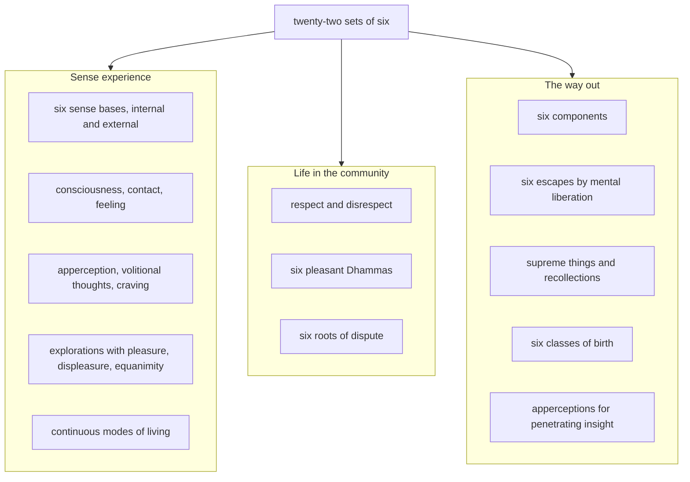

import { Tabs, TabItem } from '@astrojs/starlight/components';

Original text: [World Tipitaka Edition](https://tipitaka2500.github.io/tipitaka/8D/10/10.6.html)

## Summary

The sixth of the Saṅgītisutta's lists: āyasmā Sāriputta recites twenty-two sets of six Dhammas for the bhikkhū to chant together. They begin with the six sense bases and what arises through them, consciousness, contact, feeling, apperception, volitional thoughts and craving, and go on to the life of a community: respect and disrespect, the six pleasant Dhammas that make for unity, the six roots of dispute, the six escapes by mental liberation, and the apperceptions that lead to penetrating insight.

## Diagram

## Text

<Tabs syncKey="paliquote">
<TabItem label="My Translation">
(323.)

976\. Āvuso, there are six Dhammas well proclaimed by the Bhagavā, the liberated one, the perfectly awakened one, who knows and sees. Therein all should recite in harmony, not quarrel, so that this optimal life may endure long and last for a long time, which would be for the welfare and happiness of many people, out of compassion for the world, for the good, welfare, and happiness of gods and humans. What six?

977\. Six internal `āyatanāni` (sense bases): of the eye, of the ear, of the nose, of the tongue, of the body, and of the mind. (1)

978\. Six external sense bases: of forms, of sounds, of odours, of tastes, of tangibles, and of mind-objects. (2)

979\. Six classes of `viññāṇa` (consciousness): eye-consciousness, ear-consciousness, nose-consciousness, tongue-consciousness, body-consciousness, and mind-consciousness. (3)

980\. Six classes of `phassa` (contact): eye-contact, ear-contact, nose-contact, tongue-contact, body-contact, and mind-contact. (4)

981\. Six classes of `vedanā` (feeling): feeling arisen from eye-contact, feeling arisen from ear-contact, feeling arisen from nose-contact, feeling arisen from tongue-contact, feeling arisen from body-contact, and feeling arisen from mind-contact. (5)

982\. Six classes of `saññā` (apperception): apperception of forms, apperception of sounds, apperception of odours, apperception of tastes, apperception of tangibles, and apperception of mind-objects. (6)

983\. Six classes of `sañcetanā` (volitional thoughts): thoughts about forms, thoughts about sounds, thoughts about odours, thoughts about tastes, thoughts about tangibles, and thoughts about mind-objects. (7)

984\. Six classes of `taṇhā` (craving): craving for forms, craving for sounds, craving for odours, craving for tastes, craving for tangibles, and craving for mind-objects. (8)

(324.)

985\. Six kinds of disrespect. Here, Āvuso, a bhikkhu dwells without respect and reverence for the Teacher; dwells without respect and reverence for the Dhamma; dwells without respect and reverence for the Saṅgha; dwells without respect and reverence for the training; dwells without respect and reverence for diligence; dwells without respect and reverence for hospitality. (9)

986\. Six kinds of respect. Here, Āvuso, a bhikkhu dwells with respect and reverence for the Teacher; dwells with respect and reverence for the Dhamma; dwells with respect and reverence for the Saṅgha; dwells with respect and reverence for the training; dwells with respect and reverence for diligence; dwells with respect and reverence for hospitality. (10)

987\. Six explorations with mental pleasure. When one sees a form with the eye, one explores a form that serves as a basis for mental pleasure; when one hears a sound with the ear… when one smells an odour with the nose… when one tastes a taste with the tongue… when one touches a tangible with the body. When one cognises a mind-object with the mind, one explores a mind-object that serves as a basis for mental pleasure. (11)

988\. Six explorations with displeasure. When one sees a form with the eye, one explores a form that serves as a basis for displeasure … and so on … when one cognises a mind-object with the mind, one explores a mind-object that serves as a basis for displeasure. (12)

989\. Six explorations with equanimity. When one sees a form with the eye, one explores a form that serves as a basis for equanimity … and so on … when one cognises a mind-object with the mind, one explores a mind-object that serves as a basis for equanimity. (13)

990\. Six pleasant Dhammas. Here, Āvuso, a bhikkhu's bodily action of goodwill is present towards his companions in the optimal life, both openly and in private. This Dhamma too is pleasant, creating affection and creating respect, and leads to support, to non-dispute, to concord, and to unity. (14.1)

991\. And furthermore, Āvuso, a bhikkhu's verbal action of goodwill is present towards his companions in the optimal life, both openly and in private. This Dhamma too is pleasant … and so on … and leads to unity. (14.2)

992\. And furthermore, Āvuso, a bhikkhu's mental action of goodwill is present towards his companions in the optimal life, both openly and in private. This Dhamma too is pleasant … and so on … and leads to unity. (14.3)

993\. And furthermore, Āvuso, whatever gains a bhikkhu has that are legitimate and justly acquired, even so much as the mere contents of the bowl, he is one who shares such gains without reservation, one who enjoys them in common with his virtuous companions in the optimal life. This Dhamma too is pleasant … and so on … and leads to unity. (14.4)

994\. And furthermore, Āvuso, whatever virtues a bhikkhu has that are unbroken, flawless, unspotted, unblemished, liberating, praised by the wise, not grasped, and leading to focus, he dwells in such virtues with virtue in common with his companions in the optimal life, both openly and in private. This Dhamma too is pleasant … and so on … and leads to unity. (14.5)

995\. And furthermore, Āvuso, whatever view a bhikkhu has that is of the liberated and emancipating, which leads the one who acts accordingly to the complete destruction of suffering, he dwells in such a view with view in common with his companions in the optimal life, both openly and in private. This Dhamma too is pleasant, creating affection and creating respect, and leads to support, to non-dispute, to concord, and to unity. (14.6)

(325.)

996\. Six roots of dispute. Here, Āvuso, a bhikkhu is angry and resentful. That bhikkhu, Āvuso, who is angry and resentful dwells without respect and reverence even for the Teacher, dwells without respect and reverence even for the Dhamma, dwells without respect and reverence even for the Saṅgha, and does not even fulfil the training. That bhikkhu, Āvuso, who dwells without respect and reverence for the Teacher, dwells without respect and reverence for the Dhamma, dwells without respect and reverence for the Saṅgha, and does not fulfil the training, generates dispute in the Saṅgha. A dispute which is for the harm of many people, for the unhappiness of many people, for the harm, disadvantage, and suffering of gods and humans. If you, Āvuso, should see such a root of dispute inwardly or outwardly. In that case, Āvuso, you should strive for the giving up of that very bad root of dispute. If you, Āvuso, should not see such a root of dispute inwardly or outwardly. In that case, Āvuso, you should practise so that that very bad root of dispute has no outflow in the future. Thus there is the giving up of this bad root of dispute. Thus there is no outflow of this bad root of dispute in the future.

997\. And furthermore, Āvuso, a bhikkhu is slandering and contentious … and so on … is jealous and selfish … and so on … is devious and deceitful… has evil wishes and wrong view… clings to his own view, holds on tightly, and gives it up with difficulty … and so on … That bhikkhu, Āvuso, who clings to his own view, holds on tightly, and gives it up with difficulty dwells without respect and reverence even for the Teacher, dwells without respect and reverence even for the Dhamma, dwells without respect and reverence even for the Saṅgha, and does not even fulfil the training. That bhikkhu, Āvuso, who dwells without respect and reverence for the Teacher, dwells without respect and reverence for the Dhamma, dwells without respect and reverence for the Saṅgha, and does not fulfil the training, generates dispute in the Saṅgha. A dispute which is for the harm of many people, for the unhappiness of many people, for the harm, disadvantage, and suffering of gods and humans. If you, Āvuso, should see such a root of dispute inwardly or outwardly. In that case, Āvuso, you should strive for the giving up of that very bad root of dispute. If you, Āvuso, should not see such a root of dispute inwardly or outwardly. In that case, Āvuso, you should practise so that that very bad root of dispute has no outflow in the future. Thus there is the giving up of this bad root of dispute. Thus there is no outflow of this bad root of dispute in the future. (15)

998\. Six components: the earth component, the water component, the fire component, the wind component, the space component, and the consciousness component. (16)

(326.)

999\. Six components related to escape. Here, Āvuso, a bhikkhu might say: ‘The mental liberation of goodwill has indeed been cultivated by me, practised often, mastered, made a foundation, practised, consolidated, and resolutely undertaken, and yet ill will remains overpowering my mind.’ He should be told: ‘Not so!’ ‘Let the āyasmant not speak thus, let him not misrepresent the Bhagavā, for misrepresenting the Bhagavā is not good, and the Bhagavā would not speak thus. It is impossible, Āvuso, there is no chance, that when the mental liberation of goodwill has been cultivated, practised often, mastered, made a foundation, practised, consolidated, and resolutely undertaken. And yet ill will would remain overpowering his mind — this possibility does not exist. For this, Āvuso, is the escape from ill will, namely the mental liberation of goodwill.’ (17.1)

1000\. And here, Āvuso, a bhikkhu might say: ‘The mental liberation of compassion has indeed been cultivated by me, practised often, mastered, made a foundation, practised, consolidated, and resolutely undertaken. And yet cruelty remains overpowering my mind.’ He should be told: ‘Not so!’ ‘Let the āyasmant not speak thus, let him not misrepresent the Bhagavā, for misrepresenting the Bhagavā is not good, and the Bhagavā would not speak thus. It is impossible, Āvuso, there is no chance, that when the mental liberation of compassion has been cultivated, practised often, mastered, made a foundation, practised, consolidated, and resolutely undertaken, cruelty would yet remain overpowering his mind — this possibility does not exist. For this, Āvuso, is the escape from cruelty, namely the mental liberation of compassion.’ (17.2)

1001\. And here, Āvuso, a bhikkhu might say: ‘The mental liberation of happiness for others has indeed been cultivated by me, practised often, mastered, made a foundation, practised, consolidated, and resolutely undertaken. And yet dissatisfaction remains overpowering my mind.’ He should be told: ‘Not so!’ ‘Let the āyasmant not speak thus, let him not misrepresent the Bhagavā, for misrepresenting the Bhagavā is not good, and the Bhagavā would not speak thus. It is impossible, Āvuso, there is no chance, that when the mental liberation of happiness for others has been cultivated, practised often, mastered, made a foundation, practised, consolidated, and resolutely undertaken, dissatisfaction would yet remain overpowering his mind — this possibility does not exist. For this, Āvuso, is the escape from dissatisfaction, namely the mental liberation of happiness for others.’ (17.3)

1002\. And here, Āvuso, a bhikkhu might say: ‘The mental liberation of equanimity has indeed been cultivated by me, practised often, mastered, made a foundation, practised, consolidated, and resolutely undertaken. And yet passion remains overpowering my mind.’ He should be told: ‘Not so!’ ‘Let the āyasmant not speak thus, let him not misrepresent the Bhagavā, for misrepresenting the Bhagavā is not good, and the Bhagavā would not speak thus. It is impossible, Āvuso, there is no chance, that when the mental liberation of equanimity has been cultivated, practised often, mastered, made a foundation, practised, consolidated, and resolutely undertaken, passion would yet remain overpowering his mind — this possibility does not exist. For this, Āvuso, is the escape from passion, namely the mental liberation of equanimity.’ (17.4)

1003\. And here, Āvuso, a bhikkhu might say: ‘The signless mental liberation has indeed been cultivated by me, practised often, mastered, made a foundation, practised, consolidated, and resolutely undertaken. And yet my consciousness follows signs.’ He should be told: ‘Not so!’ ‘Let the āyasmant not speak thus, let him not misrepresent the Bhagavā, for misrepresenting the Bhagavā is not good, and the Bhagavā would not speak thus. It is impossible, Āvuso, there is no chance, that when the signless mental liberation has been cultivated, practised often, mastered, made a foundation, practised, consolidated, and resolutely undertaken, his consciousness would yet follow signs — this possibility does not exist. For this, Āvuso, is the escape from all signs, namely the signless mental liberation.’ (17.5)

1004\. And here, Āvuso, a bhikkhu might say: ‘“I am” has indeed gone from me, I do not see “I am this”, and yet the arrow of doubt and perplexity remains overpowering my mind.’ He should be told: ‘Not so!’ ‘Let the āyasmant not speak thus, let him not misrepresent the Bhagavā, for misrepresenting the Bhagavā is not good, and the Bhagavā would not speak thus. It is impossible, Āvuso, there is no chance, that when “I am” is gone and one does not see “I am this”, the arrow of doubt and perplexity would yet remain overpowering his mind — this possibility does not exist. For this, Āvuso, is the escape from the arrow of doubt and perplexity, namely the eradication of the conceit “I am”.’ (17.6)

(327.)

1005\. Six supreme things: supreme vision, supreme hearing, supreme gain, supreme training, supreme service, and supreme recollection. (18)

1006\. Six subjects for recollection: recollection of the Buddha, recollection of the Dhamma, recollection of the Saṅgha, recollection of virtue, recollection of generosity, and recollection of the deities. (19)

(328.)

1007\. Six continuous modes of living. Here, Āvuso, when a bhikkhu sees a form with the eye, he is neither glad nor dejected; he remains equanimous, aware, and clearly comprehending. When he hears a sound with the ear … and so on … when he cognises a mind-object with the mind, he is neither glad nor dejected; he remains equanimous, aware, and clearly comprehending. (20)

(329.)

1008\. Six classes of birth. Here, Āvuso, someone, being of dark birth, produces a dark characteristic. And here, Āvuso, someone, being of dark birth, produces a bright characteristic. And here, Āvuso, someone, being of dark birth, produces `nibbāna` (extinguishment), which is neither dark nor bright. And here, Āvuso, someone, being of bright birth, produces a bright characteristic. And here, Āvuso, someone, being of bright birth, produces a dark characteristic. And here, Āvuso, someone, being of bright birth, produces nibbāna, which is neither dark nor bright. (21)

1009\. Six apperceptions conducive to penetrating insight: the apperception of impermanence in the impermanent, the apperception of suffering in suffering, the apperception of not-self, the apperception of giving up, the apperception of dispassion, and the apperception of cessation. (22)

1010\. Āvuso, these are the six Dhammas well proclaimed by the Bhagavā, the liberated one, the perfectly awakened one, who knows and sees. Therein all should recite in harmony, not quarrel, so that this optimal life may endure long and last for a long time, which would be for the welfare and happiness of many people, out of compassion for the world, for the good, welfare, and happiness of gods and humans.
</TabItem>

<TabItem label="Pāḷi (Roman IAST)">
(323.)

976\. Atthi kho, āvuso, tena bhagavatā jānatā passatā arahatā sammāsambuddhena cha dhammā sammadakkhātā; tattha sabbeheva saṅgāyitabbaṃ…pe… atthāya hitāya sukhāya devamanussānaṃ. Katame cha?

977\. Cha ajjhattikāni āyatanāni— cakkhāyatanaṃ, sotāyatanaṃ, ghānāyatanaṃ, jivhāyatanaṃ, kāyāyatanaṃ, manāyatanaṃ. (1)

978\. Cha bāhirāni āyatanāni— rūpāyatanaṃ, saddāyatanaṃ, gandhāyatanaṃ, rasāyatanaṃ, phoṭṭhabbāyatanaṃ, dhammāyatanaṃ. (2)

979\. Cha viññāṇakāyā— cakkhuviññāṇaṃ, sotaviññāṇaṃ, ghānaviññāṇaṃ, jivhāviññāṇaṃ, kāyaviññāṇaṃ, manoviññāṇaṃ. (3)

980\. Cha phassakāyā— cakkhusamphasso, sotasamphasso, ghānasamphasso, jivhāsamphasso, kāyasamphasso, manosamphasso. (4)

981\. Cha vedanākāyā— cakkhusamphassajā vedanā, sotasamphassajā vedanā, ghānasamphassajā vedanā, jivhāsamphassajā vedanā, kāyasamphassajā vedanā, manosamphassajā vedanā. (5)

982\. Cha saññākāyā— rūpasaññā, saddasaññā, gandhasaññā, rasasaññā, phoṭṭhabbasaññā, dhammasaññā. (6)

983\. Cha sañcetanākāyā— rūpasañcetanā, saddasañcetanā, gandhasañcetanā, rasasañcetanā, phoṭṭhabbasañcetanā, dhammasañcetanā. (7)

984\. Cha taṇhākāyā— rūpataṇhā, saddataṇhā, gandhataṇhā, rasataṇhā, phoṭṭhabbataṇhā, dhammataṇhā. (8)

(324.)

985\. Cha agāravā. Idhāvuso, bhikkhu satthari agāravo viharati appatisso; dhamme agāravo viharati appatisso; saṃghe agāravo viharati appatisso; sikkhāya agāravo viharati appatisso; appamāde agāravo viharati appatisso; paṭisanthāre agāravo viharati appatisso. (9)

986\. Cha gāravā. Idhāvuso, bhikkhu satthari sagāravo viharati sappatisso; dhamme sagāravo viharati sappatisso; saṃghe sagāravo viharati sappatisso; sikkhāya sagāravo viharati sappatisso; appamāde sagāravo viharati sappatisso; paṭisanthāre sagāravo viharati sappatisso. (10)

987\. Cha somanassūpavicārā. Cakkhunā rūpaṃ disvā somanassaṭṭhāniyaṃ rūpaṃ upavicarati; sotena saddaṃ sutvā… ghānena gandhaṃ ghāyitvā… jivhāya rasaṃ sāyitvā… kāyena phoṭṭhabbaṃ phusitvā. Manasā dhammaṃ viññāya somanassaṭṭhāniyaṃ dhammaṃ upavicarati. (11)

988\. Cha domanassūpavicārā. Cakkhunā rūpaṃ disvā domanassaṭṭhāniyaṃ rūpaṃ upavicarati…pe… manasā dhammaṃ viññāya domanassaṭṭhāniyaṃ dhammaṃ upavicarati. (12)

989\. Cha upekkhūpavicārā. Cakkhunā rūpaṃ disvā upekkhāṭṭhāniyaṃ rūpaṃ upavicarati…pe… manasā dhammaṃ viññāya upekkhāṭṭhāniyaṃ dhammaṃ upavicarati. (13)

990\. Cha sāraṇīyā dhammā. Idhāvuso, bhikkhuno mettaṃ kāyakammaṃ paccupaṭṭhitaṃ hoti sabrahmacārīsu āvi ceva raho ca. Ayampi dhammo sāraṇīyo piyakaraṇo garukaraṇo saṅgahāya avivādāya sāmaggiyā ekībhāvāya saṃvattati. (14.1)

991\. Puna caparaṃ, āvuso, bhikkhuno mettaṃ vacīkammaṃ paccupaṭṭhitaṃ hoti sabrahmacārīsu āvi ceva raho ca. Ayampi dhammo sāraṇīyo…pe… ekībhāvāya saṃvattati. (14.2)

992\. Puna caparaṃ, āvuso, bhikkhuno mettaṃ manokammaṃ paccupaṭṭhitaṃ hoti sabrahmacārīsu āvi ceva raho ca. Ayampi dhammo sāraṇīyo…pe… ekībhāvāya saṃvattati. (14.3)

993\. Puna caparaṃ, āvuso, bhikkhu ye te lābhā dhammikā dhammaladdhā antamaso pattapariyāpannamattampi, tathārūpehi lābhehi appaṭivibhattabhogī hoti sīlavantehi sabrahmacārīhi sādhāraṇabhogī. Ayampi dhammo sāraṇīyo…pe… ekībhāvāya saṃvattati. (14.4)

994\. Puna caparaṃ, āvuso, bhikkhu yāni tāni sīlāni akhaṇḍāni acchiddāni asabalāni akammāsāni bhujissāni viññuppasatthāni aparāmaṭṭhāni samādhisaṃvattanikāni, tathārūpesu sīlesu sīlasāmaññagato viharati sabrahmacārīhi āvi ceva raho ca. Ayampi dhammo sāraṇīyo…pe… ekībhāvāya saṃvattati. (14.5)

995\. Puna caparaṃ, āvuso, bhikkhu yāyaṃ diṭṭhi ariyā niyyānikā niyyāti takkarassa sammā dukkhakkhayāya, tathārūpāya diṭṭhiyā diṭṭhisāmaññagato viharati sabrahmacārīhi āvi ceva raho ca. Ayampi dhammo sāraṇīyo piyakaraṇo garukaraṇo saṅgahāya avivādāya sāmaggiyā ekībhāvāya saṃvattati. (14.6)

(325.)

996\. Cha vivādamūlāni. Idhāvuso, bhikkhu kodhano hoti upanāhī. Yo so, āvuso, bhikkhu kodhano hoti upanāhī, so sattharipi agāravo viharati appatisso, dhammepi agāravo viharati appatisso, saṃghepi agāravo viharati appatisso, sikkhāyapi na paripūrakārī hoti. Yo so, āvuso, bhikkhu satthari agāravo viharati appatisso, dhamme agāravo viharati appatisso, saṃghe agāravo viharati appatisso, sikkhāya na paripūrakārī, so saṃghe vivādaṃ janeti. Yo hoti vivādo bahujanāhitāya bahujanāsukhāya anatthāya ahitāya dukkhāya devamanussānaṃ. Evarūpañce tumhe, āvuso, vivādamūlaṃ ajjhattaṃ vā bahiddhā vā samanupasseyyātha. Tatra tumhe, āvuso, tasseva pāpakassa vivādamūlassa pahānāya vāyameyyātha. Evarūpañce tumhe, āvuso, vivādamūlaṃ ajjhattaṃ vā bahiddhā vā na samanupasseyyātha. Tatra tumhe, āvuso, tasseva pāpakassa vivādamūlassa āyatiṃ anavassavāya paṭipajjeyyātha. Evametassa pāpakassa vivādamūlassa pahānaṃ hoti. Evametassa pāpakassa vivādamūlassa āyatiṃ anavassavo hoti.

997\. Puna caparaṃ, āvuso, bhikkhu makkhī hoti paḷāsī…pe… issukī hoti maccharī…pe… saṭho hoti māyāvī… pāpiccho hoti micchādiṭṭhī… sandiṭṭhiparāmāsī hoti ādhānaggāhī duppaṭinissaggī…pe… yo so, āvuso, bhikkhu sandiṭṭhiparāmāsī hoti ādhānaggāhī duppaṭinissaggī, so sattharipi agāravo viharati appatisso, dhammepi agāravo viharati appatisso, saṃghepi agāravo viharati appatisso, sikkhāyapi na paripūrakārī hoti. Yo so, āvuso, bhikkhu satthari agāravo viharati appatisso, dhamme agāravo viharati appatisso, saṃghe agāravo viharati appatisso, sikkhāya na paripūrakārī, so saṃghe vivādaṃ janeti. Yo hoti vivādo bahujanāhitāya bahujanāsukhāya anatthāya ahitāya dukkhāya devamanussānaṃ. Evarūpañce tumhe, āvuso, vivādamūlaṃ ajjhattaṃ vā bahiddhā vā samanupasseyyātha. Tatra tumhe, āvuso, tasseva pāpakassa vivādamūlassa pahānāya vāyameyyātha. Evarūpañce tumhe, āvuso, vivādamūlaṃ ajjhattaṃ vā bahiddhā vā na samanupasseyyātha. Tatra tumhe, āvuso, tasseva pāpakassa vivādamūlassa āyatiṃ anavassavāya paṭipajjeyyātha. Evametassa pāpakassa vivādamūlassa pahānaṃ hoti. Evametassa pāpakassa vivādamūlassa āyatiṃ anavassavo hoti. (15)

998\. Cha dhātuyo — pathavīdhātu, āpodhātu, tejodhātu, vāyodhātu, ākāsadhātu, viññāṇadhātu. (16)

(326.)

999\. Cha nissaraṇiyā dhātuyo. Idhāvuso, bhikkhu evaṃ vadeyya— ‘mettā hi kho me cetovimutti bhāvitā bahulīkatā yānīkatā vatthukatā anuṭṭhitā paricitā susamāraddhā, atha ca pana me byāpādo cittaṃ pariyādāya tiṭṭhatī’ti. So ‘mā hevan’tissa vacanīyo, ‘māyasmā evaṃ avaca, mā bhagavantaṃ abbhācikkhi, na hi sādhu bhagavato abbhakkhānaṃ, na hi bhagavā evaṃ vadeyya. Aṭṭhānametaṃ, āvuso, anavakāso, yaṃ mettāya cetovimuttiyā bhāvitāya bahulīkatāya yānīkatāya vatthukatāya anuṭṭhitāya paricitāya susamāraddhāya. Atha ca panassa byāpādo cittaṃ pariyādāya ṭhassati, netaṃ ṭhānaṃ vijjati. Nissaraṇaṃ hetaṃ, āvuso, byāpādassa, yadidaṃ mettā cetovimuttī’ti. (17.1)

1000\. Idha panāvuso, bhikkhu evaṃ vadeyya— ‘karuṇā hi kho me cetovimutti bhāvitā bahulīkatā yānīkatā vatthukatā anuṭṭhitā paricitā susamāraddhā. Atha ca pana me vihesā cittaṃ pariyādāya tiṭṭhatī’ti, so ‘mā hevan’tissa vacanīyo ‘māyasmā evaṃ avaca, mā bhagavantaṃ abbhācikkhi, na hi sādhu bhagavato abbhakkhānaṃ, na hi bhagavā evaṃ vadeyya. Aṭṭhānametaṃ, āvuso, anavakāso, yaṃ karuṇāya cetovimuttiyā bhāvitāya bahulīkatāya yānīkatāya vatthukatāya anuṭṭhitāya paricitāya susamāraddhāya, atha ca panassa vihesā cittaṃ pariyādāya ṭhassati, netaṃ ṭhānaṃ vijjati. Nissaraṇaṃ hetaṃ, āvuso, vihesāya, yadidaṃ karuṇā cetovimuttī’ti. (17.2)

1001\. Idha panāvuso, bhikkhu evaṃ vadeyya— ‘muditā hi kho me cetovimutti bhāvitā bahulīkatā yānīkatā vatthukatā anuṭṭhitā paricitā susamāraddhā. Atha ca pana me arati cittaṃ pariyādāya tiṭṭhatī’ti, so ‘mā hevan’tissa vacanīyo ‘māyasmā evaṃ avaca, mā bhagavantaṃ abbhācikkhi, na hi sādhu bhagavato abbhakkhānaṃ, na hi bhagavā evaṃ vadeyya. Aṭṭhānametaṃ, āvuso, anavakāso, yaṃ muditāya cetovimuttiyā bhāvitāya bahulīkatāya yānīkatāya vatthukatāya anuṭṭhitāya paricitāya susamāraddhāya, atha ca panassa arati cittaṃ pariyādāya ṭhassati, netaṃ ṭhānaṃ vijjati. Nissaraṇaṃ hetaṃ, āvuso, aratiyā, yadidaṃ muditā cetovimuttī’ti. (17.3)

1002\. Idha panāvuso, bhikkhu evaṃ vadeyya— ‘upekkhā hi kho me cetovimutti bhāvitā bahulīkatā yānīkatā vatthukatā anuṭṭhitā paricitā susamāraddhā. Atha ca pana me rāgo cittaṃ pariyādāya tiṭṭhatī’ti. So ‘mā hevan’tissa vacanīyo ‘māyasmā evaṃ avaca, mā bhagavantaṃ abbhācikkhi, na hi sādhu bhagavato abbhakkhānaṃ, na hi bhagavā evaṃ vadeyya. Aṭṭhānametaṃ, āvuso, anavakāso, yaṃ upekkhāya cetovimuttiyā bhāvitāya bahulīkatāya yānīkatāya vatthukatāya anuṭṭhitāya paricitāya susamāraddhāya, atha ca panassa rāgo cittaṃ pariyādāya ṭhassati netaṃ ṭhānaṃ vijjati. Nissaraṇaṃ hetaṃ, āvuso, rāgassa, yadidaṃ upekkhā cetovimuttī’ti. (17.4)

1003\. Idha panāvuso, bhikkhu evaṃ vadeyya— ‘animittā hi kho me cetovimutti bhāvitā bahulīkatā yānīkatā vatthukatā anuṭṭhitā paricitā susamāraddhā. Atha ca pana me nimittānusāri viññāṇaṃ hotī’ti. So ‘mā hevan’tissa vacanīyo ‘māyasmā evaṃ avaca, mā bhagavantaṃ abbhācikkhi, na hi sādhu bhagavato abbhakkhānaṃ, na hi bhagavā evaṃ vadeyya. Aṭṭhānametaṃ, āvuso, anavakāso, yaṃ animittāya cetovimuttiyā bhāvitāya bahulīkatāya yānīkatāya vatthukatāya anuṭṭhitāya paricitāya susamāraddhāya, atha ca panassa nimittānusāri viññāṇaṃ bhavissati, netaṃ ṭhānaṃ vijjati. Nissaraṇaṃ hetaṃ, āvuso, sabbanimittānaṃ, yadidaṃ animittā cetovimuttī’ti. (17.5)

1004\. Idha panāvuso, bhikkhu evaṃ vadeyya— ‘asmīti kho me vigataṃ, ayamahamasmīti na samanupassāmi, atha ca pana me vicikicchākathaṃkathāsallaṃ cittaṃ pariyādāya tiṭṭhatī’ti. So ‘mā hevan’tissa vacanīyo ‘māyasmā evaṃ avaca, mā bhagavantaṃ abbhācikkhi, na hi sādhu bhagavato abbhakkhānaṃ, na hi bhagavā evaṃ vadeyya. Aṭṭhānametaṃ, āvuso, anavakāso, yaṃ asmīti vigate ayamahamasmīti asamanupassato, atha ca panassa vicikicchākathaṃkathāsallaṃ cittaṃ pariyādāya ṭhassati, netaṃ ṭhānaṃ vijjati. Nissaraṇaṃ hetaṃ, āvuso, vicikicchākathaṃkathāsallassa, yadidaṃ asmimānasamugghāto’ti. (17.6)

(327.)

1005\. Cha anuttariyāni— dassanānuttariyaṃ, savanānuttariyaṃ, lābhānuttariyaṃ, sikkhānuttariyaṃ, pāricariyānuttariyaṃ, anussatānuttariyaṃ. (18)

1006\. Cha anussatiṭṭhānāni — buddhānussati, dhammānussati, saṃghānussati, sīlānussati, cāgānussati, devatānussati. (19)

(328.)

1007\. Cha satatavihārā. Idhāvuso, bhikkhu cakkhunā rūpaṃ disvā neva sumano hoti na dummano, upekkhako viharati sato sampajāno. Sotena saddaṃ sutvā…pe… manasā dhammaṃ viññāya neva sumano hoti na dummano, upekkhako viharati sato sampajāno. (20)

(329.)

1008\. Chaḷābhijātiyo. Idhāvuso, ekacco kaṇhābhijātiko samāno kaṇhaṃ dhammaṃ abhijāyati. Idha panāvuso, ekacco kaṇhābhijātiko samāno sukkaṃ dhammaṃ abhijāyati. Idha panāvuso, ekacco kaṇhābhijātiko samāno akaṇhaṃ asukkaṃ nibbānaṃ abhijāyati. Idha panāvuso, ekacco sukkābhijātiko samāno sukkaṃ dhammaṃ abhijāyati. Idha panāvuso, ekacco sukkābhijātiko samāno kaṇhaṃ dhammaṃ abhijāyati. Idha panāvuso, ekacco sukkābhijātiko samāno akaṇhaṃ asukkaṃ nibbānaṃ abhijāyati. (21)

1009\. Cha nibbedhabhāgiyā saññā— aniccasaññā anicce, dukkhasaññā dukkhe, anattasaññā, pahānasaññā, virāgasaññā, nirodhasaññā. (22)

1010\. Ime kho, āvuso, tena bhagavatā jānatā passatā arahatā sammāsambuddhena cha dhammā sammadakkhātā; tattha sabbeheva saṅgāyitabbaṃ…pe… atthāya hitāya sukhāya devamanussānaṃ.
</TabItem>

<TabItem label="Pāḷi (Brahmi)">
(323.)

976\. 𑀅𑀢𑁆𑀣𑀺 𑀔𑁄, 𑀆𑀯𑀼𑀲𑁄, 𑀢𑁂𑀦 𑀪𑀕𑀯𑀢𑀸 𑀚𑀸𑀦𑀢𑀸 𑀧𑀲𑁆𑀲𑀢𑀸 𑀅𑀭𑀳𑀢𑀸 𑀲𑀫𑁆𑀫𑀸𑀲𑀫𑁆𑀩𑀼𑀤𑁆𑀥𑁂𑀦 𑀙 𑀥𑀫𑁆𑀫𑀸 𑀲𑀫𑁆𑀫𑀤𑀓𑁆𑀔𑀸𑀢𑀸; 𑀢𑀢𑁆𑀣 𑀲𑀩𑁆𑀩𑁂𑀳𑁂𑀯 𑀲𑀗𑁆𑀕𑀸𑀬𑀺𑀢𑀩𑁆𑀩𑀁…𑀧𑁂… 𑀅𑀢𑁆𑀣𑀸𑀬 𑀳𑀺𑀢𑀸𑀬 𑀲𑀼𑀔𑀸𑀬 𑀤𑁂𑀯𑀫𑀦𑀼𑀲𑁆𑀲𑀸𑀦𑀁. 𑀓𑀢𑀫𑁂 𑀙?

977\. 𑀙 𑀅𑀚𑁆𑀛𑀢𑁆𑀢𑀺𑀓𑀸𑀦𑀺 𑀆𑀬𑀢𑀦𑀸𑀦𑀺— 𑀘𑀓𑁆𑀔𑀸𑀬𑀢𑀦𑀁, 𑀲𑁄𑀢𑀸𑀬𑀢𑀦𑀁, 𑀖𑀸𑀦𑀸𑀬𑀢𑀦𑀁, 𑀚𑀺𑀯𑁆𑀳𑀸𑀬𑀢𑀦𑀁, 𑀓𑀸𑀬𑀸𑀬𑀢𑀦𑀁, 𑀫𑀦𑀸𑀬𑀢𑀦𑀁. (1)

978\. 𑀙 𑀩𑀸𑀳𑀺𑀭𑀸𑀦𑀺 𑀆𑀬𑀢𑀦𑀸𑀦𑀺— 𑀭𑀽𑀧𑀸𑀬𑀢𑀦𑀁, 𑀲𑀤𑁆𑀤𑀸𑀬𑀢𑀦𑀁, 𑀕𑀦𑁆𑀥𑀸𑀬𑀢𑀦𑀁, 𑀭𑀲𑀸𑀬𑀢𑀦𑀁, 𑀨𑁄𑀝𑁆𑀞𑀩𑁆𑀩𑀸𑀬𑀢𑀦𑀁, 𑀥𑀫𑁆𑀫𑀸𑀬𑀢𑀦𑀁. (2)

979\. 𑀙 𑀯𑀺𑀜𑁆𑀜𑀸𑀡𑀓𑀸𑀬𑀸— 𑀘𑀓𑁆𑀔𑀼𑀯𑀺𑀜𑁆𑀜𑀸𑀡𑀁, 𑀲𑁄𑀢𑀯𑀺𑀜𑁆𑀜𑀸𑀡𑀁, 𑀖𑀸𑀦𑀯𑀺𑀜𑁆𑀜𑀸𑀡𑀁, 𑀚𑀺𑀯𑁆𑀳𑀸𑀯𑀺𑀜𑁆𑀜𑀸𑀡𑀁, 𑀓𑀸𑀬𑀯𑀺𑀜𑁆𑀜𑀸𑀡𑀁, 𑀫𑀦𑁄𑀯𑀺𑀜𑁆𑀜𑀸𑀡𑀁. (3)

980\. 𑀙 𑀨𑀲𑁆𑀲𑀓𑀸𑀬𑀸— 𑀘𑀓𑁆𑀔𑀼𑀲𑀫𑁆𑀨𑀲𑁆𑀲𑁄, 𑀲𑁄𑀢𑀲𑀫𑁆𑀨𑀲𑁆𑀲𑁄, 𑀖𑀸𑀦𑀲𑀫𑁆𑀨𑀲𑁆𑀲𑁄, 𑀚𑀺𑀯𑁆𑀳𑀸𑀲𑀫𑁆𑀨𑀲𑁆𑀲𑁄, 𑀓𑀸𑀬𑀲𑀫𑁆𑀨𑀲𑁆𑀲𑁄, 𑀫𑀦𑁄𑀲𑀫𑁆𑀨𑀲𑁆𑀲𑁄. (4)

981\. 𑀙 𑀯𑁂𑀤𑀦𑀸𑀓𑀸𑀬𑀸— 𑀘𑀓𑁆𑀔𑀼𑀲𑀫𑁆𑀨𑀲𑁆𑀲𑀚𑀸 𑀯𑁂𑀤𑀦𑀸, 𑀲𑁄𑀢𑀲𑀫𑁆𑀨𑀲𑁆𑀲𑀚𑀸 𑀯𑁂𑀤𑀦𑀸, 𑀖𑀸𑀦𑀲𑀫𑁆𑀨𑀲𑁆𑀲𑀚𑀸 𑀯𑁂𑀤𑀦𑀸, 𑀚𑀺𑀯𑁆𑀳𑀸𑀲𑀫𑁆𑀨𑀲𑁆𑀲𑀚𑀸 𑀯𑁂𑀤𑀦𑀸, 𑀓𑀸𑀬𑀲𑀫𑁆𑀨𑀲𑁆𑀲𑀚𑀸 𑀯𑁂𑀤𑀦𑀸, 𑀫𑀦𑁄𑀲𑀫𑁆𑀨𑀲𑁆𑀲𑀚𑀸 𑀯𑁂𑀤𑀦𑀸. (5)

982\. 𑀙 𑀲𑀜𑁆𑀜𑀸𑀓𑀸𑀬𑀸— 𑀭𑀽𑀧𑀲𑀜𑁆𑀜𑀸, 𑀲𑀤𑁆𑀤𑀲𑀜𑁆𑀜𑀸, 𑀕𑀦𑁆𑀥𑀲𑀜𑁆𑀜𑀸, 𑀭𑀲𑀲𑀜𑁆𑀜𑀸, 𑀨𑁄𑀝𑁆𑀞𑀩𑁆𑀩𑀲𑀜𑁆𑀜𑀸, 𑀥𑀫𑁆𑀫𑀲𑀜𑁆𑀜𑀸. (6)

983\. 𑀙 𑀲𑀜𑁆𑀘𑁂𑀢𑀦𑀸𑀓𑀸𑀬𑀸— 𑀭𑀽𑀧𑀲𑀜𑁆𑀘𑁂𑀢𑀦𑀸, 𑀲𑀤𑁆𑀤𑀲𑀜𑁆𑀘𑁂𑀢𑀦𑀸, 𑀕𑀦𑁆𑀥𑀲𑀜𑁆𑀘𑁂𑀢𑀦𑀸, 𑀭𑀲𑀲𑀜𑁆𑀘𑁂𑀢𑀦𑀸, 𑀨𑁄𑀝𑁆𑀞𑀩𑁆𑀩𑀲𑀜𑁆𑀘𑁂𑀢𑀦𑀸, 𑀥𑀫𑁆𑀫𑀲𑀜𑁆𑀘𑁂𑀢𑀦𑀸. (7)

984\. 𑀙 𑀢𑀡𑁆𑀳𑀸𑀓𑀸𑀬𑀸— 𑀭𑀽𑀧𑀢𑀡𑁆𑀳𑀸, 𑀲𑀤𑁆𑀤𑀢𑀡𑁆𑀳𑀸, 𑀕𑀦𑁆𑀥𑀢𑀡𑁆𑀳𑀸, 𑀭𑀲𑀢𑀡𑁆𑀳𑀸, 𑀨𑁄𑀝𑁆𑀞𑀩𑁆𑀩𑀢𑀡𑁆𑀳𑀸, 𑀥𑀫𑁆𑀫𑀢𑀡𑁆𑀳𑀸. (8)

(324.)

985\. 𑀙 𑀅𑀕𑀸𑀭𑀯𑀸. 𑀇𑀥𑀸𑀯𑀼𑀲𑁄, 𑀪𑀺𑀓𑁆𑀔𑀼 𑀲𑀢𑁆𑀣𑀭𑀺 𑀅𑀕𑀸𑀭𑀯𑁄 𑀯𑀺𑀳𑀭𑀢𑀺 𑀅𑀧𑁆𑀧𑀢𑀺𑀲𑁆𑀲𑁄; 𑀥𑀫𑁆𑀫𑁂 𑀅𑀕𑀸𑀭𑀯𑁄 𑀯𑀺𑀳𑀭𑀢𑀺 𑀅𑀧𑁆𑀧𑀢𑀺𑀲𑁆𑀲𑁄; 𑀲𑀁𑀖𑁂 𑀅𑀕𑀸𑀭𑀯𑁄 𑀯𑀺𑀳𑀭𑀢𑀺 𑀅𑀧𑁆𑀧𑀢𑀺𑀲𑁆𑀲𑁄; 𑀲𑀺𑀓𑁆𑀔𑀸𑀬 𑀅𑀕𑀸𑀭𑀯𑁄 𑀯𑀺𑀳𑀭𑀢𑀺 𑀅𑀧𑁆𑀧𑀢𑀺𑀲𑁆𑀲𑁄; 𑀅𑀧𑁆𑀧𑀫𑀸𑀤𑁂 𑀅𑀕𑀸𑀭𑀯𑁄 𑀯𑀺𑀳𑀭𑀢𑀺 𑀅𑀧𑁆𑀧𑀢𑀺𑀲𑁆𑀲𑁄; 𑀧𑀝𑀺𑀲𑀦𑁆𑀣𑀸𑀭𑁂 𑀅𑀕𑀸𑀭𑀯𑁄 𑀯𑀺𑀳𑀭𑀢𑀺 𑀅𑀧𑁆𑀧𑀢𑀺𑀲𑁆𑀲𑁄. (9)

986\. 𑀙 𑀕𑀸𑀭𑀯𑀸. 𑀇𑀥𑀸𑀯𑀼𑀲𑁄, 𑀪𑀺𑀓𑁆𑀔𑀼 𑀲𑀢𑁆𑀣𑀭𑀺 𑀲𑀕𑀸𑀭𑀯𑁄 𑀯𑀺𑀳𑀭𑀢𑀺 𑀲𑀧𑁆𑀧𑀢𑀺𑀲𑁆𑀲𑁄; 𑀥𑀫𑁆𑀫𑁂 𑀲𑀕𑀸𑀭𑀯𑁄 𑀯𑀺𑀳𑀭𑀢𑀺 𑀲𑀧𑁆𑀧𑀢𑀺𑀲𑁆𑀲𑁄; 𑀲𑀁𑀖𑁂 𑀲𑀕𑀸𑀭𑀯𑁄 𑀯𑀺𑀳𑀭𑀢𑀺 𑀲𑀧𑁆𑀧𑀢𑀺𑀲𑁆𑀲𑁄; 𑀲𑀺𑀓𑁆𑀔𑀸𑀬 𑀲𑀕𑀸𑀭𑀯𑁄 𑀯𑀺𑀳𑀭𑀢𑀺 𑀲𑀧𑁆𑀧𑀢𑀺𑀲𑁆𑀲𑁄; 𑀅𑀧𑁆𑀧𑀫𑀸𑀤𑁂 𑀲𑀕𑀸𑀭𑀯𑁄 𑀯𑀺𑀳𑀭𑀢𑀺 𑀲𑀧𑁆𑀧𑀢𑀺𑀲𑁆𑀲𑁄; 𑀧𑀝𑀺𑀲𑀦𑁆𑀣𑀸𑀭𑁂 𑀲𑀕𑀸𑀭𑀯𑁄 𑀯𑀺𑀳𑀭𑀢𑀺 𑀲𑀧𑁆𑀧𑀢𑀺𑀲𑁆𑀲𑁄. (10)

987\. 𑀙 𑀲𑁄𑀫𑀦𑀲𑁆𑀲𑀽𑀧𑀯𑀺𑀘𑀸𑀭𑀸. 𑀘𑀓𑁆𑀔𑀼𑀦𑀸 𑀭𑀽𑀧𑀁 𑀤𑀺𑀲𑁆𑀯𑀸 𑀲𑁄𑀫𑀦𑀲𑁆𑀲𑀝𑁆𑀞𑀸𑀦𑀺𑀬𑀁 𑀭𑀽𑀧𑀁 𑀉𑀧𑀯𑀺𑀘𑀭𑀢𑀺; 𑀲𑁄𑀢𑁂𑀦 𑀲𑀤𑁆𑀤𑀁 𑀲𑀼𑀢𑁆𑀯𑀸… 𑀖𑀸𑀦𑁂𑀦 𑀕𑀦𑁆𑀥𑀁 𑀖𑀸𑀬𑀺𑀢𑁆𑀯𑀸… 𑀚𑀺𑀯𑁆𑀳𑀸𑀬 𑀭𑀲𑀁 𑀲𑀸𑀬𑀺𑀢𑁆𑀯𑀸… 𑀓𑀸𑀬𑁂𑀦 𑀨𑁄𑀝𑁆𑀞𑀩𑁆𑀩𑀁 𑀨𑀼𑀲𑀺𑀢𑁆𑀯𑀸. 𑀫𑀦𑀲𑀸 𑀥𑀫𑁆𑀫𑀁 𑀯𑀺𑀜𑁆𑀜𑀸𑀬 𑀲𑁄𑀫𑀦𑀲𑁆𑀲𑀝𑁆𑀞𑀸𑀦𑀺𑀬𑀁 𑀥𑀫𑁆𑀫𑀁 𑀉𑀧𑀯𑀺𑀘𑀭𑀢𑀺. (11)

988\. 𑀙 𑀤𑁄𑀫𑀦𑀲𑁆𑀲𑀽𑀧𑀯𑀺𑀘𑀸𑀭𑀸. 𑀘𑀓𑁆𑀔𑀼𑀦𑀸 𑀭𑀽𑀧𑀁 𑀤𑀺𑀲𑁆𑀯𑀸 𑀤𑁄𑀫𑀦𑀲𑁆𑀲𑀝𑁆𑀞𑀸𑀦𑀺𑀬𑀁 𑀭𑀽𑀧𑀁 𑀉𑀧𑀯𑀺𑀘𑀭𑀢𑀺…𑀧𑁂… 𑀫𑀦𑀲𑀸 𑀥𑀫𑁆𑀫𑀁 𑀯𑀺𑀜𑁆𑀜𑀸𑀬 𑀤𑁄𑀫𑀦𑀲𑁆𑀲𑀝𑁆𑀞𑀸𑀦𑀺𑀬𑀁 𑀥𑀫𑁆𑀫𑀁 𑀉𑀧𑀯𑀺𑀘𑀭𑀢𑀺. (12)

989\. 𑀙 𑀉𑀧𑁂𑀓𑁆𑀔𑀽𑀧𑀯𑀺𑀘𑀸𑀭𑀸. 𑀘𑀓𑁆𑀔𑀼𑀦𑀸 𑀭𑀽𑀧𑀁 𑀤𑀺𑀲𑁆𑀯𑀸 𑀉𑀧𑁂𑀓𑁆𑀔𑀸𑀝𑁆𑀞𑀸𑀦𑀺𑀬𑀁 𑀭𑀽𑀧𑀁 𑀉𑀧𑀯𑀺𑀘𑀭𑀢𑀺…𑀧𑁂… 𑀫𑀦𑀲𑀸 𑀥𑀫𑁆𑀫𑀁 𑀯𑀺𑀜𑁆𑀜𑀸𑀬 𑀉𑀧𑁂𑀓𑁆𑀔𑀸𑀝𑁆𑀞𑀸𑀦𑀺𑀬𑀁 𑀥𑀫𑁆𑀫𑀁 𑀉𑀧𑀯𑀺𑀘𑀭𑀢𑀺. (13)

990\. 𑀙 𑀲𑀸𑀭𑀡𑀻𑀬𑀸 𑀥𑀫𑁆𑀫𑀸. 𑀇𑀥𑀸𑀯𑀼𑀲𑁄, 𑀪𑀺𑀓𑁆𑀔𑀼𑀦𑁄 𑀫𑁂𑀢𑁆𑀢𑀁 𑀓𑀸𑀬𑀓𑀫𑁆𑀫𑀁 𑀧𑀘𑁆𑀘𑀼𑀧𑀝𑁆𑀞𑀺𑀢𑀁 𑀳𑁄𑀢𑀺 𑀲𑀩𑁆𑀭𑀳𑁆𑀫𑀘𑀸𑀭𑀻𑀲𑀼 𑀆𑀯𑀺 𑀘𑁂𑀯 𑀭𑀳𑁄 𑀘. 𑀅𑀬𑀫𑁆𑀧𑀺 𑀥𑀫𑁆𑀫𑁄 𑀲𑀸𑀭𑀡𑀻𑀬𑁄 𑀧𑀺𑀬𑀓𑀭𑀡𑁄 𑀕𑀭𑀼𑀓𑀭𑀡𑁄 𑀲𑀗𑁆𑀕𑀳𑀸𑀬 𑀅𑀯𑀺𑀯𑀸𑀤𑀸𑀬 𑀲𑀸𑀫𑀕𑁆𑀕𑀺𑀬𑀸 𑀏𑀓𑀻𑀪𑀸𑀯𑀸𑀬 𑀲𑀁𑀯𑀢𑁆𑀢𑀢𑀺. (14.1)

991\. 𑀧𑀼𑀦 𑀘𑀧𑀭𑀁, 𑀆𑀯𑀼𑀲𑁄, 𑀪𑀺𑀓𑁆𑀔𑀼𑀦𑁄 𑀫𑁂𑀢𑁆𑀢𑀁 𑀯𑀘𑀻𑀓𑀫𑁆𑀫𑀁 𑀧𑀘𑁆𑀘𑀼𑀧𑀝𑁆𑀞𑀺𑀢𑀁 𑀳𑁄𑀢𑀺 𑀲𑀩𑁆𑀭𑀳𑁆𑀫𑀘𑀸𑀭𑀻𑀲𑀼 𑀆𑀯𑀺 𑀘𑁂𑀯 𑀭𑀳𑁄 𑀘. 𑀅𑀬𑀫𑁆𑀧𑀺 𑀥𑀫𑁆𑀫𑁄 𑀲𑀸𑀭𑀡𑀻𑀬𑁄…𑀧𑁂… 𑀏𑀓𑀻𑀪𑀸𑀯𑀸𑀬 𑀲𑀁𑀯𑀢𑁆𑀢𑀢𑀺. (14.2)

992\. 𑀧𑀼𑀦 𑀘𑀧𑀭𑀁, 𑀆𑀯𑀼𑀲𑁄, 𑀪𑀺𑀓𑁆𑀔𑀼𑀦𑁄 𑀫𑁂𑀢𑁆𑀢𑀁 𑀫𑀦𑁄𑀓𑀫𑁆𑀫𑀁 𑀧𑀘𑁆𑀘𑀼𑀧𑀝𑁆𑀞𑀺𑀢𑀁 𑀳𑁄𑀢𑀺 𑀲𑀩𑁆𑀭𑀳𑁆𑀫𑀘𑀸𑀭𑀻𑀲𑀼 𑀆𑀯𑀺 𑀘𑁂𑀯 𑀭𑀳𑁄 𑀘. 𑀅𑀬𑀫𑁆𑀧𑀺 𑀥𑀫𑁆𑀫𑁄 𑀲𑀸𑀭𑀡𑀻𑀬𑁄…𑀧𑁂… 𑀏𑀓𑀻𑀪𑀸𑀯𑀸𑀬 𑀲𑀁𑀯𑀢𑁆𑀢𑀢𑀺. (14.3)

993\. 𑀧𑀼𑀦 𑀘𑀧𑀭𑀁, 𑀆𑀯𑀼𑀲𑁄, 𑀪𑀺𑀓𑁆𑀔𑀼 𑀬𑁂 𑀢𑁂 𑀮𑀸𑀪𑀸 𑀥𑀫𑁆𑀫𑀺𑀓𑀸 𑀥𑀫𑁆𑀫𑀮𑀤𑁆𑀥𑀸 𑀅𑀦𑁆𑀢𑀫𑀲𑁄 𑀧𑀢𑁆𑀢𑀧𑀭𑀺𑀬𑀸𑀧𑀦𑁆𑀦𑀫𑀢𑁆𑀢𑀫𑁆𑀧𑀺, 𑀢𑀣𑀸𑀭𑀽𑀧𑁂𑀳𑀺 𑀮𑀸𑀪𑁂𑀳𑀺 𑀅𑀧𑁆𑀧𑀝𑀺𑀯𑀺𑀪𑀢𑁆𑀢𑀪𑁄𑀕𑀻 𑀳𑁄𑀢𑀺 𑀲𑀻𑀮𑀯𑀦𑁆𑀢𑁂𑀳𑀺 𑀲𑀩𑁆𑀭𑀳𑁆𑀫𑀘𑀸𑀭𑀻𑀳𑀺 𑀲𑀸𑀥𑀸𑀭𑀡𑀪𑁄𑀕𑀻. 𑀅𑀬𑀫𑁆𑀧𑀺 𑀥𑀫𑁆𑀫𑁄 𑀲𑀸𑀭𑀡𑀻𑀬𑁄…𑀧𑁂… 𑀏𑀓𑀻𑀪𑀸𑀯𑀸𑀬 𑀲𑀁𑀯𑀢𑁆𑀢𑀢𑀺. (14.4)

994\. 𑀧𑀼𑀦 𑀘𑀧𑀭𑀁, 𑀆𑀯𑀼𑀲𑁄, 𑀪𑀺𑀓𑁆𑀔𑀼 𑀬𑀸𑀦𑀺 𑀢𑀸𑀦𑀺 𑀲𑀻𑀮𑀸𑀦𑀺 𑀅𑀔𑀡𑁆𑀟𑀸𑀦𑀺 𑀅𑀘𑁆𑀙𑀺𑀤𑁆𑀤𑀸𑀦𑀺 𑀅𑀲𑀩𑀮𑀸𑀦𑀺 𑀅𑀓𑀫𑁆𑀫𑀸𑀲𑀸𑀦𑀺 𑀪𑀼𑀚𑀺𑀲𑁆𑀲𑀸𑀦𑀺 𑀯𑀺𑀜𑁆𑀜𑀼𑀧𑁆𑀧𑀲𑀢𑁆𑀣𑀸𑀦𑀺 𑀅𑀧𑀭𑀸𑀫𑀝𑁆𑀞𑀸𑀦𑀺 𑀲𑀫𑀸𑀥𑀺𑀲𑀁𑀯𑀢𑁆𑀢𑀦𑀺𑀓𑀸𑀦𑀺, 𑀢𑀣𑀸𑀭𑀽𑀧𑁂𑀲𑀼 𑀲𑀻𑀮𑁂𑀲𑀼 𑀲𑀻𑀮𑀲𑀸𑀫𑀜𑁆𑀜𑀕𑀢𑁄 𑀯𑀺𑀳𑀭𑀢𑀺 𑀲𑀩𑁆𑀭𑀳𑁆𑀫𑀘𑀸𑀭𑀻𑀳𑀺 𑀆𑀯𑀺 𑀘𑁂𑀯 𑀭𑀳𑁄 𑀘. 𑀅𑀬𑀫𑁆𑀧𑀺 𑀥𑀫𑁆𑀫𑁄 𑀲𑀸𑀭𑀡𑀻𑀬𑁄…𑀧𑁂… 𑀏𑀓𑀻𑀪𑀸𑀯𑀸𑀬 𑀲𑀁𑀯𑀢𑁆𑀢𑀢𑀺. (14.5)

995\. 𑀧𑀼𑀦 𑀘𑀧𑀭𑀁, 𑀆𑀯𑀼𑀲𑁄, 𑀪𑀺𑀓𑁆𑀔𑀼 𑀬𑀸𑀬𑀁 𑀤𑀺𑀝𑁆𑀞𑀺 𑀅𑀭𑀺𑀬𑀸 𑀦𑀺𑀬𑁆𑀬𑀸𑀦𑀺𑀓𑀸 𑀦𑀺𑀬𑁆𑀬𑀸𑀢𑀺 𑀢𑀓𑁆𑀓𑀭𑀲𑁆𑀲 𑀲𑀫𑁆𑀫𑀸 𑀤𑀼𑀓𑁆𑀔𑀓𑁆𑀔𑀬𑀸𑀬, 𑀢𑀣𑀸𑀭𑀽𑀧𑀸𑀬 𑀤𑀺𑀝𑁆𑀞𑀺𑀬𑀸 𑀤𑀺𑀝𑁆𑀞𑀺𑀲𑀸𑀫𑀜𑁆𑀜𑀕𑀢𑁄 𑀯𑀺𑀳𑀭𑀢𑀺 𑀲𑀩𑁆𑀭𑀳𑁆𑀫𑀘𑀸𑀭𑀻𑀳𑀺 𑀆𑀯𑀺 𑀘𑁂𑀯 𑀭𑀳𑁄 𑀘. 𑀅𑀬𑀫𑁆𑀧𑀺 𑀥𑀫𑁆𑀫𑁄 𑀲𑀸𑀭𑀡𑀻𑀬𑁄 𑀧𑀺𑀬𑀓𑀭𑀡𑁄 𑀕𑀭𑀼𑀓𑀭𑀡𑁄 𑀲𑀗𑁆𑀕𑀳𑀸𑀬 𑀅𑀯𑀺𑀯𑀸𑀤𑀸𑀬 𑀲𑀸𑀫𑀕𑁆𑀕𑀺𑀬𑀸 𑀏𑀓𑀻𑀪𑀸𑀯𑀸𑀬 𑀲𑀁𑀯𑀢𑁆𑀢𑀢𑀺. (14.6)

(325.)

996\. 𑀙 𑀯𑀺𑀯𑀸𑀤𑀫𑀽𑀮𑀸𑀦𑀺. 𑀇𑀥𑀸𑀯𑀼𑀲𑁄, 𑀪𑀺𑀓𑁆𑀔𑀼 𑀓𑁄𑀥𑀦𑁄 𑀳𑁄𑀢𑀺 𑀉𑀧𑀦𑀸𑀳𑀻. 𑀬𑁄 𑀲𑁄, 𑀆𑀯𑀼𑀲𑁄, 𑀪𑀺𑀓𑁆𑀔𑀼 𑀓𑁄𑀥𑀦𑁄 𑀳𑁄𑀢𑀺 𑀉𑀧𑀦𑀸𑀳𑀻, 𑀲𑁄 𑀲𑀢𑁆𑀣𑀭𑀺𑀧𑀺 𑀅𑀕𑀸𑀭𑀯𑁄 𑀯𑀺𑀳𑀭𑀢𑀺 𑀅𑀧𑁆𑀧𑀢𑀺𑀲𑁆𑀲𑁄, 𑀥𑀫𑁆𑀫𑁂𑀧𑀺 𑀅𑀕𑀸𑀭𑀯𑁄 𑀯𑀺𑀳𑀭𑀢𑀺 𑀅𑀧𑁆𑀧𑀢𑀺𑀲𑁆𑀲𑁄, 𑀲𑀁𑀖𑁂𑀧𑀺 𑀅𑀕𑀸𑀭𑀯𑁄 𑀯𑀺𑀳𑀭𑀢𑀺 𑀅𑀧𑁆𑀧𑀢𑀺𑀲𑁆𑀲𑁄, 𑀲𑀺𑀓𑁆𑀔𑀸𑀬𑀧𑀺 𑀦 𑀧𑀭𑀺𑀧𑀽𑀭𑀓𑀸𑀭𑀻 𑀳𑁄𑀢𑀺. 𑀬𑁄 𑀲𑁄, 𑀆𑀯𑀼𑀲𑁄, 𑀪𑀺𑀓𑁆𑀔𑀼 𑀲𑀢𑁆𑀣𑀭𑀺 𑀅𑀕𑀸𑀭𑀯𑁄 𑀯𑀺𑀳𑀭𑀢𑀺 𑀅𑀧𑁆𑀧𑀢𑀺𑀲𑁆𑀲𑁄, 𑀥𑀫𑁆𑀫𑁂 𑀅𑀕𑀸𑀭𑀯𑁄 𑀯𑀺𑀳𑀭𑀢𑀺 𑀅𑀧𑁆𑀧𑀢𑀺𑀲𑁆𑀲𑁄, 𑀲𑀁𑀖𑁂 𑀅𑀕𑀸𑀭𑀯𑁄 𑀯𑀺𑀳𑀭𑀢𑀺 𑀅𑀧𑁆𑀧𑀢𑀺𑀲𑁆𑀲𑁄, 𑀲𑀺𑀓𑁆𑀔𑀸𑀬 𑀦 𑀧𑀭𑀺𑀧𑀽𑀭𑀓𑀸𑀭𑀻, 𑀲𑁄 𑀲𑀁𑀖𑁂 𑀯𑀺𑀯𑀸𑀤𑀁 𑀚𑀦𑁂𑀢𑀺. 𑀬𑁄 𑀳𑁄𑀢𑀺 𑀯𑀺𑀯𑀸𑀤𑁄 𑀩𑀳𑀼𑀚𑀦𑀸𑀳𑀺𑀢𑀸𑀬 𑀩𑀳𑀼𑀚𑀦𑀸𑀲𑀼𑀔𑀸𑀬 𑀅𑀦𑀢𑁆𑀣𑀸𑀬 𑀅𑀳𑀺𑀢𑀸𑀬 𑀤𑀼𑀓𑁆𑀔𑀸𑀬 𑀤𑁂𑀯𑀫𑀦𑀼𑀲𑁆𑀲𑀸𑀦𑀁. 𑀏𑀯𑀭𑀽𑀧𑀜𑁆𑀘𑁂 𑀢𑀼𑀫𑁆𑀳𑁂, 𑀆𑀯𑀼𑀲𑁄, 𑀯𑀺𑀯𑀸𑀤𑀫𑀽𑀮𑀁 𑀅𑀚𑁆𑀛𑀢𑁆𑀢𑀁 𑀯𑀸 𑀩𑀳𑀺𑀤𑁆𑀥𑀸 𑀯𑀸 𑀲𑀫𑀦𑀼𑀧𑀲𑁆𑀲𑁂𑀬𑁆𑀬𑀸𑀣. 𑀢𑀢𑁆𑀭 𑀢𑀼𑀫𑁆𑀳𑁂, 𑀆𑀯𑀼𑀲𑁄, 𑀢𑀲𑁆𑀲𑁂𑀯 𑀧𑀸𑀧𑀓𑀲𑁆𑀲 𑀯𑀺𑀯𑀸𑀤𑀫𑀽𑀮𑀲𑁆𑀲 𑀧𑀳𑀸𑀦𑀸𑀬 𑀯𑀸𑀬𑀫𑁂𑀬𑁆𑀬𑀸𑀣. 𑀏𑀯𑀭𑀽𑀧𑀜𑁆𑀘𑁂 𑀢𑀼𑀫𑁆𑀳𑁂, 𑀆𑀯𑀼𑀲𑁄, 𑀯𑀺𑀯𑀸𑀤𑀫𑀽𑀮𑀁 𑀅𑀚𑁆𑀛𑀢𑁆𑀢𑀁 𑀯𑀸 𑀩𑀳𑀺𑀤𑁆𑀥𑀸 𑀯𑀸 𑀦 𑀲𑀫𑀦𑀼𑀧𑀲𑁆𑀲𑁂𑀬𑁆𑀬𑀸𑀣. 𑀢𑀢𑁆𑀭 𑀢𑀼𑀫𑁆𑀳𑁂, 𑀆𑀯𑀼𑀲𑁄, 𑀢𑀲𑁆𑀲𑁂𑀯 𑀧𑀸𑀧𑀓𑀲𑁆𑀲 𑀯𑀺𑀯𑀸𑀤𑀫𑀽𑀮𑀲𑁆𑀲 𑀆𑀬𑀢𑀺𑀁 𑀅𑀦𑀯𑀲𑁆𑀲𑀯𑀸𑀬 𑀧𑀝𑀺𑀧𑀚𑁆𑀚𑁂𑀬𑁆𑀬𑀸𑀣. 𑀏𑀯𑀫𑁂𑀢𑀲𑁆𑀲 𑀧𑀸𑀧𑀓𑀲𑁆𑀲 𑀯𑀺𑀯𑀸𑀤𑀫𑀽𑀮𑀲𑁆𑀲 𑀧𑀳𑀸𑀦𑀁 𑀳𑁄𑀢𑀺. 𑀏𑀯𑀫𑁂𑀢𑀲𑁆𑀲 𑀧𑀸𑀧𑀓𑀲𑁆𑀲 𑀯𑀺𑀯𑀸𑀤𑀫𑀽𑀮𑀲𑁆𑀲 𑀆𑀬𑀢𑀺𑀁 𑀅𑀦𑀯𑀲𑁆𑀲𑀯𑁄 𑀳𑁄𑀢𑀺.

997\. 𑀧𑀼𑀦 𑀘𑀧𑀭𑀁, 𑀆𑀯𑀼𑀲𑁄, 𑀪𑀺𑀓𑁆𑀔𑀼 𑀫𑀓𑁆𑀔𑀻 𑀳𑁄𑀢𑀺 𑀧𑀍𑀆𑀲𑀻…𑀧𑁂… 𑀇𑀲𑁆𑀲𑀼𑀓𑀻 𑀳𑁄𑀢𑀺 𑀫𑀘𑁆𑀙𑀭𑀻…𑀧𑁂… 𑀲𑀞𑁄 𑀳𑁄𑀢𑀺 𑀫𑀸𑀬𑀸𑀯𑀻… 𑀧𑀸𑀧𑀺𑀘𑁆𑀙𑁄 𑀳𑁄𑀢𑀺 𑀫𑀺𑀘𑁆𑀙𑀸𑀤𑀺𑀝𑁆𑀞𑀻… 𑀲𑀦𑁆𑀤𑀺𑀝𑁆𑀞𑀺𑀧𑀭𑀸𑀫𑀸𑀲𑀻 𑀳𑁄𑀢𑀺 𑀆𑀥𑀸𑀦𑀕𑁆𑀕𑀸𑀳𑀻 𑀤𑀼𑀧𑁆𑀧𑀝𑀺𑀦𑀺𑀲𑁆𑀲𑀕𑁆𑀕𑀻…𑀧𑁂… 𑀬𑁄 𑀲𑁄, 𑀆𑀯𑀼𑀲𑁄, 𑀪𑀺𑀓𑁆𑀔𑀼 𑀲𑀦𑁆𑀤𑀺𑀝𑁆𑀞𑀺𑀧𑀭𑀸𑀫𑀸𑀲𑀻 𑀳𑁄𑀢𑀺 𑀆𑀥𑀸𑀦𑀕𑁆𑀕𑀸𑀳𑀻 𑀤𑀼𑀧𑁆𑀧𑀝𑀺𑀦𑀺𑀲𑁆𑀲𑀕𑁆𑀕𑀻, 𑀲𑁄 𑀲𑀢𑁆𑀣𑀭𑀺𑀧𑀺 𑀅𑀕𑀸𑀭𑀯𑁄 𑀯𑀺𑀳𑀭𑀢𑀺 𑀅𑀧𑁆𑀧𑀢𑀺𑀲𑁆𑀲𑁄, 𑀥𑀫𑁆𑀫𑁂𑀧𑀺 𑀅𑀕𑀸𑀭𑀯𑁄 𑀯𑀺𑀳𑀭𑀢𑀺 𑀅𑀧𑁆𑀧𑀢𑀺𑀲𑁆𑀲𑁄, 𑀲𑀁𑀖𑁂𑀧𑀺 𑀅𑀕𑀸𑀭𑀯𑁄 𑀯𑀺𑀳𑀭𑀢𑀺 𑀅𑀧𑁆𑀧𑀢𑀺𑀲𑁆𑀲𑁄, 𑀲𑀺𑀓𑁆𑀔𑀸𑀬𑀧𑀺 𑀦 𑀧𑀭𑀺𑀧𑀽𑀭𑀓𑀸𑀭𑀻 𑀳𑁄𑀢𑀺. 𑀬𑁄 𑀲𑁄, 𑀆𑀯𑀼𑀲𑁄, 𑀪𑀺𑀓𑁆𑀔𑀼 𑀲𑀢𑁆𑀣𑀭𑀺 𑀅𑀕𑀸𑀭𑀯𑁄 𑀯𑀺𑀳𑀭𑀢𑀺 𑀅𑀧𑁆𑀧𑀢𑀺𑀲𑁆𑀲𑁄, 𑀥𑀫𑁆𑀫𑁂 𑀅𑀕𑀸𑀭𑀯𑁄 𑀯𑀺𑀳𑀭𑀢𑀺 𑀅𑀧𑁆𑀧𑀢𑀺𑀲𑁆𑀲𑁄, 𑀲𑀁𑀖𑁂 𑀅𑀕𑀸𑀭𑀯𑁄 𑀯𑀺𑀳𑀭𑀢𑀺 𑀅𑀧𑁆𑀧𑀢𑀺𑀲𑁆𑀲𑁄, 𑀲𑀺𑀓𑁆𑀔𑀸𑀬 𑀦 𑀧𑀭𑀺𑀧𑀽𑀭𑀓𑀸𑀭𑀻, 𑀲𑁄 𑀲𑀁𑀖𑁂 𑀯𑀺𑀯𑀸𑀤𑀁 𑀚𑀦𑁂𑀢𑀺. 𑀬𑁄 𑀳𑁄𑀢𑀺 𑀯𑀺𑀯𑀸𑀤𑁄 𑀩𑀳𑀼𑀚𑀦𑀸𑀳𑀺𑀢𑀸𑀬 𑀩𑀳𑀼𑀚𑀦𑀸𑀲𑀼𑀔𑀸𑀬 𑀅𑀦𑀢𑁆𑀣𑀸𑀬 𑀅𑀳𑀺𑀢𑀸𑀬 𑀤𑀼𑀓𑁆𑀔𑀸𑀬 𑀤𑁂𑀯𑀫𑀦𑀼𑀲𑁆𑀲𑀸𑀦𑀁. 𑀏𑀯𑀭𑀽𑀧𑀜𑁆𑀘𑁂 𑀢𑀼𑀫𑁆𑀳𑁂, 𑀆𑀯𑀼𑀲𑁄, 𑀯𑀺𑀯𑀸𑀤𑀫𑀽𑀮𑀁 𑀅𑀚𑁆𑀛𑀢𑁆𑀢𑀁 𑀯𑀸 𑀩𑀳𑀺𑀤𑁆𑀥𑀸 𑀯𑀸 𑀲𑀫𑀦𑀼𑀧𑀲𑁆𑀲𑁂𑀬𑁆𑀬𑀸𑀣. 𑀢𑀢𑁆𑀭 𑀢𑀼𑀫𑁆𑀳𑁂, 𑀆𑀯𑀼𑀲𑁄, 𑀢𑀲𑁆𑀲𑁂𑀯 𑀧𑀸𑀧𑀓𑀲𑁆𑀲 𑀯𑀺𑀯𑀸𑀤𑀫𑀽𑀮𑀲𑁆𑀲 𑀧𑀳𑀸𑀦𑀸𑀬 𑀯𑀸𑀬𑀫𑁂𑀬𑁆𑀬𑀸𑀣. 𑀏𑀯𑀭𑀽𑀧𑀜𑁆𑀘𑁂 𑀢𑀼𑀫𑁆𑀳𑁂, 𑀆𑀯𑀼𑀲𑁄, 𑀯𑀺𑀯𑀸𑀤𑀫𑀽𑀮𑀁 𑀅𑀚𑁆𑀛𑀢𑁆𑀢𑀁 𑀯𑀸 𑀩𑀳𑀺𑀤𑁆𑀥𑀸 𑀯𑀸 𑀦 𑀲𑀫𑀦𑀼𑀧𑀲𑁆𑀲𑁂𑀬𑁆𑀬𑀸𑀣. 𑀢𑀢𑁆𑀭 𑀢𑀼𑀫𑁆𑀳𑁂, 𑀆𑀯𑀼𑀲𑁄, 𑀢𑀲𑁆𑀲𑁂𑀯 𑀧𑀸𑀧𑀓𑀲𑁆𑀲 𑀯𑀺𑀯𑀸𑀤𑀫𑀽𑀮𑀲𑁆𑀲 𑀆𑀬𑀢𑀺𑀁 𑀅𑀦𑀯𑀲𑁆𑀲𑀯𑀸𑀬 𑀧𑀝𑀺𑀧𑀚𑁆𑀚𑁂𑀬𑁆𑀬𑀸𑀣. 𑀏𑀯𑀫𑁂𑀢𑀲𑁆𑀲 𑀧𑀸𑀧𑀓𑀲𑁆𑀲 𑀯𑀺𑀯𑀸𑀤𑀫𑀽𑀮𑀲𑁆𑀲 𑀧𑀳𑀸𑀦𑀁 𑀳𑁄𑀢𑀺. 𑀏𑀯𑀫𑁂𑀢𑀲𑁆𑀲 𑀧𑀸𑀧𑀓𑀲𑁆𑀲 𑀯𑀺𑀯𑀸𑀤𑀫𑀽𑀮𑀲𑁆𑀲 𑀆𑀬𑀢𑀺𑀁 𑀅𑀦𑀯𑀲𑁆𑀲𑀯𑁄 𑀳𑁄𑀢𑀺. (15)

998\. 𑀙 𑀥𑀸𑀢𑀼𑀬𑁄 — 𑀧𑀣𑀯𑀻𑀥𑀸𑀢𑀼, 𑀆𑀧𑁄𑀥𑀸𑀢𑀼, 𑀢𑁂𑀚𑁄𑀥𑀸𑀢𑀼, 𑀯𑀸𑀬𑁄𑀥𑀸𑀢𑀼, 𑀆𑀓𑀸𑀲𑀥𑀸𑀢𑀼, 𑀯𑀺𑀜𑁆𑀜𑀸𑀡𑀥𑀸𑀢𑀼. (16)

(326.)

999\. 𑀙 𑀦𑀺𑀲𑁆𑀲𑀭𑀡𑀺𑀬𑀸 𑀥𑀸𑀢𑀼𑀬𑁄. 𑀇𑀥𑀸𑀯𑀼𑀲𑁄, 𑀪𑀺𑀓𑁆𑀔𑀼 𑀏𑀯𑀁 𑀯𑀤𑁂𑀬𑁆𑀬— ‘𑀫𑁂𑀢𑁆𑀢𑀸 𑀳𑀺 𑀔𑁄 𑀫𑁂 𑀘𑁂𑀢𑁄𑀯𑀺𑀫𑀼𑀢𑁆𑀢𑀺 𑀪𑀸𑀯𑀺𑀢𑀸 𑀩𑀳𑀼𑀮𑀻𑀓𑀢𑀸 𑀬𑀸𑀦𑀻𑀓𑀢𑀸 𑀯𑀢𑁆𑀣𑀼𑀓𑀢𑀸 𑀅𑀦𑀼𑀝𑁆𑀞𑀺𑀢𑀸 𑀧𑀭𑀺𑀘𑀺𑀢𑀸 𑀲𑀼𑀲𑀫𑀸𑀭𑀤𑁆𑀥𑀸, 𑀅𑀣 𑀘 𑀧𑀦 𑀫𑁂 𑀩𑁆𑀬𑀸𑀧𑀸𑀤𑁄 𑀘𑀺𑀢𑁆𑀢𑀁 𑀧𑀭𑀺𑀬𑀸𑀤𑀸𑀬 𑀢𑀺𑀝𑁆𑀞𑀢𑀻’𑀢𑀺. 𑀲𑁄 ‘𑀫𑀸 𑀳𑁂𑀯𑀦𑁆’𑀢𑀺𑀲𑁆𑀲 𑀯𑀘𑀦𑀻𑀬𑁄, ‘𑀫𑀸𑀬𑀲𑁆𑀫𑀸 𑀏𑀯𑀁 𑀅𑀯𑀘, 𑀫𑀸 𑀪𑀕𑀯𑀦𑁆𑀢𑀁 𑀅𑀩𑁆𑀪𑀸𑀘𑀺𑀓𑁆𑀔𑀺, 𑀦 𑀳𑀺 𑀲𑀸𑀥𑀼 𑀪𑀕𑀯𑀢𑁄 𑀅𑀩𑁆𑀪𑀓𑁆𑀔𑀸𑀦𑀁, 𑀦 𑀳𑀺 𑀪𑀕𑀯𑀸 𑀏𑀯𑀁 𑀯𑀤𑁂𑀬𑁆𑀬. 𑀅𑀝𑁆𑀞𑀸𑀦𑀫𑁂𑀢𑀁, 𑀆𑀯𑀼𑀲𑁄, 𑀅𑀦𑀯𑀓𑀸𑀲𑁄, 𑀬𑀁 𑀫𑁂𑀢𑁆𑀢𑀸𑀬 𑀘𑁂𑀢𑁄𑀯𑀺𑀫𑀼𑀢𑁆𑀢𑀺𑀬𑀸 𑀪𑀸𑀯𑀺𑀢𑀸𑀬 𑀩𑀳𑀼𑀮𑀻𑀓𑀢𑀸𑀬 𑀬𑀸𑀦𑀻𑀓𑀢𑀸𑀬 𑀯𑀢𑁆𑀣𑀼𑀓𑀢𑀸𑀬 𑀅𑀦𑀼𑀝𑁆𑀞𑀺𑀢𑀸𑀬 𑀧𑀭𑀺𑀘𑀺𑀢𑀸𑀬 𑀲𑀼𑀲𑀫𑀸𑀭𑀤𑁆𑀥𑀸𑀬. 𑀅𑀣 𑀘 𑀧𑀦𑀲𑁆𑀲 𑀩𑁆𑀬𑀸𑀧𑀸𑀤𑁄 𑀘𑀺𑀢𑁆𑀢𑀁 𑀧𑀭𑀺𑀬𑀸𑀤𑀸𑀬 𑀞𑀲𑁆𑀲𑀢𑀺, 𑀦𑁂𑀢𑀁 𑀞𑀸𑀦𑀁 𑀯𑀺𑀚𑁆𑀚𑀢𑀺. 𑀦𑀺𑀲𑁆𑀲𑀭𑀡𑀁 𑀳𑁂𑀢𑀁, 𑀆𑀯𑀼𑀲𑁄, 𑀩𑁆𑀬𑀸𑀧𑀸𑀤𑀲𑁆𑀲, 𑀬𑀤𑀺𑀤𑀁 𑀫𑁂𑀢𑁆𑀢𑀸 𑀘𑁂𑀢𑁄𑀯𑀺𑀫𑀼𑀢𑁆𑀢𑀻’𑀢𑀺. (17.1)

1000\. 𑀇𑀥 𑀧𑀦𑀸𑀯𑀼𑀲𑁄, 𑀪𑀺𑀓𑁆𑀔𑀼 𑀏𑀯𑀁 𑀯𑀤𑁂𑀬𑁆𑀬— ‘𑀓𑀭𑀼𑀡𑀸 𑀳𑀺 𑀔𑁄 𑀫𑁂 𑀘𑁂𑀢𑁄𑀯𑀺𑀫𑀼𑀢𑁆𑀢𑀺 𑀪𑀸𑀯𑀺𑀢𑀸 𑀩𑀳𑀼𑀮𑀻𑀓𑀢𑀸 𑀬𑀸𑀦𑀻𑀓𑀢𑀸 𑀯𑀢𑁆𑀣𑀼𑀓𑀢𑀸 𑀅𑀦𑀼𑀝𑁆𑀞𑀺𑀢𑀸 𑀧𑀭𑀺𑀘𑀺𑀢𑀸 𑀲𑀼𑀲𑀫𑀸𑀭𑀤𑁆𑀥𑀸. 𑀅𑀣 𑀘 𑀧𑀦 𑀫𑁂 𑀯𑀺𑀳𑁂𑀲𑀸 𑀘𑀺𑀢𑁆𑀢𑀁 𑀧𑀭𑀺𑀬𑀸𑀤𑀸𑀬 𑀢𑀺𑀝𑁆𑀞𑀢𑀻’𑀢𑀺, 𑀲𑁄 ‘𑀫𑀸 𑀳𑁂𑀯𑀦𑁆’𑀢𑀺𑀲𑁆𑀲 𑀯𑀘𑀦𑀻𑀬𑁄 ‘𑀫𑀸𑀬𑀲𑁆𑀫𑀸 𑀏𑀯𑀁 𑀅𑀯𑀘, 𑀫𑀸 𑀪𑀕𑀯𑀦𑁆𑀢𑀁 𑀅𑀩𑁆𑀪𑀸𑀘𑀺𑀓𑁆𑀔𑀺, 𑀦 𑀳𑀺 𑀲𑀸𑀥𑀼 𑀪𑀕𑀯𑀢𑁄 𑀅𑀩𑁆𑀪𑀓𑁆𑀔𑀸𑀦𑀁, 𑀦 𑀳𑀺 𑀪𑀕𑀯𑀸 𑀏𑀯𑀁 𑀯𑀤𑁂𑀬𑁆𑀬. 𑀅𑀝𑁆𑀞𑀸𑀦𑀫𑁂𑀢𑀁, 𑀆𑀯𑀼𑀲𑁄, 𑀅𑀦𑀯𑀓𑀸𑀲𑁄, 𑀬𑀁 𑀓𑀭𑀼𑀡𑀸𑀬 𑀘𑁂𑀢𑁄𑀯𑀺𑀫𑀼𑀢𑁆𑀢𑀺𑀬𑀸 𑀪𑀸𑀯𑀺𑀢𑀸𑀬 𑀩𑀳𑀼𑀮𑀻𑀓𑀢𑀸𑀬 𑀬𑀸𑀦𑀻𑀓𑀢𑀸𑀬 𑀯𑀢𑁆𑀣𑀼𑀓𑀢𑀸𑀬 𑀅𑀦𑀼𑀝𑁆𑀞𑀺𑀢𑀸𑀬 𑀧𑀭𑀺𑀘𑀺𑀢𑀸𑀬 𑀲𑀼𑀲𑀫𑀸𑀭𑀤𑁆𑀥𑀸𑀬, 𑀅𑀣 𑀘 𑀧𑀦𑀲𑁆𑀲 𑀯𑀺𑀳𑁂𑀲𑀸 𑀘𑀺𑀢𑁆𑀢𑀁 𑀧𑀭𑀺𑀬𑀸𑀤𑀸𑀬 𑀞𑀲𑁆𑀲𑀢𑀺, 𑀦𑁂𑀢𑀁 𑀞𑀸𑀦𑀁 𑀯𑀺𑀚𑁆𑀚𑀢𑀺. 𑀦𑀺𑀲𑁆𑀲𑀭𑀡𑀁 𑀳𑁂𑀢𑀁, 𑀆𑀯𑀼𑀲𑁄, 𑀯𑀺𑀳𑁂𑀲𑀸𑀬, 𑀬𑀤𑀺𑀤𑀁 𑀓𑀭𑀼𑀡𑀸 𑀘𑁂𑀢𑁄𑀯𑀺𑀫𑀼𑀢𑁆𑀢𑀻’𑀢𑀺. (17.2)

1001\. 𑀇𑀥 𑀧𑀦𑀸𑀯𑀼𑀲𑁄, 𑀪𑀺𑀓𑁆𑀔𑀼 𑀏𑀯𑀁 𑀯𑀤𑁂𑀬𑁆𑀬— ‘𑀫𑀼𑀤𑀺𑀢𑀸 𑀳𑀺 𑀔𑁄 𑀫𑁂 𑀘𑁂𑀢𑁄𑀯𑀺𑀫𑀼𑀢𑁆𑀢𑀺 𑀪𑀸𑀯𑀺𑀢𑀸 𑀩𑀳𑀼𑀮𑀻𑀓𑀢𑀸 𑀬𑀸𑀦𑀻𑀓𑀢𑀸 𑀯𑀢𑁆𑀣𑀼𑀓𑀢𑀸 𑀅𑀦𑀼𑀝𑁆𑀞𑀺𑀢𑀸 𑀧𑀭𑀺𑀘𑀺𑀢𑀸 𑀲𑀼𑀲𑀫𑀸𑀭𑀤𑁆𑀥𑀸. 𑀅𑀣 𑀘 𑀧𑀦 𑀫𑁂 𑀅𑀭𑀢𑀺 𑀘𑀺𑀢𑁆𑀢𑀁 𑀧𑀭𑀺𑀬𑀸𑀤𑀸𑀬 𑀢𑀺𑀝𑁆𑀞𑀢𑀻’𑀢𑀺, 𑀲𑁄 ‘𑀫𑀸 𑀳𑁂𑀯𑀦𑁆’𑀢𑀺𑀲𑁆𑀲 𑀯𑀘𑀦𑀻𑀬𑁄 ‘𑀫𑀸𑀬𑀲𑁆𑀫𑀸 𑀏𑀯𑀁 𑀅𑀯𑀘, 𑀫𑀸 𑀪𑀕𑀯𑀦𑁆𑀢𑀁 𑀅𑀩𑁆𑀪𑀸𑀘𑀺𑀓𑁆𑀔𑀺, 𑀦 𑀳𑀺 𑀲𑀸𑀥𑀼 𑀪𑀕𑀯𑀢𑁄 𑀅𑀩𑁆𑀪𑀓𑁆𑀔𑀸𑀦𑀁, 𑀦 𑀳𑀺 𑀪𑀕𑀯𑀸 𑀏𑀯𑀁 𑀯𑀤𑁂𑀬𑁆𑀬. 𑀅𑀝𑁆𑀞𑀸𑀦𑀫𑁂𑀢𑀁, 𑀆𑀯𑀼𑀲𑁄, 𑀅𑀦𑀯𑀓𑀸𑀲𑁄, 𑀬𑀁 𑀫𑀼𑀤𑀺𑀢𑀸𑀬 𑀘𑁂𑀢𑁄𑀯𑀺𑀫𑀼𑀢𑁆𑀢𑀺𑀬𑀸 𑀪𑀸𑀯𑀺𑀢𑀸𑀬 𑀩𑀳𑀼𑀮𑀻𑀓𑀢𑀸𑀬 𑀬𑀸𑀦𑀻𑀓𑀢𑀸𑀬 𑀯𑀢𑁆𑀣𑀼𑀓𑀢𑀸𑀬 𑀅𑀦𑀼𑀝𑁆𑀞𑀺𑀢𑀸𑀬 𑀧𑀭𑀺𑀘𑀺𑀢𑀸𑀬 𑀲𑀼𑀲𑀫𑀸𑀭𑀤𑁆𑀥𑀸𑀬, 𑀅𑀣 𑀘 𑀧𑀦𑀲𑁆𑀲 𑀅𑀭𑀢𑀺 𑀘𑀺𑀢𑁆𑀢𑀁 𑀧𑀭𑀺𑀬𑀸𑀤𑀸𑀬 𑀞𑀲𑁆𑀲𑀢𑀺, 𑀦𑁂𑀢𑀁 𑀞𑀸𑀦𑀁 𑀯𑀺𑀚𑁆𑀚𑀢𑀺. 𑀦𑀺𑀲𑁆𑀲𑀭𑀡𑀁 𑀳𑁂𑀢𑀁, 𑀆𑀯𑀼𑀲𑁄, 𑀅𑀭𑀢𑀺𑀬𑀸, 𑀬𑀤𑀺𑀤𑀁 𑀫𑀼𑀤𑀺𑀢𑀸 𑀘𑁂𑀢𑁄𑀯𑀺𑀫𑀼𑀢𑁆𑀢𑀻’𑀢𑀺. (17.3)

1002\. 𑀇𑀥 𑀧𑀦𑀸𑀯𑀼𑀲𑁄, 𑀪𑀺𑀓𑁆𑀔𑀼 𑀏𑀯𑀁 𑀯𑀤𑁂𑀬𑁆𑀬— ‘𑀉𑀧𑁂𑀓𑁆𑀔𑀸 𑀳𑀺 𑀔𑁄 𑀫𑁂 𑀘𑁂𑀢𑁄𑀯𑀺𑀫𑀼𑀢𑁆𑀢𑀺 𑀪𑀸𑀯𑀺𑀢𑀸 𑀩𑀳𑀼𑀮𑀻𑀓𑀢𑀸 𑀬𑀸𑀦𑀻𑀓𑀢𑀸 𑀯𑀢𑁆𑀣𑀼𑀓𑀢𑀸 𑀅𑀦𑀼𑀝𑁆𑀞𑀺𑀢𑀸 𑀧𑀭𑀺𑀘𑀺𑀢𑀸 𑀲𑀼𑀲𑀫𑀸𑀭𑀤𑁆𑀥𑀸. 𑀅𑀣 𑀘 𑀧𑀦 𑀫𑁂 𑀭𑀸𑀕𑁄 𑀘𑀺𑀢𑁆𑀢𑀁 𑀧𑀭𑀺𑀬𑀸𑀤𑀸𑀬 𑀢𑀺𑀝𑁆𑀞𑀢𑀻’𑀢𑀺. 𑀲𑁄 ‘𑀫𑀸 𑀳𑁂𑀯𑀦𑁆’𑀢𑀺𑀲𑁆𑀲 𑀯𑀘𑀦𑀻𑀬𑁄 ‘𑀫𑀸𑀬𑀲𑁆𑀫𑀸 𑀏𑀯𑀁 𑀅𑀯𑀘, 𑀫𑀸 𑀪𑀕𑀯𑀦𑁆𑀢𑀁 𑀅𑀩𑁆𑀪𑀸𑀘𑀺𑀓𑁆𑀔𑀺, 𑀦 𑀳𑀺 𑀲𑀸𑀥𑀼 𑀪𑀕𑀯𑀢𑁄 𑀅𑀩𑁆𑀪𑀓𑁆𑀔𑀸𑀦𑀁, 𑀦 𑀳𑀺 𑀪𑀕𑀯𑀸 𑀏𑀯𑀁 𑀯𑀤𑁂𑀬𑁆𑀬. 𑀅𑀝𑁆𑀞𑀸𑀦𑀫𑁂𑀢𑀁, 𑀆𑀯𑀼𑀲𑁄, 𑀅𑀦𑀯𑀓𑀸𑀲𑁄, 𑀬𑀁 𑀉𑀧𑁂𑀓𑁆𑀔𑀸𑀬 𑀘𑁂𑀢𑁄𑀯𑀺𑀫𑀼𑀢𑁆𑀢𑀺𑀬𑀸 𑀪𑀸𑀯𑀺𑀢𑀸𑀬 𑀩𑀳𑀼𑀮𑀻𑀓𑀢𑀸𑀬 𑀬𑀸𑀦𑀻𑀓𑀢𑀸𑀬 𑀯𑀢𑁆𑀣𑀼𑀓𑀢𑀸𑀬 𑀅𑀦𑀼𑀝𑁆𑀞𑀺𑀢𑀸𑀬 𑀧𑀭𑀺𑀘𑀺𑀢𑀸𑀬 𑀲𑀼𑀲𑀫𑀸𑀭𑀤𑁆𑀥𑀸𑀬, 𑀅𑀣 𑀘 𑀧𑀦𑀲𑁆𑀲 𑀭𑀸𑀕𑁄 𑀘𑀺𑀢𑁆𑀢𑀁 𑀧𑀭𑀺𑀬𑀸𑀤𑀸𑀬 𑀞𑀲𑁆𑀲𑀢𑀺 𑀦𑁂𑀢𑀁 𑀞𑀸𑀦𑀁 𑀯𑀺𑀚𑁆𑀚𑀢𑀺. 𑀦𑀺𑀲𑁆𑀲𑀭𑀡𑀁 𑀳𑁂𑀢𑀁, 𑀆𑀯𑀼𑀲𑁄, 𑀭𑀸𑀕𑀲𑁆𑀲, 𑀬𑀤𑀺𑀤𑀁 𑀉𑀧𑁂𑀓𑁆𑀔𑀸 𑀘𑁂𑀢𑁄𑀯𑀺𑀫𑀼𑀢𑁆𑀢𑀻’𑀢𑀺. (17.4)

1003\. 𑀇𑀥 𑀧𑀦𑀸𑀯𑀼𑀲𑁄, 𑀪𑀺𑀓𑁆𑀔𑀼 𑀏𑀯𑀁 𑀯𑀤𑁂𑀬𑁆𑀬— ‘𑀅𑀦𑀺𑀫𑀺𑀢𑁆𑀢𑀸 𑀳𑀺 𑀔𑁄 𑀫𑁂 𑀘𑁂𑀢𑁄𑀯𑀺𑀫𑀼𑀢𑁆𑀢𑀺 𑀪𑀸𑀯𑀺𑀢𑀸 𑀩𑀳𑀼𑀮𑀻𑀓𑀢𑀸 𑀬𑀸𑀦𑀻𑀓𑀢𑀸 𑀯𑀢𑁆𑀣𑀼𑀓𑀢𑀸 𑀅𑀦𑀼𑀝𑁆𑀞𑀺𑀢𑀸 𑀧𑀭𑀺𑀘𑀺𑀢𑀸 𑀲𑀼𑀲𑀫𑀸𑀭𑀤𑁆𑀥𑀸. 𑀅𑀣 𑀘 𑀧𑀦 𑀫𑁂 𑀦𑀺𑀫𑀺𑀢𑁆𑀢𑀸𑀦𑀼𑀲𑀸𑀭𑀺 𑀯𑀺𑀜𑁆𑀜𑀸𑀡𑀁 𑀳𑁄𑀢𑀻’𑀢𑀺. 𑀲𑁄 ‘𑀫𑀸 𑀳𑁂𑀯𑀦𑁆’𑀢𑀺𑀲𑁆𑀲 𑀯𑀘𑀦𑀻𑀬𑁄 ‘𑀫𑀸𑀬𑀲𑁆𑀫𑀸 𑀏𑀯𑀁 𑀅𑀯𑀘, 𑀫𑀸 𑀪𑀕𑀯𑀦𑁆𑀢𑀁 𑀅𑀩𑁆𑀪𑀸𑀘𑀺𑀓𑁆𑀔𑀺, 𑀦 𑀳𑀺 𑀲𑀸𑀥𑀼 𑀪𑀕𑀯𑀢𑁄 𑀅𑀩𑁆𑀪𑀓𑁆𑀔𑀸𑀦𑀁, 𑀦 𑀳𑀺 𑀪𑀕𑀯𑀸 𑀏𑀯𑀁 𑀯𑀤𑁂𑀬𑁆𑀬. 𑀅𑀝𑁆𑀞𑀸𑀦𑀫𑁂𑀢𑀁, 𑀆𑀯𑀼𑀲𑁄, 𑀅𑀦𑀯𑀓𑀸𑀲𑁄, 𑀬𑀁 𑀅𑀦𑀺𑀫𑀺𑀢𑁆𑀢𑀸𑀬 𑀘𑁂𑀢𑁄𑀯𑀺𑀫𑀼𑀢𑁆𑀢𑀺𑀬𑀸 𑀪𑀸𑀯𑀺𑀢𑀸𑀬 𑀩𑀳𑀼𑀮𑀻𑀓𑀢𑀸𑀬 𑀬𑀸𑀦𑀻𑀓𑀢𑀸𑀬 𑀯𑀢𑁆𑀣𑀼𑀓𑀢𑀸𑀬 𑀅𑀦𑀼𑀝𑁆𑀞𑀺𑀢𑀸𑀬 𑀧𑀭𑀺𑀘𑀺𑀢𑀸𑀬 𑀲𑀼𑀲𑀫𑀸𑀭𑀤𑁆𑀥𑀸𑀬, 𑀅𑀣 𑀘 𑀧𑀦𑀲𑁆𑀲 𑀦𑀺𑀫𑀺𑀢𑁆𑀢𑀸𑀦𑀼𑀲𑀸𑀭𑀺 𑀯𑀺𑀜𑁆𑀜𑀸𑀡𑀁 𑀪𑀯𑀺𑀲𑁆𑀲𑀢𑀺, 𑀦𑁂𑀢𑀁 𑀞𑀸𑀦𑀁 𑀯𑀺𑀚𑁆𑀚𑀢𑀺. 𑀦𑀺𑀲𑁆𑀲𑀭𑀡𑀁 𑀳𑁂𑀢𑀁, 𑀆𑀯𑀼𑀲𑁄, 𑀲𑀩𑁆𑀩𑀦𑀺𑀫𑀺𑀢𑁆𑀢𑀸𑀦𑀁, 𑀬𑀤𑀺𑀤𑀁 𑀅𑀦𑀺𑀫𑀺𑀢𑁆𑀢𑀸 𑀘𑁂𑀢𑁄𑀯𑀺𑀫𑀼𑀢𑁆𑀢𑀻’𑀢𑀺. (17.5)

1004\. 𑀇𑀥 𑀧𑀦𑀸𑀯𑀼𑀲𑁄, 𑀪𑀺𑀓𑁆𑀔𑀼 𑀏𑀯𑀁 𑀯𑀤𑁂𑀬𑁆𑀬— ‘𑀅𑀲𑁆𑀫𑀻𑀢𑀺 𑀔𑁄 𑀫𑁂 𑀯𑀺𑀕𑀢𑀁, 𑀅𑀬𑀫𑀳𑀫𑀲𑁆𑀫𑀻𑀢𑀺 𑀦 𑀲𑀫𑀦𑀼𑀧𑀲𑁆𑀲𑀸𑀫𑀺, 𑀅𑀣 𑀘 𑀧𑀦 𑀫𑁂 𑀯𑀺𑀘𑀺𑀓𑀺𑀘𑁆𑀙𑀸𑀓𑀣𑀁𑀓𑀣𑀸𑀲𑀮𑁆𑀮𑀁 𑀘𑀺𑀢𑁆𑀢𑀁 𑀧𑀭𑀺𑀬𑀸𑀤𑀸𑀬 𑀢𑀺𑀝𑁆𑀞𑀢𑀻’𑀢𑀺. 𑀲𑁄 ‘𑀫𑀸 𑀳𑁂𑀯𑀦𑁆’𑀢𑀺𑀲𑁆𑀲 𑀯𑀘𑀦𑀻𑀬𑁄 ‘𑀫𑀸𑀬𑀲𑁆𑀫𑀸 𑀏𑀯𑀁 𑀅𑀯𑀘, 𑀫𑀸 𑀪𑀕𑀯𑀦𑁆𑀢𑀁 𑀅𑀩𑁆𑀪𑀸𑀘𑀺𑀓𑁆𑀔𑀺, 𑀦 𑀳𑀺 𑀲𑀸𑀥𑀼 𑀪𑀕𑀯𑀢𑁄 𑀅𑀩𑁆𑀪𑀓𑁆𑀔𑀸𑀦𑀁, 𑀦 𑀳𑀺 𑀪𑀕𑀯𑀸 𑀏𑀯𑀁 𑀯𑀤𑁂𑀬𑁆𑀬. 𑀅𑀝𑁆𑀞𑀸𑀦𑀫𑁂𑀢𑀁, 𑀆𑀯𑀼𑀲𑁄, 𑀅𑀦𑀯𑀓𑀸𑀲𑁄, 𑀬𑀁 𑀅𑀲𑁆𑀫𑀻𑀢𑀺 𑀯𑀺𑀕𑀢𑁂 𑀅𑀬𑀫𑀳𑀫𑀲𑁆𑀫𑀻𑀢𑀺 𑀅𑀲𑀫𑀦𑀼𑀧𑀲𑁆𑀲𑀢𑁄, 𑀅𑀣 𑀘 𑀧𑀦𑀲𑁆𑀲 𑀯𑀺𑀘𑀺𑀓𑀺𑀘𑁆𑀙𑀸𑀓𑀣𑀁𑀓𑀣𑀸𑀲𑀮𑁆𑀮𑀁 𑀘𑀺𑀢𑁆𑀢𑀁 𑀧𑀭𑀺𑀬𑀸𑀤𑀸𑀬 𑀞𑀲𑁆𑀲𑀢𑀺, 𑀦𑁂𑀢𑀁 𑀞𑀸𑀦𑀁 𑀯𑀺𑀚𑁆𑀚𑀢𑀺. 𑀦𑀺𑀲𑁆𑀲𑀭𑀡𑀁 𑀳𑁂𑀢𑀁, 𑀆𑀯𑀼𑀲𑁄, 𑀯𑀺𑀘𑀺𑀓𑀺𑀘𑁆𑀙𑀸𑀓𑀣𑀁𑀓𑀣𑀸𑀲𑀮𑁆𑀮𑀲𑁆𑀲, 𑀬𑀤𑀺𑀤𑀁 𑀅𑀲𑁆𑀫𑀺𑀫𑀸𑀦𑀲𑀫𑀼𑀕𑁆𑀖𑀸𑀢𑁄’𑀢𑀺. (17.6)

(327.)

1005\. 𑀙 𑀅𑀦𑀼𑀢𑁆𑀢𑀭𑀺𑀬𑀸𑀦𑀺— 𑀤𑀲𑁆𑀲𑀦𑀸𑀦𑀼𑀢𑁆𑀢𑀭𑀺𑀬𑀁, 𑀲𑀯𑀦𑀸𑀦𑀼𑀢𑁆𑀢𑀭𑀺𑀬𑀁, 𑀮𑀸𑀪𑀸𑀦𑀼𑀢𑁆𑀢𑀭𑀺𑀬𑀁, 𑀲𑀺𑀓𑁆𑀔𑀸𑀦𑀼𑀢𑁆𑀢𑀭𑀺𑀬𑀁, 𑀧𑀸𑀭𑀺𑀘𑀭𑀺𑀬𑀸𑀦𑀼𑀢𑁆𑀢𑀭𑀺𑀬𑀁, 𑀅𑀦𑀼𑀲𑁆𑀲𑀢𑀸𑀦𑀼𑀢𑁆𑀢𑀭𑀺𑀬𑀁. (18)

1006\. 𑀙 𑀅𑀦𑀼𑀲𑁆𑀲𑀢𑀺𑀝𑁆𑀞𑀸𑀦𑀸𑀦𑀺 — 𑀩𑀼𑀤𑁆𑀥𑀸𑀦𑀼𑀲𑁆𑀲𑀢𑀺, 𑀥𑀫𑁆𑀫𑀸𑀦𑀼𑀲𑁆𑀲𑀢𑀺, 𑀲𑀁𑀖𑀸𑀦𑀼𑀲𑁆𑀲𑀢𑀺, 𑀲𑀻𑀮𑀸𑀦𑀼𑀲𑁆𑀲𑀢𑀺, 𑀘𑀸𑀕𑀸𑀦𑀼𑀲𑁆𑀲𑀢𑀺, 𑀤𑁂𑀯𑀢𑀸𑀦𑀼𑀲𑁆𑀲𑀢𑀺. (19)

(328.)

1007\. 𑀙 𑀲𑀢𑀢𑀯𑀺𑀳𑀸𑀭𑀸. 𑀇𑀥𑀸𑀯𑀼𑀲𑁄, 𑀪𑀺𑀓𑁆𑀔𑀼 𑀘𑀓𑁆𑀔𑀼𑀦𑀸 𑀭𑀽𑀧𑀁 𑀤𑀺𑀲𑁆𑀯𑀸 𑀦𑁂𑀯 𑀲𑀼𑀫𑀦𑁄 𑀳𑁄𑀢𑀺 𑀦 𑀤𑀼𑀫𑁆𑀫𑀦𑁄, 𑀉𑀧𑁂𑀓𑁆𑀔𑀓𑁄 𑀯𑀺𑀳𑀭𑀢𑀺 𑀲𑀢𑁄 𑀲𑀫𑁆𑀧𑀚𑀸𑀦𑁄. 𑀲𑁄𑀢𑁂𑀦 𑀲𑀤𑁆𑀤𑀁 𑀲𑀼𑀢𑁆𑀯𑀸…𑀧𑁂… 𑀫𑀦𑀲𑀸 𑀥𑀫𑁆𑀫𑀁 𑀯𑀺𑀜𑁆𑀜𑀸𑀬 𑀦𑁂𑀯 𑀲𑀼𑀫𑀦𑁄 𑀳𑁄𑀢𑀺 𑀦 𑀤𑀼𑀫𑁆𑀫𑀦𑁄, 𑀉𑀧𑁂𑀓𑁆𑀔𑀓𑁄 𑀯𑀺𑀳𑀭𑀢𑀺 𑀲𑀢𑁄 𑀲𑀫𑁆𑀧𑀚𑀸𑀦𑁄. (20)

(329.)

1008\. 𑀙𑀍𑀆𑀪𑀺𑀚𑀸𑀢𑀺𑀬𑁄. 𑀇𑀥𑀸𑀯𑀼𑀲𑁄, 𑀏𑀓𑀘𑁆𑀘𑁄 𑀓𑀡𑁆𑀳𑀸𑀪𑀺𑀚𑀸𑀢𑀺𑀓𑁄 𑀲𑀫𑀸𑀦𑁄 𑀓𑀡𑁆𑀳𑀁 𑀥𑀫𑁆𑀫𑀁 𑀅𑀪𑀺𑀚𑀸𑀬𑀢𑀺. 𑀇𑀥 𑀧𑀦𑀸𑀯𑀼𑀲𑁄, 𑀏𑀓𑀘𑁆𑀘𑁄 𑀓𑀡𑁆𑀳𑀸𑀪𑀺𑀚𑀸𑀢𑀺𑀓𑁄 𑀲𑀫𑀸𑀦𑁄 𑀲𑀼𑀓𑁆𑀓𑀁 𑀥𑀫𑁆𑀫𑀁 𑀅𑀪𑀺𑀚𑀸𑀬𑀢𑀺. 𑀇𑀥 𑀧𑀦𑀸𑀯𑀼𑀲𑁄, 𑀏𑀓𑀘𑁆𑀘𑁄 𑀓𑀡𑁆𑀳𑀸𑀪𑀺𑀚𑀸𑀢𑀺𑀓𑁄 𑀲𑀫𑀸𑀦𑁄 𑀅𑀓𑀡𑁆𑀳𑀁 𑀅𑀲𑀼𑀓𑁆𑀓𑀁 𑀦𑀺𑀩𑁆𑀩𑀸𑀦𑀁 𑀅𑀪𑀺𑀚𑀸𑀬𑀢𑀺. 𑀇𑀥 𑀧𑀦𑀸𑀯𑀼𑀲𑁄, 𑀏𑀓𑀘𑁆𑀘𑁄 𑀲𑀼𑀓𑁆𑀓𑀸𑀪𑀺𑀚𑀸𑀢𑀺𑀓𑁄 𑀲𑀫𑀸𑀦𑁄 𑀲𑀼𑀓𑁆𑀓𑀁 𑀥𑀫𑁆𑀫𑀁 𑀅𑀪𑀺𑀚𑀸𑀬𑀢𑀺. 𑀇𑀥 𑀧𑀦𑀸𑀯𑀼𑀲𑁄, 𑀏𑀓𑀘𑁆𑀘𑁄 𑀲𑀼𑀓𑁆𑀓𑀸𑀪𑀺𑀚𑀸𑀢𑀺𑀓𑁄 𑀲𑀫𑀸𑀦𑁄 𑀓𑀡𑁆𑀳𑀁 𑀥𑀫𑁆𑀫𑀁 𑀅𑀪𑀺𑀚𑀸𑀬𑀢𑀺. 𑀇𑀥 𑀧𑀦𑀸𑀯𑀼𑀲𑁄, 𑀏𑀓𑀘𑁆𑀘𑁄 𑀲𑀼𑀓𑁆𑀓𑀸𑀪𑀺𑀚𑀸𑀢𑀺𑀓𑁄 𑀲𑀫𑀸𑀦𑁄 𑀅𑀓𑀡𑁆𑀳𑀁 𑀅𑀲𑀼𑀓𑁆𑀓𑀁 𑀦𑀺𑀩𑁆𑀩𑀸𑀦𑀁 𑀅𑀪𑀺𑀚𑀸𑀬𑀢𑀺. (21)

1009\. 𑀙 𑀦𑀺𑀩𑁆𑀩𑁂𑀥𑀪𑀸𑀕𑀺𑀬𑀸 𑀲𑀜𑁆𑀜𑀸— 𑀅𑀦𑀺𑀘𑁆𑀘𑀲𑀜𑁆𑀜𑀸 𑀅𑀦𑀺𑀘𑁆𑀘𑁂, 𑀤𑀼𑀓𑁆𑀔𑀲𑀜𑁆𑀜𑀸 𑀤𑀼𑀓𑁆𑀔𑁂, 𑀅𑀦𑀢𑁆𑀢𑀲𑀜𑁆𑀜𑀸, 𑀧𑀳𑀸𑀦𑀲𑀜𑁆𑀜𑀸, 𑀯𑀺𑀭𑀸𑀕𑀲𑀜𑁆𑀜𑀸, 𑀦𑀺𑀭𑁄𑀥𑀲𑀜𑁆𑀜𑀸. (22)

1010\. 𑀇𑀫𑁂 𑀔𑁄, 𑀆𑀯𑀼𑀲𑁄, 𑀢𑁂𑀦 𑀪𑀕𑀯𑀢𑀸 𑀚𑀸𑀦𑀢𑀸 𑀧𑀲𑁆𑀲𑀢𑀸 𑀅𑀭𑀳𑀢𑀸 𑀲𑀫𑁆𑀫𑀸𑀲𑀫𑁆𑀩𑀼𑀤𑁆𑀥𑁂𑀦 𑀙 𑀥𑀫𑁆𑀫𑀸 𑀲𑀫𑁆𑀫𑀤𑀓𑁆𑀔𑀸𑀢𑀸; 𑀢𑀢𑁆𑀣 𑀲𑀩𑁆𑀩𑁂𑀳𑁂𑀯 𑀲𑀗𑁆𑀕𑀸𑀬𑀺𑀢𑀩𑁆𑀩𑀁…𑀧𑁂… 𑀅𑀢𑁆𑀣𑀸𑀬 𑀳𑀺𑀢𑀸𑀬 𑀲𑀼𑀔𑀸𑀬 𑀤𑁂𑀯𑀫𑀦𑀼𑀲𑁆𑀲𑀸𑀦𑀁.
</TabItem>

<TabItem label="Interlinear">
(323.)

[976](https://tipitaka2500.github.io/tipitaka/8D/10/10.6.html#976) Atthi kho, āvuso, tena bhagavatā jānatā passatā arahatā sammāsambuddhena cha dhammā sammadakkhātā;  
🟢⨀🤟▶️(atthi) ⏏️(kho) ⏏️(āvuso) *️⃣🤟🚹⨀③(ta) 🚹⨀③(bhagavant) 🚹⨀③🔽(anta)(jānanta) 🚹⨀③🔽(anta)(passanta) 🚹⨀③(arahant) 🚹⨀③🆎(sammā+sambuddha) ⚧⨂①(cha) 🚹⨂①(dhamma) 🚹⨂①🆎(sammā+akkhāta)  
there are | indeed | Āvuso | by that | by the Bhagavā | by the one who knows | by the one who sees | by the liberated one | by the perfectly awakened one | six | Dhammas | well proclaimed  
Āvuso, there are six Dhammas well proclaimed by the Bhagavā, the liberated one, the perfectly awakened one, who knows and sees.

tattha sabbeheva saṅgāyitabbaṃ…pe… atthāya hitāya sukhāya devamanussānaṃ.  
⏏️(tattha) *️⃣🤟🚹⨂③(sabba) ⏏️(eva) 🚻⨀①🔽(tabba)(saṅgāyitabba) ⏏️(peyyāla) 🚹⨀④(attha) 🚻⨀④(hita) 🚻⨀④(sukha) 🚹⨂⑥🆎(deva+manussa)  
therein | by all | just | should be recited together | (and so on) | for the good | for the welfare | for the happiness | of gods and humans  
Therein all should recite in harmony, not quarrel, so that this optimal life may endure long and last for a long time, which would be for the welfare and happiness of many people, out of compassion for the world, for the good, welfare, and happiness of gods and humans.

Katame cha?  
*️⃣🤟🚹⨂①(katama) ⚧⨂①(cha)  
which | six  
What six?

[977](https://tipitaka2500.github.io/tipitaka/8D/10/10.6.html#977) Cha ajjhattikāni āyatanāni— cakkhāyatanaṃ, sotāyatanaṃ, ghānāyatanaṃ, jivhāyatanaṃ, kāyāyatanaṃ, manāyatanaṃ. (1)  
⚧⨂①(cha) 🚻⨂①(ajjhattika) 🚻⨂①(āyatana) 🚻⨀①🆎(cakkhu+āyatana) 🚻⨀①🆎(sota+āyatana) 🚻⨀①🆎(ghāna+āyatana) 🚻⨀①🆎(jivhā+āyatana) 🚻⨀①🆎(kāya+āyatana) 🚻⨀①🆎(mano+āyatana)  
six | internal | sense bases | sense base of the eye | sense base of the ear | sense base of the nose | sense base of the tongue | sense base of the body | sense base of the mind  
Six internal `āyatanāni` (sense bases): of the eye, of the ear, of the nose, of the tongue, of the body, and of the mind. (1)

[978](https://tipitaka2500.github.io/tipitaka/8D/10/10.6.html#978) Cha bāhirāni āyatanāni— rūpāyatanaṃ, saddāyatanaṃ, gandhāyatanaṃ, rasāyatanaṃ, phoṭṭhabbāyatanaṃ, dhammāyatanaṃ. (2)  
⚧⨂①(cha) 🚻⨂①(bāhira) 🚻⨂①(āyatana) 🚻⨀①🆎(rūpa+āyatana) 🚻⨀①🆎(sadda+āyatana) 🚻⨀①🆎(gandha+āyatana) 🚻⨀①🆎(rasa+āyatana) 🚻⨀①🆎(phoṭṭhabba+āyatana) 🚻⨀①🆎(dhamma+āyatana)  
six | external | sense bases | sense base of forms | sense base of sounds | sense base of odours | sense base of tastes | sense base of tangibles | sense base of mind-objects  
Six external sense bases: of forms, of sounds, of odours, of tastes, of tangibles, and of mind-objects. (2)

[979](https://tipitaka2500.github.io/tipitaka/8D/10/10.6.html#979) Cha viññāṇakāyā— cakkhuviññāṇaṃ, sotaviññāṇaṃ, ghānaviññāṇaṃ, jivhāviññāṇaṃ, kāyaviññāṇaṃ, manoviññāṇaṃ. (3)  
⚧⨂①(cha) 🚹⨂①🆎(viññāṇa+kāya) 🚻⨀①🆎(cakkhu+viññāṇa) 🚻⨀①🆎(sota+viññāṇa) 🚻⨀①🆎(ghāna+viññāṇa) 🚻⨀①🆎(jivhā+viññāṇa) 🚻⨀①🆎(kāya+viññāṇa) 🚻⨀①🆎(mano+viññāṇa)  
six | classes of consciousness | eye-consciousness | ear-consciousness | nose-consciousness | tongue-consciousness | body-consciousness | mind-consciousness  
Six classes of `viññāṇa` (consciousness): eye-consciousness, ear-consciousness, nose-consciousness, tongue-consciousness, body-consciousness, and mind-consciousness. (3)

[980](https://tipitaka2500.github.io/tipitaka/8D/10/10.6.html#980) Cha phassakāyā— cakkhusamphasso, sotasamphasso, ghānasamphasso, jivhāsamphasso, kāyasamphasso, manosamphasso. (4)  
⚧⨂①(cha) 🚹⨂①🆎(phassa+kāya) 🚹⨀①🆎(cakkhu+samphassa) 🚹⨀①🆎(sota+samphassa) 🚹⨀①🆎(ghāna+samphassa) 🚹⨀①🆎(jivhā+samphassa) 🚹⨀①🆎(kāya+samphassa) 🚹⨀①🆎(mano+samphassa)  
six | classes of contact | eye-contact | ear-contact | nose-contact | tongue-contact | body-contact | mind-contact  
Six classes of `phassa` (contact): eye-contact, ear-contact, nose-contact, tongue-contact, body-contact, and mind-contact. (4)

[981](https://tipitaka2500.github.io/tipitaka/8D/10/10.6.html#981) Cha vedanākāyā— cakkhusamphassajā vedanā, sotasamphassajā vedanā, ghānasamphassajā vedanā, jivhāsamphassajā vedanā, kāyasamphassajā vedanā, manosamphassajā vedanā. (5)  
⚧⨂①(cha) 🚹⨂①🆎(vedanā+kāya) 🚺⨀①🆎(cakkhu+samphassa+ja) 🚺⨀①(vedanā) 🚺⨀①🆎(sota+samphassa+ja) 🚺⨀①(vedanā) 🚺⨀①🆎(ghāna+samphassa+ja) 🚺⨀①(vedanā) 🚺⨀①🆎(jivhā+samphassa+ja) 🚺⨀①(vedanā) 🚺⨀①🆎(kāya+samphassa+ja) 🚺⨀①(vedanā) 🚺⨀①🆎(mano+samphassa+ja) 🚺⨀①(vedanā)  
six | classes of feeling | arisen from eye-contact | feeling | arisen from ear-contact | feeling | arisen from nose-contact | feeling | arisen from tongue-contact | feeling | arisen from body-contact | feeling | arisen from mind-contact | feeling  
Six classes of `vedanā` (feeling): feeling arisen from eye-contact, feeling arisen from ear-contact, feeling arisen from nose-contact, feeling arisen from tongue-contact, feeling arisen from body-contact, and feeling arisen from mind-contact. (5)

[982](https://tipitaka2500.github.io/tipitaka/8D/10/10.6.html#982) Cha saññākāyā— rūpasaññā, saddasaññā, gandhasaññā, rasasaññā, phoṭṭhabbasaññā, dhammasaññā. (6)  
⚧⨂①(cha) 🚹⨂①🆎(saññā+kāya) 🚺⨀①🆎(rūpa+saññā) 🚺⨀①🆎(sadda+saññā) 🚺⨀①🆎(gandha+saññā) 🚺⨀①🆎(rasa+saññā) 🚺⨀①🆎(phoṭṭhabba+saññā) 🚺⨀①🆎(dhamma+saññā)  
six | classes of apperception | apperception of forms | apperception of sounds | apperception of odours | apperception of tastes | apperception of tangibles | apperception of mind-objects  
Six classes of `saññā` (apperception): apperception of forms, apperception of sounds, apperception of odours, apperception of tastes, apperception of tangibles, and apperception of mind-objects. (6)

[983](https://tipitaka2500.github.io/tipitaka/8D/10/10.6.html#983) Cha sañcetanākāyā— rūpasañcetanā, saddasañcetanā, gandhasañcetanā, rasasañcetanā, phoṭṭhabbasañcetanā, dhammasañcetanā. (7)  
⚧⨂①(cha) 🚹⨂①🆎(sañcetanā+kāya) 🚺⨀①🆎(rūpa+sañcetanā) 🚺⨀①🆎(sadda+sañcetanā) 🚺⨀①🆎(gandha+sañcetanā) 🚺⨀①🆎(rasa+sañcetanā) 🚺⨀①🆎(phoṭṭhabba+sañcetanā) 🚺⨀①🆎(dhamma+sañcetanā)  
six | classes of volitional thoughts | thoughts about forms | thoughts about sounds | thoughts about odours | thoughts about tastes | thoughts about tangibles | thoughts about mind-objects  
Six classes of `sañcetanā` (volitional thoughts): thoughts about forms, thoughts about sounds, thoughts about odours, thoughts about tastes, thoughts about tangibles, and thoughts about mind-objects. (7)

[984](https://tipitaka2500.github.io/tipitaka/8D/10/10.6.html#984) Cha taṇhākāyā— rūpataṇhā, saddataṇhā, gandhataṇhā, rasataṇhā, phoṭṭhabbataṇhā, dhammataṇhā. (8)  
⚧⨂①(cha) 🚹⨂①🆎(taṇhā+kāya) 🚺⨀①🆎(rūpa+taṇhā) 🚺⨀①🆎(sadda+taṇhā) 🚺⨀①🆎(gandha+taṇhā) 🚺⨀①🆎(rasa+taṇhā) 🚺⨀①🆎(phoṭṭhabba+taṇhā) 🚺⨀①🆎(dhamma+taṇhā)  
six | classes of craving | craving for forms | craving for sounds | craving for odours | craving for tastes | craving for tangibles | craving for mind-objects  
Six classes of `taṇhā` (craving): craving for forms, craving for sounds, craving for odours, craving for tastes, craving for tangibles, and craving for mind-objects. (8)

(324.)

[985](https://tipitaka2500.github.io/tipitaka/8D/10/10.6.html#985) Cha agāravā.  
⚧⨂①(cha) 🚹⨂①🆎(na+gārava)  
six | kinds of disrespect  
Six kinds of disrespect.

Idhāvuso, bhikkhu satthari agāravo viharati appatisso;  
⏏️(idha) ⏏️(āvuso) 🚹⨀①(bhikkhu) 🚹⨀⑦(satthar) 🚹⨀①🆎(na+gārava) 🟢⨀🤟▶️(viharati) 🚹⨀①(appatissa)  
here | Āvuso | a bhikkhu | for the Teacher | without respect | dwells | without reverence  
Here, Āvuso, a bhikkhu dwells without respect and reverence for the Teacher;

dhamme agāravo viharati appatisso;  
🚹⨀⑦(dhamma) 🚹⨀①🆎(na+gārava) 🟢⨀🤟▶️(viharati) 🚹⨀①(appatissa)  
for the Dhamma | without respect | dwells | without reverence  
dwells without respect and reverence for the Dhamma;

saṃghe agāravo viharati appatisso;  
🚹⨀⑦(saṃgha) 🚹⨀①🆎(na+gārava) 🟢⨀🤟▶️(viharati) 🚹⨀①(appatissa)  
for the Saṅgha | without respect | dwells | without reverence  
dwells without respect and reverence for the Saṅgha;

sikkhāya agāravo viharati appatisso;  
🚺⨀⑦(sikkhā) 🚹⨀①🆎(na+gārava) 🟢⨀🤟▶️(viharati) 🚹⨀①(appatissa)  
for the training | without respect | dwells | without reverence  
dwells without respect and reverence for the training;

appamāde agāravo viharati appatisso;  
🚹⨀⑦🆎(na+pamāda) 🚹⨀①🆎(na+gārava) 🟢⨀🤟▶️(viharati) 🚹⨀①(appatissa)  
for diligence | without respect | dwells | without reverence  
dwells without respect and reverence for diligence;

paṭisanthāre agāravo viharati appatisso. (9)  
🚹⨀⑦(paṭisanthāra) 🚹⨀①🆎(na+gārava) 🟢⨀🤟▶️(viharati) 🚹⨀①(appatissa)  
for hospitality | without respect | dwells | without reverence  
dwells without respect and reverence for hospitality. (9)

[986](https://tipitaka2500.github.io/tipitaka/8D/10/10.6.html#986) Cha gāravā.  
⚧⨂①(cha) 🚹⨂①(gārava)  
six | kinds of respect  
Six kinds of respect.

Idhāvuso, bhikkhu satthari sagāravo viharati sappatisso;  
⏏️(idha) ⏏️(āvuso) 🚹⨀①(bhikkhu) 🚹⨀⑦(satthar) 🚹⨀①🆎(sa+gārava) 🟢⨀🤟▶️(viharati) 🚹⨀①(sappatissa)  
here | Āvuso | a bhikkhu | for the Teacher | with respect | dwells | with reverence  
Here, Āvuso, a bhikkhu dwells with respect and reverence for the Teacher;

dhamme sagāravo viharati sappatisso;  
🚹⨀⑦(dhamma) 🚹⨀①🆎(sa+gārava) 🟢⨀🤟▶️(viharati) 🚹⨀①(sappatissa)  
for the Dhamma | with respect | dwells | with reverence  
dwells with respect and reverence for the Dhamma;

saṃghe sagāravo viharati sappatisso;  
🚹⨀⑦(saṃgha) 🚹⨀①🆎(sa+gārava) 🟢⨀🤟▶️(viharati) 🚹⨀①(sappatissa)  
for the Saṅgha | with respect | dwells | with reverence  
dwells with respect and reverence for the Saṅgha;

sikkhāya sagāravo viharati sappatisso;  
🚺⨀⑦(sikkhā) 🚹⨀①🆎(sa+gārava) 🟢⨀🤟▶️(viharati) 🚹⨀①(sappatissa)  
for the training | with respect | dwells | with reverence  
dwells with respect and reverence for the training;

appamāde sagāravo viharati sappatisso;  
🚹⨀⑦🆎(na+pamāda) 🚹⨀①🆎(sa+gārava) 🟢⨀🤟▶️(viharati) 🚹⨀①(sappatissa)  
for diligence | with respect | dwells | with reverence  
dwells with respect and reverence for diligence;

paṭisanthāre sagāravo viharati sappatisso. (10)  
🚹⨀⑦(paṭisanthāra) 🚹⨀①🆎(sa+gārava) 🟢⨀🤟▶️(viharati) 🚹⨀①(sappatissa)  
for hospitality | with respect | dwells | with reverence  
dwells with respect and reverence for hospitality. (10)

[987](https://tipitaka2500.github.io/tipitaka/8D/10/10.6.html#987) Cha somanassūpavicārā.  
⚧⨂①(cha) 🚹⨂①🆎(somanassa+upavicāra)  
six | explorations with mental pleasure  
Six explorations with mental pleasure.

Cakkhunā rūpaṃ disvā somanassaṭṭhāniyaṃ rūpaṃ upavicarati;  
🚻⨀③(cakkhu) 🚻⨀②(rūpa) 🔽(tvā)(passati) 🚻⨀②🆎(somanassa+ṭhāniya) 🚻⨀②(rūpa) 🟢⨀🤟▶️(upavicarati)  
with the eye | a form | having seen | serving as a basis for mental pleasure | a form | explores  
When one sees a form with the eye, one explores a form that serves as a basis for mental pleasure;

sotena saddaṃ sutvā… ghānena gandhaṃ ghāyitvā… jivhāya rasaṃ sāyitvā… kāyena phoṭṭhabbaṃ phusitvā.  
🚻⨀③(sota) 🚹⨀②(sadda) 🔽(tvā)(suṇāti) 🚻⨀③(ghāna) 🚹⨀②(gandha) 🔽(tvā)(ghāyati) 🚺⨀③(jivhā) 🚹⨀②(rasa) 🔽(tvā)(sāyati) 🚹⨀③(kāya) 🚻⨀②🔽(tabba)(phoṭṭhabba) 🔽(tvā)(phusati)  
with the ear | a sound | having heard | with the nose | an odour | having smelled | with the tongue | a taste | having tasted | with the body | a tangible | having touched  
when one hears a sound with the ear… when one smells an odour with the nose… when one tastes a taste with the tongue… when one touches a tangible with the body.

Manasā dhammaṃ viññāya somanassaṭṭhāniyaṃ dhammaṃ upavicarati. (11)  
🚹⨀③(mano) 🚹⨀②(dhamma) 🔽(ya)(vijānāti) 🚹⨀②🆎(somanassa+ṭhāniya) 🚹⨀②(dhamma) 🟢⨀🤟▶️(upavicarati)  
with the mind | a mind-object | having cognised | serving as a basis for mental pleasure | a mind-object | explores  
When one cognises a mind-object with the mind, one explores a mind-object that serves as a basis for mental pleasure. (11)

[988](https://tipitaka2500.github.io/tipitaka/8D/10/10.6.html#988) Cha domanassūpavicārā.  
⚧⨂①(cha) 🚹⨂①🆎(domanassa+upavicāra)  
six | explorations with displeasure  
Six explorations with displeasure.

Cakkhunā rūpaṃ disvā domanassaṭṭhāniyaṃ rūpaṃ upavicarati…pe… manasā dhammaṃ viññāya domanassaṭṭhāniyaṃ dhammaṃ upavicarati. (12)  
🚻⨀③(cakkhu) 🚻⨀②(rūpa) 🔽(tvā)(passati) 🚻⨀②🆎(domanassa+ṭhāniya) 🚻⨀②(rūpa) 🟢⨀🤟▶️(upavicarati) ⏏️(peyyāla) 🚹⨀③(mano) 🚹⨀②(dhamma) 🔽(ya)(vijānāti) 🚹⨀②🆎(domanassa+ṭhāniya) 🚹⨀②(dhamma) 🟢⨀🤟▶️(upavicarati)  
with the eye | a form | having seen | serving as a basis for displeasure | a form | explores | (and so on) | with the mind | a mind-object | having cognised | serving as a basis for displeasure | a mind-object | explores  
When one sees a form with the eye, one explores a form that serves as a basis for displeasure … and so on … when one cognises a mind-object with the mind, one explores a mind-object that serves as a basis for displeasure. (12)

[989](https://tipitaka2500.github.io/tipitaka/8D/10/10.6.html#989) Cha upekkhūpavicārā.  
⚧⨂①(cha) 🚹⨂①🆎(upekkhā+upavicāra)  
six | explorations with equanimity  
Six explorations with equanimity.

Cakkhunā rūpaṃ disvā upekkhāṭṭhāniyaṃ rūpaṃ upavicarati…pe… manasā dhammaṃ viññāya upekkhāṭṭhāniyaṃ dhammaṃ upavicarati. (13)  
🚻⨀③(cakkhu) 🚻⨀②(rūpa) 🔽(tvā)(passati) 🚻⨀②🆎(upekkhā+ṭhāniya) 🚻⨀②(rūpa) 🟢⨀🤟▶️(upavicarati) ⏏️(peyyāla) 🚹⨀③(mano) 🚹⨀②(dhamma) 🔽(ya)(vijānāti) 🚹⨀②🆎(upekkhā+ṭhāniya) 🚹⨀②(dhamma) 🟢⨀🤟▶️(upavicarati)  
with the eye | a form | having seen | serving as a basis for equanimity | a form | explores | (and so on) | with the mind | a mind-object | having cognised | serving as a basis for equanimity | a mind-object | explores  
When one sees a form with the eye, one explores a form that serves as a basis for equanimity … and so on … when one cognises a mind-object with the mind, one explores a mind-object that serves as a basis for equanimity. (13)

[990](https://tipitaka2500.github.io/tipitaka/8D/10/10.6.html#990) Cha sāraṇīyā dhammā.  
⚧⨂①(cha) 🚹⨂①🔽(anīya)(sāraṇīya) 🚹⨂①(dhamma)  
six | pleasant | Dhammas  
Six pleasant Dhammas.

Idhāvuso, bhikkhuno mettaṃ kāyakammaṃ paccupaṭṭhitaṃ hoti sabrahmacārīsu āvi ceva raho ca.  
⏏️(idha) ⏏️(āvuso) 🚹⨀⑥(bhikkhu) 🚻⨀①(metta) 🚻⨀①🆎(kāya+kamma) 🚻⨀①🔽(ta)(paccupaṭṭhita) 🟢⨀🤟▶️(hoti) 🚹⨂⑦🆎(sa+brahmacārī) ⏏️(āvi) ⏏️(ca) ⏏️(eva) ⏏️(raho) ⏏️(ca)  
here | Āvuso | a bhikkhu's | of goodwill | bodily action | present | is | towards companions in the optimal life | openly | both | just | in private | and  
Here, Āvuso, a bhikkhu's bodily action of goodwill is present towards his companions in the optimal life, both openly and in private.

Ayampi dhammo sāraṇīyo piyakaraṇo garukaraṇo saṅgahāya avivādāya sāmaggiyā ekībhāvāya saṃvattati. (14.1)  
*️⃣🤟🚹⨀①(ima) ⏏️(api) 🚹⨀①(dhamma) 🚹⨀①🔽(anīya)(sāraṇīya) 🚹⨀①🆎(piya+karaṇa) 🚹⨀①🆎(garu+karaṇa) 🚹⨀④(saṅgaha) 🚹⨀④🆎(na+vivāda) 🚺⨀④(sāmaggī) 🚹⨀④🆎(eka+bhāva) 🟢⨀🤟▶️(saṃvattati)  
this | too | Dhamma | pleasant | creating affection | creating respect | to support | to non-dispute | to concord | to unity | leads  
This Dhamma too is pleasant, creating affection and creating respect, and leads to support, to non-dispute, to concord, and to unity. (14.1)

[991](https://tipitaka2500.github.io/tipitaka/8D/10/10.6.html#991) Puna caparaṃ, āvuso, bhikkhuno mettaṃ vacīkammaṃ paccupaṭṭhitaṃ hoti sabrahmacārīsu āvi ceva raho ca.  
⏏️(puna) ⏏️(ca) ⏏️(paraṃ) ⏏️(āvuso) 🚹⨀⑥(bhikkhu) 🚻⨀①(metta) 🚻⨀①🆎(vacī+kamma) 🚻⨀①🔽(ta)(paccupaṭṭhita) 🟢⨀🤟▶️(hoti) 🚹⨂⑦🆎(sa+brahmacārī) ⏏️(āvi) ⏏️(ca) ⏏️(eva) ⏏️(raho) ⏏️(ca)  
again | and | further | Āvuso | a bhikkhu's | of goodwill | verbal action | present | is | towards companions in the optimal life | openly | both | just | in private | and  
And furthermore, Āvuso, a bhikkhu's verbal action of goodwill is present towards his companions in the optimal life, both openly and in private.

Ayampi dhammo sāraṇīyo…pe… ekībhāvāya saṃvattati. (14.2)  
*️⃣🤟🚹⨀①(ima) ⏏️(api) 🚹⨀①(dhamma) 🚹⨀①🔽(anīya)(sāraṇīya) ⏏️(peyyāla) 🚹⨀④🆎(eka+bhāva) 🟢⨀🤟▶️(saṃvattati)  
this | too | Dhamma | pleasant | (and so on) | to unity | leads  
This Dhamma too is pleasant … and so on … and leads to unity. (14.2)

[992](https://tipitaka2500.github.io/tipitaka/8D/10/10.6.html#992) Puna caparaṃ, āvuso, bhikkhuno mettaṃ manokammaṃ paccupaṭṭhitaṃ hoti sabrahmacārīsu āvi ceva raho ca.  
⏏️(puna) ⏏️(ca) ⏏️(paraṃ) ⏏️(āvuso) 🚹⨀⑥(bhikkhu) 🚻⨀①(metta) 🚻⨀①🆎(mano+kamma) 🚻⨀①🔽(ta)(paccupaṭṭhita) 🟢⨀🤟▶️(hoti) 🚹⨂⑦🆎(sa+brahmacārī) ⏏️(āvi) ⏏️(ca) ⏏️(eva) ⏏️(raho) ⏏️(ca)  
again | and | further | Āvuso | a bhikkhu's | of goodwill | mental action | present | is | towards companions in the optimal life | openly | both | just | in private | and  
And furthermore, Āvuso, a bhikkhu's mental action of goodwill is present towards his companions in the optimal life, both openly and in private.

Ayampi dhammo sāraṇīyo…pe… ekībhāvāya saṃvattati. (14.3)  
*️⃣🤟🚹⨀①(ima) ⏏️(api) 🚹⨀①(dhamma) 🚹⨀①🔽(anīya)(sāraṇīya) ⏏️(peyyāla) 🚹⨀④🆎(eka+bhāva) 🟢⨀🤟▶️(saṃvattati)  
this | too | Dhamma | pleasant | (and so on) | to unity | leads  
This Dhamma too is pleasant … and so on … and leads to unity. (14.3)

[993](https://tipitaka2500.github.io/tipitaka/8D/10/10.6.html#993) Puna caparaṃ, āvuso, bhikkhu ye te lābhā dhammikā dhammaladdhā antamaso pattapariyāpannamattampi, tathārūpehi lābhehi appaṭivibhattabhogī hoti sīlavantehi sabrahmacārīhi sādhāraṇabhogī.  
⏏️(puna) ⏏️(ca) ⏏️(paraṃ) ⏏️(āvuso) 🚹⨀①(bhikkhu) *️⃣🤟🚹⨂①(ya) *️⃣🤟🚹⨂①(ta) 🚹⨂①(lābha) 🚹⨂①(dhammika) 🚹⨂①🆎(dhamma+laddha) ⏏️(antamaso) 🚻⨀①🆎(patta+pariyāpanna+matta) ⏏️(api) 🚹⨂③🆎(tathā+rūpa) 🚹⨂③(lābha) 🚹⨀①🆎(na+paṭivibhatta+bhogī) 🟢⨀🤟▶️(hoti) 🚹⨂③(sīlavant) 🚹⨂③🆎(sa+brahmacārī) 🚹⨀①🆎(sādhāraṇa+bhogī)  
again | and | further | Āvuso | a bhikkhu | whatever | those | gains | legitimate | justly acquired | even so much as | the mere contents of the bowl | even | such | gains | one who shares without reservation | is | with virtuous | companions in the optimal life | one who enjoys in common  
And furthermore, Āvuso, whatever gains a bhikkhu has that are legitimate and justly acquired, even so much as the mere contents of the bowl, he is one who shares such gains without reservation, one who enjoys them in common with his virtuous companions in the optimal life.

Ayampi dhammo sāraṇīyo…pe… ekībhāvāya saṃvattati. (14.4)  
*️⃣🤟🚹⨀①(ima) ⏏️(api) 🚹⨀①(dhamma) 🚹⨀①🔽(anīya)(sāraṇīya) ⏏️(peyyāla) 🚹⨀④🆎(eka+bhāva) 🟢⨀🤟▶️(saṃvattati)  
this | too | Dhamma | pleasant | (and so on) | to unity | leads  
This Dhamma too is pleasant … and so on … and leads to unity. (14.4)

[994](https://tipitaka2500.github.io/tipitaka/8D/10/10.6.html#994) Puna caparaṃ, āvuso, bhikkhu yāni tāni sīlāni akhaṇḍāni acchiddāni asabalāni akammāsāni bhujissāni viññuppasatthāni aparāmaṭṭhāni samādhisaṃvattanikāni, tathārūpesu sīlesu sīlasāmaññagato viharati sabrahmacārīhi āvi ceva raho ca.  
⏏️(puna) ⏏️(ca) ⏏️(paraṃ) ⏏️(āvuso) 🚹⨀①(bhikkhu) *️⃣🤟🚻⨂①(ya) *️⃣🤟🚻⨂①(ta) 🚻⨂①(sīla) 🚻⨂①🆎(na+khaṇḍa) 🚻⨂①🆎(na+chidda) 🚻⨂①🆎(na+sabala) 🚻⨂①🆎(na+kammāsa) 🚻⨂①(bhujissa) 🚻⨂①🆎(viññū+pasattha) 🚻⨂①🔽(ta)🆎(na+parāmaṭṭha) 🚻⨂①🆎(samādhi+saṃvattanika) 🚻⨂⑦🆎(tathā+rūpa) 🚻⨂⑦(sīla) 🚹⨀①🆎(sīla+sāmaññagata) 🟢⨀🤟▶️(viharati) 🚹⨂③🆎(sa+brahmacārī) ⏏️(āvi) ⏏️(ca) ⏏️(eva) ⏏️(raho) ⏏️(ca)  
again | and | further | Āvuso | a bhikkhu | whatever | those | virtues | unbroken | flawless | unspotted | unblemished | liberating | praised by the wise | not grasped | leading to focus | in such | virtues | with virtue in common | dwells | with companions in the optimal life | openly | both | just | in private | and  
And furthermore, Āvuso, whatever virtues a bhikkhu has that are unbroken, flawless, unspotted, unblemished, liberating, praised by the wise, not grasped, and leading to focus, he dwells in such virtues with virtue in common with his companions in the optimal life, both openly and in private.

Ayampi dhammo sāraṇīyo…pe… ekībhāvāya saṃvattati. (14.5)  
*️⃣🤟🚹⨀①(ima) ⏏️(api) 🚹⨀①(dhamma) 🚹⨀①🔽(anīya)(sāraṇīya) ⏏️(peyyāla) 🚹⨀④🆎(eka+bhāva) 🟢⨀🤟▶️(saṃvattati)  
this | too | Dhamma | pleasant | (and so on) | to unity | leads  
This Dhamma too is pleasant … and so on … and leads to unity. (14.5)

[995](https://tipitaka2500.github.io/tipitaka/8D/10/10.6.html#995) Puna caparaṃ, āvuso, bhikkhu yāyaṃ diṭṭhi ariyā niyyānikā niyyāti takkarassa sammā dukkhakkhayāya, tathārūpāya diṭṭhiyā diṭṭhisāmaññagato viharati sabrahmacārīhi āvi ceva raho ca.  
⏏️(puna) ⏏️(ca) ⏏️(paraṃ) ⏏️(āvuso) 🚹⨀①(bhikkhu) *️⃣🤟🚺⨀①(ya) *️⃣🤟🚺⨀①(ima) 🚺⨀①(diṭṭhi) 🚺⨀①(ariya) 🚺⨀①🔽(ṇika)(niyyānika) 🟢⨀🤟▶️(niyyāti) 🚹⨀⑥(takkara) ⏏️(sammā) 🚹⨀④🆎(dukkha+khaya) 🚺⨀⑦🆎(tathā+rūpa) 🚺⨀⑦(diṭṭhi) 🚹⨀①🆎(diṭṭhi+sāmaññagata) 🟢⨀🤟▶️(viharati) 🚹⨂③🆎(sa+brahmacārī) ⏏️(āvi) ⏏️(ca) ⏏️(eva) ⏏️(raho) ⏏️(ca)  
again | and | further | Āvuso | a bhikkhu | whatever | this | view | of the liberated | emancipating | leads | the one who acts accordingly | completely | to the destruction of suffering | in such | view | with view in common | dwells | with companions in the optimal life | openly | both | just | in private | and  
And furthermore, Āvuso, whatever view a bhikkhu has that is of the liberated and emancipating, which leads the one who acts accordingly to the complete destruction of suffering, he dwells in such a view with view in common with his companions in the optimal life, both openly and in private.

Ayampi dhammo sāraṇīyo piyakaraṇo garukaraṇo saṅgahāya avivādāya sāmaggiyā ekībhāvāya saṃvattati. (14.6)  
*️⃣🤟🚹⨀①(ima) ⏏️(api) 🚹⨀①(dhamma) 🚹⨀①🔽(anīya)(sāraṇīya) 🚹⨀①🆎(piya+karaṇa) 🚹⨀①🆎(garu+karaṇa) 🚹⨀④(saṅgaha) 🚹⨀④🆎(na+vivāda) 🚺⨀④(sāmaggī) 🚹⨀④🆎(eka+bhāva) 🟢⨀🤟▶️(saṃvattati)  
this | too | Dhamma | pleasant | creating affection | creating respect | to support | to non-dispute | to concord | to unity | leads  
This Dhamma too is pleasant, creating affection and creating respect, and leads to support, to non-dispute, to concord, and to unity. (14.6)

(325.)

[996](https://tipitaka2500.github.io/tipitaka/8D/10/10.6.html#996) Cha vivādamūlāni.  
⚧⨂①(cha) 🚻⨂①🆎(vivāda+mūla)  
six | roots of dispute  
Six roots of dispute.

Idhāvuso, bhikkhu kodhano hoti upanāhī.  
⏏️(idha) ⏏️(āvuso) 🚹⨀①(bhikkhu) 🚹⨀①(kodhana) 🟢⨀🤟▶️(hoti) 🚹⨀①(upanāhī)  
here | Āvuso | a bhikkhu | angry | is | resentful  
Here, Āvuso, a bhikkhu is angry and resentful.

Yo so, āvuso, bhikkhu kodhano hoti upanāhī, so sattharipi agāravo viharati appatisso, dhammepi agāravo viharati appatisso, saṃghepi agāravo viharati appatisso, sikkhāyapi na paripūrakārī hoti.  
*️⃣🤟🚹⨀①(ya) *️⃣🤟🚹⨀①(ta) ⏏️(āvuso) 🚹⨀①(bhikkhu) 🚹⨀①(kodhana) 🟢⨀🤟▶️(hoti) 🚹⨀①(upanāhī) *️⃣🤟🚹⨀①(ta) 🚹⨀⑦(satthar) ⏏️(api) 🚹⨀①🆎(na+gārava) 🟢⨀🤟▶️(viharati) 🚹⨀①(appatissa) 🚹⨀⑦(dhamma) ⏏️(api) 🚹⨀①🆎(na+gārava) 🟢⨀🤟▶️(viharati) 🚹⨀①(appatissa) 🚹⨀⑦(saṃgha) ⏏️(api) 🚹⨀①🆎(na+gārava) 🟢⨀🤟▶️(viharati) 🚹⨀①(appatissa) 🚺⨀⑦(sikkhā) ⏏️(api) ⏏️(na) 🚹⨀①🆎(paripūra+kārī) 🟢⨀🤟▶️(hoti)  
whichever | that | Āvuso | bhikkhu | angry | is | resentful | he | for the Teacher | even | without respect | dwells | without reverence | for the Dhamma | even | without respect | dwells | without reverence | for the Saṅgha | even | without respect | dwells | without reverence | the training | even | not | one who fulfils | is  
That bhikkhu, Āvuso, who is angry and resentful dwells without respect and reverence even for the Teacher, dwells without respect and reverence even for the Dhamma, dwells without respect and reverence even for the Saṅgha, and does not even fulfil the training.

Yo so, āvuso, bhikkhu satthari agāravo viharati appatisso, dhamme agāravo viharati appatisso, saṃghe agāravo viharati appatisso, sikkhāya na paripūrakārī, so saṃghe vivādaṃ janeti.  
*️⃣🤟🚹⨀①(ya) *️⃣🤟🚹⨀①(ta) ⏏️(āvuso) 🚹⨀①(bhikkhu) 🚹⨀⑦(satthar) 🚹⨀①🆎(na+gārava) 🟢⨀🤟▶️(viharati) 🚹⨀①(appatissa) 🚹⨀⑦(dhamma) 🚹⨀①🆎(na+gārava) 🟢⨀🤟▶️(viharati) 🚹⨀①(appatissa) 🚹⨀⑦(saṃgha) 🚹⨀①🆎(na+gārava) 🟢⨀🤟▶️(viharati) 🚹⨀①(appatissa) 🚺⨀⑦(sikkhā) ⏏️(na) 🚹⨀①🆎(paripūra+kārī) *️⃣🤟🚹⨀①(ta) 🚹⨀⑦(saṃgha) 🚹⨀②(vivāda) 🟠⨀🤟▶️(janeti)  
whichever | that | Āvuso | bhikkhu | for the Teacher | without respect | dwells | without reverence | for the Dhamma | without respect | dwells | without reverence | for the Saṅgha | without respect | dwells | without reverence | the training | not | one who fulfils | he | in the Saṅgha | dispute | generates  
That bhikkhu, Āvuso, who dwells without respect and reverence for the Teacher, dwells without respect and reverence for the Dhamma, dwells without respect and reverence for the Saṅgha, and does not fulfil the training, generates dispute in the Saṅgha.

Yo hoti vivādo bahujanāhitāya bahujanāsukhāya anatthāya ahitāya dukkhāya devamanussānaṃ.  
*️⃣🤟🚹⨀①(ya) 🟢⨀🤟▶️(hoti) 🚹⨀①(vivāda) 🚻⨀④🆎(bahu+jana+na+hita) 🚻⨀④🆎(bahu+jana+na+sukha) 🚹⨀④🆎(na+attha) 🚻⨀④🆎(na+hita) 🚻⨀④(dukkha) 🚹⨂⑥🆎(deva+manussa)  
which | is | dispute | for the harm of many people | for the unhappiness of many people | for the harm | for the disadvantage | for the suffering | of gods and humans  
A dispute which is for the harm of many people, for the unhappiness of many people, for the harm, disadvantage, and suffering of gods and humans.

Evarūpañce tumhe, āvuso, vivādamūlaṃ ajjhattaṃ vā bahiddhā vā samanupasseyyātha.  
🚻⨀②🆎(evaṃ+rūpa) ⏏️(ce) *️⃣🤘⚧⨂①(tvaṃ) ⏏️(āvuso) 🚻⨀②🆎(vivāda+mūla) ⏏️(ajjhattaṃ) ⏏️(vā) ⏏️(bahiddhā) ⏏️(vā) 🟢⨂🤘⏯(samanupassati)  
such | if | you | Āvuso | a root of dispute | inwardly | or | outwardly | or | should see  
If you, Āvuso, should see such a root of dispute inwardly or outwardly.

Tatra tumhe, āvuso, tasseva pāpakassa vivādamūlassa pahānāya vāyameyyātha.  
⏏️(tatra) *️⃣🤘⚧⨂①(tvaṃ) ⏏️(āvuso) *️⃣🤟🚻⨀⑥(ta) ⏏️(eva) 🚻⨀⑥(pāpaka) 🚻⨀⑥🆎(vivāda+mūla) 🚻⨀④(pahāna) 🟢⨂🤘⏯(vāyamati)  
in that case | you | Āvuso | of that | very | bad | root of dispute | for the giving up | should strive  
In that case, Āvuso, you should strive for the giving up of that very bad root of dispute.

Evarūpañce tumhe, āvuso, vivādamūlaṃ ajjhattaṃ vā bahiddhā vā na samanupasseyyātha.  
🚻⨀②🆎(evaṃ+rūpa) ⏏️(ce) *️⃣🤘⚧⨂①(tvaṃ) ⏏️(āvuso) 🚻⨀②🆎(vivāda+mūla) ⏏️(ajjhattaṃ) ⏏️(vā) ⏏️(bahiddhā) ⏏️(vā) ⏏️(na) 🟢⨂🤘⏯(samanupassati)  
such | if | you | Āvuso | a root of dispute | inwardly | or | outwardly | or | not | should see  
If you, Āvuso, should not see such a root of dispute inwardly or outwardly.

Tatra tumhe, āvuso, tasseva pāpakassa vivādamūlassa āyatiṃ anavassavāya paṭipajjeyyātha.  
⏏️(tatra) *️⃣🤘⚧⨂①(tvaṃ) ⏏️(āvuso) *️⃣🤟🚻⨀⑥(ta) ⏏️(eva) 🚻⨀⑥(pāpaka) 🚻⨀⑥🆎(vivāda+mūla) ⏏️(āyatiṃ) 🚹⨀④(anavassava) 🟢⨂🤘⏯(paṭipajjati)  
in that case | you | Āvuso | of that | very | bad | root of dispute | in future | for no outflow | should practise  
In that case, Āvuso, you should practise so that that very bad root of dispute has no outflow in the future.

Evametassa pāpakassa vivādamūlassa pahānaṃ hoti.  
⏏️(evaṃ) *️⃣🤟🚻⨀⑥(eta) 🚻⨀⑥(pāpaka) 🚻⨀⑥🆎(vivāda+mūla) 🚻⨀①(pahāna) 🟢⨀🤟▶️(hoti)  
thus | of this | bad | root of dispute | giving up | there is  
Thus there is the giving up of this bad root of dispute.

Evametassa pāpakassa vivādamūlassa āyatiṃ anavassavo hoti.  
⏏️(evaṃ) *️⃣🤟🚻⨀⑥(eta) 🚻⨀⑥(pāpaka) 🚻⨀⑥🆎(vivāda+mūla) ⏏️(āyatiṃ) 🚹⨀①(anavassava) 🟢⨀🤟▶️(hoti)  
thus | of this | bad | root of dispute | in future | no outflow | there is  
Thus there is no outflow of this bad root of dispute in the future.

[997](https://tipitaka2500.github.io/tipitaka/8D/10/10.6.html#997) Puna caparaṃ, āvuso, bhikkhu makkhī hoti paḷāsī…pe… issukī hoti maccharī…pe… saṭho hoti māyāvī… pāpiccho hoti micchādiṭṭhī… sandiṭṭhiparāmāsī hoti ādhānaggāhī duppaṭinissaggī…pe… yo so, āvuso, bhikkhu sandiṭṭhiparāmāsī hoti ādhānaggāhī duppaṭinissaggī, so sattharipi agāravo viharati appatisso, dhammepi agāravo viharati appatisso, saṃghepi agāravo viharati appatisso, sikkhāyapi na paripūrakārī hoti.  
⏏️(puna) ⏏️(ca) ⏏️(paraṃ) ⏏️(āvuso) 🚹⨀①(bhikkhu) 🚹⨀①(makkhī) 🟢⨀🤟▶️(hoti) 🚹⨀①(paḷāsī) ⏏️(peyyāla) 🚹⨀①(issukī) 🟢⨀🤟▶️(hoti) 🚹⨀①(maccharī) ⏏️(peyyāla) 🚹⨀①(saṭha) 🟢⨀🤟▶️(hoti) 🚹⨀①(māyāvī) 🚹⨀①(pāpiccha) 🟢⨀🤟▶️(hoti) 🚹⨀①🆎(micchā+diṭṭhī) 🚹⨀①🆎(sandiṭṭhi+parāmāsī) 🟢⨀🤟▶️(hoti) 🚹⨀①🆎(ādhāna+gāhī) 🚹⨀①🆎(dur+paṭinissaggī) ⏏️(peyyāla) *️⃣🤟🚹⨀①(ya) *️⃣🤟🚹⨀①(ta) ⏏️(āvuso) 🚹⨀①(bhikkhu) 🚹⨀①🆎(sandiṭṭhi+parāmāsī) 🟢⨀🤟▶️(hoti) 🚹⨀①🆎(ādhāna+gāhī) 🚹⨀①🆎(dur+paṭinissaggī) *️⃣🤟🚹⨀①(ta) 🚹⨀⑦(satthar) ⏏️(api) 🚹⨀①🆎(na+gārava) 🟢⨀🤟▶️(viharati) 🚹⨀①(appatissa) 🚹⨀⑦(dhamma) ⏏️(api) 🚹⨀①🆎(na+gārava) 🟢⨀🤟▶️(viharati) 🚹⨀①(appatissa) 🚹⨀⑦(saṃgha) ⏏️(api) 🚹⨀①🆎(na+gārava) 🟢⨀🤟▶️(viharati) 🚹⨀①(appatissa) 🚺⨀⑦(sikkhā) ⏏️(api) ⏏️(na) 🚹⨀①🆎(paripūra+kārī) 🟢⨀🤟▶️(hoti)  
again | and | further | Āvuso | a bhikkhu | slandering | is | contentious | (and so on) | jealous | is | selfish | (and so on) | devious | is | deceitful | having evil wishes | is | having wrong view | clinging to his own view | is | holding on tightly | giving up with difficulty | (and so on) | whichever | that | Āvuso | bhikkhu | clinging to his own view | is | holding on tightly | giving up with difficulty | he | for the Teacher | even | without respect | dwells | without reverence | for the Dhamma | even | without respect | dwells | without reverence | for the Saṅgha | even | without respect | dwells | without reverence | the training | even | not | one who fulfils | is  
And furthermore, Āvuso, a bhikkhu is slandering and contentious … and so on … is jealous and selfish … and so on … is devious and deceitful… has evil wishes and wrong view… clings to his own view, holds on tightly, and gives it up with difficulty … and so on … That bhikkhu, Āvuso, who clings to his own view, holds on tightly, and gives it up with difficulty dwells without respect and reverence even for the Teacher, dwells without respect and reverence even for the Dhamma, dwells without respect and reverence even for the Saṅgha, and does not even fulfil the training.

Yo so, āvuso, bhikkhu satthari agāravo viharati appatisso, dhamme agāravo viharati appatisso, saṃghe agāravo viharati appatisso, sikkhāya na paripūrakārī, so saṃghe vivādaṃ janeti.  
*️⃣🤟🚹⨀①(ya) *️⃣🤟🚹⨀①(ta) ⏏️(āvuso) 🚹⨀①(bhikkhu) 🚹⨀⑦(satthar) 🚹⨀①🆎(na+gārava) 🟢⨀🤟▶️(viharati) 🚹⨀①(appatissa) 🚹⨀⑦(dhamma) 🚹⨀①🆎(na+gārava) 🟢⨀🤟▶️(viharati) 🚹⨀①(appatissa) 🚹⨀⑦(saṃgha) 🚹⨀①🆎(na+gārava) 🟢⨀🤟▶️(viharati) 🚹⨀①(appatissa) 🚺⨀⑦(sikkhā) ⏏️(na) 🚹⨀①🆎(paripūra+kārī) *️⃣🤟🚹⨀①(ta) 🚹⨀⑦(saṃgha) 🚹⨀②(vivāda) 🟠⨀🤟▶️(janeti)  
whichever | that | Āvuso | bhikkhu | for the Teacher | without respect | dwells | without reverence | for the Dhamma | without respect | dwells | without reverence | for the Saṅgha | without respect | dwells | without reverence | the training | not | one who fulfils | he | in the Saṅgha | dispute | generates  
That bhikkhu, Āvuso, who dwells without respect and reverence for the Teacher, dwells without respect and reverence for the Dhamma, dwells without respect and reverence for the Saṅgha, and does not fulfil the training, generates dispute in the Saṅgha.

Yo hoti vivādo bahujanāhitāya bahujanāsukhāya anatthāya ahitāya dukkhāya devamanussānaṃ.  
*️⃣🤟🚹⨀①(ya) 🟢⨀🤟▶️(hoti) 🚹⨀①(vivāda) 🚻⨀④🆎(bahu+jana+na+hita) 🚻⨀④🆎(bahu+jana+na+sukha) 🚹⨀④🆎(na+attha) 🚻⨀④🆎(na+hita) 🚻⨀④(dukkha) 🚹⨂⑥🆎(deva+manussa)  
which | is | dispute | for the harm of many people | for the unhappiness of many people | for the harm | for the disadvantage | for the suffering | of gods and humans  
A dispute which is for the harm of many people, for the unhappiness of many people, for the harm, disadvantage, and suffering of gods and humans.

Evarūpañce tumhe, āvuso, vivādamūlaṃ ajjhattaṃ vā bahiddhā vā samanupasseyyātha.  
🚻⨀②🆎(evaṃ+rūpa) ⏏️(ce) *️⃣🤘⚧⨂①(tvaṃ) ⏏️(āvuso) 🚻⨀②🆎(vivāda+mūla) ⏏️(ajjhattaṃ) ⏏️(vā) ⏏️(bahiddhā) ⏏️(vā) 🟢⨂🤘⏯(samanupassati)  
such | if | you | Āvuso | a root of dispute | inwardly | or | outwardly | or | should see  
If you, Āvuso, should see such a root of dispute inwardly or outwardly.

Tatra tumhe, āvuso, tasseva pāpakassa vivādamūlassa pahānāya vāyameyyātha.  
⏏️(tatra) *️⃣🤘⚧⨂①(tvaṃ) ⏏️(āvuso) *️⃣🤟🚻⨀⑥(ta) ⏏️(eva) 🚻⨀⑥(pāpaka) 🚻⨀⑥🆎(vivāda+mūla) 🚻⨀④(pahāna) 🟢⨂🤘⏯(vāyamati)  
in that case | you | Āvuso | of that | very | bad | root of dispute | for the giving up | should strive  
In that case, Āvuso, you should strive for the giving up of that very bad root of dispute.

Evarūpañce tumhe, āvuso, vivādamūlaṃ ajjhattaṃ vā bahiddhā vā na samanupasseyyātha.  
🚻⨀②🆎(evaṃ+rūpa) ⏏️(ce) *️⃣🤘⚧⨂①(tvaṃ) ⏏️(āvuso) 🚻⨀②🆎(vivāda+mūla) ⏏️(ajjhattaṃ) ⏏️(vā) ⏏️(bahiddhā) ⏏️(vā) ⏏️(na) 🟢⨂🤘⏯(samanupassati)  
such | if | you | Āvuso | a root of dispute | inwardly | or | outwardly | or | not | should see  
If you, Āvuso, should not see such a root of dispute inwardly or outwardly.

Tatra tumhe, āvuso, tasseva pāpakassa vivādamūlassa āyatiṃ anavassavāya paṭipajjeyyātha.  
⏏️(tatra) *️⃣🤘⚧⨂①(tvaṃ) ⏏️(āvuso) *️⃣🤟🚻⨀⑥(ta) ⏏️(eva) 🚻⨀⑥(pāpaka) 🚻⨀⑥🆎(vivāda+mūla) ⏏️(āyatiṃ) 🚹⨀④(anavassava) 🟢⨂🤘⏯(paṭipajjati)  
in that case | you | Āvuso | of that | very | bad | root of dispute | in future | for no outflow | should practise  
In that case, Āvuso, you should practise so that that very bad root of dispute has no outflow in the future.

Evametassa pāpakassa vivādamūlassa pahānaṃ hoti.  
⏏️(evaṃ) *️⃣🤟🚻⨀⑥(eta) 🚻⨀⑥(pāpaka) 🚻⨀⑥🆎(vivāda+mūla) 🚻⨀①(pahāna) 🟢⨀🤟▶️(hoti)  
thus | of this | bad | root of dispute | giving up | there is  
Thus there is the giving up of this bad root of dispute.

Evametassa pāpakassa vivādamūlassa āyatiṃ anavassavo hoti. (15)  
⏏️(evaṃ) *️⃣🤟🚻⨀⑥(eta) 🚻⨀⑥(pāpaka) 🚻⨀⑥🆎(vivāda+mūla) ⏏️(āyatiṃ) 🚹⨀①(anavassava) 🟢⨀🤟▶️(hoti)  
thus | of this | bad | root of dispute | in future | no outflow | there is  
Thus there is no outflow of this bad root of dispute in the future. (15)

[998](https://tipitaka2500.github.io/tipitaka/8D/10/10.6.html#998) Cha dhātuyo — pathavīdhātu, āpodhātu, tejodhātu, vāyodhātu, ākāsadhātu, viññāṇadhātu. (16)  
⚧⨂①(cha) 🚺⨂①(dhātu) 🚺⨀①🆎(pathavī+dhātu) 🚺⨀①🆎(āpas+dhātu) 🚺⨀①🆎(tejo+dhātu) 🚺⨀①🆎(vāyo+dhātu) 🚺⨀①🆎(ākāsa+dhātu) 🚺⨀①🆎(viññāṇa+dhātu)  
six | components | the earth component | the water component | the fire component | the wind component | the space component | the consciousness component  
Six components: the earth component, the water component, the fire component, the wind component, the space component, and the consciousness component. (16)

(326.)

[999](https://tipitaka2500.github.io/tipitaka/8D/10/10.6.html#999) Cha nissaraṇiyā dhātuyo.  
⚧⨂①(cha) 🚺⨂①🔽(iya)(nissaraṇiya) 🚺⨂①(dhātu)  
six | related to escape | components  
Six components related to escape.

Idhāvuso, bhikkhu evaṃ vadeyya— ‘mettā hi kho me cetovimutti bhāvitā bahulīkatā yānīkatā vatthukatā anuṭṭhitā paricitā susamāraddhā, atha ca pana me byāpādo cittaṃ pariyādāya tiṭṭhatī’ti.  
⏏️(idha) ⏏️(āvuso) 🚹⨀①(bhikkhu) ⏏️(evaṃ) 🟢⨀🤟⏯(vadati) 🚺⨀①(mettā) ⏏️(hi) ⏏️(kho) *️⃣👆⚧⨀⑥(ahaṃ) 🚺⨀①🆎(cetas+vimutti) 🚺⨀①🔽(ta)(bhāvita) 🚺⨀①🆎(bahula+kata) 🚺⨀①🆎(yāna+kata) 🚺⨀①🆎(vatthu+kata) 🚺⨀①🔽(ta)(anuṭṭhita) 🚺⨀①🔽(ta)(paricita) 🚺⨀①🆎(su+samāraddha) ⏏️(atha) ⏏️(ca) ⏏️(pana) *️⃣👆⚧⨀⑥(ahaṃ) 🚹⨀①(byāpāda) 🚻⨀②(citta) 🔽(ya)(pariyādiyati) 🟢⨀🤟▶️(tiṭṭhati) ⏏️(iti)  
here | Āvuso | a bhikkhu | thus | might say | goodwill | indeed | surely | by me | mental liberation | cultivated | practised often | mastered | made a foundation | practised | consolidated | resolutely undertaken | but | and | yet | my | ill will | mind | overpowering | remains | (end quote)  
Here, Āvuso, a bhikkhu might say: ‘The mental liberation of goodwill has indeed been cultivated by me, practised often, mastered, made a foundation, practised, consolidated, and resolutely undertaken, and yet ill will remains overpowering my mind.’

So ‘mā hevan’tissa vacanīyo, ‘māyasmā evaṃ avaca, mā bhagavantaṃ abbhācikkhi, na hi sādhu bhagavato abbhakkhānaṃ, na hi bhagavā evaṃ vadeyya.  
*️⃣🤟🚹⨀①(ta) ⏏️(mā) ⏏️(hevaṃ) ⏏️(iti) *️⃣🤟🚹⨀④(ima) 🚹⨀①🔽(anīya)(vacanīya) ⏏️(mā) 🚹⨀①(āyasmant) ⏏️(evaṃ) 🟢⨀🤟↩️(vadati) ⏏️(mā) 🚹⨀②(bhagavant) 🟢⨀🤟⏮(abbhācikkhati) ⏏️(na) ⏏️(hi) ⏏️(sādhu) 🚹⨀⑥(bhagavant) 🚻⨀①(abbhakkhāna) ⏏️(na) ⏏️(hi) 🚹⨀①(bhagavant) ⏏️(evaṃ) 🟢⨀🤟⏯(vadati)  
he | not | so | (end quote) | to him | should be told | let not | the āyasmant | thus | speak | let not | the Bhagavā | misrepresent | not | indeed | good | of the Bhagavā | misrepresenting | not | indeed | the Bhagavā | thus | would speak  
He should be told: ‘Not so!’ ‘Let the āyasmant not speak thus, let him not misrepresent the Bhagavā, for misrepresenting the Bhagavā is not good, and the Bhagavā would not speak thus.

Aṭṭhānametaṃ, āvuso, anavakāso, yaṃ mettāya cetovimuttiyā bhāvitāya bahulīkatāya yānīkatāya vatthukatāya anuṭṭhitāya paricitāya susamāraddhāya.  
🚻⨀①🆎(na+ṭhāna) *️⃣🤟🚻⨀①(eta) ⏏️(āvuso) 🚹⨀①🆎(na+avakāsa) ⏏️(yaṃ) 🚺⨀⑦(mettā) 🚺⨀⑦🆎(cetas+vimutti) 🚺⨀⑦🔽(ta)(bhāvita) 🚺⨀⑦🆎(bahula+kata) 🚺⨀⑦🆎(yāna+kata) 🚺⨀⑦🆎(vatthu+kata) 🚺⨀⑦🔽(ta)(anuṭṭhita) 🚺⨀⑦🔽(ta)(paricita) 🚺⨀⑦🆎(su+samāraddha)  
impossible | this | Āvuso | no chance | that | when goodwill | mental liberation | has been cultivated | practised often | mastered | made a foundation | practised | consolidated | resolutely undertaken  
It is impossible, Āvuso, there is no chance, that when the mental liberation of goodwill has been cultivated, practised often, mastered, made a foundation, practised, consolidated, and resolutely undertaken.

Atha ca panassa byāpādo cittaṃ pariyādāya ṭhassati, netaṃ ṭhānaṃ vijjati.  
⏏️(atha) ⏏️(ca) ⏏️(pana) *️⃣🤟🚹⨀⑥(ima) 🚹⨀①(byāpāda) 🚻⨀②(citta) 🔽(ya)(pariyādiyati) 🟢⨀🤟⏭(tiṭṭhati) ⏏️(na) *️⃣🤟🚻⨀①(eta) 🚻⨀①(ṭhāna) 🟢⨀🤟▶️(vijjati)  
but | and | yet | his | ill will | mind | overpowering | will remain | not | this | possibility | exists  
And yet ill will would remain overpowering his mind — this possibility does not exist.

Nissaraṇaṃ hetaṃ, āvuso, byāpādassa, yadidaṃ mettā cetovimuttī’ti. (17.1)  
🚻⨀①(nissaraṇa) ⏏️(hi) *️⃣🤟🚻⨀①(eta) ⏏️(āvuso) 🚹⨀⑥(byāpāda) ⏏️(yadidaṃ) 🚺⨀①(mettā) 🚺⨀①🆎(cetas+vimutti) ⏏️(iti)  
escape | indeed | this | Āvuso | from ill will | namely | goodwill | mental liberation | (end quote)  
For this, Āvuso, is the escape from ill will, namely the mental liberation of goodwill.’ (17.1)

[1000](https://tipitaka2500.github.io/tipitaka/8D/10/10.6.html#1000) Idha panāvuso, bhikkhu evaṃ vadeyya— ‘karuṇā hi kho me cetovimutti bhāvitā bahulīkatā yānīkatā vatthukatā anuṭṭhitā paricitā susamāraddhā.  
⏏️(idha) ⏏️(pana) ⏏️(āvuso) 🚹⨀①(bhikkhu) ⏏️(evaṃ) 🟢⨀🤟⏯(vadati) 🚺⨀①(karuṇā) ⏏️(hi) ⏏️(kho) *️⃣👆⚧⨀⑥(ahaṃ) 🚺⨀①🆎(cetas+vimutti) 🚺⨀①🔽(ta)(bhāvita) 🚺⨀①🆎(bahula+kata) 🚺⨀①🆎(yāna+kata) 🚺⨀①🆎(vatthu+kata) 🚺⨀①🔽(ta)(anuṭṭhita) 🚺⨀①🔽(ta)(paricita) 🚺⨀①🆎(su+samāraddha)  
here | moreover | Āvuso | a bhikkhu | thus | might say | compassion | indeed | surely | by me | mental liberation | cultivated | practised often | mastered | made a foundation | practised | consolidated | resolutely undertaken  
And here, Āvuso, a bhikkhu might say: ‘The mental liberation of compassion has indeed been cultivated by me, practised often, mastered, made a foundation, practised, consolidated, and resolutely undertaken.

Atha ca pana me vihesā cittaṃ pariyādāya tiṭṭhatī’ti, so ‘mā hevan’tissa vacanīyo ‘māyasmā evaṃ avaca, mā bhagavantaṃ abbhācikkhi, na hi sādhu bhagavato abbhakkhānaṃ, na hi bhagavā evaṃ vadeyya.  
⏏️(atha) ⏏️(ca) ⏏️(pana) *️⃣👆⚧⨀⑥(ahaṃ) 🚺⨀①(vihesā) 🚻⨀②(citta) 🔽(ya)(pariyādiyati) 🟢⨀🤟▶️(tiṭṭhati) ⏏️(iti) *️⃣🤟🚹⨀①(ta) ⏏️(mā) ⏏️(hevaṃ) ⏏️(iti) *️⃣🤟🚹⨀④(ima) 🚹⨀①🔽(anīya)(vacanīya) ⏏️(mā) 🚹⨀①(āyasmant) ⏏️(evaṃ) 🟢⨀🤟↩️(vadati) ⏏️(mā) 🚹⨀②(bhagavant) 🟢⨀🤟⏮(abbhācikkhati) ⏏️(na) ⏏️(hi) ⏏️(sādhu) 🚹⨀⑥(bhagavant) 🚻⨀①(abbhakkhāna) ⏏️(na) ⏏️(hi) 🚹⨀①(bhagavant) ⏏️(evaṃ) 🟢⨀🤟⏯(vadati)  
but | and | yet | my | cruelty | mind | overpowering | remains | (end quote) | he | not | so | (end quote) | to him | should be told | let not | the āyasmant | thus | speak | let not | the Bhagavā | misrepresent | not | indeed | good | of the Bhagavā | misrepresenting | not | indeed | the Bhagavā | thus | would speak  
And yet cruelty remains overpowering my mind.’ He should be told: ‘Not so!’ ‘Let the āyasmant not speak thus, let him not misrepresent the Bhagavā, for misrepresenting the Bhagavā is not good, and the Bhagavā would not speak thus.

Aṭṭhānametaṃ, āvuso, anavakāso, yaṃ karuṇāya cetovimuttiyā bhāvitāya bahulīkatāya yānīkatāya vatthukatāya anuṭṭhitāya paricitāya susamāraddhāya, atha ca panassa vihesā cittaṃ pariyādāya ṭhassati, netaṃ ṭhānaṃ vijjati.  
🚻⨀①🆎(na+ṭhāna) *️⃣🤟🚻⨀①(eta) ⏏️(āvuso) 🚹⨀①🆎(na+avakāsa) ⏏️(yaṃ) 🚺⨀⑦(karuṇā) 🚺⨀⑦🆎(cetas+vimutti) 🚺⨀⑦🔽(ta)(bhāvita) 🚺⨀⑦🆎(bahula+kata) 🚺⨀⑦🆎(yāna+kata) 🚺⨀⑦🆎(vatthu+kata) 🚺⨀⑦🔽(ta)(anuṭṭhita) 🚺⨀⑦🔽(ta)(paricita) 🚺⨀⑦🆎(su+samāraddha) ⏏️(atha) ⏏️(ca) ⏏️(pana) *️⃣🤟🚹⨀⑥(ima) 🚺⨀①(vihesā) 🚻⨀②(citta) 🔽(ya)(pariyādiyati) 🟢⨀🤟⏭(tiṭṭhati) ⏏️(na) *️⃣🤟🚻⨀①(eta) 🚻⨀①(ṭhāna) 🟢⨀🤟▶️(vijjati)  
impossible | this | Āvuso | no chance | that | when compassion | mental liberation | has been cultivated | practised often | mastered | made a foundation | practised | consolidated | resolutely undertaken | but | and | yet | his | cruelty | mind | overpowering | will remain | not | this | possibility | exists  
It is impossible, Āvuso, there is no chance, that when the mental liberation of compassion has been cultivated, practised often, mastered, made a foundation, practised, consolidated, and resolutely undertaken, cruelty would yet remain overpowering his mind — this possibility does not exist.

Nissaraṇaṃ hetaṃ, āvuso, vihesāya, yadidaṃ karuṇā cetovimuttī’ti. (17.2)  
🚻⨀①(nissaraṇa) ⏏️(hi) *️⃣🤟🚻⨀①(eta) ⏏️(āvuso) 🚺⨀⑥(vihesā) ⏏️(yadidaṃ) 🚺⨀①(karuṇā) 🚺⨀①🆎(cetas+vimutti) ⏏️(iti)  
escape | indeed | this | Āvuso | from cruelty | namely | compassion | mental liberation | (end quote)  
For this, Āvuso, is the escape from cruelty, namely the mental liberation of compassion.’ (17.2)

[1001](https://tipitaka2500.github.io/tipitaka/8D/10/10.6.html#1001) Idha panāvuso, bhikkhu evaṃ vadeyya— ‘muditā hi kho me cetovimutti bhāvitā bahulīkatā yānīkatā vatthukatā anuṭṭhitā paricitā susamāraddhā.  
⏏️(idha) ⏏️(pana) ⏏️(āvuso) 🚹⨀①(bhikkhu) ⏏️(evaṃ) 🟢⨀🤟⏯(vadati) 🚺⨀①(muditā) ⏏️(hi) ⏏️(kho) *️⃣👆⚧⨀⑥(ahaṃ) 🚺⨀①🆎(cetas+vimutti) 🚺⨀①🔽(ta)(bhāvita) 🚺⨀①🆎(bahula+kata) 🚺⨀①🆎(yāna+kata) 🚺⨀①🆎(vatthu+kata) 🚺⨀①🔽(ta)(anuṭṭhita) 🚺⨀①🔽(ta)(paricita) 🚺⨀①🆎(su+samāraddha)  
here | moreover | Āvuso | a bhikkhu | thus | might say | happiness for others | indeed | surely | by me | mental liberation | cultivated | practised often | mastered | made a foundation | practised | consolidated | resolutely undertaken  
And here, Āvuso, a bhikkhu might say: ‘The mental liberation of happiness for others has indeed been cultivated by me, practised often, mastered, made a foundation, practised, consolidated, and resolutely undertaken.

Atha ca pana me arati cittaṃ pariyādāya tiṭṭhatī’ti, so ‘mā hevan’tissa vacanīyo ‘māyasmā evaṃ avaca, mā bhagavantaṃ abbhācikkhi, na hi sādhu bhagavato abbhakkhānaṃ, na hi bhagavā evaṃ vadeyya.  
⏏️(atha) ⏏️(ca) ⏏️(pana) *️⃣👆⚧⨀⑥(ahaṃ) 🚺⨀①(arati) 🚻⨀②(citta) 🔽(ya)(pariyādiyati) 🟢⨀🤟▶️(tiṭṭhati) ⏏️(iti) *️⃣🤟🚹⨀①(ta) ⏏️(mā) ⏏️(hevaṃ) ⏏️(iti) *️⃣🤟🚹⨀④(ima) 🚹⨀①🔽(anīya)(vacanīya) ⏏️(mā) 🚹⨀①(āyasmant) ⏏️(evaṃ) 🟢⨀🤟↩️(vadati) ⏏️(mā) 🚹⨀②(bhagavant) 🟢⨀🤟⏮(abbhācikkhati) ⏏️(na) ⏏️(hi) ⏏️(sādhu) 🚹⨀⑥(bhagavant) 🚻⨀①(abbhakkhāna) ⏏️(na) ⏏️(hi) 🚹⨀①(bhagavant) ⏏️(evaṃ) 🟢⨀🤟⏯(vadati)  
but | and | yet | my | dissatisfaction | mind | overpowering | remains | (end quote) | he | not | so | (end quote) | to him | should be told | let not | the āyasmant | thus | speak | let not | the Bhagavā | misrepresent | not | indeed | good | of the Bhagavā | misrepresenting | not | indeed | the Bhagavā | thus | would speak  
And yet dissatisfaction remains overpowering my mind.’ He should be told: ‘Not so!’ ‘Let the āyasmant not speak thus, let him not misrepresent the Bhagavā, for misrepresenting the Bhagavā is not good, and the Bhagavā would not speak thus.

Aṭṭhānametaṃ, āvuso, anavakāso, yaṃ muditāya cetovimuttiyā bhāvitāya bahulīkatāya yānīkatāya vatthukatāya anuṭṭhitāya paricitāya susamāraddhāya, atha ca panassa arati cittaṃ pariyādāya ṭhassati, netaṃ ṭhānaṃ vijjati.  
🚻⨀①🆎(na+ṭhāna) *️⃣🤟🚻⨀①(eta) ⏏️(āvuso) 🚹⨀①🆎(na+avakāsa) ⏏️(yaṃ) 🚺⨀⑦(muditā) 🚺⨀⑦🆎(cetas+vimutti) 🚺⨀⑦🔽(ta)(bhāvita) 🚺⨀⑦🆎(bahula+kata) 🚺⨀⑦🆎(yāna+kata) 🚺⨀⑦🆎(vatthu+kata) 🚺⨀⑦🔽(ta)(anuṭṭhita) 🚺⨀⑦🔽(ta)(paricita) 🚺⨀⑦🆎(su+samāraddha) ⏏️(atha) ⏏️(ca) ⏏️(pana) *️⃣🤟🚹⨀⑥(ima) 🚺⨀①(arati) 🚻⨀②(citta) 🔽(ya)(pariyādiyati) 🟢⨀🤟⏭(tiṭṭhati) ⏏️(na) *️⃣🤟🚻⨀①(eta) 🚻⨀①(ṭhāna) 🟢⨀🤟▶️(vijjati)  
impossible | this | Āvuso | no chance | that | when happiness for others | mental liberation | has been cultivated | practised often | mastered | made a foundation | practised | consolidated | resolutely undertaken | but | and | yet | his | dissatisfaction | mind | overpowering | will remain | not | this | possibility | exists  
It is impossible, Āvuso, there is no chance, that when the mental liberation of happiness for others has been cultivated, practised often, mastered, made a foundation, practised, consolidated, and resolutely undertaken, dissatisfaction would yet remain overpowering his mind — this possibility does not exist.

Nissaraṇaṃ hetaṃ, āvuso, aratiyā, yadidaṃ muditā cetovimuttī’ti. (17.3)  
🚻⨀①(nissaraṇa) ⏏️(hi) *️⃣🤟🚻⨀①(eta) ⏏️(āvuso) 🚺⨀⑥(arati) ⏏️(yadidaṃ) 🚺⨀①(muditā) 🚺⨀①🆎(cetas+vimutti) ⏏️(iti)  
escape | indeed | this | Āvuso | from dissatisfaction | namely | happiness for others | mental liberation | (end quote)  
For this, Āvuso, is the escape from dissatisfaction, namely the mental liberation of happiness for others.’ (17.3)

[1002](https://tipitaka2500.github.io/tipitaka/8D/10/10.6.html#1002) Idha panāvuso, bhikkhu evaṃ vadeyya— ‘upekkhā hi kho me cetovimutti bhāvitā bahulīkatā yānīkatā vatthukatā anuṭṭhitā paricitā susamāraddhā.  
⏏️(idha) ⏏️(pana) ⏏️(āvuso) 🚹⨀①(bhikkhu) ⏏️(evaṃ) 🟢⨀🤟⏯(vadati) 🚺⨀①(upekkhā) ⏏️(hi) ⏏️(kho) *️⃣👆⚧⨀⑥(ahaṃ) 🚺⨀①🆎(cetas+vimutti) 🚺⨀①🔽(ta)(bhāvita) 🚺⨀①🆎(bahula+kata) 🚺⨀①🆎(yāna+kata) 🚺⨀①🆎(vatthu+kata) 🚺⨀①🔽(ta)(anuṭṭhita) 🚺⨀①🔽(ta)(paricita) 🚺⨀①🆎(su+samāraddha)  
here | moreover | Āvuso | a bhikkhu | thus | might say | equanimity | indeed | surely | by me | mental liberation | cultivated | practised often | mastered | made a foundation | practised | consolidated | resolutely undertaken  
And here, Āvuso, a bhikkhu might say: ‘The mental liberation of equanimity has indeed been cultivated by me, practised often, mastered, made a foundation, practised, consolidated, and resolutely undertaken.

Atha ca pana me rāgo cittaṃ pariyādāya tiṭṭhatī’ti.  
⏏️(atha) ⏏️(ca) ⏏️(pana) *️⃣👆⚧⨀⑥(ahaṃ) 🚹⨀①(rāga) 🚻⨀②(citta) 🔽(ya)(pariyādiyati) 🟢⨀🤟▶️(tiṭṭhati) ⏏️(iti)  
but | and | yet | my | passion | mind | overpowering | remains | (end quote)  
And yet passion remains overpowering my mind.’

So ‘mā hevan’tissa vacanīyo ‘māyasmā evaṃ avaca, mā bhagavantaṃ abbhācikkhi, na hi sādhu bhagavato abbhakkhānaṃ, na hi bhagavā evaṃ vadeyya.  
*️⃣🤟🚹⨀①(ta) ⏏️(mā) ⏏️(hevaṃ) ⏏️(iti) *️⃣🤟🚹⨀④(ima) 🚹⨀①🔽(anīya)(vacanīya) ⏏️(mā) 🚹⨀①(āyasmant) ⏏️(evaṃ) 🟢⨀🤟↩️(vadati) ⏏️(mā) 🚹⨀②(bhagavant) 🟢⨀🤟⏮(abbhācikkhati) ⏏️(na) ⏏️(hi) ⏏️(sādhu) 🚹⨀⑥(bhagavant) 🚻⨀①(abbhakkhāna) ⏏️(na) ⏏️(hi) 🚹⨀①(bhagavant) ⏏️(evaṃ) 🟢⨀🤟⏯(vadati)  
he | not | so | (end quote) | to him | should be told | let not | the āyasmant | thus | speak | let not | the Bhagavā | misrepresent | not | indeed | good | of the Bhagavā | misrepresenting | not | indeed | the Bhagavā | thus | would speak  
He should be told: ‘Not so!’ ‘Let the āyasmant not speak thus, let him not misrepresent the Bhagavā, for misrepresenting the Bhagavā is not good, and the Bhagavā would not speak thus.

Aṭṭhānametaṃ, āvuso, anavakāso, yaṃ upekkhāya cetovimuttiyā bhāvitāya bahulīkatāya yānīkatāya vatthukatāya anuṭṭhitāya paricitāya susamāraddhāya, atha ca panassa rāgo cittaṃ pariyādāya ṭhassati netaṃ ṭhānaṃ vijjati.  
🚻⨀①🆎(na+ṭhāna) *️⃣🤟🚻⨀①(eta) ⏏️(āvuso) 🚹⨀①🆎(na+avakāsa) ⏏️(yaṃ) 🚺⨀⑦(upekkhā) 🚺⨀⑦🆎(cetas+vimutti) 🚺⨀⑦🔽(ta)(bhāvita) 🚺⨀⑦🆎(bahula+kata) 🚺⨀⑦🆎(yāna+kata) 🚺⨀⑦🆎(vatthu+kata) 🚺⨀⑦🔽(ta)(anuṭṭhita) 🚺⨀⑦🔽(ta)(paricita) 🚺⨀⑦🆎(su+samāraddha) ⏏️(atha) ⏏️(ca) ⏏️(pana) *️⃣🤟🚹⨀⑥(ima) 🚹⨀①(rāga) 🚻⨀②(citta) 🔽(ya)(pariyādiyati) 🟢⨀🤟⏭(tiṭṭhati) ⏏️(na) *️⃣🤟🚻⨀①(eta) 🚻⨀①(ṭhāna) 🟢⨀🤟▶️(vijjati)  
impossible | this | Āvuso | no chance | that | when equanimity | mental liberation | has been cultivated | practised often | mastered | made a foundation | practised | consolidated | resolutely undertaken | but | and | yet | his | passion | mind | overpowering | will remain | not | this | possibility | exists  
It is impossible, Āvuso, there is no chance, that when the mental liberation of equanimity has been cultivated, practised often, mastered, made a foundation, practised, consolidated, and resolutely undertaken, passion would yet remain overpowering his mind — this possibility does not exist.

Nissaraṇaṃ hetaṃ, āvuso, rāgassa, yadidaṃ upekkhā cetovimuttī’ti. (17.4)  
🚻⨀①(nissaraṇa) ⏏️(hi) *️⃣🤟🚻⨀①(eta) ⏏️(āvuso) 🚹⨀⑥(rāga) ⏏️(yadidaṃ) 🚺⨀①(upekkhā) 🚺⨀①🆎(cetas+vimutti) ⏏️(iti)  
escape | indeed | this | Āvuso | from passion | namely | equanimity | mental liberation | (end quote)  
For this, Āvuso, is the escape from passion, namely the mental liberation of equanimity.’ (17.4)

[1003](https://tipitaka2500.github.io/tipitaka/8D/10/10.6.html#1003) Idha panāvuso, bhikkhu evaṃ vadeyya— ‘animittā hi kho me cetovimutti bhāvitā bahulīkatā yānīkatā vatthukatā anuṭṭhitā paricitā susamāraddhā.  
⏏️(idha) ⏏️(pana) ⏏️(āvuso) 🚹⨀①(bhikkhu) ⏏️(evaṃ) 🟢⨀🤟⏯(vadati) 🚺⨀①🔽(ta)🆎(na+nimitta) ⏏️(hi) ⏏️(kho) *️⃣👆⚧⨀⑥(ahaṃ) 🚺⨀①🆎(cetas+vimutti) 🚺⨀①🔽(ta)(bhāvita) 🚺⨀①🆎(bahula+kata) 🚺⨀①🆎(yāna+kata) 🚺⨀①🆎(vatthu+kata) 🚺⨀①🔽(ta)(anuṭṭhita) 🚺⨀①🔽(ta)(paricita) 🚺⨀①🆎(su+samāraddha)  
here | moreover | Āvuso | a bhikkhu | thus | might say | signless | indeed | surely | by me | mental liberation | cultivated | practised often | mastered | made a foundation | practised | consolidated | resolutely undertaken  
And here, Āvuso, a bhikkhu might say: ‘The signless mental liberation has indeed been cultivated by me, practised often, mastered, made a foundation, practised, consolidated, and resolutely undertaken.

Atha ca pana me nimittānusāri viññāṇaṃ hotī’ti.  
⏏️(atha) ⏏️(ca) ⏏️(pana) *️⃣👆⚧⨀⑥(ahaṃ) 🚻⨀①🆎(nimitta+anusārī) 🚻⨀①(viññāṇa) 🟢⨀🤟▶️(hoti) ⏏️(iti)  
but | and | yet | my | following signs | consciousness | is | (end quote)  
And yet my consciousness follows signs.’

So ‘mā hevan’tissa vacanīyo ‘māyasmā evaṃ avaca, mā bhagavantaṃ abbhācikkhi, na hi sādhu bhagavato abbhakkhānaṃ, na hi bhagavā evaṃ vadeyya.  
*️⃣🤟🚹⨀①(ta) ⏏️(mā) ⏏️(hevaṃ) ⏏️(iti) *️⃣🤟🚹⨀④(ima) 🚹⨀①🔽(anīya)(vacanīya) ⏏️(mā) 🚹⨀①(āyasmant) ⏏️(evaṃ) 🟢⨀🤟↩️(vadati) ⏏️(mā) 🚹⨀②(bhagavant) 🟢⨀🤟⏮(abbhācikkhati) ⏏️(na) ⏏️(hi) ⏏️(sādhu) 🚹⨀⑥(bhagavant) 🚻⨀①(abbhakkhāna) ⏏️(na) ⏏️(hi) 🚹⨀①(bhagavant) ⏏️(evaṃ) 🟢⨀🤟⏯(vadati)  
he | not | so | (end quote) | to him | should be told | let not | the āyasmant | thus | speak | let not | the Bhagavā | misrepresent | not | indeed | good | of the Bhagavā | misrepresenting | not | indeed | the Bhagavā | thus | would speak  
He should be told: ‘Not so!’ ‘Let the āyasmant not speak thus, let him not misrepresent the Bhagavā, for misrepresenting the Bhagavā is not good, and the Bhagavā would not speak thus.

Aṭṭhānametaṃ, āvuso, anavakāso, yaṃ animittāya cetovimuttiyā bhāvitāya bahulīkatāya yānīkatāya vatthukatāya anuṭṭhitāya paricitāya susamāraddhāya, atha ca panassa nimittānusāri viññāṇaṃ bhavissati, netaṃ ṭhānaṃ vijjati.  
🚻⨀①🆎(na+ṭhāna) *️⃣🤟🚻⨀①(eta) ⏏️(āvuso) 🚹⨀①🆎(na+avakāsa) ⏏️(yaṃ) 🚺⨀⑦🔽(ta)🆎(na+nimitta) 🚺⨀⑦🆎(cetas+vimutti) 🚺⨀⑦🔽(ta)(bhāvita) 🚺⨀⑦🆎(bahula+kata) 🚺⨀⑦🆎(yāna+kata) 🚺⨀⑦🆎(vatthu+kata) 🚺⨀⑦🔽(ta)(anuṭṭhita) 🚺⨀⑦🔽(ta)(paricita) 🚺⨀⑦🆎(su+samāraddha) ⏏️(atha) ⏏️(ca) ⏏️(pana) *️⃣🤟🚹⨀⑥(ima) 🚻⨀①🆎(nimitta+anusārī) 🚻⨀①(viññāṇa) 🟢⨀🤟⏭(bhavati) ⏏️(na) *️⃣🤟🚻⨀①(eta) 🚻⨀①(ṭhāna) 🟢⨀🤟▶️(vijjati)  
impossible | this | Āvuso | no chance | that | when signless | mental liberation | has been cultivated | practised often | mastered | made a foundation | practised | consolidated | resolutely undertaken | but | and | yet | his | following signs | consciousness | will be | not | this | possibility | exists  
It is impossible, Āvuso, there is no chance, that when the signless mental liberation has been cultivated, practised often, mastered, made a foundation, practised, consolidated, and resolutely undertaken, his consciousness would yet follow signs — this possibility does not exist.

Nissaraṇaṃ hetaṃ, āvuso, sabbanimittānaṃ, yadidaṃ animittā cetovimuttī’ti. (17.5)  
🚻⨀①(nissaraṇa) ⏏️(hi) *️⃣🤟🚻⨀①(eta) ⏏️(āvuso) 🚻⨂⑥🆎(sabba+nimitta) ⏏️(yadidaṃ) 🚺⨀①🔽(ta)🆎(na+nimitta) 🚺⨀①🆎(cetas+vimutti) ⏏️(iti)  
escape | indeed | this | Āvuso | from all signs | namely | signless | mental liberation | (end quote)  
For this, Āvuso, is the escape from all signs, namely the signless mental liberation.’ (17.5)

[1004](https://tipitaka2500.github.io/tipitaka/8D/10/10.6.html#1004) Idha panāvuso, bhikkhu evaṃ vadeyya— ‘asmīti kho me vigataṃ, ayamahamasmīti na samanupassāmi, atha ca pana me vicikicchākathaṃkathāsallaṃ cittaṃ pariyādāya tiṭṭhatī’ti.  
⏏️(idha) ⏏️(pana) ⏏️(āvuso) 🚹⨀①(bhikkhu) ⏏️(evaṃ) 🟢⨀🤟⏯(vadati) 🟢⨀👆▶️(atthi) ⏏️(iti) ⏏️(kho) *️⃣👆⚧⨀⑥(ahaṃ) 🚻⨀①🔽(ta)(vigata) *️⃣🤟🚹⨀①(ima) *️⃣👆⚧⨀①(ahaṃ) 🟢⨀👆▶️(atthi) ⏏️(iti) ⏏️(na) 🟢⨀👆▶️(samanupassati) ⏏️(atha) ⏏️(ca) ⏏️(pana) *️⃣👆⚧⨀⑥(ahaṃ) 🚻⨀①🆎(vicikicchā+kathaṃkathā+salla) 🚻⨀②(citta) 🔽(ya)(pariyādiyati) 🟢⨀🤟▶️(tiṭṭhati) ⏏️(iti)  
here | moreover | Āvuso | a bhikkhu | thus | might say | I am | thus | indeed | from me | gone | this | I | am | thus | not | I see | but | and | yet | my | the arrow of doubt and perplexity | mind | overpowering | remains | (end quote)  
And here, Āvuso, a bhikkhu might say: ‘“I am” has indeed gone from me, I do not see “I am this”, and yet the arrow of doubt and perplexity remains overpowering my mind.’

So ‘mā hevan’tissa vacanīyo ‘māyasmā evaṃ avaca, mā bhagavantaṃ abbhācikkhi, na hi sādhu bhagavato abbhakkhānaṃ, na hi bhagavā evaṃ vadeyya.  
*️⃣🤟🚹⨀①(ta) ⏏️(mā) ⏏️(hevaṃ) ⏏️(iti) *️⃣🤟🚹⨀④(ima) 🚹⨀①🔽(anīya)(vacanīya) ⏏️(mā) 🚹⨀①(āyasmant) ⏏️(evaṃ) 🟢⨀🤟↩️(vadati) ⏏️(mā) 🚹⨀②(bhagavant) 🟢⨀🤟⏮(abbhācikkhati) ⏏️(na) ⏏️(hi) ⏏️(sādhu) 🚹⨀⑥(bhagavant) 🚻⨀①(abbhakkhāna) ⏏️(na) ⏏️(hi) 🚹⨀①(bhagavant) ⏏️(evaṃ) 🟢⨀🤟⏯(vadati)  
he | not | so | (end quote) | to him | should be told | let not | the āyasmant | thus | speak | let not | the Bhagavā | misrepresent | not | indeed | good | of the Bhagavā | misrepresenting | not | indeed | the Bhagavā | thus | would speak  
He should be told: ‘Not so!’ ‘Let the āyasmant not speak thus, let him not misrepresent the Bhagavā, for misrepresenting the Bhagavā is not good, and the Bhagavā would not speak thus.

Aṭṭhānametaṃ, āvuso, anavakāso, yaṃ asmīti vigate ayamahamasmīti asamanupassato, atha ca panassa vicikicchākathaṃkathāsallaṃ cittaṃ pariyādāya ṭhassati, netaṃ ṭhānaṃ vijjati.  
🚻⨀①🆎(na+ṭhāna) *️⃣🤟🚻⨀①(eta) ⏏️(āvuso) 🚹⨀①🆎(na+avakāsa) ⏏️(yaṃ) 🟢⨀👆▶️(atthi) ⏏️(iti) 🚻⨀⑦🔽(ta)(vigata) *️⃣🤟🚹⨀①(ima) *️⃣👆⚧⨀①(ahaṃ) 🟢⨀👆▶️(atthi) ⏏️(iti) 🚹⨀⑥🔽(anta)🆎(na+samanupassanta) ⏏️(atha) ⏏️(ca) ⏏️(pana) *️⃣🤟🚹⨀⑥(ima) 🚻⨀①🆎(vicikicchā+kathaṃkathā+salla) 🚻⨀②(citta) 🔽(ya)(pariyādiyati) 🟢⨀🤟⏭(tiṭṭhati) ⏏️(na) *️⃣🤟🚻⨀①(eta) 🚻⨀①(ṭhāna) 🟢⨀🤟▶️(vijjati)  
impossible | this | Āvuso | no chance | that | I am | thus | when gone | this | I | am | thus | for one not seeing | but | and | yet | his | the arrow of doubt and perplexity | mind | overpowering | will remain | not | this | possibility | exists  
It is impossible, Āvuso, there is no chance, that when “I am” is gone and one does not see “I am this”, the arrow of doubt and perplexity would yet remain overpowering his mind — this possibility does not exist.

Nissaraṇaṃ hetaṃ, āvuso, vicikicchākathaṃkathāsallassa, yadidaṃ asmimānasamugghāto’ti. (17.6)  
🚻⨀①(nissaraṇa) ⏏️(hi) *️⃣🤟🚻⨀①(eta) ⏏️(āvuso) 🚻⨀⑥🆎(vicikicchā+kathaṃkathā+salla) ⏏️(yadidaṃ) 🚹⨀①🆎(asmi+māna+samugghāta) ⏏️(iti)  
escape | indeed | this | Āvuso | from the arrow of doubt and perplexity | namely | the eradication of the conceit ‘I am’ | (end quote)  
For this, Āvuso, is the escape from the arrow of doubt and perplexity, namely the eradication of the conceit “I am”.’ (17.6)

(327.)

[1005](https://tipitaka2500.github.io/tipitaka/8D/10/10.6.html#1005) Cha anuttariyāni— dassanānuttariyaṃ, savanānuttariyaṃ, lābhānuttariyaṃ, sikkhānuttariyaṃ, pāricariyānuttariyaṃ, anussatānuttariyaṃ. (18)  
⚧⨂①(cha) 🚻⨂①🆎(na+uttariya) 🚻⨀①🆎(dassana+na+uttariya) 🚻⨀①🆎(savana+na+uttariya) 🚻⨀①🆎(lābha+na+uttariya) 🚻⨀①🆎(sikkhā+na+uttariya) 🚻⨀①🆎(pāricariyā+na+uttariya) 🚻⨀①🆎(anussati+na+uttariya)  
six | supreme things | supreme vision | supreme hearing | supreme gain | supreme training | supreme service | supreme recollection  
Six supreme things: supreme vision, supreme hearing, supreme gain, supreme training, supreme service, and supreme recollection. (18)

[1006](https://tipitaka2500.github.io/tipitaka/8D/10/10.6.html#1006) Cha anussatiṭṭhānāni — buddhānussati, dhammānussati, saṃghānussati, sīlānussati, cāgānussati, devatānussati. (19)  
⚧⨂①(cha) 🚻⨂①🆎(anussati+ṭhāna) 🚺⨀①🆎(buddha+anussati) 🚺⨀①🆎(dhamma+anussati) 🚺⨀①🆎(saṃgha+anussati) 🚺⨀①🆎(sīla+anussati) 🚺⨀①🆎(cāga+anussati) 🚺⨀①🆎(devatā+anussati)  
six | subjects for recollection | recollection of the Buddha | recollection of the Dhamma | recollection of the Saṅgha | recollection of virtue | recollection of generosity | recollection of the deities  
Six subjects for recollection: recollection of the Buddha, recollection of the Dhamma, recollection of the Saṅgha, recollection of virtue, recollection of generosity, and recollection of the deities. (19)

(328.)

[1007](https://tipitaka2500.github.io/tipitaka/8D/10/10.6.html#1007) Cha satatavihārā.  
⚧⨂①(cha) 🚹⨂①🆎(satata+vihāra)  
six | continuous modes of living  
Six continuous modes of living.

Idhāvuso, bhikkhu cakkhunā rūpaṃ disvā neva sumano hoti na dummano, upekkhako viharati sato sampajāno.  
⏏️(idha) ⏏️(āvuso) 🚹⨀①(bhikkhu) 🚻⨀③(cakkhu) 🚻⨀②(rūpa) 🔽(tvā)(passati) ⏏️(na) ⏏️(eva) 🚹⨀①🆎(su+mana) 🟢⨀🤟▶️(hoti) ⏏️(na) 🚹⨀①🆎(dur+mana) 🚹⨀①(upekkhaka) 🟢⨀🤟▶️(viharati) 🚹⨀①🔽(ta)(sata) 🚹⨀①(sampajāna)  
here | Āvuso | a bhikkhu | with the eye | a form | having seen | neither | just | glad | is | nor | dejected | equanimous | remains | aware | clearly comprehending  
Here, Āvuso, when a bhikkhu sees a form with the eye, he is neither glad nor dejected; he remains equanimous, aware, and clearly comprehending.

Sotena saddaṃ sutvā…pe… manasā dhammaṃ viññāya neva sumano hoti na dummano, upekkhako viharati sato sampajāno. (20)  
🚻⨀③(sota) 🚹⨀②(sadda) 🔽(tvā)(suṇāti) ⏏️(peyyāla) 🚹⨀③(mano) 🚹⨀②(dhamma) 🔽(ya)(vijānāti) ⏏️(na) ⏏️(eva) 🚹⨀①🆎(su+mana) 🟢⨀🤟▶️(hoti) ⏏️(na) 🚹⨀①🆎(dur+mana) 🚹⨀①(upekkhaka) 🟢⨀🤟▶️(viharati) 🚹⨀①🔽(ta)(sata) 🚹⨀①(sampajāna)  
with the ear | a sound | having heard | (and so on) | with the mind | a mind-object | having cognised | neither | just | glad | is | nor | dejected | equanimous | remains | aware | clearly comprehending  
When he hears a sound with the ear … and so on … when he cognises a mind-object with the mind, he is neither glad nor dejected; he remains equanimous, aware, and clearly comprehending. (20)

(329.)

[1008](https://tipitaka2500.github.io/tipitaka/8D/10/10.6.html#1008) Chaḷābhijātiyo.  
🚺⨂①🆎(cha+abhijāti)  
six classes of birth  
Six classes of birth.

Idhāvuso, ekacco kaṇhābhijātiko samāno kaṇhaṃ dhammaṃ abhijāyati.  
⏏️(idha) ⏏️(āvuso) *️⃣🤟🚹⨀①(ekacca) 🚹⨀①🆎(kaṇha+abhijātika) 🚹⨀①🔽(māna)(samāna) 🚹⨀②(kaṇha) 🚹⨀②(dhamma) 🟢⨀🤟▶️(abhijāyati)  
here | Āvuso | someone | of dark birth | being | dark | characteristic | produces  
Here, Āvuso, someone, being of dark birth, produces a dark characteristic.

Idha panāvuso, ekacco kaṇhābhijātiko samāno sukkaṃ dhammaṃ abhijāyati.  
⏏️(idha) ⏏️(pana) ⏏️(āvuso) *️⃣🤟🚹⨀①(ekacca) 🚹⨀①🆎(kaṇha+abhijātika) 🚹⨀①🔽(māna)(samāna) 🚹⨀②(sukka) 🚹⨀②(dhamma) 🟢⨀🤟▶️(abhijāyati)  
here | moreover | Āvuso | someone | of dark birth | being | bright | characteristic | produces  
And here, Āvuso, someone, being of dark birth, produces a bright characteristic.

Idha panāvuso, ekacco kaṇhābhijātiko samāno akaṇhaṃ asukkaṃ nibbānaṃ abhijāyati.  
⏏️(idha) ⏏️(pana) ⏏️(āvuso) *️⃣🤟🚹⨀①(ekacca) 🚹⨀①🆎(kaṇha+abhijātika) 🚹⨀①🔽(māna)(samāna) 🚻⨀②🆎(na+kaṇha) 🚻⨀②🆎(na+sukka) 🚻⨀②(nibbāna) 🟢⨀🤟▶️(abhijāyati)  
here | moreover | Āvuso | someone | of dark birth | being | not dark | not bright | extinguishment | produces  
And here, Āvuso, someone, being of dark birth, produces `nibbāna` (extinguishment), which is neither dark nor bright.

Idha panāvuso, ekacco sukkābhijātiko samāno sukkaṃ dhammaṃ abhijāyati.  
⏏️(idha) ⏏️(pana) ⏏️(āvuso) *️⃣🤟🚹⨀①(ekacca) 🚹⨀①🆎(sukka+abhijātika) 🚹⨀①🔽(māna)(samāna) 🚹⨀②(sukka) 🚹⨀②(dhamma) 🟢⨀🤟▶️(abhijāyati)  
here | moreover | Āvuso | someone | of bright birth | being | bright | characteristic | produces  
And here, Āvuso, someone, being of bright birth, produces a bright characteristic.

Idha panāvuso, ekacco sukkābhijātiko samāno kaṇhaṃ dhammaṃ abhijāyati.  
⏏️(idha) ⏏️(pana) ⏏️(āvuso) *️⃣🤟🚹⨀①(ekacca) 🚹⨀①🆎(sukka+abhijātika) 🚹⨀①🔽(māna)(samāna) 🚹⨀②(kaṇha) 🚹⨀②(dhamma) 🟢⨀🤟▶️(abhijāyati)  
here | moreover | Āvuso | someone | of bright birth | being | dark | characteristic | produces  
And here, Āvuso, someone, being of bright birth, produces a dark characteristic.

Idha panāvuso, ekacco sukkābhijātiko samāno akaṇhaṃ asukkaṃ nibbānaṃ abhijāyati. (21)  
⏏️(idha) ⏏️(pana) ⏏️(āvuso) *️⃣🤟🚹⨀①(ekacca) 🚹⨀①🆎(sukka+abhijātika) 🚹⨀①🔽(māna)(samāna) 🚻⨀②🆎(na+kaṇha) 🚻⨀②🆎(na+sukka) 🚻⨀②(nibbāna) 🟢⨀🤟▶️(abhijāyati)  
here | moreover | Āvuso | someone | of bright birth | being | not dark | not bright | extinguishment | produces  
And here, Āvuso, someone, being of bright birth, produces nibbāna, which is neither dark nor bright. (21)

[1009](https://tipitaka2500.github.io/tipitaka/8D/10/10.6.html#1009) Cha nibbedhabhāgiyā saññā— aniccasaññā anicce, dukkhasaññā dukkhe, anattasaññā, pahānasaññā, virāgasaññā, nirodhasaññā. (22)  
⚧⨂①(cha) 🚺⨂①🆎(nibbedha+bhāgiya) 🚺⨂①(saññā) 🚺⨀①🆎(anicca+saññā) 🚻⨀⑦(anicca) 🚺⨀①🆎(dukkha+saññā) 🚻⨀⑦(dukkha) 🚺⨀①🆎(anatta+saññā) 🚺⨀①🆎(pahāna+saññā) 🚺⨀①🆎(virāga+saññā) 🚺⨀①🆎(nirodha+saññā)  
six | conducive to penetrating insight | apperceptions | apperception of impermanence | in the impermanent | apperception of suffering | in suffering | apperception of not-self | apperception of giving up | apperception of dispassion | apperception of cessation  
Six apperceptions conducive to penetrating insight: the apperception of impermanence in the impermanent, the apperception of suffering in suffering, the apperception of not-self, the apperception of giving up, the apperception of dispassion, and the apperception of cessation. (22)

[1010](https://tipitaka2500.github.io/tipitaka/8D/10/10.6.html#1010) Ime kho, āvuso, tena bhagavatā jānatā passatā arahatā sammāsambuddhena cha dhammā sammadakkhātā;  
*️⃣🤟🚹⨂①(ima) ⏏️(kho) ⏏️(āvuso) *️⃣🤟🚹⨀③(ta) 🚹⨀③(bhagavant) 🚹⨀③🔽(anta)(jānanta) 🚹⨀③🔽(anta)(passanta) 🚹⨀③(arahant) 🚹⨀③🆎(sammā+sambuddha) ⚧⨂①(cha) 🚹⨂①(dhamma) 🚹⨂①🆎(sammā+akkhāta)  
these | indeed | Āvuso | by that | by the Bhagavā | by the one who knows | by the one who sees | by the liberated one | by the perfectly awakened one | six | Dhammas | well proclaimed  
Āvuso, these are the six Dhammas well proclaimed by the Bhagavā, the liberated one, the perfectly awakened one, who knows and sees.

tattha sabbeheva saṅgāyitabbaṃ…pe… atthāya hitāya sukhāya devamanussānaṃ.  
⏏️(tattha) *️⃣🤟🚹⨂③(sabba) ⏏️(eva) 🚻⨀①🔽(tabba)(saṅgāyitabba) ⏏️(peyyāla) 🚹⨀④(attha) 🚻⨀④(hita) 🚻⨀④(sukha) 🚹⨂⑥🆎(deva+manussa)  
therein | by all | just | should be recited together | (and so on) | for the good | for the welfare | for the happiness | of gods and humans  
Therein all should recite in harmony, not quarrel, so that this optimal life may endure long and last for a long time, which would be for the welfare and happiness of many people, out of compassion for the world, for the good, welfare, and happiness of gods and humans.
</TabItem>
</Tabs>

## Commentary

- The Sixes go from sense experience to the conduct that keeps a Saṅgha together; the analysis of the recitation's lists is on the [sutta's index page](/dighanikaya/sangitisutta/).
- `sāraṇīya` is rendered "pleasant", the DPD's first sense; the commentarial "to be remembered", behind the usual title of the six, is the alternative.
- The six escapes (17) set the four `brahmavihārā`, the signless and the uprooting of the conceit "I am" against their opposites; "the mental liberation of goodwill" follows the [hindrances page](https://buddhavacana.github.io/sutta/hindrances/), and the not-self teaching is in the [textbook](https://buddhavacana.github.io/pali-textbook/7-anatta/).
- The sense formula "when he sees a form with the eye" keeps the wording of the [gradual training](https://buddhavacana.github.io/sutta/gradual/).
- In (22) the edition's commas give "impermanence in the impermanent, suffering in suffering"; the Chaṭṭha Saṅgāyana punctuation construes "suffering in the impermanent, not-self in suffering".

[Go to previous page (6. Pañcaka (Fives))](/dighanikaya/sangitisutta/6-pancaka/) / [Go to parent page (Saṅgītisutta)](/dighanikaya/sangitisutta/) / [Go to next page (8. Sattaka (Sevens))](/dighanikaya/sangitisutta/8-sattaka/)
