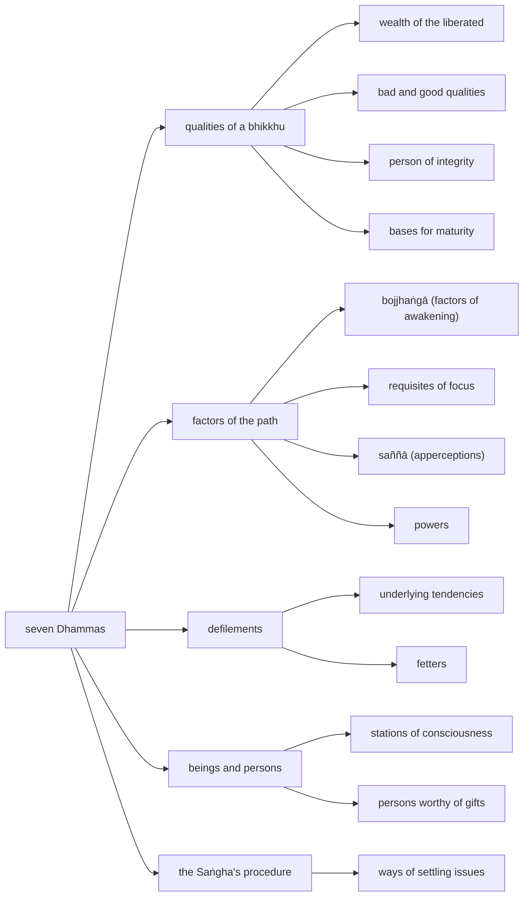

import { Tabs, TabItem } from '@astrojs/starlight/components';

Original text: [8D/10.7 Sattaka 1011–1033](https://tipitaka2500.github.io/tipitaka/8D/10/10.7.html#1011) in the [World Tipitaka Edition](https://tipitaka2500.github.io)

## Summary

The seventh section of the Saṅgītisutta: āyasmā Sāriputta recites fourteen groups of seven Dhammas for the bhikkhū to recite in harmony. They range over the qualities of a bhikkhu (the kinds of wealth of the liberated, the bad and good qualities, the characteristics of a person of integrity, the bases for maturity), the factors of the path (the `bojjhaṅgā`, the requisites of focus, the apperceptions, the powers), the defilements (the underlying tendencies and the fetters), the seven stations of consciousness, the persons worthy of gifts, and the Saṅgha's seven ways of settling issues. The section closes the second `bhāṇavāra`.

## Diagram

## Text

<Tabs syncKey="paliquote">
<TabItem label="My Translation">
(330.)

1011\. Āvuso, there are seven Dhammas well proclaimed by the Bhagavā, the liberated one, the perfectly awakened one, who knows and sees. Therein all should recite in harmony, not quarrel, so that this optimal life may endure long and last for a long time, which would be for the welfare and happiness of many people, out of compassion for the world, for the good, welfare, and happiness of gods and humans. What seven?

1012\. Seven kinds of wealth of the liberated: the wealth of confidence, the wealth of virtue, the wealth of conscience, the wealth of shame in wrongdoing, the wealth of learning, the wealth of generosity, and the wealth of wisdom. (1)

1013\. Seven `bojjhaṅgā` (factors of awakening): of awareness, of investigation of phenomena, of energy, of joy, of tranquillity, of focus, and of equanimity. (2)

1014\. Seven requisites of focus: right view, right resolve, right speech, right action, right livelihood, right effort, and right awareness. (3)

1015\. Seven bad qualities: Here, Āvuso, a bhikkhu is without confidence, is without conscience, is without shame in wrongdoing, is unlearned, is lazy, is forgetful, and is foolish. (4)

1016\. Seven good qualities: Here, Āvuso, a bhikkhu is confident, has a conscience, is afraid of wrongdoing, is very learned, is energetic, has awareness present, and is wise. (5)

1017\. Seven characteristics of a person of integrity: Here, Āvuso, a bhikkhu knows the Dhamma, knows the meaning, knows himself, knows the correct measure, knows the right time, knows assemblies, and knows people. (6)

(331.)

1018\. Seven bases for maturity. Here, Āvuso, a bhikkhu has intense interest in undertaking the training, and in future is not without love for undertaking the training. He has intense interest in careful attention to the Dhamma, and in future is not without love for careful attention to the Dhamma. He has intense interest in the removal of longing, and in future is not without love for the removal of longing. He has intense interest in seclusion, and in future is not without love for seclusion. He has intense interest in arousing energy, and in future is not without love for arousing energy. He has intense interest in careful awareness, and in future is not without love for careful awareness. He has intense interest in the penetration of view, and in future is not without love for the penetration of view. (7)

1019\. Seven `saññā` (apperceptions): the apperception of impermanence, the apperception of not-self, the apperception of unattractiveness, the apperception of disadvantage, the apperception of giving up, the apperception of detachment, and the apperception of cessation. (8)

1020\. Seven powers: the power of confidence, the power of energy, the power of conscience, the power of shame in wrongdoing, the power of awareness, the power of focus, and the power of wisdom. (9)

(332.)

1021\. Seven stations of consciousness. There are, Āvuso, beings with diverse bodies and diverse apperceptions, such as humans, some gods, and some beings in the lower realms. This is the first station of consciousness.

1022\. There are, Āvuso, beings with diverse bodies and a single apperception, such as the Brahmakāyika gods, produced by the first [mental disposition]. This is the second station of consciousness.

1023\. There are, Āvuso, beings with a single body and diverse apperceptions, such as the Ābhassara gods. This is the third station of consciousness.

1024\. There are, Āvuso, beings with a single body and a single apperception, such as the Subhakiṇhā gods. This is the fourth station of consciousness.

1025\. There are, Āvuso, beings who, going beyond `rūpasaññā` (apperceptions of form) altogether, with the disappearance of apperceptions of sense impressions, ignoring the apperceptions of diversity, thinking: ‘Space is infinite,’ have gone to the base of the infinity of space. This is the fifth station of consciousness.

1026\. There are, Āvuso, beings who, going beyond the base of the infinity of space altogether, thinking: ‘Consciousness is infinite,’ have gone to the base of the infinity of consciousness. This is the sixth station of consciousness.

1027\. There are, Āvuso, beings who, going beyond the base of the infinity of consciousness altogether, thinking: ‘There is nothing,’ have gone to the base of nothingness. This is the seventh station of consciousness. (10)

1028\. Seven persons worthy of gifts: the one liberated in both ways, the one liberated by wisdom, the body-witness, the one attained to view, the one liberated through confidence, the Dhamma-follower, and the confidence-follower. (11)

1029\. Seven underlying tendencies: towards sensual desire, towards aversion, towards views, towards doubt, towards conceit, towards passion for existence, and towards ignorance. (12)

1030\. Seven fetters: of attraction, of aversion, of views, of doubt, of conceit, of passion for existence, and of ignorance. (13)

1031\. Seven ways of settling issues: for the settlement and conciliation of whatever issues have arisen, a verdict in the presence should be given, a verdict of awareness should be given, a verdict of past insanity should be given, it should be dealt with by admission, a majority vote, a verdict of aggravated misconduct, and covering with grass. (14)

1032\. Āvuso, these are the seven Dhammas well proclaimed by the Bhagavā, the liberated one, the perfectly awakened one, who knows and sees. Therein all should recite in harmony, not quarrel, so that this optimal life may endure long and last for a long time, which would be for the welfare and happiness of many people, out of compassion for the world, for the good, welfare, and happiness of gods and humans.

---

1033\. The second `bhāṇavāra` (section for recitation) is finished.
</TabItem>

<TabItem label="Pāḷi (Roman IAST)">
(330.)

1011\. Atthi kho, āvuso, tena bhagavatā jānatā passatā arahatā sammāsambuddhena satta dhammā sammadakkhātā; tattha sabbeheva saṅgāyitabbaṃ…pe… atthāya hitāya sukhāya devamanussānaṃ. Katame satta?

1012\. Satta ariyadhanāni— saddhādhanaṃ, sīladhanaṃ, hiridhanaṃ, ottappadhanaṃ, sutadhanaṃ, cāgadhanaṃ, paññādhanaṃ. (1)

1013\. Satta bojjhaṅgā— satisambojjhaṅgo, dhammavicayasambojjhaṅgo, vīriyasambojjhaṅgo, pītisambojjhaṅgo, passaddhisambojjhaṅgo, samādhisambojjhaṅgo, upekkhāsambojjhaṅgo. (2)

1014\. Satta samādhiparikkhārā— sammādiṭṭhi, sammāsaṅkappo, sammāvācā, sammākammanto, sammāājīvo, sammāvāyāmo, sammāsati. (3)

1015\. Satta asaddhammā— idhāvuso, bhikkhu assaddho hoti, ahiriko hoti, anottappī hoti, appassuto hoti, kusīto hoti, muṭṭhassati hoti, duppañño hoti. (4)

1016\. Satta saddhammā— idhāvuso, bhikkhu saddho hoti, hirimā hoti, ottappī hoti, bahussuto hoti, āraddhavīriyo hoti, upaṭṭhitassati hoti, paññavā hoti. (5)

1017\. Satta sappurisadhammā— idhāvuso, bhikkhu dhammaññū ca hoti atthaññū ca attaññū ca mattaññū ca kālaññū ca parisaññū ca puggalaññū ca. (6)

(331.)

1018\. Satta niddasavatthūni. Idhāvuso, bhikkhu sikkhāsamādāne tibbacchando hoti, āyatiñca sikkhāsamādāne avigatapemo. Dhammanisantiyā tibbacchando hoti, āyatiñca dhammanisantiyā avigatapemo. Icchāvinaye tibbacchando hoti, āyatiñca icchāvinaye avigatapemo. Paṭisallāne tibbacchando hoti, āyatiñca paṭisallāne avigatapemo. Vīriyārambhe tibbacchando hoti, āyatiñca vīriyārambhe avigatapemo. Satinepakke tibbacchando hoti, āyatiñca satinepakke avigatapemo. Diṭṭhipaṭivedhe tibbacchando hoti, āyatiñca diṭṭhipaṭivedhe avigatapemo. (7)

1019\. Satta saññā— aniccasaññā, anattasaññā, asubhasaññā, ādīnavasaññā, pahānasaññā, virāgasaññā, nirodhasaññā. (8)

1020\. Satta balāni— saddhābalaṃ, vīriyabalaṃ, hiribalaṃ, ottappabalaṃ, satibalaṃ, samādhibalaṃ, paññābalaṃ. (9)

(332.)

1021\. Satta viññāṇaṭṭhitiyo. Santāvuso, sattā nānattakāyā nānattasaññino, seyyathāpi manussā ekacce ca devā ekacce ca vinipātikā. Ayaṃ paṭhamā viññāṇaṭṭhiti.

1022\. Santāvuso, sattā nānattakāyā ekattasaññino seyyathāpi devā brahmakāyikā paṭhamābhinibbattā. Ayaṃ dutiyā viññāṇaṭṭhiti.

1023\. Santāvuso, sattā ekattakāyā nānattasaññino seyyathāpi devā ābhassarā. Ayaṃ tatiyā viññāṇaṭṭhiti.

1024\. Santāvuso, sattā ekattakāyā ekattasaññino seyyathāpi devā subhakiṇhā. Ayaṃ catutthī viññāṇaṭṭhiti.

1025\. Santāvuso, sattā sabbaso rūpasaññānaṃ samatikkamā paṭighasaññānaṃ atthaṅgamā nānattasaññānaṃ amanasikārā ‘ananto ākāso’ti ākāsānañcāyatanūpagā. Ayaṃ pañcamī viññāṇaṭṭhiti.

1026\. Santāvuso, sattā sabbaso ākāsānañcāyatanaṃ samatikkamma ‘anantaṃ viññāṇan’ti viññāṇañcāyatanūpagā. Ayaṃ chaṭṭhī viññāṇaṭṭhiti.

1027\. Santāvuso, sattā sabbaso viññāṇañcāyatanaṃ samatikkamma ‘natthi kiñcī’ti ākiñcaññāyatanūpagā. Ayaṃ sattamī viññāṇaṭṭhiti. (10)

1028\. Satta puggalā dakkhiṇeyyā— ubhatobhāgavimutto, paññāvimutto, kāyasakkhi, diṭṭhippatto, saddhāvimutto, dhammānusārī, saddhānusārī. (11)

1029\. Satta anusayā— kāmarāgānusayo, paṭighānusayo, diṭṭhānusayo, vicikicchānusayo, mānānusayo, bhavarāgānusayo, avijjānusayo. (12)

1030\. Satta saṃyojanāni— anunayasaṃyojanaṃ, paṭighasaṃyojanaṃ, diṭṭhisaṃyojanaṃ, vicikicchāsaṃyojanaṃ, mānasaṃyojanaṃ, bhavarāgasaṃyojanaṃ, avijjāsaṃyojanaṃ. (13)

1031\. Satta adhikaraṇasamathā— uppannuppannānaṃ adhikaraṇānaṃ samathāya vūpasamāya sammukhāvinayo dātabbo, sativinayo dātabbo, amūḷhavinayo dātabbo, paṭiññāya kāretabbaṃ, yebhuyyasikā, tassapāpiyasikā, tiṇavatthārako. (14)

1032\. Ime kho, āvuso, tena bhagavatā jānatā passatā arahatā sammāsambuddhena satta dhammā sammadakkhātā; tattha sabbeheva saṅgāyitabbaṃ…pe… atthāya hitāya sukhāya devamanussānaṃ.

---

1033\. Dutiyabhāṇavāro niṭṭhito.
</TabItem>

<TabItem label="Pāḷi (Brahmi)">
(330.)

1011\. 𑀅𑀢𑁆𑀣𑀺 𑀔𑁄, 𑀆𑀯𑀼𑀲𑁄, 𑀢𑁂𑀦 𑀪𑀕𑀯𑀢𑀸 𑀚𑀸𑀦𑀢𑀸 𑀧𑀲𑁆𑀲𑀢𑀸 𑀅𑀭𑀳𑀢𑀸 𑀲𑀫𑁆𑀫𑀸𑀲𑀫𑁆𑀩𑀼𑀤𑁆𑀥𑁂𑀦 𑀲𑀢𑁆𑀢 𑀥𑀫𑁆𑀫𑀸 𑀲𑀫𑁆𑀫𑀤𑀓𑁆𑀔𑀸𑀢𑀸; 𑀢𑀢𑁆𑀣 𑀲𑀩𑁆𑀩𑁂𑀳𑁂𑀯 𑀲𑀗𑁆𑀕𑀸𑀬𑀺𑀢𑀩𑁆𑀩𑀁…𑀧𑁂… 𑀅𑀢𑁆𑀣𑀸𑀬 𑀳𑀺𑀢𑀸𑀬 𑀲𑀼𑀔𑀸𑀬 𑀤𑁂𑀯𑀫𑀦𑀼𑀲𑁆𑀲𑀸𑀦𑀁. 𑀓𑀢𑀫𑁂 𑀲𑀢𑁆𑀢?

1012\. 𑀲𑀢𑁆𑀢 𑀅𑀭𑀺𑀬𑀥𑀦𑀸𑀦𑀺— 𑀲𑀤𑁆𑀥𑀸𑀥𑀦𑀁, 𑀲𑀻𑀮𑀥𑀦𑀁, 𑀳𑀺𑀭𑀺𑀥𑀦𑀁, 𑀑𑀢𑁆𑀢𑀧𑁆𑀧𑀥𑀦𑀁, 𑀲𑀼𑀢𑀥𑀦𑀁, 𑀘𑀸𑀕𑀥𑀦𑀁, 𑀧𑀜𑁆𑀜𑀸𑀥𑀦𑀁. (1)

1013\. 𑀲𑀢𑁆𑀢 𑀩𑁄𑀚𑁆𑀛𑀗𑁆𑀕𑀸— 𑀲𑀢𑀺𑀲𑀫𑁆𑀩𑁄𑀚𑁆𑀛𑀗𑁆𑀕𑁄, 𑀥𑀫𑁆𑀫𑀯𑀺𑀘𑀬𑀲𑀫𑁆𑀩𑁄𑀚𑁆𑀛𑀗𑁆𑀕𑁄, 𑀯𑀻𑀭𑀺𑀬𑀲𑀫𑁆𑀩𑁄𑀚𑁆𑀛𑀗𑁆𑀕𑁄, 𑀧𑀻𑀢𑀺𑀲𑀫𑁆𑀩𑁄𑀚𑁆𑀛𑀗𑁆𑀕𑁄, 𑀧𑀲𑁆𑀲𑀤𑁆𑀥𑀺𑀲𑀫𑁆𑀩𑁄𑀚𑁆𑀛𑀗𑁆𑀕𑁄, 𑀲𑀫𑀸𑀥𑀺𑀲𑀫𑁆𑀩𑁄𑀚𑁆𑀛𑀗𑁆𑀕𑁄, 𑀉𑀧𑁂𑀓𑁆𑀔𑀸𑀲𑀫𑁆𑀩𑁄𑀚𑁆𑀛𑀗𑁆𑀕𑁄. (2)

1014\. 𑀲𑀢𑁆𑀢 𑀲𑀫𑀸𑀥𑀺𑀧𑀭𑀺𑀓𑁆𑀔𑀸𑀭𑀸— 𑀲𑀫𑁆𑀫𑀸𑀤𑀺𑀝𑁆𑀞𑀺, 𑀲𑀫𑁆𑀫𑀸𑀲𑀗𑁆𑀓𑀧𑁆𑀧𑁄, 𑀲𑀫𑁆𑀫𑀸𑀯𑀸𑀘𑀸, 𑀲𑀫𑁆𑀫𑀸𑀓𑀫𑁆𑀫𑀦𑁆𑀢𑁄, 𑀲𑀫𑁆𑀫𑀸𑀆𑀚𑀻𑀯𑁄, 𑀲𑀫𑁆𑀫𑀸𑀯𑀸𑀬𑀸𑀫𑁄, 𑀲𑀫𑁆𑀫𑀸𑀲𑀢𑀺. (3)

1015\. 𑀲𑀢𑁆𑀢 𑀅𑀲𑀤𑁆𑀥𑀫𑁆𑀫𑀸— 𑀇𑀥𑀸𑀯𑀼𑀲𑁄, 𑀪𑀺𑀓𑁆𑀔𑀼 𑀅𑀲𑁆𑀲𑀤𑁆𑀥𑁄 𑀳𑁄𑀢𑀺, 𑀅𑀳𑀺𑀭𑀺𑀓𑁄 𑀳𑁄𑀢𑀺, 𑀅𑀦𑁄𑀢𑁆𑀢𑀧𑁆𑀧𑀻 𑀳𑁄𑀢𑀺, 𑀅𑀧𑁆𑀧𑀲𑁆𑀲𑀼𑀢𑁄 𑀳𑁄𑀢𑀺, 𑀓𑀼𑀲𑀻𑀢𑁄 𑀳𑁄𑀢𑀺, 𑀫𑀼𑀝𑁆𑀞𑀲𑁆𑀲𑀢𑀺 𑀳𑁄𑀢𑀺, 𑀤𑀼𑀧𑁆𑀧𑀜𑁆𑀜𑁄 𑀳𑁄𑀢𑀺. (4)

1016\. 𑀲𑀢𑁆𑀢 𑀲𑀤𑁆𑀥𑀫𑁆𑀫𑀸— 𑀇𑀥𑀸𑀯𑀼𑀲𑁄, 𑀪𑀺𑀓𑁆𑀔𑀼 𑀲𑀤𑁆𑀥𑁄 𑀳𑁄𑀢𑀺, 𑀳𑀺𑀭𑀺𑀫𑀸 𑀳𑁄𑀢𑀺, 𑀑𑀢𑁆𑀢𑀧𑁆𑀧𑀻 𑀳𑁄𑀢𑀺, 𑀩𑀳𑀼𑀲𑁆𑀲𑀼𑀢𑁄 𑀳𑁄𑀢𑀺, 𑀆𑀭𑀤𑁆𑀥𑀯𑀻𑀭𑀺𑀬𑁄 𑀳𑁄𑀢𑀺, 𑀉𑀧𑀝𑁆𑀞𑀺𑀢𑀲𑁆𑀲𑀢𑀺 𑀳𑁄𑀢𑀺, 𑀧𑀜𑁆𑀜𑀯𑀸 𑀳𑁄𑀢𑀺. (5)

1017\. 𑀲𑀢𑁆𑀢 𑀲𑀧𑁆𑀧𑀼𑀭𑀺𑀲𑀥𑀫𑁆𑀫𑀸— 𑀇𑀥𑀸𑀯𑀼𑀲𑁄, 𑀪𑀺𑀓𑁆𑀔𑀼 𑀥𑀫𑁆𑀫𑀜𑁆𑀜𑀽 𑀘 𑀳𑁄𑀢𑀺 𑀅𑀢𑁆𑀣𑀜𑁆𑀜𑀽 𑀘 𑀅𑀢𑁆𑀢𑀜𑁆𑀜𑀽 𑀘 𑀫𑀢𑁆𑀢𑀜𑁆𑀜𑀽 𑀘 𑀓𑀸𑀮𑀜𑁆𑀜𑀽 𑀘 𑀧𑀭𑀺𑀲𑀜𑁆𑀜𑀽 𑀘 𑀧𑀼𑀕𑁆𑀕𑀮𑀜𑁆𑀜𑀽 𑀘. (6)

(331.)

1018\. 𑀲𑀢𑁆𑀢 𑀦𑀺𑀤𑁆𑀤𑀲𑀯𑀢𑁆𑀣𑀽𑀦𑀺. 𑀇𑀥𑀸𑀯𑀼𑀲𑁄, 𑀪𑀺𑀓𑁆𑀔𑀼 𑀲𑀺𑀓𑁆𑀔𑀸𑀲𑀫𑀸𑀤𑀸𑀦𑁂 𑀢𑀺𑀩𑁆𑀩𑀘𑁆𑀙𑀦𑁆𑀤𑁄 𑀳𑁄𑀢𑀺, 𑀆𑀬𑀢𑀺𑀜𑁆𑀘 𑀲𑀺𑀓𑁆𑀔𑀸𑀲𑀫𑀸𑀤𑀸𑀦𑁂 𑀅𑀯𑀺𑀕𑀢𑀧𑁂𑀫𑁄. 𑀥𑀫𑁆𑀫𑀦𑀺𑀲𑀦𑁆𑀢𑀺𑀬𑀸 𑀢𑀺𑀩𑁆𑀩𑀘𑁆𑀙𑀦𑁆𑀤𑁄 𑀳𑁄𑀢𑀺, 𑀆𑀬𑀢𑀺𑀜𑁆𑀘 𑀥𑀫𑁆𑀫𑀦𑀺𑀲𑀦𑁆𑀢𑀺𑀬𑀸 𑀅𑀯𑀺𑀕𑀢𑀧𑁂𑀫𑁄. 𑀇𑀘𑁆𑀙𑀸𑀯𑀺𑀦𑀬𑁂 𑀢𑀺𑀩𑁆𑀩𑀘𑁆𑀙𑀦𑁆𑀤𑁄 𑀳𑁄𑀢𑀺, 𑀆𑀬𑀢𑀺𑀜𑁆𑀘 𑀇𑀘𑁆𑀙𑀸𑀯𑀺𑀦𑀬𑁂 𑀅𑀯𑀺𑀕𑀢𑀧𑁂𑀫𑁄. 𑀧𑀝𑀺𑀲𑀮𑁆𑀮𑀸𑀦𑁂 𑀢𑀺𑀩𑁆𑀩𑀘𑁆𑀙𑀦𑁆𑀤𑁄 𑀳𑁄𑀢𑀺, 𑀆𑀬𑀢𑀺𑀜𑁆𑀘 𑀧𑀝𑀺𑀲𑀮𑁆𑀮𑀸𑀦𑁂 𑀅𑀯𑀺𑀕𑀢𑀧𑁂𑀫𑁄. 𑀯𑀻𑀭𑀺𑀬𑀸𑀭𑀫𑁆𑀪𑁂 𑀢𑀺𑀩𑁆𑀩𑀘𑁆𑀙𑀦𑁆𑀤𑁄 𑀳𑁄𑀢𑀺, 𑀆𑀬𑀢𑀺𑀜𑁆𑀘 𑀯𑀻𑀭𑀺𑀬𑀸𑀭𑀫𑁆𑀪𑁂 𑀅𑀯𑀺𑀕𑀢𑀧𑁂𑀫𑁄. 𑀲𑀢𑀺𑀦𑁂𑀧𑀓𑁆𑀓𑁂 𑀢𑀺𑀩𑁆𑀩𑀘𑁆𑀙𑀦𑁆𑀤𑁄 𑀳𑁄𑀢𑀺, 𑀆𑀬𑀢𑀺𑀜𑁆𑀘 𑀲𑀢𑀺𑀦𑁂𑀧𑀓𑁆𑀓𑁂 𑀅𑀯𑀺𑀕𑀢𑀧𑁂𑀫𑁄. 𑀤𑀺𑀝𑁆𑀞𑀺𑀧𑀝𑀺𑀯𑁂𑀥𑁂 𑀢𑀺𑀩𑁆𑀩𑀘𑁆𑀙𑀦𑁆𑀤𑁄 𑀳𑁄𑀢𑀺, 𑀆𑀬𑀢𑀺𑀜𑁆𑀘 𑀤𑀺𑀝𑁆𑀞𑀺𑀧𑀝𑀺𑀯𑁂𑀥𑁂 𑀅𑀯𑀺𑀕𑀢𑀧𑁂𑀫𑁄. (7)

1019\. 𑀲𑀢𑁆𑀢 𑀲𑀜𑁆𑀜𑀸— 𑀅𑀦𑀺𑀘𑁆𑀘𑀲𑀜𑁆𑀜𑀸, 𑀅𑀦𑀢𑁆𑀢𑀲𑀜𑁆𑀜𑀸, 𑀅𑀲𑀼𑀪𑀲𑀜𑁆𑀜𑀸, 𑀆𑀤𑀻𑀦𑀯𑀲𑀜𑁆𑀜𑀸, 𑀧𑀳𑀸𑀦𑀲𑀜𑁆𑀜𑀸, 𑀯𑀺𑀭𑀸𑀕𑀲𑀜𑁆𑀜𑀸, 𑀦𑀺𑀭𑁄𑀥𑀲𑀜𑁆𑀜𑀸. (8)

1020\. 𑀲𑀢𑁆𑀢 𑀩𑀮𑀸𑀦𑀺— 𑀲𑀤𑁆𑀥𑀸𑀩𑀮𑀁, 𑀯𑀻𑀭𑀺𑀬𑀩𑀮𑀁, 𑀳𑀺𑀭𑀺𑀩𑀮𑀁, 𑀑𑀢𑁆𑀢𑀧𑁆𑀧𑀩𑀮𑀁, 𑀲𑀢𑀺𑀩𑀮𑀁, 𑀲𑀫𑀸𑀥𑀺𑀩𑀮𑀁, 𑀧𑀜𑁆𑀜𑀸𑀩𑀮𑀁. (9)

(332.)

1021\. 𑀲𑀢𑁆𑀢 𑀯𑀺𑀜𑁆𑀜𑀸𑀡𑀝𑁆𑀞𑀺𑀢𑀺𑀬𑁄. 𑀲𑀦𑁆𑀢𑀸𑀯𑀼𑀲𑁄, 𑀲𑀢𑁆𑀢𑀸 𑀦𑀸𑀦𑀢𑁆𑀢𑀓𑀸𑀬𑀸 𑀦𑀸𑀦𑀢𑁆𑀢𑀲𑀜𑁆𑀜𑀺𑀦𑁄, 𑀲𑁂𑀬𑁆𑀬𑀣𑀸𑀧𑀺 𑀫𑀦𑀼𑀲𑁆𑀲𑀸 𑀏𑀓𑀘𑁆𑀘𑁂 𑀘 𑀤𑁂𑀯𑀸 𑀏𑀓𑀘𑁆𑀘𑁂 𑀘 𑀯𑀺𑀦𑀺𑀧𑀸𑀢𑀺𑀓𑀸. 𑀅𑀬𑀁 𑀧𑀞𑀫𑀸 𑀯𑀺𑀜𑁆𑀜𑀸𑀡𑀝𑁆𑀞𑀺𑀢𑀺.

1022\. 𑀲𑀦𑁆𑀢𑀸𑀯𑀼𑀲𑁄, 𑀲𑀢𑁆𑀢𑀸 𑀦𑀸𑀦𑀢𑁆𑀢𑀓𑀸𑀬𑀸 𑀏𑀓𑀢𑁆𑀢𑀲𑀜𑁆𑀜𑀺𑀦𑁄 𑀲𑁂𑀬𑁆𑀬𑀣𑀸𑀧𑀺 𑀤𑁂𑀯𑀸 𑀩𑁆𑀭𑀳𑁆𑀫𑀓𑀸𑀬𑀺𑀓𑀸 𑀧𑀞𑀫𑀸𑀪𑀺𑀦𑀺𑀩𑁆𑀩𑀢𑁆𑀢𑀸. 𑀅𑀬𑀁 𑀤𑀼𑀢𑀺𑀬𑀸 𑀯𑀺𑀜𑁆𑀜𑀸𑀡𑀝𑁆𑀞𑀺𑀢𑀺.

1023\. 𑀲𑀦𑁆𑀢𑀸𑀯𑀼𑀲𑁄, 𑀲𑀢𑁆𑀢𑀸 𑀏𑀓𑀢𑁆𑀢𑀓𑀸𑀬𑀸 𑀦𑀸𑀦𑀢𑁆𑀢𑀲𑀜𑁆𑀜𑀺𑀦𑁄 𑀲𑁂𑀬𑁆𑀬𑀣𑀸𑀧𑀺 𑀤𑁂𑀯𑀸 𑀆𑀪𑀲𑁆𑀲𑀭𑀸. 𑀅𑀬𑀁 𑀢𑀢𑀺𑀬𑀸 𑀯𑀺𑀜𑁆𑀜𑀸𑀡𑀝𑁆𑀞𑀺𑀢𑀺.

1024\. 𑀲𑀦𑁆𑀢𑀸𑀯𑀼𑀲𑁄, 𑀲𑀢𑁆𑀢𑀸 𑀏𑀓𑀢𑁆𑀢𑀓𑀸𑀬𑀸 𑀏𑀓𑀢𑁆𑀢𑀲𑀜𑁆𑀜𑀺𑀦𑁄 𑀲𑁂𑀬𑁆𑀬𑀣𑀸𑀧𑀺 𑀤𑁂𑀯𑀸 𑀲𑀼𑀪𑀓𑀺𑀡𑁆𑀳𑀸. 𑀅𑀬𑀁 𑀘𑀢𑀼𑀢𑁆𑀣𑀻 𑀯𑀺𑀜𑁆𑀜𑀸𑀡𑀝𑁆𑀞𑀺𑀢𑀺.

1025\. 𑀲𑀦𑁆𑀢𑀸𑀯𑀼𑀲𑁄, 𑀲𑀢𑁆𑀢𑀸 𑀲𑀩𑁆𑀩𑀲𑁄 𑀭𑀽𑀧𑀲𑀜𑁆𑀜𑀸𑀦𑀁 𑀲𑀫𑀢𑀺𑀓𑁆𑀓𑀫𑀸 𑀧𑀝𑀺𑀖𑀲𑀜𑁆𑀜𑀸𑀦𑀁 𑀅𑀢𑁆𑀣𑀗𑁆𑀕𑀫𑀸 𑀦𑀸𑀦𑀢𑁆𑀢𑀲𑀜𑁆𑀜𑀸𑀦𑀁 𑀅𑀫𑀦𑀲𑀺𑀓𑀸𑀭𑀸 ‘𑀅𑀦𑀦𑁆𑀢𑁄 𑀆𑀓𑀸𑀲𑁄’𑀢𑀺 𑀆𑀓𑀸𑀲𑀸𑀦𑀜𑁆𑀘𑀸𑀬𑀢𑀦𑀽𑀧𑀕𑀸. 𑀅𑀬𑀁 𑀧𑀜𑁆𑀘𑀫𑀻 𑀯𑀺𑀜𑁆𑀜𑀸𑀡𑀝𑁆𑀞𑀺𑀢𑀺.

1026\. 𑀲𑀦𑁆𑀢𑀸𑀯𑀼𑀲𑁄, 𑀲𑀢𑁆𑀢𑀸 𑀲𑀩𑁆𑀩𑀲𑁄 𑀆𑀓𑀸𑀲𑀸𑀦𑀜𑁆𑀘𑀸𑀬𑀢𑀦𑀁 𑀲𑀫𑀢𑀺𑀓𑁆𑀓𑀫𑁆𑀫 ‘𑀅𑀦𑀦𑁆𑀢𑀁 𑀯𑀺𑀜𑁆𑀜𑀸𑀡𑀦𑁆’𑀢𑀺 𑀯𑀺𑀜𑁆𑀜𑀸𑀡𑀜𑁆𑀘𑀸𑀬𑀢𑀦𑀽𑀧𑀕𑀸. 𑀅𑀬𑀁 𑀙𑀝𑁆𑀞𑀻 𑀯𑀺𑀜𑁆𑀜𑀸𑀡𑀝𑁆𑀞𑀺𑀢𑀺.

1027\. 𑀲𑀦𑁆𑀢𑀸𑀯𑀼𑀲𑁄, 𑀲𑀢𑁆𑀢𑀸 𑀲𑀩𑁆𑀩𑀲𑁄 𑀯𑀺𑀜𑁆𑀜𑀸𑀡𑀜𑁆𑀘𑀸𑀬𑀢𑀦𑀁 𑀲𑀫𑀢𑀺𑀓𑁆𑀓𑀫𑁆𑀫 ‘𑀦𑀢𑁆𑀣𑀺 𑀓𑀺𑀜𑁆𑀘𑀻’𑀢𑀺 𑀆𑀓𑀺𑀜𑁆𑀘𑀜𑁆𑀜𑀸𑀬𑀢𑀦𑀽𑀧𑀕𑀸. 𑀅𑀬𑀁 𑀲𑀢𑁆𑀢𑀫𑀻 𑀯𑀺𑀜𑁆𑀜𑀸𑀡𑀝𑁆𑀞𑀺𑀢𑀺. (10)

1028\. 𑀲𑀢𑁆𑀢 𑀧𑀼𑀕𑁆𑀕𑀮𑀸 𑀤𑀓𑁆𑀔𑀺𑀡𑁂𑀬𑁆𑀬𑀸— 𑀉𑀪𑀢𑁄𑀪𑀸𑀕𑀯𑀺𑀫𑀼𑀢𑁆𑀢𑁄, 𑀧𑀜𑁆𑀜𑀸𑀯𑀺𑀫𑀼𑀢𑁆𑀢𑁄, 𑀓𑀸𑀬𑀲𑀓𑁆𑀔𑀺, 𑀤𑀺𑀝𑁆𑀞𑀺𑀧𑁆𑀧𑀢𑁆𑀢𑁄, 𑀲𑀤𑁆𑀥𑀸𑀯𑀺𑀫𑀼𑀢𑁆𑀢𑁄, 𑀥𑀫𑁆𑀫𑀸𑀦𑀼𑀲𑀸𑀭𑀻, 𑀲𑀤𑁆𑀥𑀸𑀦𑀼𑀲𑀸𑀭𑀻. (11)

1029\. 𑀲𑀢𑁆𑀢 𑀅𑀦𑀼𑀲𑀬𑀸— 𑀓𑀸𑀫𑀭𑀸𑀕𑀸𑀦𑀼𑀲𑀬𑁄, 𑀧𑀝𑀺𑀖𑀸𑀦𑀼𑀲𑀬𑁄, 𑀤𑀺𑀝𑁆𑀞𑀸𑀦𑀼𑀲𑀬𑁄, 𑀯𑀺𑀘𑀺𑀓𑀺𑀘𑁆𑀙𑀸𑀦𑀼𑀲𑀬𑁄, 𑀫𑀸𑀦𑀸𑀦𑀼𑀲𑀬𑁄, 𑀪𑀯𑀭𑀸𑀕𑀸𑀦𑀼𑀲𑀬𑁄, 𑀅𑀯𑀺𑀚𑁆𑀚𑀸𑀦𑀼𑀲𑀬𑁄. (12)

1030\. 𑀲𑀢𑁆𑀢 𑀲𑀁𑀬𑁄𑀚𑀦𑀸𑀦𑀺— 𑀅𑀦𑀼𑀦𑀬𑀲𑀁𑀬𑁄𑀚𑀦𑀁, 𑀧𑀝𑀺𑀖𑀲𑀁𑀬𑁄𑀚𑀦𑀁, 𑀤𑀺𑀝𑁆𑀞𑀺𑀲𑀁𑀬𑁄𑀚𑀦𑀁, 𑀯𑀺𑀘𑀺𑀓𑀺𑀘𑁆𑀙𑀸𑀲𑀁𑀬𑁄𑀚𑀦𑀁, 𑀫𑀸𑀦𑀲𑀁𑀬𑁄𑀚𑀦𑀁, 𑀪𑀯𑀭𑀸𑀕𑀲𑀁𑀬𑁄𑀚𑀦𑀁, 𑀅𑀯𑀺𑀚𑁆𑀚𑀸𑀲𑀁𑀬𑁄𑀚𑀦𑀁. (13)

1031\. 𑀲𑀢𑁆𑀢 𑀅𑀥𑀺𑀓𑀭𑀡𑀲𑀫𑀣𑀸— 𑀉𑀧𑁆𑀧𑀦𑁆𑀦𑀼𑀧𑁆𑀧𑀦𑁆𑀦𑀸𑀦𑀁 𑀅𑀥𑀺𑀓𑀭𑀡𑀸𑀦𑀁 𑀲𑀫𑀣𑀸𑀬 𑀯𑀽𑀧𑀲𑀫𑀸𑀬 𑀲𑀫𑁆𑀫𑀼𑀔𑀸𑀯𑀺𑀦𑀬𑁄 𑀤𑀸𑀢𑀩𑁆𑀩𑁄, 𑀲𑀢𑀺𑀯𑀺𑀦𑀬𑁄 𑀤𑀸𑀢𑀩𑁆𑀩𑁄, 𑀅𑀫𑀽𑀍𑀳𑀯𑀺𑀦𑀬𑁄 𑀤𑀸𑀢𑀩𑁆𑀩𑁄, 𑀧𑀝𑀺𑀜𑁆𑀜𑀸𑀬 𑀓𑀸𑀭𑁂𑀢𑀩𑁆𑀩𑀁, 𑀬𑁂𑀪𑀼𑀬𑁆𑀬𑀲𑀺𑀓𑀸, 𑀢𑀲𑁆𑀲𑀧𑀸𑀧𑀺𑀬𑀲𑀺𑀓𑀸, 𑀢𑀺𑀡𑀯𑀢𑁆𑀣𑀸𑀭𑀓𑁄. (14)

1032\. 𑀇𑀫𑁂 𑀔𑁄, 𑀆𑀯𑀼𑀲𑁄, 𑀢𑁂𑀦 𑀪𑀕𑀯𑀢𑀸 𑀚𑀸𑀦𑀢𑀸 𑀧𑀲𑁆𑀲𑀢𑀸 𑀅𑀭𑀳𑀢𑀸 𑀲𑀫𑁆𑀫𑀸𑀲𑀫𑁆𑀩𑀼𑀤𑁆𑀥𑁂𑀦 𑀲𑀢𑁆𑀢 𑀥𑀫𑁆𑀫𑀸 𑀲𑀫𑁆𑀫𑀤𑀓𑁆𑀔𑀸𑀢𑀸; 𑀢𑀢𑁆𑀣 𑀲𑀩𑁆𑀩𑁂𑀳𑁂𑀯 𑀲𑀗𑁆𑀕𑀸𑀬𑀺𑀢𑀩𑁆𑀩𑀁…𑀧𑁂… 𑀅𑀢𑁆𑀣𑀸𑀬 𑀳𑀺𑀢𑀸𑀬 𑀲𑀼𑀔𑀸𑀬 𑀤𑁂𑀯𑀫𑀦𑀼𑀲𑁆𑀲𑀸𑀦𑀁.

---

1033\. 𑀤𑀼𑀢𑀺𑀬𑀪𑀸𑀡𑀯𑀸𑀭𑁄 𑀦𑀺𑀝𑁆𑀞𑀺𑀢𑁄.
</TabItem>

<TabItem label="Interlinear">
(330.)

[1011](https://tipitaka2500.github.io/tipitaka/8D/10/10.7.html#1011) Atthi kho, āvuso, tena bhagavatā jānatā passatā arahatā sammāsambuddhena satta dhammā sammadakkhātā;  
🟢⨀🤟▶️(atthi) ⏏️(kho) ⏏️(āvuso) *️⃣🤟🚹⨀③(ta) 🚹⨀③(bhagavant) 🚹⨀③🔽(anta)(jānanta) 🚹⨀③🔽(anta)(passanta) 🚹⨀③(arahant) 🚹⨀③🆎(sammā+sambuddha) ⚧⨂①(satta) 🚹⨂①(dhamma) 🚹⨂①🆎(sammā+akkhāta)  
there are | indeed | Āvuso | by that | by the Bhagavā | by the one who knows | by the one who sees | by the liberated one | by the perfectly awakened one | seven | Dhammas | well proclaimed  
Āvuso, there are seven Dhammas well proclaimed by the Bhagavā, the liberated one, the perfectly awakened one, who knows and sees.

tattha sabbeheva saṅgāyitabbaṃ…pe… atthāya hitāya sukhāya devamanussānaṃ.  
⏏️(tattha) *️⃣🤟🚹⨂③(sabba) ⏏️(eva) 🚻⨀①🔽(tabba)(saṅgāyitabba) ⏏️(peyyāla) 🚹⨀④(attha) 🚻⨀④(hita) 🚻⨀④(sukha) 🚹⨂⑥🆎(deva+manussa)  
therein | by all | just | should be recited together | (and so on) | for the good | for the welfare | for the happiness | of gods and humans  
Therein all should recite in harmony, not quarrel, so that this optimal life may endure long and last for a long time, which would be for the welfare and happiness of many people, out of compassion for the world, for the good, welfare, and happiness of gods and humans.

Katame satta?  
*️⃣🤟🚹⨂①(katama) ⚧⨂①(satta)  
which | seven  
What seven?

[1012](https://tipitaka2500.github.io/tipitaka/8D/10/10.7.html#1012) Satta ariyadhanāni— saddhādhanaṃ, sīladhanaṃ, hiridhanaṃ, ottappadhanaṃ, sutadhanaṃ, cāgadhanaṃ, paññādhanaṃ. (1)  
⚧⨂①(satta) 🚻⨂①🆎(ariya+dhana) 🚻⨀①🆎(saddhā+dhana) 🚻⨀①🆎(sīla+dhana) 🚻⨀①🆎(hiri+dhana) 🚻⨀①🆎(ottappa+dhana) 🚻⨀①🆎(suta+dhana) 🚻⨀①🆎(cāga+dhana) 🚻⨀①🆎(paññā+dhana)  
seven | kinds of wealth of the liberated | the wealth of confidence | the wealth of virtue | the wealth of conscience | the wealth of shame in wrongdoing | the wealth of learning | the wealth of generosity | the wealth of wisdom  
Seven kinds of wealth of the liberated: the wealth of confidence, the wealth of virtue, the wealth of conscience, the wealth of shame in wrongdoing, the wealth of learning, the wealth of generosity, and the wealth of wisdom. (1)

[1013](https://tipitaka2500.github.io/tipitaka/8D/10/10.7.html#1013) Satta bojjhaṅgā— satisambojjhaṅgo, dhammavicayasambojjhaṅgo, vīriyasambojjhaṅgo, pītisambojjhaṅgo, passaddhisambojjhaṅgo, samādhisambojjhaṅgo, upekkhāsambojjhaṅgo. (2)  
⚧⨂①(satta) 🚹⨂①🆎(bodhi+aṅga) 🚹⨀①🆎(sati+sambodhi+aṅga) 🚹⨀①🆎(dhamma+vicaya+sambodhi+aṅga) 🚹⨀①🆎(vīriya+sambodhi+aṅga) 🚹⨀①🆎(pīti+sambodhi+aṅga) 🚹⨀①🆎(passaddhi+sambodhi+aṅga) 🚹⨀①🆎(samādhi+sambodhi+aṅga) 🚹⨀①🆎(upekkhā+sambodhi+aṅga)  
seven | factors of awakening | the factor of awakening of awareness | the factor of awakening of investigation of phenomena | the factor of awakening of energy | the factor of awakening of joy | the factor of awakening of tranquillity | the factor of awakening of focus | the factor of awakening of equanimity  
Seven `bojjhaṅgā` (factors of awakening): of awareness, of investigation of phenomena, of energy, of joy, of tranquillity, of focus, and of equanimity. (2)

[1014](https://tipitaka2500.github.io/tipitaka/8D/10/10.7.html#1014) Satta samādhiparikkhārā— sammādiṭṭhi, sammāsaṅkappo, sammāvācā, sammākammanto, sammāājīvo, sammāvāyāmo, sammāsati. (3)  
⚧⨂①(satta) 🚹⨂①🆎(samādhi+parikkhāra) 🚺⨀①🆎(sammā+diṭṭhi) 🚹⨀①🆎(sammā+saṅkappa) 🚺⨀①🆎(sammā+vācā) 🚹⨀①🆎(sammā+kammanta) 🚹⨀①🆎(sammā+ājīva) 🚹⨀①🆎(sammā+vāyāma) 🚺⨀①🆎(sammā+sati)  
seven | requisites of focus | right view | right resolve | right speech | right action | right livelihood | right effort | right awareness  
Seven requisites of focus: right view, right resolve, right speech, right action, right livelihood, right effort, and right awareness. (3)

[1015](https://tipitaka2500.github.io/tipitaka/8D/10/10.7.html#1015) Satta asaddhammā— idhāvuso, bhikkhu assaddho hoti, ahiriko hoti, anottappī hoti, appassuto hoti, kusīto hoti, muṭṭhassati hoti, duppañño hoti. (4)  
⚧⨂①(satta) 🚹⨂①🆎(na+saddhamma) ⏏️(idha) ⏏️(āvuso) 🚹⨀①(bhikkhu) 🚹⨀①🆎(na+saddha) 🟢⨀🤟▶️(hoti) 🚹⨀①🆎(na+hirika) 🟢⨀🤟▶️(hoti) 🚹⨀①🆎(na+ottappī) 🟢⨀🤟▶️(hoti) 🚹⨀①🆎(appa+suta) 🟢⨀🤟▶️(hoti) 🚹⨀①(kusīta) 🟢⨀🤟▶️(hoti) 🚹⨀①🆎(muṭṭha+sati) 🟢⨀🤟▶️(hoti) 🚹⨀①(duppañña) 🟢⨀🤟▶️(hoti)  
seven | bad qualities | here | Āvuso | a bhikkhu | without confidence | is | without conscience | is | without shame in wrongdoing | is | unlearned | is | lazy | is | forgetful | is | foolish | is  
Seven bad qualities: Here, Āvuso, a bhikkhu is without confidence, is without conscience, is without shame in wrongdoing, is unlearned, is lazy, is forgetful, and is foolish. (4)

[1016](https://tipitaka2500.github.io/tipitaka/8D/10/10.7.html#1016) Satta saddhammā— idhāvuso, bhikkhu saddho hoti, hirimā hoti, ottappī hoti, bahussuto hoti, āraddhavīriyo hoti, upaṭṭhitassati hoti, paññavā hoti. (5)  
⚧⨂①(satta) 🚹⨂①(saddhamma) ⏏️(idha) ⏏️(āvuso) 🚹⨀①(bhikkhu) 🚹⨀①(saddha) 🟢⨀🤟▶️(hoti) 🚹⨀①🔽(mantu)(hirimant) 🟢⨀🤟▶️(hoti) 🚹⨀①(ottappī) 🟢⨀🤟▶️(hoti) 🚹⨀①🆎(bahu+suta) 🟢⨀🤟▶️(hoti) 🚹⨀①🆎(āraddha+vīriya) 🟢⨀🤟▶️(hoti) 🚹⨀①🆎(upaṭṭhita+sati) 🟢⨀🤟▶️(hoti) 🚹⨀①🔽(vantu)(paññavant) 🟢⨀🤟▶️(hoti)  
seven | good qualities | here | Āvuso | a bhikkhu | confident | is | having a conscience | is | afraid of wrongdoing | is | very learned | is | energetic | is | with awareness present | is | wise | is  
Seven good qualities: Here, Āvuso, a bhikkhu is confident, has a conscience, is afraid of wrongdoing, is very learned, is energetic, has awareness present, and is wise. (5)

[1017](https://tipitaka2500.github.io/tipitaka/8D/10/10.7.html#1017) Satta sappurisadhammā— idhāvuso, bhikkhu dhammaññū ca hoti atthaññū ca attaññū ca mattaññū ca kālaññū ca parisaññū ca puggalaññū ca. (6)  
⚧⨂①(satta) 🚹⨂①🆎(sappurisa+dhamma) ⏏️(idha) ⏏️(āvuso) 🚹⨀①(bhikkhu) 🚹⨀①🆎(dhamma+ñū) ⏏️(ca) 🟢⨀🤟▶️(hoti) 🚹⨀①🆎(attha+ñū) ⏏️(ca) 🚹⨀①🆎(atta+ñū) ⏏️(ca) 🚹⨀①🆎(matta+ñū) ⏏️(ca) 🚹⨀①🆎(kāla+ñū) ⏏️(ca) 🚹⨀①🆎(parisā+ñū) ⏏️(ca) 🚹⨀①🆎(puggala+ñū) ⏏️(ca)  
seven | characteristics of a person of integrity | here | Āvuso | a bhikkhu | who knows the Dhamma | and | is | who knows the meaning | and | who knows himself | and | who knows the correct measure | and | who knows the right time | and | who knows assemblies | and | who knows people | and  
Seven characteristics of a person of integrity: Here, Āvuso, a bhikkhu knows the Dhamma, knows the meaning, knows himself, knows the correct measure, knows the right time, knows assemblies, and knows people. (6)

(331.)

[1018](https://tipitaka2500.github.io/tipitaka/8D/10/10.7.html#1018) Satta niddasavatthūni.  
⚧⨂①(satta) 🚻⨂①🆎(niddasa+vatthu)  
seven | bases for maturity  
Seven bases for maturity.

Idhāvuso, bhikkhu sikkhāsamādāne tibbacchando hoti, āyatiñca sikkhāsamādāne avigatapemo.  
⏏️(idha) ⏏️(āvuso) 🚹⨀①(bhikkhu) 🚻⨀⑦🆎(sikkhā+samādāna) 🚹⨀①🆎(tibba+chanda) 🟢⨀🤟▶️(hoti) ⏏️(āyatiṃ) ⏏️(ca) 🚻⨀⑦🆎(sikkhā+samādāna) 🚹⨀①🆎(na+vigata+pema)  
here | Āvuso | a bhikkhu | in undertaking the training | with intense interest | is | in future | and | in undertaking the training | not without love  
Here, Āvuso, a bhikkhu has intense interest in undertaking the training, and in future is not without love for undertaking the training.

Dhammanisantiyā tibbacchando hoti, āyatiñca dhammanisantiyā avigatapemo.  
🚺⨀⑦🆎(dhamma+nisanti) 🚹⨀①🆎(tibba+chanda) 🟢⨀🤟▶️(hoti) ⏏️(āyatiṃ) ⏏️(ca) 🚺⨀⑦🆎(dhamma+nisanti) 🚹⨀①🆎(na+vigata+pema)  
in careful attention to the Dhamma | with intense interest | is | in future | and | in careful attention to the Dhamma | not without love  
He has intense interest in careful attention to the Dhamma, and in future is not without love for careful attention to the Dhamma.

Icchāvinaye tibbacchando hoti, āyatiñca icchāvinaye avigatapemo.  
🚹⨀⑦🆎(icchā+vinaya) 🚹⨀①🆎(tibba+chanda) 🟢⨀🤟▶️(hoti) ⏏️(āyatiṃ) ⏏️(ca) 🚹⨀⑦🆎(icchā+vinaya) 🚹⨀①🆎(na+vigata+pema)  
in the removal of longing | with intense interest | is | in future | and | in the removal of longing | not without love  
He has intense interest in the removal of longing, and in future is not without love for the removal of longing.

Paṭisallāne tibbacchando hoti, āyatiñca paṭisallāne avigatapemo.  
🚻⨀⑦(paṭisallāna) 🚹⨀①🆎(tibba+chanda) 🟢⨀🤟▶️(hoti) ⏏️(āyatiṃ) ⏏️(ca) 🚻⨀⑦(paṭisallāna) 🚹⨀①🆎(na+vigata+pema)  
in seclusion | with intense interest | is | in future | and | in seclusion | not without love  
He has intense interest in seclusion, and in future is not without love for seclusion.

Vīriyārambhe tibbacchando hoti, āyatiñca vīriyārambhe avigatapemo.  
🚹⨀⑦🆎(vīriya+ārambha) 🚹⨀①🆎(tibba+chanda) 🟢⨀🤟▶️(hoti) ⏏️(āyatiṃ) ⏏️(ca) 🚹⨀⑦🆎(vīriya+ārambha) 🚹⨀①🆎(na+vigata+pema)  
in arousing energy | with intense interest | is | in future | and | in arousing energy | not without love  
He has intense interest in arousing energy, and in future is not without love for arousing energy.

Satinepakke tibbacchando hoti, āyatiñca satinepakke avigatapemo.  
🚻⨀⑦🆎(sati+nepakka) 🚹⨀①🆎(tibba+chanda) 🟢⨀🤟▶️(hoti) ⏏️(āyatiṃ) ⏏️(ca) 🚻⨀⑦🆎(sati+nepakka) 🚹⨀①🆎(na+vigata+pema)  
in careful awareness | with intense interest | is | in future | and | in careful awareness | not without love  
He has intense interest in careful awareness, and in future is not without love for careful awareness.

Diṭṭhipaṭivedhe tibbacchando hoti, āyatiñca diṭṭhipaṭivedhe avigatapemo. (7)  
🚹⨀⑦🆎(diṭṭhi+paṭivedha) 🚹⨀①🆎(tibba+chanda) 🟢⨀🤟▶️(hoti) ⏏️(āyatiṃ) ⏏️(ca) 🚹⨀⑦🆎(diṭṭhi+paṭivedha) 🚹⨀①🆎(na+vigata+pema)  
in the penetration of view | with intense interest | is | in future | and | in the penetration of view | not without love  
He has intense interest in the penetration of view, and in future is not without love for the penetration of view. (7)

[1019](https://tipitaka2500.github.io/tipitaka/8D/10/10.7.html#1019) Satta saññā— aniccasaññā, anattasaññā, asubhasaññā, ādīnavasaññā, pahānasaññā, virāgasaññā, nirodhasaññā. (8)  
⚧⨂①(satta) 🚺⨂①(saññā) 🚺⨀①🆎(anicca+saññā) 🚺⨀①🆎(na+atta+saññā) 🚺⨀①🆎(na+subha+saññā) 🚺⨀①🆎(ādīnava+saññā) 🚺⨀①🆎(pahāna+saññā) 🚺⨀①🆎(virāga+saññā) 🚺⨀①🆎(nirodha+saññā)  
seven | apperceptions | the apperception of impermanence | the apperception of not-self | the apperception of unattractiveness | the apperception of disadvantage | the apperception of giving up | the apperception of detachment | the apperception of cessation  
Seven `saññā` (apperceptions): the apperception of impermanence, the apperception of not-self, the apperception of unattractiveness, the apperception of disadvantage, the apperception of giving up, the apperception of detachment, and the apperception of cessation. (8)

[1020](https://tipitaka2500.github.io/tipitaka/8D/10/10.7.html#1020) Satta balāni— saddhābalaṃ, vīriyabalaṃ, hiribalaṃ, ottappabalaṃ, satibalaṃ, samādhibalaṃ, paññābalaṃ. (9)  
⚧⨂①(satta) 🚻⨂①(bala) 🚻⨀①🆎(saddhā+bala) 🚻⨀①🆎(vīriya+bala) 🚻⨀①🆎(hiri+bala) 🚻⨀①🆎(ottappa+bala) 🚻⨀①🆎(sati+bala) 🚻⨀①🆎(samādhi+bala) 🚻⨀①🆎(paññā+bala)  
seven | powers | the power of confidence | the power of energy | the power of conscience | the power of shame in wrongdoing | the power of awareness | the power of focus | the power of wisdom  
Seven powers: the power of confidence, the power of energy, the power of conscience, the power of shame in wrongdoing, the power of awareness, the power of focus, and the power of wisdom. (9)

(332.)

[1021](https://tipitaka2500.github.io/tipitaka/8D/10/10.7.html#1021) Satta viññāṇaṭṭhitiyo.  
⚧⨂①(satta) 🚺⨂①🆎(viññāṇa+ṭhiti)  
seven | stations of consciousness  
Seven stations of consciousness.

Santāvuso, sattā nānattakāyā nānattasaññino, seyyathāpi manussā ekacce ca devā ekacce ca vinipātikā.  
🟢⨂🤟▶️(atthi) ⏏️(āvuso) 🚹⨂①(satta) 🚹⨂①🆎(nānatta+kāya) 🚹⨂①🆎(nānatta+saññī) ⏏️(seyyathāpi) 🚹⨂①(manussa) *️⃣🤟🚹⨂①(ekacca) ⏏️(ca) 🚹⨂①(deva) *️⃣🤟🚹⨂①(ekacca) ⏏️(ca) 🚹⨂①(vinipātika)  
there are | Āvuso | beings | with diverse bodies | with diverse apperceptions | just as | humans | some | and | devas | some | and | beings in the lower realms  
There are, Āvuso, beings with diverse bodies and diverse apperceptions, such as humans, some gods, and some beings in the lower realms.

Ayaṃ paṭhamā viññāṇaṭṭhiti.  
*️⃣🤟🚺⨀①(ima) 🚺⨀①(paṭhama) 🚺⨀①🆎(viññāṇa+ṭhiti)  
this | first | station of consciousness  
This is the first station of consciousness.

[1022](https://tipitaka2500.github.io/tipitaka/8D/10/10.7.html#1022) Santāvuso, sattā nānattakāyā ekattasaññino seyyathāpi devā brahmakāyikā paṭhamābhinibbattā.  
🟢⨂🤟▶️(atthi) ⏏️(āvuso) 🚹⨂①(satta) 🚹⨂①🆎(nānatta+kāya) 🚹⨂①🆎(ekatta+saññī) ⏏️(seyyathāpi) 🚹⨂①(deva) 🚹⨂①🆎(brahma+kāyika) 🚹⨂①🆎(paṭhama+abhinibbatta)  
there are | Āvuso | beings | with diverse bodies | with a single apperception | just as | devas | the Brahmakāyika | produced by the first  
There are, Āvuso, beings with diverse bodies and a single apperception, such as the Brahmakāyika gods, produced by the first [mental disposition].

Ayaṃ dutiyā viññāṇaṭṭhiti.  
*️⃣🤟🚺⨀①(ima) 🚺⨀①(dutiya) 🚺⨀①🆎(viññāṇa+ṭhiti)  
this | second | station of consciousness  
This is the second station of consciousness.

[1023](https://tipitaka2500.github.io/tipitaka/8D/10/10.7.html#1023) Santāvuso, sattā ekattakāyā nānattasaññino seyyathāpi devā ābhassarā.  
🟢⨂🤟▶️(atthi) ⏏️(āvuso) 🚹⨂①(satta) 🚹⨂①🆎(ekatta+kāya) 🚹⨂①🆎(nānatta+saññī) ⏏️(seyyathāpi) 🚹⨂①(deva) 🚹⨂①(ābhassara)  
there are | Āvuso | beings | with a single body | with diverse apperceptions | just as | devas | the Ābhassara  
There are, Āvuso, beings with a single body and diverse apperceptions, such as the Ābhassara gods.

Ayaṃ tatiyā viññāṇaṭṭhiti.  
*️⃣🤟🚺⨀①(ima) 🚺⨀①(tatiya) 🚺⨀①🆎(viññāṇa+ṭhiti)  
this | third | station of consciousness  
This is the third station of consciousness.

[1024](https://tipitaka2500.github.io/tipitaka/8D/10/10.7.html#1024) Santāvuso, sattā ekattakāyā ekattasaññino seyyathāpi devā subhakiṇhā.  
🟢⨂🤟▶️(atthi) ⏏️(āvuso) 🚹⨂①(satta) 🚹⨂①🆎(ekatta+kāya) 🚹⨂①🆎(ekatta+saññī) ⏏️(seyyathāpi) 🚹⨂①(deva) 🚹⨂①(subhakiṇha)  
there are | Āvuso | beings | with a single body | with a single apperception | just as | devas | the Subhakiṇha  
There are, Āvuso, beings with a single body and a single apperception, such as the Subhakiṇhā gods.

Ayaṃ catutthī viññāṇaṭṭhiti.  
*️⃣🤟🚺⨀①(ima) 🚺⨀①(catuttha) 🚺⨀①🆎(viññāṇa+ṭhiti)  
this | fourth | station of consciousness  
This is the fourth station of consciousness.

[1025](https://tipitaka2500.github.io/tipitaka/8D/10/10.7.html#1025) Santāvuso, sattā sabbaso rūpasaññānaṃ samatikkamā paṭighasaññānaṃ atthaṅgamā nānattasaññānaṃ amanasikārā ‘ananto ākāso’ti ākāsānañcāyatanūpagā.  
🟢⨂🤟▶️(atthi) ⏏️(āvuso) 🚹⨂①(satta) ⏏️(sabbaso) 🚺⨂⑥🆎(rūpa+saññā) 🚹⨀⑤(samatikkama) 🚺⨂⑥🆎(paṭigha+saññā) 🚹⨀⑤🆎(attha+gama) 🚺⨂⑥🆎(nānatta+saññā) 🚹⨀⑤🆎(na+manasikāra) 🚹⨀①🆎(na+anta) 🚹⨀①(ākāsa) ⏏️(iti) 🚹⨂①🆎(ākāsa+ānañca+āyatana+upaga)  
there are | Āvuso | beings | altogether | of apperceptions of form | going beyond | of apperceptions of sense impressions | with the disappearance | of apperceptions of diversity | ignoring | infinite | space | (end quote) | gone to the base of the infinity of space  
There are, Āvuso, beings who, going beyond `rūpasaññā` (apperceptions of form) altogether, with the disappearance of apperceptions of sense impressions, ignoring the apperceptions of diversity, thinking: ‘Space is infinite,’ have gone to the base of the infinity of space.

Ayaṃ pañcamī viññāṇaṭṭhiti.  
*️⃣🤟🚺⨀①(ima) 🚺⨀①(pañcama) 🚺⨀①🆎(viññāṇa+ṭhiti)  
this | fifth | station of consciousness  
This is the fifth station of consciousness.

[1026](https://tipitaka2500.github.io/tipitaka/8D/10/10.7.html#1026) Santāvuso, sattā sabbaso ākāsānañcāyatanaṃ samatikkamma ‘anantaṃ viññāṇan’ti viññāṇañcāyatanūpagā.  
🟢⨂🤟▶️(atthi) ⏏️(āvuso) 🚹⨂①(satta) ⏏️(sabbaso) 🚻⨀②🆎(ākāsa+ānañca+āyatana) 🔽(ya)(samatikkamati) 🚻⨀①🆎(na+anta) 🚻⨀①(viññāṇa) ⏏️(iti) 🚹⨂①🆎(viññāṇa+ānañca+āyatana+upaga)  
there are | Āvuso | beings | altogether | the base of the infinity of space | going beyond | infinite | consciousness | (end quote) | gone to the base of the infinity of consciousness  
There are, Āvuso, beings who, going beyond the base of the infinity of space altogether, thinking: ‘Consciousness is infinite,’ have gone to the base of the infinity of consciousness.

Ayaṃ chaṭṭhī viññāṇaṭṭhiti.  
*️⃣🤟🚺⨀①(ima) 🚺⨀①(chaṭṭha) 🚺⨀①🆎(viññāṇa+ṭhiti)  
this | sixth | station of consciousness  
This is the sixth station of consciousness.

[1027](https://tipitaka2500.github.io/tipitaka/8D/10/10.7.html#1027) Santāvuso, sattā sabbaso viññāṇañcāyatanaṃ samatikkamma ‘natthi kiñcī’ti ākiñcaññāyatanūpagā.  
🟢⨂🤟▶️(atthi) ⏏️(āvuso) 🚹⨂①(satta) ⏏️(sabbaso) 🚻⨀②🆎(viññāṇa+ānañca+āyatana) 🔽(ya)(samatikkamati) ⏏️(na) 🟢⨀🤟▶️(atthi) *️⃣🤟🚻⨀①(kaci) ⏏️(iti) 🚹⨂①🆎(ākiñcañña+āyatana+upaga)  
there are | Āvuso | beings | altogether | the base of the infinity of consciousness | going beyond | not | there is | anything | (end quote) | gone to the base of nothingness  
There are, Āvuso, beings who, going beyond the base of the infinity of consciousness altogether, thinking: ‘There is nothing,’ have gone to the base of nothingness.

Ayaṃ sattamī viññāṇaṭṭhiti. (10)  
*️⃣🤟🚺⨀①(ima) 🚺⨀①(sattama) 🚺⨀①🆎(viññāṇa+ṭhiti)  
this | seventh | station of consciousness  
This is the seventh station of consciousness. (10)

[1028](https://tipitaka2500.github.io/tipitaka/8D/10/10.7.html#1028) Satta puggalā dakkhiṇeyyā— ubhatobhāgavimutto, paññāvimutto, kāyasakkhi, diṭṭhippatto, saddhāvimutto, dhammānusārī, saddhānusārī. (11)  
⚧⨂①(satta) 🚹⨂①(puggala) 🚹⨂①(dakkhiṇeyya) 🚹⨀①🆎(ubhatobhāga+vimutta) 🚹⨀①🆎(paññā+vimutta) 🚹⨀①🆎(kāya+sakkhi) 🚹⨀①🆎(diṭṭhi+patta) 🚹⨀①🆎(saddhā+vimutta) 🚹⨀①🆎(dhamma+anusārī) 🚹⨀①🆎(saddhā+anusārī)  
seven | persons | worthy of gifts | liberated in both ways | liberated by wisdom | the body-witness | attained to view | liberated through confidence | the Dhamma-follower | the confidence-follower  
Seven persons worthy of gifts: the one liberated in both ways, the one liberated by wisdom, the body-witness, the one attained to view, the one liberated through confidence, the Dhamma-follower, and the confidence-follower. (11)

[1029](https://tipitaka2500.github.io/tipitaka/8D/10/10.7.html#1029) Satta anusayā— kāmarāgānusayo, paṭighānusayo, diṭṭhānusayo, vicikicchānusayo, mānānusayo, bhavarāgānusayo, avijjānusayo. (12)  
⚧⨂①(satta) 🚹⨂①(anusaya) 🚹⨀①🆎(kāma+rāga+anusaya) 🚹⨀①🆎(paṭigha+anusaya) 🚹⨀①🆎(diṭṭhi+anusaya) 🚹⨀①🆎(vicikicchā+anusaya) 🚹⨀①🆎(māna+anusaya) 🚹⨀①🆎(bhava+rāga+anusaya) 🚹⨀①🆎(avijjā+anusaya)  
seven | underlying tendencies | underlying tendency towards sensual desire | underlying tendency towards aversion | underlying tendency towards views | underlying tendency towards doubt | underlying tendency towards conceit | underlying tendency towards passion for existence | underlying tendency towards ignorance  
Seven underlying tendencies: towards sensual desire, towards aversion, towards views, towards doubt, towards conceit, towards passion for existence, and towards ignorance. (12)

[1030](https://tipitaka2500.github.io/tipitaka/8D/10/10.7.html#1030) Satta saṃyojanāni— anunayasaṃyojanaṃ, paṭighasaṃyojanaṃ, diṭṭhisaṃyojanaṃ, vicikicchāsaṃyojanaṃ, mānasaṃyojanaṃ, bhavarāgasaṃyojanaṃ, avijjāsaṃyojanaṃ. (13)  
⚧⨂①(satta) 🚻⨂①(saṃyojana) 🚻⨀①🆎(anunaya+saṃyojana) 🚻⨀①🆎(paṭigha+saṃyojana) 🚻⨀①🆎(diṭṭhi+saṃyojana) 🚻⨀①🆎(vicikicchā+saṃyojana) 🚻⨀①🆎(māna+saṃyojana) 🚻⨀①🆎(bhava+rāga+saṃyojana) 🚻⨀①🆎(avijjā+saṃyojana)  
seven | fetters | the fetter of attraction | the fetter of aversion | the fetter of views | the fetter of doubt | the fetter of conceit | the fetter of passion for existence | the fetter of ignorance  
Seven fetters: of attraction, of aversion, of views, of doubt, of conceit, of passion for existence, and of ignorance. (13)

[1031](https://tipitaka2500.github.io/tipitaka/8D/10/10.7.html#1031) Satta adhikaraṇasamathā— uppannuppannānaṃ adhikaraṇānaṃ samathāya vūpasamāya sammukhāvinayo dātabbo, sativinayo dātabbo, amūḷhavinayo dātabbo, paṭiññāya kāretabbaṃ, yebhuyyasikā, tassapāpiyasikā, tiṇavatthārako. (14)  
⚧⨂①(satta) 🚹⨂①🆎(adhikaraṇa+samatha) 🚻⨂⑥🆎(uppanna+uppanna) 🚻⨂⑥(adhikaraṇa) 🚹⨀④(samatha) 🚹⨀④(vūpasama) 🚹⨀①🆎(sammukhā+vinaya) 🚹⨀①🔽(tabba)(dātabba) 🚹⨀①🆎(sati+vinaya) 🚹⨀①🔽(tabba)(dātabba) 🚹⨀①🆎(amūḷha+vinaya) 🚹⨀①🔽(tabba)(dātabba) 🚺⨀③(paṭiññā) 🚻⨀①🔽(tabba)(kāretabba) 🚺⨀①(yebhuyyasikā) 🚺⨀①(tassapāpiyasikā) 🚹⨀①🆎(tiṇa+avatthāraka)  
seven | ways of settling issues | of whatever have arisen | of issues | for the settlement | for the conciliation | a verdict in the presence | should be given | a verdict of awareness | should be given | a verdict of past insanity | should be given | by admission | it should be dealt with | a majority vote | a verdict of aggravated misconduct | covering with grass  
Seven ways of settling issues: for the settlement and conciliation of whatever issues have arisen, a verdict in the presence should be given, a verdict of awareness should be given, a verdict of past insanity should be given, it should be dealt with by admission, a majority vote, a verdict of aggravated misconduct, and covering with grass. (14)

[1032](https://tipitaka2500.github.io/tipitaka/8D/10/10.7.html#1032) Ime kho, āvuso, tena bhagavatā jānatā passatā arahatā sammāsambuddhena satta dhammā sammadakkhātā;  
*️⃣🤟🚹⨂①(ima) ⏏️(kho) ⏏️(āvuso) *️⃣🤟🚹⨀③(ta) 🚹⨀③(bhagavant) 🚹⨀③🔽(anta)(jānanta) 🚹⨀③🔽(anta)(passanta) 🚹⨀③(arahant) 🚹⨀③🆎(sammā+sambuddha) ⚧⨂①(satta) 🚹⨂①(dhamma) 🚹⨂①🆎(sammā+akkhāta)  
these | indeed | Āvuso | by that | by the Bhagavā | by the one who knows | by the one who sees | by the liberated one | by the perfectly awakened one | seven | Dhammas | well proclaimed  
Āvuso, these are the seven Dhammas well proclaimed by the Bhagavā, the liberated one, the perfectly awakened one, who knows and sees.

tattha sabbeheva saṅgāyitabbaṃ…pe… atthāya hitāya sukhāya devamanussānaṃ.  
⏏️(tattha) *️⃣🤟🚹⨂③(sabba) ⏏️(eva) 🚻⨀①🔽(tabba)(saṅgāyitabba) ⏏️(peyyāla) 🚹⨀④(attha) 🚻⨀④(hita) 🚻⨀④(sukha) 🚹⨂⑥🆎(deva+manussa)  
therein | by all | just | should be recited together | (and so on) | for the good | for the welfare | for the happiness | of gods and humans  
Therein all should recite in harmony, not quarrel, so that this optimal life may endure long and last for a long time, which would be for the welfare and happiness of many people, out of compassion for the world, for the good, welfare, and happiness of gods and humans.

[1033](https://tipitaka2500.github.io/tipitaka/8D/10/10.7.html#1033) Dutiyabhāṇavāro niṭṭhito.  
🚹⨀①🆎(dutiya+bhāṇavāra) 🚹⨀①🔽(ta)(niṭṭhita)  
the second section for recitation | finished  
The second `bhāṇavāra` (section for recitation) is finished.
</TabItem>
</Tabs>

## Commentary

- The Sevens close the second `bhāṇavāra` (1033); the frame sentences are the Threes' word for word, with the number changed.
- The `bojjhaṅgā` (1013) and the powers (1020) are worded as on https://buddhavacana.github.io/sutta/awakening-factors/ and https://buddhavacana.github.io/sutta/powers/; the seven requisites of focus (1014) are the eightfold path (https://buddhavacana.github.io/sutta/eightfold/) without right focus itself.
- The seven stations of consciousness (1021–1027) share their formula with the nine abodes of beings in the Nines; the formless three take the wording of https://buddhavacana.github.io/sutta/pasarasi/.
- Renderings: `ariyadhana` "wealth of the liberated" (`ariya` is always "the liberated"); `hiri` "conscience" and `ottappa` "shame in wrongdoing" (DPD); `asaddhamma`/`saddhamma` "bad/good qualities" by the context of 1015–1016, not "false/true teaching"; the seven `adhikaraṇasamathā` (1031) in the DPD's Vinaya senses.
- The general reading of the sutta's lists is on the [sutta's index page](/dighanikaya/sangitisutta/).

[Go to previous page (7. Chakka (Sixes))](/dighanikaya/sangitisutta/7-chakka/) / [Go to parent page (Saṅgītisutta)](/dighanikaya/sangitisutta/) / [Go to next page (9. Aṭṭhaka (Eights))](/dighanikaya/sangitisutta/9-atthaka/)
