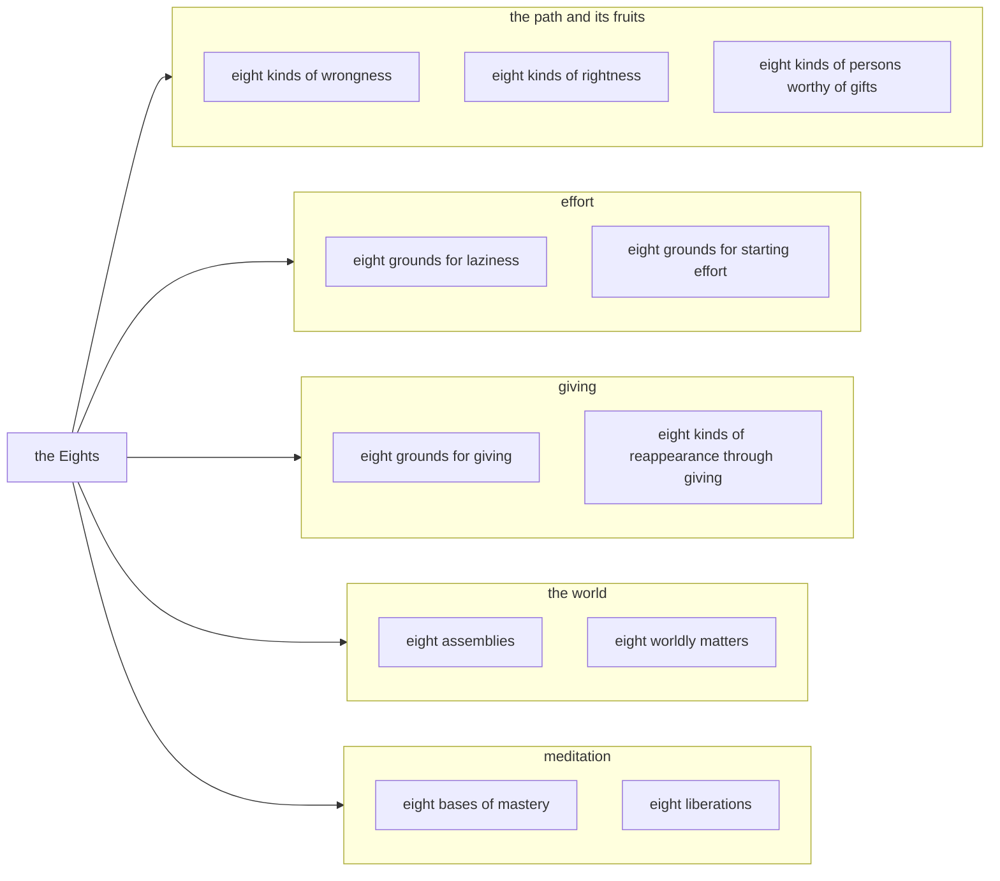

import { Tabs, TabItem } from '@astrojs/starlight/components';

Original text: [8D/10.8 Aṭṭhaka 1034–1077](https://tipitaka2500.github.io/tipitaka/8D/10/10.8.html#1034) in the [World Tipitaka Edition](https://tipitaka2500.github.io)

## Summary

The ninth part of the Saṅgītisutta: āyasmā Sāriputta recites to the bhikkhū the eleven sets of eight Dhammas well proclaimed by the Bhagavā. They run from the eightfold path and its inverse (the eight kinds of rightness and wrongness) and the eight kinds of persons worthy of gifts, through the eight grounds for laziness and the eight for starting effort, the eight grounds for giving and the eight kinds of reappearance through giving, the eight assemblies and the eight worldly matters, to the eight bases of mastery and the eight liberations.

## Diagram

## Text

<Tabs syncKey="paliquote">
<TabItem label="My Translation">
(333.)

1034\. Āvuso, there are eight Dhammas well proclaimed by the Bhagavā, the liberated one, the perfectly awakened one, who knows and sees. Therein all should recite in harmony, not quarrel, so that this optimal life may endure long and last for a long time, which would be for the welfare and happiness of many people, out of compassion for the world, for the good, welfare, and happiness of gods and humans. What eight?

1035\. Eight kinds of wrongness: wrong view, wrong resolve, wrong speech, wrong action, wrong livelihood, wrong effort, wrong awareness, and wrong focus. (1)

1036\. Eight kinds of rightness: right view, right resolve, right speech, right action, right livelihood, right effort, right awareness, and right focus. (2)

1037\. Eight kinds of persons worthy of gifts: the stream-enterer, the one practising for the realisation of the fruit of stream-entry; the once-returner, the one practising for the realisation of the fruit of once-returning; the non-returner, the one practising for the realisation of the fruit of non-returning; the liberated one, the one practising for the realisation of the fruit of the liberated state. (3)

(334.)

1038\. Eight grounds for laziness. Here, Āvuso, a bhikkhu has work to do. It occurs to him: ‘I will have work to do, but while I am doing the work my body will get tired; come, let me lie down.’ He lies down; he does not start effort for the attainment of the unattained, for the achievement of the unachieved, for the realisation of the unrealised. This is the first ground for laziness.

1039\. Again, Āvuso, a bhikkhu has done work. It occurs to him: ‘I have done work, but while I was doing the work my body got tired; come, let me lie down.’ He lies down; he does not start effort … and so on … this is the second ground for laziness.

1040\. Again, Āvuso, a bhikkhu has a road to travel. It occurs to him: ‘I will have a road to travel, but while I am travelling the road my body will get tired; come, let me lie down.’ He lies down; he does not start effort … this is the third ground for laziness.

1041\. Again, Āvuso, a bhikkhu has travelled a road. It occurs to him: ‘I have travelled a road, but while I was travelling the road my body got tired; come, let me lie down.’ He lies down; he does not start effort … this is the fourth ground for laziness.

1042\. Again, Āvuso, a bhikkhu, going for alms to a village or a town, does not get his fill of coarse or fine food, as much as he likes. It occurs to him: ‘Going for alms to a village or a town, I did not get my fill of coarse or fine food, as much as I like; that body of mine is tired and unfit for work; come, let me lie down.’ He lies down; he does not start effort … this is the fifth ground for laziness.

1043\. Again, Āvuso, a bhikkhu, going for alms to a village or a town, gets his fill of coarse or fine food, as much as he likes. It occurs to him: ‘Going for alms to a village or a town, I got my fill of coarse or fine food, as much as I like; that body of mine is heavy and unfit for work, a heap of beans, as it were; come, let me lie down.’ He lies down; he does not start effort … this is the sixth ground for laziness.

1044\. Again, Āvuso, a trifling illness has arisen in a bhikkhu. It occurs to him: ‘This trifling illness has arisen in me; it is fitting to lie down; come, let me lie down.’ He lies down; he does not start effort … this is the seventh ground for laziness.

1045\. Again, Āvuso, a bhikkhu has recovered from sickness, recently recovered from illness. It occurs to him: ‘I have recovered from sickness, recently recovered from illness; that body of mine is weak and unfit for work; come, let me lie down.’ He lies down; he does not start effort for the attainment of the unattained, for the achievement of the unachieved, for the realisation of the unrealised. This is the eighth ground for laziness. (4)

(335.)

1046\. Eight grounds for starting effort. Here, Āvuso, a bhikkhu has work to do. It occurs to him: ‘I will have work to do, but while I am doing the work it is not easy to attend to the teaching of the Buddhas; come, let me start effort for the attainment of the unattained, for the achievement of the unachieved, for the realisation of the unrealised.’ He starts effort for the attainment of the unattained, for the achievement of the unachieved, for the realisation of the unrealised. This is the first ground for starting effort.

1047\. Again, Āvuso, a bhikkhu has done work. It occurs to him: ‘I have done work, but while I was doing the work I was not able to attend to the teaching of the Buddhas; come, let me start effort … and so on … he starts effort … this is the second ground for starting effort.

1048\. Again, Āvuso, a bhikkhu has a road to travel. It occurs to him: ‘I will have a road to travel, but while I am travelling the road it is not easy to attend to the teaching of the Buddhas. Come, let me start effort … and so on … he starts effort … this is the third ground for starting effort.

1049\. Again, Āvuso, a bhikkhu has travelled a road. It occurs to him: ‘I have travelled a road, but while I was travelling the road I was not able to attend to the teaching of the Buddhas; come, let me start effort … and so on … he starts effort … this is the fourth ground for starting effort.

1050\. Again, Āvuso, a bhikkhu, going for alms to a village or a town, does not get his fill of coarse or fine food, as much as he likes. It occurs to him: ‘Going for alms to a village or a town, I did not get my fill of coarse or fine food, as much as I like; that body of mine is light and fit for work; come, let me start effort … and so on … he starts effort … this is the fifth ground for starting effort.

1051\. Again, Āvuso, a bhikkhu, going for alms to a village or a town, gets his fill of coarse or fine food, as much as he likes. It occurs to him: ‘Going for alms to a village or a town, I got my fill of coarse or fine food, as much as I like; that body of mine is strong and fit for work; come, let me start effort … and so on … he starts effort … this is the sixth ground for starting effort.

1052\. Again, Āvuso, a trifling illness has arisen in a bhikkhu. It occurs to him: ‘This trifling illness has arisen in me, and it is indeed possible that my illness might get worse; come, let me start effort … and so on … he starts effort … this is the seventh ground for starting effort.

1053\. Again, Āvuso, a bhikkhu has recovered from sickness, recently recovered from illness. It occurs to him: ‘I have recovered from sickness, recently recovered from illness, and it is indeed possible that my illness might relapse; come, let me start effort for the attainment of the unattained, for the achievement of the unachieved, for the realisation of the unrealised.’ He starts effort for the attainment of the unattained, for the achievement of the unachieved, for the realisation of the unrealised. This is the eighth ground for starting effort. (5)

(336.)

1054\. Eight grounds for giving. One gives a gift when approached; one gives a gift from fear; one gives a gift thinking, ‘He gave to me’; one gives a gift thinking, ‘He will give to me’; one gives a gift thinking, ‘Giving is good’; one gives a gift thinking, ‘I cook, these do not cook; I, who cook, should not fail to give a gift to those who do not cook’; one gives a gift thinking, ‘When I am giving this gift, a good reputation spreads’. One gives a gift for the sake of adorning the mind, of equipping the mind. (6)

(337.)

1055\. Eight kinds of reappearance through giving. Here, Āvuso, a certain person gives a gift to a wanderer or a brahmin: food, drink, clothing, a vehicle, garlands, perfumes and oils, bedding, housing and lighting. Whatever he gives, that he expects [in return]. He sees a wealthy man of the ruling caste, a wealthy brahmin, or a wealthy householder furnished and endowed with the five strands of sensual pleasure and being entertained. It occurs to him: ‘Oh, indeed! With the breakup of the body, after death, may I reappear in the company of wealthy men of the ruling caste, wealthy brahmins, or wealthy householders.’ He sets that thought, focuses and cultivates it; that thought of his, set on the inferior and not cultivated further, leads to reappearance there. And that, indeed, I say of one who is virtuous, not of one who is immoral. The mental aspiration of one who is virtuous succeeds, Āvuso, because of its purity. (7.1)

1056\. And furthermore, Āvuso, here someone gives a gift to a wanderer or a brahmin: food, drink … and so on … bedding, housing and lighting. Whatever he gives, he hopes for that. He has heard: ‘The Cātumahārājika gods are long-lived, beautiful, and abounding in happiness.’ It occurs to him: ‘Oh, indeed! After the breakup of the body at death, may I be reborn in the company of the Cātumahārājika gods.’ He sets that thought, focuses that thought, and cultivates that thought; that thought of his, fixed on the inferior and not cultivated further, leads to rearising there. And that, I say, is for one who is virtuous, not for one who is unprincipled. Āvuso, the mental aspiration of one who is virtuous succeeds because of purity. (7.2)

1057\. And furthermore, Āvuso, here someone gives a gift to a wanderer or a brahmin: food, drink … and so on … bedding, housing and lighting. Whatever he gives, he hopes for that. He has heard: ‘The Tāvatiṃsa gods … and so on … the Yāma gods … and so on … the Tusita gods … and so on … the Nimmānaratī gods … and so on … the Paranimmitavasavattī gods are long-lived, beautiful, and abounding in happiness.’ It occurs to him: ‘Oh, indeed! After the breakup of the body at death, may I be reborn in the company of the Paranimmitavasavattī gods.’ He sets that thought, focuses that thought, and cultivates that thought; that thought of his, fixed on the inferior and not cultivated further, leads to rearising there. And that, I say, is for one who is virtuous, not for one who is unprincipled. Āvuso, the mental aspiration of one who is virtuous succeeds because of purity. (7.3--7)

1058\. And furthermore, Āvuso, here someone gives a gift to a wanderer or a brahmin: food, drink, clothing, a vehicle, garlands, perfumes and oils, bedding, housing and lighting. Whatever he gives, he hopes for that. He has heard: ‘The Brahmakāyika gods are long-lived, beautiful, and abounding in happiness.’ It occurs to him: ‘Oh, indeed! After the breakup of the body at death, may I be reborn in the company of the Brahmakāyika gods.’ He sets that thought, focuses that thought, and cultivates that thought; that thought of his, fixed on the inferior and not cultivated further, leads to rearising there. And that, I say, is for one who is virtuous, not for one who is unprincipled; for one free from passion, not for one with passion. Āvuso, the mental aspiration of one who is virtuous succeeds because of freedom from passion. (7.8)

1059\. Eight assemblies: of khattiyas, of brahmins, of householders, of wanderers, of the Cātumahārājika gods, of the Tāvatiṃsa gods, of Māra, and of Brahmā. (8)

1060\. Eight worldly matters: gain, loss, fame, infamy, blame, praise, happiness, and suffering. (9)

(338.)

1061\. Eight bases of mastery. One with `rūpasaññā` (apperception of form) internally sees forms externally, limited, beautiful and ugly; one has this apperception: ‘Having mastered them, I know, I see.’ This is the first base of mastery.

1062\. One with apperception of form internally sees forms externally, unlimited, beautiful and ugly; one has this apperception: ‘Having mastered them, I know, I see.’ This is the second base of mastery.

1063\. One without apperception of form internally sees forms externally, limited, beautiful and ugly; one has this apperception: ‘Having mastered them, I know, I see.’ This is the third base of mastery.

1064\. One without apperception of form internally sees forms externally, unlimited, beautiful and ugly; one has this apperception: ‘Having mastered them, I know, I see.’ This is the fourth base of mastery.

1065\. One without apperception of form internally sees forms externally, blue, blue in colour, blue in appearance, radiating blue. Just as a flax flower is blue, blue in colour, blue in appearance, radiating blue, or just as that cloth from Bārāṇasī, smoothed on both sides, is blue, blue in colour, blue in appearance, radiating blue; even so, one without apperception of form internally sees forms externally, blue, blue in colour, blue in appearance, radiating blue; one has this apperception: ‘Having mastered them, I know, I see.’ This is the fifth base of mastery.

1066\. One without apperception of form internally sees forms externally, yellow, yellow in colour, yellow in appearance, radiating yellow. Just as a kaṇikāra flower is yellow, yellow in colour, yellow in appearance, radiating yellow, or just as that cloth from Bārāṇasī, smoothed on both sides, is yellow, yellow in colour, yellow in appearance, radiating yellow; even so, one without apperception of form internally sees forms externally, yellow, yellow in colour, yellow in appearance, radiating yellow; one has this apperception: ‘Having mastered them, I know, I see.’ This is the sixth base of mastery.

1067\. One without apperception of form internally sees forms externally, red, red in colour, red in appearance, radiating red. Just as a bandhujīvaka flower is red, red in colour, red in appearance, radiating red, or just as that cloth from Bārāṇasī, smoothed on both sides, is red, red in colour, red in appearance, radiating red; even so, one without apperception of form internally sees forms externally, red, red in colour, red in appearance, radiating red; one has this apperception: ‘Having mastered them, I know, I see.’ This is the seventh base of mastery.

1068\. One without apperception of form internally sees forms externally, white, white in colour, white in appearance, radiating white. Just as the morning star is white, white in colour, white in appearance, radiating white, or just as that cloth from Bārāṇasī, smoothed on both sides, is white, white in colour, white in appearance, radiating white; even so, one without apperception of form internally sees forms externally, white, white in colour, white in appearance, radiating white; one has this apperception: ‘Having mastered them, I know, I see.’ This is the eighth base of mastery. (10)

(339.)

1069\. Eight liberations. One having form sees forms. This is the first liberation.

1070\. One without apperception of form internally sees forms externally. This is the second liberation.

1071\. One is intent only on the beautiful. This is the third liberation.

1072\. Going beyond `rūpasaññā` (apperceptions of form) altogether, with the disappearance of apperceptions of sense impressions, ignoring the apperceptions of diversity, thinking: ‘Space is infinite,’ he enters and remains in the base of the infinity of space. This is the fourth liberation.

1073\. Going beyond the base of the infinity of space altogether, thinking: ‘Consciousness is infinite,’ he enters and remains in the base of the infinity of consciousness. This is the fifth liberation.

1074\. Going beyond the base of the infinity of consciousness altogether, thinking: ‘There is nothing,’ he enters and remains in the base of nothingness. This is the sixth liberation.

1075\. Going beyond the base of nothingness altogether, he enters and remains in the base of neither apperception nor non-apperception. This is the seventh liberation.

1076\. Going beyond the base of neither apperception nor non-apperception altogether, he enters and remains in the cessation of apperception and feeling. This is the eighth liberation. (11)

1077\. Āvuso, these are the eight Dhammas well proclaimed by the Bhagavā, the liberated one, the perfectly awakened one, who knows and sees. Therein all should recite in harmony, not quarrel, so that this optimal life may endure long and last for a long time, which would be for the welfare and happiness of many people, out of compassion for the world, for the good, welfare, and happiness of gods and humans.
</TabItem>

<TabItem label="Pāḷi (Roman IAST)">
(333.)

1034\. Atthi kho, āvuso, tena bhagavatā jānatā passatā arahatā sammāsambuddhena aṭṭha dhammā sammadakkhātā; tattha sabbeheva saṅgāyitabbaṃ…pe… atthāya hitāya sukhāya devamanussānaṃ. Katame aṭṭha?

1035\. Aṭṭha micchattā— micchādiṭṭhi, micchāsaṅkappo, micchāvācā, micchākammanto, micchāājīvo, micchāvāyāmo micchāsati, micchāsamādhi. (1)

1036\. Aṭṭha sammattā— sammādiṭṭhi, sammāsaṅkappo, sammāvācā, sammākammanto, sammāājīvo, sammāvāyāmo, sammāsati, sammāsamādhi. (2)

1037\. Aṭṭha puggalā dakkhiṇeyyā— sotāpanno, sotāpattiphalasacchikiriyāya paṭipanno; sakadāgāmī, sakadāgāmiphalasacchikiriyāya paṭipanno; anāgāmī, anāgāmiphalasacchikiriyāya paṭipanno; arahā, arahattaphalasacchikiriyāya paṭipanno. (3)

(334.)

1038\. Aṭṭha kusītavatthūni. Idhāvuso, bhikkhunā kammaṃ kātabbaṃ hoti. Tassa evaṃ hoti— ‘kammaṃ kho me kātabbaṃ bhavissati, kammaṃ kho pana me karontassa kāyo kilamissati, handāhaṃ nipajjāmī’ti. So nipajjati na vīriyaṃ ārabhati appattassa pattiyā anadhigatassa adhigamāya asacchikatassa sacchikiriyāya. Idaṃ paṭhamaṃ kusītavatthu.

1039\. Puna caparaṃ, āvuso, bhikkhunā kammaṃ kataṃ hoti. Tassa evaṃ hoti— ‘ahaṃ kho kammaṃ akāsiṃ, kammaṃ kho pana me karontassa kāyo kilanto, handāhaṃ nipajjāmī’ti. So nipajjati na vīriyaṃ ārabhati…pe… idaṃ dutiyaṃ kusītavatthu.

1040\. Puna caparaṃ, āvuso, bhikkhunā maggo gantabbo hoti. Tassa evaṃ hoti— ‘maggo kho me gantabbo bhavissati, maggaṃ kho pana me gacchantassa kāyo kilamissati, handāhaṃ nipajjāmī’ti. So nipajjati na vīriyaṃ ārabhati… idaṃ tatiyaṃ kusītavatthu.

1041\. Puna caparaṃ, āvuso, bhikkhunā maggo gato hoti. Tassa evaṃ hoti— ‘ahaṃ kho maggaṃ agamāsiṃ, maggaṃ kho pana me gacchantassa kāyo kilanto, handāhaṃ nipajjāmī’ti. So nipajjati na vīriyaṃ ārabhati… idaṃ catutthaṃ kusītavatthu.

1042\. Puna caparaṃ, āvuso, bhikkhu gāmaṃ vā nigamaṃ vā piṇḍāya caranto na labhati lūkhassa vā paṇītassa vā bhojanassa yāvadatthaṃ pāripūriṃ. Tassa evaṃ hoti— ‘ahaṃ kho gāmaṃ vā nigamaṃ vā piṇḍāya caranto nālatthaṃ lūkhassa vā paṇītassa vā bhojanassa yāvadatthaṃ pāripūriṃ, tassa me kāyo kilanto akammañño, handāhaṃ nipajjāmī’ti. So nipajjati na vīriyaṃ ārabhati… idaṃ pañcamaṃ kusītavatthu.

1043\. Puna caparaṃ, āvuso, bhikkhu gāmaṃ vā nigamaṃ vā piṇḍāya caranto labhati lūkhassa vā paṇītassa vā bhojanassa yāvadatthaṃ pāripūriṃ. Tassa evaṃ hoti— ‘ahaṃ kho gāmaṃ vā nigamaṃ vā piṇḍāya caranto alatthaṃ lūkhassa vā paṇītassa vā bhojanassa yāvadatthaṃ pāripūriṃ, tassa me kāyo garuko akammañño, māsācitaṃ maññe, handāhaṃ nipajjāmī’ti. So nipajjati na vīriyaṃ ārabhati… idaṃ chaṭṭhaṃ kusītavatthu.

1044\. Puna caparaṃ, āvuso, bhikkhuno uppanno hoti appamattako ābādho. Tassa evaṃ hoti— ‘uppanno kho me ayaṃ appamattako ābādho; atthi kappo nipajjituṃ, handāhaṃ nipajjāmī’ti. So nipajjati na vīriyaṃ ārabhati… idaṃ sattamaṃ kusītavatthu.

1045\. Puna caparaṃ, āvuso, bhikkhu gilānā vuṭṭhito hoti aciravuṭṭhito gelaññā. Tassa evaṃ hoti— ‘ahaṃ kho gilānā vuṭṭhito aciravuṭṭhito gelaññā, tassa me kāyo dubbalo akammañño, handāhaṃ nipajjāmī’ti. So nipajjati na vīriyaṃ ārabhati appattassa pattiyā anadhigatassa adhigamāya asacchikatassa sacchikiriyāya. Idaṃ aṭṭhamaṃ kusītavatthu. (4)

(335.)

1046\. Aṭṭha ārambhavatthūni. Idhāvuso, bhikkhunā kammaṃ kātabbaṃ hoti. Tassa evaṃ hoti— ‘kammaṃ kho me kātabbaṃ bhavissati, kammaṃ kho pana me karontena na sukaraṃ buddhānaṃ sāsanaṃ manasi kātuṃ, handāhaṃ vīriyaṃ ārabhāmi appattassa pattiyā anadhigatassa adhigamāya, asacchikatassa sacchikiriyāyā’ti. So vīriyaṃ ārabhati appattassa pattiyā, anadhigatassa adhigamāya asacchikatassa sacchikiriyāya. Idaṃ paṭhamaṃ ārambhavatthu.

1047\. Puna caparaṃ, āvuso, bhikkhunā kammaṃ kataṃ hoti. Tassa evaṃ hoti— ‘ahaṃ kho kammaṃ akāsiṃ, kammaṃ kho panāhaṃ karonto nāsakkhiṃ buddhānaṃ sāsanaṃ manasi kātuṃ, handāhaṃ vīriyaṃ ārabhāmi…pe… so vīriyaṃ ārabhati… idaṃ dutiyaṃ ārambhavatthu.

1048\. Puna caparaṃ, āvuso, bhikkhunā maggo gantabbo hoti. Tassa evaṃ hoti— ‘maggo kho me gantabbo bhavissati, maggaṃ kho pana me gacchantena na sukaraṃ buddhānaṃ sāsanaṃ manasi kātuṃ. Handāhaṃ vīriyaṃ ārabhāmi…pe… so vīriyaṃ ārabhati… idaṃ tatiyaṃ ārambhavatthu.

1049\. Puna caparaṃ, āvuso, bhikkhunā maggo gato hoti. Tassa evaṃ hoti— ‘ahaṃ kho maggaṃ agamāsiṃ, maggaṃ kho panāhaṃ gacchanto nāsakkhiṃ buddhānaṃ sāsanaṃ manasi kātuṃ, handāhaṃ vīriyaṃ ārabhāmi…pe… so vīriyaṃ ārabhati… idaṃ catutthaṃ ārambhavatthu.

1050\. Puna caparaṃ, āvuso, bhikkhu gāmaṃ vā nigamaṃ vā piṇḍāya caranto na labhati lūkhassa vā paṇītassa vā bhojanassa yāvadatthaṃ pāripūriṃ. Tassa evaṃ hoti— ‘ahaṃ kho gāmaṃ vā nigamaṃ vā piṇḍāya caranto nālatthaṃ lūkhassa vā paṇītassa vā bhojanassa yāvadatthaṃ pāripūriṃ, tassa me kāyo lahuko kammañño, handāhaṃ vīriyaṃ ārabhāmi…pe… so vīriyaṃ ārabhati… idaṃ pañcamaṃ ārambhavatthu.

1051\. Puna caparaṃ, āvuso, bhikkhu gāmaṃ vā nigamaṃ vā piṇḍāya caranto labhati lūkhassa vā paṇītassa vā bhojanassa yāvadatthaṃ pāripūriṃ. Tassa evaṃ hoti— ‘ahaṃ kho gāmaṃ vā nigamaṃ vā piṇḍāya caranto alatthaṃ lūkhassa vā paṇītassa vā bhojanassa yāvadatthaṃ pāripūriṃ, tassa me kāyo balavā kammañño, handāhaṃ vīriyaṃ ārabhāmi…pe… so vīriyaṃ ārabhati… idaṃ chaṭṭhaṃ ārambhavatthu.

1052\. Puna caparaṃ, āvuso, bhikkhuno uppanno hoti appamattako ābādho. Tassa evaṃ hoti— ‘uppanno kho me ayaṃ appamattako ābādho, ṭhānaṃ kho panetaṃ vijjati yaṃ me ābādho pavaḍḍheyya, handāhaṃ vīriyaṃ ārabhāmi…pe… so vīriyaṃ ārabhati… idaṃ sattamaṃ ārambhavatthu.

1053\. Puna caparaṃ, āvuso, bhikkhu gilānā vuṭṭhito hoti aciravuṭṭhito gelaññā. Tassa evaṃ hoti— ‘ahaṃ kho gilānā vuṭṭhito aciravuṭṭhito gelaññā, ṭhānaṃ kho panetaṃ vijjati yaṃ me ābādho paccudāvatteyya, handāhaṃ vīriyaṃ ārabhāmi appattassa pattiyā anadhigatassa adhigamāya asacchikatassa sacchikiriyāyā’ti. So vīriyaṃ ārabhati appattassa pattiyā anadhigatassa adhigamāya asacchikatassa sacchikiriyāya. Idaṃ aṭṭhamaṃ ārambhavatthu. (5)

(336.)

1054\. Aṭṭha dānavatthūni. Āsajja dānaṃ deti, bhayā dānaṃ deti, ‘adāsi me’ti dānaṃ deti, ‘dassati me’ti dānaṃ deti, ‘sāhu dānan’ti dānaṃ deti, ‘ahaṃ pacāmi, ime na pacanti, nārahāmi pacanto apacantānaṃ dānaṃ na dātun’ti dānaṃ deti, ‘idaṃ me dānaṃ dadato kalyāṇo kittisaddo abbhuggacchatī’ti dānaṃ deti. Cittālaṅkāracittaparikkhāratthaṃ dānaṃ deti. (6)

(337.)

1055\. Aṭṭha dānūpapattiyo. Idhāvuso, ekacco dānaṃ deti samaṇassa vā brāhmaṇassa vā annaṃ pānaṃ vatthaṃ yānaṃ mālāgandhavilepanaṃ seyyāvasathapadīpeyyaṃ. So yaṃ deti taṃ paccāsīsati. So passati khattiyamahāsālaṃ vā brāhmaṇamahāsālaṃ vā gahapatimahāsālaṃ vā pañcahi kāmaguṇehi samappitaṃ samaṅgībhūtaṃ paricārayamānaṃ. Tassa evaṃ hoti— ‘aho vatāhaṃ kāyassa bhedā paraṃ maraṇā khattiyamahāsālānaṃ vā brāhmaṇamahāsālānaṃ vā gahapatimahāsālānaṃ vā sahabyataṃ upapajjeyyan’ti. So taṃ cittaṃ dahati, taṃ cittaṃ adhiṭṭhāti, taṃ cittaṃ bhāveti, tassa taṃ cittaṃ hīne vimuttaṃ uttari abhāvitaṃ tatrūpapattiyā saṃvattati. Tañca kho sīlavato vadāmi no dussīlassa. Ijjhatāvuso, sīlavato cetopaṇidhi visuddhattā. (7.1)

1056\. Puna caparaṃ, āvuso, idhekacco dānaṃ deti samaṇassa vā brāhmaṇassa vā annaṃ pānaṃ…pe… seyyāvasathapadīpeyyaṃ. So yaṃ deti taṃ paccāsīsati. Tassa sutaṃ hoti— ‘cātumahārājikā devā dīghāyukā vaṇṇavanto sukhabahulā’ti. Tassa evaṃ hoti— ‘aho vatāhaṃ kāyassa bhedā paraṃ maraṇā cātumahārājikānaṃ devānaṃ sahabyataṃ upapajjeyyan’ti. So taṃ cittaṃ dahati, taṃ cittaṃ adhiṭṭhāti, taṃ cittaṃ bhāveti, tassa taṃ cittaṃ hīne vimuttaṃ uttari abhāvitaṃ tatrūpapattiyā saṃvattati. Tañca kho sīlavato vadāmi no dussīlassa. Ijjhatāvuso, sīlavato cetopaṇidhi visuddhattā. (7.2)

1057\. Puna caparaṃ, āvuso, idhekacco dānaṃ deti samaṇassa vā brāhmaṇassa vā annaṃ pānaṃ…pe… seyyāvasathapadīpeyyaṃ. So yaṃ deti taṃ paccāsīsati. Tassa sutaṃ hoti— ‘tāvatiṃsā devā…pe… yāmā devā…pe… tusitā devā…pe… nimmānaratī devā…pe… paranimmitavasavattī devā dīghāyukā vaṇṇavanto sukhabahulā’ti. Tassa evaṃ hoti— ‘aho vatāhaṃ kāyassa bhedā paraṃ maraṇā paranimmitavasavattīnaṃ devānaṃ sahabyataṃ upapajjeyyan’ti. So taṃ cittaṃ dahati, taṃ cittaṃ adhiṭṭhāti, taṃ cittaṃ bhāveti, tassa taṃ cittaṃ hīne vimuttaṃ uttari abhāvitaṃ tatrūpapattiyā saṃvattati. Tañca kho sīlavato vadāmi no dussīlassa. Ijjhatāvuso, sīlavato cetopaṇidhi visuddhattā. (7.3--7)

1058\. Puna caparaṃ, āvuso, idhekacco dānaṃ deti samaṇassa vā brāhmaṇassa vā annaṃ pānaṃ vatthaṃ yānaṃ mālāgandhavilepanaṃ seyyāvasathapadīpeyyaṃ. So yaṃ deti taṃ paccāsīsati. Tassa sutaṃ hoti— ‘brahmakāyikā devā dīghāyukā vaṇṇavanto sukhabahulā’ti. Tassa evaṃ hoti— ‘aho vatāhaṃ kāyassa bhedā paraṃ maraṇā brahmakāyikānaṃ devānaṃ sahabyataṃ upapajjeyyan’ti. So taṃ cittaṃ dahati, taṃ cittaṃ adhiṭṭhāti, taṃ cittaṃ bhāveti, tassa taṃ cittaṃ hīne vimuttaṃ uttari abhāvitaṃ tatrūpapattiyā saṃvattati. Tañca kho sīlavato vadāmi no dussīlassa; vītarāgassa no sarāgassa. Ijjhatāvuso, sīlavato cetopaṇidhi vītarāgattā. (7.8)

1059\. Aṭṭha parisā— khattiyaparisā, brāhmaṇaparisā, gahapatiparisā, samaṇaparisā, cātumahārājikaparisā, tāvatiṃsaparisā, māraparisā, brahmaparisā. (8)

1060\. Aṭṭha lokadhammā— lābho ca, alābho ca, yaso ca, ayaso ca, nindā ca, pasaṃsā ca, sukhañca, dukkhañca. (9)

(338.)

1061\. Aṭṭha abhibhāyatanāni. Ajjhattaṃ rūpasaññī eko bahiddhā rūpāni passati parittāni suvaṇṇadubbaṇṇāni, ‘tāni abhibhuyya jānāmi passāmī’ti evaṃsaññī hoti. Idaṃ paṭhamaṃ abhibhāyatanaṃ.

1062\. Ajjhattaṃ rūpasaññī eko bahiddhā rūpāni passati appamāṇāni suvaṇṇadubbaṇṇāni, ‘tāni abhibhuyya jānāmi passāmī’ti— evaṃsaññī hoti. Idaṃ dutiyaṃ abhibhāyatanaṃ.

1063\. Ajjhattaṃ arūpasaññī eko bahiddhā rūpāni passati parittāni suvaṇṇadubbaṇṇāni, ‘tāni abhibhuyya jānāmi passāmī’ti evaṃsaññī hoti. Idaṃ tatiyaṃ abhibhāyatanaṃ.

1064\. Ajjhattaṃ arūpasaññī eko bahiddhā rūpāni passati appamāṇāni suvaṇṇadubbaṇṇāni, ‘tāni abhibhuyya jānāmi passāmī’ti evaṃsaññī hoti. Idaṃ catutthaṃ abhibhāyatanaṃ.

1065\. Ajjhattaṃ arūpasaññī eko bahiddhā rūpāni passati nīlāni nīlavaṇṇāni nīlanidassanāni nīlanibhāsāni. Seyyathāpi nāma umāpupphaṃ nīlaṃ nīlavaṇṇaṃ nīlanidassanaṃ nīlanibhāsaṃ, seyyathā vā pana taṃ vatthaṃ bārāṇaseyyakaṃ ubhatobhāgavimaṭṭhaṃ nīlaṃ nīlavaṇṇaṃ nīlanidassanaṃ nīlanibhāsaṃ; evameva ajjhattaṃ arūpasaññī eko bahiddhā rūpāni passati nīlāni nīlavaṇṇāni nīlanidassanāni nīlanibhāsāni, ‘tāni abhibhuyya jānāmi passāmī’ti evaṃsaññī hoti. Idaṃ pañcamaṃ abhibhāyatanaṃ.

1066\. Ajjhattaṃ arūpasaññī eko bahiddhā rūpāni passati pītāni pītavaṇṇāni pītanidassanāni pītanibhāsāni. Seyyathāpi nāma kaṇikārapupphaṃ pītaṃ pītavaṇṇaṃ pītanidassanaṃ pītanibhāsaṃ, seyyathā vā pana taṃ vatthaṃ bārāṇaseyyakaṃ ubhatobhāgavimaṭṭhaṃ pītaṃ pītavaṇṇaṃ pītanidassanaṃ pītanibhāsaṃ; evameva ajjhattaṃ arūpasaññī eko bahiddhā rūpāni passati pītāni pītavaṇṇāni pītanidassanāni pītanibhāsāni, ‘tāni abhibhuyya jānāmi passāmī’ti evaṃsaññī hoti. Idaṃ chaṭṭhaṃ abhibhāyatanaṃ.

1067\. Ajjhattaṃ arūpasaññī eko bahiddhā rūpāni passati lohitakāni lohitakavaṇṇāni lohitakanidassanāni lohitakanibhāsāni. Seyyathāpi nāma bandhujīvakapupphaṃ lohitakaṃ lohitakavaṇṇaṃ lohitakanidassanaṃ lohitakanibhāsaṃ, seyyathā vā pana taṃ vatthaṃ bārāṇaseyyakaṃ ubhatobhāgavimaṭṭhaṃ lohitakaṃ lohitakavaṇṇaṃ lohitakanidassanaṃ lohitakanibhāsaṃ; evameva ajjhattaṃ arūpasaññī eko bahiddhā rūpāni passati lohitakāni lohitakavaṇṇāni lohitakanidassanāni lohitakanibhāsāni, ‘tāni abhibhuyya jānāmi passāmī’ti evaṃsaññī hoti. Idaṃ sattamaṃ abhibhāyatanaṃ.

1068\. Ajjhattaṃ arūpasaññī eko bahiddhā rūpāni passati odātāni odātavaṇṇāni odātanidassanāni odātanibhāsāni. Seyyathāpi nāma osadhitārakā odātā odātavaṇṇā odātanidassanā odātanibhāsā, seyyathā vā pana taṃ vatthaṃ bārāṇaseyyakaṃ ubhatobhāgavimaṭṭhaṃ odātaṃ odātavaṇṇaṃ odātanidassanaṃ odātanibhāsaṃ; evameva ajjhattaṃ arūpasaññī eko bahiddhā rūpāni passati odātāni odātavaṇṇāni odātanidassanāni odātanibhāsāni, ‘tāni abhibhuyya jānāmi passāmī’ti evaṃsaññī hoti. Idaṃ aṭṭhamaṃ abhibhāyatanaṃ. (10)

(339.)

1069\. Aṭṭha vimokkhā. Rūpī rūpāni passati. Ayaṃ paṭhamo vimokkho.

1070\. Ajjhattaṃ arūpasaññī bahiddhā rūpāni passati. Ayaṃ dutiyo vimokkho.

1071\. Subhanteva adhimutto hoti. Ayaṃ tatiyo vimokkho.

1072\. Sabbaso rūpasaññānaṃ samatikkamā paṭighasaññānaṃ atthaṅgamā nānattasaññānaṃ amanasikārā ‘ananto ākāso’ti ākāsānañcāyatanaṃ upasampajja viharati. Ayaṃ catuttho vimokkho.

1073\. Sabbaso ākāsānañcāyatanaṃ samatikkamma ‘anantaṃ viññāṇan’ti viññāṇañcāyatanaṃ upasampajja viharati. Ayaṃ pañcamo vimokkho.

1074\. Sabbaso viññāṇañcāyatanaṃ samatikkamma ‘natthi kiñcī’ti ākiñcaññāyatanaṃ upasampajja viharati. Ayaṃ chaṭṭho vimokkho.

1075\. Sabbaso ākiñcaññāyatanaṃ samatikkamma nevasaññānāsaññāyatanaṃ upasampajja viharati. Ayaṃ sattamo vimokkho.

1076\. Sabbaso nevasaññānāsaññāyatanaṃ samatikkamma saññāvedayitanirodhaṃ upasampajja viharati. Ayaṃ aṭṭhamo vimokkho. (11)

1077\. Ime kho, āvuso, tena bhagavatā jānatā passatā arahatā sammāsambuddhena aṭṭha dhammā sammadakkhātā; tattha sabbeheva saṅgāyitabbaṃ…pe… atthāya hitāya sukhāya devamanussānaṃ.
</TabItem>

<TabItem label="Pāḷi (Brahmi)">
(333.)

1034\. 𑀅𑀢𑁆𑀣𑀺 𑀔𑁄, 𑀆𑀯𑀼𑀲𑁄, 𑀢𑁂𑀦 𑀪𑀕𑀯𑀢𑀸 𑀚𑀸𑀦𑀢𑀸 𑀧𑀲𑁆𑀲𑀢𑀸 𑀅𑀭𑀳𑀢𑀸 𑀲𑀫𑁆𑀫𑀸𑀲𑀫𑁆𑀩𑀼𑀤𑁆𑀥𑁂𑀦 𑀅𑀝𑁆𑀞 𑀥𑀫𑁆𑀫𑀸 𑀲𑀫𑁆𑀫𑀤𑀓𑁆𑀔𑀸𑀢𑀸; 𑀢𑀢𑁆𑀣 𑀲𑀩𑁆𑀩𑁂𑀳𑁂𑀯 𑀲𑀗𑁆𑀕𑀸𑀬𑀺𑀢𑀩𑁆𑀩𑀁…𑀧𑁂… 𑀅𑀢𑁆𑀣𑀸𑀬 𑀳𑀺𑀢𑀸𑀬 𑀲𑀼𑀔𑀸𑀬 𑀤𑁂𑀯𑀫𑀦𑀼𑀲𑁆𑀲𑀸𑀦𑀁. 𑀓𑀢𑀫𑁂 𑀅𑀝𑁆𑀞?

1035\. 𑀅𑀝𑁆𑀞 𑀫𑀺𑀘𑁆𑀙𑀢𑁆𑀢𑀸— 𑀫𑀺𑀘𑁆𑀙𑀸𑀤𑀺𑀝𑁆𑀞𑀺, 𑀫𑀺𑀘𑁆𑀙𑀸𑀲𑀗𑁆𑀓𑀧𑁆𑀧𑁄, 𑀫𑀺𑀘𑁆𑀙𑀸𑀯𑀸𑀘𑀸, 𑀫𑀺𑀘𑁆𑀙𑀸𑀓𑀫𑁆𑀫𑀦𑁆𑀢𑁄, 𑀫𑀺𑀘𑁆𑀙𑀸𑀆𑀚𑀻𑀯𑁄, 𑀫𑀺𑀘𑁆𑀙𑀸𑀯𑀸𑀬𑀸𑀫𑁄 𑀫𑀺𑀘𑁆𑀙𑀸𑀲𑀢𑀺, 𑀫𑀺𑀘𑁆𑀙𑀸𑀲𑀫𑀸𑀥𑀺. (1)

1036\. 𑀅𑀝𑁆𑀞 𑀲𑀫𑁆𑀫𑀢𑁆𑀢𑀸— 𑀲𑀫𑁆𑀫𑀸𑀤𑀺𑀝𑁆𑀞𑀺, 𑀲𑀫𑁆𑀫𑀸𑀲𑀗𑁆𑀓𑀧𑁆𑀧𑁄, 𑀲𑀫𑁆𑀫𑀸𑀯𑀸𑀘𑀸, 𑀲𑀫𑁆𑀫𑀸𑀓𑀫𑁆𑀫𑀦𑁆𑀢𑁄, 𑀲𑀫𑁆𑀫𑀸𑀆𑀚𑀻𑀯𑁄, 𑀲𑀫𑁆𑀫𑀸𑀯𑀸𑀬𑀸𑀫𑁄, 𑀲𑀫𑁆𑀫𑀸𑀲𑀢𑀺, 𑀲𑀫𑁆𑀫𑀸𑀲𑀫𑀸𑀥𑀺. (2)

1037\. 𑀅𑀝𑁆𑀞 𑀧𑀼𑀕𑁆𑀕𑀮𑀸 𑀤𑀓𑁆𑀔𑀺𑀡𑁂𑀬𑁆𑀬𑀸— 𑀲𑁄𑀢𑀸𑀧𑀦𑁆𑀦𑁄, 𑀲𑁄𑀢𑀸𑀧𑀢𑁆𑀢𑀺𑀨𑀮𑀲𑀘𑁆𑀙𑀺𑀓𑀺𑀭𑀺𑀬𑀸𑀬 𑀧𑀝𑀺𑀧𑀦𑁆𑀦𑁄; 𑀲𑀓𑀤𑀸𑀕𑀸𑀫𑀻, 𑀲𑀓𑀤𑀸𑀕𑀸𑀫𑀺𑀨𑀮𑀲𑀘𑁆𑀙𑀺𑀓𑀺𑀭𑀺𑀬𑀸𑀬 𑀧𑀝𑀺𑀧𑀦𑁆𑀦𑁄; 𑀅𑀦𑀸𑀕𑀸𑀫𑀻, 𑀅𑀦𑀸𑀕𑀸𑀫𑀺𑀨𑀮𑀲𑀘𑁆𑀙𑀺𑀓𑀺𑀭𑀺𑀬𑀸𑀬 𑀧𑀝𑀺𑀧𑀦𑁆𑀦𑁄; 𑀅𑀭𑀳𑀸, 𑀅𑀭𑀳𑀢𑁆𑀢𑀨𑀮𑀲𑀘𑁆𑀙𑀺𑀓𑀺𑀭𑀺𑀬𑀸𑀬 𑀧𑀝𑀺𑀧𑀦𑁆𑀦𑁄. (3)

(334.)

1038\. 𑀅𑀝𑁆𑀞 𑀓𑀼𑀲𑀻𑀢𑀯𑀢𑁆𑀣𑀽𑀦𑀺. 𑀇𑀥𑀸𑀯𑀼𑀲𑁄, 𑀪𑀺𑀓𑁆𑀔𑀼𑀦𑀸 𑀓𑀫𑁆𑀫𑀁 𑀓𑀸𑀢𑀩𑁆𑀩𑀁 𑀳𑁄𑀢𑀺. 𑀢𑀲𑁆𑀲 𑀏𑀯𑀁 𑀳𑁄𑀢𑀺— ‘𑀓𑀫𑁆𑀫𑀁 𑀔𑁄 𑀫𑁂 𑀓𑀸𑀢𑀩𑁆𑀩𑀁 𑀪𑀯𑀺𑀲𑁆𑀲𑀢𑀺, 𑀓𑀫𑁆𑀫𑀁 𑀔𑁄 𑀧𑀦 𑀫𑁂 𑀓𑀭𑁄𑀦𑁆𑀢𑀲𑁆𑀲 𑀓𑀸𑀬𑁄 𑀓𑀺𑀮𑀫𑀺𑀲𑁆𑀲𑀢𑀺, 𑀳𑀦𑁆𑀤𑀸𑀳𑀁 𑀦𑀺𑀧𑀚𑁆𑀚𑀸𑀫𑀻’𑀢𑀺. 𑀲𑁄 𑀦𑀺𑀧𑀚𑁆𑀚𑀢𑀺 𑀦 𑀯𑀻𑀭𑀺𑀬𑀁 𑀆𑀭𑀪𑀢𑀺 𑀅𑀧𑁆𑀧𑀢𑁆𑀢𑀲𑁆𑀲 𑀧𑀢𑁆𑀢𑀺𑀬𑀸 𑀅𑀦𑀥𑀺𑀕𑀢𑀲𑁆𑀲 𑀅𑀥𑀺𑀕𑀫𑀸𑀬 𑀅𑀲𑀘𑁆𑀙𑀺𑀓𑀢𑀲𑁆𑀲 𑀲𑀘𑁆𑀙𑀺𑀓𑀺𑀭𑀺𑀬𑀸𑀬. 𑀇𑀤𑀁 𑀧𑀞𑀫𑀁 𑀓𑀼𑀲𑀻𑀢𑀯𑀢𑁆𑀣𑀼.

1039\. 𑀧𑀼𑀦 𑀘𑀧𑀭𑀁, 𑀆𑀯𑀼𑀲𑁄, 𑀪𑀺𑀓𑁆𑀔𑀼𑀦𑀸 𑀓𑀫𑁆𑀫𑀁 𑀓𑀢𑀁 𑀳𑁄𑀢𑀺. 𑀢𑀲𑁆𑀲 𑀏𑀯𑀁 𑀳𑁄𑀢𑀺— ‘𑀅𑀳𑀁 𑀔𑁄 𑀓𑀫𑁆𑀫𑀁 𑀅𑀓𑀸𑀲𑀺𑀁, 𑀓𑀫𑁆𑀫𑀁 𑀔𑁄 𑀧𑀦 𑀫𑁂 𑀓𑀭𑁄𑀦𑁆𑀢𑀲𑁆𑀲 𑀓𑀸𑀬𑁄 𑀓𑀺𑀮𑀦𑁆𑀢𑁄, 𑀳𑀦𑁆𑀤𑀸𑀳𑀁 𑀦𑀺𑀧𑀚𑁆𑀚𑀸𑀫𑀻’𑀢𑀺. 𑀲𑁄 𑀦𑀺𑀧𑀚𑁆𑀚𑀢𑀺 𑀦 𑀯𑀻𑀭𑀺𑀬𑀁 𑀆𑀭𑀪𑀢𑀺…𑀧𑁂… 𑀇𑀤𑀁 𑀤𑀼𑀢𑀺𑀬𑀁 𑀓𑀼𑀲𑀻𑀢𑀯𑀢𑁆𑀣𑀼.

1040\. 𑀧𑀼𑀦 𑀘𑀧𑀭𑀁, 𑀆𑀯𑀼𑀲𑁄, 𑀪𑀺𑀓𑁆𑀔𑀼𑀦𑀸 𑀫𑀕𑁆𑀕𑁄 𑀕𑀦𑁆𑀢𑀩𑁆𑀩𑁄 𑀳𑁄𑀢𑀺. 𑀢𑀲𑁆𑀲 𑀏𑀯𑀁 𑀳𑁄𑀢𑀺— ‘𑀫𑀕𑁆𑀕𑁄 𑀔𑁄 𑀫𑁂 𑀕𑀦𑁆𑀢𑀩𑁆𑀩𑁄 𑀪𑀯𑀺𑀲𑁆𑀲𑀢𑀺, 𑀫𑀕𑁆𑀕𑀁 𑀔𑁄 𑀧𑀦 𑀫𑁂 𑀕𑀘𑁆𑀙𑀦𑁆𑀢𑀲𑁆𑀲 𑀓𑀸𑀬𑁄 𑀓𑀺𑀮𑀫𑀺𑀲𑁆𑀲𑀢𑀺, 𑀳𑀦𑁆𑀤𑀸𑀳𑀁 𑀦𑀺𑀧𑀚𑁆𑀚𑀸𑀫𑀻’𑀢𑀺. 𑀲𑁄 𑀦𑀺𑀧𑀚𑁆𑀚𑀢𑀺 𑀦 𑀯𑀻𑀭𑀺𑀬𑀁 𑀆𑀭𑀪𑀢𑀺… 𑀇𑀤𑀁 𑀢𑀢𑀺𑀬𑀁 𑀓𑀼𑀲𑀻𑀢𑀯𑀢𑁆𑀣𑀼.

1041\. 𑀧𑀼𑀦 𑀘𑀧𑀭𑀁, 𑀆𑀯𑀼𑀲𑁄, 𑀪𑀺𑀓𑁆𑀔𑀼𑀦𑀸 𑀫𑀕𑁆𑀕𑁄 𑀕𑀢𑁄 𑀳𑁄𑀢𑀺. 𑀢𑀲𑁆𑀲 𑀏𑀯𑀁 𑀳𑁄𑀢𑀺— ‘𑀅𑀳𑀁 𑀔𑁄 𑀫𑀕𑁆𑀕𑀁 𑀅𑀕𑀫𑀸𑀲𑀺𑀁, 𑀫𑀕𑁆𑀕𑀁 𑀔𑁄 𑀧𑀦 𑀫𑁂 𑀕𑀘𑁆𑀙𑀦𑁆𑀢𑀲𑁆𑀲 𑀓𑀸𑀬𑁄 𑀓𑀺𑀮𑀦𑁆𑀢𑁄, 𑀳𑀦𑁆𑀤𑀸𑀳𑀁 𑀦𑀺𑀧𑀚𑁆𑀚𑀸𑀫𑀻’𑀢𑀺. 𑀲𑁄 𑀦𑀺𑀧𑀚𑁆𑀚𑀢𑀺 𑀦 𑀯𑀻𑀭𑀺𑀬𑀁 𑀆𑀭𑀪𑀢𑀺… 𑀇𑀤𑀁 𑀘𑀢𑀼𑀢𑁆𑀣𑀁 𑀓𑀼𑀲𑀻𑀢𑀯𑀢𑁆𑀣𑀼.

1042\. 𑀧𑀼𑀦 𑀘𑀧𑀭𑀁, 𑀆𑀯𑀼𑀲𑁄, 𑀪𑀺𑀓𑁆𑀔𑀼 𑀕𑀸𑀫𑀁 𑀯𑀸 𑀦𑀺𑀕𑀫𑀁 𑀯𑀸 𑀧𑀺𑀡𑁆𑀟𑀸𑀬 𑀘𑀭𑀦𑁆𑀢𑁄 𑀦 𑀮𑀪𑀢𑀺 𑀮𑀽𑀔𑀲𑁆𑀲 𑀯𑀸 𑀧𑀡𑀻𑀢𑀲𑁆𑀲 𑀯𑀸 𑀪𑁄𑀚𑀦𑀲𑁆𑀲 𑀬𑀸𑀯𑀤𑀢𑁆𑀣𑀁 𑀧𑀸𑀭𑀺𑀧𑀽𑀭𑀺𑀁. 𑀢𑀲𑁆𑀲 𑀏𑀯𑀁 𑀳𑁄𑀢𑀺— ‘𑀅𑀳𑀁 𑀔𑁄 𑀕𑀸𑀫𑀁 𑀯𑀸 𑀦𑀺𑀕𑀫𑀁 𑀯𑀸 𑀧𑀺𑀡𑁆𑀟𑀸𑀬 𑀘𑀭𑀦𑁆𑀢𑁄 𑀦𑀸𑀮𑀢𑁆𑀣𑀁 𑀮𑀽𑀔𑀲𑁆𑀲 𑀯𑀸 𑀧𑀡𑀻𑀢𑀲𑁆𑀲 𑀯𑀸 𑀪𑁄𑀚𑀦𑀲𑁆𑀲 𑀬𑀸𑀯𑀤𑀢𑁆𑀣𑀁 𑀧𑀸𑀭𑀺𑀧𑀽𑀭𑀺𑀁, 𑀢𑀲𑁆𑀲 𑀫𑁂 𑀓𑀸𑀬𑁄 𑀓𑀺𑀮𑀦𑁆𑀢𑁄 𑀅𑀓𑀫𑁆𑀫𑀜𑁆𑀜𑁄, 𑀳𑀦𑁆𑀤𑀸𑀳𑀁 𑀦𑀺𑀧𑀚𑁆𑀚𑀸𑀫𑀻’𑀢𑀺. 𑀲𑁄 𑀦𑀺𑀧𑀚𑁆𑀚𑀢𑀺 𑀦 𑀯𑀻𑀭𑀺𑀬𑀁 𑀆𑀭𑀪𑀢𑀺… 𑀇𑀤𑀁 𑀧𑀜𑁆𑀘𑀫𑀁 𑀓𑀼𑀲𑀻𑀢𑀯𑀢𑁆𑀣𑀼.

1043\. 𑀧𑀼𑀦 𑀘𑀧𑀭𑀁, 𑀆𑀯𑀼𑀲𑁄, 𑀪𑀺𑀓𑁆𑀔𑀼 𑀕𑀸𑀫𑀁 𑀯𑀸 𑀦𑀺𑀕𑀫𑀁 𑀯𑀸 𑀧𑀺𑀡𑁆𑀟𑀸𑀬 𑀘𑀭𑀦𑁆𑀢𑁄 𑀮𑀪𑀢𑀺 𑀮𑀽𑀔𑀲𑁆𑀲 𑀯𑀸 𑀧𑀡𑀻𑀢𑀲𑁆𑀲 𑀯𑀸 𑀪𑁄𑀚𑀦𑀲𑁆𑀲 𑀬𑀸𑀯𑀤𑀢𑁆𑀣𑀁 𑀧𑀸𑀭𑀺𑀧𑀽𑀭𑀺𑀁. 𑀢𑀲𑁆𑀲 𑀏𑀯𑀁 𑀳𑁄𑀢𑀺— ‘𑀅𑀳𑀁 𑀔𑁄 𑀕𑀸𑀫𑀁 𑀯𑀸 𑀦𑀺𑀕𑀫𑀁 𑀯𑀸 𑀧𑀺𑀡𑁆𑀟𑀸𑀬 𑀘𑀭𑀦𑁆𑀢𑁄 𑀅𑀮𑀢𑁆𑀣𑀁 𑀮𑀽𑀔𑀲𑁆𑀲 𑀯𑀸 𑀧𑀡𑀻𑀢𑀲𑁆𑀲 𑀯𑀸 𑀪𑁄𑀚𑀦𑀲𑁆𑀲 𑀬𑀸𑀯𑀤𑀢𑁆𑀣𑀁 𑀧𑀸𑀭𑀺𑀧𑀽𑀭𑀺𑀁, 𑀢𑀲𑁆𑀲 𑀫𑁂 𑀓𑀸𑀬𑁄 𑀕𑀭𑀼𑀓𑁄 𑀅𑀓𑀫𑁆𑀫𑀜𑁆𑀜𑁄, 𑀫𑀸𑀲𑀸𑀘𑀺𑀢𑀁 𑀫𑀜𑁆𑀜𑁂, 𑀳𑀦𑁆𑀤𑀸𑀳𑀁 𑀦𑀺𑀧𑀚𑁆𑀚𑀸𑀫𑀻’𑀢𑀺. 𑀲𑁄 𑀦𑀺𑀧𑀚𑁆𑀚𑀢𑀺 𑀦 𑀯𑀻𑀭𑀺𑀬𑀁 𑀆𑀭𑀪𑀢𑀺… 𑀇𑀤𑀁 𑀙𑀝𑁆𑀞𑀁 𑀓𑀼𑀲𑀻𑀢𑀯𑀢𑁆𑀣𑀼.

1044\. 𑀧𑀼𑀦 𑀘𑀧𑀭𑀁, 𑀆𑀯𑀼𑀲𑁄, 𑀪𑀺𑀓𑁆𑀔𑀼𑀦𑁄 𑀉𑀧𑁆𑀧𑀦𑁆𑀦𑁄 𑀳𑁄𑀢𑀺 𑀅𑀧𑁆𑀧𑀫𑀢𑁆𑀢𑀓𑁄 𑀆𑀩𑀸𑀥𑁄. 𑀢𑀲𑁆𑀲 𑀏𑀯𑀁 𑀳𑁄𑀢𑀺— ‘𑀉𑀧𑁆𑀧𑀦𑁆𑀦𑁄 𑀔𑁄 𑀫𑁂 𑀅𑀬𑀁 𑀅𑀧𑁆𑀧𑀫𑀢𑁆𑀢𑀓𑁄 𑀆𑀩𑀸𑀥𑁄; 𑀅𑀢𑁆𑀣𑀺 𑀓𑀧𑁆𑀧𑁄 𑀦𑀺𑀧𑀚𑁆𑀚𑀺𑀢𑀼𑀁, 𑀳𑀦𑁆𑀤𑀸𑀳𑀁 𑀦𑀺𑀧𑀚𑁆𑀚𑀸𑀫𑀻’𑀢𑀺. 𑀲𑁄 𑀦𑀺𑀧𑀚𑁆𑀚𑀢𑀺 𑀦 𑀯𑀻𑀭𑀺𑀬𑀁 𑀆𑀭𑀪𑀢𑀺… 𑀇𑀤𑀁 𑀲𑀢𑁆𑀢𑀫𑀁 𑀓𑀼𑀲𑀻𑀢𑀯𑀢𑁆𑀣𑀼.

1045\. 𑀧𑀼𑀦 𑀘𑀧𑀭𑀁, 𑀆𑀯𑀼𑀲𑁄, 𑀪𑀺𑀓𑁆𑀔𑀼 𑀕𑀺𑀮𑀸𑀦𑀸 𑀯𑀼𑀝𑁆𑀞𑀺𑀢𑁄 𑀳𑁄𑀢𑀺 𑀅𑀘𑀺𑀭𑀯𑀼𑀝𑁆𑀞𑀺𑀢𑁄 𑀕𑁂𑀮𑀜𑁆𑀜𑀸. 𑀢𑀲𑁆𑀲 𑀏𑀯𑀁 𑀳𑁄𑀢𑀺— ‘𑀅𑀳𑀁 𑀔𑁄 𑀕𑀺𑀮𑀸𑀦𑀸 𑀯𑀼𑀝𑁆𑀞𑀺𑀢𑁄 𑀅𑀘𑀺𑀭𑀯𑀼𑀝𑁆𑀞𑀺𑀢𑁄 𑀕𑁂𑀮𑀜𑁆𑀜𑀸, 𑀢𑀲𑁆𑀲 𑀫𑁂 𑀓𑀸𑀬𑁄 𑀤𑀼𑀩𑁆𑀩𑀮𑁄 𑀅𑀓𑀫𑁆𑀫𑀜𑁆𑀜𑁄, 𑀳𑀦𑁆𑀤𑀸𑀳𑀁 𑀦𑀺𑀧𑀚𑁆𑀚𑀸𑀫𑀻’𑀢𑀺. 𑀲𑁄 𑀦𑀺𑀧𑀚𑁆𑀚𑀢𑀺 𑀦 𑀯𑀻𑀭𑀺𑀬𑀁 𑀆𑀭𑀪𑀢𑀺 𑀅𑀧𑁆𑀧𑀢𑁆𑀢𑀲𑁆𑀲 𑀧𑀢𑁆𑀢𑀺𑀬𑀸 𑀅𑀦𑀥𑀺𑀕𑀢𑀲𑁆𑀲 𑀅𑀥𑀺𑀕𑀫𑀸𑀬 𑀅𑀲𑀘𑁆𑀙𑀺𑀓𑀢𑀲𑁆𑀲 𑀲𑀘𑁆𑀙𑀺𑀓𑀺𑀭𑀺𑀬𑀸𑀬. 𑀇𑀤𑀁 𑀅𑀝𑁆𑀞𑀫𑀁 𑀓𑀼𑀲𑀻𑀢𑀯𑀢𑁆𑀣𑀼. (4)

(335.)

1046\. 𑀅𑀝𑁆𑀞 𑀆𑀭𑀫𑁆𑀪𑀯𑀢𑁆𑀣𑀽𑀦𑀺. 𑀇𑀥𑀸𑀯𑀼𑀲𑁄, 𑀪𑀺𑀓𑁆𑀔𑀼𑀦𑀸 𑀓𑀫𑁆𑀫𑀁 𑀓𑀸𑀢𑀩𑁆𑀩𑀁 𑀳𑁄𑀢𑀺. 𑀢𑀲𑁆𑀲 𑀏𑀯𑀁 𑀳𑁄𑀢𑀺— ‘𑀓𑀫𑁆𑀫𑀁 𑀔𑁄 𑀫𑁂 𑀓𑀸𑀢𑀩𑁆𑀩𑀁 𑀪𑀯𑀺𑀲𑁆𑀲𑀢𑀺, 𑀓𑀫𑁆𑀫𑀁 𑀔𑁄 𑀧𑀦 𑀫𑁂 𑀓𑀭𑁄𑀦𑁆𑀢𑁂𑀦 𑀦 𑀲𑀼𑀓𑀭𑀁 𑀩𑀼𑀤𑁆𑀥𑀸𑀦𑀁 𑀲𑀸𑀲𑀦𑀁 𑀫𑀦𑀲𑀺 𑀓𑀸𑀢𑀼𑀁, 𑀳𑀦𑁆𑀤𑀸𑀳𑀁 𑀯𑀻𑀭𑀺𑀬𑀁 𑀆𑀭𑀪𑀸𑀫𑀺 𑀅𑀧𑁆𑀧𑀢𑁆𑀢𑀲𑁆𑀲 𑀧𑀢𑁆𑀢𑀺𑀬𑀸 𑀅𑀦𑀥𑀺𑀕𑀢𑀲𑁆𑀲 𑀅𑀥𑀺𑀕𑀫𑀸𑀬, 𑀅𑀲𑀘𑁆𑀙𑀺𑀓𑀢𑀲𑁆𑀲 𑀲𑀘𑁆𑀙𑀺𑀓𑀺𑀭𑀺𑀬𑀸𑀬𑀸’𑀢𑀺. 𑀲𑁄 𑀯𑀻𑀭𑀺𑀬𑀁 𑀆𑀭𑀪𑀢𑀺 𑀅𑀧𑁆𑀧𑀢𑁆𑀢𑀲𑁆𑀲 𑀧𑀢𑁆𑀢𑀺𑀬𑀸, 𑀅𑀦𑀥𑀺𑀕𑀢𑀲𑁆𑀲 𑀅𑀥𑀺𑀕𑀫𑀸𑀬 𑀅𑀲𑀘𑁆𑀙𑀺𑀓𑀢𑀲𑁆𑀲 𑀲𑀘𑁆𑀙𑀺𑀓𑀺𑀭𑀺𑀬𑀸𑀬. 𑀇𑀤𑀁 𑀧𑀞𑀫𑀁 𑀆𑀭𑀫𑁆𑀪𑀯𑀢𑁆𑀣𑀼.

1047\. 𑀧𑀼𑀦 𑀘𑀧𑀭𑀁, 𑀆𑀯𑀼𑀲𑁄, 𑀪𑀺𑀓𑁆𑀔𑀼𑀦𑀸 𑀓𑀫𑁆𑀫𑀁 𑀓𑀢𑀁 𑀳𑁄𑀢𑀺. 𑀢𑀲𑁆𑀲 𑀏𑀯𑀁 𑀳𑁄𑀢𑀺— ‘𑀅𑀳𑀁 𑀔𑁄 𑀓𑀫𑁆𑀫𑀁 𑀅𑀓𑀸𑀲𑀺𑀁, 𑀓𑀫𑁆𑀫𑀁 𑀔𑁄 𑀧𑀦𑀸𑀳𑀁 𑀓𑀭𑁄𑀦𑁆𑀢𑁄 𑀦𑀸𑀲𑀓𑁆𑀔𑀺𑀁 𑀩𑀼𑀤𑁆𑀥𑀸𑀦𑀁 𑀲𑀸𑀲𑀦𑀁 𑀫𑀦𑀲𑀺 𑀓𑀸𑀢𑀼𑀁, 𑀳𑀦𑁆𑀤𑀸𑀳𑀁 𑀯𑀻𑀭𑀺𑀬𑀁 𑀆𑀭𑀪𑀸𑀫𑀺…𑀧𑁂… 𑀲𑁄 𑀯𑀻𑀭𑀺𑀬𑀁 𑀆𑀭𑀪𑀢𑀺… 𑀇𑀤𑀁 𑀤𑀼𑀢𑀺𑀬𑀁 𑀆𑀭𑀫𑁆𑀪𑀯𑀢𑁆𑀣𑀼.

1048\. 𑀧𑀼𑀦 𑀘𑀧𑀭𑀁, 𑀆𑀯𑀼𑀲𑁄, 𑀪𑀺𑀓𑁆𑀔𑀼𑀦𑀸 𑀫𑀕𑁆𑀕𑁄 𑀕𑀦𑁆𑀢𑀩𑁆𑀩𑁄 𑀳𑁄𑀢𑀺. 𑀢𑀲𑁆𑀲 𑀏𑀯𑀁 𑀳𑁄𑀢𑀺— ‘𑀫𑀕𑁆𑀕𑁄 𑀔𑁄 𑀫𑁂 𑀕𑀦𑁆𑀢𑀩𑁆𑀩𑁄 𑀪𑀯𑀺𑀲𑁆𑀲𑀢𑀺, 𑀫𑀕𑁆𑀕𑀁 𑀔𑁄 𑀧𑀦 𑀫𑁂 𑀕𑀘𑁆𑀙𑀦𑁆𑀢𑁂𑀦 𑀦 𑀲𑀼𑀓𑀭𑀁 𑀩𑀼𑀤𑁆𑀥𑀸𑀦𑀁 𑀲𑀸𑀲𑀦𑀁 𑀫𑀦𑀲𑀺 𑀓𑀸𑀢𑀼𑀁. 𑀳𑀦𑁆𑀤𑀸𑀳𑀁 𑀯𑀻𑀭𑀺𑀬𑀁 𑀆𑀭𑀪𑀸𑀫𑀺…𑀧𑁂… 𑀲𑁄 𑀯𑀻𑀭𑀺𑀬𑀁 𑀆𑀭𑀪𑀢𑀺… 𑀇𑀤𑀁 𑀢𑀢𑀺𑀬𑀁 𑀆𑀭𑀫𑁆𑀪𑀯𑀢𑁆𑀣𑀼.

1049\. 𑀧𑀼𑀦 𑀘𑀧𑀭𑀁, 𑀆𑀯𑀼𑀲𑁄, 𑀪𑀺𑀓𑁆𑀔𑀼𑀦𑀸 𑀫𑀕𑁆𑀕𑁄 𑀕𑀢𑁄 𑀳𑁄𑀢𑀺. 𑀢𑀲𑁆𑀲 𑀏𑀯𑀁 𑀳𑁄𑀢𑀺— ‘𑀅𑀳𑀁 𑀔𑁄 𑀫𑀕𑁆𑀕𑀁 𑀅𑀕𑀫𑀸𑀲𑀺𑀁, 𑀫𑀕𑁆𑀕𑀁 𑀔𑁄 𑀧𑀦𑀸𑀳𑀁 𑀕𑀘𑁆𑀙𑀦𑁆𑀢𑁄 𑀦𑀸𑀲𑀓𑁆𑀔𑀺𑀁 𑀩𑀼𑀤𑁆𑀥𑀸𑀦𑀁 𑀲𑀸𑀲𑀦𑀁 𑀫𑀦𑀲𑀺 𑀓𑀸𑀢𑀼𑀁, 𑀳𑀦𑁆𑀤𑀸𑀳𑀁 𑀯𑀻𑀭𑀺𑀬𑀁 𑀆𑀭𑀪𑀸𑀫𑀺…𑀧𑁂… 𑀲𑁄 𑀯𑀻𑀭𑀺𑀬𑀁 𑀆𑀭𑀪𑀢𑀺… 𑀇𑀤𑀁 𑀘𑀢𑀼𑀢𑁆𑀣𑀁 𑀆𑀭𑀫𑁆𑀪𑀯𑀢𑁆𑀣𑀼.

1050\. 𑀧𑀼𑀦 𑀘𑀧𑀭𑀁, 𑀆𑀯𑀼𑀲𑁄, 𑀪𑀺𑀓𑁆𑀔𑀼 𑀕𑀸𑀫𑀁 𑀯𑀸 𑀦𑀺𑀕𑀫𑀁 𑀯𑀸 𑀧𑀺𑀡𑁆𑀟𑀸𑀬 𑀘𑀭𑀦𑁆𑀢𑁄 𑀦 𑀮𑀪𑀢𑀺 𑀮𑀽𑀔𑀲𑁆𑀲 𑀯𑀸 𑀧𑀡𑀻𑀢𑀲𑁆𑀲 𑀯𑀸 𑀪𑁄𑀚𑀦𑀲𑁆𑀲 𑀬𑀸𑀯𑀤𑀢𑁆𑀣𑀁 𑀧𑀸𑀭𑀺𑀧𑀽𑀭𑀺𑀁. 𑀢𑀲𑁆𑀲 𑀏𑀯𑀁 𑀳𑁄𑀢𑀺— ‘𑀅𑀳𑀁 𑀔𑁄 𑀕𑀸𑀫𑀁 𑀯𑀸 𑀦𑀺𑀕𑀫𑀁 𑀯𑀸 𑀧𑀺𑀡𑁆𑀟𑀸𑀬 𑀘𑀭𑀦𑁆𑀢𑁄 𑀦𑀸𑀮𑀢𑁆𑀣𑀁 𑀮𑀽𑀔𑀲𑁆𑀲 𑀯𑀸 𑀧𑀡𑀻𑀢𑀲𑁆𑀲 𑀯𑀸 𑀪𑁄𑀚𑀦𑀲𑁆𑀲 𑀬𑀸𑀯𑀤𑀢𑁆𑀣𑀁 𑀧𑀸𑀭𑀺𑀧𑀽𑀭𑀺𑀁, 𑀢𑀲𑁆𑀲 𑀫𑁂 𑀓𑀸𑀬𑁄 𑀮𑀳𑀼𑀓𑁄 𑀓𑀫𑁆𑀫𑀜𑁆𑀜𑁄, 𑀳𑀦𑁆𑀤𑀸𑀳𑀁 𑀯𑀻𑀭𑀺𑀬𑀁 𑀆𑀭𑀪𑀸𑀫𑀺…𑀧𑁂… 𑀲𑁄 𑀯𑀻𑀭𑀺𑀬𑀁 𑀆𑀭𑀪𑀢𑀺… 𑀇𑀤𑀁 𑀧𑀜𑁆𑀘𑀫𑀁 𑀆𑀭𑀫𑁆𑀪𑀯𑀢𑁆𑀣𑀼.

1051\. 𑀧𑀼𑀦 𑀘𑀧𑀭𑀁, 𑀆𑀯𑀼𑀲𑁄, 𑀪𑀺𑀓𑁆𑀔𑀼 𑀕𑀸𑀫𑀁 𑀯𑀸 𑀦𑀺𑀕𑀫𑀁 𑀯𑀸 𑀧𑀺𑀡𑁆𑀟𑀸𑀬 𑀘𑀭𑀦𑁆𑀢𑁄 𑀮𑀪𑀢𑀺 𑀮𑀽𑀔𑀲𑁆𑀲 𑀯𑀸 𑀧𑀡𑀻𑀢𑀲𑁆𑀲 𑀯𑀸 𑀪𑁄𑀚𑀦𑀲𑁆𑀲 𑀬𑀸𑀯𑀤𑀢𑁆𑀣𑀁 𑀧𑀸𑀭𑀺𑀧𑀽𑀭𑀺𑀁. 𑀢𑀲𑁆𑀲 𑀏𑀯𑀁 𑀳𑁄𑀢𑀺— ‘𑀅𑀳𑀁 𑀔𑁄 𑀕𑀸𑀫𑀁 𑀯𑀸 𑀦𑀺𑀕𑀫𑀁 𑀯𑀸 𑀧𑀺𑀡𑁆𑀟𑀸𑀬 𑀘𑀭𑀦𑁆𑀢𑁄 𑀅𑀮𑀢𑁆𑀣𑀁 𑀮𑀽𑀔𑀲𑁆𑀲 𑀯𑀸 𑀧𑀡𑀻𑀢𑀲𑁆𑀲 𑀯𑀸 𑀪𑁄𑀚𑀦𑀲𑁆𑀲 𑀬𑀸𑀯𑀤𑀢𑁆𑀣𑀁 𑀧𑀸𑀭𑀺𑀧𑀽𑀭𑀺𑀁, 𑀢𑀲𑁆𑀲 𑀫𑁂 𑀓𑀸𑀬𑁄 𑀩𑀮𑀯𑀸 𑀓𑀫𑁆𑀫𑀜𑁆𑀜𑁄, 𑀳𑀦𑁆𑀤𑀸𑀳𑀁 𑀯𑀻𑀭𑀺𑀬𑀁 𑀆𑀭𑀪𑀸𑀫𑀺…𑀧𑁂… 𑀲𑁄 𑀯𑀻𑀭𑀺𑀬𑀁 𑀆𑀭𑀪𑀢𑀺… 𑀇𑀤𑀁 𑀙𑀝𑁆𑀞𑀁 𑀆𑀭𑀫𑁆𑀪𑀯𑀢𑁆𑀣𑀼.

1052\. 𑀧𑀼𑀦 𑀘𑀧𑀭𑀁, 𑀆𑀯𑀼𑀲𑁄, 𑀪𑀺𑀓𑁆𑀔𑀼𑀦𑁄 𑀉𑀧𑁆𑀧𑀦𑁆𑀦𑁄 𑀳𑁄𑀢𑀺 𑀅𑀧𑁆𑀧𑀫𑀢𑁆𑀢𑀓𑁄 𑀆𑀩𑀸𑀥𑁄. 𑀢𑀲𑁆𑀲 𑀏𑀯𑀁 𑀳𑁄𑀢𑀺— ‘𑀉𑀧𑁆𑀧𑀦𑁆𑀦𑁄 𑀔𑁄 𑀫𑁂 𑀅𑀬𑀁 𑀅𑀧𑁆𑀧𑀫𑀢𑁆𑀢𑀓𑁄 𑀆𑀩𑀸𑀥𑁄, 𑀞𑀸𑀦𑀁 𑀔𑁄 𑀧𑀦𑁂𑀢𑀁 𑀯𑀺𑀚𑁆𑀚𑀢𑀺 𑀬𑀁 𑀫𑁂 𑀆𑀩𑀸𑀥𑁄 𑀧𑀯𑀟𑁆𑀠𑁂𑀬𑁆𑀬, 𑀳𑀦𑁆𑀤𑀸𑀳𑀁 𑀯𑀻𑀭𑀺𑀬𑀁 𑀆𑀭𑀪𑀸𑀫𑀺…𑀧𑁂… 𑀲𑁄 𑀯𑀻𑀭𑀺𑀬𑀁 𑀆𑀭𑀪𑀢𑀺… 𑀇𑀤𑀁 𑀲𑀢𑁆𑀢𑀫𑀁 𑀆𑀭𑀫𑁆𑀪𑀯𑀢𑁆𑀣𑀼.

1053\. 𑀧𑀼𑀦 𑀘𑀧𑀭𑀁, 𑀆𑀯𑀼𑀲𑁄, 𑀪𑀺𑀓𑁆𑀔𑀼 𑀕𑀺𑀮𑀸𑀦𑀸 𑀯𑀼𑀝𑁆𑀞𑀺𑀢𑁄 𑀳𑁄𑀢𑀺 𑀅𑀘𑀺𑀭𑀯𑀼𑀝𑁆𑀞𑀺𑀢𑁄 𑀕𑁂𑀮𑀜𑁆𑀜𑀸. 𑀢𑀲𑁆𑀲 𑀏𑀯𑀁 𑀳𑁄𑀢𑀺— ‘𑀅𑀳𑀁 𑀔𑁄 𑀕𑀺𑀮𑀸𑀦𑀸 𑀯𑀼𑀝𑁆𑀞𑀺𑀢𑁄 𑀅𑀘𑀺𑀭𑀯𑀼𑀝𑁆𑀞𑀺𑀢𑁄 𑀕𑁂𑀮𑀜𑁆𑀜𑀸, 𑀞𑀸𑀦𑀁 𑀔𑁄 𑀧𑀦𑁂𑀢𑀁 𑀯𑀺𑀚𑁆𑀚𑀢𑀺 𑀬𑀁 𑀫𑁂 𑀆𑀩𑀸𑀥𑁄 𑀧𑀘𑁆𑀘𑀼𑀤𑀸𑀯𑀢𑁆𑀢𑁂𑀬𑁆𑀬, 𑀳𑀦𑁆𑀤𑀸𑀳𑀁 𑀯𑀻𑀭𑀺𑀬𑀁 𑀆𑀭𑀪𑀸𑀫𑀺 𑀅𑀧𑁆𑀧𑀢𑁆𑀢𑀲𑁆𑀲 𑀧𑀢𑁆𑀢𑀺𑀬𑀸 𑀅𑀦𑀥𑀺𑀕𑀢𑀲𑁆𑀲 𑀅𑀥𑀺𑀕𑀫𑀸𑀬 𑀅𑀲𑀘𑁆𑀙𑀺𑀓𑀢𑀲𑁆𑀲 𑀲𑀘𑁆𑀙𑀺𑀓𑀺𑀭𑀺𑀬𑀸𑀬𑀸’𑀢𑀺. 𑀲𑁄 𑀯𑀻𑀭𑀺𑀬𑀁 𑀆𑀭𑀪𑀢𑀺 𑀅𑀧𑁆𑀧𑀢𑁆𑀢𑀲𑁆𑀲 𑀧𑀢𑁆𑀢𑀺𑀬𑀸 𑀅𑀦𑀥𑀺𑀕𑀢𑀲𑁆𑀲 𑀅𑀥𑀺𑀕𑀫𑀸𑀬 𑀅𑀲𑀘𑁆𑀙𑀺𑀓𑀢𑀲𑁆𑀲 𑀲𑀘𑁆𑀙𑀺𑀓𑀺𑀭𑀺𑀬𑀸𑀬. 𑀇𑀤𑀁 𑀅𑀝𑁆𑀞𑀫𑀁 𑀆𑀭𑀫𑁆𑀪𑀯𑀢𑁆𑀣𑀼. (5)

(336.)

1054\. 𑀅𑀝𑁆𑀞 𑀤𑀸𑀦𑀯𑀢𑁆𑀣𑀽𑀦𑀺. 𑀆𑀲𑀚𑁆𑀚 𑀤𑀸𑀦𑀁 𑀤𑁂𑀢𑀺, 𑀪𑀬𑀸 𑀤𑀸𑀦𑀁 𑀤𑁂𑀢𑀺, ‘𑀅𑀤𑀸𑀲𑀺 𑀫𑁂’𑀢𑀺 𑀤𑀸𑀦𑀁 𑀤𑁂𑀢𑀺, ‘𑀤𑀲𑁆𑀲𑀢𑀺 𑀫𑁂’𑀢𑀺 𑀤𑀸𑀦𑀁 𑀤𑁂𑀢𑀺, ‘𑀲𑀸𑀳𑀼 𑀤𑀸𑀦𑀦𑁆’𑀢𑀺 𑀤𑀸𑀦𑀁 𑀤𑁂𑀢𑀺, ‘𑀅𑀳𑀁 𑀧𑀘𑀸𑀫𑀺, 𑀇𑀫𑁂 𑀦 𑀧𑀘𑀦𑁆𑀢𑀺, 𑀦𑀸𑀭𑀳𑀸𑀫𑀺 𑀧𑀘𑀦𑁆𑀢𑁄 𑀅𑀧𑀘𑀦𑁆𑀢𑀸𑀦𑀁 𑀤𑀸𑀦𑀁 𑀦 𑀤𑀸𑀢𑀼𑀦𑁆’𑀢𑀺 𑀤𑀸𑀦𑀁 𑀤𑁂𑀢𑀺, ‘𑀇𑀤𑀁 𑀫𑁂 𑀤𑀸𑀦𑀁 𑀤𑀤𑀢𑁄 𑀓𑀮𑁆𑀬𑀸𑀡𑁄 𑀓𑀺𑀢𑁆𑀢𑀺𑀲𑀤𑁆𑀤𑁄 𑀅𑀩𑁆𑀪𑀼𑀕𑁆𑀕𑀘𑁆𑀙𑀢𑀻’𑀢𑀺 𑀤𑀸𑀦𑀁 𑀤𑁂𑀢𑀺. 𑀘𑀺𑀢𑁆𑀢𑀸𑀮𑀗𑁆𑀓𑀸𑀭𑀘𑀺𑀢𑁆𑀢𑀧𑀭𑀺𑀓𑁆𑀔𑀸𑀭𑀢𑁆𑀣𑀁 𑀤𑀸𑀦𑀁 𑀤𑁂𑀢𑀺. (6)

(337.)

1055\. 𑀅𑀝𑁆𑀞 𑀤𑀸𑀦𑀽𑀧𑀧𑀢𑁆𑀢𑀺𑀬𑁄. 𑀇𑀥𑀸𑀯𑀼𑀲𑁄, 𑀏𑀓𑀘𑁆𑀘𑁄 𑀤𑀸𑀦𑀁 𑀤𑁂𑀢𑀺 𑀲𑀫𑀡𑀲𑁆𑀲 𑀯𑀸 𑀩𑁆𑀭𑀸𑀳𑁆𑀫𑀡𑀲𑁆𑀲 𑀯𑀸 𑀅𑀦𑁆𑀦𑀁 𑀧𑀸𑀦𑀁 𑀯𑀢𑁆𑀣𑀁 𑀬𑀸𑀦𑀁 𑀫𑀸𑀮𑀸𑀕𑀦𑁆𑀥𑀯𑀺𑀮𑁂𑀧𑀦𑀁 𑀲𑁂𑀬𑁆𑀬𑀸𑀯𑀲𑀣𑀧𑀤𑀻𑀧𑁂𑀬𑁆𑀬𑀁. 𑀲𑁄 𑀬𑀁 𑀤𑁂𑀢𑀺 𑀢𑀁 𑀧𑀘𑁆𑀘𑀸𑀲𑀻𑀲𑀢𑀺. 𑀲𑁄 𑀧𑀲𑁆𑀲𑀢𑀺 𑀔𑀢𑁆𑀢𑀺𑀬𑀫𑀳𑀸𑀲𑀸𑀮𑀁 𑀯𑀸 𑀩𑁆𑀭𑀸𑀳𑁆𑀫𑀡𑀫𑀳𑀸𑀲𑀸𑀮𑀁 𑀯𑀸 𑀕𑀳𑀧𑀢𑀺𑀫𑀳𑀸𑀲𑀸𑀮𑀁 𑀯𑀸 𑀧𑀜𑁆𑀘𑀳𑀺 𑀓𑀸𑀫𑀕𑀼𑀡𑁂𑀳𑀺 𑀲𑀫𑀧𑁆𑀧𑀺𑀢𑀁 𑀲𑀫𑀗𑁆𑀕𑀻𑀪𑀽𑀢𑀁 𑀧𑀭𑀺𑀘𑀸𑀭𑀬𑀫𑀸𑀦𑀁. 𑀢𑀲𑁆𑀲 𑀏𑀯𑀁 𑀳𑁄𑀢𑀺— ‘𑀅𑀳𑁄 𑀯𑀢𑀸𑀳𑀁 𑀓𑀸𑀬𑀲𑁆𑀲 𑀪𑁂𑀤𑀸 𑀧𑀭𑀁 𑀫𑀭𑀡𑀸 𑀔𑀢𑁆𑀢𑀺𑀬𑀫𑀳𑀸𑀲𑀸𑀮𑀸𑀦𑀁 𑀯𑀸 𑀩𑁆𑀭𑀸𑀳𑁆𑀫𑀡𑀫𑀳𑀸𑀲𑀸𑀮𑀸𑀦𑀁 𑀯𑀸 𑀕𑀳𑀧𑀢𑀺𑀫𑀳𑀸𑀲𑀸𑀮𑀸𑀦𑀁 𑀯𑀸 𑀲𑀳𑀩𑁆𑀬𑀢𑀁 𑀉𑀧𑀧𑀚𑁆𑀚𑁂𑀬𑁆𑀬𑀦𑁆’𑀢𑀺. 𑀲𑁄 𑀢𑀁 𑀘𑀺𑀢𑁆𑀢𑀁 𑀤𑀳𑀢𑀺, 𑀢𑀁 𑀘𑀺𑀢𑁆𑀢𑀁 𑀅𑀥𑀺𑀝𑁆𑀞𑀸𑀢𑀺, 𑀢𑀁 𑀘𑀺𑀢𑁆𑀢𑀁 𑀪𑀸𑀯𑁂𑀢𑀺, 𑀢𑀲𑁆𑀲 𑀢𑀁 𑀘𑀺𑀢𑁆𑀢𑀁 𑀳𑀻𑀦𑁂 𑀯𑀺𑀫𑀼𑀢𑁆𑀢𑀁 𑀉𑀢𑁆𑀢𑀭𑀺 𑀅𑀪𑀸𑀯𑀺𑀢𑀁 𑀢𑀢𑁆𑀭𑀽𑀧𑀧𑀢𑁆𑀢𑀺𑀬𑀸 𑀲𑀁𑀯𑀢𑁆𑀢𑀢𑀺. 𑀢𑀜𑁆𑀘 𑀔𑁄 𑀲𑀻𑀮𑀯𑀢𑁄 𑀯𑀤𑀸𑀫𑀺 𑀦𑁄 𑀤𑀼𑀲𑁆𑀲𑀻𑀮𑀲𑁆𑀲. 𑀇𑀚𑁆𑀛𑀢𑀸𑀯𑀼𑀲𑁄, 𑀲𑀻𑀮𑀯𑀢𑁄 𑀘𑁂𑀢𑁄𑀧𑀡𑀺𑀥𑀺 𑀯𑀺𑀲𑀼𑀤𑁆𑀥𑀢𑁆𑀢𑀸. (7.1)

1056\. 𑀧𑀼𑀦 𑀘𑀧𑀭𑀁, 𑀆𑀯𑀼𑀲𑁄, 𑀇𑀥𑁂𑀓𑀘𑁆𑀘𑁄 𑀤𑀸𑀦𑀁 𑀤𑁂𑀢𑀺 𑀲𑀫𑀡𑀲𑁆𑀲 𑀯𑀸 𑀩𑁆𑀭𑀸𑀳𑁆𑀫𑀡𑀲𑁆𑀲 𑀯𑀸 𑀅𑀦𑁆𑀦𑀁 𑀧𑀸𑀦𑀁…𑀧𑁂… 𑀲𑁂𑀬𑁆𑀬𑀸𑀯𑀲𑀣𑀧𑀤𑀻𑀧𑁂𑀬𑁆𑀬𑀁. 𑀲𑁄 𑀬𑀁 𑀤𑁂𑀢𑀺 𑀢𑀁 𑀧𑀘𑁆𑀘𑀸𑀲𑀻𑀲𑀢𑀺. 𑀢𑀲𑁆𑀲 𑀲𑀼𑀢𑀁 𑀳𑁄𑀢𑀺— ‘𑀘𑀸𑀢𑀼𑀫𑀳𑀸𑀭𑀸𑀚𑀺𑀓𑀸 𑀤𑁂𑀯𑀸 𑀤𑀻𑀖𑀸𑀬𑀼𑀓𑀸 𑀯𑀡𑁆𑀡𑀯𑀦𑁆𑀢𑁄 𑀲𑀼𑀔𑀩𑀳𑀼𑀮𑀸’𑀢𑀺. 𑀢𑀲𑁆𑀲 𑀏𑀯𑀁 𑀳𑁄𑀢𑀺— ‘𑀅𑀳𑁄 𑀯𑀢𑀸𑀳𑀁 𑀓𑀸𑀬𑀲𑁆𑀲 𑀪𑁂𑀤𑀸 𑀧𑀭𑀁 𑀫𑀭𑀡𑀸 𑀘𑀸𑀢𑀼𑀫𑀳𑀸𑀭𑀸𑀚𑀺𑀓𑀸𑀦𑀁 𑀤𑁂𑀯𑀸𑀦𑀁 𑀲𑀳𑀩𑁆𑀬𑀢𑀁 𑀉𑀧𑀧𑀚𑁆𑀚𑁂𑀬𑁆𑀬𑀦𑁆’𑀢𑀺. 𑀲𑁄 𑀢𑀁 𑀘𑀺𑀢𑁆𑀢𑀁 𑀤𑀳𑀢𑀺, 𑀢𑀁 𑀘𑀺𑀢𑁆𑀢𑀁 𑀅𑀥𑀺𑀝𑁆𑀞𑀸𑀢𑀺, 𑀢𑀁 𑀘𑀺𑀢𑁆𑀢𑀁 𑀪𑀸𑀯𑁂𑀢𑀺, 𑀢𑀲𑁆𑀲 𑀢𑀁 𑀘𑀺𑀢𑁆𑀢𑀁 𑀳𑀻𑀦𑁂 𑀯𑀺𑀫𑀼𑀢𑁆𑀢𑀁 𑀉𑀢𑁆𑀢𑀭𑀺 𑀅𑀪𑀸𑀯𑀺𑀢𑀁 𑀢𑀢𑁆𑀭𑀽𑀧𑀧𑀢𑁆𑀢𑀺𑀬𑀸 𑀲𑀁𑀯𑀢𑁆𑀢𑀢𑀺. 𑀢𑀜𑁆𑀘 𑀔𑁄 𑀲𑀻𑀮𑀯𑀢𑁄 𑀯𑀤𑀸𑀫𑀺 𑀦𑁄 𑀤𑀼𑀲𑁆𑀲𑀻𑀮𑀲𑁆𑀲. 𑀇𑀚𑁆𑀛𑀢𑀸𑀯𑀼𑀲𑁄, 𑀲𑀻𑀮𑀯𑀢𑁄 𑀘𑁂𑀢𑁄𑀧𑀡𑀺𑀥𑀺 𑀯𑀺𑀲𑀼𑀤𑁆𑀥𑀢𑁆𑀢𑀸. (7.2)

1057\. 𑀧𑀼𑀦 𑀘𑀧𑀭𑀁, 𑀆𑀯𑀼𑀲𑁄, 𑀇𑀥𑁂𑀓𑀘𑁆𑀘𑁄 𑀤𑀸𑀦𑀁 𑀤𑁂𑀢𑀺 𑀲𑀫𑀡𑀲𑁆𑀲 𑀯𑀸 𑀩𑁆𑀭𑀸𑀳𑁆𑀫𑀡𑀲𑁆𑀲 𑀯𑀸 𑀅𑀦𑁆𑀦𑀁 𑀧𑀸𑀦𑀁…𑀧𑁂… 𑀲𑁂𑀬𑁆𑀬𑀸𑀯𑀲𑀣𑀧𑀤𑀻𑀧𑁂𑀬𑁆𑀬𑀁. 𑀲𑁄 𑀬𑀁 𑀤𑁂𑀢𑀺 𑀢𑀁 𑀧𑀘𑁆𑀘𑀸𑀲𑀻𑀲𑀢𑀺. 𑀢𑀲𑁆𑀲 𑀲𑀼𑀢𑀁 𑀳𑁄𑀢𑀺— ‘𑀢𑀸𑀯𑀢𑀺𑀁𑀲𑀸 𑀤𑁂𑀯𑀸…𑀧𑁂… 𑀬𑀸𑀫𑀸 𑀤𑁂𑀯𑀸…𑀧𑁂… 𑀢𑀼𑀲𑀺𑀢𑀸 𑀤𑁂𑀯𑀸…𑀧𑁂… 𑀦𑀺𑀫𑁆𑀫𑀸𑀦𑀭𑀢𑀻 𑀤𑁂𑀯𑀸…𑀧𑁂… 𑀧𑀭𑀦𑀺𑀫𑁆𑀫𑀺𑀢𑀯𑀲𑀯𑀢𑁆𑀢𑀻 𑀤𑁂𑀯𑀸 𑀤𑀻𑀖𑀸𑀬𑀼𑀓𑀸 𑀯𑀡𑁆𑀡𑀯𑀦𑁆𑀢𑁄 𑀲𑀼𑀔𑀩𑀳𑀼𑀮𑀸’𑀢𑀺. 𑀢𑀲𑁆𑀲 𑀏𑀯𑀁 𑀳𑁄𑀢𑀺— ‘𑀅𑀳𑁄 𑀯𑀢𑀸𑀳𑀁 𑀓𑀸𑀬𑀲𑁆𑀲 𑀪𑁂𑀤𑀸 𑀧𑀭𑀁 𑀫𑀭𑀡𑀸 𑀧𑀭𑀦𑀺𑀫𑁆𑀫𑀺𑀢𑀯𑀲𑀯𑀢𑁆𑀢𑀻𑀦𑀁 𑀤𑁂𑀯𑀸𑀦𑀁 𑀲𑀳𑀩𑁆𑀬𑀢𑀁 𑀉𑀧𑀧𑀚𑁆𑀚𑁂𑀬𑁆𑀬𑀦𑁆’𑀢𑀺. 𑀲𑁄 𑀢𑀁 𑀘𑀺𑀢𑁆𑀢𑀁 𑀤𑀳𑀢𑀺, 𑀢𑀁 𑀘𑀺𑀢𑁆𑀢𑀁 𑀅𑀥𑀺𑀝𑁆𑀞𑀸𑀢𑀺, 𑀢𑀁 𑀘𑀺𑀢𑁆𑀢𑀁 𑀪𑀸𑀯𑁂𑀢𑀺, 𑀢𑀲𑁆𑀲 𑀢𑀁 𑀘𑀺𑀢𑁆𑀢𑀁 𑀳𑀻𑀦𑁂 𑀯𑀺𑀫𑀼𑀢𑁆𑀢𑀁 𑀉𑀢𑁆𑀢𑀭𑀺 𑀅𑀪𑀸𑀯𑀺𑀢𑀁 𑀢𑀢𑁆𑀭𑀽𑀧𑀧𑀢𑁆𑀢𑀺𑀬𑀸 𑀲𑀁𑀯𑀢𑁆𑀢𑀢𑀺. 𑀢𑀜𑁆𑀘 𑀔𑁄 𑀲𑀻𑀮𑀯𑀢𑁄 𑀯𑀤𑀸𑀫𑀺 𑀦𑁄 𑀤𑀼𑀲𑁆𑀲𑀻𑀮𑀲𑁆𑀲. 𑀇𑀚𑁆𑀛𑀢𑀸𑀯𑀼𑀲𑁄, 𑀲𑀻𑀮𑀯𑀢𑁄 𑀘𑁂𑀢𑁄𑀧𑀡𑀺𑀥𑀺 𑀯𑀺𑀲𑀼𑀤𑁆𑀥𑀢𑁆𑀢𑀸. (7.3--7)

1058\. 𑀧𑀼𑀦 𑀘𑀧𑀭𑀁, 𑀆𑀯𑀼𑀲𑁄, 𑀇𑀥𑁂𑀓𑀘𑁆𑀘𑁄 𑀤𑀸𑀦𑀁 𑀤𑁂𑀢𑀺 𑀲𑀫𑀡𑀲𑁆𑀲 𑀯𑀸 𑀩𑁆𑀭𑀸𑀳𑁆𑀫𑀡𑀲𑁆𑀲 𑀯𑀸 𑀅𑀦𑁆𑀦𑀁 𑀧𑀸𑀦𑀁 𑀯𑀢𑁆𑀣𑀁 𑀬𑀸𑀦𑀁 𑀫𑀸𑀮𑀸𑀕𑀦𑁆𑀥𑀯𑀺𑀮𑁂𑀧𑀦𑀁 𑀲𑁂𑀬𑁆𑀬𑀸𑀯𑀲𑀣𑀧𑀤𑀻𑀧𑁂𑀬𑁆𑀬𑀁. 𑀲𑁄 𑀬𑀁 𑀤𑁂𑀢𑀺 𑀢𑀁 𑀧𑀘𑁆𑀘𑀸𑀲𑀻𑀲𑀢𑀺. 𑀢𑀲𑁆𑀲 𑀲𑀼𑀢𑀁 𑀳𑁄𑀢𑀺— ‘𑀩𑁆𑀭𑀳𑁆𑀫𑀓𑀸𑀬𑀺𑀓𑀸 𑀤𑁂𑀯𑀸 𑀤𑀻𑀖𑀸𑀬𑀼𑀓𑀸 𑀯𑀡𑁆𑀡𑀯𑀦𑁆𑀢𑁄 𑀲𑀼𑀔𑀩𑀳𑀼𑀮𑀸’𑀢𑀺. 𑀢𑀲𑁆𑀲 𑀏𑀯𑀁 𑀳𑁄𑀢𑀺— ‘𑀅𑀳𑁄 𑀯𑀢𑀸𑀳𑀁 𑀓𑀸𑀬𑀲𑁆𑀲 𑀪𑁂𑀤𑀸 𑀧𑀭𑀁 𑀫𑀭𑀡𑀸 𑀩𑁆𑀭𑀳𑁆𑀫𑀓𑀸𑀬𑀺𑀓𑀸𑀦𑀁 𑀤𑁂𑀯𑀸𑀦𑀁 𑀲𑀳𑀩𑁆𑀬𑀢𑀁 𑀉𑀧𑀧𑀚𑁆𑀚𑁂𑀬𑁆𑀬𑀦𑁆’𑀢𑀺. 𑀲𑁄 𑀢𑀁 𑀘𑀺𑀢𑁆𑀢𑀁 𑀤𑀳𑀢𑀺, 𑀢𑀁 𑀘𑀺𑀢𑁆𑀢𑀁 𑀅𑀥𑀺𑀝𑁆𑀞𑀸𑀢𑀺, 𑀢𑀁 𑀘𑀺𑀢𑁆𑀢𑀁 𑀪𑀸𑀯𑁂𑀢𑀺, 𑀢𑀲𑁆𑀲 𑀢𑀁 𑀘𑀺𑀢𑁆𑀢𑀁 𑀳𑀻𑀦𑁂 𑀯𑀺𑀫𑀼𑀢𑁆𑀢𑀁 𑀉𑀢𑁆𑀢𑀭𑀺 𑀅𑀪𑀸𑀯𑀺𑀢𑀁 𑀢𑀢𑁆𑀭𑀽𑀧𑀧𑀢𑁆𑀢𑀺𑀬𑀸 𑀲𑀁𑀯𑀢𑁆𑀢𑀢𑀺. 𑀢𑀜𑁆𑀘 𑀔𑁄 𑀲𑀻𑀮𑀯𑀢𑁄 𑀯𑀤𑀸𑀫𑀺 𑀦𑁄 𑀤𑀼𑀲𑁆𑀲𑀻𑀮𑀲𑁆𑀲; 𑀯𑀻𑀢𑀭𑀸𑀕𑀲𑁆𑀲 𑀦𑁄 𑀲𑀭𑀸𑀕𑀲𑁆𑀲. 𑀇𑀚𑁆𑀛𑀢𑀸𑀯𑀼𑀲𑁄, 𑀲𑀻𑀮𑀯𑀢𑁄 𑀘𑁂𑀢𑁄𑀧𑀡𑀺𑀥𑀺 𑀯𑀻𑀢𑀭𑀸𑀕𑀢𑁆𑀢𑀸. (7.8)

1059\. 𑀅𑀝𑁆𑀞 𑀧𑀭𑀺𑀲𑀸— 𑀔𑀢𑁆𑀢𑀺𑀬𑀧𑀭𑀺𑀲𑀸, 𑀩𑁆𑀭𑀸𑀳𑁆𑀫𑀡𑀧𑀭𑀺𑀲𑀸, 𑀕𑀳𑀧𑀢𑀺𑀧𑀭𑀺𑀲𑀸, 𑀲𑀫𑀡𑀧𑀭𑀺𑀲𑀸, 𑀘𑀸𑀢𑀼𑀫𑀳𑀸𑀭𑀸𑀚𑀺𑀓𑀧𑀭𑀺𑀲𑀸, 𑀢𑀸𑀯𑀢𑀺𑀁𑀲𑀧𑀭𑀺𑀲𑀸, 𑀫𑀸𑀭𑀧𑀭𑀺𑀲𑀸, 𑀩𑁆𑀭𑀳𑁆𑀫𑀧𑀭𑀺𑀲𑀸. (8)

1060\. 𑀅𑀝𑁆𑀞 𑀮𑁄𑀓𑀥𑀫𑁆𑀫𑀸— 𑀮𑀸𑀪𑁄 𑀘, 𑀅𑀮𑀸𑀪𑁄 𑀘, 𑀬𑀲𑁄 𑀘, 𑀅𑀬𑀲𑁄 𑀘, 𑀦𑀺𑀦𑁆𑀤𑀸 𑀘, 𑀧𑀲𑀁𑀲𑀸 𑀘, 𑀲𑀼𑀔𑀜𑁆𑀘, 𑀤𑀼𑀓𑁆𑀔𑀜𑁆𑀘. (9)

(338.)

1061\. 𑀅𑀝𑁆𑀞 𑀅𑀪𑀺𑀪𑀸𑀬𑀢𑀦𑀸𑀦𑀺. 𑀅𑀚𑁆𑀛𑀢𑁆𑀢𑀁 𑀭𑀽𑀧𑀲𑀜𑁆𑀜𑀻 𑀏𑀓𑁄 𑀩𑀳𑀺𑀤𑁆𑀥𑀸 𑀭𑀽𑀧𑀸𑀦𑀺 𑀧𑀲𑁆𑀲𑀢𑀺 𑀧𑀭𑀺𑀢𑁆𑀢𑀸𑀦𑀺 𑀲𑀼𑀯𑀡𑁆𑀡𑀤𑀼𑀩𑁆𑀩𑀡𑁆𑀡𑀸𑀦𑀺, ‘𑀢𑀸𑀦𑀺 𑀅𑀪𑀺𑀪𑀼𑀬𑁆𑀬 𑀚𑀸𑀦𑀸𑀫𑀺 𑀧𑀲𑁆𑀲𑀸𑀫𑀻’𑀢𑀺 𑀏𑀯𑀁𑀲𑀜𑁆𑀜𑀻 𑀳𑁄𑀢𑀺. 𑀇𑀤𑀁 𑀧𑀞𑀫𑀁 𑀅𑀪𑀺𑀪𑀸𑀬𑀢𑀦𑀁.

1062\. 𑀅𑀚𑁆𑀛𑀢𑁆𑀢𑀁 𑀭𑀽𑀧𑀲𑀜𑁆𑀜𑀻 𑀏𑀓𑁄 𑀩𑀳𑀺𑀤𑁆𑀥𑀸 𑀭𑀽𑀧𑀸𑀦𑀺 𑀧𑀲𑁆𑀲𑀢𑀺 𑀅𑀧𑁆𑀧𑀫𑀸𑀡𑀸𑀦𑀺 𑀲𑀼𑀯𑀡𑁆𑀡𑀤𑀼𑀩𑁆𑀩𑀡𑁆𑀡𑀸𑀦𑀺, ‘𑀢𑀸𑀦𑀺 𑀅𑀪𑀺𑀪𑀼𑀬𑁆𑀬 𑀚𑀸𑀦𑀸𑀫𑀺 𑀧𑀲𑁆𑀲𑀸𑀫𑀻’𑀢𑀺— 𑀏𑀯𑀁𑀲𑀜𑁆𑀜𑀻 𑀳𑁄𑀢𑀺. 𑀇𑀤𑀁 𑀤𑀼𑀢𑀺𑀬𑀁 𑀅𑀪𑀺𑀪𑀸𑀬𑀢𑀦𑀁.

1063\. 𑀅𑀚𑁆𑀛𑀢𑁆𑀢𑀁 𑀅𑀭𑀽𑀧𑀲𑀜𑁆𑀜𑀻 𑀏𑀓𑁄 𑀩𑀳𑀺𑀤𑁆𑀥𑀸 𑀭𑀽𑀧𑀸𑀦𑀺 𑀧𑀲𑁆𑀲𑀢𑀺 𑀧𑀭𑀺𑀢𑁆𑀢𑀸𑀦𑀺 𑀲𑀼𑀯𑀡𑁆𑀡𑀤𑀼𑀩𑁆𑀩𑀡𑁆𑀡𑀸𑀦𑀺, ‘𑀢𑀸𑀦𑀺 𑀅𑀪𑀺𑀪𑀼𑀬𑁆𑀬 𑀚𑀸𑀦𑀸𑀫𑀺 𑀧𑀲𑁆𑀲𑀸𑀫𑀻’𑀢𑀺 𑀏𑀯𑀁𑀲𑀜𑁆𑀜𑀻 𑀳𑁄𑀢𑀺. 𑀇𑀤𑀁 𑀢𑀢𑀺𑀬𑀁 𑀅𑀪𑀺𑀪𑀸𑀬𑀢𑀦𑀁.

1064\. 𑀅𑀚𑁆𑀛𑀢𑁆𑀢𑀁 𑀅𑀭𑀽𑀧𑀲𑀜𑁆𑀜𑀻 𑀏𑀓𑁄 𑀩𑀳𑀺𑀤𑁆𑀥𑀸 𑀭𑀽𑀧𑀸𑀦𑀺 𑀧𑀲𑁆𑀲𑀢𑀺 𑀅𑀧𑁆𑀧𑀫𑀸𑀡𑀸𑀦𑀺 𑀲𑀼𑀯𑀡𑁆𑀡𑀤𑀼𑀩𑁆𑀩𑀡𑁆𑀡𑀸𑀦𑀺, ‘𑀢𑀸𑀦𑀺 𑀅𑀪𑀺𑀪𑀼𑀬𑁆𑀬 𑀚𑀸𑀦𑀸𑀫𑀺 𑀧𑀲𑁆𑀲𑀸𑀫𑀻’𑀢𑀺 𑀏𑀯𑀁𑀲𑀜𑁆𑀜𑀻 𑀳𑁄𑀢𑀺. 𑀇𑀤𑀁 𑀘𑀢𑀼𑀢𑁆𑀣𑀁 𑀅𑀪𑀺𑀪𑀸𑀬𑀢𑀦𑀁.

1065\. 𑀅𑀚𑁆𑀛𑀢𑁆𑀢𑀁 𑀅𑀭𑀽𑀧𑀲𑀜𑁆𑀜𑀻 𑀏𑀓𑁄 𑀩𑀳𑀺𑀤𑁆𑀥𑀸 𑀭𑀽𑀧𑀸𑀦𑀺 𑀧𑀲𑁆𑀲𑀢𑀺 𑀦𑀻𑀮𑀸𑀦𑀺 𑀦𑀻𑀮𑀯𑀡𑁆𑀡𑀸𑀦𑀺 𑀦𑀻𑀮𑀦𑀺𑀤𑀲𑁆𑀲𑀦𑀸𑀦𑀺 𑀦𑀻𑀮𑀦𑀺𑀪𑀸𑀲𑀸𑀦𑀺. 𑀲𑁂𑀬𑁆𑀬𑀣𑀸𑀧𑀺 𑀦𑀸𑀫 𑀉𑀫𑀸𑀧𑀼𑀧𑁆𑀨𑀁 𑀦𑀻𑀮𑀁 𑀦𑀻𑀮𑀯𑀡𑁆𑀡𑀁 𑀦𑀻𑀮𑀦𑀺𑀤𑀲𑁆𑀲𑀦𑀁 𑀦𑀻𑀮𑀦𑀺𑀪𑀸𑀲𑀁, 𑀲𑁂𑀬𑁆𑀬𑀣𑀸 𑀯𑀸 𑀧𑀦 𑀢𑀁 𑀯𑀢𑁆𑀣𑀁 𑀩𑀸𑀭𑀸𑀡𑀲𑁂𑀬𑁆𑀬𑀓𑀁 𑀉𑀪𑀢𑁄𑀪𑀸𑀕𑀯𑀺𑀫𑀝𑁆𑀞𑀁 𑀦𑀻𑀮𑀁 𑀦𑀻𑀮𑀯𑀡𑁆𑀡𑀁 𑀦𑀻𑀮𑀦𑀺𑀤𑀲𑁆𑀲𑀦𑀁 𑀦𑀻𑀮𑀦𑀺𑀪𑀸𑀲𑀁; 𑀏𑀯𑀫𑁂𑀯 𑀅𑀚𑁆𑀛𑀢𑁆𑀢𑀁 𑀅𑀭𑀽𑀧𑀲𑀜𑁆𑀜𑀻 𑀏𑀓𑁄 𑀩𑀳𑀺𑀤𑁆𑀥𑀸 𑀭𑀽𑀧𑀸𑀦𑀺 𑀧𑀲𑁆𑀲𑀢𑀺 𑀦𑀻𑀮𑀸𑀦𑀺 𑀦𑀻𑀮𑀯𑀡𑁆𑀡𑀸𑀦𑀺 𑀦𑀻𑀮𑀦𑀺𑀤𑀲𑁆𑀲𑀦𑀸𑀦𑀺 𑀦𑀻𑀮𑀦𑀺𑀪𑀸𑀲𑀸𑀦𑀺, ‘𑀢𑀸𑀦𑀺 𑀅𑀪𑀺𑀪𑀼𑀬𑁆𑀬 𑀚𑀸𑀦𑀸𑀫𑀺 𑀧𑀲𑁆𑀲𑀸𑀫𑀻’𑀢𑀺 𑀏𑀯𑀁𑀲𑀜𑁆𑀜𑀻 𑀳𑁄𑀢𑀺. 𑀇𑀤𑀁 𑀧𑀜𑁆𑀘𑀫𑀁 𑀅𑀪𑀺𑀪𑀸𑀬𑀢𑀦𑀁.

1066\. 𑀅𑀚𑁆𑀛𑀢𑁆𑀢𑀁 𑀅𑀭𑀽𑀧𑀲𑀜𑁆𑀜𑀻 𑀏𑀓𑁄 𑀩𑀳𑀺𑀤𑁆𑀥𑀸 𑀭𑀽𑀧𑀸𑀦𑀺 𑀧𑀲𑁆𑀲𑀢𑀺 𑀧𑀻𑀢𑀸𑀦𑀺 𑀧𑀻𑀢𑀯𑀡𑁆𑀡𑀸𑀦𑀺 𑀧𑀻𑀢𑀦𑀺𑀤𑀲𑁆𑀲𑀦𑀸𑀦𑀺 𑀧𑀻𑀢𑀦𑀺𑀪𑀸𑀲𑀸𑀦𑀺. 𑀲𑁂𑀬𑁆𑀬𑀣𑀸𑀧𑀺 𑀦𑀸𑀫 𑀓𑀡𑀺𑀓𑀸𑀭𑀧𑀼𑀧𑁆𑀨𑀁 𑀧𑀻𑀢𑀁 𑀧𑀻𑀢𑀯𑀡𑁆𑀡𑀁 𑀧𑀻𑀢𑀦𑀺𑀤𑀲𑁆𑀲𑀦𑀁 𑀧𑀻𑀢𑀦𑀺𑀪𑀸𑀲𑀁, 𑀲𑁂𑀬𑁆𑀬𑀣𑀸 𑀯𑀸 𑀧𑀦 𑀢𑀁 𑀯𑀢𑁆𑀣𑀁 𑀩𑀸𑀭𑀸𑀡𑀲𑁂𑀬𑁆𑀬𑀓𑀁 𑀉𑀪𑀢𑁄𑀪𑀸𑀕𑀯𑀺𑀫𑀝𑁆𑀞𑀁 𑀧𑀻𑀢𑀁 𑀧𑀻𑀢𑀯𑀡𑁆𑀡𑀁 𑀧𑀻𑀢𑀦𑀺𑀤𑀲𑁆𑀲𑀦𑀁 𑀧𑀻𑀢𑀦𑀺𑀪𑀸𑀲𑀁; 𑀏𑀯𑀫𑁂𑀯 𑀅𑀚𑁆𑀛𑀢𑁆𑀢𑀁 𑀅𑀭𑀽𑀧𑀲𑀜𑁆𑀜𑀻 𑀏𑀓𑁄 𑀩𑀳𑀺𑀤𑁆𑀥𑀸 𑀭𑀽𑀧𑀸𑀦𑀺 𑀧𑀲𑁆𑀲𑀢𑀺 𑀧𑀻𑀢𑀸𑀦𑀺 𑀧𑀻𑀢𑀯𑀡𑁆𑀡𑀸𑀦𑀺 𑀧𑀻𑀢𑀦𑀺𑀤𑀲𑁆𑀲𑀦𑀸𑀦𑀺 𑀧𑀻𑀢𑀦𑀺𑀪𑀸𑀲𑀸𑀦𑀺, ‘𑀢𑀸𑀦𑀺 𑀅𑀪𑀺𑀪𑀼𑀬𑁆𑀬 𑀚𑀸𑀦𑀸𑀫𑀺 𑀧𑀲𑁆𑀲𑀸𑀫𑀻’𑀢𑀺 𑀏𑀯𑀁𑀲𑀜𑁆𑀜𑀻 𑀳𑁄𑀢𑀺. 𑀇𑀤𑀁 𑀙𑀝𑁆𑀞𑀁 𑀅𑀪𑀺𑀪𑀸𑀬𑀢𑀦𑀁.

1067\. 𑀅𑀚𑁆𑀛𑀢𑁆𑀢𑀁 𑀅𑀭𑀽𑀧𑀲𑀜𑁆𑀜𑀻 𑀏𑀓𑁄 𑀩𑀳𑀺𑀤𑁆𑀥𑀸 𑀭𑀽𑀧𑀸𑀦𑀺 𑀧𑀲𑁆𑀲𑀢𑀺 𑀮𑁄𑀳𑀺𑀢𑀓𑀸𑀦𑀺 𑀮𑁄𑀳𑀺𑀢𑀓𑀯𑀡𑁆𑀡𑀸𑀦𑀺 𑀮𑁄𑀳𑀺𑀢𑀓𑀦𑀺𑀤𑀲𑁆𑀲𑀦𑀸𑀦𑀺 𑀮𑁄𑀳𑀺𑀢𑀓𑀦𑀺𑀪𑀸𑀲𑀸𑀦𑀺. 𑀲𑁂𑀬𑁆𑀬𑀣𑀸𑀧𑀺 𑀦𑀸𑀫 𑀩𑀦𑁆𑀥𑀼𑀚𑀻𑀯𑀓𑀧𑀼𑀧𑁆𑀨𑀁 𑀮𑁄𑀳𑀺𑀢𑀓𑀁 𑀮𑁄𑀳𑀺𑀢𑀓𑀯𑀡𑁆𑀡𑀁 𑀮𑁄𑀳𑀺𑀢𑀓𑀦𑀺𑀤𑀲𑁆𑀲𑀦𑀁 𑀮𑁄𑀳𑀺𑀢𑀓𑀦𑀺𑀪𑀸𑀲𑀁, 𑀲𑁂𑀬𑁆𑀬𑀣𑀸 𑀯𑀸 𑀧𑀦 𑀢𑀁 𑀯𑀢𑁆𑀣𑀁 𑀩𑀸𑀭𑀸𑀡𑀲𑁂𑀬𑁆𑀬𑀓𑀁 𑀉𑀪𑀢𑁄𑀪𑀸𑀕𑀯𑀺𑀫𑀝𑁆𑀞𑀁 𑀮𑁄𑀳𑀺𑀢𑀓𑀁 𑀮𑁄𑀳𑀺𑀢𑀓𑀯𑀡𑁆𑀡𑀁 𑀮𑁄𑀳𑀺𑀢𑀓𑀦𑀺𑀤𑀲𑁆𑀲𑀦𑀁 𑀮𑁄𑀳𑀺𑀢𑀓𑀦𑀺𑀪𑀸𑀲𑀁; 𑀏𑀯𑀫𑁂𑀯 𑀅𑀚𑁆𑀛𑀢𑁆𑀢𑀁 𑀅𑀭𑀽𑀧𑀲𑀜𑁆𑀜𑀻 𑀏𑀓𑁄 𑀩𑀳𑀺𑀤𑁆𑀥𑀸 𑀭𑀽𑀧𑀸𑀦𑀺 𑀧𑀲𑁆𑀲𑀢𑀺 𑀮𑁄𑀳𑀺𑀢𑀓𑀸𑀦𑀺 𑀮𑁄𑀳𑀺𑀢𑀓𑀯𑀡𑁆𑀡𑀸𑀦𑀺 𑀮𑁄𑀳𑀺𑀢𑀓𑀦𑀺𑀤𑀲𑁆𑀲𑀦𑀸𑀦𑀺 𑀮𑁄𑀳𑀺𑀢𑀓𑀦𑀺𑀪𑀸𑀲𑀸𑀦𑀺, ‘𑀢𑀸𑀦𑀺 𑀅𑀪𑀺𑀪𑀼𑀬𑁆𑀬 𑀚𑀸𑀦𑀸𑀫𑀺 𑀧𑀲𑁆𑀲𑀸𑀫𑀻’𑀢𑀺 𑀏𑀯𑀁𑀲𑀜𑁆𑀜𑀻 𑀳𑁄𑀢𑀺. 𑀇𑀤𑀁 𑀲𑀢𑁆𑀢𑀫𑀁 𑀅𑀪𑀺𑀪𑀸𑀬𑀢𑀦𑀁.

1068\. 𑀅𑀚𑁆𑀛𑀢𑁆𑀢𑀁 𑀅𑀭𑀽𑀧𑀲𑀜𑁆𑀜𑀻 𑀏𑀓𑁄 𑀩𑀳𑀺𑀤𑁆𑀥𑀸 𑀭𑀽𑀧𑀸𑀦𑀺 𑀧𑀲𑁆𑀲𑀢𑀺 𑀑𑀤𑀸𑀢𑀸𑀦𑀺 𑀑𑀤𑀸𑀢𑀯𑀡𑁆𑀡𑀸𑀦𑀺 𑀑𑀤𑀸𑀢𑀦𑀺𑀤𑀲𑁆𑀲𑀦𑀸𑀦𑀺 𑀑𑀤𑀸𑀢𑀦𑀺𑀪𑀸𑀲𑀸𑀦𑀺. 𑀲𑁂𑀬𑁆𑀬𑀣𑀸𑀧𑀺 𑀦𑀸𑀫 𑀑𑀲𑀥𑀺𑀢𑀸𑀭𑀓𑀸 𑀑𑀤𑀸𑀢𑀸 𑀑𑀤𑀸𑀢𑀯𑀡𑁆𑀡𑀸 𑀑𑀤𑀸𑀢𑀦𑀺𑀤𑀲𑁆𑀲𑀦𑀸 𑀑𑀤𑀸𑀢𑀦𑀺𑀪𑀸𑀲𑀸, 𑀲𑁂𑀬𑁆𑀬𑀣𑀸 𑀯𑀸 𑀧𑀦 𑀢𑀁 𑀯𑀢𑁆𑀣𑀁 𑀩𑀸𑀭𑀸𑀡𑀲𑁂𑀬𑁆𑀬𑀓𑀁 𑀉𑀪𑀢𑁄𑀪𑀸𑀕𑀯𑀺𑀫𑀝𑁆𑀞𑀁 𑀑𑀤𑀸𑀢𑀁 𑀑𑀤𑀸𑀢𑀯𑀡𑁆𑀡𑀁 𑀑𑀤𑀸𑀢𑀦𑀺𑀤𑀲𑁆𑀲𑀦𑀁 𑀑𑀤𑀸𑀢𑀦𑀺𑀪𑀸𑀲𑀁; 𑀏𑀯𑀫𑁂𑀯 𑀅𑀚𑁆𑀛𑀢𑁆𑀢𑀁 𑀅𑀭𑀽𑀧𑀲𑀜𑁆𑀜𑀻 𑀏𑀓𑁄 𑀩𑀳𑀺𑀤𑁆𑀥𑀸 𑀭𑀽𑀧𑀸𑀦𑀺 𑀧𑀲𑁆𑀲𑀢𑀺 𑀑𑀤𑀸𑀢𑀸𑀦𑀺 𑀑𑀤𑀸𑀢𑀯𑀡𑁆𑀡𑀸𑀦𑀺 𑀑𑀤𑀸𑀢𑀦𑀺𑀤𑀲𑁆𑀲𑀦𑀸𑀦𑀺 𑀑𑀤𑀸𑀢𑀦𑀺𑀪𑀸𑀲𑀸𑀦𑀺, ‘𑀢𑀸𑀦𑀺 𑀅𑀪𑀺𑀪𑀼𑀬𑁆𑀬 𑀚𑀸𑀦𑀸𑀫𑀺 𑀧𑀲𑁆𑀲𑀸𑀫𑀻’𑀢𑀺 𑀏𑀯𑀁𑀲𑀜𑁆𑀜𑀻 𑀳𑁄𑀢𑀺. 𑀇𑀤𑀁 𑀅𑀝𑁆𑀞𑀫𑀁 𑀅𑀪𑀺𑀪𑀸𑀬𑀢𑀦𑀁. (10)

(339.)

1069\. 𑀅𑀝𑁆𑀞 𑀯𑀺𑀫𑁄𑀓𑁆𑀔𑀸. 𑀭𑀽𑀧𑀻 𑀭𑀽𑀧𑀸𑀦𑀺 𑀧𑀲𑁆𑀲𑀢𑀺. 𑀅𑀬𑀁 𑀧𑀞𑀫𑁄 𑀯𑀺𑀫𑁄𑀓𑁆𑀔𑁄.

1070\. 𑀅𑀚𑁆𑀛𑀢𑁆𑀢𑀁 𑀅𑀭𑀽𑀧𑀲𑀜𑁆𑀜𑀻 𑀩𑀳𑀺𑀤𑁆𑀥𑀸 𑀭𑀽𑀧𑀸𑀦𑀺 𑀧𑀲𑁆𑀲𑀢𑀺. 𑀅𑀬𑀁 𑀤𑀼𑀢𑀺𑀬𑁄 𑀯𑀺𑀫𑁄𑀓𑁆𑀔𑁄.

1071\. 𑀲𑀼𑀪𑀦𑁆𑀢𑁂𑀯 𑀅𑀥𑀺𑀫𑀼𑀢𑁆𑀢𑁄 𑀳𑁄𑀢𑀺. 𑀅𑀬𑀁 𑀢𑀢𑀺𑀬𑁄 𑀯𑀺𑀫𑁄𑀓𑁆𑀔𑁄.

1072\. 𑀲𑀩𑁆𑀩𑀲𑁄 𑀭𑀽𑀧𑀲𑀜𑁆𑀜𑀸𑀦𑀁 𑀲𑀫𑀢𑀺𑀓𑁆𑀓𑀫𑀸 𑀧𑀝𑀺𑀖𑀲𑀜𑁆𑀜𑀸𑀦𑀁 𑀅𑀢𑁆𑀣𑀗𑁆𑀕𑀫𑀸 𑀦𑀸𑀦𑀢𑁆𑀢𑀲𑀜𑁆𑀜𑀸𑀦𑀁 𑀅𑀫𑀦𑀲𑀺𑀓𑀸𑀭𑀸 ‘𑀅𑀦𑀦𑁆𑀢𑁄 𑀆𑀓𑀸𑀲𑁄’𑀢𑀺 𑀆𑀓𑀸𑀲𑀸𑀦𑀜𑁆𑀘𑀸𑀬𑀢𑀦𑀁 𑀉𑀧𑀲𑀫𑁆𑀧𑀚𑁆𑀚 𑀯𑀺𑀳𑀭𑀢𑀺. 𑀅𑀬𑀁 𑀘𑀢𑀼𑀢𑁆𑀣𑁄 𑀯𑀺𑀫𑁄𑀓𑁆𑀔𑁄.

1073\. 𑀲𑀩𑁆𑀩𑀲𑁄 𑀆𑀓𑀸𑀲𑀸𑀦𑀜𑁆𑀘𑀸𑀬𑀢𑀦𑀁 𑀲𑀫𑀢𑀺𑀓𑁆𑀓𑀫𑁆𑀫 ‘𑀅𑀦𑀦𑁆𑀢𑀁 𑀯𑀺𑀜𑁆𑀜𑀸𑀡𑀦𑁆’𑀢𑀺 𑀯𑀺𑀜𑁆𑀜𑀸𑀡𑀜𑁆𑀘𑀸𑀬𑀢𑀦𑀁 𑀉𑀧𑀲𑀫𑁆𑀧𑀚𑁆𑀚 𑀯𑀺𑀳𑀭𑀢𑀺. 𑀅𑀬𑀁 𑀧𑀜𑁆𑀘𑀫𑁄 𑀯𑀺𑀫𑁄𑀓𑁆𑀔𑁄.

1074\. 𑀲𑀩𑁆𑀩𑀲𑁄 𑀯𑀺𑀜𑁆𑀜𑀸𑀡𑀜𑁆𑀘𑀸𑀬𑀢𑀦𑀁 𑀲𑀫𑀢𑀺𑀓𑁆𑀓𑀫𑁆𑀫 ‘𑀦𑀢𑁆𑀣𑀺 𑀓𑀺𑀜𑁆𑀘𑀻’𑀢𑀺 𑀆𑀓𑀺𑀜𑁆𑀘𑀜𑁆𑀜𑀸𑀬𑀢𑀦𑀁 𑀉𑀧𑀲𑀫𑁆𑀧𑀚𑁆𑀚 𑀯𑀺𑀳𑀭𑀢𑀺. 𑀅𑀬𑀁 𑀙𑀝𑁆𑀞𑁄 𑀯𑀺𑀫𑁄𑀓𑁆𑀔𑁄.

1075\. 𑀲𑀩𑁆𑀩𑀲𑁄 𑀆𑀓𑀺𑀜𑁆𑀘𑀜𑁆𑀜𑀸𑀬𑀢𑀦𑀁 𑀲𑀫𑀢𑀺𑀓𑁆𑀓𑀫𑁆𑀫 𑀦𑁂𑀯𑀲𑀜𑁆𑀜𑀸𑀦𑀸𑀲𑀜𑁆𑀜𑀸𑀬𑀢𑀦𑀁 𑀉𑀧𑀲𑀫𑁆𑀧𑀚𑁆𑀚 𑀯𑀺𑀳𑀭𑀢𑀺. 𑀅𑀬𑀁 𑀲𑀢𑁆𑀢𑀫𑁄 𑀯𑀺𑀫𑁄𑀓𑁆𑀔𑁄.

1076\. 𑀲𑀩𑁆𑀩𑀲𑁄 𑀦𑁂𑀯𑀲𑀜𑁆𑀜𑀸𑀦𑀸𑀲𑀜𑁆𑀜𑀸𑀬𑀢𑀦𑀁 𑀲𑀫𑀢𑀺𑀓𑁆𑀓𑀫𑁆𑀫 𑀲𑀜𑁆𑀜𑀸𑀯𑁂𑀤𑀬𑀺𑀢𑀦𑀺𑀭𑁄𑀥𑀁 𑀉𑀧𑀲𑀫𑁆𑀧𑀚𑁆𑀚 𑀯𑀺𑀳𑀭𑀢𑀺. 𑀅𑀬𑀁 𑀅𑀝𑁆𑀞𑀫𑁄 𑀯𑀺𑀫𑁄𑀓𑁆𑀔𑁄. (11)

1077\. 𑀇𑀫𑁂 𑀔𑁄, 𑀆𑀯𑀼𑀲𑁄, 𑀢𑁂𑀦 𑀪𑀕𑀯𑀢𑀸 𑀚𑀸𑀦𑀢𑀸 𑀧𑀲𑁆𑀲𑀢𑀸 𑀅𑀭𑀳𑀢𑀸 𑀲𑀫𑁆𑀫𑀸𑀲𑀫𑁆𑀩𑀼𑀤𑁆𑀥𑁂𑀦 𑀅𑀝𑁆𑀞 𑀥𑀫𑁆𑀫𑀸 𑀲𑀫𑁆𑀫𑀤𑀓𑁆𑀔𑀸𑀢𑀸; 𑀢𑀢𑁆𑀣 𑀲𑀩𑁆𑀩𑁂𑀳𑁂𑀯 𑀲𑀗𑁆𑀕𑀸𑀬𑀺𑀢𑀩𑁆𑀩𑀁…𑀧𑁂… 𑀅𑀢𑁆𑀣𑀸𑀬 𑀳𑀺𑀢𑀸𑀬 𑀲𑀼𑀔𑀸𑀬 𑀤𑁂𑀯𑀫𑀦𑀼𑀲𑁆𑀲𑀸𑀦𑀁.
</TabItem>

<TabItem label="Interlinear">
(333.)

[1034](https://tipitaka2500.github.io/tipitaka/8D/10/10.8.html#1034) Atthi kho, āvuso, tena bhagavatā jānatā passatā arahatā sammāsambuddhena aṭṭha dhammā sammadakkhātā;  
🟢⨀🤟▶️(atthi) ⏏️(kho) ⏏️(āvuso) *️⃣🤟🚹⨀③(ta) 🚹⨀③(bhagavant) 🚹⨀③🔽(anta)(jānanta) 🚹⨀③🔽(anta)(passanta) 🚹⨀③(arahant) 🚹⨀③🆎(sammā+sambuddha) ⚧⨂①(aṭṭha) 🚹⨂①(dhamma) 🚹⨂①🆎(sammā+akkhāta)  
there are | indeed | Āvuso | by that | by the Bhagavā | by the one who knows | by the one who sees | by the liberated one | by the perfectly awakened one | eight | Dhammas | well proclaimed  
Āvuso, there are eight Dhammas well proclaimed by the Bhagavā, the liberated one, the perfectly awakened one, who knows and sees.

tattha sabbeheva saṅgāyitabbaṃ…pe… atthāya hitāya sukhāya devamanussānaṃ.  
⏏️(tattha) *️⃣🤟🚹⨂③(sabba) ⏏️(eva) 🚻⨀①🔽(tabba)(saṅgāyitabba) ⏏️(peyyāla) 🚹⨀④(attha) 🚻⨀④(hita) 🚻⨀④(sukha) 🚹⨂⑥🆎(deva+manussa)  
therein | by all | just | should be recited together | (and so on) | for the good | for the welfare | for the happiness | of gods and humans  
Therein all should recite in harmony, not quarrel, so that this optimal life may endure long and last for a long time, which would be for the welfare and happiness of many people, out of compassion for the world, for the good, welfare, and happiness of gods and humans.

Katame aṭṭha?  
*️⃣🤟🚹⨂①(katama) ⚧⨂①(aṭṭha)  
which | eight  
What eight?

[1035](https://tipitaka2500.github.io/tipitaka/8D/10/10.8.html#1035) Aṭṭha micchattā— micchādiṭṭhi, micchāsaṅkappo, micchāvācā, micchākammanto, micchāājīvo, micchāvāyāmo micchāsati, micchāsamādhi. (1)  
⚧⨂①(aṭṭha) 🚻⨂①(micchatta) 🚺⨀①🆎(micchā+diṭṭhi) 🚹⨀①🆎(micchā+saṅkappa) 🚺⨀①🆎(micchā+vācā) 🚹⨀①🆎(micchā+kammanta) 🚹⨀①🆎(micchā+ājīva) 🚹⨀①🆎(micchā+vāyāma) 🚺⨀①🆎(micchā+sati) 🚹⨀①🆎(micchā+samādhi)  
eight | kinds of wrongness | wrong view | wrong resolve | wrong speech | wrong action | wrong livelihood | wrong effort | wrong awareness | wrong focus  
Eight kinds of wrongness: wrong view, wrong resolve, wrong speech, wrong action, wrong livelihood, wrong effort, wrong awareness, and wrong focus. (1)

[1036](https://tipitaka2500.github.io/tipitaka/8D/10/10.8.html#1036) Aṭṭha sammattā— sammādiṭṭhi, sammāsaṅkappo, sammāvācā, sammākammanto, sammāājīvo, sammāvāyāmo, sammāsati, sammāsamādhi. (2)  
⚧⨂①(aṭṭha) 🚻⨂①(sammatta) 🚺⨀①🆎(sammā+diṭṭhi) 🚹⨀①🆎(sammā+saṅkappa) 🚺⨀①🆎(sammā+vācā) 🚹⨀①🆎(sammā+kammanta) 🚹⨀①🆎(sammā+ājīva) 🚹⨀①🆎(sammā+vāyāma) 🚺⨀①🆎(sammā+sati) 🚹⨀①🆎(sammā+samādhi)  
eight | kinds of rightness | right view | right resolve | right speech | right action | right livelihood | right effort | right awareness | right focus  
Eight kinds of rightness: right view, right resolve, right speech, right action, right livelihood, right effort, right awareness, and right focus. (2)

[1037](https://tipitaka2500.github.io/tipitaka/8D/10/10.8.html#1037) Aṭṭha puggalā dakkhiṇeyyā— sotāpanno, sotāpattiphalasacchikiriyāya paṭipanno;  
⚧⨂①(aṭṭha) 🚹⨂①(puggala) 🚹⨂①(dakkhiṇeyya) 🚹⨀①(sotāpanna) 🚺⨀④🆎(sotāpatti+phala+sacchikiriyā) 🚹⨀①🔽(ta)(paṭipanna)  
eight | kinds of persons | worthy of gifts | the stream-enterer | for the realisation of the fruit of stream-entry | practising  
Eight kinds of persons worthy of gifts: the stream-enterer, the one practising for the realisation of the fruit of stream-entry;

sakadāgāmī, sakadāgāmiphalasacchikiriyāya paṭipanno;  
🚹⨀①(sakadāgāmī) 🚺⨀④🆎(sakadāgāmī+phala+sacchikiriyā) 🚹⨀①🔽(ta)(paṭipanna)  
the once-returner | for the realisation of the fruit of once-returning | practising  
the once-returner, the one practising for the realisation of the fruit of once-returning;

anāgāmī, anāgāmiphalasacchikiriyāya paṭipanno;  
🚹⨀①🆎(na+āgāmī) 🚺⨀④🆎(anāgāmī+phala+sacchikiriyā) 🚹⨀①🔽(ta)(paṭipanna)  
the non-returner | for the realisation of the fruit of non-returning | practising  
the non-returner, the one practising for the realisation of the fruit of non-returning;

arahā, arahattaphalasacchikiriyāya paṭipanno. (3)  
🚹⨀①(arahant) 🚺⨀④🆎(arahatta+phala+sacchikiriyā) 🚹⨀①🔽(ta)(paṭipanna)  
the liberated one | for the realisation of the fruit of the liberated state | practising  
the liberated one, the one practising for the realisation of the fruit of the liberated state. (3)

(334.)

[1038](https://tipitaka2500.github.io/tipitaka/8D/10/10.8.html#1038) Aṭṭha kusītavatthūni.  
⚧⨂①(aṭṭha) 🚻⨂①🆎(kusīta+vatthu)  
eight | grounds for laziness  
Eight grounds for laziness.

Idhāvuso, bhikkhunā kammaṃ kātabbaṃ hoti.  
⏏️(idha) ⏏️(āvuso) 🚹⨀③(bhikkhu) 🚻⨀①(kamma) 🚻⨀①🔽(tabba)(kātabba) 🟢⨀🤟▶️(hoti)  
here | Āvuso | by a bhikkhu | work | to be done | is  
Here, Āvuso, a bhikkhu has work to do.

Tassa evaṃ hoti— ‘kammaṃ kho me kātabbaṃ bhavissati, kammaṃ kho pana me karontassa kāyo kilamissati, handāhaṃ nipajjāmī’ti.  
*️⃣🤟🚹⨀⑥(ta) ⏏️(evaṃ) 🟢⨀🤟▶️(hoti) 🚻⨀①(kamma) ⏏️(kho) *️⃣👆⚧⨀⑥(ahaṃ) 🚻⨀①🔽(tabba)(kātabba) 🟢⨀🤟⏭(bhavati) 🚻⨀②(kamma) ⏏️(kho) ⏏️(pana) *️⃣👆⚧⨀⑥(ahaṃ) 🚹⨀⑥🔽(anta)(karonta) 🚹⨀①(kāya) 🟢⨀🤟⏭(kilamati) ⏏️(handa) *️⃣👆⚧⨀①(ahaṃ) 🟢⨀👆▶️(nipajjati) ⏏️(iti)  
of him | thus | is | work | indeed | by me | to be done | will be | work | indeed | but | of me | doing | body | will get tired | come | I | lie down | (end quote)  
It occurs to him: ‘I will have work to do, but while I am doing the work my body will get tired; come, let me lie down.’

So nipajjati na vīriyaṃ ārabhati appattassa pattiyā anadhigatassa adhigamāya asacchikatassa sacchikiriyāya.  
*️⃣🤟🚹⨀①(ta) 🟢⨀🤟▶️(nipajjati) ⏏️(na) 🚻⨀②(vīriya) 🟢⨀🤟▶️(ārabhati) 🚻⨀⑥🔽(ta)🆎(na+patta) 🚺⨀④(patti) 🚻⨀⑥🔽(ta)🆎(na+adhigata) 🚹⨀④(adhigama) 🚻⨀⑥🔽(ta)🆎(na+sacchikata) 🚺⨀④🆎(sacchi+kiriyā)  
he | lies down | not | effort | starts | of the unattained | for the attainment | of the unachieved | for the achievement | of the unrealised | for the realisation  
He lies down; he does not start effort for the attainment of the unattained, for the achievement of the unachieved, for the realisation of the unrealised.

Idaṃ paṭhamaṃ kusītavatthu.  
*️⃣🤟🚻⨀①(ima) 🚻⨀①(paṭhama) 🚻⨀①🆎(kusīta+vatthu)  
this | the first | ground for laziness  
This is the first ground for laziness.

[1039](https://tipitaka2500.github.io/tipitaka/8D/10/10.8.html#1039) Puna caparaṃ, āvuso, bhikkhunā kammaṃ kataṃ hoti.  
⏏️(puna) ⏏️(ca) ⏏️(paraṃ) ⏏️(āvuso) 🚹⨀③(bhikkhu) 🚻⨀①(kamma) 🚻⨀①🔽(ta)(kata) 🟢⨀🤟▶️(hoti)  
again | and | further | Āvuso | by a bhikkhu | work | done | is  
Again, Āvuso, a bhikkhu has done work.

Tassa evaṃ hoti— ‘ahaṃ kho kammaṃ akāsiṃ, kammaṃ kho pana me karontassa kāyo kilanto, handāhaṃ nipajjāmī’ti.  
*️⃣🤟🚹⨀⑥(ta) ⏏️(evaṃ) 🟢⨀🤟▶️(hoti) *️⃣👆⚧⨀①(ahaṃ) ⏏️(kho) 🚻⨀②(kamma) 🟢⨀👆⏮(karoti) 🚻⨀②(kamma) ⏏️(kho) ⏏️(pana) *️⃣👆⚧⨀⑥(ahaṃ) 🚹⨀⑥🔽(anta)(karonta) 🚹⨀①(kāya) 🚹⨀①🔽(ta)(kilanta) ⏏️(handa) *️⃣👆⚧⨀①(ahaṃ) 🟢⨀👆▶️(nipajjati) ⏏️(iti)  
of him | thus | is | I | indeed | work | did | work | indeed | but | of me | doing | body | tired | come | I | lie down | (end quote)  
It occurs to him: ‘I have done work, but while I was doing the work my body got tired; come, let me lie down.’

So nipajjati na vīriyaṃ ārabhati…pe… idaṃ dutiyaṃ kusītavatthu.  
*️⃣🤟🚹⨀①(ta) 🟢⨀🤟▶️(nipajjati) ⏏️(na) 🚻⨀②(vīriya) 🟢⨀🤟▶️(ārabhati) ⏏️(peyyāla) *️⃣🤟🚻⨀①(ima) 🚻⨀①(dutiya) 🚻⨀①🆎(kusīta+vatthu)  
he | lies down | not | effort | starts | (and so on) | this | the second | ground for laziness  
He lies down; he does not start effort … and so on … this is the second ground for laziness.

[1040](https://tipitaka2500.github.io/tipitaka/8D/10/10.8.html#1040) Puna caparaṃ, āvuso, bhikkhunā maggo gantabbo hoti.  
⏏️(puna) ⏏️(ca) ⏏️(paraṃ) ⏏️(āvuso) 🚹⨀③(bhikkhu) 🚹⨀①(magga) 🚹⨀①🔽(tabba)(gantabba) 🟢⨀🤟▶️(hoti)  
again | and | further | Āvuso | by a bhikkhu | road | to be travelled | is  
Again, Āvuso, a bhikkhu has a road to travel.

Tassa evaṃ hoti— ‘maggo kho me gantabbo bhavissati, maggaṃ kho pana me gacchantassa kāyo kilamissati, handāhaṃ nipajjāmī’ti.  
*️⃣🤟🚹⨀⑥(ta) ⏏️(evaṃ) 🟢⨀🤟▶️(hoti) 🚹⨀①(magga) ⏏️(kho) *️⃣👆⚧⨀⑥(ahaṃ) 🚹⨀①🔽(tabba)(gantabba) 🟢⨀🤟⏭(bhavati) 🚹⨀②(magga) ⏏️(kho) ⏏️(pana) *️⃣👆⚧⨀⑥(ahaṃ) 🚹⨀⑥🔽(anta)(gacchanta) 🚹⨀①(kāya) 🟢⨀🤟⏭(kilamati) ⏏️(handa) *️⃣👆⚧⨀①(ahaṃ) 🟢⨀👆▶️(nipajjati) ⏏️(iti)  
of him | thus | is | road | indeed | by me | to be travelled | will be | road | indeed | but | of me | travelling | body | will get tired | come | I | lie down | (end quote)  
It occurs to him: ‘I will have a road to travel, but while I am travelling the road my body will get tired; come, let me lie down.’

So nipajjati na vīriyaṃ ārabhati… idaṃ tatiyaṃ kusītavatthu.  
*️⃣🤟🚹⨀①(ta) 🟢⨀🤟▶️(nipajjati) ⏏️(na) 🚻⨀②(vīriya) 🟢⨀🤟▶️(ārabhati) *️⃣🤟🚻⨀①(ima) 🚻⨀①(tatiya) 🚻⨀①🆎(kusīta+vatthu)  
he | lies down | not | effort | starts | this | the third | ground for laziness  
He lies down; he does not start effort … this is the third ground for laziness.

[1041](https://tipitaka2500.github.io/tipitaka/8D/10/10.8.html#1041) Puna caparaṃ, āvuso, bhikkhunā maggo gato hoti.  
⏏️(puna) ⏏️(ca) ⏏️(paraṃ) ⏏️(āvuso) 🚹⨀③(bhikkhu) 🚹⨀①(magga) 🚹⨀①🔽(ta)(gata) 🟢⨀🤟▶️(hoti)  
again | and | further | Āvuso | by a bhikkhu | road | travelled | is  
Again, Āvuso, a bhikkhu has travelled a road.

Tassa evaṃ hoti— ‘ahaṃ kho maggaṃ agamāsiṃ, maggaṃ kho pana me gacchantassa kāyo kilanto, handāhaṃ nipajjāmī’ti.  
*️⃣🤟🚹⨀⑥(ta) ⏏️(evaṃ) 🟢⨀🤟▶️(hoti) *️⃣👆⚧⨀①(ahaṃ) ⏏️(kho) 🚹⨀②(magga) 🟢⨀👆⏮(gacchati) 🚹⨀②(magga) ⏏️(kho) ⏏️(pana) *️⃣👆⚧⨀⑥(ahaṃ) 🚹⨀⑥🔽(anta)(gacchanta) 🚹⨀①(kāya) 🚹⨀①🔽(ta)(kilanta) ⏏️(handa) *️⃣👆⚧⨀①(ahaṃ) 🟢⨀👆▶️(nipajjati) ⏏️(iti)  
of him | thus | is | I | indeed | road | travelled | road | indeed | but | of me | travelling | body | tired | come | I | lie down | (end quote)  
It occurs to him: ‘I have travelled a road, but while I was travelling the road my body got tired; come, let me lie down.’

So nipajjati na vīriyaṃ ārabhati… idaṃ catutthaṃ kusītavatthu.  
*️⃣🤟🚹⨀①(ta) 🟢⨀🤟▶️(nipajjati) ⏏️(na) 🚻⨀②(vīriya) 🟢⨀🤟▶️(ārabhati) *️⃣🤟🚻⨀①(ima) 🚻⨀①(catuttha) 🚻⨀①🆎(kusīta+vatthu)  
he | lies down | not | effort | starts | this | the fourth | ground for laziness  
He lies down; he does not start effort … this is the fourth ground for laziness.

[1042](https://tipitaka2500.github.io/tipitaka/8D/10/10.8.html#1042) Puna caparaṃ, āvuso, bhikkhu gāmaṃ vā nigamaṃ vā piṇḍāya caranto na labhati lūkhassa vā paṇītassa vā bhojanassa yāvadatthaṃ pāripūriṃ.  
⏏️(puna) ⏏️(ca) ⏏️(paraṃ) ⏏️(āvuso) 🚹⨀①(bhikkhu) 🚹⨀②(gāma) ⏏️(vā) 🚹⨀②(nigama) ⏏️(vā) 🚹⨀④(piṇḍa) 🚹⨀①🔽(anta)(caranta) ⏏️(na) 🟢⨀🤟▶️(labhati) 🚻⨀⑥(lūkha) ⏏️(vā) 🚻⨀⑥🔽(ta)(paṇīta) ⏏️(vā) 🚻⨀⑥(bhojana) 🚺⨀②🆎(yāva+attha) 🚺⨀②(pāripūri)  
again | and | further | Āvuso | a bhikkhu | to a village | or | to a town | or | for alms | going | not | gets | of coarse | or | of fine | or | food | as much as he likes | his fill  
Again, Āvuso, a bhikkhu, going for alms to a village or a town, does not get his fill of coarse or fine food, as much as he likes.

Tassa evaṃ hoti— ‘ahaṃ kho gāmaṃ vā nigamaṃ vā piṇḍāya caranto nālatthaṃ lūkhassa vā paṇītassa vā bhojanassa yāvadatthaṃ pāripūriṃ, tassa me kāyo kilanto akammañño, handāhaṃ nipajjāmī’ti.  
*️⃣🤟🚹⨀⑥(ta) ⏏️(evaṃ) 🟢⨀🤟▶️(hoti) *️⃣👆⚧⨀①(ahaṃ) ⏏️(kho) 🚹⨀②(gāma) ⏏️(vā) 🚹⨀②(nigama) ⏏️(vā) 🚹⨀④(piṇḍa) 🚹⨀①🔽(anta)(caranta) ⏏️(na) 🟢⨀👆⏮(labhati) 🚻⨀⑥(lūkha) ⏏️(vā) 🚻⨀⑥🔽(ta)(paṇīta) ⏏️(vā) 🚻⨀⑥(bhojana) 🚺⨀②🆎(yāva+attha) 🚺⨀②(pāripūri) *️⃣🤟🚹⨀⑥(ta) *️⃣👆⚧⨀⑥(ahaṃ) 🚹⨀①(kāya) 🚹⨀①🔽(ta)(kilanta) 🚹⨀①🆎(na+kammañña) ⏏️(handa) *️⃣👆⚧⨀①(ahaṃ) 🟢⨀👆▶️(nipajjati) ⏏️(iti)  
of him | thus | is | I | indeed | to a village | or | to a town | or | for alms | going | not | got | of coarse | or | of fine | or | food | as much as I like | my fill | of that | my | body | tired | unfit for work | come | I | lie down | (end quote)  
It occurs to him: ‘Going for alms to a village or a town, I did not get my fill of coarse or fine food, as much as I like; that body of mine is tired and unfit for work; come, let me lie down.’

So nipajjati na vīriyaṃ ārabhati… idaṃ pañcamaṃ kusītavatthu.  
*️⃣🤟🚹⨀①(ta) 🟢⨀🤟▶️(nipajjati) ⏏️(na) 🚻⨀②(vīriya) 🟢⨀🤟▶️(ārabhati) *️⃣🤟🚻⨀①(ima) 🚻⨀①(pañcama) 🚻⨀①🆎(kusīta+vatthu)  
he | lies down | not | effort | starts | this | the fifth | ground for laziness  
He lies down; he does not start effort … this is the fifth ground for laziness.

[1043](https://tipitaka2500.github.io/tipitaka/8D/10/10.8.html#1043) Puna caparaṃ, āvuso, bhikkhu gāmaṃ vā nigamaṃ vā piṇḍāya caranto labhati lūkhassa vā paṇītassa vā bhojanassa yāvadatthaṃ pāripūriṃ.  
⏏️(puna) ⏏️(ca) ⏏️(paraṃ) ⏏️(āvuso) 🚹⨀①(bhikkhu) 🚹⨀②(gāma) ⏏️(vā) 🚹⨀②(nigama) ⏏️(vā) 🚹⨀④(piṇḍa) 🚹⨀①🔽(anta)(caranta) 🟢⨀🤟▶️(labhati) 🚻⨀⑥(lūkha) ⏏️(vā) 🚻⨀⑥🔽(ta)(paṇīta) ⏏️(vā) 🚻⨀⑥(bhojana) 🚺⨀②🆎(yāva+attha) 🚺⨀②(pāripūri)  
again | and | further | Āvuso | a bhikkhu | to a village | or | to a town | or | for alms | going | gets | of coarse | or | of fine | or | food | as much as he likes | his fill  
Again, Āvuso, a bhikkhu, going for alms to a village or a town, gets his fill of coarse or fine food, as much as he likes.

Tassa evaṃ hoti— ‘ahaṃ kho gāmaṃ vā nigamaṃ vā piṇḍāya caranto alatthaṃ lūkhassa vā paṇītassa vā bhojanassa yāvadatthaṃ pāripūriṃ, tassa me kāyo garuko akammañño, māsācitaṃ maññe, handāhaṃ nipajjāmī’ti.  
*️⃣🤟🚹⨀⑥(ta) ⏏️(evaṃ) 🟢⨀🤟▶️(hoti) *️⃣👆⚧⨀①(ahaṃ) ⏏️(kho) 🚹⨀②(gāma) ⏏️(vā) 🚹⨀②(nigama) ⏏️(vā) 🚹⨀④(piṇḍa) 🚹⨀①🔽(anta)(caranta) 🟢⨀👆⏮(labhati) 🚻⨀⑥(lūkha) ⏏️(vā) 🚻⨀⑥🔽(ta)(paṇīta) ⏏️(vā) 🚻⨀⑥(bhojana) 🚺⨀②🆎(yāva+attha) 🚺⨀②(pāripūri) *️⃣🤟🚹⨀⑥(ta) *️⃣👆⚧⨀⑥(ahaṃ) 🚹⨀①(kāya) 🚹⨀①(garuka) 🚹⨀①🆎(na+kammañña) 🚻⨀①🆎(māsa+ācita) ⏏️(maññe) ⏏️(handa) *️⃣👆⚧⨀①(ahaṃ) 🟢⨀👆▶️(nipajjati) ⏏️(iti)  
of him | thus | is | I | indeed | to a village | or | to a town | or | for alms | going | got | of coarse | or | of fine | or | food | as much as I like | my fill | of that | my | body | heavy | unfit for work | a heap of beans | as it were | come | I | lie down | (end quote)  
It occurs to him: ‘Going for alms to a village or a town, I got my fill of coarse or fine food, as much as I like; that body of mine is heavy and unfit for work, a heap of beans, as it were; come, let me lie down.’

So nipajjati na vīriyaṃ ārabhati… idaṃ chaṭṭhaṃ kusītavatthu.  
*️⃣🤟🚹⨀①(ta) 🟢⨀🤟▶️(nipajjati) ⏏️(na) 🚻⨀②(vīriya) 🟢⨀🤟▶️(ārabhati) *️⃣🤟🚻⨀①(ima) 🚻⨀①(chaṭṭha) 🚻⨀①🆎(kusīta+vatthu)  
he | lies down | not | effort | starts | this | the sixth | ground for laziness  
He lies down; he does not start effort … this is the sixth ground for laziness.

[1044](https://tipitaka2500.github.io/tipitaka/8D/10/10.8.html#1044) Puna caparaṃ, āvuso, bhikkhuno uppanno hoti appamattako ābādho.  
⏏️(puna) ⏏️(ca) ⏏️(paraṃ) ⏏️(āvuso) 🚹⨀④(bhikkhu) 🚹⨀①🔽(ta)(uppanna) 🟢⨀🤟▶️(hoti) 🚹⨀①🆎(appa+mattaka) 🚹⨀①(ābādha)  
again | and | further | Āvuso | for a bhikkhu | arisen | is | trifling | illness  
Again, Āvuso, a trifling illness has arisen in a bhikkhu.

Tassa evaṃ hoti— ‘uppanno kho me ayaṃ appamattako ābādho;  
*️⃣🤟🚹⨀⑥(ta) ⏏️(evaṃ) 🟢⨀🤟▶️(hoti) 🚹⨀①🔽(ta)(uppanna) ⏏️(kho) *️⃣👆⚧⨀④(ahaṃ) *️⃣🤟🚹⨀①(ima) 🚹⨀①🆎(appa+mattaka) 🚹⨀①(ābādha)  
of him | thus | is | arisen | indeed | for me | this | trifling | illness  
It occurs to him: ‘This trifling illness has arisen in me;

atthi kappo nipajjituṃ, handāhaṃ nipajjāmī’ti.  
🟢⨀🤟▶️(atthi) 🚹⨀①(kappa) 🔽(tuṃ)(nipajjati) ⏏️(handa) *️⃣👆⚧⨀①(ahaṃ) 🟢⨀👆▶️(nipajjati) ⏏️(iti)  
there is | fitting | to lie down | come | I | lie down | (end quote)  
it is fitting to lie down; come, let me lie down.’

So nipajjati na vīriyaṃ ārabhati… idaṃ sattamaṃ kusītavatthu.  
*️⃣🤟🚹⨀①(ta) 🟢⨀🤟▶️(nipajjati) ⏏️(na) 🚻⨀②(vīriya) 🟢⨀🤟▶️(ārabhati) *️⃣🤟🚻⨀①(ima) 🚻⨀①(sattama) 🚻⨀①🆎(kusīta+vatthu)  
he | lies down | not | effort | starts | this | the seventh | ground for laziness  
He lies down; he does not start effort … this is the seventh ground for laziness.

[1045](https://tipitaka2500.github.io/tipitaka/8D/10/10.8.html#1045) Puna caparaṃ, āvuso, bhikkhu gilānā vuṭṭhito hoti aciravuṭṭhito gelaññā.  
⏏️(puna) ⏏️(ca) ⏏️(paraṃ) ⏏️(āvuso) 🚹⨀①(bhikkhu) 🚻⨀⑤(gilāna) 🚹⨀①🔽(ta)(vuṭṭhita) 🟢⨀🤟▶️(hoti) 🚹⨀①🔽(ta)🆎(acira+vuṭṭhita) 🚻⨀⑤(gelañña)  
again | and | further | Āvuso | a bhikkhu | from sickness | recovered | is | recently recovered | from illness  
Again, Āvuso, a bhikkhu has recovered from sickness, recently recovered from illness.

Tassa evaṃ hoti— ‘ahaṃ kho gilānā vuṭṭhito aciravuṭṭhito gelaññā, tassa me kāyo dubbalo akammañño, handāhaṃ nipajjāmī’ti.  
*️⃣🤟🚹⨀⑥(ta) ⏏️(evaṃ) 🟢⨀🤟▶️(hoti) *️⃣👆⚧⨀①(ahaṃ) ⏏️(kho) 🚻⨀⑤(gilāna) 🚹⨀①🔽(ta)(vuṭṭhita) 🚹⨀①🔽(ta)🆎(acira+vuṭṭhita) 🚻⨀⑤(gelañña) *️⃣🤟🚹⨀⑥(ta) *️⃣👆⚧⨀⑥(ahaṃ) 🚹⨀①(kāya) 🚹⨀①🆎(dur+bala) 🚹⨀①🆎(na+kammañña) ⏏️(handa) *️⃣👆⚧⨀①(ahaṃ) 🟢⨀👆▶️(nipajjati) ⏏️(iti)  
of him | thus | is | I | indeed | from sickness | recovered | recently recovered | from illness | of that | my | body | weak | unfit for work | come | I | lie down | (end quote)  
It occurs to him: ‘I have recovered from sickness, recently recovered from illness; that body of mine is weak and unfit for work; come, let me lie down.’

So nipajjati na vīriyaṃ ārabhati appattassa pattiyā anadhigatassa adhigamāya asacchikatassa sacchikiriyāya.  
*️⃣🤟🚹⨀①(ta) 🟢⨀🤟▶️(nipajjati) ⏏️(na) 🚻⨀②(vīriya) 🟢⨀🤟▶️(ārabhati) 🚻⨀⑥🔽(ta)🆎(na+patta) 🚺⨀④(patti) 🚻⨀⑥🔽(ta)🆎(na+adhigata) 🚹⨀④(adhigama) 🚻⨀⑥🔽(ta)🆎(na+sacchikata) 🚺⨀④🆎(sacchi+kiriyā)  
he | lies down | not | effort | starts | of the unattained | for the attainment | of the unachieved | for the achievement | of the unrealised | for the realisation  
He lies down; he does not start effort for the attainment of the unattained, for the achievement of the unachieved, for the realisation of the unrealised.

Idaṃ aṭṭhamaṃ kusītavatthu. (4)  
*️⃣🤟🚻⨀①(ima) 🚻⨀①(aṭṭhama) 🚻⨀①🆎(kusīta+vatthu)  
this | the eighth | ground for laziness  
This is the eighth ground for laziness. (4)

(335.)

[1046](https://tipitaka2500.github.io/tipitaka/8D/10/10.8.html#1046) Aṭṭha ārambhavatthūni.  
⚧⨂①(aṭṭha) 🚻⨂①🆎(ārambha+vatthu)  
eight | grounds for starting effort  
Eight grounds for starting effort.

Idhāvuso, bhikkhunā kammaṃ kātabbaṃ hoti.  
⏏️(idha) ⏏️(āvuso) 🚹⨀③(bhikkhu) 🚻⨀①(kamma) 🚻⨀①🔽(tabba)(kātabba) 🟢⨀🤟▶️(hoti)  
here | Āvuso | by a bhikkhu | work | to be done | is  
Here, Āvuso, a bhikkhu has work to do.

Tassa evaṃ hoti— ‘kammaṃ kho me kātabbaṃ bhavissati, kammaṃ kho pana me karontena na sukaraṃ buddhānaṃ sāsanaṃ manasi kātuṃ, handāhaṃ vīriyaṃ ārabhāmi appattassa pattiyā anadhigatassa adhigamāya, asacchikatassa sacchikiriyāyā’ti.  
*️⃣🤟🚹⨀⑥(ta) ⏏️(evaṃ) 🟢⨀🤟▶️(hoti) 🚻⨀①(kamma) ⏏️(kho) *️⃣👆⚧⨀⑥(ahaṃ) 🚻⨀①🔽(tabba)(kātabba) 🟢⨀🤟⏭(bhavati) 🚻⨀②(kamma) ⏏️(kho) ⏏️(pana) *️⃣👆⚧⨀⑥(ahaṃ) 🚹⨀③🔽(anta)(karonta) ⏏️(na) 🚻⨀①🆎(su+kara) 🚹⨂⑥(buddha) 🚻⨀②(sāsana) 🚹⨀⑦(mano) 🔽(tuṃ)(karoti) ⏏️(handa) *️⃣👆⚧⨀①(ahaṃ) 🚻⨀②(vīriya) 🟢⨀👆▶️(ārabhati) 🚻⨀⑥🔽(ta)🆎(na+patta) 🚺⨀④(patti) 🚻⨀⑥🔽(ta)🆎(na+adhigata) 🚹⨀④(adhigama) 🚻⨀⑥🔽(ta)🆎(na+sacchikata) 🚺⨀④🆎(sacchi+kiriyā) ⏏️(iti)  
of him | thus | is | work | indeed | by me | to be done | will be | work | indeed | but | of me | doing | not | easy | of the Buddhas | teaching | in mind | to make | come | I | effort | start | of the unattained | for the attainment | of the unachieved | for the achievement | of the unrealised | for the realisation | (end quote)  
It occurs to him: ‘I will have work to do, but while I am doing the work it is not easy to attend to the teaching of the Buddhas; come, let me start effort for the attainment of the unattained, for the achievement of the unachieved, for the realisation of the unrealised.’

So vīriyaṃ ārabhati appattassa pattiyā, anadhigatassa adhigamāya asacchikatassa sacchikiriyāya.  
*️⃣🤟🚹⨀①(ta) 🚻⨀②(vīriya) 🟢⨀🤟▶️(ārabhati) 🚻⨀⑥🔽(ta)🆎(na+patta) 🚺⨀④(patti) 🚻⨀⑥🔽(ta)🆎(na+adhigata) 🚹⨀④(adhigama) 🚻⨀⑥🔽(ta)🆎(na+sacchikata) 🚺⨀④🆎(sacchi+kiriyā)  
he | effort | starts | of the unattained | for the attainment | of the unachieved | for the achievement | of the unrealised | for the realisation  
He starts effort for the attainment of the unattained, for the achievement of the unachieved, for the realisation of the unrealised.

Idaṃ paṭhamaṃ ārambhavatthu.  
*️⃣🤟🚻⨀①(ima) 🚻⨀①(paṭhama) 🚻⨀①🆎(ārambha+vatthu)  
this | the first | ground for starting effort  
This is the first ground for starting effort.

[1047](https://tipitaka2500.github.io/tipitaka/8D/10/10.8.html#1047) Puna caparaṃ, āvuso, bhikkhunā kammaṃ kataṃ hoti.  
⏏️(puna) ⏏️(ca) ⏏️(paraṃ) ⏏️(āvuso) 🚹⨀③(bhikkhu) 🚻⨀①(kamma) 🚻⨀①🔽(ta)(kata) 🟢⨀🤟▶️(hoti)  
again | and | further | Āvuso | by a bhikkhu | work | done | is  
Again, Āvuso, a bhikkhu has done work.

Tassa evaṃ hoti— ‘ahaṃ kho kammaṃ akāsiṃ, kammaṃ kho panāhaṃ karonto nāsakkhiṃ buddhānaṃ sāsanaṃ manasi kātuṃ, handāhaṃ vīriyaṃ ārabhāmi…pe… so vīriyaṃ ārabhati… idaṃ dutiyaṃ ārambhavatthu.  
*️⃣🤟🚹⨀⑥(ta) ⏏️(evaṃ) 🟢⨀🤟▶️(hoti) *️⃣👆⚧⨀①(ahaṃ) ⏏️(kho) 🚻⨀②(kamma) 🟢⨀👆⏮(karoti) 🚻⨀②(kamma) ⏏️(kho) ⏏️(pana) *️⃣👆⚧⨀①(ahaṃ) 🚹⨀①🔽(anta)(karonta) ⏏️(na) 🟢⨀👆⏮(sakkoti) 🚹⨂⑥(buddha) 🚻⨀②(sāsana) 🚹⨀⑦(mano) 🔽(tuṃ)(karoti) ⏏️(handa) *️⃣👆⚧⨀①(ahaṃ) 🚻⨀②(vīriya) 🟢⨀👆▶️(ārabhati) ⏏️(peyyāla) *️⃣🤟🚹⨀①(ta) 🚻⨀②(vīriya) 🟢⨀🤟▶️(ārabhati) *️⃣🤟🚻⨀①(ima) 🚻⨀①(dutiya) 🚻⨀①🆎(ārambha+vatthu)  
of him | thus | is | I | indeed | work | did | work | indeed | but | I | doing | not | was able | of the Buddhas | teaching | in mind | to make | come | I | effort | start | (and so on) | he | effort | starts | this | the second | ground for starting effort  
It occurs to him: ‘I have done work, but while I was doing the work I was not able to attend to the teaching of the Buddhas; come, let me start effort … and so on … he starts effort … this is the second ground for starting effort.

[1048](https://tipitaka2500.github.io/tipitaka/8D/10/10.8.html#1048) Puna caparaṃ, āvuso, bhikkhunā maggo gantabbo hoti.  
⏏️(puna) ⏏️(ca) ⏏️(paraṃ) ⏏️(āvuso) 🚹⨀③(bhikkhu) 🚹⨀①(magga) 🚹⨀①🔽(tabba)(gantabba) 🟢⨀🤟▶️(hoti)  
again | and | further | Āvuso | by a bhikkhu | road | to be travelled | is  
Again, Āvuso, a bhikkhu has a road to travel.

Tassa evaṃ hoti— ‘maggo kho me gantabbo bhavissati, maggaṃ kho pana me gacchantena na sukaraṃ buddhānaṃ sāsanaṃ manasi kātuṃ.  
*️⃣🤟🚹⨀⑥(ta) ⏏️(evaṃ) 🟢⨀🤟▶️(hoti) 🚹⨀①(magga) ⏏️(kho) *️⃣👆⚧⨀⑥(ahaṃ) 🚹⨀①🔽(tabba)(gantabba) 🟢⨀🤟⏭(bhavati) 🚹⨀②(magga) ⏏️(kho) ⏏️(pana) *️⃣👆⚧⨀⑥(ahaṃ) 🚹⨀③🔽(anta)(gacchanta) ⏏️(na) 🚻⨀①🆎(su+kara) 🚹⨂⑥(buddha) 🚻⨀②(sāsana) 🚹⨀⑦(mano) 🔽(tuṃ)(karoti)  
of him | thus | is | road | indeed | by me | to be travelled | will be | road | indeed | but | of me | travelling | not | easy | of the Buddhas | teaching | in mind | to make  
It occurs to him: ‘I will have a road to travel, but while I am travelling the road it is not easy to attend to the teaching of the Buddhas.

Handāhaṃ vīriyaṃ ārabhāmi…pe… so vīriyaṃ ārabhati… idaṃ tatiyaṃ ārambhavatthu.  
⏏️(handa) *️⃣👆⚧⨀①(ahaṃ) 🚻⨀②(vīriya) 🟢⨀👆▶️(ārabhati) ⏏️(peyyāla) *️⃣🤟🚹⨀①(ta) 🚻⨀②(vīriya) 🟢⨀🤟▶️(ārabhati) *️⃣🤟🚻⨀①(ima) 🚻⨀①(tatiya) 🚻⨀①🆎(ārambha+vatthu)  
come | I | effort | start | (and so on) | he | effort | starts | this | the third | ground for starting effort  
Come, let me start effort … and so on … he starts effort … this is the third ground for starting effort.

[1049](https://tipitaka2500.github.io/tipitaka/8D/10/10.8.html#1049) Puna caparaṃ, āvuso, bhikkhunā maggo gato hoti.  
⏏️(puna) ⏏️(ca) ⏏️(paraṃ) ⏏️(āvuso) 🚹⨀③(bhikkhu) 🚹⨀①(magga) 🚹⨀①🔽(ta)(gata) 🟢⨀🤟▶️(hoti)  
again | and | further | Āvuso | by a bhikkhu | road | travelled | is  
Again, Āvuso, a bhikkhu has travelled a road.

Tassa evaṃ hoti— ‘ahaṃ kho maggaṃ agamāsiṃ, maggaṃ kho panāhaṃ gacchanto nāsakkhiṃ buddhānaṃ sāsanaṃ manasi kātuṃ, handāhaṃ vīriyaṃ ārabhāmi…pe… so vīriyaṃ ārabhati… idaṃ catutthaṃ ārambhavatthu.  
*️⃣🤟🚹⨀⑥(ta) ⏏️(evaṃ) 🟢⨀🤟▶️(hoti) *️⃣👆⚧⨀①(ahaṃ) ⏏️(kho) 🚹⨀②(magga) 🟢⨀👆⏮(gacchati) 🚹⨀②(magga) ⏏️(kho) ⏏️(pana) *️⃣👆⚧⨀①(ahaṃ) 🚹⨀①🔽(anta)(gacchanta) ⏏️(na) 🟢⨀👆⏮(sakkoti) 🚹⨂⑥(buddha) 🚻⨀②(sāsana) 🚹⨀⑦(mano) 🔽(tuṃ)(karoti) ⏏️(handa) *️⃣👆⚧⨀①(ahaṃ) 🚻⨀②(vīriya) 🟢⨀👆▶️(ārabhati) ⏏️(peyyāla) *️⃣🤟🚹⨀①(ta) 🚻⨀②(vīriya) 🟢⨀🤟▶️(ārabhati) *️⃣🤟🚻⨀①(ima) 🚻⨀①(catuttha) 🚻⨀①🆎(ārambha+vatthu)  
of him | thus | is | I | indeed | road | travelled | road | indeed | but | I | travelling | not | was able | of the Buddhas | teaching | in mind | to make | come | I | effort | start | (and so on) | he | effort | starts | this | the fourth | ground for starting effort  
It occurs to him: ‘I have travelled a road, but while I was travelling the road I was not able to attend to the teaching of the Buddhas; come, let me start effort … and so on … he starts effort … this is the fourth ground for starting effort.

[1050](https://tipitaka2500.github.io/tipitaka/8D/10/10.8.html#1050) Puna caparaṃ, āvuso, bhikkhu gāmaṃ vā nigamaṃ vā piṇḍāya caranto na labhati lūkhassa vā paṇītassa vā bhojanassa yāvadatthaṃ pāripūriṃ.  
⏏️(puna) ⏏️(ca) ⏏️(paraṃ) ⏏️(āvuso) 🚹⨀①(bhikkhu) 🚹⨀②(gāma) ⏏️(vā) 🚹⨀②(nigama) ⏏️(vā) 🚹⨀④(piṇḍa) 🚹⨀①🔽(anta)(caranta) ⏏️(na) 🟢⨀🤟▶️(labhati) 🚻⨀⑥(lūkha) ⏏️(vā) 🚻⨀⑥🔽(ta)(paṇīta) ⏏️(vā) 🚻⨀⑥(bhojana) 🚺⨀②🆎(yāva+attha) 🚺⨀②(pāripūri)  
again | and | further | Āvuso | a bhikkhu | to a village | or | to a town | or | for alms | going | not | gets | of coarse | or | of fine | or | food | as much as he likes | his fill  
Again, Āvuso, a bhikkhu, going for alms to a village or a town, does not get his fill of coarse or fine food, as much as he likes.

Tassa evaṃ hoti— ‘ahaṃ kho gāmaṃ vā nigamaṃ vā piṇḍāya caranto nālatthaṃ lūkhassa vā paṇītassa vā bhojanassa yāvadatthaṃ pāripūriṃ, tassa me kāyo lahuko kammañño, handāhaṃ vīriyaṃ ārabhāmi…pe… so vīriyaṃ ārabhati… idaṃ pañcamaṃ ārambhavatthu.  
*️⃣🤟🚹⨀⑥(ta) ⏏️(evaṃ) 🟢⨀🤟▶️(hoti) *️⃣👆⚧⨀①(ahaṃ) ⏏️(kho) 🚹⨀②(gāma) ⏏️(vā) 🚹⨀②(nigama) ⏏️(vā) 🚹⨀④(piṇḍa) 🚹⨀①🔽(anta)(caranta) ⏏️(na) 🟢⨀👆⏮(labhati) 🚻⨀⑥(lūkha) ⏏️(vā) 🚻⨀⑥🔽(ta)(paṇīta) ⏏️(vā) 🚻⨀⑥(bhojana) 🚺⨀②🆎(yāva+attha) 🚺⨀②(pāripūri) *️⃣🤟🚹⨀⑥(ta) *️⃣👆⚧⨀⑥(ahaṃ) 🚹⨀①(kāya) 🚹⨀①(lahuka) 🚹⨀①(kammañña) ⏏️(handa) *️⃣👆⚧⨀①(ahaṃ) 🚻⨀②(vīriya) 🟢⨀👆▶️(ārabhati) ⏏️(peyyāla) *️⃣🤟🚹⨀①(ta) 🚻⨀②(vīriya) 🟢⨀🤟▶️(ārabhati) *️⃣🤟🚻⨀①(ima) 🚻⨀①(pañcama) 🚻⨀①🆎(ārambha+vatthu)  
of him | thus | is | I | indeed | to a village | or | to a town | or | for alms | going | not | got | of coarse | or | of fine | or | food | as much as I like | my fill | of that | my | body | light | fit for work | come | I | effort | start | (and so on) | he | effort | starts | this | the fifth | ground for starting effort  
It occurs to him: ‘Going for alms to a village or a town, I did not get my fill of coarse or fine food, as much as I like; that body of mine is light and fit for work; come, let me start effort … and so on … he starts effort … this is the fifth ground for starting effort.

[1051](https://tipitaka2500.github.io/tipitaka/8D/10/10.8.html#1051) Puna caparaṃ, āvuso, bhikkhu gāmaṃ vā nigamaṃ vā piṇḍāya caranto labhati lūkhassa vā paṇītassa vā bhojanassa yāvadatthaṃ pāripūriṃ.  
⏏️(puna) ⏏️(ca) ⏏️(paraṃ) ⏏️(āvuso) 🚹⨀①(bhikkhu) 🚹⨀②(gāma) ⏏️(vā) 🚹⨀②(nigama) ⏏️(vā) 🚹⨀④(piṇḍa) 🚹⨀①🔽(anta)(caranta) 🟢⨀🤟▶️(labhati) 🚻⨀⑥(lūkha) ⏏️(vā) 🚻⨀⑥🔽(ta)(paṇīta) ⏏️(vā) 🚻⨀⑥(bhojana) 🚺⨀②🆎(yāva+attha) 🚺⨀②(pāripūri)  
again | and | further | Āvuso | a bhikkhu | to a village | or | to a town | or | for alms | going | gets | of coarse | or | of fine | or | food | as much as he likes | his fill  
Again, Āvuso, a bhikkhu, going for alms to a village or a town, gets his fill of coarse or fine food, as much as he likes.

Tassa evaṃ hoti— ‘ahaṃ kho gāmaṃ vā nigamaṃ vā piṇḍāya caranto alatthaṃ lūkhassa vā paṇītassa vā bhojanassa yāvadatthaṃ pāripūriṃ, tassa me kāyo balavā kammañño, handāhaṃ vīriyaṃ ārabhāmi…pe… so vīriyaṃ ārabhati… idaṃ chaṭṭhaṃ ārambhavatthu.  
*️⃣🤟🚹⨀⑥(ta) ⏏️(evaṃ) 🟢⨀🤟▶️(hoti) *️⃣👆⚧⨀①(ahaṃ) ⏏️(kho) 🚹⨀②(gāma) ⏏️(vā) 🚹⨀②(nigama) ⏏️(vā) 🚹⨀④(piṇḍa) 🚹⨀①🔽(anta)(caranta) 🟢⨀👆⏮(labhati) 🚻⨀⑥(lūkha) ⏏️(vā) 🚻⨀⑥🔽(ta)(paṇīta) ⏏️(vā) 🚻⨀⑥(bhojana) 🚺⨀②🆎(yāva+attha) 🚺⨀②(pāripūri) *️⃣🤟🚹⨀⑥(ta) *️⃣👆⚧⨀⑥(ahaṃ) 🚹⨀①(kāya) 🚹⨀①🔽(vantu)(balavant) 🚹⨀①(kammañña) ⏏️(handa) *️⃣👆⚧⨀①(ahaṃ) 🚻⨀②(vīriya) 🟢⨀👆▶️(ārabhati) ⏏️(peyyāla) *️⃣🤟🚹⨀①(ta) 🚻⨀②(vīriya) 🟢⨀🤟▶️(ārabhati) *️⃣🤟🚻⨀①(ima) 🚻⨀①(chaṭṭha) 🚻⨀①🆎(ārambha+vatthu)  
of him | thus | is | I | indeed | to a village | or | to a town | or | for alms | going | got | of coarse | or | of fine | or | food | as much as I like | my fill | of that | my | body | strong | fit for work | come | I | effort | start | (and so on) | he | effort | starts | this | the sixth | ground for starting effort  
It occurs to him: ‘Going for alms to a village or a town, I got my fill of coarse or fine food, as much as I like; that body of mine is strong and fit for work; come, let me start effort … and so on … he starts effort … this is the sixth ground for starting effort.

[1052](https://tipitaka2500.github.io/tipitaka/8D/10/10.8.html#1052) Puna caparaṃ, āvuso, bhikkhuno uppanno hoti appamattako ābādho.  
⏏️(puna) ⏏️(ca) ⏏️(paraṃ) ⏏️(āvuso) 🚹⨀④(bhikkhu) 🚹⨀①🔽(ta)(uppanna) 🟢⨀🤟▶️(hoti) 🚹⨀①🆎(appa+mattaka) 🚹⨀①(ābādha)  
again | and | further | Āvuso | for a bhikkhu | arisen | is | trifling | illness  
Again, Āvuso, a trifling illness has arisen in a bhikkhu.

Tassa evaṃ hoti— ‘uppanno kho me ayaṃ appamattako ābādho, ṭhānaṃ kho panetaṃ vijjati yaṃ me ābādho pavaḍḍheyya, handāhaṃ vīriyaṃ ārabhāmi…pe… so vīriyaṃ ārabhati… idaṃ sattamaṃ ārambhavatthu.  
*️⃣🤟🚹⨀⑥(ta) ⏏️(evaṃ) 🟢⨀🤟▶️(hoti) 🚹⨀①🔽(ta)(uppanna) ⏏️(kho) *️⃣👆⚧⨀④(ahaṃ) *️⃣🤟🚹⨀①(ima) 🚹⨀①🆎(appa+mattaka) 🚹⨀①(ābādha) 🚻⨀①(ṭhāna) ⏏️(kho) ⏏️(pana) *️⃣🤟🚻⨀①(eta) 🟢⨀🤟▶️(vijjati) *️⃣🤟🚻⨀①(ya) *️⃣👆⚧⨀⑥(ahaṃ) 🚹⨀①(ābādha) 🟢⨀🤟⏯(pavaḍḍhati) ⏏️(handa) *️⃣👆⚧⨀①(ahaṃ) 🚻⨀②(vīriya) 🟢⨀👆▶️(ārabhati) ⏏️(peyyāla) *️⃣🤟🚹⨀①(ta) 🚻⨀②(vīriya) 🟢⨀🤟▶️(ārabhati) *️⃣🤟🚻⨀①(ima) 🚻⨀①(sattama) 🚻⨀①🆎(ārambha+vatthu)  
of him | thus | is | arisen | indeed | for me | this | trifling | illness | possibility | indeed | now | this | exists | that | my | illness | might get worse | come | I | effort | start | (and so on) | he | effort | starts | this | the seventh | ground for starting effort  
It occurs to him: ‘This trifling illness has arisen in me, and it is indeed possible that my illness might get worse; come, let me start effort … and so on … he starts effort … this is the seventh ground for starting effort.

[1053](https://tipitaka2500.github.io/tipitaka/8D/10/10.8.html#1053) Puna caparaṃ, āvuso, bhikkhu gilānā vuṭṭhito hoti aciravuṭṭhito gelaññā.  
⏏️(puna) ⏏️(ca) ⏏️(paraṃ) ⏏️(āvuso) 🚹⨀①(bhikkhu) 🚻⨀⑤(gilāna) 🚹⨀①🔽(ta)(vuṭṭhita) 🟢⨀🤟▶️(hoti) 🚹⨀①🔽(ta)🆎(acira+vuṭṭhita) 🚻⨀⑤(gelañña)  
again | and | further | Āvuso | a bhikkhu | from sickness | recovered | is | recently recovered | from illness  
Again, Āvuso, a bhikkhu has recovered from sickness, recently recovered from illness.

Tassa evaṃ hoti— ‘ahaṃ kho gilānā vuṭṭhito aciravuṭṭhito gelaññā, ṭhānaṃ kho panetaṃ vijjati yaṃ me ābādho paccudāvatteyya, handāhaṃ vīriyaṃ ārabhāmi appattassa pattiyā anadhigatassa adhigamāya asacchikatassa sacchikiriyāyā’ti.  
*️⃣🤟🚹⨀⑥(ta) ⏏️(evaṃ) 🟢⨀🤟▶️(hoti) *️⃣👆⚧⨀①(ahaṃ) ⏏️(kho) 🚻⨀⑤(gilāna) 🚹⨀①🔽(ta)(vuṭṭhita) 🚹⨀①🔽(ta)🆎(acira+vuṭṭhita) 🚻⨀⑤(gelañña) 🚻⨀①(ṭhāna) ⏏️(kho) ⏏️(pana) *️⃣🤟🚻⨀①(eta) 🟢⨀🤟▶️(vijjati) *️⃣🤟🚻⨀①(ya) *️⃣👆⚧⨀⑥(ahaṃ) 🚹⨀①(ābādha) 🟢⨀🤟⏯(paccudāvattati) ⏏️(handa) *️⃣👆⚧⨀①(ahaṃ) 🚻⨀②(vīriya) 🟢⨀👆▶️(ārabhati) 🚻⨀⑥🔽(ta)🆎(na+patta) 🚺⨀④(patti) 🚻⨀⑥🔽(ta)🆎(na+adhigata) 🚹⨀④(adhigama) 🚻⨀⑥🔽(ta)🆎(na+sacchikata) 🚺⨀④🆎(sacchi+kiriyā) ⏏️(iti)  
of him | thus | is | I | indeed | from sickness | recovered | recently recovered | from illness | possibility | indeed | now | this | exists | that | my | illness | might relapse | come | I | effort | start | of the unattained | for the attainment | of the unachieved | for the achievement | of the unrealised | for the realisation | (end quote)  
It occurs to him: ‘I have recovered from sickness, recently recovered from illness, and it is indeed possible that my illness might relapse; come, let me start effort for the attainment of the unattained, for the achievement of the unachieved, for the realisation of the unrealised.’

So vīriyaṃ ārabhati appattassa pattiyā anadhigatassa adhigamāya asacchikatassa sacchikiriyāya.  
*️⃣🤟🚹⨀①(ta) 🚻⨀②(vīriya) 🟢⨀🤟▶️(ārabhati) 🚻⨀⑥🔽(ta)🆎(na+patta) 🚺⨀④(patti) 🚻⨀⑥🔽(ta)🆎(na+adhigata) 🚹⨀④(adhigama) 🚻⨀⑥🔽(ta)🆎(na+sacchikata) 🚺⨀④🆎(sacchi+kiriyā)  
he | effort | starts | of the unattained | for the attainment | of the unachieved | for the achievement | of the unrealised | for the realisation  
He starts effort for the attainment of the unattained, for the achievement of the unachieved, for the realisation of the unrealised.

Idaṃ aṭṭhamaṃ ārambhavatthu. (5)  
*️⃣🤟🚻⨀①(ima) 🚻⨀①(aṭṭhama) 🚻⨀①🆎(ārambha+vatthu)  
this | the eighth | ground for starting effort  
This is the eighth ground for starting effort. (5)

(336.)

[1054](https://tipitaka2500.github.io/tipitaka/8D/10/10.8.html#1054) Aṭṭha dānavatthūni.  
⚧⨂①(aṭṭha) 🚻⨂①🆎(dāna+vatthu)  
eight | grounds for giving  
Eight grounds for giving.

Āsajja dānaṃ deti, bhayā dānaṃ deti, ‘adāsi me’ti dānaṃ deti, ‘dassati me’ti dānaṃ deti, ‘sāhu dānan’ti dānaṃ deti, ‘ahaṃ pacāmi, ime na pacanti, nārahāmi pacanto apacantānaṃ dānaṃ na dātun’ti dānaṃ deti, ‘idaṃ me dānaṃ dadato kalyāṇo kittisaddo abbhuggacchatī’ti dānaṃ deti.  
🔽(ya)(āsīdati) 🚻⨀②(dāna) 🟢⨀🤟▶️(deti) 🚻⨀⑤(bhaya) 🚻⨀②(dāna) 🟢⨀🤟▶️(deti) 🟢⨀🤟⏮(deti) *️⃣👆⚧⨀④(ahaṃ) ⏏️(iti) 🚻⨀②(dāna) 🟢⨀🤟▶️(deti) 🟢⨀🤟⏭(deti) *️⃣👆⚧⨀④(ahaṃ) ⏏️(iti) 🚻⨀②(dāna) 🟢⨀🤟▶️(deti) ⏏️(sāhu) 🚻⨀①(dāna) ⏏️(iti) 🚻⨀②(dāna) 🟢⨀🤟▶️(deti) *️⃣👆⚧⨀①(ahaṃ) 🟢⨀👆▶️(pacati) *️⃣🤟🚹⨂①(ima) ⏏️(na) 🟢⨂🤟▶️(pacati) ⏏️(na) 🟢⨀👆▶️(arahati) 🚹⨀①🔽(anta)(pacanta) 🚹⨂④🔽(anta)🆎(na+pacanta) 🚻⨀②(dāna) ⏏️(na) 🔽(tuṃ)(deti) ⏏️(iti) 🚻⨀②(dāna) 🟢⨀🤟▶️(deti) *️⃣🤟🚻⨀②(ima) *️⃣👆⚧⨀⑥(ahaṃ) 🚻⨀②(dāna) 🚹⨀⑥🔽(anta)(dadanta) 🚹⨀①(kalyāṇa) 🚹⨀①🆎(kitti+sadda) 🟢⨀🤟▶️(abbhuggacchati) ⏏️(iti) 🚻⨀②(dāna) 🟢⨀🤟▶️(deti)  
approaching | a gift | gives | from fear | a gift | gives | gave | to me | (end quote) | a gift | gives | will give | to me | (end quote) | a gift | gives | good | giving | (end quote) | a gift | gives | I | cook | these | not | cook | not | ought | cooking | to those not cooking | a gift | not | to give | (end quote) | a gift | gives | this | of me | gift | giving | good | reputation | spreads | (end quote) | a gift | gives  
One gives a gift when approached; one gives a gift from fear; one gives a gift thinking, ‘He gave to me’; one gives a gift thinking, ‘He will give to me’; one gives a gift thinking, ‘Giving is good’; one gives a gift thinking, ‘I cook, these do not cook; I, who cook, should not fail to give a gift to those who do not cook’; one gives a gift thinking, ‘When I am giving this gift, a good reputation spreads’.

Cittālaṅkāracittaparikkhāratthaṃ dānaṃ deti. (6)  
⏏️🆎(citta+alaṅkāra+citta+parikkhāra+attha) 🚻⨀②(dāna) 🟢⨀🤟▶️(deti)  
for the sake of adorning the mind, of equipping the mind | a gift | gives  
One gives a gift for the sake of adorning the mind, of equipping the mind. (6)

(337.)

[1055](https://tipitaka2500.github.io/tipitaka/8D/10/10.8.html#1055) Aṭṭha dānūpapattiyo.  
⚧⨂①(aṭṭha) 🚺⨂①🆎(dāna+upapatti)  
eight | kinds of reappearance through giving  
Eight kinds of reappearance through giving.

Idhāvuso, ekacco dānaṃ deti samaṇassa vā brāhmaṇassa vā annaṃ pānaṃ vatthaṃ yānaṃ mālāgandhavilepanaṃ seyyāvasathapadīpeyyaṃ.  
⏏️(idha) ⏏️(āvuso) *️⃣🤟🚹⨀①(ekacca) 🚻⨀②(dāna) 🟢⨀🤟▶️(deti) 🚹⨀④(samaṇa) ⏏️(vā) 🚹⨀④(brāhmaṇa) ⏏️(vā) 🚻⨀②(anna) 🚻⨀②(pāna) 🚻⨀②(vattha) 🚻⨀②(yāna) 🚹⨀②🆎(mālā+gandha+vilepana) 🚻⨀②🆎(seyyā+āvasatha+padīpeyya)  
here | Āvuso | a certain person | a gift | gives | to a wanderer | or | to a brahmin | or | food | drink | clothing | a vehicle | garlands, perfumes and oils | bedding, housing and lighting  
Here, Āvuso, a certain person gives a gift to a wanderer or a brahmin: food, drink, clothing, a vehicle, garlands, perfumes and oils, bedding, housing and lighting.

So yaṃ deti taṃ paccāsīsati.  
*️⃣🤟🚹⨀①(ta) *️⃣🤟🚻⨀②(ya) 🟢⨀🤟▶️(deti) *️⃣🤟🚻⨀②(ta) 🟢⨀🤟▶️(paccāsīsati)  
he | whatever | gives | that | hopes for  
Whatever he gives, that he expects [in return].

So passati khattiyamahāsālaṃ vā brāhmaṇamahāsālaṃ vā gahapatimahāsālaṃ vā pañcahi kāmaguṇehi samappitaṃ samaṅgībhūtaṃ paricārayamānaṃ.  
*️⃣🤟🚹⨀①(ta) 🟢⨀🤟▶️(passati) 🚹⨀②🆎(khattiya+mahā+sāla) ⏏️(vā) 🚹⨀②🆎(brāhmaṇa+mahā+sāla) ⏏️(vā) 🚹⨀②🆎(gahapati+mahā+sāla) ⏏️(vā) ⚧⨂③(pañca) 🚹⨂③🆎(kāma+guṇa) 🚹⨀②🔽(ta)(samappita) 🚹⨀②🆎(samaṅgī+bhūta) 🚹⨀②🔽(māna)(paricārayamāna)  
he | sees | a wealthy man of the ruling caste | or | a wealthy brahmin | or | a wealthy householder | or | with the five | strands of sensual pleasure | furnished | endowed | being entertained  
He sees a wealthy man of the ruling caste, a wealthy brahmin, or a wealthy householder furnished and endowed with the five strands of sensual pleasure and being entertained.

Tassa evaṃ hoti— ‘aho vatāhaṃ kāyassa bhedā paraṃ maraṇā khattiyamahāsālānaṃ vā brāhmaṇamahāsālānaṃ vā gahapatimahāsālānaṃ vā sahabyataṃ upapajjeyyan’ti.  
*️⃣🤟🚹⨀⑥(ta) ⏏️(evaṃ) 🟢⨀🤟▶️(hoti) ⏏️(aho) ⏏️(vata) *️⃣👆⚧⨀①(ahaṃ) 🚹⨀⑥(kāya) 🚹⨀⑤(bheda) ⏏️(paraṃ) 🚻⨀⑤(maraṇa) 🚹⨂⑥🆎(khattiya+mahā+sāla) ⏏️(vā) 🚹⨂⑥🆎(brāhmaṇa+mahā+sāla) ⏏️(vā) 🚹⨂⑥🆎(gahapati+mahā+sāla) ⏏️(vā) 🚺⨀②(sahabyatā) 🔵⨀👆⏯(upapajjati) ⏏️(iti)  
of him | thus | is | oh! | indeed | I | of the body | from the breakup | after | from death | of wealthy men of the ruling caste | or | of wealthy brahmins | or | of wealthy householders | or | company | may reappear | (end quote)  
It occurs to him: ‘Oh, indeed! With the breakup of the body, after death, may I reappear in the company of wealthy men of the ruling caste, wealthy brahmins, or wealthy householders.’

So taṃ cittaṃ dahati, taṃ cittaṃ adhiṭṭhāti, taṃ cittaṃ bhāveti, tassa taṃ cittaṃ hīne vimuttaṃ uttari abhāvitaṃ tatrūpapattiyā saṃvattati.  
*️⃣🤟🚹⨀①(ta) *️⃣🤟🚻⨀②(ta) 🚻⨀②(citta) 🟢⨀🤟▶️(dahati) *️⃣🤟🚻⨀②(ta) 🚻⨀②(citta) 🟢⨀🤟▶️(adhiṭṭhāti) *️⃣🤟🚻⨀②(ta) 🚻⨀②(citta) 🟠⨀🤟▶️(bhāveti) *️⃣🤟🚹⨀⑥(ta) *️⃣🤟🚻⨀①(ta) 🚻⨀①(citta) 🚻⨀⑦(hīna) 🚻⨀①🔽(ta)(vimutta) ⏏️(uttari) 🚻⨀①🔽(ta)🆎(na+bhāvita) 🚺⨀④🆎(tatra+upapatti) 🟢⨀🤟▶️(saṃvattati)  
he | that | mind | takes as | that | mind | focuses | that | mind | cultivates | his | that | mind | on the inferior | fixed | further | not cultivated | to rearising there | leads  
He sets that thought, focuses and cultivates it; that thought of his, set on the inferior and not cultivated further, leads to reappearance there.

Tañca kho sīlavato vadāmi no dussīlassa.  
*️⃣🤟🚻⨀②(ta) ⏏️(ca) ⏏️(kho) 🚹⨀④(sīlavant) 🟢⨀👆▶️(vadati) ⏏️(no) 🚹⨀④(dussīla)  
that | and | indeed | for the virtuous | I say | not | for the unprincipled  
And that, indeed, I say of one who is virtuous, not of one who is immoral.

Ijjhatāvuso, sīlavato cetopaṇidhi visuddhattā. (7.1)  
🟢⨀🤟▶️(ijjhati) ⏏️(āvuso) 🚹⨀⑥(sīlavant) 🚺⨀①🆎(cetas+paṇidhi) 🚻⨀⑤(visuddhatta)  
succeeds | Āvuso | of the virtuous | the mental aspiration | because of purity  
The mental aspiration of one who is virtuous succeeds, Āvuso, because of its purity. (7.1)

[1056](https://tipitaka2500.github.io/tipitaka/8D/10/10.8.html#1056) Puna caparaṃ, āvuso, idhekacco dānaṃ deti samaṇassa vā brāhmaṇassa vā annaṃ pānaṃ…pe… seyyāvasathapadīpeyyaṃ.  
⏏️(puna) ⏏️(ca) ⏏️(paraṃ) ⏏️(āvuso) ⏏️(idha) *️⃣🤟🚹⨀①(ekacca) 🚻⨀②(dāna) 🟢⨀🤟▶️(deti) 🚹⨀④(samaṇa) ⏏️(vā) 🚹⨀④(brāhmaṇa) ⏏️(vā) 🚻⨀②(anna) 🚻⨀②(pāna) ⏏️(peyyāla) 🚻⨀②🆎(seyyā+āvasatha+padīpeyya)  
again | and | further | Āvuso | here | a certain | a gift | gives | to a wanderer | or | to a brahmin | or | food | drink | (and so on) | bedding, housing and lighting  
And furthermore, Āvuso, here someone gives a gift to a wanderer or a brahmin: food, drink … and so on … bedding, housing and lighting.

So yaṃ deti taṃ paccāsīsati.  
*️⃣🤟🚹⨀①(ta) *️⃣🤟🚻⨀②(ya) 🟢⨀🤟▶️(deti) *️⃣🤟🚻⨀②(ta) 🟢⨀🤟▶️(paccāsīsati)  
he | whatever | gives | that | hopes for  
Whatever he gives, he hopes for that.

Tassa sutaṃ hoti— ‘cātumahārājikā devā dīghāyukā vaṇṇavanto sukhabahulā’ti.  
*️⃣🤟🚹⨀⑥(ta) 🚻⨀①🔽(ta)(suta) 🟢⨀🤟▶️(hoti) 🚹⨂①(cātumahārājika) 🚹⨂①(deva) 🚹⨂①🆎(dīgha+āyuka) 🚹⨂①(vaṇṇavant) 🚹⨂①🆎(sukha+bahula) ⏏️(iti)  
his | heard | is | the Cātumahārājika | devas | long-lived | beautiful | abounding in happiness | (end quote)  
He has heard: ‘The Cātumahārājika gods are long-lived, beautiful, and abounding in happiness.’

Tassa evaṃ hoti— ‘aho vatāhaṃ kāyassa bhedā paraṃ maraṇā cātumahārājikānaṃ devānaṃ sahabyataṃ upapajjeyyan’ti.  
*️⃣🤟🚹⨀⑥(ta) ⏏️(evaṃ) 🟢⨀🤟▶️(hoti) ⏏️(aho) ⏏️(vata) *️⃣👆⚧⨀①(ahaṃ) 🚹⨀⑥(kāya) 🚹⨀⑤(bheda) ⏏️(paraṃ) 🚻⨀⑤(maraṇa) 🚹⨂⑥(cātumahārājika) 🚹⨂⑥(deva) 🚺⨀②(sahabyatā) 🔵⨀👆⏯(upapajjati) ⏏️(iti)  
of that | thus | is | oh! | indeed | I | of body | from the breakup | after | from death | of the Cātumahārājika | devas | company | should be reborn | (end quote)  
It occurs to him: ‘Oh, indeed! After the breakup of the body at death, may I be reborn in the company of the Cātumahārājika gods.’

So taṃ cittaṃ dahati, taṃ cittaṃ adhiṭṭhāti, taṃ cittaṃ bhāveti, tassa taṃ cittaṃ hīne vimuttaṃ uttari abhāvitaṃ tatrūpapattiyā saṃvattati.  
*️⃣🤟🚹⨀①(ta) *️⃣🤟🚻⨀②(ta) 🚻⨀②(citta) 🟢⨀🤟▶️(dahati) *️⃣🤟🚻⨀②(ta) 🚻⨀②(citta) 🟢⨀🤟▶️(adhiṭṭhāti) *️⃣🤟🚻⨀②(ta) 🚻⨀②(citta) 🟠⨀🤟▶️(bhāveti) *️⃣🤟🚹⨀⑥(ta) *️⃣🤟🚻⨀①(ta) 🚻⨀①(citta) 🚻⨀⑦(hīna) 🚻⨀①🔽(ta)(vimutta) ⏏️(uttari) 🚻⨀①🔽(ta)🆎(na+bhāvita) 🚺⨀④🆎(tatra+upapatti) 🟢⨀🤟▶️(saṃvattati)  
he | that | mind | takes as | that | mind | focuses | that | mind | cultivates | his | that | mind | on the inferior | fixed | further | not cultivated | to rearising there | leads  
He sets that thought, focuses that thought, and cultivates that thought; that thought of his, fixed on the inferior and not cultivated further, leads to rearising there.

Tañca kho sīlavato vadāmi no dussīlassa.  
*️⃣🤟🚻⨀②(ta) ⏏️(ca) ⏏️(kho) 🚹⨀④(sīlavant) 🟢⨀👆▶️(vadati) ⏏️(no) 🚹⨀④(dussīla)  
that | and | indeed | for the virtuous | I say | not | for the unprincipled  
And that, I say, is for one who is virtuous, not for one who is unprincipled.

Ijjhatāvuso, sīlavato cetopaṇidhi visuddhattā. (7.2)  
🟢⨀🤟▶️(ijjhati) ⏏️(āvuso) 🚹⨀⑥(sīlavant) 🚺⨀①🆎(cetas+paṇidhi) 🚻⨀⑤🔽(tta)(visuddhatta)  
succeeds | Āvuso | of the virtuous | mental aspiration | because of purity  
Āvuso, the mental aspiration of one who is virtuous succeeds because of purity. (7.2)

[1057](https://tipitaka2500.github.io/tipitaka/8D/10/10.8.html#1057) Puna caparaṃ, āvuso, idhekacco dānaṃ deti samaṇassa vā brāhmaṇassa vā annaṃ pānaṃ…pe… seyyāvasathapadīpeyyaṃ.  
⏏️(puna) ⏏️(ca) ⏏️(paraṃ) ⏏️(āvuso) ⏏️(idha) *️⃣🤟🚹⨀①(ekacca) 🚻⨀②(dāna) 🟢⨀🤟▶️(deti) 🚹⨀④(samaṇa) ⏏️(vā) 🚹⨀④(brāhmaṇa) ⏏️(vā) 🚻⨀②(anna) 🚻⨀②(pāna) ⏏️(peyyāla) 🚻⨀②🆎(seyyā+āvasatha+padīpeyya)  
again | and | further | Āvuso | here | a certain | a gift | gives | to a wanderer | or | to a brahmin | or | food | drink | (and so on) | bedding, housing and lighting  
And furthermore, Āvuso, here someone gives a gift to a wanderer or a brahmin: food, drink … and so on … bedding, housing and lighting.

So yaṃ deti taṃ paccāsīsati.  
*️⃣🤟🚹⨀①(ta) *️⃣🤟🚻⨀②(ya) 🟢⨀🤟▶️(deti) *️⃣🤟🚻⨀②(ta) 🟢⨀🤟▶️(paccāsīsati)  
he | whatever | gives | that | hopes for  
Whatever he gives, he hopes for that.

Tassa sutaṃ hoti— ‘tāvatiṃsā devā…pe… yāmā devā…pe… tusitā devā…pe… nimmānaratī devā…pe… paranimmitavasavattī devā dīghāyukā vaṇṇavanto sukhabahulā’ti.  
*️⃣🤟🚹⨀⑥(ta) 🚻⨀①🔽(ta)(suta) 🟢⨀🤟▶️(hoti) 🚹⨂①(tāvatiṃsa) 🚹⨂①(deva) ⏏️(peyyāla) 🚹⨂①(yāmā) 🚹⨂①(deva) ⏏️(peyyāla) 🚹⨂①(tusitā) 🚹⨂①(deva) ⏏️(peyyāla) 🚹⨂①(nimmānaratī) 🚹⨂①(deva) ⏏️(peyyāla) 🚹⨂①(paranimmitavasavattī) 🚹⨂①(deva) 🚹⨂①🆎(dīgha+āyuka) 🚹⨂①(vaṇṇavant) 🚹⨂①🆎(sukha+bahula) ⏏️(iti)  
his | heard | is | the Tāvatiṃsa | devas | (and so on) | the Yāma | devas | (and so on) | the Tusita | devas | (and so on) | the Nimmānaratī | devas | (and so on) | the Paranimmitavasavattī | devas | long-lived | beautiful | abounding in happiness | (end quote)  
He has heard: ‘The Tāvatiṃsa gods … and so on … the Yāma gods … and so on … the Tusita gods … and so on … the Nimmānaratī gods … and so on … the Paranimmitavasavattī gods are long-lived, beautiful, and abounding in happiness.’

Tassa evaṃ hoti— ‘aho vatāhaṃ kāyassa bhedā paraṃ maraṇā paranimmitavasavattīnaṃ devānaṃ sahabyataṃ upapajjeyyan’ti.  
*️⃣🤟🚹⨀⑥(ta) ⏏️(evaṃ) 🟢⨀🤟▶️(hoti) ⏏️(aho) ⏏️(vata) *️⃣👆⚧⨀①(ahaṃ) 🚹⨀⑥(kāya) 🚹⨀⑤(bheda) ⏏️(paraṃ) 🚻⨀⑤(maraṇa) 🚹⨂⑥(paranimmitavasavattī) 🚹⨂⑥(deva) 🚺⨀②(sahabyatā) 🔵⨀👆⏯(upapajjati) ⏏️(iti)  
of that | thus | is | oh! | indeed | I | of body | from the breakup | after | from death | of the Paranimmitavasavattī | devas | company | should be reborn | (end quote)  
It occurs to him: ‘Oh, indeed! After the breakup of the body at death, may I be reborn in the company of the Paranimmitavasavattī gods.’

So taṃ cittaṃ dahati, taṃ cittaṃ adhiṭṭhāti, taṃ cittaṃ bhāveti, tassa taṃ cittaṃ hīne vimuttaṃ uttari abhāvitaṃ tatrūpapattiyā saṃvattati.  
*️⃣🤟🚹⨀①(ta) *️⃣🤟🚻⨀②(ta) 🚻⨀②(citta) 🟢⨀🤟▶️(dahati) *️⃣🤟🚻⨀②(ta) 🚻⨀②(citta) 🟢⨀🤟▶️(adhiṭṭhāti) *️⃣🤟🚻⨀②(ta) 🚻⨀②(citta) 🟠⨀🤟▶️(bhāveti) *️⃣🤟🚹⨀⑥(ta) *️⃣🤟🚻⨀①(ta) 🚻⨀①(citta) 🚻⨀⑦(hīna) 🚻⨀①🔽(ta)(vimutta) ⏏️(uttari) 🚻⨀①🔽(ta)🆎(na+bhāvita) 🚺⨀④🆎(tatra+upapatti) 🟢⨀🤟▶️(saṃvattati)  
he | that | mind | takes as | that | mind | focuses | that | mind | cultivates | his | that | mind | on the inferior | fixed | further | not cultivated | to rearising there | leads  
He sets that thought, focuses that thought, and cultivates that thought; that thought of his, fixed on the inferior and not cultivated further, leads to rearising there.

Tañca kho sīlavato vadāmi no dussīlassa.  
*️⃣🤟🚻⨀②(ta) ⏏️(ca) ⏏️(kho) 🚹⨀④(sīlavant) 🟢⨀👆▶️(vadati) ⏏️(no) 🚹⨀④(dussīla)  
that | and | indeed | for the virtuous | I say | not | for the unprincipled  
And that, I say, is for one who is virtuous, not for one who is unprincipled.

Ijjhatāvuso, sīlavato cetopaṇidhi visuddhattā. (7.3--7)  
🟢⨀🤟▶️(ijjhati) ⏏️(āvuso) 🚹⨀⑥(sīlavant) 🚺⨀①🆎(cetas+paṇidhi) 🚻⨀⑤🔽(tta)(visuddhatta)  
succeeds | Āvuso | of the virtuous | mental aspiration | because of purity  
Āvuso, the mental aspiration of one who is virtuous succeeds because of purity. (7.3--7)

[1058](https://tipitaka2500.github.io/tipitaka/8D/10/10.8.html#1058) Puna caparaṃ, āvuso, idhekacco dānaṃ deti samaṇassa vā brāhmaṇassa vā annaṃ pānaṃ vatthaṃ yānaṃ mālāgandhavilepanaṃ seyyāvasathapadīpeyyaṃ.  
⏏️(puna) ⏏️(ca) ⏏️(paraṃ) ⏏️(āvuso) ⏏️(idha) *️⃣🤟🚹⨀①(ekacca) 🚻⨀②(dāna) 🟢⨀🤟▶️(deti) 🚹⨀④(samaṇa) ⏏️(vā) 🚹⨀④(brāhmaṇa) ⏏️(vā) 🚻⨀②(anna) 🚻⨀②(pāna) 🚻⨀②(vattha) 🚻⨀②(yāna) 🚹⨀②🆎(mālā+gandha+vilepana) 🚻⨀②🆎(seyyā+āvasatha+padīpeyya)  
again | and | further | Āvuso | here | a certain | a gift | gives | to a wanderer | or | to a brahmin | or | food | drink | clothing | a vehicle | garlands, perfumes and oils | bedding, housing and lighting  
And furthermore, Āvuso, here someone gives a gift to a wanderer or a brahmin: food, drink, clothing, a vehicle, garlands, perfumes and oils, bedding, housing and lighting.

So yaṃ deti taṃ paccāsīsati.  
*️⃣🤟🚹⨀①(ta) *️⃣🤟🚻⨀②(ya) 🟢⨀🤟▶️(deti) *️⃣🤟🚻⨀②(ta) 🟢⨀🤟▶️(paccāsīsati)  
he | whatever | gives | that | hopes for  
Whatever he gives, he hopes for that.

Tassa sutaṃ hoti— ‘brahmakāyikā devā dīghāyukā vaṇṇavanto sukhabahulā’ti.  
*️⃣🤟🚹⨀⑥(ta) 🚻⨀①🔽(ta)(suta) 🟢⨀🤟▶️(hoti) 🚹⨂①🆎(brahma+kāyika) 🚹⨂①(deva) 🚹⨂①🆎(dīgha+āyuka) 🚹⨂①(vaṇṇavant) 🚹⨂①🆎(sukha+bahula) ⏏️(iti)  
his | heard | is | the Brahmakāyika | devas | long-lived | beautiful | abounding in happiness | (end quote)  
He has heard: ‘The Brahmakāyika gods are long-lived, beautiful, and abounding in happiness.’

Tassa evaṃ hoti— ‘aho vatāhaṃ kāyassa bhedā paraṃ maraṇā brahmakāyikānaṃ devānaṃ sahabyataṃ upapajjeyyan’ti.  
*️⃣🤟🚹⨀⑥(ta) ⏏️(evaṃ) 🟢⨀🤟▶️(hoti) ⏏️(aho) ⏏️(vata) *️⃣👆⚧⨀①(ahaṃ) 🚹⨀⑥(kāya) 🚹⨀⑤(bheda) ⏏️(paraṃ) 🚻⨀⑤(maraṇa) 🚹⨂⑥🆎(brahma+kāyika) 🚹⨂⑥(deva) 🚺⨀②(sahabyatā) 🔵⨀👆⏯(upapajjati) ⏏️(iti)  
of that | thus | is | oh! | indeed | I | of body | from the breakup | after | from death | of the Brahmakāyika | devas | company | should be reborn | (end quote)  
It occurs to him: ‘Oh, indeed! After the breakup of the body at death, may I be reborn in the company of the Brahmakāyika gods.’

So taṃ cittaṃ dahati, taṃ cittaṃ adhiṭṭhāti, taṃ cittaṃ bhāveti, tassa taṃ cittaṃ hīne vimuttaṃ uttari abhāvitaṃ tatrūpapattiyā saṃvattati.  
*️⃣🤟🚹⨀①(ta) *️⃣🤟🚻⨀②(ta) 🚻⨀②(citta) 🟢⨀🤟▶️(dahati) *️⃣🤟🚻⨀②(ta) 🚻⨀②(citta) 🟢⨀🤟▶️(adhiṭṭhāti) *️⃣🤟🚻⨀②(ta) 🚻⨀②(citta) 🟠⨀🤟▶️(bhāveti) *️⃣🤟🚹⨀⑥(ta) *️⃣🤟🚻⨀①(ta) 🚻⨀①(citta) 🚻⨀⑦(hīna) 🚻⨀①🔽(ta)(vimutta) ⏏️(uttari) 🚻⨀①🔽(ta)🆎(na+bhāvita) 🚺⨀④🆎(tatra+upapatti) 🟢⨀🤟▶️(saṃvattati)  
he | that | mind | takes as | that | mind | focuses | that | mind | cultivates | his | that | mind | on the inferior | fixed | further | not cultivated | to rearising there | leads  
He sets that thought, focuses that thought, and cultivates that thought; that thought of his, fixed on the inferior and not cultivated further, leads to rearising there.

Tañca kho sīlavato vadāmi no dussīlassa;  
*️⃣🤟🚻⨀②(ta) ⏏️(ca) ⏏️(kho) 🚹⨀④(sīlavant) 🟢⨀👆▶️(vadati) ⏏️(no) 🚹⨀④(dussīla)  
that | and | indeed | for the virtuous | I say | not | for the unprincipled  
And that, I say, is for one who is virtuous, not for one who is unprincipled;

vītarāgassa no sarāgassa.  
🚹⨀④🆎(vīta+rāga) ⏏️(no) 🚹⨀④🆎(sa+rāga)  
for one free from passion | not | for one with passion  
for one free from passion, not for one with passion.

Ijjhatāvuso, sīlavato cetopaṇidhi vītarāgattā. (7.8)  
🟢⨀🤟▶️(ijjhati) ⏏️(āvuso) 🚹⨀⑥(sīlavant) 🚺⨀①🆎(cetas+paṇidhi) 🚻⨀⑤🔽(tta)(vītarāgatta)  
succeeds | Āvuso | of the virtuous | mental aspiration | because of freedom from passion  
Āvuso, the mental aspiration of one who is virtuous succeeds because of freedom from passion. (7.8)

[1059](https://tipitaka2500.github.io/tipitaka/8D/10/10.8.html#1059) Aṭṭha parisā— khattiyaparisā, brāhmaṇaparisā, gahapatiparisā, samaṇaparisā, cātumahārājikaparisā, tāvatiṃsaparisā, māraparisā, brahmaparisā. (8)  
⚧⨂①(aṭṭha) 🚺⨂①(parisā) 🚺⨀①🆎(khattiya+parisā) 🚺⨀①🆎(brāhmaṇa+parisā) 🚺⨀①🆎(gaha+pati+parisā) 🚺⨀①🆎(samaṇa+parisā) 🚺⨀①🆎(cātumahārājika+parisā) 🚺⨀①🆎(tāvatiṃsa+parisā) 🚺⨀①🆎(māra+parisā) 🚺⨀①🆎(brahma+parisā)  
eight | assemblies | assembly of khattiyas | assembly of brahmins | assembly of householders | assembly of wanderers | assembly of the Cātumahārājika devas | assembly of the Tāvatiṃsa devas | assembly of Māra | assembly of Brahmā  
Eight assemblies: of khattiyas, of brahmins, of householders, of wanderers, of the Cātumahārājika gods, of the Tāvatiṃsa gods, of Māra, and of Brahmā. (8)

[1060](https://tipitaka2500.github.io/tipitaka/8D/10/10.8.html#1060) Aṭṭha lokadhammā— lābho ca, alābho ca, yaso ca, ayaso ca, nindā ca, pasaṃsā ca, sukhañca, dukkhañca. (9)  
⚧⨂①(aṭṭha) 🚹⨂①🆎(loka+dhamma) 🚹⨀①(lābha) ⏏️(ca) 🚹⨀①🆎(na+lābha) ⏏️(ca) 🚹⨀①(yasas) ⏏️(ca) 🚹⨀①🆎(na+yasas) ⏏️(ca) 🚺⨀①(nindā) ⏏️(ca) 🚺⨀①(pasaṃsā) ⏏️(ca) 🚻⨀①(sukha) ⏏️(ca) 🚻⨀①(dukkha) ⏏️(ca)  
eight | worldly matters | gain | and | loss | and | fame | and | infamy | and | blame | and | praise | and | happiness | and | suffering | and  
Eight worldly matters: gain, loss, fame, infamy, blame, praise, happiness, and suffering. (9)

(338.)

[1061](https://tipitaka2500.github.io/tipitaka/8D/10/10.8.html#1061) Aṭṭha abhibhāyatanāni.  
⚧⨂①(aṭṭha) 🚻⨂①🆎(abhibhū+āyatana)  
eight | bases of mastery  
Eight bases of mastery.

Ajjhattaṃ rūpasaññī eko bahiddhā rūpāni passati parittāni suvaṇṇadubbaṇṇāni, ‘tāni abhibhuyya jānāmi passāmī’ti evaṃsaññī hoti.  
⏏️(ajjhattaṃ) 🚹⨀①🆎(rūpa+saññī) *️⃣🤟🚹⨀①(eka) ⏏️(bahiddhā) 🚻⨂②(rūpa) 🟢⨀🤟▶️(passati) 🚻⨂②🔽(ta)(paritta) 🚻⨂②🆎(suvaṇṇa+dubbaṇṇa) *️⃣🤟🚻⨂②(ta) 🔽(ya)(abhibhavati) 🟢⨀👆▶️(jānāti) 🟢⨀👆▶️(passati) ⏏️(iti) 🚹⨀①🆎(evaṃ+saññī) 🟢⨀🤟▶️(hoti)  
internally | with apperception of form | one | externally | forms | sees | limited | beautiful and ugly | them | having mastered | I know | I see | (end quote) | with this apperception | is  
One with `rūpasaññā` (apperception of form) internally sees forms externally, limited, beautiful and ugly; one has this apperception: ‘Having mastered them, I know, I see.’

Idaṃ paṭhamaṃ abhibhāyatanaṃ.  
*️⃣🤟🚻⨀①(ima) 🚻⨀①(paṭhama) 🚻⨀①🆎(abhibhū+āyatana)  
this | the first | base of mastery  
This is the first base of mastery.

[1062](https://tipitaka2500.github.io/tipitaka/8D/10/10.8.html#1062) Ajjhattaṃ rūpasaññī eko bahiddhā rūpāni passati appamāṇāni suvaṇṇadubbaṇṇāni, ‘tāni abhibhuyya jānāmi passāmī’ti— evaṃsaññī hoti.  
⏏️(ajjhattaṃ) 🚹⨀①🆎(rūpa+saññī) *️⃣🤟🚹⨀①(eka) ⏏️(bahiddhā) 🚻⨂②(rūpa) 🟢⨀🤟▶️(passati) 🚻⨂②🆎(na+pamāṇa) 🚻⨂②🆎(suvaṇṇa+dubbaṇṇa) *️⃣🤟🚻⨂②(ta) 🔽(ya)(abhibhavati) 🟢⨀👆▶️(jānāti) 🟢⨀👆▶️(passati) ⏏️(iti) 🚹⨀①🆎(evaṃ+saññī) 🟢⨀🤟▶️(hoti)  
internally | with apperception of form | one | externally | forms | sees | unlimited | beautiful and ugly | them | having mastered | I know | I see | (end quote) | with this apperception | is  
One with apperception of form internally sees forms externally, unlimited, beautiful and ugly; one has this apperception: ‘Having mastered them, I know, I see.’

Idaṃ dutiyaṃ abhibhāyatanaṃ.  
*️⃣🤟🚻⨀①(ima) 🚻⨀①(dutiya) 🚻⨀①🆎(abhibhū+āyatana)  
this | the second | base of mastery  
This is the second base of mastery.

[1063](https://tipitaka2500.github.io/tipitaka/8D/10/10.8.html#1063) Ajjhattaṃ arūpasaññī eko bahiddhā rūpāni passati parittāni suvaṇṇadubbaṇṇāni, ‘tāni abhibhuyya jānāmi passāmī’ti evaṃsaññī hoti.  
⏏️(ajjhattaṃ) 🚹⨀①🆎(na+rūpa+saññī) *️⃣🤟🚹⨀①(eka) ⏏️(bahiddhā) 🚻⨂②(rūpa) 🟢⨀🤟▶️(passati) 🚻⨂②🔽(ta)(paritta) 🚻⨂②🆎(suvaṇṇa+dubbaṇṇa) *️⃣🤟🚻⨂②(ta) 🔽(ya)(abhibhavati) 🟢⨀👆▶️(jānāti) 🟢⨀👆▶️(passati) ⏏️(iti) 🚹⨀①🆎(evaṃ+saññī) 🟢⨀🤟▶️(hoti)  
internally | without apperception of form | one | externally | forms | sees | limited | beautiful and ugly | them | having mastered | I know | I see | (end quote) | with this apperception | is  
One without apperception of form internally sees forms externally, limited, beautiful and ugly; one has this apperception: ‘Having mastered them, I know, I see.’

Idaṃ tatiyaṃ abhibhāyatanaṃ.  
*️⃣🤟🚻⨀①(ima) 🚻⨀①(tatiya) 🚻⨀①🆎(abhibhū+āyatana)  
this | the third | base of mastery  
This is the third base of mastery.

[1064](https://tipitaka2500.github.io/tipitaka/8D/10/10.8.html#1064) Ajjhattaṃ arūpasaññī eko bahiddhā rūpāni passati appamāṇāni suvaṇṇadubbaṇṇāni, ‘tāni abhibhuyya jānāmi passāmī’ti evaṃsaññī hoti.  
⏏️(ajjhattaṃ) 🚹⨀①🆎(na+rūpa+saññī) *️⃣🤟🚹⨀①(eka) ⏏️(bahiddhā) 🚻⨂②(rūpa) 🟢⨀🤟▶️(passati) 🚻⨂②🆎(na+pamāṇa) 🚻⨂②🆎(suvaṇṇa+dubbaṇṇa) *️⃣🤟🚻⨂②(ta) 🔽(ya)(abhibhavati) 🟢⨀👆▶️(jānāti) 🟢⨀👆▶️(passati) ⏏️(iti) 🚹⨀①🆎(evaṃ+saññī) 🟢⨀🤟▶️(hoti)  
internally | without apperception of form | one | externally | forms | sees | unlimited | beautiful and ugly | them | having mastered | I know | I see | (end quote) | with this apperception | is  
One without apperception of form internally sees forms externally, unlimited, beautiful and ugly; one has this apperception: ‘Having mastered them, I know, I see.’

Idaṃ catutthaṃ abhibhāyatanaṃ.  
*️⃣🤟🚻⨀①(ima) 🚻⨀①(catuttha) 🚻⨀①🆎(abhibhū+āyatana)  
this | the fourth | base of mastery  
This is the fourth base of mastery.

[1065](https://tipitaka2500.github.io/tipitaka/8D/10/10.8.html#1065) Ajjhattaṃ arūpasaññī eko bahiddhā rūpāni passati nīlāni nīlavaṇṇāni nīlanidassanāni nīlanibhāsāni.  
⏏️(ajjhattaṃ) 🚹⨀①🆎(na+rūpa+saññī) *️⃣🤟🚹⨀①(eka) ⏏️(bahiddhā) 🚻⨂②(rūpa) 🟢⨀🤟▶️(passati) 🚻⨂②(nīla) 🚻⨂②🆎(nīla+vaṇṇa) 🚻⨂②🆎(nīla+nidassana) 🚻⨂②🆎(nīla+nibhāsa)  
internally | without apperception of form | one | externally | forms | sees | blue | blue in colour | blue in appearance | radiating blue  
One without apperception of form internally sees forms externally, blue, blue in colour, blue in appearance, radiating blue.

Seyyathāpi nāma umāpupphaṃ nīlaṃ nīlavaṇṇaṃ nīlanidassanaṃ nīlanibhāsaṃ, seyyathā vā pana taṃ vatthaṃ bārāṇaseyyakaṃ ubhatobhāgavimaṭṭhaṃ nīlaṃ nīlavaṇṇaṃ nīlanidassanaṃ nīlanibhāsaṃ;  
⏏️(seyyathāpi) ⏏️(nāma) 🚻⨀①🆎(umā+puppha) 🚻⨀①(nīla) 🚻⨀①🆎(nīla+vaṇṇa) 🚻⨀①🆎(nīla+nidassana) 🚻⨀①🆎(nīla+nibhāsa) ⏏️(seyyathā) ⏏️(vā) ⏏️(pana) *️⃣🤟🚻⨀①(ta) 🚻⨀①(vattha) 🚻⨀①(bārāṇaseyyaka) 🚻⨀①🆎(ubhato+bhāga+vimaṭṭha) 🚻⨀①(nīla) 🚻⨀①🆎(nīla+vaṇṇa) 🚻⨀①🆎(nīla+nidassana) 🚻⨀①🆎(nīla+nibhāsa)  
just as | indeed | a flax flower | blue | blue in colour | blue in appearance | radiating blue | just as | or | now | that | cloth | from Bārāṇasī | smoothed on both sides | blue | blue in colour | blue in appearance | radiating blue  
Just as a flax flower is blue, blue in colour, blue in appearance, radiating blue, or just as that cloth from Bārāṇasī, smoothed on both sides, is blue, blue in colour, blue in appearance, radiating blue;

evameva ajjhattaṃ arūpasaññī eko bahiddhā rūpāni passati nīlāni nīlavaṇṇāni nīlanidassanāni nīlanibhāsāni, ‘tāni abhibhuyya jānāmi passāmī’ti evaṃsaññī hoti.  
⏏️(evaṃ) ⏏️(eva) ⏏️(ajjhattaṃ) 🚹⨀①🆎(na+rūpa+saññī) *️⃣🤟🚹⨀①(eka) ⏏️(bahiddhā) 🚻⨂②(rūpa) 🟢⨀🤟▶️(passati) 🚻⨂②(nīla) 🚻⨂②🆎(nīla+vaṇṇa) 🚻⨂②🆎(nīla+nidassana) 🚻⨂②🆎(nīla+nibhāsa) *️⃣🤟🚻⨂②(ta) 🔽(ya)(abhibhavati) 🟢⨀👆▶️(jānāti) 🟢⨀👆▶️(passati) ⏏️(iti) 🚹⨀①🆎(evaṃ+saññī) 🟢⨀🤟▶️(hoti)  
so | just | internally | without apperception of form | one | externally | forms | sees | blue | blue in colour | blue in appearance | radiating blue | them | having mastered | I know | I see | (end quote) | with this apperception | is  
even so, one without apperception of form internally sees forms externally, blue, blue in colour, blue in appearance, radiating blue; one has this apperception: ‘Having mastered them, I know, I see.’

Idaṃ pañcamaṃ abhibhāyatanaṃ.  
*️⃣🤟🚻⨀①(ima) 🚻⨀①(pañcama) 🚻⨀①🆎(abhibhū+āyatana)  
this | the fifth | base of mastery  
This is the fifth base of mastery.

[1066](https://tipitaka2500.github.io/tipitaka/8D/10/10.8.html#1066) Ajjhattaṃ arūpasaññī eko bahiddhā rūpāni passati pītāni pītavaṇṇāni pītanidassanāni pītanibhāsāni.  
⏏️(ajjhattaṃ) 🚹⨀①🆎(na+rūpa+saññī) *️⃣🤟🚹⨀①(eka) ⏏️(bahiddhā) 🚻⨂②(rūpa) 🟢⨀🤟▶️(passati) 🚻⨂②(pīta) 🚻⨂②🆎(pīta+vaṇṇa) 🚻⨂②🆎(pīta+nidassana) 🚻⨂②🆎(pīta+nibhāsa)  
internally | without apperception of form | one | externally | forms | sees | yellow | yellow in colour | yellow in appearance | radiating yellow  
One without apperception of form internally sees forms externally, yellow, yellow in colour, yellow in appearance, radiating yellow.

Seyyathāpi nāma kaṇikārapupphaṃ pītaṃ pītavaṇṇaṃ pītanidassanaṃ pītanibhāsaṃ, seyyathā vā pana taṃ vatthaṃ bārāṇaseyyakaṃ ubhatobhāgavimaṭṭhaṃ pītaṃ pītavaṇṇaṃ pītanidassanaṃ pītanibhāsaṃ;  
⏏️(seyyathāpi) ⏏️(nāma) 🚻⨀①🆎(kaṇikāra+puppha) 🚻⨀①(pīta) 🚻⨀①🆎(pīta+vaṇṇa) 🚻⨀①🆎(pīta+nidassana) 🚻⨀①🆎(pīta+nibhāsa) ⏏️(seyyathā) ⏏️(vā) ⏏️(pana) *️⃣🤟🚻⨀①(ta) 🚻⨀①(vattha) 🚻⨀①(bārāṇaseyyaka) 🚻⨀①🆎(ubhato+bhāga+vimaṭṭha) 🚻⨀①(pīta) 🚻⨀①🆎(pīta+vaṇṇa) 🚻⨀①🆎(pīta+nidassana) 🚻⨀①🆎(pīta+nibhāsa)  
just as | indeed | a kaṇikāra flower | yellow | yellow in colour | yellow in appearance | radiating yellow | just as | or | now | that | cloth | from Bārāṇasī | smoothed on both sides | yellow | yellow in colour | yellow in appearance | radiating yellow  
Just as a kaṇikāra flower is yellow, yellow in colour, yellow in appearance, radiating yellow, or just as that cloth from Bārāṇasī, smoothed on both sides, is yellow, yellow in colour, yellow in appearance, radiating yellow;

evameva ajjhattaṃ arūpasaññī eko bahiddhā rūpāni passati pītāni pītavaṇṇāni pītanidassanāni pītanibhāsāni, ‘tāni abhibhuyya jānāmi passāmī’ti evaṃsaññī hoti.  
⏏️(evaṃ) ⏏️(eva) ⏏️(ajjhattaṃ) 🚹⨀①🆎(na+rūpa+saññī) *️⃣🤟🚹⨀①(eka) ⏏️(bahiddhā) 🚻⨂②(rūpa) 🟢⨀🤟▶️(passati) 🚻⨂②(pīta) 🚻⨂②🆎(pīta+vaṇṇa) 🚻⨂②🆎(pīta+nidassana) 🚻⨂②🆎(pīta+nibhāsa) *️⃣🤟🚻⨂②(ta) 🔽(ya)(abhibhavati) 🟢⨀👆▶️(jānāti) 🟢⨀👆▶️(passati) ⏏️(iti) 🚹⨀①🆎(evaṃ+saññī) 🟢⨀🤟▶️(hoti)  
so | just | internally | without apperception of form | one | externally | forms | sees | yellow | yellow in colour | yellow in appearance | radiating yellow | them | having mastered | I know | I see | (end quote) | with this apperception | is  
even so, one without apperception of form internally sees forms externally, yellow, yellow in colour, yellow in appearance, radiating yellow; one has this apperception: ‘Having mastered them, I know, I see.’

Idaṃ chaṭṭhaṃ abhibhāyatanaṃ.  
*️⃣🤟🚻⨀①(ima) 🚻⨀①(chaṭṭha) 🚻⨀①🆎(abhibhū+āyatana)  
this | the sixth | base of mastery  
This is the sixth base of mastery.

[1067](https://tipitaka2500.github.io/tipitaka/8D/10/10.8.html#1067) Ajjhattaṃ arūpasaññī eko bahiddhā rūpāni passati lohitakāni lohitakavaṇṇāni lohitakanidassanāni lohitakanibhāsāni.  
⏏️(ajjhattaṃ) 🚹⨀①🆎(na+rūpa+saññī) *️⃣🤟🚹⨀①(eka) ⏏️(bahiddhā) 🚻⨂②(rūpa) 🟢⨀🤟▶️(passati) 🚻⨂②(lohitaka) 🚻⨂②🆎(lohitaka+vaṇṇa) 🚻⨂②🆎(lohitaka+nidassana) 🚻⨂②🆎(lohitaka+nibhāsa)  
internally | without apperception of form | one | externally | forms | sees | red | red in colour | red in appearance | radiating red  
One without apperception of form internally sees forms externally, red, red in colour, red in appearance, radiating red.

Seyyathāpi nāma bandhujīvakapupphaṃ lohitakaṃ lohitakavaṇṇaṃ lohitakanidassanaṃ lohitakanibhāsaṃ, seyyathā vā pana taṃ vatthaṃ bārāṇaseyyakaṃ ubhatobhāgavimaṭṭhaṃ lohitakaṃ lohitakavaṇṇaṃ lohitakanidassanaṃ lohitakanibhāsaṃ;  
⏏️(seyyathāpi) ⏏️(nāma) 🚻⨀①🆎(bandhujīvaka+puppha) 🚻⨀①(lohitaka) 🚻⨀①🆎(lohitaka+vaṇṇa) 🚻⨀①🆎(lohitaka+nidassana) 🚻⨀①🆎(lohitaka+nibhāsa) ⏏️(seyyathā) ⏏️(vā) ⏏️(pana) *️⃣🤟🚻⨀①(ta) 🚻⨀①(vattha) 🚻⨀①(bārāṇaseyyaka) 🚻⨀①🆎(ubhato+bhāga+vimaṭṭha) 🚻⨀①(lohitaka) 🚻⨀①🆎(lohitaka+vaṇṇa) 🚻⨀①🆎(lohitaka+nidassana) 🚻⨀①🆎(lohitaka+nibhāsa)  
just as | indeed | a bandhujīvaka flower | red | red in colour | red in appearance | radiating red | just as | or | now | that | cloth | from Bārāṇasī | smoothed on both sides | red | red in colour | red in appearance | radiating red  
Just as a bandhujīvaka flower is red, red in colour, red in appearance, radiating red, or just as that cloth from Bārāṇasī, smoothed on both sides, is red, red in colour, red in appearance, radiating red;

evameva ajjhattaṃ arūpasaññī eko bahiddhā rūpāni passati lohitakāni lohitakavaṇṇāni lohitakanidassanāni lohitakanibhāsāni, ‘tāni abhibhuyya jānāmi passāmī’ti evaṃsaññī hoti.  
⏏️(evaṃ) ⏏️(eva) ⏏️(ajjhattaṃ) 🚹⨀①🆎(na+rūpa+saññī) *️⃣🤟🚹⨀①(eka) ⏏️(bahiddhā) 🚻⨂②(rūpa) 🟢⨀🤟▶️(passati) 🚻⨂②(lohitaka) 🚻⨂②🆎(lohitaka+vaṇṇa) 🚻⨂②🆎(lohitaka+nidassana) 🚻⨂②🆎(lohitaka+nibhāsa) *️⃣🤟🚻⨂②(ta) 🔽(ya)(abhibhavati) 🟢⨀👆▶️(jānāti) 🟢⨀👆▶️(passati) ⏏️(iti) 🚹⨀①🆎(evaṃ+saññī) 🟢⨀🤟▶️(hoti)  
so | just | internally | without apperception of form | one | externally | forms | sees | red | red in colour | red in appearance | radiating red | them | having mastered | I know | I see | (end quote) | with this apperception | is  
even so, one without apperception of form internally sees forms externally, red, red in colour, red in appearance, radiating red; one has this apperception: ‘Having mastered them, I know, I see.’

Idaṃ sattamaṃ abhibhāyatanaṃ.  
*️⃣🤟🚻⨀①(ima) 🚻⨀①(sattama) 🚻⨀①🆎(abhibhū+āyatana)  
this | the seventh | base of mastery  
This is the seventh base of mastery.

[1068](https://tipitaka2500.github.io/tipitaka/8D/10/10.8.html#1068) Ajjhattaṃ arūpasaññī eko bahiddhā rūpāni passati odātāni odātavaṇṇāni odātanidassanāni odātanibhāsāni.  
⏏️(ajjhattaṃ) 🚹⨀①🆎(na+rūpa+saññī) *️⃣🤟🚹⨀①(eka) ⏏️(bahiddhā) 🚻⨂②(rūpa) 🟢⨀🤟▶️(passati) 🚻⨂②🔽(ta)(odāta) 🚻⨂②🆎(odāta+vaṇṇa) 🚻⨂②🆎(odāta+nidassana) 🚻⨂②🆎(odāta+nibhāsa)  
internally | without apperception of form | one | externally | forms | sees | white | white in colour | white in appearance | radiating white  
One without apperception of form internally sees forms externally, white, white in colour, white in appearance, radiating white.

Seyyathāpi nāma osadhitārakā odātā odātavaṇṇā odātanidassanā odātanibhāsā, seyyathā vā pana taṃ vatthaṃ bārāṇaseyyakaṃ ubhatobhāgavimaṭṭhaṃ odātaṃ odātavaṇṇaṃ odātanidassanaṃ odātanibhāsaṃ;  
⏏️(seyyathāpi) ⏏️(nāma) 🚺⨀①🆎(osadhī+tārakā) 🚺⨀①🔽(ta)(odāta) 🚺⨀①🆎(odāta+vaṇṇa) 🚺⨀①🆎(odāta+nidassana) 🚺⨀①🆎(odāta+nibhāsa) ⏏️(seyyathā) ⏏️(vā) ⏏️(pana) *️⃣🤟🚻⨀①(ta) 🚻⨀①(vattha) 🚻⨀①(bārāṇaseyyaka) 🚻⨀①🆎(ubhato+bhāga+vimaṭṭha) 🚻⨀①🔽(ta)(odāta) 🚻⨀①🆎(odāta+vaṇṇa) 🚻⨀①🆎(odāta+nidassana) 🚻⨀①🆎(odāta+nibhāsa)  
just as | indeed | the morning star | white | white in colour | white in appearance | radiating white | just as | or | now | that | cloth | from Bārāṇasī | smoothed on both sides | white | white in colour | white in appearance | radiating white  
Just as the morning star is white, white in colour, white in appearance, radiating white, or just as that cloth from Bārāṇasī, smoothed on both sides, is white, white in colour, white in appearance, radiating white;

evameva ajjhattaṃ arūpasaññī eko bahiddhā rūpāni passati odātāni odātavaṇṇāni odātanidassanāni odātanibhāsāni, ‘tāni abhibhuyya jānāmi passāmī’ti evaṃsaññī hoti.  
⏏️(evaṃ) ⏏️(eva) ⏏️(ajjhattaṃ) 🚹⨀①🆎(na+rūpa+saññī) *️⃣🤟🚹⨀①(eka) ⏏️(bahiddhā) 🚻⨂②(rūpa) 🟢⨀🤟▶️(passati) 🚻⨂②🔽(ta)(odāta) 🚻⨂②🆎(odāta+vaṇṇa) 🚻⨂②🆎(odāta+nidassana) 🚻⨂②🆎(odāta+nibhāsa) *️⃣🤟🚻⨂②(ta) 🔽(ya)(abhibhavati) 🟢⨀👆▶️(jānāti) 🟢⨀👆▶️(passati) ⏏️(iti) 🚹⨀①🆎(evaṃ+saññī) 🟢⨀🤟▶️(hoti)  
so | just | internally | without apperception of form | one | externally | forms | sees | white | white in colour | white in appearance | radiating white | them | having mastered | I know | I see | (end quote) | with this apperception | is  
even so, one without apperception of form internally sees forms externally, white, white in colour, white in appearance, radiating white; one has this apperception: ‘Having mastered them, I know, I see.’

Idaṃ aṭṭhamaṃ abhibhāyatanaṃ. (10)  
*️⃣🤟🚻⨀①(ima) 🚻⨀①(aṭṭhama) 🚻⨀①🆎(abhibhū+āyatana)  
this | the eighth | base of mastery  
This is the eighth base of mastery. (10)

(339.)

[1069](https://tipitaka2500.github.io/tipitaka/8D/10/10.8.html#1069) Aṭṭha vimokkhā.  
⚧⨂①(aṭṭha) 🚹⨂①(vimokkha)  
eight | liberations  
Eight liberations.

Rūpī rūpāni passati.  
🚹⨀①(rūpī) 🚻⨂②(rūpa) 🟢⨀🤟▶️(passati)  
having form | forms | sees  
One having form sees forms.

Ayaṃ paṭhamo vimokkho.  
*️⃣🤟🚹⨀①(ima) 🚹⨀①(paṭhama) 🚹⨀①(vimokkha)  
this | the first | liberation  
This is the first liberation.

[1070](https://tipitaka2500.github.io/tipitaka/8D/10/10.8.html#1070) Ajjhattaṃ arūpasaññī bahiddhā rūpāni passati.  
⏏️(ajjhattaṃ) 🚹⨀①🆎(na+rūpa+saññī) ⏏️(bahiddhā) 🚻⨂②(rūpa) 🟢⨀🤟▶️(passati)  
internally | without apperception of form | externally | forms | sees  
One without apperception of form internally sees forms externally.

Ayaṃ dutiyo vimokkho.  
*️⃣🤟🚹⨀①(ima) 🚹⨀①(dutiya) 🚹⨀①(vimokkha)  
this | the second | liberation  
This is the second liberation.

[1071](https://tipitaka2500.github.io/tipitaka/8D/10/10.8.html#1071) Subhanteva adhimutto hoti.  
🚻⨀①(subha) ⏏️(iti) ⏏️(eva) 🚹⨀①🔽(ta)(adhimutta) 🟢⨀🤟▶️(hoti)  
beautiful | thus | only | intent on | is  
One is intent only on the beautiful.

Ayaṃ tatiyo vimokkho.  
*️⃣🤟🚹⨀①(ima) 🚹⨀①(tatiya) 🚹⨀①(vimokkha)  
this | the third | liberation  
This is the third liberation.

[1072](https://tipitaka2500.github.io/tipitaka/8D/10/10.8.html#1072) Sabbaso rūpasaññānaṃ samatikkamā paṭighasaññānaṃ atthaṅgamā nānattasaññānaṃ amanasikārā ‘ananto ākāso’ti ākāsānañcāyatanaṃ upasampajja viharati.  
⏏️(sabbaso) 🚺⨂⑥🆎(rūpa+saññā) 🚹⨀⑤(samatikkama) 🚺⨂⑥🆎(paṭigha+saññā) 🚹⨀⑤🆎(attha+gama) 🚺⨂⑥🆎(nānatta+saññā) 🚹⨀⑤🆎(na+manasikāra) 🚹⨀①🆎(na+anta) 🚹⨀①(ākāsa) ⏏️(iti) 🚻⨀②🆎(ākāsa+ānañca+āyatana) 🔽(ya)(upasampajjati) 🟢⨀🤟▶️(viharati)  
altogether | of apperceptions of form | going beyond | of apperceptions of sense impressions | with the disappearance | of apperceptions of diversity | ignoring | infinite | space | (end quote) | the base of the infinity of space | entering | remains in  
Going beyond `rūpasaññā` (apperceptions of form) altogether, with the disappearance of apperceptions of sense impressions, ignoring the apperceptions of diversity, thinking: ‘Space is infinite,’ one enters and remains in the base of the infinity of space.

Ayaṃ catuttho vimokkho.  
*️⃣🤟🚹⨀①(ima) 🚹⨀①(catuttha) 🚹⨀①(vimokkha)  
this | the fourth | liberation  
This is the fourth liberation.

[1073](https://tipitaka2500.github.io/tipitaka/8D/10/10.8.html#1073) Sabbaso ākāsānañcāyatanaṃ samatikkamma ‘anantaṃ viññāṇan’ti viññāṇañcāyatanaṃ upasampajja viharati.  
⏏️(sabbaso) 🚻⨀②🆎(ākāsa+ānañca+āyatana) 🔽(ya)(samatikkamati) 🚻⨀①🆎(na+anta) 🚻⨀①(viññāṇa) ⏏️(iti) 🚻⨀②🆎(viññāṇa+ānañca+āyatana) 🔽(ya)(upasampajjati) 🟢⨀🤟▶️(viharati)  
altogether | the base of the infinity of space | going beyond | infinite | consciousness | (end quote) | the base of the infinity of consciousness | entering | remains in  
Going beyond the base of the infinity of space altogether, thinking: ‘Consciousness is infinite,’ one enters and remains in the base of the infinity of consciousness.

Ayaṃ pañcamo vimokkho.  
*️⃣🤟🚹⨀①(ima) 🚹⨀①(pañcama) 🚹⨀①(vimokkha)  
this | the fifth | liberation  
This is the fifth liberation.

[1074](https://tipitaka2500.github.io/tipitaka/8D/10/10.8.html#1074) Sabbaso viññāṇañcāyatanaṃ samatikkamma ‘natthi kiñcī’ti ākiñcaññāyatanaṃ upasampajja viharati.  
⏏️(sabbaso) 🚻⨀②🆎(viññāṇa+ānañca+āyatana) 🔽(ya)(samatikkamati) ⏏️(na) 🟢⨀🤟▶️(atthi) *️⃣🤟🚻⨀①(kaci) ⏏️(iti) 🚻⨀②🆎(ākiñcañña+āyatana) 🔽(ya)(upasampajjati) 🟢⨀🤟▶️(viharati)  
altogether | the base of the infinity of consciousness | going beyond | not | there is | anything | (end quote) | the base of nothingness | entering | remains in  
Going beyond the base of the infinity of consciousness altogether, thinking: ‘There is nothing,’ one enters and remains in the base of nothingness.

Ayaṃ chaṭṭho vimokkho.  
*️⃣🤟🚹⨀①(ima) 🚹⨀①(chaṭṭha) 🚹⨀①(vimokkha)  
this | the sixth | liberation  
This is the sixth liberation.

[1075](https://tipitaka2500.github.io/tipitaka/8D/10/10.8.html#1075) Sabbaso ākiñcaññāyatanaṃ samatikkamma nevasaññānāsaññāyatanaṃ upasampajja viharati.  
⏏️(sabbaso) 🚻⨀②🆎(ākiñcañña+āyatana) 🔽(ya)(samatikkamati) 🚻⨀②🆎(na+eva+saññā+na+saññā+āyatana) 🔽(ya)(upasampajjati) 🟢⨀🤟▶️(viharati)  
altogether | the base of nothingness | going beyond | the base of neither apperception nor non-apperception | entering | remains in  
Going beyond the base of nothingness altogether, one enters and remains in the base of neither apperception nor non-apperception.

Ayaṃ sattamo vimokkho.  
*️⃣🤟🚹⨀①(ima) 🚹⨀①(sattama) 🚹⨀①(vimokkha)  
this | the seventh | liberation  
This is the seventh liberation.

[1076](https://tipitaka2500.github.io/tipitaka/8D/10/10.8.html#1076) Sabbaso nevasaññānāsaññāyatanaṃ samatikkamma saññāvedayitanirodhaṃ upasampajja viharati.  
⏏️(sabbaso) 🚻⨀②🆎(na+eva+saññā+na+saññā+āyatana) 🔽(ya)(samatikkamati) 🚹⨀②🆎(saññā+vedayita+nirodha) 🔽(ya)(upasampajjati) 🟢⨀🤟▶️(viharati)  
altogether | the base of neither apperception nor non-apperception | going beyond | the cessation of apperception and feeling | entering | remains in  
Going beyond the base of neither apperception nor non-apperception altogether, one enters and remains in the cessation of apperception and feeling.

Ayaṃ aṭṭhamo vimokkho. (11)  
*️⃣🤟🚹⨀①(ima) 🚹⨀①(aṭṭhama) 🚹⨀①(vimokkha)  
this | the eighth | liberation  
This is the eighth liberation. (11)

[1077](https://tipitaka2500.github.io/tipitaka/8D/10/10.8.html#1077) Ime kho, āvuso, tena bhagavatā jānatā passatā arahatā sammāsambuddhena aṭṭha dhammā sammadakkhātā;  
*️⃣🤟🚹⨂①(ima) ⏏️(kho) ⏏️(āvuso) *️⃣🤟🚹⨀③(ta) 🚹⨀③(bhagavant) 🚹⨀③🔽(anta)(jānanta) 🚹⨀③🔽(anta)(passanta) 🚹⨀③(arahant) 🚹⨀③🆎(sammā+sambuddha) ⚧⨂①(aṭṭha) 🚹⨂①(dhamma) 🚹⨂①🆎(sammā+akkhāta)  
these | indeed | Āvuso | by that | by the Bhagavā | by the one who knows | by the one who sees | by the liberated one | by the perfectly awakened one | eight | Dhammas | well proclaimed  
Āvuso, these are the eight Dhammas well proclaimed by the Bhagavā, the liberated one, the perfectly awakened one, who knows and sees.

tattha sabbeheva saṅgāyitabbaṃ…pe… atthāya hitāya sukhāya devamanussānaṃ.  
⏏️(tattha) *️⃣🤟🚹⨂③(sabba) ⏏️(eva) 🚻⨀①🔽(tabba)(saṅgāyitabba) ⏏️(peyyāla) 🚹⨀④(attha) 🚻⨀④(hita) 🚻⨀④(sukha) 🚹⨂⑥🆎(deva+manussa)  
therein | by all | just | should be recited together | (and so on) | for the good | for the welfare | for the happiness | of gods and humans  
Therein all should recite in harmony, not quarrel, so that this optimal life may endure long and last for a long time, which would be for the welfare and happiness of many people, out of compassion for the world, for the good, welfare, and happiness of gods and humans.
</TabItem>
</Tabs>

## Commentary

- The ninth list of the Saṅgītisutta, eleven sets of eight in the frame of the Threes; the sutta's lists as a whole are discussed on the [sutta's index page](/dighanikaya/sangitisutta/).
- The eight kinds of wrongness and rightness are the eightfold path and its inverse, in the renderings of https://buddhavacana.github.io/sutta/eightfold/ (right resolve, right awareness, right focus).
- The grounds for laziness and for starting effort are the same eight occasions read two ways; `vīriyaṃ ārabhati` is "starts effort", as the right exertions have it at https://buddhavacana.github.io/sutta/exertions/.
- The reappearances through giving run from wealthy families to the Brahmā gods, a scale of aspiration the text itself calls "set on the inferior"; the formula is that of the [11M/2.10 Saṅkhārupapattisutta](https://tipitaka2500.github.io/tipitaka/11M/2/2.10.html) (the textbook's bonus chapter), where `upapajjeyyaṃ` is "be reborn" against "reappear" here.
- The eight liberations end in the cessation of apperception and feeling, discussed at https://buddhavacana.github.io/articles/enlightenment/.

[Go to previous page (8. Sattaka (Sevens))](/dighanikaya/sangitisutta/8-sattaka/) / [Go to parent page (Saṅgītisutta)](/dighanikaya/sangitisutta/) / [Go to next page (10. Navaka (Nines))](/dighanikaya/sangitisutta/10-navaka/)
