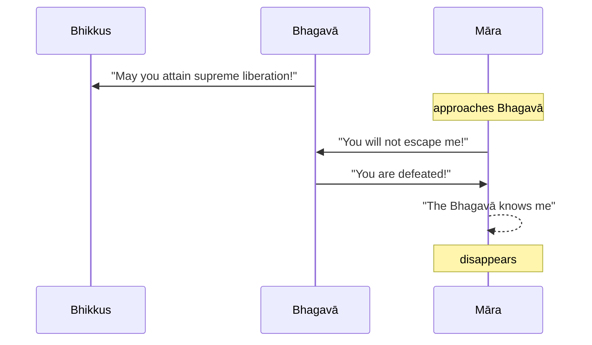

import { Tabs, TabItem } from '@astrojs/starlight/components';

Original text: [World Tipitaka Edition](https://tipitaka2500.github.io/tipitaka/3V/1/1.10.html)

## Summary

After completing the rains retreat (`vassa`), the Bhagavā announced to the bhikkhū his attainment of supreme liberation (`vimutti`) through proper attention (`manasikāra`) and right exertion (`sammappadhāna`), encouraging them to achieve the same. Māra the Evil One then appeared, claiming the Bhagavā was still bound by his snares, both divine and human. However, the Bhagavā confidently declared his complete freedom from all such bonds, asserting Māra's defeat. Recognising that the Bhagavā knew him and his powerlessness, Māra vanished in disappointment.

## Diagram

## Text

<Tabs syncKey="paliquote">
<TabItem label="My Translation">
(35.)

147\. Then indeed the Bhagavā, having completed the rains retreat (`vassa`), addressed the bhikkhū: “For me indeed, Bhikkhave, through proper `manasikāra` (attention), through proper `sammappadhāna` (right exertion), unsurpassed `vimutti` (liberation) has been attained, unsurpassed `vimutti` has been realised. You too, Bhikkhave, through proper `manasikāra` (attention), through proper `sammappadhāna` (right exertion), may you attain unsurpassed `vimutti` (liberation), may you realise unsurpassed `vimutti`.” Then indeed Māra the Evil One approached the Bhagavā; having approached, he addressed the Bhagavā with a verse:

148\. _“You are bound by Māra’s snares,_ \
_Those divine and those human;_ \
_You are bound by a great bond,_ \
_You will not be freed from me, Samaṇa (Wanderer)!”_

149\. _“I am freed from Māra’s snares,_ \
_Those divine and those human;_ \
_I am freed from the great bond,_ \
_You are struck down, Antaka (Death)!”_

150\. Then indeed Māra the Evil One— “The Bhagavā knows me, the `sugata` (Fortunate One) knows me,”— sad, dejected, vanished right there.

---

151\. The Second Account of Māra is finished.
</TabItem>

<TabItem label="Pāḷi (Roman IAST)">
(35.)

147\. Atha kho bhagavā vassaṃvuṭṭho bhikkhū āmantesi—  “mayhaṃ kho, bhikkhave, yoniso manasikārā yoniso sammappadhānā anuttarā vimutti anuppattā, anuttarā vimutti sacchikatā. Tumhepi, bhikkhave, yoniso manasikārā yoniso sammappadhānā anuttaraṃ vimuttiṃ anupāpuṇātha, anuttaraṃ vimuttiṃ sacchikarothā”ti. Atha kho māro pāpimā yena bhagavā tenupasaṅkami, upasaṅkamitvā bhagavantaṃ gāthāya ajjhabhāsi—

148\. _“Baddhosi mārapāsehi,_  
_ye dibbā ye ca mānusā;_  
_Mahābandhanabaddhosi,_  
_na me samaṇa mokkhasī”ti._  

149\. _“Muttāhaṃ mārapāsehi,_  
_Ye dibbā ye ca mānusā;_  
_Mahābandhanamuttomhi,_  
_Nihato tvamasi antakā”ti._  

150\. Atha kho māro pāpimā—  “jānāti maṃ bhagavā, jānāti maṃ sugato”ti dukkhī dummano tatthevantaradhāyi.

---

151\. Dutiyamārakathā niṭṭhitā.
</TabItem>

<TabItem label="Pāḷi (Brahmi)">
(35.)

147\. 𑀅𑀣 𑀔𑁄 𑀪𑀕𑀯𑀸 𑀯𑀲𑁆𑀲𑀁𑀯𑀼𑀝𑁆𑀞𑁄 𑀪𑀺𑀓𑁆𑀔𑀽 𑀆𑀫𑀦𑁆𑀢𑁂𑀲𑀺—  “𑀫𑀬𑁆𑀳𑀁 𑀔𑁄, 𑀪𑀺𑀓𑁆𑀔𑀯𑁂, 𑀬𑁄𑀦𑀺𑀲𑁄 𑀫𑀦𑀲𑀺𑀓𑀸𑀭𑀸 𑀬𑁄𑀦𑀺𑀲𑁄 𑀲𑀫𑁆𑀫𑀧𑁆𑀧𑀥𑀸𑀦𑀸 𑀅𑀦𑀼𑀢𑁆𑀢𑀭𑀸 𑀯𑀺𑀫𑀼𑀢𑁆𑀢𑀺 𑀅𑀦𑀼𑀧𑁆𑀧𑀢𑁆𑀢𑀸, 𑀅𑀦𑀼𑀢𑁆𑀢𑀭𑀸 𑀯𑀺𑀫𑀼𑀢𑁆𑀢𑀺 𑀲𑀘𑁆𑀙𑀺𑀓𑀢𑀸. 𑀢𑀼𑀫𑁆𑀳𑁂𑀧𑀺, 𑀪𑀺𑀓𑁆𑀔𑀯𑁂, 𑀬𑁄𑀦𑀺𑀲𑁄 𑀫𑀦𑀲𑀺𑀓𑀸𑀭𑀸 𑀬𑁄𑀦𑀺𑀲𑁄 𑀲𑀫𑁆𑀫𑀧𑁆𑀧𑀥𑀸𑀦𑀸 𑀅𑀦𑀼𑀢𑁆𑀢𑀭𑀁 𑀯𑀺𑀫𑀼𑀢𑁆𑀢𑀺𑀁 𑀅𑀦𑀼𑀧𑀸𑀧𑀼𑀡𑀸𑀣, 𑀅𑀦𑀼𑀢𑁆𑀢𑀭𑀁 𑀯𑀺𑀫𑀼𑀢𑁆𑀢𑀺𑀁 𑀲𑀘𑁆𑀙𑀺𑀓𑀭𑁄𑀣𑀸”𑀢𑀺. 𑀅𑀣 𑀔𑁄 𑀫𑀸𑀭𑁄 𑀧𑀸𑀧𑀺𑀫𑀸 𑀬𑁂𑀦 𑀪𑀕𑀯𑀸 𑀢𑁂𑀦𑀼𑀧𑀲𑀗𑁆𑀓𑀫𑀺, 𑀉𑀧𑀲𑀗𑁆𑀓𑀫𑀺𑀢𑁆𑀯𑀸 𑀪𑀕𑀯𑀦𑁆𑀢𑀁 𑀕𑀸𑀣𑀸𑀬 𑀅𑀚𑁆𑀛𑀪𑀸𑀲𑀺—

148\. _“𑀩𑀤𑁆𑀥𑁄𑀲𑀺 𑀫𑀸𑀭𑀧𑀸𑀲𑁂𑀳𑀺,_  
_𑀬𑁂 𑀤𑀺𑀩𑁆𑀩𑀸 𑀬𑁂 𑀘 𑀫𑀸𑀦𑀼𑀲𑀸;_  
_𑀫𑀳𑀸𑀩𑀦𑁆𑀥𑀦𑀩𑀤𑁆𑀥𑁄𑀲𑀺,_  
_𑀦 𑀫𑁂 𑀲𑀫𑀡 𑀫𑁄𑀓𑁆𑀔𑀲𑀻”𑀢𑀺._  

149\. _“𑀫𑀼𑀢𑁆𑀢𑀸𑀳𑀁 𑀫𑀸𑀭𑀧𑀸𑀲𑁂𑀳𑀺,_  
_𑀬𑁂 𑀤𑀺𑀩𑁆𑀩𑀸 𑀬𑁂 𑀘 𑀫𑀸𑀦𑀼𑀲𑀸;_  
_𑀫𑀳𑀸𑀩𑀦𑁆𑀥𑀦𑀫𑀼𑀢𑁆𑀢𑁄𑀫𑁆𑀳𑀺,_  
_𑀦𑀺𑀳𑀢𑁄 𑀢𑁆𑀯𑀫𑀲𑀺 𑀅𑀦𑁆𑀢𑀓𑀸”𑀢𑀺._  

150\. 𑀅𑀣 𑀔𑁄 𑀫𑀸𑀭𑁄 𑀧𑀸𑀧𑀺𑀫𑀸—  “𑀚𑀸𑀦𑀸𑀢𑀺 𑀫𑀁 𑀪𑀕𑀯𑀸, 𑀚𑀸𑀦𑀸𑀢𑀺 𑀫𑀁 𑀲𑀼𑀕𑀢𑁄”𑀢𑀺 𑀤𑀼𑀓𑁆𑀔𑀻 𑀤𑀼𑀫𑁆𑀫𑀦𑁄 𑀢𑀢𑁆𑀣𑁂𑀯𑀦𑁆𑀢𑀭𑀥𑀸𑀬𑀺.

---

151\. 𑀤𑀼𑀢𑀺𑀬𑀫𑀸𑀭𑀓𑀣𑀸 𑀦𑀺𑀝𑁆𑀞𑀺𑀢𑀸.
</TabItem>

<TabItem label="Interlinear">
(35.)

[147](https://tipitaka2500.github.io/tipitaka/3V/1/1.10.html#147) Atha kho bhagavā vassaṃvuṭṭho bhikkhū āmantesi— “mayhaṃ kho, bhikkhave, yoniso manasikārā yoniso sammappadhānā anuttarā vimutti anuppattā, anuttarā vimutti sacchikatā.  
⏏️(atha) ⏏️(kho) 🚹⨀①(bhagavant) 🚹⨀①🆎(vassa+vuṭṭha) 🚹⨂②(bhikkhu) 🟢⨀🤟⏮(āmanteti) *️⃣👆⚧⨀⑥(ahaṃ) ⏏️(kho) 🚹⨂⓪(bhikkhu) ⏏️(yoniso) 🚹⨀⑤(manasikāra) ⏏️(yoniso) 🚹⨀⑤🆎(sammā+padhāna) 🚺⨀①🆎(na+uttara) 🚺⨀①(vimutti) 🚺⨀①🔽(ta)(anuppatta) 🚺⨀①🆎(na+uttara) 🚺⨀①(vimutti) 🚺⨀①🔽(ta)(sacchikata)  
then | indeed | the Bhagavā | who had completed the rains retreat | the bhikkhū | addressed | by me | indeed | Bhikkhave | properly | through attention | properly | through right exertion | unsurpassed | liberation | attained | unsurpassed | liberation | realised  
Then indeed the Bhagavā, having completed the rains retreat (`vassa`), addressed the bhikkhū: “For me indeed, Bhikkhave, through proper `manasikāra` (attention), through proper `sammappadhāna` (right exertion), unsurpassed `vimutti` (liberation) has been attained, unsurpassed `vimutti` has been realised.

Tumhepi, bhikkhave, yoniso manasikārā yoniso sammappadhānā anuttaraṃ vimuttiṃ anupāpuṇātha, anuttaraṃ vimuttiṃ sacchikarothā”ti.  
*️⃣🤘⚧⨂①(tvaṃ) ⏏️(api) 🚹⨂⓪(bhikkhu) ⏏️(yoniso) 🚹⨀⑤(manasikāra) ⏏️(yoniso) 🚹⨀⑤🆎(sammā+padhāna) 🚺⨀②🆎(na+uttara) 🚺⨀②(vimutti) 🟢⨂🤘⏹(anupāpuṇāti) 🚺⨀②🆎(na+uttara) 🚺⨀②(vimutti) 🟢⨂🤘⏹(sacchikaroti) ⏏️(iti)  
you | too | Bhikkhave | properly | through attention | properly | through right exertion | unsurpassed | liberation | attain | unsurpassed | liberation | realise | (end quote)  
You too, Bhikkhave, through proper `manasikāra` (attention), through proper `sammappadhāna` (right exertion), may you attain unsurpassed `vimutti` (liberation), may you realise unsurpassed `vimutti`.”

Atha kho māro pāpimā yena bhagavā tenupasaṅkami, upasaṅkamitvā bhagavantaṃ gāthāya ajjhabhāsi—  
⏏️(atha) ⏏️(kho) 🚹⨀①(māra) 🚹⨀①(pāpimant) *️⃣🤟🚹⨀③(ya) 🚹⨀①(bhagavant) *️⃣🤟🚹⨀③(ta) 🟢⨀🤟⏮(upasaṅkamati) 🔽(tvā)(upasaṅkamati) 🚹⨀②(bhagavant) 🚺⨀③(gāthā) 🟢⨀🤟⏮(ajjhabhāsati)  
then | indeed | Māra | the Evil One | by where | the Bhagavā | by there | approached | having approached | the Bhagavā | with a verse | addressed  
Then indeed Māra the Evil One approached the Bhagavā; having approached, he addressed the Bhagavā with a verse:

[148](https://tipitaka2500.github.io/tipitaka/3V/1/1.10.html#148) “Baddhosi mārapāsehi,  
🚹⨀①🔽(ta)(baddha) 🟢⨀🤘▶️(atthi) 🚹⨂③🆎(māra+pāsa)  
bound | you are | by Māra's snares  
ye dibbā ye ca mānusā;  
*️⃣🤟🚹⨂①(ya) 🚹⨂①(dibba) *️⃣🤟🚹⨂①(ya) ⏏️(ca) 🚹⨂①(mānusa)  
those which | divine | those which | and | human  
Mahābandhanabaddhosi,  
🚹⨀①🆎(mahā+bandhana+baddha) 🟢⨀🤘▶️(atthi)  
bound by a great bond | you are  
na me samaṇa mokkhasī”ti.  
⏏️(na) *️⃣👆⚧⨀⑥(ahaṃ) 🚹⨀⓪(samaṇa) 🟢⨀🤘⏭(muñcati) ⏏️(iti)  
not | from me | wanderer | will be freed | (end quote)  

“You are bound by Māra’s snares,  
Those divine and those human;  
You are bound by a great bond,  
You will not be freed from me, Samaṇa (Wanderer)!”

[149](https://tipitaka2500.github.io/tipitaka/3V/1/1.10.html#149) “Muttāhaṃ mārapāsehi,  
🚹⨀①🔽(ta)(mutta) *️⃣👆⚧⨀①(ahaṃ) 🚹⨂⑤🆎(māra+pāsa)  
freed | I | from Māra's snares  
Ye dibbā ye ca mānusā;  
*️⃣🤟🚹⨂①(ya) 🚹⨂①(dibba) *️⃣🤟🚹⨂①(ya) ⏏️(ca) 🚹⨂①(mānusa)  
those which | divine | those which | and | human  
Mahābandhanamuttomhi,  
🚹⨀①🆎(mahā+bandhana+mutta) 🟢⨀👆▶️(atthi)  
freed from the great bond | I am  
Nihato tvamasi antakā”ti.  
🚹⨀①🔽(ta)(nihata) *️⃣🤘⚧⨀①(tvaṃ) 🟢⨀🤘▶️(atthi) 🚹⨀⓪(antaka) ⏏️(iti)  
struck down | you | are | Death | (end quote)  

“I am freed from Māra’s snares,  
Those divine and those human;  
I am freed from the great bond,  
You are struck down, Antaka (Death)!”

[150](https://tipitaka2500.github.io/tipitaka/3V/1/1.10.html#150) Atha kho māro pāpimā— “jānāti maṃ bhagavā, jānāti maṃ sugato”ti dukkhī dummano tatthevantaradhāyi.  
⏏️(atha) ⏏️(kho) 🚹⨀①(māra) 🚹⨀①(pāpimant) 🟢⨀🤟▶️(jānāti) *️⃣👆⚧⨀②(ahaṃ) 🚹⨀①(bhagavant) 🟢⨀🤟▶️(jānāti) *️⃣👆⚧⨀②(ahaṃ) 🚹⨀①🆎(su+gata) ⏏️(iti) 🚹⨀①(dukkhī) 🚹⨀①🆎(dur+mana) ⏏️(tattha) ⏏️(eva) 🟢⨀🤟⏮(antaradhāyati)  
then | indeed | Māra | the Evil One | knows | me | the Bhagavā | knows | me | the Fortunate One | (end quote) | sad | dejected | there | just | vanished  
Then indeed Māra the Evil One— “The Bhagavā knows me, the `sugata` (Fortunate One) knows me,”— sad, dejected, vanished right there.

[151](https://tipitaka2500.github.io/tipitaka/3V/1/1.10.html#151) Dutiyamārakathā niṭṭhitā.  
🚺⨀①🆎(dutiya+māra+kathā) 🚺⨀①🔽(ta)(niṭṭhita)  
the Dutiyamārakathā | finished  
The Second Account of Māra is finished.
</TabItem>
</Tabs>

## Commentary

Once again the Buddha's nemesis, Māra, makes an appearance to question the stability of the new structure for the community, with satellite communities operating independently of the Buddha. Note that the Buddha is addressing a significantly expanded congregation and no longer making the assumption that they are all liberated.

The risk here is even greater than previous - those who are not yet liberated may succumb to temptation and stray from the path, whilst those that are liberated may revert to old ways.

Once again, the narrative signals confidence that the Buddha's new organisational structure is strong and should be able to resist these tendencies.

However, as we can see from the history of Buddhism, this stability did not last once the Buddha passed away. The community broke into various sects who could not agree on the interpretation of the Buddha's teachings and rules, and gradually the communities started misinterpreting his teachings and as a consequence fewer and fewer were liberated and eventually it was no longer possible to achieve liberation, causing a shift in later texts to emphasise that liberation is a gradual process taking many lifetimes, in the case of Therāvada, or a radical shift in the soteriological goal, in the case of Mahāyana.

[Go to previous page (9. Pabbajjūpasampadākathā)](/khandhaka/1-9/) / [Go to parent page (Khandhaka)](/khandhaka/) / [Go to next page (11. Bhaddavaggiyavatthu)](/khandhaka/1-11/)

