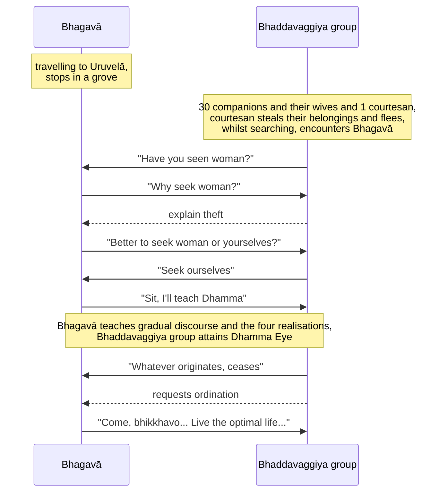

import { Tabs, TabItem } from '@astrojs/starlight/components';

Original text: [World Tipitaka Edition](https://tipitaka2500.github.io/tipitaka/3V/1/1.11.html)

## Summary

While traveling, the Bhagavā encountered about thirty Bhaddavaggiya companions searching for a courtesan who had stolen their belongings. He redirected their focus, asking if it was better to search for the woman or for themselves, to which they agreed the latter was preferable. The Bhagavā then delivered a gradual discourse, starting with topics like giving and virtue, progressing to the dangers of sensual pleasures and the benefits of renunciation. When he perceived their minds were receptive, he taught them the core Dhamma: suffering, its origin, its cessation, and the path. Upon hearing this, the companions attained the `dhammacakkhu` (Dhamma Eye), understanding that whatever originates is subject to cessation, and subsequently requested and received ordination from the Bhagavā to live the optimal life for the complete ending of suffering.

## Diagram

## Text

<Tabs syncKey="paliquote">
<TabItem label="My Translation">
(36.)

152\. Then the Bhagavā, having stayed at Bārāṇasī as long as he wished, set out on a journey to Uruvelā. Then the Bhagavā, having turned aside from the road, approached a certain grove, and having approached and entered that grove, sat down at the foot of a certain tree. Now at that time, about thirty companions of the Bhaddavaggiya (a fine group), with their wives, were amusing themselves in that grove. For one, there was no wife; for his sake, a courtesan had been brought. Then that courtesan, while they were heedlessly amusing themselves, having taken their belongings, ran away. Then those companions, doing a service for their companion, searching for that woman, wandering about that grove, saw the Bhagavā seated at the foot of a certain tree. Having seen him, they approached the Bhagavā, and having approached, they said this to the Bhagavā: “Bhante, did the Bhagavā perhaps see a woman?” “But what, Kumārā (young men), have you to do with a woman?” “Here we, Bhante, about thirty companions of the Bhaddavaggiya (a fine group), with our wives, were amusing ourselves in this grove. For one, there was no wife; for his sake, a courtesan had been brought. Then, Bhante, that courtesan, while we were heedlessly amusing ourselves, having taken our belongings, ran away. We, Bhante, companions, doing a service for our companion, searching for that woman, are wandering about this grove.” “What do you think, Kumārā (young men), which indeed is better for you — that you should search for the woman, or that you should search for yourselves?” “This indeed, Bhante, is better for us, that we should search for ourselves.” “In that case, Kumārā (young men), sit down, I will teach you the Dhamma.” “Yes, Bhante,” the Bhaddavaggiya companions, having paid homage to the Bhagavā, sat down to one side.

153\. To them the Bhagavā gave a gradual discourse, that is to say — `dānakathā` (talk on giving), `sīlakathā` (talk on virtue), `saggakathā` (talk on heaven); he explained the danger, baseness, and defilement of sensual pleasures, and the benefit of renunciation. When the Bhagavā knew them to have ready minds, pliable minds, minds free from `nīvaraṇa` (hindrances), elated minds, confident minds, then he explained that Dhamma teaching which is distinctive of the Buddhas: `dukkha` (suffering), `samudaya` (origin), `nirodha` (cessation), `magga` (path). Just as indeed a clean cloth free from stains would properly receive dye; even so for them, on that very seat, the pure, stainless `dhammacakkhu` (Dhamma Eye) arose: “whatever is `samudayadhamma` (subject to origination), all that is `nirodhadhamma` (subject to cessation).” They, `diṭṭhadhammā` (who have seen the Dhamma), `pattadhammā` (who have attained the Dhamma), `viditadhammā` (who have understood the Dhamma), `pariyogāḷhadhammā` (who have deeply penetrated the Dhamma), `tiṇṇavicikicchā` (who have overcome uncertainty), `vigatakathaṃkathā` (who are free from doubt), `vesārajjappattā` (who have attained confidence), `aparappaccayā` (not relying on another) in the `satthusāsana` (Teacher's instruction), said this to the Bhagavā: “May we, Bhante, receive the `pabbajjā` (going forth) in the Bhagavā's presence, may we receive the `upasampadā` (higher ordination)?” “Come, Bhikkhavo,” the Bhagavā said: “The Dhamma is well-proclaimed. Live the `brahmacariya` (the optimal life) for the complete ending of `dukkha` (suffering).” That itself was the `upasampadā` (higher ordination) of those āyasmants.

154\. The Story of the Bhaddavaggiya Companions is finished. The second `bhāṇavāra` (section for recitation).
</TabItem>

<TabItem label="Pāḷi (Roman IAST)">
(36.)

152\. Atha kho bhagavā bārāṇasiyaṃ yathābhirantaṃ viharitvā yena uruvelā tena cārikaṃ pakkāmi. Atha kho bhagavā maggā okkamma yena aññataro vanasaṇḍo tenupasaṅkami, upasaṅkamitvā taṃ vanasaṇḍaṃ ajjhogāhetvā aññatarasmiṃ rukkhamūle nisīdi. Tena kho pana samayena tiṃsamattā bhaddavaggiyā sahāyakā sapajāpatikā tasmiṃ vanasaṇḍe paricārenti. Ekassa pajāpati nāhosi; tassa atthāya vesī ānītā ahosi. Atha kho sā vesī tesu pamattesu paricārentesu bhaṇḍaṃ ādāya palāyittha. Atha kho te sahāyakā sahāyakassa veyyāvaccaṃ karontā, taṃ itthiṃ gavesantā, taṃ vanasaṇḍaṃ āhiṇḍantā addasaṃsu bhagavantaṃ aññatarasmiṃ rukkhamūle nisinnaṃ. Disvāna yena bhagavā tenupasaṅkamiṃsu, upasaṅkamitvā bhagavantaṃ etadavocuṃ—  “api, bhante, bhagavā ekaṃ itthiṃ passeyyā”ti? “Kiṃ pana vo, kumārā, itthiyā”ti? “Idha mayaṃ, bhante, tiṃsamattā bhaddavaggiyā sahāyakā sapajāpatikā imasmiṃ vanasaṇḍe paricārimhā. Ekassa pajāpati nāhosi; tassa atthāya vesī ānītā ahosi. Atha kho sā, bhante, vesī amhesu pamattesu paricārentesu bhaṇḍaṃ ādāya palāyittha. Te mayaṃ, bhante, sahāyakā sahāyakassa veyyāvaccaṃ karontā, taṃ itthiṃ gavesantā, imaṃ vanasaṇḍaṃ āhiṇḍāmā”ti. “Taṃ kiṃ maññatha vo, kumārā, katamaṃ nu kho tumhākaṃ varaṃ—  yaṃ vā tumhe itthiṃ gaveseyyātha, yaṃ vā attānaṃ gaveseyyāthā”ti? “Etadeva, bhante, amhākaṃ varaṃ yaṃ mayaṃ attānaṃ gaveseyyāmā”ti. “Tena hi vo, kumārā, nisīdatha, dhammaṃ vo desessāmī”ti. “Evaṃ, bhante”ti kho te bhaddavaggiyā sahāyakā bhagavantaṃ abhivādetvā ekamantaṃ nisīdiṃsu.

153\. Tesaṃ bhagavā anupubbiṃ kathaṃ kathesi, seyyathidaṃ—  dānakathaṃ sīlakathaṃ saggakathaṃ kāmānaṃ ādīnavaṃ okāraṃ saṃkilesaṃ nekkhamme ānisaṃsaṃ pakāsesi. Yadā te bhagavā aññāsi kallacitte muducitte vinīvaraṇacitte udaggacitte pasannacitte, atha yā buddhānaṃ sāmukkaṃsikā dhammadesanā, taṃ pakāsesi dukkhaṃ samudayaṃ nirodhaṃ maggaṃ. Seyyathāpi nāma suddhaṃ vatthaṃ apagatakāḷakaṃ sammadeva rajanaṃ paṭiggaṇheyya; evameva tesaṃ tasmiṃyeva āsane virajaṃ vītamalaṃ dhammacakkhuṃ udapādi—  “yaṃ kiñci samudayadhammaṃ sabbaṃ taṃ nirodhadhamman”ti. Te diṭṭhadhammā pattadhammā viditadhammā pariyogāḷhadhammā tiṇṇavicikicchā vigatakathaṃkathā vesārajjappattā aparappaccayā satthusāsane bhagavantaṃ etadavocuṃ—  “labheyyāma mayaṃ, bhante, bhagavato santike pabbajjaṃ, labheyyāma upasampadan”ti. “Etha bhikkhavo”ti bhagavā avoca—  “svākkhāto dhammo, caratha brahmacariyaṃ sammā dukkhassa antakiriyāyā”ti. Sāva tesaṃ āyasmantānaṃ upasampadā ahosi.

---

154\. Bhaddavaggiyasahāyakānaṃ vatthu niṭṭhitaṃ.

  
Dutiyabhāṇavāro.
</TabItem>

<TabItem label="Pāḷi (Brahmi)">
(36.)

152\. 𑀅𑀣 𑀔𑁄 𑀪𑀕𑀯𑀸 𑀩𑀸𑀭𑀸𑀡𑀲𑀺𑀬𑀁 𑀬𑀣𑀸𑀪𑀺𑀭𑀦𑁆𑀢𑀁 𑀯𑀺𑀳𑀭𑀺𑀢𑁆𑀯𑀸 𑀬𑁂𑀦 𑀉𑀭𑀼𑀯𑁂𑀮𑀸 𑀢𑁂𑀦 𑀘𑀸𑀭𑀺𑀓𑀁 𑀧𑀓𑁆𑀓𑀸𑀫𑀺. 𑀅𑀣 𑀔𑁄 𑀪𑀕𑀯𑀸 𑀫𑀕𑁆𑀕𑀸 𑀑𑀓𑁆𑀓𑀫𑁆𑀫 𑀬𑁂𑀦 𑀅𑀜𑁆𑀜𑀢𑀭𑁄 𑀯𑀦𑀲𑀡𑁆𑀟𑁄 𑀢𑁂𑀦𑀼𑀧𑀲𑀗𑁆𑀓𑀫𑀺, 𑀉𑀧𑀲𑀗𑁆𑀓𑀫𑀺𑀢𑁆𑀯𑀸 𑀢𑀁 𑀯𑀦𑀲𑀡𑁆𑀟𑀁 𑀅𑀚𑁆𑀛𑁄𑀕𑀸𑀳𑁂𑀢𑁆𑀯𑀸 𑀅𑀜𑁆𑀜𑀢𑀭𑀲𑁆𑀫𑀺𑀁 𑀭𑀼𑀓𑁆𑀔𑀫𑀽𑀮𑁂 𑀦𑀺𑀲𑀻𑀤𑀺. 𑀢𑁂𑀦 𑀔𑁄 𑀧𑀦 𑀲𑀫𑀬𑁂𑀦 𑀢𑀺𑀁𑀲𑀫𑀢𑁆𑀢𑀸 𑀪𑀤𑁆𑀤𑀯𑀕𑁆𑀕𑀺𑀬𑀸 𑀲𑀳𑀸𑀬𑀓𑀸 𑀲𑀧𑀚𑀸𑀧𑀢𑀺𑀓𑀸 𑀢𑀲𑁆𑀫𑀺𑀁 𑀯𑀦𑀲𑀡𑁆𑀟𑁂 𑀧𑀭𑀺𑀘𑀸𑀭𑁂𑀦𑁆𑀢𑀺. 𑀏𑀓𑀲𑁆𑀲 𑀧𑀚𑀸𑀧𑀢𑀺 𑀦𑀸𑀳𑁄𑀲𑀺; 𑀢𑀲𑁆𑀲 𑀅𑀢𑁆𑀣𑀸𑀬 𑀯𑁂𑀲𑀻 𑀆𑀦𑀻𑀢𑀸 𑀅𑀳𑁄𑀲𑀺. 𑀅𑀣 𑀔𑁄 𑀲𑀸 𑀯𑁂𑀲𑀻 𑀢𑁂𑀲𑀼 𑀧𑀫𑀢𑁆𑀢𑁂𑀲𑀼 𑀧𑀭𑀺𑀘𑀸𑀭𑁂𑀦𑁆𑀢𑁂𑀲𑀼 𑀪𑀡𑁆𑀟𑀁 𑀆𑀤𑀸𑀬 𑀧𑀮𑀸𑀬𑀺𑀢𑁆𑀣. 𑀅𑀣 𑀔𑁄 𑀢𑁂 𑀲𑀳𑀸𑀬𑀓𑀸 𑀲𑀳𑀸𑀬𑀓𑀲𑁆𑀲 𑀯𑁂𑀬𑁆𑀬𑀸𑀯𑀘𑁆𑀘𑀁 𑀓𑀭𑁄𑀦𑁆𑀢𑀸, 𑀢𑀁 𑀇𑀢𑁆𑀣𑀺𑀁 𑀕𑀯𑁂𑀲𑀦𑁆𑀢𑀸, 𑀢𑀁 𑀯𑀦𑀲𑀡𑁆𑀟𑀁 𑀆𑀳𑀺𑀡𑁆𑀟𑀦𑁆𑀢𑀸 𑀅𑀤𑁆𑀤𑀲𑀁𑀲𑀼 𑀪𑀕𑀯𑀦𑁆𑀢𑀁 𑀅𑀜𑁆𑀜𑀢𑀭𑀲𑁆𑀫𑀺𑀁 𑀭𑀼𑀓𑁆𑀔𑀫𑀽𑀮𑁂 𑀦𑀺𑀲𑀺𑀦𑁆𑀦𑀁. 𑀤𑀺𑀲𑁆𑀯𑀸𑀦 𑀬𑁂𑀦 𑀪𑀕𑀯𑀸 𑀢𑁂𑀦𑀼𑀧𑀲𑀗𑁆𑀓𑀫𑀺𑀁𑀲𑀼, 𑀉𑀧𑀲𑀗𑁆𑀓𑀫𑀺𑀢𑁆𑀯𑀸 𑀪𑀕𑀯𑀦𑁆𑀢𑀁 𑀏𑀢𑀤𑀯𑁄𑀘𑀼𑀁—  “𑀅𑀧𑀺, 𑀪𑀦𑁆𑀢𑁂, 𑀪𑀕𑀯𑀸 𑀏𑀓𑀁 𑀇𑀢𑁆𑀣𑀺𑀁 𑀧𑀲𑁆𑀲𑁂𑀬𑁆𑀬𑀸”𑀢𑀺? “𑀓𑀺𑀁 𑀧𑀦 𑀯𑁄, 𑀓𑀼𑀫𑀸𑀭𑀸, 𑀇𑀢𑁆𑀣𑀺𑀬𑀸”𑀢𑀺? “𑀇𑀥 𑀫𑀬𑀁, 𑀪𑀦𑁆𑀢𑁂, 𑀢𑀺𑀁𑀲𑀫𑀢𑁆𑀢𑀸 𑀪𑀤𑁆𑀤𑀯𑀕𑁆𑀕𑀺𑀬𑀸 𑀲𑀳𑀸𑀬𑀓𑀸 𑀲𑀧𑀚𑀸𑀧𑀢𑀺𑀓𑀸 𑀇𑀫𑀲𑁆𑀫𑀺𑀁 𑀯𑀦𑀲𑀡𑁆𑀟𑁂 𑀧𑀭𑀺𑀘𑀸𑀭𑀺𑀫𑁆𑀳𑀸. 𑀏𑀓𑀲𑁆𑀲 𑀧𑀚𑀸𑀧𑀢𑀺 𑀦𑀸𑀳𑁄𑀲𑀺; 𑀢𑀲𑁆𑀲 𑀅𑀢𑁆𑀣𑀸𑀬 𑀯𑁂𑀲𑀻 𑀆𑀦𑀻𑀢𑀸 𑀅𑀳𑁄𑀲𑀺. 𑀅𑀣 𑀔𑁄 𑀲𑀸, 𑀪𑀦𑁆𑀢𑁂, 𑀯𑁂𑀲𑀻 𑀅𑀫𑁆𑀳𑁂𑀲𑀼 𑀧𑀫𑀢𑁆𑀢𑁂𑀲𑀼 𑀧𑀭𑀺𑀘𑀸𑀭𑁂𑀦𑁆𑀢𑁂𑀲𑀼 𑀪𑀡𑁆𑀟𑀁 𑀆𑀤𑀸𑀬 𑀧𑀮𑀸𑀬𑀺𑀢𑁆𑀣. 𑀢𑁂 𑀫𑀬𑀁, 𑀪𑀦𑁆𑀢𑁂, 𑀲𑀳𑀸𑀬𑀓𑀸 𑀲𑀳𑀸𑀬𑀓𑀲𑁆𑀲 𑀯𑁂𑀬𑁆𑀬𑀸𑀯𑀘𑁆𑀘𑀁 𑀓𑀭𑁄𑀦𑁆𑀢𑀸, 𑀢𑀁 𑀇𑀢𑁆𑀣𑀺𑀁 𑀕𑀯𑁂𑀲𑀦𑁆𑀢𑀸, 𑀇𑀫𑀁 𑀯𑀦𑀲𑀡𑁆𑀟𑀁 𑀆𑀳𑀺𑀡𑁆𑀟𑀸𑀫𑀸”𑀢𑀺. “𑀢𑀁 𑀓𑀺𑀁 𑀫𑀜𑁆𑀜𑀣 𑀯𑁄, 𑀓𑀼𑀫𑀸𑀭𑀸, 𑀓𑀢𑀫𑀁 𑀦𑀼 𑀔𑁄 𑀢𑀼𑀫𑁆𑀳𑀸𑀓𑀁 𑀯𑀭𑀁—  𑀬𑀁 𑀯𑀸 𑀢𑀼𑀫𑁆𑀳𑁂 𑀇𑀢𑁆𑀣𑀺𑀁 𑀕𑀯𑁂𑀲𑁂𑀬𑁆𑀬𑀸𑀣, 𑀬𑀁 𑀯𑀸 𑀅𑀢𑁆𑀢𑀸𑀦𑀁 𑀕𑀯𑁂𑀲𑁂𑀬𑁆𑀬𑀸𑀣𑀸”𑀢𑀺? “𑀏𑀢𑀤𑁂𑀯, 𑀪𑀦𑁆𑀢𑁂, 𑀅𑀫𑁆𑀳𑀸𑀓𑀁 𑀯𑀭𑀁 𑀬𑀁 𑀫𑀬𑀁 𑀅𑀢𑁆𑀢𑀸𑀦𑀁 𑀕𑀯𑁂𑀲𑁂𑀬𑁆𑀬𑀸𑀫𑀸”𑀢𑀺. “𑀢𑁂𑀦 𑀳𑀺 𑀯𑁄, 𑀓𑀼𑀫𑀸𑀭𑀸, 𑀦𑀺𑀲𑀻𑀤𑀣, 𑀥𑀫𑁆𑀫𑀁 𑀯𑁄 𑀤𑁂𑀲𑁂𑀲𑁆𑀲𑀸𑀫𑀻”𑀢𑀺. “𑀏𑀯𑀁, 𑀪𑀦𑁆𑀢𑁂”𑀢𑀺 𑀔𑁄 𑀢𑁂 𑀪𑀤𑁆𑀤𑀯𑀕𑁆𑀕𑀺𑀬𑀸 𑀲𑀳𑀸𑀬𑀓𑀸 𑀪𑀕𑀯𑀦𑁆𑀢𑀁 𑀅𑀪𑀺𑀯𑀸𑀤𑁂𑀢𑁆𑀯𑀸 𑀏𑀓𑀫𑀦𑁆𑀢𑀁 𑀦𑀺𑀲𑀻𑀤𑀺𑀁𑀲𑀼.

153\. 𑀢𑁂𑀲𑀁 𑀪𑀕𑀯𑀸 𑀅𑀦𑀼𑀧𑀼𑀩𑁆𑀩𑀺𑀁 𑀓𑀣𑀁 𑀓𑀣𑁂𑀲𑀺, 𑀲𑁂𑀬𑁆𑀬𑀣𑀺𑀤𑀁—  𑀤𑀸𑀦𑀓𑀣𑀁 𑀲𑀻𑀮𑀓𑀣𑀁 𑀲𑀕𑁆𑀕𑀓𑀣𑀁 𑀓𑀸𑀫𑀸𑀦𑀁 𑀆𑀤𑀻𑀦𑀯𑀁 𑀑𑀓𑀸𑀭𑀁 𑀲𑀁𑀓𑀺𑀮𑁂𑀲𑀁 𑀦𑁂𑀓𑁆𑀔𑀫𑁆𑀫𑁂 𑀆𑀦𑀺𑀲𑀁𑀲𑀁 𑀧𑀓𑀸𑀲𑁂𑀲𑀺. 𑀬𑀤𑀸 𑀢𑁂 𑀪𑀕𑀯𑀸 𑀅𑀜𑁆𑀜𑀸𑀲𑀺 𑀓𑀮𑁆𑀮𑀘𑀺𑀢𑁆𑀢𑁂 𑀫𑀼𑀤𑀼𑀘𑀺𑀢𑁆𑀢𑁂 𑀯𑀺𑀦𑀻𑀯𑀭𑀡𑀘𑀺𑀢𑁆𑀢𑁂 𑀉𑀤𑀕𑁆𑀕𑀘𑀺𑀢𑁆𑀢𑁂 𑀧𑀲𑀦𑁆𑀦𑀘𑀺𑀢𑁆𑀢𑁂, 𑀅𑀣 𑀬𑀸 𑀩𑀼𑀤𑁆𑀥𑀸𑀦𑀁 𑀲𑀸𑀫𑀼𑀓𑁆𑀓𑀁𑀲𑀺𑀓𑀸 𑀥𑀫𑁆𑀫𑀤𑁂𑀲𑀦𑀸, 𑀢𑀁 𑀧𑀓𑀸𑀲𑁂𑀲𑀺 𑀤𑀼𑀓𑁆𑀔𑀁 𑀲𑀫𑀼𑀤𑀬𑀁 𑀦𑀺𑀭𑁄𑀥𑀁 𑀫𑀕𑁆𑀕𑀁. 𑀲𑁂𑀬𑁆𑀬𑀣𑀸𑀧𑀺 𑀦𑀸𑀫 𑀲𑀼𑀤𑁆𑀥𑀁 𑀯𑀢𑁆𑀣𑀁 𑀅𑀧𑀕𑀢𑀓𑀸𑀍𑀅𑀓𑀁 𑀲𑀫𑁆𑀫𑀤𑁂𑀯 𑀭𑀚𑀦𑀁 𑀧𑀝𑀺𑀕𑁆𑀕𑀡𑁆𑀳𑁂𑀬𑁆𑀬; 𑀏𑀯𑀫𑁂𑀯 𑀢𑁂𑀲𑀁 𑀢𑀲𑁆𑀫𑀺𑀁𑀬𑁂𑀯 𑀆𑀲𑀦𑁂 𑀯𑀺𑀭𑀚𑀁 𑀯𑀻𑀢𑀫𑀮𑀁 𑀥𑀫𑁆𑀫𑀘𑀓𑁆𑀔𑀼𑀁 𑀉𑀤𑀧𑀸𑀤𑀺—  “𑀬𑀁 𑀓𑀺𑀜𑁆𑀘𑀺 𑀲𑀫𑀼𑀤𑀬𑀥𑀫𑁆𑀫𑀁 𑀲𑀩𑁆𑀩𑀁 𑀢𑀁 𑀦𑀺𑀭𑁄𑀥𑀥𑀫𑁆𑀫𑀦𑁆”𑀢𑀺. 𑀢𑁂 𑀤𑀺𑀝𑁆𑀞𑀥𑀫𑁆𑀫𑀸 𑀧𑀢𑁆𑀢𑀥𑀫𑁆𑀫𑀸 𑀯𑀺𑀤𑀺𑀢𑀥𑀫𑁆𑀫𑀸 𑀧𑀭𑀺𑀬𑁄𑀕𑀸𑀍𑀳𑀥𑀫𑁆𑀫𑀸 𑀢𑀺𑀡𑁆𑀡𑀯𑀺𑀘𑀺𑀓𑀺𑀘𑁆𑀙𑀸 𑀯𑀺𑀕𑀢𑀓𑀣𑀁𑀓𑀣𑀸 𑀯𑁂𑀲𑀸𑀭𑀚𑁆𑀚𑀧𑁆𑀧𑀢𑁆𑀢𑀸 𑀅𑀧𑀭𑀧𑁆𑀧𑀘𑁆𑀘𑀬𑀸 𑀲𑀢𑁆𑀣𑀼𑀲𑀸𑀲𑀦𑁂 𑀪𑀕𑀯𑀦𑁆𑀢𑀁 𑀏𑀢𑀤𑀯𑁄𑀘𑀼𑀁—  “𑀮𑀪𑁂𑀬𑁆𑀬𑀸𑀫 𑀫𑀬𑀁, 𑀪𑀦𑁆𑀢𑁂, 𑀪𑀕𑀯𑀢𑁄 𑀲𑀦𑁆𑀢𑀺𑀓𑁂 𑀧𑀩𑁆𑀩𑀚𑁆𑀚𑀁, 𑀮𑀪𑁂𑀬𑁆𑀬𑀸𑀫 𑀉𑀧𑀲𑀫𑁆𑀧𑀤𑀦𑁆”𑀢𑀺. “𑀏𑀣 𑀪𑀺𑀓𑁆𑀔𑀯𑁄”𑀢𑀺 𑀪𑀕𑀯𑀸 𑀅𑀯𑁄𑀘—  “𑀲𑁆𑀯𑀸𑀓𑁆𑀔𑀸𑀢𑁄 𑀥𑀫𑁆𑀫𑁄, 𑀘𑀭𑀣 𑀩𑁆𑀭𑀳𑁆𑀫𑀘𑀭𑀺𑀬𑀁 𑀲𑀫𑁆𑀫𑀸 𑀤𑀼𑀓𑁆𑀔𑀲𑁆𑀲 𑀅𑀦𑁆𑀢𑀓𑀺𑀭𑀺𑀬𑀸𑀬𑀸”𑀢𑀺. 𑀲𑀸𑀯 𑀢𑁂𑀲𑀁 𑀆𑀬𑀲𑁆𑀫𑀦𑁆𑀢𑀸𑀦𑀁 𑀉𑀧𑀲𑀫𑁆𑀧𑀤𑀸 𑀅𑀳𑁄𑀲𑀺.

---

154\. 𑀪𑀤𑁆𑀤𑀯𑀕𑁆𑀕𑀺𑀬𑀲𑀳𑀸𑀬𑀓𑀸𑀦𑀁 𑀯𑀢𑁆𑀣𑀼 𑀦𑀺𑀝𑁆𑀞𑀺𑀢𑀁.

  
𑀤𑀼𑀢𑀺𑀬𑀪𑀸𑀡𑀯𑀸𑀭𑁄.
</TabItem>

<TabItem label="Interlinear">
(36.)

[152](https://tipitaka2500.github.io/tipitaka/3V/1/1.11.html#152) Atha kho bhagavā bārāṇasiyaṃ yathābhirantaṃ viharitvā yena uruvelā tena cārikaṃ pakkāmi.  
⏏️(atha) ⏏️(kho) 🚹⨀①(bhagavant) 🚺⨀⑦(bārāṇasī) ⏏️🆎(yathā+abhiranta) 🔽(tvā)(viharati) *️⃣🤟🚹⨀③(ya) 🚺⨀①(uruvelā) *️⃣🤟🚹⨀③(ta) 🚺⨀②(cārikā) 🟢⨀🤟⏮(pakkamati)  
then | indeed | the Bhagavā | at Bārāṇasī | as long as he wished | having stayed | by where | Uruvelā | by there | on a journey | set out  
Then the Bhagavā, having stayed at Bārāṇasī as long as he wished, set out on a journey to Uruvelā.

Atha kho bhagavā maggā okkamma yena aññataro vanasaṇḍo tenupasaṅkami, upasaṅkamitvā taṃ vanasaṇḍaṃ ajjhogāhetvā aññatarasmiṃ rukkhamūle nisīdi.  
⏏️(atha) ⏏️(kho) 🚹⨀①(bhagavant) 🚹⨀⑤(magga) 🔽(ya)(okkamati) *️⃣🤟🚹⨀③(ya) *️⃣🤟🚹⨀①(aññatara) 🚹⨀①🆎(vana+saṇḍa) *️⃣🤟🚹⨀③(ta) 🟢⨀🤟⏮(upasaṅkamati) 🔽(tvā)(upasaṅkamati) *️⃣🤟🚹⨀②(ta) 🚹⨀②🆎(vana+saṇḍa) 🔽(tvā)(ajjhogāhati) *️⃣🤟🚻⨀⑦(aññatara) 🚻⨀⑦🆎(rukkha+mūla) 🟢⨀🤟⏮(nisīdati)  
then | indeed | the Bhagavā | from the road | having turned aside | by where | a certain | grove | by there | approached | having approached | that | grove | having entered | a certain | at the foot of a tree | sat down  
Then the Bhagavā, having turned aside from the road, approached a certain grove, and having approached and entered that grove, sat down at the foot of a certain tree.

Tena kho pana samayena tiṃsamattā bhaddavaggiyā sahāyakā sapajāpatikā tasmiṃ vanasaṇḍe paricārenti.  
*️⃣🤟🚹⨀③(ta) ⏏️(kho) ⏏️(pana) 🚹⨀③(samaya) 🚹⨂①🆎(tiṃsā+matta) 🚹⨂①🆎(bhadda+vaggiya) 🚹⨂①(sahāyaka) 🚹⨂①🆎(sa+pajāpati) *️⃣🤟🚹⨀⑦(ta) 🚹⨀⑦🆎(vana+saṇḍa) 🟠⨂🤟▶️(paricāreti)  
at that | indeed | now | time | about thirty | of the fine group | companions | with their wives | that | in the grove | amuse themselves  
Now at that time, about thirty companions of the Bhaddavaggiya (a fine group), with their wives, were amusing themselves in that grove.

Ekassa pajāpati nāhosi;  
*️⃣🤟🚹⨀⑥(eka) 🚺⨀①(pajāpati) ⏏️(na) 🟢⨀🤟⏮(hoti)  
for one | wife | not | there was  
For one, there was no wife;

tassa atthāya vesī ānītā ahosi.  
*️⃣🤟🚹⨀⑥(ta) 🚹⨀④(attha) 🚺⨀①(vesī) 🚺⨀①🔽(ta)(ānīta) 🟢⨀🤟⏮(hoti)  
his | for the sake | a courtesan | brought | had been  
for his sake, a courtesan had been brought.

Atha kho sā vesī tesu pamattesu paricārentesu bhaṇḍaṃ ādāya palāyittha.  
⏏️(atha) ⏏️(kho) *️⃣🤟🚺⨀①(ta) 🚺⨀①(vesī) *️⃣🤟🚹⨂⑦(ta) 🚹⨂⑦🔽(ta)(pamatta) 🚹⨂⑦🔽(anta)(paricārenta) 🚻⨀②(bhaṇḍa) 🔽(ya)(ādāti) 🔵⨀🤟⏮(palāyati)  
then | indeed | that | courtesan | while they | heedless | amusing themselves | the belongings | taking | ran away  
Then that courtesan, while they were heedlessly amusing themselves, having taken their belongings, ran away.

Atha kho te sahāyakā sahāyakassa veyyāvaccaṃ karontā, taṃ itthiṃ gavesantā, taṃ vanasaṇḍaṃ āhiṇḍantā addasaṃsu bhagavantaṃ aññatarasmiṃ rukkhamūle nisinnaṃ.  
⏏️(atha) ⏏️(kho) *️⃣🤟🚹⨂①(ta) 🚹⨂①(sahāyaka) 🚹⨀④(sahāyaka) 🚻⨀②(veyyāvacca) 🚹⨂①🔽(anta)(karonta) *️⃣🤟🚺⨀②(ta) 🚺⨀②(itthī) 🚹⨂①🔽(anta)(gavesanta) *️⃣🤟🚹⨀②(ta) 🚹⨀②🆎(vana+saṇḍa) 🚹⨂①🔽(anta)(āhiṇḍanta) 🟢⨂🤟⏮(passati) 🚹⨀②(bhagavant) *️⃣🤟🚻⨀⑦(aññatara) 🚻⨀⑦🆎(rukkha+mūla) 🚹⨀②🔽(ta)(nisinna)  
then | indeed | those | companions | for the companion | a service | doing | that | woman | searching for | that | grove | wandering about | saw | the Bhagavā | a certain | at the foot of a tree | seated  
Then those companions, doing a service for their companion, searching for that woman, wandering about that grove, saw the Bhagavā seated at the foot of a certain tree.

Disvāna yena bhagavā tenupasaṅkamiṃsu, upasaṅkamitvā bhagavantaṃ etadavocuṃ— “api, bhante, bhagavā ekaṃ itthiṃ passeyyā”ti?  
🔽(tvāna)(passati) *️⃣🤟🚹⨀③(ya) 🚹⨀①(bhagavant) *️⃣🤟🚹⨀③(ta) 🟢⨂🤟⏮(upasaṅkamati) 🔽(tvā)(upasaṅkamati) 🚹⨀②(bhagavant) *️⃣🤟🚻⨀②(eta) 🟢⨂🤟⏮(vadati) ⏏️(api) 🚹⨀⓪(bhavant) 🚹⨀①(bhagavant) *️⃣🤟🚺⨀②(eka) 🚺⨀②(itthī) 🟢⨀🤟⏯(passati) ⏏️(iti)  
having seen | by where | the Bhagavā | by there | approached | having approached | the Bhagavā | this | said | perhaps | Bhante | the Bhagavā | a | woman | might have seen | (end quote)  
Having seen him, they approached the Bhagavā, and having approached, they said this to the Bhagavā: “Bhante, did the Bhagavā perhaps see a woman?”

“Kiṃ pana vo, kumārā, itthiyā”ti?  
*️⃣🤟🚻⨀①(kiṃ) ⏏️(pana) *️⃣🤘⚧⨂④(tvaṃ) 🚹⨂⓪(kumāra) 🚺⨀③(itthī) ⏏️(iti)  
what | but | to you | Kumārā | with a woman | (end quote)  
“But what, Kumārā (young men), have you to do with a woman?”

“Idha mayaṃ, bhante, tiṃsamattā bhaddavaggiyā sahāyakā sapajāpatikā imasmiṃ vanasaṇḍe paricārimhā.  
⏏️(idha) *️⃣👆⚧⨂①(ahaṃ) 🚹⨀⓪(bhavant) 🚹⨂①🆎(tiṃsā+matta) 🚹⨂①🆎(bhadda+vaggiya) 🚹⨂①(sahāyaka) 🚹⨂①🆎(sa+pajāpati) *️⃣🤟🚹⨀⑦(ima) 🚹⨀⑦🆎(vana+saṇḍa) 🟠⨂👆⏮(paricāreti)  
here | we | Bhante | about thirty | of the fine group | companions | with our wives | this | in the grove | amused ourselves  
“Here we, Bhante, about thirty companions of the Bhaddavaggiya (a fine group), with our wives, were amusing ourselves in this grove.

Ekassa pajāpati nāhosi;  
*️⃣🤟🚹⨀⑥(eka) 🚺⨀①(pajāpati) ⏏️(na) 🟢⨀🤟⏮(hoti)  
for one | wife | not | there was  
For one, there was no wife;

tassa atthāya vesī ānītā ahosi.  
*️⃣🤟🚹⨀⑥(ta) 🚹⨀④(attha) 🚺⨀①(vesī) 🚺⨀①🔽(ta)(ānīta) 🟢⨀🤟⏮(hoti)  
his | for the sake | a courtesan | brought | had been  
for his sake, a courtesan had been brought.

Atha kho sā, bhante, vesī amhesu pamattesu paricārentesu bhaṇḍaṃ ādāya palāyittha.  
⏏️(atha) ⏏️(kho) *️⃣🤟🚺⨀①(ta) 🚹⨀⓪(bhavant) 🚺⨀①(vesī) *️⃣👆⚧⨂⑦(ahaṃ) 🚹⨂⑦🔽(ta)(pamatta) 🚹⨂⑦🔽(anta)(paricārenta) 🚻⨀②(bhaṇḍa) 🔽(ya)(ādāti) 🔵⨀🤟⏮(palāyati)  
then | indeed | that | Bhante | courtesan | while we | heedless | amusing ourselves | the belongings | taking | ran away  
Then, Bhante, that courtesan, while we were heedlessly amusing ourselves, having taken our belongings, ran away.

Te mayaṃ, bhante, sahāyakā sahāyakassa veyyāvaccaṃ karontā, taṃ itthiṃ gavesantā, imaṃ vanasaṇḍaṃ āhiṇḍāmā”ti.  
*️⃣🤟🚹⨂①(ta) *️⃣👆⚧⨂①(ahaṃ) 🚹⨀⓪(bhavant) 🚹⨂①(sahāyaka) 🚹⨀④(sahāyaka) 🚻⨀②(veyyāvacca) 🚹⨂①🔽(anta)(karonta) *️⃣🤟🚺⨀②(ta) 🚺⨀②(itthī) 🚹⨂①🔽(anta)(gavesanta) *️⃣🤟🚹⨀②(ima) 🚹⨀②🆎(vana+saṇḍa) 🟢⨂👆▶️(āhiṇḍati) ⏏️(iti)  
those | we | Bhante | companions | for the companion | a service | doing | that | woman | searching for | this | grove | are wandering about | (end quote)  
We, Bhante, companions, doing a service for our companion, searching for that woman, are wandering about this grove.”

“Taṃ kiṃ maññatha vo, kumārā, katamaṃ nu kho tumhākaṃ varaṃ— yaṃ vā tumhe itthiṃ gaveseyyātha, yaṃ vā attānaṃ gaveseyyāthā”ti?  
*️⃣🤟🚻⨀②(ta) *️⃣🤟🚻⨀②(kiṃ) 🟢⨂🤘▶️(maññati) ⏏️(vo) 🚹⨂⓪(kumāra) *️⃣🤟🚻⨀①(katama) ⏏️(nu) ⏏️(kho) *️⃣🤘⚧⨂④(tvaṃ) 🚻⨀①(vara) *️⃣🤟🚻⨀①(ya) ⏏️(vā) *️⃣🤘⚧⨂①(tvaṃ) 🚺⨀②(itthī) 🟢⨂🤘⏯(gavesati) *️⃣🤟🚻⨀①(ya) ⏏️(vā) 🚹⨀②(atta) 🟢⨂🤘⏯(gavesati) ⏏️(iti)  
that | what | do you think | surely | Kumārā | which | (question) | indeed | for you | better | that | or | you | a woman | should search for | that | or | yourselves | should search for | (end quote)  
“What do you think, Kumārā (young men), which indeed is better for you — that you should search for the woman, or that you should search for yourselves?”

“Etadeva, bhante, amhākaṃ varaṃ yaṃ mayaṃ attānaṃ gaveseyyāmā”ti.  
*️⃣🤟🚻⨀①(eta) ⏏️(eva) 🚹⨀⓪(bhavant) *️⃣👆⚧⨂④(ahaṃ) 🚻⨀①(vara) *️⃣🤟🚻⨀①(ya) *️⃣👆⚧⨂①(ahaṃ) 🚹⨀②(atta) 🟢⨂👆⏯(gavesati) ⏏️(iti)  
this | indeed | Bhante | for us | better | that | we | ourselves | should search for | (end quote)  
“This indeed, Bhante, is better for us, that we should search for ourselves.”

“Tena hi vo, kumārā, nisīdatha, dhammaṃ vo desessāmī”ti.  
*️⃣🤟🚹⨀③(ta) ⏏️(hi) ⏏️(vo) 🚹⨂⓪(kumāra) 🟢⨂🤘⏹(nisīdati) 🚹⨀②(dhamma) *️⃣🤘⚧⨂④(tvaṃ) 🟠⨀👆⏭(deseti) ⏏️(iti)  
in that case | indeed | surely | Kumārā | sit down | the Dhamma | to you | I will teach | (end quote)  
“In that case, Kumārā (young men), sit down, I will teach you the Dhamma.”

“Evaṃ, bhante”ti kho te bhaddavaggiyā sahāyakā bhagavantaṃ abhivādetvā ekamantaṃ nisīdiṃsu.  
⏏️(evaṃ) 🚹⨀⓪(bhavant) ⏏️(iti) ⏏️(kho) *️⃣🤟🚹⨂①(ta) 🚹⨂①🆎(bhadda+vaggiya) 🚹⨂①(sahāyaka) 🚹⨀②(bhagavant) 🔽(tvā)(abhivādeti) ⏏️🆎(eka+anta) 🟢⨂🤟⏮(nisīdati)  
yes | Bhante | (end quote) | indeed | those | of the fine group | companions | the Bhagavā | having bowed down to | to one side | sat down  
“Yes, Bhante,” the Bhaddavaggiya companions, having paid homage to the Bhagavā, sat down to one side.

[153](https://tipitaka2500.github.io/tipitaka/3V/1/1.11.html#153) Tesaṃ bhagavā anupubbiṃ kathaṃ kathesi, seyyathidaṃ— dānakathaṃ sīlakathaṃ saggakathaṃ kāmānaṃ ādīnavaṃ okāraṃ saṃkilesaṃ nekkhamme ānisaṃsaṃ pakāsesi.  
*️⃣🤟🚹⨂④(ta) 🚹⨀①(bhagavant) 🚺⨀②(anupubbī) 🚺⨀②(kathā) 🟢⨀🤟⏮(katheti) ⏏️(seyyathidaṃ) 🚺⨀②🆎(dāna+kathā) 🚺⨀②🆎(sīla+kathā) 🚺⨀②🆎(sagga+kathā) 🚹⨂⑥(kāma) 🚹⨀②(ādīnava) 🚹⨀②(okāra) 🚹⨀②(saṃkilesa) 🚻⨀⑦(nekkhamma) 🚹⨀②(ānisaṃsa) 🟠⨀🤟⏮(pakāseti)  
to them | the Bhagavā | progressive | talk | spoke | that is to say | talk on giving | talk on virtue | talk on heaven | of sensual pleasures | the danger | the baseness | the defilement | in renunciation | the benefit | explained  
To them the Bhagavā gave a gradual discourse, that is to say — `dānakathā` (talk on giving), `sīlakathā` (talk on virtue), `saggakathā` (talk on heaven); he explained the danger, baseness, and defilement of sensual pleasures, and the benefit of renunciation.

Yadā te bhagavā aññāsi kallacitte muducitte vinīvaraṇacitte udaggacitte pasannacitte, atha yā buddhānaṃ sāmukkaṃsikā dhammadesanā, taṃ pakāsesi dukkhaṃ samudayaṃ nirodhaṃ maggaṃ.  
⏏️(yadā) *️⃣🤟🚹⨂②(ta) 🚹⨀①(bhagavant) 🟢⨀🤟⏮(ājānāti) 🚹⨂②🆎(kalla+citta) 🚹⨂②🆎(mudu+citta) 🚹⨂②🆎(vinīvaraṇa+citta) 🚹⨂②🆎(udagga+citta) 🚹⨂②🆎(pasanna+citta) ⏏️(atha) *️⃣🤟🚺⨀①(ya) 🚹⨂⑥(buddha) 🚺⨀①(sāmukkaṃsika) 🚺⨀①🆎(dhamma+desanā) *️⃣🤟🚺⨀②(ta) 🟠⨀🤟⏮(pakāseti) 🚻⨀②(dukkha) 🚹⨀②(samudaya) 🚹⨀②(nirodha) 🚹⨀②(magga)  
when | them | the Bhagavā | knew | with ready minds | with pliable minds | with minds free from hindrances | with elated minds | with confident minds | then | which | of the Buddhas | distinctive | Dhamma teaching | that | explained | suffering | origin | cessation | path  
When the Bhagavā knew them to have ready minds, pliable minds, minds free from `nīvaraṇa` (hindrances), elated minds, confident minds, then he explained that Dhamma teaching which is distinctive of the Buddhas: `dukkha` (suffering), `samudaya` (origin), `nirodha` (cessation), `magga` (path).

Seyyathāpi nāma suddhaṃ vatthaṃ apagatakāḷakaṃ sammadeva rajanaṃ paṭiggaṇheyya;  
⏏️(seyyathāpi) ⏏️(nāma) 🚻⨀①🔽(ta)(suddha) 🚻⨀①(vattha) 🚻⨀①🆎(apagata+kāḷaka) ⏏️(sammā) ⏏️(eva) 🚻⨀②(rajana) 🟢⨀🤟⏯(paṭiggaṇhāti)  
just as | indeed | clean | a cloth | free from stains | properly | just | dye | would receive  
Just as indeed a clean cloth free from stains would properly receive dye;

evameva tesaṃ tasmiṃyeva āsane virajaṃ vītamalaṃ dhammacakkhuṃ udapādi— “yaṃ kiñci samudayadhammaṃ sabbaṃ taṃ nirodhadhamman”ti.  
⏏️(evaṃ) ⏏️(eva) *️⃣🤟🚹⨂④(ta) *️⃣🤟🚻⨀⑦(ta) ⏏️(eva) 🚻⨀⑦(āsana) 🚻⨀①(viraja) 🚻⨀①🆎(vīta+mala) 🚻⨀①🆎(dhamma+cakkhu) 🟢⨀🤟⏮(uppajjati) *️⃣🤟🚻⨀①(ya) *️⃣🤟🚻⨀①(kaci) 🚻⨀①🆎(samudaya+dhamma) *️⃣🤟🚻⨀①(sabba) *️⃣🤟🚻⨀①(ta) 🚻⨀①🆎(nirodha+dhamma) ⏏️(iti)  
in the same way | just | for them | that | very | on the seat | pure | stainless | Dhamma Eye | arose | whatever | anything | subject to origination | all | that | subject to cessation | (end quote)  
even so for them, on that very seat, the pure, stainless `dhammacakkhu` (Dhamma Eye) arose: “whatever is `samudayadhamma` (subject to origination), all that is `nirodhadhamma` (subject to cessation).”

Te diṭṭhadhammā pattadhammā viditadhammā pariyogāḷhadhammā tiṇṇavicikicchā vigatakathaṃkathā vesārajjappattā aparappaccayā satthusāsane bhagavantaṃ etadavocuṃ— “labheyyāma mayaṃ, bhante, bhagavato santike pabbajjaṃ, labheyyāma upasampadan”ti.  
*️⃣🤟🚹⨂①(ta) 🚹⨂①🆎(diṭṭha+dhamma) 🚹⨂①🆎(patta+dhamma) 🚹⨂①🆎(vidita+dhamma) 🚹⨂①🆎(pariyogāḷha+dhamma) 🚹⨂①🆎(tiṇṇa+vicikicchā) 🚹⨂①🆎(vigata+kathaṃkathā) 🚹⨂①🆎(vesārajja+patta) 🚹⨂①🆎(na+para+paccaya) 🚻⨀⑦🆎(satthar+sāsana) 🚹⨀②(bhagavant) *️⃣🤟🚻⨀②(eta) 🟢⨂🤟⏮(vadati) 🟢⨂👆⏯(labhati) *️⃣👆⚧⨂①(ahaṃ) 🚹⨀⓪(bhavant) 🚹⨀⑥(bhagavant) ⏏️(santike) 🚺⨀②(pabbajjā) 🟢⨂👆⏯(labhati) 🚺⨀②(upasampadā) ⏏️(iti)  
they | who have seen the Dhamma | who have attained the Dhamma | who have understood the Dhamma | who have deeply penetrated the Dhamma | having crossed over doubt | free from doubt | who have attained confidence | not relying on another | in the Teacher's instruction | the Bhagavā | this | said | may we receive | we | Bhante | of the Bhagavā | in the presence | the going forth | may we receive | the higher ordination | (end quote)  
They, `diṭṭhadhammā` (who have seen the Dhamma), `pattadhammā` (who have attained the Dhamma), `viditadhammā` (who have understood the Dhamma), `pariyogāḷhadhammā` (who have deeply penetrated the Dhamma), `tiṇṇavicikicchā` (who have overcome uncertainty), `vigatakathaṃkathā` (who are free from doubt), `vesārajjappattā` (who have attained confidence), `aparappaccayā` (not relying on another) in the `satthusāsana` (Teacher's instruction), said this to the Bhagavā: “May we, Bhante, receive the `pabbajjā` (going forth) in the Bhagavā's presence, may we receive the `upasampadā` (higher ordination)?”

“Etha bhikkhavo”ti bhagavā avoca— “svākkhāto dhammo, caratha brahmacariyaṃ sammā dukkhassa antakiriyāyā”ti.  
🟢⨂🤘⏹(eti) 🚹⨂⓪(bhikkhu) ⏏️(iti) 🚹⨀①(bhagavant) 🟢⨀🤟⏮(vadati) 🚹⨀①🆎(su+akkhāta) 🚹⨀①(dhamma) 🟢⨂🤘⏹(carati) 🚻⨀②🆎(brahma+cariya) ⏏️(sammā) 🚻⨀⑥(dukkha) 🚺⨀④🆎(anta+kiriyā) ⏏️(iti)  
come | Bhikkhavo | (end quote) | the Bhagavā | said | well proclaimed | the Dhamma | live | the optimal life | completely | of suffering | for the ending | (end quote)  
“Come, Bhikkhavo,” the Bhagavā said: “The Dhamma is well-proclaimed. Live the `brahmacariya` (the optimal life) for the complete ending of `dukkha` (suffering).”

Sāva tesaṃ āyasmantānaṃ upasampadā ahosi.  
*️⃣🤟🚺⨀①(ta) ⏏️(eva) *️⃣🤟🚹⨂⑥(ta) 🚹⨂⑥(āyasmant) 🚺⨀①(upasampadā) 🟢⨀🤟⏮(hoti)  
that | itself | of those | of the venerables | the higher ordination | was  
That itself was the `upasampadā` (higher ordination) of those āyasmants.

[154](https://tipitaka2500.github.io/tipitaka/3V/1/1.11.html#154) Bhaddavaggiyasahāyakānaṃ vatthu niṭṭhitaṃ.  
🚹⨂⑥🆎(bhadda+vaggiya+sahāyaka) 🚻⨀①(vatthu) 🚻⨀①🔽(ta)(niṭṭhita)  
of the Bhaddavaggiya companions | the story | finished  
The Story of the Bhaddavaggiya Companions is finished.

Dutiyabhāṇavāro.  
🚹⨀①🆎(dutiya+bhāṇavāra)  
the second section for recitation  
The second `bhāṇavāra` (section for recitation).
</TabItem>
</Tabs>

## Commentary

The narrative illustrates a shift in focus from external, object-oriented seeking to internal, phenomenological self-investigation. The men's initial state is one of agitation and distress, their consciousness directed entirely towards a lost object (the woman and belongings) representing frustrated desire. The Bhagavā’s intervention redirects their intentionality: the question "which is better... search for the woman, or that you should search for yourselves?" prompts a bracketing of the immediate external concern and an turn towards the experiencing subject.

The subsequent "gradual discourse" can be understood as a structured method for examining and transforming lived experience. Talk of "giving," "virtue," and "heaven" establishes a baseline of mental calm and ethical orientation, preparing the phenomenal field for deeper inquiry. Highlighting the "danger of sensual pleasures" and the "benefit of renunciation" encourages a direct assessment of how attachment to transient sensory experiences inherently leads to dissatisfaction and instability, while detachment offers a more stable mode of being.

The core teaching — suffering (`dukkha`), its origin (`samudaya`), its cessation (`nirodha`), and the path (`magga`) — provides a framework for understanding the structure of their subjective experience of distress.

The "arising of the dust-free, stainless Dhammacakkhu" signifies a profound insight: "whatever is subject to origination is all subject to cessation." This is not an abstract belief but a direct, unmediated perception of the impermanent and conditioned nature of all phenomena as they appear in experience. This insight restructures their understanding of reality and self, dissolving the foundations of their previous clinging and leading to a desire to fully embody this transformed mode of experiencing through ordination.

The significance of this narrative is that this is the first group of ordained bhikkhū that appear not to be liberated, although each member of the group apparently gained the "Dhamma eye" (understanding). Hence this establishes that the saṅgha now contains a mixture of those that are liberated (`arahant`s) as well as those that are not but ordained.

## Other opinions

- [Brekke - The Early Samgha and the Laity (1996)](/articles/brekke---the-early-samgha-and-the-laity-1996/) [@Brekke1997] \
  This article argues that early Buddhism transformed from an open, conversionist movement into a more withdrawn, introversionist sect due to the persistent problem of individuals joining the Saṃgha for extrinsic, worldly motivations. Initially, the Saṃgha actively sought converts, competing with other religious groups for followers. However, as people began joining to escape debt, military service, or simply to attain an easy life, the community's purity and reputation were threatened, jeopardizing the crucial material support it received from the laity. In response, the Saṃgha developed introversionist characteristics by implementing stricter admission rules, emphasizing internal unity, regulating the appearance and conduct of monks to project an image of holiness, and establishing fixed monasteries for physical separation. This created a self-enforcing cycle where the Saṃgha's enhanced purity attracted greater lay support, which in turn made it a more appealing refuge for the extrinsically motivated, necessitating a continuous process of purification to maintain its stability.

[Go to previous page (10. Dutiyamārakathā)](/khandhaka/1-10/) / [Go to parent page (Khandhaka)](/khandhaka/) / [Go to next page (12. Uruvelapāṭihāriyakathā)](/khandhaka/1-12/)

## References
