import { Tabs, TabItem } from '@astrojs/starlight/components';

Original text: [World Tipitaka Edition](https://tipitaka2500.github.io/tipitaka/3V/1/1.12.html)

## Summary

The Bhagavā (Buddha) journeyed to Uruvelā, encountering three matted hair ascetic brothers — Uruvelakassapa, Nadīkassapo, and Gayākassapo — who were leaders of one thousand ascetics. To overcome Uruvelakassapa's pride and belief in his own spiritual superiority, the Bhagavā performed a series of miracles, including subduing a fierce nāga, being visited by divine beings (Four Great Kings, Sakka, Brahmā Sahampati), discerning Uruvelakassapa's thoughts, and demonstrating control over natural elements and phenomena. Despite each miracle, Uruvelakassapa, while impressed by the Bhagavā's power, repeatedly concluded that the Bhagavā was not an `arahant` (liberated one) like himself. Finally, the Bhagavā directly challenged Uruvelakassapa's delusion, leading to the conversion of all three brothers and their one thousand followers, who then received ordination. Subsequently, the Bhagavā delivered the Fire Discourse at Gayāsīsa, explaining how all sensory experiences are "burning" with passion, aversion, and delusion, which led to the liberation of all one thousand newly ordained bhikkhū.

## Diagram

### The Kassapa brothers and their followers

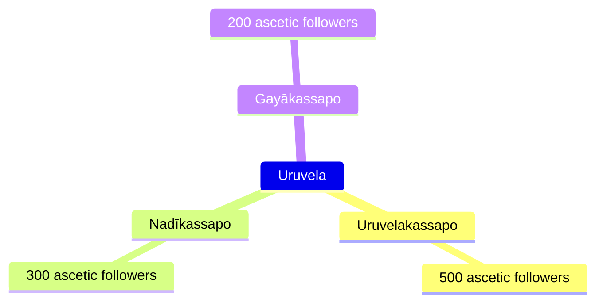

### The Battle with the Naga King

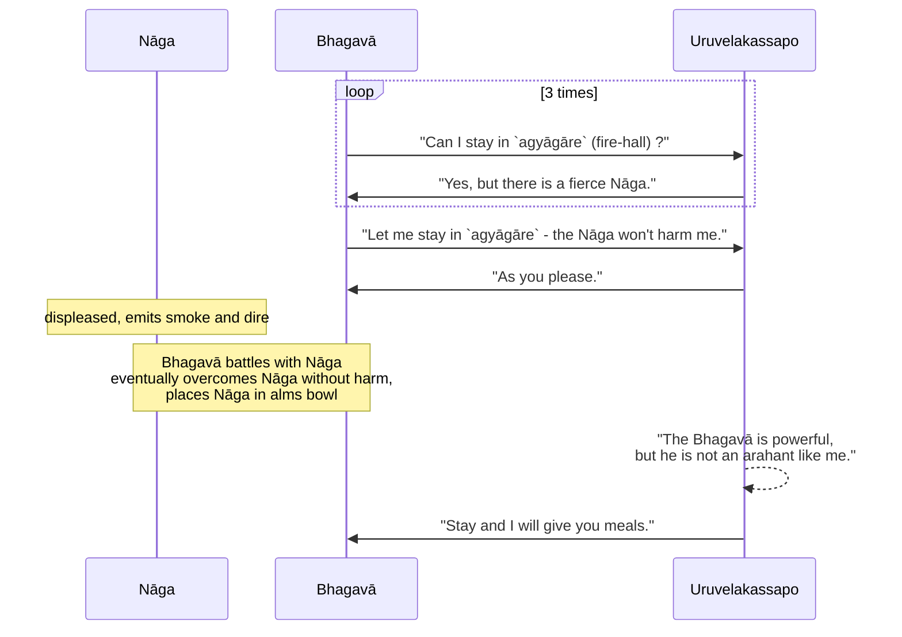

### The First Miracle

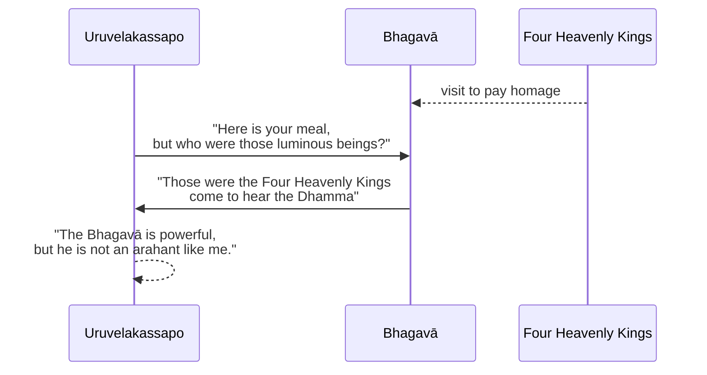

### The Second Miracle

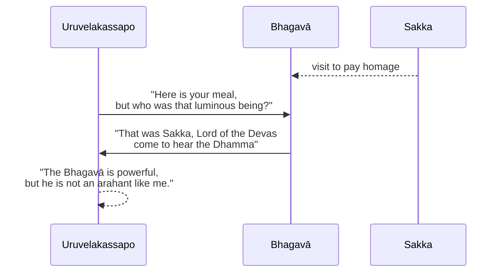

### The Third Miracle

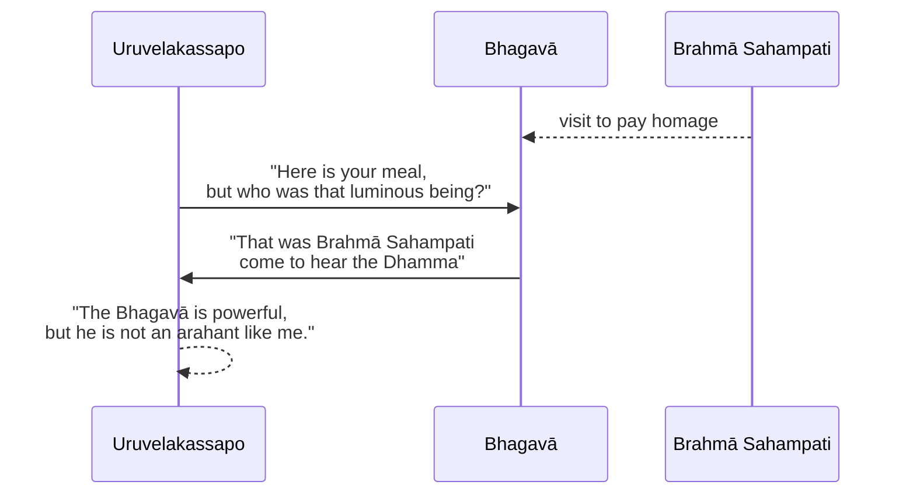

### The Fourth Miracle

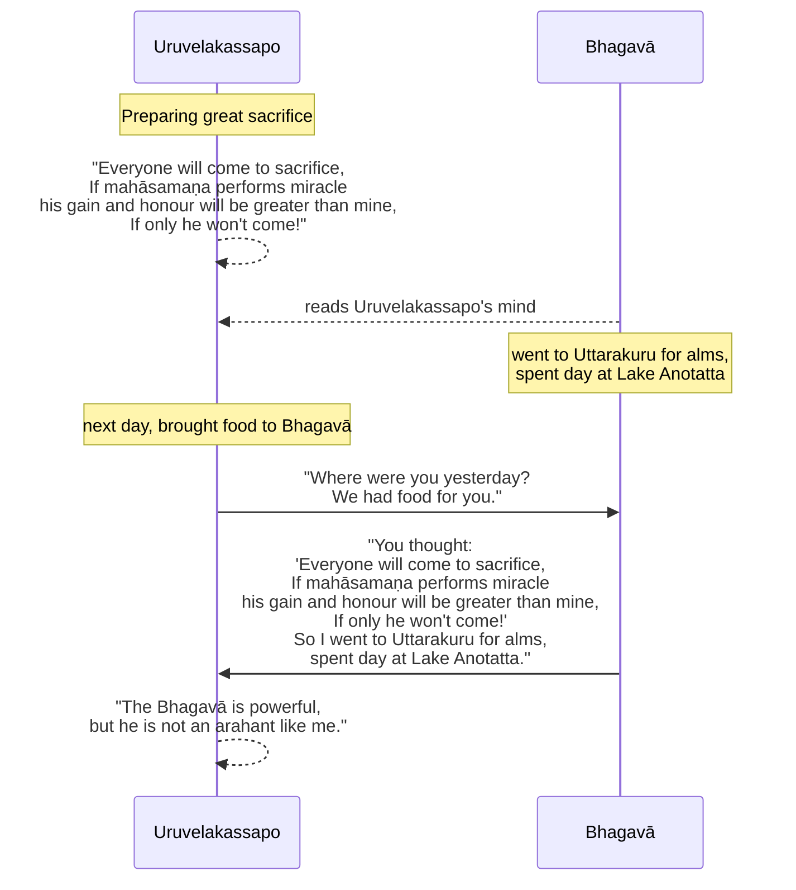

### The Fifth Miracle

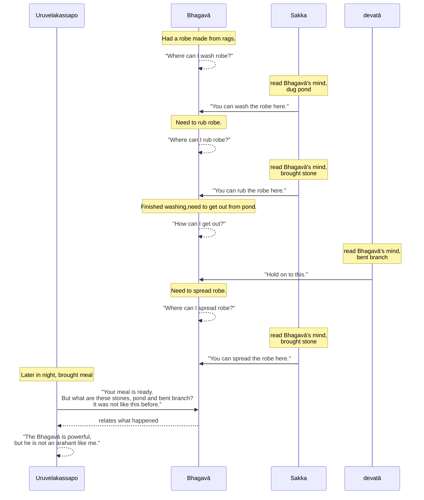

### Other Miracles

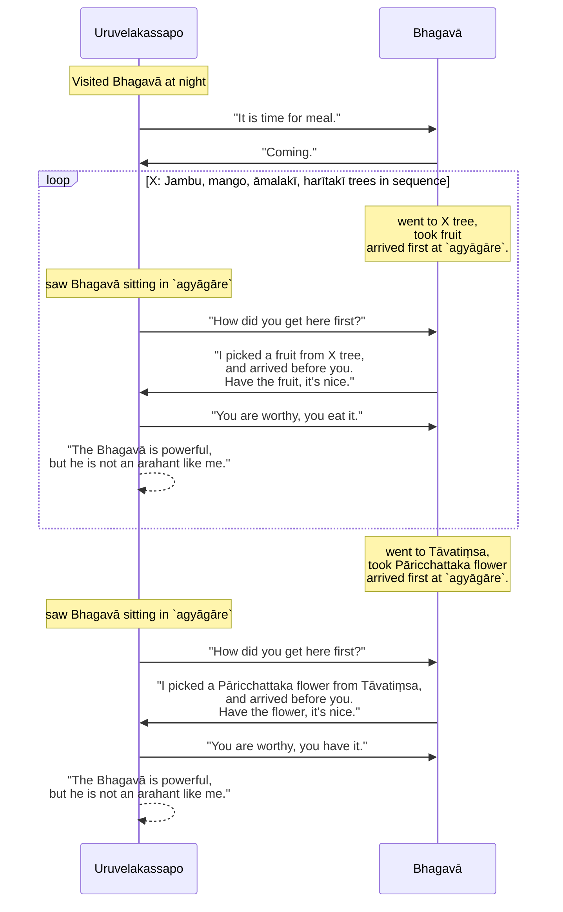

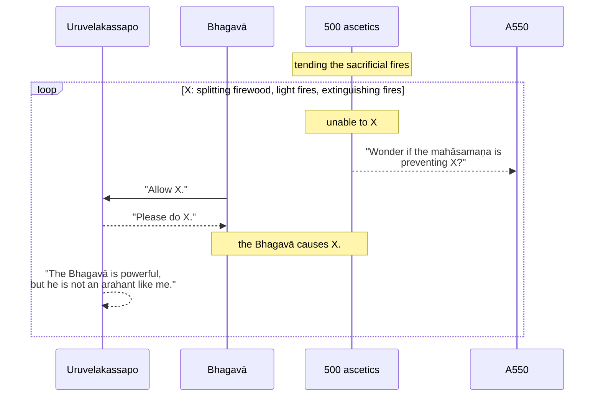

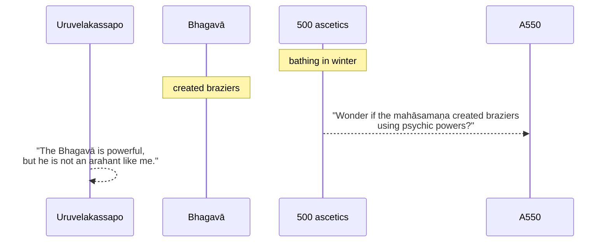

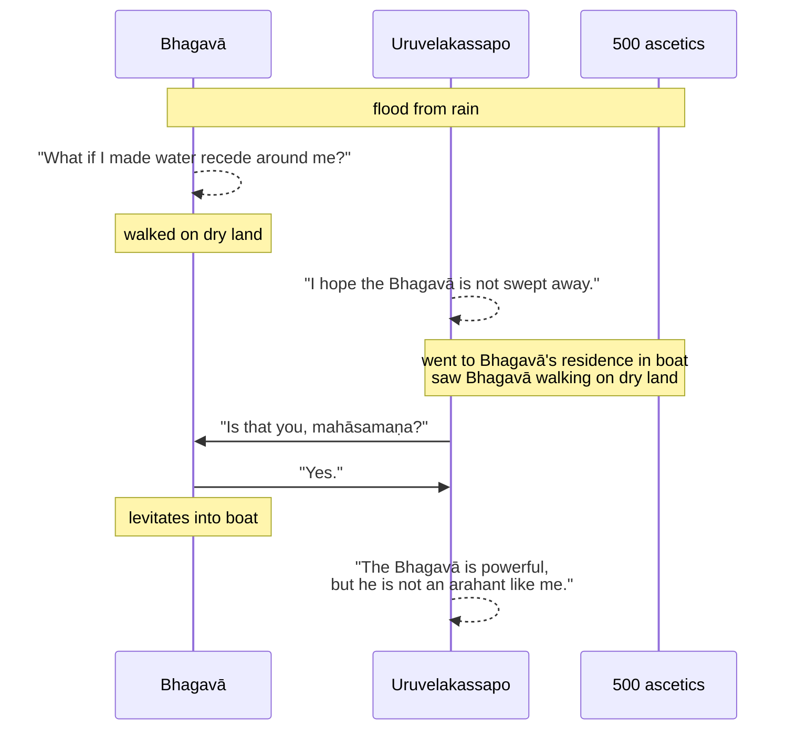

### Summary of the Buddha's  Miracles

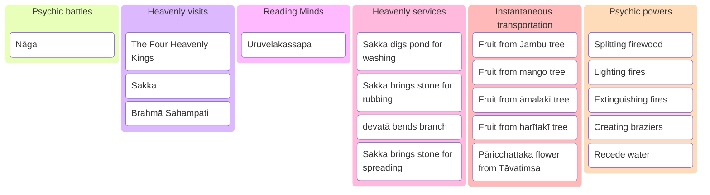

### The Conversion of Uruvelakassapo and followers

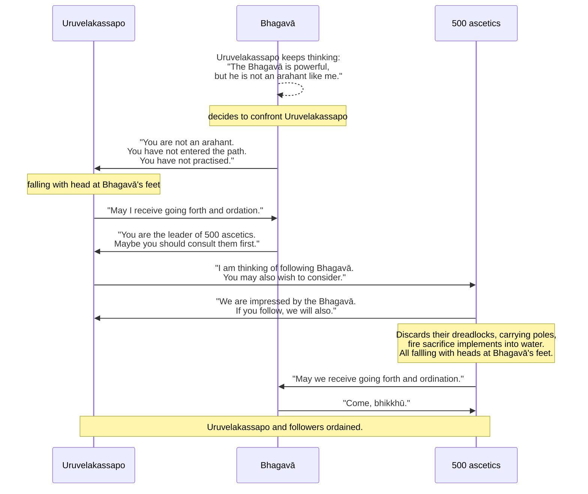

### The Conversion of the other ascetics

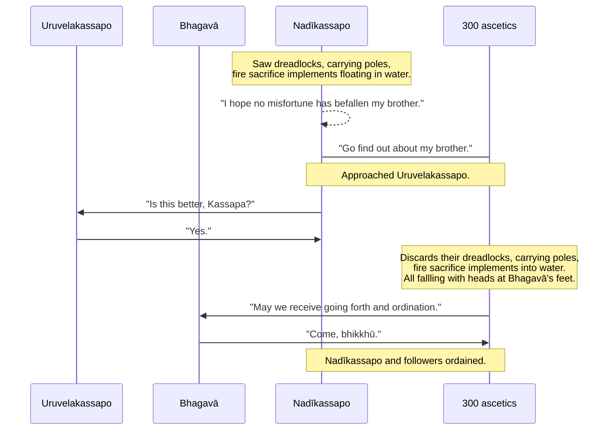

### The Fire Sermon

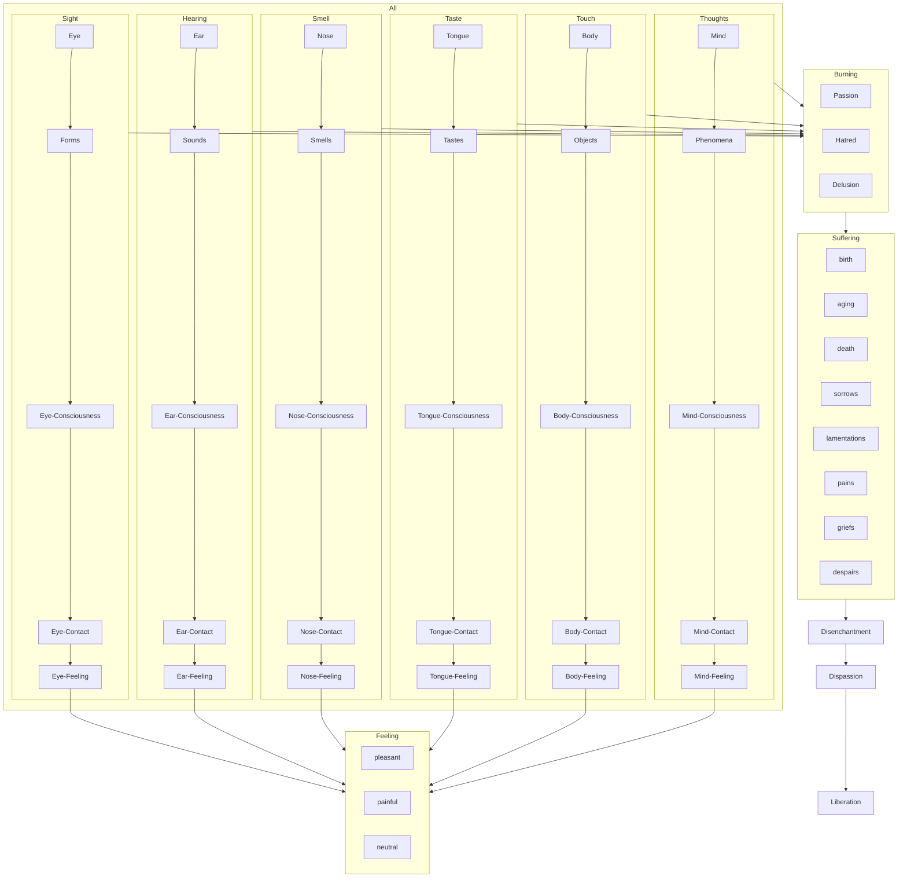

## Text

<Tabs syncKey="paliquote">
<TabItem label="My Translation">
(37.)

155\. Then the Bhagavā, wandering on tour in stages, arrived at Uruvelā. Now at that time, three matted hair ascetics were dwelling in Uruvelā — Uruvelakassapa, Nadīkassapa, and Gayākassapa. Among them, the matted hair ascetic Uruvelakassapa was the leader of five hundred matted hair ascetics, their guide, chief, foremost, and principal. The matted hair ascetic Nadīkassapa was the leader of three hundred matted hair ascetics, their guide, chief, foremost, and principal. The matted hair ascetic Gayākassapa was the leader of two hundred matted hair ascetics, their guide, chief, foremost, and principal.

156\. Then the Bhagavā approached the hermitage of the matted hair ascetic Uruvelakassapa; having approached, he said this to the matted hair ascetic Uruvelakassapa: “If it is not inconvenient for you, Kassapa, might we stay one night in the `agyāgāra` (room for keeping the sacred fire)?” “It is not inconvenient for me, Mahāsamaṇa (Great Wanderer); there is a fierce `nāga` (serpent) king here, possessing psychic power, a venomous snake of dreadful venom; may he not harm you.”

157\. A second time the Bhagavā said this to the matted hair ascetic Uruvelakassapa: “If it is not inconvenient for you, Kassapa, might we stay one night in the `agyāgāra` (room for keeping the sacred fire)?” “It is not inconvenient for me, Mahāsamaṇa (Great Wanderer); there is a fierce `nāga` (serpent) king here, possessing psychic power, a venomous snake of dreadful venom; may he not harm you.”

158\. A third time the Bhagavā said this to the matted hair ascetic Uruvelakassapa: “If it is not inconvenient for you, Kassapa, might we stay one night in the `agyāgāra` (room for keeping the sacred fire)?” “It is not inconvenient for me, Mahāsamaṇa (Great Wanderer); there is a fierce `nāga` (serpent) king here, possessing psychic power, a venomous snake of dreadful venom; may he not harm you.” “Perhaps he would not harm me; come now, Kassapa, allow [me] the `agyāgāra` (room for keeping the sacred fire).” “Dwell, Mahāsamaṇa (Great Wanderer), as you please.” Then the Bhagavā entered the `agyāgāra` (room for keeping the sacred fire), spread a grass mat, and sat down, folding his legs crosswise, setting his body erect, and establishing awareness in front of him.

(38.)

159\. That `nāga` (serpent) saw the Bhagavā enter; having seen him, dejected, he emitted smoke. Then this occurred to the Bhagavā: “What if I, without injuring the skin, hide, flesh, sinew, bone or bone marrow of this `nāga` (serpent), were to overcome [his] fire with [my] fire?” Then the Bhagavā, having generated such a display of psychic power, emitted smoke. Then that `nāga` (serpent), unable to endure the denigration, blazed forth. The Bhagavā too, having entered the fire component, blazed forth. With both of them glowing, the `agyāgāra` (room for keeping the sacred fire) was as if ablaze, burning, glowing. Then those matted hair ascetics, having surrounded the `agyāgāra` (room for keeping the sacred fire), said this: “Alas, Bho, the handsome great wanderer is being harmed by the `nāga` (serpent)!” Then the Bhagavā, at the end of that night, without injuring the skin, hide, flesh, sinew, bone or bone marrow of that `nāga` (serpent), having overcome [his] fire with [his own] fire, put him in [his] bowl and showed him to the matted hair ascetic Uruvelakassapa: “This, Kassapa, is your `nāga`, his fire overcome by [my] fire.” Then this occurred to the matted hair ascetic Uruvelakassapa: “The great wanderer is of great psychic power, of great might, in that he can overcome with [his] fire the fire of the fierce `nāga` (serpent) king, possessing psychic power, a venomous snake of dreadful venom; but he is not an `arahant` (liberated one) as I am.”

(39.)

160\. _At the Nerañjarā (river), the Bhagavā,_ \
_To Uruvelakassapa, the matted hair ascetic, spoke;_ \
_“If it is not inconvenient for you, Kassapa,_ \
_May we stay today in the `aggisāla` (fire hall).”_

161\. _“It is not inconvenient for me, Mahāsamaṇa (Great Wanderer),_ \
_Wishing only for [your] comfort, I prevent you;_ \
_There is a fierce `nāga` (serpent) king here,_ \
_Possessing psychic power, a venomous snake of dreadful venom;_ \
_May he not harm you.”_

162\. _“Perhaps he would not harm me,_ \
_Come now, Kassapa, allow [me] the `agyāgāra` (room for keeping the sacred fire);”_ \
_Knowing that it was given,_ \
_Fearless he entered, past fear._

163\. _Seeing the sage enter,_ \
_The `ahināga` (serpent nāga), dejected, emitted smoke;_ \
_With a glad mind, confident,_ \
_The `manussanāga` (nāga of men) also emitted smoke there._

164\. _And unable to endure the denigration,_ \
_The `ahināga` (serpent nāga) blazed like fire;_ \
_Well skilled in the fire component,_ \
_The `manussanāga` (nāga of men) also blazed there._

165\. _With both of them glowing,_ \
_The `agyāgāra` (room for keeping the sacred fire) was ablaze, burning, glowing;_ \
_The matted hair ascetics looked on,_ \
_“Alas, Bho, the handsome great wanderer_ \
_Is being harmed by the `nāga` (serpent)!” they said._

166\. _Then at the end of that night,_ \
_The flames of the `nāga` (serpent) were destroyed;_ \
_But of the one possessing psychic power there remained_ \
_Flames of many colours._

167\. _Blue and then red,_ \
_Crimson, yellow, crystal-coloured;_ \
_On Aṅgīrasa’s body_ \
_Were flames of many colours._

168\. _Placing it in [his] bowl,_ \
_He showed the `ahināga` (serpent nāga) to the brahmin;_ \
_“This, Kassapa, is your `nāga` (serpent),_ \
_His fire overcome by [my] fire.”_

169\. Then the matted hair ascetic Uruvelakassapa, with complete confidence because of this miracle of psychic power of the Bhagavā, said this to the Bhagavā: “Dwell right here, Mahāsamaṇa (Great Wanderer); I [will provide] you with regular meals.”

170\. The first miracle.

(40.)

171\. Then the Bhagavā dwelt in a certain forest grove not far from the hermitage of the matted hair ascetic Uruvelakassapa. Then the Four Great Kings (`cattāro mahārājāno`), when the night was advanced, with their surpassing beauty, illuminating the entire forest grove, approached the Bhagavā; having approached and paid homage to the Bhagavā, they stood in the four directions like great masses of fire.

172\. Then the matted hair ascetic Uruvelakassapa, at the end of that night, approached the Bhagavā; having approached, he said this to the Bhagavā: “It is time, Mahāsamaṇa (Great Wanderer), the meal is ready. Who were they, Mahāsamaṇa (Great Wanderer), who, when the night was advanced, with their surpassing beauty, illuminating the entire forest grove, approached you, and having approached and paid homage to you, stood in the four directions like great masses of fire?” “These, Kassapa, were the Four Great Kings, who approached me to hear the Dhamma.” Then this occurred to the matted hair ascetic Uruvelakassapa: “The great wanderer is of great psychic power, of great might, in that even the Four Great Kings approach him to hear the Dhamma; but he is not an `arahant` (liberated one) as I am.” Then the Bhagavā, having eaten the meal of the matted hair ascetic Uruvelakassapa, dwelt in that same forest grove.

173\. The second miracle.

(41.)

174\. Then Sakka, lord of the `deva`s (deities), when the night was advanced, with his surpassing beauty, illuminating the entire forest grove, approached the Bhagavā; having approached and paid homage to the Bhagavā, he stood to one side like a great mass of fire, more brilliant and more refined than the previous radiant colours.

175\. Then the matted hair ascetic Uruvelakassapa, at the end of that night, approached the Bhagavā; having approached, he said this to the Bhagavā: “It is time, Mahāsamaṇa (Great Wanderer), the meal is ready. Who was he, Mahāsamaṇa (Great Wanderer), who, when the night was advanced, with his surpassing beauty, illuminating the entire forest grove, approached you, and having approached and paid homage to you, stood to one side like a great mass of fire, more brilliant and more refined than the previous radiant colours?” “This, Kassapa, was Sakka, lord of the `deva`s (deities), who approached me to hear the Dhamma.” Then this occurred to the matted hair ascetic Uruvelakassapa: “The great wanderer is of great psychic power, of great might, in that even Sakka, lord of the `deva`s (deities), approaches him to hear the Dhamma; but he is not an `arahant` (liberated one) as I am.” Then the Bhagavā, having eaten the meal of the matted hair ascetic Uruvelakassapa, dwelt in that same forest grove.

176\. The third miracle.

(42.)

177\. Then Brahmā Sahampati, when the night was advanced, with his surpassing beauty, illuminating the entire forest grove, approached the Bhagavā; having approached and paid homage to the Bhagavā, he stood to one side like a great mass of fire, more brilliant and more refined than the previous radiant colours.

178\. Then the matted hair ascetic Uruvelakassapa, at the end of that night, approached the Bhagavā; having approached, he said this to the Bhagavā: “It is time, Mahāsamaṇa (Great Wanderer), the meal is ready. Who was he, Mahāsamaṇa (Great Wanderer), who, when the night was advanced, with his surpassing beauty, illuminating the entire forest grove, approached you, and having approached and paid homage to you, stood to one side like a great mass of fire, more brilliant and more refined than the previous radiant colours?” “This, Kassapa, was Brahmā Sahampati, who approached me to hear the Dhamma.” Then this occurred to the matted hair ascetic Uruvelakassapa: “The great wanderer is of great psychic power, of great might, in that even Brahmā Sahampati approaches him to hear the Dhamma; but he is not an `arahant` (liberated one) as I am.” Then the Bhagavā, having eaten the meal of the matted hair ascetic Uruvelakassapa, dwelt in that same forest grove.

179\. The fourth miracle.

(43.)

180\. Now at that time, a great sacrifice of the matted hair ascetic Uruvelakassapa was at hand, and all the people of Aṅga and Magadha, taking abundant hard and soft food, wished to come. Then this occurred to the matted hair ascetic Uruvelakassapa: “Now my great sacrifice is at hand, and all the people of Aṅga and Magadha, taking abundant hard and soft food, will come. If the great wanderer performs a miracle of psychic power in the great crowd of people, the great wanderer’s gain and honour will increase, and my gain and honour will decrease. Oh, if only the great wanderer would not come tomorrow!” Then the Bhagavā, knowing the thought process of the matted hair ascetic Uruvelakassapa with his mind, went to Uttarakuru, brought alms food from there, ate it at Lake Anotatta, and spent the day’s rest right there.

181\. Then the matted hair ascetic Uruvelakassapa, at the end of that night, approached the Bhagavā; having approached, he said this to the Bhagavā: “It is time, Mahāsamaṇa (Great Wanderer), the meal is ready. Why, Mahāsamaṇa (Great Wanderer), did you not come yesterday? And we remembered you: ‘Why does the great wanderer not come?’ A share of the hard and soft food was set aside for you.” “Did this not occur to you, Kassapa: ‘Now my great sacrifice is at hand, and all the people of Aṅga and Magadha, taking abundant hard and soft food, will come; if the great wanderer performs a miracle of psychic power in the great crowd of people, the great wanderer’s gain and honour will increase, and my gain and honour will decrease; oh, if only the great wanderer would not come tomorrow!’ So I, Kassapa, knowing your thought process with my mind, went to Uttarakuru, brought alms food from there, ate it at Lake Anotatta, and spent the day’s rest right there.” Then this occurred to the matted hair ascetic Uruvelakassapa: “The great wanderer is of great psychic power, of great might, in that he even knows the mind [of another] with [his] mind; but he is not an `arahant` (liberated one) as I am.” Then the Bhagavā, having eaten the meal of the matted hair ascetic Uruvelakassapa, dwelt in that same forest grove.

182\. The fifth miracle.

(44.)

183\. Now at that time, a rag-robe had arisen for the Bhagavā. Then this occurred to the Bhagavā: “Where indeed shall I wash the rag-robe?” Then Sakka, lord of the `deva`s (deities), knowing the Bhagavā’s thought process with his mind, dug a pond with his hand and said this to the Bhagavā: “Here, Bhante, may the Bhagavā wash the rag-robe.” Then this occurred to the Bhagavā: “On what indeed shall I rub the rag-robe?” Then Sakka, lord of the `deva`s (deities), knowing the Bhagavā’s thought process with his mind, laid down a large stone: “Here, Bhante, may the Bhagavā rub the rag-robe.” Then this occurred to the Bhagavā: “Holding on to what indeed shall I get out?” Then the `devatā` (deity) dwelling in the Kakudha tree, knowing the Bhagavā’s thought process with its mind, bent down a branch: “Here, Bhante, holding on, may the Bhagavā get out.” Then this occurred to the Bhagavā: “On what indeed shall I spread out the rag-robe?” Then Sakka, lord of the `deva`s (deities), knowing the Bhagavā’s thought process with his mind, laid down a large stone: “Here, Bhante, may the Bhagavā spread out the rag-robe.”

184\. Then the matted hair ascetic Uruvelakassapa, at the end of that night, approached the Bhagavā; having approached, he said this to the Bhagavā: “It is time, Mahāsamaṇa (Great Wanderer), the meal is ready. Why, Mahāsamaṇa (Great Wanderer), was this pond not here before, [yet] this very pond is here? These stones were not laid down before. By whom were these stones laid down? The branch of this Kakudha tree was not bent down before, [yet] this very branch is bent down.” “Here, Kassapa, a rag-robe had arisen for me. Then, Kassapa, this occurred to me: ‘Where indeed shall I wash the rag-robe?’ Then, Kassapa, Sakka, lord of the `deva`s (deities), knowing my thought process with his mind, dug a pond with his hand and said this to me: ‘Here, Bhante, may the Bhagavā wash the rag-robe.’ That, Kassapa, is the pond dug by a non-human with [his] hand. Then, Kassapa, this occurred to me: ‘On what indeed shall I rub the rag-robe?’ Then, Kassapa, Sakka, lord of the `deva`s (deities), knowing my thought process with his mind, laid down a large stone: ‘Here, Bhante, may the Bhagavā rub the rag-robe.’ That, Kassapa, is the stone laid down by a non-human. Then, Kassapa, this occurred to me: ‘Holding on to what indeed shall I get out?’ Then, Kassapa, the `devatā` (deity) dwelling in the Kakudha tree, knowing my thought process with its mind, bent down a branch: ‘Here, Bhante, holding on, may the Bhagavā get out.’ That is the Kakudha tree giving a hold for the hands. Then, Kassapa, this occurred to me: ‘On what indeed shall I spread out the rag-robe?’ Then, Kassapa, Sakka, lord of the `deva`s (deities), knowing my thought process with his mind, laid down a large stone: ‘Here, Bhante, may the Bhagavā spread out the rag-robe.’ That, Kassapa, is the stone laid down by a non-human.” Then this occurred to the matted hair ascetic Uruvelakassapa: “The great wanderer is of great psychic power, of great might, in that even Sakka, lord of the `deva`s (deities), will perform service [for him]; but he is not an `arahant` (liberated one) as I am.” Then the Bhagavā, having eaten the meal of the matted hair ascetic Uruvelakassapa, dwelt in that same forest grove.

185\. Then the matted hair ascetic Uruvelakassapa, at the end of that night, approached the Bhagavā, and having approached, announced the time to the Bhagavā: “It is time, Mahāsamaṇa (Great Wanderer), the meal is ready.” “You go, Kassapa, I am coming,” and having sent off the matted hair ascetic Uruvelakassapa, he took a fruit from the `jambu` (rose-apple tree) by which “Jambudīpa” (the Indian continent) is known, and arriving first, sat in the `agyāgāra` (room for keeping the sacred fire). The matted hair ascetic Uruvelakassapa saw the Bhagavā sitting in the `agyāgāra` (room for keeping the sacred fire), and having seen him, said this to the Bhagavā: “By which path did you come, Mahāsamaṇa (Great Wanderer)? I departed before you, yet you, arriving first, are sitting in the `agyāgāra` (room for keeping the sacred fire).” “Here, Kassapa, having sent you off, I took a fruit from the `jambu` (rose-apple tree) by which ‘Jambudīpa’ (the Indian continent) is known, and arriving first, am sitting in the `agyāgāra` (room for keeping the sacred fire). This, Kassapa, is a `jambuphala` (rose-apple fruit), endowed with colour, endowed with fragrance, endowed with taste. If you wish, eat it.” “Enough, Mahāsamaṇa (Great Wanderer), you yourself are worthy of it, you yourself eat it.” Then this occurred to the matted hair ascetic Uruvelakassapa: “The great wanderer is of great psychic power, of great might, in that having sent me off first, he will take a fruit from the `jambu` (rose-apple tree) by which ‘Jambudīpa’ (the Indian continent) is known, and arriving first, will sit in the `agyāgāra` (room for keeping the sacred fire); but he is not an `arahant` (liberated one) as I am.” Then the Bhagavā, having eaten the meal of the matted hair ascetic Uruvelakassapa, dwelt in that same forest grove.

(45.)

186\. Then the matted hair ascetic Uruvelakassapa, at the end of that night, approached the Bhagavā, and having approached, announced the time to the Bhagavā: “It is time, Mahāsamaṇa (Great Wanderer), the meal is ready.” “You go, Kassapa, I am coming,” and having sent off the matted hair ascetic Uruvelakassapa, not far from that `jambu` (rose-apple tree) by which “Jambudīpa” (the Indian continent) is known, a mango tree … and so on … not far from it, an `āmalakī` (emblic myrobalan tree) … and so on … not far from it, a `harītakī` (chebulic myrobalan tree) … and so on … having gone to Tāvatiṃsa and taken a `pāricchattaka` (coral tree) flower, arriving first, he sat in the `agyāgāra` (room for keeping the sacred fire). The matted hair ascetic Uruvelakassapa saw the Bhagavā sitting in the `agyāgāra` (room for keeping the sacred fire), and having seen him, said this to the Bhagavā: “By which path did you come, Mahāsamaṇa (Great Wanderer)? I departed before you, yet you, arriving first, are sitting in the `agyāgāra` (room for keeping the sacred fire).” “Here, Kassapa, having sent you off, I went to Tāvatiṃsa, took a `pāricchattaka` (coral tree) flower, and arriving first, am sitting in the `agyāgāra` (room for keeping the sacred fire). This, Kassapa, is a `pāricchattaka` (coral tree) flower, endowed with colour, endowed with fragrance. If you wish, take it.” “Enough, Mahāsamaṇa (Great Wanderer), you yourself are worthy of it, you yourself take it.” Then this occurred to the matted hair ascetic Uruvelakassapa: “The great wanderer is of great psychic power, of great might, in that having sent me off first, he will go to Tāvatiṃsa, take a `pāricchattaka` (coral tree) flower, and arriving first, will sit in the `agyāgāra` (room for keeping the sacred fire); but he is not an `arahant` (liberated one) as I am.”

(46.)

187\. Now at that time, those matted hair ascetics, wishing to tend the fire, were unable to split the firewood. Then this occurred to those matted hair ascetics: “Without a doubt, it is the psychic power of the great wanderer, since we are unable to split the firewood.” Then the Bhagavā said this to the matted hair ascetic Uruvelakassapa: “Let the firewood be split, Kassapa.” “Let them be split, Mahāsamaṇa (Great Wanderer).” At once, five hundred pieces of firewood were split. Then this occurred to the matted hair ascetic Uruvelakassapa: “The great wanderer is of great psychic power, of great might, in that even the firewood will be split; but he is not an `arahant` (liberated one) as I am.”

(47.)

188\. Now at that time, those matted hair ascetics, wishing to tend the fire, were unable to light the fires. Then this occurred to those matted hair ascetics: “Without a doubt, it is the psychic power of the great wanderer, since we are unable to light the fires.” Then the Bhagavā said this to the matted hair ascetic Uruvelakassapa: “Let the fires be lit, Kassapa.” “Let them be lit, Mahāsamaṇa (Great Wanderer).” At once, five hundred fires were lit. Then this occurred to the matted hair ascetic Uruvelakassapa: “The great wanderer is of great psychic power, of great might, in that even the fires will be lit; but he is not an `arahant` (liberated one) as I am.”

(48.)

189\. Now at that time, those matted hair ascetics, having tended the fire, were unable to extinguish the fires. Then this occurred to those matted hair ascetics: “Without a doubt, it is the psychic power of the great wanderer, since we are unable to extinguish the fires.” Then the Bhagavā said this to the matted hair ascetic Uruvelakassapa: “Let the fires be extinguished, Kassapa.” “Let them be extinguished, Mahāsamaṇa (Great Wanderer).” At once, five hundred fires were extinguished. Then this occurred to the matted hair ascetic Uruvelakassapa: “The great wanderer is of great psychic power, of great might, in that even the fires will be extinguished; but he is not an `arahant` (liberated one) as I am.”

(49.)

190\. Now at that time, those matted hair ascetics, on cold winter nights in the `antaraṭṭhaka` (midwinter), at the time of snowfall, were emerging from the river Nerañjarā, plunging in, and doing their emerging and plunging. Then the Bhagavā created by psychic power about five hundred coal-pans, where those matted hair ascetics, having come out, warmed themselves. Then this occurred to those matted hair ascetics: “Without a doubt, it is the psychic power of the great wanderer, since these coal-pans have been created.” Then this occurred to the matted hair ascetic Uruvelakassapa: “The great wanderer is of great psychic power, of great might, in that he will create by psychic power even so many coal-pans; but he is not an `arahant` (liberated one) as I am.”

(50.)

191\. Now at that time, a great unseasonal rain cloud poured down, a great flood of water arose. The place where the Bhagavā was dwelling was not submerged by water. Then this occurred to the Bhagavā: “What if I were to expel the water all around and walk up and down in the middle on the dust-covered ground?” Then the Bhagavā expelled the water all around and walked up and down in the middle on the dust-covered ground. Then the matted hair ascetic Uruvelakassapa, [thinking] “May the great wanderer not have been swept away by the water,” went by boat together with many matted hair ascetics to that place where the Bhagavā was dwelling. The matted hair ascetic Uruvelakassapa saw the Bhagavā, having expelled the water all around, walking up and down in the middle on the dust-covered ground, and having seen him, said this to the Bhagavā: “Is this you, Mahāsamaṇa (Great Wanderer)?” “It is I, Kassapa,” [said] the Bhagavā, and having risen into the air, alighted in the boat. Then this occurred to the matted hair ascetic Uruvelakassapa: “The great wanderer is of great psychic power, of great might, in that even the water will not carry him away; but he is not an `arahant` (liberated one) as I am.”

(51.)

192\. Then this occurred to the Bhagavā: “For a long time indeed it will be thus for this foolish man: ‘The great wanderer is of great psychic power, of great might, but he is not an `arahant` (liberated one) as I am’; what if I were to stir up this matted hair ascetic?” Then the Bhagavā said this to the matted hair ascetic Uruvelakassapa: “You are not an `arahant` (liberated one), Kassapa, nor have you entered the `arahattamagga` (path to the liberated state). Nor do you have that `paṭipadā` (practice) by which you would be an `arahant` (liberated one) or would have entered the `arahattamagga` (path to the liberated state).” Then the matted hair ascetic Uruvelakassapa, having fallen with his head at the Bhagavā’s feet, said this to the Bhagavā: “May I, Bhante, receive the `pabbajjā` (going forth) in the Bhagavā’s presence, may I receive the `upasampadā` (higher ordination).” “You indeed, Kassapa, are the leader of five hundred matted hair ascetics, their guide, chief, foremost, and principal. First give them notice too; as they think fit, so they will do.”

193\. Then the matted hair ascetic Uruvelakassapa approached those matted hair ascetics, and having approached, said this to those matted hair ascetics: “I wish, Bho, to live the `brahmacariya` (the optimal life) under the great wanderer; as you sirs think fit, so do.” “For a long time, Bho, we have had complete confidence in the great wanderer; if you, sir, will live the `brahmacariya` (the optimal life) under the great wanderer, we all will live the `brahmacariya` under the great wanderer.” Then those matted hair ascetics, having set adrift in the water their hair, matted locks, carrying-poles, and fire-sacrifice implements, approached the Bhagavā, and having approached, having fallen with their heads at the Bhagavā’s feet, said this to the Bhagavā: “May we, Bhante, receive the `pabbajjā` (going forth) in the Bhagavā’s presence, may we receive the `upasampadā` (higher ordination).” “Come, Bhikkhavo,” the Bhagavā said: “The Dhamma is well-proclaimed. Live the `brahmacariya` (the optimal life) for the complete ending of `dukkha` (suffering).” That itself was the `upasampadā` (higher ordination) of those āyasmants.

(52.)

194\. The matted hair ascetic Nadīkassapa saw the hair, matted locks, carrying-poles, and fire-sacrifice implements being carried along in the water, and having seen them, this occurred to him: “May no misfortune have befallen my brother.” He sent matted hair ascetics: “Go, find out about my brother.” And he himself, with three hundred matted hair ascetics, approached the `āyasmā` (venerable) Uruvelakassapa, and having approached, said this to the `āyasmā` Uruvelakassapa: “Is this indeed better, Kassapa?” “Yes, Āvuso, this is better.” Then those matted hair ascetics, having set adrift in the water their hair, matted locks, carrying-poles, and fire-sacrifice implements, approached the Bhagavā, and having approached, having fallen with their heads at the Bhagavā’s feet, said this to the Bhagavā: “May we, Bhante, receive the `pabbajjā` (going forth) in the Bhagavā’s presence, may we receive the `upasampadā` (higher ordination).” “Come, Bhikkhavo,” the Bhagavā said: “The Dhamma is well-proclaimed. Live the `brahmacariya` (the optimal life) for the complete ending of `dukkha` (suffering).” That itself was the `upasampadā` (higher ordination) of those āyasmants.

(53.)

195\. The matted hair ascetic Gayākassapa saw the hair, matted locks, carrying-poles, and fire-sacrifice implements being carried along in the water, and having seen them, this occurred to him: “May no misfortune have befallen my brothers.” He sent matted hair ascetics: “Go, find out about my brothers.” And he himself, with two hundred matted hair ascetics, approached the `āyasmā` (venerable) Uruvelakassapa, and having approached, said this to the `āyasmā` Uruvelakassapa: “Is this indeed better, Kassapa?” “Yes, Āvuso, this is better.” Then those matted hair ascetics, having set adrift in the water their hair, matted locks, carrying-poles, and fire-sacrifice implements, approached the Bhagavā, and having approached, having fallen with their heads at the Bhagavā’s feet, said this to the Bhagavā: “May we, Bhante, receive the `pabbajjā` (going forth) in the Bhagavā’s presence, may we receive the `upasampadā` (higher ordination).” “Come, Bhikkhavo,” the Bhagavā said: “The Dhamma is well-proclaimed. Live the `brahmacariya` (the optimal life) for the complete ending of `dukkha` (suffering).” That itself was the `upasampadā` (higher ordination) of those āyasmants.

196\. By the Bhagavā’s determination, five hundred pieces of firewood were not split, [then] were split; fires were not lit, [then] were lit; were not extinguished, [then] were extinguished; he created by psychic power five hundred coal-pans. In this way, there are three and a half thousand miracles.

(54.)

197\. Then the Bhagavā, having stayed at Uruvelā as long as he wished, set out for Gayāsīsa together with a great Saṅgha of bhikkhū, with a thousand bhikkhū, all former matted hair ascetics. There the Bhagavā dwelt at Gayā, at Gayāsīsa, with a thousand bhikkhū. There the Bhagavā addressed the bhikkhū:

198\. “All, Bhikkhave, is `ādittaṃ` (burning). And what, Bhikkhave, is the all that is burning? The `cakkhu` (eye) is burning, `rūpā` (forms) are burning, `cakkhuviññāṇaṃ` (eye-consciousness) is burning, `cakkhusamphasso` (eye-contact) is burning, and whatever `vedayitaṃ` (feeling) arises with eye-contact as cause, whether pleasant or painful or neutral, that too is burning. Burning with what? Burning with the fire of passion (`rāgaggi`), with the fire of hatred (`dosaggi`), with the fire of delusion (`mohaggi`); burning with birth, ageing, death, with sorrows, lamentations, pains, griefs, and despairs, I say. The ear is burning, sounds are burning, ear-consciousness is burning, ear-contact is burning, and whatever feeling arises with ear-contact as cause, whether pleasant or painful or neutral, that too is burning. Burning with what? Burning with the fire of passion (`rāgaggi`), with the fire of hatred (`dosaggi`), with the fire of delusion (`mohaggi`); burning with birth, ageing, death, with sorrows, lamentations, pains, griefs, and despairs, I say. The nose is burning, odours are burning, nose-consciousness is burning, nose-contact is burning, and whatever feeling arises with nose-contact as cause, whether pleasant or painful or neutral, that too is burning. Burning with what? Burning with the fire of passion (`rāgaggi`), with the fire of hatred (`dosaggi`), with the fire of delusion (`mohaggi`); burning with birth, ageing, death, with sorrows, lamentations, pains, griefs, and despairs, I say. The tongue is burning, tastes are burning, tongue-consciousness is burning, tongue-contact is burning, and whatever feeling arises with tongue-contact as cause, whether pleasant or painful or neutral, that too is burning. Burning with what? Burning with the fire of passion (`rāgaggi`), with the fire of hatred (`dosaggi`), with the fire of delusion (`mohaggi`); burning with birth, ageing, death, with sorrows, lamentations, pains, griefs, and despairs, I say. The body is burning, tangibles are burning, body-consciousness is burning, body-contact is burning, and whatever feeling arises with body-contact as cause, whether pleasant or painful or neutral, that too is burning. Burning with what? Burning with the fire of passion (`rāgaggi`), with the fire of hatred (`dosaggi`), with the fire of delusion (`mohaggi`); burning with birth, ageing, death, with sorrows, lamentations, pains, griefs, and despairs, I say. The mind is burning, mental phenomena (`dhammā`) are burning, mind-consciousness is burning, mind-contact is burning, and whatever feeling arises with mind-contact as cause, whether pleasant or painful or neutral, that too is burning. Burning with what? Burning with the fire of passion (`rāgaggi`), with the fire of hatred (`dosaggi`), with the fire of delusion (`mohaggi`); burning with birth, ageing, death, with sorrows, lamentations, pains, griefs, and despairs, I say.

199\. Thus seeing, Bhikkhave, the `sutavā` (learned) `ariyasāvaka` (disciple of the liberated) `nibbindati` (is disenchanted with) the eye, is disenchanted with forms, is disenchanted with eye-consciousness, is disenchanted with eye-contact, and whatever feeling arises with eye-contact as cause, whether pleasant or painful or neutral, that too he is disenchanted with. He is disenchanted with the ear, is disenchanted with sounds … and so on … he is disenchanted with the nose, is disenchanted with odours … and so on … he is disenchanted with the tongue, is disenchanted with tastes … and so on … he is disenchanted with the body, is disenchanted with tangibles … and so on … he is disenchanted with the mind, is disenchanted with mental phenomena (`dhammā`), is disenchanted with mind-consciousness, is disenchanted with mind-contact, and whatever feeling arises with mind-contact as cause, whether pleasant or painful or neutral, that too he is disenchanted with; giving up, he `virajjati` (becomes detached); from detachment he `vimuccati` (becomes liberated); in liberation there is the `ñāṇa` (knowledge): ‘liberated’. He `pajānāti` (knows clearly): ‘Birth (of suffering) is finished, the optimal life is lived, what had to be done is done, there is nothing further for this present state of existence.’”

200\. And while this detailed exposition was being spoken, the `cittāni` (minds) of that thousand bhikkhū, `anupādāya` (not grasping), were liberated from the `āsavā` (defilements).

---

201\. The Fire Sermon Discourse is finished. The Miracles at Uruvelā: the third `bhāṇavāra` (section for recitation) is finished.
</TabItem>

<TabItem label="Pāḷi (Roman IAST)">
(37.)

155\. Atha kho Bhagavā anupubbena cārikaṃ caramāno yena uruvelā tadavasari. Tena kho pana samayena uruvelāyaṃ tayo jaṭilā paṭivasanti—  uruvelakassapo, nadīkassapo, gayākassapoti. Tesu uruvelakassapo jaṭilo pañcannaṃ jaṭilasatānaṃ nāyako hoti, vināyako aggo pamukho pāmokkho. Nadīkassapo jaṭilo tiṇṇaṃ jaṭilasatānaṃ nāyako hoti, vināyako aggo pamukho pāmokkho. Gayākassapo jaṭilo dvinnaṃ jaṭilasatānaṃ nāyako hoti, vināyako aggo pamukho pāmokkho.

156\. Atha kho Bhagavā yena uruvelakassapassa jaṭilassa assamo tenupasaṅkami, upasaṅkamitvā uruvelakassapaṃ jaṭilaṃ etadavoca—  “sace te, kassapa, agaru, vaseyyāma ekarattaṃ agyāgāre”ti? “Na kho me, mahāsamaṇa, garu, caṇḍettha nāgarājā iddhimā āsiviso ghoraviso, so taṃ mā viheṭhesī”ti.

157\. Dutiyampi kho Bhagavā uruvelakassapaṃ jaṭilaṃ etadavoca—  “sace te, kassapa, agaru, vaseyyāma ekarattaṃ agyāgāre”ti? “Na kho me, mahāsamaṇa, garu, caṇḍettha nāgarājā iddhimā āsiviso ghoraviso, so taṃ mā viheṭhesī”ti.

158\. Tatiyampi kho Bhagavā uruvelakassapaṃ jaṭilaṃ etadavoca—  “sace te, kassapa, agaru, vaseyyāma ekarattaṃ agyāgāre”ti? “Na kho me, mahāsamaṇa, garu, caṇḍettha nāgarājā iddhimā āsiviso ghoraviso, so taṃ mā viheṭhesī”ti. “Appeva maṃ na viheṭheyya, iṅgha tvaṃ, kassapa, anujānāhi agyāgāran”ti. “Vihara, mahāsamaṇa, yathāsukhan”ti. Atha kho Bhagavā agyāgāraṃ pavisitvā tiṇasanthārakaṃ paññapetvā nisīdi pallaṅkaṃ ābhujitvā ujuṃ kāyaṃ paṇidhāya parimukhaṃ satiṃ upaṭṭhapetvā.

(38.)

159\. Addasā kho so nāgo bhagavantaṃ paviṭṭhaṃ, disvāna dummano padhūpāyi. Atha kho bhagavato etadahosi—  “yannūnāhaṃ imassa nāgassa anupahacca chaviñca cammañca maṃsañca nhāruñca aṭṭhiñca aṭṭhimiñjañca tejasā tejaṃ pariyādiyeyyan”ti. Atha kho Bhagavā tathārūpaṃ iddhābhisaṅkhāraṃ abhisaṅkharitvā padhūpāyi. Atha kho so nāgo makkhaṃ asahamāno pajjali. Bhagavāpi tejodhātuṃ samāpajjitvā pajjali. Ubhinnaṃ sajotibhūtānaṃ agyāgāraṃ ādittaṃ viya hoti sampajjalitaṃ sajotibhūtaṃ. Atha kho te jaṭilā agyāgāraṃ parivāretvā evamāhaṃsu—  “abhirūpo vata bho mahāsamaṇo nāgena viheṭhiyatī”ti. Atha kho Bhagavā tassā rattiyā accayena tassa nāgassa anupahacca chaviñca cammañca maṃsañca nhāruñca aṭṭhiñca aṭṭhimiñjañca tejasā tejaṃ pariyādiyitvā patte pakkhipitvā uruvelakassapassa jaṭilassa dassesi—  “ayaṃ te, kassapa, nāgo pariyādinno assa tejasā tejo”ti. Atha kho uruvelakassapassa jaṭilassa etadahosi—  “mahiddhiko kho mahāsamaṇo mahānubhāvo, yatra hi nāma caṇḍassa nāgarājassa iddhimato āsivisassa ghoravisassa tejasā tejaṃ pariyādiyissati, na tveva ca kho arahā yathā ahan”ti.

(39.)

160\. _Nerañjarāyaṃ Bhagavā,_  \
_Uruvelakassapaṃ jaṭilaṃ avoca;_  \
_“Sace te kassapa agaru,_  \
_Viharemu ajjaṇho aggisālamhī”ti._  

161\. _“Na kho me mahāsamaṇa garu,_  \
_Phāsukāmova taṃ nivāremi;_  \
_Caṇḍettha nāgarājā,_  \
_Iddhimā āsiviso ghoraviso;_  \
_So taṃ mā viheṭhesī”ti._  

162\. _“Appeva maṃ na viheṭheyya,_  \
_Iṅgha tvaṃ kassapa anujānāhi agyāgāran”ti;_  \
_Dinnanti naṃ viditvā,_  \
_Abhīto pāvisi bhayamatīto._  

163\. _Disvā isiṃ paviṭṭhaṃ,_  \
_Ahināgo dummano padhūpāyi;_  \
_Sumanamanaso adhimano,_  \
_Manussanāgopi tattha padhūpāyi._  

164\. _Makkhañca asahamāno,_  \
_Ahināgo pāvakova pajjali;_  \
_Tejodhātusukusalo,_  \
_Manussanāgopi tattha pajjali._  

165\. _Ubhinnaṃ sajotibhūtānaṃ,_  \
_Agyāgāraṃ ādittaṃ hoti sampajjalitaṃ sajotibhūtaṃ;_  \
_Udicchare jaṭilā,_  \
_“Abhirūpo vata bho mahāsamaṇo;_  \
_Nāgena viheṭhiyatī”ti bhaṇanti._  

166\. _Atha tassā rattiyā accayena,_  \
_Hatā nāgassa acciyo honti;_  \
_Iddhimato pana ṭhitā,_  \
_Anekavaṇṇā acciyo honti._  

167\. _Nīlā atha lohitikā,_  \
_Mañjiṭṭhā pītakā phalikavaṇṇāyo;_  \
_Aṅgīrasassa kāye,_  \
_Anekavaṇṇā acciyo honti._  

168\. _Pattamhi odahitvā,_  \
_Ahināgaṃ brāhmaṇassa dassesi;_  \
_“Ayaṃ te kassapa nāgo,_  \
_Pariyādinno assa tejasā tejo”ti._  

169\. Atha kho uruvelakassapo jaṭilo bhagavato iminā iddhipāṭihāriyena abhippasanno bhagavantaṃ etadavoca—  “idheva, mahāsamaṇa, vihara, ahaṃ te dhuvabhattenā”ti.

---

170\. Paṭhamaṃ pāṭihāriyaṃ.

(40.)

171\. Atha kho Bhagavā uruvelakassapassa jaṭilassa assamassa avidūre aññatarasmiṃ vanasaṇḍe vihāsi. Atha kho cattāro mahārājāno abhikkantāya rattiyā abhikkantavaṇṇā kevalakappaṃ vanasaṇḍaṃ obhāsetvā yena Bhagavā tenupasaṅkamiṃsu, upasaṅkamitvā bhagavantaṃ abhivādetvā catuddisā aṭṭhaṃsu seyyathāpi mahantā aggikkhandhā.

172\. Atha kho uruvelakassapo jaṭilo tassā rattiyā accayena yena Bhagavā tenupasaṅkami, upasaṅkamitvā bhagavantaṃ etadavoca—  “kālo, mahāsamaṇa, niṭṭhitaṃ bhattaṃ. Ke nu kho te, mahāsamaṇa, abhikkantāya rattiyā abhikkantavaṇṇā kevalakappaṃ vanasaṇḍaṃ obhāsetvā yena tvaṃ tenupasaṅkamiṃsu, upasaṅkamitvā taṃ abhivādetvā catuddisā aṭṭhaṃsu seyyathāpi mahantā aggikkhandhā”ti. “Ete kho, kassapa, cattāro mahārājāno yenāhaṃ tenupasaṅkamiṃsu dhammassavanāyā”ti. Atha kho uruvelakassapassa jaṭilassa etadahosi—  “mahiddhiko kho mahāsamaṇo mahānubhāvo, yatra hi nāma cattāropi mahārājāno upasaṅkamissanti dhammassavanāya, na tveva ca kho arahā yathā ahan”ti. Atha kho Bhagavā uruvelakassapassa jaṭilassa bhattaṃ bhuñjitvā tasmiṃyeva vanasaṇḍe vihāsi.

---

173\. Dutiyaṃ pāṭihāriyaṃ.

(41.)

174\. Atha kho sakko devānamindo abhikkantāya rattiyā abhikkantavaṇṇo kevalakappaṃ vanasaṇḍaṃ obhāsetvā yena Bhagavā tenupasaṅkami, upasaṅkamitvā bhagavantaṃ abhivādetvā ekamantaṃ aṭṭhāsi seyyathāpi mahāaggikkhandho, purimāhi vaṇṇanibhāhi abhikkantataro ca paṇītataro ca.

175\. Atha kho uruvelakassapo jaṭilo tassā rattiyā accayena yena Bhagavā tenupasaṅkami, upasaṅkamitvā bhagavantaṃ etadavoca—  “kālo, mahāsamaṇa, niṭṭhitaṃ bhattaṃ. Ko nu kho so, mahāsamaṇa, abhikkantāya rattiyā abhikkantavaṇṇo kevalakappaṃ vanasaṇḍaṃ obhāsetvā yena tvaṃ tenupasaṅkami, upasaṅkamitvā taṃ abhivādetvā ekamantaṃ aṭṭhāsi seyyathāpi mahāaggikkhandho, purimāhi vaṇṇanibhāhi abhikkantataro ca paṇītataro cā”ti? “Eso kho, kassapa, sakko devānamindo yenāhaṃ tenupasaṅkami dhammassavanāyā”ti. Atha kho uruvelakassapassa jaṭilassa etadahosi—  “mahiddhiko kho mahāsamaṇo mahānubhāvo, yatra hi nāma sakkopi devānamindo upasaṅkamissati dhammassavanāya, na tveva ca kho arahā yathā ahan”ti. Atha kho Bhagavā uruvelakassapassa jaṭilassa bhattaṃ bhuñjitvā tasmiṃyeva vanasaṇḍe vihāsi.

---

176\. Tatiyaṃ pāṭihāriyaṃ.

(42.)

177\. Atha kho brahmā sahampati abhikkantāya rattiyā abhikkantavaṇṇo kevalakappaṃ vanasaṇḍaṃ obhāsetvā yena Bhagavā tenupasaṅkami, upasaṅkamitvā bhagavantaṃ abhivādetvā ekamantaṃ aṭṭhāsi seyyathāpi mahāaggikkhandho, purimāhi vaṇṇanibhāhi abhikkantataro ca paṇītataro ca.

178\. Atha kho uruvelakassapo jaṭilo tassā rattiyā accayena yena Bhagavā tenupasaṅkami, upasaṅkamitvā bhagavantaṃ etadavoca—  “kālo, mahāsamaṇa, niṭṭhitaṃ bhattaṃ. Ko nu kho so, mahāsamaṇa, abhikkantāya rattiyā abhikkantavaṇṇo kevalakappaṃ vanasaṇḍaṃ obhāsetvā yena tvaṃ tenupasaṅkami, upasaṅkamitvā taṃ abhivādetvā ekamantaṃ aṭṭhāsi seyyathāpi mahāaggikkhandho, purimāhi vaṇṇanibhāhi abhikkantataro ca paṇītataro cā”ti? “Eso kho, kassapa, brahmā sahampati yenāhaṃ tenupasaṅkami dhammassavanāyā”ti. Atha kho uruvelakassapassa jaṭilassa etadahosi—  “mahiddhiko kho mahāsamaṇo mahānubhāvo, yatra hi nāma brahmāpi sahampati upasaṅkamissati dhammassavanāya, na tveva ca kho arahā yathā ahan”ti. Atha kho Bhagavā uruvelakassapassa jaṭilassa bhattaṃ bhuñjitvā tasmiṃyeva vanasaṇḍe vihāsi.

---

179\. Catutthaṃ pāṭihāriyaṃ.

(43.)

180\. Tena kho pana samayena uruvelakassapassa jaṭilassa mahāyañño paccupaṭṭhito hoti, kevalakappā ca aṅgamagadhā pahūtaṃ khādanīyaṃ bhojanīyaṃ ādāya abhikkamitukāmā honti. Atha kho uruvelakassapassa jaṭilassa etadahosi—  “etarahi kho me mahāyañño paccupaṭṭhito, kevalakappā ca aṅgamagadhā pahūtaṃ khādanīyaṃ bhojanīyaṃ ādāya abhikkamissanti. Sace mahāsamaṇo mahājanakāye iddhipāṭihāriyaṃ karissati, mahāsamaṇassa lābhasakkāro abhivaḍḍhissati, mama lābhasakkāro parihāyissati. Aho nūna mahāsamaṇo svātanāya nāgaccheyyā”ti. Atha kho Bhagavā uruvelakassapassa jaṭilassa cetasā cetoparivitakkamaññāya uttarakuruṃ gantvā tato piṇḍapātaṃ āharitvā anotattadahe paribhuñjitvā tattheva divāvihāraṃ akāsi.

181\. Atha kho uruvelakassapo jaṭilo tassā rattiyā accayena yena Bhagavā tenupasaṅkami, upasaṅkamitvā bhagavantaṃ etadavoca—  “kālo, mahāsamaṇa, niṭṭhitaṃ bhattaṃ. Kiṃ nu kho, mahāsamaṇa, hiyyo nāgamāsi? Api ca mayaṃ taṃ sarāma—  kiṃ nu kho mahāsamaṇo nāgacchatīti? Khādanīyassa ca bhojanīyassa ca te paṭivīso ṭhapito”ti. “Nanu te, kassapa, etadahosi—  ‘etarahi kho me mahāyañño paccupaṭṭhito, kevalakappā ca aṅgamagadhā pahūtaṃ khādanīyaṃ bhojanīyaṃ ādāya abhikkamissanti, sace mahāsamaṇo mahājanakāye iddhipāṭihāriyaṃ karissati, mahāsamaṇassa lābhasakkāro abhivaḍḍhissati, mama lābhasakkāro parihāyissati, aho nūna mahāsamaṇo svātanāya nāgaccheyyā’ti. So kho ahaṃ, kassapa, tava cetasā cetoparivitakkamaññāya uttarakuruṃ gantvā tato piṇḍapātaṃ āharitvā anotattadahe paribhuñjitvā tattheva divāvihāraṃ akāsin”ti. Atha kho uruvelakassapassa jaṭilassa etadahosi—  “mahiddhiko kho mahāsamaṇo mahānubhāvo, yatra hi nāma cetasāpi cittaṃ pajānissati, na tveva ca kho arahā yathā ahan”ti. Atha kho Bhagavā uruvelakassapassa jaṭilassa bhattaṃ bhuñjitvā tasmiṃyeva vanasaṇḍe vihāsi.

---

182\. Pañcamaṃ pāṭihāriyaṃ.

(44.)

183\. Tena kho pana samayena bhagavato paṃsukūlaṃ uppannaṃ hoti. Atha kho bhagavato etadahosi—  “kattha nu kho ahaṃ paṃsukūlaṃ dhoveyyan”ti? Atha kho sakko devānamindo bhagavato cetasā cetoparivitakkamaññāya pāṇinā pokkharaṇiṃ khaṇitvā bhagavantaṃ etadavoca—  “idha, bhante, Bhagavā paṃsukūlaṃ dhovatū”ti. Atha kho bhagavato etadahosi—  “kimhi nu kho ahaṃ paṃsukūlaṃ parimaddeyyan”ti? Atha kho sakko devānamindo bhagavato cetasā cetoparivitakkamaññāya mahatiṃ silaṃ upanikkhipi—  “idha, bhante, Bhagavā paṃsukūlaṃ parimaddatū”ti. Atha kho bhagavato etadahosi—  “kimhi nu kho ahaṃ ālambitvā uttareyyan”ti? Atha kho kakudhe adhivatthā devatā bhagavato cetasā cetoparivitakkamaññāya sākhaṃ onāmesi—  “idha, bhante, Bhagavā ālambitvā uttaratū”ti. Atha kho bhagavato etadahosi—  “kimhi nu kho ahaṃ paṃsukūlaṃ vissajjeyyan”ti? Atha kho sakko devānamindo bhagavato cetasā cetoparivitakkamaññāya mahatiṃ silaṃ upanikkhipi—  “idha, bhante, Bhagavā paṃsukūlaṃ vissajjetū”ti.

184\. Atha kho uruvelakassapo jaṭilo tassā rattiyā accayena yena Bhagavā tenupasaṅkami, upasaṅkamitvā bhagavantaṃ etadavoca—  “kālo, mahāsamaṇa, niṭṭhitaṃ bhattaṃ. Kiṃ nu kho, mahāsamaṇa, nāyaṃ pubbe idha pokkharaṇī, sāyaṃ idha pokkharaṇī. Nayimā silā pubbe upanikkhittā. Kenimā silā upanikkhittā? Nayimassa kakudhassa pubbe sākhā onatā, sāyaṃ sākhā onatā”ti. “Idha me, kassapa, paṃsukūlaṃ uppannaṃ ahosi. Tassa mayhaṃ, kassapa, etadahosi—  ‘kattha nu kho ahaṃ paṃsukūlaṃ dhoveyyan’ti? Atha kho, kassapa, sakko devānamindo mama cetasā cetoparivitakkamaññāya pāṇinā pokkharaṇiṃ khaṇitvā maṃ etadavoca—  ‘idha, bhante, Bhagavā paṃsukūlaṃ dhovatū’ti. Sāyaṃ, kassapa, amanussena pāṇinā khaṇitā pokkharaṇī. Tassa mayhaṃ, kassapa, etadahosi—  ‘kimhi nu kho ahaṃ paṃsukūlaṃ parimaddeyyan’ti? Atha kho, kassapa, sakko devānamindo mama cetasā cetoparivitakkamaññāya mahatiṃ silaṃ upanikkhipi—  ‘idha, bhante, Bhagavā paṃsukūlaṃ parimaddatū’ti. Sāyaṃ, kassapa, amanussena upanikkhittā silā. Tassa mayhaṃ, kassapa, etadahosi—  ‘kimhi nu kho ahaṃ ālambitvā uttareyyan’ti? Atha kho, kassapa, kakudhe adhivatthā devatā mama cetasā cetoparivitakkamaññāya sākhaṃ onāmesi—  ‘idha, bhante, Bhagavā ālambitvā uttaratū’ti. Svāyaṃ āharahattho kakudho. Tassa mayhaṃ, kassapa, etadahosi—  ‘kimhi nu kho ahaṃ paṃsukūlaṃ vissajjeyyan’ti? Atha kho, kassapa, sakko devānamindo mama cetasā cetoparivitakkamaññāya mahatiṃ silaṃ upanikkhipi—  ‘idha, bhante, Bhagavā paṃsukūlaṃ vissajjetū’ti. Sāyaṃ, kassapa, amanussena upanikkhittā silā” Atha kho uruvelakassapassa jaṭilassa etadahosi—  “mahiddhiko kho mahāsamaṇo mahānubhāvo, yatra hi nāma sakkopi devānamindo veyyāvaccaṃ karissati, na tveva ca kho arahā yathā ahan”ti. Atha kho Bhagavā uruvelakassapassa jaṭilassa bhattaṃ bhuñjitvā tasmiṃyeva vanasaṇḍe vihāsi.

185\. Atha kho uruvelakassapo jaṭilo tassā rattiyā accayena yena Bhagavā tenupasaṅkami, upasaṅkamitvā bhagavato kālaṃ ārocesi—  “kālo, mahāsamaṇa, niṭṭhitaṃ bhattan”ti. “Gaccha tvaṃ, kassapa, āyāmahan”ti uruvelakassapaṃ jaṭilaṃ uyyojetvā yāya jambuyā “jambudīpo” paññāyati, tato phalaṃ gahetvā paṭhamataraṃ āgantvā agyāgāre nisīdi. Addasā kho uruvelakassapo jaṭilo bhagavantaṃ agyāgāre nisinnaṃ, disvāna bhagavantaṃ etadavoca—  “katamena tvaṃ, mahāsamaṇa, maggena āgato? Ahaṃ tayā paṭhamataraṃ pakkanto, so tvaṃ paṭhamataraṃ āgantvā agyāgāre nisinno”ti. “Idhāhaṃ, kassapa, taṃ uyyojetvā yāya jambuyā ‘jambudīpo’ paññāyati, tato phalaṃ gahetvā paṭhamataraṃ āgantvā agyāgāre nisinno. Idaṃ kho, kassapa, jambuphalaṃ vaṇṇasampannaṃ gandhasampannaṃ rasasampannaṃ. Sace ākaṅkhasi paribhuñjā”ti. “Alaṃ, mahāsamaṇa, tvaṃyeva taṃ arahasi, tvaṃyeva taṃ paribhuñjāhī”ti. Atha kho uruvelakassapassa jaṭilassa etadahosi—  “mahiddhiko kho mahāsamaṇo mahānubhāvo, yatra hi nāma maṃ paṭhamataraṃ uyyojetvā yāya jambuyā ‘jambudīpo’ paññāyati, tato phalaṃ gahetvā paṭhamataraṃ āgantvā agyāgāre nisīdissati, na tveva ca kho arahā yathā ahan”ti. Atha kho Bhagavā uruvelakassapassa jaṭilassa bhattaṃ bhuñjitvā tasmiṃyeva vanasaṇḍe vihāsi.

(45.)

186\. Atha kho uruvelakassapo jaṭilo tassā rattiyā accayena yena Bhagavā tenupasaṅkami, upasaṅkamitvā bhagavato kālaṃ ārocesi—  “kālo, mahāsamaṇa, niṭṭhitaṃ bhattan”ti. “Gaccha tvaṃ, kassapa, āyāmahan”ti uruvelakassapaṃ jaṭilaṃ uyyojetvā yāya jambuyā “jambudīpo” paññāyati, tassā avidūre ambo…pe…  tassā avidūre āmalakī…pe…  tassā avidūre harītakī…pe…  tāvatiṃsaṃ gantvā pāricchattakapupphaṃ gahetvā paṭhamataraṃ āgantvā agyāgāre nisīdi. Addasā kho uruvelakassapo jaṭilo bhagavantaṃ agyāgāre nisinnaṃ, disvāna bhagavantaṃ etadavoca—  “katamena tvaṃ, mahāsamaṇa, maggena āgato? Ahaṃ tayā paṭhamataraṃ pakkanto, so tvaṃ paṭhamataraṃ āgantvā agyāgāre nisinno”ti. “Idhāhaṃ, kassapa, taṃ uyyojetvā tāvatiṃsaṃ gantvā pāricchattakapupphaṃ gahetvā paṭhamataraṃ āgantvā agyāgāre nisinno. Idaṃ kho, kassapa, pāricchattakapupphaṃ vaṇṇasampannaṃ gandhasampannaṃ. Sace ākaṅkhasi gaṇhā”ti. “Alaṃ, mahāsamaṇa, tvaṃyeva taṃ arahasi, tvaṃyeva taṃ gaṇhā”ti. Atha kho uruvelakassapassa jaṭilassa etadahosi—  “mahiddhiko kho mahāsamaṇo mahānubhāvo, yatra hi nāma maṃ paṭhamataraṃ uyyojetvā tāvatiṃsaṃ gantvā pāricchattakapupphaṃ gahetvā paṭhamataraṃ āgantvā agyāgāre nisīdissati, na tveva ca kho arahā yathā ahan”ti.

(46.)

187\. Tena kho pana samayena te jaṭilā aggiṃ paricaritukāmā na sakkonti kaṭṭhāni phāletuṃ. Atha kho tesaṃ jaṭilānaṃ etadahosi—  “nissaṃsayaṃ kho mahāsamaṇassa iddhānubhāvo, yathā mayaṃ na sakkoma kaṭṭhāni phāletun”ti. Atha kho Bhagavā uruvelakassapaṃ jaṭilaṃ etadavoca—  “phāliyantu, kassapa, kaṭṭhānī”ti. “Phāliyantu, mahāsamaṇā”ti. Sakideva pañca kaṭṭhasatāni phāliyiṃsu. Atha kho uruvelakassapassa jaṭilassa etadahosi—  “mahiddhiko kho mahāsamaṇo mahānubhāvo, yatra hi nāma kaṭṭhānipi phāliyissanti, na tveva ca kho arahā yathā ahan”ti.

(47.)

188\. Tena kho pana samayena te jaṭilā aggiṃ paricaritukāmā na sakkonti aggiṃ ujjaletuṃ. Atha kho tesaṃ jaṭilānaṃ etadahosi—  “nissaṃsayaṃ kho mahāsamaṇassa iddhānubhāvo, yathā mayaṃ na sakkoma aggiṃ ujjaletun”ti. Atha kho Bhagavā uruvelakassapaṃ jaṭilaṃ etadavoca—  “ujjaliyantu, kassapa, aggī”ti. “Ujjaliyantu, mahāsamaṇā”ti. Sakideva pañca aggisatāni ujjaliyiṃsu. Atha kho uruvelakassapassa jaṭilassa etadahosi—  “mahiddhiko kho mahāsamaṇo mahānubhāvo, yatra hi nāma aggīpi ujjaliyissanti, na tveva ca kho arahā yathā ahan”ti.

(48.)

189\. Tena kho pana samayena te jaṭilā aggiṃ paricaritvā na sakkonti aggiṃ vijjhāpetuṃ. Atha kho tesaṃ jaṭilānaṃ etadahosi—  “nissaṃsayaṃ kho mahāsamaṇassa iddhānubhāvo, yathā mayaṃ na sakkoma aggiṃ vijjhāpetun”ti. Atha kho Bhagavā uruvelakassapaṃ jaṭilaṃ etadavoca—  “vijjhāyantu, kassapa, aggī”ti. “Vijjhāyantu, mahāsamaṇā”ti. Sakideva pañca aggisatāni vijjhāyiṃsu. Atha kho uruvelakassapassa jaṭilassa etadahosi—  “mahiddhiko kho mahāsamaṇo mahānubhāvo, yatra hi nāma aggīpi vijjhāyissanti, na tveva ca kho arahā yathā ahan”ti.

(49.)

190\. Tena kho pana samayena te jaṭilā sītāsu hemantikāsu rattīsu antaraṭṭhakāsu himapātasamaye najjā nerañjarāya ummujjantipi, nimujjantipi, ummujjananimujjanampi karonti. Atha kho Bhagavā pañcamattāni mandāmukhisatāni abhinimmini, yattha te jaṭilā uttaritvā visibbesuṃ. Atha kho tesaṃ jaṭilānaṃ etadahosi—  “nissaṃsayaṃ kho mahāsamaṇassa iddhānubhāvo, yathayimā mandāmukhiyo nimmitā”ti. Atha kho uruvelakassapassa jaṭilassa etadahosi—  “mahiddhiko kho mahāsamaṇo mahānubhāvo, yatra hi nāma tāva bahū mandāmukhiyopi abhinimminissati, na tveva ca kho arahā yathā ahan”ti.

(50.)

191\. Tena kho pana samayena mahā akālamegho pāvassi, mahā udakavāhako sañjāyi. Yasmiṃ padese Bhagavā viharati, so padeso udakena na otthaṭo hoti. Atha kho bhagavato etadahosi—  “yannūnāhaṃ samantā udakaṃ ussāretvā majjhe reṇuhatāya bhūmiyā caṅkameyyan”ti. Atha kho Bhagavā samantā udakaṃ ussāretvā majjhe reṇuhatāya bhūmiyā caṅkami. Atha kho uruvelakassapo jaṭilo—  “mā heva kho mahāsamaṇo udakena vūḷho ahosī”ti nāvāya sambahulehi jaṭilehi saddhiṃ yasmiṃ padese Bhagavā viharati taṃ padesaṃ agamāsi. Addasā kho uruvelakassapo jaṭilo bhagavantaṃ samantā udakaṃ ussāretvā majjhe reṇuhatāya bhūmiyā caṅkamantaṃ, disvāna bhagavantaṃ etadavoca—  “idaṃ nu tvaṃ, mahāsamaṇā”ti? “Ayamahamasmi, kassapā”ti Bhagavā vehāsaṃ abbhuggantvā nāvāya paccuṭṭhāsi. Atha kho uruvelakassapassa jaṭilassa etadahosi—  “mahiddhiko kho mahāsamaṇo mahānubhāvo, yatra hi nāma udakampi na pavāhissati, na tveva ca kho arahā yathā ahan”ti.

(51.)

192\. Atha kho bhagavato etadahosi—  “cirampi kho imassa moghapurisassa evaṃ bhavissati—  ‘mahiddhiko kho mahāsamaṇo mahānubhāvo, na tveva ca kho arahā yathā ahan’ti; yannūnāhaṃ imaṃ jaṭilaṃ saṃvejeyyan”ti. Atha kho Bhagavā uruvelakassapaṃ jaṭilaṃ etadavoca—  “neva ca kho tvaṃ, kassapa, arahā, nāpi arahattamaggasamāpanno. Sāpi te paṭipadā natthi, yāya tvaṃ arahā vā assasi, arahattamaggaṃ vā samāpanno”ti. Atha kho uruvelakassapo jaṭilo bhagavato pādesu sirasā nipatitvā bhagavantaṃ etadavoca—  “labheyyāhaṃ, bhante, bhagavato santike pabbajjaṃ, labheyyaṃ upasampadan”ti. “Tvaṃ khosi, kassapa, pañcannaṃ jaṭilasatānaṃ nāyako vināyako aggo pamukho pāmokkho. Tepi tāva apalokehi, yathā te maññissanti tathā te karissantī”ti.

193\. Atha kho uruvelakassapo jaṭilo yena te jaṭilā tenupasaṅkami, upasaṅkamitvā te jaṭile etadavoca—  “icchāmahaṃ, bho, mahāsamaṇe brahmacariyaṃ carituṃ, yathā bhavanto maññanti tathā karontū”ti. “Cirapaṭikā mayaṃ, bho, mahāsamaṇe abhippasannā, sace bhavaṃ, mahāsamaṇe brahmacariyaṃ carissati, sabbeva mayaṃ mahāsamaṇe brahmacariyaṃ carissāmā”ti. Atha kho te jaṭilā kesamissaṃ jaṭāmissaṃ khārikājamissaṃ aggihutamissaṃ udake pavāhetvā yena Bhagavā tenupasaṅkamiṃsu, upasaṅkamitvā bhagavato pādesu sirasā nipatitvā bhagavantaṃ etadavocuṃ—  “labheyyāma mayaṃ, bhante, bhagavato santike pabbajjaṃ, labheyyāma upasampadan”ti. “Etha bhikkhavo”ti Bhagavā avoca—  “svākkhāto dhammo, caratha brahmacariyaṃ sammā dukkhassa antakiriyāyā”ti. Sāva tesaṃ āyasmantānaṃ upasampadā ahosi.

(52.)

194\. Addasā kho nadīkassapo jaṭilo kesamissaṃ jaṭāmissaṃ khārikājamissaṃ aggihutamissaṃ udake vuyhamāne, disvānassa etadahosi—  “mā heva me bhātuno upasaggo ahosī”ti. Jaṭile pāhesi—  “gacchatha me bhātaraṃ jānāthā”ti. Sāmañca tīhi jaṭilasatehi saddhiṃ yenāyasmā uruvelakassapo tenupasaṅkami, upasaṅkamitvā āyasmantaṃ uruvelakassapaṃ etadavoca—  “idaṃ nu kho, kassapa, seyyo”ti? “Āmāvuso, idaṃ seyyo”ti. Atha kho te jaṭilā kesamissaṃ jaṭāmissaṃ khārikājamissaṃ aggihutamissaṃ udake pavāhetvā yena Bhagavā tenupasaṅkamiṃsu, upasaṅkamitvā bhagavato pādesu sirasā nipatitvā bhagavantaṃ etadavocuṃ—  “labheyyāma mayaṃ, bhante, bhagavato santike pabbajjaṃ, labheyyāma upasampadan”ti. “Etha bhikkhavo”ti Bhagavā avoca—  “svākkhāto dhammo, caratha brahmacariyaṃ sammā dukkhassa antakiriyāyā”ti. Sāva tesaṃ āyasmantānaṃ upasampadā ahosi.

(53.)

195\. Addasā kho gayākassapo jaṭilo kesamissaṃ jaṭāmissaṃ khārikājamissaṃ aggihutamissaṃ udake vuyhamāne, disvānassa etadahosi—  “mā heva me bhātūnaṃ upasaggo ahosī”ti. Jaṭile pāhesi—  “gacchatha me bhātaro jānāthā”ti. Sāmañca dvīhi jaṭilasatehi saddhiṃ yenāyasmā uruvelakassapo tenupasaṅkami, upasaṅkamitvā āyasmantaṃ uruvelakassapaṃ etadavoca—  “idaṃ nu kho, kassapa, seyyo”ti? “Āmāvuso, idaṃ seyyo”ti. Atha kho te jaṭilā kesamissaṃ jaṭāmissaṃ khārikājamissaṃ aggihutamissaṃ udake pavāhetvā yena Bhagavā tenupasaṅkamiṃsu, upasaṅkamitvā bhagavato pādesu sirasā nipatitvā bhagavantaṃ etadavocuṃ—  “labheyyāma mayaṃ, bhante, bhagavato santike pabbajjaṃ, labheyyāma upasampadan”ti. “Etha bhikkhavo”ti Bhagavā avoca—  “svākkhāto dhammo, caratha brahmacariyaṃ sammā dukkhassa antakiriyāyā”ti. Sāva tesaṃ āyasmantānaṃ upasampadā ahosi.

196\. Bhagavato adhiṭṭhānena pañca kaṭṭhasatāni na phāliyiṃsu, phāliyiṃsu; aggī na ujjaliyiṃsu, ujjaliyiṃsu; na vijjhāyiṃsu, vijjhāyiṃsu; pañcamandāmukhisatāni abhinimmini. Etena nayena aḍḍhuḍḍhapāṭihāriyasahassāni honti.

(54.)

197\. Atha kho Bhagavā uruvelāyaṃ yathābhirantaṃ viharitvā yena gayāsīsaṃ tena pakkāmi mahatā bhikkhusaṃghena saddhiṃ bhikkhusahassena sabbeheva purāṇajaṭilehi. Tatra sudaṃ Bhagavā gayāyaṃ viharati gayāsīse saddhiṃ bhikkhusahassena. Tatra kho Bhagavā bhikkhū āmantesi—

198\. “Sabbaṃ, bhikkhave, ādittaṃ. Kiñca, bhikkhave, sabbaṃ ādittaṃ? Cakkhu ādittaṃ, rūpā ādittā, cakkhuviññāṇaṃ ādittaṃ, cakkhusamphasso āditto, yamidaṃ cakkhusamphassapaccayā uppajjati vedayitaṃ sukhaṃ vā dukkhaṃ vā adukkhamasukhaṃ vā tampi ādittaṃ. Kena ādittaṃ? Rāgagginā dosagginā mohagginā ādittaṃ, jātiyā jarāya maraṇena sokehi paridevehi dukkhehi domanassehi upāyāsehi ādittanti vadāmi. Sotaṃ ādittaṃ, saddā ādittā, sotaviññāṇaṃ ādittaṃ, sotasamphasso āditto, yamidaṃ sotasamphassapaccayā uppajjati vedayitaṃ sukhaṃ vā dukkhaṃ vā adukkhamasukhaṃ vā tampi ādittaṃ. Kena ādittaṃ? Rāgagginā dosagginā mohagginā ādittaṃ, jātiyā jarāya maraṇena sokehi paridevehi dukkhehi domanassehi upāyāsehi ādittanti vadāmi. Ghānaṃ ādittaṃ, gandhā ādittā, ghānaviññāṇaṃ ādittaṃ, ghānasamphasso āditto, yamidaṃ ghānasamphassapaccayā uppajjati vedayitaṃ sukhaṃ vā dukkhaṃ vā adukkhamasukhaṃ vā tampi ādittaṃ. Kena ādittaṃ? Rāgagginā dosagginā mohagginā ādittaṃ, jātiyā jarāya maraṇena sokehi paridevehi dukkhehi domanassehi upāyāsehi ādittanti vadāmi. Jivhā ādittā, rasā ādittā, jivhāviññāṇaṃ ādittaṃ jivhāsamphasso āditto, yamidaṃ jivhāsamphassapaccayā uppajjati vedayitaṃ sukhaṃ vā dukkhaṃ vā adukkhamasukhaṃ vā tampi ādittaṃ. Kena ādittaṃ? Rāgagginā dosagginā mohagginā ādittaṃ, jātiyā jarāya maraṇena sokehi paridevehi dukkhehi domanassehi upāyāsehi ādittanti vadāmi. Kāyo āditto, phoṭṭhabbā ādittā, kāyaviññāṇaṃ ādittaṃ kāyasamphasso āditto, yamidaṃ kāyasamphassapaccayā uppajjati vedayitaṃ sukhaṃ vā dukkhaṃ vā adukkhamasukhaṃ vā tampi ādittaṃ. Kena ādittaṃ? Rāgagginā dosagginā mohagginā ādittaṃ, jātiyā jarāya maraṇena sokehi paridevehi dukkhehi domanassehi upāyāsehi ādittanti vadāmi. Mano āditto, dhammā ādittā, manoviññāṇaṃ ādittaṃ manosamphasso āditto, yamidaṃ manosamphassapaccayā uppajjati vedayitaṃ sukhaṃ vā dukkhaṃ vā adukkhamasukhaṃ vā tampi ādittaṃ. Kena ādittaṃ? Rāgagginā dosagginā mohagginā ādittaṃ, jātiyā jarāya maraṇena sokehi paridevehi dukkhehi domanassehi upāyāsehi ādittanti vadāmi.

199\. Evaṃ passaṃ, bhikkhave, sutavā ariyasāvako cakkhusmimpi nibbindati, rūpesupi nibbindati, cakkhuviññāṇepi nibbindati, cakkhusamphassepi nibbindati, yamidaṃ cakkhusamphassapaccayā uppajjati vedayitaṃ sukhaṃ vā dukkhaṃ vā adukkhamasukhaṃ vā, tasmimpi nibbindati. Sotasmimpi nibbindati, saddesupi nibbindati…pe…  ghānasmimpi nibbindati, gandhesupi nibbindati…pe…  jivhāyapi nibbindati, rasesupi nibbindati…pe…  kāyasmimpi nibbindati, phoṭṭhabbesupi nibbindati…pe…  manasmimpi nibbindati, dhammesupi nibbindati, manoviññāṇepi nibbindati, manosamphassepi nibbindati, yamidaṃ manosamphassapaccayā uppajjati vedayitaṃ sukhaṃ vā dukkhaṃ vā adukkhamasukhaṃ vā tasmimpi nibbindati, nibbindaṃ virajjati, virāgā vimuccati, vimuttasmiṃ vimuttamiti ñāṇaṃ hoti. Khīṇā jāti, vusitaṃ brahmacariyaṃ, kataṃ karaṇīyaṃ, nāparaṃ itthattāyāti pajānātī”ti.

200\. Imasmiñca pana veyyākaraṇasmiṃ bhaññamāne tassa bhikkhusahassassa anupādāya āsavehi cittāni vimucciṃsu.

---

201\. Ādittapariyāyasuttaṃ niṭṭhitaṃ.

  
Uruvelapāṭihāriyaṃ tatiyabhāṇavāro niṭṭhito.
</TabItem>

<TabItem label="Pāḷi (Brahmi)">
(37.)

155\. 𑀅𑀣 𑀔𑁄 𑀪𑀕𑀯𑀸 𑀅𑀦𑀼𑀧𑀼𑀩𑁆𑀩𑁂𑀦 𑀘𑀸𑀭𑀺𑀓𑀁 𑀘𑀭𑀫𑀸𑀦𑁄 𑀬𑁂𑀦 𑀉𑀭𑀼𑀯𑁂𑀮𑀸 𑀢𑀤𑀯𑀲𑀭𑀺. 𑀢𑁂𑀦 𑀔𑁄 𑀧𑀦 𑀲𑀫𑀬𑁂𑀦 𑀉𑀭𑀼𑀯𑁂𑀮𑀸𑀬𑀁 𑀢𑀬𑁄 𑀚𑀝𑀺𑀮𑀸 𑀧𑀝𑀺𑀯𑀲𑀦𑁆𑀢𑀺—  𑀉𑀭𑀼𑀯𑁂𑀮𑀓𑀲𑁆𑀲𑀧𑁄, 𑀦𑀤𑀻𑀓𑀲𑁆𑀲𑀧𑁄, 𑀕𑀬𑀸𑀓𑀲𑁆𑀲𑀧𑁄𑀢𑀺. 𑀢𑁂𑀲𑀼 𑀉𑀭𑀼𑀯𑁂𑀮𑀓𑀲𑁆𑀲𑀧𑁄 𑀚𑀝𑀺𑀮𑁄 𑀧𑀜𑁆𑀘𑀦𑁆𑀦𑀁 𑀚𑀝𑀺𑀮𑀲𑀢𑀸𑀦𑀁 𑀦𑀸𑀬𑀓𑁄 𑀳𑁄𑀢𑀺, 𑀯𑀺𑀦𑀸𑀬𑀓𑁄 𑀅𑀕𑁆𑀕𑁄 𑀧𑀫𑀼𑀔𑁄 𑀧𑀸𑀫𑁄𑀓𑁆𑀔𑁄. 𑀦𑀤𑀻𑀓𑀲𑁆𑀲𑀧𑁄 𑀚𑀝𑀺𑀮𑁄 𑀢𑀺𑀡𑁆𑀡𑀁 𑀚𑀝𑀺𑀮𑀲𑀢𑀸𑀦𑀁 𑀦𑀸𑀬𑀓𑁄 𑀳𑁄𑀢𑀺, 𑀯𑀺𑀦𑀸𑀬𑀓𑁄 𑀅𑀕𑁆𑀕𑁄 𑀧𑀫𑀼𑀔𑁄 𑀧𑀸𑀫𑁄𑀓𑁆𑀔𑁄. 𑀕𑀬𑀸𑀓𑀲𑁆𑀲𑀧𑁄 𑀚𑀝𑀺𑀮𑁄 𑀤𑁆𑀯𑀺𑀦𑁆𑀦𑀁 𑀚𑀝𑀺𑀮𑀲𑀢𑀸𑀦𑀁 𑀦𑀸𑀬𑀓𑁄 𑀳𑁄𑀢𑀺, 𑀯𑀺𑀦𑀸𑀬𑀓𑁄 𑀅𑀕𑁆𑀕𑁄 𑀧𑀫𑀼𑀔𑁄 𑀧𑀸𑀫𑁄𑀓𑁆𑀔𑁄.

156\. 𑀅𑀣 𑀔𑁄 𑀪𑀕𑀯𑀸 𑀬𑁂𑀦 𑀉𑀭𑀼𑀯𑁂𑀮𑀓𑀲𑁆𑀲𑀧𑀲𑁆𑀲 𑀚𑀝𑀺𑀮𑀲𑁆𑀲 𑀅𑀲𑁆𑀲𑀫𑁄 𑀢𑁂𑀦𑀼𑀧𑀲𑀗𑁆𑀓𑀫𑀺, 𑀉𑀧𑀲𑀗𑁆𑀓𑀫𑀺𑀢𑁆𑀯𑀸 𑀉𑀭𑀼𑀯𑁂𑀮𑀓𑀲𑁆𑀲𑀧𑀁 𑀚𑀝𑀺𑀮𑀁 𑀏𑀢𑀤𑀯𑁄𑀘—  “𑀲𑀘𑁂 𑀢𑁂, 𑀓𑀲𑁆𑀲𑀧, 𑀅𑀕𑀭𑀼, 𑀯𑀲𑁂𑀬𑁆𑀬𑀸𑀫 𑀏𑀓𑀭𑀢𑁆𑀢𑀁 𑀅𑀕𑁆𑀬𑀸𑀕𑀸𑀭𑁂”𑀢𑀺? “𑀦 𑀔𑁄 𑀫𑁂, 𑀫𑀳𑀸𑀲𑀫𑀡, 𑀕𑀭𑀼, 𑀘𑀡𑁆𑀟𑁂𑀢𑁆𑀣 𑀦𑀸𑀕𑀭𑀸𑀚𑀸 𑀇𑀤𑁆𑀥𑀺𑀫𑀸 𑀆𑀲𑀺𑀯𑀺𑀲𑁄 𑀖𑁄𑀭𑀯𑀺𑀲𑁄, 𑀲𑁄 𑀢𑀁 𑀫𑀸 𑀯𑀺𑀳𑁂𑀞𑁂𑀲𑀻”𑀢𑀺.

157\. 𑀤𑀼𑀢𑀺𑀬𑀫𑁆𑀧𑀺 𑀔𑁄 𑀪𑀕𑀯𑀸 𑀉𑀭𑀼𑀯𑁂𑀮𑀓𑀲𑁆𑀲𑀧𑀁 𑀚𑀝𑀺𑀮𑀁 𑀏𑀢𑀤𑀯𑁄𑀘—  “𑀲𑀘𑁂 𑀢𑁂, 𑀓𑀲𑁆𑀲𑀧, 𑀅𑀕𑀭𑀼, 𑀯𑀲𑁂𑀬𑁆𑀬𑀸𑀫 𑀏𑀓𑀭𑀢𑁆𑀢𑀁 𑀅𑀕𑁆𑀬𑀸𑀕𑀸𑀭𑁂”𑀢𑀺? “𑀦 𑀔𑁄 𑀫𑁂, 𑀫𑀳𑀸𑀲𑀫𑀡, 𑀕𑀭𑀼, 𑀘𑀡𑁆𑀟𑁂𑀢𑁆𑀣 𑀦𑀸𑀕𑀭𑀸𑀚𑀸 𑀇𑀤𑁆𑀥𑀺𑀫𑀸 𑀆𑀲𑀺𑀯𑀺𑀲𑁄 𑀖𑁄𑀭𑀯𑀺𑀲𑁄, 𑀲𑁄 𑀢𑀁 𑀫𑀸 𑀯𑀺𑀳𑁂𑀞𑁂𑀲𑀻”𑀢𑀺.

158\. 𑀢𑀢𑀺𑀬𑀫𑁆𑀧𑀺 𑀔𑁄 𑀪𑀕𑀯𑀸 𑀉𑀭𑀼𑀯𑁂𑀮𑀓𑀲𑁆𑀲𑀧𑀁 𑀚𑀝𑀺𑀮𑀁 𑀏𑀢𑀤𑀯𑁄𑀘—  “𑀲𑀘𑁂 𑀢𑁂, 𑀓𑀲𑁆𑀲𑀧, 𑀅𑀕𑀭𑀼, 𑀯𑀲𑁂𑀬𑁆𑀬𑀸𑀫 𑀏𑀓𑀭𑀢𑁆𑀢𑀁 𑀅𑀕𑁆𑀬𑀸𑀕𑀸𑀭𑁂”𑀢𑀺? “𑀦 𑀔𑁄 𑀫𑁂, 𑀫𑀳𑀸𑀲𑀫𑀡, 𑀕𑀭𑀼, 𑀘𑀡𑁆𑀟𑁂𑀢𑁆𑀣 𑀦𑀸𑀕𑀭𑀸𑀚𑀸 𑀇𑀤𑁆𑀥𑀺𑀫𑀸 𑀆𑀲𑀺𑀯𑀺𑀲𑁄 𑀖𑁄𑀭𑀯𑀺𑀲𑁄, 𑀲𑁄 𑀢𑀁 𑀫𑀸 𑀯𑀺𑀳𑁂𑀞𑁂𑀲𑀻”𑀢𑀺. “𑀅𑀧𑁆𑀧𑁂𑀯 𑀫𑀁 𑀦 𑀯𑀺𑀳𑁂𑀞𑁂𑀬𑁆𑀬, 𑀇𑀗𑁆𑀖 𑀢𑁆𑀯𑀁, 𑀓𑀲𑁆𑀲𑀧, 𑀅𑀦𑀼𑀚𑀸𑀦𑀸𑀳𑀺 𑀅𑀕𑁆𑀬𑀸𑀕𑀸𑀭𑀦𑁆”𑀢𑀺. “𑀯𑀺𑀳𑀭, 𑀫𑀳𑀸𑀲𑀫𑀡, 𑀬𑀣𑀸𑀲𑀼𑀔𑀦𑁆”𑀢𑀺. 𑀅𑀣 𑀔𑁄 𑀪𑀕𑀯𑀸 𑀅𑀕𑁆𑀬𑀸𑀕𑀸𑀭𑀁 𑀧𑀯𑀺𑀲𑀺𑀢𑁆𑀯𑀸 𑀢𑀺𑀡𑀲𑀦𑁆𑀣𑀸𑀭𑀓𑀁 𑀧𑀜𑁆𑀜𑀧𑁂𑀢𑁆𑀯𑀸 𑀦𑀺𑀲𑀻𑀤𑀺 𑀧𑀮𑁆𑀮𑀗𑁆𑀓𑀁 𑀆𑀪𑀼𑀚𑀺𑀢𑁆𑀯𑀸 𑀉𑀚𑀼𑀁 𑀓𑀸𑀬𑀁 𑀧𑀡𑀺𑀥𑀸𑀬 𑀧𑀭𑀺𑀫𑀼𑀔𑀁 𑀲𑀢𑀺𑀁 𑀉𑀧𑀝𑁆𑀞𑀧𑁂𑀢𑁆𑀯𑀸.

(38.)

159\. 𑀅𑀤𑁆𑀤𑀲𑀸 𑀔𑁄 𑀲𑁄 𑀦𑀸𑀕𑁄 𑀪𑀕𑀯𑀦𑁆𑀢𑀁 𑀧𑀯𑀺𑀝𑁆𑀞𑀁, 𑀤𑀺𑀲𑁆𑀯𑀸𑀦 𑀤𑀼𑀫𑁆𑀫𑀦𑁄 𑀧𑀥𑀽𑀧𑀸𑀬𑀺. 𑀅𑀣 𑀔𑁄 𑀪𑀕𑀯𑀢𑁄 𑀏𑀢𑀤𑀳𑁄𑀲𑀺—  “𑀬𑀦𑁆𑀦𑀽𑀦𑀸𑀳𑀁 𑀇𑀫𑀲𑁆𑀲 𑀦𑀸𑀕𑀲𑁆𑀲 𑀅𑀦𑀼𑀧𑀳𑀘𑁆𑀘 𑀙𑀯𑀺𑀜𑁆𑀘 𑀘𑀫𑁆𑀫𑀜𑁆𑀘 𑀫𑀁𑀲𑀜𑁆𑀘 𑀦𑁆𑀳𑀸𑀭𑀼𑀜𑁆𑀘 𑀅𑀝𑁆𑀞𑀺𑀜𑁆𑀘 𑀅𑀝𑁆𑀞𑀺𑀫𑀺𑀜𑁆𑀚𑀜𑁆𑀘 𑀢𑁂𑀚𑀲𑀸 𑀢𑁂𑀚𑀁 𑀧𑀭𑀺𑀬𑀸𑀤𑀺𑀬𑁂𑀬𑁆𑀬𑀦𑁆”𑀢𑀺. 𑀅𑀣 𑀔𑁄 𑀪𑀕𑀯𑀸 𑀢𑀣𑀸𑀭𑀽𑀧𑀁 𑀇𑀤𑁆𑀥𑀸𑀪𑀺𑀲𑀗𑁆𑀔𑀸𑀭𑀁 𑀅𑀪𑀺𑀲𑀗𑁆𑀔𑀭𑀺𑀢𑁆𑀯𑀸 𑀧𑀥𑀽𑀧𑀸𑀬𑀺. 𑀅𑀣 𑀔𑁄 𑀲𑁄 𑀦𑀸𑀕𑁄 𑀫𑀓𑁆𑀔𑀁 𑀅𑀲𑀳𑀫𑀸𑀦𑁄 𑀧𑀚𑁆𑀚𑀮𑀺. 𑀪𑀕𑀯𑀸𑀧𑀺 𑀢𑁂𑀚𑁄𑀥𑀸𑀢𑀼𑀁 𑀲𑀫𑀸𑀧𑀚𑁆𑀚𑀺𑀢𑁆𑀯𑀸 𑀧𑀚𑁆𑀚𑀮𑀺. 𑀉𑀪𑀺𑀦𑁆𑀦𑀁 𑀲𑀚𑁄𑀢𑀺𑀪𑀽𑀢𑀸𑀦𑀁 𑀅𑀕𑁆𑀬𑀸𑀕𑀸𑀭𑀁 𑀆𑀤𑀺𑀢𑁆𑀢𑀁 𑀯𑀺𑀬 𑀳𑁄𑀢𑀺 𑀲𑀫𑁆𑀧𑀚𑁆𑀚𑀮𑀺𑀢𑀁 𑀲𑀚𑁄𑀢𑀺𑀪𑀽𑀢𑀁. 𑀅𑀣 𑀔𑁄 𑀢𑁂 𑀚𑀝𑀺𑀮𑀸 𑀅𑀕𑁆𑀬𑀸𑀕𑀸𑀭𑀁 𑀧𑀭𑀺𑀯𑀸𑀭𑁂𑀢𑁆𑀯𑀸 𑀏𑀯𑀫𑀸𑀳𑀁𑀲𑀼—  “𑀅𑀪𑀺𑀭𑀽𑀧𑁄 𑀯𑀢 𑀪𑁄 𑀫𑀳𑀸𑀲𑀫𑀡𑁄 𑀦𑀸𑀕𑁂𑀦 𑀯𑀺𑀳𑁂𑀞𑀺𑀬𑀢𑀻”𑀢𑀺. 𑀅𑀣 𑀔𑁄 𑀪𑀕𑀯𑀸 𑀢𑀲𑁆𑀲𑀸 𑀭𑀢𑁆𑀢𑀺𑀬𑀸 𑀅𑀘𑁆𑀘𑀬𑁂𑀦 𑀢𑀲𑁆𑀲 𑀦𑀸𑀕𑀲𑁆𑀲 𑀅𑀦𑀼𑀧𑀳𑀘𑁆𑀘 𑀙𑀯𑀺𑀜𑁆𑀘 𑀘𑀫𑁆𑀫𑀜𑁆𑀘 𑀫𑀁𑀲𑀜𑁆𑀘 𑀦𑁆𑀳𑀸𑀭𑀼𑀜𑁆𑀘 𑀅𑀝𑁆𑀞𑀺𑀜𑁆𑀘 𑀅𑀝𑁆𑀞𑀺𑀫𑀺𑀜𑁆𑀚𑀜𑁆𑀘 𑀢𑁂𑀚𑀲𑀸 𑀢𑁂𑀚𑀁 𑀧𑀭𑀺𑀬𑀸𑀤𑀺𑀬𑀺𑀢𑁆𑀯𑀸 𑀧𑀢𑁆𑀢𑁂 𑀧𑀓𑁆𑀔𑀺𑀧𑀺𑀢𑁆𑀯𑀸 𑀉𑀭𑀼𑀯𑁂𑀮𑀓𑀲𑁆𑀲𑀧𑀲𑁆𑀲 𑀚𑀝𑀺𑀮𑀲𑁆𑀲 𑀤𑀲𑁆𑀲𑁂𑀲𑀺—  “𑀅𑀬𑀁 𑀢𑁂, 𑀓𑀲𑁆𑀲𑀧, 𑀦𑀸𑀕𑁄 𑀧𑀭𑀺𑀬𑀸𑀤𑀺𑀦𑁆𑀦𑁄 𑀅𑀲𑁆𑀲 𑀢𑁂𑀚𑀲𑀸 𑀢𑁂𑀚𑁄”𑀢𑀺. 𑀅𑀣 𑀔𑁄 𑀉𑀭𑀼𑀯𑁂𑀮𑀓𑀲𑁆𑀲𑀧𑀲𑁆𑀲 𑀚𑀝𑀺𑀮𑀲𑁆𑀲 𑀏𑀢𑀤𑀳𑁄𑀲𑀺—  “𑀫𑀳𑀺𑀤𑁆𑀥𑀺𑀓𑁄 𑀔𑁄 𑀫𑀳𑀸𑀲𑀫𑀡𑁄 𑀫𑀳𑀸𑀦𑀼𑀪𑀸𑀯𑁄, 𑀬𑀢𑁆𑀭 𑀳𑀺 𑀦𑀸𑀫 𑀘𑀡𑁆𑀟𑀲𑁆𑀲 𑀦𑀸𑀕𑀭𑀸𑀚𑀲𑁆𑀲 𑀇𑀤𑁆𑀥𑀺𑀫𑀢𑁄 𑀆𑀲𑀺𑀯𑀺𑀲𑀲𑁆𑀲 𑀖𑁄𑀭𑀯𑀺𑀲𑀲𑁆𑀲 𑀢𑁂𑀚𑀲𑀸 𑀢𑁂𑀚𑀁 𑀧𑀭𑀺𑀬𑀸𑀤𑀺𑀬𑀺𑀲𑁆𑀲𑀢𑀺, 𑀦 𑀢𑁆𑀯𑁂𑀯 𑀘 𑀔𑁄 𑀅𑀭𑀳𑀸 𑀬𑀣𑀸 𑀅𑀳𑀦𑁆”𑀢𑀺.

(39.)

160\. _𑀦𑁂𑀭𑀜𑁆𑀚𑀭𑀸𑀬𑀁 𑀪𑀕𑀯𑀸,_  \
_𑀉𑀭𑀼𑀯𑁂𑀮𑀓𑀲𑁆𑀲𑀧𑀁 𑀚𑀝𑀺𑀮𑀁 𑀅𑀯𑁄𑀘;_  \
_“𑀲𑀘𑁂 𑀢𑁂 𑀓𑀲𑁆𑀲𑀧 𑀅𑀕𑀭𑀼,_  \
_𑀯𑀺𑀳𑀭𑁂𑀫𑀼 𑀅𑀚𑁆𑀚𑀡𑁆𑀳𑁄 𑀅𑀕𑁆𑀕𑀺𑀲𑀸𑀮𑀫𑁆𑀳𑀻”𑀢𑀺._  

161\. _“𑀦 𑀔𑁄 𑀫𑁂 𑀫𑀳𑀸𑀲𑀫𑀡 𑀕𑀭𑀼,_  \
_𑀨𑀸𑀲𑀼𑀓𑀸𑀫𑁄𑀯 𑀢𑀁 𑀦𑀺𑀯𑀸𑀭𑁂𑀫𑀺;_  \
_𑀘𑀡𑁆𑀟𑁂𑀢𑁆𑀣 𑀦𑀸𑀕𑀭𑀸𑀚𑀸,_  \
_𑀇𑀤𑁆𑀥𑀺𑀫𑀸 𑀆𑀲𑀺𑀯𑀺𑀲𑁄 𑀖𑁄𑀭𑀯𑀺𑀲𑁄;_  \
_𑀲𑁄 𑀢𑀁 𑀫𑀸 𑀯𑀺𑀳𑁂𑀞𑁂𑀲𑀻”𑀢𑀺._  

162\. _“𑀅𑀧𑁆𑀧𑁂𑀯 𑀫𑀁 𑀦 𑀯𑀺𑀳𑁂𑀞𑁂𑀬𑁆𑀬,_  \
_𑀇𑀗𑁆𑀖 𑀢𑁆𑀯𑀁 𑀓𑀲𑁆𑀲𑀧 𑀅𑀦𑀼𑀚𑀸𑀦𑀸𑀳𑀺 𑀅𑀕𑁆𑀬𑀸𑀕𑀸𑀭𑀦𑁆”𑀢𑀺;_  \
_𑀤𑀺𑀦𑁆𑀦𑀦𑁆𑀢𑀺 𑀦𑀁 𑀯𑀺𑀤𑀺𑀢𑁆𑀯𑀸,_  \
_𑀅𑀪𑀻𑀢𑁄 𑀧𑀸𑀯𑀺𑀲𑀺 𑀪𑀬𑀫𑀢𑀻𑀢𑁄._  

163\. _𑀤𑀺𑀲𑁆𑀯𑀸 𑀇𑀲𑀺𑀁 𑀧𑀯𑀺𑀝𑁆𑀞𑀁,_  \
_𑀅𑀳𑀺𑀦𑀸𑀕𑁄 𑀤𑀼𑀫𑁆𑀫𑀦𑁄 𑀧𑀥𑀽𑀧𑀸𑀬𑀺;_  \
_𑀲𑀼𑀫𑀦𑀫𑀦𑀲𑁄 𑀅𑀥𑀺𑀫𑀦𑁄,_  \
_𑀫𑀦𑀼𑀲𑁆𑀲𑀦𑀸𑀕𑁄𑀧𑀺 𑀢𑀢𑁆𑀣 𑀧𑀥𑀽𑀧𑀸𑀬𑀺._  

164\. _𑀫𑀓𑁆𑀔𑀜𑁆𑀘 𑀅𑀲𑀳𑀫𑀸𑀦𑁄,_  \
_𑀅𑀳𑀺𑀦𑀸𑀕𑁄 𑀧𑀸𑀯𑀓𑁄𑀯 𑀧𑀚𑁆𑀚𑀮𑀺;_  \
_𑀢𑁂𑀚𑁄𑀥𑀸𑀢𑀼𑀲𑀼𑀓𑀼𑀲𑀮𑁄,_  \
_𑀫𑀦𑀼𑀲𑁆𑀲𑀦𑀸𑀕𑁄𑀧𑀺 𑀢𑀢𑁆𑀣 𑀧𑀚𑁆𑀚𑀮𑀺._  

165\. _𑀉𑀪𑀺𑀦𑁆𑀦𑀁 𑀲𑀚𑁄𑀢𑀺𑀪𑀽𑀢𑀸𑀦𑀁,_  \
_𑀅𑀕𑁆𑀬𑀸𑀕𑀸𑀭𑀁 𑀆𑀤𑀺𑀢𑁆𑀢𑀁 𑀳𑁄𑀢𑀺 𑀲𑀫𑁆𑀧𑀚𑁆𑀚𑀮𑀺𑀢𑀁 𑀲𑀚𑁄𑀢𑀺𑀪𑀽𑀢𑀁;_  \
_𑀉𑀤𑀺𑀘𑁆𑀙𑀭𑁂 𑀚𑀝𑀺𑀮𑀸,_  \
_“𑀅𑀪𑀺𑀭𑀽𑀧𑁄 𑀯𑀢 𑀪𑁄 𑀫𑀳𑀸𑀲𑀫𑀡𑁄;_  \
_𑀦𑀸𑀕𑁂𑀦 𑀯𑀺𑀳𑁂𑀞𑀺𑀬𑀢𑀻”𑀢𑀺 𑀪𑀡𑀦𑁆𑀢𑀺._  

166\. _𑀅𑀣 𑀢𑀲𑁆𑀲𑀸 𑀭𑀢𑁆𑀢𑀺𑀬𑀸 𑀅𑀘𑁆𑀘𑀬𑁂𑀦,_  \
_𑀳𑀢𑀸 𑀦𑀸𑀕𑀲𑁆𑀲 𑀅𑀘𑁆𑀘𑀺𑀬𑁄 𑀳𑁄𑀦𑁆𑀢𑀺;_  \
_𑀇𑀤𑁆𑀥𑀺𑀫𑀢𑁄 𑀧𑀦 𑀞𑀺𑀢𑀸,_  \
_𑀅𑀦𑁂𑀓𑀯𑀡𑁆𑀡𑀸 𑀅𑀘𑁆𑀘𑀺𑀬𑁄 𑀳𑁄𑀦𑁆𑀢𑀺._  

167\. _𑀦𑀻𑀮𑀸 𑀅𑀣 𑀮𑁄𑀳𑀺𑀢𑀺𑀓𑀸,_  \
_𑀫𑀜𑁆𑀚𑀺𑀝𑁆𑀞𑀸 𑀧𑀻𑀢𑀓𑀸 𑀨𑀮𑀺𑀓𑀯𑀡𑁆𑀡𑀸𑀬𑁄;_  \
_𑀅𑀗𑁆𑀕𑀻𑀭𑀲𑀲𑁆𑀲 𑀓𑀸𑀬𑁂,_  \
_𑀅𑀦𑁂𑀓𑀯𑀡𑁆𑀡𑀸 𑀅𑀘𑁆𑀘𑀺𑀬𑁄 𑀳𑁄𑀦𑁆𑀢𑀺._  

168\. _𑀧𑀢𑁆𑀢𑀫𑁆𑀳𑀺 𑀑𑀤𑀳𑀺𑀢𑁆𑀯𑀸,_  \
_𑀅𑀳𑀺𑀦𑀸𑀕𑀁 𑀩𑁆𑀭𑀸𑀳𑁆𑀫𑀡𑀲𑁆𑀲 𑀤𑀲𑁆𑀲𑁂𑀲𑀺;_  \
_“𑀅𑀬𑀁 𑀢𑁂 𑀓𑀲𑁆𑀲𑀧 𑀦𑀸𑀕𑁄,_  \
_𑀧𑀭𑀺𑀬𑀸𑀤𑀺𑀦𑁆𑀦𑁄 𑀅𑀲𑁆𑀲 𑀢𑁂𑀚𑀲𑀸 𑀢𑁂𑀚𑁄”𑀢𑀺._  

169\. 𑀅𑀣 𑀔𑁄 𑀉𑀭𑀼𑀯𑁂𑀮𑀓𑀲𑁆𑀲𑀧𑁄 𑀚𑀝𑀺𑀮𑁄 𑀪𑀕𑀯𑀢𑁄 𑀇𑀫𑀺𑀦𑀸 𑀇𑀤𑁆𑀥𑀺𑀧𑀸𑀝𑀺𑀳𑀸𑀭𑀺𑀬𑁂𑀦 𑀅𑀪𑀺𑀧𑁆𑀧𑀲𑀦𑁆𑀦𑁄 𑀪𑀕𑀯𑀦𑁆𑀢𑀁 𑀏𑀢𑀤𑀯𑁄𑀘—  “𑀇𑀥𑁂𑀯, 𑀫𑀳𑀸𑀲𑀫𑀡, 𑀯𑀺𑀳𑀭, 𑀅𑀳𑀁 𑀢𑁂 𑀥𑀼𑀯𑀪𑀢𑁆𑀢𑁂𑀦𑀸”𑀢𑀺.

---

170\. 𑀧𑀞𑀫𑀁 𑀧𑀸𑀝𑀺𑀳𑀸𑀭𑀺𑀬𑀁.

(40.)

171\. 𑀅𑀣 𑀔𑁄 𑀪𑀕𑀯𑀸 𑀉𑀭𑀼𑀯𑁂𑀮𑀓𑀲𑁆𑀲𑀧𑀲𑁆𑀲 𑀚𑀝𑀺𑀮𑀲𑁆𑀲 𑀅𑀲𑁆𑀲𑀫𑀲𑁆𑀲 𑀅𑀯𑀺𑀤𑀽𑀭𑁂 𑀅𑀜𑁆𑀜𑀢𑀭𑀲𑁆𑀫𑀺𑀁 𑀯𑀦𑀲𑀡𑁆𑀟𑁂 𑀯𑀺𑀳𑀸𑀲𑀺. 𑀅𑀣 𑀔𑁄 𑀘𑀢𑁆𑀢𑀸𑀭𑁄 𑀫𑀳𑀸𑀭𑀸𑀚𑀸𑀦𑁄 𑀅𑀪𑀺𑀓𑁆𑀓𑀦𑁆𑀢𑀸𑀬 𑀭𑀢𑁆𑀢𑀺𑀬𑀸 𑀅𑀪𑀺𑀓𑁆𑀓𑀦𑁆𑀢𑀯𑀡𑁆𑀡𑀸 𑀓𑁂𑀯𑀮𑀓𑀧𑁆𑀧𑀁 𑀯𑀦𑀲𑀡𑁆𑀟𑀁 𑀑𑀪𑀸𑀲𑁂𑀢𑁆𑀯𑀸 𑀬𑁂𑀦 𑀪𑀕𑀯𑀸 𑀢𑁂𑀦𑀼𑀧𑀲𑀗𑁆𑀓𑀫𑀺𑀁𑀲𑀼, 𑀉𑀧𑀲𑀗𑁆𑀓𑀫𑀺𑀢𑁆𑀯𑀸 𑀪𑀕𑀯𑀦𑁆𑀢𑀁 𑀅𑀪𑀺𑀯𑀸𑀤𑁂𑀢𑁆𑀯𑀸 𑀘𑀢𑀼𑀤𑁆𑀤𑀺𑀲𑀸 𑀅𑀝𑁆𑀞𑀁𑀲𑀼 𑀲𑁂𑀬𑁆𑀬𑀣𑀸𑀧𑀺 𑀫𑀳𑀦𑁆𑀢𑀸 𑀅𑀕𑁆𑀕𑀺𑀓𑁆𑀔𑀦𑁆𑀥𑀸.

172\. 𑀅𑀣 𑀔𑁄 𑀉𑀭𑀼𑀯𑁂𑀮𑀓𑀲𑁆𑀲𑀧𑁄 𑀚𑀝𑀺𑀮𑁄 𑀢𑀲𑁆𑀲𑀸 𑀭𑀢𑁆𑀢𑀺𑀬𑀸 𑀅𑀘𑁆𑀘𑀬𑁂𑀦 𑀬𑁂𑀦 𑀪𑀕𑀯𑀸 𑀢𑁂𑀦𑀼𑀧𑀲𑀗𑁆𑀓𑀫𑀺, 𑀉𑀧𑀲𑀗𑁆𑀓𑀫𑀺𑀢𑁆𑀯𑀸 𑀪𑀕𑀯𑀦𑁆𑀢𑀁 𑀏𑀢𑀤𑀯𑁄𑀘—  “𑀓𑀸𑀮𑁄, 𑀫𑀳𑀸𑀲𑀫𑀡, 𑀦𑀺𑀝𑁆𑀞𑀺𑀢𑀁 𑀪𑀢𑁆𑀢𑀁. 𑀓𑁂 𑀦𑀼 𑀔𑁄 𑀢𑁂, 𑀫𑀳𑀸𑀲𑀫𑀡, 𑀅𑀪𑀺𑀓𑁆𑀓𑀦𑁆𑀢𑀸𑀬 𑀭𑀢𑁆𑀢𑀺𑀬𑀸 𑀅𑀪𑀺𑀓𑁆𑀓𑀦𑁆𑀢𑀯𑀡𑁆𑀡𑀸 𑀓𑁂𑀯𑀮𑀓𑀧𑁆𑀧𑀁 𑀯𑀦𑀲𑀡𑁆𑀟𑀁 𑀑𑀪𑀸𑀲𑁂𑀢𑁆𑀯𑀸 𑀬𑁂𑀦 𑀢𑁆𑀯𑀁 𑀢𑁂𑀦𑀼𑀧𑀲𑀗𑁆𑀓𑀫𑀺𑀁𑀲𑀼, 𑀉𑀧𑀲𑀗𑁆𑀓𑀫𑀺𑀢𑁆𑀯𑀸 𑀢𑀁 𑀅𑀪𑀺𑀯𑀸𑀤𑁂𑀢𑁆𑀯𑀸 𑀘𑀢𑀼𑀤𑁆𑀤𑀺𑀲𑀸 𑀅𑀝𑁆𑀞𑀁𑀲𑀼 𑀲𑁂𑀬𑁆𑀬𑀣𑀸𑀧𑀺 𑀫𑀳𑀦𑁆𑀢𑀸 𑀅𑀕𑁆𑀕𑀺𑀓𑁆𑀔𑀦𑁆𑀥𑀸”𑀢𑀺. “𑀏𑀢𑁂 𑀔𑁄, 𑀓𑀲𑁆𑀲𑀧, 𑀘𑀢𑁆𑀢𑀸𑀭𑁄 𑀫𑀳𑀸𑀭𑀸𑀚𑀸𑀦𑁄 𑀬𑁂𑀦𑀸𑀳𑀁 𑀢𑁂𑀦𑀼𑀧𑀲𑀗𑁆𑀓𑀫𑀺𑀁𑀲𑀼 𑀥𑀫𑁆𑀫𑀲𑁆𑀲𑀯𑀦𑀸𑀬𑀸”𑀢𑀺. 𑀅𑀣 𑀔𑁄 𑀉𑀭𑀼𑀯𑁂𑀮𑀓𑀲𑁆𑀲𑀧𑀲𑁆𑀲 𑀚𑀝𑀺𑀮𑀲𑁆𑀲 𑀏𑀢𑀤𑀳𑁄𑀲𑀺—  “𑀫𑀳𑀺𑀤𑁆𑀥𑀺𑀓𑁄 𑀔𑁄 𑀫𑀳𑀸𑀲𑀫𑀡𑁄 𑀫𑀳𑀸𑀦𑀼𑀪𑀸𑀯𑁄, 𑀬𑀢𑁆𑀭 𑀳𑀺 𑀦𑀸𑀫 𑀘𑀢𑁆𑀢𑀸𑀭𑁄𑀧𑀺 𑀫𑀳𑀸𑀭𑀸𑀚𑀸𑀦𑁄 𑀉𑀧𑀲𑀗𑁆𑀓𑀫𑀺𑀲𑁆𑀲𑀦𑁆𑀢𑀺 𑀥𑀫𑁆𑀫𑀲𑁆𑀲𑀯𑀦𑀸𑀬, 𑀦 𑀢𑁆𑀯𑁂𑀯 𑀘 𑀔𑁄 𑀅𑀭𑀳𑀸 𑀬𑀣𑀸 𑀅𑀳𑀦𑁆”𑀢𑀺. 𑀅𑀣 𑀔𑁄 𑀪𑀕𑀯𑀸 𑀉𑀭𑀼𑀯𑁂𑀮𑀓𑀲𑁆𑀲𑀧𑀲𑁆𑀲 𑀚𑀝𑀺𑀮𑀲𑁆𑀲 𑀪𑀢𑁆𑀢𑀁 𑀪𑀼𑀜𑁆𑀚𑀺𑀢𑁆𑀯𑀸 𑀢𑀲𑁆𑀫𑀺𑀁𑀬𑁂𑀯 𑀯𑀦𑀲𑀡𑁆𑀟𑁂 𑀯𑀺𑀳𑀸𑀲𑀺.

---

173\. 𑀤𑀼𑀢𑀺𑀬𑀁 𑀧𑀸𑀝𑀺𑀳𑀸𑀭𑀺𑀬𑀁.

(41.)

174\. 𑀅𑀣 𑀔𑁄 𑀲𑀓𑁆𑀓𑁄 𑀤𑁂𑀯𑀸𑀦𑀫𑀺𑀦𑁆𑀤𑁄 𑀅𑀪𑀺𑀓𑁆𑀓𑀦𑁆𑀢𑀸𑀬 𑀭𑀢𑁆𑀢𑀺𑀬𑀸 𑀅𑀪𑀺𑀓𑁆𑀓𑀦𑁆𑀢𑀯𑀡𑁆𑀡𑁄 𑀓𑁂𑀯𑀮𑀓𑀧𑁆𑀧𑀁 𑀯𑀦𑀲𑀡𑁆𑀟𑀁 𑀑𑀪𑀸𑀲𑁂𑀢𑁆𑀯𑀸 𑀬𑁂𑀦 𑀪𑀕𑀯𑀸 𑀢𑁂𑀦𑀼𑀧𑀲𑀗𑁆𑀓𑀫𑀺, 𑀉𑀧𑀲𑀗𑁆𑀓𑀫𑀺𑀢𑁆𑀯𑀸 𑀪𑀕𑀯𑀦𑁆𑀢𑀁 𑀅𑀪𑀺𑀯𑀸𑀤𑁂𑀢𑁆𑀯𑀸 𑀏𑀓𑀫𑀦𑁆𑀢𑀁 𑀅𑀝𑁆𑀞𑀸𑀲𑀺 𑀲𑁂𑀬𑁆𑀬𑀣𑀸𑀧𑀺 𑀫𑀳𑀸𑀅𑀕𑁆𑀕𑀺𑀓𑁆𑀔𑀦𑁆𑀥𑁄, 𑀧𑀼𑀭𑀺𑀫𑀸𑀳𑀺 𑀯𑀡𑁆𑀡𑀦𑀺𑀪𑀸𑀳𑀺 𑀅𑀪𑀺𑀓𑁆𑀓𑀦𑁆𑀢𑀢𑀭𑁄 𑀘 𑀧𑀡𑀻𑀢𑀢𑀭𑁄 𑀘.

175\. 𑀅𑀣 𑀔𑁄 𑀉𑀭𑀼𑀯𑁂𑀮𑀓𑀲𑁆𑀲𑀧𑁄 𑀚𑀝𑀺𑀮𑁄 𑀢𑀲𑁆𑀲𑀸 𑀭𑀢𑁆𑀢𑀺𑀬𑀸 𑀅𑀘𑁆𑀘𑀬𑁂𑀦 𑀬𑁂𑀦 𑀪𑀕𑀯𑀸 𑀢𑁂𑀦𑀼𑀧𑀲𑀗𑁆𑀓𑀫𑀺, 𑀉𑀧𑀲𑀗𑁆𑀓𑀫𑀺𑀢𑁆𑀯𑀸 𑀪𑀕𑀯𑀦𑁆𑀢𑀁 𑀏𑀢𑀤𑀯𑁄𑀘—  “𑀓𑀸𑀮𑁄, 𑀫𑀳𑀸𑀲𑀫𑀡, 𑀦𑀺𑀝𑁆𑀞𑀺𑀢𑀁 𑀪𑀢𑁆𑀢𑀁. 𑀓𑁄 𑀦𑀼 𑀔𑁄 𑀲𑁄, 𑀫𑀳𑀸𑀲𑀫𑀡, 𑀅𑀪𑀺𑀓𑁆𑀓𑀦𑁆𑀢𑀸𑀬 𑀭𑀢𑁆𑀢𑀺𑀬𑀸 𑀅𑀪𑀺𑀓𑁆𑀓𑀦𑁆𑀢𑀯𑀡𑁆𑀡𑁄 𑀓𑁂𑀯𑀮𑀓𑀧𑁆𑀧𑀁 𑀯𑀦𑀲𑀡𑁆𑀟𑀁 𑀑𑀪𑀸𑀲𑁂𑀢𑁆𑀯𑀸 𑀬𑁂𑀦 𑀢𑁆𑀯𑀁 𑀢𑁂𑀦𑀼𑀧𑀲𑀗𑁆𑀓𑀫𑀺, 𑀉𑀧𑀲𑀗𑁆𑀓𑀫𑀺𑀢𑁆𑀯𑀸 𑀢𑀁 𑀅𑀪𑀺𑀯𑀸𑀤𑁂𑀢𑁆𑀯𑀸 𑀏𑀓𑀫𑀦𑁆𑀢𑀁 𑀅𑀝𑁆𑀞𑀸𑀲𑀺 𑀲𑁂𑀬𑁆𑀬𑀣𑀸𑀧𑀺 𑀫𑀳𑀸𑀅𑀕𑁆𑀕𑀺𑀓𑁆𑀔𑀦𑁆𑀥𑁄, 𑀧𑀼𑀭𑀺𑀫𑀸𑀳𑀺 𑀯𑀡𑁆𑀡𑀦𑀺𑀪𑀸𑀳𑀺 𑀅𑀪𑀺𑀓𑁆𑀓𑀦𑁆𑀢𑀢𑀭𑁄 𑀘 𑀧𑀡𑀻𑀢𑀢𑀭𑁄 𑀘𑀸”𑀢𑀺? “𑀏𑀲𑁄 𑀔𑁄, 𑀓𑀲𑁆𑀲𑀧, 𑀲𑀓𑁆𑀓𑁄 𑀤𑁂𑀯𑀸𑀦𑀫𑀺𑀦𑁆𑀤𑁄 𑀬𑁂𑀦𑀸𑀳𑀁 𑀢𑁂𑀦𑀼𑀧𑀲𑀗𑁆𑀓𑀫𑀺 𑀥𑀫𑁆𑀫𑀲𑁆𑀲𑀯𑀦𑀸𑀬𑀸”𑀢𑀺. 𑀅𑀣 𑀔𑁄 𑀉𑀭𑀼𑀯𑁂𑀮𑀓𑀲𑁆𑀲𑀧𑀲𑁆𑀲 𑀚𑀝𑀺𑀮𑀲𑁆𑀲 𑀏𑀢𑀤𑀳𑁄𑀲𑀺—  “𑀫𑀳𑀺𑀤𑁆𑀥𑀺𑀓𑁄 𑀔𑁄 𑀫𑀳𑀸𑀲𑀫𑀡𑁄 𑀫𑀳𑀸𑀦𑀼𑀪𑀸𑀯𑁄, 𑀬𑀢𑁆𑀭 𑀳𑀺 𑀦𑀸𑀫 𑀲𑀓𑁆𑀓𑁄𑀧𑀺 𑀤𑁂𑀯𑀸𑀦𑀫𑀺𑀦𑁆𑀤𑁄 𑀉𑀧𑀲𑀗𑁆𑀓𑀫𑀺𑀲𑁆𑀲𑀢𑀺 𑀥𑀫𑁆𑀫𑀲𑁆𑀲𑀯𑀦𑀸𑀬, 𑀦 𑀢𑁆𑀯𑁂𑀯 𑀘 𑀔𑁄 𑀅𑀭𑀳𑀸 𑀬𑀣𑀸 𑀅𑀳𑀦𑁆”𑀢𑀺. 𑀅𑀣 𑀔𑁄 𑀪𑀕𑀯𑀸 𑀉𑀭𑀼𑀯𑁂𑀮𑀓𑀲𑁆𑀲𑀧𑀲𑁆𑀲 𑀚𑀝𑀺𑀮𑀲𑁆𑀲 𑀪𑀢𑁆𑀢𑀁 𑀪𑀼𑀜𑁆𑀚𑀺𑀢𑁆𑀯𑀸 𑀢𑀲𑁆𑀫𑀺𑀁𑀬𑁂𑀯 𑀯𑀦𑀲𑀡𑁆𑀟𑁂 𑀯𑀺𑀳𑀸𑀲𑀺.

---

176\. 𑀢𑀢𑀺𑀬𑀁 𑀧𑀸𑀝𑀺𑀳𑀸𑀭𑀺𑀬𑀁.

(42.)

177\. 𑀅𑀣 𑀔𑁄 𑀩𑁆𑀭𑀳𑁆𑀫𑀸 𑀲𑀳𑀫𑁆𑀧𑀢𑀺 𑀅𑀪𑀺𑀓𑁆𑀓𑀦𑁆𑀢𑀸𑀬 𑀭𑀢𑁆𑀢𑀺𑀬𑀸 𑀅𑀪𑀺𑀓𑁆𑀓𑀦𑁆𑀢𑀯𑀡𑁆𑀡𑁄 𑀓𑁂𑀯𑀮𑀓𑀧𑁆𑀧𑀁 𑀯𑀦𑀲𑀡𑁆𑀟𑀁 𑀑𑀪𑀸𑀲𑁂𑀢𑁆𑀯𑀸 𑀬𑁂𑀦 𑀪𑀕𑀯𑀸 𑀢𑁂𑀦𑀼𑀧𑀲𑀗𑁆𑀓𑀫𑀺, 𑀉𑀧𑀲𑀗𑁆𑀓𑀫𑀺𑀢𑁆𑀯𑀸 𑀪𑀕𑀯𑀦𑁆𑀢𑀁 𑀅𑀪𑀺𑀯𑀸𑀤𑁂𑀢𑁆𑀯𑀸 𑀏𑀓𑀫𑀦𑁆𑀢𑀁 𑀅𑀝𑁆𑀞𑀸𑀲𑀺 𑀲𑁂𑀬𑁆𑀬𑀣𑀸𑀧𑀺 𑀫𑀳𑀸𑀅𑀕𑁆𑀕𑀺𑀓𑁆𑀔𑀦𑁆𑀥𑁄, 𑀧𑀼𑀭𑀺𑀫𑀸𑀳𑀺 𑀯𑀡𑁆𑀡𑀦𑀺𑀪𑀸𑀳𑀺 𑀅𑀪𑀺𑀓𑁆𑀓𑀦𑁆𑀢𑀢𑀭𑁄 𑀘 𑀧𑀡𑀻𑀢𑀢𑀭𑁄 𑀘.

178\. 𑀅𑀣 𑀔𑁄 𑀉𑀭𑀼𑀯𑁂𑀮𑀓𑀲𑁆𑀲𑀧𑁄 𑀚𑀝𑀺𑀮𑁄 𑀢𑀲𑁆𑀲𑀸 𑀭𑀢𑁆𑀢𑀺𑀬𑀸 𑀅𑀘𑁆𑀘𑀬𑁂𑀦 𑀬𑁂𑀦 𑀪𑀕𑀯𑀸 𑀢𑁂𑀦𑀼𑀧𑀲𑀗𑁆𑀓𑀫𑀺, 𑀉𑀧𑀲𑀗𑁆𑀓𑀫𑀺𑀢𑁆𑀯𑀸 𑀪𑀕𑀯𑀦𑁆𑀢𑀁 𑀏𑀢𑀤𑀯𑁄𑀘—  “𑀓𑀸𑀮𑁄, 𑀫𑀳𑀸𑀲𑀫𑀡, 𑀦𑀺𑀝𑁆𑀞𑀺𑀢𑀁 𑀪𑀢𑁆𑀢𑀁. 𑀓𑁄 𑀦𑀼 𑀔𑁄 𑀲𑁄, 𑀫𑀳𑀸𑀲𑀫𑀡, 𑀅𑀪𑀺𑀓𑁆𑀓𑀦𑁆𑀢𑀸𑀬 𑀭𑀢𑁆𑀢𑀺𑀬𑀸 𑀅𑀪𑀺𑀓𑁆𑀓𑀦𑁆𑀢𑀯𑀡𑁆𑀡𑁄 𑀓𑁂𑀯𑀮𑀓𑀧𑁆𑀧𑀁 𑀯𑀦𑀲𑀡𑁆𑀟𑀁 𑀑𑀪𑀸𑀲𑁂𑀢𑁆𑀯𑀸 𑀬𑁂𑀦 𑀢𑁆𑀯𑀁 𑀢𑁂𑀦𑀼𑀧𑀲𑀗𑁆𑀓𑀫𑀺, 𑀉𑀧𑀲𑀗𑁆𑀓𑀫𑀺𑀢𑁆𑀯𑀸 𑀢𑀁 𑀅𑀪𑀺𑀯𑀸𑀤𑁂𑀢𑁆𑀯𑀸 𑀏𑀓𑀫𑀦𑁆𑀢𑀁 𑀅𑀝𑁆𑀞𑀸𑀲𑀺 𑀲𑁂𑀬𑁆𑀬𑀣𑀸𑀧𑀺 𑀫𑀳𑀸𑀅𑀕𑁆𑀕𑀺𑀓𑁆𑀔𑀦𑁆𑀥𑁄, 𑀧𑀼𑀭𑀺𑀫𑀸𑀳𑀺 𑀯𑀡𑁆𑀡𑀦𑀺𑀪𑀸𑀳𑀺 𑀅𑀪𑀺𑀓𑁆𑀓𑀦𑁆𑀢𑀢𑀭𑁄 𑀘 𑀧𑀡𑀻𑀢𑀢𑀭𑁄 𑀘𑀸”𑀢𑀺? “𑀏𑀲𑁄 𑀔𑁄, 𑀓𑀲𑁆𑀲𑀧, 𑀩𑁆𑀭𑀳𑁆𑀫𑀸 𑀲𑀳𑀫𑁆𑀧𑀢𑀺 𑀬𑁂𑀦𑀸𑀳𑀁 𑀢𑁂𑀦𑀼𑀧𑀲𑀗𑁆𑀓𑀫𑀺 𑀥𑀫𑁆𑀫𑀲𑁆𑀲𑀯𑀦𑀸𑀬𑀸”𑀢𑀺. 𑀅𑀣 𑀔𑁄 𑀉𑀭𑀼𑀯𑁂𑀮𑀓𑀲𑁆𑀲𑀧𑀲𑁆𑀲 𑀚𑀝𑀺𑀮𑀲𑁆𑀲 𑀏𑀢𑀤𑀳𑁄𑀲𑀺—  “𑀫𑀳𑀺𑀤𑁆𑀥𑀺𑀓𑁄 𑀔𑁄 𑀫𑀳𑀸𑀲𑀫𑀡𑁄 𑀫𑀳𑀸𑀦𑀼𑀪𑀸𑀯𑁄, 𑀬𑀢𑁆𑀭 𑀳𑀺 𑀦𑀸𑀫 𑀩𑁆𑀭𑀳𑁆𑀫𑀸𑀧𑀺 𑀲𑀳𑀫𑁆𑀧𑀢𑀺 𑀉𑀧𑀲𑀗𑁆𑀓𑀫𑀺𑀲𑁆𑀲𑀢𑀺 𑀥𑀫𑁆𑀫𑀲𑁆𑀲𑀯𑀦𑀸𑀬, 𑀦 𑀢𑁆𑀯𑁂𑀯 𑀘 𑀔𑁄 𑀅𑀭𑀳𑀸 𑀬𑀣𑀸 𑀅𑀳𑀦𑁆”𑀢𑀺. 𑀅𑀣 𑀔𑁄 𑀪𑀕𑀯𑀸 𑀉𑀭𑀼𑀯𑁂𑀮𑀓𑀲𑁆𑀲𑀧𑀲𑁆𑀲 𑀚𑀝𑀺𑀮𑀲𑁆𑀲 𑀪𑀢𑁆𑀢𑀁 𑀪𑀼𑀜𑁆𑀚𑀺𑀢𑁆𑀯𑀸 𑀢𑀲𑁆𑀫𑀺𑀁𑀬𑁂𑀯 𑀯𑀦𑀲𑀡𑁆𑀟𑁂 𑀯𑀺𑀳𑀸𑀲𑀺.

---

179\. 𑀘𑀢𑀼𑀢𑁆𑀣𑀁 𑀧𑀸𑀝𑀺𑀳𑀸𑀭𑀺𑀬𑀁.

(43.)

180\. 𑀢𑁂𑀦 𑀔𑁄 𑀧𑀦 𑀲𑀫𑀬𑁂𑀦 𑀉𑀭𑀼𑀯𑁂𑀮𑀓𑀲𑁆𑀲𑀧𑀲𑁆𑀲 𑀚𑀝𑀺𑀮𑀲𑁆𑀲 𑀫𑀳𑀸𑀬𑀜𑁆𑀜𑁄 𑀧𑀘𑁆𑀘𑀼𑀧𑀝𑁆𑀞𑀺𑀢𑁄 𑀳𑁄𑀢𑀺, 𑀓𑁂𑀯𑀮𑀓𑀧𑁆𑀧𑀸 𑀘 𑀅𑀗𑁆𑀕𑀫𑀕𑀥𑀸 𑀧𑀳𑀽𑀢𑀁 𑀔𑀸𑀤𑀦𑀻𑀬𑀁 𑀪𑁄𑀚𑀦𑀻𑀬𑀁 𑀆𑀤𑀸𑀬 𑀅𑀪𑀺𑀓𑁆𑀓𑀫𑀺𑀢𑀼𑀓𑀸𑀫𑀸 𑀳𑁄𑀦𑁆𑀢𑀺. 𑀅𑀣 𑀔𑁄 𑀉𑀭𑀼𑀯𑁂𑀮𑀓𑀲𑁆𑀲𑀧𑀲𑁆𑀲 𑀚𑀝𑀺𑀮𑀲𑁆𑀲 𑀏𑀢𑀤𑀳𑁄𑀲𑀺—  “𑀏𑀢𑀭𑀳𑀺 𑀔𑁄 𑀫𑁂 𑀫𑀳𑀸𑀬𑀜𑁆𑀜𑁄 𑀧𑀘𑁆𑀘𑀼𑀧𑀝𑁆𑀞𑀺𑀢𑁄, 𑀓𑁂𑀯𑀮𑀓𑀧𑁆𑀧𑀸 𑀘 𑀅𑀗𑁆𑀕𑀫𑀕𑀥𑀸 𑀧𑀳𑀽𑀢𑀁 𑀔𑀸𑀤𑀦𑀻𑀬𑀁 𑀪𑁄𑀚𑀦𑀻𑀬𑀁 𑀆𑀤𑀸𑀬 𑀅𑀪𑀺𑀓𑁆𑀓𑀫𑀺𑀲𑁆𑀲𑀦𑁆𑀢𑀺. 𑀲𑀘𑁂 𑀫𑀳𑀸𑀲𑀫𑀡𑁄 𑀫𑀳𑀸𑀚𑀦𑀓𑀸𑀬𑁂 𑀇𑀤𑁆𑀥𑀺𑀧𑀸𑀝𑀺𑀳𑀸𑀭𑀺𑀬𑀁 𑀓𑀭𑀺𑀲𑁆𑀲𑀢𑀺, 𑀫𑀳𑀸𑀲𑀫𑀡𑀲𑁆𑀲 𑀮𑀸𑀪𑀲𑀓𑁆𑀓𑀸𑀭𑁄 𑀅𑀪𑀺𑀯𑀟𑁆𑀠𑀺𑀲𑁆𑀲𑀢𑀺, 𑀫𑀫 𑀮𑀸𑀪𑀲𑀓𑁆𑀓𑀸𑀭𑁄 𑀧𑀭𑀺𑀳𑀸𑀬𑀺𑀲𑁆𑀲𑀢𑀺. 𑀅𑀳𑁄 𑀦𑀽𑀦 𑀫𑀳𑀸𑀲𑀫𑀡𑁄 𑀲𑁆𑀯𑀸𑀢𑀦𑀸𑀬 𑀦𑀸𑀕𑀘𑁆𑀙𑁂𑀬𑁆𑀬𑀸”𑀢𑀺. 𑀅𑀣 𑀔𑁄 𑀪𑀕𑀯𑀸 𑀉𑀭𑀼𑀯𑁂𑀮𑀓𑀲𑁆𑀲𑀧𑀲𑁆𑀲 𑀚𑀝𑀺𑀮𑀲𑁆𑀲 𑀘𑁂𑀢𑀲𑀸 𑀘𑁂𑀢𑁄𑀧𑀭𑀺𑀯𑀺𑀢𑀓𑁆𑀓𑀫𑀜𑁆𑀜𑀸𑀬 𑀉𑀢𑁆𑀢𑀭𑀓𑀼𑀭𑀼𑀁 𑀕𑀦𑁆𑀢𑁆𑀯𑀸 𑀢𑀢𑁄 𑀧𑀺𑀡𑁆𑀟𑀧𑀸𑀢𑀁 𑀆𑀳𑀭𑀺𑀢𑁆𑀯𑀸 𑀅𑀦𑁄𑀢𑀢𑁆𑀢𑀤𑀳𑁂 𑀧𑀭𑀺𑀪𑀼𑀜𑁆𑀚𑀺𑀢𑁆𑀯𑀸 𑀢𑀢𑁆𑀣𑁂𑀯 𑀤𑀺𑀯𑀸𑀯𑀺𑀳𑀸𑀭𑀁 𑀅𑀓𑀸𑀲𑀺.

181\. 𑀅𑀣 𑀔𑁄 𑀉𑀭𑀼𑀯𑁂𑀮𑀓𑀲𑁆𑀲𑀧𑁄 𑀚𑀝𑀺𑀮𑁄 𑀢𑀲𑁆𑀲𑀸 𑀭𑀢𑁆𑀢𑀺𑀬𑀸 𑀅𑀘𑁆𑀘𑀬𑁂𑀦 𑀬𑁂𑀦 𑀪𑀕𑀯𑀸 𑀢𑁂𑀦𑀼𑀧𑀲𑀗𑁆𑀓𑀫𑀺, 𑀉𑀧𑀲𑀗𑁆𑀓𑀫𑀺𑀢𑁆𑀯𑀸 𑀪𑀕𑀯𑀦𑁆𑀢𑀁 𑀏𑀢𑀤𑀯𑁄𑀘—  “𑀓𑀸𑀮𑁄, 𑀫𑀳𑀸𑀲𑀫𑀡, 𑀦𑀺𑀝𑁆𑀞𑀺𑀢𑀁 𑀪𑀢𑁆𑀢𑀁. 𑀓𑀺𑀁 𑀦𑀼 𑀔𑁄, 𑀫𑀳𑀸𑀲𑀫𑀡, 𑀳𑀺𑀬𑁆𑀬𑁄 𑀦𑀸𑀕𑀫𑀸𑀲𑀺? 𑀅𑀧𑀺 𑀘 𑀫𑀬𑀁 𑀢𑀁 𑀲𑀭𑀸𑀫—  𑀓𑀺𑀁 𑀦𑀼 𑀔𑁄 𑀫𑀳𑀸𑀲𑀫𑀡𑁄 𑀦𑀸𑀕𑀘𑁆𑀙𑀢𑀻𑀢𑀺? 𑀔𑀸𑀤𑀦𑀻𑀬𑀲𑁆𑀲 𑀘 𑀪𑁄𑀚𑀦𑀻𑀬𑀲𑁆𑀲 𑀘 𑀢𑁂 𑀧𑀝𑀺𑀯𑀻𑀲𑁄 𑀞𑀧𑀺𑀢𑁄”𑀢𑀺. “𑀦𑀦𑀼 𑀢𑁂, 𑀓𑀲𑁆𑀲𑀧, 𑀏𑀢𑀤𑀳𑁄𑀲𑀺—  ‘𑀏𑀢𑀭𑀳𑀺 𑀔𑁄 𑀫𑁂 𑀫𑀳𑀸𑀬𑀜𑁆𑀜𑁄 𑀧𑀘𑁆𑀘𑀼𑀧𑀝𑁆𑀞𑀺𑀢𑁄, 𑀓𑁂𑀯𑀮𑀓𑀧𑁆𑀧𑀸 𑀘 𑀅𑀗𑁆𑀕𑀫𑀕𑀥𑀸 𑀧𑀳𑀽𑀢𑀁 𑀔𑀸𑀤𑀦𑀻𑀬𑀁 𑀪𑁄𑀚𑀦𑀻𑀬𑀁 𑀆𑀤𑀸𑀬 𑀅𑀪𑀺𑀓𑁆𑀓𑀫𑀺𑀲𑁆𑀲𑀦𑁆𑀢𑀺, 𑀲𑀘𑁂 𑀫𑀳𑀸𑀲𑀫𑀡𑁄 𑀫𑀳𑀸𑀚𑀦𑀓𑀸𑀬𑁂 𑀇𑀤𑁆𑀥𑀺𑀧𑀸𑀝𑀺𑀳𑀸𑀭𑀺𑀬𑀁 𑀓𑀭𑀺𑀲𑁆𑀲𑀢𑀺, 𑀫𑀳𑀸𑀲𑀫𑀡𑀲𑁆𑀲 𑀮𑀸𑀪𑀲𑀓𑁆𑀓𑀸𑀭𑁄 𑀅𑀪𑀺𑀯𑀟𑁆𑀠𑀺𑀲𑁆𑀲𑀢𑀺, 𑀫𑀫 𑀮𑀸𑀪𑀲𑀓𑁆𑀓𑀸𑀭𑁄 𑀧𑀭𑀺𑀳𑀸𑀬𑀺𑀲𑁆𑀲𑀢𑀺, 𑀅𑀳𑁄 𑀦𑀽𑀦 𑀫𑀳𑀸𑀲𑀫𑀡𑁄 𑀲𑁆𑀯𑀸𑀢𑀦𑀸𑀬 𑀦𑀸𑀕𑀘𑁆𑀙𑁂𑀬𑁆𑀬𑀸’𑀢𑀺. 𑀲𑁄 𑀔𑁄 𑀅𑀳𑀁, 𑀓𑀲𑁆𑀲𑀧, 𑀢𑀯 𑀘𑁂𑀢𑀲𑀸 𑀘𑁂𑀢𑁄𑀧𑀭𑀺𑀯𑀺𑀢𑀓𑁆𑀓𑀫𑀜𑁆𑀜𑀸𑀬 𑀉𑀢𑁆𑀢𑀭𑀓𑀼𑀭𑀼𑀁 𑀕𑀦𑁆𑀢𑁆𑀯𑀸 𑀢𑀢𑁄 𑀧𑀺𑀡𑁆𑀟𑀧𑀸𑀢𑀁 𑀆𑀳𑀭𑀺𑀢𑁆𑀯𑀸 𑀅𑀦𑁄𑀢𑀢𑁆𑀢𑀤𑀳𑁂 𑀧𑀭𑀺𑀪𑀼𑀜𑁆𑀚𑀺𑀢𑁆𑀯𑀸 𑀢𑀢𑁆𑀣𑁂𑀯 𑀤𑀺𑀯𑀸𑀯𑀺𑀳𑀸𑀭𑀁 𑀅𑀓𑀸𑀲𑀺𑀦𑁆”𑀢𑀺. 𑀅𑀣 𑀔𑁄 𑀉𑀭𑀼𑀯𑁂𑀮𑀓𑀲𑁆𑀲𑀧𑀲𑁆𑀲 𑀚𑀝𑀺𑀮𑀲𑁆𑀲 𑀏𑀢𑀤𑀳𑁄𑀲𑀺—  “𑀫𑀳𑀺𑀤𑁆𑀥𑀺𑀓𑁄 𑀔𑁄 𑀫𑀳𑀸𑀲𑀫𑀡𑁄 𑀫𑀳𑀸𑀦𑀼𑀪𑀸𑀯𑁄, 𑀬𑀢𑁆𑀭 𑀳𑀺 𑀦𑀸𑀫 𑀘𑁂𑀢𑀲𑀸𑀧𑀺 𑀘𑀺𑀢𑁆𑀢𑀁 𑀧𑀚𑀸𑀦𑀺𑀲𑁆𑀲𑀢𑀺, 𑀦 𑀢𑁆𑀯𑁂𑀯 𑀘 𑀔𑁄 𑀅𑀭𑀳𑀸 𑀬𑀣𑀸 𑀅𑀳𑀦𑁆”𑀢𑀺. 𑀅𑀣 𑀔𑁄 𑀪𑀕𑀯𑀸 𑀉𑀭𑀼𑀯𑁂𑀮𑀓𑀲𑁆𑀲𑀧𑀲𑁆𑀲 𑀚𑀝𑀺𑀮𑀲𑁆𑀲 𑀪𑀢𑁆𑀢𑀁 𑀪𑀼𑀜𑁆𑀚𑀺𑀢𑁆𑀯𑀸 𑀢𑀲𑁆𑀫𑀺𑀁𑀬𑁂𑀯 𑀯𑀦𑀲𑀡𑁆𑀟𑁂 𑀯𑀺𑀳𑀸𑀲𑀺.

---

182\. 𑀧𑀜𑁆𑀘𑀫𑀁 𑀧𑀸𑀝𑀺𑀳𑀸𑀭𑀺𑀬𑀁.

(44.)

183\. 𑀢𑁂𑀦 𑀔𑁄 𑀧𑀦 𑀲𑀫𑀬𑁂𑀦 𑀪𑀕𑀯𑀢𑁄 𑀧𑀁𑀲𑀼𑀓𑀽𑀮𑀁 𑀉𑀧𑁆𑀧𑀦𑁆𑀦𑀁 𑀳𑁄𑀢𑀺. 𑀅𑀣 𑀔𑁄 𑀪𑀕𑀯𑀢𑁄 𑀏𑀢𑀤𑀳𑁄𑀲𑀺—  “𑀓𑀢𑁆𑀣 𑀦𑀼 𑀔𑁄 𑀅𑀳𑀁 𑀧𑀁𑀲𑀼𑀓𑀽𑀮𑀁 𑀥𑁄𑀯𑁂𑀬𑁆𑀬𑀦𑁆”𑀢𑀺? 𑀅𑀣 𑀔𑁄 𑀲𑀓𑁆𑀓𑁄 𑀤𑁂𑀯𑀸𑀦𑀫𑀺𑀦𑁆𑀤𑁄 𑀪𑀕𑀯𑀢𑁄 𑀘𑁂𑀢𑀲𑀸 𑀘𑁂𑀢𑁄𑀧𑀭𑀺𑀯𑀺𑀢𑀓𑁆𑀓𑀫𑀜𑁆𑀜𑀸𑀬 𑀧𑀸𑀡𑀺𑀦𑀸 𑀧𑁄𑀓𑁆𑀔𑀭𑀡𑀺𑀁 𑀔𑀡𑀺𑀢𑁆𑀯𑀸 𑀪𑀕𑀯𑀦𑁆𑀢𑀁 𑀏𑀢𑀤𑀯𑁄𑀘—  “𑀇𑀥, 𑀪𑀦𑁆𑀢𑁂, 𑀪𑀕𑀯𑀸 𑀧𑀁𑀲𑀼𑀓𑀽𑀮𑀁 𑀥𑁄𑀯𑀢𑀽”𑀢𑀺. 𑀅𑀣 𑀔𑁄 𑀪𑀕𑀯𑀢𑁄 𑀏𑀢𑀤𑀳𑁄𑀲𑀺—  “𑀓𑀺𑀫𑁆𑀳𑀺 𑀦𑀼 𑀔𑁄 𑀅𑀳𑀁 𑀧𑀁𑀲𑀼𑀓𑀽𑀮𑀁 𑀧𑀭𑀺𑀫𑀤𑁆𑀤𑁂𑀬𑁆𑀬𑀦𑁆”𑀢𑀺? 𑀅𑀣 𑀔𑁄 𑀲𑀓𑁆𑀓𑁄 𑀤𑁂𑀯𑀸𑀦𑀫𑀺𑀦𑁆𑀤𑁄 𑀪𑀕𑀯𑀢𑁄 𑀘𑁂𑀢𑀲𑀸 𑀘𑁂𑀢𑁄𑀧𑀭𑀺𑀯𑀺𑀢𑀓𑁆𑀓𑀫𑀜𑁆𑀜𑀸𑀬 𑀫𑀳𑀢𑀺𑀁 𑀲𑀺𑀮𑀁 𑀉𑀧𑀦𑀺𑀓𑁆𑀔𑀺𑀧𑀺—  “𑀇𑀥, 𑀪𑀦𑁆𑀢𑁂, 𑀪𑀕𑀯𑀸 𑀧𑀁𑀲𑀼𑀓𑀽𑀮𑀁 𑀧𑀭𑀺𑀫𑀤𑁆𑀤𑀢𑀽”𑀢𑀺. 𑀅𑀣 𑀔𑁄 𑀪𑀕𑀯𑀢𑁄 𑀏𑀢𑀤𑀳𑁄𑀲𑀺—  “𑀓𑀺𑀫𑁆𑀳𑀺 𑀦𑀼 𑀔𑁄 𑀅𑀳𑀁 𑀆𑀮𑀫𑁆𑀩𑀺𑀢𑁆𑀯𑀸 𑀉𑀢𑁆𑀢𑀭𑁂𑀬𑁆𑀬𑀦𑁆”𑀢𑀺? 𑀅𑀣 𑀔𑁄 𑀓𑀓𑀼𑀥𑁂 𑀅𑀥𑀺𑀯𑀢𑁆𑀣𑀸 𑀤𑁂𑀯𑀢𑀸 𑀪𑀕𑀯𑀢𑁄 𑀘𑁂𑀢𑀲𑀸 𑀘𑁂𑀢𑁄𑀧𑀭𑀺𑀯𑀺𑀢𑀓𑁆𑀓𑀫𑀜𑁆𑀜𑀸𑀬 𑀲𑀸𑀔𑀁 𑀑𑀦𑀸𑀫𑁂𑀲𑀺—  “𑀇𑀥, 𑀪𑀦𑁆𑀢𑁂, 𑀪𑀕𑀯𑀸 𑀆𑀮𑀫𑁆𑀩𑀺𑀢𑁆𑀯𑀸 𑀉𑀢𑁆𑀢𑀭𑀢𑀽”𑀢𑀺. 𑀅𑀣 𑀔𑁄 𑀪𑀕𑀯𑀢𑁄 𑀏𑀢𑀤𑀳𑁄𑀲𑀺—  “𑀓𑀺𑀫𑁆𑀳𑀺 𑀦𑀼 𑀔𑁄 𑀅𑀳𑀁 𑀧𑀁𑀲𑀼𑀓𑀽𑀮𑀁 𑀯𑀺𑀲𑁆𑀲𑀚𑁆𑀚𑁂𑀬𑁆𑀬𑀦𑁆”𑀢𑀺? 𑀅𑀣 𑀔𑁄 𑀲𑀓𑁆𑀓𑁄 𑀤𑁂𑀯𑀸𑀦𑀫𑀺𑀦𑁆𑀤𑁄 𑀪𑀕𑀯𑀢𑁄 𑀘𑁂𑀢𑀲𑀸 𑀘𑁂𑀢𑁄𑀧𑀭𑀺𑀯𑀺𑀢𑀓𑁆𑀓𑀫𑀜𑁆𑀜𑀸𑀬 𑀫𑀳𑀢𑀺𑀁 𑀲𑀺𑀮𑀁 𑀉𑀧𑀦𑀺𑀓𑁆𑀔𑀺𑀧𑀺—  “𑀇𑀥, 𑀪𑀦𑁆𑀢𑁂, 𑀪𑀕𑀯𑀸 𑀧𑀁𑀲𑀼𑀓𑀽𑀮𑀁 𑀯𑀺𑀲𑁆𑀲𑀚𑁆𑀚𑁂𑀢𑀽”𑀢𑀺.

184\. 𑀅𑀣 𑀔𑁄 𑀉𑀭𑀼𑀯𑁂𑀮𑀓𑀲𑁆𑀲𑀧𑁄 𑀚𑀝𑀺𑀮𑁄 𑀢𑀲𑁆𑀲𑀸 𑀭𑀢𑁆𑀢𑀺𑀬𑀸 𑀅𑀘𑁆𑀘𑀬𑁂𑀦 𑀬𑁂𑀦 𑀪𑀕𑀯𑀸 𑀢𑁂𑀦𑀼𑀧𑀲𑀗𑁆𑀓𑀫𑀺, 𑀉𑀧𑀲𑀗𑁆𑀓𑀫𑀺𑀢𑁆𑀯𑀸 𑀪𑀕𑀯𑀦𑁆𑀢𑀁 𑀏𑀢𑀤𑀯𑁄𑀘—  “𑀓𑀸𑀮𑁄, 𑀫𑀳𑀸𑀲𑀫𑀡, 𑀦𑀺𑀝𑁆𑀞𑀺𑀢𑀁 𑀪𑀢𑁆𑀢𑀁. 𑀓𑀺𑀁 𑀦𑀼 𑀔𑁄, 𑀫𑀳𑀸𑀲𑀫𑀡, 𑀦𑀸𑀬𑀁 𑀧𑀼𑀩𑁆𑀩𑁂 𑀇𑀥 𑀧𑁄𑀓𑁆𑀔𑀭𑀡𑀻, 𑀲𑀸𑀬𑀁 𑀇𑀥 𑀧𑁄𑀓𑁆𑀔𑀭𑀡𑀻. 𑀦𑀬𑀺𑀫𑀸 𑀲𑀺𑀮𑀸 𑀧𑀼𑀩𑁆𑀩𑁂 𑀉𑀧𑀦𑀺𑀓𑁆𑀔𑀺𑀢𑁆𑀢𑀸. 𑀓𑁂𑀦𑀺𑀫𑀸 𑀲𑀺𑀮𑀸 𑀉𑀧𑀦𑀺𑀓𑁆𑀔𑀺𑀢𑁆𑀢𑀸? 𑀦𑀬𑀺𑀫𑀲𑁆𑀲 𑀓𑀓𑀼𑀥𑀲𑁆𑀲 𑀧𑀼𑀩𑁆𑀩𑁂 𑀲𑀸𑀔𑀸 𑀑𑀦𑀢𑀸, 𑀲𑀸𑀬𑀁 𑀲𑀸𑀔𑀸 𑀑𑀦𑀢𑀸”𑀢𑀺. “𑀇𑀥 𑀫𑁂, 𑀓𑀲𑁆𑀲𑀧, 𑀧𑀁𑀲𑀼𑀓𑀽𑀮𑀁 𑀉𑀧𑁆𑀧𑀦𑁆𑀦𑀁 𑀅𑀳𑁄𑀲𑀺. 𑀢𑀲𑁆𑀲 𑀫𑀬𑁆𑀳𑀁, 𑀓𑀲𑁆𑀲𑀧, 𑀏𑀢𑀤𑀳𑁄𑀲𑀺—  ‘𑀓𑀢𑁆𑀣 𑀦𑀼 𑀔𑁄 𑀅𑀳𑀁 𑀧𑀁𑀲𑀼𑀓𑀽𑀮𑀁 𑀥𑁄𑀯𑁂𑀬𑁆𑀬𑀦𑁆’𑀢𑀺? 𑀅𑀣 𑀔𑁄, 𑀓𑀲𑁆𑀲𑀧, 𑀲𑀓𑁆𑀓𑁄 𑀤𑁂𑀯𑀸𑀦𑀫𑀺𑀦𑁆𑀤𑁄 𑀫𑀫 𑀘𑁂𑀢𑀲𑀸 𑀘𑁂𑀢𑁄𑀧𑀭𑀺𑀯𑀺𑀢𑀓𑁆𑀓𑀫𑀜𑁆𑀜𑀸𑀬 𑀧𑀸𑀡𑀺𑀦𑀸 𑀧𑁄𑀓𑁆𑀔𑀭𑀡𑀺𑀁 𑀔𑀡𑀺𑀢𑁆𑀯𑀸 𑀫𑀁 𑀏𑀢𑀤𑀯𑁄𑀘—  ‘𑀇𑀥, 𑀪𑀦𑁆𑀢𑁂, 𑀪𑀕𑀯𑀸 𑀧𑀁𑀲𑀼𑀓𑀽𑀮𑀁 𑀥𑁄𑀯𑀢𑀽’𑀢𑀺. 𑀲𑀸𑀬𑀁, 𑀓𑀲𑁆𑀲𑀧, 𑀅𑀫𑀦𑀼𑀲𑁆𑀲𑁂𑀦 𑀧𑀸𑀡𑀺𑀦𑀸 𑀔𑀡𑀺𑀢𑀸 𑀧𑁄𑀓𑁆𑀔𑀭𑀡𑀻. 𑀢𑀲𑁆𑀲 𑀫𑀬𑁆𑀳𑀁, 𑀓𑀲𑁆𑀲𑀧, 𑀏𑀢𑀤𑀳𑁄𑀲𑀺—  ‘𑀓𑀺𑀫𑁆𑀳𑀺 𑀦𑀼 𑀔𑁄 𑀅𑀳𑀁 𑀧𑀁𑀲𑀼𑀓𑀽𑀮𑀁 𑀧𑀭𑀺𑀫𑀤𑁆𑀤𑁂𑀬𑁆𑀬𑀦𑁆’𑀢𑀺? 𑀅𑀣 𑀔𑁄, 𑀓𑀲𑁆𑀲𑀧, 𑀲𑀓𑁆𑀓𑁄 𑀤𑁂𑀯𑀸𑀦𑀫𑀺𑀦𑁆𑀤𑁄 𑀫𑀫 𑀘𑁂𑀢𑀲𑀸 𑀘𑁂𑀢𑁄𑀧𑀭𑀺𑀯𑀺𑀢𑀓𑁆𑀓𑀫𑀜𑁆𑀜𑀸𑀬 𑀫𑀳𑀢𑀺𑀁 𑀲𑀺𑀮𑀁 𑀉𑀧𑀦𑀺𑀓𑁆𑀔𑀺𑀧𑀺—  ‘𑀇𑀥, 𑀪𑀦𑁆𑀢𑁂, 𑀪𑀕𑀯𑀸 𑀧𑀁𑀲𑀼𑀓𑀽𑀮𑀁 𑀧𑀭𑀺𑀫𑀤𑁆𑀤𑀢𑀽’𑀢𑀺. 𑀲𑀸𑀬𑀁, 𑀓𑀲𑁆𑀲𑀧, 𑀅𑀫𑀦𑀼𑀲𑁆𑀲𑁂𑀦 𑀉𑀧𑀦𑀺𑀓𑁆𑀔𑀺𑀢𑁆𑀢𑀸 𑀲𑀺𑀮𑀸. 𑀢𑀲𑁆𑀲 𑀫𑀬𑁆𑀳𑀁, 𑀓𑀲𑁆𑀲𑀧, 𑀏𑀢𑀤𑀳𑁄𑀲𑀺—  ‘𑀓𑀺𑀫𑁆𑀳𑀺 𑀦𑀼 𑀔𑁄 𑀅𑀳𑀁 𑀆𑀮𑀫𑁆𑀩𑀺𑀢𑁆𑀯𑀸 𑀉𑀢𑁆𑀢𑀭𑁂𑀬𑁆𑀬𑀦𑁆’𑀢𑀺? 𑀅𑀣 𑀔𑁄, 𑀓𑀲𑁆𑀲𑀧, 𑀓𑀓𑀼𑀥𑁂 𑀅𑀥𑀺𑀯𑀢𑁆𑀣𑀸 𑀤𑁂𑀯𑀢𑀸 𑀫𑀫 𑀘𑁂𑀢𑀲𑀸 𑀘𑁂𑀢𑁄𑀧𑀭𑀺𑀯𑀺𑀢𑀓𑁆𑀓𑀫𑀜𑁆𑀜𑀸𑀬 𑀲𑀸𑀔𑀁 𑀑𑀦𑀸𑀫𑁂𑀲𑀺—  ‘𑀇𑀥, 𑀪𑀦𑁆𑀢𑁂, 𑀪𑀕𑀯𑀸 𑀆𑀮𑀫𑁆𑀩𑀺𑀢𑁆𑀯𑀸 𑀉𑀢𑁆𑀢𑀭𑀢𑀽’𑀢𑀺. 𑀲𑁆𑀯𑀸𑀬𑀁 𑀆𑀳𑀭𑀳𑀢𑁆𑀣𑁄 𑀓𑀓𑀼𑀥𑁄. 𑀢𑀲𑁆𑀲 𑀫𑀬𑁆𑀳𑀁, 𑀓𑀲𑁆𑀲𑀧, 𑀏𑀢𑀤𑀳𑁄𑀲𑀺—  ‘𑀓𑀺𑀫𑁆𑀳𑀺 𑀦𑀼 𑀔𑁄 𑀅𑀳𑀁 𑀧𑀁𑀲𑀼𑀓𑀽𑀮𑀁 𑀯𑀺𑀲𑁆𑀲𑀚𑁆𑀚𑁂𑀬𑁆𑀬𑀦𑁆’𑀢𑀺? 𑀅𑀣 𑀔𑁄, 𑀓𑀲𑁆𑀲𑀧, 𑀲𑀓𑁆𑀓𑁄 𑀤𑁂𑀯𑀸𑀦𑀫𑀺𑀦𑁆𑀤𑁄 𑀫𑀫 𑀘𑁂𑀢𑀲𑀸 𑀘𑁂𑀢𑁄𑀧𑀭𑀺𑀯𑀺𑀢𑀓𑁆𑀓𑀫𑀜𑁆𑀜𑀸𑀬 𑀫𑀳𑀢𑀺𑀁 𑀲𑀺𑀮𑀁 𑀉𑀧𑀦𑀺𑀓𑁆𑀔𑀺𑀧𑀺—  ‘𑀇𑀥, 𑀪𑀦𑁆𑀢𑁂, 𑀪𑀕𑀯𑀸 𑀧𑀁𑀲𑀼𑀓𑀽𑀮𑀁 𑀯𑀺𑀲𑁆𑀲𑀚𑁆𑀚𑁂𑀢𑀽’𑀢𑀺. 𑀲𑀸𑀬𑀁, 𑀓𑀲𑁆𑀲𑀧, 𑀅𑀫𑀦𑀼𑀲𑁆𑀲𑁂𑀦 𑀉𑀧𑀦𑀺𑀓𑁆𑀔𑀺𑀢𑁆𑀢𑀸 𑀲𑀺𑀮𑀸” 𑀅𑀣 𑀔𑁄 𑀉𑀭𑀼𑀯𑁂𑀮𑀓𑀲𑁆𑀲𑀧𑀲𑁆𑀲 𑀚𑀝𑀺𑀮𑀲𑁆𑀲 𑀏𑀢𑀤𑀳𑁄𑀲𑀺—  “𑀫𑀳𑀺𑀤𑁆𑀥𑀺𑀓𑁄 𑀔𑁄 𑀫𑀳𑀸𑀲𑀫𑀡𑁄 𑀫𑀳𑀸𑀦𑀼𑀪𑀸𑀯𑁄, 𑀬𑀢𑁆𑀭 𑀳𑀺 𑀦𑀸𑀫 𑀲𑀓𑁆𑀓𑁄𑀧𑀺 𑀤𑁂𑀯𑀸𑀦𑀫𑀺𑀦𑁆𑀤𑁄 𑀯𑁂𑀬𑁆𑀬𑀸𑀯𑀘𑁆𑀘𑀁 𑀓𑀭𑀺𑀲𑁆𑀲𑀢𑀺, 𑀦 𑀢𑁆𑀯𑁂𑀯 𑀘 𑀔𑁄 𑀅𑀭𑀳𑀸 𑀬𑀣𑀸 𑀅𑀳𑀦𑁆”𑀢𑀺. 𑀅𑀣 𑀔𑁄 𑀪𑀕𑀯𑀸 𑀉𑀭𑀼𑀯𑁂𑀮𑀓𑀲𑁆𑀲𑀧𑀲𑁆𑀲 𑀚𑀝𑀺𑀮𑀲𑁆𑀲 𑀪𑀢𑁆𑀢𑀁 𑀪𑀼𑀜𑁆𑀚𑀺𑀢𑁆𑀯𑀸 𑀢𑀲𑁆𑀫𑀺𑀁𑀬𑁂𑀯 𑀯𑀦𑀲𑀡𑁆𑀟𑁂 𑀯𑀺𑀳𑀸𑀲𑀺.

185\. 𑀅𑀣 𑀔𑁄 𑀉𑀭𑀼𑀯𑁂𑀮𑀓𑀲𑁆𑀲𑀧𑁄 𑀚𑀝𑀺𑀮𑁄 𑀢𑀲𑁆𑀲𑀸 𑀭𑀢𑁆𑀢𑀺𑀬𑀸 𑀅𑀘𑁆𑀘𑀬𑁂𑀦 𑀬𑁂𑀦 𑀪𑀕𑀯𑀸 𑀢𑁂𑀦𑀼𑀧𑀲𑀗𑁆𑀓𑀫𑀺, 𑀉𑀧𑀲𑀗𑁆𑀓𑀫𑀺𑀢𑁆𑀯𑀸 𑀪𑀕𑀯𑀢𑁄 𑀓𑀸𑀮𑀁 𑀆𑀭𑁄𑀘𑁂𑀲𑀺—  “𑀓𑀸𑀮𑁄, 𑀫𑀳𑀸𑀲𑀫𑀡, 𑀦𑀺𑀝𑁆𑀞𑀺𑀢𑀁 𑀪𑀢𑁆𑀢𑀦𑁆”𑀢𑀺. “𑀕𑀘𑁆𑀙 𑀢𑁆𑀯𑀁, 𑀓𑀲𑁆𑀲𑀧, 𑀆𑀬𑀸𑀫𑀳𑀦𑁆”𑀢𑀺 𑀉𑀭𑀼𑀯𑁂𑀮𑀓𑀲𑁆𑀲𑀧𑀁 𑀚𑀝𑀺𑀮𑀁 𑀉𑀬𑁆𑀬𑁄𑀚𑁂𑀢𑁆𑀯𑀸 𑀬𑀸𑀬 𑀚𑀫𑁆𑀩𑀼𑀬𑀸 “𑀚𑀫𑁆𑀩𑀼𑀤𑀻𑀧𑁄” 𑀧𑀜𑁆𑀜𑀸𑀬𑀢𑀺, 𑀢𑀢𑁄 𑀨𑀮𑀁 𑀕𑀳𑁂𑀢𑁆𑀯𑀸 𑀧𑀞𑀫𑀢𑀭𑀁 𑀆𑀕𑀦𑁆𑀢𑁆𑀯𑀸 𑀅𑀕𑁆𑀬𑀸𑀕𑀸𑀭𑁂 𑀦𑀺𑀲𑀻𑀤𑀺. 𑀅𑀤𑁆𑀤𑀲𑀸 𑀔𑁄 𑀉𑀭𑀼𑀯𑁂𑀮𑀓𑀲𑁆𑀲𑀧𑁄 𑀚𑀝𑀺𑀮𑁄 𑀪𑀕𑀯𑀦𑁆𑀢𑀁 𑀅𑀕𑁆𑀬𑀸𑀕𑀸𑀭𑁂 𑀦𑀺𑀲𑀺𑀦𑁆𑀦𑀁, 𑀤𑀺𑀲𑁆𑀯𑀸𑀦 𑀪𑀕𑀯𑀦𑁆𑀢𑀁 𑀏𑀢𑀤𑀯𑁄𑀘—  “𑀓𑀢𑀫𑁂𑀦 𑀢𑁆𑀯𑀁, 𑀫𑀳𑀸𑀲𑀫𑀡, 𑀫𑀕𑁆𑀕𑁂𑀦 𑀆𑀕𑀢𑁄? 𑀅𑀳𑀁 𑀢𑀬𑀸 𑀧𑀞𑀫𑀢𑀭𑀁 𑀧𑀓𑁆𑀓𑀦𑁆𑀢𑁄, 𑀲𑁄 𑀢𑁆𑀯𑀁 𑀧𑀞𑀫𑀢𑀭𑀁 𑀆𑀕𑀦𑁆𑀢𑁆𑀯𑀸 𑀅𑀕𑁆𑀬𑀸𑀕𑀸𑀭𑁂 𑀦𑀺𑀲𑀺𑀦𑁆𑀦𑁄”𑀢𑀺. “𑀇𑀥𑀸𑀳𑀁, 𑀓𑀲𑁆𑀲𑀧, 𑀢𑀁 𑀉𑀬𑁆𑀬𑁄𑀚𑁂𑀢𑁆𑀯𑀸 𑀬𑀸𑀬 𑀚𑀫𑁆𑀩𑀼𑀬𑀸 ‘𑀚𑀫𑁆𑀩𑀼𑀤𑀻𑀧𑁄’ 𑀧𑀜𑁆𑀜𑀸𑀬𑀢𑀺, 𑀢𑀢𑁄 𑀨𑀮𑀁 𑀕𑀳𑁂𑀢𑁆𑀯𑀸 𑀧𑀞𑀫𑀢𑀭𑀁 𑀆𑀕𑀦𑁆𑀢𑁆𑀯𑀸 𑀅𑀕𑁆𑀬𑀸𑀕𑀸𑀭𑁂 𑀦𑀺𑀲𑀺𑀦𑁆𑀦𑁄. 𑀇𑀤𑀁 𑀔𑁄, 𑀓𑀲𑁆𑀲𑀧, 𑀚𑀫𑁆𑀩𑀼𑀨𑀮𑀁 𑀯𑀡𑁆𑀡𑀲𑀫𑁆𑀧𑀦𑁆𑀦𑀁 𑀕𑀦𑁆𑀥𑀲𑀫𑁆𑀧𑀦𑁆𑀦𑀁 𑀭𑀲𑀲𑀫𑁆𑀧𑀦𑁆𑀦𑀁. 𑀲𑀘𑁂 𑀆𑀓𑀗𑁆𑀔𑀲𑀺 𑀧𑀭𑀺𑀪𑀼𑀜𑁆𑀚𑀸”𑀢𑀺. “𑀅𑀮𑀁, 𑀫𑀳𑀸𑀲𑀫𑀡, 𑀢𑁆𑀯𑀁𑀬𑁂𑀯 𑀢𑀁 𑀅𑀭𑀳𑀲𑀺, 𑀢𑁆𑀯𑀁𑀬𑁂𑀯 𑀢𑀁 𑀧𑀭𑀺𑀪𑀼𑀜𑁆𑀚𑀸𑀳𑀻”𑀢𑀺. 𑀅𑀣 𑀔𑁄 𑀉𑀭𑀼𑀯𑁂𑀮𑀓𑀲𑁆𑀲𑀧𑀲𑁆𑀲 𑀚𑀝𑀺𑀮𑀲𑁆𑀲 𑀏𑀢𑀤𑀳𑁄𑀲𑀺—  “𑀫𑀳𑀺𑀤𑁆𑀥𑀺𑀓𑁄 𑀔𑁄 𑀫𑀳𑀸𑀲𑀫𑀡𑁄 𑀫𑀳𑀸𑀦𑀼𑀪𑀸𑀯𑁄, 𑀬𑀢𑁆𑀭 𑀳𑀺 𑀦𑀸𑀫 𑀫𑀁 𑀧𑀞𑀫𑀢𑀭𑀁 𑀉𑀬𑁆𑀬𑁄𑀚𑁂𑀢𑁆𑀯𑀸 𑀬𑀸𑀬 𑀚𑀫𑁆𑀩𑀼𑀬𑀸 ‘𑀚𑀫𑁆𑀩𑀼𑀤𑀻𑀧𑁄’ 𑀧𑀜𑁆𑀜𑀸𑀬𑀢𑀺, 𑀢𑀢𑁄 𑀨𑀮𑀁 𑀕𑀳𑁂𑀢𑁆𑀯𑀸 𑀧𑀞𑀫𑀢𑀭𑀁 𑀆𑀕𑀦𑁆𑀢𑁆𑀯𑀸 𑀅𑀕𑁆𑀬𑀸𑀕𑀸𑀭𑁂 𑀦𑀺𑀲𑀻𑀤𑀺𑀲𑁆𑀲𑀢𑀺, 𑀦 𑀢𑁆𑀯𑁂𑀯 𑀘 𑀔𑁄 𑀅𑀭𑀳𑀸 𑀬𑀣𑀸 𑀅𑀳𑀦𑁆”𑀢𑀺. 𑀅𑀣 𑀔𑁄 𑀪𑀕𑀯𑀸 𑀉𑀭𑀼𑀯𑁂𑀮𑀓𑀲𑁆𑀲𑀧𑀲𑁆𑀲 𑀚𑀝𑀺𑀮𑀲𑁆𑀲 𑀪𑀢𑁆𑀢𑀁 𑀪𑀼𑀜𑁆𑀚𑀺𑀢𑁆𑀯𑀸 𑀢𑀲𑁆𑀫𑀺𑀁𑀬𑁂𑀯 𑀯𑀦𑀲𑀡𑁆𑀟𑁂 𑀯𑀺𑀳𑀸𑀲𑀺.

(45.)

186\. 𑀅𑀣 𑀔𑁄 𑀉𑀭𑀼𑀯𑁂𑀮𑀓𑀲𑁆𑀲𑀧𑁄 𑀚𑀝𑀺𑀮𑁄 𑀢𑀲𑁆𑀲𑀸 𑀭𑀢𑁆𑀢𑀺𑀬𑀸 𑀅𑀘𑁆𑀘𑀬𑁂𑀦 𑀬𑁂𑀦 𑀪𑀕𑀯𑀸 𑀢𑁂𑀦𑀼𑀧𑀲𑀗𑁆𑀓𑀫𑀺, 𑀉𑀧𑀲𑀗𑁆𑀓𑀫𑀺𑀢𑁆𑀯𑀸 𑀪𑀕𑀯𑀢𑁄 𑀓𑀸𑀮𑀁 𑀆𑀭𑁄𑀘𑁂𑀲𑀺—  “𑀓𑀸𑀮𑁄, 𑀫𑀳𑀸𑀲𑀫𑀡, 𑀦𑀺𑀝𑁆𑀞𑀺𑀢𑀁 𑀪𑀢𑁆𑀢𑀦𑁆”𑀢𑀺. “𑀕𑀘𑁆𑀙 𑀢𑁆𑀯𑀁, 𑀓𑀲𑁆𑀲𑀧, 𑀆𑀬𑀸𑀫𑀳𑀦𑁆”𑀢𑀺 𑀉𑀭𑀼𑀯𑁂𑀮𑀓𑀲𑁆𑀲𑀧𑀁 𑀚𑀝𑀺𑀮𑀁 𑀉𑀬𑁆𑀬𑁄𑀚𑁂𑀢𑁆𑀯𑀸 𑀬𑀸𑀬 𑀚𑀫𑁆𑀩𑀼𑀬𑀸 “𑀚𑀫𑁆𑀩𑀼𑀤𑀻𑀧𑁄” 𑀧𑀜𑁆𑀜𑀸𑀬𑀢𑀺, 𑀢𑀲𑁆𑀲𑀸 𑀅𑀯𑀺𑀤𑀽𑀭𑁂 𑀅𑀫𑁆𑀩𑁄…𑀧𑁂…  𑀢𑀲𑁆𑀲𑀸 𑀅𑀯𑀺𑀤𑀽𑀭𑁂 𑀆𑀫𑀮𑀓𑀻…𑀧𑁂…  𑀢𑀲𑁆𑀲𑀸 𑀅𑀯𑀺𑀤𑀽𑀭𑁂 𑀳𑀭𑀻𑀢𑀓𑀻…𑀧𑁂…  𑀢𑀸𑀯𑀢𑀺𑀁𑀲𑀁 𑀕𑀦𑁆𑀢𑁆𑀯𑀸 𑀧𑀸𑀭𑀺𑀘𑁆𑀙𑀢𑁆𑀢𑀓𑀧𑀼𑀧𑁆𑀨𑀁 𑀕𑀳𑁂𑀢𑁆𑀯𑀸 𑀧𑀞𑀫𑀢𑀭𑀁 𑀆𑀕𑀦𑁆𑀢𑁆𑀯𑀸 𑀅𑀕𑁆𑀬𑀸𑀕𑀸𑀭𑁂 𑀦𑀺𑀲𑀻𑀤𑀺. 𑀅𑀤𑁆𑀤𑀲𑀸 𑀔𑁄 𑀉𑀭𑀼𑀯𑁂𑀮𑀓𑀲𑁆𑀲𑀧𑁄 𑀚𑀝𑀺𑀮𑁄 𑀪𑀕𑀯𑀦𑁆𑀢𑀁 𑀅𑀕𑁆𑀬𑀸𑀕𑀸𑀭𑁂 𑀦𑀺𑀲𑀺𑀦𑁆𑀦𑀁, 𑀤𑀺𑀲𑁆𑀯𑀸𑀦 𑀪𑀕𑀯𑀦𑁆𑀢𑀁 𑀏𑀢𑀤𑀯𑁄𑀘—  “𑀓𑀢𑀫𑁂𑀦 𑀢𑁆𑀯𑀁, 𑀫𑀳𑀸𑀲𑀫𑀡, 𑀫𑀕𑁆𑀕𑁂𑀦 𑀆𑀕𑀢𑁄? 𑀅𑀳𑀁 𑀢𑀬𑀸 𑀧𑀞𑀫𑀢𑀭𑀁 𑀧𑀓𑁆𑀓𑀦𑁆𑀢𑁄, 𑀲𑁄 𑀢𑁆𑀯𑀁 𑀧𑀞𑀫𑀢𑀭𑀁 𑀆𑀕𑀦𑁆𑀢𑁆𑀯𑀸 𑀅𑀕𑁆𑀬𑀸𑀕𑀸𑀭𑁂 𑀦𑀺𑀲𑀺𑀦𑁆𑀦𑁄”𑀢𑀺. “𑀇𑀥𑀸𑀳𑀁, 𑀓𑀲𑁆𑀲𑀧, 𑀢𑀁 𑀉𑀬𑁆𑀬𑁄𑀚𑁂𑀢𑁆𑀯𑀸 𑀢𑀸𑀯𑀢𑀺𑀁𑀲𑀁 𑀕𑀦𑁆𑀢𑁆𑀯𑀸 𑀧𑀸𑀭𑀺𑀘𑁆𑀙𑀢𑁆𑀢𑀓𑀧𑀼𑀧𑁆𑀨𑀁 𑀕𑀳𑁂𑀢𑁆𑀯𑀸 𑀧𑀞𑀫𑀢𑀭𑀁 𑀆𑀕𑀦𑁆𑀢𑁆𑀯𑀸 𑀅𑀕𑁆𑀬𑀸𑀕𑀸𑀭𑁂 𑀦𑀺𑀲𑀺𑀦𑁆𑀦𑁄. 𑀇𑀤𑀁 𑀔𑁄, 𑀓𑀲𑁆𑀲𑀧, 𑀧𑀸𑀭𑀺𑀘𑁆𑀙𑀢𑁆𑀢𑀓𑀧𑀼𑀧𑁆𑀨𑀁 𑀯𑀡𑁆𑀡𑀲𑀫𑁆𑀧𑀦𑁆𑀦𑀁 𑀕𑀦𑁆𑀥𑀲𑀫𑁆𑀧𑀦𑁆𑀦𑀁. 𑀲𑀘𑁂 𑀆𑀓𑀗𑁆𑀔𑀲𑀺 𑀕𑀡𑁆𑀳𑀸”𑀢𑀺. “𑀅𑀮𑀁, 𑀫𑀳𑀸𑀲𑀫𑀡, 𑀢𑁆𑀯𑀁𑀬𑁂𑀯 𑀢𑀁 𑀅𑀭𑀳𑀲𑀺, 𑀢𑁆𑀯𑀁𑀬𑁂𑀯 𑀢𑀁 𑀕𑀡𑁆𑀳𑀸”𑀢𑀺. 𑀅𑀣 𑀔𑁄 𑀉𑀭𑀼𑀯𑁂𑀮𑀓𑀲𑁆𑀲𑀧𑀲𑁆𑀲 𑀚𑀝𑀺𑀮𑀲𑁆𑀲 𑀏𑀢𑀤𑀳𑁄𑀲𑀺—  “𑀫𑀳𑀺𑀤𑁆𑀥𑀺𑀓𑁄 𑀔𑁄 𑀫𑀳𑀸𑀲𑀫𑀡𑁄 𑀫𑀳𑀸𑀦𑀼𑀪𑀸𑀯𑁄, 𑀬𑀢𑁆𑀭 𑀳𑀺 𑀦𑀸𑀫 𑀫𑀁 𑀧𑀞𑀫𑀢𑀭𑀁 𑀉𑀬𑁆𑀬𑁄𑀚𑁂𑀢𑁆𑀯𑀸 𑀢𑀸𑀯𑀢𑀺𑀁𑀲𑀁 𑀕𑀦𑁆𑀢𑁆𑀯𑀸 𑀧𑀸𑀭𑀺𑀘𑁆𑀙𑀢𑁆𑀢𑀓𑀧𑀼𑀧𑁆𑀨𑀁 𑀕𑀳𑁂𑀢𑁆𑀯𑀸 𑀧𑀞𑀫𑀢𑀭𑀁 𑀆𑀕𑀦𑁆𑀢𑁆𑀯𑀸 𑀅𑀕𑁆𑀬𑀸𑀕𑀸𑀭𑁂 𑀦𑀺𑀲𑀻𑀤𑀺𑀲𑁆𑀲𑀢𑀺, 𑀦 𑀢𑁆𑀯𑁂𑀯 𑀘 𑀔𑁄 𑀅𑀭𑀳𑀸 𑀬𑀣𑀸 𑀅𑀳𑀦𑁆”𑀢𑀺.

(46.)

187\. 𑀢𑁂𑀦 𑀔𑁄 𑀧𑀦 𑀲𑀫𑀬𑁂𑀦 𑀢𑁂 𑀚𑀝𑀺𑀮𑀸 𑀅𑀕𑁆𑀕𑀺𑀁 𑀧𑀭𑀺𑀘𑀭𑀺𑀢𑀼𑀓𑀸𑀫𑀸 𑀦 𑀲𑀓𑁆𑀓𑁄𑀦𑁆𑀢𑀺 𑀓𑀝𑁆𑀞𑀸𑀦𑀺 𑀨𑀸𑀮𑁂𑀢𑀼𑀁. 𑀅𑀣 𑀔𑁄 𑀢𑁂𑀲𑀁 𑀚𑀝𑀺𑀮𑀸𑀦𑀁 𑀏𑀢𑀤𑀳𑁄𑀲𑀺—  “𑀦𑀺𑀲𑁆𑀲𑀁𑀲𑀬𑀁 𑀔𑁄 𑀫𑀳𑀸𑀲𑀫𑀡𑀲𑁆𑀲 𑀇𑀤𑁆𑀥𑀸𑀦𑀼𑀪𑀸𑀯𑁄, 𑀬𑀣𑀸 𑀫𑀬𑀁 𑀦 𑀲𑀓𑁆𑀓𑁄𑀫 𑀓𑀝𑁆𑀞𑀸𑀦𑀺 𑀨𑀸𑀮𑁂𑀢𑀼𑀦𑁆”𑀢𑀺. 𑀅𑀣 𑀔𑁄 𑀪𑀕𑀯𑀸 𑀉𑀭𑀼𑀯𑁂𑀮𑀓𑀲𑁆𑀲𑀧𑀁 𑀚𑀝𑀺𑀮𑀁 𑀏𑀢𑀤𑀯𑁄𑀘—  “𑀨𑀸𑀮𑀺𑀬𑀦𑁆𑀢𑀼, 𑀓𑀲𑁆𑀲𑀧, 𑀓𑀝𑁆𑀞𑀸𑀦𑀻”𑀢𑀺. “𑀨𑀸𑀮𑀺𑀬𑀦𑁆𑀢𑀼, 𑀫𑀳𑀸𑀲𑀫𑀡𑀸”𑀢𑀺. 𑀲𑀓𑀺𑀤𑁂𑀯 𑀧𑀜𑁆𑀘 𑀓𑀝𑁆𑀞𑀲𑀢𑀸𑀦𑀺 𑀨𑀸𑀮𑀺𑀬𑀺𑀁𑀲𑀼. 𑀅𑀣 𑀔𑁄 𑀉𑀭𑀼𑀯𑁂𑀮𑀓𑀲𑁆𑀲𑀧𑀲𑁆𑀲 𑀚𑀝𑀺𑀮𑀲𑁆𑀲 𑀏𑀢𑀤𑀳𑁄𑀲𑀺—  “𑀫𑀳𑀺𑀤𑁆𑀥𑀺𑀓𑁄 𑀔𑁄 𑀫𑀳𑀸𑀲𑀫𑀡𑁄 𑀫𑀳𑀸𑀦𑀼𑀪𑀸𑀯𑁄, 𑀬𑀢𑁆𑀭 𑀳𑀺 𑀦𑀸𑀫 𑀓𑀝𑁆𑀞𑀸𑀦𑀺𑀧𑀺 𑀨𑀸𑀮𑀺𑀬𑀺𑀲𑁆𑀲𑀦𑁆𑀢𑀺, 𑀦 𑀢𑁆𑀯𑁂𑀯 𑀘 𑀔𑁄 𑀅𑀭𑀳𑀸 𑀬𑀣𑀸 𑀅𑀳𑀦𑁆”𑀢𑀺.

(47.)

188\. 𑀢𑁂𑀦 𑀔𑁄 𑀧𑀦 𑀲𑀫𑀬𑁂𑀦 𑀢𑁂 𑀚𑀝𑀺𑀮𑀸 𑀅𑀕𑁆𑀕𑀺𑀁 𑀧𑀭𑀺𑀘𑀭𑀺𑀢𑀼𑀓𑀸𑀫𑀸 𑀦 𑀲𑀓𑁆𑀓𑁄𑀦𑁆𑀢𑀺 𑀅𑀕𑁆𑀕𑀺𑀁 𑀉𑀚𑁆𑀚𑀮𑁂𑀢𑀼𑀁. 𑀅𑀣 𑀔𑁄 𑀢𑁂𑀲𑀁 𑀚𑀝𑀺𑀮𑀸𑀦𑀁 𑀏𑀢𑀤𑀳𑁄𑀲𑀺—  “𑀦𑀺𑀲𑁆𑀲𑀁𑀲𑀬𑀁 𑀔𑁄 𑀫𑀳𑀸𑀲𑀫𑀡𑀲𑁆𑀲 𑀇𑀤𑁆𑀥𑀸𑀦𑀼𑀪𑀸𑀯𑁄, 𑀬𑀣𑀸 𑀫𑀬𑀁 𑀦 𑀲𑀓𑁆𑀓𑁄𑀫 𑀅𑀕𑁆𑀕𑀺𑀁 𑀉𑀚𑁆𑀚𑀮𑁂𑀢𑀼𑀦𑁆”𑀢𑀺. 𑀅𑀣 𑀔𑁄 𑀪𑀕𑀯𑀸 𑀉𑀭𑀼𑀯𑁂𑀮𑀓𑀲𑁆𑀲𑀧𑀁 𑀚𑀝𑀺𑀮𑀁 𑀏𑀢𑀤𑀯𑁄𑀘—  “𑀉𑀚𑁆𑀚𑀮𑀺𑀬𑀦𑁆𑀢𑀼, 𑀓𑀲𑁆𑀲𑀧, 𑀅𑀕𑁆𑀕𑀻”𑀢𑀺. “𑀉𑀚𑁆𑀚𑀮𑀺𑀬𑀦𑁆𑀢𑀼, 𑀫𑀳𑀸𑀲𑀫𑀡𑀸”𑀢𑀺. 𑀲𑀓𑀺𑀤𑁂𑀯 𑀧𑀜𑁆𑀘 𑀅𑀕𑁆𑀕𑀺𑀲𑀢𑀸𑀦𑀺 𑀉𑀚𑁆𑀚𑀮𑀺𑀬𑀺𑀁𑀲𑀼. 𑀅𑀣 𑀔𑁄 𑀉𑀭𑀼𑀯𑁂𑀮𑀓𑀲𑁆𑀲𑀧𑀲𑁆𑀲 𑀚𑀝𑀺𑀮𑀲𑁆𑀲 𑀏𑀢𑀤𑀳𑁄𑀲𑀺—  “𑀫𑀳𑀺𑀤𑁆𑀥𑀺𑀓𑁄 𑀔𑁄 𑀫𑀳𑀸𑀲𑀫𑀡𑁄 𑀫𑀳𑀸𑀦𑀼𑀪𑀸𑀯𑁄, 𑀬𑀢𑁆𑀭 𑀳𑀺 𑀦𑀸𑀫 𑀅𑀕𑁆𑀕𑀻𑀧𑀺 𑀉𑀚𑁆𑀚𑀮𑀺𑀬𑀺𑀲𑁆𑀲𑀦𑁆𑀢𑀺, 𑀦 𑀢𑁆𑀯𑁂𑀯 𑀘 𑀔𑁄 𑀅𑀭𑀳𑀸 𑀬𑀣𑀸 𑀅𑀳𑀦𑁆”𑀢𑀺.

(48.)

189\. 𑀢𑁂𑀦 𑀔𑁄 𑀧𑀦 𑀲𑀫𑀬𑁂𑀦 𑀢𑁂 𑀚𑀝𑀺𑀮𑀸 𑀅𑀕𑁆𑀕𑀺𑀁 𑀧𑀭𑀺𑀘𑀭𑀺𑀢𑁆𑀯𑀸 𑀦 𑀲𑀓𑁆𑀓𑁄𑀦𑁆𑀢𑀺 𑀅𑀕𑁆𑀕𑀺𑀁 𑀯𑀺𑀚𑁆𑀛𑀸𑀧𑁂𑀢𑀼𑀁. 𑀅𑀣 𑀔𑁄 𑀢𑁂𑀲𑀁 𑀚𑀝𑀺𑀮𑀸𑀦𑀁 𑀏𑀢𑀤𑀳𑁄𑀲𑀺—  “𑀦𑀺𑀲𑁆𑀲𑀁𑀲𑀬𑀁 𑀔𑁄 𑀫𑀳𑀸𑀲𑀫𑀡𑀲𑁆𑀲 𑀇𑀤𑁆𑀥𑀸𑀦𑀼𑀪𑀸𑀯𑁄, 𑀬𑀣𑀸 𑀫𑀬𑀁 𑀦 𑀲𑀓𑁆𑀓𑁄𑀫 𑀅𑀕𑁆𑀕𑀺𑀁 𑀯𑀺𑀚𑁆𑀛𑀸𑀧𑁂𑀢𑀼𑀦𑁆”𑀢𑀺. 𑀅𑀣 𑀔𑁄 𑀪𑀕𑀯𑀸 𑀉𑀭𑀼𑀯𑁂𑀮𑀓𑀲𑁆𑀲𑀧𑀁 𑀚𑀝𑀺𑀮𑀁 𑀏𑀢𑀤𑀯𑁄𑀘—  “𑀯𑀺𑀚𑁆𑀛𑀸𑀬𑀦𑁆𑀢𑀼, 𑀓𑀲𑁆𑀲𑀧, 𑀅𑀕𑁆𑀕𑀻”𑀢𑀺. “𑀯𑀺𑀚𑁆𑀛𑀸𑀬𑀦𑁆𑀢𑀼, 𑀫𑀳𑀸𑀲𑀫𑀡𑀸”𑀢𑀺. 𑀲𑀓𑀺𑀤𑁂𑀯 𑀧𑀜𑁆𑀘 𑀅𑀕𑁆𑀕𑀺𑀲𑀢𑀸𑀦𑀺 𑀯𑀺𑀚𑁆𑀛𑀸𑀬𑀺𑀁𑀲𑀼. 𑀅𑀣 𑀔𑁄 𑀉𑀭𑀼𑀯𑁂𑀮𑀓𑀲𑁆𑀲𑀧𑀲𑁆𑀲 𑀚𑀝𑀺𑀮𑀲𑁆𑀲 𑀏𑀢𑀤𑀳𑁄𑀲𑀺—  “𑀫𑀳𑀺𑀤𑁆𑀥𑀺𑀓𑁄 𑀔𑁄 𑀫𑀳𑀸𑀲𑀫𑀡𑁄 𑀫𑀳𑀸𑀦𑀼𑀪𑀸𑀯𑁄, 𑀬𑀢𑁆𑀭 𑀳𑀺 𑀦𑀸𑀫 𑀅𑀕𑁆𑀕𑀻𑀧𑀺 𑀯𑀺𑀚𑁆𑀛𑀸𑀬𑀺𑀲𑁆𑀲𑀦𑁆𑀢𑀺, 𑀦 𑀢𑁆𑀯𑁂𑀯 𑀘 𑀔𑁄 𑀅𑀭𑀳𑀸 𑀬𑀣𑀸 𑀅𑀳𑀦𑁆”𑀢𑀺.

(49.)

190\. 𑀢𑁂𑀦 𑀔𑁄 𑀧𑀦 𑀲𑀫𑀬𑁂𑀦 𑀢𑁂 𑀚𑀝𑀺𑀮𑀸 𑀲𑀻𑀢𑀸𑀲𑀼 𑀳𑁂𑀫𑀦𑁆𑀢𑀺𑀓𑀸𑀲𑀼 𑀭𑀢𑁆𑀢𑀻𑀲𑀼 𑀅𑀦𑁆𑀢𑀭𑀝𑁆𑀞𑀓𑀸𑀲𑀼 𑀳𑀺𑀫𑀧𑀸𑀢𑀲𑀫𑀬𑁂 𑀦𑀚𑁆𑀚𑀸 𑀦𑁂𑀭𑀜𑁆𑀚𑀭𑀸𑀬 𑀉𑀫𑁆𑀫𑀼𑀚𑁆𑀚𑀦𑁆𑀢𑀺𑀧𑀺, 𑀦𑀺𑀫𑀼𑀚𑁆𑀚𑀦𑁆𑀢𑀺𑀧𑀺, 𑀉𑀫𑁆𑀫𑀼𑀚𑁆𑀚𑀦𑀦𑀺𑀫𑀼𑀚𑁆𑀚𑀦𑀫𑁆𑀧𑀺 𑀓𑀭𑁄𑀦𑁆𑀢𑀺. 𑀅𑀣 𑀔𑁄 𑀪𑀕𑀯𑀸 𑀧𑀜𑁆𑀘𑀫𑀢𑁆𑀢𑀸𑀦𑀺 𑀫𑀦𑁆𑀤𑀸𑀫𑀼𑀔𑀺𑀲𑀢𑀸𑀦𑀺 𑀅𑀪𑀺𑀦𑀺𑀫𑁆𑀫𑀺𑀦𑀺, 𑀬𑀢𑁆𑀣 𑀢𑁂 𑀚𑀝𑀺𑀮𑀸 𑀉𑀢𑁆𑀢𑀭𑀺𑀢𑁆𑀯𑀸 𑀯𑀺𑀲𑀺𑀩𑁆𑀩𑁂𑀲𑀼𑀁. 𑀅𑀣 𑀔𑁄 𑀢𑁂𑀲𑀁 𑀚𑀝𑀺𑀮𑀸𑀦𑀁 𑀏𑀢𑀤𑀳𑁄𑀲𑀺—  “𑀦𑀺𑀲𑁆𑀲𑀁𑀲𑀬𑀁 𑀔𑁄 𑀫𑀳𑀸𑀲𑀫𑀡𑀲𑁆𑀲 𑀇𑀤𑁆𑀥𑀸𑀦𑀼𑀪𑀸𑀯𑁄, 𑀬𑀣𑀬𑀺𑀫𑀸 𑀫𑀦𑁆𑀤𑀸𑀫𑀼𑀔𑀺𑀬𑁄 𑀦𑀺𑀫𑁆𑀫𑀺𑀢𑀸”𑀢𑀺. 𑀅𑀣 𑀔𑁄 𑀉𑀭𑀼𑀯𑁂𑀮𑀓𑀲𑁆𑀲𑀧𑀲𑁆𑀲 𑀚𑀝𑀺𑀮𑀲𑁆𑀲 𑀏𑀢𑀤𑀳𑁄𑀲𑀺—  “𑀫𑀳𑀺𑀤𑁆𑀥𑀺𑀓𑁄 𑀔𑁄 𑀫𑀳𑀸𑀲𑀫𑀡𑁄 𑀫𑀳𑀸𑀦𑀼𑀪𑀸𑀯𑁄, 𑀬𑀢𑁆𑀭 𑀳𑀺 𑀦𑀸𑀫 𑀢𑀸𑀯 𑀩𑀳𑀽 𑀫𑀦𑁆𑀤𑀸𑀫𑀼𑀔𑀺𑀬𑁄𑀧𑀺 𑀅𑀪𑀺𑀦𑀺𑀫𑁆𑀫𑀺𑀦𑀺𑀲𑁆𑀲𑀢𑀺, 𑀦 𑀢𑁆𑀯𑁂𑀯 𑀘 𑀔𑁄 𑀅𑀭𑀳𑀸 𑀬𑀣𑀸 𑀅𑀳𑀦𑁆”𑀢𑀺.

(50.)

191\. 𑀢𑁂𑀦 𑀔𑁄 𑀧𑀦 𑀲𑀫𑀬𑁂𑀦 𑀫𑀳𑀸 𑀅𑀓𑀸𑀮𑀫𑁂𑀖𑁄 𑀧𑀸𑀯𑀲𑁆𑀲𑀺, 𑀫𑀳𑀸 𑀉𑀤𑀓𑀯𑀸𑀳𑀓𑁄 𑀲𑀜𑁆𑀚𑀸𑀬𑀺. 𑀬𑀲𑁆𑀫𑀺𑀁 𑀧𑀤𑁂𑀲𑁂 𑀪𑀕𑀯𑀸 𑀯𑀺𑀳𑀭𑀢𑀺, 𑀲𑁄 𑀧𑀤𑁂𑀲𑁄 𑀉𑀤𑀓𑁂𑀦 𑀦 𑀑𑀢𑁆𑀣𑀝𑁄 𑀳𑁄𑀢𑀺. 𑀅𑀣 𑀔𑁄 𑀪𑀕𑀯𑀢𑁄 𑀏𑀢𑀤𑀳𑁄𑀲𑀺—  “𑀬𑀦𑁆𑀦𑀽𑀦𑀸𑀳𑀁 𑀲𑀫𑀦𑁆𑀢𑀸 𑀉𑀤𑀓𑀁 𑀉𑀲𑁆𑀲𑀸𑀭𑁂𑀢𑁆𑀯𑀸 𑀫𑀚𑁆𑀛𑁂 𑀭𑁂𑀡𑀼𑀳𑀢𑀸𑀬 𑀪𑀽𑀫𑀺𑀬𑀸 𑀘𑀗𑁆𑀓𑀫𑁂𑀬𑁆𑀬𑀦𑁆”𑀢𑀺. 𑀅𑀣 𑀔𑁄 𑀪𑀕𑀯𑀸 𑀲𑀫𑀦𑁆𑀢𑀸 𑀉𑀤𑀓𑀁 𑀉𑀲𑁆𑀲𑀸𑀭𑁂𑀢𑁆𑀯𑀸 𑀫𑀚𑁆𑀛𑁂 𑀭𑁂𑀡𑀼𑀳𑀢𑀸𑀬 𑀪𑀽𑀫𑀺𑀬𑀸 𑀘𑀗𑁆𑀓𑀫𑀺. 𑀅𑀣 𑀔𑁄 𑀉𑀭𑀼𑀯𑁂𑀮𑀓𑀲𑁆𑀲𑀧𑁄 𑀚𑀝𑀺𑀮𑁄—  “𑀫𑀸 𑀳𑁂𑀯 𑀔𑁄 𑀫𑀳𑀸𑀲𑀫𑀡𑁄 𑀉𑀤𑀓𑁂𑀦 𑀯𑀽𑀍𑀳𑁄 𑀅𑀳𑁄𑀲𑀻”𑀢𑀺 𑀦𑀸𑀯𑀸𑀬 𑀲𑀫𑁆𑀩𑀳𑀼𑀮𑁂𑀳𑀺 𑀚𑀝𑀺𑀮𑁂𑀳𑀺 𑀲𑀤𑁆𑀥𑀺𑀁 𑀬𑀲𑁆𑀫𑀺𑀁 𑀧𑀤𑁂𑀲𑁂 𑀪𑀕𑀯𑀸 𑀯𑀺𑀳𑀭𑀢𑀺 𑀢𑀁 𑀧𑀤𑁂𑀲𑀁 𑀅𑀕𑀫𑀸𑀲𑀺. 𑀅𑀤𑁆𑀤𑀲𑀸 𑀔𑁄 𑀉𑀭𑀼𑀯𑁂𑀮𑀓𑀲𑁆𑀲𑀧𑁄 𑀚𑀝𑀺𑀮𑁄 𑀪𑀕𑀯𑀦𑁆𑀢𑀁 𑀲𑀫𑀦𑁆𑀢𑀸 𑀉𑀤𑀓𑀁 𑀉𑀲𑁆𑀲𑀸𑀭𑁂𑀢𑁆𑀯𑀸 𑀫𑀚𑁆𑀛𑁂 𑀭𑁂𑀡𑀼𑀳𑀢𑀸𑀬 𑀪𑀽𑀫𑀺𑀬𑀸 𑀘𑀗𑁆𑀓𑀫𑀦𑁆𑀢𑀁, 𑀤𑀺𑀲𑁆𑀯𑀸𑀦 𑀪𑀕𑀯𑀦𑁆𑀢𑀁 𑀏𑀢𑀤𑀯𑁄𑀘—  “𑀇𑀤𑀁 𑀦𑀼 𑀢𑁆𑀯𑀁, 𑀫𑀳𑀸𑀲𑀫𑀡𑀸”𑀢𑀺? “𑀅𑀬𑀫𑀳𑀫𑀲𑁆𑀫𑀺, 𑀓𑀲𑁆𑀲𑀧𑀸”𑀢𑀺 𑀪𑀕𑀯𑀸 𑀯𑁂𑀳𑀸𑀲𑀁 𑀅𑀩𑁆𑀪𑀼𑀕𑁆𑀕𑀦𑁆𑀢𑁆𑀯𑀸 𑀦𑀸𑀯𑀸𑀬 𑀧𑀘𑁆𑀘𑀼𑀝𑁆𑀞𑀸𑀲𑀺. 𑀅𑀣 𑀔𑁄 𑀉𑀭𑀼𑀯𑁂𑀮𑀓𑀲𑁆𑀲𑀧𑀲𑁆𑀲 𑀚𑀝𑀺𑀮𑀲𑁆𑀲 𑀏𑀢𑀤𑀳𑁄𑀲𑀺—  “𑀫𑀳𑀺𑀤𑁆𑀥𑀺𑀓𑁄 𑀔𑁄 𑀫𑀳𑀸𑀲𑀫𑀡𑁄 𑀫𑀳𑀸𑀦𑀼𑀪𑀸𑀯𑁄, 𑀬𑀢𑁆𑀭 𑀳𑀺 𑀦𑀸𑀫 𑀉𑀤𑀓𑀫𑁆𑀧𑀺 𑀦 𑀧𑀯𑀸𑀳𑀺𑀲𑁆𑀲𑀢𑀺, 𑀦 𑀢𑁆𑀯𑁂𑀯 𑀘 𑀔𑁄 𑀅𑀭𑀳𑀸 𑀬𑀣𑀸 𑀅𑀳𑀦𑁆”𑀢𑀺.

(51.)

192\. 𑀅𑀣 𑀔𑁄 𑀪𑀕𑀯𑀢𑁄 𑀏𑀢𑀤𑀳𑁄𑀲𑀺—  “𑀘𑀺𑀭𑀫𑁆𑀧𑀺 𑀔𑁄 𑀇𑀫𑀲𑁆𑀲 𑀫𑁄𑀖𑀧𑀼𑀭𑀺𑀲𑀲𑁆𑀲 𑀏𑀯𑀁 𑀪𑀯𑀺𑀲𑁆𑀲𑀢𑀺—  ‘𑀫𑀳𑀺𑀤𑁆𑀥𑀺𑀓𑁄 𑀔𑁄 𑀫𑀳𑀸𑀲𑀫𑀡𑁄 𑀫𑀳𑀸𑀦𑀼𑀪𑀸𑀯𑁄, 𑀦 𑀢𑁆𑀯𑁂𑀯 𑀘 𑀔𑁄 𑀅𑀭𑀳𑀸 𑀬𑀣𑀸 𑀅𑀳𑀦𑁆’𑀢𑀺; 𑀬𑀦𑁆𑀦𑀽𑀦𑀸𑀳𑀁 𑀇𑀫𑀁 𑀚𑀝𑀺𑀮𑀁 𑀲𑀁𑀯𑁂𑀚𑁂𑀬𑁆𑀬𑀦𑁆”𑀢𑀺. 𑀅𑀣 𑀔𑁄 𑀪𑀕𑀯𑀸 𑀉𑀭𑀼𑀯𑁂𑀮𑀓𑀲𑁆𑀲𑀧𑀁 𑀚𑀝𑀺𑀮𑀁 𑀏𑀢𑀤𑀯𑁄𑀘—  “𑀦𑁂𑀯 𑀘 𑀔𑁄 𑀢𑁆𑀯𑀁, 𑀓𑀲𑁆𑀲𑀧, 𑀅𑀭𑀳𑀸, 𑀦𑀸𑀧𑀺 𑀅𑀭𑀳𑀢𑁆𑀢𑀫𑀕𑁆𑀕𑀲𑀫𑀸𑀧𑀦𑁆𑀦𑁄. 𑀲𑀸𑀧𑀺 𑀢𑁂 𑀧𑀝𑀺𑀧𑀤𑀸 𑀦𑀢𑁆𑀣𑀺, 𑀬𑀸𑀬 𑀢𑁆𑀯𑀁 𑀅𑀭𑀳𑀸 𑀯𑀸 𑀅𑀲𑁆𑀲𑀲𑀺, 𑀅𑀭𑀳𑀢𑁆𑀢𑀫𑀕𑁆𑀕𑀁 𑀯𑀸 𑀲𑀫𑀸𑀧𑀦𑁆𑀦𑁄”𑀢𑀺. 𑀅𑀣 𑀔𑁄 𑀉𑀭𑀼𑀯𑁂𑀮𑀓𑀲𑁆𑀲𑀧𑁄 𑀚𑀝𑀺𑀮𑁄 𑀪𑀕𑀯𑀢𑁄 𑀧𑀸𑀤𑁂𑀲𑀼 𑀲𑀺𑀭𑀲𑀸 𑀦𑀺𑀧𑀢𑀺𑀢𑁆𑀯𑀸 𑀪𑀕𑀯𑀦𑁆𑀢𑀁 𑀏𑀢𑀤𑀯𑁄𑀘—  “𑀮𑀪𑁂𑀬𑁆𑀬𑀸𑀳𑀁, 𑀪𑀦𑁆𑀢𑁂, 𑀪𑀕𑀯𑀢𑁄 𑀲𑀦𑁆𑀢𑀺𑀓𑁂 𑀧𑀩𑁆𑀩𑀚𑁆𑀚𑀁, 𑀮𑀪𑁂𑀬𑁆𑀬𑀁 𑀉𑀧𑀲𑀫𑁆𑀧𑀤𑀦𑁆”𑀢𑀺. “𑀢𑁆𑀯𑀁 𑀔𑁄𑀲𑀺, 𑀓𑀲𑁆𑀲𑀧, 𑀧𑀜𑁆𑀘𑀦𑁆𑀦𑀁 𑀚𑀝𑀺𑀮𑀲𑀢𑀸𑀦𑀁 𑀦𑀸𑀬𑀓𑁄 𑀯𑀺𑀦𑀸𑀬𑀓𑁄 𑀅𑀕𑁆𑀕𑁄 𑀧𑀫𑀼𑀔𑁄 𑀧𑀸𑀫𑁄𑀓𑁆𑀔𑁄. 𑀢𑁂𑀧𑀺 𑀢𑀸𑀯 𑀅𑀧𑀮𑁄𑀓𑁂𑀳𑀺, 𑀬𑀣𑀸 𑀢𑁂 𑀫𑀜𑁆𑀜𑀺𑀲𑁆𑀲𑀦𑁆𑀢𑀺 𑀢𑀣𑀸 𑀢𑁂 𑀓𑀭𑀺𑀲𑁆𑀲𑀦𑁆𑀢𑀻”𑀢𑀺.

193\. 𑀅𑀣 𑀔𑁄 𑀉𑀭𑀼𑀯𑁂𑀮𑀓𑀲𑁆𑀲𑀧𑁄 𑀚𑀝𑀺𑀮𑁄 𑀬𑁂𑀦 𑀢𑁂 𑀚𑀝𑀺𑀮𑀸 𑀢𑁂𑀦𑀼𑀧𑀲𑀗𑁆𑀓𑀫𑀺, 𑀉𑀧𑀲𑀗𑁆𑀓𑀫𑀺𑀢𑁆𑀯𑀸 𑀢𑁂 𑀚𑀝𑀺𑀮𑁂 𑀏𑀢𑀤𑀯𑁄𑀘—  “𑀇𑀘𑁆𑀙𑀸𑀫𑀳𑀁, 𑀪𑁄, 𑀫𑀳𑀸𑀲𑀫𑀡𑁂 𑀩𑁆𑀭𑀳𑁆𑀫𑀘𑀭𑀺𑀬𑀁 𑀘𑀭𑀺𑀢𑀼𑀁, 𑀬𑀣𑀸 𑀪𑀯𑀦𑁆𑀢𑁄 𑀫𑀜𑁆𑀜𑀦𑁆𑀢𑀺 𑀢𑀣𑀸 𑀓𑀭𑁄𑀦𑁆𑀢𑀽”𑀢𑀺. “𑀘𑀺𑀭𑀧𑀝𑀺𑀓𑀸 𑀫𑀬𑀁, 𑀪𑁄, 𑀫𑀳𑀸𑀲𑀫𑀡𑁂 𑀅𑀪𑀺𑀧𑁆𑀧𑀲𑀦𑁆𑀦𑀸, 𑀲𑀘𑁂 𑀪𑀯𑀁, 𑀫𑀳𑀸𑀲𑀫𑀡𑁂 𑀩𑁆𑀭𑀳𑁆𑀫𑀘𑀭𑀺𑀬𑀁 𑀘𑀭𑀺𑀲𑁆𑀲𑀢𑀺, 𑀲𑀩𑁆𑀩𑁂𑀯 𑀫𑀬𑀁 𑀫𑀳𑀸𑀲𑀫𑀡𑁂 𑀩𑁆𑀭𑀳𑁆𑀫𑀘𑀭𑀺𑀬𑀁 𑀘𑀭𑀺𑀲𑁆𑀲𑀸𑀫𑀸”𑀢𑀺. 𑀅𑀣 𑀔𑁄 𑀢𑁂 𑀚𑀝𑀺𑀮𑀸 𑀓𑁂𑀲𑀫𑀺𑀲𑁆𑀲𑀁 𑀚𑀝𑀸𑀫𑀺𑀲𑁆𑀲𑀁 𑀔𑀸𑀭𑀺𑀓𑀸𑀚𑀫𑀺𑀲𑁆𑀲𑀁 𑀅𑀕𑁆𑀕𑀺𑀳𑀼𑀢𑀫𑀺𑀲𑁆𑀲𑀁 𑀉𑀤𑀓𑁂 𑀧𑀯𑀸𑀳𑁂𑀢𑁆𑀯𑀸 𑀬𑁂𑀦 𑀪𑀕𑀯𑀸 𑀢𑁂𑀦𑀼𑀧𑀲𑀗𑁆𑀓𑀫𑀺𑀁𑀲𑀼, 𑀉𑀧𑀲𑀗𑁆𑀓𑀫𑀺𑀢𑁆𑀯𑀸 𑀪𑀕𑀯𑀢𑁄 𑀧𑀸𑀤𑁂𑀲𑀼 𑀲𑀺𑀭𑀲𑀸 𑀦𑀺𑀧𑀢𑀺𑀢𑁆𑀯𑀸 𑀪𑀕𑀯𑀦𑁆𑀢𑀁 𑀏𑀢𑀤𑀯𑁄𑀘𑀼𑀁—  “𑀮𑀪𑁂𑀬𑁆𑀬𑀸𑀫 𑀫𑀬𑀁, 𑀪𑀦𑁆𑀢𑁂, 𑀪𑀕𑀯𑀢𑁄 𑀲𑀦𑁆𑀢𑀺𑀓𑁂 𑀧𑀩𑁆𑀩𑀚𑁆𑀚𑀁, 𑀮𑀪𑁂𑀬𑁆𑀬𑀸𑀫 𑀉𑀧𑀲𑀫𑁆𑀧𑀤𑀦𑁆”𑀢𑀺. “𑀏𑀣 𑀪𑀺𑀓𑁆𑀔𑀯𑁄”𑀢𑀺 𑀪𑀕𑀯𑀸 𑀅𑀯𑁄𑀘—  “𑀲𑁆𑀯𑀸𑀓𑁆𑀔𑀸𑀢𑁄 𑀥𑀫𑁆𑀫𑁄, 𑀘𑀭𑀣 𑀩𑁆𑀭𑀳𑁆𑀫𑀘𑀭𑀺𑀬𑀁 𑀲𑀫𑁆𑀫𑀸 𑀤𑀼𑀓𑁆𑀔𑀲𑁆𑀲 𑀅𑀦𑁆𑀢𑀓𑀺𑀭𑀺𑀬𑀸𑀬𑀸”𑀢𑀺. 𑀲𑀸𑀯 𑀢𑁂𑀲𑀁 𑀆𑀬𑀲𑁆𑀫𑀦𑁆𑀢𑀸𑀦𑀁 𑀉𑀧𑀲𑀫𑁆𑀧𑀤𑀸 𑀅𑀳𑁄𑀲𑀺.

(52.)

194\. 𑀅𑀤𑁆𑀤𑀲𑀸 𑀔𑁄 𑀦𑀤𑀻𑀓𑀲𑁆𑀲𑀧𑁄 𑀚𑀝𑀺𑀮𑁄 𑀓𑁂𑀲𑀫𑀺𑀲𑁆𑀲𑀁 𑀚𑀝𑀸𑀫𑀺𑀲𑁆𑀲𑀁 𑀔𑀸𑀭𑀺𑀓𑀸𑀚𑀫𑀺𑀲𑁆𑀲𑀁 𑀅𑀕𑁆𑀕𑀺𑀳𑀼𑀢𑀫𑀺𑀲𑁆𑀲𑀁 𑀉𑀤𑀓𑁂 𑀯𑀼𑀬𑁆𑀳𑀫𑀸𑀦𑁂, 𑀤𑀺𑀲𑁆𑀯𑀸𑀦𑀲𑁆𑀲 𑀏𑀢𑀤𑀳𑁄𑀲𑀺—  “𑀫𑀸 𑀳𑁂𑀯 𑀫𑁂 𑀪𑀸𑀢𑀼𑀦𑁄 𑀉𑀧𑀲𑀕𑁆𑀕𑁄 𑀅𑀳𑁄𑀲𑀻”𑀢𑀺. 𑀚𑀝𑀺𑀮𑁂 𑀧𑀸𑀳𑁂𑀲𑀺—  “𑀕𑀘𑁆𑀙𑀣 𑀫𑁂 𑀪𑀸𑀢𑀭𑀁 𑀚𑀸𑀦𑀸𑀣𑀸”𑀢𑀺. 𑀲𑀸𑀫𑀜𑁆𑀘 𑀢𑀻𑀳𑀺 𑀚𑀝𑀺𑀮𑀲𑀢𑁂𑀳𑀺 𑀲𑀤𑁆𑀥𑀺𑀁 𑀬𑁂𑀦𑀸𑀬𑀲𑁆𑀫𑀸 𑀉𑀭𑀼𑀯𑁂𑀮𑀓𑀲𑁆𑀲𑀧𑁄 𑀢𑁂𑀦𑀼𑀧𑀲𑀗𑁆𑀓𑀫𑀺, 𑀉𑀧𑀲𑀗𑁆𑀓𑀫𑀺𑀢𑁆𑀯𑀸 𑀆𑀬𑀲𑁆𑀫𑀦𑁆𑀢𑀁 𑀉𑀭𑀼𑀯𑁂𑀮𑀓𑀲𑁆𑀲𑀧𑀁 𑀏𑀢𑀤𑀯𑁄𑀘—  “𑀇𑀤𑀁 𑀦𑀼 𑀔𑁄, 𑀓𑀲𑁆𑀲𑀧, 𑀲𑁂𑀬𑁆𑀬𑁄”𑀢𑀺? “𑀆𑀫𑀸𑀯𑀼𑀲𑁄, 𑀇𑀤𑀁 𑀲𑁂𑀬𑁆𑀬𑁄”𑀢𑀺. 𑀅𑀣 𑀔𑁄 𑀢𑁂 𑀚𑀝𑀺𑀮𑀸 𑀓𑁂𑀲𑀫𑀺𑀲𑁆𑀲𑀁 𑀚𑀝𑀸𑀫𑀺𑀲𑁆𑀲𑀁 𑀔𑀸𑀭𑀺𑀓𑀸𑀚𑀫𑀺𑀲𑁆𑀲𑀁 𑀅𑀕𑁆𑀕𑀺𑀳𑀼𑀢𑀫𑀺𑀲𑁆𑀲𑀁 𑀉𑀤𑀓𑁂 𑀧𑀯𑀸𑀳𑁂𑀢𑁆𑀯𑀸 𑀬𑁂𑀦 𑀪𑀕𑀯𑀸 𑀢𑁂𑀦𑀼𑀧𑀲𑀗𑁆𑀓𑀫𑀺𑀁𑀲𑀼, 𑀉𑀧𑀲𑀗𑁆𑀓𑀫𑀺𑀢𑁆𑀯𑀸 𑀪𑀕𑀯𑀢𑁄 𑀧𑀸𑀤𑁂𑀲𑀼 𑀲𑀺𑀭𑀲𑀸 𑀦𑀺𑀧𑀢𑀺𑀢𑁆𑀯𑀸 𑀪𑀕𑀯𑀦𑁆𑀢𑀁 𑀏𑀢𑀤𑀯𑁄𑀘𑀼𑀁—  “𑀮𑀪𑁂𑀬𑁆𑀬𑀸𑀫 𑀫𑀬𑀁, 𑀪𑀦𑁆𑀢𑁂, 𑀪𑀕𑀯𑀢𑁄 𑀲𑀦𑁆𑀢𑀺𑀓𑁂 𑀧𑀩𑁆𑀩𑀚𑁆𑀚𑀁, 𑀮𑀪𑁂𑀬𑁆𑀬𑀸𑀫 𑀉𑀧𑀲𑀫𑁆𑀧𑀤𑀦𑁆”𑀢𑀺. “𑀏𑀣 𑀪𑀺𑀓𑁆𑀔𑀯𑁄”𑀢𑀺 𑀪𑀕𑀯𑀸 𑀅𑀯𑁄𑀘—  “𑀲𑁆𑀯𑀸𑀓𑁆𑀔𑀸𑀢𑁄 𑀥𑀫𑁆𑀫𑁄, 𑀘𑀭𑀣 𑀩𑁆𑀭𑀳𑁆𑀫𑀘𑀭𑀺𑀬𑀁 𑀲𑀫𑁆𑀫𑀸 𑀤𑀼𑀓𑁆𑀔𑀲𑁆𑀲 𑀅𑀦𑁆𑀢𑀓𑀺𑀭𑀺𑀬𑀸𑀬𑀸”𑀢𑀺. 𑀲𑀸𑀯 𑀢𑁂𑀲𑀁 𑀆𑀬𑀲𑁆𑀫𑀦𑁆𑀢𑀸𑀦𑀁 𑀉𑀧𑀲𑀫𑁆𑀧𑀤𑀸 𑀅𑀳𑁄𑀲𑀺.

(53.)

195\. 𑀅𑀤𑁆𑀤𑀲𑀸 𑀔𑁄 𑀕𑀬𑀸𑀓𑀲𑁆𑀲𑀧𑁄 𑀚𑀝𑀺𑀮𑁄 𑀓𑁂𑀲𑀫𑀺𑀲𑁆𑀲𑀁 𑀚𑀝𑀸𑀫𑀺𑀲𑁆𑀲𑀁 𑀔𑀸𑀭𑀺𑀓𑀸𑀚𑀫𑀺𑀲𑁆𑀲𑀁 𑀅𑀕𑁆𑀕𑀺𑀳𑀼𑀢𑀫𑀺𑀲𑁆𑀲𑀁 𑀉𑀤𑀓𑁂 𑀯𑀼𑀬𑁆𑀳𑀫𑀸𑀦𑁂, 𑀤𑀺𑀲𑁆𑀯𑀸𑀦𑀲𑁆𑀲 𑀏𑀢𑀤𑀳𑁄𑀲𑀺—  “𑀫𑀸 𑀳𑁂𑀯 𑀫𑁂 𑀪𑀸𑀢𑀽𑀦𑀁 𑀉𑀧𑀲𑀕𑁆𑀕𑁄 𑀅𑀳𑁄𑀲𑀻”𑀢𑀺. 𑀚𑀝𑀺𑀮𑁂 𑀧𑀸𑀳𑁂𑀲𑀺—  “𑀕𑀘𑁆𑀙𑀣 𑀫𑁂 𑀪𑀸𑀢𑀭𑁄 𑀚𑀸𑀦𑀸𑀣𑀸”𑀢𑀺. 𑀲𑀸𑀫𑀜𑁆𑀘 𑀤𑁆𑀯𑀻𑀳𑀺 𑀚𑀝𑀺𑀮𑀲𑀢𑁂𑀳𑀺 𑀲𑀤𑁆𑀥𑀺𑀁 𑀬𑁂𑀦𑀸𑀬𑀲𑁆𑀫𑀸 𑀉𑀭𑀼𑀯𑁂𑀮𑀓𑀲𑁆𑀲𑀧𑁄 𑀢𑁂𑀦𑀼𑀧𑀲𑀗𑁆𑀓𑀫𑀺, 𑀉𑀧𑀲𑀗𑁆𑀓𑀫𑀺𑀢𑁆𑀯𑀸 𑀆𑀬𑀲𑁆𑀫𑀦𑁆𑀢𑀁 𑀉𑀭𑀼𑀯𑁂𑀮𑀓𑀲𑁆𑀲𑀧𑀁 𑀏𑀢𑀤𑀯𑁄𑀘—  “𑀇𑀤𑀁 𑀦𑀼 𑀔𑁄, 𑀓𑀲𑁆𑀲𑀧, 𑀲𑁂𑀬𑁆𑀬𑁄”𑀢𑀺? “𑀆𑀫𑀸𑀯𑀼𑀲𑁄, 𑀇𑀤𑀁 𑀲𑁂𑀬𑁆𑀬𑁄”𑀢𑀺. 𑀅𑀣 𑀔𑁄 𑀢𑁂 𑀚𑀝𑀺𑀮𑀸 𑀓𑁂𑀲𑀫𑀺𑀲𑁆𑀲𑀁 𑀚𑀝𑀸𑀫𑀺𑀲𑁆𑀲𑀁 𑀔𑀸𑀭𑀺𑀓𑀸𑀚𑀫𑀺𑀲𑁆𑀲𑀁 𑀅𑀕𑁆𑀕𑀺𑀳𑀼𑀢𑀫𑀺𑀲𑁆𑀲𑀁 𑀉𑀤𑀓𑁂 𑀧𑀯𑀸𑀳𑁂𑀢𑁆𑀯𑀸 𑀬𑁂𑀦 𑀪𑀕𑀯𑀸 𑀢𑁂𑀦𑀼𑀧𑀲𑀗𑁆𑀓𑀫𑀺𑀁𑀲𑀼, 𑀉𑀧𑀲𑀗𑁆𑀓𑀫𑀺𑀢𑁆𑀯𑀸 𑀪𑀕𑀯𑀢𑁄 𑀧𑀸𑀤𑁂𑀲𑀼 𑀲𑀺𑀭𑀲𑀸 𑀦𑀺𑀧𑀢𑀺𑀢𑁆𑀯𑀸 𑀪𑀕𑀯𑀦𑁆𑀢𑀁 𑀏𑀢𑀤𑀯𑁄𑀘𑀼𑀁—  “𑀮𑀪𑁂𑀬𑁆𑀬𑀸𑀫 𑀫𑀬𑀁, 𑀪𑀦𑁆𑀢𑁂, 𑀪𑀕𑀯𑀢𑁄 𑀲𑀦𑁆𑀢𑀺𑀓𑁂 𑀧𑀩𑁆𑀩𑀚𑁆𑀚𑀁, 𑀮𑀪𑁂𑀬𑁆𑀬𑀸𑀫 𑀉𑀧𑀲𑀫𑁆𑀧𑀤𑀦𑁆”𑀢𑀺. “𑀏𑀣 𑀪𑀺𑀓𑁆𑀔𑀯𑁄”𑀢𑀺 𑀪𑀕𑀯𑀸 𑀅𑀯𑁄𑀘—  “𑀲𑁆𑀯𑀸𑀓𑁆𑀔𑀸𑀢𑁄 𑀥𑀫𑁆𑀫𑁄, 𑀘𑀭𑀣 𑀩𑁆𑀭𑀳𑁆𑀫𑀘𑀭𑀺𑀬𑀁 𑀲𑀫𑁆𑀫𑀸 𑀤𑀼𑀓𑁆𑀔𑀲𑁆𑀲 𑀅𑀦𑁆𑀢𑀓𑀺𑀭𑀺𑀬𑀸𑀬𑀸”𑀢𑀺. 𑀲𑀸𑀯 𑀢𑁂𑀲𑀁 𑀆𑀬𑀲𑁆𑀫𑀦𑁆𑀢𑀸𑀦𑀁 𑀉𑀧𑀲𑀫𑁆𑀧𑀤𑀸 𑀅𑀳𑁄𑀲𑀺.

196\. 𑀪𑀕𑀯𑀢𑁄 𑀅𑀥𑀺𑀝𑁆𑀞𑀸𑀦𑁂𑀦 𑀧𑀜𑁆𑀘 𑀓𑀝𑁆𑀞𑀲𑀢𑀸𑀦𑀺 𑀦 𑀨𑀸𑀮𑀺𑀬𑀺𑀁𑀲𑀼, 𑀨𑀸𑀮𑀺𑀬𑀺𑀁𑀲𑀼; 𑀅𑀕𑁆𑀕𑀻 𑀦 𑀉𑀚𑁆𑀚𑀮𑀺𑀬𑀺𑀁𑀲𑀼, 𑀉𑀚𑁆𑀚𑀮𑀺𑀬𑀺𑀁𑀲𑀼; 𑀦 𑀯𑀺𑀚𑁆𑀛𑀸𑀬𑀺𑀁𑀲𑀼, 𑀯𑀺𑀚𑁆𑀛𑀸𑀬𑀺𑀁𑀲𑀼; 𑀧𑀜𑁆𑀘𑀫𑀦𑁆𑀤𑀸𑀫𑀼𑀔𑀺𑀲𑀢𑀸𑀦𑀺 𑀅𑀪𑀺𑀦𑀺𑀫𑁆𑀫𑀺𑀦𑀺. 𑀏𑀢𑁂𑀦 𑀦𑀬𑁂𑀦 𑀅𑀟𑁆𑀠𑀼𑀟𑁆𑀠𑀧𑀸𑀝𑀺𑀳𑀸𑀭𑀺𑀬𑀲𑀳𑀲𑁆𑀲𑀸𑀦𑀺 𑀳𑁄𑀦𑁆𑀢𑀺.

(54.)

197\. 𑀅𑀣 𑀔𑁄 𑀪𑀕𑀯𑀸 𑀉𑀭𑀼𑀯𑁂𑀮𑀸𑀬𑀁 𑀬𑀣𑀸𑀪𑀺𑀭𑀦𑁆𑀢𑀁 𑀯𑀺𑀳𑀭𑀺𑀢𑁆𑀯𑀸 𑀬𑁂𑀦 𑀕𑀬𑀸𑀲𑀻𑀲𑀁 𑀢𑁂𑀦 𑀧𑀓𑁆𑀓𑀸𑀫𑀺 𑀫𑀳𑀢𑀸 𑀪𑀺𑀓𑁆𑀔𑀼𑀲𑀁𑀖𑁂𑀦 𑀲𑀤𑁆𑀥𑀺𑀁 𑀪𑀺𑀓𑁆𑀔𑀼𑀲𑀳𑀲𑁆𑀲𑁂𑀦 𑀲𑀩𑁆𑀩𑁂𑀳𑁂𑀯 𑀧𑀼𑀭𑀸𑀡𑀚𑀝𑀺𑀮𑁂𑀳𑀺. 𑀢𑀢𑁆𑀭 𑀲𑀼𑀤𑀁 𑀪𑀕𑀯𑀸 𑀕𑀬𑀸𑀬𑀁 𑀯𑀺𑀳𑀭𑀢𑀺 𑀕𑀬𑀸𑀲𑀻𑀲𑁂 𑀲𑀤𑁆𑀥𑀺𑀁 𑀪𑀺𑀓𑁆𑀔𑀼𑀲𑀳𑀲𑁆𑀲𑁂𑀦. 𑀢𑀢𑁆𑀭 𑀔𑁄 𑀪𑀕𑀯𑀸 𑀪𑀺𑀓𑁆𑀔𑀽 𑀆𑀫𑀦𑁆𑀢𑁂𑀲𑀺—

198\. “𑀲𑀩𑁆𑀩𑀁, 𑀪𑀺𑀓𑁆𑀔𑀯𑁂, 𑀆𑀤𑀺𑀢𑁆𑀢𑀁. 𑀓𑀺𑀜𑁆𑀘, 𑀪𑀺𑀓𑁆𑀔𑀯𑁂, 𑀲𑀩𑁆𑀩𑀁 𑀆𑀤𑀺𑀢𑁆𑀢𑀁? 𑀘𑀓𑁆𑀔𑀼 𑀆𑀤𑀺𑀢𑁆𑀢𑀁, 𑀭𑀽𑀧𑀸 𑀆𑀤𑀺𑀢𑁆𑀢𑀸, 𑀘𑀓𑁆𑀔𑀼𑀯𑀺𑀜𑁆𑀜𑀸𑀡𑀁 𑀆𑀤𑀺𑀢𑁆𑀢𑀁, 𑀘𑀓𑁆𑀔𑀼𑀲𑀫𑁆𑀨𑀲𑁆𑀲𑁄 𑀆𑀤𑀺𑀢𑁆𑀢𑁄, 𑀬𑀫𑀺𑀤𑀁 𑀘𑀓𑁆𑀔𑀼𑀲𑀫𑁆𑀨𑀲𑁆𑀲𑀧𑀘𑁆𑀘𑀬𑀸 𑀉𑀧𑁆𑀧𑀚𑁆𑀚𑀢𑀺 𑀯𑁂𑀤𑀬𑀺𑀢𑀁 𑀲𑀼𑀔𑀁 𑀯𑀸 𑀤𑀼𑀓𑁆𑀔𑀁 𑀯𑀸 𑀅𑀤𑀼𑀓𑁆𑀔𑀫𑀲𑀼𑀔𑀁 𑀯𑀸 𑀢𑀫𑁆𑀧𑀺 𑀆𑀤𑀺𑀢𑁆𑀢𑀁. 𑀓𑁂𑀦 𑀆𑀤𑀺𑀢𑁆𑀢𑀁? 𑀭𑀸𑀕𑀕𑁆𑀕𑀺𑀦𑀸 𑀤𑁄𑀲𑀕𑁆𑀕𑀺𑀦𑀸 𑀫𑁄𑀳𑀕𑁆𑀕𑀺𑀦𑀸 𑀆𑀤𑀺𑀢𑁆𑀢𑀁, 𑀚𑀸𑀢𑀺𑀬𑀸 𑀚𑀭𑀸𑀬 𑀫𑀭𑀡𑁂𑀦 𑀲𑁄𑀓𑁂𑀳𑀺 𑀧𑀭𑀺𑀤𑁂𑀯𑁂𑀳𑀺 𑀤𑀼𑀓𑁆𑀔𑁂𑀳𑀺 𑀤𑁄𑀫𑀦𑀲𑁆𑀲𑁂𑀳𑀺 𑀉𑀧𑀸𑀬𑀸𑀲𑁂𑀳𑀺 𑀆𑀤𑀺𑀢𑁆𑀢𑀦𑁆𑀢𑀺 𑀯𑀤𑀸𑀫𑀺. 𑀲𑁄𑀢𑀁 𑀆𑀤𑀺𑀢𑁆𑀢𑀁, 𑀲𑀤𑁆𑀤𑀸 𑀆𑀤𑀺𑀢𑁆𑀢𑀸, 𑀲𑁄𑀢𑀯𑀺𑀜𑁆𑀜𑀸𑀡𑀁 𑀆𑀤𑀺𑀢𑁆𑀢𑀁, 𑀲𑁄𑀢𑀲𑀫𑁆𑀨𑀲𑁆𑀲𑁄 𑀆𑀤𑀺𑀢𑁆𑀢𑁄, 𑀬𑀫𑀺𑀤𑀁 𑀲𑁄𑀢𑀲𑀫𑁆𑀨𑀲𑁆𑀲𑀧𑀘𑁆𑀘𑀬𑀸 𑀉𑀧𑁆𑀧𑀚𑁆𑀚𑀢𑀺 𑀯𑁂𑀤𑀬𑀺𑀢𑀁 𑀲𑀼𑀔𑀁 𑀯𑀸 𑀤𑀼𑀓𑁆𑀔𑀁 𑀯𑀸 𑀅𑀤𑀼𑀓𑁆𑀔𑀫𑀲𑀼𑀔𑀁 𑀯𑀸 𑀢𑀫𑁆𑀧𑀺 𑀆𑀤𑀺𑀢𑁆𑀢𑀁. 𑀓𑁂𑀦 𑀆𑀤𑀺𑀢𑁆𑀢𑀁? 𑀭𑀸𑀕𑀕𑁆𑀕𑀺𑀦𑀸 𑀤𑁄𑀲𑀕𑁆𑀕𑀺𑀦𑀸 𑀫𑁄𑀳𑀕𑁆𑀕𑀺𑀦𑀸 𑀆𑀤𑀺𑀢𑁆𑀢𑀁, 𑀚𑀸𑀢𑀺𑀬𑀸 𑀚𑀭𑀸𑀬 𑀫𑀭𑀡𑁂𑀦 𑀲𑁄𑀓𑁂𑀳𑀺 𑀧𑀭𑀺𑀤𑁂𑀯𑁂𑀳𑀺 𑀤𑀼𑀓𑁆𑀔𑁂𑀳𑀺 𑀤𑁄𑀫𑀦𑀲𑁆𑀲𑁂𑀳𑀺 𑀉𑀧𑀸𑀬𑀸𑀲𑁂𑀳𑀺 𑀆𑀤𑀺𑀢𑁆𑀢𑀦𑁆𑀢𑀺 𑀯𑀤𑀸𑀫𑀺. 𑀖𑀸𑀦𑀁 𑀆𑀤𑀺𑀢𑁆𑀢𑀁, 𑀕𑀦𑁆𑀥𑀸 𑀆𑀤𑀺𑀢𑁆𑀢𑀸, 𑀖𑀸𑀦𑀯𑀺𑀜𑁆𑀜𑀸𑀡𑀁 𑀆𑀤𑀺𑀢𑁆𑀢𑀁, 𑀖𑀸𑀦𑀲𑀫𑁆𑀨𑀲𑁆𑀲𑁄 𑀆𑀤𑀺𑀢𑁆𑀢𑁄, 𑀬𑀫𑀺𑀤𑀁 𑀖𑀸𑀦𑀲𑀫𑁆𑀨𑀲𑁆𑀲𑀧𑀘𑁆𑀘𑀬𑀸 𑀉𑀧𑁆𑀧𑀚𑁆𑀚𑀢𑀺 𑀯𑁂𑀤𑀬𑀺𑀢𑀁 𑀲𑀼𑀔𑀁 𑀯𑀸 𑀤𑀼𑀓𑁆𑀔𑀁 𑀯𑀸 𑀅𑀤𑀼𑀓𑁆𑀔𑀫𑀲𑀼𑀔𑀁 𑀯𑀸 𑀢𑀫𑁆𑀧𑀺 𑀆𑀤𑀺𑀢𑁆𑀢𑀁. 𑀓𑁂𑀦 𑀆𑀤𑀺𑀢𑁆𑀢𑀁? 𑀭𑀸𑀕𑀕𑁆𑀕𑀺𑀦𑀸 𑀤𑁄𑀲𑀕𑁆𑀕𑀺𑀦𑀸 𑀫𑁄𑀳𑀕𑁆𑀕𑀺𑀦𑀸 𑀆𑀤𑀺𑀢𑁆𑀢𑀁, 𑀚𑀸𑀢𑀺𑀬𑀸 𑀚𑀭𑀸𑀬 𑀫𑀭𑀡𑁂𑀦 𑀲𑁄𑀓𑁂𑀳𑀺 𑀧𑀭𑀺𑀤𑁂𑀯𑁂𑀳𑀺 𑀤𑀼𑀓𑁆𑀔𑁂𑀳𑀺 𑀤𑁄𑀫𑀦𑀲𑁆𑀲𑁂𑀳𑀺 𑀉𑀧𑀸𑀬𑀸𑀲𑁂𑀳𑀺 𑀆𑀤𑀺𑀢𑁆𑀢𑀦𑁆𑀢𑀺 𑀯𑀤𑀸𑀫𑀺. 𑀚𑀺𑀯𑁆𑀳𑀸 𑀆𑀤𑀺𑀢𑁆𑀢𑀸, 𑀭𑀲𑀸 𑀆𑀤𑀺𑀢𑁆𑀢𑀸, 𑀚𑀺𑀯𑁆𑀳𑀸𑀯𑀺𑀜𑁆𑀜𑀸𑀡𑀁 𑀆𑀤𑀺𑀢𑁆𑀢𑀁 𑀚𑀺𑀯𑁆𑀳𑀸𑀲𑀫𑁆𑀨𑀲𑁆𑀲𑁄 𑀆𑀤𑀺𑀢𑁆𑀢𑁄, 𑀬𑀫𑀺𑀤𑀁 𑀚𑀺𑀯𑁆𑀳𑀸𑀲𑀫𑁆𑀨𑀲𑁆𑀲𑀧𑀘𑁆𑀘𑀬𑀸 𑀉𑀧𑁆𑀧𑀚𑁆𑀚𑀢𑀺 𑀯𑁂𑀤𑀬𑀺𑀢𑀁 𑀲𑀼𑀔𑀁 𑀯𑀸 𑀤𑀼𑀓𑁆𑀔𑀁 𑀯𑀸 𑀅𑀤𑀼𑀓𑁆𑀔𑀫𑀲𑀼𑀔𑀁 𑀯𑀸 𑀢𑀫𑁆𑀧𑀺 𑀆𑀤𑀺𑀢𑁆𑀢𑀁. 𑀓𑁂𑀦 𑀆𑀤𑀺𑀢𑁆𑀢𑀁? 𑀭𑀸𑀕𑀕𑁆𑀕𑀺𑀦𑀸 𑀤𑁄𑀲𑀕𑁆𑀕𑀺𑀦𑀸 𑀫𑁄𑀳𑀕𑁆𑀕𑀺𑀦𑀸 𑀆𑀤𑀺𑀢𑁆𑀢𑀁, 𑀚𑀸𑀢𑀺𑀬𑀸 𑀚𑀭𑀸𑀬 𑀫𑀭𑀡𑁂𑀦 𑀲𑁄𑀓𑁂𑀳𑀺 𑀧𑀭𑀺𑀤𑁂𑀯𑁂𑀳𑀺 𑀤𑀼𑀓𑁆𑀔𑁂𑀳𑀺 𑀤𑁄𑀫𑀦𑀲𑁆𑀲𑁂𑀳𑀺 𑀉𑀧𑀸𑀬𑀸𑀲𑁂𑀳𑀺 𑀆𑀤𑀺𑀢𑁆𑀢𑀦𑁆𑀢𑀺 𑀯𑀤𑀸𑀫𑀺. 𑀓𑀸𑀬𑁄 𑀆𑀤𑀺𑀢𑁆𑀢𑁄, 𑀨𑁄𑀝𑁆𑀞𑀩𑁆𑀩𑀸 𑀆𑀤𑀺𑀢𑁆𑀢𑀸, 𑀓𑀸𑀬𑀯𑀺𑀜𑁆𑀜𑀸𑀡𑀁 𑀆𑀤𑀺𑀢𑁆𑀢𑀁 𑀓𑀸𑀬𑀲𑀫𑁆𑀨𑀲𑁆𑀲𑁄 𑀆𑀤𑀺𑀢𑁆𑀢𑁄, 𑀬𑀫𑀺𑀤𑀁 𑀓𑀸𑀬𑀲𑀫𑁆𑀨𑀲𑁆𑀲𑀧𑀘𑁆𑀘𑀬𑀸 𑀉𑀧𑁆𑀧𑀚𑁆𑀚𑀢𑀺 𑀯𑁂𑀤𑀬𑀺𑀢𑀁 𑀲𑀼𑀔𑀁 𑀯𑀸 𑀤𑀼𑀓𑁆𑀔𑀁 𑀯𑀸 𑀅𑀤𑀼𑀓𑁆𑀔𑀫𑀲𑀼𑀔𑀁 𑀯𑀸 𑀢𑀫𑁆𑀧𑀺 𑀆𑀤𑀺𑀢𑁆𑀢𑀁. 𑀓𑁂𑀦 𑀆𑀤𑀺𑀢𑁆𑀢𑀁? 𑀭𑀸𑀕𑀕𑁆𑀕𑀺𑀦𑀸 𑀤𑁄𑀲𑀕𑁆𑀕𑀺𑀦𑀸 𑀫𑁄𑀳𑀕𑁆𑀕𑀺𑀦𑀸 𑀆𑀤𑀺𑀢𑁆𑀢𑀁, 𑀚𑀸𑀢𑀺𑀬𑀸 𑀚𑀭𑀸𑀬 𑀫𑀭𑀡𑁂𑀦 𑀲𑁄𑀓𑁂𑀳𑀺 𑀧𑀭𑀺𑀤𑁂𑀯𑁂𑀳𑀺 𑀤𑀼𑀓𑁆𑀔𑁂𑀳𑀺 𑀤𑁄𑀫𑀦𑀲𑁆𑀲𑁂𑀳𑀺 𑀉𑀧𑀸𑀬𑀸𑀲𑁂𑀳𑀺 𑀆𑀤𑀺𑀢𑁆𑀢𑀦𑁆𑀢𑀺 𑀯𑀤𑀸𑀫𑀺. 𑀫𑀦𑁄 𑀆𑀤𑀺𑀢𑁆𑀢𑁄, 𑀥𑀫𑁆𑀫𑀸 𑀆𑀤𑀺𑀢𑁆𑀢𑀸, 𑀫𑀦𑁄𑀯𑀺𑀜𑁆𑀜𑀸𑀡𑀁 𑀆𑀤𑀺𑀢𑁆𑀢𑀁 𑀫𑀦𑁄𑀲𑀫𑁆𑀨𑀲𑁆𑀲𑁄 𑀆𑀤𑀺𑀢𑁆𑀢𑁄, 𑀬𑀫𑀺𑀤𑀁 𑀫𑀦𑁄𑀲𑀫𑁆𑀨𑀲𑁆𑀲𑀧𑀘𑁆𑀘𑀬𑀸 𑀉𑀧𑁆𑀧𑀚𑁆𑀚𑀢𑀺 𑀯𑁂𑀤𑀬𑀺𑀢𑀁 𑀲𑀼𑀔𑀁 𑀯𑀸 𑀤𑀼𑀓𑁆𑀔𑀁 𑀯𑀸 𑀅𑀤𑀼𑀓𑁆𑀔𑀫𑀲𑀼𑀔𑀁 𑀯𑀸 𑀢𑀫𑁆𑀧𑀺 𑀆𑀤𑀺𑀢𑁆𑀢𑀁. 𑀓𑁂𑀦 𑀆𑀤𑀺𑀢𑁆𑀢𑀁? 𑀭𑀸𑀕𑀕𑁆𑀕𑀺𑀦𑀸 𑀤𑁄𑀲𑀕𑁆𑀕𑀺𑀦𑀸 𑀫𑁄𑀳𑀕𑁆𑀕𑀺𑀦𑀸 𑀆𑀤𑀺𑀢𑁆𑀢𑀁, 𑀚𑀸𑀢𑀺𑀬𑀸 𑀚𑀭𑀸𑀬 𑀫𑀭𑀡𑁂𑀦 𑀲𑁄𑀓𑁂𑀳𑀺 𑀧𑀭𑀺𑀤𑁂𑀯𑁂𑀳𑀺 𑀤𑀼𑀓𑁆𑀔𑁂𑀳𑀺 𑀤𑁄𑀫𑀦𑀲𑁆𑀲𑁂𑀳𑀺 𑀉𑀧𑀸𑀬𑀸𑀲𑁂𑀳𑀺 𑀆𑀤𑀺𑀢𑁆𑀢𑀦𑁆𑀢𑀺 𑀯𑀤𑀸𑀫𑀺.

199\. 𑀏𑀯𑀁 𑀧𑀲𑁆𑀲𑀁, 𑀪𑀺𑀓𑁆𑀔𑀯𑁂, 𑀲𑀼𑀢𑀯𑀸 𑀅𑀭𑀺𑀬𑀲𑀸𑀯𑀓𑁄 𑀘𑀓𑁆𑀔𑀼𑀲𑁆𑀫𑀺𑀫𑁆𑀧𑀺 𑀦𑀺𑀩𑁆𑀩𑀺𑀦𑁆𑀤𑀢𑀺, 𑀭𑀽𑀧𑁂𑀲𑀼𑀧𑀺 𑀦𑀺𑀩𑁆𑀩𑀺𑀦𑁆𑀤𑀢𑀺, 𑀘𑀓𑁆𑀔𑀼𑀯𑀺𑀜𑁆𑀜𑀸𑀡𑁂𑀧𑀺 𑀦𑀺𑀩𑁆𑀩𑀺𑀦𑁆𑀤𑀢𑀺, 𑀘𑀓𑁆𑀔𑀼𑀲𑀫𑁆𑀨𑀲𑁆𑀲𑁂𑀧𑀺 𑀦𑀺𑀩𑁆𑀩𑀺𑀦𑁆𑀤𑀢𑀺, 𑀬𑀫𑀺𑀤𑀁 𑀘𑀓𑁆𑀔𑀼𑀲𑀫𑁆𑀨𑀲𑁆𑀲𑀧𑀘𑁆𑀘𑀬𑀸 𑀉𑀧𑁆𑀧𑀚𑁆𑀚𑀢𑀺 𑀯𑁂𑀤𑀬𑀺𑀢𑀁 𑀲𑀼𑀔𑀁 𑀯𑀸 𑀤𑀼𑀓𑁆𑀔𑀁 𑀯𑀸 𑀅𑀤𑀼𑀓𑁆𑀔𑀫𑀲𑀼𑀔𑀁 𑀯𑀸, 𑀢𑀲𑁆𑀫𑀺𑀫𑁆𑀧𑀺 𑀦𑀺𑀩𑁆𑀩𑀺𑀦𑁆𑀤𑀢𑀺. 𑀲𑁄𑀢𑀲𑁆𑀫𑀺𑀫𑁆𑀧𑀺 𑀦𑀺𑀩𑁆𑀩𑀺𑀦𑁆𑀤𑀢𑀺, 𑀲𑀤𑁆𑀤𑁂𑀲𑀼𑀧𑀺 𑀦𑀺𑀩𑁆𑀩𑀺𑀦𑁆𑀤𑀢𑀺…𑀧𑁂…  𑀖𑀸𑀦𑀲𑁆𑀫𑀺𑀫𑁆𑀧𑀺 𑀦𑀺𑀩𑁆𑀩𑀺𑀦𑁆𑀤𑀢𑀺, 𑀕𑀦𑁆𑀥𑁂𑀲𑀼𑀧𑀺 𑀦𑀺𑀩𑁆𑀩𑀺𑀦𑁆𑀤𑀢𑀺…𑀧𑁂…  𑀚𑀺𑀯𑁆𑀳𑀸𑀬𑀧𑀺 𑀦𑀺𑀩𑁆𑀩𑀺𑀦𑁆𑀤𑀢𑀺, 𑀭𑀲𑁂𑀲𑀼𑀧𑀺 𑀦𑀺𑀩𑁆𑀩𑀺𑀦𑁆𑀤𑀢𑀺…𑀧𑁂…  𑀓𑀸𑀬𑀲𑁆𑀫𑀺𑀫𑁆𑀧𑀺 𑀦𑀺𑀩𑁆𑀩𑀺𑀦𑁆𑀤𑀢𑀺, 𑀨𑁄𑀝𑁆𑀞𑀩𑁆𑀩𑁂𑀲𑀼𑀧𑀺 𑀦𑀺𑀩𑁆𑀩𑀺𑀦𑁆𑀤𑀢𑀺…𑀧𑁂…  𑀫𑀦𑀲𑁆𑀫𑀺𑀫𑁆𑀧𑀺 𑀦𑀺𑀩𑁆𑀩𑀺𑀦𑁆𑀤𑀢𑀺, 𑀥𑀫𑁆𑀫𑁂𑀲𑀼𑀧𑀺 𑀦𑀺𑀩𑁆𑀩𑀺𑀦𑁆𑀤𑀢𑀺, 𑀫𑀦𑁄𑀯𑀺𑀜𑁆𑀜𑀸𑀡𑁂𑀧𑀺 𑀦𑀺𑀩𑁆𑀩𑀺𑀦𑁆𑀤𑀢𑀺, 𑀫𑀦𑁄𑀲𑀫𑁆𑀨𑀲𑁆𑀲𑁂𑀧𑀺 𑀦𑀺𑀩𑁆𑀩𑀺𑀦𑁆𑀤𑀢𑀺, 𑀬𑀫𑀺𑀤𑀁 𑀫𑀦𑁄𑀲𑀫𑁆𑀨𑀲𑁆𑀲𑀧𑀘𑁆𑀘𑀬𑀸 𑀉𑀧𑁆𑀧𑀚𑁆𑀚𑀢𑀺 𑀯𑁂𑀤𑀬𑀺𑀢𑀁 𑀲𑀼𑀔𑀁 𑀯𑀸 𑀤𑀼𑀓𑁆𑀔𑀁 𑀯𑀸 𑀅𑀤𑀼𑀓𑁆𑀔𑀫𑀲𑀼𑀔𑀁 𑀯𑀸 𑀢𑀲𑁆𑀫𑀺𑀫𑁆𑀧𑀺 𑀦𑀺𑀩𑁆𑀩𑀺𑀦𑁆𑀤𑀢𑀺, 𑀦𑀺𑀩𑁆𑀩𑀺𑀦𑁆𑀤𑀁 𑀯𑀺𑀭𑀚𑁆𑀚𑀢𑀺, 𑀯𑀺𑀭𑀸𑀕𑀸 𑀯𑀺𑀫𑀼𑀘𑁆𑀘𑀢𑀺, 𑀯𑀺𑀫𑀼𑀢𑁆𑀢𑀲𑁆𑀫𑀺𑀁 𑀯𑀺𑀫𑀼𑀢𑁆𑀢𑀫𑀺𑀢𑀺 𑀜𑀸𑀡𑀁 𑀳𑁄𑀢𑀺. 𑀔𑀻𑀡𑀸 𑀚𑀸𑀢𑀺, 𑀯𑀼𑀲𑀺𑀢𑀁 𑀩𑁆𑀭𑀳𑁆𑀫𑀘𑀭𑀺𑀬𑀁, 𑀓𑀢𑀁 𑀓𑀭𑀡𑀻𑀬𑀁, 𑀦𑀸𑀧𑀭𑀁 𑀇𑀢𑁆𑀣𑀢𑁆𑀢𑀸𑀬𑀸𑀢𑀺 𑀧𑀚𑀸𑀦𑀸𑀢𑀻”𑀢𑀺.

200\. 𑀇𑀫𑀲𑁆𑀫𑀺𑀜𑁆𑀘 𑀧𑀦 𑀯𑁂𑀬𑁆𑀬𑀸𑀓𑀭𑀡𑀲𑁆𑀫𑀺𑀁 𑀪𑀜𑁆𑀜𑀫𑀸𑀦𑁂 𑀢𑀲𑁆𑀲 𑀪𑀺𑀓𑁆𑀔𑀼𑀲𑀳𑀲𑁆𑀲𑀲𑁆𑀲 𑀅𑀦𑀼𑀧𑀸𑀤𑀸𑀬 𑀆𑀲𑀯𑁂𑀳𑀺 𑀘𑀺𑀢𑁆𑀢𑀸𑀦𑀺 𑀯𑀺𑀫𑀼𑀘𑁆𑀘𑀺𑀁𑀲𑀼.

---

201\. 𑀆𑀤𑀺𑀢𑁆𑀢𑀧𑀭𑀺𑀬𑀸𑀬𑀲𑀼𑀢𑁆𑀢𑀁 𑀦𑀺𑀝𑁆𑀞𑀺𑀢𑀁.

  
𑀉𑀭𑀼𑀯𑁂𑀮𑀧𑀸𑀝𑀺𑀳𑀸𑀭𑀺𑀬𑀁 𑀢𑀢𑀺𑀬𑀪𑀸𑀡𑀯𑀸𑀭𑁄 𑀦𑀺𑀝𑁆𑀞𑀺𑀢𑁄.
</TabItem>

<TabItem label="Interlinear">
(37.)

[155](https://tipitaka2500.github.io/tipitaka/3V/1/1.12.html#155) Atha kho bhagavā anupubbena cārikaṃ caramāno yena uruvelā tadavasari.  
⏏️(atha) ⏏️(kho) 🚹⨀①(bhagavant) 🚻⨀③(anupubba) 🚺⨀②(cārikā) 🚹⨀①🔽(māna)(caramāna) *️⃣🤟🚹⨀③(ya) 🚺⨀①(uruvelā) *️⃣🤟🚻⨀②(ta) 🟢⨀🤟⏮(avasarati)  
then | indeed | the Bhagavā | by stages | on a journey | wandering | by where | Uruvelā | there | arrived  
Then the Bhagavā, wandering on tour in stages, arrived at Uruvelā.

Tena kho pana samayena uruvelāyaṃ tayo jaṭilā paṭivasanti— uruvelakassapo, nadīkassapo, gayākassapoti.  
*️⃣🤟🚹⨀③(ta) ⏏️(kho) ⏏️(pana) 🚹⨀③(samaya) 🚺⨀⑦(uruvelā) 🚹⨂①(ti) 🚹⨂①(jaṭila) 🟢⨂🤟▶️(paṭivasati) 🚹⨀①(uruvelakassapa) 🚹⨀①(nadīkassapa) 🚹⨀①(gayākassapa) ⏏️(iti)  
at that | indeed | now | time | at Uruvelā | three | matted hair ascetics | live | Uruvelakassapa | Nadīkassapa | Gayākassapa | thus  
Now at that time, three matted hair ascetics were dwelling in Uruvelā — Uruvelakassapa, Nadīkassapa, and Gayākassapa.

Tesu uruvelakassapo jaṭilo pañcannaṃ jaṭilasatānaṃ nāyako hoti, vināyako aggo pamukho pāmokkho.  
*️⃣🤟🚹⨂⑦(ta) 🚹⨀①(uruvelakassapa) 🚹⨀①(jaṭila) ⚧⨂⑥(pañca) 🚻⨂⑥🆎(jaṭila+sata) 🚹⨀①(nāyaka) 🟢⨀🤟▶️(hoti) 🚹⨀①(vināyaka) 🚹⨀①(agga) 🚹⨀①(pamukha) 🚹⨀①(pāmokkha)  
among them | Uruvelakassapa | the matted hair ascetic | of five | hundreds of matted hair ascetics | the leader | is | the guide | the chief | the foremost | the principal  
Among them, the matted hair ascetic Uruvelakassapa was the leader of five hundred matted hair ascetics, their guide, chief, foremost, and principal.

Nadīkassapo jaṭilo tiṇṇaṃ jaṭilasatānaṃ nāyako hoti, vināyako aggo pamukho pāmokkho.  
🚹⨀①(nadīkassapa) 🚹⨀①(jaṭila) 🚹⨂⑥(ti) 🚻⨂⑥🆎(jaṭila+sata) 🚹⨀①(nāyaka) 🟢⨀🤟▶️(hoti) 🚹⨀①(vināyaka) 🚹⨀①(agga) 🚹⨀①(pamukha) 🚹⨀①(pāmokkha)  
Nadīkassapa | the matted hair ascetic | of three | hundreds of matted hair ascetics | the leader | is | the guide | the chief | the foremost | the principal  
The matted hair ascetic Nadīkassapa was the leader of three hundred matted hair ascetics, their guide, chief, foremost, and principal.

Gayākassapo jaṭilo dvinnaṃ jaṭilasatānaṃ nāyako hoti, vināyako aggo pamukho pāmokkho.  
🚹⨀①(gayākassapa) 🚹⨀①(jaṭila) ⚧⨂⑥(dvi) 🚻⨂⑥🆎(jaṭila+sata) 🚹⨀①(nāyaka) 🟢⨀🤟▶️(hoti) 🚹⨀①(vināyaka) 🚹⨀①(agga) 🚹⨀①(pamukha) 🚹⨀①(pāmokkha)  
Gayākassapa | the matted hair ascetic | of two | hundreds of matted hair ascetics | the leader | is | the guide | the chief | the foremost | the principal  
The matted hair ascetic Gayākassapa was the leader of two hundred matted hair ascetics, their guide, chief, foremost, and principal.

[156](https://tipitaka2500.github.io/tipitaka/3V/1/1.12.html#156) Atha kho bhagavā yena uruvelakassapassa jaṭilassa assamo tenupasaṅkami, upasaṅkamitvā uruvelakassapaṃ jaṭilaṃ etadavoca— “sace te, kassapa, agaru, vaseyyāma ekarattaṃ agyāgāre”ti?  
⏏️(atha) ⏏️(kho) 🚹⨀①(bhagavant) *️⃣🤟🚹⨀③(ya) 🚹⨀⑥(uruvelakassapa) 🚹⨀⑥(jaṭila) 🚹⨀①(assama) *️⃣🤟🚹⨀③(ta) 🟢⨀🤟⏮(upasaṅkamati) 🔽(tvā)(upasaṅkamati) 🚹⨀②(uruvelakassapa) 🚹⨀②(jaṭila) *️⃣🤟🚻⨀②(eta) 🟢⨀🤟⏮(vadati) ⏏️(sace) *️⃣🤘⚧⨀④(tvaṃ) 🚹⨀⓪(kassapa) 🚻⨀①🆎(na+garu) 🟢⨂👆⏯(vasati) 🚻⨀②🆎(eka+ratta) 🚻⨀⑦🆎(aggi+agāra) ⏏️(iti)  
then | indeed | the Bhagavā | by where | of Uruvelakassapa | the matted hair ascetic | hermitage | by there | approached | having approached | Uruvelakassapa | the matted hair ascetic | this | said | if | for you | Kassapa | not inconvenient | we would stay | for one night | in the sacred fire room | (end quote)  
Then the Bhagavā approached the hermitage of the matted hair ascetic Uruvelakassapa; having approached, he said this to the matted hair ascetic Uruvelakassapa: “If it is not inconvenient for you, Kassapa, might we stay one night in the `agyāgāra` (room for keeping the sacred fire)?”

“Na kho me, mahāsamaṇa, garu, caṇḍettha nāgarājā iddhimā āsiviso ghoraviso, so taṃ mā viheṭhesī”ti.  
⏏️(na) ⏏️(kho) *️⃣👆⚧⨀④(ahaṃ) 🚹⨀⓪🆎(mahā+samaṇa) 🚻⨀①(garu) 🚹⨀①(caṇḍa) ⏏️(ettha) 🚹⨀①🆎(nāga+rāja) 🚹⨀①🔽(mantu)(iddhimant) 🚹⨀①(āsivisa) 🚹⨀①🆎(ghora+visa) *️⃣🤟🚹⨀①(ta) *️⃣🤘⚧⨀②(tvaṃ) ⏏️(mā) 🟢⨀🤟⏮(viheṭheti) ⏏️(iti)  
not | indeed | for me | Mahāsamaṇa | inconvenient | fierce | here | serpent king | possessing psychic power | venomous snake | of dreadful venom | he | you | not | may harm | (end quote)  
“It is not inconvenient for me, Mahāsamaṇa (Great Wanderer); there is a fierce `nāga` (serpent) king here, possessing psychic power, a venomous snake of dreadful venom; may he not harm you.”

[157](https://tipitaka2500.github.io/tipitaka/3V/1/1.12.html#157) Dutiyampi kho bhagavā uruvelakassapaṃ jaṭilaṃ etadavoca— “sace te, kassapa, agaru, vaseyyāma ekarattaṃ agyāgāre”ti?  
🚻⨀②(dutiya) ⏏️(api) ⏏️(kho) 🚹⨀①(bhagavant) 🚹⨀②(uruvelakassapa) 🚹⨀②(jaṭila) *️⃣🤟🚻⨀②(eta) 🟢⨀🤟⏮(vadati) ⏏️(sace) *️⃣🤘⚧⨀④(tvaṃ) 🚹⨀⓪(kassapa) 🚻⨀①🆎(na+garu) 🟢⨂👆⏯(vasati) 🚻⨀②🆎(eka+ratta) 🚻⨀⑦🆎(aggi+agāra) ⏏️(iti)  
a second time | too | indeed | the Bhagavā | Uruvelakassapa | the matted hair ascetic | this | said | if | for you | Kassapa | not inconvenient | we would stay | for one night | in the sacred fire room | (end quote)  
A second time the Bhagavā said this to the matted hair ascetic Uruvelakassapa: “If it is not inconvenient for you, Kassapa, might we stay one night in the `agyāgāra` (room for keeping the sacred fire)?”

“Na kho me, mahāsamaṇa, garu, caṇḍettha nāgarājā iddhimā āsiviso ghoraviso, so taṃ mā viheṭhesī”ti.  
⏏️(na) ⏏️(kho) *️⃣👆⚧⨀④(ahaṃ) 🚹⨀⓪🆎(mahā+samaṇa) 🚻⨀①(garu) 🚹⨀①(caṇḍa) ⏏️(ettha) 🚹⨀①🆎(nāga+rāja) 🚹⨀①🔽(mantu)(iddhimant) 🚹⨀①(āsivisa) 🚹⨀①🆎(ghora+visa) *️⃣🤟🚹⨀①(ta) *️⃣🤘⚧⨀②(tvaṃ) ⏏️(mā) 🟢⨀🤟⏮(viheṭheti) ⏏️(iti)  
not | indeed | for me | Mahāsamaṇa | inconvenient | fierce | here | serpent king | possessing psychic power | venomous snake | of dreadful venom | he | you | not | may harm | (end quote)  
“It is not inconvenient for me, Mahāsamaṇa (Great Wanderer); there is a fierce `nāga` (serpent) king here, possessing psychic power, a venomous snake of dreadful venom; may he not harm you.”

[158](https://tipitaka2500.github.io/tipitaka/3V/1/1.12.html#158) Tatiyampi kho bhagavā uruvelakassapaṃ jaṭilaṃ etadavoca— “sace te, kassapa, agaru, vaseyyāma ekarattaṃ agyāgāre”ti?  
🚻⨀②(tatiya) ⏏️(api) ⏏️(kho) 🚹⨀①(bhagavant) 🚹⨀②(uruvelakassapa) 🚹⨀②(jaṭila) *️⃣🤟🚻⨀②(eta) 🟢⨀🤟⏮(vadati) ⏏️(sace) *️⃣🤘⚧⨀④(tvaṃ) 🚹⨀⓪(kassapa) 🚻⨀①🆎(na+garu) 🟢⨂👆⏯(vasati) 🚻⨀②🆎(eka+ratta) 🚻⨀⑦🆎(aggi+agāra) ⏏️(iti)  
a third time | too | indeed | the Bhagavā | Uruvelakassapa | the matted hair ascetic | this | said | if | for you | Kassapa | not inconvenient | we would stay | for one night | in the sacred fire room | (end quote)  
A third time the Bhagavā said this to the matted hair ascetic Uruvelakassapa: “If it is not inconvenient for you, Kassapa, might we stay one night in the `agyāgāra` (room for keeping the sacred fire)?”

“Na kho me, mahāsamaṇa, garu, caṇḍettha nāgarājā iddhimā āsiviso ghoraviso, so taṃ mā viheṭhesī”ti.  
⏏️(na) ⏏️(kho) *️⃣👆⚧⨀④(ahaṃ) 🚹⨀⓪🆎(mahā+samaṇa) 🚻⨀①(garu) 🚹⨀①(caṇḍa) ⏏️(ettha) 🚹⨀①🆎(nāga+rāja) 🚹⨀①🔽(mantu)(iddhimant) 🚹⨀①(āsivisa) 🚹⨀①🆎(ghora+visa) *️⃣🤟🚹⨀①(ta) *️⃣🤘⚧⨀②(tvaṃ) ⏏️(mā) 🟢⨀🤟⏮(viheṭheti) ⏏️(iti)  
not | indeed | for me | Mahāsamaṇa | inconvenient | fierce | here | serpent king | possessing psychic power | venomous snake | of dreadful venom | he | you | not | may harm | (end quote)  
“It is not inconvenient for me, Mahāsamaṇa (Great Wanderer); there is a fierce `nāga` (serpent) king here, possessing psychic power, a venomous snake of dreadful venom; may he not harm you.”

“Appeva maṃ na viheṭheyya, iṅgha tvaṃ, kassapa, anujānāhi agyāgāran”ti.  
⏏️(api) ⏏️(eva) *️⃣👆⚧⨀②(ahaṃ) ⏏️(na) 🟢⨀🤟⏯(viheṭheti) ⏏️(iṅgha) *️⃣🤘⚧⨀①(tvaṃ) 🚹⨀⓪(kassapa) 🟢⨀🤘⏹(anujānāti) 🚻⨀②🆎(aggi+agāra) ⏏️(iti)  
perhaps | just | me | not | he would harm | come now | you | Kassapa | allow | the sacred fire room | (end quote)  
“Perhaps he would not harm me; come now, Kassapa, allow [me] the `agyāgāra` (room for keeping the sacred fire).”

“Vihara, mahāsamaṇa, yathāsukhan”ti.  
🟢⨀🤘⏹(viharati) 🚹⨀⓪🆎(mahā+samaṇa) ⏏️(yathāsukhaṃ) ⏏️(iti)  
dwell | Mahāsamaṇa | as you please | (end quote)  
“Dwell, Mahāsamaṇa (Great Wanderer), as you please.”

Atha kho bhagavā agyāgāraṃ pavisitvā tiṇasanthārakaṃ paññapetvā nisīdi pallaṅkaṃ ābhujitvā ujuṃ kāyaṃ paṇidhāya parimukhaṃ satiṃ upaṭṭhapetvā.  
⏏️(atha) ⏏️(kho) 🚹⨀①(bhagavant) 🚻⨀②🆎(aggi+agāra) 🔽(tvā)(pavisati) 🚹⨀②🆎(tiṇa+santhāraka) 🔽(tvā)(paññāpeti) 🟢⨀🤟⏮(nisīdati) 🚹⨀②(pallaṅka) 🔽(tvā)(ābhujati) 🚹⨀②(uju) 🚹⨀②(kāya) 🔽(ya)(paṇidahati) ⏏️(parimukhaṃ) 🚺⨀②(sati) 🔽(tvā)(upaṭṭhapeti)  
then | indeed | the Bhagavā | the sacred fire room | having entered | a grass mat | having laid out | sat down | legs crosswise | folding | erect | body | setting | in front of him | awareness | establishing  
Then the Bhagavā entered the `agyāgāra` (room for keeping the sacred fire), spread a grass mat, and sat down, folding his legs crosswise, setting his body erect, and establishing awareness in front of him.

(38.)

[159](https://tipitaka2500.github.io/tipitaka/3V/1/1.12.html#159) Addasā kho so nāgo bhagavantaṃ paviṭṭhaṃ, disvāna dummano padhūpāyi.  
🟢⨀🤟⏮(passati) ⏏️(kho) *️⃣🤟🚹⨀①(ta) 🚹⨀①(nāga) 🚹⨀②(bhagavant) 🚹⨀②🔽(ta)(paviṭṭha) 🔽(tvāna)(passati) 🚹⨀①🆎(dur+mana) 🟢⨀🤟⏮(padhūpāyati)  
saw | indeed | that | serpent | the Bhagavā | entered | having seen | dejected | emitted smoke  
That `nāga` (serpent) saw the Bhagavā enter; having seen him, dejected, he emitted smoke.

Atha kho bhagavato etadahosi— “yannūnāhaṃ imassa nāgassa anupahacca chaviñca cammañca maṃsañca nhāruñca aṭṭhiñca aṭṭhimiñjañca tejasā tejaṃ pariyādiyeyyan”ti.  
⏏️(atha) ⏏️(kho) 🚹⨀④(bhagavant) *️⃣🤟🚻⨀①(eta) 🟢⨀🤟⏮(hoti) *️⃣🤟🚻⨀①(ya) ⏏️(nūna) *️⃣👆⚧⨀①(ahaṃ) *️⃣🤟🚹⨀⑥(ima) 🚹⨀⑥(nāga) 🔽(ya)🆎(na+upahanati) 🚺⨀②(chavi) ⏏️(ca) 🚻⨀②(camma) ⏏️(ca) 🚻⨀②(maṃsa) ⏏️(ca) 🚹⨀②(nhāru) ⏏️(ca) 🚻⨀②(aṭṭhi) ⏏️(ca) 🚻⨀②🆎(aṭṭhi+miñja) ⏏️(ca) 🚹⨀③(tejas) 🚹⨀②(tejas) 🔵⨀👆⏯(pariyādiyati) ⏏️(iti)  
then | indeed | to the Bhagavā | this | occurred | what | if | I | of this | serpent | not injuring | skin | and | hide | and | flesh | and | sinew | and | bone | and | bone marrow | and | with fire | fire | I were to overcome | (end quote)  
Then this occurred to the Bhagavā: “What if I, without injuring the skin, hide, flesh, sinew, bone or bone marrow of this `nāga` (serpent), were to overcome [his] fire with [my] fire?”

Atha kho bhagavā tathārūpaṃ iddhābhisaṅkhāraṃ abhisaṅkharitvā padhūpāyi.  
⏏️(atha) ⏏️(kho) 🚹⨀①(bhagavant) 🚹⨀②🆎(tathā+rūpa) 🚹⨀②🆎(iddhi+abhisaṅkhāra) 🔽(tvā)(abhisaṅkharoti) 🟢⨀🤟⏮(padhūpāyati)  
then | indeed | the Bhagavā | such | display of psychic power | having generated | emitted smoke  
Then the Bhagavā, having generated such a display of psychic power, emitted smoke.

Atha kho so nāgo makkhaṃ asahamāno pajjali.  
⏏️(atha) ⏏️(kho) *️⃣🤟🚹⨀①(ta) 🚹⨀①(nāga) 🚹⨀②(makkha) 🚹⨀①🔽(māna)🆎(na+sahamāna) 🟢⨀🤟⏮(pajjalati)  
then | indeed | that | serpent | denigration | not enduring | blazed  
Then that `nāga` (serpent), unable to endure the denigration, blazed forth.

Bhagavāpi tejodhātuṃ samāpajjitvā pajjali.  
🚹⨀①(bhagavant) ⏏️(api) 🚺⨀②🆎(tejo+dhātu) 🔽(tvā)(samāpajjati) 🟢⨀🤟⏮(pajjalati)  
the Bhagavā | too | the fire component | having entered | blazed  
The Bhagavā too, having entered the fire component, blazed forth.

Ubhinnaṃ sajotibhūtānaṃ agyāgāraṃ ādittaṃ viya hoti sampajjalitaṃ sajotibhūtaṃ.  
*️⃣🤟🚹⨂⑥(ubha) 🚹⨂⑥🆎(sa+joti+bhūta) 🚻⨀①🆎(aggi+agāra) 🚻⨀①🔽(ta)(āditta) ⏏️(viya) 🟢⨀🤟▶️(hoti) 🚻⨀①🔽(ta)(sampajjalita) 🚻⨀①🆎(sa+joti+bhūta)  
of both | glowing | the sacred fire room | ablaze | as if | is | burning | glowing  
With both of them glowing, the `agyāgāra` (room for keeping the sacred fire) was as if ablaze, burning, glowing.

Atha kho te jaṭilā agyāgāraṃ parivāretvā evamāhaṃsu— “abhirūpo vata bho mahāsamaṇo nāgena viheṭhiyatī”ti.  
⏏️(atha) ⏏️(kho) *️⃣🤟🚹⨂①(ta) 🚹⨂①(jaṭila) 🚻⨀②🆎(aggi+agāra) 🔽(tvā)(parivāreti) ⏏️(evaṃ) 🟢⨂🤟🔄(āha) 🚹⨀①(abhirūpa) ⏏️(vata) 🚹⨀⓪(bhavant) 🚹⨀①🆎(mahā+samaṇa) 🚹⨀③(nāga) 🔴⨀🤟▶️(viheṭhiyati) ⏏️(iti)  
then | indeed | those | matted hair ascetics | the sacred fire room | having surrounded | thus | said | handsome | alas | Bho | the great wanderer | by the serpent | is being harmed | (end quote)  
Then those matted hair ascetics, having surrounded the `agyāgāra` (room for keeping the sacred fire), said this: “Alas, Bho, the handsome great wanderer is being harmed by the `nāga` (serpent)!”

Atha kho bhagavā tassā rattiyā accayena tassa nāgassa anupahacca chaviñca cammañca maṃsañca nhāruñca aṭṭhiñca aṭṭhimiñjañca tejasā tejaṃ pariyādiyitvā patte pakkhipitvā uruvelakassapassa jaṭilassa dassesi— “ayaṃ te, kassapa, nāgo pariyādinno assa tejasā tejo”ti.  
⏏️(atha) ⏏️(kho) 🚹⨀①(bhagavant) *️⃣🤟🚺⨀⑥(ta) 🚺⨀⑥(ratti) ⏏️(accayena) *️⃣🤟🚹⨀⑥(ta) 🚹⨀⑥(nāga) 🔽(ya)🆎(na+upahanati) 🚺⨀②(chavi) ⏏️(ca) 🚻⨀②(camma) ⏏️(ca) 🚻⨀②(maṃsa) ⏏️(ca) 🚹⨀②(nhāru) ⏏️(ca) 🚻⨀②(aṭṭhi) ⏏️(ca) 🚻⨀②🆎(aṭṭhi+miñja) ⏏️(ca) 🚹⨀③(tejas) 🚹⨀②(tejas) 🔽(tvā)(pariyādiyati) 🚹⨀⑦(patta) 🔽(tvā)(pakkhipati) 🚹⨀④(uruvelakassapa) 🚹⨀④(jaṭila) 🟠⨀🤟⏮(dasseti) *️⃣🤟🚹⨀①(ima) *️⃣🤘⚧⨀⑥(tvaṃ) 🚹⨀⓪(kassapa) 🚹⨀①(nāga) 🚹⨀①🔽(ta)(pariyādinna) *️⃣🤟🚹⨀⑥(ima) 🚹⨀③(tejas) 🚹⨀①(tejas) ⏏️(iti)  
then | indeed | the Bhagavā | of that | night | after the passing | of that | serpent | not injuring | skin | and | hide | and | flesh | and | sinew | and | bone | and | bone marrow | and | by fire | fire | having overcome | in the bowl | having put | to Uruvelakassapa | to the matted hair ascetic | showed | this | your | Kassapa | serpent | overcome | his | by fire | fire | (end quote)  
Then the Bhagavā, at the end of that night, without injuring the skin, hide, flesh, sinew, bone or bone marrow of that `nāga` (serpent), having overcome [his] fire with [his own] fire, put him in [his] bowl and showed him to the matted hair ascetic Uruvelakassapa: “This, Kassapa, is your `nāga`, his fire overcome by [my] fire.”

Atha kho uruvelakassapassa jaṭilassa etadahosi— “mahiddhiko kho mahāsamaṇo mahānubhāvo, yatra hi nāma caṇḍassa nāgarājassa iddhimato āsivisassa ghoravisassa tejasā tejaṃ pariyādiyissati, na tveva ca kho arahā yathā ahan”ti.  
⏏️(atha) ⏏️(kho) 🚹⨀④(uruvelakassapa) 🚹⨀④(jaṭila) *️⃣🤟🚻⨀①(eta) 🟢⨀🤟⏮(hoti) 🚹⨀①(mahiddhika) ⏏️(kho) 🚹⨀①🆎(mahā+samaṇa) 🚹⨀①🆎(mahā+ānubhāva) ⏏️(yatra) ⏏️(hi) ⏏️(nāma) 🚹⨀⑥(caṇḍa) 🚹⨀⑥🆎(nāga+rāja) 🚹⨀⑥🔽(mantu)(iddhimant) 🚹⨀⑥(āsivisa) 🚹⨀⑥🆎(ghora+visa) 🚹⨀③(tejas) 🚹⨀②(tejas) 🟢⨀🤟⏭(pariyādiyati) ⏏️(na) ⏏️(tu) ⏏️(eva) ⏏️(ca) ⏏️(kho) 🚹⨀①(arahant) ⏏️(yathā) *️⃣👆⚧⨀①(ahaṃ) ⏏️(iti)  
then | indeed | to Uruvelakassapa | to the matted hair ascetic | this | occurred | of great psychic power | indeed | the great wanderer | of great might | inasmuch as | indeed | truly | of the fierce | serpent king | possessing psychic power | venomous snake | of dreadful venom | with fire | fire | will overcome | not | but | just | and | indeed | a liberated one | as | I | (end quote)  
Then this occurred to the matted hair ascetic Uruvelakassapa: “The great wanderer is of great psychic power, of great might, in that he can overcome with [his] fire the fire of the fierce `nāga` (serpent) king, possessing psychic power, a venomous snake of dreadful venom; but he is not an `arahant` (liberated one) as I am.”

(39.)

[160](https://tipitaka2500.github.io/tipitaka/3V/1/1.12.html#160) Nerañjarāyaṃ bhagavā,  
🚺⨀⑦(nerañjarā) 🚹⨀①(bhagavant)  
at the Nerañjarā | the Bhagavā  
Uruvelakassapaṃ jaṭilaṃ avoca;  
🚹⨀②(uruvelakassapa) 🚹⨀②(jaṭila) 🟢⨀🤟⏮(vadati)  
Uruvelakassapa | the matted hair ascetic | said to  
“Sace te kassapa agaru,  
⏏️(sace) *️⃣🤘⚧⨀④(tvaṃ) 🚹⨀⓪(kassapa) 🚻⨀①🆎(na+garu)  
if | for you | Kassapa | not inconvenient  
Viharemu ajjaṇho aggisālamhī”ti.  
🟢⨂👆⏯(viharati) ⏏️(ajjaṇho) 🚹⨀⑦🆎(aggi+sālā) ⏏️(iti)  
we may stay | today | in the fire hall | (end quote)  

At the Nerañjarā (river), the Bhagavā,  
To Uruvelakassapa, the matted hair ascetic, spoke;  
“If it is not inconvenient for you, Kassapa,  
May we stay today in the `aggisāla` (fire hall).”

[161](https://tipitaka2500.github.io/tipitaka/3V/1/1.12.html#161) “Na kho me mahāsamaṇa garu,  
⏏️(na) ⏏️(kho) *️⃣👆⚧⨀④(ahaṃ) 🚹⨀⓪🆎(mahā+samaṇa) 🚻⨀①(garu)  
not | indeed | for me | Mahāsamaṇa | inconvenient  
Phāsukāmova taṃ nivāremi;  
🚹⨀①🆎(phāsu+kāma) ⏏️(eva) *️⃣🤘⚧⨀②(tvaṃ) 🟠⨀👆▶️(nivāreti)  
wishing for comfort | only | you | I prevent  
Caṇḍettha nāgarājā,  
🚹⨀①(caṇḍa) ⏏️(ettha) 🚹⨀①🆎(nāga+rāja)  
fierce | here | serpent king  
Iddhimā āsiviso ghoraviso;  
🚹⨀①🔽(mantu)(iddhimant) 🚹⨀①(āsivisa) 🚹⨀①🆎(ghora+visa)  
possessing psychic power | venomous snake | of dreadful venom  
So taṃ mā viheṭhesī”ti.  
*️⃣🤟🚹⨀①(ta) *️⃣🤘⚧⨀②(tvaṃ) ⏏️(mā) 🟢⨀🤟⏮(viheṭheti) ⏏️(iti)  
he | you | not | may harm | (end quote)  

“It is not inconvenient for me, Mahāsamaṇa (Great Wanderer),  
Wishing only for [your] comfort, I prevent you;  
There is a fierce `nāga` (serpent) king here,  
Possessing psychic power, a venomous snake of dreadful venom;  
May he not harm you.”

[162](https://tipitaka2500.github.io/tipitaka/3V/1/1.12.html#162) “Appeva maṃ na viheṭheyya,  
⏏️(api) ⏏️(eva) *️⃣👆⚧⨀②(ahaṃ) ⏏️(na) 🟢⨀🤟⏯(viheṭheti)  
perhaps | just | me | not | he would harm  
Iṅgha tvaṃ kassapa anujānāhi agyāgāran”ti;  
⏏️(iṅgha) *️⃣🤘⚧⨀①(tvaṃ) 🚹⨀⓪(kassapa) 🟢⨀🤘⏹(anujānāti) 🚻⨀②🆎(aggi+agāra) ⏏️(iti)  
come now | you | Kassapa | allow | the sacred fire room | (end quote)  
Dinnanti naṃ viditvā,  
🚻⨀①🔽(ta)(dinna) ⏏️(iti) *️⃣🤟🚻⨀②(ta) 🔽(tvā)(vidati)  
given | (end quote) | it | having known  
Abhīto pāvisi bhayamatīto.  
🚹⨀①🔽(ta)(abhīta) 🟢⨀🤟⏮(pavisati) 🚹⨀①🆎(bhaya+atīta)  
fearless | entered | past fear  

“Perhaps he would not harm me,  
Come now, Kassapa, allow [me] the `agyāgāra` (room for keeping the sacred fire);”  
Knowing that it was given,  
Fearless he entered, past fear.

[163](https://tipitaka2500.github.io/tipitaka/3V/1/1.12.html#163) Disvā isiṃ paviṭṭhaṃ,  
🔽(tvā)(passati) 🚹⨀②(isi) 🚹⨀②🔽(ta)(paviṭṭha)  
having seen | the sage | entered  
Ahināgo dummano padhūpāyi;  
🚹⨀①🆎(ahi+nāga) 🚹⨀①🆎(dur+mana) 🟢⨀🤟⏮(padhūpāyati)  
the serpent nāga | dejected | emitted smoke  
Sumanamanaso adhimano,  
🚹⨀①🆎(sumana+manasa) 🚹⨀①(adhimana)  
with a glad mind | confident  
Manussanāgopi tattha padhūpāyi.  
🚹⨀①🆎(manussa+nāga) ⏏️(api) ⏏️(tattha) 🟢⨀🤟⏮(padhūpāyati)  
the nāga of men | also | there | emitted smoke  

Seeing the sage enter,  
The `ahināga` (serpent nāga), dejected, emitted smoke;  
With a glad mind, confident,  
The `manussanāga` (nāga of men) also emitted smoke there.

[164](https://tipitaka2500.github.io/tipitaka/3V/1/1.12.html#164) Makkhañca asahamāno,  
🚹⨀②(makkha) ⏏️(ca) 🚹⨀①🔽(māna)🆎(na+sahamāna)  
denigration | and | not enduring  
Ahināgo pāvakova pajjali;  
🚹⨀①🆎(ahi+nāga) 🚹⨀①(pāvaka) ⏏️(iva) 🟢⨀🤟⏮(pajjalati)  
the serpent nāga | fire | like | blazed  
Tejodhātusukusalo,  
🚹⨀①🆎(tejo+dhātu+sukusala)  
well skilled in the fire component  
Manussanāgopi tattha pajjali.  
🚹⨀①🆎(manussa+nāga) ⏏️(api) ⏏️(tattha) 🟢⨀🤟⏮(pajjalati)  
the nāga of men | also | there | blazed  

And unable to endure the denigration,  
The `ahināga` (serpent nāga) blazed like fire;  
Well skilled in the fire component,  
The `manussanāga` (nāga of men) also blazed there.

[165](https://tipitaka2500.github.io/tipitaka/3V/1/1.12.html#165) Ubhinnaṃ sajotibhūtānaṃ,  
*️⃣🤟🚹⨂⑥(ubha) 🚹⨂⑥🆎(sa+joti+bhūta)  
of both | glowing  
Agyāgāraṃ ādittaṃ hoti sampajjalitaṃ sajotibhūtaṃ;  
🚻⨀①🆎(aggi+agāra) 🚻⨀①🔽(ta)(āditta) 🟢⨀🤟▶️(hoti) 🚻⨀①🔽(ta)(sampajjalita) 🚻⨀①🆎(sa+joti+bhūta)  
the sacred fire room | ablaze | is | burning | glowing  
Udicchare jaṭilā,  
🔵⨂🤟▶️(udicchati) 🚹⨂①(jaṭila)  
look on | matted hair ascetics  
“Abhirūpo vata bho mahāsamaṇo;  
🚹⨀①(abhirūpa) ⏏️(vata) 🚹⨀⓪(bhavant) 🚹⨀①🆎(mahā+samaṇa)  
handsome | alas | Bho | the great wanderer  
Nāgena viheṭhiyatī”ti bhaṇanti.  
🚹⨀③(nāga) 🔴⨀🤟▶️(viheṭhiyati) ⏏️(iti) 🟢⨂🤟▶️(bhaṇati)  
by the serpent | is being harmed | (end quote) | say  

With both of them glowing,  
The `agyāgāra` (room for keeping the sacred fire) was ablaze, burning, glowing;  
The matted hair ascetics looked on,  
“Alas, Bho, the handsome great wanderer  
Is being harmed by the `nāga` (serpent)!” they said.

[166](https://tipitaka2500.github.io/tipitaka/3V/1/1.12.html#166) Atha tassā rattiyā accayena,  
⏏️(atha) *️⃣🤟🚺⨀⑥(ta) 🚺⨀⑥(ratti) ⏏️(accayena)  
then | of that | night | after the passing  
Hatā nāgassa acciyo honti;  
🚺⨂①🔽(ta)(hata) 🚹⨀⑥(nāga) 🚺⨂①(acci) 🟢⨂🤟▶️(hoti)  
destroyed | of the serpent | flames | are  
Iddhimato pana ṭhitā,  
🚹⨀⑥🔽(mantu)(iddhimant) ⏏️(pana) 🚺⨂①🔽(ta)(ṭhita)  
of the one possessing psychic power | but | remained  
Anekavaṇṇā acciyo honti.  
🚺⨂①🆎(na+eka+vaṇṇa) 🚺⨂①(acci) 🟢⨂🤟▶️(hoti)  
of many colours | flames | are  

Then at the end of that night,  
The flames of the `nāga` (serpent) were destroyed;  
But of the one possessing psychic power there remained  
Flames of many colours.

[167](https://tipitaka2500.github.io/tipitaka/3V/1/1.12.html#167) Nīlā atha lohitikā,  
🚺⨂①(nīla) ⏏️(atha) 🚺⨂①(lohitika)  
blue | then | red  
Mañjiṭṭhā pītakā phalikavaṇṇāyo;  
🚺⨂①(mañjiṭṭha) 🚺⨂①(pītaka) 🚺⨂①🆎(phalika+vaṇṇa)  
crimson | yellow | crystal-coloured  
Aṅgīrasassa kāye,  
🚹⨀⑥(aṅgīrasa) 🚹⨀⑦(kāya)  
of Aṅgīrasa | on the body  
Anekavaṇṇā acciyo honti.  
🚺⨂①🆎(na+eka+vaṇṇa) 🚺⨂①(acci) 🟢⨂🤟▶️(hoti)  
of many colours | flames | are  

Blue and then red,  
Crimson, yellow, crystal-coloured;  
On Aṅgīrasa’s body  
Were flames of many colours.

[168](https://tipitaka2500.github.io/tipitaka/3V/1/1.12.html#168) Pattamhi odahitvā,  
🚹⨀⑦(patta) 🔽(tvā)(odahati)  
in the bowl | having placed  
Ahināgaṃ brāhmaṇassa dassesi;  
🚹⨀②🆎(ahi+nāga) 🚹⨀④(brāhmaṇa) 🟠⨀🤟⏮(dasseti)  
the serpent nāga | to the brahmin | showed  
“Ayaṃ te kassapa nāgo,  
*️⃣🤟🚹⨀①(ima) *️⃣🤘⚧⨀⑥(tvaṃ) 🚹⨀⓪(kassapa) 🚹⨀①(nāga)  
this | your | Kassapa | serpent  
Pariyādinno assa tejasā tejo”ti.  
🚹⨀①🔽(ta)(pariyādinna) *️⃣🤟🚹⨀⑥(ima) 🚹⨀③(tejas) 🚹⨀①(tejas) ⏏️(iti)  
overcome | his | by fire | fire | (end quote)  

Placing it in [his] bowl,  
He showed the `ahināga` (serpent nāga) to the brahmin;  
“This, Kassapa, is your `nāga` (serpent),  
His fire overcome by [my] fire.”

[169](https://tipitaka2500.github.io/tipitaka/3V/1/1.12.html#169) Atha kho uruvelakassapo jaṭilo bhagavato iminā iddhipāṭihāriyena abhippasanno bhagavantaṃ etadavoca— “idheva, mahāsamaṇa, vihara, ahaṃ te dhuvabhattenā”ti.  
⏏️(atha) ⏏️(kho) 🚹⨀①(uruvelakassapa) 🚹⨀①(jaṭila) 🚹⨀⑥(bhagavant) *️⃣🤟🚻⨀③(ima) 🚻⨀③🆎(iddhi+pāṭihāriya) 🚹⨀①🔽(ta)(abhippasanna) 🚹⨀②(bhagavant) *️⃣🤟🚻⨀②(eta) 🟢⨀🤟⏮(vadati) ⏏️(idha) ⏏️(eva) 🚹⨀⓪🆎(mahā+samaṇa) 🟢⨀🤘⏹(viharati) *️⃣👆⚧⨀①(ahaṃ) *️⃣🤘⚧⨀④(tvaṃ) 🚻⨀③🆎(dhuva+bhatta) ⏏️(iti)  
then | indeed | Uruvelakassapa | the matted hair ascetic | of the Bhagavā | by this | by the miracle of psychic power | with complete confidence | the Bhagavā | this | said | here | just | Mahāsamaṇa | dwell | I | for you | with regular meals | (end quote)  
Then the matted hair ascetic Uruvelakassapa, with complete confidence because of this miracle of psychic power of the Bhagavā, said this to the Bhagavā: “Dwell right here, Mahāsamaṇa (Great Wanderer); I [will provide] you with regular meals.”

[170](https://tipitaka2500.github.io/tipitaka/3V/1/1.12.html#170) Paṭhamaṃ pāṭihāriyaṃ.  
🚻⨀①(paṭhama) 🚻⨀①(pāṭihāriya)  
the first | miracle  
The first miracle.

(40.)

[171](https://tipitaka2500.github.io/tipitaka/3V/1/1.12.html#171) Atha kho bhagavā uruvelakassapassa jaṭilassa assamassa avidūre aññatarasmiṃ vanasaṇḍe vihāsi.  
⏏️(atha) ⏏️(kho) 🚹⨀①(bhagavant) 🚹⨀⑥(uruvelakassapa) 🚹⨀⑥(jaṭila) 🚹⨀⑥(assama) ⏏️(avidūre) *️⃣🤟🚹⨀⑦(aññatara) 🚹⨀⑦🆎(vana+saṇḍa) 🟢⨀🤟⏮(viharati)  
then | indeed | the Bhagavā | of Uruvelakassapa | the matted hair ascetic | of the hermitage | not far | in a certain | forest grove | dwelt  
Then the Bhagavā dwelt in a certain forest grove not far from the hermitage of the matted hair ascetic Uruvelakassapa.

Atha kho cattāro mahārājāno abhikkantāya rattiyā abhikkantavaṇṇā kevalakappaṃ vanasaṇḍaṃ obhāsetvā yena bhagavā tenupasaṅkamiṃsu, upasaṅkamitvā bhagavantaṃ abhivādetvā catuddisā aṭṭhaṃsu seyyathāpi mahantā aggikkhandhā.  
⏏️(atha) ⏏️(kho) 🚹⨂①(catu) 🚹⨂①🆎(mahā+rāja) 🚺⨀⑦🔽(ta)(abhikkanta) 🚺⨀⑦(ratti) 🚹⨂①🆎(abhikkanta+vaṇṇa) 🚹⨀②🆎(kevala+kappa) 🚹⨀②🆎(vana+saṇḍa) 🔽(tvā)(obhāseti) *️⃣🤟🚹⨀③(ya) 🚹⨀①(bhagavant) *️⃣🤟🚹⨀③(ta) 🟢⨂🤟⏮(upasaṅkamati) 🔽(tvā)(upasaṅkamati) 🚹⨀②(bhagavant) 🔽(tvā)(abhivādeti) 🚺⨂②🆎(catu+disā) 🟢⨂🤟⏮(tiṭṭhati) ⏏️(seyyathāpi) 🚹⨂①(mahanta) 🚹⨂①🆎(aggi+khandha)  
then | indeed | four | great kings | when advanced | the night | of surpassing beauty | the entire | forest grove | having illuminated | by where | the Bhagavā | by there | approached | having approached | the Bhagavā | having paid homage to | in the four directions | stood | just like | great | masses of fire  
Then the Four Great Kings (`cattāro mahārājāno`), when the night was advanced, with their surpassing beauty, illuminating the entire forest grove, approached the Bhagavā; having approached and paid homage to the Bhagavā, they stood in the four directions like great masses of fire.

[172](https://tipitaka2500.github.io/tipitaka/3V/1/1.12.html#172) Atha kho uruvelakassapo jaṭilo tassā rattiyā accayena yena bhagavā tenupasaṅkami, upasaṅkamitvā bhagavantaṃ etadavoca— “kālo, mahāsamaṇa, niṭṭhitaṃ bhattaṃ.  
⏏️(atha) ⏏️(kho) 🚹⨀①(uruvelakassapa) 🚹⨀①(jaṭila) *️⃣🤟🚺⨀⑥(ta) 🚺⨀⑥(ratti) ⏏️(accayena) *️⃣🤟🚹⨀③(ya) 🚹⨀①(bhagavant) *️⃣🤟🚹⨀③(ta) 🟢⨀🤟⏮(upasaṅkamati) 🔽(tvā)(upasaṅkamati) 🚹⨀②(bhagavant) *️⃣🤟🚻⨀②(eta) 🟢⨀🤟⏮(vadati) 🚹⨀①(kāla) 🚹⨀⓪🆎(mahā+samaṇa) 🚻⨀①🔽(ta)(niṭṭhita) 🚻⨀①(bhatta)  
then | indeed | Uruvelakassapa | the matted hair ascetic | of that | night | after the passing | by where | the Bhagavā | by there | approached | having approached | the Bhagavā | this | said | it is time | Mahāsamaṇa | ready | the meal  
Then the matted hair ascetic Uruvelakassapa, at the end of that night, approached the Bhagavā; having approached, he said this to the Bhagavā: “It is time, Mahāsamaṇa (Great Wanderer), the meal is ready.

Ke nu kho te, mahāsamaṇa, abhikkantāya rattiyā abhikkantavaṇṇā kevalakappaṃ vanasaṇḍaṃ obhāsetvā yena tvaṃ tenupasaṅkamiṃsu, upasaṅkamitvā taṃ abhivādetvā catuddisā aṭṭhaṃsu seyyathāpi mahantā aggikkhandhā”ti.  
*️⃣🤟🚹⨂①(ka) ⏏️(nu) ⏏️(kho) *️⃣🤟🚹⨂①(ta) 🚹⨀⓪🆎(mahā+samaṇa) 🚺⨀⑦🔽(ta)(abhikkanta) 🚺⨀⑦(ratti) 🚹⨂①🆎(abhikkanta+vaṇṇa) 🚹⨀②🆎(kevala+kappa) 🚹⨀②🆎(vana+saṇḍa) 🔽(tvā)(obhāseti) *️⃣🤟🚹⨀③(ya) *️⃣🤘⚧⨀①(tvaṃ) *️⃣🤟🚹⨀③(ta) 🟢⨂🤟⏮(upasaṅkamati) 🔽(tvā)(upasaṅkamati) *️⃣🤘⚧⨀②(tvaṃ) 🔽(tvā)(abhivādeti) 🚺⨂②🆎(catu+disā) 🟢⨂🤟⏮(tiṭṭhati) ⏏️(seyyathāpi) 🚹⨂①(mahanta) 🚹⨂①🆎(aggi+khandha) ⏏️(iti)  
who | (question) | indeed | they | Mahāsamaṇa | when advanced | the night | of surpassing beauty | the entire | forest grove | having illuminated | by where | you | by there | approached | having approached | you | having paid homage to | in the four directions | stood | just like | great | masses of fire | (end quote)  
Who were they, Mahāsamaṇa (Great Wanderer), who, when the night was advanced, with their surpassing beauty, illuminating the entire forest grove, approached you, and having approached and paid homage to you, stood in the four directions like great masses of fire?”

“Ete kho, kassapa, cattāro mahārājāno yenāhaṃ tenupasaṅkamiṃsu dhammassavanāyā”ti.  
*️⃣🤟🚹⨂①(eta) ⏏️(kho) 🚹⨀⓪(kassapa) 🚹⨂①(catu) 🚹⨂①🆎(mahā+rāja) *️⃣🤟🚹⨀③(ya) *️⃣👆⚧⨀①(ahaṃ) *️⃣🤟🚹⨀③(ta) 🟢⨂🤟⏮(upasaṅkamati) 🚻⨀④🆎(dhamma+savana) ⏏️(iti)  
these | indeed | Kassapa | four | great kings | by where | I | by there | approached | to hear the Dhamma | (end quote)  
“These, Kassapa, were the Four Great Kings, who approached me to hear the Dhamma.”

Atha kho uruvelakassapassa jaṭilassa etadahosi— “mahiddhiko kho mahāsamaṇo mahānubhāvo, yatra hi nāma cattāropi mahārājāno upasaṅkamissanti dhammassavanāya, na tveva ca kho arahā yathā ahan”ti.  
⏏️(atha) ⏏️(kho) 🚹⨀④(uruvelakassapa) 🚹⨀④(jaṭila) *️⃣🤟🚻⨀①(eta) 🟢⨀🤟⏮(hoti) 🚹⨀①(mahiddhika) ⏏️(kho) 🚹⨀①🆎(mahā+samaṇa) 🚹⨀①🆎(mahā+ānubhāva) ⏏️(yatra) ⏏️(hi) ⏏️(nāma) 🚹⨂①(catu) ⏏️(api) 🚹⨂①🆎(mahā+rāja) 🟢⨂🤟⏭(upasaṅkamati) 🚻⨀④🆎(dhamma+savana) ⏏️(na) ⏏️(tu) ⏏️(eva) ⏏️(ca) ⏏️(kho) 🚹⨀①(arahant) ⏏️(yathā) *️⃣👆⚧⨀①(ahaṃ) ⏏️(iti)  
then | indeed | to Uruvelakassapa | to the matted hair ascetic | this | occurred | of great psychic power | indeed | the great wanderer | of great might | inasmuch as | indeed | truly | four | even | great kings | will approach | to hear the Dhamma | not | but | just | and | indeed | a liberated one | as | I | (end quote)  
Then this occurred to the matted hair ascetic Uruvelakassapa: “The great wanderer is of great psychic power, of great might, in that even the Four Great Kings approach him to hear the Dhamma; but he is not an `arahant` (liberated one) as I am.”

Atha kho bhagavā uruvelakassapassa jaṭilassa bhattaṃ bhuñjitvā tasmiṃyeva vanasaṇḍe vihāsi.  
⏏️(atha) ⏏️(kho) 🚹⨀①(bhagavant) 🚹⨀⑥(uruvelakassapa) 🚹⨀⑥(jaṭila) 🚻⨀②(bhatta) 🔽(tvā)(bhuñjati) *️⃣🤟🚹⨀⑦(ta) ⏏️(eva) 🚹⨀⑦🆎(vana+saṇḍa) 🟢⨀🤟⏮(viharati)  
then | indeed | the Bhagavā | of Uruvelakassapa | of the matted hair ascetic | the meal | having eaten | in that | very | forest grove | dwelt  
Then the Bhagavā, having eaten the meal of the matted hair ascetic Uruvelakassapa, dwelt in that same forest grove.

[173](https://tipitaka2500.github.io/tipitaka/3V/1/1.12.html#173) Dutiyaṃ pāṭihāriyaṃ.  
🚻⨀①(dutiya) 🚻⨀①(pāṭihāriya)  
the second | miracle  
The second miracle.

(41.)

[174](https://tipitaka2500.github.io/tipitaka/3V/1/1.12.html#174) Atha kho sakko devānamindo abhikkantāya rattiyā abhikkantavaṇṇo kevalakappaṃ vanasaṇḍaṃ obhāsetvā yena bhagavā tenupasaṅkami, upasaṅkamitvā bhagavantaṃ abhivādetvā ekamantaṃ aṭṭhāsi seyyathāpi mahāaggikkhandho, purimāhi vaṇṇanibhāhi abhikkantataro ca paṇītataro ca.  
⏏️(atha) ⏏️(kho) 🚹⨀①(sakka) 🚹⨀①🆎(deva+inda) 🚺⨀⑦🔽(ta)(abhikkanta) 🚺⨀⑦(ratti) 🚹⨀①🆎(abhikkanta+vaṇṇa) 🚹⨀②🆎(kevala+kappa) 🚹⨀②🆎(vana+saṇḍa) 🔽(tvā)(obhāseti) *️⃣🤟🚹⨀③(ya) 🚹⨀①(bhagavant) *️⃣🤟🚹⨀③(ta) 🟢⨀🤟⏮(upasaṅkamati) 🔽(tvā)(upasaṅkamati) 🚹⨀②(bhagavant) 🔽(tvā)(abhivādeti) ⏏️🆎(eka+anta) 🟢⨀🤟⏮(tiṭṭhati) ⏏️(seyyathāpi) 🚹⨀①🆎(mahā+aggi+khandha) 🚺⨂⑤(purima) 🚺⨂⑤🆎(vaṇṇa+nibhā) 🚹⨀①🔽(tara)(abhikkantatara) ⏏️(ca) 🚹⨀①🔽(tara)(paṇītatara) ⏏️(ca)  
then | indeed | Sakka | lord of the devas | when advanced | the night | of surpassing beauty | the entire | forest grove | having illuminated | by where | the Bhagavā | by there | approached | having approached | the Bhagavā | having paid homage to | to one side | stood | just like | a great mass of fire | than the previous | radiant colours | more brilliant | and | more refined | and  
Then Sakka, lord of the `deva`s (deities), when the night was advanced, with his surpassing beauty, illuminating the entire forest grove, approached the Bhagavā; having approached and paid homage to the Bhagavā, he stood to one side like a great mass of fire, more brilliant and more refined than the previous radiant colours.

[175](https://tipitaka2500.github.io/tipitaka/3V/1/1.12.html#175) Atha kho uruvelakassapo jaṭilo tassā rattiyā accayena yena bhagavā tenupasaṅkami, upasaṅkamitvā bhagavantaṃ etadavoca— “kālo, mahāsamaṇa, niṭṭhitaṃ bhattaṃ.  
⏏️(atha) ⏏️(kho) 🚹⨀①(uruvelakassapa) 🚹⨀①(jaṭila) *️⃣🤟🚺⨀⑥(ta) 🚺⨀⑥(ratti) ⏏️(accayena) *️⃣🤟🚹⨀③(ya) 🚹⨀①(bhagavant) *️⃣🤟🚹⨀③(ta) 🟢⨀🤟⏮(upasaṅkamati) 🔽(tvā)(upasaṅkamati) 🚹⨀②(bhagavant) *️⃣🤟🚻⨀②(eta) 🟢⨀🤟⏮(vadati) 🚹⨀①(kāla) 🚹⨀⓪🆎(mahā+samaṇa) 🚻⨀①🔽(ta)(niṭṭhita) 🚻⨀①(bhatta)  
then | indeed | Uruvelakassapa | the matted hair ascetic | of that | night | after the passing | by where | the Bhagavā | by there | approached | having approached | the Bhagavā | this | said | it is time | Mahāsamaṇa | ready | the meal  
Then the matted hair ascetic Uruvelakassapa, at the end of that night, approached the Bhagavā; having approached, he said this to the Bhagavā: “It is time, Mahāsamaṇa (Great Wanderer), the meal is ready.

Ko nu kho so, mahāsamaṇa, abhikkantāya rattiyā abhikkantavaṇṇo kevalakappaṃ vanasaṇḍaṃ obhāsetvā yena tvaṃ tenupasaṅkami, upasaṅkamitvā taṃ abhivādetvā ekamantaṃ aṭṭhāsi seyyathāpi mahāaggikkhandho, purimāhi vaṇṇanibhāhi abhikkantataro ca paṇītataro cā”ti?  
*️⃣🤟🚹⨀①(ka) ⏏️(nu) ⏏️(kho) *️⃣🤟🚹⨀①(ta) 🚹⨀⓪🆎(mahā+samaṇa) 🚺⨀⑦🔽(ta)(abhikkanta) 🚺⨀⑦(ratti) 🚹⨀①🆎(abhikkanta+vaṇṇa) 🚹⨀②🆎(kevala+kappa) 🚹⨀②🆎(vana+saṇḍa) 🔽(tvā)(obhāseti) *️⃣🤟🚹⨀③(ya) *️⃣🤘⚧⨀①(tvaṃ) *️⃣🤟🚹⨀③(ta) 🟢⨀🤟⏮(upasaṅkamati) 🔽(tvā)(upasaṅkamati) *️⃣🤘⚧⨀②(tvaṃ) 🔽(tvā)(abhivādeti) ⏏️🆎(eka+anta) 🟢⨀🤟⏮(tiṭṭhati) ⏏️(seyyathāpi) 🚹⨀①🆎(mahā+aggi+khandha) 🚺⨂⑤(purima) 🚺⨂⑤🆎(vaṇṇa+nibhā) 🚹⨀①🔽(tara)(abhikkantatara) ⏏️(ca) 🚹⨀①🔽(tara)(paṇītatara) ⏏️(ca) ⏏️(iti)  
who | (question) | indeed | he | Mahāsamaṇa | when advanced | the night | of surpassing beauty | the entire | forest grove | having illuminated | by where | you | by there | approached | having approached | you | having paid homage to | to one side | stood | just like | a great mass of fire | than the previous | radiant colours | more brilliant | and | more refined | and | (end quote)  
Who was he, Mahāsamaṇa (Great Wanderer), who, when the night was advanced, with his surpassing beauty, illuminating the entire forest grove, approached you, and having approached and paid homage to you, stood to one side like a great mass of fire, more brilliant and more refined than the previous radiant colours?”

“Eso kho, kassapa, sakko devānamindo yenāhaṃ tenupasaṅkami dhammassavanāyā”ti.  
*️⃣🤟🚹⨀①(eta) ⏏️(kho) 🚹⨀⓪(kassapa) 🚹⨀①(sakka) 🚹⨀①🆎(deva+inda) *️⃣🤟🚹⨀③(ya) *️⃣👆⚧⨀①(ahaṃ) *️⃣🤟🚹⨀③(ta) 🟢⨀🤟⏮(upasaṅkamati) 🚻⨀④🆎(dhamma+savana) ⏏️(iti)  
this | indeed | Kassapa | Sakka | lord of the devas | by where | I | by there | approached | to hear the Dhamma | (end quote)  
“This, Kassapa, was Sakka, lord of the `deva`s (deities), who approached me to hear the Dhamma.”

Atha kho uruvelakassapassa jaṭilassa etadahosi— “mahiddhiko kho mahāsamaṇo mahānubhāvo, yatra hi nāma sakkopi devānamindo upasaṅkamissati dhammassavanāya, na tveva ca kho arahā yathā ahan”ti.  
⏏️(atha) ⏏️(kho) 🚹⨀④(uruvelakassapa) 🚹⨀④(jaṭila) *️⃣🤟🚻⨀①(eta) 🟢⨀🤟⏮(hoti) 🚹⨀①(mahiddhika) ⏏️(kho) 🚹⨀①🆎(mahā+samaṇa) 🚹⨀①🆎(mahā+ānubhāva) ⏏️(yatra) ⏏️(hi) ⏏️(nāma) 🚹⨀①(sakka) ⏏️(api) 🚹⨀①🆎(deva+inda) 🟢⨀🤟⏭(upasaṅkamati) 🚻⨀④🆎(dhamma+savana) ⏏️(na) ⏏️(tu) ⏏️(eva) ⏏️(ca) ⏏️(kho) 🚹⨀①(arahant) ⏏️(yathā) *️⃣👆⚧⨀①(ahaṃ) ⏏️(iti)  
then | indeed | to Uruvelakassapa | to the matted hair ascetic | this | occurred | of great psychic power | indeed | the great wanderer | of great might | inasmuch as | indeed | truly | Sakka | even | lord of the devas | will approach | to hear the Dhamma | not | but | just | and | indeed | a liberated one | as | I | (end quote)  
Then this occurred to the matted hair ascetic Uruvelakassapa: “The great wanderer is of great psychic power, of great might, in that even Sakka, lord of the `deva`s (deities), approaches him to hear the Dhamma; but he is not an `arahant` (liberated one) as I am.”

Atha kho bhagavā uruvelakassapassa jaṭilassa bhattaṃ bhuñjitvā tasmiṃyeva vanasaṇḍe vihāsi.  
⏏️(atha) ⏏️(kho) 🚹⨀①(bhagavant) 🚹⨀⑥(uruvelakassapa) 🚹⨀⑥(jaṭila) 🚻⨀②(bhatta) 🔽(tvā)(bhuñjati) *️⃣🤟🚹⨀⑦(ta) ⏏️(eva) 🚹⨀⑦🆎(vana+saṇḍa) 🟢⨀🤟⏮(viharati)  
then | indeed | the Bhagavā | of Uruvelakassapa | of the matted hair ascetic | the meal | having eaten | in that | very | forest grove | dwelt  
Then the Bhagavā, having eaten the meal of the matted hair ascetic Uruvelakassapa, dwelt in that same forest grove.

[176](https://tipitaka2500.github.io/tipitaka/3V/1/1.12.html#176) Tatiyaṃ pāṭihāriyaṃ.  
🚻⨀①(tatiya) 🚻⨀①(pāṭihāriya)  
the third | miracle  
The third miracle.

(42.)

[177](https://tipitaka2500.github.io/tipitaka/3V/1/1.12.html#177) Atha kho brahmā sahampati abhikkantāya rattiyā abhikkantavaṇṇo kevalakappaṃ vanasaṇḍaṃ obhāsetvā yena bhagavā tenupasaṅkami, upasaṅkamitvā bhagavantaṃ abhivādetvā ekamantaṃ aṭṭhāsi seyyathāpi mahāaggikkhandho, purimāhi vaṇṇanibhāhi abhikkantataro ca paṇītataro ca.  
⏏️(atha) ⏏️(kho) 🚹⨀①(brahma) 🚹⨀①(sahampati) 🚺⨀⑦🔽(ta)(abhikkanta) 🚺⨀⑦(ratti) 🚹⨀①🆎(abhikkanta+vaṇṇa) 🚹⨀②🆎(kevala+kappa) 🚹⨀②🆎(vana+saṇḍa) 🔽(tvā)(obhāseti) *️⃣🤟🚹⨀③(ya) 🚹⨀①(bhagavant) *️⃣🤟🚹⨀③(ta) 🟢⨀🤟⏮(upasaṅkamati) 🔽(tvā)(upasaṅkamati) 🚹⨀②(bhagavant) 🔽(tvā)(abhivādeti) ⏏️🆎(eka+anta) 🟢⨀🤟⏮(tiṭṭhati) ⏏️(seyyathāpi) 🚹⨀①🆎(mahā+aggi+khandha) 🚺⨂⑤(purima) 🚺⨂⑤🆎(vaṇṇa+nibhā) 🚹⨀①🔽(tara)(abhikkantatara) ⏏️(ca) 🚹⨀①🔽(tara)(paṇītatara) ⏏️(ca)  
then | indeed | Brahmā | Sahampati | when advanced | the night | of surpassing beauty | the entire | forest grove | having illuminated | by where | the Bhagavā | by there | approached | having approached | the Bhagavā | having paid homage to | to one side | stood | just like | a great mass of fire | than the previous | radiant colours | more brilliant | and | more refined | and  
Then Brahmā Sahampati, when the night was advanced, with his surpassing beauty, illuminating the entire forest grove, approached the Bhagavā; having approached and paid homage to the Bhagavā, he stood to one side like a great mass of fire, more brilliant and more refined than the previous radiant colours.

[178](https://tipitaka2500.github.io/tipitaka/3V/1/1.12.html#178) Atha kho uruvelakassapo jaṭilo tassā rattiyā accayena yena bhagavā tenupasaṅkami, upasaṅkamitvā bhagavantaṃ etadavoca— “kālo, mahāsamaṇa, niṭṭhitaṃ bhattaṃ.  
⏏️(atha) ⏏️(kho) 🚹⨀①(uruvelakassapa) 🚹⨀①(jaṭila) *️⃣🤟🚺⨀⑥(ta) 🚺⨀⑥(ratti) ⏏️(accayena) *️⃣🤟🚹⨀③(ya) 🚹⨀①(bhagavant) *️⃣🤟🚹⨀③(ta) 🟢⨀🤟⏮(upasaṅkamati) 🔽(tvā)(upasaṅkamati) 🚹⨀②(bhagavant) *️⃣🤟🚻⨀②(eta) 🟢⨀🤟⏮(vadati) 🚹⨀①(kāla) 🚹⨀⓪🆎(mahā+samaṇa) 🚻⨀①🔽(ta)(niṭṭhita) 🚻⨀①(bhatta)  
then | indeed | Uruvelakassapa | the matted hair ascetic | of that | night | after the passing | by where | the Bhagavā | by there | approached | having approached | the Bhagavā | this | said | it is time | Mahāsamaṇa | ready | the meal  
Then the matted hair ascetic Uruvelakassapa, at the end of that night, approached the Bhagavā; having approached, he said this to the Bhagavā: “It is time, Mahāsamaṇa (Great Wanderer), the meal is ready.

Ko nu kho so, mahāsamaṇa, abhikkantāya rattiyā abhikkantavaṇṇo kevalakappaṃ vanasaṇḍaṃ obhāsetvā yena tvaṃ tenupasaṅkami, upasaṅkamitvā taṃ abhivādetvā ekamantaṃ aṭṭhāsi seyyathāpi mahāaggikkhandho, purimāhi vaṇṇanibhāhi abhikkantataro ca paṇītataro cā”ti?  
*️⃣🤟🚹⨀①(ka) ⏏️(nu) ⏏️(kho) *️⃣🤟🚹⨀①(ta) 🚹⨀⓪🆎(mahā+samaṇa) 🚺⨀⑦🔽(ta)(abhikkanta) 🚺⨀⑦(ratti) 🚹⨀①🆎(abhikkanta+vaṇṇa) 🚹⨀②🆎(kevala+kappa) 🚹⨀②🆎(vana+saṇḍa) 🔽(tvā)(obhāseti) *️⃣🤟🚹⨀③(ya) *️⃣🤘⚧⨀①(tvaṃ) *️⃣🤟🚹⨀③(ta) 🟢⨀🤟⏮(upasaṅkamati) 🔽(tvā)(upasaṅkamati) *️⃣🤘⚧⨀②(tvaṃ) 🔽(tvā)(abhivādeti) ⏏️🆎(eka+anta) 🟢⨀🤟⏮(tiṭṭhati) ⏏️(seyyathāpi) 🚹⨀①🆎(mahā+aggi+khandha) 🚺⨂⑤(purima) 🚺⨂⑤🆎(vaṇṇa+nibhā) 🚹⨀①🔽(tara)(abhikkantatara) ⏏️(ca) 🚹⨀①🔽(tara)(paṇītatara) ⏏️(ca) ⏏️(iti)  
who | (question) | indeed | he | Mahāsamaṇa | when advanced | the night | of surpassing beauty | the entire | forest grove | having illuminated | by where | you | by there | approached | having approached | you | having paid homage to | to one side | stood | just like | a great mass of fire | than the previous | radiant colours | more brilliant | and | more refined | and | (end quote)  
Who was he, Mahāsamaṇa (Great Wanderer), who, when the night was advanced, with his surpassing beauty, illuminating the entire forest grove, approached you, and having approached and paid homage to you, stood to one side like a great mass of fire, more brilliant and more refined than the previous radiant colours?”

“Eso kho, kassapa, brahmā sahampati yenāhaṃ tenupasaṅkami dhammassavanāyā”ti.  
*️⃣🤟🚹⨀①(eta) ⏏️(kho) 🚹⨀⓪(kassapa) 🚹⨀①(brahma) 🚹⨀①(sahampati) *️⃣🤟🚹⨀③(ya) *️⃣👆⚧⨀①(ahaṃ) *️⃣🤟🚹⨀③(ta) 🟢⨀🤟⏮(upasaṅkamati) 🚻⨀④🆎(dhamma+savana) ⏏️(iti)  
this | indeed | Kassapa | Brahmā | Sahampati | by where | I | by there | approached | to hear the Dhamma | (end quote)  
“This, Kassapa, was Brahmā Sahampati, who approached me to hear the Dhamma.”

Atha kho uruvelakassapassa jaṭilassa etadahosi— “mahiddhiko kho mahāsamaṇo mahānubhāvo, yatra hi nāma brahmāpi sahampati upasaṅkamissati dhammassavanāya, na tveva ca kho arahā yathā ahan”ti.  
⏏️(atha) ⏏️(kho) 🚹⨀④(uruvelakassapa) 🚹⨀④(jaṭila) *️⃣🤟🚻⨀①(eta) 🟢⨀🤟⏮(hoti) 🚹⨀①(mahiddhika) ⏏️(kho) 🚹⨀①🆎(mahā+samaṇa) 🚹⨀①🆎(mahā+ānubhāva) ⏏️(yatra) ⏏️(hi) ⏏️(nāma) 🚹⨀①(brahma) ⏏️(api) 🚹⨀①(sahampati) 🟢⨀🤟⏭(upasaṅkamati) 🚻⨀④🆎(dhamma+savana) ⏏️(na) ⏏️(tu) ⏏️(eva) ⏏️(ca) ⏏️(kho) 🚹⨀①(arahant) ⏏️(yathā) *️⃣👆⚧⨀①(ahaṃ) ⏏️(iti)  
then | indeed | to Uruvelakassapa | to the matted hair ascetic | this | occurred | of great psychic power | indeed | the great wanderer | of great might | inasmuch as | indeed | truly | Brahmā | even | Sahampati | will approach | to hear the Dhamma | not | but | just | and | indeed | a liberated one | as | I | (end quote)  
Then this occurred to the matted hair ascetic Uruvelakassapa: “The great wanderer is of great psychic power, of great might, in that even Brahmā Sahampati approaches him to hear the Dhamma; but he is not an `arahant` (liberated one) as I am.”

Atha kho bhagavā uruvelakassapassa jaṭilassa bhattaṃ bhuñjitvā tasmiṃyeva vanasaṇḍe vihāsi.  
⏏️(atha) ⏏️(kho) 🚹⨀①(bhagavant) 🚹⨀⑥(uruvelakassapa) 🚹⨀⑥(jaṭila) 🚻⨀②(bhatta) 🔽(tvā)(bhuñjati) *️⃣🤟🚹⨀⑦(ta) ⏏️(eva) 🚹⨀⑦🆎(vana+saṇḍa) 🟢⨀🤟⏮(viharati)  
then | indeed | the Bhagavā | of Uruvelakassapa | of the matted hair ascetic | the meal | having eaten | in that | very | forest grove | dwelt  
Then the Bhagavā, having eaten the meal of the matted hair ascetic Uruvelakassapa, dwelt in that same forest grove.

[179](https://tipitaka2500.github.io/tipitaka/3V/1/1.12.html#179) Catutthaṃ pāṭihāriyaṃ.  
🚻⨀①(catuttha) 🚻⨀①(pāṭihāriya)  
the fourth | miracle  
The fourth miracle.

(43.)

[180](https://tipitaka2500.github.io/tipitaka/3V/1/1.12.html#180) Tena kho pana samayena uruvelakassapassa jaṭilassa mahāyañño paccupaṭṭhito hoti, kevalakappā ca aṅgamagadhā pahūtaṃ khādanīyaṃ bhojanīyaṃ ādāya abhikkamitukāmā honti.  
*️⃣🤟🚹⨀③(ta) ⏏️(kho) ⏏️(pana) 🚹⨀③(samaya) 🚹⨀⑥(uruvelakassapa) 🚹⨀⑥(jaṭila) 🚹⨀①🆎(mahā+yañña) 🚹⨀①🔽(ta)(paccupaṭṭhita) 🟢⨀🤟▶️(hoti) 🚹⨂①🆎(kevala+kappa) ⏏️(ca) 🚹⨂①🆎(aṅga+magadha) 🚻⨀②🔽(ta)(pahūta) 🚻⨀②(khādanīya) 🚻⨀②(bhojanīya) 🔽(ya)(ādāti) 🚹⨂①🆎(abhikkamituṃ+kāma) 🟢⨂🤟▶️(hoti)  
at that | indeed | now | time | of Uruvelakassapa | the matted hair ascetic | a great sacrifice | at hand | is | all | and | the people of Aṅga and Magadha | abundant | hard food | soft food | taking | wishing to come | are  
Now at that time, a great sacrifice of the matted hair ascetic Uruvelakassapa was at hand, and all the people of Aṅga and Magadha, taking abundant hard and soft food, wished to come.

Atha kho uruvelakassapassa jaṭilassa etadahosi— “etarahi kho me mahāyañño paccupaṭṭhito, kevalakappā ca aṅgamagadhā pahūtaṃ khādanīyaṃ bhojanīyaṃ ādāya abhikkamissanti.  
⏏️(atha) ⏏️(kho) 🚹⨀④(uruvelakassapa) 🚹⨀④(jaṭila) *️⃣🤟🚻⨀①(eta) 🟢⨀🤟⏮(hoti) ⏏️(etarahi) ⏏️(kho) *️⃣👆⚧⨀⑥(ahaṃ) 🚹⨀①🆎(mahā+yañña) 🚹⨀①🔽(ta)(paccupaṭṭhita) 🚹⨂①🆎(kevala+kappa) ⏏️(ca) 🚹⨂①🆎(aṅga+magadha) 🚻⨀②🔽(ta)(pahūta) 🚻⨀②(khādanīya) 🚻⨀②(bhojanīya) 🔽(ya)(ādāti) 🟢⨂🤟⏭(abhikkamati)  
then | indeed | to Uruvelakassapa | to the matted hair ascetic | this | occurred | now | indeed | my | a great sacrifice | at hand | all | and | the people of Aṅga and Magadha | abundant | hard food | soft food | taking | will come  
Then this occurred to the matted hair ascetic Uruvelakassapa: “Now my great sacrifice is at hand, and all the people of Aṅga and Magadha, taking abundant hard and soft food, will come.

Sace mahāsamaṇo mahājanakāye iddhipāṭihāriyaṃ karissati, mahāsamaṇassa lābhasakkāro abhivaḍḍhissati, mama lābhasakkāro parihāyissati.  
⏏️(sace) 🚹⨀①🆎(mahā+samaṇa) 🚹⨀⑦🆎(mahā+jana+kāya) 🚻⨀②🆎(iddhi+pāṭihāriya) 🟢⨀🤟⏭(karoti) 🚹⨀⑥🆎(mahā+samaṇa) 🚹⨀①🆎(lābha+sakkāra) 🟢⨀🤟⏭(abhivaḍḍhati) *️⃣👆⚧⨀⑥(ahaṃ) 🚹⨀①🆎(lābha+sakkāra) 🟢⨀🤟⏭(parihāyati)  
if | the great wanderer | in the great crowd of people | a miracle of psychic power | will perform | of the great wanderer | gain and honour | will increase | my | gain and honour | will decrease  
If the great wanderer performs a miracle of psychic power in the great crowd of people, the great wanderer’s gain and honour will increase, and my gain and honour will decrease.

Aho nūna mahāsamaṇo svātanāya nāgaccheyyā”ti.  
⏏️(aho) ⏏️(nūna) 🚹⨀①🆎(mahā+samaṇa) ⏏️(svātanāya) ⏏️(na) 🟢⨀🤟⏯(āgacchati) ⏏️(iti)  
oh | if only | the great wanderer | for tomorrow | not | would come | (end quote)  
Oh, if only the great wanderer would not come tomorrow!”

Atha kho bhagavā uruvelakassapassa jaṭilassa cetasā cetoparivitakkamaññāya uttarakuruṃ gantvā tato piṇḍapātaṃ āharitvā anotattadahe paribhuñjitvā tattheva divāvihāraṃ akāsi.  
⏏️(atha) ⏏️(kho) 🚹⨀①(bhagavant) 🚹⨀⑥(uruvelakassapa) 🚹⨀⑥(jaṭila) 🚹⨀③(cetas) 🚹⨀②🆎(cetas+parivitakka) 🔽(ya)(ājānāti) 🚹⨀②🆎(uttara+kuru) 🔽(tvā)(gacchati) ⏏️(tato) 🚹⨀②🆎(piṇḍa+pāta) 🔽(tvā)(āharati) 🚹⨀⑦🆎(anotatta+daha) 🔽(tvā)(paribhuñjati) ⏏️(tattha) ⏏️(eva) 🚹⨀②🆎(divā+vihāra) 🟢⨀🤟⏮(karoti)  
then | indeed | the Bhagavā | of Uruvelakassapa | the matted hair ascetic | with mind | thought process | having known | to Uttarakuru | having gone | from there | alms food | having brought | at Lake Anotatta | having eaten | there | just | the day’s rest | made  
Then the Bhagavā, knowing the thought process of the matted hair ascetic Uruvelakassapa with his mind, went to Uttarakuru, brought alms food from there, ate it at Lake Anotatta, and spent the day’s rest right there.

[181](https://tipitaka2500.github.io/tipitaka/3V/1/1.12.html#181) Atha kho uruvelakassapo jaṭilo tassā rattiyā accayena yena bhagavā tenupasaṅkami, upasaṅkamitvā bhagavantaṃ etadavoca— “kālo, mahāsamaṇa, niṭṭhitaṃ bhattaṃ.  
⏏️(atha) ⏏️(kho) 🚹⨀①(uruvelakassapa) 🚹⨀①(jaṭila) *️⃣🤟🚺⨀⑥(ta) 🚺⨀⑥(ratti) ⏏️(accayena) *️⃣🤟🚹⨀③(ya) 🚹⨀①(bhagavant) *️⃣🤟🚹⨀③(ta) 🟢⨀🤟⏮(upasaṅkamati) 🔽(tvā)(upasaṅkamati) 🚹⨀②(bhagavant) *️⃣🤟🚻⨀②(eta) 🟢⨀🤟⏮(vadati) 🚹⨀①(kāla) 🚹⨀⓪🆎(mahā+samaṇa) 🚻⨀①🔽(ta)(niṭṭhita) 🚻⨀①(bhatta)  
then | indeed | Uruvelakassapa | the matted hair ascetic | of that | night | after the passing | by where | the Bhagavā | by there | approached | having approached | the Bhagavā | this | said | it is time | Mahāsamaṇa | ready | the meal  
Then the matted hair ascetic Uruvelakassapa, at the end of that night, approached the Bhagavā; having approached, he said this to the Bhagavā: “It is time, Mahāsamaṇa (Great Wanderer), the meal is ready.

Kiṃ nu kho, mahāsamaṇa, hiyyo nāgamāsi?  
*️⃣🤟🚻⨀②(kiṃ) ⏏️(nu) ⏏️(kho) 🚹⨀⓪🆎(mahā+samaṇa) ⏏️(hiyyo) ⏏️(na) 🟢⨀🤘⏮(āgacchati)  
why | (question) | indeed | Mahāsamaṇa | yesterday | not | you came  
Why, Mahāsamaṇa (Great Wanderer), did you not come yesterday?

Api ca mayaṃ taṃ sarāma— kiṃ nu kho mahāsamaṇo nāgacchatīti?  
⏏️(api) ⏏️(ca) *️⃣👆⚧⨂①(ahaṃ) *️⃣🤘⚧⨀②(tvaṃ) 🟢⨂👆▶️(sarati) *️⃣🤟🚻⨀②(kiṃ) ⏏️(nu) ⏏️(kho) 🚹⨀①🆎(mahā+samaṇa) ⏏️(na) 🟢⨀🤟▶️(āgacchati) ⏏️(iti)  
also | and | we | you | remember | why | (question) | indeed | the great wanderer | not | comes | (end quote)  
And we remembered you: ‘Why does the great wanderer not come?’

Khādanīyassa ca bhojanīyassa ca te paṭivīso ṭhapito”ti.  
🚻⨀⑥(khādanīya) ⏏️(ca) 🚻⨀⑥(bhojanīya) ⏏️(ca) *️⃣🤘⚧⨀④(tvaṃ) 🚹⨀①(paṭivīsa) 🚹⨀①🔽(ta)(ṭhapita) ⏏️(iti)  
of raw food | and | of cooked food | and | for you | a share | set aside | (end quote)  
A share of the hard and soft food was set aside for you.”

“Nanu te, kassapa, etadahosi— ‘etarahi kho me mahāyañño paccupaṭṭhito, kevalakappā ca aṅgamagadhā pahūtaṃ khādanīyaṃ bhojanīyaṃ ādāya abhikkamissanti, sace mahāsamaṇo mahājanakāye iddhipāṭihāriyaṃ karissati, mahāsamaṇassa lābhasakkāro abhivaḍḍhissati, mama lābhasakkāro parihāyissati, aho nūna mahāsamaṇo svātanāya nāgaccheyyā’ti.  
⏏️(nanu) *️⃣🤘⚧⨀④(tvaṃ) 🚹⨀⓪(kassapa) *️⃣🤟🚻⨀①(eta) 🟢⨀🤟⏮(hoti) ⏏️(etarahi) ⏏️(kho) *️⃣👆⚧⨀⑥(ahaṃ) 🚹⨀①🆎(mahā+yañña) 🚹⨀①🔽(ta)(paccupaṭṭhita) 🚹⨂①🆎(kevala+kappa) ⏏️(ca) 🚹⨂①🆎(aṅga+magadha) 🚻⨀②🔽(ta)(pahūta) 🚻⨀②(khādanīya) 🚻⨀②(bhojanīya) 🔽(ya)(ādāti) 🟢⨂🤟⏭(abhikkamati) ⏏️(sace) 🚹⨀①🆎(mahā+samaṇa) 🚹⨀⑦🆎(mahā+jana+kāya) 🚻⨀②🆎(iddhi+pāṭihāriya) 🟢⨀🤟⏭(karoti) 🚹⨀⑥🆎(mahā+samaṇa) 🚹⨀①🆎(lābha+sakkāra) 🟢⨀🤟⏭(abhivaḍḍhati) *️⃣👆⚧⨀⑥(ahaṃ) 🚹⨀①🆎(lābha+sakkāra) 🟢⨀🤟⏭(parihāyati) ⏏️(aho) ⏏️(nūna) 🚹⨀①🆎(mahā+samaṇa) ⏏️(svātanāya) ⏏️(na) 🟢⨀🤟⏯(āgacchati) ⏏️(iti)  
did not | to you | Kassapa | this | occurred | now | indeed | my | a great sacrifice | at hand | all | and | the people of Aṅga and Magadha | abundant | hard food | soft food | taking | will come | if | the great wanderer | in the great crowd of people | a miracle of psychic power | will perform | of the great wanderer | gain and honour | will increase | my | gain and honour | will decrease | oh | if only | the great wanderer | for tomorrow | not | would come | (end quote)  
“Did this not occur to you, Kassapa: ‘Now my great sacrifice is at hand, and all the people of Aṅga and Magadha, taking abundant hard and soft food, will come; if the great wanderer performs a miracle of psychic power in the great crowd of people, the great wanderer’s gain and honour will increase, and my gain and honour will decrease; oh, if only the great wanderer would not come tomorrow!’

So kho ahaṃ, kassapa, tava cetasā cetoparivitakkamaññāya uttarakuruṃ gantvā tato piṇḍapātaṃ āharitvā anotattadahe paribhuñjitvā tattheva divāvihāraṃ akāsin”ti.  
*️⃣🤟🚹⨀①(ta) ⏏️(kho) *️⃣👆⚧⨀①(ahaṃ) 🚹⨀⓪(kassapa) *️⃣🤘⚧⨀⑥(tvaṃ) 🚹⨀③(cetas) 🚹⨀②🆎(cetas+parivitakka) 🔽(ya)(ājānāti) 🚹⨀②🆎(uttara+kuru) 🔽(tvā)(gacchati) ⏏️(tato) 🚹⨀②🆎(piṇḍa+pāta) 🔽(tvā)(āharati) 🚹⨀⑦🆎(anotatta+daha) 🔽(tvā)(paribhuñjati) ⏏️(tattha) ⏏️(eva) 🚹⨀②🆎(divā+vihāra) 🟢⨀👆⏮(karoti) ⏏️(iti)  
that | indeed | I | Kassapa | your | with mind | thought process | having known | to Uttarakuru | having gone | from there | alms food | having brought | at Lake Anotatta | having eaten | there | just | the day’s rest | I made | (end quote)  
So I, Kassapa, knowing your thought process with my mind, went to Uttarakuru, brought alms food from there, ate it at Lake Anotatta, and spent the day’s rest right there.”

Atha kho uruvelakassapassa jaṭilassa etadahosi— “mahiddhiko kho mahāsamaṇo mahānubhāvo, yatra hi nāma cetasāpi cittaṃ pajānissati, na tveva ca kho arahā yathā ahan”ti.  
⏏️(atha) ⏏️(kho) 🚹⨀④(uruvelakassapa) 🚹⨀④(jaṭila) *️⃣🤟🚻⨀①(eta) 🟢⨀🤟⏮(hoti) 🚹⨀①(mahiddhika) ⏏️(kho) 🚹⨀①🆎(mahā+samaṇa) 🚹⨀①🆎(mahā+ānubhāva) ⏏️(yatra) ⏏️(hi) ⏏️(nāma) 🚹⨀③(cetas) ⏏️(api) 🚻⨀②(citta) 🟢⨀🤟⏭(pajānāti) ⏏️(na) ⏏️(tu) ⏏️(eva) ⏏️(ca) ⏏️(kho) 🚹⨀①(arahant) ⏏️(yathā) *️⃣👆⚧⨀①(ahaṃ) ⏏️(iti)  
then | indeed | to Uruvelakassapa | to the matted hair ascetic | this | occurred | of great psychic power | indeed | the great wanderer | of great might | inasmuch as | indeed | truly | with mind | even | mind | will know | not | but | just | and | indeed | a liberated one | as | I | (end quote)  
Then this occurred to the matted hair ascetic Uruvelakassapa: “The great wanderer is of great psychic power, of great might, in that he even knows the mind [of another] with [his] mind; but he is not an `arahant` (liberated one) as I am.”

Atha kho bhagavā uruvelakassapassa jaṭilassa bhattaṃ bhuñjitvā tasmiṃyeva vanasaṇḍe vihāsi.  
⏏️(atha) ⏏️(kho) 🚹⨀①(bhagavant) 🚹⨀⑥(uruvelakassapa) 🚹⨀⑥(jaṭila) 🚻⨀②(bhatta) 🔽(tvā)(bhuñjati) *️⃣🤟🚹⨀⑦(ta) ⏏️(eva) 🚹⨀⑦🆎(vana+saṇḍa) 🟢⨀🤟⏮(viharati)  
then | indeed | the Bhagavā | of Uruvelakassapa | of the matted hair ascetic | the meal | having eaten | in that | very | forest grove | dwelt  
Then the Bhagavā, having eaten the meal of the matted hair ascetic Uruvelakassapa, dwelt in that same forest grove.

[182](https://tipitaka2500.github.io/tipitaka/3V/1/1.12.html#182) Pañcamaṃ pāṭihāriyaṃ.  
🚻⨀①(pañcama) 🚻⨀①(pāṭihāriya)  
the fifth | miracle  
The fifth miracle.

(44.)

[183](https://tipitaka2500.github.io/tipitaka/3V/1/1.12.html#183) Tena kho pana samayena bhagavato paṃsukūlaṃ uppannaṃ hoti.  
*️⃣🤟🚹⨀③(ta) ⏏️(kho) ⏏️(pana) 🚹⨀③(samaya) 🚹⨀④(bhagavant) 🚻⨀①🆎(paṃsu+kūla) 🚻⨀①🔽(ta)(uppanna) 🟢⨀🤟▶️(hoti)  
at that | indeed | now | time | for the Bhagavā | a rag robe | arisen | is  
Now at that time, a rag-robe had arisen for the Bhagavā.

Atha kho bhagavato etadahosi— “kattha nu kho ahaṃ paṃsukūlaṃ dhoveyyan”ti?  
⏏️(atha) ⏏️(kho) 🚹⨀④(bhagavant) *️⃣🤟🚻⨀①(eta) 🟢⨀🤟⏮(hoti) ⏏️(kattha) ⏏️(nu) ⏏️(kho) *️⃣👆⚧⨀①(ahaṃ) 🚻⨀②🆎(paṃsu+kūla) 🔵⨀👆⏯(dhovati) ⏏️(iti)  
then | indeed | to the Bhagavā | this | occurred | where | (question) | indeed | I | the rag robe | I should wash | (end quote)  
Then this occurred to the Bhagavā: “Where indeed shall I wash the rag-robe?”

Atha kho sakko devānamindo bhagavato cetasā cetoparivitakkamaññāya pāṇinā pokkharaṇiṃ khaṇitvā bhagavantaṃ etadavoca— “idha, bhante, bhagavā paṃsukūlaṃ dhovatū”ti.  
⏏️(atha) ⏏️(kho) 🚹⨀①(sakka) 🚹⨀①🆎(deva+inda) 🚹⨀⑥(bhagavant) 🚹⨀③(cetas) 🚹⨀②🆎(cetas+parivitakka) 🔽(ya)(ājānāti) 🚹⨀③(pāṇi) 🚺⨀②(pokkharaṇī) 🔽(tvā)(khaṇati) 🚹⨀②(bhagavant) *️⃣🤟🚻⨀②(eta) 🟢⨀🤟⏮(vadati) ⏏️(idha) 🚹⨀⓪(bhavant) 🚹⨀①(bhagavant) 🚻⨀②🆎(paṃsu+kūla) 🟢⨀🤟⏹(dhovati) ⏏️(iti)  
then | indeed | Sakka | lord of the devas | of the Bhagavā | with mind | thought process | having known | with his hand | a pond | having dug | the Bhagavā | this | said | here | Bhante | the Bhagavā | the rag robe | may wash | (end quote)  
Then Sakka, lord of the `deva`s (deities), knowing the Bhagavā’s thought process with his mind, dug a pond with his hand and said this to the Bhagavā: “Here, Bhante, may the Bhagavā wash the rag-robe.”

Atha kho bhagavato etadahosi— “kimhi nu kho ahaṃ paṃsukūlaṃ parimaddeyyan”ti?  
⏏️(atha) ⏏️(kho) 🚹⨀④(bhagavant) *️⃣🤟🚻⨀①(eta) 🟢⨀🤟⏮(hoti) *️⃣🤟🚻⨀⑦(kiṃ) ⏏️(nu) ⏏️(kho) *️⃣👆⚧⨀①(ahaṃ) 🚻⨀②🆎(paṃsu+kūla) 🔵⨀👆⏯(parimaddati) ⏏️(iti)  
then | indeed | to the Bhagavā | this | occurred | on what | (question) | indeed | I | the rag robe | I should rub | (end quote)  
Then this occurred to the Bhagavā: “On what indeed shall I rub the rag-robe?”

Atha kho sakko devānamindo bhagavato cetasā cetoparivitakkamaññāya mahatiṃ silaṃ upanikkhipi— “idha, bhante, bhagavā paṃsukūlaṃ parimaddatū”ti.  
⏏️(atha) ⏏️(kho) 🚹⨀①(sakka) 🚹⨀①🆎(deva+inda) 🚹⨀⑥(bhagavant) 🚹⨀③(cetas) 🚹⨀②🆎(cetas+parivitakka) 🔽(ya)(ājānāti) 🚺⨀②(mahanta) 🚺⨀②(silā) 🟢⨀🤟⏮(upanikkhipati) ⏏️(idha) 🚹⨀⓪(bhavant) 🚹⨀①(bhagavant) 🚻⨀②🆎(paṃsu+kūla) 🟢⨀🤟⏹(parimaddati) ⏏️(iti)  
then | indeed | Sakka | lord of the devas | of the Bhagavā | with mind | thought process | having known | a large | stone | laid down | here | Bhante | the Bhagavā | the rag robe | may rub | (end quote)  
Then Sakka, lord of the `deva`s (deities), knowing the Bhagavā’s thought process with his mind, laid down a large stone: “Here, Bhante, may the Bhagavā rub the rag-robe.”

Atha kho bhagavato etadahosi— “kimhi nu kho ahaṃ ālambitvā uttareyyan”ti?  
⏏️(atha) ⏏️(kho) 🚹⨀④(bhagavant) *️⃣🤟🚻⨀①(eta) 🟢⨀🤟⏮(hoti) *️⃣🤟🚻⨀⑦(kiṃ) ⏏️(nu) ⏏️(kho) *️⃣👆⚧⨀①(ahaṃ) 🔽(tvā)(ālambati) 🔵⨀👆⏯(uttarati) ⏏️(iti)  
then | indeed | to the Bhagavā | this | occurred | on what | (question) | indeed | I | holding on | I should get out | (end quote)  
Then this occurred to the Bhagavā: “Holding on to what indeed shall I get out?”

Atha kho kakudhe adhivatthā devatā bhagavato cetasā cetoparivitakkamaññāya sākhaṃ onāmesi— “idha, bhante, bhagavā ālambitvā uttaratū”ti.  
⏏️(atha) ⏏️(kho) 🚹⨀⑦(kakudha) 🚺⨀①🔽(ta)(adhivattha) 🚺⨀①(devatā) 🚹⨀⑥(bhagavant) 🚹⨀③(cetas) 🚹⨀②🆎(cetas+parivitakka) 🔽(ya)(ājānāti) 🚺⨀②(sākhā) 🟠⨀🤟⏮(onāmeti) ⏏️(idha) 🚹⨀⓪(bhavant) 🚹⨀①(bhagavant) 🔽(tvā)(ālambati) 🟢⨀🤟⏹(uttarati) ⏏️(iti)  
then | indeed | in the kakudha tree | dwelling | the deity | of the Bhagavā | with mind | thought process | having known | a branch | bent down | here | Bhante | the Bhagavā | holding on | may get out | (end quote)  
Then the `devatā` (deity) dwelling in the Kakudha tree, knowing the Bhagavā’s thought process with its mind, bent down a branch: “Here, Bhante, holding on, may the Bhagavā get out.”

Atha kho bhagavato etadahosi— “kimhi nu kho ahaṃ paṃsukūlaṃ vissajjeyyan”ti?  
⏏️(atha) ⏏️(kho) 🚹⨀④(bhagavant) *️⃣🤟🚻⨀①(eta) 🟢⨀🤟⏮(hoti) *️⃣🤟🚻⨀⑦(kiṃ) ⏏️(nu) ⏏️(kho) *️⃣👆⚧⨀①(ahaṃ) 🚻⨀②🆎(paṃsu+kūla) 🔵⨀👆⏯(vissajjeti) ⏏️(iti)  
then | indeed | to the Bhagavā | this | occurred | on what | (question) | indeed | I | the rag robe | I should spread out | (end quote)  
Then this occurred to the Bhagavā: “On what indeed shall I spread out the rag-robe?”

Atha kho sakko devānamindo bhagavato cetasā cetoparivitakkamaññāya mahatiṃ silaṃ upanikkhipi— “idha, bhante, bhagavā paṃsukūlaṃ vissajjetū”ti.  
⏏️(atha) ⏏️(kho) 🚹⨀①(sakka) 🚹⨀①🆎(deva+inda) 🚹⨀⑥(bhagavant) 🚹⨀③(cetas) 🚹⨀②🆎(cetas+parivitakka) 🔽(ya)(ājānāti) 🚺⨀②(mahanta) 🚺⨀②(silā) 🟢⨀🤟⏮(upanikkhipati) ⏏️(idha) 🚹⨀⓪(bhavant) 🚹⨀①(bhagavant) 🚻⨀②🆎(paṃsu+kūla) 🟠⨀🤟⏹(vissajjeti) ⏏️(iti)  
then | indeed | Sakka | lord of the devas | of the Bhagavā | with mind | thought process | having known | a large | stone | laid down | here | Bhante | the Bhagavā | the rag robe | may spread out | (end quote)  
Then Sakka, lord of the `deva`s (deities), knowing the Bhagavā’s thought process with his mind, laid down a large stone: “Here, Bhante, may the Bhagavā spread out the rag-robe.”

[184](https://tipitaka2500.github.io/tipitaka/3V/1/1.12.html#184) Atha kho uruvelakassapo jaṭilo tassā rattiyā accayena yena bhagavā tenupasaṅkami, upasaṅkamitvā bhagavantaṃ etadavoca— “kālo, mahāsamaṇa, niṭṭhitaṃ bhattaṃ.  
⏏️(atha) ⏏️(kho) 🚹⨀①(uruvelakassapa) 🚹⨀①(jaṭila) *️⃣🤟🚺⨀⑥(ta) 🚺⨀⑥(ratti) ⏏️(accayena) *️⃣🤟🚹⨀③(ya) 🚹⨀①(bhagavant) *️⃣🤟🚹⨀③(ta) 🟢⨀🤟⏮(upasaṅkamati) 🔽(tvā)(upasaṅkamati) 🚹⨀②(bhagavant) *️⃣🤟🚻⨀②(eta) 🟢⨀🤟⏮(vadati) 🚹⨀①(kāla) 🚹⨀⓪🆎(mahā+samaṇa) 🚻⨀①🔽(ta)(niṭṭhita) 🚻⨀①(bhatta)  
then | indeed | Uruvelakassapa | the matted hair ascetic | of that | night | after the passing | by where | the Bhagavā | by there | approached | having approached | the Bhagavā | this | said | it is time | Mahāsamaṇa | ready | the meal  
Then the matted hair ascetic Uruvelakassapa, at the end of that night, approached the Bhagavā; having approached, he said this to the Bhagavā: “It is time, Mahāsamaṇa (Great Wanderer), the meal is ready.

Kiṃ nu kho, mahāsamaṇa, nāyaṃ pubbe idha pokkharaṇī, sāyaṃ idha pokkharaṇī.  
*️⃣🤟🚻⨀②(kiṃ) ⏏️(nu) ⏏️(kho) 🚹⨀⓪🆎(mahā+samaṇa) ⏏️(na) *️⃣🤟🚺⨀①(ima) ⏏️(pubbe) ⏏️(idha) 🚺⨀①(pokkharaṇī) *️⃣🤟🚺⨀①(ta) *️⃣🤟🚺⨀①(ima) ⏏️(idha) 🚺⨀①(pokkharaṇī)  
why | (question) | indeed | Mahāsamaṇa | not | this | before | here | pond | that | this | here | pond  
Why, Mahāsamaṇa (Great Wanderer), was this pond not here before, [yet] this very pond is here?

Nayimā silā pubbe upanikkhittā.  
⏏️(na) *️⃣🤟🚺⨂①(ima) 🚺⨂①(silā) ⏏️(pubbe) 🚺⨂①🔽(ta)(upanikkhitta)  
not | these | stones | before | laid down  
These stones were not laid down before.

Kenimā silā upanikkhittā?  
*️⃣🤟🚹⨀③(ka) *️⃣🤟🚺⨂①(ima) 🚺⨂①(silā) 🚺⨂①🔽(ta)(upanikkhitta)  
by whom | these | stones | laid down  
By whom were these stones laid down?

Nayimassa kakudhassa pubbe sākhā onatā, sāyaṃ sākhā onatā”ti.  
⏏️(na) *️⃣🤟🚹⨀⑥(ima) 🚹⨀⑥(kakudha) ⏏️(pubbe) 🚺⨀①(sākhā) 🚺⨀①🔽(ta)(onata) *️⃣🤟🚺⨀①(ta) *️⃣🤟🚺⨀①(ima) 🚺⨀①(sākhā) 🚺⨀①🔽(ta)(onata) ⏏️(iti)  
not | of this | kakudha tree | before | the branch | bent down | that | this | the branch | bent down | (end quote)  
The branch of this Kakudha tree was not bent down before, [yet] this very branch is bent down.”

“Idha me, kassapa, paṃsukūlaṃ uppannaṃ ahosi.  
⏏️(idha) *️⃣👆⚧⨀④(ahaṃ) 🚹⨀⓪(kassapa) 🚻⨀①🆎(paṃsu+kūla) 🚻⨀①🔽(ta)(uppanna) 🟢⨀🤟⏮(hoti)  
here | for me | Kassapa | a rag robe | arisen | was  
“Here, Kassapa, a rag-robe had arisen for me.

Tassa mayhaṃ, kassapa, etadahosi— ‘kattha nu kho ahaṃ paṃsukūlaṃ dhoveyyan’ti?  
*️⃣🤟🚹⨀④(ta) *️⃣👆⚧⨀④(ahaṃ) 🚹⨀⓪(kassapa) *️⃣🤟🚻⨀①(eta) 🟢⨀🤟⏮(hoti) ⏏️(kattha) ⏏️(nu) ⏏️(kho) *️⃣👆⚧⨀①(ahaṃ) 🚻⨀②🆎(paṃsu+kūla) 🔵⨀👆⏯(dhovati) ⏏️(iti)  
to that | to me | Kassapa | this | occurred | where | (question) | indeed | I | the rag robe | I should wash | (end quote)  
Then, Kassapa, this occurred to me: ‘Where indeed shall I wash the rag-robe?’

Atha kho, kassapa, sakko devānamindo mama cetasā cetoparivitakkamaññāya pāṇinā pokkharaṇiṃ khaṇitvā maṃ etadavoca— ‘idha, bhante, bhagavā paṃsukūlaṃ dhovatū’ti.  
⏏️(atha) ⏏️(kho) 🚹⨀⓪(kassapa) 🚹⨀①(sakka) 🚹⨀①🆎(deva+inda) *️⃣👆⚧⨀⑥(ahaṃ) 🚹⨀③(cetas) 🚹⨀②🆎(cetas+parivitakka) 🔽(ya)(ājānāti) 🚹⨀③(pāṇi) 🚺⨀②(pokkharaṇī) 🔽(tvā)(khaṇati) *️⃣👆⚧⨀②(ahaṃ) *️⃣🤟🚻⨀②(eta) 🟢⨀🤟⏮(vadati) ⏏️(idha) 🚹⨀⓪(bhavant) 🚹⨀①(bhagavant) 🚻⨀②🆎(paṃsu+kūla) 🟢⨀🤟⏹(dhovati) ⏏️(iti)  
then | indeed | Kassapa | Sakka | lord of the devas | my | with mind | thought process | having known | with his hand | a pond | having dug | me | this | said | here | Bhante | the Bhagavā | the rag robe | may wash | (end quote)  
Then, Kassapa, Sakka, lord of the `deva`s (deities), knowing my thought process with his mind, dug a pond with his hand and said this to me: ‘Here, Bhante, may the Bhagavā wash the rag-robe.’

Sāyaṃ, kassapa, amanussena pāṇinā khaṇitā pokkharaṇī.  
*️⃣🤟🚺⨀①(ta) *️⃣🤟🚺⨀①(ima) 🚹⨀⓪(kassapa) 🚹⨀③🆎(na+manussa) 🚹⨀③(pāṇi) 🚺⨀①🔽(ta)(khaṇita) 🚺⨀①(pokkharaṇī)  
that | this | Kassapa | by a non-human | with a hand | dug | pond  
That, Kassapa, is the pond dug by a non-human with [his] hand.

Tassa mayhaṃ, kassapa, etadahosi— ‘kimhi nu kho ahaṃ paṃsukūlaṃ parimaddeyyan’ti?  
*️⃣🤟🚹⨀④(ta) *️⃣👆⚧⨀④(ahaṃ) 🚹⨀⓪(kassapa) *️⃣🤟🚻⨀①(eta) 🟢⨀🤟⏮(hoti) *️⃣🤟🚻⨀⑦(kiṃ) ⏏️(nu) ⏏️(kho) *️⃣👆⚧⨀①(ahaṃ) 🚻⨀②🆎(paṃsu+kūla) 🔵⨀👆⏯(parimaddati) ⏏️(iti)  
to that | to me | Kassapa | this | occurred | on what | (question) | indeed | I | the rag robe | I should rub | (end quote)  
Then, Kassapa, this occurred to me: ‘On what indeed shall I rub the rag-robe?’

Atha kho, kassapa, sakko devānamindo mama cetasā cetoparivitakkamaññāya mahatiṃ silaṃ upanikkhipi— ‘idha, bhante, bhagavā paṃsukūlaṃ parimaddatū’ti.  
⏏️(atha) ⏏️(kho) 🚹⨀⓪(kassapa) 🚹⨀①(sakka) 🚹⨀①🆎(deva+inda) *️⃣👆⚧⨀⑥(ahaṃ) 🚹⨀③(cetas) 🚹⨀②🆎(cetas+parivitakka) 🔽(ya)(ājānāti) 🚺⨀②(mahanta) 🚺⨀②(silā) 🟢⨀🤟⏮(upanikkhipati) ⏏️(idha) 🚹⨀⓪(bhavant) 🚹⨀①(bhagavant) 🚻⨀②🆎(paṃsu+kūla) 🟢⨀🤟⏹(parimaddati) ⏏️(iti)  
then | indeed | Kassapa | Sakka | lord of the devas | my | with mind | thought process | having known | a large | stone | laid down | here | Bhante | the Bhagavā | the rag robe | may rub | (end quote)  
Then, Kassapa, Sakka, lord of the `deva`s (deities), knowing my thought process with his mind, laid down a large stone: ‘Here, Bhante, may the Bhagavā rub the rag-robe.’

Sāyaṃ, kassapa, amanussena upanikkhittā silā.  
*️⃣🤟🚺⨀①(ta) *️⃣🤟🚺⨀①(ima) 🚹⨀⓪(kassapa) 🚹⨀③🆎(na+manussa) 🚺⨀①🔽(ta)(upanikkhitta) 🚺⨀①(silā)  
that | this | Kassapa | by a non-human | laid down | stone  
That, Kassapa, is the stone laid down by a non-human.

Tassa mayhaṃ, kassapa, etadahosi— ‘kimhi nu kho ahaṃ ālambitvā uttareyyan’ti?  
*️⃣🤟🚹⨀④(ta) *️⃣👆⚧⨀④(ahaṃ) 🚹⨀⓪(kassapa) *️⃣🤟🚻⨀①(eta) 🟢⨀🤟⏮(hoti) *️⃣🤟🚻⨀⑦(kiṃ) ⏏️(nu) ⏏️(kho) *️⃣👆⚧⨀①(ahaṃ) 🔽(tvā)(ālambati) 🔵⨀👆⏯(uttarati) ⏏️(iti)  
to that | to me | Kassapa | this | occurred | on what | (question) | indeed | I | holding on | I should get out | (end quote)  
Then, Kassapa, this occurred to me: ‘Holding on to what indeed shall I get out?’

Atha kho, kassapa, kakudhe adhivatthā devatā mama cetasā cetoparivitakkamaññāya sākhaṃ onāmesi— ‘idha, bhante, bhagavā ālambitvā uttaratū’ti.  
⏏️(atha) ⏏️(kho) 🚹⨀⓪(kassapa) 🚹⨀⑦(kakudha) 🚺⨀①🔽(ta)(adhivattha) 🚺⨀①(devatā) *️⃣👆⚧⨀⑥(ahaṃ) 🚹⨀③(cetas) 🚹⨀②🆎(cetas+parivitakka) 🔽(ya)(ājānāti) 🚺⨀②(sākhā) 🟠⨀🤟⏮(onāmeti) ⏏️(idha) 🚹⨀⓪(bhavant) 🚹⨀①(bhagavant) 🔽(tvā)(ālambati) 🟢⨀🤟⏹(uttarati) ⏏️(iti)  
then | indeed | Kassapa | in the kakudha tree | dwelling | the deity | my | with mind | thought process | having known | a branch | bent down | here | Bhante | the Bhagavā | holding on | may get out | (end quote)  
Then, Kassapa, the `devatā` (deity) dwelling in the Kakudha tree, knowing my thought process with its mind, bent down a branch: ‘Here, Bhante, holding on, may the Bhagavā get out.’

Svāyaṃ āharahattho kakudho.  
*️⃣🤟🚹⨀①(ta) *️⃣🤟🚹⨀①(ima) 🚹⨀①(āharahattha) 🚹⨀①(kakudha)  
that | this | giving a hold for the hands | kakudha tree  
That is the Kakudha tree giving a hold for the hands.

Tassa mayhaṃ, kassapa, etadahosi— ‘kimhi nu kho ahaṃ paṃsukūlaṃ vissajjeyyan’ti?  
*️⃣🤟🚹⨀④(ta) *️⃣👆⚧⨀④(ahaṃ) 🚹⨀⓪(kassapa) *️⃣🤟🚻⨀①(eta) 🟢⨀🤟⏮(hoti) *️⃣🤟🚻⨀⑦(kiṃ) ⏏️(nu) ⏏️(kho) *️⃣👆⚧⨀①(ahaṃ) 🚻⨀②🆎(paṃsu+kūla) 🔵⨀👆⏯(vissajjeti) ⏏️(iti)  
to that | to me | Kassapa | this | occurred | on what | (question) | indeed | I | the rag robe | I should spread out | (end quote)  
Then, Kassapa, this occurred to me: ‘On what indeed shall I spread out the rag-robe?’

Atha kho, kassapa, sakko devānamindo mama cetasā cetoparivitakkamaññāya mahatiṃ silaṃ upanikkhipi— ‘idha, bhante, bhagavā paṃsukūlaṃ vissajjetū’ti.  
⏏️(atha) ⏏️(kho) 🚹⨀⓪(kassapa) 🚹⨀①(sakka) 🚹⨀①🆎(deva+inda) *️⃣👆⚧⨀⑥(ahaṃ) 🚹⨀③(cetas) 🚹⨀②🆎(cetas+parivitakka) 🔽(ya)(ājānāti) 🚺⨀②(mahanta) 🚺⨀②(silā) 🟢⨀🤟⏮(upanikkhipati) ⏏️(idha) 🚹⨀⓪(bhavant) 🚹⨀①(bhagavant) 🚻⨀②🆎(paṃsu+kūla) 🟠⨀🤟⏹(vissajjeti) ⏏️(iti)  
then | indeed | Kassapa | Sakka | lord of the devas | my | with mind | thought process | having known | a large | stone | laid down | here | Bhante | the Bhagavā | the rag robe | may spread out | (end quote)  
Then, Kassapa, Sakka, lord of the `deva`s (deities), knowing my thought process with his mind, laid down a large stone: ‘Here, Bhante, may the Bhagavā spread out the rag-robe.’

Sāyaṃ, kassapa, amanussena upanikkhittā silā” Atha kho uruvelakassapassa jaṭilassa etadahosi— “mahiddhiko kho mahāsamaṇo mahānubhāvo, yatra hi nāma sakkopi devānamindo veyyāvaccaṃ karissati, na tveva ca kho arahā yathā ahan”ti.  
*️⃣🤟🚺⨀①(ta) *️⃣🤟🚺⨀①(ima) 🚹⨀⓪(kassapa) 🚹⨀③🆎(na+manussa) 🚺⨀①🔽(ta)(upanikkhitta) 🚺⨀①(silā) ⏏️(atha) ⏏️(kho) 🚹⨀④(uruvelakassapa) 🚹⨀④(jaṭila) *️⃣🤟🚻⨀①(eta) 🟢⨀🤟⏮(hoti) 🚹⨀①(mahiddhika) ⏏️(kho) 🚹⨀①🆎(mahā+samaṇa) 🚹⨀①🆎(mahā+ānubhāva) ⏏️(yatra) ⏏️(hi) ⏏️(nāma) 🚹⨀①(sakka) ⏏️(api) 🚹⨀①🆎(deva+inda) 🚻⨀②(veyyāvacca) 🟢⨀🤟⏭(karoti) ⏏️(na) ⏏️(tu) ⏏️(eva) ⏏️(ca) ⏏️(kho) 🚹⨀①(arahant) ⏏️(yathā) *️⃣👆⚧⨀①(ahaṃ) ⏏️(iti)  
that | this | Kassapa | by a non-human | laid down | stone | then | indeed | to Uruvelakassapa | to the matted hair ascetic | this | occurred | of great psychic power | indeed | the great wanderer | of great might | inasmuch as | indeed | truly | Sakka | even | lord of the devas | service | will perform | not | but | just | and | indeed | a liberated one | as | I | (end quote)  
That, Kassapa, is the stone laid down by a non-human.” Then this occurred to the matted hair ascetic Uruvelakassapa: “The great wanderer is of great psychic power, of great might, in that even Sakka, lord of the `deva`s (deities), will perform service [for him]; but he is not an `arahant` (liberated one) as I am.”

Atha kho bhagavā uruvelakassapassa jaṭilassa bhattaṃ bhuñjitvā tasmiṃyeva vanasaṇḍe vihāsi.  
⏏️(atha) ⏏️(kho) 🚹⨀①(bhagavant) 🚹⨀⑥(uruvelakassapa) 🚹⨀⑥(jaṭila) 🚻⨀②(bhatta) 🔽(tvā)(bhuñjati) *️⃣🤟🚹⨀⑦(ta) ⏏️(eva) 🚹⨀⑦🆎(vana+saṇḍa) 🟢⨀🤟⏮(viharati)  
then | indeed | the Bhagavā | of Uruvelakassapa | of the matted hair ascetic | the meal | having eaten | in that | very | forest grove | dwelt  
Then the Bhagavā, having eaten the meal of the matted hair ascetic Uruvelakassapa, dwelt in that same forest grove.

[185](https://tipitaka2500.github.io/tipitaka/3V/1/1.12.html#185) Atha kho uruvelakassapo jaṭilo tassā rattiyā accayena yena bhagavā tenupasaṅkami, upasaṅkamitvā bhagavato kālaṃ ārocesi— “kālo, mahāsamaṇa, niṭṭhitaṃ bhattan”ti.  
⏏️(atha) ⏏️(kho) 🚹⨀①(uruvelakassapa) 🚹⨀①(jaṭila) *️⃣🤟🚺⨀⑥(ta) 🚺⨀⑥(ratti) ⏏️(accayena) *️⃣🤟🚹⨀③(ya) 🚹⨀①(bhagavant) *️⃣🤟🚹⨀③(ta) 🟢⨀🤟⏮(upasaṅkamati) 🔽(tvā)(upasaṅkamati) 🚹⨀④(bhagavant) 🚹⨀②(kāla) 🟢⨀🤟⏮(āroceti) 🚹⨀①(kāla) 🚹⨀⓪🆎(mahā+samaṇa) 🚻⨀①🔽(ta)(niṭṭhita) 🚻⨀①(bhatta) ⏏️(iti)  
then | indeed | Uruvelakassapa | the matted hair ascetic | of that | night | after the passing | by where | the Bhagavā | by there | approached | having approached | to the Bhagavā | the time | announced | it is time | Mahāsamaṇa | ready | the meal | (end quote)  
Then the matted hair ascetic Uruvelakassapa, at the end of that night, approached the Bhagavā, and having approached, announced the time to the Bhagavā: “It is time, Mahāsamaṇa (Great Wanderer), the meal is ready.”

“Gaccha tvaṃ, kassapa, āyāmahan”ti uruvelakassapaṃ jaṭilaṃ uyyojetvā yāya jambuyā “jambudīpo” paññāyati, tato phalaṃ gahetvā paṭhamataraṃ āgantvā agyāgāre nisīdi.  
🟢⨀🤘⏹(gacchati) *️⃣🤘⚧⨀①(tvaṃ) 🚹⨀⓪(kassapa) 🟢⨀👆▶️(āyāti) *️⃣👆⚧⨀①(ahaṃ) ⏏️(iti) 🚹⨀②(uruvelakassapa) 🚹⨀②(jaṭila) 🔽(tvā)(uyyojeti) *️⃣🤟🚺⨀③(ya) 🚺⨀③(jambu) 🚹⨀①🆎(jambu+dīpa) 🔴⨀🤟▶️(paññāyati) ⏏️(tato) 🚻⨀②(phala) 🔽(tvā)(gaṇhāti) ⏏️(paṭhamataraṃ) 🔽(tvā)(āgacchati) 🚻⨀⑦🆎(aggi+agāra) 🟢⨀🤟⏮(nisīdati)  
go | you | Kassapa | am coming | I | (end quote) | Uruvelakassapa | the matted hair ascetic | having sent off | by which | rose-apple tree | Jambudīpa | is known | from there | a fruit | having taken | first | having arrived | in the sacred fire room | sat down  
“You go, Kassapa, I am coming,” and having sent off the matted hair ascetic Uruvelakassapa, he took a fruit from the `jambu` (rose-apple tree) by which “Jambudīpa” (the Indian continent) is known, and arriving first, sat in the `agyāgāra` (room for keeping the sacred fire).

Addasā kho uruvelakassapo jaṭilo bhagavantaṃ agyāgāre nisinnaṃ, disvāna bhagavantaṃ etadavoca— “katamena tvaṃ, mahāsamaṇa, maggena āgato?  
🟢⨀🤟⏮(passati) ⏏️(kho) 🚹⨀①(uruvelakassapa) 🚹⨀①(jaṭila) 🚹⨀②(bhagavant) 🚻⨀⑦🆎(aggi+agāra) 🚹⨀②🔽(ta)(nisinna) 🔽(tvāna)(passati) 🚹⨀②(bhagavant) *️⃣🤟🚻⨀②(eta) 🟢⨀🤟⏮(vadati) *️⃣🤟🚹⨀③(katama) *️⃣🤘⚧⨀①(tvaṃ) 🚹⨀⓪🆎(mahā+samaṇa) 🚹⨀③(magga) 🚹⨀①🔽(ta)(āgata)  
saw | indeed | Uruvelakassapa | the matted hair ascetic | the Bhagavā | in the sacred fire room | seated | having seen | the Bhagavā | this | said | by which | you | Mahāsamaṇa | path | came  
The matted hair ascetic Uruvelakassapa saw the Bhagavā sitting in the `agyāgāra` (room for keeping the sacred fire), and having seen him, said this to the Bhagavā: “By which path did you come, Mahāsamaṇa (Great Wanderer)?

Ahaṃ tayā paṭhamataraṃ pakkanto, so tvaṃ paṭhamataraṃ āgantvā agyāgāre nisinno”ti.  
*️⃣👆⚧⨀①(ahaṃ) *️⃣🤘⚧⨀⑤(tvaṃ) ⏏️(paṭhamataraṃ) 🚹⨀①🔽(ta)(pakkanta) *️⃣🤟🚹⨀①(ta) *️⃣🤘⚧⨀①(tvaṃ) ⏏️(paṭhamataraṃ) 🔽(tvā)(āgacchati) 🚻⨀⑦🆎(aggi+agāra) 🚹⨀①🔽(ta)(nisinna) ⏏️(iti)  
I | than you | earlier | departed | that | you | first | having arrived | in the sacred fire room | seated | (end quote)  
I departed before you, yet you, arriving first, are sitting in the `agyāgāra` (room for keeping the sacred fire).”

“Idhāhaṃ, kassapa, taṃ uyyojetvā yāya jambuyā ‘jambudīpo’ paññāyati, tato phalaṃ gahetvā paṭhamataraṃ āgantvā agyāgāre nisinno.  
⏏️(idha) *️⃣👆⚧⨀①(ahaṃ) 🚹⨀⓪(kassapa) *️⃣🤘⚧⨀②(tvaṃ) 🔽(tvā)(uyyojeti) *️⃣🤟🚺⨀③(ya) 🚺⨀③(jambu) 🚹⨀①🆎(jambu+dīpa) 🔴⨀🤟▶️(paññāyati) ⏏️(tato) 🚻⨀②(phala) 🔽(tvā)(gaṇhāti) ⏏️(paṭhamataraṃ) 🔽(tvā)(āgacchati) 🚻⨀⑦🆎(aggi+agāra) 🚹⨀①🔽(ta)(nisinna)  
here | I | Kassapa | you | having sent off | by which | rose-apple tree | Jambudīpa | is known | from there | a fruit | having taken | first | having arrived | in the sacred fire room | seated  
“Here, Kassapa, having sent you off, I took a fruit from the `jambu` (rose-apple tree) by which ‘Jambudīpa’ (the Indian continent) is known, and arriving first, am sitting in the `agyāgāra` (room for keeping the sacred fire).

Idaṃ kho, kassapa, jambuphalaṃ vaṇṇasampannaṃ gandhasampannaṃ rasasampannaṃ.  
*️⃣🤟🚻⨀①(ima) ⏏️(kho) 🚹⨀⓪(kassapa) 🚻⨀①🆎(jambu+phala) 🚻⨀①🆎(vaṇṇa+sampanna) 🚻⨀①🆎(gandha+sampanna) 🚻⨀①🆎(rasa+sampanna)  
this | indeed | Kassapa | rose-apple fruit | endowed with colour | endowed with fragrance | endowed with taste  
This, Kassapa, is a `jambuphala` (rose-apple fruit), endowed with colour, endowed with fragrance, endowed with taste.

Sace ākaṅkhasi paribhuñjā”ti.  
⏏️(sace) 🟢⨀🤘▶️(ākaṅkhati) 🟢⨀🤘⏹(paribhuñjati) ⏏️(iti)  
if | you wish | eat | (end quote)  
If you wish, eat it.”

“Alaṃ, mahāsamaṇa, tvaṃyeva taṃ arahasi, tvaṃyeva taṃ paribhuñjāhī”ti.  
⏏️(alaṃ) 🚹⨀⓪🆎(mahā+samaṇa) *️⃣🤘⚧⨀①(tvaṃ) ⏏️(eva) *️⃣🤟🚻⨀②(ta) 🟢⨀🤘▶️(arahati) *️⃣🤘⚧⨀①(tvaṃ) ⏏️(eva) *️⃣🤟🚻⨀②(ta) 🟢⨀🤘⏹(paribhuñjati) ⏏️(iti)  
enough | Mahāsamaṇa | you | yourself | it | are worthy of | you | yourself | it | eat | (end quote)  
“Enough, Mahāsamaṇa (Great Wanderer), you yourself are worthy of it, you yourself eat it.”

Atha kho uruvelakassapassa jaṭilassa etadahosi— “mahiddhiko kho mahāsamaṇo mahānubhāvo, yatra hi nāma maṃ paṭhamataraṃ uyyojetvā yāya jambuyā ‘jambudīpo’ paññāyati, tato phalaṃ gahetvā paṭhamataraṃ āgantvā agyāgāre nisīdissati, na tveva ca kho arahā yathā ahan”ti.  
⏏️(atha) ⏏️(kho) 🚹⨀④(uruvelakassapa) 🚹⨀④(jaṭila) *️⃣🤟🚻⨀①(eta) 🟢⨀🤟⏮(hoti) 🚹⨀①(mahiddhika) ⏏️(kho) 🚹⨀①🆎(mahā+samaṇa) 🚹⨀①🆎(mahā+ānubhāva) ⏏️(yatra) ⏏️(hi) ⏏️(nāma) *️⃣👆⚧⨀②(ahaṃ) ⏏️(paṭhamataraṃ) 🔽(tvā)(uyyojeti) *️⃣🤟🚺⨀③(ya) 🚺⨀③(jambu) 🚹⨀①🆎(jambu+dīpa) 🔴⨀🤟▶️(paññāyati) ⏏️(tato) 🚻⨀②(phala) 🔽(tvā)(gaṇhāti) ⏏️(paṭhamataraṃ) 🔽(tvā)(āgacchati) 🚻⨀⑦🆎(aggi+agāra) 🟢⨀🤟⏭(nisīdati) ⏏️(na) ⏏️(tu) ⏏️(eva) ⏏️(ca) ⏏️(kho) 🚹⨀①(arahant) ⏏️(yathā) *️⃣👆⚧⨀①(ahaṃ) ⏏️(iti)  
then | indeed | to Uruvelakassapa | to the matted hair ascetic | this | occurred | of great psychic power | indeed | the great wanderer | of great might | inasmuch as | indeed | truly | me | first | having sent off | by which | rose-apple tree | Jambudīpa | is known | from there | a fruit | having taken | first | having arrived | in the sacred fire room | will sit down | not | but | just | and | indeed | a liberated one | as | I | (end quote)  
Then this occurred to the matted hair ascetic Uruvelakassapa: “The great wanderer is of great psychic power, of great might, in that having sent me off first, he will take a fruit from the `jambu` (rose-apple tree) by which ‘Jambudīpa’ (the Indian continent) is known, and arriving first, will sit in the `agyāgāra` (room for keeping the sacred fire); but he is not an `arahant` (liberated one) as I am.”

Atha kho bhagavā uruvelakassapassa jaṭilassa bhattaṃ bhuñjitvā tasmiṃyeva vanasaṇḍe vihāsi.  
⏏️(atha) ⏏️(kho) 🚹⨀①(bhagavant) 🚹⨀⑥(uruvelakassapa) 🚹⨀⑥(jaṭila) 🚻⨀②(bhatta) 🔽(tvā)(bhuñjati) *️⃣🤟🚹⨀⑦(ta) ⏏️(eva) 🚹⨀⑦🆎(vana+saṇḍa) 🟢⨀🤟⏮(viharati)  
then | indeed | the Bhagavā | of Uruvelakassapa | of the matted hair ascetic | the meal | having eaten | in that | very | forest grove | dwelt  
Then the Bhagavā, having eaten the meal of the matted hair ascetic Uruvelakassapa, dwelt in that same forest grove.

(45.)

[186](https://tipitaka2500.github.io/tipitaka/3V/1/1.12.html#186) Atha kho uruvelakassapo jaṭilo tassā rattiyā accayena yena bhagavā tenupasaṅkami, upasaṅkamitvā bhagavato kālaṃ ārocesi— “kālo, mahāsamaṇa, niṭṭhitaṃ bhattan”ti.  
⏏️(atha) ⏏️(kho) 🚹⨀①(uruvelakassapa) 🚹⨀①(jaṭila) *️⃣🤟🚺⨀⑥(ta) 🚺⨀⑥(ratti) ⏏️(accayena) *️⃣🤟🚹⨀③(ya) 🚹⨀①(bhagavant) *️⃣🤟🚹⨀③(ta) 🟢⨀🤟⏮(upasaṅkamati) 🔽(tvā)(upasaṅkamati) 🚹⨀④(bhagavant) 🚹⨀②(kāla) 🟢⨀🤟⏮(āroceti) 🚹⨀①(kāla) 🚹⨀⓪🆎(mahā+samaṇa) 🚻⨀①🔽(ta)(niṭṭhita) 🚻⨀①(bhatta) ⏏️(iti)  
then | indeed | Uruvelakassapa | the matted hair ascetic | of that | night | after the passing | by where | the Bhagavā | by there | approached | having approached | to the Bhagavā | the time | announced | it is time | Mahāsamaṇa | ready | the meal | (end quote)  
Then the matted hair ascetic Uruvelakassapa, at the end of that night, approached the Bhagavā, and having approached, announced the time to the Bhagavā: “It is time, Mahāsamaṇa (Great Wanderer), the meal is ready.”

“Gaccha tvaṃ, kassapa, āyāmahan”ti uruvelakassapaṃ jaṭilaṃ uyyojetvā yāya jambuyā “jambudīpo” paññāyati, tassā avidūre ambo…pe… tassā avidūre āmalakī…pe… tassā avidūre harītakī…pe… tāvatiṃsaṃ gantvā pāricchattakapupphaṃ gahetvā paṭhamataraṃ āgantvā agyāgāre nisīdi.  
🟢⨀🤘⏹(gacchati) *️⃣🤘⚧⨀①(tvaṃ) 🚹⨀⓪(kassapa) 🟢⨀👆▶️(āyāti) *️⃣👆⚧⨀①(ahaṃ) ⏏️(iti) 🚹⨀②(uruvelakassapa) 🚹⨀②(jaṭila) 🔽(tvā)(uyyojeti) *️⃣🤟🚺⨀③(ya) 🚺⨀③(jambu) 🚹⨀①🆎(jambu+dīpa) 🔴⨀🤟▶️(paññāyati) *️⃣🤟🚺⨀⑥(ta) ⏏️(avidūre) 🚹⨀①(amba) ⏏️(peyyāla) *️⃣🤟🚺⨀⑥(ta) ⏏️(avidūre) 🚺⨀①(āmalakī) ⏏️(peyyāla) *️⃣🤟🚺⨀⑥(ta) ⏏️(avidūre) 🚺⨀①(harītakī) ⏏️(peyyāla) 🚹⨀②(tāvatiṃsa) 🔽(tvā)(gacchati) 🚻⨀②🆎(pāricchattaka+puppha) 🔽(tvā)(gaṇhāti) ⏏️(paṭhamataraṃ) 🔽(tvā)(āgacchati) 🚻⨀⑦🆎(aggi+agāra) 🟢⨀🤟⏮(nisīdati)  
go | you | Kassapa | am coming | I | (end quote) | Uruvelakassapa | the matted hair ascetic | having sent off | by which | rose-apple tree | Jambudīpa | is known | of that | not far | a mango tree | (and so on) | of that | not far | an emblic myrobalan tree | (and so on) | of that | not far | a chebulic myrobalan tree | (and so on) | to Tāvatiṃsa | having gone | a coral-tree flower | having taken | first | having arrived | in the sacred fire room | sat down  
“You go, Kassapa, I am coming,” and having sent off the matted hair ascetic Uruvelakassapa, not far from that `jambu` (rose-apple tree) by which “Jambudīpa” (the Indian continent) is known, a mango tree … and so on … not far from it, an `āmalakī` (emblic myrobalan tree) … and so on … not far from it, a `harītakī` (chebulic myrobalan tree) … and so on … having gone to Tāvatiṃsa and taken a `pāricchattaka` (coral tree) flower, arriving first, he sat in the `agyāgāra` (room for keeping the sacred fire).

Addasā kho uruvelakassapo jaṭilo bhagavantaṃ agyāgāre nisinnaṃ, disvāna bhagavantaṃ etadavoca— “katamena tvaṃ, mahāsamaṇa, maggena āgato?  
🟢⨀🤟⏮(passati) ⏏️(kho) 🚹⨀①(uruvelakassapa) 🚹⨀①(jaṭila) 🚹⨀②(bhagavant) 🚻⨀⑦🆎(aggi+agāra) 🚹⨀②🔽(ta)(nisinna) 🔽(tvāna)(passati) 🚹⨀②(bhagavant) *️⃣🤟🚻⨀②(eta) 🟢⨀🤟⏮(vadati) *️⃣🤟🚹⨀③(katama) *️⃣🤘⚧⨀①(tvaṃ) 🚹⨀⓪🆎(mahā+samaṇa) 🚹⨀③(magga) 🚹⨀①🔽(ta)(āgata)  
saw | indeed | Uruvelakassapa | the matted hair ascetic | the Bhagavā | in the sacred fire room | seated | having seen | the Bhagavā | this | said | by which | you | Mahāsamaṇa | path | came  
The matted hair ascetic Uruvelakassapa saw the Bhagavā sitting in the `agyāgāra` (room for keeping the sacred fire), and having seen him, said this to the Bhagavā: “By which path did you come, Mahāsamaṇa (Great Wanderer)?

Ahaṃ tayā paṭhamataraṃ pakkanto, so tvaṃ paṭhamataraṃ āgantvā agyāgāre nisinno”ti.  
*️⃣👆⚧⨀①(ahaṃ) *️⃣🤘⚧⨀⑤(tvaṃ) ⏏️(paṭhamataraṃ) 🚹⨀①🔽(ta)(pakkanta) *️⃣🤟🚹⨀①(ta) *️⃣🤘⚧⨀①(tvaṃ) ⏏️(paṭhamataraṃ) 🔽(tvā)(āgacchati) 🚻⨀⑦🆎(aggi+agāra) 🚹⨀①🔽(ta)(nisinna) ⏏️(iti)  
I | than you | earlier | departed | that | you | first | having arrived | in the sacred fire room | seated | (end quote)  
I departed before you, yet you, arriving first, are sitting in the `agyāgāra` (room for keeping the sacred fire).”

“Idhāhaṃ, kassapa, taṃ uyyojetvā tāvatiṃsaṃ gantvā pāricchattakapupphaṃ gahetvā paṭhamataraṃ āgantvā agyāgāre nisinno.  
⏏️(idha) *️⃣👆⚧⨀①(ahaṃ) 🚹⨀⓪(kassapa) *️⃣🤘⚧⨀②(tvaṃ) 🔽(tvā)(uyyojeti) 🚹⨀②(tāvatiṃsa) 🔽(tvā)(gacchati) 🚻⨀②🆎(pāricchattaka+puppha) 🔽(tvā)(gaṇhāti) ⏏️(paṭhamataraṃ) 🔽(tvā)(āgacchati) 🚻⨀⑦🆎(aggi+agāra) 🚹⨀①🔽(ta)(nisinna)  
here | I | Kassapa | you | having sent off | to Tāvatiṃsa | having gone | a coral-tree flower | having taken | first | having arrived | in the sacred fire room | seated  
“Here, Kassapa, having sent you off, I went to Tāvatiṃsa, took a `pāricchattaka` (coral tree) flower, and arriving first, am sitting in the `agyāgāra` (room for keeping the sacred fire).

Idaṃ kho, kassapa, pāricchattakapupphaṃ vaṇṇasampannaṃ gandhasampannaṃ.  
*️⃣🤟🚻⨀①(ima) ⏏️(kho) 🚹⨀⓪(kassapa) 🚻⨀①🆎(pāricchattaka+puppha) 🚻⨀①🆎(vaṇṇa+sampanna) 🚻⨀①🆎(gandha+sampanna)  
this | indeed | Kassapa | coral-tree flower | endowed with colour | endowed with fragrance  
This, Kassapa, is a `pāricchattaka` (coral tree) flower, endowed with colour, endowed with fragrance.

Sace ākaṅkhasi gaṇhā”ti.  
⏏️(sace) 🟢⨀🤘▶️(ākaṅkhati) 🟢⨀🤘⏹(gaṇhāti) ⏏️(iti)  
if | you wish | take | (end quote)  
If you wish, take it.”

“Alaṃ, mahāsamaṇa, tvaṃyeva taṃ arahasi, tvaṃyeva taṃ gaṇhā”ti.  
⏏️(alaṃ) 🚹⨀⓪🆎(mahā+samaṇa) *️⃣🤘⚧⨀①(tvaṃ) ⏏️(eva) *️⃣🤟🚻⨀②(ta) 🟢⨀🤘▶️(arahati) *️⃣🤘⚧⨀①(tvaṃ) ⏏️(eva) *️⃣🤟🚻⨀②(ta) 🟢⨀🤘⏹(gaṇhāti) ⏏️(iti)  
enough | Mahāsamaṇa | you | yourself | it | are worthy of | you | yourself | it | take | (end quote)  
“Enough, Mahāsamaṇa (Great Wanderer), you yourself are worthy of it, you yourself take it.”

Atha kho uruvelakassapassa jaṭilassa etadahosi— “mahiddhiko kho mahāsamaṇo mahānubhāvo, yatra hi nāma maṃ paṭhamataraṃ uyyojetvā tāvatiṃsaṃ gantvā pāricchattakapupphaṃ gahetvā paṭhamataraṃ āgantvā agyāgāre nisīdissati, na tveva ca kho arahā yathā ahan”ti.  
⏏️(atha) ⏏️(kho) 🚹⨀④(uruvelakassapa) 🚹⨀④(jaṭila) *️⃣🤟🚻⨀①(eta) 🟢⨀🤟⏮(hoti) 🚹⨀①(mahiddhika) ⏏️(kho) 🚹⨀①🆎(mahā+samaṇa) 🚹⨀①🆎(mahā+ānubhāva) ⏏️(yatra) ⏏️(hi) ⏏️(nāma) *️⃣👆⚧⨀②(ahaṃ) ⏏️(paṭhamataraṃ) 🔽(tvā)(uyyojeti) 🚹⨀②(tāvatiṃsa) 🔽(tvā)(gacchati) 🚻⨀②🆎(pāricchattaka+puppha) 🔽(tvā)(gaṇhāti) ⏏️(paṭhamataraṃ) 🔽(tvā)(āgacchati) 🚻⨀⑦🆎(aggi+agāra) 🟢⨀🤟⏭(nisīdati) ⏏️(na) ⏏️(tu) ⏏️(eva) ⏏️(ca) ⏏️(kho) 🚹⨀①(arahant) ⏏️(yathā) *️⃣👆⚧⨀①(ahaṃ) ⏏️(iti)  
then | indeed | to Uruvelakassapa | to the matted hair ascetic | this | occurred | of great psychic power | indeed | the great wanderer | of great might | inasmuch as | indeed | truly | me | first | having sent off | to Tāvatiṃsa | having gone | a coral-tree flower | having taken | first | having arrived | in the sacred fire room | will sit down | not | but | just | and | indeed | a liberated one | as | I | (end quote)  
Then this occurred to the matted hair ascetic Uruvelakassapa: “The great wanderer is of great psychic power, of great might, in that having sent me off first, he will go to Tāvatiṃsa, take a `pāricchattaka` (coral tree) flower, and arriving first, will sit in the `agyāgāra` (room for keeping the sacred fire); but he is not an `arahant` (liberated one) as I am.”

(46.)

[187](https://tipitaka2500.github.io/tipitaka/3V/1/1.12.html#187) Tena kho pana samayena te jaṭilā aggiṃ paricaritukāmā na sakkonti kaṭṭhāni phāletuṃ.  
*️⃣🤟🚹⨀③(ta) ⏏️(kho) ⏏️(pana) 🚹⨀③(samaya) *️⃣🤟🚹⨂①(ta) 🚹⨂①(jaṭila) 🚹⨀②(aggi) 🚹⨂①🆎(paricarituṃ+kāma) ⏏️(na) 🟢⨂🤟▶️(sakkoti) 🚻⨂②(kaṭṭha) 🔽(tuṃ)(phāleti)  
at that | indeed | now | time | those | matted hair ascetics | the fire | wishing to tend | not | are able | the firewood | to split  
Now at that time, those matted hair ascetics, wishing to tend the fire, were unable to split the firewood.

Atha kho tesaṃ jaṭilānaṃ etadahosi— “nissaṃsayaṃ kho mahāsamaṇassa iddhānubhāvo, yathā mayaṃ na sakkoma kaṭṭhāni phāletun”ti.  
⏏️(atha) ⏏️(kho) *️⃣🤟🚹⨂④(ta) 🚹⨂④(jaṭila) *️⃣🤟🚻⨀①(eta) 🟢⨀🤟⏮(hoti) ⏏️(nissaṃsayaṃ) ⏏️(kho) 🚹⨀⑥🆎(mahā+samaṇa) 🚹⨀①🆎(iddhi+ānubhāva) ⏏️(yathā) *️⃣👆⚧⨂①(ahaṃ) ⏏️(na) 🟢⨂👆▶️(sakkoti) 🚻⨂②(kaṭṭha) 🔽(tuṃ)(phāleti) ⏏️(iti)  
then | indeed | to those | matted hair ascetics | this | occurred | without a doubt | indeed | of the great wanderer | the psychic power | since | we | not | are able | the firewood | to split | (end quote)  
Then this occurred to those matted hair ascetics: “Without a doubt, it is the psychic power of the great wanderer, since we are unable to split the firewood.”

Atha kho bhagavā uruvelakassapaṃ jaṭilaṃ etadavoca— “phāliyantu, kassapa, kaṭṭhānī”ti.  
⏏️(atha) ⏏️(kho) 🚹⨀①(bhagavant) 🚹⨀②(uruvelakassapa) 🚹⨀②(jaṭila) *️⃣🤟🚻⨀②(eta) 🟢⨀🤟⏮(vadati) 🔴⨂🤟⏹(phāliyati) 🚹⨀⓪(kassapa) 🚻⨂①(kaṭṭha) ⏏️(iti)  
then | indeed | the Bhagavā | Uruvelakassapa | the matted hair ascetic | this | said | let them be split | Kassapa | the firewood | (end quote)  
Then the Bhagavā said this to the matted hair ascetic Uruvelakassapa: “Let the firewood be split, Kassapa.”

“Phāliyantu, mahāsamaṇā”ti.  
🔴⨂🤟⏹(phāliyati) 🚹⨀⓪🆎(mahā+samaṇa) ⏏️(iti)  
let them be split | Mahāsamaṇa | (end quote)  
“Let them be split, Mahāsamaṇa (Great Wanderer).”

Sakideva pañca kaṭṭhasatāni phāliyiṃsu.  
⏏️(saki) ⏏️(eva) ⚧⨂①(pañca) 🚻⨂①🆎(kaṭṭha+sata) 🔴⨂🤟⏮(phāliyati)  
at once | just | five | hundreds of pieces of firewood | were split  
At once, five hundred pieces of firewood were split.

Atha kho uruvelakassapassa jaṭilassa etadahosi— “mahiddhiko kho mahāsamaṇo mahānubhāvo, yatra hi nāma kaṭṭhānipi phāliyissanti, na tveva ca kho arahā yathā ahan”ti.  
⏏️(atha) ⏏️(kho) 🚹⨀④(uruvelakassapa) 🚹⨀④(jaṭila) *️⃣🤟🚻⨀①(eta) 🟢⨀🤟⏮(hoti) 🚹⨀①(mahiddhika) ⏏️(kho) 🚹⨀①🆎(mahā+samaṇa) 🚹⨀①🆎(mahā+ānubhāva) ⏏️(yatra) ⏏️(hi) ⏏️(nāma) 🚻⨂①(kaṭṭha) ⏏️(api) 🔴⨂🤟⏭(phāliyati) ⏏️(na) ⏏️(tu) ⏏️(eva) ⏏️(ca) ⏏️(kho) 🚹⨀①(arahant) ⏏️(yathā) *️⃣👆⚧⨀①(ahaṃ) ⏏️(iti)  
then | indeed | to Uruvelakassapa | to the matted hair ascetic | this | occurred | of great psychic power | indeed | the great wanderer | of great might | inasmuch as | indeed | truly | the firewood | even | will be split | not | but | just | and | indeed | a liberated one | as | I | (end quote)  
Then this occurred to the matted hair ascetic Uruvelakassapa: “The great wanderer is of great psychic power, of great might, in that even the firewood will be split; but he is not an `arahant` (liberated one) as I am.”

(47.)

[188](https://tipitaka2500.github.io/tipitaka/3V/1/1.12.html#188) Tena kho pana samayena te jaṭilā aggiṃ paricaritukāmā na sakkonti aggiṃ ujjaletuṃ.  
*️⃣🤟🚹⨀③(ta) ⏏️(kho) ⏏️(pana) 🚹⨀③(samaya) *️⃣🤟🚹⨂①(ta) 🚹⨂①(jaṭila) 🚹⨀②(aggi) 🚹⨂①🆎(paricarituṃ+kāma) ⏏️(na) 🟢⨂🤟▶️(sakkoti) 🚹⨀②(aggi) 🔽(tuṃ)(ujjaleti)  
at that | indeed | now | time | those | matted hair ascetics | the fire | wishing to tend | not | are able | the fire | to light  
Now at that time, those matted hair ascetics, wishing to tend the fire, were unable to light the fires.

Atha kho tesaṃ jaṭilānaṃ etadahosi— “nissaṃsayaṃ kho mahāsamaṇassa iddhānubhāvo, yathā mayaṃ na sakkoma aggiṃ ujjaletun”ti.  
⏏️(atha) ⏏️(kho) *️⃣🤟🚹⨂④(ta) 🚹⨂④(jaṭila) *️⃣🤟🚻⨀①(eta) 🟢⨀🤟⏮(hoti) ⏏️(nissaṃsayaṃ) ⏏️(kho) 🚹⨀⑥🆎(mahā+samaṇa) 🚹⨀①🆎(iddhi+ānubhāva) ⏏️(yathā) *️⃣👆⚧⨂①(ahaṃ) ⏏️(na) 🟢⨂👆▶️(sakkoti) 🚹⨀②(aggi) 🔽(tuṃ)(ujjaleti) ⏏️(iti)  
then | indeed | to those | matted hair ascetics | this | occurred | without a doubt | indeed | of the great wanderer | the psychic power | since | we | not | are able | the fire | to light | (end quote)  
Then this occurred to those matted hair ascetics: “Without a doubt, it is the psychic power of the great wanderer, since we are unable to light the fires.”

Atha kho bhagavā uruvelakassapaṃ jaṭilaṃ etadavoca— “ujjaliyantu, kassapa, aggī”ti.  
⏏️(atha) ⏏️(kho) 🚹⨀①(bhagavant) 🚹⨀②(uruvelakassapa) 🚹⨀②(jaṭila) *️⃣🤟🚻⨀②(eta) 🟢⨀🤟⏮(vadati) 🔴⨂🤟⏹(ujjaliyati) 🚹⨀⓪(kassapa) 🚹⨂①(aggi) ⏏️(iti)  
then | indeed | the Bhagavā | Uruvelakassapa | the matted hair ascetic | this | said | let them be lit | Kassapa | the fires | (end quote)  
Then the Bhagavā said this to the matted hair ascetic Uruvelakassapa: “Let the fires be lit, Kassapa.”

“Ujjaliyantu, mahāsamaṇā”ti.  
🔴⨂🤟⏹(ujjaliyati) 🚹⨀⓪🆎(mahā+samaṇa) ⏏️(iti)  
let them be lit | Mahāsamaṇa | (end quote)  
“Let them be lit, Mahāsamaṇa (Great Wanderer).”

Sakideva pañca aggisatāni ujjaliyiṃsu.  
⏏️(saki) ⏏️(eva) ⚧⨂①(pañca) 🚻⨂①🆎(aggi+sata) 🔴⨂🤟⏮(ujjaliyati)  
at once | just | five | hundreds of fires | were lit  
At once, five hundred fires were lit.

Atha kho uruvelakassapassa jaṭilassa etadahosi— “mahiddhiko kho mahāsamaṇo mahānubhāvo, yatra hi nāma aggīpi ujjaliyissanti, na tveva ca kho arahā yathā ahan”ti.  
⏏️(atha) ⏏️(kho) 🚹⨀④(uruvelakassapa) 🚹⨀④(jaṭila) *️⃣🤟🚻⨀①(eta) 🟢⨀🤟⏮(hoti) 🚹⨀①(mahiddhika) ⏏️(kho) 🚹⨀①🆎(mahā+samaṇa) 🚹⨀①🆎(mahā+ānubhāva) ⏏️(yatra) ⏏️(hi) ⏏️(nāma) 🚹⨂①(aggi) ⏏️(api) 🔴⨂🤟⏭(ujjaliyati) ⏏️(na) ⏏️(tu) ⏏️(eva) ⏏️(ca) ⏏️(kho) 🚹⨀①(arahant) ⏏️(yathā) *️⃣👆⚧⨀①(ahaṃ) ⏏️(iti)  
then | indeed | to Uruvelakassapa | to the matted hair ascetic | this | occurred | of great psychic power | indeed | the great wanderer | of great might | inasmuch as | indeed | truly | the fires | even | will be lit | not | but | just | and | indeed | a liberated one | as | I | (end quote)  
Then this occurred to the matted hair ascetic Uruvelakassapa: “The great wanderer is of great psychic power, of great might, in that even the fires will be lit; but he is not an `arahant` (liberated one) as I am.”

(48.)

[189](https://tipitaka2500.github.io/tipitaka/3V/1/1.12.html#189) Tena kho pana samayena te jaṭilā aggiṃ paricaritvā na sakkonti aggiṃ vijjhāpetuṃ.  
*️⃣🤟🚹⨀③(ta) ⏏️(kho) ⏏️(pana) 🚹⨀③(samaya) *️⃣🤟🚹⨂①(ta) 🚹⨂①(jaṭila) 🚹⨀②(aggi) 🔽(tvā)(paricarati) ⏏️(na) 🟢⨂🤟▶️(sakkoti) 🚹⨀②(aggi) 🔽(tuṃ)(vijjhāpeti)  
at that | indeed | now | time | those | matted hair ascetics | the fire | having tended | not | are able | the fire | to extinguish  
Now at that time, those matted hair ascetics, having tended the fire, were unable to extinguish the fires.

Atha kho tesaṃ jaṭilānaṃ etadahosi— “nissaṃsayaṃ kho mahāsamaṇassa iddhānubhāvo, yathā mayaṃ na sakkoma aggiṃ vijjhāpetun”ti.  
⏏️(atha) ⏏️(kho) *️⃣🤟🚹⨂④(ta) 🚹⨂④(jaṭila) *️⃣🤟🚻⨀①(eta) 🟢⨀🤟⏮(hoti) ⏏️(nissaṃsayaṃ) ⏏️(kho) 🚹⨀⑥🆎(mahā+samaṇa) 🚹⨀①🆎(iddhi+ānubhāva) ⏏️(yathā) *️⃣👆⚧⨂①(ahaṃ) ⏏️(na) 🟢⨂👆▶️(sakkoti) 🚹⨀②(aggi) 🔽(tuṃ)(vijjhāpeti) ⏏️(iti)  
then | indeed | to those | matted hair ascetics | this | occurred | without a doubt | indeed | of the great wanderer | the psychic power | since | we | not | are able | the fire | to extinguish | (end quote)  
Then this occurred to those matted hair ascetics: “Without a doubt, it is the psychic power of the great wanderer, since we are unable to extinguish the fires.”

Atha kho bhagavā uruvelakassapaṃ jaṭilaṃ etadavoca— “vijjhāyantu, kassapa, aggī”ti.  
⏏️(atha) ⏏️(kho) 🚹⨀①(bhagavant) 🚹⨀②(uruvelakassapa) 🚹⨀②(jaṭila) *️⃣🤟🚻⨀②(eta) 🟢⨀🤟⏮(vadati) 🟢⨂🤟⏹(vijjhāyati) 🚹⨀⓪(kassapa) 🚹⨂①(aggi) ⏏️(iti)  
then | indeed | the Bhagavā | Uruvelakassapa | the matted hair ascetic | this | said | let them be extinguished | Kassapa | the fires | (end quote)  
Then the Bhagavā said this to the matted hair ascetic Uruvelakassapa: “Let the fires be extinguished, Kassapa.”

“Vijjhāyantu, mahāsamaṇā”ti.  
🟢⨂🤟⏹(vijjhāyati) 🚹⨀⓪🆎(mahā+samaṇa) ⏏️(iti)  
let them be extinguished | Mahāsamaṇa | (end quote)  
“Let them be extinguished, Mahāsamaṇa (Great Wanderer).”

Sakideva pañca aggisatāni vijjhāyiṃsu.  
⏏️(saki) ⏏️(eva) ⚧⨂①(pañca) 🚻⨂①🆎(aggi+sata) 🟢⨂🤟⏮(vijjhāyati)  
at once | just | five | hundreds of fires | were extinguished  
At once, five hundred fires were extinguished.

Atha kho uruvelakassapassa jaṭilassa etadahosi— “mahiddhiko kho mahāsamaṇo mahānubhāvo, yatra hi nāma aggīpi vijjhāyissanti, na tveva ca kho arahā yathā ahan”ti.  
⏏️(atha) ⏏️(kho) 🚹⨀④(uruvelakassapa) 🚹⨀④(jaṭila) *️⃣🤟🚻⨀①(eta) 🟢⨀🤟⏮(hoti) 🚹⨀①(mahiddhika) ⏏️(kho) 🚹⨀①🆎(mahā+samaṇa) 🚹⨀①🆎(mahā+ānubhāva) ⏏️(yatra) ⏏️(hi) ⏏️(nāma) 🚹⨂①(aggi) ⏏️(api) 🟢⨂🤟⏭(vijjhāyati) ⏏️(na) ⏏️(tu) ⏏️(eva) ⏏️(ca) ⏏️(kho) 🚹⨀①(arahant) ⏏️(yathā) *️⃣👆⚧⨀①(ahaṃ) ⏏️(iti)  
then | indeed | to Uruvelakassapa | to the matted hair ascetic | this | occurred | of great psychic power | indeed | the great wanderer | of great might | inasmuch as | indeed | truly | the fires | even | will be extinguished | not | but | just | and | indeed | a liberated one | as | I | (end quote)  
Then this occurred to the matted hair ascetic Uruvelakassapa: “The great wanderer is of great psychic power, of great might, in that even the fires will be extinguished; but he is not an `arahant` (liberated one) as I am.”

(49.)

[190](https://tipitaka2500.github.io/tipitaka/3V/1/1.12.html#190) Tena kho pana samayena te jaṭilā sītāsu hemantikāsu rattīsu antaraṭṭhakāsu himapātasamaye najjā nerañjarāya ummujjantipi, nimujjantipi, ummujjananimujjanampi karonti.  
*️⃣🤟🚹⨀③(ta) ⏏️(kho) ⏏️(pana) 🚹⨀③(samaya) *️⃣🤟🚹⨂①(ta) 🚹⨂①(jaṭila) 🚺⨂⑦(sīta) 🚺⨂⑦(hemantika) 🚺⨂⑦(ratti) 🚺⨂⑦🆎(antara+aṭṭhaka) 🚹⨀⑦🆎(hima+pāta+samaya) 🚺⨀⑦(nadī) 🚺⨀⑦(nerañjarā) 🟢⨂🤟▶️(ummujjati) ⏏️(api) 🟢⨂🤟▶️(nimujjati) ⏏️(api) 🚻⨀②🆎(ummujjana+nimujjana) ⏏️(api) 🟢⨂🤟▶️(karoti)  
at that | indeed | now | time | those | matted hair ascetics | on cold | winter | nights | in midwinter | at the time of snowfall | in the river | Nerañjarā | emerge | and | plunge in | and | emerging and plunging | and | do  
Now at that time, those matted hair ascetics, on cold winter nights in the `antaraṭṭhaka` (midwinter), at the time of snowfall, were emerging from the river Nerañjarā, plunging in, and doing their emerging and plunging.

Atha kho bhagavā pañcamattāni mandāmukhisatāni abhinimmini, yattha te jaṭilā uttaritvā visibbesuṃ.  
⏏️(atha) ⏏️(kho) 🚹⨀①(bhagavant) 🚻⨂②🆎(pañca+matta) 🚻⨂②🆎(mandāmukhī+sata) 🟢⨀🤟⏮(abhinimmināti) ⏏️(yattha) *️⃣🤟🚹⨂①(ta) 🚹⨂①(jaṭila) 🔽(tvā)(uttarati) 🟢⨂🤟⏮(visibbeti)  
then | indeed | the Bhagavā | about five | hundreds of coal-pans | created by psychic power | where | those | matted hair ascetics | having come out | warmed themselves  
Then the Bhagavā created by psychic power about five hundred coal-pans, where those matted hair ascetics, having come out, warmed themselves.

Atha kho tesaṃ jaṭilānaṃ etadahosi— “nissaṃsayaṃ kho mahāsamaṇassa iddhānubhāvo, yathayimā mandāmukhiyo nimmitā”ti.  
⏏️(atha) ⏏️(kho) *️⃣🤟🚹⨂④(ta) 🚹⨂④(jaṭila) *️⃣🤟🚻⨀①(eta) 🟢⨀🤟⏮(hoti) ⏏️(nissaṃsayaṃ) ⏏️(kho) 🚹⨀⑥🆎(mahā+samaṇa) 🚹⨀①🆎(iddhi+ānubhāva) ⏏️(yathā) *️⃣🤟🚺⨂①(ima) 🚺⨂①(mandāmukhī) 🚺⨂①🔽(ta)(nimmita) ⏏️(iti)  
then | indeed | to those | matted hair ascetics | this | occurred | without a doubt | indeed | of the great wanderer | the psychic power | since | these | coal-pans | created | (end quote)  
Then this occurred to those matted hair ascetics: “Without a doubt, it is the psychic power of the great wanderer, since these coal-pans have been created.”

Atha kho uruvelakassapassa jaṭilassa etadahosi— “mahiddhiko kho mahāsamaṇo mahānubhāvo, yatra hi nāma tāva bahū mandāmukhiyopi abhinimminissati, na tveva ca kho arahā yathā ahan”ti.  
⏏️(atha) ⏏️(kho) 🚹⨀④(uruvelakassapa) 🚹⨀④(jaṭila) *️⃣🤟🚻⨀①(eta) 🟢⨀🤟⏮(hoti) 🚹⨀①(mahiddhika) ⏏️(kho) 🚹⨀①🆎(mahā+samaṇa) 🚹⨀①🆎(mahā+ānubhāva) ⏏️(yatra) ⏏️(hi) ⏏️(nāma) ⏏️(tāva) 🚺⨂②(bahu) 🚺⨂②(mandāmukhī) ⏏️(api) 🟢⨀🤟⏭(abhinimmināti) ⏏️(na) ⏏️(tu) ⏏️(eva) ⏏️(ca) ⏏️(kho) 🚹⨀①(arahant) ⏏️(yathā) *️⃣👆⚧⨀①(ahaṃ) ⏏️(iti)  
then | indeed | to Uruvelakassapa | to the matted hair ascetic | this | occurred | of great psychic power | indeed | the great wanderer | of great might | inasmuch as | indeed | truly | so | many | coal-pans | even | will create by psychic power | not | but | just | and | indeed | a liberated one | as | I | (end quote)  
Then this occurred to the matted hair ascetic Uruvelakassapa: “The great wanderer is of great psychic power, of great might, in that he will create by psychic power even so many coal-pans; but he is not an `arahant` (liberated one) as I am.”

(50.)

[191](https://tipitaka2500.github.io/tipitaka/3V/1/1.12.html#191) Tena kho pana samayena mahā akālamegho pāvassi, mahā udakavāhako sañjāyi.  
*️⃣🤟🚹⨀③(ta) ⏏️(kho) ⏏️(pana) 🚹⨀③(samaya) 🚹⨀①(mahanta) 🚹⨀①🆎(akāla+megha) 🟢⨀🤟⏮(pavassati) 🚹⨀①(mahanta) 🚹⨀①🆎(udaka+vāhaka) 🔵⨀🤟⏮(sañjāyati)  
at that | indeed | now | time | a great | unseasonal rain cloud | poured down | a great | flood of water | arose  
Now at that time, a great unseasonal rain cloud poured down, a great flood of water arose.

Yasmiṃ padese bhagavā viharati, so padeso udakena na otthaṭo hoti.  
*️⃣🤟🚹⨀⑦(ya) 🚹⨀⑦(padesa) 🚹⨀①(bhagavant) 🟢⨀🤟▶️(viharati) *️⃣🤟🚹⨀①(ta) 🚹⨀①(padesa) 🚻⨀③(udaka) ⏏️(na) 🚹⨀①🔽(ta)(otthaṭa) 🟢⨀🤟▶️(hoti)  
in which | place | the Bhagavā | dwells | that | place | by water | not | submerged | is  
The place where the Bhagavā was dwelling was not submerged by water.

Atha kho bhagavato etadahosi— “yannūnāhaṃ samantā udakaṃ ussāretvā majjhe reṇuhatāya bhūmiyā caṅkameyyan”ti.  
⏏️(atha) ⏏️(kho) 🚹⨀④(bhagavant) *️⃣🤟🚻⨀①(eta) 🟢⨀🤟⏮(hoti) *️⃣🤟🚻⨀①(ya) ⏏️(nūna) *️⃣👆⚧⨀①(ahaṃ) ⏏️(samantā) 🚻⨀②(udaka) 🔽(tvā)(ussāreti) ⏏️(majjhe) 🚺⨀⑦🆎(reṇu+hata) 🚺⨀⑦(bhūmi) 🟢⨀👆⏯(caṅkamati) ⏏️(iti)  
then | indeed | to the Bhagavā | this | occurred | what | if | I | all around | the water | having expelled | in the middle | dust-covered | on the ground | were to walk up and down | (end quote)  
Then this occurred to the Bhagavā: “What if I were to expel the water all around and walk up and down in the middle on the dust-covered ground?”

Atha kho bhagavā samantā udakaṃ ussāretvā majjhe reṇuhatāya bhūmiyā caṅkami.  
⏏️(atha) ⏏️(kho) 🚹⨀①(bhagavant) ⏏️(samantā) 🚻⨀②(udaka) 🔽(tvā)(ussāreti) ⏏️(majjhe) 🚺⨀⑦🆎(reṇu+hata) 🚺⨀⑦(bhūmi) 🟢⨀🤟⏮(caṅkamati)  
then | indeed | the Bhagavā | all around | the water | having expelled | in the middle | dust-covered | on the ground | walked up and down  
Then the Bhagavā expelled the water all around and walked up and down in the middle on the dust-covered ground.

Atha kho uruvelakassapo jaṭilo— “mā heva kho mahāsamaṇo udakena vūḷho ahosī”ti nāvāya sambahulehi jaṭilehi saddhiṃ yasmiṃ padese bhagavā viharati taṃ padesaṃ agamāsi.  
⏏️(atha) ⏏️(kho) 🚹⨀①(uruvelakassapa) 🚹⨀①(jaṭila) ⏏️(mā) ⏏️(hi) ⏏️(eva) ⏏️(kho) 🚹⨀①🆎(mahā+samaṇa) 🚻⨀③(udaka) 🚹⨀①🔽(ta)(vūḷha) 🟢⨀🤟⏮(hoti) ⏏️(iti) 🚺⨀③(nāvā) 🚹⨂③(sambahula) 🚹⨂③(jaṭila) ⏏️(saddhiṃ) *️⃣🤟🚹⨀⑦(ya) 🚹⨀⑦(padesa) 🚹⨀①(bhagavant) 🟢⨀🤟▶️(viharati) *️⃣🤟🚹⨀②(ta) 🚹⨀②(padesa) 🟢⨀🤟⏮(gacchati)  
then | indeed | Uruvelakassapa | the matted hair ascetic | may not | indeed | just | indeed | the great wanderer | by the water | swept away | have been | (end quote) | by boat | with many | matted hair ascetics | together | in which | place | the Bhagavā | dwells | that | place | went to  
Then the matted hair ascetic Uruvelakassapa, [thinking] “May the great wanderer not have been swept away by the water,” went by boat together with many matted hair ascetics to that place where the Bhagavā was dwelling.

Addasā kho uruvelakassapo jaṭilo bhagavantaṃ samantā udakaṃ ussāretvā majjhe reṇuhatāya bhūmiyā caṅkamantaṃ, disvāna bhagavantaṃ etadavoca— “idaṃ nu tvaṃ, mahāsamaṇā”ti?  
🟢⨀🤟⏮(passati) ⏏️(kho) 🚹⨀①(uruvelakassapa) 🚹⨀①(jaṭila) 🚹⨀②(bhagavant) ⏏️(samantā) 🚻⨀②(udaka) 🔽(tvā)(ussāreti) ⏏️(majjhe) 🚺⨀⑦🆎(reṇu+hata) 🚺⨀⑦(bhūmi) 🚹⨀②🔽(anta)(caṅkamanta) 🔽(tvāna)(passati) 🚹⨀②(bhagavant) *️⃣🤟🚻⨀②(eta) 🟢⨀🤟⏮(vadati) *️⃣🤟🚻⨀①(ima) ⏏️(nu) *️⃣🤘⚧⨀①(tvaṃ) 🚹⨀⓪🆎(mahā+samaṇa) ⏏️(iti)  
saw | indeed | Uruvelakassapa | the matted hair ascetic | the Bhagavā | all around | the water | having expelled | in the middle | dust-covered | on the ground | walking up and down | having seen | the Bhagavā | this | said | this | (question) | you | Mahāsamaṇa | (end quote)  
The matted hair ascetic Uruvelakassapa saw the Bhagavā, having expelled the water all around, walking up and down in the middle on the dust-covered ground, and having seen him, said this to the Bhagavā: “Is this you, Mahāsamaṇa (Great Wanderer)?”

“Ayamahamasmi, kassapā”ti bhagavā vehāsaṃ abbhuggantvā nāvāya paccuṭṭhāsi.  
*️⃣🤟🚹⨀①(ima) *️⃣👆⚧⨀①(ahaṃ) 🟢⨀👆▶️(atthi) 🚹⨀⓪(kassapa) ⏏️(iti) 🚹⨀①(bhagavant) ⏏️(vehāsaṃ) 🔽(tvā)(abbhuggacchati) 🚺⨀⑦(nāvā) 🟢⨀🤟⏮(paccuṭṭhāti)  
this | I | am | Kassapa | (end quote) | the Bhagavā | into the air | having risen up | in the boat | alighted  
“It is I, Kassapa,” [said] the Bhagavā, and having risen into the air, alighted in the boat.

Atha kho uruvelakassapassa jaṭilassa etadahosi— “mahiddhiko kho mahāsamaṇo mahānubhāvo, yatra hi nāma udakampi na pavāhissati, na tveva ca kho arahā yathā ahan”ti.  
⏏️(atha) ⏏️(kho) 🚹⨀④(uruvelakassapa) 🚹⨀④(jaṭila) *️⃣🤟🚻⨀①(eta) 🟢⨀🤟⏮(hoti) 🚹⨀①(mahiddhika) ⏏️(kho) 🚹⨀①🆎(mahā+samaṇa) 🚹⨀①🆎(mahā+ānubhāva) ⏏️(yatra) ⏏️(hi) ⏏️(nāma) 🚻⨀①(udaka) ⏏️(api) ⏏️(na) 🟠⨀🤟⏭(pavāheti) ⏏️(na) ⏏️(tu) ⏏️(eva) ⏏️(ca) ⏏️(kho) 🚹⨀①(arahant) ⏏️(yathā) *️⃣👆⚧⨀①(ahaṃ) ⏏️(iti)  
then | indeed | to Uruvelakassapa | to the matted hair ascetic | this | occurred | of great psychic power | indeed | the great wanderer | of great might | inasmuch as | indeed | truly | the water | even | not | will carry away | not | but | just | and | indeed | a liberated one | as | I | (end quote)  
Then this occurred to the matted hair ascetic Uruvelakassapa: “The great wanderer is of great psychic power, of great might, in that even the water will not carry him away; but he is not an `arahant` (liberated one) as I am.”

(51.)

[192](https://tipitaka2500.github.io/tipitaka/3V/1/1.12.html#192) Atha kho bhagavato etadahosi— “cirampi kho imassa moghapurisassa evaṃ bhavissati— ‘mahiddhiko kho mahāsamaṇo mahānubhāvo, na tveva ca kho arahā yathā ahan’ti;  
⏏️(atha) ⏏️(kho) 🚹⨀④(bhagavant) *️⃣🤟🚻⨀①(eta) 🟢⨀🤟⏮(hoti) ⏏️(ciraṃ) ⏏️(api) ⏏️(kho) *️⃣🤟🚹⨀④(ima) 🚹⨀④🆎(mogha+purisa) ⏏️(evaṃ) 🟢⨀🤟⏭(bhavati) 🚹⨀①(mahiddhika) ⏏️(kho) 🚹⨀①🆎(mahā+samaṇa) 🚹⨀①🆎(mahā+ānubhāva) ⏏️(na) ⏏️(tu) ⏏️(eva) ⏏️(ca) ⏏️(kho) 🚹⨀①(arahant) ⏏️(yathā) *️⃣👆⚧⨀①(ahaṃ) ⏏️(iti)  
then | indeed | to the Bhagavā | this | occurred | for a long time | even | indeed | for this | foolish man | thus | it will be | of great psychic power | indeed | the great wanderer | of great might | not | but | just | and | indeed | a liberated one | as | I | (end quote)  
Then this occurred to the Bhagavā: “For a long time indeed it will be thus for this foolish man: ‘The great wanderer is of great psychic power, of great might, but he is not an `arahant` (liberated one) as I am’;

yannūnāhaṃ imaṃ jaṭilaṃ saṃvejeyyan”ti.  
*️⃣🤟🚻⨀①(ya) ⏏️(nūna) *️⃣👆⚧⨀①(ahaṃ) *️⃣🤟🚹⨀②(ima) 🚹⨀②(jaṭila) 🟠⨀👆⏯(saṃvejeti) ⏏️(iti)  
what | if | I | this | matted hair ascetic | were to stir up | (end quote)  
what if I were to stir up this matted hair ascetic?”

Atha kho bhagavā uruvelakassapaṃ jaṭilaṃ etadavoca— “neva ca kho tvaṃ, kassapa, arahā, nāpi arahattamaggasamāpanno.  
⏏️(atha) ⏏️(kho) 🚹⨀①(bhagavant) 🚹⨀②(uruvelakassapa) 🚹⨀②(jaṭila) *️⃣🤟🚻⨀②(eta) 🟢⨀🤟⏮(vadati) ⏏️(na) ⏏️(eva) ⏏️(ca) ⏏️(kho) *️⃣🤘⚧⨀①(tvaṃ) 🚹⨀⓪(kassapa) 🚹⨀①(arahant) ⏏️(na) ⏏️(api) 🚹⨀①🆎(arahatta+magga+samāpanna)  
then | indeed | the Bhagavā | Uruvelakassapa | the matted hair ascetic | this | said | not | just | and | indeed | you | Kassapa | a liberated one | not | even | one who has entered the path to the liberated state  
Then the Bhagavā said this to the matted hair ascetic Uruvelakassapa: “You are not an `arahant` (liberated one), Kassapa, nor have you entered the `arahattamagga` (path to the liberated state).

Sāpi te paṭipadā natthi, yāya tvaṃ arahā vā assasi, arahattamaggaṃ vā samāpanno”ti.  
*️⃣🤟🚺⨀①(ta) ⏏️(api) *️⃣🤘⚧⨀⑥(tvaṃ) 🚺⨀①(paṭipadā) 🟢⨀🤟▶️(natthi) *️⃣🤟🚺⨀③(ya) *️⃣🤘⚧⨀①(tvaṃ) 🚹⨀①(arahant) ⏏️(vā) 🟢⨀🤘⏯(atthi) 🚹⨀②🆎(arahatta+magga) ⏏️(vā) 🚹⨀①🔽(ta)(samāpanna) ⏏️(iti)  
that | even | your | practice | there is not | by which | you | a liberated one | or | would be | the path to the liberated state | or | one who has entered | (end quote)  
Nor do you have that `paṭipadā` (practice) by which you would be an `arahant` (liberated one) or would have entered the `arahattamagga` (path to the liberated state).”

Atha kho uruvelakassapo jaṭilo bhagavato pādesu sirasā nipatitvā bhagavantaṃ etadavoca— “labheyyāhaṃ, bhante, bhagavato santike pabbajjaṃ, labheyyaṃ upasampadan”ti.  
⏏️(atha) ⏏️(kho) 🚹⨀①(uruvelakassapa) 🚹⨀①(jaṭila) 🚹⨀⑥(bhagavant) 🚹⨂⑦(pāda) 🚹⨀③(siras) 🔽(tvā)(nipatati) 🚹⨀②(bhagavant) *️⃣🤟🚻⨀②(eta) 🟢⨀🤟⏮(vadati) 🟢⨀👆⏯(labhati) *️⃣👆⚧⨀①(ahaṃ) 🚹⨀⓪(bhavant) 🚹⨀⑥(bhagavant) ⏏️(santike) 🚺⨀②(pabbajjā) 🟢⨀👆⏯(labhati) 🚺⨀②(upasampadā) ⏏️(iti)  
then | indeed | Uruvelakassapa | the matted hair ascetic | of the Bhagavā | at the feet | with the head | having fallen down | the Bhagavā | this | said | may I receive | I | Bhante | of the Bhagavā | in the presence | the going forth | may I receive | the higher ordination | (end quote)  
Then the matted hair ascetic Uruvelakassapa, having fallen with his head at the Bhagavā’s feet, said this to the Bhagavā: “May I, Bhante, receive the `pabbajjā` (going forth) in the Bhagavā’s presence, may I receive the `upasampadā` (higher ordination).”

“Tvaṃ khosi, kassapa, pañcannaṃ jaṭilasatānaṃ nāyako vināyako aggo pamukho pāmokkho.  
*️⃣🤘⚧⨀①(tvaṃ) ⏏️(kho) 🟢⨀🤘▶️(atthi) 🚹⨀⓪(kassapa) ⚧⨂⑥(pañca) 🚻⨂⑥🆎(jaṭila+sata) 🚹⨀①(nāyaka) 🚹⨀①(vināyaka) 🚹⨀①(agga) 🚹⨀①(pamukha) 🚹⨀①(pāmokkha)  
you | indeed | are | Kassapa | of five | hundreds of matted hair ascetics | the leader | the guide | the chief | the foremost | the principal  
“You indeed, Kassapa, are the leader of five hundred matted hair ascetics, their guide, chief, foremost, and principal.

Tepi tāva apalokehi, yathā te maññissanti tathā te karissantī”ti.  
*️⃣🤟🚹⨂②(ta) ⏏️(api) ⏏️(tāva) 🟢⨀🤘⏹(apaloketi) ⏏️(yathā) *️⃣🤟🚹⨂①(ta) 🟢⨂🤟⏭(maññati) ⏏️(tathā) *️⃣🤟🚹⨂①(ta) 🟢⨂🤟⏭(karoti) ⏏️(iti)  
them | too | first | give notice to | as | they | will think fit | so | they | will do | (end quote)  
First give them notice too; as they think fit, so they will do.”

[193](https://tipitaka2500.github.io/tipitaka/3V/1/1.12.html#193) Atha kho uruvelakassapo jaṭilo yena te jaṭilā tenupasaṅkami, upasaṅkamitvā te jaṭile etadavoca— “icchāmahaṃ, bho, mahāsamaṇe brahmacariyaṃ carituṃ, yathā bhavanto maññanti tathā karontū”ti.  
⏏️(atha) ⏏️(kho) 🚹⨀①(uruvelakassapa) 🚹⨀①(jaṭila) *️⃣🤟🚹⨀③(ya) *️⃣🤟🚹⨂①(ta) 🚹⨂①(jaṭila) *️⃣🤟🚹⨀③(ta) 🟢⨀🤟⏮(upasaṅkamati) 🔽(tvā)(upasaṅkamati) *️⃣🤟🚹⨂②(ta) 🚹⨂②(jaṭila) *️⃣🤟🚻⨀②(eta) 🟢⨀🤟⏮(vadati) 🟢⨀👆▶️(icchati) *️⃣👆⚧⨀①(ahaṃ) 🚹⨀⓪(bhavant) 🚹⨀⑦🆎(mahā+samaṇa) 🚻⨀②🆎(brahma+cariya) 🔽(tuṃ)(carati) ⏏️(yathā) 🚹⨂①(bhavant) 🟢⨂🤟▶️(maññati) ⏏️(tathā) 🟢⨂🤟⏹(karoti) ⏏️(iti)  
then | indeed | Uruvelakassapa | the matted hair ascetic | by where | those | matted hair ascetics | by there | approached | having approached | those | matted hair ascetics | this | said | wish | I | Bho | under the great wanderer | the optimal life | to live | as | the sirs | think fit | so | let them do | (end quote)  
Then the matted hair ascetic Uruvelakassapa approached those matted hair ascetics, and having approached, said this to those matted hair ascetics: “I wish, Bho, to live the `brahmacariya` (the optimal life) under the great wanderer; as you sirs think fit, so do.”

“Cirapaṭikā mayaṃ, bho, mahāsamaṇe abhippasannā, sace bhavaṃ, mahāsamaṇe brahmacariyaṃ carissati, sabbeva mayaṃ mahāsamaṇe brahmacariyaṃ carissāmā”ti.  
⏏️(cirapaṭikā) *️⃣👆⚧⨂①(ahaṃ) 🚹⨀⓪(bhavant) 🚹⨀⑦🆎(mahā+samaṇa) 🚹⨂①🔽(ta)(abhippasanna) ⏏️(sace) 🚹⨀①(bhavant) 🚹⨀⑦🆎(mahā+samaṇa) 🚻⨀②🆎(brahma+cariya) 🟢⨀🤟⏭(carati) *️⃣🤟🚹⨂①(sabba) ⏏️(eva) *️⃣👆⚧⨂①(ahaṃ) 🚹⨀⑦🆎(mahā+samaṇa) 🚻⨀②🆎(brahma+cariya) 🟢⨂👆⏭(carati) ⏏️(iti)  
for a long time | we | Bho | in the great wanderer | with complete confidence | if | the sir | under the great wanderer | the optimal life | will live | all | just | we | under the great wanderer | the optimal life | will live | (end quote)  
“For a long time, Bho, we have had complete confidence in the great wanderer; if you, sir, will live the `brahmacariya` (the optimal life) under the great wanderer, we all will live the `brahmacariya` under the great wanderer.”

Atha kho te jaṭilā kesamissaṃ jaṭāmissaṃ khārikājamissaṃ aggihutamissaṃ udake pavāhetvā yena bhagavā tenupasaṅkamiṃsu, upasaṅkamitvā bhagavato pādesu sirasā nipatitvā bhagavantaṃ etadavocuṃ— “labheyyāma mayaṃ, bhante, bhagavato santike pabbajjaṃ, labheyyāma upasampadan”ti.  
⏏️(atha) ⏏️(kho) *️⃣🤟🚹⨂①(ta) 🚹⨂①(jaṭila) 🚻⨀②🆎(kesa+missa) 🚻⨀②🆎(jaṭā+missa) 🚻⨀②🆎(khārikāja+missa) 🚻⨀②🆎(aggi+huta+missa) 🚻⨀⑦(udaka) 🔽(tvā)(pavāheti) *️⃣🤟🚹⨀③(ya) 🚹⨀①(bhagavant) *️⃣🤟🚹⨀③(ta) 🟢⨂🤟⏮(upasaṅkamati) 🔽(tvā)(upasaṅkamati) 🚹⨀⑥(bhagavant) 🚹⨂⑦(pāda) 🚹⨀③(siras) 🔽(tvā)(nipatati) 🚹⨀②(bhagavant) *️⃣🤟🚻⨀②(eta) 🟢⨂🤟⏮(vadati) 🟢⨂👆⏯(labhati) *️⃣👆⚧⨂①(ahaṃ) 🚹⨀⓪(bhavant) 🚹⨀⑥(bhagavant) ⏏️(santike) 🚺⨀②(pabbajjā) 🟢⨂👆⏯(labhati) 🚺⨀②(upasampadā) ⏏️(iti)  
then | indeed | those | matted hair ascetics | assorted hair | assorted matted locks | assorted carrying-poles | assorted fire-sacrifice implements | in the water | having set adrift | by where | the Bhagavā | by there | approached | having approached | of the Bhagavā | at the feet | with the head | having fallen down | the Bhagavā | this | said | may we receive | we | Bhante | of the Bhagavā | in the presence | the going forth | may we receive | the higher ordination | (end quote)  
Then those matted hair ascetics, having set adrift in the water their hair, matted locks, carrying-poles, and fire-sacrifice implements, approached the Bhagavā, and having approached, having fallen with their heads at the Bhagavā’s feet, said this to the Bhagavā: “May we, Bhante, receive the `pabbajjā` (going forth) in the Bhagavā’s presence, may we receive the `upasampadā` (higher ordination).”

“Etha bhikkhavo”ti bhagavā avoca— “svākkhāto dhammo, caratha brahmacariyaṃ sammā dukkhassa antakiriyāyā”ti.  
🟢⨂🤘⏹(eti) 🚹⨂⓪(bhikkhu) ⏏️(iti) 🚹⨀①(bhagavant) 🟢⨀🤟⏮(vadati) 🚹⨀①🆎(su+akkhāta) 🚹⨀①(dhamma) 🟢⨂🤘⏹(carati) 🚻⨀②🆎(brahma+cariya) ⏏️(sammā) 🚻⨀⑥(dukkha) 🚺⨀④🆎(anta+kiriyā) ⏏️(iti)  
come | Bhikkhavo | (end quote) | the Bhagavā | said | well proclaimed | the Dhamma | live | the optimal life | completely | of suffering | for the ending | (end quote)  
“Come, Bhikkhavo,” the Bhagavā said: “The Dhamma is well-proclaimed. Live the `brahmacariya` (the optimal life) for the complete ending of `dukkha` (suffering).”

Sāva tesaṃ āyasmantānaṃ upasampadā ahosi.  
*️⃣🤟🚺⨀①(ta) ⏏️(eva) *️⃣🤟🚹⨂⑥(ta) 🚹⨂⑥(āyasmant) 🚺⨀①(upasampadā) 🟢⨀🤟⏮(hoti)  
that | itself | of those | of the venerables | the higher ordination | was  
That itself was the `upasampadā` (higher ordination) of those āyasmants.

(52.)

[194](https://tipitaka2500.github.io/tipitaka/3V/1/1.12.html#194) Addasā kho nadīkassapo jaṭilo kesamissaṃ jaṭāmissaṃ khārikājamissaṃ aggihutamissaṃ udake vuyhamāne, disvānassa etadahosi— “mā heva me bhātuno upasaggo ahosī”ti.  
🟢⨀🤟⏮(passati) ⏏️(kho) 🚹⨀①(nadīkassapa) 🚹⨀①(jaṭila) 🚻⨀②🆎(kesa+missa) 🚻⨀②🆎(jaṭā+missa) 🚻⨀②🆎(khārikāja+missa) 🚻⨀②🆎(aggi+huta+missa) 🚻⨀⑦(udaka) 🚻⨂②🔽(māna)(vuyhamāna) 🔽(tvāna)(passati) *️⃣🤟🚹⨀④(ta) *️⃣🤟🚻⨀①(eta) 🟢⨀🤟⏮(hoti) ⏏️(mā) ⏏️(hi) ⏏️(eva) *️⃣👆⚧⨀⑥(ahaṃ) 🚹⨀④(bhātar) 🚹⨀①(upasagga) 🟢⨀🤟⏮(hoti) ⏏️(iti)  
saw | indeed | Nadīkassapa | the matted hair ascetic | assorted hair | assorted matted locks | assorted carrying-poles | assorted fire-sacrifice implements | in the water | being carried along | having seen | to him | this | occurred | may not | indeed | just | my | for brother | misfortune | have befallen | (end quote)  
The matted hair ascetic Nadīkassapa saw the hair, matted locks, carrying-poles, and fire-sacrifice implements being carried along in the water, and having seen them, this occurred to him: “May no misfortune have befallen my brother.”

Jaṭile pāhesi— “gacchatha me bhātaraṃ jānāthā”ti.  
🚹⨂②(jaṭila) 🟢⨀🤟⏮(pahiṇāti) 🟢⨂🤘⏹(gacchati) *️⃣👆⚧⨀⑥(ahaṃ) 🚹⨀②(bhātar) 🟢⨂🤘⏹(jānāti) ⏏️(iti)  
matted hair ascetics | sent | go | my | brother | find out about | (end quote)  
He sent matted hair ascetics: “Go, find out about my brother.”

Sāmañca tīhi jaṭilasatehi saddhiṃ yenāyasmā uruvelakassapo tenupasaṅkami, upasaṅkamitvā āyasmantaṃ uruvelakassapaṃ etadavoca— “idaṃ nu kho, kassapa, seyyo”ti?  
⏏️(sāmaṃ) ⏏️(ca) 🚻⨂③(ti) 🚻⨂③🆎(jaṭila+sata) ⏏️(saddhiṃ) *️⃣🤟🚹⨀③(ya) 🚹⨀①(āyasmant) 🚹⨀①(uruvelakassapa) *️⃣🤟🚹⨀③(ta) 🟢⨀🤟⏮(upasaṅkamati) 🔽(tvā)(upasaṅkamati) 🚹⨀②(āyasmant) 🚹⨀②(uruvelakassapa) *️⃣🤟🚻⨀②(eta) 🟢⨀🤟⏮(vadati) *️⃣🤟🚻⨀①(ima) ⏏️(nu) ⏏️(kho) 🚹⨀⓪(kassapa) ⏏️(seyyo) ⏏️(iti)  
himself | and | with three | hundreds of matted hair ascetics | together | by where | the venerable | Uruvelakassapa | by there | approached | having approached | the venerable | Uruvelakassapa | this | said | this | (question) | indeed | Kassapa | better | (end quote)  
And he himself, with three hundred matted hair ascetics, approached the `āyasmā` (venerable) Uruvelakassapa, and having approached, said this to the `āyasmā` Uruvelakassapa: “Is this indeed better, Kassapa?”

“Āmāvuso, idaṃ seyyo”ti.  
⏏️(āma) ⏏️(āvuso) *️⃣🤟🚻⨀①(ima) ⏏️(seyyo) ⏏️(iti)  
yes | Āvuso | this | better | (end quote)  
“Yes, Āvuso, this is better.”

Atha kho te jaṭilā kesamissaṃ jaṭāmissaṃ khārikājamissaṃ aggihutamissaṃ udake pavāhetvā yena bhagavā tenupasaṅkamiṃsu, upasaṅkamitvā bhagavato pādesu sirasā nipatitvā bhagavantaṃ etadavocuṃ— “labheyyāma mayaṃ, bhante, bhagavato santike pabbajjaṃ, labheyyāma upasampadan”ti.  
⏏️(atha) ⏏️(kho) *️⃣🤟🚹⨂①(ta) 🚹⨂①(jaṭila) 🚻⨀②🆎(kesa+missa) 🚻⨀②🆎(jaṭā+missa) 🚻⨀②🆎(khārikāja+missa) 🚻⨀②🆎(aggi+huta+missa) 🚻⨀⑦(udaka) 🔽(tvā)(pavāheti) *️⃣🤟🚹⨀③(ya) 🚹⨀①(bhagavant) *️⃣🤟🚹⨀③(ta) 🟢⨂🤟⏮(upasaṅkamati) 🔽(tvā)(upasaṅkamati) 🚹⨀⑥(bhagavant) 🚹⨂⑦(pāda) 🚹⨀③(siras) 🔽(tvā)(nipatati) 🚹⨀②(bhagavant) *️⃣🤟🚻⨀②(eta) 🟢⨂🤟⏮(vadati) 🟢⨂👆⏯(labhati) *️⃣👆⚧⨂①(ahaṃ) 🚹⨀⓪(bhavant) 🚹⨀⑥(bhagavant) ⏏️(santike) 🚺⨀②(pabbajjā) 🟢⨂👆⏯(labhati) 🚺⨀②(upasampadā) ⏏️(iti)  
then | indeed | those | matted hair ascetics | assorted hair | assorted matted locks | assorted carrying-poles | assorted fire-sacrifice implements | in the water | having set adrift | by where | the Bhagavā | by there | approached | having approached | of the Bhagavā | at the feet | with the head | having fallen down | the Bhagavā | this | said | may we receive | we | Bhante | of the Bhagavā | in the presence | the going forth | may we receive | the higher ordination | (end quote)  
Then those matted hair ascetics, having set adrift in the water their hair, matted locks, carrying-poles, and fire-sacrifice implements, approached the Bhagavā, and having approached, having fallen with their heads at the Bhagavā’s feet, said this to the Bhagavā: “May we, Bhante, receive the `pabbajjā` (going forth) in the Bhagavā’s presence, may we receive the `upasampadā` (higher ordination).”

“Etha bhikkhavo”ti bhagavā avoca— “svākkhāto dhammo, caratha brahmacariyaṃ sammā dukkhassa antakiriyāyā”ti.  
🟢⨂🤘⏹(eti) 🚹⨂⓪(bhikkhu) ⏏️(iti) 🚹⨀①(bhagavant) 🟢⨀🤟⏮(vadati) 🚹⨀①🆎(su+akkhāta) 🚹⨀①(dhamma) 🟢⨂🤘⏹(carati) 🚻⨀②🆎(brahma+cariya) ⏏️(sammā) 🚻⨀⑥(dukkha) 🚺⨀④🆎(anta+kiriyā) ⏏️(iti)  
come | Bhikkhavo | (end quote) | the Bhagavā | said | well proclaimed | the Dhamma | live | the optimal life | completely | of suffering | for the ending | (end quote)  
“Come, Bhikkhavo,” the Bhagavā said: “The Dhamma is well-proclaimed. Live the `brahmacariya` (the optimal life) for the complete ending of `dukkha` (suffering).”

Sāva tesaṃ āyasmantānaṃ upasampadā ahosi.  
*️⃣🤟🚺⨀①(ta) ⏏️(eva) *️⃣🤟🚹⨂⑥(ta) 🚹⨂⑥(āyasmant) 🚺⨀①(upasampadā) 🟢⨀🤟⏮(hoti)  
that | itself | of those | of the venerables | the higher ordination | was  
That itself was the `upasampadā` (higher ordination) of those āyasmants.

(53.)

[195](https://tipitaka2500.github.io/tipitaka/3V/1/1.12.html#195) Addasā kho gayākassapo jaṭilo kesamissaṃ jaṭāmissaṃ khārikājamissaṃ aggihutamissaṃ udake vuyhamāne, disvānassa etadahosi— “mā heva me bhātūnaṃ upasaggo ahosī”ti.  
🟢⨀🤟⏮(passati) ⏏️(kho) 🚹⨀①(gayākassapa) 🚹⨀①(jaṭila) 🚻⨀②🆎(kesa+missa) 🚻⨀②🆎(jaṭā+missa) 🚻⨀②🆎(khārikāja+missa) 🚻⨀②🆎(aggi+huta+missa) 🚻⨀⑦(udaka) 🚻⨂②🔽(māna)(vuyhamāna) 🔽(tvāna)(passati) *️⃣🤟🚹⨀④(ta) *️⃣🤟🚻⨀①(eta) 🟢⨀🤟⏮(hoti) ⏏️(mā) ⏏️(hi) ⏏️(eva) *️⃣👆⚧⨀⑥(ahaṃ) 🚹⨂④(bhātar) 🚹⨀①(upasagga) 🟢⨀🤟⏮(hoti) ⏏️(iti)  
saw | indeed | Gayākassapa | the matted hair ascetic | assorted hair | assorted matted locks | assorted carrying-poles | assorted fire-sacrifice implements | in the water | being carried along | having seen | to him | this | occurred | may not | indeed | just | my | for brothers | misfortune | have befallen | (end quote)  
The matted hair ascetic Gayākassapa saw the hair, matted locks, carrying-poles, and fire-sacrifice implements being carried along in the water, and having seen them, this occurred to him: “May no misfortune have befallen my brothers.”

Jaṭile pāhesi— “gacchatha me bhātaro jānāthā”ti.  
🚹⨂②(jaṭila) 🟢⨀🤟⏮(pahiṇāti) 🟢⨂🤘⏹(gacchati) *️⃣👆⚧⨀⑥(ahaṃ) 🚹⨂②(bhātar) 🟢⨂🤘⏹(jānāti) ⏏️(iti)  
matted hair ascetics | sent | go | my | brothers | find out about | (end quote)  
He sent matted hair ascetics: “Go, find out about my brothers.”

Sāmañca dvīhi jaṭilasatehi saddhiṃ yenāyasmā uruvelakassapo tenupasaṅkami, upasaṅkamitvā āyasmantaṃ uruvelakassapaṃ etadavoca— “idaṃ nu kho, kassapa, seyyo”ti?  
⏏️(sāmaṃ) ⏏️(ca) 🚻⨂③(dvi) 🚻⨂③🆎(jaṭila+sata) ⏏️(saddhiṃ) *️⃣🤟🚹⨀③(ya) 🚹⨀①(āyasmant) 🚹⨀①(uruvelakassapa) *️⃣🤟🚹⨀③(ta) 🟢⨀🤟⏮(upasaṅkamati) 🔽(tvā)(upasaṅkamati) 🚹⨀②(āyasmant) 🚹⨀②(uruvelakassapa) *️⃣🤟🚻⨀②(eta) 🟢⨀🤟⏮(vadati) *️⃣🤟🚻⨀①(ima) ⏏️(nu) ⏏️(kho) 🚹⨀⓪(kassapa) ⏏️(seyyo) ⏏️(iti)  
himself | and | with two | hundreds of matted hair ascetics | together | by where | the venerable | Uruvelakassapa | by there | approached | having approached | the venerable | Uruvelakassapa | this | said | this | (question) | indeed | Kassapa | better | (end quote)  
And he himself, with two hundred matted hair ascetics, approached the `āyasmā` (venerable) Uruvelakassapa, and having approached, said this to the `āyasmā` Uruvelakassapa: “Is this indeed better, Kassapa?”

“Āmāvuso, idaṃ seyyo”ti.  
⏏️(āma) ⏏️(āvuso) *️⃣🤟🚻⨀①(ima) ⏏️(seyyo) ⏏️(iti)  
yes | Āvuso | this | better | (end quote)  
“Yes, Āvuso, this is better.”

Atha kho te jaṭilā kesamissaṃ jaṭāmissaṃ khārikājamissaṃ aggihutamissaṃ udake pavāhetvā yena bhagavā tenupasaṅkamiṃsu, upasaṅkamitvā bhagavato pādesu sirasā nipatitvā bhagavantaṃ etadavocuṃ— “labheyyāma mayaṃ, bhante, bhagavato santike pabbajjaṃ, labheyyāma upasampadan”ti.  
⏏️(atha) ⏏️(kho) *️⃣🤟🚹⨂①(ta) 🚹⨂①(jaṭila) 🚻⨀②🆎(kesa+missa) 🚻⨀②🆎(jaṭā+missa) 🚻⨀②🆎(khārikāja+missa) 🚻⨀②🆎(aggi+huta+missa) 🚻⨀⑦(udaka) 🔽(tvā)(pavāheti) *️⃣🤟🚹⨀③(ya) 🚹⨀①(bhagavant) *️⃣🤟🚹⨀③(ta) 🟢⨂🤟⏮(upasaṅkamati) 🔽(tvā)(upasaṅkamati) 🚹⨀⑥(bhagavant) 🚹⨂⑦(pāda) 🚹⨀③(siras) 🔽(tvā)(nipatati) 🚹⨀②(bhagavant) *️⃣🤟🚻⨀②(eta) 🟢⨂🤟⏮(vadati) 🟢⨂👆⏯(labhati) *️⃣👆⚧⨂①(ahaṃ) 🚹⨀⓪(bhavant) 🚹⨀⑥(bhagavant) ⏏️(santike) 🚺⨀②(pabbajjā) 🟢⨂👆⏯(labhati) 🚺⨀②(upasampadā) ⏏️(iti)  
then | indeed | those | matted hair ascetics | assorted hair | assorted matted locks | assorted carrying-poles | assorted fire-sacrifice implements | in the water | having set adrift | by where | the Bhagavā | by there | approached | having approached | of the Bhagavā | at the feet | with the head | having fallen down | the Bhagavā | this | said | may we receive | we | Bhante | of the Bhagavā | in the presence | the going forth | may we receive | the higher ordination | (end quote)  
Then those matted hair ascetics, having set adrift in the water their hair, matted locks, carrying-poles, and fire-sacrifice implements, approached the Bhagavā, and having approached, having fallen with their heads at the Bhagavā’s feet, said this to the Bhagavā: “May we, Bhante, receive the `pabbajjā` (going forth) in the Bhagavā’s presence, may we receive the `upasampadā` (higher ordination).”

“Etha bhikkhavo”ti bhagavā avoca— “svākkhāto dhammo, caratha brahmacariyaṃ sammā dukkhassa antakiriyāyā”ti.  
🟢⨂🤘⏹(eti) 🚹⨂⓪(bhikkhu) ⏏️(iti) 🚹⨀①(bhagavant) 🟢⨀🤟⏮(vadati) 🚹⨀①🆎(su+akkhāta) 🚹⨀①(dhamma) 🟢⨂🤘⏹(carati) 🚻⨀②🆎(brahma+cariya) ⏏️(sammā) 🚻⨀⑥(dukkha) 🚺⨀④🆎(anta+kiriyā) ⏏️(iti)  
come | Bhikkhavo | (end quote) | the Bhagavā | said | well proclaimed | the Dhamma | live | the optimal life | completely | of suffering | for the ending | (end quote)  
“Come, Bhikkhavo,” the Bhagavā said: “The Dhamma is well-proclaimed. Live the `brahmacariya` (the optimal life) for the complete ending of `dukkha` (suffering).”

Sāva tesaṃ āyasmantānaṃ upasampadā ahosi.  
*️⃣🤟🚺⨀①(ta) ⏏️(eva) *️⃣🤟🚹⨂⑥(ta) 🚹⨂⑥(āyasmant) 🚺⨀①(upasampadā) 🟢⨀🤟⏮(hoti)  
that | itself | of those | of the venerables | the higher ordination | was  
That itself was the `upasampadā` (higher ordination) of those āyasmants.

[196](https://tipitaka2500.github.io/tipitaka/3V/1/1.12.html#196) Bhagavato adhiṭṭhānena pañca kaṭṭhasatāni na phāliyiṃsu, phāliyiṃsu;  
🚹⨀⑥(bhagavant) 🚻⨀③(adhiṭṭhāna) ⚧⨂①(pañca) 🚻⨂①🆎(kaṭṭha+sata) ⏏️(na) 🔴⨂🤟⏮(phāliyati) 🔴⨂🤟⏮(phāliyati)  
of the Bhagavā | by the determination | five | hundreds of pieces of firewood | not | were split | were split  
By the Bhagavā’s determination, five hundred pieces of firewood were not split, [then] were split;

aggī na ujjaliyiṃsu, ujjaliyiṃsu;  
🚹⨂①(aggi) ⏏️(na) 🔴⨂🤟⏮(ujjaliyati) 🔴⨂🤟⏮(ujjaliyati)  
fires | not | were lit | were lit  
fires were not lit, [then] were lit;

na vijjhāyiṃsu, vijjhāyiṃsu;  
⏏️(na) 🟢⨂🤟⏮(vijjhāyati) 🟢⨂🤟⏮(vijjhāyati)  
not | were extinguished | were extinguished  
were not extinguished, [then] were extinguished;

pañcamandāmukhisatāni abhinimmini.  
🚻⨂②🆎(pañca+mandāmukhī+sata) 🟢⨀🤟⏮(abhinimmināti)  
five hundred coal-pans | created by psychic power  
he created by psychic power five hundred coal-pans.

Etena nayena aḍḍhuḍḍhapāṭihāriyasahassāni honti.  
*️⃣🤟🚹⨀③(eta) 🚹⨀③(naya) 🚻⨂①🆎(aḍḍhuḍḍha+pāṭihāriya+sahassa) 🟢⨂🤟▶️(hoti)  
by this | method | three and a half thousand miracles | there are  
In this way, there are three and a half thousand miracles.

(54.)

[197](https://tipitaka2500.github.io/tipitaka/3V/1/1.12.html#197) Atha kho bhagavā uruvelāyaṃ yathābhirantaṃ viharitvā yena gayāsīsaṃ tena pakkāmi mahatā bhikkhusaṃghena saddhiṃ bhikkhusahassena sabbeheva purāṇajaṭilehi.  
⏏️(atha) ⏏️(kho) 🚹⨀①(bhagavant) 🚺⨀⑦(uruvelā) ⏏️🆎(yathā+abhiranta) 🔽(tvā)(viharati) *️⃣🤟🚹⨀③(ya) 🚻⨀①(gayāsīsa) *️⃣🤟🚹⨀③(ta) 🟢⨀🤟⏮(pakkamati) 🚹⨀③(mahanta) 🚹⨀③🆎(bhikkhu+saṃgha) ⏏️(saddhiṃ) 🚻⨀③🆎(bhikkhu+sahassa) *️⃣🤟🚹⨂③(sabba) ⏏️(eva) 🚹⨂③🆎(purāṇa+jaṭila)  
then | indeed | the Bhagavā | at Uruvelā | as long as he wished | having stayed | by where | Gayāsīsa | by there | set out | with a great | Saṅgha of bhikkhū | together | with a thousand bhikkhū | with all | just | former matted hair ascetics  
Then the Bhagavā, having stayed at Uruvelā as long as he wished, set out for Gayāsīsa together with a great Saṅgha of bhikkhū, with a thousand bhikkhū, all former matted hair ascetics.

Tatra sudaṃ bhagavā gayāyaṃ viharati gayāsīse saddhiṃ bhikkhusahassena.  
⏏️(tatra) ⏏️(sudaṃ) 🚹⨀①(bhagavant) 🚺⨀⑦(gayā) 🟢⨀🤟▶️(viharati) 🚻⨀⑦(gayāsīsa) ⏏️(saddhiṃ) 🚻⨀③🆎(bhikkhu+sahassa)  
there | indeed | the Bhagavā | at Gayā | dwells | at Gayāsīsa | together | with a thousand bhikkhū  
There the Bhagavā dwelt at Gayā, at Gayāsīsa, with a thousand bhikkhū.

Tatra kho bhagavā bhikkhū āmantesi—  
⏏️(tatra) ⏏️(kho) 🚹⨀①(bhagavant) 🚹⨂②(bhikkhu) 🟢⨀🤟⏮(āmanteti)  
there | indeed | the Bhagavā | bhikkhū | addressed  
There the Bhagavā addressed the bhikkhū:

[198](https://tipitaka2500.github.io/tipitaka/3V/1/1.12.html#198) “Sabbaṃ, bhikkhave, ādittaṃ.  
*️⃣🤟🚻⨀①(sabba) 🚹⨂⓪(bhikkhu) 🚻⨀①🔽(ta)(āditta)  
all | Bhikkhave | burning  
“All, Bhikkhave, is `ādittaṃ` (burning).

Kiñca, bhikkhave, sabbaṃ ādittaṃ?  
*️⃣🤟🚻⨀①(kiṃ) ⏏️(ca) 🚹⨂⓪(bhikkhu) *️⃣🤟🚻⨀①(sabba) 🚻⨀①🔽(ta)(āditta)  
what | and | Bhikkhave | all | burning  
And what, Bhikkhave, is the all that is burning?

Cakkhu ādittaṃ, rūpā ādittā, cakkhuviññāṇaṃ ādittaṃ, cakkhusamphasso āditto, yamidaṃ cakkhusamphassapaccayā uppajjati vedayitaṃ sukhaṃ vā dukkhaṃ vā adukkhamasukhaṃ vā tampi ādittaṃ.  
🚻⨀①(cakkhu) 🚻⨀①🔽(ta)(āditta) 🚻⨂①(rūpa) 🚻⨂①🔽(ta)(āditta) 🚻⨀①🆎(cakkhu+viññāṇa) 🚻⨀①🔽(ta)(āditta) 🚹⨀①🆎(cakkhu+samphassa) 🚹⨀①🔽(ta)(āditta) *️⃣🤟🚻⨀①(ya) *️⃣🤟🚻⨀①(ima) 🚹⨀⑤🆎(cakkhu+samphassa+paccaya) 🟢⨀🤟▶️(uppajjati) 🚻⨀①🔽(ta)(vedayita) 🚻⨀①(sukha) ⏏️(vā) 🚻⨀①(dukkha) ⏏️(vā) 🚻⨀①🆎(na+dukkha+na+sukha) ⏏️(vā) *️⃣🤟🚻⨀①(ta) ⏏️(api) 🚻⨀①🔽(ta)(āditta)  
the eye | burning | forms | burning | eye-consciousness | burning | eye-contact | burning | what | this | with eye-contact as cause | arises | feeling | pleasant | or | painful | or | neither painful nor pleasant | or | that | too | burning  
The `cakkhu` (eye) is burning, `rūpā` (forms) are burning, `cakkhuviññāṇaṃ` (eye-consciousness) is burning, `cakkhusamphasso` (eye-contact) is burning, and whatever `vedayitaṃ` (feeling) arises with eye-contact as cause, whether pleasant or painful or neutral, that too is burning.

Kena ādittaṃ?  
*️⃣🤟🚻⨀③(kiṃ) 🚻⨀①🔽(ta)(āditta)  
with what | burning  
Burning with what?

Rāgagginā dosagginā mohagginā ādittaṃ, jātiyā jarāya maraṇena sokehi paridevehi dukkhehi domanassehi upāyāsehi ādittanti vadāmi.  
🚹⨀③🆎(rāga+aggi) 🚹⨀③🆎(dosa+aggi) 🚹⨀③🆎(moha+aggi) 🚻⨀①🔽(ta)(āditta) 🚺⨀③(jāti) 🚺⨀③(jarā) 🚻⨀③(maraṇa) 🚹⨂③(soka) 🚹⨂③(parideva) 🚻⨂③(dukkha) 🚻⨂③(domanassa) 🚹⨂③(upāyāsa) 🚻⨀①🔽(ta)(āditta) ⏏️(iti) 🟢⨀👆▶️(vadati)  
with the fire of passion | with the fire of hatred | with the fire of delusion | burning | with birth | with ageing | with death | with sorrows | with lamentations | with pains | with griefs | with despairs | burning | (end quote) | I say  
Burning with the fire of passion (`rāgaggi`), with the fire of hatred (`dosaggi`), with the fire of delusion (`mohaggi`); burning with birth, ageing, death, with sorrows, lamentations, pains, griefs, and despairs, I say.

Sotaṃ ādittaṃ, saddā ādittā, sotaviññāṇaṃ ādittaṃ, sotasamphasso āditto, yamidaṃ sotasamphassapaccayā uppajjati vedayitaṃ sukhaṃ vā dukkhaṃ vā adukkhamasukhaṃ vā tampi ādittaṃ.  
🚻⨀①(sota) 🚻⨀①🔽(ta)(āditta) 🚹⨂①(sadda) 🚹⨂①🔽(ta)(āditta) 🚻⨀①🆎(sota+viññāṇa) 🚻⨀①🔽(ta)(āditta) 🚹⨀①🆎(sota+samphassa) 🚹⨀①🔽(ta)(āditta) *️⃣🤟🚻⨀①(ya) *️⃣🤟🚻⨀①(ima) 🚹⨀⑤🆎(sota+samphassa+paccaya) 🟢⨀🤟▶️(uppajjati) 🚻⨀①🔽(ta)(vedayita) 🚻⨀①(sukha) ⏏️(vā) 🚻⨀①(dukkha) ⏏️(vā) 🚻⨀①🆎(na+dukkha+na+sukha) ⏏️(vā) *️⃣🤟🚻⨀①(ta) ⏏️(api) 🚻⨀①🔽(ta)(āditta)  
the ear | burning | sounds | burning | ear-consciousness | burning | ear-contact | burning | what | this | with ear-contact as cause | arises | feeling | pleasant | or | painful | or | neither painful nor pleasant | or | that | too | burning  
The ear is burning, sounds are burning, ear-consciousness is burning, ear-contact is burning, and whatever feeling arises with ear-contact as cause, whether pleasant or painful or neutral, that too is burning.

Kena ādittaṃ?  
*️⃣🤟🚻⨀③(kiṃ) 🚻⨀①🔽(ta)(āditta)  
with what | burning  
Burning with what?

Rāgagginā dosagginā mohagginā ādittaṃ, jātiyā jarāya maraṇena sokehi paridevehi dukkhehi domanassehi upāyāsehi ādittanti vadāmi.  
🚹⨀③🆎(rāga+aggi) 🚹⨀③🆎(dosa+aggi) 🚹⨀③🆎(moha+aggi) 🚻⨀①🔽(ta)(āditta) 🚺⨀③(jāti) 🚺⨀③(jarā) 🚻⨀③(maraṇa) 🚹⨂③(soka) 🚹⨂③(parideva) 🚻⨂③(dukkha) 🚻⨂③(domanassa) 🚹⨂③(upāyāsa) 🚻⨀①🔽(ta)(āditta) ⏏️(iti) 🟢⨀👆▶️(vadati)  
with the fire of passion | with the fire of hatred | with the fire of delusion | burning | with birth | with ageing | with death | with sorrows | with lamentations | with pains | with griefs | with despairs | burning | (end quote) | I say  
Burning with the fire of passion (`rāgaggi`), with the fire of hatred (`dosaggi`), with the fire of delusion (`mohaggi`); burning with birth, ageing, death, with sorrows, lamentations, pains, griefs, and despairs, I say.

Ghānaṃ ādittaṃ, gandhā ādittā, ghānaviññāṇaṃ ādittaṃ, ghānasamphasso āditto, yamidaṃ ghānasamphassapaccayā uppajjati vedayitaṃ sukhaṃ vā dukkhaṃ vā adukkhamasukhaṃ vā tampi ādittaṃ.  
🚻⨀①(ghāna) 🚻⨀①🔽(ta)(āditta) 🚹⨂①(gandha) 🚹⨂①🔽(ta)(āditta) 🚻⨀①🆎(ghāna+viññāṇa) 🚻⨀①🔽(ta)(āditta) 🚹⨀①🆎(ghāna+samphassa) 🚹⨀①🔽(ta)(āditta) *️⃣🤟🚻⨀①(ya) *️⃣🤟🚻⨀①(ima) 🚹⨀⑤🆎(ghāna+samphassa+paccaya) 🟢⨀🤟▶️(uppajjati) 🚻⨀①🔽(ta)(vedayita) 🚻⨀①(sukha) ⏏️(vā) 🚻⨀①(dukkha) ⏏️(vā) 🚻⨀①🆎(na+dukkha+na+sukha) ⏏️(vā) *️⃣🤟🚻⨀①(ta) ⏏️(api) 🚻⨀①🔽(ta)(āditta)  
the nose | burning | odours | burning | nose-consciousness | burning | nose-contact | burning | what | this | with nose-contact as cause | arises | feeling | pleasant | or | painful | or | neither painful nor pleasant | or | that | too | burning  
The nose is burning, odours are burning, nose-consciousness is burning, nose-contact is burning, and whatever feeling arises with nose-contact as cause, whether pleasant or painful or neutral, that too is burning.

Kena ādittaṃ?  
*️⃣🤟🚻⨀③(kiṃ) 🚻⨀①🔽(ta)(āditta)  
with what | burning  
Burning with what?

Rāgagginā dosagginā mohagginā ādittaṃ, jātiyā jarāya maraṇena sokehi paridevehi dukkhehi domanassehi upāyāsehi ādittanti vadāmi.  
🚹⨀③🆎(rāga+aggi) 🚹⨀③🆎(dosa+aggi) 🚹⨀③🆎(moha+aggi) 🚻⨀①🔽(ta)(āditta) 🚺⨀③(jāti) 🚺⨀③(jarā) 🚻⨀③(maraṇa) 🚹⨂③(soka) 🚹⨂③(parideva) 🚻⨂③(dukkha) 🚻⨂③(domanassa) 🚹⨂③(upāyāsa) 🚻⨀①🔽(ta)(āditta) ⏏️(iti) 🟢⨀👆▶️(vadati)  
with the fire of passion | with the fire of hatred | with the fire of delusion | burning | with birth | with ageing | with death | with sorrows | with lamentations | with pains | with griefs | with despairs | burning | (end quote) | I say  
Burning with the fire of passion (`rāgaggi`), with the fire of hatred (`dosaggi`), with the fire of delusion (`mohaggi`); burning with birth, ageing, death, with sorrows, lamentations, pains, griefs, and despairs, I say.

Jivhā ādittā, rasā ādittā, jivhāviññāṇaṃ ādittaṃ jivhāsamphasso āditto, yamidaṃ jivhāsamphassapaccayā uppajjati vedayitaṃ sukhaṃ vā dukkhaṃ vā adukkhamasukhaṃ vā tampi ādittaṃ.  
🚺⨀①(jivhā) 🚺⨀①🔽(ta)(āditta) 🚹⨂①(rasa) 🚹⨂①🔽(ta)(āditta) 🚻⨀①🆎(jivhā+viññāṇa) 🚻⨀①🔽(ta)(āditta) 🚹⨀①🆎(jivhā+samphassa) 🚹⨀①🔽(ta)(āditta) *️⃣🤟🚻⨀①(ya) *️⃣🤟🚻⨀①(ima) 🚹⨀⑤🆎(jivhā+samphassa+paccaya) 🟢⨀🤟▶️(uppajjati) 🚻⨀①🔽(ta)(vedayita) 🚻⨀①(sukha) ⏏️(vā) 🚻⨀①(dukkha) ⏏️(vā) 🚻⨀①🆎(na+dukkha+na+sukha) ⏏️(vā) *️⃣🤟🚻⨀①(ta) ⏏️(api) 🚻⨀①🔽(ta)(āditta)  
the tongue | burning | tastes | burning | tongue-consciousness | burning | tongue-contact | burning | what | this | with tongue-contact as cause | arises | feeling | pleasant | or | painful | or | neither painful nor pleasant | or | that | too | burning  
The tongue is burning, tastes are burning, tongue-consciousness is burning, tongue-contact is burning, and whatever feeling arises with tongue-contact as cause, whether pleasant or painful or neutral, that too is burning.

Kena ādittaṃ?  
*️⃣🤟🚻⨀③(kiṃ) 🚻⨀①🔽(ta)(āditta)  
with what | burning  
Burning with what?

Rāgagginā dosagginā mohagginā ādittaṃ, jātiyā jarāya maraṇena sokehi paridevehi dukkhehi domanassehi upāyāsehi ādittanti vadāmi.  
🚹⨀③🆎(rāga+aggi) 🚹⨀③🆎(dosa+aggi) 🚹⨀③🆎(moha+aggi) 🚻⨀①🔽(ta)(āditta) 🚺⨀③(jāti) 🚺⨀③(jarā) 🚻⨀③(maraṇa) 🚹⨂③(soka) 🚹⨂③(parideva) 🚻⨂③(dukkha) 🚻⨂③(domanassa) 🚹⨂③(upāyāsa) 🚻⨀①🔽(ta)(āditta) ⏏️(iti) 🟢⨀👆▶️(vadati)  
with the fire of passion | with the fire of hatred | with the fire of delusion | burning | with birth | with ageing | with death | with sorrows | with lamentations | with pains | with griefs | with despairs | burning | (end quote) | I say  
Burning with the fire of passion (`rāgaggi`), with the fire of hatred (`dosaggi`), with the fire of delusion (`mohaggi`); burning with birth, ageing, death, with sorrows, lamentations, pains, griefs, and despairs, I say.

Kāyo āditto, phoṭṭhabbā ādittā, kāyaviññāṇaṃ ādittaṃ kāyasamphasso āditto, yamidaṃ kāyasamphassapaccayā uppajjati vedayitaṃ sukhaṃ vā dukkhaṃ vā adukkhamasukhaṃ vā tampi ādittaṃ.  
🚹⨀①(kāya) 🚹⨀①🔽(ta)(āditta) 🚻⨂①(phoṭṭhabba) 🚻⨂①🔽(ta)(āditta) 🚻⨀①🆎(kāya+viññāṇa) 🚻⨀①🔽(ta)(āditta) 🚹⨀①🆎(kāya+samphassa) 🚹⨀①🔽(ta)(āditta) *️⃣🤟🚻⨀①(ya) *️⃣🤟🚻⨀①(ima) 🚹⨀⑤🆎(kāya+samphassa+paccaya) 🟢⨀🤟▶️(uppajjati) 🚻⨀①🔽(ta)(vedayita) 🚻⨀①(sukha) ⏏️(vā) 🚻⨀①(dukkha) ⏏️(vā) 🚻⨀①🆎(na+dukkha+na+sukha) ⏏️(vā) *️⃣🤟🚻⨀①(ta) ⏏️(api) 🚻⨀①🔽(ta)(āditta)  
the body | burning | tangibles | burning | body-consciousness | burning | body-contact | burning | what | this | with body-contact as cause | arises | feeling | pleasant | or | painful | or | neither painful nor pleasant | or | that | too | burning  
The body is burning, tangibles are burning, body-consciousness is burning, body-contact is burning, and whatever feeling arises with body-contact as cause, whether pleasant or painful or neutral, that too is burning.

Kena ādittaṃ?  
*️⃣🤟🚻⨀③(kiṃ) 🚻⨀①🔽(ta)(āditta)  
with what | burning  
Burning with what?

Rāgagginā dosagginā mohagginā ādittaṃ, jātiyā jarāya maraṇena sokehi paridevehi dukkhehi domanassehi upāyāsehi ādittanti vadāmi.  
🚹⨀③🆎(rāga+aggi) 🚹⨀③🆎(dosa+aggi) 🚹⨀③🆎(moha+aggi) 🚻⨀①🔽(ta)(āditta) 🚺⨀③(jāti) 🚺⨀③(jarā) 🚻⨀③(maraṇa) 🚹⨂③(soka) 🚹⨂③(parideva) 🚻⨂③(dukkha) 🚻⨂③(domanassa) 🚹⨂③(upāyāsa) 🚻⨀①🔽(ta)(āditta) ⏏️(iti) 🟢⨀👆▶️(vadati)  
with the fire of passion | with the fire of hatred | with the fire of delusion | burning | with birth | with ageing | with death | with sorrows | with lamentations | with pains | with griefs | with despairs | burning | (end quote) | I say  
Burning with the fire of passion (`rāgaggi`), with the fire of hatred (`dosaggi`), with the fire of delusion (`mohaggi`); burning with birth, ageing, death, with sorrows, lamentations, pains, griefs, and despairs, I say.

Mano āditto, dhammā ādittā, manoviññāṇaṃ ādittaṃ manosamphasso āditto, yamidaṃ manosamphassapaccayā uppajjati vedayitaṃ sukhaṃ vā dukkhaṃ vā adukkhamasukhaṃ vā tampi ādittaṃ.  
🚹⨀①(mano) 🚹⨀①🔽(ta)(āditta) 🚹⨂①(dhamma) 🚹⨂①🔽(ta)(āditta) 🚻⨀①🆎(mano+viññāṇa) 🚻⨀①🔽(ta)(āditta) 🚹⨀①🆎(mano+samphassa) 🚹⨀①🔽(ta)(āditta) *️⃣🤟🚻⨀①(ya) *️⃣🤟🚻⨀①(ima) 🚹⨀⑤🆎(mano+samphassa+paccaya) 🟢⨀🤟▶️(uppajjati) 🚻⨀①🔽(ta)(vedayita) 🚻⨀①(sukha) ⏏️(vā) 🚻⨀①(dukkha) ⏏️(vā) 🚻⨀①🆎(na+dukkha+na+sukha) ⏏️(vā) *️⃣🤟🚻⨀①(ta) ⏏️(api) 🚻⨀①🔽(ta)(āditta)  
the mind | burning | mental phenomena | burning | mind-consciousness | burning | mind-contact | burning | what | this | with mind-contact as cause | arises | feeling | pleasant | or | painful | or | neither painful nor pleasant | or | that | too | burning  
The mind is burning, mental phenomena (`dhammā`) are burning, mind-consciousness is burning, mind-contact is burning, and whatever feeling arises with mind-contact as cause, whether pleasant or painful or neutral, that too is burning.

Kena ādittaṃ?  
*️⃣🤟🚻⨀③(kiṃ) 🚻⨀①🔽(ta)(āditta)  
with what | burning  
Burning with what?

Rāgagginā dosagginā mohagginā ādittaṃ, jātiyā jarāya maraṇena sokehi paridevehi dukkhehi domanassehi upāyāsehi ādittanti vadāmi.  
🚹⨀③🆎(rāga+aggi) 🚹⨀③🆎(dosa+aggi) 🚹⨀③🆎(moha+aggi) 🚻⨀①🔽(ta)(āditta) 🚺⨀③(jāti) 🚺⨀③(jarā) 🚻⨀③(maraṇa) 🚹⨂③(soka) 🚹⨂③(parideva) 🚻⨂③(dukkha) 🚻⨂③(domanassa) 🚹⨂③(upāyāsa) 🚻⨀①🔽(ta)(āditta) ⏏️(iti) 🟢⨀👆▶️(vadati)  
with the fire of passion | with the fire of hatred | with the fire of delusion | burning | with birth | with ageing | with death | with sorrows | with lamentations | with pains | with griefs | with despairs | burning | (end quote) | I say  
Burning with the fire of passion (`rāgaggi`), with the fire of hatred (`dosaggi`), with the fire of delusion (`mohaggi`); burning with birth, ageing, death, with sorrows, lamentations, pains, griefs, and despairs, I say.

[199](https://tipitaka2500.github.io/tipitaka/3V/1/1.12.html#199) Evaṃ passaṃ, bhikkhave, sutavā ariyasāvako cakkhusmimpi nibbindati, rūpesupi nibbindati, cakkhuviññāṇepi nibbindati, cakkhusamphassepi nibbindati, yamidaṃ cakkhusamphassapaccayā uppajjati vedayitaṃ sukhaṃ vā dukkhaṃ vā adukkhamasukhaṃ vā, tasmimpi nibbindati.  
⏏️(evaṃ) 🚹⨀①🔽(anta)(passanta) 🚹⨂⓪(bhikkhu) 🚹⨀①(sutavant) 🚹⨀①🆎(ariya+sāvaka) 🚻⨀⑦(cakkhu) ⏏️(api) 🟢⨀🤟▶️(nibbindati) 🚻⨂⑦(rūpa) ⏏️(api) 🟢⨀🤟▶️(nibbindati) 🚻⨀⑦🆎(cakkhu+viññāṇa) ⏏️(api) 🟢⨀🤟▶️(nibbindati) 🚹⨀⑦🆎(cakkhu+samphassa) ⏏️(api) 🟢⨀🤟▶️(nibbindati) *️⃣🤟🚻⨀①(ya) *️⃣🤟🚻⨀①(ima) 🚹⨀⑤🆎(cakkhu+samphassa+paccaya) 🟢⨀🤟▶️(uppajjati) 🚻⨀①🔽(ta)(vedayita) 🚻⨀①(sukha) ⏏️(vā) 🚻⨀①(dukkha) ⏏️(vā) 🚻⨀①🆎(na+dukkha+na+sukha) ⏏️(vā) *️⃣🤟🚻⨀⑦(ta) ⏏️(api) 🟢⨀🤟▶️(nibbindati)  
thus | seeing | Bhikkhave | learned | disciple of the liberated | the eye | too | is disenchanted with | forms | too | is disenchanted with | eye-consciousness | too | is disenchanted with | eye-contact | too | is disenchanted with | what | this | with eye-contact as cause | arises | feeling | pleasant | or | painful | or | neither painful nor pleasant | or | that | too | is disenchanted with  
Thus seeing, Bhikkhave, the `sutavā` (learned) `ariyasāvaka` (disciple of the liberated) `nibbindati` (is disenchanted with) the eye, is disenchanted with forms, is disenchanted with eye-consciousness, is disenchanted with eye-contact, and whatever feeling arises with eye-contact as cause, whether pleasant or painful or neutral, that too he is disenchanted with.

Sotasmimpi nibbindati, saddesupi nibbindati…pe… ghānasmimpi nibbindati, gandhesupi nibbindati…pe… jivhāyapi nibbindati, rasesupi nibbindati…pe… kāyasmimpi nibbindati, phoṭṭhabbesupi nibbindati…pe… manasmimpi nibbindati, dhammesupi nibbindati, manoviññāṇepi nibbindati, manosamphassepi nibbindati, yamidaṃ manosamphassapaccayā uppajjati vedayitaṃ sukhaṃ vā dukkhaṃ vā adukkhamasukhaṃ vā tasmimpi nibbindati, nibbindaṃ virajjati, virāgā vimuccati, vimuttasmiṃ vimuttamiti ñāṇaṃ hoti.  
🚻⨀⑦(sota) ⏏️(api) 🟢⨀🤟▶️(nibbindati) 🚹⨂⑦(sadda) ⏏️(api) 🟢⨀🤟▶️(nibbindati) ⏏️(peyyāla) 🚻⨀⑦(ghāna) ⏏️(api) 🟢⨀🤟▶️(nibbindati) 🚹⨂⑦(gandha) ⏏️(api) 🟢⨀🤟▶️(nibbindati) ⏏️(peyyāla) 🚺⨀⑦(jivhā) ⏏️(api) 🟢⨀🤟▶️(nibbindati) 🚹⨂⑦(rasa) ⏏️(api) 🟢⨀🤟▶️(nibbindati) ⏏️(peyyāla) 🚹⨀⑦(kāya) ⏏️(api) 🟢⨀🤟▶️(nibbindati) 🚻⨂⑦(phoṭṭhabba) ⏏️(api) 🟢⨀🤟▶️(nibbindati) ⏏️(peyyāla) 🚹⨀⑦(mano) ⏏️(api) 🟢⨀🤟▶️(nibbindati) 🚹⨂⑦(dhamma) ⏏️(api) 🟢⨀🤟▶️(nibbindati) 🚻⨀⑦🆎(mano+viññāṇa) ⏏️(api) 🟢⨀🤟▶️(nibbindati) 🚹⨀⑦🆎(mano+samphassa) ⏏️(api) 🟢⨀🤟▶️(nibbindati) *️⃣🤟🚻⨀①(ya) *️⃣🤟🚻⨀①(ima) 🚹⨀⑤🆎(mano+samphassa+paccaya) 🟢⨀🤟▶️(uppajjati) 🚻⨀①🔽(ta)(vedayita) 🚻⨀①(sukha) ⏏️(vā) 🚻⨀①(dukkha) ⏏️(vā) 🚻⨀①🆎(na+dukkha+na+sukha) ⏏️(vā) *️⃣🤟🚻⨀⑦(ta) ⏏️(api) 🟢⨀🤟▶️(nibbindati) 🚹⨀①🔽(anta)(nibbindanta) 🟢⨀🤟▶️(virajjati) 🚹⨀⑤(virāga) 🔴⨀🤟▶️(vimuccati) 🚻⨀⑦🔽(ta)(vimutta) 🚻⨀①🔽(ta)(vimutta) ⏏️(iti) 🚻⨀①(ñāṇa) 🟢⨀🤟▶️(hoti)  
the ear | too | is disenchanted with | sounds | too | is disenchanted with | (and so on) | the nose | too | is disenchanted with | odours | too | is disenchanted with | (and so on) | the tongue | too | is disenchanted with | tastes | too | is disenchanted with | (and so on) | the body | too | is disenchanted with | tangibles | too | is disenchanted with | (and so on) | the mind | too | is disenchanted with | mental phenomena | too | is disenchanted with | mind-consciousness | too | is disenchanted with | mind-contact | too | is disenchanted with | what | this | with mind-contact as cause | arises | feeling | pleasant | or | painful | or | neither painful nor pleasant | or | that | too | is disenchanted with | being disenchanted | becomes detached | from detachment | is liberated | in liberation | liberated | (end quote) | knowledge | there is  
He is disenchanted with the ear, is disenchanted with sounds … and so on … he is disenchanted with the nose, is disenchanted with odours … and so on … he is disenchanted with the tongue, is disenchanted with tastes … and so on … he is disenchanted with the body, is disenchanted with tangibles … and so on … he is disenchanted with the mind, is disenchanted with mental phenomena (`dhammā`), is disenchanted with mind-consciousness, is disenchanted with mind-contact, and whatever feeling arises with mind-contact as cause, whether pleasant or painful or neutral, that too he is disenchanted with; giving up, he `virajjati` (becomes detached); from detachment he `vimuccati` (becomes liberated); in liberation there is the `ñāṇa` (knowledge): ‘liberated’.

Khīṇā jāti, vusitaṃ brahmacariyaṃ, kataṃ karaṇīyaṃ, nāparaṃ itthattāyāti pajānātī”ti.  
🚺⨀①🔽(ta)(khīṇa) 🚺⨀①(jāti) 🚻⨀①🔽(ta)(vusita) 🚻⨀①🆎(brahma+cariya) 🚻⨀①🔽(ta)(kata) 🚻⨀①🔽(anīya)(karaṇīya) ⏏️(na) *️⃣🤟🚻⨀①(apara) 🚻⨀④(itthatta) ⏏️(iti) 🟢⨀🤟▶️(pajānāti) ⏏️(iti)  
finished | birth | lived | optimal life | done | what had to be done | not | further | for this state of existence | (end quote) | knows clearly | (end quote)  
He `pajānāti` (knows clearly): ‘Birth (of suffering) is finished, the optimal life is lived, what had to be done is done, there is nothing further for this present state of existence.’”

[200](https://tipitaka2500.github.io/tipitaka/3V/1/1.12.html#200) Imasmiñca pana veyyākaraṇasmiṃ bhaññamāne tassa bhikkhusahassassa anupādāya āsavehi cittāni vimucciṃsu.  
*️⃣🤟🚻⨀⑦(ima) ⏏️(ca) ⏏️(pana) 🚻⨀⑦(veyyākaraṇa) 🚻⨀⑦🔽(māna)(bhaññamāna) *️⃣🤟🚻⨀⑥(ta) 🚻⨀⑥🆎(bhikkhu+sahassa) 🔽(ya)🆎(na+upādiyati) 🚹⨂⑤(āsava) 🚻⨂①(citta) 🔴⨂🤟⏮(vimuccati)  
in this | and | moreover | detailed exposition | being spoken | of that | thousand bhikkhū | not grasping | from the defilements | minds | were liberated  
And while this detailed exposition was being spoken, the `cittāni` (minds) of that thousand bhikkhū, `anupādāya` (not grasping), were liberated from the `āsavā` (defilements).

[201](https://tipitaka2500.github.io/tipitaka/3V/1/1.12.html#201) Ādittapariyāyasuttaṃ niṭṭhitaṃ.  
🚻⨀①🆎(āditta+pariyāya+sutta) 🚻⨀①🔽(ta)(niṭṭhita)  
the Ādittapariyāyasutta | finished  
The Fire Sermon Discourse is finished.

Uruvelapāṭihāriyaṃ tatiyabhāṇavāro niṭṭhito.  
🚻⨀①🆎(uruvelā+pāṭihāriya) 🚹⨀①🆎(tatiya+bhāṇavāra) 🚹⨀①🔽(ta)(niṭṭhita)  
the miracles at Uruvelā | the third section for recitation | finished  
The Miracles at Uruvelā: the third `bhāṇavāra` (section for recitation) is finished.
</TabItem>
</Tabs>

## Commentary

This section contains one of the more unusual and fantastical stories in the Khandhaka. Previously, we've had a few glimpses as the cosmology of Buddhism, with various deities such as the Mucalinda the `nāga` king, a `devatā`, the Four Heavenly Kings, Brahmā, but the Buddha did not exhibit any supernatural or magical powers. This narrative , however, features the Buddha acting as a superhero (`Aṅgīrasa`) battling and subduing a `nāga` king, being visited by various heavenly beings (the Four Heavenly Kings, Sakka lord of the devas and Brahmā Sahampati), and finally exercising multiple forms of magical powers all in the service of converting three ascetics and their thousand followers to the Buddha's path. The story could almost be the basis for a fantasy action film.

[@Brekke1997] noted:

> The competitive element in the proselytizeing activity of early Buddhism is clearly expressed in MV.I.15-20. In these passages the Buddha demonstrates to a community of matted hair ascetics his superior magical powers. He performs many wonders, showing complete mastery over all beings and over time and space. When the matted hair ascetics want to worship their sacrificial fires, it is only with the psychic powers of the Buddha that they are able to chop sticks and kindle and extinguish the fires.
> 
> In MV I. 15 the Buddha arrives in Uruvelā. He approaches the matted hair ascetic Kassapa of Uruvelā and asks him if he can spend a night in the fire-room. Kassapa does not object but warns the Buddha that there is a fierce king of nāgas, a terribly poisonous snake in the room. To the amazement of the matted hair ascetics the Buddha masters the snake with his superior power. In MV I. 16 the Buddha stays in a jungle thicket near the hermitage of Kassapa of Uruvelā and in the night the four great kings having illuminated the whole jungle thicket approach the Lord to hear Dhamma. Kassapa is amazed and admits to himself that the Buddha has great powers. But he thinks himself to be of higher perfection. In MV I. 17 Sakka, the Lord of the gods, approaches the Buddha to hear Dhamma and the same happens as in I. 16.
> 
> In MV I.19. Kassapa is stubborn in his belief that he is of greater perfection than the Buddha in spite of the wonders performed by the latter. In this passage the competition between the two is even more clearly expressed. A great sacrifice is to be held and the whole of Anga and Magadha brings along solid food and soft food and go to attend. Kassapa is worried that the Buddha shall perform a wonder in front of the people so that his gain and honour shall increase and his own decrease. [^30] The Buddha, however, knowing with his mind the mental reflection of Kassapa goes away and does not show himself. When Kassapa asks him why he did not come to the sacrifice the Buddha tells the ascetic that he knew his thought. Again Kassapa is amazed but he can still not admit that the Buddha is greater than himself.
> 
> In MV I. 20 the competition between the Buddha and the matted hair ascetic reaches its climax. The Buddha performs many wonders. Sakka digs a tank for the Lord to wash his robe and the great god puts down a rock for him to knead it. A devatā in a tree bends down a branch for the Lord to hold on to when he climbs out of the water. Sakka puts down a new rock for him to stretch out his robe. Kassapa is impressed by these wonders but still believes himself to be superior to the Buddha. Now the Buddha exhibits complete mastery over space and time by moving at will to other worlds where he picks fruits and flowers and offers them to Kassapa. The ascetic, however, refuses to admit that the Buddha is of greater perfection.
> 
> Then the matted hair ascetics want to tend their fires. However, they are unable to chop sticks because of the power of the Buddha. On the Lord's command five hundred sticks are chopped. The ascetics cannot kindle the fires nor extinguish them. At the Buddha's command the fires are kindled and extinguished. Moreover, the Buddha makes five hundred fire vessels (mandämukhi) for the ascetics to warm themselves by after plunging in and out of the river. Then a flood comes and the Buddha makes the water pull back and walks on dry ground. Kassapa is still not convinced of the Buddha's superiority.
> 
> In spite of the wonders performed, the leader of the matted hair ascetics believes himself to be of greater power and of greater religious perfection than the Buddha. Each time a wonder is performed, Uruvelakassapa must admit to himself that this recluse is of great power, "but he is not a perfected one as myself". The Buddha grows tired of Uruvelakassapa's stubbornness.
> 
> > Then it occurred to the Lord: "Now for a long time it will occur to this foolish man, Truly the great recluse is of great psychic power, of great might; but yet he is not a perfected one as I am. Now suppose I should deeply stir this matted hair ascetic?" ( yam nünāham imaṃ jatilaṃ saṃvejeyyan ti.) The Lord spoke thus to the matted hair ascetic Kassapa of Uruvelā: "Neither are you, Kassapa, a perfected one nor have you entered on the way to perfection, and that course is not for you by which you either could be a perfected one or could have entered on the way to perfection."
> 
> In other words, the Buddha wants to bring about samvega, an emotional disturbance which leads to religious motivation, in the ascetic to convert him to Buddhism. The only reason for the Buddha to be staying with the matted hair ascetics is to win them over to his own sect and this is his only motivation to humiliate Uruvelakassapa. As a symbol of the Buddha's victory, the ascetics cut off their matted hair, and they let their braids, carrying poles and their devices of fire-worship be carried away with the water. The two other Kassapas join the Buddha with all their followers as well. The next step (MV.I.22) is to make the three announce their abandonment of fire-worship and false doctrines in public and in the presence of King Bimbisāra. The victory of the Buddha is complete.
> 
> Kassapa decides to fare the brahmafaring under the Buddha. All the matted hair ascetics, Kassapa of the River and Kassapa of Gayā with all their followers, decide to follow his example. They cut their hair and let all their implements of fire-worship be carried away with the water. Such passages express a high degree of competition between the Buddha and other religious leaders.

### Rational interpretation

This text narrates the Bhagavā’s strategic engagement with Uruvelakassapa, a respected ascetic leader, culminating in the conversion of the Kassapa brothers and their followers, followed by the pivotal Fire Sermon.

The initial encounter depicts a contest of perceived authority. The "nāga" in the `agyāgāre` can be understood phenomenologically as a representation of a potent, perhaps fear-inducing, local belief or even a real danger that Kassapa believes only he can manage. The Bhagavā’s insistence on staying and his subsequent "overcoming" of the nāga with "his fire" is experienced by Kassapa as a demonstration of superior power or mastery. From a rationalist viewpoint, this "psychic power" signifies a profound understanding of phenomena — perhaps natural elements, animal behavior, or even human psychology — that appears extraordinary to the uninitiated. Kassapa’s repeated internal assertion, "but he is not an arahant like I am," reveals his ego clinging to his established status despite witnessing events that challenge his experiential framework.

The subsequent "miracles" are a series of phenomenologically impactful events designed to dismantle Kassapa's self-assuredness. The appearances of "deities" as "masses of fire" describe intense, awe-inspiring subjective experiences for Kassapa, regardless of their objective source; they represent encounters that transcend his ordinary understanding. The Bhagavā’s "mind-reading" can be seen as astute psychological perception. The manipulation of the environment (creating a pond, moving stones, fetching distant fruits instantaneously, controlling firewood and fires, creating braziers, parting floodwaters) are all experienced by Kassapa as demonstrations of abilities far exceeding his own. Rationally, these could be interpreted as highly skillful applications of knowledge, perhaps exaggerated in the retelling, or events whose natural causes were not apparent to Kassapa, thus appearing "psychic." Each event chips away at Kassapa’s conviction in his own spiritual supremacy, though his ego-defense ("but he is not an arahant like I am") persists.

The turning point occurs when the Bhagavā directly confronts Kassapa’s internal state: "You are not an arahant, Kassapa..." This direct intervention, after a sustained campaign of impressive displays, shatters Kassapa's self-conception. The weight of the accumulated extraordinary experiences, coupled with this direct address, leads to a cognitive and emotional shift. His decision to "go forth" is a complete reorientation of his experiential world and values, a phenomenon mirrored by his followers who shared in witnessing these events and their leader's transformation.

The Fire Sermon then provides the conceptual framework for this transformation. "All is burning" is a profound phenomenological description of subjective experience when conditioned by unskillful reactions. The "eye is burning, forms are burning... mind is burning, mental phenomena are burning" refers to the agitated, unsatisfactory quality (`dukkha`) that arises when sensory and mental experiences are met with "passion, hatred, and delusion." This "burning" is not a metaphysical state but the directly felt experience of suffering. The path to cessation involves "seeing thus" — a direct, phenomenological insight into this process. This insight leads to "disenchantment" (a shift in how phenomena are perceived and valued), then "dispassion" (a cooling of reactive clinging and hatred), and finally "liberation" (a state of being where the mind is no longer fuel for these "fires"). It is an experiential path to understanding and transforming the very structure of one's subjective reality.

The overall message is literally describing a burning platform fueled and stoked by the five khandhas, thus stressing the urgency and priority to quench the fire.

### The role of magic in Buddhism

[Fiordalis - Miracles in Indian Buddhist narratives and doctrine (2010)](/articles/fiordalis---miracles-in-indian-buddhist-narratives-and-doctrine-2010/) [@Fiordalis2010]  states that modern day scholars are often reluctant to talk about magic and magical powers in Buddhism. What they generally mean by preferring magic to miracle is that, in Buddhism, extraordinary powers are not thought to be violations of natural law. They can be acquired through the use of mantras or meditation, and these are thought to be quite natural processes. Therefore, goes the argument, it is more appropriate to speak of marvels or wonders or magical powers in Buddhism.

Curiously, the Buddha is sometimes referred to as a magician by rival ascetics, thus implying that he often did perform seeming acts of "magic" in order to attract disciples or convert followers of other religious teachers. Fiordalis writes:

> In the Upāli-sutta of the Majjhimanikāya, for instance, a Jain ascetic tries to dissuade Mahāvīra from sending his lay disciple, Upāli, to refute the Buddha's doctrine, saying: "For the ascetic (i.e., the Buddha) is a magician (māyāvin). He knows a concealing magic by which he deceives the disciples of other ascetics' teachers." In the Sphuṭārthavyākhyā, Yaśomitra's sub-commentary on the Abhidharmakośabhāsya, the question is raised, "How do the other rival ascetics, such as Maskari Gośāla and others, criticize the Buddha?" Yaśomitra then gives two citations:
> 
> > In a treatise of the Nirgranthas, it is said: "Who displays his superhuman powers (ṛddhi)? The magician Gotama does." Also, they say, "Every hundred ages a magician of this type appears in the world and cause the people to be consumed by his magic."
> 
> In these examples, being called a magician carries a pejorative connotation, but it also portrays the grudging respect and resentment that the Buddha's rivals appear to feel towards him, at least as seen through the eyes of the Buddha's own followers. The Buddha is called a magician, because he displays his superhuman powers, but the quotes also suggest that the Buddha succeeds at winning a large following by doing so.

Hence this narrative may be one of the earliest examples of the Buddha not afraid to showcase his ability to manipulate the perceptions of others to sway them to his cause. Clearly the Kassapa brothers and their 1000 followers are a worthy conversion prize for the Buddha, otherwise he would surely not have gone into so much trouble.

Yet, as this narrative shows, none of the Buddha's displays of magic of increasing sophistication convinces Uruvelakassapa. Perhaps the real point of this story is that display of magic or supernatural powers are not effective at convincing people. At the end Uruvelakassapa is only convinced when the Buddha confronted him and declared him an impostor. Only then does Uruvelakassapa lose his confidence and request ordination from the Buddha.

### The authenticity of the narrative

This story is clearly composed after the Buddha has died, in a region other than the one he lived in. As pointed out in [Bronkhorst - Greater Magadha (2007)](/books/bronkhorst---greater-magadha-2007/) [@GreaterMagadha], the Buddha lived during a period when the Brahmins have not yet settled in Greater Magadha, the region where he lived and taught.

Fire worshipping, as Gombrich points out in [Gombrich - How Buddhism Began: The conditioned genesis of the early teachings (2006)](/books/gombrich---how-buddhism-began-2006/) [@HowBuddhismBegan] is a characteristic of Shiva worship, which is common around 200 BCE to 100 CE.[@flood2007] Given the Khandhaka was written around 250 BCE (refer to [My Motivation for Translating the Khandhaka](/motivation/)), it is most likely this narrative was composed around that time.

Further corroboration is provided by [@Hinüber1996] who states:

> Parallels, however, are found also within the Vinaya itself. A paragraph important in this respect is the conversion of the three Kassapas by the Buddha, Vin I 24,10-25,37, where the same event is told first in prose and then again in āryā-verses. The whole paragraph has been discussed in detail by L.Alsdorf (1904-1978), who has drawn attention to the fact that the use of the āryā-metre can be used for dating texts. For this particular metre was in use only in India, and not in Ceylon. Consequently, if the tradition that Mahinda brought texts from India to Ceylon is correct, this text must be older than about 250 BC. At the same time this sequence of prose and verse corresponds to a type of literature found in the Jātakas.

### Origin of the narrative

It could perhaps be argued that this narrative is an invention by the author of the Khandhaka. However, it is written in a different linguistic tone and style, and does not quite fit in the rest of the Khandhaka narrative.

Firstly, the previous story shows the Buddha acquiring at least 30 new disciples, and yet they are not featured in the story because the Buddha arrives alone into Uruvela. This discontinuity could be explained by the Buddha having sent the newly ordained bhikkhū to perform missionary activity, but it would seem strange to do so given they were not liberated, having only achieved the Dhamma eye. Surely the Buddha would have wanted to keep a close "eye" on them.

Secondly, the Buddha ordains the matted hair ascetics using the old formula starting with `etha bhikkhavo` ("Come, bhikkhū") when he had already prescribed a new procedure in [Pabbajjūpasampadākathā (The Account of the Going Forth and Undertaking)](/khandhaka/1-9/). Although the Buddha is certainly entitled to revert to an "older" method of ordination if he so chooses, this inconsistency suggests the narrative predates the compilation of the Khandhaka.

Thirdly, the account of the battle with the nāga is repeated, once in prose and then in verse. The verse version suggests Uruvelakassapa was deeply impressed by the Buddha and on that basis decided to provide meals to the Buddha, whereas the prose version has Uruvelakassapa arrogantly believing he is still superior compared to the Buddha. This suggests there were two versions of the narrative, and the author of the Khandhaka decided to include both in the text.

There are also some transcription errors, possibly stemming from the author. The story of picking fruit from the Jambu tree is repeated twice, and the counting of miracles stopped after five. The full count of miracles in paragraph 196 is wrong, as there were more than 1,500 miracles performed, as 500 split firewoods + 500 lit fires + 500 extinguished fires + 500 coal pans = 2000, and that is excluding the other miracles mentioned in the narrative.

Therefore the story seems to be an adaptation of an established tale, obviously well known and deemed important enough to be included in the Khandhaka by the author/compiler. This story would confirm the composition of the Khandhaka to just before the spread of Buddhism by missionaries around 2nd century BCE.

The pre-sectarian dating of the story does yield an interesting observation: that stories of the Buddha having psychic powers have emerged very early. It is also possible these stories were elaborated over time (the narrative of the miracles appear to be quite extended) and suggest multiple means of oral transmission of the Buddha's teachings -  lists such as the structure of the Fire Sermon vs free form elaborated narrations (the miracles). The narrative contains a mixture of both, and the Khandhaka as a whole seems to be a mixture of rules and free form narratives with verse, suggesting at least there are three ways of memorisation: lists, prose stories and verse.

## Parallels

In [Fiordalis - Miracles in Indian Buddhist narratives and doctrine (2010)](/articles/fiordalis---miracles-in-indian-buddhist-narratives-and-doctrine-2010/) [@Fiordalis2010] , Fiordalis states that the narrative cycle is also present in the Vinaya collections of other mainstream Buddhist schools and in the Catuṣpariṣat-sūtra, while the Mahāvastu contains an alternate version of the story of the three Kāśyapas. Comparing several versions of this story not only clarifies the relationship that was thought to exist between the three types of miracles; it illustrates that different Buddhists conceived this relationship differently.

- **Cause of Conversion:** In the Pāli Mahāvagga and Catuṣpariṣat-sūtra, physical miracles fail to convert Kāśyapa, creating an "impasse" that is only overcome when the Buddha uses telepathy to reveal Kāśyapa's pride. In contrast, the Mahāvastu version has no impasse; Kāśyapa is converted directly by the snake-taming miracle.
- **Narrative Structure:** In the Mahāvastu, the story is a "wonder-working contest" where both the Buddha and Kāśyapa display powers, and the decisive snake-taming miracle occurs at the end. In most other versions, Kāśyapa does not perform miracles, and the snake-taming occurs at the beginning of a long, unsuccessful series of displays by the Buddha.
- **Blending of Miracle Types:** While some versions suggest a clear hierarchy where telepathy and teaching are superior to physical feats, others blur these distinctions. The Mahīśāsaka version has the Buddha using telepathy _while levitating_, combining two types of miracles. The Catuṣpariṣat-sūtra merges the standard descriptions of mind-reading and teaching into a single passage, collapsing the distinction that is central to other texts like the Kevaṭṭa-sutta.

## Other opinions

- [Brekke - The Early Samgha and the Laity (1996)](/articles/brekke---the-early-samgha-and-the-laity-1996/) [@Brekke1997] \
  This article argues that early Buddhism transformed from an open, conversionist movement into a more withdrawn, introversionist sect due to the persistent problem of individuals joining the Saṃgha for extrinsic, worldly motivations. Initially, the Saṃgha actively sought converts, competing with other religious groups for followers. However, as people began joining to escape debt, military service, or simply to attain an easy life, the community's purity and reputation were threatened, jeopardizing the crucial material support it received from the laity. In response, the Saṃgha developed introversionist characteristics by implementing stricter admission rules, emphasizing internal unity, regulating the appearance and conduct of monks to project an image of holiness, and establishing fixed monasteries for physical separation. This created a self-enforcing cycle where the Saṃgha's enhanced purity attracted greater lay support, which in turn made it a more appealing refuge for the extrinsically motivated, necessitating a continuous process of purification to maintain its stability.
- [Fiordalis - Miracles in Indian Buddhist narratives and doctrine (2010)](/articles/fiordalis---miracles-in-indian-buddhist-narratives-and-doctrine-2010/) [@Fiordalis2010] \
  The narrative of the Kāśyapa brothers' conversion, a cornerstone of early Buddhist texts like the Mahāvagga, illustrates a "thaumaturgical impasse" where the Buddha initially fails to convert rival ascetics through numerous displays of superhuman power, such as taming a fire-breathing serpent, but fails to convert the ascetic Kāśyapa, who remains convinced of his own spiritual superiority. The impasse is only broken when the Buddha employs telepathy to read Kāśyapa's prideful thoughts and confronts him directly, which finally leads to his conversion and is followed by the Buddha's "Fire Sermon." By comparing alternate versions of this story from different Buddhist schools, the author demonstrates that while some accounts suggest a hierarchy in which telepathy and teaching are superior to physical miracles, other versions blend these categories, indicating that early Buddhists did not hold a single, unified view on the relationship and effectiveness of the three types of miracles — superhuman power, mind-reading, and teaching the Dharma.
- [Anālayo - The Buddha's Fire Miracles (127-463-1-PB)](/articles/anālayo---the-buddhas-fire-miracles-2015/) [@Anālayo2015] \
  Through a comparative study of early Buddhist discourses and their parallel versions, the author argues that depictions of the Buddha performing fire miracles are likely later textual developments rather than original elements. By examining narratives such as Sakka's visit, a visit to Brahmā, and the Pāṭikaputta challenge, the text demonstrates a pattern where earlier versions lack fire displays, which are then added or amplified in other recensions, suggesting a gradual embellishment over time. The author posits that these miracles may have arisen from a literal interpretation of the fire motif, which was originally used metaphorically in both texts and art to symbolize the power of meditation or the Buddha's radiance. This conclusion is supported by the observation that the "fire element" in most early discourses refers to the physical experience of bodily heat as a meditative object, not an external manifestation of flames, with the latter usage appearing to be a later innovation.
- [Gombrich - How Buddhism Began: The conditioned genesis of the early teachings (2006)](/books/gombrich---how-buddhism-began-2006/) [@HowBuddhismBegan] \
  Gombrich argues that a central, extended fire metaphor, originating from the Buddha's symbolic reinterpretation of the three sacred fires of Brahmin householders, is foundational to understanding core Buddhist concepts. In this framework, Nirvana is the "blowing out" of the fires of passion, hatred, and delusion. The author contends that the forgetting of this original context led to significant doctrinal shifts, such as the transformation of the "three fires" into the "three poisons" and the Mahāyāna's subsequent separation of nirvana from bodhi (Enlightenment). This metaphor also extended to concepts like `khandha` (aggregates as "bundles of firewood") and `upādāna` (grasping as "fuel"), with misunderstandings of this imagery even giving rise to new schools of thought. Even after the metaphor's specifics were lost, the theme endured in the narrative frame of the Fire Sermon itself, where the Buddha performs fire-related miracles to convert fire-worshippers, thereby symbolically co-opting and superseding their own religious practices.
- [Gombrich - What the Buddha Thought (2009)](/books/gombrich---what-the-buddha-thought-2009/) [@WhatTheBuddhaThought] \
  The Buddha's core teaching on suffering and liberation is built upon a pervasive fire metaphor, as explained in his "Fire Sermon," where he declares that "everything" — the totality of our experience — is ablaze with the three fires of passion, hatred, and delusion, which he metaphorically connected to the three Vedic household fires. The ultimate goal, `nirvana` (`nibbāna`), is the "going out" of these fires. This central metaphor extends further to the concept of the five `upādāna-khandhā`, which, the author argues, should not be translated as "aggregates of grasping" but rather as "blazing masses of fuel," since `upādāna` means fuel and `khandha` means mass. This interpretation reframes our experiences as the very fuel that sustains the fire of suffering. When we stop "feeding the fire" by ending a thirst for things, the fire of suffering is extinguished (`nibbāna`), leading to bliss (`nibbuti`), and this clarifies the two types of nirvana as states with or without a remaining "residue of fuel" (`upādi`) after enlightenment.

[Go to previous page (11. Bhaddavaggiyavatthu)](/khandhaka/1-11/) / [Go to parent page (Khandhaka)](/khandhaka/) / [Go to next page (13. Bimbisārasamāgamakathā)](/khandhaka/1-13/)

## References
