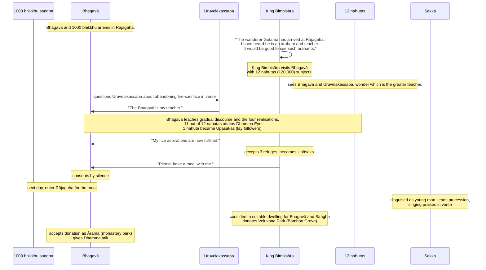

import { Tabs, TabItem } from '@astrojs/starlight/components';

Original text: [World Tipitaka Edition](https://tipitaka2500.github.io/tipitaka/3V/1/1.13.html)

## Summary

The Bhagavā, accompanied by a thousand converted matted hair ascetics, arrived in Rājagaha, where his renowned virtues attracted King Seniya Bimbisāra and a large assembly. To clarify his supreme spiritual authority, the Buddha elicited a public declaration of discipleship from Uruvelakassapa, a prominent ascetic. Following this, the Buddha delivered a Dhamma discourse, leading King Bimbisāra and many others to attain the `dhammacakkhu` (Dhamma Eye)". The deeply moved king, whose long-held aspirations were now fulfilled, took refuge in the Triple Gem, invited the Buddha for a meal, and subsequently donated the Veḷuvana (Bamboo Grove) park, which the Buddha accepted, thereby establishing the first monastery and allowing the Saṅgha to accept such offerings.

## Diagram

## Text

<Tabs syncKey="paliquote">
<TabItem label="My Translation">
(55.)

202\. Then the Bhagavā, having stayed at Gayāsīsa as long as he wished, set out on a journey to Rājagaha with a great Saṅgha of bhikkhū, with a thousand bhikkhū, all of them former matted hair ascetics. Then the Bhagavā, journeying by stages, arrived at Rājagaha. There the Bhagavā dwelt at Rājagaha, in the Laṭṭhivana (Cane Grove), at the Suppatiṭṭha `cetiya` (shrine). King Seniya Bimbisāra of Magadha heard: “Indeed, Bho, the wanderer Gotama, the son of the Sakyans, who went forth from the Sakyan clan, has arrived at Rājagaha and is dwelling at Rājagaha in the Laṭṭhivana, at the Suppatiṭṭha `cetiya` (shrine). And concerning that Bhagavā Gotama such a good report has spread: ‘Such indeed is the Bhagavā: an `arahant` (liberated one), a `sammāsambuddha` (perfectly awakened one), accomplished in knowledge and conduct, fortunate, knower of the world, unsurpassed trainer of persons to be tamed, teacher of gods and humans, the Awakened One, the Bhagavā.’ He declares this world — with its deities, Māras, and Brahmās, this generation with its religious practitioners, its gods and humans — having realised it for himself through experiential understanding. He teaches the Dhamma (doctrine) that is good in the beginning, good in the middle, and good in the end, meaningful and well-phrased; he makes known the `brahmacariya` (optimal life) that is wholly complete and perfectly pure. Indeed, it is good to see such `arahants` (liberated ones).”

203\. Then King Seniya Bimbisāra of Magadha, surrounded by twelve `nahutas` (one hundred and twenty thousand) of Magadhan brahmins and householders, approached the Bhagavā; having approached, he paid homage to the Bhagavā and sat down to one side. And those twelve `nahutas` of Magadhan brahmins and householders too — some paid homage to the Bhagavā and sat down to one side; some exchanged friendly greetings with the Bhagavā, and after exchanging polite and courteous talk, sat down to one side; some extended their clasped hands towards the Bhagavā and sat down to one side; some announced their name and clan in the Bhagavā’s presence and sat down to one side; some, remaining silent, sat down to one side. Then this thought occurred to those twelve `nahutas` of Magadhan brahmins and householders: “Does the great wanderer live the `brahmacariya` (optimal life) under Uruvelakassapa, or does Uruvelakassapa live the `brahmacariya` under the great wanderer?” Then the Bhagavā, knowing with his own mind the thought process of those twelve `nahutas` of Magadhan brahmins and householders, addressed āyasmā Uruvelakassapa with a verse:

204\. _“Having seen what, Uruvelavāsi (Dweller in Uruvelā),_ \
_Did you, the `kisakovadāna` (instructor of the kisaka, an ascetic movement), abandon the fire?_ \
_I ask you this matter, Kassapa:_ \
_How was your `aggihutta` (fire sacrifice) abandoned?”_

205\. _“Forms and sounds and also tastes,_ \
_And women for sensual pleasure, the sacrifices proclaim;_ \
_Knowing this to be a stain among the `upadhi` (attachments),_ \
_Therefore I delighted neither in sacrifice nor in oblation.”_

206\. _“[If] your mind did not delight right there, ([said] the Bhagavā [to] Kassapa)_ \
_In forms, in sounds, and also in tastes;_ \
_Then in what, Kassapa, in the world of gods and humans,_ \
_Does your mind now delight? Tell me this.”_

207\. _“Having seen the peaceful state, free from `upadhi` (attachment),_ \
_Having nothing, unattached to `kāmabhava` (existence in the realm of sensual desire);_ \
_Not subject to change, not led by others,_ \
_Therefore I delighted neither in sacrifice nor in oblation.”_

(56.)

208\. Then āyasmā Uruvelakassapa, rising from his seat, arranging his upper robe over one shoulder, fell with his head at the Bhagavā’s feet and said this to the Bhagavā: “Bhante, the Bhagavā is my teacher, I am a disciple; Bhante, the Bhagavā is my teacher, I am a disciple.” Then this thought occurred to those twelve `nahutas` of Magadhan brahmins and householders: “Uruvelakassapa lives the `brahmacariya` (optimal life) under the great wanderer.” Then the Bhagavā, knowing with his own mind the thought process of those twelve `nahutas` of Magadhan brahmins and householders, gave a progressive talk, that is to say: `dānakathā` (talk on giving), `sīlakathā` (talk on virtue), `saggakathā` (talk on heaven); he explained the danger, baseness and defilement of sensual pleasures, and the benefit of renunciation. When the Bhagavā knew that their minds were ready, pliable, free from `nīvaraṇa` (hindrances), elated and confident, he then explained the most elevated teaching of the Dhamma of the Buddhas: `dukkha` (suffering), `samudaya` (origin), `nirodha` (cessation), `magga` (the path). Just as a clean cloth, free of stains, would rightly receive dye; even so, in eleven `nahutas` (one hundred and ten thousand) of Magadhan brahmins and householders with Bimbisāra at their head, on that very seat, there arose the `viraja` (pure), `vītamala` (stainless) `dhammacakkhu` (Dhamma Eye): “Whatever phenomenon is subject to origination is completely subject to cessation.” One `nahuta` (ten thousand) declared themselves `upāsakā` (lay disciples).

(57.)

209\. Then King Seniya Bimbisāra of Magadha, who has seen the Dhamma, attained the Dhamma, understood the Dhamma, deeply penetrated the Dhamma, overcome uncertainty, free from doubt, attained confidence, not relying on another teacher’s instructions, said this to the Bhagavā: “Formerly, Bhante, when I was a prince, I had five `assāsakā` (aspirations), and these have now been fulfilled for me. Formerly, Bhante, when I was a prince, this thought occurred to me: ‘Oh, may I be anointed to kingship!’ This, Bhante, was my first `assāsaka` (aspiration), and it has now been fulfilled for me. ‘And may an `arahant` (liberated one), a `sammāsambuddha` (perfectly awakened one), come to my kingdom!’ This, Bhante, was my second `assāsaka` (aspiration), and it has now been fulfilled for me. ‘And may I attend upon that Bhagavā!’ This, Bhante, was my third `assāsaka` (aspiration), and it has now been fulfilled for me. ‘And may that Bhagavā teach me the Dhamma!’ This, Bhante, was my fourth `assāsaka` (aspiration), and it has now been fulfilled for me. ‘And may I understand the Dhamma of that Bhagavā!’ This, Bhante, was my fifth `assāsaka` (aspiration), and it has now been fulfilled for me. Formerly, Bhante, when I was a prince, I had these five `assāsakā` (aspirations), and they have now been fulfilled for me. Excellent, Bhante! Excellent, Bhante! Just as, Bhante, one might set upright what has been overturned, or reveal what is hidden, or show the way to one who is lost, or hold up an oil lamp in the darkness, [thinking], ‘those with eyes will see forms’; even so, the Dhamma has been made known by the Bhagavā in many ways. I, Bhante, go for `saraṇa` (refuge) to the Bhagavā, to the Dhamma, and to the Saṅgha of bhikkhū. May the Bhagavā remember me as an `upāsaka` (lay disciple) who has gone for refuge for life from this day forth; and may the Bhagavā, Bhante, consent to my meal for tomorrow together with the Saṅgha of bhikkhū.” The Bhagavā consented by silence. Then King Seniya Bimbisāra of Magadha, knowing the Bhagavā’s consent, rose from his seat, paid homage to the Bhagavā, circumambulated him keeping his right side towards him, and departed. Then King Seniya Bimbisāra of Magadha, after that night had passed, had excellent hard and soft food prepared, and had the time announced to the Bhagavā: “It is time, Bhante; the meal is ready.”

(58.)

210\. Then, in the morning, having dressed and taking his bowl and robes, the Bhagavā entered Rājagaha with a great Saṅgha of bhikkhū, with a thousand bhikkhū, all of them former matted hair ascetics. Now at that time, Sakka, lord of the devas, having created the appearance of a young man, walked in front of the Saṅgha of bhikkhū headed by the Buddha, singing these verses:

211\. _“Tamed, with the tamed former matted hair ascetics,_ \
_Liberated, with the liberated ones;_ \
_Like a gold coin in appearance,_ \
_The Bhagavā entered Rājagaha._

212\. _Freed, with the freed former matted hair ascetics,_ \
_Liberated, with the liberated ones;_ \
_Like a gold coin in appearance,_ \
_The Bhagavā entered Rājagaha._

213\. _Crossed over, with the crossed-over former matted hair ascetics,_ \
_Liberated, with the liberated ones;_ \
_Like a gold coin in appearance,_ \
_The Bhagavā entered Rājagaha._

214\. _Peaceful, with the peaceful former matted hair ascetics,_ \
_Liberated, with the liberated ones;_ \
_Like a gold coin in appearance,_ \
_The Bhagavā entered Rājagaha._

215\. _Following the ten ways of living, endowed with the ten powers,_ \
_Knower of the ten `dhamma` (principles), and endowed with the ten;_ \
_He, with a retinue of a thousand,_ \
_The Bhagavā entered Rājagaha.”_

216\. Seeing Sakka, lord of the devas, the people said this: “Indeed, this young man is handsome! Indeed, this young man is lovely to behold! Indeed, this young man is pleasing! Whose young man is this?” When this was said, Sakka, lord of the devas, addressed those people with a verse:

217\. _“He who is wise, everywhere tamed,_ \
_Pure, without an equal;_ \
_An `arahant` (liberated one), a `sugata` (Fortunate One) in the world,_ \
_I am his attendant.”_

(59.)

218\. Then the Bhagavā approached the residence of King Seniya Bimbisāra of Magadha; having approached, he sat down on the prepared seat together with the Saṅgha of bhikkhū. Then King Seniya Bimbisāra of Magadha, having with his own hand satisfied and satiated the Saṅgha of bhikkhū headed by the Buddha with excellent hard and soft food, sat down to one side when the Bhagavā had eaten and withdrawn his hand from the bowl. As King Seniya Bimbisāra of Magadha sat to one side, this thought occurred to him: “Where now might the Bhagavā dwell? [A place] that would be neither too far from a village nor too near, suitable for coming and going, accessible to people who wish [to come], uncrowded by day, with little sound and little noise by night, with a lonely atmosphere, secluded from people, suitable for `paṭisallāna` (seclusion)?” Then this thought occurred to King Seniya Bimbisāra of Magadha: “This Veḷuvana (Bamboo Grove) park of ours is neither too far from a village nor too near, suitable for coming and going, accessible to people who wish [to come], uncrowded by day, with little sound and little noise by night, with a lonely atmosphere, secluded from people, suitable for `paṭisallāna` (seclusion). What if I were to give the Veḷuvana park to the Saṅgha of bhikkhū headed by the Buddha?” Then King Seniya Bimbisāra of Magadha, taking a golden water pitcher, dedicated it to the Bhagavā: “Bhante, I give this Veḷuvana park to the Saṅgha of bhikkhū headed by the Buddha.” The Bhagavā accepted the `ārāma` (park). Then the Bhagavā, having instructed, encouraged, inspired, and gladdened King Seniya Bimbisāra of Magadha with a Dhamma talk, rose from his seat and departed. Then the Bhagavā, on this occasion, on this account, having given a Dhamma talk, addressed the bhikkhū: “I allow, Bhikkhave, an `ārāma` (park).”

---

219\. The Account of the Meeting with Bimbisāra is finished.
</TabItem>

<TabItem label="Pāḷi (Roman IAST)">
(55.)

202\. Atha kho bhagavā gayāsīse yathābhirantaṃ viharitvā yena rājagahaṃ tena cārikaṃ pakkāmi, mahatā bhikkhusaṃghena saddhiṃ bhikkhusahassena sabbeheva purāṇajaṭilehi. Atha kho bhagavā anupubbena cārikaṃ caramāno yena rājagahaṃ tadavasari. Tatra sudaṃ bhagavā rājagahe viharati laṭṭhivane suppatiṭṭhe cetiye. Assosi kho rājā māgadho seniyo bimbisāro—  “samaṇo khalu bho gotamo sakyaputto sakyakulā pabbajito rājagahaṃ anuppatto rājagahe viharati laṭṭhivane suppatiṭṭhe cetiye. Taṃ kho pana bhagavantaṃ gotamaṃ evaṃ kalyāṇo kittisaddo abbhuggato—  itipi so bhagavā arahaṃ sammāsambuddho vijjācaraṇasampanno sugato lokavidū anuttaro purisadammasārathi satthā devamanussānaṃ buddho bhagavā. So imaṃ lokaṃ sadevakaṃ samārakaṃ sabrahmakaṃ sassamaṇabrāhmaṇiṃ pajaṃ sadevamanussaṃ sayaṃ abhiññā sacchikatvā pavedeti. So dhammaṃ deseti ādikalyāṇaṃ majjhekalyāṇaṃ pariyosānakalyāṇaṃ sātthaṃ sabyañjanaṃ kevalaparipuṇṇaṃ parisuddhaṃ brahmacariyaṃ pakāseti. Sādhu kho pana tathārūpānaṃ arahataṃ dassanaṃ hotī”ti.

203\. Atha kho rājā māgadho seniyo bimbisāro dvādasanahutehi māgadhikehi brāhmaṇagahapatikehi parivuto yena bhagavā tenupasaṅkami, upasaṅkamitvā bhagavantaṃ abhivādetvā ekamantaṃ nisīdi. Tepi kho dvādasanahutā māgadhikā brāhmaṇagahapatikā appekacce bhagavantaṃ abhivādetvā ekamantaṃ nisīdiṃsu, appekacce bhagavatā saddhiṃ sammodiṃsu, sammodanīyaṃ kathaṃ sāraṇīyaṃ vītisāretvā ekamantaṃ nisīdiṃsu, appekacce yena bhagavā tenañjaliṃ paṇāmetvā ekamantaṃ nisīdiṃsu, appekacce bhagavato santike nāmagottaṃ sāvetvā ekamantaṃ nisīdiṃsu, appekacce tuṇhībhūtā ekamantaṃ nisīdiṃsu. Atha kho tesaṃ dvādasanahutānaṃ māgadhikānaṃ brāhmaṇagahapatikānaṃ etadahosi—  “kiṃ nu kho mahāsamaṇo uruvelakassape brahmacariyaṃ carati, udāhu uruvelakassapo mahāsamaṇe brahmacariyaṃ caratī”ti? Atha kho bhagavā tesaṃ dvādasanahutānaṃ māgadhikānaṃ brāhmaṇagahapatikānaṃ cetasā cetoparivitakkamaññāya āyasmantaṃ uruvelakassapaṃ gāthāya ajjhabhāsi—

204\. _“Kimeva disvā uruvelavāsi,_  \
_Pahāsi aggiṃ kisakovadāno;_  \
_Pucchāmi taṃ kassapa etamatthaṃ,_  \
_Kathaṃ pahīnaṃ tava aggihuttan”ti._  

205\. _“Rūpe ca sadde ca atho rase ca,_  \
_Kāmitthiyo cābhivadanti yaññā;_  \
_Etaṃ malanti upadhīsu ñatvā,_  \
_Tasmā na yiṭṭhe na hute arañjin”ti._  

206\. _“Ettheva te mano na ramittha, **(kassapāti bhagavā)**_  \
_Rūpesu saddesu atho rasesu;_  \
_Atha ko carahi devamanussaloke,_  \
_Rato mano kassapa brūhi metan”ti._  

207\. _“Disvā padaṃ santamanūpadhīkaṃ,_  \
_Akiñcanaṃ kāmabhave asattaṃ;_  \
_Anaññathābhāvimanaññaneyyaṃ,_  \
_Tasmā na yiṭṭhe na hute arañjin”ti._  

(56.)

208\. Atha kho āyasmā uruvelakassapo uṭṭhāyāsanā ekaṃsaṃ uttarāsaṅgaṃ karitvā bhagavato pādesu sirasā nipatitvā bhagavantaṃ etadavoca—  “satthā me, bhante, bhagavā, sāvakohamasmi; satthā me, bhante, bhagavā, sāvakohamasmī”ti. Atha kho tesaṃ dvādasanahutānaṃ māgadhikānaṃ brāhmaṇagahapatikānaṃ etadahosi—  “uruvelakassapo mahāsamaṇe brahmacariyaṃ caratī”ti. Atha kho bhagavā tesaṃ dvādasanahutānaṃ māgadhikānaṃ brāhmaṇagahapatikānaṃ cetasā cetoparivitakkamaññāya anupubbiṃ kathaṃ kathesi, seyyathidaṃ—  dānakathaṃ sīlakathaṃ saggakathaṃ kāmānaṃ ādīnavaṃ okāraṃ saṃkilesaṃ nekkhamme ānisaṃsaṃ pakāsesi. Yadā te bhagavā aññāsi kallacitte muducitte vinīvaraṇacitte udaggacitte pasannacitte, atha yā buddhānaṃ sāmukkaṃsikā dhammadesanā, taṃ pakāsesi—  dukkhaṃ, samudayaṃ, nirodhaṃ, maggaṃ. Seyyathāpi nāma suddhaṃ vatthaṃ apagatakāḷakaṃ sammadeva rajanaṃ paṭiggaṇheyya; evameva ekādasanahutānaṃ māgadhikānaṃ brāhmaṇagahapatikānaṃ bimbisārappamukhānaṃ tasmiṃyeva āsane virajaṃ vītamalaṃ dhammacakkhuṃ udapādi—  “yaṃ kiñci samudayadhammaṃ sabbaṃ taṃ nirodhadhamman”ti. Ekanahutaṃ upāsakattaṃ paṭivedesi.

(57.)

209\. Atha kho rājā māgadho seniyo bimbisāro diṭṭhadhammo pattadhammo viditadhammo pariyogāḷhadhammo tiṇṇavicikiccho vigatakathaṃkatho vesārajjappatto aparappaccayo satthusāsane bhagavantaṃ etadavoca—  “pubbe me, bhante, kumārassa sato pañca assāsakā ahesuṃ, te me etarahi samiddhā. Pubbe me, bhante, kumārassa sato etadahosi—  ‘aho vata maṃ rajje abhisiñceyyun’ti, ayaṃ kho me, bhante, paṭhamo assāsako ahosi, so me etarahi samiddho. ‘Tassa ca me vijitaṃ arahaṃ sammāsambuddho okkameyyā’ti, ayaṃ kho me, bhante, dutiyo assāsako ahosi, so me etarahi samiddho. ‘Tañcāhaṃ bhagavantaṃ payirupāseyyan’ti, ayaṃ kho me, bhante, tatiyo assāsako ahosi, so me etarahi samiddho. ‘So ca me bhagavā dhammaṃ deseyyā’ti, ayaṃ kho me, bhante, catuttho assāsako ahosi, so me etarahi samiddho. ‘Tassa cāhaṃ bhagavato dhammaṃ ājāneyyan’ti, ayaṃ kho me, bhante, pañcamo assāsako ahosi, so me etarahi samiddho. Pubbe me, bhante, kumārassa sato ime pañca assāsakā ahesuṃ, te me etarahi samiddhā. Abhikkantaṃ, bhante, abhikkantaṃ, bhante. Seyyathāpi, bhante, nikkujjitaṃ vā ukkujjeyya, paṭicchannaṃ vā vivareyya, mūḷhassa vā maggaṃ ācikkheyya, andhakāre vā telapajjotaṃ dhāreyya—  ‘cakkhumanto rūpāni dakkhantī’ti; evamevaṃ bhagavatā anekapariyāyena dhammo pakāsito. Esāhaṃ, bhante, bhagavantaṃ saraṇaṃ gacchāmi, dhammañca, bhikkhusaṃghañca. Upāsakaṃ maṃ, bhagavā dhāretu ajjatagge pāṇupetaṃ saraṇaṃ gataṃ, adhivāsetu ca me, bhante, bhagavā, svātanāya bhattaṃ saddhiṃ bhikkhusaṃghenā”ti. Adhivāsesi bhagavā tuṇhībhāvena. Atha kho rājā māgadho seniyo bimbisāro bhagavato adhivāsanaṃ viditvā uṭṭhāyāsanā bhagavantaṃ abhivādetvā padakkhiṇaṃ katvā pakkāmi. Atha kho rājā māgadho seniyo bimbisāro tassā rattiyā accayena paṇītaṃ khādanīyaṃ bhojanīyaṃ paṭiyādāpetvā bhagavato kālaṃ ārocāpesi—  “kālo, bhante, niṭṭhitaṃ bhattan”ti.

(58.)

210\. Atha kho bhagavā pubbaṇhasamayaṃ nivāsetvā pattacīvaramādāya rājagahaṃ pāvisi mahatā bhikkhusaṃghena saddhiṃ bhikkhusahassena sabbeheva purāṇajaṭilehi. Tena kho pana samayena sakko devānamindo māṇavakavaṇṇaṃ abhinimminitvā buddhappamukhassa bhikkhusaṃghassa purato purato gacchati imā gāthāyo gāyamāno—

211\. _“Danto dantehi saha purāṇajaṭilehi,_  \
_Vippamutto vippamuttehi;_  \
_Siṅgīnikkhasavaṇṇo,_  \
_Rājagahaṃ pāvisi bhagavā._  

212\. _Mutto muttehi saha purāṇajaṭilehi,_  \
_Vippamutto vippamuttehi;_  \
_Siṅgīnikkhasavaṇṇo,_  \
_Rājagahaṃ pāvisi bhagavā._  

213\. _Tiṇṇo tiṇṇehi saha purāṇajaṭilehi,_  \
_Vippamutto vippamuttehi;_  \
_Siṅgīnikkhasavaṇṇo,_  \
_Rājagahaṃ pāvisi bhagavā._  

214\. _Santo santehi saha purāṇajaṭilehi,_  \
_Vippamutto vippamuttehi;_  \
_Siṅgīnikkhasavaṇṇo,_  \
_Rājagahaṃ pāvisi bhagavā._  

215\. _Dasavāso dasabalo,_  \
_Dasadhammavidū dasabhi cupeto;_  \
_So dasasataparivāro,_  \
_Rājagahaṃ pāvisi bhagavā”ti._  

216\. Manussā sakkaṃ devānamindaṃ passitvā evamāhaṃsu—  “abhirūpo vatāyaṃ māṇavako, dassanīyo vatāyaṃ māṇavako, pāsādiko vatāyaṃ māṇavako. Kassa nu kho ayaṃ māṇavako”ti? Evaṃ vutte, sakko devānamindo te manusse gāthāya ajjhabhāsi—

217\. _“Yo dhīro sabbadhi danto,_  \
_suddho appaṭipuggalo;_  \
_Arahaṃ sugato loke,_  \
_tassāhaṃ paricārako”ti._  

(59.)

218\. Atha kho bhagavā yena rañño māgadhassa seniyassa bimbisārassa nivesanaṃ tenupasaṅkami, upasaṅkamitvā paññatte āsane nisīdi saddhiṃ bhikkhusaṃghena. Atha kho rājā māgadho seniyo bimbisāro buddhappamukhaṃ bhikkhusaṃghaṃ paṇītena khādanīyena bhojanīyena sahatthā santappetvā sampavāretvā bhagavantaṃ bhuttāviṃ onītapattapāṇiṃ ekamantaṃ nisīdi. Ekamantaṃ nisinnassa kho rañño māgadhassa seniyassa bimbisārassa etadahosi—  “kattha nu kho bhagavā vihareyya? Yaṃ assa gāmato neva atidūre na accāsanne, gamanāgamanasampannaṃ, atthikānaṃ atthikānaṃ manussānaṃ abhikkamanīyaṃ, divā appākiṇṇaṃ, rattiṃ appasaddaṃ appanigghosaṃ vijanavātaṃ, manussarāhasseyyakaṃ, paṭisallānasāruppan”ti. Atha kho rañño māgadhassa seniyassa bimbisārassa etadahosi—  “idaṃ kho amhākaṃ veḷuvanaṃ uyyānaṃ gāmato neva atidūre na accāsanne gamanāgamanasampannaṃ atthikānaṃ atthikānaṃ manussānaṃ abhikkamanīyaṃ divā appākiṇṇaṃ rattiṃ appasaddaṃ appanigghosaṃ vijanavātaṃ manussarāhasseyyakaṃ paṭisallānasāruppaṃ. Yannūnāhaṃ veḷuvanaṃ uyyānaṃ buddhappamukhassa bhikkhusaṃghassa dadeyyan”ti. Atha kho rājā māgadho seniyo bimbisāro sovaṇṇamayaṃ bhiṅkāraṃ gahetvā bhagavato oṇojesi—  “etāhaṃ, bhante, veḷuvanaṃ uyyānaṃ buddhappamukhassa bhikkhusaṃghassa dammī”ti. Paṭiggahesi bhagavā ārāmaṃ. Atha kho bhagavā rājānaṃ māgadhaṃ seniyaṃ bimbisāraṃ dhammiyā kathāya sandassetvā samādapetvā samuttejetvā sampahaṃsetvā uṭṭhāyāsanā pakkāmi. Atha kho bhagavā etasmiṃ nidāne etasmiṃ pakaraṇe dhammiṃ kathaṃ katvā bhikkhū āmantesi—  “anujānāmi, bhikkhave, ārāman”ti.

---

219\. Bimbisārasamāgamakathā niṭṭhitā.
</TabItem>

<TabItem label="Pāḷi (Brahmi)">
(55.)

202\. 𑀅𑀣 𑀔𑁄 𑀪𑀕𑀯𑀸 𑀕𑀬𑀸𑀲𑀻𑀲𑁂 𑀬𑀣𑀸𑀪𑀺𑀭𑀦𑁆𑀢𑀁 𑀯𑀺𑀳𑀭𑀺𑀢𑁆𑀯𑀸 𑀬𑁂𑀦 𑀭𑀸𑀚𑀕𑀳𑀁 𑀢𑁂𑀦 𑀘𑀸𑀭𑀺𑀓𑀁 𑀧𑀓𑁆𑀓𑀸𑀫𑀺, 𑀫𑀳𑀢𑀸 𑀪𑀺𑀓𑁆𑀔𑀼𑀲𑀁𑀖𑁂𑀦 𑀲𑀤𑁆𑀥𑀺𑀁 𑀪𑀺𑀓𑁆𑀔𑀼𑀲𑀳𑀲𑁆𑀲𑁂𑀦 𑀲𑀩𑁆𑀩𑁂𑀳𑁂𑀯 𑀧𑀼𑀭𑀸𑀡𑀚𑀝𑀺𑀮𑁂𑀳𑀺. 𑀅𑀣 𑀔𑁄 𑀪𑀕𑀯𑀸 𑀅𑀦𑀼𑀧𑀼𑀩𑁆𑀩𑁂𑀦 𑀘𑀸𑀭𑀺𑀓𑀁 𑀘𑀭𑀫𑀸𑀦𑁄 𑀬𑁂𑀦 𑀭𑀸𑀚𑀕𑀳𑀁 𑀢𑀤𑀯𑀲𑀭𑀺. 𑀢𑀢𑁆𑀭 𑀲𑀼𑀤𑀁 𑀪𑀕𑀯𑀸 𑀭𑀸𑀚𑀕𑀳𑁂 𑀯𑀺𑀳𑀭𑀢𑀺 𑀮𑀝𑁆𑀞𑀺𑀯𑀦𑁂 𑀲𑀼𑀧𑁆𑀧𑀢𑀺𑀝𑁆𑀞𑁂 𑀘𑁂𑀢𑀺𑀬𑁂. 𑀅𑀲𑁆𑀲𑁄𑀲𑀺 𑀔𑁄 𑀭𑀸𑀚𑀸 𑀫𑀸𑀕𑀥𑁄 𑀲𑁂𑀦𑀺𑀬𑁄 𑀩𑀺𑀫𑁆𑀩𑀺𑀲𑀸𑀭𑁄—  “𑀲𑀫𑀡𑁄 𑀔𑀮𑀼 𑀪𑁄 𑀕𑁄𑀢𑀫𑁄 𑀲𑀓𑁆𑀬𑀧𑀼𑀢𑁆𑀢𑁄 𑀲𑀓𑁆𑀬𑀓𑀼𑀮𑀸 𑀧𑀩𑁆𑀩𑀚𑀺𑀢𑁄 𑀭𑀸𑀚𑀕𑀳𑀁 𑀅𑀦𑀼𑀧𑁆𑀧𑀢𑁆𑀢𑁄 𑀭𑀸𑀚𑀕𑀳𑁂 𑀯𑀺𑀳𑀭𑀢𑀺 𑀮𑀝𑁆𑀞𑀺𑀯𑀦𑁂 𑀲𑀼𑀧𑁆𑀧𑀢𑀺𑀝𑁆𑀞𑁂 𑀘𑁂𑀢𑀺𑀬𑁂. 𑀢𑀁 𑀔𑁄 𑀧𑀦 𑀪𑀕𑀯𑀦𑁆𑀢𑀁 𑀕𑁄𑀢𑀫𑀁 𑀏𑀯𑀁 𑀓𑀮𑁆𑀬𑀸𑀡𑁄 𑀓𑀺𑀢𑁆𑀢𑀺𑀲𑀤𑁆𑀤𑁄 𑀅𑀩𑁆𑀪𑀼𑀕𑁆𑀕𑀢𑁄—  𑀇𑀢𑀺𑀧𑀺 𑀲𑁄 𑀪𑀕𑀯𑀸 𑀅𑀭𑀳𑀁 𑀲𑀫𑁆𑀫𑀸𑀲𑀫𑁆𑀩𑀼𑀤𑁆𑀥𑁄 𑀯𑀺𑀚𑁆𑀚𑀸𑀘𑀭𑀡𑀲𑀫𑁆𑀧𑀦𑁆𑀦𑁄 𑀲𑀼𑀕𑀢𑁄 𑀮𑁄𑀓𑀯𑀺𑀤𑀽 𑀅𑀦𑀼𑀢𑁆𑀢𑀭𑁄 𑀧𑀼𑀭𑀺𑀲𑀤𑀫𑁆𑀫𑀲𑀸𑀭𑀣𑀺 𑀲𑀢𑁆𑀣𑀸 𑀤𑁂𑀯𑀫𑀦𑀼𑀲𑁆𑀲𑀸𑀦𑀁 𑀩𑀼𑀤𑁆𑀥𑁄 𑀪𑀕𑀯𑀸. 𑀲𑁄 𑀇𑀫𑀁 𑀮𑁄𑀓𑀁 𑀲𑀤𑁂𑀯𑀓𑀁 𑀲𑀫𑀸𑀭𑀓𑀁 𑀲𑀩𑁆𑀭𑀳𑁆𑀫𑀓𑀁 𑀲𑀲𑁆𑀲𑀫𑀡𑀩𑁆𑀭𑀸𑀳𑁆𑀫𑀡𑀺𑀁 𑀧𑀚𑀁 𑀲𑀤𑁂𑀯𑀫𑀦𑀼𑀲𑁆𑀲𑀁 𑀲𑀬𑀁 𑀅𑀪𑀺𑀜𑁆𑀜𑀸 𑀲𑀘𑁆𑀙𑀺𑀓𑀢𑁆𑀯𑀸 𑀧𑀯𑁂𑀤𑁂𑀢𑀺. 𑀲𑁄 𑀥𑀫𑁆𑀫𑀁 𑀤𑁂𑀲𑁂𑀢𑀺 𑀆𑀤𑀺𑀓𑀮𑁆𑀬𑀸𑀡𑀁 𑀫𑀚𑁆𑀛𑁂𑀓𑀮𑁆𑀬𑀸𑀡𑀁 𑀧𑀭𑀺𑀬𑁄𑀲𑀸𑀦𑀓𑀮𑁆𑀬𑀸𑀡𑀁 𑀲𑀸𑀢𑁆𑀣𑀁 𑀲𑀩𑁆𑀬𑀜𑁆𑀚𑀦𑀁 𑀓𑁂𑀯𑀮𑀧𑀭𑀺𑀧𑀼𑀡𑁆𑀡𑀁 𑀧𑀭𑀺𑀲𑀼𑀤𑁆𑀥𑀁 𑀩𑁆𑀭𑀳𑁆𑀫𑀘𑀭𑀺𑀬𑀁 𑀧𑀓𑀸𑀲𑁂𑀢𑀺. 𑀲𑀸𑀥𑀼 𑀔𑁄 𑀧𑀦 𑀢𑀣𑀸𑀭𑀽𑀧𑀸𑀦𑀁 𑀅𑀭𑀳𑀢𑀁 𑀤𑀲𑁆𑀲𑀦𑀁 𑀳𑁄𑀢𑀻”𑀢𑀺.

203\. 𑀅𑀣 𑀔𑁄 𑀭𑀸𑀚𑀸 𑀫𑀸𑀕𑀥𑁄 𑀲𑁂𑀦𑀺𑀬𑁄 𑀩𑀺𑀫𑁆𑀩𑀺𑀲𑀸𑀭𑁄 𑀤𑁆𑀯𑀸𑀤𑀲𑀦𑀳𑀼𑀢𑁂𑀳𑀺 𑀫𑀸𑀕𑀥𑀺𑀓𑁂𑀳𑀺 𑀩𑁆𑀭𑀸𑀳𑁆𑀫𑀡𑀕𑀳𑀧𑀢𑀺𑀓𑁂𑀳𑀺 𑀧𑀭𑀺𑀯𑀼𑀢𑁄 𑀬𑁂𑀦 𑀪𑀕𑀯𑀸 𑀢𑁂𑀦𑀼𑀧𑀲𑀗𑁆𑀓𑀫𑀺, 𑀉𑀧𑀲𑀗𑁆𑀓𑀫𑀺𑀢𑁆𑀯𑀸 𑀪𑀕𑀯𑀦𑁆𑀢𑀁 𑀅𑀪𑀺𑀯𑀸𑀤𑁂𑀢𑁆𑀯𑀸 𑀏𑀓𑀫𑀦𑁆𑀢𑀁 𑀦𑀺𑀲𑀻𑀤𑀺. 𑀢𑁂𑀧𑀺 𑀔𑁄 𑀤𑁆𑀯𑀸𑀤𑀲𑀦𑀳𑀼𑀢𑀸 𑀫𑀸𑀕𑀥𑀺𑀓𑀸 𑀩𑁆𑀭𑀸𑀳𑁆𑀫𑀡𑀕𑀳𑀧𑀢𑀺𑀓𑀸 𑀅𑀧𑁆𑀧𑁂𑀓𑀘𑁆𑀘𑁂 𑀪𑀕𑀯𑀦𑁆𑀢𑀁 𑀅𑀪𑀺𑀯𑀸𑀤𑁂𑀢𑁆𑀯𑀸 𑀏𑀓𑀫𑀦𑁆𑀢𑀁 𑀦𑀺𑀲𑀻𑀤𑀺𑀁𑀲𑀼, 𑀅𑀧𑁆𑀧𑁂𑀓𑀘𑁆𑀘𑁂 𑀪𑀕𑀯𑀢𑀸 𑀲𑀤𑁆𑀥𑀺𑀁 𑀲𑀫𑁆𑀫𑁄𑀤𑀺𑀁𑀲𑀼, 𑀲𑀫𑁆𑀫𑁄𑀤𑀦𑀻𑀬𑀁 𑀓𑀣𑀁 𑀲𑀸𑀭𑀡𑀻𑀬𑀁 𑀯𑀻𑀢𑀺𑀲𑀸𑀭𑁂𑀢𑁆𑀯𑀸 𑀏𑀓𑀫𑀦𑁆𑀢𑀁 𑀦𑀺𑀲𑀻𑀤𑀺𑀁𑀲𑀼, 𑀅𑀧𑁆𑀧𑁂𑀓𑀘𑁆𑀘𑁂 𑀬𑁂𑀦 𑀪𑀕𑀯𑀸 𑀢𑁂𑀦𑀜𑁆𑀚𑀮𑀺𑀁 𑀧𑀡𑀸𑀫𑁂𑀢𑁆𑀯𑀸 𑀏𑀓𑀫𑀦𑁆𑀢𑀁 𑀦𑀺𑀲𑀻𑀤𑀺𑀁𑀲𑀼, 𑀅𑀧𑁆𑀧𑁂𑀓𑀘𑁆𑀘𑁂 𑀪𑀕𑀯𑀢𑁄 𑀲𑀦𑁆𑀢𑀺𑀓𑁂 𑀦𑀸𑀫𑀕𑁄𑀢𑁆𑀢𑀁 𑀲𑀸𑀯𑁂𑀢𑁆𑀯𑀸 𑀏𑀓𑀫𑀦𑁆𑀢𑀁 𑀦𑀺𑀲𑀻𑀤𑀺𑀁𑀲𑀼, 𑀅𑀧𑁆𑀧𑁂𑀓𑀘𑁆𑀘𑁂 𑀢𑀼𑀡𑁆𑀳𑀻𑀪𑀽𑀢𑀸 𑀏𑀓𑀫𑀦𑁆𑀢𑀁 𑀦𑀺𑀲𑀻𑀤𑀺𑀁𑀲𑀼. 𑀅𑀣 𑀔𑁄 𑀢𑁂𑀲𑀁 𑀤𑁆𑀯𑀸𑀤𑀲𑀦𑀳𑀼𑀢𑀸𑀦𑀁 𑀫𑀸𑀕𑀥𑀺𑀓𑀸𑀦𑀁 𑀩𑁆𑀭𑀸𑀳𑁆𑀫𑀡𑀕𑀳𑀧𑀢𑀺𑀓𑀸𑀦𑀁 𑀏𑀢𑀤𑀳𑁄𑀲𑀺—  “𑀓𑀺𑀁 𑀦𑀼 𑀔𑁄 𑀫𑀳𑀸𑀲𑀫𑀡𑁄 𑀉𑀭𑀼𑀯𑁂𑀮𑀓𑀲𑁆𑀲𑀧𑁂 𑀩𑁆𑀭𑀳𑁆𑀫𑀘𑀭𑀺𑀬𑀁 𑀘𑀭𑀢𑀺, 𑀉𑀤𑀸𑀳𑀼 𑀉𑀭𑀼𑀯𑁂𑀮𑀓𑀲𑁆𑀲𑀧𑁄 𑀫𑀳𑀸𑀲𑀫𑀡𑁂 𑀩𑁆𑀭𑀳𑁆𑀫𑀘𑀭𑀺𑀬𑀁 𑀘𑀭𑀢𑀻”𑀢𑀺? 𑀅𑀣 𑀔𑁄 𑀪𑀕𑀯𑀸 𑀢𑁂𑀲𑀁 𑀤𑁆𑀯𑀸𑀤𑀲𑀦𑀳𑀼𑀢𑀸𑀦𑀁 𑀫𑀸𑀕𑀥𑀺𑀓𑀸𑀦𑀁 𑀩𑁆𑀭𑀸𑀳𑁆𑀫𑀡𑀕𑀳𑀧𑀢𑀺𑀓𑀸𑀦𑀁 𑀘𑁂𑀢𑀲𑀸 𑀘𑁂𑀢𑁄𑀧𑀭𑀺𑀯𑀺𑀢𑀓𑁆𑀓𑀫𑀜𑁆𑀜𑀸𑀬 𑀆𑀬𑀲𑁆𑀫𑀦𑁆𑀢𑀁 𑀉𑀭𑀼𑀯𑁂𑀮𑀓𑀲𑁆𑀲𑀧𑀁 𑀕𑀸𑀣𑀸𑀬 𑀅𑀚𑁆𑀛𑀪𑀸𑀲𑀺—

204\. _“𑀓𑀺𑀫𑁂𑀯 𑀤𑀺𑀲𑁆𑀯𑀸 𑀉𑀭𑀼𑀯𑁂𑀮𑀯𑀸𑀲𑀺,_  \
_𑀧𑀳𑀸𑀲𑀺 𑀅𑀕𑁆𑀕𑀺𑀁 𑀓𑀺𑀲𑀓𑁄𑀯𑀤𑀸𑀦𑁄;_  \
_𑀧𑀼𑀘𑁆𑀙𑀸𑀫𑀺 𑀢𑀁 𑀓𑀲𑁆𑀲𑀧 𑀏𑀢𑀫𑀢𑁆𑀣𑀁,_  \
_𑀓𑀣𑀁 𑀧𑀳𑀻𑀦𑀁 𑀢𑀯 𑀅𑀕𑁆𑀕𑀺𑀳𑀼𑀢𑁆𑀢𑀦𑁆”𑀢𑀺._  

205\. _“𑀭𑀽𑀧𑁂 𑀘 𑀲𑀤𑁆𑀤𑁂 𑀘 𑀅𑀣𑁄 𑀭𑀲𑁂 𑀘,_  \
_𑀓𑀸𑀫𑀺𑀢𑁆𑀣𑀺𑀬𑁄 𑀘𑀸𑀪𑀺𑀯𑀤𑀦𑁆𑀢𑀺 𑀬𑀜𑁆𑀜𑀸;_  \
_𑀏𑀢𑀁 𑀫𑀮𑀦𑁆𑀢𑀺 𑀉𑀧𑀥𑀻𑀲𑀼 𑀜𑀢𑁆𑀯𑀸,_  \
_𑀢𑀲𑁆𑀫𑀸 𑀦 𑀬𑀺𑀝𑁆𑀞𑁂 𑀦 𑀳𑀼𑀢𑁂 𑀅𑀭𑀜𑁆𑀚𑀺𑀦𑁆”𑀢𑀺._  

206\. _“𑀏𑀢𑁆𑀣𑁂𑀯 𑀢𑁂 𑀫𑀦𑁄 𑀦 𑀭𑀫𑀺𑀢𑁆𑀣, **(𑀓𑀲𑁆𑀲𑀧𑀸𑀢𑀺 𑀪𑀕𑀯𑀸)**_  \
_𑀭𑀽𑀧𑁂𑀲𑀼 𑀲𑀤𑁆𑀤𑁂𑀲𑀼 𑀅𑀣𑁄 𑀭𑀲𑁂𑀲𑀼;_  \
_𑀅𑀣 𑀓𑁄 𑀘𑀭𑀳𑀺 𑀤𑁂𑀯𑀫𑀦𑀼𑀲𑁆𑀲𑀮𑁄𑀓𑁂,_  \
_𑀭𑀢𑁄 𑀫𑀦𑁄 𑀓𑀲𑁆𑀲𑀧 𑀩𑁆𑀭𑀽𑀳𑀺 𑀫𑁂𑀢𑀦𑁆”𑀢𑀺._  

207\. _“𑀤𑀺𑀲𑁆𑀯𑀸 𑀧𑀤𑀁 𑀲𑀦𑁆𑀢𑀫𑀦𑀽𑀧𑀥𑀻𑀓𑀁,_  \
_𑀅𑀓𑀺𑀜𑁆𑀘𑀦𑀁 𑀓𑀸𑀫𑀪𑀯𑁂 𑀅𑀲𑀢𑁆𑀢𑀁;_  \
_𑀅𑀦𑀜𑁆𑀜𑀣𑀸𑀪𑀸𑀯𑀺𑀫𑀦𑀜𑁆𑀜𑀦𑁂𑀬𑁆𑀬𑀁,_  \
_𑀢𑀲𑁆𑀫𑀸 𑀦 𑀬𑀺𑀝𑁆𑀞𑁂 𑀦 𑀳𑀼𑀢𑁂 𑀅𑀭𑀜𑁆𑀚𑀺𑀦𑁆”𑀢𑀺._  

(56.)

208\. 𑀅𑀣 𑀔𑁄 𑀆𑀬𑀲𑁆𑀫𑀸 𑀉𑀭𑀼𑀯𑁂𑀮𑀓𑀲𑁆𑀲𑀧𑁄 𑀉𑀝𑁆𑀞𑀸𑀬𑀸𑀲𑀦𑀸 𑀏𑀓𑀁𑀲𑀁 𑀉𑀢𑁆𑀢𑀭𑀸𑀲𑀗𑁆𑀕𑀁 𑀓𑀭𑀺𑀢𑁆𑀯𑀸 𑀪𑀕𑀯𑀢𑁄 𑀧𑀸𑀤𑁂𑀲𑀼 𑀲𑀺𑀭𑀲𑀸 𑀦𑀺𑀧𑀢𑀺𑀢𑁆𑀯𑀸 𑀪𑀕𑀯𑀦𑁆𑀢𑀁 𑀏𑀢𑀤𑀯𑁄𑀘—  “𑀲𑀢𑁆𑀣𑀸 𑀫𑁂, 𑀪𑀦𑁆𑀢𑁂, 𑀪𑀕𑀯𑀸, 𑀲𑀸𑀯𑀓𑁄𑀳𑀫𑀲𑁆𑀫𑀺; 𑀲𑀢𑁆𑀣𑀸 𑀫𑁂, 𑀪𑀦𑁆𑀢𑁂, 𑀪𑀕𑀯𑀸, 𑀲𑀸𑀯𑀓𑁄𑀳𑀫𑀲𑁆𑀫𑀻”𑀢𑀺. 𑀅𑀣 𑀔𑁄 𑀢𑁂𑀲𑀁 𑀤𑁆𑀯𑀸𑀤𑀲𑀦𑀳𑀼𑀢𑀸𑀦𑀁 𑀫𑀸𑀕𑀥𑀺𑀓𑀸𑀦𑀁 𑀩𑁆𑀭𑀸𑀳𑁆𑀫𑀡𑀕𑀳𑀧𑀢𑀺𑀓𑀸𑀦𑀁 𑀏𑀢𑀤𑀳𑁄𑀲𑀺—  “𑀉𑀭𑀼𑀯𑁂𑀮𑀓𑀲𑁆𑀲𑀧𑁄 𑀫𑀳𑀸𑀲𑀫𑀡𑁂 𑀩𑁆𑀭𑀳𑁆𑀫𑀘𑀭𑀺𑀬𑀁 𑀘𑀭𑀢𑀻”𑀢𑀺. 𑀅𑀣 𑀔𑁄 𑀪𑀕𑀯𑀸 𑀢𑁂𑀲𑀁 𑀤𑁆𑀯𑀸𑀤𑀲𑀦𑀳𑀼𑀢𑀸𑀦𑀁 𑀫𑀸𑀕𑀥𑀺𑀓𑀸𑀦𑀁 𑀩𑁆𑀭𑀸𑀳𑁆𑀫𑀡𑀕𑀳𑀧𑀢𑀺𑀓𑀸𑀦𑀁 𑀘𑁂𑀢𑀲𑀸 𑀘𑁂𑀢𑁄𑀧𑀭𑀺𑀯𑀺𑀢𑀓𑁆𑀓𑀫𑀜𑁆𑀜𑀸𑀬 𑀅𑀦𑀼𑀧𑀼𑀩𑁆𑀩𑀺𑀁 𑀓𑀣𑀁 𑀓𑀣𑁂𑀲𑀺, 𑀲𑁂𑀬𑁆𑀬𑀣𑀺𑀤𑀁—  𑀤𑀸𑀦𑀓𑀣𑀁 𑀲𑀻𑀮𑀓𑀣𑀁 𑀲𑀕𑁆𑀕𑀓𑀣𑀁 𑀓𑀸𑀫𑀸𑀦𑀁 𑀆𑀤𑀻𑀦𑀯𑀁 𑀑𑀓𑀸𑀭𑀁 𑀲𑀁𑀓𑀺𑀮𑁂𑀲𑀁 𑀦𑁂𑀓𑁆𑀔𑀫𑁆𑀫𑁂 𑀆𑀦𑀺𑀲𑀁𑀲𑀁 𑀧𑀓𑀸𑀲𑁂𑀲𑀺. 𑀬𑀤𑀸 𑀢𑁂 𑀪𑀕𑀯𑀸 𑀅𑀜𑁆𑀜𑀸𑀲𑀺 𑀓𑀮𑁆𑀮𑀘𑀺𑀢𑁆𑀢𑁂 𑀫𑀼𑀤𑀼𑀘𑀺𑀢𑁆𑀢𑁂 𑀯𑀺𑀦𑀻𑀯𑀭𑀡𑀘𑀺𑀢𑁆𑀢𑁂 𑀉𑀤𑀕𑁆𑀕𑀘𑀺𑀢𑁆𑀢𑁂 𑀧𑀲𑀦𑁆𑀦𑀘𑀺𑀢𑁆𑀢𑁂, 𑀅𑀣 𑀬𑀸 𑀩𑀼𑀤𑁆𑀥𑀸𑀦𑀁 𑀲𑀸𑀫𑀼𑀓𑁆𑀓𑀁𑀲𑀺𑀓𑀸 𑀥𑀫𑁆𑀫𑀤𑁂𑀲𑀦𑀸, 𑀢𑀁 𑀧𑀓𑀸𑀲𑁂𑀲𑀺—  𑀤𑀼𑀓𑁆𑀔𑀁, 𑀲𑀫𑀼𑀤𑀬𑀁, 𑀦𑀺𑀭𑁄𑀥𑀁, 𑀫𑀕𑁆𑀕𑀁. 𑀲𑁂𑀬𑁆𑀬𑀣𑀸𑀧𑀺 𑀦𑀸𑀫 𑀲𑀼𑀤𑁆𑀥𑀁 𑀯𑀢𑁆𑀣𑀁 𑀅𑀧𑀕𑀢𑀓𑀸𑀍𑀅𑀓𑀁 𑀲𑀫𑁆𑀫𑀤𑁂𑀯 𑀭𑀚𑀦𑀁 𑀧𑀝𑀺𑀕𑁆𑀕𑀡𑁆𑀳𑁂𑀬𑁆𑀬; 𑀏𑀯𑀫𑁂𑀯 𑀏𑀓𑀸𑀤𑀲𑀦𑀳𑀼𑀢𑀸𑀦𑀁 𑀫𑀸𑀕𑀥𑀺𑀓𑀸𑀦𑀁 𑀩𑁆𑀭𑀸𑀳𑁆𑀫𑀡𑀕𑀳𑀧𑀢𑀺𑀓𑀸𑀦𑀁 𑀩𑀺𑀫𑁆𑀩𑀺𑀲𑀸𑀭𑀧𑁆𑀧𑀫𑀼𑀔𑀸𑀦𑀁 𑀢𑀲𑁆𑀫𑀺𑀁𑀬𑁂𑀯 𑀆𑀲𑀦𑁂 𑀯𑀺𑀭𑀚𑀁 𑀯𑀻𑀢𑀫𑀮𑀁 𑀥𑀫𑁆𑀫𑀘𑀓𑁆𑀔𑀼𑀁 𑀉𑀤𑀧𑀸𑀤𑀺—  “𑀬𑀁 𑀓𑀺𑀜𑁆𑀘𑀺 𑀲𑀫𑀼𑀤𑀬𑀥𑀫𑁆𑀫𑀁 𑀲𑀩𑁆𑀩𑀁 𑀢𑀁 𑀦𑀺𑀭𑁄𑀥𑀥𑀫𑁆𑀫𑀦𑁆”𑀢𑀺. 𑀏𑀓𑀦𑀳𑀼𑀢𑀁 𑀉𑀧𑀸𑀲𑀓𑀢𑁆𑀢𑀁 𑀧𑀝𑀺𑀯𑁂𑀤𑁂𑀲𑀺.

(57.)

209\. 𑀅𑀣 𑀔𑁄 𑀭𑀸𑀚𑀸 𑀫𑀸𑀕𑀥𑁄 𑀲𑁂𑀦𑀺𑀬𑁄 𑀩𑀺𑀫𑁆𑀩𑀺𑀲𑀸𑀭𑁄 𑀤𑀺𑀝𑁆𑀞𑀥𑀫𑁆𑀫𑁄 𑀧𑀢𑁆𑀢𑀥𑀫𑁆𑀫𑁄 𑀯𑀺𑀤𑀺𑀢𑀥𑀫𑁆𑀫𑁄 𑀧𑀭𑀺𑀬𑁄𑀕𑀸𑀍𑀳𑀥𑀫𑁆𑀫𑁄 𑀢𑀺𑀡𑁆𑀡𑀯𑀺𑀘𑀺𑀓𑀺𑀘𑁆𑀙𑁄 𑀯𑀺𑀕𑀢𑀓𑀣𑀁𑀓𑀣𑁄 𑀯𑁂𑀲𑀸𑀭𑀚𑁆𑀚𑀧𑁆𑀧𑀢𑁆𑀢𑁄 𑀅𑀧𑀭𑀧𑁆𑀧𑀘𑁆𑀘𑀬𑁄 𑀲𑀢𑁆𑀣𑀼𑀲𑀸𑀲𑀦𑁂 𑀪𑀕𑀯𑀦𑁆𑀢𑀁 𑀏𑀢𑀤𑀯𑁄𑀘—  “𑀧𑀼𑀩𑁆𑀩𑁂 𑀫𑁂, 𑀪𑀦𑁆𑀢𑁂, 𑀓𑀼𑀫𑀸𑀭𑀲𑁆𑀲 𑀲𑀢𑁄 𑀧𑀜𑁆𑀘 𑀅𑀲𑁆𑀲𑀸𑀲𑀓𑀸 𑀅𑀳𑁂𑀲𑀼𑀁, 𑀢𑁂 𑀫𑁂 𑀏𑀢𑀭𑀳𑀺 𑀲𑀫𑀺𑀤𑁆𑀥𑀸. 𑀧𑀼𑀩𑁆𑀩𑁂 𑀫𑁂, 𑀪𑀦𑁆𑀢𑁂, 𑀓𑀼𑀫𑀸𑀭𑀲𑁆𑀲 𑀲𑀢𑁄 𑀏𑀢𑀤𑀳𑁄𑀲𑀺—  ‘𑀅𑀳𑁄 𑀯𑀢 𑀫𑀁 𑀭𑀚𑁆𑀚𑁂 𑀅𑀪𑀺𑀲𑀺𑀜𑁆𑀘𑁂𑀬𑁆𑀬𑀼𑀦𑁆’𑀢𑀺, 𑀅𑀬𑀁 𑀔𑁄 𑀫𑁂, 𑀪𑀦𑁆𑀢𑁂, 𑀧𑀞𑀫𑁄 𑀅𑀲𑁆𑀲𑀸𑀲𑀓𑁄 𑀅𑀳𑁄𑀲𑀺, 𑀲𑁄 𑀫𑁂 𑀏𑀢𑀭𑀳𑀺 𑀲𑀫𑀺𑀤𑁆𑀥𑁄. ‘𑀢𑀲𑁆𑀲 𑀘 𑀫𑁂 𑀯𑀺𑀚𑀺𑀢𑀁 𑀅𑀭𑀳𑀁 𑀲𑀫𑁆𑀫𑀸𑀲𑀫𑁆𑀩𑀼𑀤𑁆𑀥𑁄 𑀑𑀓𑁆𑀓𑀫𑁂𑀬𑁆𑀬𑀸’𑀢𑀺, 𑀅𑀬𑀁 𑀔𑁄 𑀫𑁂, 𑀪𑀦𑁆𑀢𑁂, 𑀤𑀼𑀢𑀺𑀬𑁄 𑀅𑀲𑁆𑀲𑀸𑀲𑀓𑁄 𑀅𑀳𑁄𑀲𑀺, 𑀲𑁄 𑀫𑁂 𑀏𑀢𑀭𑀳𑀺 𑀲𑀫𑀺𑀤𑁆𑀥𑁄. ‘𑀢𑀜𑁆𑀘𑀸𑀳𑀁 𑀪𑀕𑀯𑀦𑁆𑀢𑀁 𑀧𑀬𑀺𑀭𑀼𑀧𑀸𑀲𑁂𑀬𑁆𑀬𑀦𑁆’𑀢𑀺, 𑀅𑀬𑀁 𑀔𑁄 𑀫𑁂, 𑀪𑀦𑁆𑀢𑁂, 𑀢𑀢𑀺𑀬𑁄 𑀅𑀲𑁆𑀲𑀸𑀲𑀓𑁄 𑀅𑀳𑁄𑀲𑀺, 𑀲𑁄 𑀫𑁂 𑀏𑀢𑀭𑀳𑀺 𑀲𑀫𑀺𑀤𑁆𑀥𑁄. ‘𑀲𑁄 𑀘 𑀫𑁂 𑀪𑀕𑀯𑀸 𑀥𑀫𑁆𑀫𑀁 𑀤𑁂𑀲𑁂𑀬𑁆𑀬𑀸’𑀢𑀺, 𑀅𑀬𑀁 𑀔𑁄 𑀫𑁂, 𑀪𑀦𑁆𑀢𑁂, 𑀘𑀢𑀼𑀢𑁆𑀣𑁄 𑀅𑀲𑁆𑀲𑀸𑀲𑀓𑁄 𑀅𑀳𑁄𑀲𑀺, 𑀲𑁄 𑀫𑁂 𑀏𑀢𑀭𑀳𑀺 𑀲𑀫𑀺𑀤𑁆𑀥𑁄. ‘𑀢𑀲𑁆𑀲 𑀘𑀸𑀳𑀁 𑀪𑀕𑀯𑀢𑁄 𑀥𑀫𑁆𑀫𑀁 𑀆𑀚𑀸𑀦𑁂𑀬𑁆𑀬𑀦𑁆’𑀢𑀺, 𑀅𑀬𑀁 𑀔𑁄 𑀫𑁂, 𑀪𑀦𑁆𑀢𑁂, 𑀧𑀜𑁆𑀘𑀫𑁄 𑀅𑀲𑁆𑀲𑀸𑀲𑀓𑁄 𑀅𑀳𑁄𑀲𑀺, 𑀲𑁄 𑀫𑁂 𑀏𑀢𑀭𑀳𑀺 𑀲𑀫𑀺𑀤𑁆𑀥𑁄. 𑀧𑀼𑀩𑁆𑀩𑁂 𑀫𑁂, 𑀪𑀦𑁆𑀢𑁂, 𑀓𑀼𑀫𑀸𑀭𑀲𑁆𑀲 𑀲𑀢𑁄 𑀇𑀫𑁂 𑀧𑀜𑁆𑀘 𑀅𑀲𑁆𑀲𑀸𑀲𑀓𑀸 𑀅𑀳𑁂𑀲𑀼𑀁, 𑀢𑁂 𑀫𑁂 𑀏𑀢𑀭𑀳𑀺 𑀲𑀫𑀺𑀤𑁆𑀥𑀸. 𑀅𑀪𑀺𑀓𑁆𑀓𑀦𑁆𑀢𑀁, 𑀪𑀦𑁆𑀢𑁂, 𑀅𑀪𑀺𑀓𑁆𑀓𑀦𑁆𑀢𑀁, 𑀪𑀦𑁆𑀢𑁂. 𑀲𑁂𑀬𑁆𑀬𑀣𑀸𑀧𑀺, 𑀪𑀦𑁆𑀢𑁂, 𑀦𑀺𑀓𑁆𑀓𑀼𑀚𑁆𑀚𑀺𑀢𑀁 𑀯𑀸 𑀉𑀓𑁆𑀓𑀼𑀚𑁆𑀚𑁂𑀬𑁆𑀬, 𑀧𑀝𑀺𑀘𑁆𑀙𑀦𑁆𑀦𑀁 𑀯𑀸 𑀯𑀺𑀯𑀭𑁂𑀬𑁆𑀬, 𑀫𑀽𑀍𑀳𑀲𑁆𑀲 𑀯𑀸 𑀫𑀕𑁆𑀕𑀁 𑀆𑀘𑀺𑀓𑁆𑀔𑁂𑀬𑁆𑀬, 𑀅𑀦𑁆𑀥𑀓𑀸𑀭𑁂 𑀯𑀸 𑀢𑁂𑀮𑀧𑀚𑁆𑀚𑁄𑀢𑀁 𑀥𑀸𑀭𑁂𑀬𑁆𑀬—  ‘𑀘𑀓𑁆𑀔𑀼𑀫𑀦𑁆𑀢𑁄 𑀭𑀽𑀧𑀸𑀦𑀺 𑀤𑀓𑁆𑀔𑀦𑁆𑀢𑀻’𑀢𑀺; 𑀏𑀯𑀫𑁂𑀯𑀁 𑀪𑀕𑀯𑀢𑀸 𑀅𑀦𑁂𑀓𑀧𑀭𑀺𑀬𑀸𑀬𑁂𑀦 𑀥𑀫𑁆𑀫𑁄 𑀧𑀓𑀸𑀲𑀺𑀢𑁄. 𑀏𑀲𑀸𑀳𑀁, 𑀪𑀦𑁆𑀢𑁂, 𑀪𑀕𑀯𑀦𑁆𑀢𑀁 𑀲𑀭𑀡𑀁 𑀕𑀘𑁆𑀙𑀸𑀫𑀺, 𑀥𑀫𑁆𑀫𑀜𑁆𑀘, 𑀪𑀺𑀓𑁆𑀔𑀼𑀲𑀁𑀖𑀜𑁆𑀘. 𑀉𑀧𑀸𑀲𑀓𑀁 𑀫𑀁, 𑀪𑀕𑀯𑀸 𑀥𑀸𑀭𑁂𑀢𑀼 𑀅𑀚𑁆𑀚𑀢𑀕𑁆𑀕𑁂 𑀧𑀸𑀡𑀼𑀧𑁂𑀢𑀁 𑀲𑀭𑀡𑀁 𑀕𑀢𑀁, 𑀅𑀥𑀺𑀯𑀸𑀲𑁂𑀢𑀼 𑀘 𑀫𑁂, 𑀪𑀦𑁆𑀢𑁂, 𑀪𑀕𑀯𑀸, 𑀲𑁆𑀯𑀸𑀢𑀦𑀸𑀬 𑀪𑀢𑁆𑀢𑀁 𑀲𑀤𑁆𑀥𑀺𑀁 𑀪𑀺𑀓𑁆𑀔𑀼𑀲𑀁𑀖𑁂𑀦𑀸”𑀢𑀺. 𑀅𑀥𑀺𑀯𑀸𑀲𑁂𑀲𑀺 𑀪𑀕𑀯𑀸 𑀢𑀼𑀡𑁆𑀳𑀻𑀪𑀸𑀯𑁂𑀦. 𑀅𑀣 𑀔𑁄 𑀭𑀸𑀚𑀸 𑀫𑀸𑀕𑀥𑁄 𑀲𑁂𑀦𑀺𑀬𑁄 𑀩𑀺𑀫𑁆𑀩𑀺𑀲𑀸𑀭𑁄 𑀪𑀕𑀯𑀢𑁄 𑀅𑀥𑀺𑀯𑀸𑀲𑀦𑀁 𑀯𑀺𑀤𑀺𑀢𑁆𑀯𑀸 𑀉𑀝𑁆𑀞𑀸𑀬𑀸𑀲𑀦𑀸 𑀪𑀕𑀯𑀦𑁆𑀢𑀁 𑀅𑀪𑀺𑀯𑀸𑀤𑁂𑀢𑁆𑀯𑀸 𑀧𑀤𑀓𑁆𑀔𑀺𑀡𑀁 𑀓𑀢𑁆𑀯𑀸 𑀧𑀓𑁆𑀓𑀸𑀫𑀺. 𑀅𑀣 𑀔𑁄 𑀭𑀸𑀚𑀸 𑀫𑀸𑀕𑀥𑁄 𑀲𑁂𑀦𑀺𑀬𑁄 𑀩𑀺𑀫𑁆𑀩𑀺𑀲𑀸𑀭𑁄 𑀢𑀲𑁆𑀲𑀸 𑀭𑀢𑁆𑀢𑀺𑀬𑀸 𑀅𑀘𑁆𑀘𑀬𑁂𑀦 𑀧𑀡𑀻𑀢𑀁 𑀔𑀸𑀤𑀦𑀻𑀬𑀁 𑀪𑁄𑀚𑀦𑀻𑀬𑀁 𑀧𑀝𑀺𑀬𑀸𑀤𑀸𑀧𑁂𑀢𑁆𑀯𑀸 𑀪𑀕𑀯𑀢𑁄 𑀓𑀸𑀮𑀁 𑀆𑀭𑁄𑀘𑀸𑀧𑁂𑀲𑀺—  “𑀓𑀸𑀮𑁄, 𑀪𑀦𑁆𑀢𑁂, 𑀦𑀺𑀝𑁆𑀞𑀺𑀢𑀁 𑀪𑀢𑁆𑀢𑀦𑁆”𑀢𑀺.

(58.)

210\. 𑀅𑀣 𑀔𑁄 𑀪𑀕𑀯𑀸 𑀧𑀼𑀩𑁆𑀩𑀡𑁆𑀳𑀲𑀫𑀬𑀁 𑀦𑀺𑀯𑀸𑀲𑁂𑀢𑁆𑀯𑀸 𑀧𑀢𑁆𑀢𑀘𑀻𑀯𑀭𑀫𑀸𑀤𑀸𑀬 𑀭𑀸𑀚𑀕𑀳𑀁 𑀧𑀸𑀯𑀺𑀲𑀺 𑀫𑀳𑀢𑀸 𑀪𑀺𑀓𑁆𑀔𑀼𑀲𑀁𑀖𑁂𑀦 𑀲𑀤𑁆𑀥𑀺𑀁 𑀪𑀺𑀓𑁆𑀔𑀼𑀲𑀳𑀲𑁆𑀲𑁂𑀦 𑀲𑀩𑁆𑀩𑁂𑀳𑁂𑀯 𑀧𑀼𑀭𑀸𑀡𑀚𑀝𑀺𑀮𑁂𑀳𑀺. 𑀢𑁂𑀦 𑀔𑁄 𑀧𑀦 𑀲𑀫𑀬𑁂𑀦 𑀲𑀓𑁆𑀓𑁄 𑀤𑁂𑀯𑀸𑀦𑀫𑀺𑀦𑁆𑀤𑁄 𑀫𑀸𑀡𑀯𑀓𑀯𑀡𑁆𑀡𑀁 𑀅𑀪𑀺𑀦𑀺𑀫𑁆𑀫𑀺𑀦𑀺𑀢𑁆𑀯𑀸 𑀩𑀼𑀤𑁆𑀥𑀧𑁆𑀧𑀫𑀼𑀔𑀲𑁆𑀲 𑀪𑀺𑀓𑁆𑀔𑀼𑀲𑀁𑀖𑀲𑁆𑀲 𑀧𑀼𑀭𑀢𑁄 𑀧𑀼𑀭𑀢𑁄 𑀕𑀘𑁆𑀙𑀢𑀺 𑀇𑀫𑀸 𑀕𑀸𑀣𑀸𑀬𑁄 𑀕𑀸𑀬𑀫𑀸𑀦𑁄—

211\. _“𑀤𑀦𑁆𑀢𑁄 𑀤𑀦𑁆𑀢𑁂𑀳𑀺 𑀲𑀳 𑀧𑀼𑀭𑀸𑀡𑀚𑀝𑀺𑀮𑁂𑀳𑀺,_  \
_𑀯𑀺𑀧𑁆𑀧𑀫𑀼𑀢𑁆𑀢𑁄 𑀯𑀺𑀧𑁆𑀧𑀫𑀼𑀢𑁆𑀢𑁂𑀳𑀺;_  \
_𑀲𑀺𑀗𑁆𑀕𑀻𑀦𑀺𑀓𑁆𑀔𑀲𑀯𑀡𑁆𑀡𑁄,_  \
_𑀭𑀸𑀚𑀕𑀳𑀁 𑀧𑀸𑀯𑀺𑀲𑀺 𑀪𑀕𑀯𑀸._  

212\. _𑀫𑀼𑀢𑁆𑀢𑁄 𑀫𑀼𑀢𑁆𑀢𑁂𑀳𑀺 𑀲𑀳 𑀧𑀼𑀭𑀸𑀡𑀚𑀝𑀺𑀮𑁂𑀳𑀺,_  \
_𑀯𑀺𑀧𑁆𑀧𑀫𑀼𑀢𑁆𑀢𑁄 𑀯𑀺𑀧𑁆𑀧𑀫𑀼𑀢𑁆𑀢𑁂𑀳𑀺;_  \
_𑀲𑀺𑀗𑁆𑀕𑀻𑀦𑀺𑀓𑁆𑀔𑀲𑀯𑀡𑁆𑀡𑁄,_  \
_𑀭𑀸𑀚𑀕𑀳𑀁 𑀧𑀸𑀯𑀺𑀲𑀺 𑀪𑀕𑀯𑀸._  

213\. _𑀢𑀺𑀡𑁆𑀡𑁄 𑀢𑀺𑀡𑁆𑀡𑁂𑀳𑀺 𑀲𑀳 𑀧𑀼𑀭𑀸𑀡𑀚𑀝𑀺𑀮𑁂𑀳𑀺,_  \
_𑀯𑀺𑀧𑁆𑀧𑀫𑀼𑀢𑁆𑀢𑁄 𑀯𑀺𑀧𑁆𑀧𑀫𑀼𑀢𑁆𑀢𑁂𑀳𑀺;_  \
_𑀲𑀺𑀗𑁆𑀕𑀻𑀦𑀺𑀓𑁆𑀔𑀲𑀯𑀡𑁆𑀡𑁄,_  \
_𑀭𑀸𑀚𑀕𑀳𑀁 𑀧𑀸𑀯𑀺𑀲𑀺 𑀪𑀕𑀯𑀸._  

214\. _𑀲𑀦𑁆𑀢𑁄 𑀲𑀦𑁆𑀢𑁂𑀳𑀺 𑀲𑀳 𑀧𑀼𑀭𑀸𑀡𑀚𑀝𑀺𑀮𑁂𑀳𑀺,_  \
_𑀯𑀺𑀧𑁆𑀧𑀫𑀼𑀢𑁆𑀢𑁄 𑀯𑀺𑀧𑁆𑀧𑀫𑀼𑀢𑁆𑀢𑁂𑀳𑀺;_  \
_𑀲𑀺𑀗𑁆𑀕𑀻𑀦𑀺𑀓𑁆𑀔𑀲𑀯𑀡𑁆𑀡𑁄,_  \
_𑀭𑀸𑀚𑀕𑀳𑀁 𑀧𑀸𑀯𑀺𑀲𑀺 𑀪𑀕𑀯𑀸._  

215\. _𑀤𑀲𑀯𑀸𑀲𑁄 𑀤𑀲𑀩𑀮𑁄,_  \
_𑀤𑀲𑀥𑀫𑁆𑀫𑀯𑀺𑀤𑀽 𑀤𑀲𑀪𑀺 𑀘𑀼𑀧𑁂𑀢𑁄;_  \
_𑀲𑁄 𑀤𑀲𑀲𑀢𑀧𑀭𑀺𑀯𑀸𑀭𑁄,_  \
_𑀭𑀸𑀚𑀕𑀳𑀁 𑀧𑀸𑀯𑀺𑀲𑀺 𑀪𑀕𑀯𑀸”𑀢𑀺._  

216\. 𑀫𑀦𑀼𑀲𑁆𑀲𑀸 𑀲𑀓𑁆𑀓𑀁 𑀤𑁂𑀯𑀸𑀦𑀫𑀺𑀦𑁆𑀤𑀁 𑀧𑀲𑁆𑀲𑀺𑀢𑁆𑀯𑀸 𑀏𑀯𑀫𑀸𑀳𑀁𑀲𑀼—  “𑀅𑀪𑀺𑀭𑀽𑀧𑁄 𑀯𑀢𑀸𑀬𑀁 𑀫𑀸𑀡𑀯𑀓𑁄, 𑀤𑀲𑁆𑀲𑀦𑀻𑀬𑁄 𑀯𑀢𑀸𑀬𑀁 𑀫𑀸𑀡𑀯𑀓𑁄, 𑀧𑀸𑀲𑀸𑀤𑀺𑀓𑁄 𑀯𑀢𑀸𑀬𑀁 𑀫𑀸𑀡𑀯𑀓𑁄. 𑀓𑀲𑁆𑀲 𑀦𑀼 𑀔𑁄 𑀅𑀬𑀁 𑀫𑀸𑀡𑀯𑀓𑁄”𑀢𑀺? 𑀏𑀯𑀁 𑀯𑀼𑀢𑁆𑀢𑁂, 𑀲𑀓𑁆𑀓𑁄 𑀤𑁂𑀯𑀸𑀦𑀫𑀺𑀦𑁆𑀤𑁄 𑀢𑁂 𑀫𑀦𑀼𑀲𑁆𑀲𑁂 𑀕𑀸𑀣𑀸𑀬 𑀅𑀚𑁆𑀛𑀪𑀸𑀲𑀺—

217\. _“𑀬𑁄 𑀥𑀻𑀭𑁄 𑀲𑀩𑁆𑀩𑀥𑀺 𑀤𑀦𑁆𑀢𑁄,_  \
_𑀲𑀼𑀤𑁆𑀥𑁄 𑀅𑀧𑁆𑀧𑀝𑀺𑀧𑀼𑀕𑁆𑀕𑀮𑁄;_  \
_𑀅𑀭𑀳𑀁 𑀲𑀼𑀕𑀢𑁄 𑀮𑁄𑀓𑁂,_  \
_𑀢𑀲𑁆𑀲𑀸𑀳𑀁 𑀧𑀭𑀺𑀘𑀸𑀭𑀓𑁄”𑀢𑀺._  

(59.)

218\. 𑀅𑀣 𑀔𑁄 𑀪𑀕𑀯𑀸 𑀬𑁂𑀦 𑀭𑀜𑁆𑀜𑁄 𑀫𑀸𑀕𑀥𑀲𑁆𑀲 𑀲𑁂𑀦𑀺𑀬𑀲𑁆𑀲 𑀩𑀺𑀫𑁆𑀩𑀺𑀲𑀸𑀭𑀲𑁆𑀲 𑀦𑀺𑀯𑁂𑀲𑀦𑀁 𑀢𑁂𑀦𑀼𑀧𑀲𑀗𑁆𑀓𑀫𑀺, 𑀉𑀧𑀲𑀗𑁆𑀓𑀫𑀺𑀢𑁆𑀯𑀸 𑀧𑀜𑁆𑀜𑀢𑁆𑀢𑁂 𑀆𑀲𑀦𑁂 𑀦𑀺𑀲𑀻𑀤𑀺 𑀲𑀤𑁆𑀥𑀺𑀁 𑀪𑀺𑀓𑁆𑀔𑀼𑀲𑀁𑀖𑁂𑀦. 𑀅𑀣 𑀔𑁄 𑀭𑀸𑀚𑀸 𑀫𑀸𑀕𑀥𑁄 𑀲𑁂𑀦𑀺𑀬𑁄 𑀩𑀺𑀫𑁆𑀩𑀺𑀲𑀸𑀭𑁄 𑀩𑀼𑀤𑁆𑀥𑀧𑁆𑀧𑀫𑀼𑀔𑀁 𑀪𑀺𑀓𑁆𑀔𑀼𑀲𑀁𑀖𑀁 𑀧𑀡𑀻𑀢𑁂𑀦 𑀔𑀸𑀤𑀦𑀻𑀬𑁂𑀦 𑀪𑁄𑀚𑀦𑀻𑀬𑁂𑀦 𑀲𑀳𑀢𑁆𑀣𑀸 𑀲𑀦𑁆𑀢𑀧𑁆𑀧𑁂𑀢𑁆𑀯𑀸 𑀲𑀫𑁆𑀧𑀯𑀸𑀭𑁂𑀢𑁆𑀯𑀸 𑀪𑀕𑀯𑀦𑁆𑀢𑀁 𑀪𑀼𑀢𑁆𑀢𑀸𑀯𑀺𑀁 𑀑𑀦𑀻𑀢𑀧𑀢𑁆𑀢𑀧𑀸𑀡𑀺𑀁 𑀏𑀓𑀫𑀦𑁆𑀢𑀁 𑀦𑀺𑀲𑀻𑀤𑀺. 𑀏𑀓𑀫𑀦𑁆𑀢𑀁 𑀦𑀺𑀲𑀺𑀦𑁆𑀦𑀲𑁆𑀲 𑀔𑁄 𑀭𑀜𑁆𑀜𑁄 𑀫𑀸𑀕𑀥𑀲𑁆𑀲 𑀲𑁂𑀦𑀺𑀬𑀲𑁆𑀲 𑀩𑀺𑀫𑁆𑀩𑀺𑀲𑀸𑀭𑀲𑁆𑀲 𑀏𑀢𑀤𑀳𑁄𑀲𑀺—  “𑀓𑀢𑁆𑀣 𑀦𑀼 𑀔𑁄 𑀪𑀕𑀯𑀸 𑀯𑀺𑀳𑀭𑁂𑀬𑁆𑀬? 𑀬𑀁 𑀅𑀲𑁆𑀲 𑀕𑀸𑀫𑀢𑁄 𑀦𑁂𑀯 𑀅𑀢𑀺𑀤𑀽𑀭𑁂 𑀦 𑀅𑀘𑁆𑀘𑀸𑀲𑀦𑁆𑀦𑁂, 𑀕𑀫𑀦𑀸𑀕𑀫𑀦𑀲𑀫𑁆𑀧𑀦𑁆𑀦𑀁, 𑀅𑀢𑁆𑀣𑀺𑀓𑀸𑀦𑀁 𑀅𑀢𑁆𑀣𑀺𑀓𑀸𑀦𑀁 𑀫𑀦𑀼𑀲𑁆𑀲𑀸𑀦𑀁 𑀅𑀪𑀺𑀓𑁆𑀓𑀫𑀦𑀻𑀬𑀁, 𑀤𑀺𑀯𑀸 𑀅𑀧𑁆𑀧𑀸𑀓𑀺𑀡𑁆𑀡𑀁, 𑀭𑀢𑁆𑀢𑀺𑀁 𑀅𑀧𑁆𑀧𑀲𑀤𑁆𑀤𑀁 𑀅𑀧𑁆𑀧𑀦𑀺𑀕𑁆𑀖𑁄𑀲𑀁 𑀯𑀺𑀚𑀦𑀯𑀸𑀢𑀁, 𑀫𑀦𑀼𑀲𑁆𑀲𑀭𑀸𑀳𑀲𑁆𑀲𑁂𑀬𑁆𑀬𑀓𑀁, 𑀧𑀝𑀺𑀲𑀮𑁆𑀮𑀸𑀦𑀲𑀸𑀭𑀼𑀧𑁆𑀧𑀦𑁆”𑀢𑀺. 𑀅𑀣 𑀔𑁄 𑀭𑀜𑁆𑀜𑁄 𑀫𑀸𑀕𑀥𑀲𑁆𑀲 𑀲𑁂𑀦𑀺𑀬𑀲𑁆𑀲 𑀩𑀺𑀫𑁆𑀩𑀺𑀲𑀸𑀭𑀲𑁆𑀲 𑀏𑀢𑀤𑀳𑁄𑀲𑀺—  “𑀇𑀤𑀁 𑀔𑁄 𑀅𑀫𑁆𑀳𑀸𑀓𑀁 𑀯𑁂𑀍𑀉𑀯𑀦𑀁 𑀉𑀬𑁆𑀬𑀸𑀦𑀁 𑀕𑀸𑀫𑀢𑁄 𑀦𑁂𑀯 𑀅𑀢𑀺𑀤𑀽𑀭𑁂 𑀦 𑀅𑀘𑁆𑀘𑀸𑀲𑀦𑁆𑀦𑁂 𑀕𑀫𑀦𑀸𑀕𑀫𑀦𑀲𑀫𑁆𑀧𑀦𑁆𑀦𑀁 𑀅𑀢𑁆𑀣𑀺𑀓𑀸𑀦𑀁 𑀅𑀢𑁆𑀣𑀺𑀓𑀸𑀦𑀁 𑀫𑀦𑀼𑀲𑁆𑀲𑀸𑀦𑀁 𑀅𑀪𑀺𑀓𑁆𑀓𑀫𑀦𑀻𑀬𑀁 𑀤𑀺𑀯𑀸 𑀅𑀧𑁆𑀧𑀸𑀓𑀺𑀡𑁆𑀡𑀁 𑀭𑀢𑁆𑀢𑀺𑀁 𑀅𑀧𑁆𑀧𑀲𑀤𑁆𑀤𑀁 𑀅𑀧𑁆𑀧𑀦𑀺𑀕𑁆𑀖𑁄𑀲𑀁 𑀯𑀺𑀚𑀦𑀯𑀸𑀢𑀁 𑀫𑀦𑀼𑀲𑁆𑀲𑀭𑀸𑀳𑀲𑁆𑀲𑁂𑀬𑁆𑀬𑀓𑀁 𑀧𑀝𑀺𑀲𑀮𑁆𑀮𑀸𑀦𑀲𑀸𑀭𑀼𑀧𑁆𑀧𑀁. 𑀬𑀦𑁆𑀦𑀽𑀦𑀸𑀳𑀁 𑀯𑁂𑀍𑀉𑀯𑀦𑀁 𑀉𑀬𑁆𑀬𑀸𑀦𑀁 𑀩𑀼𑀤𑁆𑀥𑀧𑁆𑀧𑀫𑀼𑀔𑀲𑁆𑀲 𑀪𑀺𑀓𑁆𑀔𑀼𑀲𑀁𑀖𑀲𑁆𑀲 𑀤𑀤𑁂𑀬𑁆𑀬𑀦𑁆”𑀢𑀺. 𑀅𑀣 𑀔𑁄 𑀭𑀸𑀚𑀸 𑀫𑀸𑀕𑀥𑁄 𑀲𑁂𑀦𑀺𑀬𑁄 𑀩𑀺𑀫𑁆𑀩𑀺𑀲𑀸𑀭𑁄 𑀲𑁄𑀯𑀡𑁆𑀡𑀫𑀬𑀁 𑀪𑀺𑀗𑁆𑀓𑀸𑀭𑀁 𑀕𑀳𑁂𑀢𑁆𑀯𑀸 𑀪𑀕𑀯𑀢𑁄 𑀑𑀡𑁄𑀚𑁂𑀲𑀺—  “𑀏𑀢𑀸𑀳𑀁, 𑀪𑀦𑁆𑀢𑁂, 𑀯𑁂𑀍𑀉𑀯𑀦𑀁 𑀉𑀬𑁆𑀬𑀸𑀦𑀁 𑀩𑀼𑀤𑁆𑀥𑀧𑁆𑀧𑀫𑀼𑀔𑀲𑁆𑀲 𑀪𑀺𑀓𑁆𑀔𑀼𑀲𑀁𑀖𑀲𑁆𑀲 𑀤𑀫𑁆𑀫𑀻”𑀢𑀺. 𑀧𑀝𑀺𑀕𑁆𑀕𑀳𑁂𑀲𑀺 𑀪𑀕𑀯𑀸 𑀆𑀭𑀸𑀫𑀁. 𑀅𑀣 𑀔𑁄 𑀪𑀕𑀯𑀸 𑀭𑀸𑀚𑀸𑀦𑀁 𑀫𑀸𑀕𑀥𑀁 𑀲𑁂𑀦𑀺𑀬𑀁 𑀩𑀺𑀫𑁆𑀩𑀺𑀲𑀸𑀭𑀁 𑀥𑀫𑁆𑀫𑀺𑀬𑀸 𑀓𑀣𑀸𑀬 𑀲𑀦𑁆𑀤𑀲𑁆𑀲𑁂𑀢𑁆𑀯𑀸 𑀲𑀫𑀸𑀤𑀧𑁂𑀢𑁆𑀯𑀸 𑀲𑀫𑀼𑀢𑁆𑀢𑁂𑀚𑁂𑀢𑁆𑀯𑀸 𑀲𑀫𑁆𑀧𑀳𑀁𑀲𑁂𑀢𑁆𑀯𑀸 𑀉𑀝𑁆𑀞𑀸𑀬𑀸𑀲𑀦𑀸 𑀧𑀓𑁆𑀓𑀸𑀫𑀺. 𑀅𑀣 𑀔𑁄 𑀪𑀕𑀯𑀸 𑀏𑀢𑀲𑁆𑀫𑀺𑀁 𑀦𑀺𑀤𑀸𑀦𑁂 𑀏𑀢𑀲𑁆𑀫𑀺𑀁 𑀧𑀓𑀭𑀡𑁂 𑀥𑀫𑁆𑀫𑀺𑀁 𑀓𑀣𑀁 𑀓𑀢𑁆𑀯𑀸 𑀪𑀺𑀓𑁆𑀔𑀽 𑀆𑀫𑀦𑁆𑀢𑁂𑀲𑀺—  “𑀅𑀦𑀼𑀚𑀸𑀦𑀸𑀫𑀺, 𑀪𑀺𑀓𑁆𑀔𑀯𑁂, 𑀆𑀭𑀸𑀫𑀦𑁆”𑀢𑀺.

---

219\. 𑀩𑀺𑀫𑁆𑀩𑀺𑀲𑀸𑀭𑀲𑀫𑀸𑀕𑀫𑀓𑀣𑀸 𑀦𑀺𑀝𑁆𑀞𑀺𑀢𑀸.
</TabItem>

<TabItem label="Interlinear">
(55.)

[202](https://tipitaka2500.github.io/tipitaka/3V/1/1.13.html#202) Atha kho bhagavā gayāsīse yathābhirantaṃ viharitvā yena rājagahaṃ tena cārikaṃ pakkāmi, mahatā bhikkhusaṃghena saddhiṃ bhikkhusahassena sabbeheva purāṇajaṭilehi.  
⏏️(atha) ⏏️(kho) 🚹⨀①(bhagavant) 🚻⨀⑦(gayāsīsa) ⏏️🆎(yathā+abhiranta) 🔽(tvā)(viharati) *️⃣🤟🚹⨀③(ya) 🚻⨀①(rājagaha) *️⃣🤟🚹⨀③(ta) 🚺⨀②(cārikā) 🟢⨀🤟⏮(pakkamati) 🚹⨀③(mahanta) 🚹⨀③🆎(bhikkhu+saṃgha) ⏏️(saddhiṃ) 🚻⨀③🆎(bhikkhu+sahassa) *️⃣🤟🚹⨂③(sabba) ⏏️(eva) 🚹⨂③🆎(purāṇa+jaṭila)  
then | indeed | the Bhagavā | at Gayāsīsa | as long as he wished | having stayed | by where | Rājagaha | by there | on a journey | set out | with a great | Saṅgha of bhikkhū | together | with a thousand bhikkhū | all | just | former matted hair ascetics  
Then the Bhagavā, having stayed at Gayāsīsa as long as he wished, set out on a journey to Rājagaha with a great Saṅgha of bhikkhū, with a thousand bhikkhū, all of them former matted hair ascetics.

Atha kho bhagavā anupubbena cārikaṃ caramāno yena rājagahaṃ tadavasari.  
⏏️(atha) ⏏️(kho) 🚹⨀①(bhagavant) 🚻⨀③(anupubba) 🚺⨀②(cārikā) 🚹⨀①🔽(māna)(caramāna) *️⃣🤟🚹⨀③(ya) 🚻⨀①(rājagaha) *️⃣🤟🚻⨀②(ta) 🟢⨀🤟⏮(avasarati)  
then | indeed | the Bhagavā | by stages | on a journey | wandering | by where | Rājagaha | there | arrived  
Then the Bhagavā, journeying by stages, arrived at Rājagaha.

Tatra sudaṃ bhagavā rājagahe viharati laṭṭhivane suppatiṭṭhe cetiye.  
⏏️(tatra) ⏏️(sudaṃ) 🚹⨀①(bhagavant) 🚻⨀⑦(rājagaha) 🟢⨀🤟▶️(viharati) 🚻⨀⑦🆎(laṭṭhi+vana) 🚹⨀⑦(suppatiṭṭha) 🚻⨀⑦(cetiya)  
there | indeed | the Bhagavā | at Rājagaha | dwells | in the Laṭṭhivana | at the Suppatiṭṭha | shrine  
There the Bhagavā dwelt at Rājagaha, in the Laṭṭhivana (Cane Grove), at the Suppatiṭṭha `cetiya` (shrine).

Assosi kho rājā māgadho seniyo bimbisāro— “samaṇo khalu bho gotamo sakyaputto sakyakulā pabbajito rājagahaṃ anuppatto rājagahe viharati laṭṭhivane suppatiṭṭhe cetiye.  
🟢⨀🤟⏮(suṇāti) ⏏️(kho) 🚹⨀①(rāja) 🚹⨀①(māgadha) 🚹⨀①(seniya) 🚹⨀①(bimbisāra) 🚹⨀①(samaṇa) ⏏️(khalu) 🚹⨀⓪(bhavant) 🚹⨀①(gotama) 🚹⨀①🆎(sakya+putta) 🚻⨀⑤🆎(sakya+kula) 🚹⨀①🔽(ta)(pabbajita) 🚻⨀②(rājagaha) 🚹⨀①🔽(ta)(anuppatta) 🚻⨀⑦(rājagaha) 🟢⨀🤟▶️(viharati) 🚻⨀⑦🆎(laṭṭhi+vana) 🚹⨀⑦(suppatiṭṭha) 🚻⨀⑦(cetiya)  
heard | indeed | King | of Magadha | Seniya | Bimbisāra | the wanderer | indeed | Bho | Gotama | the son of the Sakyans | from the Sakyan clan | gone forth | Rājagaha | arrived at | at Rājagaha | dwells | in the Laṭṭhivana | at the Suppatiṭṭha | shrine  
King Seniya Bimbisāra of Magadha heard: “Indeed, Bho, the wanderer Gotama, the son of the Sakyans, who went forth from the Sakyan clan, has arrived at Rājagaha and is dwelling at Rājagaha in the Laṭṭhivana, at the Suppatiṭṭha `cetiya` (shrine).

Taṃ kho pana bhagavantaṃ gotamaṃ evaṃ kalyāṇo kittisaddo abbhuggato— itipi so bhagavā arahaṃ sammāsambuddho vijjācaraṇasampanno sugato lokavidū anuttaro purisadammasārathi satthā devamanussānaṃ buddho bhagavā.  
*️⃣🤟🚹⨀②(ta) ⏏️(kho) ⏏️(pana) 🚹⨀②(bhagavant) 🚹⨀②(gotama) ⏏️(evaṃ) 🚹⨀①(kalyāṇa) 🚹⨀①🆎(kitti+sadda) 🚹⨀①🔽(ta)(abbhuggata) ⏏️(iti) ⏏️(api) *️⃣🤟🚹⨀①(ta) 🚹⨀①(bhagavant) 🚹⨀①(arahant) 🚹⨀①🆎(sammā+sambuddha) 🚹⨀①🆎(vijjā+caraṇa+sampanna) 🚹⨀①🆎(su+gata) 🚹⨀①🆎(loka+vidū) 🚹⨀①🆎(na+uttara) 🚹⨀①🆎(purisa+damma+sārathi) 🚹⨀①(satthar) 🚹⨂⑥🆎(deva+manussa) 🚹⨀①(buddha) 🚹⨀①(bhagavant)  
that | indeed | moreover | the Bhagavā | Gotama | such | good | report | has spread | thus | indeed | he | the Bhagavā | liberated one | perfectly awakened one | accomplished in knowledge and conduct | fortunate | knower of the world | unsurpassed | trainer of persons to be tamed | teacher | of gods and humans | the Awakened One | the Bhagavā  
And concerning that Bhagavā Gotama such a good report has spread: ‘Such indeed is the Bhagavā: an `arahant` (liberated one), a `sammāsambuddha` (perfectly awakened one), accomplished in knowledge and conduct, fortunate, knower of the world, unsurpassed trainer of persons to be tamed, teacher of gods and humans, the Awakened One, the Bhagavā.’

So imaṃ lokaṃ sadevakaṃ samārakaṃ sabrahmakaṃ sassamaṇabrāhmaṇiṃ pajaṃ sadevamanussaṃ sayaṃ abhiññā sacchikatvā pavedeti.  
*️⃣🤟🚹⨀①(ta) *️⃣🤟🚹⨀②(ima) 🚹⨀②(loka) 🚹⨀②(sadevaka) 🚹⨀②(samāraka) 🚹⨀②(sabrahmaka) 🚺⨀②🆎(sa+samaṇa+brāhmaṇa) 🚺⨀②(pajā) 🚺⨀②🆎(sa+deva+manussa) ⏏️(sayaṃ) 🚺⨀③(abhiññā) 🔽(tvā)(sacchikaroti) 🟠⨀🤟▶️(pavedeti)  
he | this | world | with its deities | with Māras | with Brahmās | with its religious practitioners | generation | with its gods and humans | for himself | through experiential understanding | having realised | declares  
He declares this world — with its deities, Māras, and Brahmās, this generation with its religious practitioners, its gods and humans — having realised it for himself through experiential understanding.

So dhammaṃ deseti ādikalyāṇaṃ majjhekalyāṇaṃ pariyosānakalyāṇaṃ sātthaṃ sabyañjanaṃ kevalaparipuṇṇaṃ parisuddhaṃ brahmacariyaṃ pakāseti.  
*️⃣🤟🚹⨀①(ta) 🚹⨀②(dhamma) 🟠⨀🤟▶️(deseti) 🚹⨀②🆎(ādi+kalyāṇa) 🚹⨀②🆎(majjhe+kalyāṇa) 🚹⨀②🆎(pariyosāna+kalyāṇa) 🚹⨀②🆎(sa+attha) 🚹⨀②🆎(sa+byañjana) 🚻⨀②🆎(kevala+paripuṇṇa) 🚻⨀②🔽(ta)(parisuddha) 🚻⨀②🆎(brahma+cariya) 🟠⨀🤟▶️(pakāseti)  
he | the Dhamma | teaches | good in the beginning | good in the middle | good in the end | meaningful | well-phrased | wholly complete | perfectly pure | the optimal life | makes known  
He teaches the Dhamma (doctrine) that is good in the beginning, good in the middle, and good in the end, meaningful and well-phrased; he makes known the `brahmacariya` (optimal life) that is wholly complete and perfectly pure.

Sādhu kho pana tathārūpānaṃ arahataṃ dassanaṃ hotī”ti.  
⏏️(sādhu) ⏏️(kho) ⏏️(pana) 🚹⨂⑥🆎(tathā+rūpa) 🚹⨂⑥(arahant) 🚻⨀①(dassana) 🟢⨀🤟▶️(hoti) ⏏️(iti)  
good | indeed | moreover | of such | liberated ones | the sight | is | (end quote)  
Indeed, it is good to see such `arahants` (liberated ones).”

[203](https://tipitaka2500.github.io/tipitaka/3V/1/1.13.html#203) Atha kho rājā māgadho seniyo bimbisāro dvādasanahutehi māgadhikehi brāhmaṇagahapatikehi parivuto yena bhagavā tenupasaṅkami, upasaṅkamitvā bhagavantaṃ abhivādetvā ekamantaṃ nisīdi.  
⏏️(atha) ⏏️(kho) 🚹⨀①(rāja) 🚹⨀①(māgadha) 🚹⨀①(seniya) 🚹⨀①(bimbisāra) 🚹⨂③🆎(dvādasa+nahuta) 🚹⨂③(māgadhika) 🚹⨂③🆎(brāhmaṇa+gahapatika) 🚹⨀①🔽(ta)(parivuta) *️⃣🤟🚹⨀③(ya) 🚹⨀①(bhagavant) *️⃣🤟🚹⨀③(ta) 🟢⨀🤟⏮(upasaṅkamati) 🔽(tvā)(upasaṅkamati) 🚹⨀②(bhagavant) 🔽(tvā)(abhivādeti) ⏏️🆎(eka+anta) 🟢⨀🤟⏮(nisīdati)  
then | indeed | King | of Magadha | Seniya | Bimbisāra | by twelve nahutas | Magadhan | brahmins and householders | surrounded | by where | the Bhagavā | by there | approached | having approached | the Bhagavā | having paid homage to | to one side | sat down  
Then King Seniya Bimbisāra of Magadha, surrounded by twelve `nahutas` (one hundred and twenty thousand) of Magadhan brahmins and householders, approached the Bhagavā; having approached, he paid homage to the Bhagavā and sat down to one side.

Tepi kho dvādasanahutā māgadhikā brāhmaṇagahapatikā appekacce bhagavantaṃ abhivādetvā ekamantaṃ nisīdiṃsu, appekacce bhagavatā saddhiṃ sammodiṃsu, sammodanīyaṃ kathaṃ sāraṇīyaṃ vītisāretvā ekamantaṃ nisīdiṃsu, appekacce yena bhagavā tenañjaliṃ paṇāmetvā ekamantaṃ nisīdiṃsu, appekacce bhagavato santike nāmagottaṃ sāvetvā ekamantaṃ nisīdiṃsu, appekacce tuṇhībhūtā ekamantaṃ nisīdiṃsu.  
*️⃣🤟🚹⨂①(ta) ⏏️(api) ⏏️(kho) 🚹⨂①🆎(dvādasa+nahuta) 🚹⨂①(māgadhika) 🚹⨂①🆎(brāhmaṇa+gahapatika) *️⃣🤟🚹⨂①🆎(api+ekacca) 🚹⨀②(bhagavant) 🔽(tvā)(abhivādeti) ⏏️🆎(eka+anta) 🟢⨂🤟⏮(nisīdati) *️⃣🤟🚹⨂①🆎(api+ekacca) 🚹⨀③(bhagavant) ⏏️(saddhiṃ) 🟢⨂🤟⏮(sammodati) 🚺⨀②🔽(anīya)(sammodanīya) 🚺⨀②(kathā) 🚺⨀②🔽(anīya)(sāraṇīya) 🔽(tvā)(vītisāreti) ⏏️🆎(eka+anta) 🟢⨂🤟⏮(nisīdati) *️⃣🤟🚹⨂①🆎(api+ekacca) *️⃣🤟🚹⨀③(ya) 🚹⨀①(bhagavant) *️⃣🤟🚹⨀③(ta) 🚹⨀②(añjali) 🔽(tvā)(paṇāmeti) ⏏️🆎(eka+anta) 🟢⨂🤟⏮(nisīdati) *️⃣🤟🚹⨂①🆎(api+ekacca) 🚹⨀⑥(bhagavant) ⏏️(santike) 🚻⨀②🆎(nāma+gotta) 🔽(tvā)(sāveti) ⏏️🆎(eka+anta) 🟢⨂🤟⏮(nisīdati) *️⃣🤟🚹⨂①🆎(api+ekacca) 🚹⨂①🆎(tuṇhī+bhūta) ⏏️🆎(eka+anta) 🟢⨂🤟⏮(nisīdati)  
they | too | indeed | twelve nahutas | Magadhan | brahmins and householders | some | the Bhagavā | having paid homage to | to one side | sat down | some | with the Bhagavā | together | exchanged greetings | polite | talk | courteous | having concluded | to one side | sat down | some | by where | the Bhagavā | by there | clasped hands | having extended | to one side | sat down | some | of the Bhagavā | in the presence | name and clan | having announced | to one side | sat down | some | silent | to one side | sat down  
And those twelve `nahutas` of Magadhan brahmins and householders too — some paid homage to the Bhagavā and sat down to one side; some exchanged friendly greetings with the Bhagavā, and after exchanging polite and courteous talk, sat down to one side; some extended their clasped hands towards the Bhagavā and sat down to one side; some announced their name and clan in the Bhagavā’s presence and sat down to one side; some, remaining silent, sat down to one side.

Atha kho tesaṃ dvādasanahutānaṃ māgadhikānaṃ brāhmaṇagahapatikānaṃ etadahosi— “kiṃ nu kho mahāsamaṇo uruvelakassape brahmacariyaṃ carati, udāhu uruvelakassapo mahāsamaṇe brahmacariyaṃ caratī”ti?  
⏏️(atha) ⏏️(kho) *️⃣🤟🚹⨂④(ta) 🚹⨂④🆎(dvādasa+nahuta) 🚹⨂④(māgadhika) 🚹⨂④🆎(brāhmaṇa+gahapatika) *️⃣🤟🚻⨀①(eta) 🟢⨀🤟⏮(hoti) ⏏️(kiṃ) ⏏️(nu) ⏏️(kho) 🚹⨀①🆎(mahā+samaṇa) 🚹⨀⑦(uruvelakassapa) 🚻⨀②🆎(brahma+cariya) 🟢⨀🤟▶️(carati) ⏏️(udāhu) 🚹⨀①(uruvelakassapa) 🚹⨀⑦🆎(mahā+samaṇa) 🚻⨀②🆎(brahma+cariya) 🟢⨀🤟▶️(carati) ⏏️(iti)  
then | indeed | to those | twelve nahutas | Magadhan | brahmins and householders | this | occurred | (question) | (question) | indeed | the great wanderer | under Uruvelakassapa | the optimal life | lives | or | Uruvelakassapa | under the great wanderer | the optimal life | lives | (end quote)  
Then this thought occurred to those twelve `nahutas` of Magadhan brahmins and householders: “Does the great wanderer live the `brahmacariya` (optimal life) under Uruvelakassapa, or does Uruvelakassapa live the `brahmacariya` under the great wanderer?”

Atha kho bhagavā tesaṃ dvādasanahutānaṃ māgadhikānaṃ brāhmaṇagahapatikānaṃ cetasā cetoparivitakkamaññāya āyasmantaṃ uruvelakassapaṃ gāthāya ajjhabhāsi—  
⏏️(atha) ⏏️(kho) 🚹⨀①(bhagavant) *️⃣🤟🚹⨂⑥(ta) 🚹⨂⑥🆎(dvādasa+nahuta) 🚹⨂⑥(māgadhika) 🚹⨂⑥🆎(brāhmaṇa+gahapatika) 🚹⨀③(cetas) 🚹⨀②🆎(cetas+parivitakka) 🔽(ya)(ājānāti) 🚹⨀②(āyasmant) 🚹⨀②(uruvelakassapa) 🚺⨀③(gāthā) 🟢⨀🤟⏮(ajjhabhāsati)  
then | indeed | the Bhagavā | of those | twelve nahutas | Magadhan | brahmins and householders | with mind | thought process | having known | the venerable | Uruvelakassapa | with a verse | addressed  
Then the Bhagavā, knowing with his own mind the thought process of those twelve `nahutas` of Magadhan brahmins and householders, addressed āyasmā Uruvelakassapa with a verse:

[204](https://tipitaka2500.github.io/tipitaka/3V/1/1.13.html#204) “Kimeva disvā uruvelavāsi,  
*️⃣🤟🚻⨀②(kiṃ) ⏏️(eva) 🔽(tvā)(passati) 🚹⨀⓪🆎(uruvelā+vāsī)  
what | indeed | having seen | Dweller in Uruvelā  
Pahāsi aggiṃ kisakovadāno;  
🟢⨀🤘⏮(pajahati) 🚹⨀②(aggi) 🚹⨀①(kisakovadāna)  
you abandoned | the fire | instructor of the kisaka  
Pucchāmi taṃ kassapa etamatthaṃ,  
🟢⨀👆▶️(pucchati) *️⃣🤘⚧⨀②(tvaṃ) 🚹⨀⓪(kassapa) *️⃣🤟🚹⨀②(eta) 🚹⨀②(attha)  
I ask | you | Kassapa | this | matter  
Kathaṃ pahīnaṃ tava aggihuttan”ti.  
⏏️(kathaṃ) 🚻⨀①🔽(ta)(pahīna) *️⃣🤘⚧⨀⑥(tvaṃ) 🚻⨀①🆎(aggi+hutta) ⏏️(iti)  
how | abandoned | your | fire sacrifice | (end quote)  

“Having seen what, Uruvelavāsi (Dweller in Uruvelā),  
Did you, the `kisakovadāna` (instructor of the kisaka, an ascetic movement), abandon the fire?  
I ask you this matter, Kassapa:  
How was your `aggihutta` (fire sacrifice) abandoned?”

[205](https://tipitaka2500.github.io/tipitaka/3V/1/1.13.html#205) “Rūpe ca sadde ca atho rase ca,  
🚻⨂②(rūpa) ⏏️(ca) 🚹⨂②(sadda) ⏏️(ca) ⏏️(atho) 🚹⨂②(rasa) ⏏️(ca)  
forms | and | sounds | and | and also | tastes | and  
Kāmitthiyo cābhivadanti yaññā;  
🚺⨂②🆎(kāma+itthī) ⏏️(ca) 🟢⨂🤟▶️(abhivadati) 🚹⨂①(yañña)  
women for sensual pleasure | and | proclaim | sacrifices  
Etaṃ malanti upadhīsu ñatvā,  
*️⃣🤟🚻⨀②(eta) 🚻⨀①(mala) ⏏️(iti) 🚹⨂⑦(upadhi) 🔽(tvā)(jānāti)  
this | a stain | (end quote) | among the attachments | having known  
Tasmā na yiṭṭhe na hute arañjin”ti.  
⏏️(tasmā) ⏏️(na) 🚻⨀⑦🔽(ta)(yiṭṭha) ⏏️(na) 🚻⨀⑦(huta) 🟢⨀👆⏮(rañjati) ⏏️(iti)  
therefore | not | in sacrifice | nor | in oblation | I delighted | (end quote)  

“Forms and sounds and also tastes,  
And women for sensual pleasure, the sacrifices proclaim;  
Knowing this to be a stain among the `upadhi` (attachments),  
Therefore I delighted neither in sacrifice nor in oblation.”

[206](https://tipitaka2500.github.io/tipitaka/3V/1/1.13.html#206) “Ettheva te mano na ramittha, (kassapāti bhagavā)  
⏏️(ettha) ⏏️(eva) *️⃣🤘⚧⨀⑥(tvaṃ) 🚹⨀①(mano) ⏏️(na) 🔵⨀🤟⏮(ramati) 🚹⨀⓪(kassapa) ⏏️(iti) 🚹⨀①(bhagavant)  
here | right | your | mind | not | delighted | Kassapa | (end quote) | the Bhagavā  
Rūpesu saddesu atho rasesu;  
🚻⨂⑦(rūpa) 🚹⨂⑦(sadda) ⏏️(atho) 🚹⨂⑦(rasa)  
in forms | in sounds | and also | in tastes  
Atha ko carahi devamanussaloke,  
⏏️(atha) *️⃣🤟🚹⨀①(kiṃ) ⏏️(carahi) 🚹⨀⑦🆎(deva+manussa+loka)  
then | what | now | in the world of gods and humans  
Rato mano kassapa brūhi metan”ti.  
🚹⨀①🔽(ta)(rata) 🚹⨀①(mano) 🚹⨀⓪(kassapa) 🟢⨀🤘⏹(brūti) *️⃣👆⚧⨀④(ahaṃ) *️⃣🤟🚻⨀②(eta) ⏏️(iti)  
delighted | mind | Kassapa | tell | me | this | (end quote)  

“[If] your mind did not delight right there, ([said] the Bhagavā [to] Kassapa)  
In forms, in sounds, and also in tastes;  
Then in what, Kassapa, in the world of gods and humans,  
Does your mind now delight? Tell me this.”

[207](https://tipitaka2500.github.io/tipitaka/3V/1/1.13.html#207) “Disvā padaṃ santamanūpadhīkaṃ,  
🔽(tvā)(passati) 🚻⨀②(pada) 🚻⨀②🔽(ta)(santa) 🚻⨀②🆎(na+upadhika)  
having seen | the state | peaceful | free from attachment  
Akiñcanaṃ kāmabhave asattaṃ;  
🚻⨀②🆎(na+kiñcana) 🚹⨀⑦🆎(kāma+bhava) 🚻⨀②🔽(ta)🆎(na+satta)  
having nothing | in existence in the realm of sensual desire | unattached  
Anaññathābhāvimanaññaneyyaṃ,  
🚻⨀②🆎(na+aññathā+bhāvī) 🚻⨀②🆎(na+añña+neyya)  
not subject to change | not led by others  
Tasmā na yiṭṭhe na hute arañjin”ti.  
⏏️(tasmā) ⏏️(na) 🚻⨀⑦🔽(ta)(yiṭṭha) ⏏️(na) 🚻⨀⑦(huta) 🟢⨀👆⏮(rañjati) ⏏️(iti)  
therefore | not | in sacrifice | nor | in oblation | I delighted | (end quote)  

“Having seen the peaceful state, free from `upadhi` (attachment),  
Having nothing, unattached to `kāmabhava` (existence in the realm of sensual desire);  
Not subject to change, not led by others,  
Therefore I delighted neither in sacrifice nor in oblation.”

(56.)

[208](https://tipitaka2500.github.io/tipitaka/3V/1/1.13.html#208) Atha kho āyasmā uruvelakassapo uṭṭhāyāsanā ekaṃsaṃ uttarāsaṅgaṃ karitvā bhagavato pādesu sirasā nipatitvā bhagavantaṃ etadavoca— “satthā me, bhante, bhagavā, sāvakohamasmi;  
⏏️(atha) ⏏️(kho) 🚹⨀①(āyasmant) 🚹⨀①(uruvelakassapa) 🔽(ya)(uṭṭhāti) 🚻⨀⑤(āsana) 🚹⨀②🆎(eka+aṃsa) 🚹⨀②🆎(uttara+āsaṅga) 🔽(tvā)(karoti) 🚹⨀⑥(bhagavant) 🚹⨂⑦(pāda) 🚹⨀③(siras) 🔽(tvā)(nipatati) 🚹⨀②(bhagavant) *️⃣🤟🚻⨀②(eta) 🟢⨀🤟⏮(vadati) 🚹⨀①(satthar) *️⃣👆⚧⨀⑥(ahaṃ) 🚹⨀⓪(bhavant) 🚹⨀①(bhagavant) 🚹⨀①(sāvaka) *️⃣👆⚧⨀①(ahaṃ) 🟢⨀👆▶️(atthi)  
then | indeed | the venerable | Uruvelakassapa | having risen | from his seat | over one shoulder | upper robe | having arranged | of the Bhagavā | at the feet | with the head | having fallen down | the Bhagavā | this | said | teacher | my | Bhante | the Bhagavā | a disciple | I | am  
Then āyasmā Uruvelakassapa, rising from his seat, arranging his upper robe over one shoulder, fell with his head at the Bhagavā’s feet and said this to the Bhagavā: “Bhante, the Bhagavā is my teacher, I am a disciple;

satthā me, bhante, bhagavā, sāvakohamasmī”ti.  
🚹⨀①(satthar) *️⃣👆⚧⨀⑥(ahaṃ) 🚹⨀⓪(bhavant) 🚹⨀①(bhagavant) 🚹⨀①(sāvaka) *️⃣👆⚧⨀①(ahaṃ) 🟢⨀👆▶️(atthi) ⏏️(iti)  
teacher | my | Bhante | the Bhagavā | a disciple | I | am | (end quote)  
Bhante, the Bhagavā is my teacher, I am a disciple.”

Atha kho tesaṃ dvādasanahutānaṃ māgadhikānaṃ brāhmaṇagahapatikānaṃ etadahosi— “uruvelakassapo mahāsamaṇe brahmacariyaṃ caratī”ti.  
⏏️(atha) ⏏️(kho) *️⃣🤟🚹⨂④(ta) 🚹⨂④🆎(dvādasa+nahuta) 🚹⨂④(māgadhika) 🚹⨂④🆎(brāhmaṇa+gahapatika) *️⃣🤟🚻⨀①(eta) 🟢⨀🤟⏮(hoti) 🚹⨀①(uruvelakassapa) 🚹⨀⑦🆎(mahā+samaṇa) 🚻⨀②🆎(brahma+cariya) 🟢⨀🤟▶️(carati) ⏏️(iti)  
then | indeed | to those | twelve nahutas | Magadhan | brahmins and householders | this | occurred | Uruvelakassapa | under the great wanderer | the optimal life | lives | (end quote)  
Then this thought occurred to those twelve `nahutas` of Magadhan brahmins and householders: “Uruvelakassapa lives the `brahmacariya` (optimal life) under the great wanderer.”

Atha kho bhagavā tesaṃ dvādasanahutānaṃ māgadhikānaṃ brāhmaṇagahapatikānaṃ cetasā cetoparivitakkamaññāya anupubbiṃ kathaṃ kathesi, seyyathidaṃ— dānakathaṃ sīlakathaṃ saggakathaṃ kāmānaṃ ādīnavaṃ okāraṃ saṃkilesaṃ nekkhamme ānisaṃsaṃ pakāsesi.  
⏏️(atha) ⏏️(kho) 🚹⨀①(bhagavant) *️⃣🤟🚹⨂⑥(ta) 🚹⨂⑥🆎(dvādasa+nahuta) 🚹⨂⑥(māgadhika) 🚹⨂⑥🆎(brāhmaṇa+gahapatika) 🚹⨀③(cetas) 🚹⨀②🆎(cetas+parivitakka) 🔽(ya)(ājānāti) 🚺⨀②(anupubbī) 🚺⨀②(kathā) 🟢⨀🤟⏮(katheti) ⏏️(seyyathidaṃ) 🚺⨀②🆎(dāna+kathā) 🚺⨀②🆎(sīla+kathā) 🚺⨀②🆎(sagga+kathā) 🚹⨂⑥(kāma) 🚹⨀②(ādīnava) 🚹⨀②(okāra) 🚹⨀②(saṃkilesa) 🚻⨀⑦(nekkhamma) 🚹⨀②(ānisaṃsa) 🟠⨀🤟⏮(pakāseti)  
then | indeed | the Bhagavā | of those | twelve nahutas | Magadhan | brahmins and householders | with mind | thought process | having known | progressive | talk | spoke | that is to say | talk on giving | talk on virtue | talk on heaven | of sensual pleasures | the danger | the baseness | the defilement | in renunciation | the benefit | explained  
Then the Bhagavā, knowing with his own mind the thought process of those twelve `nahutas` of Magadhan brahmins and householders, gave a progressive talk, that is to say: `dānakathā` (talk on giving), `sīlakathā` (talk on virtue), `saggakathā` (talk on heaven); he explained the danger, baseness and defilement of sensual pleasures, and the benefit of renunciation.

Yadā te bhagavā aññāsi kallacitte muducitte vinīvaraṇacitte udaggacitte pasannacitte, atha yā buddhānaṃ sāmukkaṃsikā dhammadesanā, taṃ pakāsesi— dukkhaṃ, samudayaṃ, nirodhaṃ, maggaṃ.  
⏏️(yadā) *️⃣🤟🚹⨂②(ta) 🚹⨀①(bhagavant) 🟢⨀🤟⏮(ājānāti) 🚹⨂②🆎(kalla+citta) 🚹⨂②🆎(mudu+citta) 🚹⨂②🆎(vinīvaraṇa+citta) 🚹⨂②🆎(udagga+citta) 🚹⨂②🆎(pasanna+citta) ⏏️(atha) *️⃣🤟🚺⨀①(ya) 🚹⨂⑥(buddha) 🚺⨀①(sāmukkaṃsika) 🚺⨀①🆎(dhamma+desanā) *️⃣🤟🚺⨀②(ta) 🟠⨀🤟⏮(pakāseti) 🚻⨀②(dukkha) 🚹⨀②(samudaya) 🚹⨀②(nirodha) 🚹⨀②(magga)  
when | them | the Bhagavā | knew | with ready minds | with pliable minds | with minds free from hindrances | with elated minds | with confident minds | then | which | of the Buddhas | most elevated | teaching of the Dhamma | that | explained | suffering | origin | cessation | path  
When the Bhagavā knew that their minds were ready, pliable, free from `nīvaraṇa` (hindrances), elated and confident, he then explained the most elevated teaching of the Dhamma of the Buddhas: `dukkha` (suffering), `samudaya` (origin), `nirodha` (cessation), `magga` (the path).

Seyyathāpi nāma suddhaṃ vatthaṃ apagatakāḷakaṃ sammadeva rajanaṃ paṭiggaṇheyya;  
⏏️(seyyathāpi) ⏏️(nāma) 🚻⨀①🔽(ta)(suddha) 🚻⨀①(vattha) 🚻⨀①🆎(apagata+kāḷaka) ⏏️(sammā) ⏏️(eva) 🚻⨀②(rajana) 🟢⨀🤟⏯(paṭiggaṇhāti)  
just as | indeed | clean | cloth | free of stains | rightly | just | dye | would receive  
Just as a clean cloth, free of stains, would rightly receive dye;

evameva ekādasanahutānaṃ māgadhikānaṃ brāhmaṇagahapatikānaṃ bimbisārappamukhānaṃ tasmiṃyeva āsane virajaṃ vītamalaṃ dhammacakkhuṃ udapādi— “yaṃ kiñci samudayadhammaṃ sabbaṃ taṃ nirodhadhamman”ti.  
⏏️(evaṃ) ⏏️(eva) 🚹⨂④🆎(ekādasa+nahuta) 🚹⨂④(māgadhika) 🚹⨂④🆎(brāhmaṇa+gahapatika) 🚹⨂④🆎(bimbisāra+pamukha) *️⃣🤟🚻⨀⑦(ta) ⏏️(eva) 🚻⨀⑦(āsana) 🚻⨀①(viraja) 🚻⨀①🆎(vīta+mala) 🚻⨀①🆎(dhamma+cakkhu) 🟢⨀🤟⏮(uppajjati) *️⃣🤟🚻⨀①(ya) *️⃣🤟🚻⨀①(kaci) 🚻⨀①🆎(samudaya+dhamma) *️⃣🤟🚻⨀①(sabba) *️⃣🤟🚻⨀①(ta) 🚻⨀①🆎(nirodha+dhamma) ⏏️(iti)  
in the same way | just | in eleven nahutas | Magadhan | brahmins and householders | with Bimbisāra at their head | on that | very | seat | pure | stainless | Dhamma Eye | arose | whatever | anything | subject to origination | all | that | subject to cessation | (end quote)  
even so, in eleven `nahutas` (one hundred and ten thousand) of Magadhan brahmins and householders with Bimbisāra at their head, on that very seat, there arose the `viraja` (pure), `vītamala` (stainless) `dhammacakkhu` (Dhamma Eye): “Whatever phenomenon is subject to origination is completely subject to cessation.”

Ekanahutaṃ upāsakattaṃ paṭivedesi.  
🚻⨀①🆎(eka+nahuta) 🚻⨀②🔽(tta)(upāsakatta) 🟠⨀🤟⏮(paṭivedeti)  
one nahuta | the state of being lay disciples | declared  
One `nahuta` (ten thousand) declared themselves `upāsakā` (lay disciples).

(57.)

[209](https://tipitaka2500.github.io/tipitaka/3V/1/1.13.html#209) Atha kho rājā māgadho seniyo bimbisāro diṭṭhadhammo pattadhammo viditadhammo pariyogāḷhadhammo tiṇṇavicikiccho vigatakathaṃkatho vesārajjappatto aparappaccayo satthusāsane bhagavantaṃ etadavoca— “pubbe me, bhante, kumārassa sato pañca assāsakā ahesuṃ, te me etarahi samiddhā.  
⏏️(atha) ⏏️(kho) 🚹⨀①(rāja) 🚹⨀①(māgadha) 🚹⨀①(seniya) 🚹⨀①(bimbisāra) 🚹⨀①🆎(diṭṭha+dhamma) 🚹⨀①🆎(patta+dhamma) 🚹⨀①🆎(vidita+dhamma) 🚹⨀①🆎(pariyogāḷha+dhamma) 🚹⨀①🆎(tiṇṇa+vicikicchā) 🚹⨀①🆎(vigata+kathaṃkathā) 🚹⨀①🆎(vesārajja+patta) 🚹⨀①🆎(na+para+paccaya) 🚻⨀⑦🆎(satthar+sāsana) 🚹⨀②(bhagavant) *️⃣🤟🚻⨀②(eta) 🟢⨀🤟⏮(vadati) ⏏️(pubbe) *️⃣👆⚧⨀⑥(ahaṃ) 🚹⨀⓪(bhavant) 🚹⨀⑥(kumāra) 🚹⨀⑥🔽(anta)(santa) ⚧⨂①(pañca) 🚹⨂①(assāsaka) 🟢⨂🤟⏮(hoti) *️⃣🤟🚹⨂①(ta) *️⃣👆⚧⨀④(ahaṃ) ⏏️(etarahi) 🚹⨂①🔽(ta)(samiddha)  
then | indeed | King | of Magadha | Seniya | Bimbisāra | who has seen the Dhamma | who has attained the Dhamma | who has understood the Dhamma | who has deeply penetrated the Dhamma | having crossed over doubt | free from doubt | who has attained confidence | not relying on another | in the Teacher's instruction | the Bhagavā | this | said | formerly | of me | Bhante | a prince | being | five | aspirations | were | they | for me | now | fulfilled  
Then King Seniya Bimbisāra of Magadha, who has seen the Dhamma, attained the Dhamma, understood the Dhamma, deeply penetrated the Dhamma, overcome uncertainty, free from doubt, attained confidence, not relying on another teacher’s instructions, said this to the Bhagavā: “Formerly, Bhante, when I was a prince, I had five `assāsakā` (aspirations), and these have now been fulfilled for me.

Pubbe me, bhante, kumārassa sato etadahosi— ‘aho vata maṃ rajje abhisiñceyyun’ti, ayaṃ kho me, bhante, paṭhamo assāsako ahosi, so me etarahi samiddho.  
⏏️(pubbe) *️⃣👆⚧⨀④(ahaṃ) 🚹⨀⓪(bhavant) 🚹⨀④(kumāra) 🚹⨀④🔽(anta)(santa) *️⃣🤟🚻⨀①(eta) 🟢⨀🤟⏮(hoti) ⏏️(aho) ⏏️(vata) *️⃣👆⚧⨀②(ahaṃ) 🚻⨀⑦(rajja) 🟢⨂🤟⏯(abhisiñcati) ⏏️(iti) *️⃣🤟🚹⨀①(ima) ⏏️(kho) *️⃣👆⚧⨀⑥(ahaṃ) 🚹⨀⓪(bhavant) 🚹⨀①(paṭhama) 🚹⨀①(assāsaka) 🟢⨀🤟⏮(hoti) *️⃣🤟🚹⨀①(ta) *️⃣👆⚧⨀④(ahaṃ) ⏏️(etarahi) 🚹⨀①🔽(ta)(samiddha)  
formerly | to me | Bhante | a prince | being | this | occurred | oh | indeed | me | to kingship | may they anoint | (end quote) | this | indeed | my | Bhante | first | aspiration | was | it | for me | now | fulfilled  
Formerly, Bhante, when I was a prince, this thought occurred to me: ‘Oh, may I be anointed to kingship!’ This, Bhante, was my first `assāsaka` (aspiration), and it has now been fulfilled for me.

‘Tassa ca me vijitaṃ arahaṃ sammāsambuddho okkameyyā’ti, ayaṃ kho me, bhante, dutiyo assāsako ahosi, so me etarahi samiddho.  
*️⃣🤟🚹⨀⑥(ta) ⏏️(ca) *️⃣👆⚧⨀⑥(ahaṃ) 🚻⨀②(vijita) 🚹⨀①(arahant) 🚹⨀①🆎(sammā+sambuddha) 🟢⨀🤟⏯(okkamati) ⏏️(iti) *️⃣🤟🚹⨀①(ima) ⏏️(kho) *️⃣👆⚧⨀⑥(ahaṃ) 🚹⨀⓪(bhavant) 🚹⨀①(dutiya) 🚹⨀①(assāsaka) 🟢⨀🤟⏮(hoti) *️⃣🤟🚹⨀①(ta) *️⃣👆⚧⨀④(ahaṃ) ⏏️(etarahi) 🚹⨀①🔽(ta)(samiddha)  
of that | and | of me | kingdom | a liberated one | a perfectly awakened one | may come | (end quote) | this | indeed | my | Bhante | second | aspiration | was | it | for me | now | fulfilled  
‘And may an `arahant` (liberated one), a `sammāsambuddha` (perfectly awakened one), come to my kingdom!’ This, Bhante, was my second `assāsaka` (aspiration), and it has now been fulfilled for me.

‘Tañcāhaṃ bhagavantaṃ payirupāseyyan’ti, ayaṃ kho me, bhante, tatiyo assāsako ahosi, so me etarahi samiddho.  
*️⃣🤟🚹⨀②(ta) ⏏️(ca) *️⃣👆⚧⨀①(ahaṃ) 🚹⨀②(bhagavant) 🔵⨀👆⏯(payirupāsati) ⏏️(iti) *️⃣🤟🚹⨀①(ima) ⏏️(kho) *️⃣👆⚧⨀⑥(ahaṃ) 🚹⨀⓪(bhavant) 🚹⨀①(tatiya) 🚹⨀①(assāsaka) 🟢⨀🤟⏮(hoti) *️⃣🤟🚹⨀①(ta) *️⃣👆⚧⨀④(ahaṃ) ⏏️(etarahi) 🚹⨀①🔽(ta)(samiddha)  
that | and | I | the Bhagavā | may I attend upon | (end quote) | this | indeed | my | Bhante | third | aspiration | was | it | for me | now | fulfilled  
‘And may I attend upon that Bhagavā!’ This, Bhante, was my third `assāsaka` (aspiration), and it has now been fulfilled for me.

‘So ca me bhagavā dhammaṃ deseyyā’ti, ayaṃ kho me, bhante, catuttho assāsako ahosi, so me etarahi samiddho.  
*️⃣🤟🚹⨀①(ta) ⏏️(ca) *️⃣👆⚧⨀④(ahaṃ) 🚹⨀①(bhagavant) 🚹⨀②(dhamma) 🟠⨀🤟⏯(deseti) ⏏️(iti) *️⃣🤟🚹⨀①(ima) ⏏️(kho) *️⃣👆⚧⨀⑥(ahaṃ) 🚹⨀⓪(bhavant) 🚹⨀①(catuttha) 🚹⨀①(assāsaka) 🟢⨀🤟⏮(hoti) *️⃣🤟🚹⨀①(ta) *️⃣👆⚧⨀④(ahaṃ) ⏏️(etarahi) 🚹⨀①🔽(ta)(samiddha)  
that | and | to me | the Bhagavā | the Dhamma | may teach | (end quote) | this | indeed | my | Bhante | fourth | aspiration | was | it | for me | now | fulfilled  
‘And may that Bhagavā teach me the Dhamma!’ This, Bhante, was my fourth `assāsaka` (aspiration), and it has now been fulfilled for me.

‘Tassa cāhaṃ bhagavato dhammaṃ ājāneyyan’ti, ayaṃ kho me, bhante, pañcamo assāsako ahosi, so me etarahi samiddho.  
*️⃣🤟🚹⨀⑥(ta) ⏏️(ca) *️⃣👆⚧⨀①(ahaṃ) 🚹⨀⑥(bhagavant) 🚹⨀②(dhamma) 🔵⨀👆⏯(ājānāti) ⏏️(iti) *️⃣🤟🚹⨀①(ima) ⏏️(kho) *️⃣👆⚧⨀⑥(ahaṃ) 🚹⨀⓪(bhavant) 🚹⨀①(pañcama) 🚹⨀①(assāsaka) 🟢⨀🤟⏮(hoti) *️⃣🤟🚹⨀①(ta) *️⃣👆⚧⨀④(ahaṃ) ⏏️(etarahi) 🚹⨀①🔽(ta)(samiddha)  
of that | and | I | of the Bhagavā | the Dhamma | may I understand | (end quote) | this | indeed | my | Bhante | fifth | aspiration | was | it | for me | now | fulfilled  
‘And may I understand the Dhamma of that Bhagavā!’ This, Bhante, was my fifth `assāsaka` (aspiration), and it has now been fulfilled for me.

Pubbe me, bhante, kumārassa sato ime pañca assāsakā ahesuṃ, te me etarahi samiddhā.  
⏏️(pubbe) *️⃣👆⚧⨀⑥(ahaṃ) 🚹⨀⓪(bhavant) 🚹⨀⑥(kumāra) 🚹⨀⑥🔽(anta)(santa) *️⃣🤟🚹⨂①(ima) ⚧⨂①(pañca) 🚹⨂①(assāsaka) 🟢⨂🤟⏮(hoti) *️⃣🤟🚹⨂①(ta) *️⃣👆⚧⨀④(ahaṃ) ⏏️(etarahi) 🚹⨂①🔽(ta)(samiddha)  
formerly | of me | Bhante | a prince | being | these | five | aspirations | were | they | for me | now | fulfilled  
Formerly, Bhante, when I was a prince, I had these five `assāsakā` (aspirations), and they have now been fulfilled for me.

Abhikkantaṃ, bhante, abhikkantaṃ, bhante.  
🚻⨀①🔽(ta)(abhikkanta) 🚹⨀⓪(bhavant) 🚻⨀①🔽(ta)(abhikkanta) 🚹⨀⓪(bhavant)  
excellent | Bhante | excellent | Bhante  
Excellent, Bhante! Excellent, Bhante!

Seyyathāpi, bhante, nikkujjitaṃ vā ukkujjeyya, paṭicchannaṃ vā vivareyya, mūḷhassa vā maggaṃ ācikkheyya, andhakāre vā telapajjotaṃ dhāreyya— ‘cakkhumanto rūpāni dakkhantī’ti;  
⏏️(seyyathāpi) 🚹⨀⓪(bhavant) 🚻⨀②🔽(ta)(nikkujjita) ⏏️(vā) 🟢⨀🤟⏯(ukkujjati) 🚻⨀②🔽(ta)(paṭicchanna) ⏏️(vā) 🟢⨀🤟⏯(vivarati) 🚹⨀④🔽(ta)(mūḷha) ⏏️(vā) 🚹⨀②(magga) 🟢⨀🤟⏯(ācikkhati) 🚹⨀⑦🆎(andha+kāra) ⏏️(vā) 🚹⨀②🆎(tela+pajjota) 🟢⨀🤟⏯(dhāreti) 🚹⨂①🔽(vantu)(cakkhumant) 🚻⨂②(rūpa) 🟢⨂🤟▶️(dakkhati) ⏏️(iti)  
just as | Bhante | overturned | or | would set upright | hidden | or | would reveal | to one who is lost | or | the way | would show | in the darkness | or | an oil lamp | would hold up | those with eyes | forms | see | (end quote)  
Just as, Bhante, one might set upright what has been overturned, or reveal what is hidden, or show the way to one who is lost, or hold up an oil lamp in the darkness, [thinking], ‘those with eyes will see forms’;

evamevaṃ bhagavatā anekapariyāyena dhammo pakāsito.  
⏏️(evaṃ) ⏏️(evaṃ) 🚹⨀③(bhagavant) 🚹⨀③🆎(na+eka+pariyāya) 🚹⨀①(dhamma) 🚹⨀①🔽(ta)(pakāsita)  
even | so | by the Bhagavā | in many ways | the Dhamma | made known  
even so, the Dhamma has been made known by the Bhagavā in many ways.

Esāhaṃ, bhante, bhagavantaṃ saraṇaṃ gacchāmi, dhammañca, bhikkhusaṃghañca.  
*️⃣🤟🚹⨀①(eta) *️⃣👆⚧⨀①(ahaṃ) 🚹⨀⓪(bhavant) 🚹⨀②(bhagavant) 🚻⨀②(saraṇa) 🟢⨀👆▶️(gacchati) 🚹⨀②(dhamma) ⏏️(ca) 🚹⨀②🆎(bhikkhu+saṃgha) ⏏️(ca)  
this | I | Bhante | to the Bhagavā | as refuge | I go | to the Dhamma | and | to the Saṅgha of bhikkhū | and  
I, Bhante, go for `saraṇa` (refuge) to the Bhagavā, to the Dhamma, and to the Saṅgha of bhikkhū.

Upāsakaṃ maṃ, bhagavā dhāretu ajjatagge pāṇupetaṃ saraṇaṃ gataṃ, adhivāsetu ca me, bhante, bhagavā, svātanāya bhattaṃ saddhiṃ bhikkhusaṃghenā”ti.  
🚹⨀②(upāsaka) *️⃣👆⚧⨀②(ahaṃ) 🚹⨀①(bhagavant) 🟢⨀🤟⏹(dhāreti) ⏏️(ajjatagge) 🚹⨀②🆎(pāṇa+upeta) 🚻⨀②(saraṇa) 🚹⨀②🔽(ta)(gata) 🟠⨀🤟⏹(adhivāseti) ⏏️(ca) *️⃣👆⚧⨀⑥(ahaṃ) 🚹⨀⓪(bhavant) 🚹⨀①(bhagavant) 🚻⨀④(svātana) 🚻⨀②(bhatta) ⏏️(saddhiṃ) 🚹⨀③🆎(bhikkhu+saṃgha) ⏏️(iti)  
as a lay disciple | me | the Bhagavā | may remember | from today onwards | for life | for refuge | gone | may consent | and | my | Bhante | the Bhagavā | for tomorrow | meal | together | with the Saṅgha of bhikkhū | (end quote)  
May the Bhagavā remember me as an `upāsaka` (lay disciple) who has gone for refuge for life from this day forth; and may the Bhagavā, Bhante, consent to my meal for tomorrow together with the Saṅgha of bhikkhū.”

Adhivāsesi bhagavā tuṇhībhāvena.  
🟠⨀🤟⏮(adhivāseti) 🚹⨀①(bhagavant) 🚹⨀③🆎(tuṇhī+bhāva)  
consented | the Bhagavā | by silence  
The Bhagavā consented by silence.

Atha kho rājā māgadho seniyo bimbisāro bhagavato adhivāsanaṃ viditvā uṭṭhāyāsanā bhagavantaṃ abhivādetvā padakkhiṇaṃ katvā pakkāmi.  
⏏️(atha) ⏏️(kho) 🚹⨀①(rāja) 🚹⨀①(māgadha) 🚹⨀①(seniya) 🚹⨀①(bimbisāra) 🚹⨀⑥(bhagavant) 🚻⨀②(adhivāsana) 🔽(tvā)(vidati) 🔽(ya)(uṭṭhāti) 🚻⨀⑤(āsana) 🚹⨀②(bhagavant) 🔽(tvā)(abhivādeti) 🚻⨀②(padakkhiṇa) 🔽(tvā)(karoti) 🟢⨀🤟⏮(pakkamati)  
then | indeed | King | of Magadha | Seniya | Bimbisāra | of the Bhagavā | consent | having known | having risen | from his seat | the Bhagavā | having paid homage to | keeping the right side towards | having done | departed  
Then King Seniya Bimbisāra of Magadha, knowing the Bhagavā’s consent, rose from his seat, paid homage to the Bhagavā, circumambulated him keeping his right side towards him, and departed.

Atha kho rājā māgadho seniyo bimbisāro tassā rattiyā accayena paṇītaṃ khādanīyaṃ bhojanīyaṃ paṭiyādāpetvā bhagavato kālaṃ ārocāpesi— “kālo, bhante, niṭṭhitaṃ bhattan”ti.  
⏏️(atha) ⏏️(kho) 🚹⨀①(rāja) 🚹⨀①(māgadha) 🚹⨀①(seniya) 🚹⨀①(bimbisāra) *️⃣🤟🚺⨀⑥(ta) 🚺⨀⑥(ratti) ⏏️(accayena) 🚻⨀②🔽(ta)(paṇīta) 🚻⨀②🔽(anīya)(khādanīya) 🚻⨀②🔽(anīya)(bhojanīya) 🔽(tvā)(paṭiyādāpetvā) 🚹⨀④(bhagavant) 🚹⨀②(kāla) 🟠⨀🤟⏮(ārocāpeti) 🚹⨀①(kāla) 🚹⨀⓪(bhavant) 🚻⨀①🔽(ta)(niṭṭhita) 🚻⨀①(bhatta) ⏏️(iti)  
then | indeed | King | of Magadha | Seniya | Bimbisāra | of that | night | after the passing | excellent | hard food | soft food | having had prepared | to the Bhagavā | the time | had announced | time | Bhante | ready | the meal | (end quote)  
Then King Seniya Bimbisāra of Magadha, after that night had passed, had excellent hard and soft food prepared, and had the time announced to the Bhagavā: “It is time, Bhante; the meal is ready.”

(58.)

[210](https://tipitaka2500.github.io/tipitaka/3V/1/1.13.html#210) Atha kho bhagavā pubbaṇhasamayaṃ nivāsetvā pattacīvaramādāya rājagahaṃ pāvisi mahatā bhikkhusaṃghena saddhiṃ bhikkhusahassena sabbeheva purāṇajaṭilehi.  
⏏️(atha) ⏏️(kho) 🚹⨀①(bhagavant) 🚹⨀②🆎(pubbaṇha+samaya) 🔽(tvā)(nivāseti) 🚻⨀②🆎(patta+cīvara) 🔽(ya)(ādāti) 🚻⨀②(rājagaha) 🟢⨀🤟⏮(pavisati) 🚹⨀③(mahanta) 🚹⨀③🆎(bhikkhu+saṃgha) ⏏️(saddhiṃ) 🚻⨀③🆎(bhikkhu+sahassa) *️⃣🤟🚹⨂③(sabba) ⏏️(eva) 🚹⨂③🆎(purāṇa+jaṭila)  
then | indeed | the Bhagavā | in the morning | having dressed | bowl and robes | taking | Rājagaha | entered | with a great | Saṅgha of bhikkhū | together | with a thousand bhikkhū | all | just | former matted hair ascetics  
Then, in the morning, having dressed and taking his bowl and robes, the Bhagavā entered Rājagaha with a great Saṅgha of bhikkhū, with a thousand bhikkhū, all of them former matted hair ascetics.

Tena kho pana samayena sakko devānamindo māṇavakavaṇṇaṃ abhinimminitvā buddhappamukhassa bhikkhusaṃghassa purato purato gacchati imā gāthāyo gāyamāno—  
*️⃣🤟🚹⨀③(ta) ⏏️(kho) ⏏️(pana) 🚹⨀③(samaya) 🚹⨀①(sakka) 🚹⨀①🆎(deva+inda) 🚹⨀②🆎(māṇavaka+vaṇṇa) 🔽(tvā)(abhinimmināti) 🚹⨀⑥🆎(buddha+pamukha) 🚹⨀⑥🆎(bhikkhu+saṃgha) ⏏️(purato) ⏏️(purato) 🟢⨀🤟▶️(gacchati) *️⃣🤟🚺⨂②(ima) 🚺⨂②(gāthā) 🚹⨀①🔽(māna)(gāyamāna)  
at that | indeed | now | time | Sakka | lord of the devas | the appearance of a young man | having created | headed by the Buddha | of the Saṅgha of bhikkhū | in front | in front | goes | these | verses | singing  
Now at that time, Sakka, lord of the devas, having created the appearance of a young man, walked in front of the Saṅgha of bhikkhū headed by the Buddha, singing these verses:

[211](https://tipitaka2500.github.io/tipitaka/3V/1/1.13.html#211) “Danto dantehi saha purāṇajaṭilehi,  
🚹⨀①🔽(ta)(danta) 🚹⨂③🔽(ta)(danta) ⏏️(saha) 🚹⨂③🆎(purāṇa+jaṭila)  
tamed | with the tamed | together | former matted hair ascetics  
Vippamutto vippamuttehi;  
🚹⨀①🔽(ta)(vippamutta) 🚹⨂③🔽(ta)(vippamutta)  
liberated | with the liberated  
Siṅgīnikkhasavaṇṇo,  
🚹⨀①🆎(siṅgī+nikkha+savaṇṇa)  
like a gold coin in appearance  
Rājagahaṃ pāvisi bhagavā.  
🚻⨀②(rājagaha) 🟢⨀🤟⏮(pavisati) 🚹⨀①(bhagavant)  
Rājagaha | entered | the Bhagavā  

“Tamed, with the tamed former matted hair ascetics,  
Liberated, with the liberated ones;  
Like a gold coin in appearance,  
The Bhagavā entered Rājagaha.

[212](https://tipitaka2500.github.io/tipitaka/3V/1/1.13.html#212) Mutto muttehi saha purāṇajaṭilehi,  
🚹⨀①🔽(ta)(mutta) 🚹⨂③🔽(ta)(mutta) ⏏️(saha) 🚹⨂③🆎(purāṇa+jaṭila)  
freed | with the freed | together | former matted hair ascetics  
Vippamutto vippamuttehi;  
🚹⨀①🔽(ta)(vippamutta) 🚹⨂③🔽(ta)(vippamutta)  
liberated | with the liberated  
Siṅgīnikkhasavaṇṇo,  
🚹⨀①🆎(siṅgī+nikkha+savaṇṇa)  
like a gold coin in appearance  
Rājagahaṃ pāvisi bhagavā.  
🚻⨀②(rājagaha) 🟢⨀🤟⏮(pavisati) 🚹⨀①(bhagavant)  
Rājagaha | entered | the Bhagavā  

Freed, with the freed former matted hair ascetics,  
Liberated, with the liberated ones;  
Like a gold coin in appearance,  
The Bhagavā entered Rājagaha.

[213](https://tipitaka2500.github.io/tipitaka/3V/1/1.13.html#213) Tiṇṇo tiṇṇehi saha purāṇajaṭilehi,  
🚹⨀①🔽(ta)(tiṇṇa) 🚹⨂③🔽(ta)(tiṇṇa) ⏏️(saha) 🚹⨂③🆎(purāṇa+jaṭila)  
crossed over | with the crossed-over | together | former matted hair ascetics  
Vippamutto vippamuttehi;  
🚹⨀①🔽(ta)(vippamutta) 🚹⨂③🔽(ta)(vippamutta)  
liberated | with the liberated  
Siṅgīnikkhasavaṇṇo,  
🚹⨀①🆎(siṅgī+nikkha+savaṇṇa)  
like a gold coin in appearance  
Rājagahaṃ pāvisi bhagavā.  
🚻⨀②(rājagaha) 🟢⨀🤟⏮(pavisati) 🚹⨀①(bhagavant)  
Rājagaha | entered | the Bhagavā  

Crossed over, with the crossed-over former matted hair ascetics,  
Liberated, with the liberated ones;  
Like a gold coin in appearance,  
The Bhagavā entered Rājagaha.

[214](https://tipitaka2500.github.io/tipitaka/3V/1/1.13.html#214) Santo santehi saha purāṇajaṭilehi,  
🚹⨀①🔽(ta)(santa) 🚹⨂③🔽(ta)(santa) ⏏️(saha) 🚹⨂③🆎(purāṇa+jaṭila)  
peaceful | with the peaceful | together | former matted hair ascetics  
Vippamutto vippamuttehi;  
🚹⨀①🔽(ta)(vippamutta) 🚹⨂③🔽(ta)(vippamutta)  
liberated | with the liberated  
Siṅgīnikkhasavaṇṇo,  
🚹⨀①🆎(siṅgī+nikkha+savaṇṇa)  
like a gold coin in appearance  
Rājagahaṃ pāvisi bhagavā.  
🚻⨀②(rājagaha) 🟢⨀🤟⏮(pavisati) 🚹⨀①(bhagavant)  
Rājagaha | entered | the Bhagavā  

Peaceful, with the peaceful former matted hair ascetics,  
Liberated, with the liberated ones;  
Like a gold coin in appearance,  
The Bhagavā entered Rājagaha.

[215](https://tipitaka2500.github.io/tipitaka/3V/1/1.13.html#215) Dasavāso dasabalo,  
🚹⨀①🆎(dasa+vāsa) 🚹⨀①🆎(dasa+bala)  
following the ten ways of living | endowed with the ten powers  
Dasadhammavidū dasabhi cupeto;  
🚹⨀①🆎(dasa+dhamma+vidū) ⚧⨂③(dasa) ⏏️(ca) 🚹⨀①🔽(ta)(upeta)  
knower of the ten principles | with ten | and | endowed  
So dasasataparivāro,  
*️⃣🤟🚹⨀①(ta) 🚹⨀①🆎(dasa+sata+parivāra)  
he | with a retinue of a thousand  
Rājagahaṃ pāvisi bhagavā”ti.  
🚻⨀②(rājagaha) 🟢⨀🤟⏮(pavisati) 🚹⨀①(bhagavant) ⏏️(iti)  
Rājagaha | entered | the Bhagavā | (end quote)  

Following the ten ways of living, endowed with the ten powers,  
Knower of the ten `dhamma` (principles), and endowed with the ten;  
He, with a retinue of a thousand,  
The Bhagavā entered Rājagaha.”

[216](https://tipitaka2500.github.io/tipitaka/3V/1/1.13.html#216) Manussā sakkaṃ devānamindaṃ passitvā evamāhaṃsu— “abhirūpo vatāyaṃ māṇavako, dassanīyo vatāyaṃ māṇavako, pāsādiko vatāyaṃ māṇavako.  
🚹⨂①(manussa) 🚹⨀②(sakka) 🚹⨀②🆎(deva+inda) 🔽(tvā)(passati) ⏏️(evaṃ) 🟢⨂🤟🔄(āha) 🚹⨀①(abhirūpa) ⏏️(vata) *️⃣🤟🚹⨀①(ima) 🚹⨀①(māṇavaka) 🚹⨀①🔽(anīya)(dassanīya) ⏏️(vata) *️⃣🤟🚹⨀①(ima) 🚹⨀①(māṇavaka) 🚹⨀①🔽(ṇika)(pāsādika) ⏏️(vata) *️⃣🤟🚹⨀①(ima) 🚹⨀①(māṇavaka)  
people | Sakka | lord of the devas | having seen | this | said | handsome | indeed | this | young man | lovely to behold | indeed | this | young man | pleasing | indeed | this | young man  
Seeing Sakka, lord of the devas, the people said this: “Indeed, this young man is handsome! Indeed, this young man is lovely to behold! Indeed, this young man is pleasing!

Kassa nu kho ayaṃ māṇavako”ti?  
*️⃣🤟🚹⨀⑥(kiṃ) ⏏️(nu) ⏏️(kho) *️⃣🤟🚹⨀①(ima) 🚹⨀①(māṇavaka) ⏏️(iti)  
whose | (question) | indeed | this | young man | (end quote)  
Whose young man is this?”

Evaṃ vutte, sakko devānamindo te manusse gāthāya ajjhabhāsi—  
⏏️(evaṃ) 🚻⨀⑦🔽(ta)(vutta) 🚹⨀①(sakka) 🚹⨀①🆎(deva+inda) *️⃣🤟🚹⨂②(ta) 🚹⨂②(manussa) 🚺⨀③(gāthā) 🟢⨀🤟⏮(ajjhabhāsati)  
thus | said | Sakka | lord of the devas | those | people | with a verse | addressed  
When this was said, Sakka, lord of the devas, addressed those people with a verse:

[217](https://tipitaka2500.github.io/tipitaka/3V/1/1.13.html#217) “Yo dhīro sabbadhi danto,  
*️⃣🤟🚹⨀①(ya) 🚹⨀①(dhīra) ⏏️(sabbadhi) 🚹⨀①🔽(ta)(danta)  
who | wise | everywhere | tamed  
suddho appaṭipuggalo;  
🚹⨀①🔽(ta)(suddha) 🚹⨀①🆎(na+paṭipuggala)  
pure | without an equal  
Arahaṃ sugato loke,  
🚹⨀①(arahant) 🚹⨀①🆎(su+gata) 🚹⨀⑦(loka)  
a liberated one | a Fortunate One | in the world  
tassāhaṃ paricārako”ti.  
*️⃣🤟🚹⨀⑥(ta) *️⃣👆⚧⨀①(ahaṃ) 🚹⨀①(paricāraka) ⏏️(iti)  
his | I | attendant | (end quote)  

“He who is wise, everywhere tamed,  
Pure, without an equal;  
An `arahant` (liberated one), a `sugata` (Fortunate One) in the world,  
I am his attendant.”

(59.)

[218](https://tipitaka2500.github.io/tipitaka/3V/1/1.13.html#218) Atha kho bhagavā yena rañño māgadhassa seniyassa bimbisārassa nivesanaṃ tenupasaṅkami, upasaṅkamitvā paññatte āsane nisīdi saddhiṃ bhikkhusaṃghena.  
⏏️(atha) ⏏️(kho) 🚹⨀①(bhagavant) *️⃣🤟🚹⨀③(ya) 🚹⨀⑥(rāja) 🚹⨀⑥(māgadha) 🚹⨀⑥(seniya) 🚹⨀⑥(bimbisāra) 🚻⨀①(nivesana) *️⃣🤟🚹⨀③(ta) 🟢⨀🤟⏮(upasaṅkamati) 🔽(tvā)(upasaṅkamati) 🚻⨀⑦🔽(ta)(paññatta) 🚻⨀⑦(āsana) 🟢⨀🤟⏮(nisīdati) ⏏️(saddhiṃ) 🚹⨀③🆎(bhikkhu+saṃgha)  
then | indeed | the Bhagavā | by where | of King | of Magadha | Seniya | Bimbisāra | the residence | by there | approached | having approached | prepared | on the seat | sat down | together | with the Saṅgha of bhikkhū  
Then the Bhagavā approached the residence of King Seniya Bimbisāra of Magadha; having approached, he sat down on the prepared seat together with the Saṅgha of bhikkhū.

Atha kho rājā māgadho seniyo bimbisāro buddhappamukhaṃ bhikkhusaṃghaṃ paṇītena khādanīyena bhojanīyena sahatthā santappetvā sampavāretvā bhagavantaṃ bhuttāviṃ onītapattapāṇiṃ ekamantaṃ nisīdi.  
⏏️(atha) ⏏️(kho) 🚹⨀①(rāja) 🚹⨀①(māgadha) 🚹⨀①(seniya) 🚹⨀①(bimbisāra) 🚹⨀②🆎(buddha+pamukha) 🚹⨀②🆎(bhikkhu+saṃgha) 🚻⨀③🔽(ta)(paṇīta) 🚻⨀③🔽(anīya)(khādanīya) 🚻⨀③🔽(anīya)(bhojanīya) 🚹⨀⑤🆎(sa+hattha) 🔽(tvā)(santappeti) 🔽(tvā)(sampavāreti) 🚹⨀②(bhagavant) 🚹⨀②(bhuttāvī) 🚹⨀②🆎(onīta+patta+pāṇi) ⏏️🆎(eka+anta) 🟢⨀🤟⏮(nisīdati)  
then | indeed | King | of Magadha | Seniya | Bimbisāra | headed by the Buddha | the Saṅgha of bhikkhū | with excellent | hard food | soft food | with his own hand | having satisfied | having satiated | the Bhagavā | who had eaten | with hand withdrawn from the bowl | to one side | sat down  
Then King Seniya Bimbisāra of Magadha, having with his own hand satisfied and satiated the Saṅgha of bhikkhū headed by the Buddha with excellent hard and soft food, sat down to one side when the Bhagavā had eaten and withdrawn his hand from the bowl.

Ekamantaṃ nisinnassa kho rañño māgadhassa seniyassa bimbisārassa etadahosi— “kattha nu kho bhagavā vihareyya?  
⏏️🆎(eka+anta) 🚹⨀④🔽(ta)(nisinna) ⏏️(kho) 🚹⨀④(rāja) 🚹⨀④(māgadha) 🚹⨀④(seniya) 🚹⨀④(bimbisāra) *️⃣🤟🚻⨀①(eta) 🟢⨀🤟⏮(hoti) ⏏️(kattha) ⏏️(nu) ⏏️(kho) 🚹⨀①(bhagavant) 🟢⨀🤟⏯(viharati)  
to one side | seated | indeed | to King | of Magadha | Seniya | Bimbisāra | this | occurred | where | (question) | indeed | the Bhagavā | might dwell  
As King Seniya Bimbisāra of Magadha sat to one side, this thought occurred to him: “Where now might the Bhagavā dwell?

Yaṃ assa gāmato neva atidūre na accāsanne, gamanāgamanasampannaṃ, atthikānaṃ atthikānaṃ manussānaṃ abhikkamanīyaṃ, divā appākiṇṇaṃ, rattiṃ appasaddaṃ appanigghosaṃ vijanavātaṃ, manussarāhasseyyakaṃ, paṭisallānasāruppan”ti.  
*️⃣🤟🚻⨀①(ya) 🟢⨀🤟⏯(atthi) 🚹⨀⑤(gāma) ⏏️(na) ⏏️(eva) 🚻⨀⑦🆎(ati+dūra) ⏏️(na) 🚻⨀⑦🆎(ati+āsanna) 🚻⨀①🆎(gamana+āgamana+sampanna) 🚹⨂④(atthika) 🚹⨂④(atthika) 🚹⨂④(manussa) 🚻⨀①🔽(anīya)(abhikkamanīya) ⏏️(divā) 🚻⨀①🆎(appa+ākiṇṇa) 🚺⨀②(ratti) 🚻⨀①🆎(appa+sadda) 🚻⨀①🆎(appa+nigghosa) 🚻⨀①🆎(vi+jana+vāta) 🚻⨀①🆎(manussa+rāhasseyyaka) 🚻⨀①🆎(paṭisallāna+sāruppa) ⏏️(iti)  
which | would be | from a village | neither | just | too far | nor | too near | suitable for coming and going | who wish | who wish | for people | accessible | by day | uncrowded | by night | with little sound | with little noise | with a lonely atmosphere | secluded from people | suitable for seclusion | (end quote)  
[A place] that would be neither too far from a village nor too near, suitable for coming and going, accessible to people who wish [to come], uncrowded by day, with little sound and little noise by night, with a lonely atmosphere, secluded from people, suitable for `paṭisallāna` (seclusion)?”

Atha kho rañño māgadhassa seniyassa bimbisārassa etadahosi— “idaṃ kho amhākaṃ veḷuvanaṃ uyyānaṃ gāmato neva atidūre na accāsanne gamanāgamanasampannaṃ atthikānaṃ atthikānaṃ manussānaṃ abhikkamanīyaṃ divā appākiṇṇaṃ rattiṃ appasaddaṃ appanigghosaṃ vijanavātaṃ manussarāhasseyyakaṃ paṭisallānasāruppaṃ.  
⏏️(atha) ⏏️(kho) 🚹⨀④(rāja) 🚹⨀④(māgadha) 🚹⨀④(seniya) 🚹⨀④(bimbisāra) *️⃣🤟🚻⨀①(eta) 🟢⨀🤟⏮(hoti) *️⃣🤟🚻⨀①(ima) ⏏️(kho) *️⃣👆⚧⨂⑥(ahaṃ) 🚻⨀①🆎(veḷu+vana) 🚻⨀①(uyyāna) 🚹⨀⑤(gāma) ⏏️(na) ⏏️(eva) 🚻⨀⑦🆎(ati+dūra) ⏏️(na) 🚻⨀⑦🆎(ati+āsanna) 🚻⨀①🆎(gamana+āgamana+sampanna) 🚹⨂④(atthika) 🚹⨂④(atthika) 🚹⨂④(manussa) 🚻⨀①🔽(anīya)(abhikkamanīya) ⏏️(divā) 🚻⨀①🆎(appa+ākiṇṇa) 🚺⨀②(ratti) 🚻⨀①🆎(appa+sadda) 🚻⨀①🆎(appa+nigghosa) 🚻⨀①🆎(vi+jana+vāta) 🚻⨀①🆎(manussa+rāhasseyyaka) 🚻⨀①🆎(paṭisallāna+sāruppa)  
then | indeed | to King | of Magadha | Seniya | Bimbisāra | this | occurred | this | indeed | our | Veḷuvana | park | from a village | neither | just | too far | nor | too near | suitable for coming and going | who wish | who wish | for people | accessible | by day | uncrowded | by night | with little sound | with little noise | with a lonely atmosphere | secluded from people | suitable for seclusion  
Then this thought occurred to King Seniya Bimbisāra of Magadha: “This Veḷuvana (Bamboo Grove) park of ours is neither too far from a village nor too near, suitable for coming and going, accessible to people who wish [to come], uncrowded by day, with little sound and little noise by night, with a lonely atmosphere, secluded from people, suitable for `paṭisallāna` (seclusion).

Yannūnāhaṃ veḷuvanaṃ uyyānaṃ buddhappamukhassa bhikkhusaṃghassa dadeyyan”ti.  
*️⃣🤟🚻⨀①(ya) ⏏️(nūna) *️⃣👆⚧⨀①(ahaṃ) 🚻⨀②🆎(veḷu+vana) 🚻⨀②(uyyāna) 🚹⨀④🆎(buddha+pamukha) 🚹⨀④🆎(bhikkhu+saṃgha) 🔵⨀👆⏯(dadāti) ⏏️(iti)  
what | if | I | the Veḷuvana | park | headed by the Buddha | to the Saṅgha of bhikkhū | I were to give | (end quote)  
What if I were to give the Veḷuvana park to the Saṅgha of bhikkhū headed by the Buddha?”

Atha kho rājā māgadho seniyo bimbisāro sovaṇṇamayaṃ bhiṅkāraṃ gahetvā bhagavato oṇojesi— “etāhaṃ, bhante, veḷuvanaṃ uyyānaṃ buddhappamukhassa bhikkhusaṃghassa dammī”ti.  
⏏️(atha) ⏏️(kho) 🚹⨀①(rāja) 🚹⨀①(māgadha) 🚹⨀①(seniya) 🚹⨀①(bimbisāra) 🚹⨀②🆎(sovaṇṇa+maya) 🚹⨀②(bhiṅkāra) 🔽(tvā)(gaṇhāti) 🚹⨀④(bhagavant) 🟠⨀🤟⏮(oṇojeti) *️⃣🤟🚻⨀②(eta) *️⃣👆⚧⨀①(ahaṃ) 🚹⨀⓪(bhavant) 🚻⨀②🆎(veḷu+vana) 🚻⨀②(uyyāna) 🚹⨀④🆎(buddha+pamukha) 🚹⨀④🆎(bhikkhu+saṃgha) 🟢⨀👆▶️(dadāti) ⏏️(iti)  
then | indeed | King | of Magadha | Seniya | Bimbisāra | golden | water pitcher | having taken | to the Bhagavā | dedicated | this | I | Bhante | the Veḷuvana | park | headed by the Buddha | to the Saṅgha of bhikkhū | I give | (end quote)  
Then King Seniya Bimbisāra of Magadha, taking a golden water pitcher, dedicated it to the Bhagavā: “Bhante, I give this Veḷuvana park to the Saṅgha of bhikkhū headed by the Buddha.”

Paṭiggahesi bhagavā ārāmaṃ.  
🟢⨀🤟⏮(paṭiggaṇhāti) 🚹⨀①(bhagavant) 🚹⨀②(ārāma)  
accepted | the Bhagavā | the park  
The Bhagavā accepted the `ārāma` (park).

Atha kho bhagavā rājānaṃ māgadhaṃ seniyaṃ bimbisāraṃ dhammiyā kathāya sandassetvā samādapetvā samuttejetvā sampahaṃsetvā uṭṭhāyāsanā pakkāmi.  
⏏️(atha) ⏏️(kho) 🚹⨀①(bhagavant) 🚹⨀②(rāja) 🚹⨀②(māgadha) 🚹⨀②(seniya) 🚹⨀②(bimbisāra) 🚺⨀③(dhammī) 🚺⨀③(kathā) 🔽(tvā)(sandasseti) 🔽(tvā)(samādapeti) 🔽(tvā)(samuttejeti) 🔽(tvā)(sampahaṃseti) 🔽(ya)(uṭṭhāti) 🚻⨀⑤(āsana) 🟢⨀🤟⏮(pakkamati)  
then | indeed | the Bhagavā | King | of Magadha | Seniya | Bimbisāra | with a Dhamma | talk | having instructed | having encouraged | having inspired | having gladdened | having risen | from his seat | departed  
Then the Bhagavā, having instructed, encouraged, inspired, and gladdened King Seniya Bimbisāra of Magadha with a Dhamma talk, rose from his seat and departed.

Atha kho bhagavā etasmiṃ nidāne etasmiṃ pakaraṇe dhammiṃ kathaṃ katvā bhikkhū āmantesi— “anujānāmi, bhikkhave, ārāman”ti.  
⏏️(atha) ⏏️(kho) 🚹⨀①(bhagavant) *️⃣🤟🚻⨀⑦(eta) 🚻⨀⑦(nidāna) *️⃣🤟🚻⨀⑦(eta) 🚻⨀⑦(pakaraṇa) 🚺⨀②(dhammī) 🚺⨀②(kathā) 🔽(tvā)(karoti) 🚹⨂②(bhikkhu) 🟢⨀🤟⏮(āmanteti) 🟢⨀👆▶️(anujānāti) 🚹⨂⓪(bhikkhu) 🚹⨀②(ārāma) ⏏️(iti)  
then | indeed | the Bhagavā | for this | reason | on this | occasion | on the Dhamma | talk | having given | the bhikkhū | addressed | I allow | Bhikkhave | a park | (end quote)  
Then the Bhagavā, on this occasion, on this account, having given a Dhamma talk, addressed the bhikkhū: “I allow, Bhikkhave, an `ārāma` (park).”

[219](https://tipitaka2500.github.io/tipitaka/3V/1/1.13.html#219) Bimbisārasamāgamakathā niṭṭhitā.  
🚺⨀①🆎(bimbisāra+samāgama+kathā) 🚺⨀①🔽(ta)(niṭṭhita)  
the Bimbisārasamāgamakathā | finished  
The Account of the Meeting with Bimbisāra is finished.
</TabItem>
</Tabs>

## Commentary

This narrative is notable in introducing King Bimbisāra, who will be one of the Buddha's primary benefactors. The gaining of royal support turns out to be a pivotal moment in establishing Buddhism as a dominant religion in Magadha, which the Buddha would probably not have achieved if he had not converted the Kassapa brothers and the 1000 dreadlocked ascetics earlier. Now we understand why the Buddha was willing to perform all the miracles in the previous section - he understood what was at stake.

The narrative depicts the Buddha's arrival in Rājagaha, his reputation already established. King Bimbisāra, a figure of authority, seeks him out, reflecting an interest in understanding the Buddha's distinct approach. The assembly's curiosity about the hierarchical relationship between Gotama (the Buddha) and Uruvelakassapa, a respected ascetic, highlights the social dynamics at play.

Gotama’s questioning of Uruvelakassapa serves to publicly elucidate Kassapa's phenomenological shift: a conscious turning away from the experienced unsatisfactoriness ("stain") inherent in sensory engagements and ritualistic practices ("fire-sacrifice," "forms and sounds and also tastes, and sensual pleasures"). Kassapa articulates his new focus on an internal state described as "peace, without `upadhi` (attachment), having nothing, unattached to sensual existence," a subjective experience of profound tranquility and detachment achieved through a re-evaluation of what constitutes genuine well-being. This public declaration by Kassapa, affirming Gotama as his teacher, resolves the crowd's uncertainty through direct testimony of a transformed experiential state.

Gotama then tailors his discourse to the assembly's receptive state, leading to a cognitive restructuring for many, including Bimbisāra. The arising of the "dust-free, stainless dhammacakkhu" signifies a direct, unmediated insight into the fundamental characteristic of experienced reality: "Whatever is subject to origination is all subject to cessation."

Bimbisāra’s subsequent actions — expressing the fulfillment of his personal aspirations through understanding Gotama’s teaching, and the practical donation of the Veḷuvana park — are logical outcomes of this cognitive and affective shift. The park is chosen based on rational criteria for a contemplative environment. The appearance of "Sakka" can be understood as a symbolic narrative device emphasising the perceived extraordinary impact and purity of Gotama and his followers, reflecting the profound awe and positive affect they inspired in observers, rather than a literal divine intervention.

[Go to previous page (12. Uruvelapāṭihāriyakathā)](/khandhaka/1-12/) / [Go to parent page (Khandhaka)](/khandhaka/) / [Go to next page (14. Sāriputtamoggallānapabbajjākathā)](/khandhaka/1-14/)

