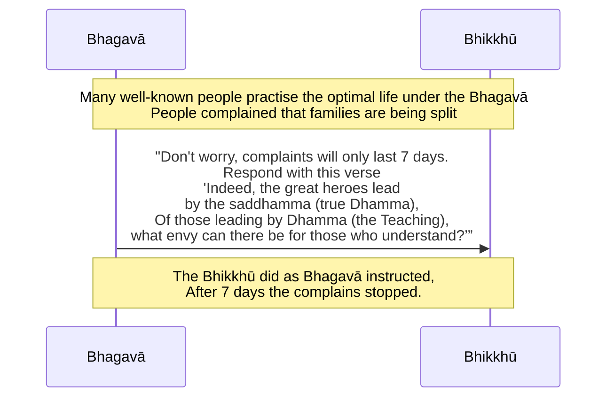

import { Tabs, TabItem } from '@astrojs/starlight/components';

Original text: [World Tipitaka Edition](https://tipitaka2500.github.io/tipitaka/3V/1/1.14/1.14.1.html)

## Summary

The Bhagavā's success in attracting distinguished Magadhan young men and former followers of Sañcaya (like Sāriputta and Moggallāna) to the optimal life sparked public criticism, with people accusing him of making individuals childless, women widows, and breaking up families, even taunting his bhikkhū with a verse. The Bhagavā predicted this outcry would only last seven days and instructed his bhikkhū to respond with a counter-verse emphasizing that Tathāgatas lead by the true Dhamma, which should not cause envy in those who understand. When the bhikkhū used this response, public opinion shifted to acknowledge that the Sakyaputtiya wanderers led by Dhamma, and the complaints ceased within the predicted timeframe.

## Diagram

## Text

<Tabs syncKey="paliquote">
<TabItem label="My Translation">
(63.)

239\. Now at that time well-known, distinguished Magadhan young men of good family were living the `brahmacariya` (the optimal life) under the Bhagavā. People found fault, complained and spread it about — “The wanderer Gotama is practising for childlessness, the wanderer Gotama is practising for widowhood, the wanderer Gotama is practising for the breaking up of families. Now by him a thousand `jaṭilā` (matted hair ascetics) have been made to go forth, and these two hundred and fifty renunciants following Sañcaya have been made to go forth. And these well-known, distinguished Magadhan young men of good family are living the `brahmacariya` (the optimal life) under the wanderer Gotama.” Moreover, seeing the bhikkhū, they reproached them with this verse —

240\. _“The great wanderer has indeed come,_ \
_to Giribbaja of the Magadhans;_ \
_Having led away all Sañcaya's followers,_ \
_whom now will he lead away?”_

241\. The bhikkhū heard those people finding fault, complaining and spreading it about. Then those bhikkhū reported this matter to the Bhagavā … and so on … “Bhikkhave, that sound will not last long; it will last only seven days. After the passing of seven days it will disappear. In that case, Bhikkhave, those who reproach you with this verse—

242\. _‘The great wanderer has indeed come,_ \
_to Giribbaja of the Magadhans;_ \
_Having led away all Sañcaya's followers,_ \
_whom now will he lead away?’_

243\. You should reproach them in return with this verse—

244\. _‘Indeed, the great heroes lead,_ \
_Tathāgatas, by the `saddhamma` (true Dhamma);_ \
_Of those leading by `Dhamma` (the Teaching),_ \
_what envy can there be for those who understand?’”_

245\. Now at that time people, seeing the bhikkhū, reproached them with this verse—

246\. _“The great wanderer has indeed come,_ \
_to Giribbaja of the Magadhans;_ \
_Having led away all Sañcaya's followers,_ \
_whom now will he lead away?”_

247\. The bhikkhū reproached those people in return with this verse—

248\. _“Indeed, the great heroes lead,_ \
_Tathāgatas, by the `saddhamma` (true Dhamma);_ \
_Of those leading by `Dhamma` (the Teaching),_ \
_what envy can there be for those who understand?”_

249\. People [said]: “Indeed, the `samaṇā sakyaputtiyā` (wanderers following the Sakyan) lead by `Dhamma` (the Teaching), not by non-Dhamma.” That sound lasted only seven days; after the passing of seven days it disappeared.

---

250\. The Account of the `pabbajjā` (going forth) of Sāriputta and Moggallāna is finished. The fourth `bhāṇavāra` (section for recitation) is finished.
</TabItem>

<TabItem label="Pāḷi (Roman IAST)">
(63.)

239\. Tena kho pana samayena abhiññātā abhiññātā māgadhikā kulaputtā bhagavati brahmacariyaṃ caranti. Manussā ujjhāyanti khiyyanti vipācenti—  “aputtakatāya paṭipanno samaṇo gotamo, vedhabyāya paṭipanno samaṇo gotamo, kulupacchedāya paṭipanno samaṇo gotamo, idāni anena jaṭilasahassaṃ pabbājitaṃ, imāni ca aḍḍhateyyāni paribbājakasatāni sañcayāni pabbājitāni. Ime ca abhiññātā abhiññātā māgadhikā kulaputtā samaṇe gotame brahmacariyaṃ carantī”ti. Apissu bhikkhū disvā imāya gāthāya codenti—

240\. _“Āgato kho mahāsamaṇo,_  \
_māgadhānaṃ giribbajaṃ;_  \
_Sabbe sañcaye netvāna,_  \
_kaṃsu dāni nayissatī”ti._  

241\. Assosuṃ kho bhikkhū tesaṃ manussānaṃ ujjhāyantānaṃ khiyyantānaṃ vipācentānaṃ. Atha kho te bhikkhū bhagavato etamatthaṃ ārocesuṃ…pe…  “na, bhikkhave, so saddo ciraṃ bhavissati, sattāhameva bhavissati, sattāhassa accayena antaradhāyissati. Tena hi, bhikkhave, ye tumhe imāya gāthāya codenti—

242\. _‘Āgato kho mahāsamaṇo,_  \
_māgadhānaṃ giribbajaṃ;_  \
_Sabbe sañcaye netvāna,_  \
_kaṃsu dāni nayissatī’ti._  

243\. Te tumhe imāya gāthāya paṭicodetha—

244\. _‘Nayanti ve mahāvīrā,_  \
_saddhammena tathāgatā;_  \
_Dhammena nayamānānaṃ,_  \
_kā usūyā vijānatan’”ti._  

245\. Tena kho pana samayena manussā bhikkhū disvā imāya gāthāya codenti—

246\. _“Āgato kho mahāsamaṇo,_  \
_māgadhānaṃ giribbajaṃ;_  \
_Sabbe sañcaye netvāna,_  \
_kaṃsu dāni nayissatī”ti._  

247\. Bhikkhū te manusse imāya gāthāya paṭicodenti—

248\. _“Nayanti ve mahāvīrā,_  \
_saddhammena tathāgatā;_  \
_Dhammena nayamānānaṃ,_  \
_kā usūyā vijānatan”ti._  

249\. Manussā dhammena kira samaṇā sakyaputtiyā nenti no adhammenāti sattāhameva so saddo ahosi, sattāhassa accayena antaradhāyi.

---

250\. Sāriputtamoggallānapabbajjākathā niṭṭhitā.

  
Catutthabhāṇavāro niṭṭhito.
</TabItem>

<TabItem label="Pāḷi (Brahmi)">
(63.)

239\. 𑀢𑁂𑀦 𑀔𑁄 𑀧𑀦 𑀲𑀫𑀬𑁂𑀦 𑀅𑀪𑀺𑀜𑁆𑀜𑀸𑀢𑀸 𑀅𑀪𑀺𑀜𑁆𑀜𑀸𑀢𑀸 𑀫𑀸𑀕𑀥𑀺𑀓𑀸 𑀓𑀼𑀮𑀧𑀼𑀢𑁆𑀢𑀸 𑀪𑀕𑀯𑀢𑀺 𑀩𑁆𑀭𑀳𑁆𑀫𑀘𑀭𑀺𑀬𑀁 𑀘𑀭𑀦𑁆𑀢𑀺. 𑀫𑀦𑀼𑀲𑁆𑀲𑀸 𑀉𑀚𑁆𑀛𑀸𑀬𑀦𑁆𑀢𑀺 𑀔𑀺𑀬𑁆𑀬𑀦𑁆𑀢𑀺 𑀯𑀺𑀧𑀸𑀘𑁂𑀦𑁆𑀢𑀺—  “𑀅𑀧𑀼𑀢𑁆𑀢𑀓𑀢𑀸𑀬 𑀧𑀝𑀺𑀧𑀦𑁆𑀦𑁄 𑀲𑀫𑀡𑁄 𑀕𑁄𑀢𑀫𑁄, 𑀯𑁂𑀥𑀩𑁆𑀬𑀸𑀬 𑀧𑀝𑀺𑀧𑀦𑁆𑀦𑁄 𑀲𑀫𑀡𑁄 𑀕𑁄𑀢𑀫𑁄, 𑀓𑀼𑀮𑀼𑀧𑀘𑁆𑀙𑁂𑀤𑀸𑀬 𑀧𑀝𑀺𑀧𑀦𑁆𑀦𑁄 𑀲𑀫𑀡𑁄 𑀕𑁄𑀢𑀫𑁄, 𑀇𑀤𑀸𑀦𑀺 𑀅𑀦𑁂𑀦 𑀚𑀝𑀺𑀮𑀲𑀳𑀲𑁆𑀲𑀁 𑀧𑀩𑁆𑀩𑀸𑀚𑀺𑀢𑀁, 𑀇𑀫𑀸𑀦𑀺 𑀘 𑀅𑀟𑁆𑀠𑀢𑁂𑀬𑁆𑀬𑀸𑀦𑀺 𑀧𑀭𑀺𑀩𑁆𑀩𑀸𑀚𑀓𑀲𑀢𑀸𑀦𑀺 𑀲𑀜𑁆𑀘𑀬𑀸𑀦𑀺 𑀧𑀩𑁆𑀩𑀸𑀚𑀺𑀢𑀸𑀦𑀺. 𑀇𑀫𑁂 𑀘 𑀅𑀪𑀺𑀜𑁆𑀜𑀸𑀢𑀸 𑀅𑀪𑀺𑀜𑁆𑀜𑀸𑀢𑀸 𑀫𑀸𑀕𑀥𑀺𑀓𑀸 𑀓𑀼𑀮𑀧𑀼𑀢𑁆𑀢𑀸 𑀲𑀫𑀡𑁂 𑀕𑁄𑀢𑀫𑁂 𑀩𑁆𑀭𑀳𑁆𑀫𑀘𑀭𑀺𑀬𑀁 𑀘𑀭𑀦𑁆𑀢𑀻”𑀢𑀺. 𑀅𑀧𑀺𑀲𑁆𑀲𑀼 𑀪𑀺𑀓𑁆𑀔𑀽 𑀤𑀺𑀲𑁆𑀯𑀸 𑀇𑀫𑀸𑀬 𑀕𑀸𑀣𑀸𑀬 𑀘𑁄𑀤𑁂𑀦𑁆𑀢𑀺—

240\. _“𑀆𑀕𑀢𑁄 𑀔𑁄 𑀫𑀳𑀸𑀲𑀫𑀡𑁄,_  \
_𑀫𑀸𑀕𑀥𑀸𑀦𑀁 𑀕𑀺𑀭𑀺𑀩𑁆𑀩𑀚𑀁;_  \
_𑀲𑀩𑁆𑀩𑁂 𑀲𑀜𑁆𑀘𑀬𑁂 𑀦𑁂𑀢𑁆𑀯𑀸𑀦,_  \
_𑀓𑀁𑀲𑀼 𑀤𑀸𑀦𑀺 𑀦𑀬𑀺𑀲𑁆𑀲𑀢𑀻”𑀢𑀺._  

241\. 𑀅𑀲𑁆𑀲𑁄𑀲𑀼𑀁 𑀔𑁄 𑀪𑀺𑀓𑁆𑀔𑀽 𑀢𑁂𑀲𑀁 𑀫𑀦𑀼𑀲𑁆𑀲𑀸𑀦𑀁 𑀉𑀚𑁆𑀛𑀸𑀬𑀦𑁆𑀢𑀸𑀦𑀁 𑀔𑀺𑀬𑁆𑀬𑀦𑁆𑀢𑀸𑀦𑀁 𑀯𑀺𑀧𑀸𑀘𑁂𑀦𑁆𑀢𑀸𑀦𑀁. 𑀅𑀣 𑀔𑁄 𑀢𑁂 𑀪𑀺𑀓𑁆𑀔𑀽 𑀪𑀕𑀯𑀢𑁄 𑀏𑀢𑀫𑀢𑁆𑀣𑀁 𑀆𑀭𑁄𑀘𑁂𑀲𑀼𑀁…𑀧𑁂…  “𑀦, 𑀪𑀺𑀓𑁆𑀔𑀯𑁂, 𑀲𑁄 𑀲𑀤𑁆𑀤𑁄 𑀘𑀺𑀭𑀁 𑀪𑀯𑀺𑀲𑁆𑀲𑀢𑀺, 𑀲𑀢𑁆𑀢𑀸𑀳𑀫𑁂𑀯 𑀪𑀯𑀺𑀲𑁆𑀲𑀢𑀺, 𑀲𑀢𑁆𑀢𑀸𑀳𑀲𑁆𑀲 𑀅𑀘𑁆𑀘𑀬𑁂𑀦 𑀅𑀦𑁆𑀢𑀭𑀥𑀸𑀬𑀺𑀲𑁆𑀲𑀢𑀺. 𑀢𑁂𑀦 𑀳𑀺, 𑀪𑀺𑀓𑁆𑀔𑀯𑁂, 𑀬𑁂 𑀢𑀼𑀫𑁆𑀳𑁂 𑀇𑀫𑀸𑀬 𑀕𑀸𑀣𑀸𑀬 𑀘𑁄𑀤𑁂𑀦𑁆𑀢𑀺—

242\. _‘𑀆𑀕𑀢𑁄 𑀔𑁄 𑀫𑀳𑀸𑀲𑀫𑀡𑁄,_  \
_𑀫𑀸𑀕𑀥𑀸𑀦𑀁 𑀕𑀺𑀭𑀺𑀩𑁆𑀩𑀚𑀁;_  \
_𑀲𑀩𑁆𑀩𑁂 𑀲𑀜𑁆𑀘𑀬𑁂 𑀦𑁂𑀢𑁆𑀯𑀸𑀦,_  \
_𑀓𑀁𑀲𑀼 𑀤𑀸𑀦𑀺 𑀦𑀬𑀺𑀲𑁆𑀲𑀢𑀻’𑀢𑀺._  

243\. 𑀢𑁂 𑀢𑀼𑀫𑁆𑀳𑁂 𑀇𑀫𑀸𑀬 𑀕𑀸𑀣𑀸𑀬 𑀧𑀝𑀺𑀘𑁄𑀤𑁂𑀣—

244\. _‘𑀦𑀬𑀦𑁆𑀢𑀺 𑀯𑁂 𑀫𑀳𑀸𑀯𑀻𑀭𑀸,_  \
_𑀲𑀤𑁆𑀥𑀫𑁆𑀫𑁂𑀦 𑀢𑀣𑀸𑀕𑀢𑀸;_  \
_𑀥𑀫𑁆𑀫𑁂𑀦 𑀦𑀬𑀫𑀸𑀦𑀸𑀦𑀁,_  \
_𑀓𑀸 𑀉𑀲𑀽𑀬𑀸 𑀯𑀺𑀚𑀸𑀦𑀢𑀦𑁆’”𑀢𑀺._  

245\. 𑀢𑁂𑀦 𑀔𑁄 𑀧𑀦 𑀲𑀫𑀬𑁂𑀦 𑀫𑀦𑀼𑀲𑁆𑀲𑀸 𑀪𑀺𑀓𑁆𑀔𑀽 𑀤𑀺𑀲𑁆𑀯𑀸 𑀇𑀫𑀸𑀬 𑀕𑀸𑀣𑀸𑀬 𑀘𑁄𑀤𑁂𑀦𑁆𑀢𑀺—

246\. _“𑀆𑀕𑀢𑁄 𑀔𑁄 𑀫𑀳𑀸𑀲𑀫𑀡𑁄,_  \
_𑀫𑀸𑀕𑀥𑀸𑀦𑀁 𑀕𑀺𑀭𑀺𑀩𑁆𑀩𑀚𑀁;_  \
_𑀲𑀩𑁆𑀩𑁂 𑀲𑀜𑁆𑀘𑀬𑁂 𑀦𑁂𑀢𑁆𑀯𑀸𑀦,_  \
_𑀓𑀁𑀲𑀼 𑀤𑀸𑀦𑀺 𑀦𑀬𑀺𑀲𑁆𑀲𑀢𑀻”𑀢𑀺._  

247\. 𑀪𑀺𑀓𑁆𑀔𑀽 𑀢𑁂 𑀫𑀦𑀼𑀲𑁆𑀲𑁂 𑀇𑀫𑀸𑀬 𑀕𑀸𑀣𑀸𑀬 𑀧𑀝𑀺𑀘𑁄𑀤𑁂𑀦𑁆𑀢𑀺—

248\. _“𑀦𑀬𑀦𑁆𑀢𑀺 𑀯𑁂 𑀫𑀳𑀸𑀯𑀻𑀭𑀸,_  \
_𑀲𑀤𑁆𑀥𑀫𑁆𑀫𑁂𑀦 𑀢𑀣𑀸𑀕𑀢𑀸;_  \
_𑀥𑀫𑁆𑀫𑁂𑀦 𑀦𑀬𑀫𑀸𑀦𑀸𑀦𑀁,_  \
_𑀓𑀸 𑀉𑀲𑀽𑀬𑀸 𑀯𑀺𑀚𑀸𑀦𑀢𑀦𑁆”𑀢𑀺._  

249\. 𑀫𑀦𑀼𑀲𑁆𑀲𑀸 𑀥𑀫𑁆𑀫𑁂𑀦 𑀓𑀺𑀭 𑀲𑀫𑀡𑀸 𑀲𑀓𑁆𑀬𑀧𑀼𑀢𑁆𑀢𑀺𑀬𑀸 𑀦𑁂𑀦𑁆𑀢𑀺 𑀦𑁄 𑀅𑀥𑀫𑁆𑀫𑁂𑀦𑀸𑀢𑀺 𑀲𑀢𑁆𑀢𑀸𑀳𑀫𑁂𑀯 𑀲𑁄 𑀲𑀤𑁆𑀤𑁄 𑀅𑀳𑁄𑀲𑀺, 𑀲𑀢𑁆𑀢𑀸𑀳𑀲𑁆𑀲 𑀅𑀘𑁆𑀘𑀬𑁂𑀦 𑀅𑀦𑁆𑀢𑀭𑀥𑀸𑀬𑀺.

---

250\. 𑀲𑀸𑀭𑀺𑀧𑀼𑀢𑁆𑀢𑀫𑁄𑀕𑁆𑀕𑀮𑁆𑀮𑀸𑀦𑀧𑀩𑁆𑀩𑀚𑁆𑀚𑀸𑀓𑀣𑀸 𑀦𑀺𑀝𑁆𑀞𑀺𑀢𑀸.

  
𑀘𑀢𑀼𑀢𑁆𑀣𑀪𑀸𑀡𑀯𑀸𑀭𑁄 𑀦𑀺𑀝𑁆𑀞𑀺𑀢𑁄.
</TabItem>

<TabItem label="Interlinear">
(63.)

[239](https://tipitaka2500.github.io/tipitaka/3V/1/1.14/1.14.1.html#239) Tena kho pana samayena abhiññātā abhiññātā māgadhikā kulaputtā bhagavati brahmacariyaṃ caranti.  
*️⃣🤟🚹⨀③(ta) ⏏️(kho) ⏏️(pana) 🚹⨀③(samaya) 🚹⨂①🔽(ta)(abhiññāta) 🚹⨂①🔽(ta)(abhiññāta) 🚹⨂①(māgadhika) 🚹⨂①🆎(kula+putta) 🚹⨀⑦(bhagavant) 🚻⨀②🆎(brahma+cariya) 🟢⨂🤟▶️(carati)  
at that | indeed | now | time | well-known | distinguished | Magadhan | young men of good families | under the Bhagavā | the optimal life | live  
Now at that time well-known, distinguished Magadhan young men of good family were living the `brahmacariya` (the optimal life) under the Bhagavā.

Manussā ujjhāyanti khiyyanti vipācenti— “aputtakatāya paṭipanno samaṇo gotamo, vedhabyāya paṭipanno samaṇo gotamo, kulupacchedāya paṭipanno samaṇo gotamo, idāni anena jaṭilasahassaṃ pabbājitaṃ, imāni ca aḍḍhateyyāni paribbājakasatāni sañcayāni pabbājitāni.  
🚹⨂①(manussa) 🟢⨂🤟▶️(ujjhāyati) 🟢⨂🤟▶️(khiyyati) 🟠⨂🤟▶️(vipāceti) 🚺⨀④🔽(tā)🆎(na+puttaka) 🚹⨀①🔽(ta)(paṭipanna) 🚹⨀①(samaṇa) 🚹⨀①(gotama) 🚺⨀④(vedhabyā) 🚹⨀①🔽(ta)(paṭipanna) 🚹⨀①(samaṇa) 🚹⨀①(gotama) 🚹⨀④🆎(kula+upaccheda) 🚹⨀①🔽(ta)(paṭipanna) 🚹⨀①(samaṇa) 🚹⨀①(gotama) ⏏️(idāni) *️⃣🤟🚹⨀③(ima) 🚻⨀①🆎(jaṭila+sahassa) 🚻⨀①🔽(ta)(pabbājita) *️⃣🤟🚻⨂①(ima) ⏏️(ca) 🚻⨂①(aḍḍhateyya) 🚻⨂①🆎(paribbājaka+sata) 🚻⨂①(sañcaya) 🚻⨂①🔽(ta)(pabbājita)  
people | find fault | complain | spread it about | for childlessness | practising | the wanderer | Gotama | for widowhood | practising | the wanderer | Gotama | for the breaking up of families | practising | the wanderer | Gotama | now | by him | a thousand matted hair ascetics | made to go forth | these | and | two and a half | hundreds of renunciants | following Sañcaya | made to go forth  
People found fault, complained and spread it about — “The wanderer Gotama is practising for childlessness, the wanderer Gotama is practising for widowhood, the wanderer Gotama is practising for the breaking up of families. Now by him a thousand `jaṭilā` (matted hair ascetics) have been made to go forth, and these two hundred and fifty renunciants following Sañcaya have been made to go forth.

Ime ca abhiññātā abhiññātā māgadhikā kulaputtā samaṇe gotame brahmacariyaṃ carantī”ti.  
*️⃣🤟🚹⨂①(ima) ⏏️(ca) 🚹⨂①🔽(ta)(abhiññāta) 🚹⨂①🔽(ta)(abhiññāta) 🚹⨂①(māgadhika) 🚹⨂①🆎(kula+putta) 🚹⨀⑦(samaṇa) 🚹⨀⑦(gotama) 🚻⨀②🆎(brahma+cariya) 🟢⨂🤟▶️(carati) ⏏️(iti)  
these | and | well-known | distinguished | Magadhan | young men of good families | under the wanderer | Gotama | the optimal life | live | (end quote)  
And these well-known, distinguished Magadhan young men of good family are living the `brahmacariya` (the optimal life) under the wanderer Gotama.”

Apissu bhikkhū disvā imāya gāthāya codenti—  
⏏️(api) ⏏️(ssu) 🚹⨂②(bhikkhu) 🔽(tvā)(passati) *️⃣🤟🚺⨀③(ima) 🚺⨀③(gāthā) 🟢⨂🤟▶️(codeti)  
moreover | indeed | the bhikkhū | having seen | with this | verse | reproach  
Moreover, seeing the bhikkhū, they reproached them with this verse —

[240](https://tipitaka2500.github.io/tipitaka/3V/1/1.14/1.14.1.html#240) “Āgato kho mahāsamaṇo,  
🚹⨀①🔽(ta)(āgata) ⏏️(kho) 🚹⨀①🆎(mahā+samaṇa)  
come | indeed | the great wanderer  
māgadhānaṃ giribbajaṃ;  
🚹⨂⑥(māgadha) 🚻⨀②(giribbaja)  
of the Magadhans | to Giribbaja  
Sabbe sañcaye netvāna,  
*️⃣🤟🚹⨂②(sabba) 🚹⨂②(sañcaya) 🔽(tvāna)(neti)  
all | Sañcaya's followers | having led away  
kaṃsu dāni nayissatī”ti.  
*️⃣🤟🚹⨀②(kiṃ) ⏏️(su) ⏏️(dāni) 🟢⨀🤟⏭(nayati) ⏏️(iti)  
whom | indeed | now | will he lead away | (end quote)  

“The great wanderer has indeed come,  
to Giribbaja of the Magadhans;  
Having led away all Sañcaya's followers,  
whom now will he lead away?”

[241](https://tipitaka2500.github.io/tipitaka/3V/1/1.14/1.14.1.html#241) Assosuṃ kho bhikkhū tesaṃ manussānaṃ ujjhāyantānaṃ khiyyantānaṃ vipācentānaṃ.  
🟢⨂🤟⏮(suṇāti) ⏏️(kho) 🚹⨂①(bhikkhu) *️⃣🤟🚹⨂⑥(ta) 🚹⨂⑥(manussa) 🚹⨂⑥🔽(anta)(ujjhāyanta) 🚹⨂⑥🔽(anta)(khiyyanta) 🚹⨂⑥🔽(anta)(vipācenta)  
heard | indeed | the bhikkhū | of those | people | finding fault | complaining | spreading it about  
The bhikkhū heard those people finding fault, complaining and spreading it about.

Atha kho te bhikkhū bhagavato etamatthaṃ ārocesuṃ…pe… “na, bhikkhave, so saddo ciraṃ bhavissati, sattāhameva bhavissati, sattāhassa accayena antaradhāyissati.  
⏏️(atha) ⏏️(kho) *️⃣🤟🚹⨂①(ta) 🚹⨂①(bhikkhu) 🚹⨀④(bhagavant) *️⃣🤟🚹⨀②(eta) 🚹⨀②(attha) 🟠⨂🤟⏮(āroceti) ⏏️(peyyāla) ⏏️(na) 🚹⨂⓪(bhikkhu) *️⃣🤟🚹⨀①(ta) 🚹⨀①(sadda) 🚻⨀②(cira) 🟢⨀🤟⏭(bhavati) 🚻⨀②🆎(satta+aha) ⏏️(eva) 🟢⨀🤟⏭(bhavati) 🚻⨀⑥🆎(satta+aha) ⏏️(accayena) 🟢⨀🤟⏭(antaradhāyati)  
then | indeed | those | bhikkhū | to the Bhagavā | this | matter | reported | (and so on) | not | Bhikkhave | that | sound | long | will be | for seven days | only | will be | of seven days | after the passing | will disappear  
Then those bhikkhū reported this matter to the Bhagavā … and so on … “Bhikkhave, that sound will not last long; it will last only seven days. After the passing of seven days it will disappear.

Tena hi, bhikkhave, ye tumhe imāya gāthāya codenti—  
*️⃣🤟🚹⨀③(ta) ⏏️(hi) 🚹⨂⓪(bhikkhu) *️⃣🤟🚹⨂①(ya) *️⃣🤘⚧⨂②(tvaṃ) *️⃣🤟🚺⨀③(ima) 🚺⨀③(gāthā) 🟢⨂🤟▶️(codeti)  
in that case | indeed | Bhikkhave | those who | you | with this | verse | reproach  
In that case, Bhikkhave, those who reproach you with this verse—

[242](https://tipitaka2500.github.io/tipitaka/3V/1/1.14/1.14.1.html#242) ‘Āgato kho mahāsamaṇo,  
🚹⨀①🔽(ta)(āgata) ⏏️(kho) 🚹⨀①🆎(mahā+samaṇa)  
come | indeed | the great wanderer  
māgadhānaṃ giribbajaṃ;  
🚹⨂⑥(māgadha) 🚻⨀②(giribbaja)  
of the Magadhans | to Giribbaja  
Sabbe sañcaye netvāna,  
*️⃣🤟🚹⨂②(sabba) 🚹⨂②(sañcaya) 🔽(tvāna)(neti)  
all | Sañcaya's followers | having led away  
kaṃsu dāni nayissatī’ti.  
*️⃣🤟🚹⨀②(kiṃ) ⏏️(su) ⏏️(dāni) 🟢⨀🤟⏭(nayati) ⏏️(iti)  
whom | indeed | now | will he lead away | (end quote)  

‘The great wanderer has indeed come,  
to Giribbaja of the Magadhans;  
Having led away all Sañcaya's followers,  
whom now will he lead away?’

[243](https://tipitaka2500.github.io/tipitaka/3V/1/1.14/1.14.1.html#243) Te tumhe imāya gāthāya paṭicodetha—  
*️⃣🤟🚹⨂②(ta) *️⃣🤘⚧⨂①(tvaṃ) *️⃣🤟🚺⨀③(ima) 🚺⨀③(gāthā) 🟢⨂🤘⏹(paṭicodeti)  
them | you | with this | verse | reproach in return  
You should reproach them in return with this verse—

[244](https://tipitaka2500.github.io/tipitaka/3V/1/1.14/1.14.1.html#244) ‘Nayanti ve mahāvīrā,  
🟢⨂🤟▶️(nayati) ⏏️(ve) 🚹⨂①🆎(mahā+vīra)  
lead | indeed | the great heroes  
saddhammena tathāgatā;  
🚹⨀③🆎(sat+dhamma) 🚹⨂①🆎(tathā+gata)  
by the true Dhamma | the Tathāgatas  
Dhammena nayamānānaṃ,  
🚹⨀③(dhamma) 🚹⨂⑥🔽(māna)(nayamāna)  
by the Dhamma | of those leading  
kā usūyā vijānatan’”ti.  
*️⃣🤟🚺⨀①(kiṃ) 🚺⨀①(usūyā) 🚹⨂⑥🔽(anta)(vijānanta) ⏏️(iti)  
what | envy | for those who understand | (end quote)  

‘Indeed, the great heroes lead,  
Tathāgatas, by the `saddhamma` (true Dhamma);  
Of those leading by `Dhamma` (the Teaching),  
what envy can there be for those who understand?’”

[245](https://tipitaka2500.github.io/tipitaka/3V/1/1.14/1.14.1.html#245) Tena kho pana samayena manussā bhikkhū disvā imāya gāthāya codenti—  
*️⃣🤟🚹⨀③(ta) ⏏️(kho) ⏏️(pana) 🚹⨀③(samaya) 🚹⨂①(manussa) 🚹⨂②(bhikkhu) 🔽(tvā)(passati) *️⃣🤟🚺⨀③(ima) 🚺⨀③(gāthā) 🟢⨂🤟▶️(codeti)  
at that | indeed | now | time | people | the bhikkhū | having seen | with this | verse | reproach  
Now at that time people, seeing the bhikkhū, reproached them with this verse—

[246](https://tipitaka2500.github.io/tipitaka/3V/1/1.14/1.14.1.html#246) “Āgato kho mahāsamaṇo,  
🚹⨀①🔽(ta)(āgata) ⏏️(kho) 🚹⨀①🆎(mahā+samaṇa)  
come | indeed | the great wanderer  
māgadhānaṃ giribbajaṃ;  
🚹⨂⑥(māgadha) 🚻⨀②(giribbaja)  
of the Magadhans | to Giribbaja  
Sabbe sañcaye netvāna,  
*️⃣🤟🚹⨂②(sabba) 🚹⨂②(sañcaya) 🔽(tvāna)(neti)  
all | Sañcaya's followers | having led away  
kaṃsu dāni nayissatī”ti.  
*️⃣🤟🚹⨀②(kiṃ) ⏏️(su) ⏏️(dāni) 🟢⨀🤟⏭(nayati) ⏏️(iti)  
whom | indeed | now | will he lead away | (end quote)  

“The great wanderer has indeed come,  
to Giribbaja of the Magadhans;  
Having led away all Sañcaya's followers,  
whom now will he lead away?”

[247](https://tipitaka2500.github.io/tipitaka/3V/1/1.14/1.14.1.html#247) Bhikkhū te manusse imāya gāthāya paṭicodenti—  
🚹⨂①(bhikkhu) *️⃣🤟🚹⨂②(ta) 🚹⨂②(manussa) *️⃣🤟🚺⨀③(ima) 🚺⨀③(gāthā) 🟢⨂🤟▶️(paṭicodeti)  
the bhikkhū | those | people | with this | verse | reproach in return  
The bhikkhū reproached those people in return with this verse—

[248](https://tipitaka2500.github.io/tipitaka/3V/1/1.14/1.14.1.html#248) “Nayanti ve mahāvīrā,  
🟢⨂🤟▶️(nayati) ⏏️(ve) 🚹⨂①🆎(mahā+vīra)  
lead | indeed | the great heroes  
saddhammena tathāgatā;  
🚹⨀③🆎(sat+dhamma) 🚹⨂①🆎(tathā+gata)  
by the true Dhamma | the Tathāgatas  
Dhammena nayamānānaṃ,  
🚹⨀③(dhamma) 🚹⨂⑥🔽(māna)(nayamāna)  
by the Dhamma | of those leading  
kā usūyā vijānatan”ti.  
*️⃣🤟🚺⨀①(kiṃ) 🚺⨀①(usūyā) 🚹⨂⑥🔽(anta)(vijānanta) ⏏️(iti)  
what | envy | for those who understand | (end quote)  

“Indeed, the great heroes lead,  
Tathāgatas, by the `saddhamma` (true Dhamma);  
Of those leading by `Dhamma` (the Teaching),  
what envy can there be for those who understand?”

[249](https://tipitaka2500.github.io/tipitaka/3V/1/1.14/1.14.1.html#249) Manussā dhammena kira samaṇā sakyaputtiyā nenti no adhammenāti sattāhameva so saddo ahosi, sattāhassa accayena antaradhāyi.  
🚹⨂①(manussa) 🚹⨀③(dhamma) ⏏️(kira) 🚹⨂①(samaṇa) 🚹⨂①🔽(iya)🆎(sakya+putta) 🟢⨂🤟▶️(neti) ⏏️(no) 🚹⨀③🆎(na+dhamma) ⏏️(iti) 🚻⨀②🆎(satta+aha) ⏏️(eva) *️⃣🤟🚹⨀①(ta) 🚹⨀①(sadda) 🟢⨀🤟⏮(hoti) 🚻⨀⑥🆎(satta+aha) ⏏️(accayena) 🟢⨀🤟⏮(antaradhāyati)  
people | by the Dhamma | indeed | the wanderers | following the Sakyan | lead | not | by non-Dhamma | (end quote) | for seven days | only | that | sound | was | of seven days | after the passing | disappeared  
People [said]: “Indeed, the `samaṇā sakyaputtiyā` (wanderers following the Sakyan) lead by `Dhamma` (the Teaching), not by non-Dhamma.” That sound lasted only seven days; after the passing of seven days it disappeared.

[250](https://tipitaka2500.github.io/tipitaka/3V/1/1.14/1.14.1.html#250) Sāriputtamoggallānapabbajjākathā niṭṭhitā.  
🚺⨀①🆎(sāriputta+moggallāna+pabbajjā+kathā) 🚺⨀①🔽(ta)(niṭṭhita)  
the Sāriputtamoggallānapabbajjākathā | finished  
The Account of the `pabbajjā` (going forth) of Sāriputta and Moggallāna is finished.

Catutthabhāṇavāro niṭṭhito.  
🚹⨀①🆎(catuttha+bhāṇavāra) 🚹⨀①🔽(ta)(niṭṭhita)  
the fourth section for recitation | finished  
The fourth `bhāṇavāra` (section for recitation) is finished.
</TabItem>
</Tabs>

## Commentary

This narrative is important in highlighting that the rapid rise of Buddhism was not always favourably received. The public's anxiety — fearing childlessness, widowhood, and the dissolution of families — stems from the disruption caused by many well-known individuals choosing the `brahmacariya` (disciplined life). The taunting verse reflects the community's perception of Gotama as an external force actively altering their social fabric by "leading away" its members.

Gotama's strategy involves a reframing. He predicts the transient nature of the outcry. The counter-verse repositions the "leading" not as arbitrary enticement, but as guidance by "Dhamma" — a coherent soteriological system of principles and practices. For those who grasp this system ("those who understand"), the choice to follow is rational, and should be envied rather than a cause for distress. The resolution, where the public acknowledges the ascetics "lead by Dhamma," signifies a shift in the their understanding.

[Go to previous page (14. Sāriputtamoggallānapabbajjākathā)](/khandhaka/1-14/) / [Go to parent page (Khandhaka)](/khandhaka/)

