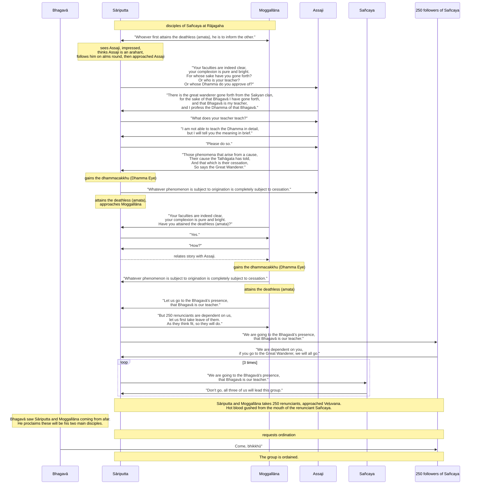

import { Tabs, TabItem } from '@astrojs/starlight/components';

Original text: [World Tipitaka Edition](https://tipitaka2500.github.io/tipitaka/3V/1/1.14.html)

## Summary

Sāriputta and Moggallāna, disciples of the renunciant Sañcaya, had agreed to inform each other if one attained `amata` ("deathless"). Sāriputta, impressed by āyasmā Assaji's demeanour, learned from him the core teaching: phenomena arise from a cause, and the Buddha (Tathāgata) teaches their cause and cessation. This insight led both Sāriputta and Moggallāna to attain the `dhammacakkhu` (Dhamma Eye). Consequently, they and 250 followers left Sañcaya to join the Buddha, who recognized them as his future chief disciples and ordained them.

## Diagram

## Text

<Tabs syncKey="paliquote">
<TabItem label="My Translation">
(60.)

220\. Now at that time the renunciant Sañcaya was dwelling in Rājagaha together with a great assembly of renunciants, with two hundred and fifty renunciants. Now at that time Sāriputta and Moggallāna were living the `brahmacariya` (the optimal life) under the renunciant Sañcaya. They had made an agreement: “Whoever first attains the `amata` (deathless), he is to inform the other.”

221\. Then, in the morning, having dressed and taking his bowl and robes, āyasmā Assaji entered Rājagaha for alms, with graceful going forward, returning, looking ahead, looking around, bending, stretching, with downcast eyes, endowed with excellent deportment. The renunciant Sāriputta saw āyasmā Assaji going for alms in Rājagaha, with graceful going forward, returning, looking ahead, looking around, bending, stretching, with downcast eyes, endowed with excellent deportment. Having seen him, this occurred to him: “Those in the world who are `arahanto` (liberated ones) or have entered the `arahattamagga` (path to the liberated state), this bhikkhu is one of them. What if I were to approach this bhikkhu and ask: ‘For whose sake, Āvuso, have you gone forth? Or who is your teacher? Or whose Dhamma do you approve of?’” Then this occurred to the renunciant Sāriputta: “It is not the time to question this bhikkhu; he has entered among the houses, going for alms. What if I were to follow this bhikkhu from behind, the path known to those in need?” Then āyasmā Assaji, having gone for alms in Rājagaha, taking his almsfood, returned. Then the renunciant Sāriputta too approached āyasmā Assaji; having approached, he exchanged greetings with āyasmā Assaji, and having exchanged pleasant and polite talk, he stood to one side. Standing to one side, the renunciant Sāriputta said this to āyasmā Assaji: “Your faculties, Āvuso, are indeed clear; your complexion is pure and bright. For whose sake, Āvuso, have you gone forth? Or who is your teacher? Or whose Dhamma do you approve of?” “There is, Āvuso, the great wanderer, the Sakyan son, gone forth from the Sakyan family; for the sake of that Bhagavā I have gone forth, and that Bhagavā is my teacher, and I approve of the Dhamma of that Bhagavā.” “But what does the āyasmant’s teacher teach, what does he declare?” “I, Āvuso, am new, not long gone forth, recently come to this Dhamma and Vinaya; I am not able to teach you the Dhamma in detail, but I will tell you the meaning in brief.” Then the renunciant Sāriputta said this to āyasmā Assaji: “Let it be, Āvuso —

222\. _Speak little or much,_ \
_Tell me just the meaning;_ \
_The meaning alone is what I need,_ \
_What will you do with much wording?”_

223\. Then āyasmā Assaji spoke this Dhamma exposition to the renunciant Sāriputta —

224\. _“Those phenomena that arise from a cause,_ \
_Their cause the Tathāgata has told;_ \
_And that which is their cessation,_ \
_So says the great wanderer.”_

225\. Then, on hearing this Dhamma exposition, there arose in the renunciant Sāriputta the `viraja` (pure), `vītamala` (stainless) `dhammacakkhu` (Dhamma Eye): “Whatever phenomenon is subject to origination is completely subject to cessation.”

226\. _“If this alone is the Dhamma,_ \
_You have thereby penetrated the sorrowless state;_ \
_Unseen, passed by_ \
_For many myriads of aeons.”_

(61.)

227\. Then the renunciant Sāriputta approached the renunciant Moggallāna. The renunciant Moggallāna saw the renunciant Sāriputta coming from afar; having seen him, he said this to the renunciant Sāriputta: “Your faculties, Āvuso, are indeed clear; your complexion is pure and bright. Have you, Āvuso, attained the `amata` (deathless)?” “Yes, Āvuso, I have attained the `amata` (deathless).” “But how, Āvuso, did you attain the `amata` (deathless)?” “Here, Āvuso, I saw the bhikkhu Assaji going for alms in Rājagaha, with graceful going forward, returning, looking ahead, looking around, bending, stretching, with downcast eyes, endowed with excellent deportment. Having seen him, this occurred to me: ‘Those in the world who are `arahanto` (liberated ones) or have entered the `arahattamagga` (path to the liberated state), this bhikkhu is one of them. What if I were to approach this bhikkhu and ask: For whose sake, Āvuso, have you gone forth? Or who is your teacher? Or whose Dhamma do you approve of?’ Then, Āvuso, this occurred to me: ‘It is not the time to question this bhikkhu; he has entered among the houses, going for alms. What if I were to follow this bhikkhu from behind, the path known to those in need?’ Then, Āvuso, the bhikkhu Assaji, having gone for alms in Rājagaha, taking his almsfood, returned. Then I, Āvuso, approached the bhikkhu Assaji; having approached, I exchanged greetings with the bhikkhu Assaji, and having exchanged pleasant and polite talk, I stood to one side. Standing to one side, I, Āvuso, said this to the bhikkhu Assaji: ‘Your faculties, Āvuso, are indeed clear; your complexion is pure and bright. For whose sake, Āvuso, have you gone forth? Or who is your teacher? Or whose Dhamma do you approve of?’ ‘There is, Āvuso, the great wanderer, the Sakyan son, gone forth from the Sakyan family; for the sake of that Bhagavā I have gone forth, and that Bhagavā is my teacher, and I approve of the Dhamma of that Bhagavā.’ ‘But what does the āyasmant’s teacher teach, what does he declare?’ ‘I, Āvuso, am new, not long gone forth, recently come to this Dhamma and Vinaya; I am not able to teach you the Dhamma in detail, but I will tell you the meaning in brief.’ Then I, Āvuso, said this to the bhikkhu Assaji: ‘Let it be, Āvuso,

228\. _Speak little or much,_ \
_Tell me just the meaning;_ \
_The meaning alone is what I need,_ \
_What will you do with much wording?’_

229\. Then, Āvuso, the bhikkhu Assaji spoke this Dhamma exposition—

230\. _‘Those phenomena that arise from a cause,_ \
_Their cause the Tathāgata has told;_ \
_And that which is their cessation,_ \
_So says the great wanderer.’”_

231\. Then, on hearing this Dhamma exposition, there arose in the renunciant Moggallāna the `viraja` (pure), `vītamala` (stainless) `dhammacakkhu` (Dhamma Eye): “Whatever phenomenon is subject to origination is completely subject to cessation.

232\. _If this alone is the Dhamma,_ \
_You have thereby penetrated the sorrowless state;_ \
_Unseen, passed by_ \
_For many myriads of aeons.”_

(62.)

233\. Then the renunciant Moggallāna said this to the renunciant Sāriputta: “Let us go, Āvuso, to the Bhagavā's presence; that Bhagavā is our teacher.” “These two hundred and fifty renunciants, Āvuso, are dwelling here relying on us, looking to us; let us first take leave of them. As they think, so they will do.” Then Sāriputta and Moggallāna approached those renunciants; having approached, they said this to those renunciants: “We are going, Āvuso, to the Bhagavā's presence; that Bhagavā is our teacher.” “We dwell here relying on the āyasmants, looking to the āyasmants; if the āyasmants will live the `brahmacariya` (the optimal life) under the great wanderer, we all will live the `brahmacariya` under the great `samaṇa`.”

234\. Then Sāriputta and Moggallāna approached the renunciant Sañcaya; having approached, they said this to the renunciant Sañcaya: “We are going, Āvuso, to the Bhagavā's presence; that Bhagavā is our teacher.” “Enough, Āvuso, do not go; all three of us will lead this group.” For a second time … and so on … For a third time Sāriputta and Moggallāna said this to the renunciant Sañcaya: “We are going, Āvuso, to the Bhagavā's presence; that Bhagavā is our teacher.” “Enough, Āvuso, do not go; all three of us will lead this group.” Then Sāriputta and Moggallāna, taking those two hundred and fifty renunciants, approached Veḷuvana. But hot blood came up from the mouth of the renunciant Sañcaya right there.

235\. The Bhagavā saw Sāriputta and Moggallāna coming from afar; having seen them, he addressed the bhikkhū: “These two companions, Bhikkhave, are coming, Kolita and Upatissa. This will be my pair of disciples, the chief, auspicious pair.”

236\. _In the profound sphere of knowledge,_ \
_In the unsurpassed destruction of `upadhi` (attachment);_ \
_Liberated, not yet arrived at Veḷuvana,_ \
_Then the Teacher declared about them._

237\. _“These two companions,_ \
_Are coming, Kolita and Upatissa;_ \
_This will be my pair of disciples,_ \
_The chief, auspicious pair.”_

238\. Then Sāriputta and Moggallāna approached the Bhagavā; having approached, they fell with their heads at the Bhagavā's feet and said this to the Bhagavā: “May we, Bhante, receive the `pabbajjā` (going forth) in the Bhagavā's presence, may we receive the `upasampadā` (higher ordination).” “Come, Bhikkhavo,” the Bhagavā said: “The Dhamma is well-proclaimed. Live the `brahmacariya` (the optimal life) for the complete ending of `dukkha` (suffering).” That itself was the `upasampadā` (higher ordination) of those āyasmants.
</TabItem>

<TabItem label="Pāḷi (Roman IAST)">
(60.)

220\. Tena kho pana samayena sañcayo paribbājako rājagahe paṭivasati mahatiyā paribbājakaparisāya saddhiṃ aḍḍhateyyehi paribbājakasatehi. Tena kho pana samayena sāriputtamoggallānā sañcaye paribbājake brahmacariyaṃ caranti. Tehi katikā katā hoti—  “yo paṭhamaṃ amataṃ adhigacchati, so itarassa ārocetū”ti.

* Mahākhandhaka

* Sāriputtamoggallānapabbajjākathā

221\. Atha kho āyasmā assaji pubbaṇhasamayaṃ nivāsetvā pattacīvaramādāya rājagahaṃ piṇḍāya pāvisi pāsādikena abhikkantena paṭikkantena ālokitena vilokitena samiñjitena pasāritena, okkhittacakkhu iriyāpathasampanno. Addasā kho sāriputto paribbājako āyasmantaṃ assajiṃ rājagahe piṇḍāya carantaṃ pāsādikena abhikkantena paṭikkantena ālokitena vilokitena samiñjitena pasāritena okkhittacakkhuṃ iriyāpathasampannaṃ. Disvānassa etadahosi—  “ye vata loke arahanto vā arahattamaggaṃ vā samāpannā, ayaṃ tesaṃ bhikkhu aññataro. Yannūnāhaṃ imaṃ bhikkhuṃ upasaṅkamitvā puccheyyaṃ—  ‘kaṃsi tvaṃ, āvuso, uddissa pabbajito, ko vā te satthā, kassa vā tvaṃ dhammaṃ rocesī’”ti? Atha kho sāriputtassa paribbājakassa etadahosi—  “akālo kho imaṃ bhikkhuṃ pucchituṃ, antaragharaṃ paviṭṭho piṇḍāya carati. Yannūnāhaṃ imaṃ bhikkhuṃ piṭṭhito piṭṭhito anubandheyyaṃ, atthikehi upaññātaṃ maggan”ti. Atha kho āyasmā assaji rājagahe piṇḍāya caritvā piṇḍapātaṃ ādāya paṭikkami. Atha kho sāriputtopi paribbājako yenāyasmā assaji tenupasaṅkami, upasaṅkamitvā āyasmatā assajinā saddhiṃ sammodi, sammodanīyaṃ kathaṃ sāraṇīyaṃ vītisāretvā ekamantaṃ aṭṭhāsi. Ekamantaṃ ṭhito kho sāriputto paribbājako āyasmantaṃ assajiṃ etadavoca—  “vippasannāni kho te, āvuso, indriyāni, parisuddho chavivaṇṇo pariyodāto. Kaṃsi tvaṃ, āvuso, uddissa pabbajito, ko vā te satthā, kassa vā tvaṃ dhammaṃ rocesī”ti? “Atthāvuso, mahāsamaṇo sakyaputto sakyakulā pabbajito, tāhaṃ bhagavantaṃ uddissa pabbajito, so ca me bhagavā satthā, tassa cāhaṃ bhagavato dhammaṃ rocemī”ti. “Kiṃvādī panāyasmato satthā, kimakkhāyī”ti? “Ahaṃ kho, āvuso, navo acirapabbajito, adhunāgato imaṃ dhammavinayaṃ, na tāhaṃ sakkomi vitthārena dhammaṃ desetuṃ, api ca te saṃkhittena atthaṃ vakkhāmī”ti. Atha kho sāriputto paribbājako āyasmantaṃ assajiṃ etadavoca—  “hotu, āvuso—

222\. _Appaṃ vā bahuṃ vā bhāsassu,_  \
_Atthaṃyeva me brūhi;_  \
_Attheneva me attho,_  \
_Kiṃ kāhasi byañjanaṃ bahun”ti._  

223\. Atha kho āyasmā assaji sāriputtassa paribbājakassa imaṃ dhammapariyāyaṃ abhāsi—

224\. _“Ye dhammā hetuppabhavā,_  \
_Tesaṃ hetuṃ tathāgato āha;_  \
_Tesañca yo nirodho,_  \
_Evaṃvādī mahāsamaṇo”ti._  

225\. Atha kho sāriputtassa paribbājakassa imaṃ dhammapariyāyaṃ sutvā virajaṃ vītamalaṃ dhammacakkhuṃ udapādi—  “yaṃ kiñci samudayadhammaṃ sabbaṃ taṃ nirodhadhamman”ti.

226\. _“Eseva dhammo yadi tāvadeva,_  \
_Paccabyattha padamasokaṃ;_  \
_Adiṭṭhaṃ abbhatītaṃ,_  \
_Bahukehi kappanahutehī”ti._  

(61.)

227\. Atha kho sāriputto paribbājako yena moggallāno paribbājako tenupasaṅkami. Addasā kho moggallāno paribbājako sāriputtaṃ paribbājakaṃ dūratova āgacchantaṃ, disvāna sāriputtaṃ paribbājakaṃ etadavoca—  “vippasannāni kho te, āvuso, indriyāni, parisuddho chavivaṇṇo pariyodāto. Kacci no tvaṃ, āvuso, amataṃ adhigato”ti? “Āmāvuso, amataṃ adhigato”ti. “Yathākathaṃ pana tvaṃ, āvuso, amataṃ adhigato”ti? “Idhāhaṃ, āvuso, addasaṃ assajiṃ bhikkhuṃ rājagahe piṇḍāya carantaṃ pāsādikena abhikkantena paṭikkantena ālokitena vilokitena samiñjitena pasāritena okkhittacakkhuṃ iriyāpathasampannaṃ. Disvāna me etadahosi—  ‘ye vata loke arahanto vā arahattamaggaṃ vā samāpannā, ayaṃ tesaṃ bhikkhu aññataro. Yannūnāhaṃ imaṃ bhikkhuṃ upasaṅkamitvā puccheyyaṃ—  kaṃsi tvaṃ, āvuso, uddissa pabbajito, ko vā te satthā, kassa vā tvaṃ dhammaṃ rocesī’ti. Tassa mayhaṃ, āvuso, etadahosi—  ‘akālo kho imaṃ bhikkhuṃ pucchituṃ antaragharaṃ paviṭṭho piṇḍāya carati, yannūnāhaṃ imaṃ bhikkhuṃ piṭṭhito piṭṭhito anubandheyyaṃ atthikehi upaññātaṃ maggan’ti. Atha kho, āvuso, assaji bhikkhu rājagahe piṇḍāya caritvā piṇḍapātaṃ ādāya paṭikkami. Atha khvāhaṃ, āvuso, yena assaji bhikkhu tenupasaṅkamiṃ, upasaṅkamitvā assajinā bhikkhunā saddhiṃ sammodiṃ, sammodanīyaṃ kathaṃ sāraṇīyaṃ vītisāretvā ekamantaṃ aṭṭhāsiṃ. Ekamantaṃ ṭhito kho ahaṃ, āvuso, assajiṃ bhikkhuṃ etadavocaṃ—  ‘vippasannāni kho te, āvuso, indriyāni, parisuddho chavivaṇṇo pariyodāto. Kaṃsi tvaṃ, āvuso, uddissa pabbajito, ko vā te satthā, kassa vā tvaṃ dhammaṃ rocesī’ti? ‘Atthāvuso, mahāsamaṇo sakyaputto sakyakulā pabbajito, tāhaṃ bhagavantaṃ uddissa pabbajito, so ca me bhagavā satthā, tassa cāhaṃ bhagavato dhammaṃ rocemī’ti. ‘Kiṃvādī panāyasmato satthā kimakkhāyī’ti. ‘Ahaṃ kho, āvuso, navo acirapabbajito adhunāgato imaṃ dhammavinayaṃ, na tāhaṃ sakkomi vitthārena dhammaṃ desetuṃ, api ca te saṃkhittena atthaṃ vakkhāmī’ti. Atha khvāhaṃ, āvuso, assajiṃ bhikkhuṃ etadavocaṃ—  ‘hotu, āvuso,

228\. _Appaṃ vā bahuṃ vā bhāsassu,_  \
_Atthaṃyeva me brūhi;_  \
_Attheneva me attho,_  \
_Kiṃ kāhasi byañjanaṃ bahun’ti._  

229\. Atha kho, āvuso, assaji bhikkhu imaṃ dhammapariyāyaṃ abhāsi—

230\. _‘Ye dhammā hetuppabhavā,_  \
_Tesaṃ hetuṃ tathāgato āha;_  \
_Tesañca yo nirodho,_  \
_Evaṃvādī mahāsamaṇo’”ti._  

231\. Atha kho moggallānassa paribbājakassa imaṃ dhammapariyāyaṃ sutvā virajaṃ vītamalaṃ dhammacakkhuṃ udapādi—  “yaṃ kiñci samudayadhammaṃ sabbaṃ taṃ nirodhadhammanti.

232\. _Eseva dhammo yadi tāvadeva,_  \
_Paccabyattha padamasokaṃ;_  \
_Adiṭṭhaṃ abbhatītaṃ,_  \
_Bahukehi kappanahutehī”ti._  

(62.)

233\. Atha kho moggallāno paribbājako sāriputtaṃ paribbājakaṃ etadavoca—  “gacchāma mayaṃ, āvuso, bhagavato santike, so no bhagavā satthā”ti. “Imāni kho, āvuso, aḍḍhateyyāni paribbājakasatāni amhe nissāya amhe sampassantā idha viharanti, tepi tāva apalokema. Yathā te maññissanti, tathā te karissantī”ti. Atha kho sāriputtamoggallānā yena te paribbājakā tenupasaṅkamiṃsu, upasaṅkamitvā te paribbājake etadavocuṃ—  “gacchāma mayaṃ, āvuso, bhagavato santike, so no bhagavā satthā”ti. “Mayaṃ āyasmante nissāya āyasmante sampassantā idha viharāma, sace āyasmantā mahāsamaṇe brahmacariyaṃ carissanti, sabbeva mayaṃ mahāsamaṇe brahmacariyaṃ carissāmā”ti.

234\. Atha kho sāriputtamoggallānā yena sañcayo paribbājako tenupasaṅkamiṃsu, upasaṅkamitvā sañcayaṃ paribbājakaṃ etadavocuṃ—  “gacchāma mayaṃ, āvuso, bhagavato santike, so no bhagavā satthā”ti. “Alaṃ, āvuso, mā agamittha, sabbeva tayo imaṃ gaṇaṃ pariharissāmā”ti. Dutiyampi kho…pe…  tatiyampi kho sāriputtamoggallānā sañcayaṃ paribbājakaṃ etadavocuṃ—  “gacchāma mayaṃ, āvuso, bhagavato santike, so no bhagavā satthā”ti. “Alaṃ, āvuso, mā agamittha, sabbeva tayo imaṃ gaṇaṃ pariharissāmā”ti. Atha kho sāriputtamoggallānā tāni aḍḍhateyyāni paribbājakasatāni ādāya yena veḷuvanaṃ tenupasaṅkamiṃsu. Sañcayassa pana paribbājakassa tattheva uṇhaṃ lohitaṃ mukhato uggañchi.

235\. Addasā kho bhagavā sāriputtamoggallāne dūratova āgacchante, disvāna bhikkhū āmantesi—  “ete, bhikkhave, dve sahāyakā āgacchanti, kolito upatisso ca. Etaṃ me sāvakayugaṃ bhavissati aggaṃ bhaddayugan”ti.

236\. _Gambhīre ñāṇavisaye,_  \
_Anuttare upadhisaṅkhaye;_  \
_Vimutte appatte veḷuvanaṃ,_  \
_Atha ne satthā byākāsi._  

237\. _“Ete dve sahāyakā,_  \
_Āgacchanti kolito upatisso ca;_  \
_Etaṃ me sāvakayugaṃ,_  \
_Bhavissati aggaṃ bhaddayugan”ti._  

238\. Atha kho sāriputtamoggallānā yena bhagavā tenupasaṅkamiṃsu, upasaṅkamitvā bhagavato pādesu sirasā nipatitvā bhagavantaṃ etadavocuṃ—  “labheyyāma mayaṃ, bhante, bhagavato santike pabbajjaṃ, labheyyāma upasampadan”ti. “Etha bhikkhavo”ti bhagavā avoca—  “svākkhāto dhammo, caratha brahmacariyaṃ sammā dukkhassa antakiriyāyā”ti. Sāva tesaṃ āyasmantānaṃ upasampadā ahosi.

* [1.14.1 Abhiññātānaṃpabbajjā](/khandhaka/1-14-1/)
</TabItem>

<TabItem label="Pāḷi (Brahmi)">
(60.)

220\. 𑀢𑁂𑀦 𑀔𑁄 𑀧𑀦 𑀲𑀫𑀬𑁂𑀦 𑀲𑀜𑁆𑀘𑀬𑁄 𑀧𑀭𑀺𑀩𑁆𑀩𑀸𑀚𑀓𑁄 𑀭𑀸𑀚𑀕𑀳𑁂 𑀧𑀝𑀺𑀯𑀲𑀢𑀺 𑀫𑀳𑀢𑀺𑀬𑀸 𑀧𑀭𑀺𑀩𑁆𑀩𑀸𑀚𑀓𑀧𑀭𑀺𑀲𑀸𑀬 𑀲𑀤𑁆𑀥𑀺𑀁 𑀅𑀟𑁆𑀠𑀢𑁂𑀬𑁆𑀬𑁂𑀳𑀺 𑀧𑀭𑀺𑀩𑁆𑀩𑀸𑀚𑀓𑀲𑀢𑁂𑀳𑀺. 𑀢𑁂𑀦 𑀔𑁄 𑀧𑀦 𑀲𑀫𑀬𑁂𑀦 𑀲𑀸𑀭𑀺𑀧𑀼𑀢𑁆𑀢𑀫𑁄𑀕𑁆𑀕𑀮𑁆𑀮𑀸𑀦𑀸 𑀲𑀜𑁆𑀘𑀬𑁂 𑀧𑀭𑀺𑀩𑁆𑀩𑀸𑀚𑀓𑁂 𑀩𑁆𑀭𑀳𑁆𑀫𑀘𑀭𑀺𑀬𑀁 𑀘𑀭𑀦𑁆𑀢𑀺. 𑀢𑁂𑀳𑀺 𑀓𑀢𑀺𑀓𑀸 𑀓𑀢𑀸 𑀳𑁄𑀢𑀺—  “𑀬𑁄 𑀧𑀞𑀫𑀁 𑀅𑀫𑀢𑀁 𑀅𑀥𑀺𑀕𑀘𑁆𑀙𑀢𑀺, 𑀲𑁄 𑀇𑀢𑀭𑀲𑁆𑀲 𑀆𑀭𑁄𑀘𑁂𑀢𑀽”𑀢𑀺.

* 𑀫𑀳𑀸𑀔𑀦𑁆𑀥𑀓

* 𑀲𑀸𑀭𑀺𑀧𑀼𑀢𑁆𑀢𑀫𑁄𑀕𑁆𑀕𑀮𑁆𑀮𑀸𑀦𑀧𑀩𑁆𑀩𑀚𑁆𑀚𑀸𑀓𑀣𑀸

221\. 𑀅𑀣 𑀔𑁄 𑀆𑀬𑀲𑁆𑀫𑀸 𑀅𑀲𑁆𑀲𑀚𑀺 𑀧𑀼𑀩𑁆𑀩𑀡𑁆𑀳𑀲𑀫𑀬𑀁 𑀦𑀺𑀯𑀸𑀲𑁂𑀢𑁆𑀯𑀸 𑀧𑀢𑁆𑀢𑀘𑀻𑀯𑀭𑀫𑀸𑀤𑀸𑀬 𑀭𑀸𑀚𑀕𑀳𑀁 𑀧𑀺𑀡𑁆𑀟𑀸𑀬 𑀧𑀸𑀯𑀺𑀲𑀺 𑀧𑀸𑀲𑀸𑀤𑀺𑀓𑁂𑀦 𑀅𑀪𑀺𑀓𑁆𑀓𑀦𑁆𑀢𑁂𑀦 𑀧𑀝𑀺𑀓𑁆𑀓𑀦𑁆𑀢𑁂𑀦 𑀆𑀮𑁄𑀓𑀺𑀢𑁂𑀦 𑀯𑀺𑀮𑁄𑀓𑀺𑀢𑁂𑀦 𑀲𑀫𑀺𑀜𑁆𑀚𑀺𑀢𑁂𑀦 𑀧𑀲𑀸𑀭𑀺𑀢𑁂𑀦, 𑀑𑀓𑁆𑀔𑀺𑀢𑁆𑀢𑀘𑀓𑁆𑀔𑀼 𑀇𑀭𑀺𑀬𑀸𑀧𑀣𑀲𑀫𑁆𑀧𑀦𑁆𑀦𑁄. 𑀅𑀤𑁆𑀤𑀲𑀸 𑀔𑁄 𑀲𑀸𑀭𑀺𑀧𑀼𑀢𑁆𑀢𑁄 𑀧𑀭𑀺𑀩𑁆𑀩𑀸𑀚𑀓𑁄 𑀆𑀬𑀲𑁆𑀫𑀦𑁆𑀢𑀁 𑀅𑀲𑁆𑀲𑀚𑀺𑀁 𑀭𑀸𑀚𑀕𑀳𑁂 𑀧𑀺𑀡𑁆𑀟𑀸𑀬 𑀘𑀭𑀦𑁆𑀢𑀁 𑀧𑀸𑀲𑀸𑀤𑀺𑀓𑁂𑀦 𑀅𑀪𑀺𑀓𑁆𑀓𑀦𑁆𑀢𑁂𑀦 𑀧𑀝𑀺𑀓𑁆𑀓𑀦𑁆𑀢𑁂𑀦 𑀆𑀮𑁄𑀓𑀺𑀢𑁂𑀦 𑀯𑀺𑀮𑁄𑀓𑀺𑀢𑁂𑀦 𑀲𑀫𑀺𑀜𑁆𑀚𑀺𑀢𑁂𑀦 𑀧𑀲𑀸𑀭𑀺𑀢𑁂𑀦 𑀑𑀓𑁆𑀔𑀺𑀢𑁆𑀢𑀘𑀓𑁆𑀔𑀼𑀁 𑀇𑀭𑀺𑀬𑀸𑀧𑀣𑀲𑀫𑁆𑀧𑀦𑁆𑀦𑀁. 𑀤𑀺𑀲𑁆𑀯𑀸𑀦𑀲𑁆𑀲 𑀏𑀢𑀤𑀳𑁄𑀲𑀺—  “𑀬𑁂 𑀯𑀢 𑀮𑁄𑀓𑁂 𑀅𑀭𑀳𑀦𑁆𑀢𑁄 𑀯𑀸 𑀅𑀭𑀳𑀢𑁆𑀢𑀫𑀕𑁆𑀕𑀁 𑀯𑀸 𑀲𑀫𑀸𑀧𑀦𑁆𑀦𑀸, 𑀅𑀬𑀁 𑀢𑁂𑀲𑀁 𑀪𑀺𑀓𑁆𑀔𑀼 𑀅𑀜𑁆𑀜𑀢𑀭𑁄. 𑀬𑀦𑁆𑀦𑀽𑀦𑀸𑀳𑀁 𑀇𑀫𑀁 𑀪𑀺𑀓𑁆𑀔𑀼𑀁 𑀉𑀧𑀲𑀗𑁆𑀓𑀫𑀺𑀢𑁆𑀯𑀸 𑀧𑀼𑀘𑁆𑀙𑁂𑀬𑁆𑀬𑀁—  ‘𑀓𑀁𑀲𑀺 𑀢𑁆𑀯𑀁, 𑀆𑀯𑀼𑀲𑁄, 𑀉𑀤𑁆𑀤𑀺𑀲𑁆𑀲 𑀧𑀩𑁆𑀩𑀚𑀺𑀢𑁄, 𑀓𑁄 𑀯𑀸 𑀢𑁂 𑀲𑀢𑁆𑀣𑀸, 𑀓𑀲𑁆𑀲 𑀯𑀸 𑀢𑁆𑀯𑀁 𑀥𑀫𑁆𑀫𑀁 𑀭𑁄𑀘𑁂𑀲𑀻’”𑀢𑀺? 𑀅𑀣 𑀔𑁄 𑀲𑀸𑀭𑀺𑀧𑀼𑀢𑁆𑀢𑀲𑁆𑀲 𑀧𑀭𑀺𑀩𑁆𑀩𑀸𑀚𑀓𑀲𑁆𑀲 𑀏𑀢𑀤𑀳𑁄𑀲𑀺—  “𑀅𑀓𑀸𑀮𑁄 𑀔𑁄 𑀇𑀫𑀁 𑀪𑀺𑀓𑁆𑀔𑀼𑀁 𑀧𑀼𑀘𑁆𑀙𑀺𑀢𑀼𑀁, 𑀅𑀦𑁆𑀢𑀭𑀖𑀭𑀁 𑀧𑀯𑀺𑀝𑁆𑀞𑁄 𑀧𑀺𑀡𑁆𑀟𑀸𑀬 𑀘𑀭𑀢𑀺. 𑀬𑀦𑁆𑀦𑀽𑀦𑀸𑀳𑀁 𑀇𑀫𑀁 𑀪𑀺𑀓𑁆𑀔𑀼𑀁 𑀧𑀺𑀝𑁆𑀞𑀺𑀢𑁄 𑀧𑀺𑀝𑁆𑀞𑀺𑀢𑁄 𑀅𑀦𑀼𑀩𑀦𑁆𑀥𑁂𑀬𑁆𑀬𑀁, 𑀅𑀢𑁆𑀣𑀺𑀓𑁂𑀳𑀺 𑀉𑀧𑀜𑁆𑀜𑀸𑀢𑀁 𑀫𑀕𑁆𑀕𑀦𑁆”𑀢𑀺. 𑀅𑀣 𑀔𑁄 𑀆𑀬𑀲𑁆𑀫𑀸 𑀅𑀲𑁆𑀲𑀚𑀺 𑀭𑀸𑀚𑀕𑀳𑁂 𑀧𑀺𑀡𑁆𑀟𑀸𑀬 𑀘𑀭𑀺𑀢𑁆𑀯𑀸 𑀧𑀺𑀡𑁆𑀟𑀧𑀸𑀢𑀁 𑀆𑀤𑀸𑀬 𑀧𑀝𑀺𑀓𑁆𑀓𑀫𑀺. 𑀅𑀣 𑀔𑁄 𑀲𑀸𑀭𑀺𑀧𑀼𑀢𑁆𑀢𑁄𑀧𑀺 𑀧𑀭𑀺𑀩𑁆𑀩𑀸𑀚𑀓𑁄 𑀬𑁂𑀦𑀸𑀬𑀲𑁆𑀫𑀸 𑀅𑀲𑁆𑀲𑀚𑀺 𑀢𑁂𑀦𑀼𑀧𑀲𑀗𑁆𑀓𑀫𑀺, 𑀉𑀧𑀲𑀗𑁆𑀓𑀫𑀺𑀢𑁆𑀯𑀸 𑀆𑀬𑀲𑁆𑀫𑀢𑀸 𑀅𑀲𑁆𑀲𑀚𑀺𑀦𑀸 𑀲𑀤𑁆𑀥𑀺𑀁 𑀲𑀫𑁆𑀫𑁄𑀤𑀺, 𑀲𑀫𑁆𑀫𑁄𑀤𑀦𑀻𑀬𑀁 𑀓𑀣𑀁 𑀲𑀸𑀭𑀡𑀻𑀬𑀁 𑀯𑀻𑀢𑀺𑀲𑀸𑀭𑁂𑀢𑁆𑀯𑀸 𑀏𑀓𑀫𑀦𑁆𑀢𑀁 𑀅𑀝𑁆𑀞𑀸𑀲𑀺. 𑀏𑀓𑀫𑀦𑁆𑀢𑀁 𑀞𑀺𑀢𑁄 𑀔𑁄 𑀲𑀸𑀭𑀺𑀧𑀼𑀢𑁆𑀢𑁄 𑀧𑀭𑀺𑀩𑁆𑀩𑀸𑀚𑀓𑁄 𑀆𑀬𑀲𑁆𑀫𑀦𑁆𑀢𑀁 𑀅𑀲𑁆𑀲𑀚𑀺𑀁 𑀏𑀢𑀤𑀯𑁄𑀘—  “𑀯𑀺𑀧𑁆𑀧𑀲𑀦𑁆𑀦𑀸𑀦𑀺 𑀔𑁄 𑀢𑁂, 𑀆𑀯𑀼𑀲𑁄, 𑀇𑀦𑁆𑀤𑁆𑀭𑀺𑀬𑀸𑀦𑀺, 𑀧𑀭𑀺𑀲𑀼𑀤𑁆𑀥𑁄 𑀙𑀯𑀺𑀯𑀡𑁆𑀡𑁄 𑀧𑀭𑀺𑀬𑁄𑀤𑀸𑀢𑁄. 𑀓𑀁𑀲𑀺 𑀢𑁆𑀯𑀁, 𑀆𑀯𑀼𑀲𑁄, 𑀉𑀤𑁆𑀤𑀺𑀲𑁆𑀲 𑀧𑀩𑁆𑀩𑀚𑀺𑀢𑁄, 𑀓𑁄 𑀯𑀸 𑀢𑁂 𑀲𑀢𑁆𑀣𑀸, 𑀓𑀲𑁆𑀲 𑀯𑀸 𑀢𑁆𑀯𑀁 𑀥𑀫𑁆𑀫𑀁 𑀭𑁄𑀘𑁂𑀲𑀻”𑀢𑀺? “𑀅𑀢𑁆𑀣𑀸𑀯𑀼𑀲𑁄, 𑀫𑀳𑀸𑀲𑀫𑀡𑁄 𑀲𑀓𑁆𑀬𑀧𑀼𑀢𑁆𑀢𑁄 𑀲𑀓𑁆𑀬𑀓𑀼𑀮𑀸 𑀧𑀩𑁆𑀩𑀚𑀺𑀢𑁄, 𑀢𑀸𑀳𑀁 𑀪𑀕𑀯𑀦𑁆𑀢𑀁 𑀉𑀤𑁆𑀤𑀺𑀲𑁆𑀲 𑀧𑀩𑁆𑀩𑀚𑀺𑀢𑁄, 𑀲𑁄 𑀘 𑀫𑁂 𑀪𑀕𑀯𑀸 𑀲𑀢𑁆𑀣𑀸, 𑀢𑀲𑁆𑀲 𑀘𑀸𑀳𑀁 𑀪𑀕𑀯𑀢𑁄 𑀥𑀫𑁆𑀫𑀁 𑀭𑁄𑀘𑁂𑀫𑀻”𑀢𑀺. “𑀓𑀺𑀁𑀯𑀸𑀤𑀻 𑀧𑀦𑀸𑀬𑀲𑁆𑀫𑀢𑁄 𑀲𑀢𑁆𑀣𑀸, 𑀓𑀺𑀫𑀓𑁆𑀔𑀸𑀬𑀻”𑀢𑀺? “𑀅𑀳𑀁 𑀔𑁄, 𑀆𑀯𑀼𑀲𑁄, 𑀦𑀯𑁄 𑀅𑀘𑀺𑀭𑀧𑀩𑁆𑀩𑀚𑀺𑀢𑁄, 𑀅𑀥𑀼𑀦𑀸𑀕𑀢𑁄 𑀇𑀫𑀁 𑀥𑀫𑁆𑀫𑀯𑀺𑀦𑀬𑀁, 𑀦 𑀢𑀸𑀳𑀁 𑀲𑀓𑁆𑀓𑁄𑀫𑀺 𑀯𑀺𑀢𑁆𑀣𑀸𑀭𑁂𑀦 𑀥𑀫𑁆𑀫𑀁 𑀤𑁂𑀲𑁂𑀢𑀼𑀁, 𑀅𑀧𑀺 𑀘 𑀢𑁂 𑀲𑀁𑀔𑀺𑀢𑁆𑀢𑁂𑀦 𑀅𑀢𑁆𑀣𑀁 𑀯𑀓𑁆𑀔𑀸𑀫𑀻”𑀢𑀺. 𑀅𑀣 𑀔𑁄 𑀲𑀸𑀭𑀺𑀧𑀼𑀢𑁆𑀢𑁄 𑀧𑀭𑀺𑀩𑁆𑀩𑀸𑀚𑀓𑁄 𑀆𑀬𑀲𑁆𑀫𑀦𑁆𑀢𑀁 𑀅𑀲𑁆𑀲𑀚𑀺𑀁 𑀏𑀢𑀤𑀯𑁄𑀘—  “𑀳𑁄𑀢𑀼, 𑀆𑀯𑀼𑀲𑁄—

222\. _𑀅𑀧𑁆𑀧𑀁 𑀯𑀸 𑀩𑀳𑀼𑀁 𑀯𑀸 𑀪𑀸𑀲𑀲𑁆𑀲𑀼,_  \
_𑀅𑀢𑁆𑀣𑀁𑀬𑁂𑀯 𑀫𑁂 𑀩𑁆𑀭𑀽𑀳𑀺;_  \
_𑀅𑀢𑁆𑀣𑁂𑀦𑁂𑀯 𑀫𑁂 𑀅𑀢𑁆𑀣𑁄,_  \
_𑀓𑀺𑀁 𑀓𑀸𑀳𑀲𑀺 𑀩𑁆𑀬𑀜𑁆𑀚𑀦𑀁 𑀩𑀳𑀼𑀦𑁆”𑀢𑀺._  

223\. 𑀅𑀣 𑀔𑁄 𑀆𑀬𑀲𑁆𑀫𑀸 𑀅𑀲𑁆𑀲𑀚𑀺 𑀲𑀸𑀭𑀺𑀧𑀼𑀢𑁆𑀢𑀲𑁆𑀲 𑀧𑀭𑀺𑀩𑁆𑀩𑀸𑀚𑀓𑀲𑁆𑀲 𑀇𑀫𑀁 𑀥𑀫𑁆𑀫𑀧𑀭𑀺𑀬𑀸𑀬𑀁 𑀅𑀪𑀸𑀲𑀺—

224\. _“𑀬𑁂 𑀥𑀫𑁆𑀫𑀸 𑀳𑁂𑀢𑀼𑀧𑁆𑀧𑀪𑀯𑀸,_  \
_𑀢𑁂𑀲𑀁 𑀳𑁂𑀢𑀼𑀁 𑀢𑀣𑀸𑀕𑀢𑁄 𑀆𑀳;_  \
_𑀢𑁂𑀲𑀜𑁆𑀘 𑀬𑁄 𑀦𑀺𑀭𑁄𑀥𑁄,_  \
_𑀏𑀯𑀁𑀯𑀸𑀤𑀻 𑀫𑀳𑀸𑀲𑀫𑀡𑁄”𑀢𑀺._  

225\. 𑀅𑀣 𑀔𑁄 𑀲𑀸𑀭𑀺𑀧𑀼𑀢𑁆𑀢𑀲𑁆𑀲 𑀧𑀭𑀺𑀩𑁆𑀩𑀸𑀚𑀓𑀲𑁆𑀲 𑀇𑀫𑀁 𑀥𑀫𑁆𑀫𑀧𑀭𑀺𑀬𑀸𑀬𑀁 𑀲𑀼𑀢𑁆𑀯𑀸 𑀯𑀺𑀭𑀚𑀁 𑀯𑀻𑀢𑀫𑀮𑀁 𑀥𑀫𑁆𑀫𑀘𑀓𑁆𑀔𑀼𑀁 𑀉𑀤𑀧𑀸𑀤𑀺—  “𑀬𑀁 𑀓𑀺𑀜𑁆𑀘𑀺 𑀲𑀫𑀼𑀤𑀬𑀥𑀫𑁆𑀫𑀁 𑀲𑀩𑁆𑀩𑀁 𑀢𑀁 𑀦𑀺𑀭𑁄𑀥𑀥𑀫𑁆𑀫𑀦𑁆”𑀢𑀺.

226\. _“𑀏𑀲𑁂𑀯 𑀥𑀫𑁆𑀫𑁄 𑀬𑀤𑀺 𑀢𑀸𑀯𑀤𑁂𑀯,_  \
_𑀧𑀘𑁆𑀘𑀩𑁆𑀬𑀢𑁆𑀣 𑀧𑀤𑀫𑀲𑁄𑀓𑀁;_  \
_𑀅𑀤𑀺𑀝𑁆𑀞𑀁 𑀅𑀩𑁆𑀪𑀢𑀻𑀢𑀁,_  \
_𑀩𑀳𑀼𑀓𑁂𑀳𑀺 𑀓𑀧𑁆𑀧𑀦𑀳𑀼𑀢𑁂𑀳𑀻”𑀢𑀺._  

(61.)

227\. 𑀅𑀣 𑀔𑁄 𑀲𑀸𑀭𑀺𑀧𑀼𑀢𑁆𑀢𑁄 𑀧𑀭𑀺𑀩𑁆𑀩𑀸𑀚𑀓𑁄 𑀬𑁂𑀦 𑀫𑁄𑀕𑁆𑀕𑀮𑁆𑀮𑀸𑀦𑁄 𑀧𑀭𑀺𑀩𑁆𑀩𑀸𑀚𑀓𑁄 𑀢𑁂𑀦𑀼𑀧𑀲𑀗𑁆𑀓𑀫𑀺. 𑀅𑀤𑁆𑀤𑀲𑀸 𑀔𑁄 𑀫𑁄𑀕𑁆𑀕𑀮𑁆𑀮𑀸𑀦𑁄 𑀧𑀭𑀺𑀩𑁆𑀩𑀸𑀚𑀓𑁄 𑀲𑀸𑀭𑀺𑀧𑀼𑀢𑁆𑀢𑀁 𑀧𑀭𑀺𑀩𑁆𑀩𑀸𑀚𑀓𑀁 𑀤𑀽𑀭𑀢𑁄𑀯 𑀆𑀕𑀘𑁆𑀙𑀦𑁆𑀢𑀁, 𑀤𑀺𑀲𑁆𑀯𑀸𑀦 𑀲𑀸𑀭𑀺𑀧𑀼𑀢𑁆𑀢𑀁 𑀧𑀭𑀺𑀩𑁆𑀩𑀸𑀚𑀓𑀁 𑀏𑀢𑀤𑀯𑁄𑀘—  “𑀯𑀺𑀧𑁆𑀧𑀲𑀦𑁆𑀦𑀸𑀦𑀺 𑀔𑁄 𑀢𑁂, 𑀆𑀯𑀼𑀲𑁄, 𑀇𑀦𑁆𑀤𑁆𑀭𑀺𑀬𑀸𑀦𑀺, 𑀧𑀭𑀺𑀲𑀼𑀤𑁆𑀥𑁄 𑀙𑀯𑀺𑀯𑀡𑁆𑀡𑁄 𑀧𑀭𑀺𑀬𑁄𑀤𑀸𑀢𑁄. 𑀓𑀘𑁆𑀘𑀺 𑀦𑁄 𑀢𑁆𑀯𑀁, 𑀆𑀯𑀼𑀲𑁄, 𑀅𑀫𑀢𑀁 𑀅𑀥𑀺𑀕𑀢𑁄”𑀢𑀺? “𑀆𑀫𑀸𑀯𑀼𑀲𑁄, 𑀅𑀫𑀢𑀁 𑀅𑀥𑀺𑀕𑀢𑁄”𑀢𑀺. “𑀬𑀣𑀸𑀓𑀣𑀁 𑀧𑀦 𑀢𑁆𑀯𑀁, 𑀆𑀯𑀼𑀲𑁄, 𑀅𑀫𑀢𑀁 𑀅𑀥𑀺𑀕𑀢𑁄”𑀢𑀺? “𑀇𑀥𑀸𑀳𑀁, 𑀆𑀯𑀼𑀲𑁄, 𑀅𑀤𑁆𑀤𑀲𑀁 𑀅𑀲𑁆𑀲𑀚𑀺𑀁 𑀪𑀺𑀓𑁆𑀔𑀼𑀁 𑀭𑀸𑀚𑀕𑀳𑁂 𑀧𑀺𑀡𑁆𑀟𑀸𑀬 𑀘𑀭𑀦𑁆𑀢𑀁 𑀧𑀸𑀲𑀸𑀤𑀺𑀓𑁂𑀦 𑀅𑀪𑀺𑀓𑁆𑀓𑀦𑁆𑀢𑁂𑀦 𑀧𑀝𑀺𑀓𑁆𑀓𑀦𑁆𑀢𑁂𑀦 𑀆𑀮𑁄𑀓𑀺𑀢𑁂𑀦 𑀯𑀺𑀮𑁄𑀓𑀺𑀢𑁂𑀦 𑀲𑀫𑀺𑀜𑁆𑀚𑀺𑀢𑁂𑀦 𑀧𑀲𑀸𑀭𑀺𑀢𑁂𑀦 𑀑𑀓𑁆𑀔𑀺𑀢𑁆𑀢𑀘𑀓𑁆𑀔𑀼𑀁 𑀇𑀭𑀺𑀬𑀸𑀧𑀣𑀲𑀫𑁆𑀧𑀦𑁆𑀦𑀁. 𑀤𑀺𑀲𑁆𑀯𑀸𑀦 𑀫𑁂 𑀏𑀢𑀤𑀳𑁄𑀲𑀺—  ‘𑀬𑁂 𑀯𑀢 𑀮𑁄𑀓𑁂 𑀅𑀭𑀳𑀦𑁆𑀢𑁄 𑀯𑀸 𑀅𑀭𑀳𑀢𑁆𑀢𑀫𑀕𑁆𑀕𑀁 𑀯𑀸 𑀲𑀫𑀸𑀧𑀦𑁆𑀦𑀸, 𑀅𑀬𑀁 𑀢𑁂𑀲𑀁 𑀪𑀺𑀓𑁆𑀔𑀼 𑀅𑀜𑁆𑀜𑀢𑀭𑁄. 𑀬𑀦𑁆𑀦𑀽𑀦𑀸𑀳𑀁 𑀇𑀫𑀁 𑀪𑀺𑀓𑁆𑀔𑀼𑀁 𑀉𑀧𑀲𑀗𑁆𑀓𑀫𑀺𑀢𑁆𑀯𑀸 𑀧𑀼𑀘𑁆𑀙𑁂𑀬𑁆𑀬𑀁—  𑀓𑀁𑀲𑀺 𑀢𑁆𑀯𑀁, 𑀆𑀯𑀼𑀲𑁄, 𑀉𑀤𑁆𑀤𑀺𑀲𑁆𑀲 𑀧𑀩𑁆𑀩𑀚𑀺𑀢𑁄, 𑀓𑁄 𑀯𑀸 𑀢𑁂 𑀲𑀢𑁆𑀣𑀸, 𑀓𑀲𑁆𑀲 𑀯𑀸 𑀢𑁆𑀯𑀁 𑀥𑀫𑁆𑀫𑀁 𑀭𑁄𑀘𑁂𑀲𑀻’𑀢𑀺. 𑀢𑀲𑁆𑀲 𑀫𑀬𑁆𑀳𑀁, 𑀆𑀯𑀼𑀲𑁄, 𑀏𑀢𑀤𑀳𑁄𑀲𑀺—  ‘𑀅𑀓𑀸𑀮𑁄 𑀔𑁄 𑀇𑀫𑀁 𑀪𑀺𑀓𑁆𑀔𑀼𑀁 𑀧𑀼𑀘𑁆𑀙𑀺𑀢𑀼𑀁 𑀅𑀦𑁆𑀢𑀭𑀖𑀭𑀁 𑀧𑀯𑀺𑀝𑁆𑀞𑁄 𑀧𑀺𑀡𑁆𑀟𑀸𑀬 𑀘𑀭𑀢𑀺, 𑀬𑀦𑁆𑀦𑀽𑀦𑀸𑀳𑀁 𑀇𑀫𑀁 𑀪𑀺𑀓𑁆𑀔𑀼𑀁 𑀧𑀺𑀝𑁆𑀞𑀺𑀢𑁄 𑀧𑀺𑀝𑁆𑀞𑀺𑀢𑁄 𑀅𑀦𑀼𑀩𑀦𑁆𑀥𑁂𑀬𑁆𑀬𑀁 𑀅𑀢𑁆𑀣𑀺𑀓𑁂𑀳𑀺 𑀉𑀧𑀜𑁆𑀜𑀸𑀢𑀁 𑀫𑀕𑁆𑀕𑀦𑁆’𑀢𑀺. 𑀅𑀣 𑀔𑁄, 𑀆𑀯𑀼𑀲𑁄, 𑀅𑀲𑁆𑀲𑀚𑀺 𑀪𑀺𑀓𑁆𑀔𑀼 𑀭𑀸𑀚𑀕𑀳𑁂 𑀧𑀺𑀡𑁆𑀟𑀸𑀬 𑀘𑀭𑀺𑀢𑁆𑀯𑀸 𑀧𑀺𑀡𑁆𑀟𑀧𑀸𑀢𑀁 𑀆𑀤𑀸𑀬 𑀧𑀝𑀺𑀓𑁆𑀓𑀫𑀺. 𑀅𑀣 𑀔𑁆𑀯𑀸𑀳𑀁, 𑀆𑀯𑀼𑀲𑁄, 𑀬𑁂𑀦 𑀅𑀲𑁆𑀲𑀚𑀺 𑀪𑀺𑀓𑁆𑀔𑀼 𑀢𑁂𑀦𑀼𑀧𑀲𑀗𑁆𑀓𑀫𑀺𑀁, 𑀉𑀧𑀲𑀗𑁆𑀓𑀫𑀺𑀢𑁆𑀯𑀸 𑀅𑀲𑁆𑀲𑀚𑀺𑀦𑀸 𑀪𑀺𑀓𑁆𑀔𑀼𑀦𑀸 𑀲𑀤𑁆𑀥𑀺𑀁 𑀲𑀫𑁆𑀫𑁄𑀤𑀺𑀁, 𑀲𑀫𑁆𑀫𑁄𑀤𑀦𑀻𑀬𑀁 𑀓𑀣𑀁 𑀲𑀸𑀭𑀡𑀻𑀬𑀁 𑀯𑀻𑀢𑀺𑀲𑀸𑀭𑁂𑀢𑁆𑀯𑀸 𑀏𑀓𑀫𑀦𑁆𑀢𑀁 𑀅𑀝𑁆𑀞𑀸𑀲𑀺𑀁. 𑀏𑀓𑀫𑀦𑁆𑀢𑀁 𑀞𑀺𑀢𑁄 𑀔𑁄 𑀅𑀳𑀁, 𑀆𑀯𑀼𑀲𑁄, 𑀅𑀲𑁆𑀲𑀚𑀺𑀁 𑀪𑀺𑀓𑁆𑀔𑀼𑀁 𑀏𑀢𑀤𑀯𑁄𑀘𑀁—  ‘𑀯𑀺𑀧𑁆𑀧𑀲𑀦𑁆𑀦𑀸𑀦𑀺 𑀔𑁄 𑀢𑁂, 𑀆𑀯𑀼𑀲𑁄, 𑀇𑀦𑁆𑀤𑁆𑀭𑀺𑀬𑀸𑀦𑀺, 𑀧𑀭𑀺𑀲𑀼𑀤𑁆𑀥𑁄 𑀙𑀯𑀺𑀯𑀡𑁆𑀡𑁄 𑀧𑀭𑀺𑀬𑁄𑀤𑀸𑀢𑁄. 𑀓𑀁𑀲𑀺 𑀢𑁆𑀯𑀁, 𑀆𑀯𑀼𑀲𑁄, 𑀉𑀤𑁆𑀤𑀺𑀲𑁆𑀲 𑀧𑀩𑁆𑀩𑀚𑀺𑀢𑁄, 𑀓𑁄 𑀯𑀸 𑀢𑁂 𑀲𑀢𑁆𑀣𑀸, 𑀓𑀲𑁆𑀲 𑀯𑀸 𑀢𑁆𑀯𑀁 𑀥𑀫𑁆𑀫𑀁 𑀭𑁄𑀘𑁂𑀲𑀻’𑀢𑀺? ‘𑀅𑀢𑁆𑀣𑀸𑀯𑀼𑀲𑁄, 𑀫𑀳𑀸𑀲𑀫𑀡𑁄 𑀲𑀓𑁆𑀬𑀧𑀼𑀢𑁆𑀢𑁄 𑀲𑀓𑁆𑀬𑀓𑀼𑀮𑀸 𑀧𑀩𑁆𑀩𑀚𑀺𑀢𑁄, 𑀢𑀸𑀳𑀁 𑀪𑀕𑀯𑀦𑁆𑀢𑀁 𑀉𑀤𑁆𑀤𑀺𑀲𑁆𑀲 𑀧𑀩𑁆𑀩𑀚𑀺𑀢𑁄, 𑀲𑁄 𑀘 𑀫𑁂 𑀪𑀕𑀯𑀸 𑀲𑀢𑁆𑀣𑀸, 𑀢𑀲𑁆𑀲 𑀘𑀸𑀳𑀁 𑀪𑀕𑀯𑀢𑁄 𑀥𑀫𑁆𑀫𑀁 𑀭𑁄𑀘𑁂𑀫𑀻’𑀢𑀺. ‘𑀓𑀺𑀁𑀯𑀸𑀤𑀻 𑀧𑀦𑀸𑀬𑀲𑁆𑀫𑀢𑁄 𑀲𑀢𑁆𑀣𑀸 𑀓𑀺𑀫𑀓𑁆𑀔𑀸𑀬𑀻’𑀢𑀺. ‘𑀅𑀳𑀁 𑀔𑁄, 𑀆𑀯𑀼𑀲𑁄, 𑀦𑀯𑁄 𑀅𑀘𑀺𑀭𑀧𑀩𑁆𑀩𑀚𑀺𑀢𑁄 𑀅𑀥𑀼𑀦𑀸𑀕𑀢𑁄 𑀇𑀫𑀁 𑀥𑀫𑁆𑀫𑀯𑀺𑀦𑀬𑀁, 𑀦 𑀢𑀸𑀳𑀁 𑀲𑀓𑁆𑀓𑁄𑀫𑀺 𑀯𑀺𑀢𑁆𑀣𑀸𑀭𑁂𑀦 𑀥𑀫𑁆𑀫𑀁 𑀤𑁂𑀲𑁂𑀢𑀼𑀁, 𑀅𑀧𑀺 𑀘 𑀢𑁂 𑀲𑀁𑀔𑀺𑀢𑁆𑀢𑁂𑀦 𑀅𑀢𑁆𑀣𑀁 𑀯𑀓𑁆𑀔𑀸𑀫𑀻’𑀢𑀺. 𑀅𑀣 𑀔𑁆𑀯𑀸𑀳𑀁, 𑀆𑀯𑀼𑀲𑁄, 𑀅𑀲𑁆𑀲𑀚𑀺𑀁 𑀪𑀺𑀓𑁆𑀔𑀼𑀁 𑀏𑀢𑀤𑀯𑁄𑀘𑀁—  ‘𑀳𑁄𑀢𑀼, 𑀆𑀯𑀼𑀲𑁄,

228\. _𑀅𑀧𑁆𑀧𑀁 𑀯𑀸 𑀩𑀳𑀼𑀁 𑀯𑀸 𑀪𑀸𑀲𑀲𑁆𑀲𑀼,_  \
_𑀅𑀢𑁆𑀣𑀁𑀬𑁂𑀯 𑀫𑁂 𑀩𑁆𑀭𑀽𑀳𑀺;_  \
_𑀅𑀢𑁆𑀣𑁂𑀦𑁂𑀯 𑀫𑁂 𑀅𑀢𑁆𑀣𑁄,_  \
_𑀓𑀺𑀁 𑀓𑀸𑀳𑀲𑀺 𑀩𑁆𑀬𑀜𑁆𑀚𑀦𑀁 𑀩𑀳𑀼𑀦𑁆’𑀢𑀺._  

229\. 𑀅𑀣 𑀔𑁄, 𑀆𑀯𑀼𑀲𑁄, 𑀅𑀲𑁆𑀲𑀚𑀺 𑀪𑀺𑀓𑁆𑀔𑀼 𑀇𑀫𑀁 𑀥𑀫𑁆𑀫𑀧𑀭𑀺𑀬𑀸𑀬𑀁 𑀅𑀪𑀸𑀲𑀺—

230\. _‘𑀬𑁂 𑀥𑀫𑁆𑀫𑀸 𑀳𑁂𑀢𑀼𑀧𑁆𑀧𑀪𑀯𑀸,_  \
_𑀢𑁂𑀲𑀁 𑀳𑁂𑀢𑀼𑀁 𑀢𑀣𑀸𑀕𑀢𑁄 𑀆𑀳;_  \
_𑀢𑁂𑀲𑀜𑁆𑀘 𑀬𑁄 𑀦𑀺𑀭𑁄𑀥𑁄,_  \
_𑀏𑀯𑀁𑀯𑀸𑀤𑀻 𑀫𑀳𑀸𑀲𑀫𑀡𑁄’”𑀢𑀺._  

231\. 𑀅𑀣 𑀔𑁄 𑀫𑁄𑀕𑁆𑀕𑀮𑁆𑀮𑀸𑀦𑀲𑁆𑀲 𑀧𑀭𑀺𑀩𑁆𑀩𑀸𑀚𑀓𑀲𑁆𑀲 𑀇𑀫𑀁 𑀥𑀫𑁆𑀫𑀧𑀭𑀺𑀬𑀸𑀬𑀁 𑀲𑀼𑀢𑁆𑀯𑀸 𑀯𑀺𑀭𑀚𑀁 𑀯𑀻𑀢𑀫𑀮𑀁 𑀥𑀫𑁆𑀫𑀘𑀓𑁆𑀔𑀼𑀁 𑀉𑀤𑀧𑀸𑀤𑀺—  “𑀬𑀁 𑀓𑀺𑀜𑁆𑀘𑀺 𑀲𑀫𑀼𑀤𑀬𑀥𑀫𑁆𑀫𑀁 𑀲𑀩𑁆𑀩𑀁 𑀢𑀁 𑀦𑀺𑀭𑁄𑀥𑀥𑀫𑁆𑀫𑀦𑁆𑀢𑀺.

232\. _𑀏𑀲𑁂𑀯 𑀥𑀫𑁆𑀫𑁄 𑀬𑀤𑀺 𑀢𑀸𑀯𑀤𑁂𑀯,_  \
_𑀧𑀘𑁆𑀘𑀩𑁆𑀬𑀢𑁆𑀣 𑀧𑀤𑀫𑀲𑁄𑀓𑀁;_  \
_𑀅𑀤𑀺𑀝𑁆𑀞𑀁 𑀅𑀩𑁆𑀪𑀢𑀻𑀢𑀁,_  \
_𑀩𑀳𑀼𑀓𑁂𑀳𑀺 𑀓𑀧𑁆𑀧𑀦𑀳𑀼𑀢𑁂𑀳𑀻”𑀢𑀺._  

(62.)

233\. 𑀅𑀣 𑀔𑁄 𑀫𑁄𑀕𑁆𑀕𑀮𑁆𑀮𑀸𑀦𑁄 𑀧𑀭𑀺𑀩𑁆𑀩𑀸𑀚𑀓𑁄 𑀲𑀸𑀭𑀺𑀧𑀼𑀢𑁆𑀢𑀁 𑀧𑀭𑀺𑀩𑁆𑀩𑀸𑀚𑀓𑀁 𑀏𑀢𑀤𑀯𑁄𑀘—  “𑀕𑀘𑁆𑀙𑀸𑀫 𑀫𑀬𑀁, 𑀆𑀯𑀼𑀲𑁄, 𑀪𑀕𑀯𑀢𑁄 𑀲𑀦𑁆𑀢𑀺𑀓𑁂, 𑀲𑁄 𑀦𑁄 𑀪𑀕𑀯𑀸 𑀲𑀢𑁆𑀣𑀸”𑀢𑀺. “𑀇𑀫𑀸𑀦𑀺 𑀔𑁄, 𑀆𑀯𑀼𑀲𑁄, 𑀅𑀟𑁆𑀠𑀢𑁂𑀬𑁆𑀬𑀸𑀦𑀺 𑀧𑀭𑀺𑀩𑁆𑀩𑀸𑀚𑀓𑀲𑀢𑀸𑀦𑀺 𑀅𑀫𑁆𑀳𑁂 𑀦𑀺𑀲𑁆𑀲𑀸𑀬 𑀅𑀫𑁆𑀳𑁂 𑀲𑀫𑁆𑀧𑀲𑁆𑀲𑀦𑁆𑀢𑀸 𑀇𑀥 𑀯𑀺𑀳𑀭𑀦𑁆𑀢𑀺, 𑀢𑁂𑀧𑀺 𑀢𑀸𑀯 𑀅𑀧𑀮𑁄𑀓𑁂𑀫. 𑀬𑀣𑀸 𑀢𑁂 𑀫𑀜𑁆𑀜𑀺𑀲𑁆𑀲𑀦𑁆𑀢𑀺, 𑀢𑀣𑀸 𑀢𑁂 𑀓𑀭𑀺𑀲𑁆𑀲𑀦𑁆𑀢𑀻”𑀢𑀺. 𑀅𑀣 𑀔𑁄 𑀲𑀸𑀭𑀺𑀧𑀼𑀢𑁆𑀢𑀫𑁄𑀕𑁆𑀕𑀮𑁆𑀮𑀸𑀦𑀸 𑀬𑁂𑀦 𑀢𑁂 𑀧𑀭𑀺𑀩𑁆𑀩𑀸𑀚𑀓𑀸 𑀢𑁂𑀦𑀼𑀧𑀲𑀗𑁆𑀓𑀫𑀺𑀁𑀲𑀼, 𑀉𑀧𑀲𑀗𑁆𑀓𑀫𑀺𑀢𑁆𑀯𑀸 𑀢𑁂 𑀧𑀭𑀺𑀩𑁆𑀩𑀸𑀚𑀓𑁂 𑀏𑀢𑀤𑀯𑁄𑀘𑀼𑀁—  “𑀕𑀘𑁆𑀙𑀸𑀫 𑀫𑀬𑀁, 𑀆𑀯𑀼𑀲𑁄, 𑀪𑀕𑀯𑀢𑁄 𑀲𑀦𑁆𑀢𑀺𑀓𑁂, 𑀲𑁄 𑀦𑁄 𑀪𑀕𑀯𑀸 𑀲𑀢𑁆𑀣𑀸”𑀢𑀺. “𑀫𑀬𑀁 𑀆𑀬𑀲𑁆𑀫𑀦𑁆𑀢𑁂 𑀦𑀺𑀲𑁆𑀲𑀸𑀬 𑀆𑀬𑀲𑁆𑀫𑀦𑁆𑀢𑁂 𑀲𑀫𑁆𑀧𑀲𑁆𑀲𑀦𑁆𑀢𑀸 𑀇𑀥 𑀯𑀺𑀳𑀭𑀸𑀫, 𑀲𑀘𑁂 𑀆𑀬𑀲𑁆𑀫𑀦𑁆𑀢𑀸 𑀫𑀳𑀸𑀲𑀫𑀡𑁂 𑀩𑁆𑀭𑀳𑁆𑀫𑀘𑀭𑀺𑀬𑀁 𑀘𑀭𑀺𑀲𑁆𑀲𑀦𑁆𑀢𑀺, 𑀲𑀩𑁆𑀩𑁂𑀯 𑀫𑀬𑀁 𑀫𑀳𑀸𑀲𑀫𑀡𑁂 𑀩𑁆𑀭𑀳𑁆𑀫𑀘𑀭𑀺𑀬𑀁 𑀘𑀭𑀺𑀲𑁆𑀲𑀸𑀫𑀸”𑀢𑀺.

234\. 𑀅𑀣 𑀔𑁄 𑀲𑀸𑀭𑀺𑀧𑀼𑀢𑁆𑀢𑀫𑁄𑀕𑁆𑀕𑀮𑁆𑀮𑀸𑀦𑀸 𑀬𑁂𑀦 𑀲𑀜𑁆𑀘𑀬𑁄 𑀧𑀭𑀺𑀩𑁆𑀩𑀸𑀚𑀓𑁄 𑀢𑁂𑀦𑀼𑀧𑀲𑀗𑁆𑀓𑀫𑀺𑀁𑀲𑀼, 𑀉𑀧𑀲𑀗𑁆𑀓𑀫𑀺𑀢𑁆𑀯𑀸 𑀲𑀜𑁆𑀘𑀬𑀁 𑀧𑀭𑀺𑀩𑁆𑀩𑀸𑀚𑀓𑀁 𑀏𑀢𑀤𑀯𑁄𑀘𑀼𑀁—  “𑀕𑀘𑁆𑀙𑀸𑀫 𑀫𑀬𑀁, 𑀆𑀯𑀼𑀲𑁄, 𑀪𑀕𑀯𑀢𑁄 𑀲𑀦𑁆𑀢𑀺𑀓𑁂, 𑀲𑁄 𑀦𑁄 𑀪𑀕𑀯𑀸 𑀲𑀢𑁆𑀣𑀸”𑀢𑀺. “𑀅𑀮𑀁, 𑀆𑀯𑀼𑀲𑁄, 𑀫𑀸 𑀅𑀕𑀫𑀺𑀢𑁆𑀣, 𑀲𑀩𑁆𑀩𑁂𑀯 𑀢𑀬𑁄 𑀇𑀫𑀁 𑀕𑀡𑀁 𑀧𑀭𑀺𑀳𑀭𑀺𑀲𑁆𑀲𑀸𑀫𑀸”𑀢𑀺. 𑀤𑀼𑀢𑀺𑀬𑀫𑁆𑀧𑀺 𑀔𑁄…𑀧𑁂…  𑀢𑀢𑀺𑀬𑀫𑁆𑀧𑀺 𑀔𑁄 𑀲𑀸𑀭𑀺𑀧𑀼𑀢𑁆𑀢𑀫𑁄𑀕𑁆𑀕𑀮𑁆𑀮𑀸𑀦𑀸 𑀲𑀜𑁆𑀘𑀬𑀁 𑀧𑀭𑀺𑀩𑁆𑀩𑀸𑀚𑀓𑀁 𑀏𑀢𑀤𑀯𑁄𑀘𑀼𑀁—  “𑀕𑀘𑁆𑀙𑀸𑀫 𑀫𑀬𑀁, 𑀆𑀯𑀼𑀲𑁄, 𑀪𑀕𑀯𑀢𑁄 𑀲𑀦𑁆𑀢𑀺𑀓𑁂, 𑀲𑁄 𑀦𑁄 𑀪𑀕𑀯𑀸 𑀲𑀢𑁆𑀣𑀸”𑀢𑀺. “𑀅𑀮𑀁, 𑀆𑀯𑀼𑀲𑁄, 𑀫𑀸 𑀅𑀕𑀫𑀺𑀢𑁆𑀣, 𑀲𑀩𑁆𑀩𑁂𑀯 𑀢𑀬𑁄 𑀇𑀫𑀁 𑀕𑀡𑀁 𑀧𑀭𑀺𑀳𑀭𑀺𑀲𑁆𑀲𑀸𑀫𑀸”𑀢𑀺. 𑀅𑀣 𑀔𑁄 𑀲𑀸𑀭𑀺𑀧𑀼𑀢𑁆𑀢𑀫𑁄𑀕𑁆𑀕𑀮𑁆𑀮𑀸𑀦𑀸 𑀢𑀸𑀦𑀺 𑀅𑀟𑁆𑀠𑀢𑁂𑀬𑁆𑀬𑀸𑀦𑀺 𑀧𑀭𑀺𑀩𑁆𑀩𑀸𑀚𑀓𑀲𑀢𑀸𑀦𑀺 𑀆𑀤𑀸𑀬 𑀬𑁂𑀦 𑀯𑁂𑀍𑀉𑀯𑀦𑀁 𑀢𑁂𑀦𑀼𑀧𑀲𑀗𑁆𑀓𑀫𑀺𑀁𑀲𑀼. 𑀲𑀜𑁆𑀘𑀬𑀲𑁆𑀲 𑀧𑀦 𑀧𑀭𑀺𑀩𑁆𑀩𑀸𑀚𑀓𑀲𑁆𑀲 𑀢𑀢𑁆𑀣𑁂𑀯 𑀉𑀡𑁆𑀳𑀁 𑀮𑁄𑀳𑀺𑀢𑀁 𑀫𑀼𑀔𑀢𑁄 𑀉𑀕𑁆𑀕𑀜𑁆𑀙𑀺.

235\. 𑀅𑀤𑁆𑀤𑀲𑀸 𑀔𑁄 𑀪𑀕𑀯𑀸 𑀲𑀸𑀭𑀺𑀧𑀼𑀢𑁆𑀢𑀫𑁄𑀕𑁆𑀕𑀮𑁆𑀮𑀸𑀦𑁂 𑀤𑀽𑀭𑀢𑁄𑀯 𑀆𑀕𑀘𑁆𑀙𑀦𑁆𑀢𑁂, 𑀤𑀺𑀲𑁆𑀯𑀸𑀦 𑀪𑀺𑀓𑁆𑀔𑀽 𑀆𑀫𑀦𑁆𑀢𑁂𑀲𑀺—  “𑀏𑀢𑁂, 𑀪𑀺𑀓𑁆𑀔𑀯𑁂, 𑀤𑁆𑀯𑁂 𑀲𑀳𑀸𑀬𑀓𑀸 𑀆𑀕𑀘𑁆𑀙𑀦𑁆𑀢𑀺, 𑀓𑁄𑀮𑀺𑀢𑁄 𑀉𑀧𑀢𑀺𑀲𑁆𑀲𑁄 𑀘. 𑀏𑀢𑀁 𑀫𑁂 𑀲𑀸𑀯𑀓𑀬𑀼𑀕𑀁 𑀪𑀯𑀺𑀲𑁆𑀲𑀢𑀺 𑀅𑀕𑁆𑀕𑀁 𑀪𑀤𑁆𑀤𑀬𑀼𑀕𑀦𑁆”𑀢𑀺.

236\. _𑀕𑀫𑁆𑀪𑀻𑀭𑁂 𑀜𑀸𑀡𑀯𑀺𑀲𑀬𑁂,_  \
_𑀅𑀦𑀼𑀢𑁆𑀢𑀭𑁂 𑀉𑀧𑀥𑀺𑀲𑀗𑁆𑀔𑀬𑁂;_  \
_𑀯𑀺𑀫𑀼𑀢𑁆𑀢𑁂 𑀅𑀧𑁆𑀧𑀢𑁆𑀢𑁂 𑀯𑁂𑀍𑀉𑀯𑀦𑀁,_  \
_𑀅𑀣 𑀦𑁂 𑀲𑀢𑁆𑀣𑀸 𑀩𑁆𑀬𑀸𑀓𑀸𑀲𑀺._  

237\. _“𑀏𑀢𑁂 𑀤𑁆𑀯𑁂 𑀲𑀳𑀸𑀬𑀓𑀸,_  \
_𑀆𑀕𑀘𑁆𑀙𑀦𑁆𑀢𑀺 𑀓𑁄𑀮𑀺𑀢𑁄 𑀉𑀧𑀢𑀺𑀲𑁆𑀲𑁄 𑀘;_  \
_𑀏𑀢𑀁 𑀫𑁂 𑀲𑀸𑀯𑀓𑀬𑀼𑀕𑀁,_  \
_𑀪𑀯𑀺𑀲𑁆𑀲𑀢𑀺 𑀅𑀕𑁆𑀕𑀁 𑀪𑀤𑁆𑀤𑀬𑀼𑀕𑀦𑁆”𑀢𑀺._  

238\. 𑀅𑀣 𑀔𑁄 𑀲𑀸𑀭𑀺𑀧𑀼𑀢𑁆𑀢𑀫𑁄𑀕𑁆𑀕𑀮𑁆𑀮𑀸𑀦𑀸 𑀬𑁂𑀦 𑀪𑀕𑀯𑀸 𑀢𑁂𑀦𑀼𑀧𑀲𑀗𑁆𑀓𑀫𑀺𑀁𑀲𑀼, 𑀉𑀧𑀲𑀗𑁆𑀓𑀫𑀺𑀢𑁆𑀯𑀸 𑀪𑀕𑀯𑀢𑁄 𑀧𑀸𑀤𑁂𑀲𑀼 𑀲𑀺𑀭𑀲𑀸 𑀦𑀺𑀧𑀢𑀺𑀢𑁆𑀯𑀸 𑀪𑀕𑀯𑀦𑁆𑀢𑀁 𑀏𑀢𑀤𑀯𑁄𑀘𑀼𑀁—  “𑀮𑀪𑁂𑀬𑁆𑀬𑀸𑀫 𑀫𑀬𑀁, 𑀪𑀦𑁆𑀢𑁂, 𑀪𑀕𑀯𑀢𑁄 𑀲𑀦𑁆𑀢𑀺𑀓𑁂 𑀧𑀩𑁆𑀩𑀚𑁆𑀚𑀁, 𑀮𑀪𑁂𑀬𑁆𑀬𑀸𑀫 𑀉𑀧𑀲𑀫𑁆𑀧𑀤𑀦𑁆”𑀢𑀺. “𑀏𑀣 𑀪𑀺𑀓𑁆𑀔𑀯𑁄”𑀢𑀺 𑀪𑀕𑀯𑀸 𑀅𑀯𑁄𑀘—  “𑀲𑁆𑀯𑀸𑀓𑁆𑀔𑀸𑀢𑁄 𑀥𑀫𑁆𑀫𑁄, 𑀘𑀭𑀣 𑀩𑁆𑀭𑀳𑁆𑀫𑀘𑀭𑀺𑀬𑀁 𑀲𑀫𑁆𑀫𑀸 𑀤𑀼𑀓𑁆𑀔𑀲𑁆𑀲 𑀅𑀦𑁆𑀢𑀓𑀺𑀭𑀺𑀬𑀸𑀬𑀸”𑀢𑀺. 𑀲𑀸𑀯 𑀢𑁂𑀲𑀁 𑀆𑀬𑀲𑁆𑀫𑀦𑁆𑀢𑀸𑀦𑀁 𑀉𑀧𑀲𑀫𑁆𑀧𑀤𑀸 𑀅𑀳𑁄𑀲𑀺.

* [1.14.1 𑀅𑀪𑀺𑀜𑁆𑀜𑀸𑀢𑀸𑀦𑀁𑀧𑀩𑁆𑀩𑀚𑁆𑀚𑀸](/khandhaka/1-14-1/)
</TabItem>

<TabItem label="Interlinear">
(60.)

[220](https://tipitaka2500.github.io/tipitaka/3V/1/1.14.html#220) Tena kho pana samayena sañcayo paribbājako rājagahe paṭivasati mahatiyā paribbājakaparisāya saddhiṃ aḍḍhateyyehi paribbājakasatehi.  
*️⃣🤟🚹⨀③(ta) ⏏️(kho) ⏏️(pana) 🚹⨀③(samaya) 🚹⨀①(sañcaya) 🚹⨀①(paribbājaka) 🚻⨀⑦(rājagaha) 🟢⨀🤟▶️(paṭivasati) 🚺⨀③(mahanta) 🚺⨀③🆎(paribbājaka+parisā) ⏏️(saddhiṃ) 🚻⨂③(aḍḍhateyya) 🚻⨂③🆎(paribbājaka+sata)  
at that | indeed | now | time | Sañcaya | the renunciant | at Rājagaha | stays | with a large | assembly of renunciants | together | with two and a half | hundreds of renunciants  
Now at that time the renunciant Sañcaya was dwelling in Rājagaha together with a great assembly of renunciants, with two hundred and fifty renunciants.

Tena kho pana samayena sāriputtamoggallānā sañcaye paribbājake brahmacariyaṃ caranti.  
*️⃣🤟🚹⨀③(ta) ⏏️(kho) ⏏️(pana) 🚹⨀③(samaya) 🚹⨂①🆎(sāriputta+moggallāna) 🚹⨀⑦(sañcaya) 🚹⨀⑦(paribbājaka) 🚻⨀②🆎(brahma+cariya) 🟢⨂🤟▶️(carati)  
at that | indeed | now | time | Sāriputta and Moggallāna | under Sañcaya | the renunciant | the optimal life | live  
Now at that time Sāriputta and Moggallāna were living the `brahmacariya` (the optimal life) under the renunciant Sañcaya.

Tehi katikā katā hoti— “yo paṭhamaṃ amataṃ adhigacchati, so itarassa ārocetū”ti.  
*️⃣🤟🚹⨂③(ta) 🚺⨀①(katikā) 🚺⨀①🔽(ta)(kata) 🟢⨀🤟▶️(hoti) *️⃣🤟🚹⨀①(ya) 🚹⨀②(paṭhama) 🚻⨀②🔽(ta)🆎(na+mata) 🟢⨀🤟▶️(adhigacchati) *️⃣🤟🚹⨀①(ta) *️⃣🤟🚹⨀④(itara) 🟠⨀🤟⏹(āroceti) ⏏️(iti)  
by them | an agreement | made | is | whoever | first | the deathless | attains | he | to the other | let inform | (end quote)  
They had made an agreement: “Whoever first attains the `amata` (deathless), he is to inform the other.”

[221](https://tipitaka2500.github.io/tipitaka/3V/1/1.14.html#221) Atha kho āyasmā assaji pubbaṇhasamayaṃ nivāsetvā pattacīvaramādāya rājagahaṃ piṇḍāya pāvisi pāsādikena abhikkantena paṭikkantena ālokitena vilokitena samiñjitena pasāritena, okkhittacakkhu iriyāpathasampanno.  
⏏️(atha) ⏏️(kho) 🚹⨀①(āyasmant) 🚹⨀①(assaji) 🚹⨀②🆎(pubbaṇha+samaya) 🔽(tvā)(nivāseti) 🚻⨀②🆎(patta+cīvara) 🔽(ya)(ādāti) 🚻⨀②(rājagaha) 🚹⨀④(piṇḍa) 🟢⨀🤟⏮(pavisati) 🚻⨀③(pāsādika) 🚻⨀③(abhikkanta) 🚻⨀③(paṭikkanta) 🚻⨀③(ālokita) 🚻⨀③(vilokita) 🚻⨀③(samiñjita) 🚻⨀③(pasārita) 🚹⨀①🆎(okkhitta+cakkhu) 🚹⨀①🆎(iriyā+patha+sampanna)  
then | indeed | Venerable | Assaji | in the morning | having dressed | bowl and robes | taking | Rājagaha | for alms | entered | with graceful | going forward | returning | looking ahead | looking around | bending | stretching | with downcast eyes | endowed with excellent deportment  
Then, in the morning, having dressed and taking his bowl and robes, āyasmā Assaji entered Rājagaha for alms, with graceful going forward, returning, looking ahead, looking around, bending, stretching, with downcast eyes, endowed with excellent deportment.

Addasā kho sāriputto paribbājako āyasmantaṃ assajiṃ rājagahe piṇḍāya carantaṃ pāsādikena abhikkantena paṭikkantena ālokitena vilokitena samiñjitena pasāritena okkhittacakkhuṃ iriyāpathasampannaṃ.  
🟢⨀🤟⏮(passati) ⏏️(kho) 🚹⨀①(sāriputta) 🚹⨀①(paribbājaka) 🚹⨀②(āyasmant) 🚹⨀②(assaji) 🚻⨀⑦(rājagaha) 🚹⨀④(piṇḍa) 🚹⨀②🔽(anta)(caranta) 🚻⨀③(pāsādika) 🚻⨀③(abhikkanta) 🚻⨀③(paṭikkanta) 🚻⨀③(ālokita) 🚻⨀③(vilokita) 🚻⨀③(samiñjita) 🚻⨀③(pasārita) 🚹⨀②🆎(okkhitta+cakkhu) 🚹⨀②🆎(iriyā+patha+sampanna)  
saw | indeed | Sāriputta | the renunciant | Venerable | Assaji | at Rājagaha | for alms | going | with graceful | going forward | returning | looking ahead | looking around | bending | stretching | with downcast eyes | endowed with excellent deportment  
The renunciant Sāriputta saw āyasmā Assaji going for alms in Rājagaha, with graceful going forward, returning, looking ahead, looking around, bending, stretching, with downcast eyes, endowed with excellent deportment.

Disvānassa etadahosi— “ye vata loke arahanto vā arahattamaggaṃ vā samāpannā, ayaṃ tesaṃ bhikkhu aññataro.  
🔽(tvāna)(passati) *️⃣🤟🚹⨀④(ima) *️⃣🤟🚻⨀①(eta) 🟢⨀🤟⏮(hoti) *️⃣🤟🚹⨂①(ya) ⏏️(vata) 🚹⨀⑦(loka) 🚹⨂①(arahant) ⏏️(vā) 🚹⨀②🆎(arahatta+magga) ⏏️(vā) 🚹⨂①🔽(ta)(samāpanna) *️⃣🤟🚹⨀①(ima) *️⃣🤟🚹⨂⑥(ta) 🚹⨀①(bhikkhu) *️⃣🤟🚹⨀①(aññatara)  
having seen | to him | this | occurred | those who | indeed | in the world | liberated ones | or | the path to the liberated state | or | have entered | this | of them | bhikkhu | one  
Having seen him, this occurred to him: “Those in the world who are `arahanto` (liberated ones) or have entered the `arahattamagga` (path to the liberated state), this bhikkhu is one of them.

Yannūnāhaṃ imaṃ bhikkhuṃ upasaṅkamitvā puccheyyaṃ— ‘kaṃsi tvaṃ, āvuso, uddissa pabbajito, ko vā te satthā, kassa vā tvaṃ dhammaṃ rocesī’”ti?  
*️⃣🤟🚻⨀①(ya) ⏏️(nūna) *️⃣👆⚧⨀①(ahaṃ) *️⃣🤟🚹⨀②(ima) 🚹⨀②(bhikkhu) 🔽(tvā)(upasaṅkamati) 🔵⨀👆⏯(pucchati) *️⃣🤟🚹⨀②(kiṃ) 🟢⨀🤘▶️(atthi) *️⃣🤘⚧⨀①(tvaṃ) ⏏️(āvuso) 🔽(ya)(uddisati) 🚹⨀①🔽(ta)(pabbajita) *️⃣🤟🚹⨀①(kiṃ) ⏏️(vā) *️⃣🤘⚧⨀⑥(tvaṃ) 🚹⨀①(satthar) *️⃣🤟🚹⨀⑥(kiṃ) ⏏️(vā) *️⃣🤘⚧⨀①(tvaṃ) 🚹⨀②(dhamma) 🟠⨀🤘▶️(roceti) ⏏️(iti)  
what | if | I | this | bhikkhu | having approached | I were to ask | whom | are | you | Āvuso | for the sake of | gone forth | who | or | your | teacher | whose | or | you | Dhamma | do you approve of | (end quote)  
What if I were to approach this bhikkhu and ask: ‘For whose sake, Āvuso, have you gone forth? Or who is your teacher? Or whose Dhamma do you approve of?’”

Atha kho sāriputtassa paribbājakassa etadahosi— “akālo kho imaṃ bhikkhuṃ pucchituṃ, antaragharaṃ paviṭṭho piṇḍāya carati.  
⏏️(atha) ⏏️(kho) 🚹⨀④(sāriputta) 🚹⨀④(paribbājaka) *️⃣🤟🚻⨀①(eta) 🟢⨀🤟⏮(hoti) 🚹⨀①🆎(na+kāla) ⏏️(kho) *️⃣🤟🚹⨀②(ima) 🚹⨀②(bhikkhu) 🔽(tuṃ)(pucchati) 🚻⨀②🆎(antara+ghara) 🚹⨀①🔽(ta)(paviṭṭha) 🚹⨀④(piṇḍa) 🟢⨀🤟▶️(carati)  
then | indeed | to Sāriputta | the renunciant | this | occurred | not the time | indeed | this | bhikkhu | to question | among the houses | entered | for alms | goes  
Then this occurred to the renunciant Sāriputta: “It is not the time to question this bhikkhu; he has entered among the houses, going for alms.

Yannūnāhaṃ imaṃ bhikkhuṃ piṭṭhito piṭṭhito anubandheyyaṃ, atthikehi upaññātaṃ maggan”ti.  
*️⃣🤟🚻⨀①(ya) ⏏️(nūna) *️⃣👆⚧⨀①(ahaṃ) *️⃣🤟🚹⨀②(ima) 🚹⨀②(bhikkhu) 🚺⨀⑤(piṭṭhi) 🚺⨀⑤(piṭṭhi) 🔵⨀👆⏯(anubandhati) 🚹⨂③(atthika) 🚹⨀②🔽(ta)(upaññāta) 🚹⨀②(magga) ⏏️(iti)  
what | if | I | this | bhikkhu | from behind | from behind | I were to follow | by those in need | known | the path | (end quote)  
What if I were to follow this bhikkhu from behind, the path known to those in need?”

Atha kho āyasmā assaji rājagahe piṇḍāya caritvā piṇḍapātaṃ ādāya paṭikkami.  
⏏️(atha) ⏏️(kho) 🚹⨀①(āyasmant) 🚹⨀①(assaji) 🚻⨀⑦(rājagaha) 🚹⨀④(piṇḍa) 🔽(tvā)(carati) 🚹⨀②🆎(piṇḍa+pāta) 🔽(ya)(ādāti) 🟢⨀🤟⏮(paṭikkamati)  
then | indeed | Venerable | Assaji | at Rājagaha | for alms | having gone | almsfood | taking | returned  
Then āyasmā Assaji, having gone for alms in Rājagaha, taking his almsfood, returned.

Atha kho sāriputtopi paribbājako yenāyasmā assaji tenupasaṅkami, upasaṅkamitvā āyasmatā assajinā saddhiṃ sammodi, sammodanīyaṃ kathaṃ sāraṇīyaṃ vītisāretvā ekamantaṃ aṭṭhāsi.  
⏏️(atha) ⏏️(kho) 🚹⨀①(sāriputta) ⏏️(api) 🚹⨀①(paribbājaka) *️⃣🤟🚹⨀③(ya) 🚹⨀①(āyasmant) 🚹⨀①(assaji) *️⃣🤟🚹⨀③(ta) 🟢⨀🤟⏮(upasaṅkamati) 🔽(tvā)(upasaṅkamati) 🚹⨀③(āyasmant) 🚹⨀③(assaji) ⏏️(saddhiṃ) 🟢⨀🤟⏮(sammodati) 🚺⨀②🔽(anīya)(sammodanīya) 🚺⨀②(kathā) 🚺⨀②🔽(anīya)(sāraṇīya) 🔽(tvā)(vītisāreti) ⏏️🆎(eka+anta) 🟢⨀🤟⏮(tiṭṭhati)  
then | indeed | Sāriputta | too | the renunciant | by where | Venerable | Assaji | by there | approached | having approached | with Venerable | Assaji | together | exchanged greetings | courteous | talk | amiable | having concluded | to one side | stood  
Then the renunciant Sāriputta too approached āyasmā Assaji; having approached, he exchanged greetings with āyasmā Assaji, and having exchanged pleasant and polite talk, he stood to one side.

Ekamantaṃ ṭhito kho sāriputto paribbājako āyasmantaṃ assajiṃ etadavoca— “vippasannāni kho te, āvuso, indriyāni, parisuddho chavivaṇṇo pariyodāto.  
⏏️🆎(eka+anta) 🚹⨀①🔽(ta)(ṭhita) ⏏️(kho) 🚹⨀①(sāriputta) 🚹⨀①(paribbājaka) 🚹⨀②(āyasmant) 🚹⨀②(assaji) *️⃣🤟🚻⨀②(eta) 🟢⨀🤟⏮(vadati) 🚻⨂①🔽(ta)(vippasanna) ⏏️(kho) *️⃣🤘⚧⨀⑥(tvaṃ) ⏏️(āvuso) 🚻⨂①(indriya) 🚹⨀①🔽(ta)(parisuddha) 🚹⨀①🆎(chavi+vaṇṇa) 🚹⨀①🔽(ta)(pariyodāta)  
to one side | standing | indeed | Sāriputta | the renunciant | to Venerable | Assaji | this | said | clear | indeed | your | Āvuso | faculties | pure | complexion | bright  
Standing to one side, the renunciant Sāriputta said this to āyasmā Assaji: “Your faculties, Āvuso, are indeed clear; your complexion is pure and bright.

Kaṃsi tvaṃ, āvuso, uddissa pabbajito, ko vā te satthā, kassa vā tvaṃ dhammaṃ rocesī”ti?  
*️⃣🤟🚹⨀②(kiṃ) 🟢⨀🤘▶️(atthi) *️⃣🤘⚧⨀①(tvaṃ) ⏏️(āvuso) 🔽(ya)(uddisati) 🚹⨀①🔽(ta)(pabbajita) *️⃣🤟🚹⨀①(kiṃ) ⏏️(vā) *️⃣🤘⚧⨀⑥(tvaṃ) 🚹⨀①(satthar) *️⃣🤟🚹⨀⑥(kiṃ) ⏏️(vā) *️⃣🤘⚧⨀①(tvaṃ) 🚹⨀②(dhamma) 🟠⨀🤘▶️(roceti) ⏏️(iti)  
whom | are | you | Āvuso | for the sake of | gone forth | who | or | your | teacher | whose | or | you | Dhamma | do you approve of | (end quote)  
For whose sake, Āvuso, have you gone forth? Or who is your teacher? Or whose Dhamma do you approve of?”

“Atthāvuso, mahāsamaṇo sakyaputto sakyakulā pabbajito, tāhaṃ bhagavantaṃ uddissa pabbajito, so ca me bhagavā satthā, tassa cāhaṃ bhagavato dhammaṃ rocemī”ti.  
🟢⨀🤟▶️(atthi) ⏏️(āvuso) 🚹⨀①🆎(mahā+samaṇa) 🚹⨀①🆎(sakya+putta) 🚻⨀⑤🆎(sakya+kula) 🚹⨀①🔽(ta)(pabbajita) *️⃣🤟🚹⨀②(ta) *️⃣👆⚧⨀①(ahaṃ) 🚹⨀②(bhagavant) 🔽(ya)(uddisati) 🚹⨀①🔽(ta)(pabbajita) *️⃣🤟🚹⨀①(ta) ⏏️(ca) *️⃣👆⚧⨀⑥(ahaṃ) 🚹⨀①(bhagavant) 🚹⨀①(satthar) *️⃣🤟🚹⨀⑥(ta) ⏏️(ca) *️⃣👆⚧⨀①(ahaṃ) 🚹⨀⑥(bhagavant) 🚹⨀②(dhamma) 🟠⨀👆▶️(roceti) ⏏️(iti)  
there is | Āvuso | the great wanderer | the Sakyan son | from the Sakyan family | gone forth | that | I | the Bhagavā | for the sake of | gone forth | that | and | my | the Bhagavā | teacher | of that | and | I | of the Bhagavā | Dhamma | approve of | (end quote)  
“There is, Āvuso, the great wanderer, the Sakyan son, gone forth from the Sakyan family; for the sake of that Bhagavā I have gone forth, and that Bhagavā is my teacher, and I approve of the Dhamma of that Bhagavā.”

“Kiṃvādī panāyasmato satthā, kimakkhāyī”ti?  
🚹⨀①🆎(kiṃ+vādī) ⏏️(pana) 🚹⨀⑥(āyasmant) 🚹⨀①(satthar) 🚹⨀①🆎(kiṃ+akkhāyī) ⏏️(iti)  
teaching what | but | of the venerable one | teacher | declaring what | (end quote)  
“But what does the āyasmant’s teacher teach, what does he declare?”

“Ahaṃ kho, āvuso, navo acirapabbajito, adhunāgato imaṃ dhammavinayaṃ, na tāhaṃ sakkomi vitthārena dhammaṃ desetuṃ, api ca te saṃkhittena atthaṃ vakkhāmī”ti.  
*️⃣👆⚧⨀①(ahaṃ) ⏏️(kho) ⏏️(āvuso) 🚹⨀①(nava) 🚹⨀①🆎(acira+pabbajita) 🚹⨀①🆎(adhunā+āgata) *️⃣🤟🚹⨀②(ima) 🚹⨀②🆎(dhamma+vinaya) ⏏️(na) *️⃣🤘⚧⨀④(tvaṃ) *️⃣👆⚧⨀①(ahaṃ) 🟢⨀👆▶️(sakkoti) 🚹⨀③(vitthāra) 🚹⨀②(dhamma) 🔽(tuṃ)(deseti) ⏏️(api) ⏏️(ca) *️⃣🤘⚧⨀④(tvaṃ) 🚹⨀③🔽(ta)(saṃkhitta) 🚹⨀②(attha) 🟢⨀👆⏭(vadati) ⏏️(iti)  
I | indeed | Āvuso | new | not long gone forth | recently come to | this | Dhamma and Discipline | not | to you | I | am able | in detail | the Dhamma | to teach | but | and | to you | in brief | the meaning | I will tell | (end quote)  
“I, Āvuso, am new, not long gone forth, recently come to this Dhamma and Vinaya; I am not able to teach you the Dhamma in detail, but I will tell you the meaning in brief.”

Atha kho sāriputto paribbājako āyasmantaṃ assajiṃ etadavoca— “hotu, āvuso—  
⏏️(atha) ⏏️(kho) 🚹⨀①(sāriputta) 🚹⨀①(paribbājaka) 🚹⨀②(āyasmant) 🚹⨀②(assaji) *️⃣🤟🚻⨀②(eta) 🟢⨀🤟⏮(vadati) 🟢⨀🤟⏹(hoti) ⏏️(āvuso)  
then | indeed | Sāriputta | the renunciant | to Venerable | Assaji | this | said | let it be | Āvuso  
Then the renunciant Sāriputta said this to āyasmā Assaji: “Let it be, Āvuso —

[222](https://tipitaka2500.github.io/tipitaka/3V/1/1.14.html#222) Appaṃ vā bahuṃ vā bhāsassu,  
🚻⨀②(appa) ⏏️(vā) 🚻⨀②(bahu) ⏏️(vā) 🔵⨀🤘⏹(bhāsati)  
little | or | much | or | speak  
Atthaṃyeva me brūhi;  
🚹⨀②(attha) ⏏️(eva) *️⃣👆⚧⨀④(ahaṃ) 🟢⨀🤘⏹(brūti)  
the meaning | just | to me | tell  
Attheneva me attho,  
🚹⨀③(attha) ⏏️(eva) *️⃣👆⚧⨀⑥(ahaṃ) 🚹⨀①(attha)  
with the meaning | alone | my | need  
Kiṃ kāhasi byañjanaṃ bahun”ti.  
*️⃣🤟🚻⨀②(kiṃ) 🟢⨀🤘⏭(karoti) 🚻⨀②(byañjana) 🚻⨀②(bahu) ⏏️(iti)  
what | will you do | wording | much | (end quote)  

Speak little or much,  
Tell me just the meaning;  
The meaning alone is what I need,  
What will you do with much wording?”

[223](https://tipitaka2500.github.io/tipitaka/3V/1/1.14.html#223) Atha kho āyasmā assaji sāriputtassa paribbājakassa imaṃ dhammapariyāyaṃ abhāsi—  
⏏️(atha) ⏏️(kho) 🚹⨀①(āyasmant) 🚹⨀①(assaji) 🚹⨀④(sāriputta) 🚹⨀④(paribbājaka) *️⃣🤟🚹⨀②(ima) 🚹⨀②🆎(dhamma+pariyāya) 🟢⨀🤟⏮(bhāsati)  
then | indeed | Venerable | Assaji | to Sāriputta | the renunciant | this | Dhamma exposition | spoke  
Then āyasmā Assaji spoke this Dhamma exposition to the renunciant Sāriputta —

[224](https://tipitaka2500.github.io/tipitaka/3V/1/1.14.html#224) “Ye dhammā hetuppabhavā,  
*️⃣🤟🚹⨂①(ya) 🚹⨂①(dhamma) 🚹⨂①🆎(hetu+pabhava)  
those which | phenomena | arising from a cause  
Tesaṃ hetuṃ tathāgato āha;  
*️⃣🤟🚹⨂⑥(ta) 🚹⨀②(hetu) 🚹⨀①🆎(tathā+gata) 🟢⨀🤟🔄(āha)  
their | cause | the Tathāgata | has told  
Tesañca yo nirodho,  
*️⃣🤟🚹⨂⑥(ta) ⏏️(ca) *️⃣🤟🚹⨀①(ya) 🚹⨀①(nirodha)  
their | and | which | cessation  
Evaṃvādī mahāsamaṇo”ti.  
🚹⨀①🆎(evaṃ+vādī) 🚹⨀①🆎(mahā+samaṇa) ⏏️(iti)  
speaking thus | the great wanderer | (end quote)  

“Those phenomena that arise from a cause,  
Their cause the Tathāgata has told;  
And that which is their cessation,  
So says the great wanderer.”

[225](https://tipitaka2500.github.io/tipitaka/3V/1/1.14.html#225) Atha kho sāriputtassa paribbājakassa imaṃ dhammapariyāyaṃ sutvā virajaṃ vītamalaṃ dhammacakkhuṃ udapādi— “yaṃ kiñci samudayadhammaṃ sabbaṃ taṃ nirodhadhamman”ti.  
⏏️(atha) ⏏️(kho) 🚹⨀⑥(sāriputta) 🚹⨀⑥(paribbājaka) *️⃣🤟🚹⨀②(ima) 🚹⨀②🆎(dhamma+pariyāya) 🔽(tvā)(suṇāti) 🚻⨀①(viraja) 🚻⨀①🆎(vīta+mala) 🚻⨀①🆎(dhamma+cakkhu) 🟢⨀🤟⏮(uppajjati) *️⃣🤟🚻⨀①(ya) *️⃣🤟🚻⨀①(kaci) 🚻⨀①🆎(samudaya+dhamma) *️⃣🤟🚻⨀①(sabba) *️⃣🤟🚻⨀①(ta) 🚻⨀①🆎(nirodha+dhamma) ⏏️(iti)  
then | indeed | of Sāriputta | the renunciant | this | Dhamma exposition | having heard | pure | stainless | Dhamma Eye | arose | whatever | anything | subject to origination | all | that | subject to cessation | (end quote)  
Then, on hearing this Dhamma exposition, there arose in the renunciant Sāriputta the `viraja` (pure), `vītamala` (stainless) `dhammacakkhu` (Dhamma Eye): “Whatever phenomenon is subject to origination is completely subject to cessation.”

[226](https://tipitaka2500.github.io/tipitaka/3V/1/1.14.html#226) “Eseva dhammo yadi tāvadeva,  
*️⃣🤟🚹⨀①(eta) ⏏️(eva) 🚹⨀①(dhamma) ⏏️(yadi) ⏏️(tāva) ⏏️(eva)  
this | alone | the Dhamma | if | that much | just  
Paccabyattha padamasokaṃ;  
🟢⨂🤘⏮(paṭivijjhati) 🚻⨀②(pada) 🚻⨀②🆎(na+soka)  
you have penetrated | the state | sorrowless  
Adiṭṭhaṃ abbhatītaṃ,  
🚻⨀②🔽(ta)🆎(na+diṭṭha) 🚻⨀②🔽(ta)(abbhatīta)  
unseen | passed by  
Bahukehi kappanahutehī”ti.  
🚻⨂③(bahuka) 🚻⨂③🆎(kappa+nahuta) ⏏️(iti)  
for many | myriads of aeons | (end quote)  

“If this alone is the Dhamma,  
You have thereby penetrated the sorrowless state;  
Unseen, passed by  
For many myriads of aeons.”

(61.)

[227](https://tipitaka2500.github.io/tipitaka/3V/1/1.14.html#227) Atha kho sāriputto paribbājako yena moggallāno paribbājako tenupasaṅkami.  
⏏️(atha) ⏏️(kho) 🚹⨀①(sāriputta) 🚹⨀①(paribbājaka) *️⃣🤟🚹⨀③(ya) 🚹⨀①(moggallāna) 🚹⨀①(paribbājaka) *️⃣🤟🚹⨀③(ta) 🟢⨀🤟⏮(upasaṅkamati)  
then | indeed | Sāriputta | the renunciant | by where | Moggallāna | the renunciant | by there | approached  
Then the renunciant Sāriputta approached the renunciant Moggallāna.

Addasā kho moggallāno paribbājako sāriputtaṃ paribbājakaṃ dūratova āgacchantaṃ, disvāna sāriputtaṃ paribbājakaṃ etadavoca— “vippasannāni kho te, āvuso, indriyāni, parisuddho chavivaṇṇo pariyodāto.  
🟢⨀🤟⏮(passati) ⏏️(kho) 🚹⨀①(moggallāna) 🚹⨀①(paribbājaka) 🚹⨀②(sāriputta) 🚹⨀②(paribbājaka) 🚻⨀⑤(dūra) ⏏️(eva) 🚹⨀②🔽(anta)(āgacchanta) 🔽(tvāna)(passati) 🚹⨀②(sāriputta) 🚹⨀②(paribbājaka) *️⃣🤟🚻⨀②(eta) 🟢⨀🤟⏮(vadati) 🚻⨂①🔽(ta)(vippasanna) ⏏️(kho) *️⃣🤘⚧⨀⑥(tvaṃ) ⏏️(āvuso) 🚻⨂①(indriya) 🚹⨀①🔽(ta)(parisuddha) 🚹⨀①🆎(chavi+vaṇṇa) 🚹⨀①🔽(ta)(pariyodāta)  
saw | indeed | Moggallāna | the renunciant | Sāriputta | the renunciant | from afar | just | coming | having seen | to Sāriputta | the renunciant | this | said | clear | indeed | your | Āvuso | faculties | pure | complexion | bright  
The renunciant Moggallāna saw the renunciant Sāriputta coming from afar; having seen him, he said this to the renunciant Sāriputta: “Your faculties, Āvuso, are indeed clear; your complexion is pure and bright.

Kacci no tvaṃ, āvuso, amataṃ adhigato”ti?  
⏏️(kacci) ⏏️(no) *️⃣🤘⚧⨀①(tvaṃ) ⏏️(āvuso) 🚻⨀②🔽(ta)🆎(na+mata) 🚹⨀①🔽(ta)(adhigata) ⏏️(iti)  
I hope | (question) | you | Āvuso | the deathless | attained | (end quote)  
Have you, Āvuso, attained the `amata` (deathless)?”

“Āmāvuso, amataṃ adhigato”ti.  
⏏️(āma) ⏏️(āvuso) 🚻⨀②🔽(ta)🆎(na+mata) 🚹⨀①🔽(ta)(adhigata) ⏏️(iti)  
yes | Āvuso | the deathless | attained | (end quote)  
“Yes, Āvuso, I have attained the `amata` (deathless).”

“Yathākathaṃ pana tvaṃ, āvuso, amataṃ adhigato”ti?  
⏏️🆎(yathā+kathaṃ) ⏏️(pana) *️⃣🤘⚧⨀①(tvaṃ) ⏏️(āvuso) 🚻⨀②🔽(ta)🆎(na+mata) 🚹⨀①🔽(ta)(adhigata) ⏏️(iti)  
in what way | but | you | Āvuso | the deathless | attained | (end quote)  
“But how, Āvuso, did you attain the `amata` (deathless)?”

“Idhāhaṃ, āvuso, addasaṃ assajiṃ bhikkhuṃ rājagahe piṇḍāya carantaṃ pāsādikena abhikkantena paṭikkantena ālokitena vilokitena samiñjitena pasāritena okkhittacakkhuṃ iriyāpathasampannaṃ.  
⏏️(idha) *️⃣👆⚧⨀①(ahaṃ) ⏏️(āvuso) 🟢⨀👆⏮(passati) 🚹⨀②(assaji) 🚹⨀②(bhikkhu) 🚻⨀⑦(rājagaha) 🚹⨀④(piṇḍa) 🚹⨀②🔽(anta)(caranta) 🚻⨀③(pāsādika) 🚻⨀③(abhikkanta) 🚻⨀③(paṭikkanta) 🚻⨀③(ālokita) 🚻⨀③(vilokita) 🚻⨀③(samiñjita) 🚻⨀③(pasārita) 🚹⨀②🆎(okkhitta+cakkhu) 🚹⨀②🆎(iriyā+patha+sampanna)  
here | I | Āvuso | saw | Assaji | the bhikkhu | at Rājagaha | for alms | going | with graceful | going forward | returning | looking ahead | looking around | bending | stretching | with downcast eyes | endowed with excellent deportment  
“Here, Āvuso, I saw the bhikkhu Assaji going for alms in Rājagaha, with graceful going forward, returning, looking ahead, looking around, bending, stretching, with downcast eyes, endowed with excellent deportment.

Disvāna me etadahosi— ‘ye vata loke arahanto vā arahattamaggaṃ vā samāpannā, ayaṃ tesaṃ bhikkhu aññataro.  
🔽(tvāna)(passati) *️⃣👆⚧⨀④(ahaṃ) *️⃣🤟🚻⨀①(eta) 🟢⨀🤟⏮(hoti) *️⃣🤟🚹⨂①(ya) ⏏️(vata) 🚹⨀⑦(loka) 🚹⨂①(arahant) ⏏️(vā) 🚹⨀②🆎(arahatta+magga) ⏏️(vā) 🚹⨂①🔽(ta)(samāpanna) *️⃣🤟🚹⨀①(ima) *️⃣🤟🚹⨂⑥(ta) 🚹⨀①(bhikkhu) *️⃣🤟🚹⨀①(aññatara)  
having seen | to me | this | occurred | those who | indeed | in the world | liberated ones | or | the path to the liberated state | or | have entered | this | of them | bhikkhu | one  
Having seen him, this occurred to me: ‘Those in the world who are `arahanto` (liberated ones) or have entered the `arahattamagga` (path to the liberated state), this bhikkhu is one of them.

Yannūnāhaṃ imaṃ bhikkhuṃ upasaṅkamitvā puccheyyaṃ— kaṃsi tvaṃ, āvuso, uddissa pabbajito, ko vā te satthā, kassa vā tvaṃ dhammaṃ rocesī’ti.  
*️⃣🤟🚻⨀①(ya) ⏏️(nūna) *️⃣👆⚧⨀①(ahaṃ) *️⃣🤟🚹⨀②(ima) 🚹⨀②(bhikkhu) 🔽(tvā)(upasaṅkamati) 🔵⨀👆⏯(pucchati) *️⃣🤟🚹⨀②(kiṃ) 🟢⨀🤘▶️(atthi) *️⃣🤘⚧⨀①(tvaṃ) ⏏️(āvuso) 🔽(ya)(uddisati) 🚹⨀①🔽(ta)(pabbajita) *️⃣🤟🚹⨀①(kiṃ) ⏏️(vā) *️⃣🤘⚧⨀⑥(tvaṃ) 🚹⨀①(satthar) *️⃣🤟🚹⨀⑥(kiṃ) ⏏️(vā) *️⃣🤘⚧⨀①(tvaṃ) 🚹⨀②(dhamma) 🟠⨀🤘▶️(roceti) ⏏️(iti)  
what | if | I | this | bhikkhu | having approached | I were to ask | whom | are | you | Āvuso | for the sake of | gone forth | who | or | your | teacher | whose | or | you | Dhamma | do you approve of | (end quote)  
What if I were to approach this bhikkhu and ask: For whose sake, Āvuso, have you gone forth? Or who is your teacher? Or whose Dhamma do you approve of?’

Tassa mayhaṃ, āvuso, etadahosi— ‘akālo kho imaṃ bhikkhuṃ pucchituṃ antaragharaṃ paviṭṭho piṇḍāya carati, yannūnāhaṃ imaṃ bhikkhuṃ piṭṭhito piṭṭhito anubandheyyaṃ atthikehi upaññātaṃ maggan’ti.  
*️⃣🤟🚹⨀④(ta) *️⃣👆⚧⨀④(ahaṃ) ⏏️(āvuso) *️⃣🤟🚻⨀①(eta) 🟢⨀🤟⏮(hoti) 🚹⨀①🆎(na+kāla) ⏏️(kho) *️⃣🤟🚹⨀②(ima) 🚹⨀②(bhikkhu) 🔽(tuṃ)(pucchati) 🚻⨀②🆎(antara+ghara) 🚹⨀①🔽(ta)(paviṭṭha) 🚹⨀④(piṇḍa) 🟢⨀🤟▶️(carati) *️⃣🤟🚻⨀①(ya) ⏏️(nūna) *️⃣👆⚧⨀①(ahaṃ) *️⃣🤟🚹⨀②(ima) 🚹⨀②(bhikkhu) 🚺⨀⑤(piṭṭhi) 🚺⨀⑤(piṭṭhi) 🔵⨀👆⏯(anubandhati) 🚹⨂③(atthika) 🚹⨀②🔽(ta)(upaññāta) 🚹⨀②(magga) ⏏️(iti)  
to that | to me | Āvuso | this | occurred | not the time | indeed | this | bhikkhu | to question | among the houses | entered | for alms | goes | what | if | I | this | bhikkhu | from behind | from behind | I were to follow | by those in need | known | the path | (end quote)  
Then, Āvuso, this occurred to me: ‘It is not the time to question this bhikkhu; he has entered among the houses, going for alms. What if I were to follow this bhikkhu from behind, the path known to those in need?’

Atha kho, āvuso, assaji bhikkhu rājagahe piṇḍāya caritvā piṇḍapātaṃ ādāya paṭikkami.  
⏏️(atha) ⏏️(kho) ⏏️(āvuso) 🚹⨀①(assaji) 🚹⨀①(bhikkhu) 🚻⨀⑦(rājagaha) 🚹⨀④(piṇḍa) 🔽(tvā)(carati) 🚹⨀②🆎(piṇḍa+pāta) 🔽(ya)(ādāti) 🟢⨀🤟⏮(paṭikkamati)  
then | indeed | Āvuso | Assaji | the bhikkhu | at Rājagaha | for alms | having gone | almsfood | taking | returned  
Then, Āvuso, the bhikkhu Assaji, having gone for alms in Rājagaha, taking his almsfood, returned.

Atha khvāhaṃ, āvuso, yena assaji bhikkhu tenupasaṅkamiṃ, upasaṅkamitvā assajinā bhikkhunā saddhiṃ sammodiṃ, sammodanīyaṃ kathaṃ sāraṇīyaṃ vītisāretvā ekamantaṃ aṭṭhāsiṃ.  
⏏️(atha) ⏏️(kho) *️⃣👆⚧⨀①(ahaṃ) ⏏️(āvuso) *️⃣🤟🚹⨀③(ya) 🚹⨀①(assaji) 🚹⨀①(bhikkhu) *️⃣🤟🚹⨀③(ta) 🟢⨀👆⏮(upasaṅkamati) 🔽(tvā)(upasaṅkamati) 🚹⨀③(assaji) 🚹⨀③(bhikkhu) ⏏️(saddhiṃ) 🟢⨀👆⏮(sammodati) 🚺⨀②🔽(anīya)(sammodanīya) 🚺⨀②(kathā) 🚺⨀②🔽(anīya)(sāraṇīya) 🔽(tvā)(vītisāreti) ⏏️🆎(eka+anta) 🟢⨀👆⏮(tiṭṭhati)  
then | indeed | I | Āvuso | by where | Assaji | the bhikkhu | by there | approached | having approached | with Assaji | the bhikkhu | together | exchanged greetings | courteous | talk | amiable | having concluded | to one side | stood  
Then I, Āvuso, approached the bhikkhu Assaji; having approached, I exchanged greetings with the bhikkhu Assaji, and having exchanged pleasant and polite talk, I stood to one side.

Ekamantaṃ ṭhito kho ahaṃ, āvuso, assajiṃ bhikkhuṃ etadavocaṃ— ‘vippasannāni kho te, āvuso, indriyāni, parisuddho chavivaṇṇo pariyodāto.  
⏏️🆎(eka+anta) 🚹⨀①🔽(ta)(ṭhita) ⏏️(kho) *️⃣👆⚧⨀①(ahaṃ) ⏏️(āvuso) 🚹⨀②(assaji) 🚹⨀②(bhikkhu) *️⃣🤟🚻⨀②(eta) 🟢⨀👆⏮(vadati) 🚻⨂①🔽(ta)(vippasanna) ⏏️(kho) *️⃣🤘⚧⨀⑥(tvaṃ) ⏏️(āvuso) 🚻⨂①(indriya) 🚹⨀①🔽(ta)(parisuddha) 🚹⨀①🆎(chavi+vaṇṇa) 🚹⨀①🔽(ta)(pariyodāta)  
to one side | standing | indeed | I | Āvuso | to Assaji | the bhikkhu | this | said | clear | indeed | your | Āvuso | faculties | pure | complexion | bright  
Standing to one side, I, Āvuso, said this to the bhikkhu Assaji: ‘Your faculties, Āvuso, are indeed clear; your complexion is pure and bright.

Kaṃsi tvaṃ, āvuso, uddissa pabbajito, ko vā te satthā, kassa vā tvaṃ dhammaṃ rocesī’ti?  
*️⃣🤟🚹⨀②(kiṃ) 🟢⨀🤘▶️(atthi) *️⃣🤘⚧⨀①(tvaṃ) ⏏️(āvuso) 🔽(ya)(uddisati) 🚹⨀①🔽(ta)(pabbajita) *️⃣🤟🚹⨀①(kiṃ) ⏏️(vā) *️⃣🤘⚧⨀⑥(tvaṃ) 🚹⨀①(satthar) *️⃣🤟🚹⨀⑥(kiṃ) ⏏️(vā) *️⃣🤘⚧⨀①(tvaṃ) 🚹⨀②(dhamma) 🟠⨀🤘▶️(roceti) ⏏️(iti)  
whom | are | you | Āvuso | for the sake of | gone forth | who | or | your | teacher | whose | or | you | Dhamma | do you approve of | (end quote)  
For whose sake, Āvuso, have you gone forth? Or who is your teacher? Or whose Dhamma do you approve of?’

‘Atthāvuso, mahāsamaṇo sakyaputto sakyakulā pabbajito, tāhaṃ bhagavantaṃ uddissa pabbajito, so ca me bhagavā satthā, tassa cāhaṃ bhagavato dhammaṃ rocemī’ti.  
🟢⨀🤟▶️(atthi) ⏏️(āvuso) 🚹⨀①🆎(mahā+samaṇa) 🚹⨀①🆎(sakya+putta) 🚻⨀⑤🆎(sakya+kula) 🚹⨀①🔽(ta)(pabbajita) *️⃣🤟🚹⨀②(ta) *️⃣👆⚧⨀①(ahaṃ) 🚹⨀②(bhagavant) 🔽(ya)(uddisati) 🚹⨀①🔽(ta)(pabbajita) *️⃣🤟🚹⨀①(ta) ⏏️(ca) *️⃣👆⚧⨀⑥(ahaṃ) 🚹⨀①(bhagavant) 🚹⨀①(satthar) *️⃣🤟🚹⨀⑥(ta) ⏏️(ca) *️⃣👆⚧⨀①(ahaṃ) 🚹⨀⑥(bhagavant) 🚹⨀②(dhamma) 🟠⨀👆▶️(roceti) ⏏️(iti)  
there is | Āvuso | the great wanderer | the Sakyan son | from the Sakyan family | gone forth | that | I | the Bhagavā | for the sake of | gone forth | that | and | my | the Bhagavā | teacher | of that | and | I | of the Bhagavā | Dhamma | approve of | (end quote)  
‘There is, Āvuso, the great wanderer, the Sakyan son, gone forth from the Sakyan family; for the sake of that Bhagavā I have gone forth, and that Bhagavā is my teacher, and I approve of the Dhamma of that Bhagavā.’

‘Kiṃvādī panāyasmato satthā kimakkhāyī’ti.  
🚹⨀①🆎(kiṃ+vādī) ⏏️(pana) 🚹⨀⑥(āyasmant) 🚹⨀①(satthar) 🚹⨀①🆎(kiṃ+akkhāyī) ⏏️(iti)  
teaching what | but | of the venerable one | teacher | declaring what | (end quote)  
‘But what does the āyasmant’s teacher teach, what does he declare?’

‘Ahaṃ kho, āvuso, navo acirapabbajito adhunāgato imaṃ dhammavinayaṃ, na tāhaṃ sakkomi vitthārena dhammaṃ desetuṃ, api ca te saṃkhittena atthaṃ vakkhāmī’ti.  
*️⃣👆⚧⨀①(ahaṃ) ⏏️(kho) ⏏️(āvuso) 🚹⨀①(nava) 🚹⨀①🆎(acira+pabbajita) 🚹⨀①🆎(adhunā+āgata) *️⃣🤟🚹⨀②(ima) 🚹⨀②🆎(dhamma+vinaya) ⏏️(na) *️⃣🤘⚧⨀④(tvaṃ) *️⃣👆⚧⨀①(ahaṃ) 🟢⨀👆▶️(sakkoti) 🚹⨀③(vitthāra) 🚹⨀②(dhamma) 🔽(tuṃ)(deseti) ⏏️(api) ⏏️(ca) *️⃣🤘⚧⨀④(tvaṃ) 🚹⨀③🔽(ta)(saṃkhitta) 🚹⨀②(attha) 🟢⨀👆⏭(vadati) ⏏️(iti)  
I | indeed | Āvuso | new | not long gone forth | recently come to | this | Dhamma and Discipline | not | to you | I | am able | in detail | the Dhamma | to teach | but | and | to you | in brief | the meaning | I will tell | (end quote)  
‘I, Āvuso, am new, not long gone forth, recently come to this Dhamma and Vinaya; I am not able to teach you the Dhamma in detail, but I will tell you the meaning in brief.’

Atha khvāhaṃ, āvuso, assajiṃ bhikkhuṃ etadavocaṃ— ‘hotu, āvuso,  
⏏️(atha) ⏏️(kho) *️⃣👆⚧⨀①(ahaṃ) ⏏️(āvuso) 🚹⨀②(assaji) 🚹⨀②(bhikkhu) *️⃣🤟🚻⨀②(eta) 🟢⨀👆⏮(vadati) 🟢⨀🤟⏹(hoti) ⏏️(āvuso)  
then | indeed | I | Āvuso | to Assaji | the bhikkhu | this | said | let it be | Āvuso  
Then I, Āvuso, said this to the bhikkhu Assaji: ‘Let it be, Āvuso,

[228](https://tipitaka2500.github.io/tipitaka/3V/1/1.14.html#228) Appaṃ vā bahuṃ vā bhāsassu,  
🚻⨀②(appa) ⏏️(vā) 🚻⨀②(bahu) ⏏️(vā) 🔵⨀🤘⏹(bhāsati)  
little | or | much | or | speak  
Atthaṃyeva me brūhi;  
🚹⨀②(attha) ⏏️(eva) *️⃣👆⚧⨀④(ahaṃ) 🟢⨀🤘⏹(brūti)  
the meaning | just | to me | tell  
Attheneva me attho,  
🚹⨀③(attha) ⏏️(eva) *️⃣👆⚧⨀⑥(ahaṃ) 🚹⨀①(attha)  
with the meaning | alone | my | need  
Kiṃ kāhasi byañjanaṃ bahun’ti.  
*️⃣🤟🚻⨀②(kiṃ) 🟢⨀🤘⏭(karoti) 🚻⨀②(byañjana) 🚻⨀②(bahu) ⏏️(iti)  
what | will you do | wording | much | (end quote)  

Speak little or much,  
Tell me just the meaning;  
The meaning alone is what I need,  
What will you do with much wording?’

[229](https://tipitaka2500.github.io/tipitaka/3V/1/1.14.html#229) Atha kho, āvuso, assaji bhikkhu imaṃ dhammapariyāyaṃ abhāsi—  
⏏️(atha) ⏏️(kho) ⏏️(āvuso) 🚹⨀①(assaji) 🚹⨀①(bhikkhu) *️⃣🤟🚹⨀②(ima) 🚹⨀②🆎(dhamma+pariyāya) 🟢⨀🤟⏮(bhāsati)  
then | indeed | Āvuso | Assaji | the bhikkhu | this | Dhamma exposition | spoke  
Then, Āvuso, the bhikkhu Assaji spoke this Dhamma exposition—

[230](https://tipitaka2500.github.io/tipitaka/3V/1/1.14.html#230) ‘Ye dhammā hetuppabhavā,  
*️⃣🤟🚹⨂①(ya) 🚹⨂①(dhamma) 🚹⨂①🆎(hetu+pabhava)  
those which | phenomena | arising from a cause  
Tesaṃ hetuṃ tathāgato āha;  
*️⃣🤟🚹⨂⑥(ta) 🚹⨀②(hetu) 🚹⨀①🆎(tathā+gata) 🟢⨀🤟🔄(āha)  
their | cause | the Tathāgata | has told  
Tesañca yo nirodho,  
*️⃣🤟🚹⨂⑥(ta) ⏏️(ca) *️⃣🤟🚹⨀①(ya) 🚹⨀①(nirodha)  
their | and | which | cessation  
Evaṃvādī mahāsamaṇo’”ti.  
🚹⨀①🆎(evaṃ+vādī) 🚹⨀①🆎(mahā+samaṇa) ⏏️(iti)  
speaking thus | the great wanderer | (end quote)  

‘Those phenomena that arise from a cause,  
Their cause the Tathāgata has told;  
And that which is their cessation,  
So says the great wanderer.’”

[231](https://tipitaka2500.github.io/tipitaka/3V/1/1.14.html#231) Atha kho moggallānassa paribbājakassa imaṃ dhammapariyāyaṃ sutvā virajaṃ vītamalaṃ dhammacakkhuṃ udapādi— “yaṃ kiñci samudayadhammaṃ sabbaṃ taṃ nirodhadhammanti.  
⏏️(atha) ⏏️(kho) 🚹⨀⑥(moggallāna) 🚹⨀⑥(paribbājaka) *️⃣🤟🚹⨀②(ima) 🚹⨀②🆎(dhamma+pariyāya) 🔽(tvā)(suṇāti) 🚻⨀①(viraja) 🚻⨀①🆎(vīta+mala) 🚻⨀①🆎(dhamma+cakkhu) 🟢⨀🤟⏮(uppajjati) *️⃣🤟🚻⨀①(ya) *️⃣🤟🚻⨀①(kaci) 🚻⨀①🆎(samudaya+dhamma) *️⃣🤟🚻⨀①(sabba) *️⃣🤟🚻⨀①(ta) 🚻⨀①🆎(nirodha+dhamma) ⏏️(iti)  
then | indeed | of Moggallāna | the renunciant | this | Dhamma exposition | having heard | pure | stainless | Dhamma Eye | arose | whatever | anything | subject to origination | all | that | subject to cessation | (end quote)  
Then, on hearing this Dhamma exposition, there arose in the renunciant Moggallāna the `viraja` (pure), `vītamala` (stainless) `dhammacakkhu` (Dhamma Eye): “Whatever phenomenon is subject to origination is completely subject to cessation.

[232](https://tipitaka2500.github.io/tipitaka/3V/1/1.14.html#232) Eseva dhammo yadi tāvadeva,  
*️⃣🤟🚹⨀①(eta) ⏏️(eva) 🚹⨀①(dhamma) ⏏️(yadi) ⏏️(tāva) ⏏️(eva)  
this | alone | the Dhamma | if | that much | just  
Paccabyattha padamasokaṃ;  
🟢⨂🤘⏮(paṭivijjhati) 🚻⨀②(pada) 🚻⨀②🆎(na+soka)  
you have penetrated | the state | sorrowless  
Adiṭṭhaṃ abbhatītaṃ,  
🚻⨀②🔽(ta)🆎(na+diṭṭha) 🚻⨀②🔽(ta)(abbhatīta)  
unseen | passed by  
Bahukehi kappanahutehī”ti.  
🚻⨂③(bahuka) 🚻⨂③🆎(kappa+nahuta) ⏏️(iti)  
for many | myriads of aeons | (end quote)  

If this alone is the Dhamma,  
You have thereby penetrated the sorrowless state;  
Unseen, passed by  
For many myriads of aeons.”

(62.)

[233](https://tipitaka2500.github.io/tipitaka/3V/1/1.14.html#233) Atha kho moggallāno paribbājako sāriputtaṃ paribbājakaṃ etadavoca— “gacchāma mayaṃ, āvuso, bhagavato santike, so no bhagavā satthā”ti.  
⏏️(atha) ⏏️(kho) 🚹⨀①(moggallāna) 🚹⨀①(paribbājaka) 🚹⨀②(sāriputta) 🚹⨀②(paribbājaka) *️⃣🤟🚻⨀②(eta) 🟢⨀🤟⏮(vadati) 🟢⨂👆▶️(gacchati) *️⃣👆⚧⨂①(ahaṃ) ⏏️(āvuso) 🚹⨀⑥(bhagavant) ⏏️(santike) *️⃣🤟🚹⨀①(ta) *️⃣👆⚧⨂⑥(ahaṃ) 🚹⨀①(bhagavant) 🚹⨀①(satthar) ⏏️(iti)  
then | indeed | Moggallāna | the renunciant | to Sāriputta | the renunciant | this | said | we go | we | Āvuso | of the Bhagavā | to the presence | that | our | the Bhagavā | teacher | (end quote)  
Then the renunciant Moggallāna said this to the renunciant Sāriputta: “Let us go, Āvuso, to the Bhagavā's presence; that Bhagavā is our teacher.”

“Imāni kho, āvuso, aḍḍhateyyāni paribbājakasatāni amhe nissāya amhe sampassantā idha viharanti, tepi tāva apalokema.  
*️⃣🤟🚻⨂①(ima) ⏏️(kho) ⏏️(āvuso) 🚻⨂①(aḍḍhateyya) 🚻⨂①🆎(paribbājaka+sata) *️⃣👆⚧⨂②(ahaṃ) 🔽(ya)(nissayati) *️⃣👆⚧⨂②(ahaṃ) 🚹⨂①🔽(anta)(sampassanta) ⏏️(idha) 🟢⨂🤟▶️(viharati) *️⃣🤟🚹⨂②(ta) ⏏️(api) ⏏️(tāva) 🟢⨂👆⏹(apaloketi)  
these | indeed | Āvuso | two and a half | hundreds of renunciants | us | relying on | us | looking to | here | dwell | them | too | first | let us take leave of  
“These two hundred and fifty renunciants, Āvuso, are dwelling here relying on us, looking to us; let us first take leave of them.

Yathā te maññissanti, tathā te karissantī”ti.  
⏏️(yathā) *️⃣🤟🚹⨂①(ta) 🟢⨂🤟⏭(maññati) ⏏️(tathā) *️⃣🤟🚹⨂①(ta) 🟢⨂🤟⏭(karoti) ⏏️(iti)  
as | they | will think | so | they | will do | (end quote)  
As they think, so they will do.”

Atha kho sāriputtamoggallānā yena te paribbājakā tenupasaṅkamiṃsu, upasaṅkamitvā te paribbājake etadavocuṃ— “gacchāma mayaṃ, āvuso, bhagavato santike, so no bhagavā satthā”ti.  
⏏️(atha) ⏏️(kho) 🚹⨂①🆎(sāriputta+moggallāna) *️⃣🤟🚹⨀③(ya) *️⃣🤟🚹⨂①(ta) 🚹⨂①(paribbājaka) *️⃣🤟🚹⨀③(ta) 🟢⨂🤟⏮(upasaṅkamati) 🔽(tvā)(upasaṅkamati) *️⃣🤟🚹⨂②(ta) 🚹⨂②(paribbājaka) *️⃣🤟🚻⨀②(eta) 🟢⨂🤟⏮(vadati) 🟢⨂👆▶️(gacchati) *️⃣👆⚧⨂①(ahaṃ) ⏏️(āvuso) 🚹⨀⑥(bhagavant) ⏏️(santike) *️⃣🤟🚹⨀①(ta) *️⃣👆⚧⨂⑥(ahaṃ) 🚹⨀①(bhagavant) 🚹⨀①(satthar) ⏏️(iti)  
then | indeed | Sāriputta and Moggallāna | by where | those | renunciants | by there | approached | having approached | to those | renunciants | this | said | we go | we | Āvuso | of the Bhagavā | to the presence | that | our | the Bhagavā | teacher | (end quote)  
Then Sāriputta and Moggallāna approached those renunciants; having approached, they said this to those renunciants: “We are going, Āvuso, to the Bhagavā's presence; that Bhagavā is our teacher.”

“Mayaṃ āyasmante nissāya āyasmante sampassantā idha viharāma, sace āyasmantā mahāsamaṇe brahmacariyaṃ carissanti, sabbeva mayaṃ mahāsamaṇe brahmacariyaṃ carissāmā”ti.  
*️⃣👆⚧⨂①(ahaṃ) 🚹⨂②(āyasmant) 🔽(ya)(nissayati) 🚹⨂②(āyasmant) 🚹⨂①🔽(anta)(sampassanta) ⏏️(idha) 🟢⨂👆▶️(viharati) ⏏️(sace) 🚹⨂①(āyasmant) 🚹⨀⑦🆎(mahā+samaṇa) 🚻⨀②🆎(brahma+cariya) 🟢⨂🤟⏭(carati) *️⃣🤟🚹⨂①(sabba) ⏏️(eva) *️⃣👆⚧⨂①(ahaṃ) 🚹⨀⑦🆎(mahā+samaṇa) 🚻⨀②🆎(brahma+cariya) 🟢⨂👆⏭(carati) ⏏️(iti)  
we | the venerable ones | relying on | the venerable ones | looking to | here | dwell | if | the venerable ones | under the great wanderer | the optimal life | will live | all | just | we | under the great wanderer | the optimal life | will live | (end quote)  
“We dwell here relying on the āyasmants, looking to the āyasmants; if the āyasmants will live the `brahmacariya` (the optimal life) under the great wanderer, we all will live the `brahmacariya` under the great `samaṇa`.”

[234](https://tipitaka2500.github.io/tipitaka/3V/1/1.14.html#234) Atha kho sāriputtamoggallānā yena sañcayo paribbājako tenupasaṅkamiṃsu, upasaṅkamitvā sañcayaṃ paribbājakaṃ etadavocuṃ— “gacchāma mayaṃ, āvuso, bhagavato santike, so no bhagavā satthā”ti.  
⏏️(atha) ⏏️(kho) 🚹⨂①🆎(sāriputta+moggallāna) *️⃣🤟🚹⨀③(ya) 🚹⨀①(sañcaya) 🚹⨀①(paribbājaka) *️⃣🤟🚹⨀③(ta) 🟢⨂🤟⏮(upasaṅkamati) 🔽(tvā)(upasaṅkamati) 🚹⨀②(sañcaya) 🚹⨀②(paribbājaka) *️⃣🤟🚻⨀②(eta) 🟢⨂🤟⏮(vadati) 🟢⨂👆▶️(gacchati) *️⃣👆⚧⨂①(ahaṃ) ⏏️(āvuso) 🚹⨀⑥(bhagavant) ⏏️(santike) *️⃣🤟🚹⨀①(ta) *️⃣👆⚧⨂⑥(ahaṃ) 🚹⨀①(bhagavant) 🚹⨀①(satthar) ⏏️(iti)  
then | indeed | Sāriputta and Moggallāna | by where | Sañcaya | the renunciant | by there | approached | having approached | to Sañcaya | the renunciant | this | said | we go | we | Āvuso | of the Bhagavā | to the presence | that | our | the Bhagavā | teacher | (end quote)  
Then Sāriputta and Moggallāna approached the renunciant Sañcaya; having approached, they said this to the renunciant Sañcaya: “We are going, Āvuso, to the Bhagavā's presence; that Bhagavā is our teacher.”

“Alaṃ, āvuso, mā agamittha, sabbeva tayo imaṃ gaṇaṃ pariharissāmā”ti.  
⏏️(alaṃ) ⏏️(āvuso) ⏏️(mā) 🟢⨂🤘⏮(gacchati) *️⃣🤟🚹⨂①(sabba) ⏏️(eva) 🚹⨂①(ti) *️⃣🤟🚹⨀②(ima) 🚹⨀②(gaṇa) 🟢⨂👆⏭(pariharati) ⏏️(iti)  
enough | Āvuso | do not | go | all | just | three | this | company | we will lead | (end quote)  
“Enough, Āvuso, do not go; all three of us will lead this group.”

Dutiyampi kho…pe… tatiyampi kho sāriputtamoggallānā sañcayaṃ paribbājakaṃ etadavocuṃ— “gacchāma mayaṃ, āvuso, bhagavato santike, so no bhagavā satthā”ti.  
🚻⨀②(dutiya) ⏏️(api) ⏏️(kho) ⏏️(peyyāla) 🚻⨀②(tatiya) ⏏️(api) ⏏️(kho) 🚹⨂①🆎(sāriputta+moggallāna) 🚹⨀②(sañcaya) 🚹⨀②(paribbājaka) *️⃣🤟🚻⨀②(eta) 🟢⨂🤟⏮(vadati) 🟢⨂👆▶️(gacchati) *️⃣👆⚧⨂①(ahaṃ) ⏏️(āvuso) 🚹⨀⑥(bhagavant) ⏏️(santike) *️⃣🤟🚹⨀①(ta) *️⃣👆⚧⨂⑥(ahaṃ) 🚹⨀①(bhagavant) 🚹⨀①(satthar) ⏏️(iti)  
a second time | too | indeed | (and so on) | a third time | too | indeed | Sāriputta and Moggallāna | to Sañcaya | the renunciant | this | said | we go | we | Āvuso | of the Bhagavā | to the presence | that | our | the Bhagavā | teacher | (end quote)  
For a second time … and so on … For a third time Sāriputta and Moggallāna said this to the renunciant Sañcaya: “We are going, Āvuso, to the Bhagavā's presence; that Bhagavā is our teacher.”

“Alaṃ, āvuso, mā agamittha, sabbeva tayo imaṃ gaṇaṃ pariharissāmā”ti.  
⏏️(alaṃ) ⏏️(āvuso) ⏏️(mā) 🟢⨂🤘⏮(gacchati) *️⃣🤟🚹⨂①(sabba) ⏏️(eva) 🚹⨂①(ti) *️⃣🤟🚹⨀②(ima) 🚹⨀②(gaṇa) 🟢⨂👆⏭(pariharati) ⏏️(iti)  
enough | Āvuso | do not | go | all | just | three | this | company | we will lead | (end quote)  
“Enough, Āvuso, do not go; all three of us will lead this group.”

Atha kho sāriputtamoggallānā tāni aḍḍhateyyāni paribbājakasatāni ādāya yena veḷuvanaṃ tenupasaṅkamiṃsu.  
⏏️(atha) ⏏️(kho) 🚹⨂①🆎(sāriputta+moggallāna) *️⃣🤟🚻⨂②(ta) 🚻⨂②(aḍḍhateyya) 🚻⨂②🆎(paribbājaka+sata) 🔽(ya)(ādāti) *️⃣🤟🚹⨀③(ya) 🚻⨀①(veḷuvana) *️⃣🤟🚹⨀③(ta) 🟢⨂🤟⏮(upasaṅkamati)  
then | indeed | Sāriputta and Moggallāna | those | two and a half | hundreds of renunciants | taking | by where | Veḷuvana | by there | approached  
Then Sāriputta and Moggallāna, taking those two hundred and fifty renunciants, approached Veḷuvana.

Sañcayassa pana paribbājakassa tattheva uṇhaṃ lohitaṃ mukhato uggañchi.  
🚹⨀⑥(sañcaya) ⏏️(pana) 🚹⨀⑥(paribbājaka) ⏏️(tattha) ⏏️(eva) 🚻⨀①(uṇha) 🚻⨀①(lohita) 🚻⨀⑤(mukha) 🟢⨀🤟⏮(uggacchati)  
of Sañcaya | but | the renunciant | there | just | hot | blood | from the mouth | came up  
But hot blood came up from the mouth of the renunciant Sañcaya right there.

[235](https://tipitaka2500.github.io/tipitaka/3V/1/1.14.html#235) Addasā kho bhagavā sāriputtamoggallāne dūratova āgacchante, disvāna bhikkhū āmantesi— “ete, bhikkhave, dve sahāyakā āgacchanti, kolito upatisso ca.  
🟢⨀🤟⏮(passati) ⏏️(kho) 🚹⨀①(bhagavant) 🚹⨂②🆎(sāriputta+moggallāna) 🚻⨀⑤(dūra) ⏏️(eva) 🚹⨂②🔽(anta)(āgacchanta) 🔽(tvāna)(passati) 🚹⨂②(bhikkhu) 🟢⨀🤟⏮(āmanteti) *️⃣🤟🚹⨂①(eta) 🚹⨂⓪(bhikkhu) ⚧⨂①(dvi) 🚹⨂①(sahāyaka) 🟢⨂🤟▶️(āgacchati) 🚹⨀①(kolita) 🚹⨀①(upatissa) ⏏️(ca)  
saw | indeed | the Bhagavā | Sāriputta and Moggallāna | from afar | just | coming | having seen | the bhikkhū | addressed | these | Bhikkhave | two | companions | are coming | Kolita | Upatissa | and  
The Bhagavā saw Sāriputta and Moggallāna coming from afar; having seen them, he addressed the bhikkhū: “These two companions, Bhikkhave, are coming, Kolita and Upatissa.

Etaṃ me sāvakayugaṃ bhavissati aggaṃ bhaddayugan”ti.  
*️⃣🤟🚻⨀①(eta) *️⃣👆⚧⨀⑥(ahaṃ) 🚻⨀①🆎(sāvaka+yuga) 🟢⨀🤟⏭(bhavati) 🚻⨀①(agga) 🚻⨀①🆎(bhadda+yuga) ⏏️(iti)  
this | my | pair of disciples | will be | chief | auspicious pair | (end quote)  
This will be my pair of disciples, the chief, auspicious pair.”

[236](https://tipitaka2500.github.io/tipitaka/3V/1/1.14.html#236) Gambhīre ñāṇavisaye,  
🚹⨀⑦(gambhīra) 🚹⨀⑦🆎(ñāṇa+visaya)  
in the profound | sphere of knowledge  
Anuttare upadhisaṅkhaye;  
🚹⨀⑦🆎(na+uttara) 🚹⨀⑦🆎(upadhi+saṅkhaya)  
in the unsurpassed | destruction of attachment  
Vimutte appatte veḷuvanaṃ,  
🚹⨂②🔽(ta)(vimutta) 🚹⨂②🔽(ta)🆎(na+patta) 🚻⨀②(veḷuvana)  
liberated | not yet arrived at | Veḷuvana  
Atha ne satthā byākāsi.  
⏏️(atha) *️⃣🤟🚹⨂②(ta) 🚹⨀①(satthar) 🟢⨀🤟⏮(byākaroti)  
then | them | the Teacher | declared  

In the profound sphere of knowledge,  
In the unsurpassed destruction of `upadhi` (attachment);  
Liberated, not yet arrived at Veḷuvana,  
Then the Teacher declared about them.

[237](https://tipitaka2500.github.io/tipitaka/3V/1/1.14.html#237) “Ete dve sahāyakā,  
*️⃣🤟🚹⨂①(eta) ⚧⨂①(dvi) 🚹⨂①(sahāyaka)  
these | two | companions  
Āgacchanti kolito upatisso ca;  
🟢⨂🤟▶️(āgacchati) 🚹⨀①(kolita) 🚹⨀①(upatissa) ⏏️(ca)  
are coming | Kolita | Upatissa | and  
Etaṃ me sāvakayugaṃ,  
*️⃣🤟🚻⨀①(eta) *️⃣👆⚧⨀⑥(ahaṃ) 🚻⨀①🆎(sāvaka+yuga)  
this | my | pair of disciples  
Bhavissati aggaṃ bhaddayugan”ti.  
🟢⨀🤟⏭(bhavati) 🚻⨀①(agga) 🚻⨀①🆎(bhadda+yuga) ⏏️(iti)  
will be | chief | auspicious pair | (end quote)  

“These two companions,  
Are coming, Kolita and Upatissa;  
This will be my pair of disciples,  
The chief, auspicious pair.”

[238](https://tipitaka2500.github.io/tipitaka/3V/1/1.14.html#238) Atha kho sāriputtamoggallānā yena bhagavā tenupasaṅkamiṃsu, upasaṅkamitvā bhagavato pādesu sirasā nipatitvā bhagavantaṃ etadavocuṃ— “labheyyāma mayaṃ, bhante, bhagavato santike pabbajjaṃ, labheyyāma upasampadan”ti.  
⏏️(atha) ⏏️(kho) 🚹⨂①🆎(sāriputta+moggallāna) *️⃣🤟🚹⨀③(ya) 🚹⨀①(bhagavant) *️⃣🤟🚹⨀③(ta) 🟢⨂🤟⏮(upasaṅkamati) 🔽(tvā)(upasaṅkamati) 🚹⨀⑥(bhagavant) 🚹⨂⑦(pāda) 🚹⨀③(siras) 🔽(tvā)(nipatati) 🚹⨀②(bhagavant) *️⃣🤟🚻⨀②(eta) 🟢⨂🤟⏮(vadati) 🟢⨂👆⏯(labhati) *️⃣👆⚧⨂①(ahaṃ) 🚹⨀⓪(bhavant) 🚹⨀⑥(bhagavant) ⏏️(santike) 🚺⨀②(pabbajjā) 🟢⨂👆⏯(labhati) 🚺⨀②(upasampadā) ⏏️(iti)  
then | indeed | Sāriputta and Moggallāna | by where | the Bhagavā | by there | approached | having approached | of the Bhagavā | at the feet | with the head | having fallen down | the Bhagavā | this | said | may we receive | we | Bhante | of the Bhagavā | in the presence | the going forth | may we receive | the higher ordination | (end quote)  
Then Sāriputta and Moggallāna approached the Bhagavā; having approached, they fell with their heads at the Bhagavā's feet and said this to the Bhagavā: “May we, Bhante, receive the `pabbajjā` (going forth) in the Bhagavā's presence, may we receive the `upasampadā` (higher ordination).”

“Etha bhikkhavo”ti bhagavā avoca— “svākkhāto dhammo, caratha brahmacariyaṃ sammā dukkhassa antakiriyāyā”ti.  
🟢⨂🤘⏹(eti) 🚹⨂⓪(bhikkhu) ⏏️(iti) 🚹⨀①(bhagavant) 🟢⨀🤟⏮(vadati) 🚹⨀①🆎(su+akkhāta) 🚹⨀①(dhamma) 🟢⨂🤘⏹(carati) 🚻⨀②🆎(brahma+cariya) ⏏️(sammā) 🚻⨀⑥(dukkha) 🚺⨀④🆎(anta+kiriyā) ⏏️(iti)  
come | Bhikkhavo | (end quote) | the Bhagavā | said | well proclaimed | the Dhamma | live | the optimal life | completely | of suffering | for the ending | (end quote)  
“Come, Bhikkhavo,” the Bhagavā said: “The Dhamma is well-proclaimed. Live the `brahmacariya` (the optimal life) for the complete ending of `dukkha` (suffering).”

Sāva tesaṃ āyasmantānaṃ upasampadā ahosi.  
*️⃣🤟🚺⨀①(ta) ⏏️(eva) *️⃣🤟🚹⨂⑥(ta) 🚹⨂⑥(āyasmant) 🚺⨀①(upasampadā) 🟢⨀🤟⏮(hoti)  
that | itself | of those | of the venerables | the higher ordination | was  
That itself was the `upasampadā` (higher ordination) of those āyasmants.
</TabItem>
</Tabs>

## Commentary

This narrative contains the well known origin story of how the Buddha's two chief disciples gained liberation (apparently from a short verse uttered by Assaji, one of the five bhikkhū the Buddha first taught). It illustrates that some wanderers, such as these two, are so close to awakening that they only needed a liberating insight. Unfortunately, their former teacher Sañcaya was not able to gain this insight and suffered an adverse physical reaction upon failing to dissuade Sāriputta and Moggallāna from leaving with 250 renunciants to seek ordination with the Buddha.

This narrative is also important in that it highlights the original set of disciples that the Buddha acquired, from the [The Five Bhikkhū](/khandhaka/1-6/) to [Yasa and his friends](/khandhaka/1-7/), have left the Buddha and wandering on their own in accordance to the Buddha's instructions in [The Account of the Going Forth](/khandhaka/1-8/).

[@Brekke1997] noted:

> In the MV I. 23 we have the account of a competition with another religious leader. Sañcaya is staying in Rājagaha with his following. Among these are Sāriputta and Moggallāna. The two have agreed that whoever attains the deathless first shall tell the other. One day Sāriputta sees Assaji, one of the original following of the Buddha, and he understands that Assaji has entered the path of perfection. Sāriputta follows Assaji on his alms-round in the town waiting for a suitable opportunity to ask him about his teacher and his Dhamma. Assaji tells him in few words about the Lord and his Dhamma and Sāriputta realizes that this is the path to perfection. He returns to his friend, Moggallāna, and announces the good news.
> 
> In MV I. 24 Sāriputta and Moggallāna decide to leave their group and join the Buddha instead. When they announce their plans of leaving, the other followers of Sañcaya want to go with them. Sañcaya tries to make them stay, but he is not able to make them change their minds. The Buddha sees the two friends coming in the distance and he predicts that they will be his most eminent disciples. Again the victory of the Buddha is complete. Indeed, the competition ends in the death of Sañcaya.

## Other Opinions

- [Brekke - The Early Samgha and the Laity (1996)](/articles/brekke---the-early-samgha-and-the-laity-1996/) [@Brekke1997] \
  This article argues that early Buddhism transformed from an open, conversionist movement into a more withdrawn, introversionist sect due to the persistent problem of individuals joining the Saṃgha for extrinsic, worldly motivations. Initially, the Saṃgha actively sought converts, competing with other religious groups for followers. However, as people began joining to escape debt, military service, or simply to attain an easy life, the community's purity and reputation were threatened, jeopardizing the crucial material support it received from the laity. In response, the Saṃgha developed introversionist characteristics by implementing stricter admission rules, emphasizing internal unity, regulating the appearance and conduct of monks to project an image of holiness, and establishing fixed monasteries for physical separation. This created a self-enforcing cycle where the Saṃgha's enhanced purity attracted greater lay support, which in turn made it a more appealing refuge for the extrinsically motivated, necessitating a continuous process of purification to maintain its stability.

[Go to previous page (13. Bimbisārasamāgamakathā)](/khandhaka/1-13/) / [Go to parent page (Khandhaka)](/khandhaka/) / [Go to next page (Epilogue - Abhiññātānaṃpabbajjā)](/khandhaka/1-14-1/)

## References
