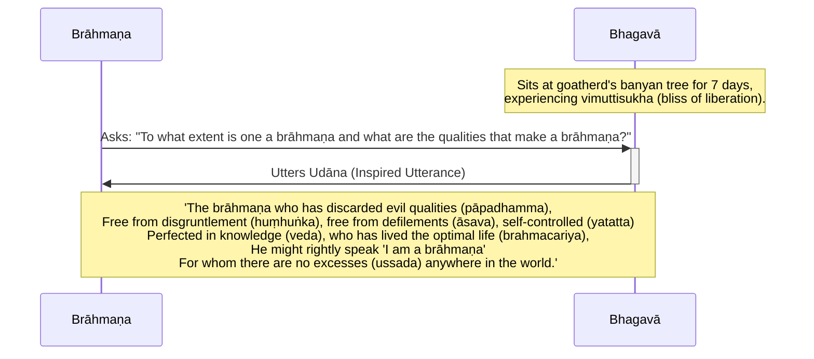

import { Tabs, TabItem } from '@astrojs/starlight/components';

Original text: [World Tipitaka Edition](https://tipitaka2500.github.io/tipitaka/3V/1/1.2.html)

## Summary

After emerging from seven days of `samādhi` (focus), the Bhagavā relocated from the Bodhi tree to the goatherd's banyan tree, where he sat for another seven days experiencing the bliss of liberation. Here, a disapproving `brāhmaṇa` approached and asked what defines a true brāhmaṇa and their qualities. The Bhagavā responded with an inspired utterance, stating that a true brāhmaṇa is one who has discarded evil qualities, is free from arrogance and defilements, is self-controlled, perfected in knowledge, has lived the optimal life, and has no worldly attachments, thus rightly able to claim the title 'brāhmaṇa'.

## Diagram

## Text

<Tabs syncKey="paliquote">
<TabItem label="My Translation">
(4.)

14\. Then the Bhagavā, after the passing of seven days, having emerged from that `samādhi` (focus), approached the goatherd's banyan tree from the root of the Bodhi tree; having approached, he sat at the root of the goatherd's banyan tree for seven days in one cross-legged posture, experiencing the bliss of liberation (`vimuttisukhapaṭisaṃvedī`). Then a certain disgruntled `brāhmaṇa` approached the Bhagavā. Having approached, he exchanged friendly greetings with the Bhagavā. Having exchanged pleasant and polite talk, he stood to one side. Standing to one side, that `brāhmaṇa` said this to the Bhagavā: “To what extent, indeed, Bho Gotama, is one a brāhmaṇa, and what, then, are the qualities that make a brāhmaṇa?” Then the Bhagavā, having understood this matter, on that occasion uttered this inspired utterance (`udāna`) —

15\. _“The brāhmaṇa who has discarded evil qualities,_ \
_Free from disgruntlement, free from non-optimal flows, self-controlled;_ \
_Perfected in knowledge, who has lived the optimal life,_ \
_He might rightly speak ‘I am a brāhmaṇa’;_ \
_For whom there are no excesses anywhere in the world.”_

---

16\. The Account of the Goatherd's Banyan Tree is finished.
</TabItem>

<TabItem label="Pāḷi (Roman IAST)">
(4.)

14\. Atha kho bhagavā sattāhassa accayena tamhā samādhimhā vuṭṭhahitvā bodhirukkhamūlā yena ajapālanigrodho tenupasaṅkami, upasaṅkamitvā ajapālanigrodhamūle sattāhaṃ ekapallaṅkena nisīdi vimuttisukhapaṭisaṃvedī. Atha kho aññataro huṃhuṅkajātiko brāhmaṇo yena bhagavā tenupasaṅkami. Upasaṅkamitvā bhagavatā saddhiṃ sammodi. Sammodanīyaṃ kathaṃ sāraṇīyaṃ vītisāretvā ekamantaṃ aṭṭhāsi. Ekamantaṃ ṭhito kho so brāhmaṇo bhagavantaṃ etadavoca—  “kittāvatā nu kho, bho gotama, brāhmaṇo hoti, katame ca pana brāhmaṇakaraṇā dhammā”ti? Atha kho bhagavā etamatthaṃ viditvā tāyaṃ velāyaṃ imaṃ udānaṃ udānesi—

15\. _“Yo brāhmaṇo bāhitapāpadhammo,_  \
_Nihuṃhuṅko nikkasāvo yatatto;_  \
_Vedantagū vusitabrahmacariyo,_  \
_Dhammena so brahmavādaṃ vadeyya;_  \
_Yassussadā natthi kuhiñci loke”ti._  

---

16\. Ajapālakathā niṭṭhitā.
</TabItem>

<TabItem label="Pāḷi (Brahmi)">
(4.)

14\. 𑀅𑀣 𑀔𑁄 𑀪𑀕𑀯𑀸 𑀲𑀢𑁆𑀢𑀸𑀳𑀲𑁆𑀲 𑀅𑀘𑁆𑀘𑀬𑁂𑀦 𑀢𑀫𑁆𑀳𑀸 𑀲𑀫𑀸𑀥𑀺𑀫𑁆𑀳𑀸 𑀯𑀼𑀝𑁆𑀞𑀳𑀺𑀢𑁆𑀯𑀸 𑀩𑁄𑀥𑀺𑀭𑀼𑀓𑁆𑀔𑀫𑀽𑀮𑀸 𑀬𑁂𑀦 𑀅𑀚𑀧𑀸𑀮𑀦𑀺𑀕𑁆𑀭𑁄𑀥𑁄 𑀢𑁂𑀦𑀼𑀧𑀲𑀗𑁆𑀓𑀫𑀺, 𑀉𑀧𑀲𑀗𑁆𑀓𑀫𑀺𑀢𑁆𑀯𑀸 𑀅𑀚𑀧𑀸𑀮𑀦𑀺𑀕𑁆𑀭𑁄𑀥𑀫𑀽𑀮𑁂 𑀲𑀢𑁆𑀢𑀸𑀳𑀁 𑀏𑀓𑀧𑀮𑁆𑀮𑀗𑁆𑀓𑁂𑀦 𑀦𑀺𑀲𑀻𑀤𑀺 𑀯𑀺𑀫𑀼𑀢𑁆𑀢𑀺𑀲𑀼𑀔𑀧𑀝𑀺𑀲𑀁𑀯𑁂𑀤𑀻. 𑀅𑀣 𑀔𑁄 𑀅𑀜𑁆𑀜𑀢𑀭𑁄 𑀳𑀼𑀁𑀳𑀼𑀗𑁆𑀓𑀚𑀸𑀢𑀺𑀓𑁄 𑀩𑁆𑀭𑀸𑀳𑁆𑀫𑀡𑁄 𑀬𑁂𑀦 𑀪𑀕𑀯𑀸 𑀢𑁂𑀦𑀼𑀧𑀲𑀗𑁆𑀓𑀫𑀺. 𑀉𑀧𑀲𑀗𑁆𑀓𑀫𑀺𑀢𑁆𑀯𑀸 𑀪𑀕𑀯𑀢𑀸 𑀲𑀤𑁆𑀥𑀺𑀁 𑀲𑀫𑁆𑀫𑁄𑀤𑀺. 𑀲𑀫𑁆𑀫𑁄𑀤𑀦𑀻𑀬𑀁 𑀓𑀣𑀁 𑀲𑀸𑀭𑀡𑀻𑀬𑀁 𑀯𑀻𑀢𑀺𑀲𑀸𑀭𑁂𑀢𑁆𑀯𑀸 𑀏𑀓𑀫𑀦𑁆𑀢𑀁 𑀅𑀝𑁆𑀞𑀸𑀲𑀺. 𑀏𑀓𑀫𑀦𑁆𑀢𑀁 𑀞𑀺𑀢𑁄 𑀔𑁄 𑀲𑁄 𑀩𑁆𑀭𑀸𑀳𑁆𑀫𑀡𑁄 𑀪𑀕𑀯𑀦𑁆𑀢𑀁 𑀏𑀢𑀤𑀯𑁄𑀘—  “𑀓𑀺𑀢𑁆𑀢𑀸𑀯𑀢𑀸 𑀦𑀼 𑀔𑁄, 𑀪𑁄 𑀕𑁄𑀢𑀫, 𑀩𑁆𑀭𑀸𑀳𑁆𑀫𑀡𑁄 𑀳𑁄𑀢𑀺, 𑀓𑀢𑀫𑁂 𑀘 𑀧𑀦 𑀩𑁆𑀭𑀸𑀳𑁆𑀫𑀡𑀓𑀭𑀡𑀸 𑀥𑀫𑁆𑀫𑀸”𑀢𑀺? 𑀅𑀣 𑀔𑁄 𑀪𑀕𑀯𑀸 𑀏𑀢𑀫𑀢𑁆𑀣𑀁 𑀯𑀺𑀤𑀺𑀢𑁆𑀯𑀸 𑀢𑀸𑀬𑀁 𑀯𑁂𑀮𑀸𑀬𑀁 𑀇𑀫𑀁 𑀉𑀤𑀸𑀦𑀁 𑀉𑀤𑀸𑀦𑁂𑀲𑀺—

15\. _“𑀬𑁄 𑀩𑁆𑀭𑀸𑀳𑁆𑀫𑀡𑁄 𑀩𑀸𑀳𑀺𑀢𑀧𑀸𑀧𑀥𑀫𑁆𑀫𑁄,_  \
_𑀦𑀺𑀳𑀼𑀁𑀳𑀼𑀗𑁆𑀓𑁄 𑀦𑀺𑀓𑁆𑀓𑀲𑀸𑀯𑁄 𑀬𑀢𑀢𑁆𑀢𑁄;_  \
_𑀯𑁂𑀤𑀦𑁆𑀢𑀕𑀽 𑀯𑀼𑀲𑀺𑀢𑀩𑁆𑀭𑀳𑁆𑀫𑀘𑀭𑀺𑀬𑁄,_  \
_𑀥𑀫𑁆𑀫𑁂𑀦 𑀲𑁄 𑀩𑁆𑀭𑀳𑁆𑀫𑀯𑀸𑀤𑀁 𑀯𑀤𑁂𑀬𑁆𑀬;_  \
_𑀬𑀲𑁆𑀲𑀼𑀲𑁆𑀲𑀤𑀸 𑀦𑀢𑁆𑀣𑀺 𑀓𑀼𑀳𑀺𑀜𑁆𑀘𑀺 𑀮𑁄𑀓𑁂”𑀢𑀺._  

---

16\. 𑀅𑀚𑀧𑀸𑀮𑀓𑀣𑀸 𑀦𑀺𑀝𑁆𑀞𑀺𑀢𑀸.
</TabItem>

<TabItem label="Interlinear">
(4.)

[14](https://tipitaka2500.github.io/tipitaka/3V/1/1.2.html#14) Atha kho bhagavā sattāhassa accayena tamhā samādhimhā vuṭṭhahitvā bodhirukkhamūlā yena ajapālanigrodho tenupasaṅkami, upasaṅkamitvā ajapālanigrodhamūle sattāhaṃ ekapallaṅkena nisīdi vimuttisukhapaṭisaṃvedī.  
⏏️(atha) ⏏️(kho) 🚹⨀①(bhagavant) 🚻⨀⑥🆎(satta+aha) ⏏️(accayena) *️⃣🤟🚹⨀⑤(ta) 🚹⨀⑤(samādhi) 🔽(tvā)(vuṭṭhāti) 🚻⨀⑤🆎(bodhi+rukkha+mūla) *️⃣🤟🚹⨀③(ya) 🚹⨀①🆎(ajapāla+nigrodha) *️⃣🤟🚹⨀③(ta) 🟢⨀🤟⏮(upasaṅkamati) 🔽(tvā)(upasaṅkamati) 🚻⨀⑦🆎(ajapāla+nigrodha+mūla) 🚻⨀②🆎(satta+aha) 🚹⨀③🆎(eka+pallaṅka) 🟢⨀🤟⏮(nisīdati) 🚹⨀①🆎(vimutti+sukha+paṭisaṃvedī)  
then | indeed | the Bhagavā | of seven days | after the passing | from that | focus | having emerged | from the root of the bodhi tree | by where | the goatherd's banyan tree | by there | approached | having approached | at the root of the goatherd's banyan tree | for seven days | in one cross-legged posture | sat down | experiencing the bliss of liberation  
Then the Bhagavā, after the passing of seven days, having emerged from that `samādhi` (focus), approached the goatherd's banyan tree from the root of the Bodhi tree; having approached, he sat at the root of the goatherd's banyan tree for seven days in one cross-legged posture, experiencing the bliss of liberation (`vimuttisukhapaṭisaṃvedī`).

Atha kho aññataro huṃhuṅkajātiko brāhmaṇo yena bhagavā tenupasaṅkami.  
⏏️(atha) ⏏️(kho) *️⃣🤟🚹⨀①(aññatara) 🚹⨀①🆎(huṃhuṅka+jātika) 🚹⨀①(brāhmaṇa) *️⃣🤟🚹⨀③(ya) 🚹⨀①(bhagavant) *️⃣🤟🚹⨀③(ta) 🟢⨀🤟⏮(upasaṅkamati)  
then | indeed | a certain | disgruntled by nature | brāhmaṇa | by where | the Bhagavā | by there | approached  
Then a certain disgruntled `brāhmaṇa` approached the Bhagavā.

Upasaṅkamitvā bhagavatā saddhiṃ sammodi.  
🔽(tvā)(upasaṅkamati) 🚹⨀③(bhagavant) ⏏️(saddhiṃ) 🟢⨀🤟⏮(sammodati)  
having approached | with the Bhagavā | together | exchanged greetings  
Having approached, he exchanged friendly greetings with the Bhagavā.

Sammodanīyaṃ kathaṃ sāraṇīyaṃ vītisāretvā ekamantaṃ aṭṭhāsi.  
🚺⨀②🔽(anīya)(sammodanīya) 🚺⨀②(kathā) 🚺⨀②🔽(anīya)(sāraṇīya) 🔽(tvā)(vītisāreti) ⏏️🆎(eka+anta) 🟢⨀🤟⏮(tiṭṭhati)  
courteous | talk | amiable | having concluded | to one side | stood  
Having exchanged pleasant and polite talk, he stood to one side.

Ekamantaṃ ṭhito kho so brāhmaṇo bhagavantaṃ etadavoca— “kittāvatā nu kho, bho gotama, brāhmaṇo hoti, katame ca pana brāhmaṇakaraṇā dhammā”ti?  
⏏️🆎(eka+anta) 🚹⨀①🔽(ta)(ṭhita) ⏏️(kho) *️⃣🤟🚹⨀①(ta) 🚹⨀①(brāhmaṇa) 🚹⨀②(bhagavant) *️⃣🤟🚻⨀②(eta) 🟢⨀🤟⏮(vadati) ⏏️(kittāvatā) ⏏️(nu) ⏏️(kho) 🚹⨀⓪(bhavant) 🚹⨀⓪(gotama) 🚹⨀①(brāhmaṇa) 🟢⨀🤟▶️(hoti) *️⃣🤟🚹⨂①(katama) ⏏️(ca) ⏏️(pana) 🚹⨂①🆎(brāhmaṇa+karaṇa) 🚹⨂①(dhamma) ⏏️(iti)  
to one side | standing | indeed | that | brāhmaṇa | the Bhagavā | this | said | to what extent | (question) | indeed | Bho | Gotama | a brāhmaṇa | is | which | and | then | that make a brāhmaṇa | qualities | (end quote)  
Standing to one side, that `brāhmaṇa` said this to the Bhagavā: “To what extent, indeed, Bho Gotama, is one a brāhmaṇa, and what, then, are the qualities that make a brāhmaṇa?”

Atha kho bhagavā etamatthaṃ viditvā tāyaṃ velāyaṃ imaṃ udānaṃ udānesi—  
⏏️(atha) ⏏️(kho) 🚹⨀①(bhagavant) *️⃣🤟🚹⨀②(eta) 🚹⨀②(attha) 🔽(tvā)(vidati) *️⃣🤟🚺⨀⑦(ta) 🚺⨀⑦(velā) *️⃣🤟🚹⨀②(ima) 🚹⨀②(udāna) 🟠⨀🤟⏮(udāneti)  
then | indeed | the Bhagavā | this | matter | having understood | at that | time | this | inspired utterance | uttered  
Then the Bhagavā, having understood this matter, on that occasion uttered this inspired utterance (`udāna`) —

[15](https://tipitaka2500.github.io/tipitaka/3V/1/1.2.html#15) “Yo brāhmaṇo bāhitapāpadhammo,  
*️⃣🤟🚹⨀①(ya) 🚹⨀①(brāhmaṇa) 🚹⨀①🆎(bāhita+pāpa+dhamma)  
who | brāhmaṇa | who has discarded evil qualities  
Nihuṃhuṅko nikkasāvo yatatto;  
🚹⨀①🆎(nir+huṃhuṅka) 🚹⨀①🆎(nir+kasāva) 🚹⨀①🆎(yata+atta)  
free from disgruntlement | free from impurity | self-controlled  
Vedantagū vusitabrahmacariyo,  
🚹⨀①🆎(veda+anta+gū) 🚹⨀①🆎(vusita+brahma+cariya)  
perfected in knowledge | who has lived the optimal life  
Dhammena so brahmavādaṃ vadeyya;  
🚹⨀③(dhamma) *️⃣🤟🚹⨀①(ta) 🚹⨀②🆎(brahma+vāda) 🟢⨀🤟⏯(vadati)  
rightly | he | the claim ‘I am a brāhmaṇa’ | might speak  
Yassussadā natthi kuhiñci loke”ti.  
*️⃣🤟🚹⨀⑥(ya) 🚹⨂①(ussada) ⏏️(na) 🟢⨀🤟▶️(atthi) ⏏️(kuhiñci) 🚹⨀⑦(loka) ⏏️(iti)  
for whom | excesses | not | there are | anywhere | in the world | (end quote)  

“The brāhmaṇa who has discarded evil qualities,  
Free from disgruntlement, free from non-optimal flows, self-controlled;  
Perfected in knowledge, who has lived the optimal life,  
He might rightly speak ‘I am a brāhmaṇa’;  
For whom there are no excesses anywhere in the world.”

[16](https://tipitaka2500.github.io/tipitaka/3V/1/1.2.html#16) Ajapālakathā niṭṭhitā.  
🚺⨀①🆎(ajapāla+kathā) 🚺⨀①🔽(ta)(niṭṭhita)  
the Ajapālakathā | finished  
The Account of the Goatherd's Banyan Tree is finished.
</TabItem>
</Tabs>

## Commentary

The core of this passage is the redefinition of `brāhmaṇa`.

A `brāhmaṇa` (brahmin) who noticed the Buddha under the tree decides to humiliate the Buddha by asking him a rhetorical question:

> “To what extent, indeed, Bho Gotama, is one a brāhmaṇa, and what, then, are the qualities that make a brāhmaṇa?”

The implication here is that the Buddha is not a true brāhmaṇa and therefore an impostor. The word `huṃhuṅkajātika` (literally, someone with a "huṃ huṃ" nature who is inclined to say "humph" disapprovingly) indicates that the brāhmaṇa disapproves of the Buddha.

The conventional definition of a `brāhmaṇa` is of course someone from the brahmin caste who engages and performs rituals in accordance with Vedic traditions. In other words, one can only be born a brahmin, one cannot become a brahmin.

The Bhagavā’s response shifts the criteria entirely to internal, verifiable characteristics. A "true brāhmaṇa" is defined by an achieved psychological state: the absence of non-optimal mental patterns of thought (`āsava`), the presence of cultivated self-control (`yatatta`), and a deep, experiential understanding (`vedantagū`) of one's own mind and its workings, developed through an optimal mode of living (`brahmacariya`). The crucial element is the internal landscape — a conscious experience free from "excess", which can be understood as entangling mental preoccupations, attachments, or cognitive biases that obscure clarity and generate distress. Thus, the ideal is framed not by external or intrinsic markers but by a transformed and purified subjective experience.

As a bit of humour, the Buddha gently teases the brāhmaṇa by saying a true brāhmaṇa should be "free from disgruntlement or arrogance" (`nihuṃhuṅko`).

## Gombrich's thoughts

In [Gombrich - How Buddhism Began: The conditioned genesis of the early teachings (2006)](/books/gombrich---how-buddhism-began-2006/) [@HowBuddhismBegan], Gombrich states:

> In the Mahāvagga a snooty brahmin then comes along and asks him by virtue of what he can claim to be a brahmin. The Buddha answers in a verse, his fourth, which includes puns on brahminical terms, one of them a pun on the word brāhmaṇa (in a Prakritic form)

In [Gombrich - What the Buddha Thought (2009)](/books/gombrich---what-the-buddha-thought-2009/) [@WhatTheBuddhaThought], Gombrich writes:

> At the end of the week the Buddha moves to a banyan tree, where he spends another week in a similar manner. Then a brahmin happens along. He is the Buddha's first human contact since Enlightenment. This brahmin is not named, but the text characterizes him by a word found only in this passage, *huhuńka*; this seems to be onomatopoeic and to mean something like 'snooty'. The brahmin asks the Buddha what features make a brahmin - a question found elsewhere in the Canon too. The Buddha answers that a man can rightly claim to be a brahmin if he has seven features: he has expelled evil characteristics (bāhita-pāpadhammo), he is not snooty (huhuńka), he has no moral stains, he restrains himself, he has reached the end (that is, the perfection) of knowledge (vedanta-gu), he has lived the holy life (vusita-brahmacariyo) and has no arrogance towards anyone in the world. Obviously, these seven features overlap. Three terms in the list - bāhita-pāpadhammo, vedanta-gu and vusita-brahma-cariyo - play on brahmin terminology. For the brahmin, Vedānta refers to the Upaniṣads, but the Buddha takes it more generally to refer to the culmination of true knowledge. Similarly, 'brahman conduct', which is the literal meaning of brahma-cariyā, has likewise been given a different referent by the Buddha (see the Appendix). The message of the list as a whole is plain. The Buddha is telling brahmins that they have no right to be proud, because all the virtues and accomplishments that they claim he has in full measure - indeed, in fuller measure, because he understands what the terms should really refer to.

## Norman's thoughts

[@Norman1997] notes:

> The political and economic picture which we gain from early Pāli texts is one where the urbanisation of the Gangetic plain was well under way. There were large, well fortified cities, with powerful rulers. Movement between those cities was easy, and trade between them was flourishing. We read of merchants setting out with large caravans, and there are frequent references to the coinage which must have facilitated the growth of trade. The ksatriyas, the ruling class, had gained a more imposing identity - they were no longer minor chieftains - and the vaiśyas, the mercantile class, had begun to gain wealth, and power arising from that wealth, as opposed to an earlier situation where they were merely itinerant traders. This must have lead to a situation where the ksatriyas and the vaiśyas would be very open to a religion which gave them a social position equal to, or even superior to, that of members of the brahmanical caste. It is very clear that the brahmanical caste was regarded as superior, at least by the members of that caste. As a ksatriya the Buddha might be expected to oppose the brahmanical caste and much of his teaching was devoted to defining the word brāhmana as a moral term, and denying that one became a brahman simply by birth. He insisted that it was actions which made a brahman. A consequence of the Buddha's teaching about this was that (although there are many references to brāhmanas becoming his followers) the main support for his religion came from ksatriyas and vaiśyas, particularly from the latter. This was presumably because they were wealthy and were well placed to gain merit by dāna "giving, generosity". They also travelled widely, and were able to act as missionaries, taking the message to other vaiśya communities. It is a striking fact that, as Buddhism spread, it followed the trade routes, being propagated either by "missionary" traders or by bhikkhus who travelled with the caravans under the protection of the traders.

## `āsava` (non-optimal mental "flows")

`āsava` is quite difficult to translate. [@Norman1997] notes:

> One such word is *āsava*, for the Buddhist usage does not fit the etymology of the word, while the Jain usage does. The etymology of this word (the preposition *ā* "towards" + the root *sru-* "to flow") implies something flowing in, and this suits the Jain usage well, since there the *āsava*s are influences which flow into a person, and discolour his soul. We find illustrations of this in Jain manuscripts, with people ranging from white, through yellow, red, blue and green to black, depending on the amount of *āsava*s which has flowed into them. This does not suit the Buddhist idea, where the *āsava*s are not attributes which are capable of flowing into a person. They are, in fact, identical with the four *ogha*s "floods", and it seems clear that in Buddhism the word has lost its original meaning. So, although the translation "influence" or "influx" suits the Jain usage well, on etymological and exegetical grounds, it is not entirely satisfactory for Buddhism. This accounts for the number of translations which have been suggested for the word, including "passions", "intoxicants", "cravings" and "cankers". The latter to me is a disease of dogs' ears and of roses, and I am always surprised when I find the arahat, the one whose *āsava*s have been destroyed (*khināsava*), being described as "canker-waned".

Within the context of dependent origination, `āsava` represents non-optimal mental "flows", or established patterns of thought and behaviours that will inevitably lead to `dukkha`.

It is important to understand that `āsava` does not necessarily refer to "bad" or "non-ethical" thoughts, as dependent origination is not necessarily an ethical framework. Perhaps the closest analogy is "bad habits or tendencies" rather than "evil thoughts". We encounter `dukkha` because past events and phenomenological experiences have led us to dissatisfaction and pain, so over time similar events and experiences ("inflows") trigger established patterns of thought leading to similar mental constructions, apperceptions, feelings and ultimately consciousness.

The key to ceasing or avoiding `dukkha` is to break these established ways of thinking and habits. Anyone who has tried to break a bad habit, such as smoking, or tried to lose weight knows how difficult this can be. Although the concept is easy to understand ("Just Stop Doing It") many people realise it requires a lifetime of commitment and constant vigilance.

In the same way, the Buddha's path to soteriology requires a lifetime commitment and constant vigilance, to guard against the occurrence or re-occurrence of these non-optimal flows.

## `brahmacariya` (the disciplined, or optimal conduct or state of life)

Strictly speaking, this is a Vedic reference to leading a virtuous life that is aligned with Brahmā (the Supreme Creator) but the Buddha has skilfully redefined this to living an optimal life in accordance with his soteriology. Some translate this as meaning "leading a holy life" or "following a spiritual path" but I prefer not to associate the Buddha's teachings with a spiritual or religious goal.

`brahmacariya` in the context of the Buddha's teaching refers to the disciplined way of living, or optimal conduct or state of existence, in order to eliminate `āsava`, or non-optimal mental flows that lead to non-optimal mental constructions and eventually `dukkha`. This is a lifetime commitment and "practice". Later on in [6. Pañcavaggiyakathā (The Account of the Group of Five)](/khandhaka/1-6/) the Buddha prescribes the Eightfold Path, a guide to this practice, and establishes the `saṅgha`, a community of like-minded "practitioners" who will support each other in living the optimal life.

[@Norman1997] writes:

> In its basic brahmanical sense *brahma-carya* means "the practice of a brāhmana", i.e. the living of a celibate life, learning the Vedas. The Buddha used the phrase in the more general sense of "to live the best life, i.e. a holy, celibate (or in the case of married couples, a chaste and moral) life". In the Upaniṣads *brahma-patha* means "the way to brahman or Brahmā". The Buddha used it in the sense of the way to the best, i.e. *nibbāna*, and it is explained as being the same as *brahmavihāra*.
>
> It is possible that *brahma-vihāra* was in origin a brahmanical term. It would literally mean "dwelling in brahman or with Brahmā", although it is not attested in that usage in Sanskrit. It perhaps shows a trace of its original meaning in a sutta in which the Buddha speaks to young brahmans who were disputing the correct way to obtain *brahma-sahavyatā*. In the context this would seem to mean "union with brahman", but the Buddha, perhaps jokingly, interprets it as meaning a state of union with the god Brahmā. He explains that someone who practises the four types of concentration called *brahma-vihāra* is reborn as a Brahmā in the Brahma-world. It is to be noted that this means only being born in the same heaven as Mahā Brahmā, not union with the Upaniṣadic brahman.

## `pariyāya` (roundabout way)

This section of the narrative is an excellent introduction to the Buddha's style of teaching, which has been referred to as `pariyāya`. According to ["A Dictionary of Pāli" by Margaret Cone](https://gandhari.org/dictionary?section=dop), the word means:

> 1. a basis, a (valid) ground; an interpretation; a way; a method of proceeding;
> 2. a way of saying something; an interpretation; a different, alternative, way of saying something, esp. indirectly or figuratively or by extension; a roundabout expression; a synonym;
> 3. a regular recurrence, repeated action; regular rotation, a turn; succession;
> 4. course, alteration; lapse, expiration;
> 5. going round, encircling;?

As we can see in the narrative, the Buddha uses specific terms, such as `brāhmaṇa`, `āsava`, `veda`, `brahmacariya` that have specific meaning from a religious context in Vedism and Jainism, but skilfully redefines them within the context of his awakened knowledge. Hence:

* `brāhmaṇa` no longer means someone from the brahmin caste, but someone who is successfully awakened and liberated,
* `āsava` are not the impure flows that corrupt the "soul" from a Jainistic perspective but non-optimal mental flows,
* `veda` is not sacred knowledge but realised understanding,
* `brahmacariya` is not the way of life of Brahmā (the Supreme Creator) but an optimal way of living dedicated to the eradication of `dukkha`.

Mahāyāna texts even use a technical term, [S] `upāyakauśalya`, that refers to this method of exposition, which refers to, as [@WhatTheBuddhaThought] explains: "the Buddha's ability to adapt what he says to his audience, to their prejudices, expectations and capacities."

> When he encounters non-Buddhists, the Buddha hardly ever initiates a discussion or begins by putting forward his own views. As T. W. Rhys Davids pointed out a century ago, this reminds us of Socrates, who always got discussions going by asking the other party to state their views. When the Buddha's interlocutor has spoken, the Buddha's normal technique is to agree - and then to carry on. He says, 'Yes ... and ...'
> 
> This is a wonderful bargaining or diplomatic tactic, from which anyone can learn. The Buddha avoids an adversarial stance. What he does after his initial agreement is to take what has apparently been agreed on and turn it upside down. One of his main ways of doing that is to make the words used by his opponent mean something quite different.

## A biography of the author?

As per the previous narrative, it is unlikely the Buddha would have encountered a visiting brahmin at Uruvelā - this story is probably invented by the author/compiler of the Khandhaka in order to contrast the peaceful, serene Buddha under the bliss of liberation with the disgruntled brahmin, who, despite being born in the brahmin caste, does not seem to have avoided dissatisfaction.

However, given that the author/compiler of the Khandhaka was born a brahmin, as suggested by [@Frauwallner1956], it seems to me this section is a clever way of introducing the personality of the author into the text. Hence, this narrative could be a reference to the personal biography of the author, who was formerly a practising brahmin who knew the Vedic texts, but perhaps was not satisfied with Brahmanism and hence became disgruntled. The narrative is then a touching reference to the author, having converted to Buddhism, finally understanding the true meaning of the word `brāhmaṇa`.

## Other opinions

- [Bronkhorst - Greater Magadha (2007)](/books/bronkhorst---greater-magadha-2007/) [@GreaterMagadha] \
	Bronkhorst posits that ancient India hosted two distinct, coexisting cultures: the ritual-focused, rural Vedic culture of the western Gangetic plain, and a separate culture in "Greater Magadha" to the east, which was the source of Buddhism, Jainism, and Ājīvikism. This eastern culture was defined by core beliefs in rebirth and karmic retribution, the use of round funerary mounds (`stūpa`s), an "empirico-rational" approach to medicine, and a concept of cyclic time. Bronkhorst argues that these ideas were foreign to early Brahmanism and were only gradually absorbed, ignored, or actively rejected by different Brahmanical groups over many centuries. Challenging traditional Vedic chronology, he presents evidence that many late-Vedic texts, including parts of the Upaniṣads, are much later than commonly thought and were composed during a long period of interaction with this eastern culture, concluding that classical Indian civilisation is not a linear development from Vedic antecedents but a synthesis of these two fundamentally different cultural worlds.

[Go to previous page (1. Bodhikathā)](/khandhaka/1-1/) / [Go to parent page (Khandhaka)](/khandhaka/) / [Go to next page (3. Mucalindakathā)](/khandhaka/1-3/)

## References
