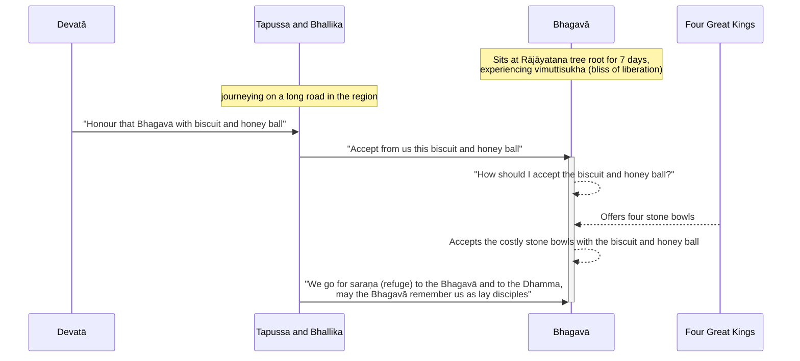

import { Tabs, TabItem } from '@astrojs/starlight/components';

Original text: [World Tipitaka Edition](https://tipitaka2500.github.io/tipitaka/3V/1/1.4.html)

## Summary

After emerging from another seven days of `samādhi` and spending a further seven days at the Rājāyatana tree experiencing liberation, the Bhagavā was approached by merchants Tapussa and Bhallika, who were guided by a `devatā` (deity) to offer him biscuit and honey ball. Pondering how to accept the food, as Tathāgatas (thus-gone ones) do not receive offerings in their hands, the four Great Kings (`cattaro mahārājāno`) miraculously provided four stone bowls. The Bhagavā accepted and partook of the meal, after which Tapussa and Bhallika took refuge in the Bhagavā and the `Dhamma` (Buddha's teachings), becoming the first lay disciples in the world with two utterances.

## Diagram

## Text

<Tabs syncKey="paliquote">
<TabItem label="My Translation">
(6.)

21\. Then the Bhagavā, after the passing of seven days, having emerged from that `samādhi` (focus), approached the Rājāyatana tree from the root of the Mucalinda tree; having approached, he sat at the root of the Rājāyatana tree for seven days in one cross-legged posture, experiencing the bliss of liberation (`vimuttisukhapaṭisaṃvedī`). Now at that time, the merchants Tapussa and Bhallika from Ukkalā were travelling along the main road to that region. Then a `devatā` (deity) who was a kinsman and blood relative of the merchants Tapussa and Bhallika said this to the merchants Tapussa and Bhallika: “This, Mārisā, is the Bhagavā dwelling at the root of the Rājāyatana tree, newly `abhisambuddha` (fully awakened); go and honour that Bhagavā with `mantha` (biscuit) and `madhupiṇḍikā` (honey ball); that will be for your welfare and happiness for a long time.”

22\. Then the merchants Tapussa and Bhallika, taking the `mantha` (biscuit) and `madhupiṇḍikā` (honey ball), approached the Bhagavā; having approached and paid homage to the Bhagavā, they stood to one side. Standing to one side, the merchants Tapussa and Bhallika said this to the Bhagavā: “May the Bhagavā, Bhante, accept from us the `mantha` (biscuit) and `madhupiṇḍikā` (honey ball), which would be for our welfare and happiness for a long time.” Then this thought occurred to the Bhagavā: “Tathāgatas indeed do not accept in their hands. In what, indeed, should I accept the `mantha` (biscuit) and `madhupiṇḍikā` (honey ball)?” Then the four Great Kings, knowing the Bhagavā’s thought process with their own minds, offered four stone bowls to the Bhagavā from the four directions, saying: “Here, Bhante, may the Bhagavā accept the `mantha` (biscuit) and `madhupiṇḍikā` (honey ball).” The Bhagavā accepted the costly stone bowls with the `mantha` (biscuit) and `madhupiṇḍikā` (honey ball); having accepted, he partook.

23\. Then the merchants Tapussa and Bhallika, knowing that the Bhagavā had removed his hand from the bowl, fell with their heads at the Bhagavā’s feet and said this to the Bhagavā: “We here, Bhante, go for `saraṇa` (refuge) to the Bhagavā and to the Dhamma; may the Bhagavā remember us as `upāsakā` (lay disciples) from this day forth, who have gone for `saraṇa` for as long as life lasts.” And they were the first `upāsakā` (lay disciples) in the world with two utterances.

---

24\. The Account of the Rājāyatana Tree is finished.
</TabItem>

<TabItem label="Pāḷi (Roman IAST)">
(6.)

21\. Atha kho bhagavā sattāhassa accayena tamhā samādhimhā vuṭṭhahitvā mucalindamūlā yena rājāyatanaṃ tenupasaṅkami, upasaṅkamitvā rājāyatanamūle sattāhaṃ ekapallaṅkena nisīdi vimuttisukhapaṭisaṃvedī. Tena kho pana samayena tapussa bhallikā vāṇijā ukkalā taṃ desaṃ addhānamaggappaṭipannā honti. Atha kho tapussabhallikānaṃ vāṇijānaṃ ñātisālohitā devatā tapussabhallike vāṇije etadavoca—  “ayaṃ, mārisā, bhagavā rājāyatanamūle viharati paṭhamābhisambuddho; gacchatha taṃ bhagavantaṃ manthena ca madhupiṇḍikāya ca patimānetha; taṃ vo bhavissati dīgharattaṃ hitāya sukhāyā”ti.

22\. Atha kho tapussabhallikā vāṇijā manthañca madhupiṇḍikañca ādāya yena bhagavā tenupasaṅkamiṃsu, upasaṅkamitvā bhagavantaṃ abhivādetvā ekamantaṃ aṭṭhaṃsu. Ekamantaṃ ṭhitā kho tapussabhallikā vāṇijā bhagavantaṃ etadavocuṃ—  “paṭiggaṇhātu no, bhante, bhagavā manthañca madhupiṇḍikañca, yaṃ amhākaṃ assa dīgharattaṃ hitāya sukhāyā”ti. Atha kho bhagavato etadahosi—  “na kho tathāgatā hatthesu paṭiggaṇhanti. Kimhi nu kho ahaṃ paṭiggaṇheyyaṃ manthañca madhupiṇḍikañcā”ti? Atha kho cattāro mahārājāno bhagavato cetasā cetoparivitakkamaññāya catuddisā cattāro selamaye patte bhagavato upanāmesuṃ—  “idha, bhante, bhagavā paṭiggaṇhātu manthañca madhupiṇḍikañcā”ti. Paṭiggahesi bhagavā paccagghe selamaye patte manthañca madhupiṇḍikañca, paṭiggahetvā paribhuñji.

23\. Atha kho tapussabhallikā vāṇijā bhagavantaṃ onītapattapāṇiṃ viditvā bhagavato pādesu sirasā nipatitvā bhagavantaṃ etadavocuṃ—  “ete mayaṃ, bhante, bhagavantaṃ saraṇaṃ gacchāma dhammañca, upāsake no bhagavā dhāretu ajjatagge pāṇupete saraṇaṃ gate”ti. Te ca loke paṭhamaṃ upāsakā ahesuṃ dvevācikā.

---

24\. Rājāyatanakathā niṭṭhitā.
</TabItem>

<TabItem label="Pāḷi (Brahmi)">
(6.)

21\. 𑀅𑀣 𑀔𑁄 𑀪𑀕𑀯𑀸 𑀲𑀢𑁆𑀢𑀸𑀳𑀲𑁆𑀲 𑀅𑀘𑁆𑀘𑀬𑁂𑀦 𑀢𑀫𑁆𑀳𑀸 𑀲𑀫𑀸𑀥𑀺𑀫𑁆𑀳𑀸 𑀯𑀼𑀝𑁆𑀞𑀳𑀺𑀢𑁆𑀯𑀸 𑀫𑀼𑀘𑀮𑀺𑀦𑁆𑀤𑀫𑀽𑀮𑀸 𑀬𑁂𑀦 𑀭𑀸𑀚𑀸𑀬𑀢𑀦𑀁 𑀢𑁂𑀦𑀼𑀧𑀲𑀗𑁆𑀓𑀫𑀺, 𑀉𑀧𑀲𑀗𑁆𑀓𑀫𑀺𑀢𑁆𑀯𑀸 𑀭𑀸𑀚𑀸𑀬𑀢𑀦𑀫𑀽𑀮𑁂 𑀲𑀢𑁆𑀢𑀸𑀳𑀁 𑀏𑀓𑀧𑀮𑁆𑀮𑀗𑁆𑀓𑁂𑀦 𑀦𑀺𑀲𑀻𑀤𑀺 𑀯𑀺𑀫𑀼𑀢𑁆𑀢𑀺𑀲𑀼𑀔𑀧𑀝𑀺𑀲𑀁𑀯𑁂𑀤𑀻. 𑀢𑁂𑀦 𑀔𑁄 𑀧𑀦 𑀲𑀫𑀬𑁂𑀦 𑀢𑀧𑀼𑀲𑁆𑀲 𑀪𑀮𑁆𑀮𑀺𑀓𑀸 𑀯𑀸𑀡𑀺𑀚𑀸 𑀉𑀓𑁆𑀓𑀮𑀸 𑀢𑀁 𑀤𑁂𑀲𑀁 𑀅𑀤𑁆𑀥𑀸𑀦𑀫𑀕𑁆𑀕𑀧𑁆𑀧𑀝𑀺𑀧𑀦𑁆𑀦𑀸 𑀳𑁄𑀦𑁆𑀢𑀺. 𑀅𑀣 𑀔𑁄 𑀢𑀧𑀼𑀲𑁆𑀲𑀪𑀮𑁆𑀮𑀺𑀓𑀸𑀦𑀁 𑀯𑀸𑀡𑀺𑀚𑀸𑀦𑀁 𑀜𑀸𑀢𑀺𑀲𑀸𑀮𑁄𑀳𑀺𑀢𑀸 𑀤𑁂𑀯𑀢𑀸 𑀢𑀧𑀼𑀲𑁆𑀲𑀪𑀮𑁆𑀮𑀺𑀓𑁂 𑀯𑀸𑀡𑀺𑀚𑁂 𑀏𑀢𑀤𑀯𑁄𑀘—  “𑀅𑀬𑀁, 𑀫𑀸𑀭𑀺𑀲𑀸, 𑀪𑀕𑀯𑀸 𑀭𑀸𑀚𑀸𑀬𑀢𑀦𑀫𑀽𑀮𑁂 𑀯𑀺𑀳𑀭𑀢𑀺 𑀧𑀞𑀫𑀸𑀪𑀺𑀲𑀫𑁆𑀩𑀼𑀤𑁆𑀥𑁄; 𑀕𑀘𑁆𑀙𑀣 𑀢𑀁 𑀪𑀕𑀯𑀦𑁆𑀢𑀁 𑀫𑀦𑁆𑀣𑁂𑀦 𑀘 𑀫𑀥𑀼𑀧𑀺𑀡𑁆𑀟𑀺𑀓𑀸𑀬 𑀘 𑀧𑀢𑀺𑀫𑀸𑀦𑁂𑀣; 𑀢𑀁 𑀯𑁄 𑀪𑀯𑀺𑀲𑁆𑀲𑀢𑀺 𑀤𑀻𑀖𑀭𑀢𑁆𑀢𑀁 𑀳𑀺𑀢𑀸𑀬 𑀲𑀼𑀔𑀸𑀬𑀸”𑀢𑀺.

22\. 𑀅𑀣 𑀔𑁄 𑀢𑀧𑀼𑀲𑁆𑀲𑀪𑀮𑁆𑀮𑀺𑀓𑀸 𑀯𑀸𑀡𑀺𑀚𑀸 𑀫𑀦𑁆𑀣𑀜𑁆𑀘 𑀫𑀥𑀼𑀧𑀺𑀡𑁆𑀟𑀺𑀓𑀜𑁆𑀘 𑀆𑀤𑀸𑀬 𑀬𑁂𑀦 𑀪𑀕𑀯𑀸 𑀢𑁂𑀦𑀼𑀧𑀲𑀗𑁆𑀓𑀫𑀺𑀁𑀲𑀼, 𑀉𑀧𑀲𑀗𑁆𑀓𑀫𑀺𑀢𑁆𑀯𑀸 𑀪𑀕𑀯𑀦𑁆𑀢𑀁 𑀅𑀪𑀺𑀯𑀸𑀤𑁂𑀢𑁆𑀯𑀸 𑀏𑀓𑀫𑀦𑁆𑀢𑀁 𑀅𑀝𑁆𑀞𑀁𑀲𑀼. 𑀏𑀓𑀫𑀦𑁆𑀢𑀁 𑀞𑀺𑀢𑀸 𑀔𑁄 𑀢𑀧𑀼𑀲𑁆𑀲𑀪𑀮𑁆𑀮𑀺𑀓𑀸 𑀯𑀸𑀡𑀺𑀚𑀸 𑀪𑀕𑀯𑀦𑁆𑀢𑀁 𑀏𑀢𑀤𑀯𑁄𑀘𑀼𑀁—  “𑀧𑀝𑀺𑀕𑁆𑀕𑀡𑁆𑀳𑀸𑀢𑀼 𑀦𑁄, 𑀪𑀦𑁆𑀢𑁂, 𑀪𑀕𑀯𑀸 𑀫𑀦𑁆𑀣𑀜𑁆𑀘 𑀫𑀥𑀼𑀧𑀺𑀡𑁆𑀟𑀺𑀓𑀜𑁆𑀘, 𑀬𑀁 𑀅𑀫𑁆𑀳𑀸𑀓𑀁 𑀅𑀲𑁆𑀲 𑀤𑀻𑀖𑀭𑀢𑁆𑀢𑀁 𑀳𑀺𑀢𑀸𑀬 𑀲𑀼𑀔𑀸𑀬𑀸”𑀢𑀺. 𑀅𑀣 𑀔𑁄 𑀪𑀕𑀯𑀢𑁄 𑀏𑀢𑀤𑀳𑁄𑀲𑀺—  “𑀦 𑀔𑁄 𑀢𑀣𑀸𑀕𑀢𑀸 𑀳𑀢𑁆𑀣𑁂𑀲𑀼 𑀧𑀝𑀺𑀕𑁆𑀕𑀡𑁆𑀳𑀦𑁆𑀢𑀺. 𑀓𑀺𑀫𑁆𑀳𑀺 𑀦𑀼 𑀔𑁄 𑀅𑀳𑀁 𑀧𑀝𑀺𑀕𑁆𑀕𑀡𑁆𑀳𑁂𑀬𑁆𑀬𑀁 𑀫𑀦𑁆𑀣𑀜𑁆𑀘 𑀫𑀥𑀼𑀧𑀺𑀡𑁆𑀟𑀺𑀓𑀜𑁆𑀘𑀸”𑀢𑀺? 𑀅𑀣 𑀔𑁄 𑀘𑀢𑁆𑀢𑀸𑀭𑁄 𑀫𑀳𑀸𑀭𑀸𑀚𑀸𑀦𑁄 𑀪𑀕𑀯𑀢𑁄 𑀘𑁂𑀢𑀲𑀸 𑀘𑁂𑀢𑁄𑀧𑀭𑀺𑀯𑀺𑀢𑀓𑁆𑀓𑀫𑀜𑁆𑀜𑀸𑀬 𑀘𑀢𑀼𑀤𑁆𑀤𑀺𑀲𑀸 𑀘𑀢𑁆𑀢𑀸𑀭𑁄 𑀲𑁂𑀮𑀫𑀬𑁂 𑀧𑀢𑁆𑀢𑁂 𑀪𑀕𑀯𑀢𑁄 𑀉𑀧𑀦𑀸𑀫𑁂𑀲𑀼𑀁—  “𑀇𑀥, 𑀪𑀦𑁆𑀢𑁂, 𑀪𑀕𑀯𑀸 𑀧𑀝𑀺𑀕𑁆𑀕𑀡𑁆𑀳𑀸𑀢𑀼 𑀫𑀦𑁆𑀣𑀜𑁆𑀘 𑀫𑀥𑀼𑀧𑀺𑀡𑁆𑀟𑀺𑀓𑀜𑁆𑀘𑀸”𑀢𑀺. 𑀧𑀝𑀺𑀕𑁆𑀕𑀳𑁂𑀲𑀺 𑀪𑀕𑀯𑀸 𑀧𑀘𑁆𑀘𑀕𑁆𑀖𑁂 𑀲𑁂𑀮𑀫𑀬𑁂 𑀧𑀢𑁆𑀢𑁂 𑀫𑀦𑁆𑀣𑀜𑁆𑀘 𑀫𑀥𑀼𑀧𑀺𑀡𑁆𑀟𑀺𑀓𑀜𑁆𑀘, 𑀧𑀝𑀺𑀕𑁆𑀕𑀳𑁂𑀢𑁆𑀯𑀸 𑀧𑀭𑀺𑀪𑀼𑀜𑁆𑀚𑀺.

23\. 𑀅𑀣 𑀔𑁄 𑀢𑀧𑀼𑀲𑁆𑀲𑀪𑀮𑁆𑀮𑀺𑀓𑀸 𑀯𑀸𑀡𑀺𑀚𑀸 𑀪𑀕𑀯𑀦𑁆𑀢𑀁 𑀑𑀦𑀻𑀢𑀧𑀢𑁆𑀢𑀧𑀸𑀡𑀺𑀁 𑀯𑀺𑀤𑀺𑀢𑁆𑀯𑀸 𑀪𑀕𑀯𑀢𑁄 𑀧𑀸𑀤𑁂𑀲𑀼 𑀲𑀺𑀭𑀲𑀸 𑀦𑀺𑀧𑀢𑀺𑀢𑁆𑀯𑀸 𑀪𑀕𑀯𑀦𑁆𑀢𑀁 𑀏𑀢𑀤𑀯𑁄𑀘𑀼𑀁—  “𑀏𑀢𑁂 𑀫𑀬𑀁, 𑀪𑀦𑁆𑀢𑁂, 𑀪𑀕𑀯𑀦𑁆𑀢𑀁 𑀲𑀭𑀡𑀁 𑀕𑀘𑁆𑀙𑀸𑀫 𑀥𑀫𑁆𑀫𑀜𑁆𑀘, 𑀉𑀧𑀸𑀲𑀓𑁂 𑀦𑁄 𑀪𑀕𑀯𑀸 𑀥𑀸𑀭𑁂𑀢𑀼 𑀅𑀚𑁆𑀚𑀢𑀕𑁆𑀕𑁂 𑀧𑀸𑀡𑀼𑀧𑁂𑀢𑁂 𑀲𑀭𑀡𑀁 𑀕𑀢𑁂”𑀢𑀺. 𑀢𑁂 𑀘 𑀮𑁄𑀓𑁂 𑀧𑀞𑀫𑀁 𑀉𑀧𑀸𑀲𑀓𑀸 𑀅𑀳𑁂𑀲𑀼𑀁 𑀤𑁆𑀯𑁂𑀯𑀸𑀘𑀺𑀓𑀸.

---

24\. 𑀭𑀸𑀚𑀸𑀬𑀢𑀦𑀓𑀣𑀸 𑀦𑀺𑀝𑁆𑀞𑀺𑀢𑀸.
</TabItem>

<TabItem label="Interlinear">
(6.)

[21](https://tipitaka2500.github.io/tipitaka/3V/1/1.4.html#21) Atha kho bhagavā sattāhassa accayena tamhā samādhimhā vuṭṭhahitvā mucalindamūlā yena rājāyatanaṃ tenupasaṅkami, upasaṅkamitvā rājāyatanamūle sattāhaṃ ekapallaṅkena nisīdi vimuttisukhapaṭisaṃvedī.  
⏏️(atha) ⏏️(kho) 🚹⨀①(bhagavant) 🚻⨀⑥🆎(satta+aha) ⏏️(accayena) *️⃣🤟🚹⨀⑤(ta) 🚹⨀⑤(samādhi) 🔽(tvā)(vuṭṭhāti) 🚻⨀⑤🆎(mucalinda+mūla) *️⃣🤟🚹⨀③(ya) 🚻⨀①(rājāyatana) *️⃣🤟🚹⨀③(ta) 🟢⨀🤟⏮(upasaṅkamati) 🔽(tvā)(upasaṅkamati) 🚻⨀⑦🆎(rājāyatana+mūla) 🚻⨀②🆎(satta+aha) 🚹⨀③🆎(eka+pallaṅka) 🟢⨀🤟⏮(nisīdati) 🚹⨀①🆎(vimutti+sukha+paṭisaṃvedī)  
then | indeed | the Bhagavā | of seven days | after the passing | from that | focus | having emerged | from the root of the Mucalinda tree | by where | the Rājāyatana tree | by there | approached | having approached | at the root of the Rājāyatana tree | for seven days | in one cross-legged posture | sat down | experiencing the bliss of liberation  
Then the Bhagavā, after the passing of seven days, having emerged from that `samādhi` (focus), approached the Rājāyatana tree from the root of the Mucalinda tree; having approached, he sat at the root of the Rājāyatana tree for seven days in one cross-legged posture, experiencing the bliss of liberation (`vimuttisukhapaṭisaṃvedī`).

Tena kho pana samayena tapussa bhallikā vāṇijā ukkalā taṃ desaṃ addhānamaggappaṭipannā honti.  
*️⃣🤟🚹⨀③(ta) ⏏️(kho) ⏏️(pana) 🚹⨀③(samaya) 🚹⨂①🆎(tapussa+bhallika) 🚹⨂①(vāṇija) 🚹⨂①(ukkala) *️⃣🤟🚹⨀②(ta) 🚹⨀②(desa) 🚹⨂①🆎(addhāna+magga+paṭipanna) 🟢⨂🤟▶️(hoti)  
at that | indeed | now | time | Tapussa and Bhallika | merchants | from Ukkalā | that | region | travelling along the main road | are  
Now at that time, the merchants Tapussa and Bhallika from Ukkalā were travelling along the main road to that region.

Atha kho tapussabhallikānaṃ vāṇijānaṃ ñātisālohitā devatā tapussabhallike vāṇije etadavoca— “ayaṃ, mārisā, bhagavā rājāyatanamūle viharati paṭhamābhisambuddho;  
⏏️(atha) ⏏️(kho) 🚹⨂⑥🆎(tapussa+bhallika) 🚹⨂⑥(vāṇija) 🚺⨀①🆎(ñāti+sālohita) 🚺⨀①(devatā) 🚹⨂②🆎(tapussa+bhallika) 🚹⨂②(vāṇija) *️⃣🤟🚻⨀②(eta) 🟢⨀🤟⏮(vadati) *️⃣🤟🚹⨀①(ima) 🚹⨂⓪(mārisa) 🚹⨀①(bhagavant) 🚻⨀⑦🆎(rājāyatana+mūla) 🟢⨀🤟▶️(viharati) 🚹⨀①🆎(paṭhama+abhisambuddha)  
then | indeed | of Tapussa and Bhallika | of the merchants | a kinsman and blood relative | a deity | Tapussa and Bhallika | the merchants | this | said | this | Mārisā | the Bhagavā | at the root of the Rājāyatana tree | dwells | newly fully awakened  
Then a `devatā` (deity) who was a kinsman and blood relative of the merchants Tapussa and Bhallika said this to the merchants Tapussa and Bhallika: “This, Mārisā, is the Bhagavā dwelling at the root of the Rājāyatana tree, newly `abhisambuddha` (fully awakened);

gacchatha taṃ bhagavantaṃ manthena ca madhupiṇḍikāya ca patimānetha;  
🟢⨂🤘⏹(gacchati) *️⃣🤟🚹⨀②(ta) 🚹⨀②(bhagavant) 🚹⨀③(mantha) ⏏️(ca) 🚺⨀③🔽(ika)🆎(madhu+piṇḍa) ⏏️(ca) 🟠⨂🤘⏹(patimāneti)  
go | that | the Bhagavā | with biscuit | both | with honey ball | and | honour  
go and honour that Bhagavā with `mantha` (biscuit) and `madhupiṇḍikā` (honey ball);

taṃ vo bhavissati dīgharattaṃ hitāya sukhāyā”ti.  
*️⃣🤟🚻⨀①(ta) *️⃣🤘⚧⨂④(tvaṃ) 🟢⨀🤟⏭(bhavati) 🚻⨀②🆎(dīgha+ratta) 🚻⨀④(hita) 🚻⨀④(sukha) ⏏️(iti)  
that | for you | will be | for a long time | for the welfare | for the happiness | (end quote)  
that will be for your welfare and happiness for a long time.”

[22](https://tipitaka2500.github.io/tipitaka/3V/1/1.4.html#22) Atha kho tapussabhallikā vāṇijā manthañca madhupiṇḍikañca ādāya yena bhagavā tenupasaṅkamiṃsu, upasaṅkamitvā bhagavantaṃ abhivādetvā ekamantaṃ aṭṭhaṃsu.  
⏏️(atha) ⏏️(kho) 🚹⨂①🆎(tapussa+bhallika) 🚹⨂①(vāṇija) 🚹⨀②(mantha) ⏏️(ca) 🚺⨀②🔽(ika)🆎(madhu+piṇḍa) ⏏️(ca) 🔽(ya)(ādāti) *️⃣🤟🚹⨀③(ya) 🚹⨀①(bhagavant) *️⃣🤟🚹⨀③(ta) 🟢⨂🤟⏮(upasaṅkamati) 🔽(tvā)(upasaṅkamati) 🚹⨀②(bhagavant) 🔽(tvā)(abhivādeti) ⏏️🆎(eka+anta) 🟢⨂🤟⏮(tiṭṭhati)  
then | indeed | Tapussa and Bhallika | the merchants | biscuit | both | honey ball | and | taking | by where | the Bhagavā | by there | approached | having approached | the Bhagavā | having bowed down to | to one side | stood  
Then the merchants Tapussa and Bhallika, taking the `mantha` (biscuit) and `madhupiṇḍikā` (honey ball), approached the Bhagavā; having approached and paid homage to the Bhagavā, they stood to one side.

Ekamantaṃ ṭhitā kho tapussabhallikā vāṇijā bhagavantaṃ etadavocuṃ— “paṭiggaṇhātu no, bhante, bhagavā manthañca madhupiṇḍikañca, yaṃ amhākaṃ assa dīgharattaṃ hitāya sukhāyā”ti.  
⏏️🆎(eka+anta) 🚹⨂①🔽(ta)(ṭhita) ⏏️(kho) 🚹⨂①🆎(tapussa+bhallika) 🚹⨂①(vāṇija) 🚹⨀②(bhagavant) *️⃣🤟🚻⨀②(eta) 🟢⨂🤟⏮(vadati) 🟢⨀🤟⏹(paṭiggaṇhāti) *️⃣👆⚧⨂⑥(ahaṃ) 🚹⨀⓪(bhavant) 🚹⨀①(bhagavant) 🚹⨀②(mantha) ⏏️(ca) 🚺⨀②🔽(ika)🆎(madhu+piṇḍa) ⏏️(ca) *️⃣🤟🚻⨀①(ya) *️⃣👆⚧⨂④(ahaṃ) 🟢⨀🤟⏯(atthi) 🚻⨀②🆎(dīgha+ratta) 🚻⨀④(hita) 🚻⨀④(sukha) ⏏️(iti)  
to one side | standing | indeed | Tapussa and Bhallika | the merchants | the Bhagavā | this | said | may accept | our | Bhante | the Bhagavā | biscuit | both | honey ball | and | which | for us | would be | for a long time | for the welfare | for the happiness | (end quote)  
Standing to one side, the merchants Tapussa and Bhallika said this to the Bhagavā: “May the Bhagavā, Bhante, accept from us the `mantha` (biscuit) and `madhupiṇḍikā` (honey ball), which would be for our welfare and happiness for a long time.”

Atha kho bhagavato etadahosi— “na kho tathāgatā hatthesu paṭiggaṇhanti.  
⏏️(atha) ⏏️(kho) 🚹⨀④(bhagavant) *️⃣🤟🚻⨀①(eta) 🟢⨀🤟⏮(hoti) ⏏️(na) ⏏️(kho) 🚹⨂①🆎(tathā+gata) 🚹⨂⑦(hattha) 🟢⨂🤟▶️(paṭiggaṇhāti)  
then | indeed | to the Bhagavā | this | occurred | not | indeed | Tathāgatas | in the hands | accept  
Then this thought occurred to the Bhagavā: “Tathāgatas indeed do not accept in their hands.

Kimhi nu kho ahaṃ paṭiggaṇheyyaṃ manthañca madhupiṇḍikañcā”ti?  
*️⃣🤟🚻⨀⑦(kiṃ) ⏏️(nu) ⏏️(kho) *️⃣👆⚧⨀①(ahaṃ) 🔵⨀👆⏯(paṭiggaṇhāti) 🚹⨀②(mantha) ⏏️(ca) 🚺⨀②🔽(ika)🆎(madhu+piṇḍa) ⏏️(ca) ⏏️(iti)  
in what | (question) | indeed | I | should accept | biscuit | both | honey ball | and | (end quote)  
In what, indeed, should I accept the `mantha` (biscuit) and `madhupiṇḍikā` (honey ball)?”

Atha kho cattāro mahārājāno bhagavato cetasā cetoparivitakkamaññāya catuddisā cattāro selamaye patte bhagavato upanāmesuṃ— “idha, bhante, bhagavā paṭiggaṇhātu manthañca madhupiṇḍikañcā”ti.  
⏏️(atha) ⏏️(kho) 🚹⨂①(catu) 🚹⨂①🆎(mahā+rāja) 🚹⨀⑥(bhagavant) 🚹⨀③(cetas) 🚹⨀②🆎(cetas+parivitakka) 🔽(ya)(ājānāti) 🚻⨀⑤🆎(catu+disā) 🚹⨂②(catu) 🚹⨂②🆎(sela+maya) 🚹⨂②(patta) 🚹⨀④(bhagavant) 🟠⨂🤟⏮(upanāmeti) ⏏️(idha) 🚹⨀⓪(bhavant) 🚹⨀①(bhagavant) 🟢⨀🤟⏹(paṭiggaṇhāti) 🚹⨀②(mantha) ⏏️(ca) 🚺⨀②🔽(ika)🆎(madhu+piṇḍa) ⏏️(ca) ⏏️(iti)  
then | indeed | four | great kings | of the Bhagavā | with mind | thought process | having known | from the four directions | four | made of stone | bowls | to the Bhagavā | offered | here | Bhante | the Bhagavā | may accept | biscuit | both | honey ball | and | (end quote)  
Then the four Great Kings, knowing the Bhagavā’s thought process with their own minds, offered four stone bowls to the Bhagavā from the four directions, saying: “Here, Bhante, may the Bhagavā accept the `mantha` (biscuit) and `madhupiṇḍikā` (honey ball).”

Paṭiggahesi bhagavā paccagghe selamaye patte manthañca madhupiṇḍikañca, paṭiggahetvā paribhuñji.  
🟢⨀🤟⏮(paṭiggaṇhāti) 🚹⨀①(bhagavant) 🚹⨂②(paccaggha) 🚹⨂②🆎(sela+maya) 🚹⨂②(patta) 🚹⨀②(mantha) ⏏️(ca) 🚺⨀②🔽(ika)🆎(madhu+piṇḍa) ⏏️(ca) 🔽(tvā)(paṭiggaṇhāti) 🟢⨀🤟⏮(paribhuñjati)  
accepted | the Bhagavā | costly | made of stone | bowls | biscuit | both | honey ball | and | having accepted | ate  
The Bhagavā accepted the costly stone bowls with the `mantha` (biscuit) and `madhupiṇḍikā` (honey ball); having accepted, he partook.

[23](https://tipitaka2500.github.io/tipitaka/3V/1/1.4.html#23) Atha kho tapussabhallikā vāṇijā bhagavantaṃ onītapattapāṇiṃ viditvā bhagavato pādesu sirasā nipatitvā bhagavantaṃ etadavocuṃ— “ete mayaṃ, bhante, bhagavantaṃ saraṇaṃ gacchāma dhammañca, upāsake no bhagavā dhāretu ajjatagge pāṇupete saraṇaṃ gate”ti.  
⏏️(atha) ⏏️(kho) 🚹⨂①🆎(tapussa+bhallika) 🚹⨂①(vāṇija) 🚹⨀②(bhagavant) 🚹⨀②🆎(onīta+patta+pāṇī) 🔽(tvā)(vidati) 🚹⨀⑥(bhagavant) 🚹⨂⑦(pāda) 🚹⨀③(siras) 🔽(tvā)(nipatati) 🚹⨀②(bhagavant) *️⃣🤟🚻⨀②(eta) 🟢⨂🤟⏮(vadati) *️⃣🤟🚹⨂①(eta) *️⃣👆⚧⨂①(ahaṃ) 🚹⨀⓪(bhavant) 🚹⨀②(bhagavant) 🚻⨀②(saraṇa) 🟢⨂👆▶️(gacchati) 🚹⨀②(dhamma) ⏏️(ca) 🚹⨂②(upāsaka) *️⃣👆⚧⨂②(ahaṃ) 🚹⨀①(bhagavant) 🟠⨀🤟⏹(dhāreti) ⏏️(ajjatagge) 🚹⨂②🆎(pāṇa+upeta) 🚻⨀②(saraṇa) 🚹⨂②🔽(ta)(gata) ⏏️(iti)  
then | indeed | Tapussa and Bhallika | the merchants | the Bhagavā | having removed his hand from the bowl | having known | of the Bhagavā | at the feet | with the head | having fallen down | the Bhagavā | this | said | these | we | Bhante | to the Bhagavā | as refuge | go | to the Dhamma | and | as upāsakā | us | the Bhagavā | may remember | from today onwards | lifelong | as refuge | gone | (end quote)  
Then the merchants Tapussa and Bhallika, knowing that the Bhagavā had removed his hand from the bowl, fell with their heads at the Bhagavā’s feet and said this to the Bhagavā: “We here, Bhante, go for `saraṇa` (refuge) to the Bhagavā and to the Dhamma; may the Bhagavā remember us as `upāsakā` (lay disciples) from this day forth, who have gone for `saraṇa` for as long as life lasts.”

Te ca loke paṭhamaṃ upāsakā ahesuṃ dvevācikā.  
*️⃣🤟🚹⨂①(ta) ⏏️(ca) 🚹⨀⑦(loka) 🚻⨀②(paṭhama) 🚹⨂①(upāsaka) 🟢⨂🤟⏮(hoti) 🚹⨂①🔽(ika)🆎(dvi+vācā)  
they | and | in the world | first | upāsakā | were | with two utterances  
And they were the first `upāsakā` (lay disciples) in the world with two utterances.

[24](https://tipitaka2500.github.io/tipitaka/3V/1/1.4.html#24) Rājāyatanakathā niṭṭhitā.  
🚺⨀①🆎(rājāyatana+kathā) 🚺⨀①🔽(ta)(niṭṭhita)  
the Rājāyatanakathā | finished  
The Account of the Rājāyatana Tree is finished.
</TabItem>
</Tabs>

## Commentary

The narrative describes the Bhagavā interacting with merchants, Tapussa and Bhallika. Their arrival, seemingly guided by a `devatā` (deity), is significant as the merchants represent the Buddha's first lay disciples, and the precedent that the procedure for becoming a disciple is uttering the refuges (only 2, as the `saṅgha` has not yet been established). This episode also highlights the Buddha's relative inexperience; he has not yet established the rules of conduct that would be featured in the Vinaya, so this is his first tentative attempt to define what is appropriate and what is not appropriate behaviour when faced with an offering.

The narrative, by introducing the `devatā` and the four Great Kings, also is an introduction to the cosmology of Buddhism, with its multiple realms of existence and hierarchy of classes of living beings. From a rational perspective, this has no relevance to the Buddha's soteriology, which can be understood purely from phenomenology, so can be seen to be a later addition to spice up the story.

[Go to previous page (3. Mucalindakathā)](/khandhaka/1-3/) / [Go to parent page (Khandhaka)](/khandhaka/) / [Go to next page (5. Brahmayācanakathā)](/khandhaka/1-5/)

