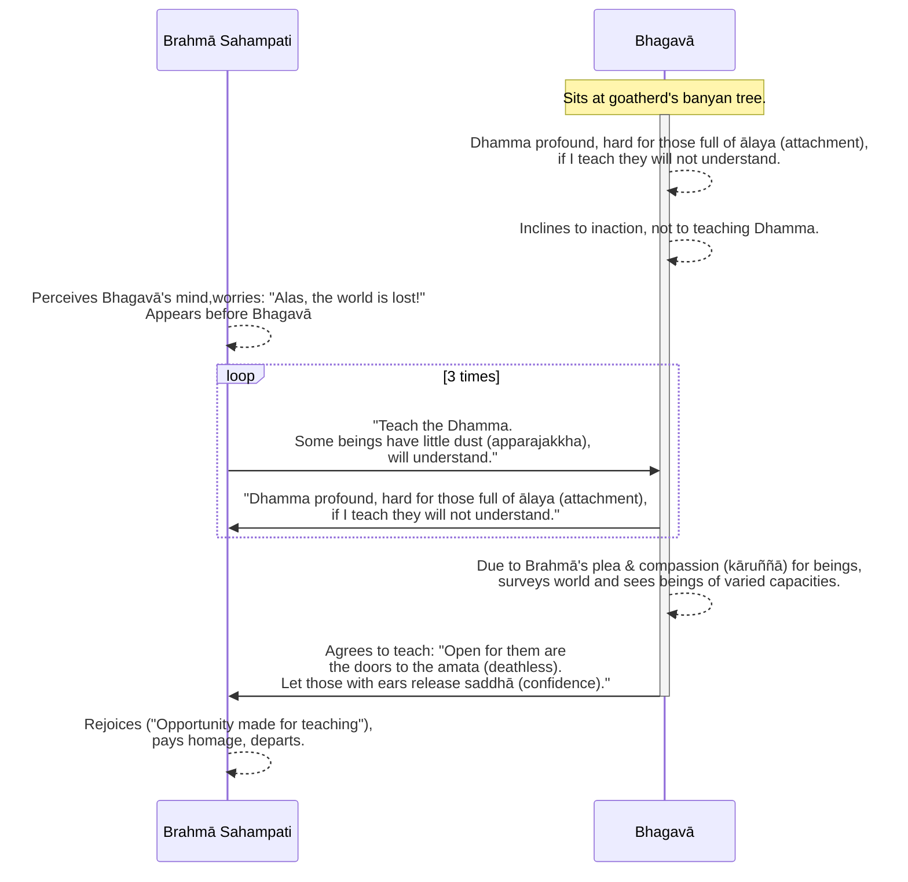

import { Tabs, TabItem } from '@astrojs/starlight/components';

Original text: [World Tipitaka Edition](https://tipitaka2500.github.io/tipitaka/3V/1/1.5.html)

## Summary

After emerging from deep focus, the Bhagavā reflected that the profound `dhamma` (phenomenal nature of experience) he had attained would be too difficult for a generation delighting in attachment to understand, and thus inclined not to teach. However, Brahmā Sahampati (the Supreme Creator of Vedic tradition), perceiving the Bhagavā's reluctance and concerned for the world, appeared and repeatedly implored him to teach, arguing that some beings with "little dust" in their eyes would indeed comprehend the doctrine. Moved by compassion and Brahmā's persistent requests, the Bhagavā surveyed the world with his `buddhacakkhu` (Buddha-eye), saw beings of varying mental capacities, much like lotuses in a pond at different stages of growth, and finally agreed to teach the `dhamma`, opening the "doors to the deathless."

## Diagram

## Text

<Tabs syncKey="paliquote">
<TabItem label="My Translation">
(7.)

25\. Then the Bhagavā, after the passing of seven days, having emerged from that `samādhi` (focus), approached the goatherd's banyan tree from the root of the Rājāyatana tree. There the Bhagavā dwelt at the root of the goatherd's banyan tree. Then, while the Bhagavā was alone in seclusion, this reflection arose in his mind: “This `dhamma` (phenomenal nature of experience) I have realised is indeed profound, hard to see, hard to comprehend, peaceful, refined, beyond the scope of reasoning, subtle, to be experienced by the wise. But this generation delights in `ālaya` (attachment), is pleased by `ālaya`, rejoices in `ālaya`. For a generation delighting in `ālaya`, pleased by `ālaya`, rejoicing in `ālaya`, this state is hard to see, namely `idappaccayatāpaṭiccasamuppāda` (specific causality, dependent origination); this state, too, is indeed extremely hard to see, namely `sabbasaṅkhārasamatha` (the calming of all mental constructions), `sabbūpadhipaṭinissagga` (the relinquishing of all acquisitions), `taṇhākkhaya` (the destruction of craving), `virāga` (dispassion), `nirodha` (cessation), `nibbāna` (extinguishment). But if I were to teach the `dhamma` (doctrine) and others did not understand me, that would be weariness for me, that would be trouble for me.” And then these natural verses, never heard before, occurred to the Bhagavā:

26\. _“With difficulty have I realised it,_ \
_Enough now with proclaiming it;_ \
_For those consumed by `rāgadosa` (lust and hatred),_ \
_This `dhamma` (phenomenal nature of experience) is not easily understood._

27\. _`Paṭisotagāmī` (Going against the stream), subtle,_ \
_Profound, hard to see, minute;_ \
_`Rāgarattā` (Those inflamed by lust) will not see it,_ \
_Shrouded by `tamokhandha` (a mass of darkness).”_

28\. Thus, as the Bhagavā reflected, his mind inclined to inaction, not to teaching the `dhamma` (doctrine).

(8.)

29\. Then Brahmā Sahampati, knowing the Bhagavā's thought process with his own mind, had this thought: “Alas, the world is perishing, alas, the world is being destroyed, inasmuch as the mind of the Tathāgata, the `arahant` (liberated one), the `sammāsambuddha` (perfectly awakened one), inclines to inaction, not to teaching the `dhamma` (doctrine)!” Then Brahmā Sahampati — just as a strong man might extend his flexed arm or flex his extended arm; even so — having vanished from the Brahmā world, appeared before the Bhagavā. Then Brahmā Sahampati, arranging his upper robe over one shoulder, lowering his right knee to the ground and extending his clasped hands towards the Bhagavā, said this to the Bhagavā: “Bhante, may the Bhagavā teach the `dhamma` (doctrine), may the `sugata` (Fortunate One) teach the `dhamma`. There are beings `apparajakkhajātikā` (with little dust in their eyes by nature) who are wasting away through not hearing the `dhamma`, and there will be those who understand the `dhamma`.” Brahmā Sahampati said this, and having said this, he then said further:

30\. _“In Magadha there arose before_ \
_An impure `dhamma` (doctrine), conceived by those stained;_ \
_Open this door to the `amata` (deathless),_ \
_Let them hear the `dhamma` (phenomenal nature of experience) realised by the `vimala` (Stainless One)._

31\. _As one standing on a rock on a mountain top_ \
_Might see the people all around;_ \
_Similarly, Sumedha (The Sage), Samantacakkhu (The All-Seeing One),_ \
_Having ascended the palace made of `dhamma` (truth),_ \
_Yourself free from sorrow, behold the people sunk in sorrow,_ \
_Overcome by birth and ageing._

32\. _Arise, Vīra (The Brave), Vijitasaṅgāma (Victorious in War),_ \
_Satthavāha (Caravan Leader), Aṇaṇa (Free of Obligation), wander in the world;_ \
_Teach the `dhamma` (truth), Bhagavā,_ \
_There will be those who understand.”_

33\. When this was said, the Bhagavā said this to Brahmā Sahampati: “To me too, Brahme, this thought occurred: ‘This `dhamma` (phenomenal nature of experience) I have realised is indeed profound, hard to see, hard to comprehend, peaceful, refined, beyond the scope of reasoning, subtle, to be experienced by the wise. But this generation delights in `ālaya` (attachment), is pleased by `ālaya`, rejoices in `ālaya`. For a generation delighting in `ālaya`, pleased by `ālaya`, rejoicing in `ālaya`, this state is hard to see, namely `idappaccayatāpaṭiccasamuppāda` (specific causality, dependent origination); this state, too, is indeed extremely hard to see, namely `sabbasaṅkhārasamatha` (the calming of all mental constructions), `sabbūpadhipaṭinissagga` (the relinquishing of all acquisitions), `taṇhākkhaya` (the destruction of craving), `virāga` (dispassion), `nirodha` (cessation), `nibbāna` (extinguishment). But if I were to teach the `dhamma` (doctrine) and others did not understand me, that would be weariness for me, that would be trouble for me.’ And then, Brahme, these natural verses, never heard before, occurred to me:

34\. _‘With difficulty have I realised it,_ \
_Enough now with proclaiming it;_ \
_For those consumed by `rāgadosa` (lust and hatred),_ \
_This `dhamma` (phenomenal nature of experience) is not easily understood._

35\. _`Paṭisotagāmī` (Going against the stream), subtle,_ \
_Profound, hard to see, minute;_ \
_`Rāgarattā` (Those inflamed by lust) will not see it,_ \
_Shrouded by `tamokhandha` (a mass of darkness).’_

36\. Thus, Brahme, as I reflected, my mind inclined to inaction, not to teaching the `dhamma` (doctrine).”

37\. For a second time Brahmā Sahampati said this to the Bhagavā: “Bhante, may the Bhagavā teach the `dhamma` (doctrine), may the `sugata` (Fortunate One) teach the `dhamma`; there are beings `apparajakkhajātikā` (with little dust in their eyes by nature) who are wasting away through not hearing the `dhamma`, and there will be those who understand the `dhamma`.” Brahmā Sahampati said this, and having said this, he then said further:

38\. _“In Magadha there arose before_ \
_An impure `dhamma` (doctrine), conceived by those stained;_ \
_Open this door to the `amata` (deathless),_ \
_Let them hear the `dhamma` (phenomenal nature of experience) realised by the `vimala` (Stainless One)._

39\. _As one standing on a rock on a mountain top_ \
_Might see the people all around;_ \
_Similarly, Sumedha (The Sage), Samantacakkhu (The All-Seeing One),_ \
_Having ascended the palace made of `dhamma` (truth),_ \
_Yourself free from sorrow, behold the people sunk in sorrow,_ \
_Overcome by birth and ageing._

40\. _Arise, Vīra (The Brave), Vijitasaṅgāma (Victorious in War),_ \
_Satthavāha (Caravan Leader), Aṇaṇa (Free of Obligation), wander in the world;_ \
_Teach the `dhamma` (truth), Bhagavā,_ \
_There will be those who understand.”_

41\. For a second time the Bhagavā said this to Brahmā Sahampati: “To me too, Brahme, this thought occurred: ‘This `dhamma` (phenomenal nature of experience) I have realised is indeed profound, hard to see, hard to comprehend, peaceful, refined, beyond the scope of reasoning, subtle, to be experienced by the wise. But this generation delights in `ālaya` (attachment), is pleased by `ālaya`, rejoices in `ālaya`. For a generation delighting in `ālaya`, pleased by `ālaya`, rejoicing in `ālaya`, this state is hard to see, namely `idappaccayatāpaṭiccasamuppāda` (specific causality, dependent origination); this state, too, is indeed extremely hard to see, namely `sabbasaṅkhārasamatha` (the calming of all mental constructions), `sabbūpadhipaṭinissagga` (the relinquishing of all acquisitions), `taṇhākkhaya` (the destruction of craving), `virāga` (dispassion), `nirodha` (cessation), `nibbāna` (extinguishment). But if I were to teach the `dhamma` (doctrine) and others did not understand me, that would be weariness for me, that would be trouble for me.’ And then, Brahme, these natural verses, never heard before, occurred to me:

42\. _‘With difficulty have I realised it,_ \
_Enough now with proclaiming it;_ \
_For those consumed by `rāgadosa` (lust and hatred),_ \
_This `dhamma` (phenomenal nature of experience) is not easily understood._

43\. _`Paṭisotagāmī` (Going against the stream), subtle,_ \
_Profound, hard to see, minute;_ \
_`Rāgarattā` (Those inflamed by lust) will not see it,_ \
_Shrouded by `tamokhandha` (a mass of darkness).’_

44\. Thus, Brahme, as I reflected, my mind inclined to inaction, not to teaching the `dhamma` (doctrine).”

45\. For a third time Brahmā Sahampati said this to the Bhagavā: “Bhante, may the Bhagavā teach the `dhamma` (doctrine), may the `sugata` (Fortunate One) teach the `dhamma`. There are beings `apparajakkhajātikā` (with little dust in their eyes by nature) who are wasting away through not hearing the `dhamma`, and there will be those who understand the `dhamma`.” Brahmā Sahampati said this, and having said this, he then said further:

46\. _“In Magadha there arose before_ \
_An impure `dhamma` (doctrine), conceived by those stained;_ \
_Open this door to the `amata` (deathless),_ \
_Let them hear the `dhamma` (phenomenal nature of experience) realised by the `vimala` (Stainless One)._

47\. _As one standing on a rock on a mountain top_ \
_Might see the people all around;_ \
_Similarly, Sumedha (The Sage), Samantacakkhu (The All-Seeing One),_ \
_Having ascended the palace made of `dhamma` (truth),_ \
_Yourself free from sorrow, behold the people sunk in sorrow,_ \
_Overcome by birth and ageing._

48\. _Arise, Vīra (The Brave), Vijitasaṅgāma (Victorious in War),_ \
_Satthavāha (Caravan Leader), Aṇaṇa (Free of Obligation), wander in the world;_ \
_Teach the `dhamma` (truth), Bhagavā,_ \
_There will be those who understand.”_

(9.)

49\. Then the Bhagavā, knowing Brahmā's request and out of `kāruññatā` (compassion) for beings, surveyed the world with the `buddhacakkhu` (Buddha-eye). Surveying the world with the `buddhacakkhu` (Buddha-eye), the Bhagavā saw beings `apparajakkha` (with little dust in their eyes) and `mahārajakkha` (with much dust in their eyes), `tikkhindriya` (with keen faculties) and `mudindriya` (with dull faculties), `svākāra` (with good dispositions) and `dvākāra` (with bad dispositions), `suviññāpaya` (easy to teach) and `duviññāpaya` (hard to teach), some who dwelt seeing fear in wrongdoing and the next world, and some who did not dwell seeing fear in wrongdoing and the next world. Just as in a pond of blue lotuses, or red lotuses, or white lotuses, some blue lotuses, red lotuses or white lotuses, born in the water, grown in the water, not risen above the water, are nourished submerged within it; some blue lotuses, red lotuses or white lotuses, born in the water, grown in the water, stand level with the water; some blue lotuses, red lotuses or white lotuses, born in the water, grown in the water, stand having risen above the water, unsullied by the water; even so, surveying the world with the `buddhacakkhu` (Buddha-eye), the Bhagavā saw beings `apparajakkha` (with little dust in their eyes) and `mahārajakkha` (with much dust in their eyes), `tikkhindriya` (with keen faculties) and `mudindriya` (with dull faculties), `svākāra` (with good dispositions) and `dvākāra` (with bad dispositions), `suviññāpaya` (easy to teach) and `duviññāpaya` (hard to teach), some who dwelt seeing fear in wrongdoing and the next world, and some who did not dwell seeing fear in wrongdoing and the next world; having seen this, he replied to Brahmā Sahampati with a verse:

50\. _“Open for them are the doors to the `amata` (deathless),_ \
_Let those with ears release their `saddhā` (confidence);_ \
_Perceiving it as troublesome, Brahme, I did not speak_ \
_The excellent, sublime `dhamma` (phenomenal nature of experience) among humans.”_

51\. Then Brahmā Sahampati, thinking, “Opportunity for the teaching of the `dhamma` (truth) has indeed been made by the Bhagavā,” having paid homage to the Bhagavā and circumambulated him keeping his right side towards him, vanished right there.

---

52\. The Account of Brahmā's Request is finished.
</TabItem>

<TabItem label="Pāḷi (Roman IAST)">
(7.)

25\. Atha kho bhagavā sattāhassa accayena tamhā samādhimhā vuṭṭhahitvā rājāyatanamūlā yena ajapālanigrodho tenupasaṅkami. Tatra sudaṃ bhagavā ajapālanigrodhamūle viharati. Atha kho bhagavato rahogatassa paṭisallīnassa evaṃ cetaso parivitakko udapādi—  “adhigato kho myāyaṃ dhammo gambhīro duddaso duranubodho santo paṇīto atakkāvacaro nipuṇo paṇḍitavedanīyo. Ālayarāmā kho panāyaṃ pajā ālayaratā ālayasammuditā. Ālayarāmāya kho pana pajāya ālayaratāya ālayasammuditāya duddasaṃ idaṃ ṭhānaṃ yadidaṃ idappaccayatāpaṭiccasamuppādo; idampi kho ṭhānaṃ sududdasaṃ yadidaṃ sabbasaṅkhārasamatho sabbūpadhipaṭinissaggo taṇhākkhayo virāgo nirodho nibbānaṃ. Ahañceva kho pana dhammaṃ deseyyaṃ, pare ca me na ājāneyyuṃ, so mamassa kilamatho, sā mamassa vihesā”ti. Apissu bhagavantaṃ imā anacchariyā gāthāyo paṭibhaṃsu pubbe assutapubbā—

26\. _“Kicchena me adhigataṃ,_  \
_halaṃ dāni pakāsituṃ;_  \
_Rāgadosaparetehi,_  \
_nāyaṃ dhammo susambudho._

27\. _Paṭisotagāmiṃ nipuṇaṃ,_  \
_gambhīraṃ duddasaṃ aṇuṃ;_  \
_Rāgarattā na dakkhanti,_  \
_tamokhandhena āvuṭā”ti._

28\. Itiha bhagavato paṭisañcikkhato appossukkatāya cittaṃ namati, no dhammadesanāya.

(8.)

29\. Atha kho brahmuno sahampatissa bhagavato cetasā cetoparivitakkamaññāya etadahosi—  “nassati vata bho loko, vinassati vata bho loko, yatra hi nāma tathāgatassa arahato sammāsambuddhassa appossukkatāya cittaṃ namati, no dhammadesanāyā”ti. Atha kho brahmā sahampati—  seyyathāpi nāma balavā puriso samiñjitaṃ vā bāhaṃ pasāreyya, pasāritaṃ vā bāhaṃ samiñjeyya; evameva—  brahmaloke antarahito bhagavato purato pāturahosi. Atha kho brahmā sahampati ekaṃsaṃ uttarāsaṅgaṃ karitvā dakkhiṇajāṇumaṇḍalaṃ pathaviyaṃ nihantvā yena bhagavā tenañjaliṃ paṇāmetvā bhagavantaṃ etadavoca—  “desetu, bhante, bhagavā dhammaṃ, desetu sugato dhammaṃ. Santi sattā apparajakkhajātikā, assavanatā dhammassa parihāyanti, bhavissanti dhammassa aññātāro”ti. Idamavoca brahmā sahampati, idaṃ vatvāna athāparaṃ etadavoca—

30\. _“Pāturahosi magadhesu pubbe,_  \
_Dhammo asuddho samalehi cintito;_  \
_Apāpuretaṃ amatassa dvāraṃ,_  \
_Suṇantu dhammaṃ vimalenānubuddhaṃ._

31\. _Sele yathā pabbatamuddhaniṭṭhito,_  \
_Yathāpi passe janataṃ samantato;_  \
_Tathūpamaṃ dhammamayaṃ sumedha,_  \
_Pāsādamāruyha samantacakkhu;_  \
_Sokāvatiṇṇaṃ janatamapetasoko,_  \
_Avekkhassu jātijarābhibhūtaṃ._

32\. _Uṭṭhehi vīra vijitasaṅgāma,_  \
_Satthavāha aṇaṇa vicara loke;_  \
_Desassu bhagavā dhammaṃ,_  \
_Aññātāro bhavissantī”ti._

33\. Evaṃ vutte, bhagavā brahmānaṃ sahampatiṃ etadavoca—  “mayhampi kho, brahme, etadahosi—  ‘adhigato kho myāyaṃ dhammo gambhīro duddaso duranubodho santo paṇīto atakkāvacaro nipuṇo paṇḍitavedanīyo. Ālayarāmā kho panāyaṃ pajā ālayaratā ālayasammuditā. Ālayarāmāya kho pana pajāya ālayaratāya ālayasammuditāya duddasaṃ idaṃ ṭhānaṃ yadidaṃ idappaccayatāpaṭiccasamuppādo; idampi kho ṭhānaṃ sududdasaṃ yadidaṃ sabbasaṅkhārasamatho sabbūpadhipaṭinissaggo taṇhākkhayo virāgo nirodho nibbānaṃ. Ahañceva kho pana dhammaṃ deseyyaṃ, pare ca me na ājāneyyuṃ, so mamassa kilamatho, sā mamassa vihesā’ti. Apissu maṃ, brahme, imā anacchariyā gāthāyo paṭibhaṃsu pubbe assutapubbā—

34\. _‘Kicchena me adhigataṃ,_  \
_halaṃ dāni pakāsituṃ;_  \
_Rāgadosaparetehi,_  \
_nāyaṃ dhammo susambudho._

35\. _Paṭisotagāmiṃ nipuṇaṃ,_  \
_gambhīraṃ duddasaṃ aṇuṃ;_  \
_Rāgarattā na dakkhanti,_  \
_tamokhandhena āvuṭā’ti._

36\. Itiha me, brahme, paṭisañcikkhato appossukkatāya cittaṃ namati no dhammadesanāyā”ti.

37\. Dutiyampi kho brahmā sahampati bhagavantaṃ etadavoca—  “desetu, bhante, bhagavā dhammaṃ, desetu sugato dhammaṃ; santi sattā apparajakkhajātikā, assavanatā dhammassa parihāyanti, bhavissanti dhammassa aññātāro”ti. Idamavoca brahmā sahampati, idaṃ vatvāna athāparaṃ etadavoca—

38\. _“Pāturahosi magadhesu pubbe,_  \
_Dhammo asuddho samalehi cintito;_  \
_Apāpuretaṃ amatassa dvāraṃ,_  \
_Suṇantu dhammaṃ vimalenānubuddhaṃ._

39\. _Sele yathā pabbatamuddhaniṭṭhito,_  \
_Yathāpi passe janataṃ samantato;_  \
_Tathūpamaṃ dhammamayaṃ sumedha,_  \
_Pāsādamāruyha samantacakkhu;_  \
_Sokāvatiṇṇaṃ janatamapetasoko,_  \
_Avekkhassu jātijarābhibhūtaṃ._

40\. _Uṭṭhehi vīra vijitasaṅgāma,_  \
_Satthavāha aṇaṇa vicara loke;_  \
_Desassu bhagavā dhammaṃ,_  \
_Aññātāro bhavissantī”ti._

41\. Dutiyampi kho bhagavā brahmānaṃ sahampatiṃ etadavoca—  “mayhampi kho, brahme, etadahosi—  ‘adhigato kho myāyaṃ dhammo gambhīro duddaso duranubodho santo paṇīto atakkāvacaro nipuṇo paṇḍitavedanīyo. Ālayarāmā kho panāyaṃ pajā ālayaratā ālayasammuditā. Ālayarāmāya kho pana pajāya ālayaratāya ālayasammuditāya duddasaṃ idaṃ ṭhānaṃ yadidaṃ idappaccayatāpaṭiccasamuppādo; idampi kho ṭhānaṃ sududdasaṃ yadidaṃ sabbasaṅkhārasamatho sabbūpadhipaṭinissaggo taṇhākkhayo virāgo nirodho nibbānaṃ. Ahañceva kho pana dhammaṃ deseyyaṃ, pare ca me na ājāneyyuṃ, so mamassa kilamatho, sā mamassa vihesā’ti. Apissu maṃ, brahme, imā anacchariyā gāthāyo paṭibhaṃsu pubbe assutapubbā—

42\. _‘Kicchena me adhigataṃ,_  \
_halaṃ dāni pakāsituṃ;_  \
_Rāgadosaparetehi,_  \
_nāyaṃ dhammo susambudho._

43\. _Paṭisotagāmiṃ nipuṇaṃ,_  \
_gambhīraṃ duddasaṃ aṇuṃ;_  \
_Rāgarattā na dakkhanti,_  \
_tamokhandhena āvuṭā’ti._

44\. Itiha me, brahme, paṭisañcikkhato appossukkatāya cittaṃ namati, no dhammadesanāyā”ti.

45\. Tatiyampi kho brahmā sahampati bhagavantaṃ etadavoca—  “desetu, bhante, bhagavā dhammaṃ, desetu sugato dhammaṃ. Santi sattā apparajakkhajātikā, assavanatā dhammassa parihāyanti, bhavissanti dhammassa aññātāro”ti. Idamavoca brahmā sahampati, idaṃ vatvāna athāparaṃ etadavoca—

46\. _“Pāturahosi magadhesu pubbe,_  \
_Dhammo asuddho samalehi cintito;_  \
_Apāpuretaṃ amatassa dvāraṃ,_  \
_Suṇantu dhammaṃ vimalenānubuddhaṃ._

47\. _Sele yathā pabbatamuddhaniṭṭhito,_  \
_Yathāpi passe janataṃ samantato;_  \
_Tathūpamaṃ dhammamayaṃ sumedha,_  \
_Pāsādamāruyha samantacakkhu;_  \
_Sokāvatiṇṇaṃ janatamapetasoko,_  \
_Avekkhassu jātijarābhibhūtaṃ._

48\. _Uṭṭhehi vīra vijitasaṅgāma,_  \
_Satthavāha aṇaṇa vicara loke;_  \
_Desassu bhagavā dhammaṃ,_  \
_Aññātāro bhavissantī”ti._

(9.)

49\. Atha kho bhagavā brahmuno ca ajjhesanaṃ viditvā sattesu ca kāruññataṃ paṭicca buddhacakkhunā lokaṃ volokesi. Addasā kho bhagavā buddhacakkhunā lokaṃ volokento satte apparajakkhe mahārajakkhe tikkhindriye mudindriye svākāre dvākāre suviññāpaye duviññāpaye, appekacce paralokavajjabhayadassāvine viharante, appekacce na paralokavajjabhayadassāvine viharante. Seyyathāpi nāma uppaliniyaṃ vā paduminiyaṃ vā puṇḍarīkiniyaṃ vā appekaccāni uppalāni vā padumāni vā puṇḍarīkāni vā udake jātāni udake saṃvaḍḍhāni udakānuggatāni anto nimuggaposīni, appekaccāni uppalāni vā padumāni vā puṇḍarīkāni vā udake jātāni udake saṃvaḍḍhāni samodakaṃ ṭhitāni, appekaccāni uppalāni vā padumāni vā puṇḍarīkāni vā udake jātāni udake saṃvaḍḍhāni udakaṃ accuggamma ṭhitāni anupalittāni udakena; evamevaṃ bhagavā buddhacakkhunā lokaṃ volokento addasa satte apparajakkhe mahārajakkhe tikkhindriye mudindriye svākāre dvākāre suviññāpaye duviññāpaye, appekacce paralokavajjabhayadassāvine viharante, appekacce na paralokavajjabhayadassāvine viharante; disvāna brahmānaṃ sahampatiṃ gāthāya paccabhāsi—

50\. _“Apārutā tesaṃ amatassa dvārā,_  \
_Ye sotavanto pamuñcantu saddhaṃ;_  \
_Vihiṃsasaññī paguṇaṃ na bhāsiṃ,_  \
_Dhammaṃ paṇītaṃ manujesu brahme”ti._

51\. Atha kho brahmā sahampati—  “katāvakāso khomhi bhagavatā dhammadesanāyā”ti bhagavantaṃ abhivādetvā padakkhiṇaṃ katvā tatthevantaradhāyi.

---

52\. Brahmayācanakathā niṭṭhitā.
</TabItem>

<TabItem label="Pāḷi (Brahmi)">
(7.)

25\. 𑀅𑀣 𑀔𑁄 𑀪𑀕𑀯𑀸 𑀲𑀢𑁆𑀢𑀸𑀳𑀲𑁆𑀲 𑀅𑀘𑁆𑀘𑀬𑁂𑀦 𑀢𑀫𑁆𑀳𑀸 𑀲𑀫𑀸𑀥𑀺𑀫𑁆𑀳𑀸 𑀯𑀼𑀝𑁆𑀞𑀳𑀺𑀢𑁆𑀯𑀸 𑀭𑀸𑀚𑀸𑀬𑀢𑀦𑀫𑀽𑀮𑀸 𑀬𑁂𑀦 𑀅𑀚𑀧𑀸𑀮𑀦𑀺𑀕𑁆𑀭𑁄𑀥𑁄 𑀢𑁂𑀦𑀼𑀧𑀲𑀗𑁆𑀓𑀫𑀺. 𑀢𑀢𑁆𑀭 𑀲𑀼𑀤𑀁 𑀪𑀕𑀯𑀸 𑀅𑀚𑀧𑀸𑀮𑀦𑀺𑀕𑁆𑀭𑁄𑀥𑀫𑀽𑀮𑁂 𑀯𑀺𑀳𑀭𑀢𑀺. 𑀅𑀣 𑀔𑁄 𑀪𑀕𑀯𑀢𑁄 𑀭𑀳𑁄𑀕𑀢𑀲𑁆𑀲 𑀧𑀝𑀺𑀲𑀮𑁆𑀮𑀻𑀦𑀲𑁆𑀲 𑀏𑀯𑀁 𑀘𑁂𑀢𑀲𑁄 𑀧𑀭𑀺𑀯𑀺𑀢𑀓𑁆𑀓𑁄 𑀉𑀤𑀧𑀸𑀤𑀺—  “𑀅𑀥𑀺𑀕𑀢𑁄 𑀔𑁄 𑀫𑁆𑀬𑀸𑀬𑀁 𑀥𑀫𑁆𑀫𑁄 𑀕𑀫𑁆𑀪𑀻𑀭𑁄 𑀤𑀼𑀤𑁆𑀤𑀲𑁄 𑀤𑀼𑀭𑀦𑀼𑀩𑁄𑀥𑁄 𑀲𑀦𑁆𑀢𑁄 𑀧𑀡𑀻𑀢𑁄 𑀅𑀢𑀓𑁆𑀓𑀸𑀯𑀘𑀭𑁄 𑀦𑀺𑀧𑀼𑀡𑁄 𑀧𑀡𑁆𑀟𑀺𑀢𑀯𑁂𑀤𑀦𑀻𑀬𑁄. 𑀆𑀮𑀬𑀭𑀸𑀫𑀸 𑀔𑁄 𑀧𑀦𑀸𑀬𑀁 𑀧𑀚𑀸 𑀆𑀮𑀬𑀭𑀢𑀸 𑀆𑀮𑀬𑀲𑀫𑁆𑀫𑀼𑀤𑀺𑀢𑀸. 𑀆𑀮𑀬𑀭𑀸𑀫𑀸𑀬 𑀔𑁄 𑀧𑀦 𑀧𑀚𑀸𑀬 𑀆𑀮𑀬𑀭𑀢𑀸𑀬 𑀆𑀮𑀬𑀲𑀫𑁆𑀫𑀼𑀤𑀺𑀢𑀸𑀬 𑀤𑀼𑀤𑁆𑀤𑀲𑀁 𑀇𑀤𑀁 𑀞𑀸𑀦𑀁 𑀬𑀤𑀺𑀤𑀁 𑀇𑀤𑀧𑁆𑀧𑀘𑁆𑀘𑀬𑀢𑀸𑀧𑀝𑀺𑀘𑁆𑀘𑀲𑀫𑀼𑀧𑁆𑀧𑀸𑀤𑁄; 𑀇𑀤𑀫𑁆𑀧𑀺 𑀔𑁄 𑀞𑀸𑀦𑀁 𑀲𑀼𑀤𑀼𑀤𑁆𑀤𑀲𑀁 𑀬𑀤𑀺𑀤𑀁 𑀲𑀩𑁆𑀩𑀲𑀗𑁆𑀔𑀸𑀭𑀲𑀫𑀣𑁄 𑀲𑀩𑁆𑀩𑀽𑀧𑀥𑀺𑀧𑀝𑀺𑀦𑀺𑀲𑁆𑀲𑀕𑁆𑀕𑁄 𑀢𑀡𑁆𑀳𑀸𑀓𑁆𑀔𑀬𑁄 𑀯𑀺𑀭𑀸𑀕𑁄 𑀦𑀺𑀭𑁄𑀥𑁄 𑀦𑀺𑀩𑁆𑀩𑀸𑀦𑀁. 𑀅𑀳𑀜𑁆𑀘𑁂𑀯 𑀔𑁄 𑀧𑀦 𑀥𑀫𑁆𑀫𑀁 𑀤𑁂𑀲𑁂𑀬𑁆𑀬𑀁, 𑀧𑀭𑁂 𑀘 𑀫𑁂 𑀦 𑀆𑀚𑀸𑀦𑁂𑀬𑁆𑀬𑀼𑀁, 𑀲𑁄 𑀫𑀫𑀲𑁆𑀲 𑀓𑀺𑀮𑀫𑀣𑁄, 𑀲𑀸 𑀫𑀫𑀲𑁆𑀲 𑀯𑀺𑀳𑁂𑀲𑀸”𑀢𑀺. 𑀅𑀧𑀺𑀲𑁆𑀲𑀼 𑀪𑀕𑀯𑀦𑁆𑀢𑀁 𑀇𑀫𑀸 𑀅𑀦𑀘𑁆𑀙𑀭𑀺𑀬𑀸 𑀕𑀸𑀣𑀸𑀬𑁄 𑀧𑀝𑀺𑀪𑀁𑀲𑀼 𑀧𑀼𑀩𑁆𑀩𑁂 𑀅𑀲𑁆𑀲𑀼𑀢𑀧𑀼𑀩𑁆𑀩𑀸—

26\. _“𑀓𑀺𑀘𑁆𑀙𑁂𑀦 𑀫𑁂 𑀅𑀥𑀺𑀕𑀢𑀁,_  \
_𑀳𑀮𑀁 𑀤𑀸𑀦𑀺 𑀧𑀓𑀸𑀲𑀺𑀢𑀼𑀁;_  \
_𑀭𑀸𑀕𑀤𑁄𑀲𑀧𑀭𑁂𑀢𑁂𑀳𑀺,_  \
_𑀦𑀸𑀬𑀁 𑀥𑀫𑁆𑀫𑁄 𑀲𑀼𑀲𑀫𑁆𑀩𑀼𑀥𑁄._

27\. _𑀧𑀝𑀺𑀲𑁄𑀢𑀕𑀸𑀫𑀺𑀁 𑀦𑀺𑀧𑀼𑀡𑀁,_  \
_𑀕𑀫𑁆𑀪𑀻𑀭𑀁 𑀤𑀼𑀤𑁆𑀤𑀲𑀁 𑀅𑀡𑀼𑀁;_  \
_𑀭𑀸𑀕𑀭𑀢𑁆𑀢𑀸 𑀦 𑀤𑀓𑁆𑀔𑀦𑁆𑀢𑀺,_  \
_𑀢𑀫𑁄𑀔𑀦𑁆𑀥𑁂𑀦 𑀆𑀯𑀼𑀝𑀸”𑀢𑀺._

28\. 𑀇𑀢𑀺𑀳 𑀪𑀕𑀯𑀢𑁄 𑀧𑀝𑀺𑀲𑀜𑁆𑀘𑀺𑀓𑁆𑀔𑀢𑁄 𑀅𑀧𑁆𑀧𑁄𑀲𑁆𑀲𑀼𑀓𑁆𑀓𑀢𑀸𑀬 𑀘𑀺𑀢𑁆𑀢𑀁 𑀦𑀫𑀢𑀺, 𑀦𑁄 𑀥𑀫𑁆𑀫𑀤𑁂𑀲𑀦𑀸𑀬.

(8.)

29\. 𑀅𑀣 𑀔𑁄 𑀩𑁆𑀭𑀳𑁆𑀫𑀼𑀦𑁄 𑀲𑀳𑀫𑁆𑀧𑀢𑀺𑀲𑁆𑀲 𑀪𑀕𑀯𑀢𑁄 𑀘𑁂𑀢𑀲𑀸 𑀘𑁂𑀢𑁄𑀧𑀭𑀺𑀯𑀺𑀢𑀓𑁆𑀓𑀫𑀜𑁆𑀜𑀸𑀬 𑀏𑀢𑀤𑀳𑁄𑀲𑀺—  “𑀦𑀲𑁆𑀲𑀢𑀺 𑀯𑀢 𑀪𑁄 𑀮𑁄𑀓𑁄, 𑀯𑀺𑀦𑀲𑁆𑀲𑀢𑀺 𑀯𑀢 𑀪𑁄 𑀮𑁄𑀓𑁄, 𑀬𑀢𑁆𑀭 𑀳𑀺 𑀦𑀸𑀫 𑀢𑀣𑀸𑀕𑀢𑀲𑁆𑀲 𑀅𑀭𑀳𑀢𑁄 𑀲𑀫𑁆𑀫𑀸𑀲𑀫𑁆𑀩𑀼𑀤𑁆𑀥𑀲𑁆𑀲 𑀅𑀧𑁆𑀧𑁄𑀲𑁆𑀲𑀼𑀓𑁆𑀓𑀢𑀸𑀬 𑀘𑀺𑀢𑁆𑀢𑀁 𑀦𑀫𑀢𑀺, 𑀦𑁄 𑀥𑀫𑁆𑀫𑀤𑁂𑀲𑀦𑀸𑀬𑀸”𑀢𑀺. 𑀅𑀣 𑀔𑁄 𑀩𑁆𑀭𑀳𑁆𑀫𑀸 𑀲𑀳𑀫𑁆𑀧𑀢𑀺—  𑀲𑁂𑀬𑁆𑀬𑀣𑀸𑀧𑀺 𑀦𑀸𑀫 𑀩𑀮𑀯𑀸 𑀧𑀼𑀭𑀺𑀲𑁄 𑀲𑀫𑀺𑀜𑁆𑀚𑀺𑀢𑀁 𑀯𑀸 𑀩𑀸𑀳𑀁 𑀧𑀲𑀸𑀭𑁂𑀬𑁆𑀬, 𑀧𑀲𑀸𑀭𑀺𑀢𑀁 𑀯𑀸 𑀩𑀸𑀳𑀁 𑀲𑀫𑀺𑀜𑁆𑀚𑁂𑀬𑁆𑀬; 𑀏𑀯𑀫𑁂𑀯—  𑀩𑁆𑀭𑀳𑁆𑀫𑀮𑁄𑀓𑁂 𑀅𑀦𑁆𑀢𑀭𑀳𑀺𑀢𑁄 𑀪𑀕𑀯𑀢𑁄 𑀧𑀼𑀭𑀢𑁄 𑀧𑀸𑀢𑀼𑀭𑀳𑁄𑀲𑀺. 𑀅𑀣 𑀔𑁄 𑀩𑁆𑀭𑀳𑁆𑀫𑀸 𑀲𑀳𑀫𑁆𑀧𑀢𑀺 𑀏𑀓𑀁𑀲𑀁 𑀉𑀢𑁆𑀢𑀭𑀸𑀲𑀗𑁆𑀕𑀁 𑀓𑀭𑀺𑀢𑁆𑀯𑀸 𑀤𑀓𑁆𑀔𑀺𑀡𑀚𑀸𑀡𑀼𑀫𑀡𑁆𑀟𑀮𑀁 𑀧𑀣𑀯𑀺𑀬𑀁 𑀦𑀺𑀳𑀦𑁆𑀢𑁆𑀯𑀸 𑀬𑁂𑀦 𑀪𑀕𑀯𑀸 𑀢𑁂𑀦𑀜𑁆𑀚𑀮𑀺𑀁 𑀧𑀡𑀸𑀫𑁂𑀢𑁆𑀯𑀸 𑀪𑀕𑀯𑀦𑁆𑀢𑀁 𑀏𑀢𑀤𑀯𑁄𑀘—  “𑀤𑁂𑀲𑁂𑀢𑀼, 𑀪𑀦𑁆𑀢𑁂, 𑀪𑀕𑀯𑀸 𑀥𑀫𑁆𑀫𑀁, 𑀤𑁂𑀲𑁂𑀢𑀼 𑀲𑀼𑀕𑀢𑁄 𑀥𑀫𑁆𑀫𑀁. 𑀲𑀦𑁆𑀢𑀺 𑀲𑀢𑁆𑀢𑀸 𑀅𑀧𑁆𑀧𑀭𑀚𑀓𑁆𑀔𑀚𑀸𑀢𑀺𑀓𑀸, 𑀅𑀲𑁆𑀲𑀯𑀦𑀢𑀸 𑀥𑀫𑁆𑀫𑀲𑁆𑀲 𑀧𑀭𑀺𑀳𑀸𑀬𑀦𑁆𑀢𑀺, 𑀪𑀯𑀺𑀲𑁆𑀲𑀦𑁆𑀢𑀺 𑀥𑀫𑁆𑀫𑀲𑁆𑀲 𑀅𑀜𑁆𑀜𑀸𑀢𑀸𑀭𑁄”𑀢𑀺. 𑀇𑀤𑀫𑀯𑁄𑀘 𑀩𑁆𑀭𑀳𑁆𑀫𑀸 𑀲𑀳𑀫𑁆𑀧𑀢𑀺, 𑀇𑀤𑀁 𑀯𑀢𑁆𑀯𑀸𑀦 𑀅𑀣𑀸𑀧𑀭𑀁 𑀏𑀢𑀤𑀯𑁄𑀘—

30\. _“𑀧𑀸𑀢𑀼𑀭𑀳𑁄𑀲𑀺 𑀫𑀕𑀥𑁂𑀲𑀼 𑀧𑀼𑀩𑁆𑀩𑁂,_  \
_𑀥𑀫𑁆𑀫𑁄 𑀅𑀲𑀼𑀤𑁆𑀥𑁄 𑀲𑀫𑀮𑁂𑀳𑀺 𑀘𑀺𑀦𑁆𑀢𑀺𑀢𑁄;_  \
_𑀅𑀧𑀸𑀧𑀼𑀭𑁂𑀢𑀁 𑀅𑀫𑀢𑀲𑁆𑀲 𑀤𑁆𑀯𑀸𑀭𑀁,_  \
_𑀲𑀼𑀡𑀦𑁆𑀢𑀼 𑀥𑀫𑁆𑀫𑀁 𑀯𑀺𑀫𑀮𑁂𑀦𑀸𑀦𑀼𑀩𑀼𑀤𑁆𑀥𑀁._

31\. _𑀲𑁂𑀮𑁂 𑀬𑀣𑀸 𑀧𑀩𑁆𑀩𑀢𑀫𑀼𑀤𑁆𑀥𑀦𑀺𑀝𑁆𑀞𑀺𑀢𑁄,_  \
_𑀬𑀣𑀸𑀧𑀺 𑀧𑀲𑁆𑀲𑁂 𑀚𑀦𑀢𑀁 𑀲𑀫𑀦𑁆𑀢𑀢𑁄;_  \
_𑀢𑀣𑀽𑀧𑀫𑀁 𑀥𑀫𑁆𑀫𑀫𑀬𑀁 𑀲𑀼𑀫𑁂𑀥,_  \
_𑀧𑀸𑀲𑀸𑀤𑀫𑀸𑀭𑀼𑀬𑁆𑀳 𑀲𑀫𑀦𑁆𑀢𑀘𑀓𑁆𑀔𑀼;_  \
_𑀲𑁄𑀓𑀸𑀯𑀢𑀺𑀡𑁆𑀡𑀁 𑀚𑀦𑀢𑀫𑀧𑁂𑀢𑀲𑁄𑀓𑁄,_  \
_𑀅𑀯𑁂𑀓𑁆𑀔𑀲𑁆𑀲𑀼 𑀚𑀸𑀢𑀺𑀚𑀭𑀸𑀪𑀺𑀪𑀽𑀢𑀁._

32\. _𑀉𑀝𑁆𑀞𑁂𑀳𑀺 𑀯𑀻𑀭 𑀯𑀺𑀚𑀺𑀢𑀲𑀗𑁆𑀕𑀸𑀫,_  \
_𑀲𑀢𑁆𑀣𑀯𑀸𑀳 𑀅𑀡𑀡 𑀯𑀺𑀘𑀭 𑀮𑁄𑀓𑁂;_  \
_𑀤𑁂𑀲𑀲𑁆𑀲𑀼 𑀪𑀕𑀯𑀸 𑀥𑀫𑁆𑀫𑀁,_  \
_𑀅𑀜𑁆𑀜𑀸𑀢𑀸𑀭𑁄 𑀪𑀯𑀺𑀲𑁆𑀲𑀦𑁆𑀢𑀻”𑀢𑀺._

33\. 𑀏𑀯𑀁 𑀯𑀼𑀢𑁆𑀢𑁂, 𑀪𑀕𑀯𑀸 𑀩𑁆𑀭𑀳𑁆𑀫𑀸𑀦𑀁 𑀲𑀳𑀫𑁆𑀧𑀢𑀺𑀁 𑀏𑀢𑀤𑀯𑁄𑀘—  “𑀫𑀬𑁆𑀳𑀫𑁆𑀧𑀺 𑀔𑁄, 𑀩𑁆𑀭𑀳𑁆𑀫𑁂, 𑀏𑀢𑀤𑀳𑁄𑀲𑀺—  ‘𑀅𑀥𑀺𑀕𑀢𑁄 𑀔𑁄 𑀫𑁆𑀬𑀸𑀬𑀁 𑀥𑀫𑁆𑀫𑁄 𑀕𑀫𑁆𑀪𑀻𑀭𑁄 𑀤𑀼𑀤𑁆𑀤𑀲𑁄 𑀤𑀼𑀭𑀦𑀼𑀩𑁄𑀥𑁄 𑀲𑀦𑁆𑀢𑁄 𑀧𑀡𑀻𑀢𑁄 𑀅𑀢𑀓𑁆𑀓𑀸𑀯𑀘𑀭𑁄 𑀦𑀺𑀧𑀼𑀡𑁄 𑀧𑀡𑁆𑀟𑀺𑀢𑀯𑁂𑀤𑀦𑀻𑀬𑁄. 𑀆𑀮𑀬𑀭𑀸𑀫𑀸 𑀔𑁄 𑀧𑀦𑀸𑀬𑀁 𑀧𑀚𑀸 𑀆𑀮𑀬𑀭𑀢𑀸 𑀆𑀮𑀬𑀲𑀫𑁆𑀫𑀼𑀤𑀺𑀢𑀸. 𑀆𑀮𑀬𑀭𑀸𑀫𑀸𑀬 𑀔𑁄 𑀧𑀦 𑀧𑀚𑀸𑀬 𑀆𑀮𑀬𑀭𑀢𑀸𑀬 𑀆𑀮𑀬𑀲𑀫𑁆𑀫𑀼𑀤𑀺𑀢𑀸𑀬 𑀤𑀼𑀤𑁆𑀤𑀲𑀁 𑀇𑀤𑀁 𑀞𑀸𑀦𑀁 𑀬𑀤𑀺𑀤𑀁 𑀇𑀤𑀧𑁆𑀧𑀘𑁆𑀘𑀬𑀢𑀸𑀧𑀝𑀺𑀘𑁆𑀘𑀲𑀫𑀼𑀧𑁆𑀧𑀸𑀤𑁄; 𑀇𑀤𑀫𑁆𑀧𑀺 𑀔𑁄 𑀞𑀸𑀦𑀁 𑀲𑀼𑀤𑀼𑀤𑁆𑀤𑀲𑀁 𑀬𑀤𑀺𑀤𑀁 𑀲𑀩𑁆𑀩𑀲𑀗𑁆𑀔𑀸𑀭𑀲𑀫𑀣𑁄 𑀲𑀩𑁆𑀩𑀽𑀧𑀥𑀺𑀧𑀝𑀺𑀦𑀺𑀲𑁆𑀲𑀕𑁆𑀕𑁄 𑀢𑀡𑁆𑀳𑀸𑀓𑁆𑀔𑀬𑁄 𑀯𑀺𑀭𑀸𑀕𑁄 𑀦𑀺𑀭𑁄𑀥𑁄 𑀦𑀺𑀩𑁆𑀩𑀸𑀦𑀁. 𑀅𑀳𑀜𑁆𑀘𑁂𑀯 𑀔𑁄 𑀧𑀦 𑀥𑀫𑁆𑀫𑀁 𑀤𑁂𑀲𑁂𑀬𑁆𑀬𑀁, 𑀧𑀭𑁂 𑀘 𑀫𑁂 𑀦 𑀆𑀚𑀸𑀦𑁂𑀬𑁆𑀬𑀼𑀁, 𑀲𑁄 𑀫𑀫𑀲𑁆𑀲 𑀓𑀺𑀮𑀫𑀣𑁄, 𑀲𑀸 𑀫𑀫𑀲𑁆𑀲 𑀯𑀺𑀳𑁂𑀲𑀸’𑀢𑀺. 𑀅𑀧𑀺𑀲𑁆𑀲𑀼 𑀫𑀁, 𑀩𑁆𑀭𑀳𑁆𑀫𑁂, 𑀇𑀫𑀸 𑀅𑀦𑀘𑁆𑀙𑀭𑀺𑀬𑀸 𑀕𑀸𑀣𑀸𑀬𑁄 𑀧𑀝𑀺𑀪𑀁𑀲𑀼 𑀧𑀼𑀩𑁆𑀩𑁂 𑀅𑀲𑁆𑀲𑀼𑀢𑀧𑀼𑀩𑁆𑀩𑀸—

34\. _‘𑀓𑀺𑀘𑁆𑀙𑁂𑀦 𑀫𑁂 𑀅𑀥𑀺𑀕𑀢𑀁,_  \
_𑀳𑀮𑀁 𑀤𑀸𑀦𑀺 𑀧𑀓𑀸𑀲𑀺𑀢𑀼𑀁;_  \
_𑀭𑀸𑀕𑀤𑁄𑀲𑀧𑀭𑁂𑀢𑁂𑀳𑀺,_  \
_𑀦𑀸𑀬𑀁 𑀥𑀫𑁆𑀫𑁄 𑀲𑀼𑀲𑀫𑁆𑀩𑀼𑀥𑁄._

35\. _𑀧𑀝𑀺𑀲𑁄𑀢𑀕𑀸𑀫𑀺𑀁 𑀦𑀺𑀧𑀼𑀡𑀁,_  \
_𑀕𑀫𑁆𑀪𑀻𑀭𑀁 𑀤𑀼𑀤𑁆𑀤𑀲𑀁 𑀅𑀡𑀼𑀁;_  \
_𑀭𑀸𑀕𑀭𑀢𑁆𑀢𑀸 𑀦 𑀤𑀓𑁆𑀔𑀦𑁆𑀢𑀺,_  \
_𑀢𑀫𑁄𑀔𑀦𑁆𑀥𑁂𑀦 𑀆𑀯𑀼𑀝𑀸’𑀢𑀺._

36\. 𑀇𑀢𑀺𑀳 𑀫𑁂, 𑀩𑁆𑀭𑀳𑁆𑀫𑁂, 𑀧𑀝𑀺𑀲𑀜𑁆𑀘𑀺𑀓𑁆𑀔𑀢𑁄 𑀅𑀧𑁆𑀧𑁄𑀲𑁆𑀲𑀼𑀓𑁆𑀓𑀢𑀸𑀬 𑀘𑀺𑀢𑁆𑀢𑀁 𑀦𑀫𑀢𑀺 𑀦𑁄 𑀥𑀫𑁆𑀫𑀤𑁂𑀲𑀦𑀸𑀬𑀸”𑀢𑀺.

37\. 𑀤𑀼𑀢𑀺𑀬𑀫𑁆𑀧𑀺 𑀔𑁄 𑀩𑁆𑀭𑀳𑁆𑀫𑀸 𑀲𑀳𑀫𑁆𑀧𑀢𑀺 𑀪𑀕𑀯𑀦𑁆𑀢𑀁 𑀏𑀢𑀤𑀯𑁄𑀘—  “𑀤𑁂𑀲𑁂𑀢𑀼, 𑀪𑀦𑁆𑀢𑁂, 𑀪𑀕𑀯𑀸 𑀥𑀫𑁆𑀫𑀁, 𑀤𑁂𑀲𑁂𑀢𑀼 𑀲𑀼𑀕𑀢𑁄 𑀥𑀫𑁆𑀫𑀁; 𑀲𑀦𑁆𑀢𑀺 𑀲𑀢𑁆𑀢𑀸 𑀅𑀧𑁆𑀧𑀭𑀚𑀓𑁆𑀔𑀚𑀸𑀢𑀺𑀓𑀸, 𑀅𑀲𑁆𑀲𑀯𑀦𑀢𑀸 𑀥𑀫𑁆𑀫𑀲𑁆𑀲 𑀧𑀭𑀺𑀳𑀸𑀬𑀦𑁆𑀢𑀺, 𑀪𑀯𑀺𑀲𑁆𑀲𑀦𑁆𑀢𑀺 𑀥𑀫𑁆𑀫𑀲𑁆𑀲 𑀅𑀜𑁆𑀜𑀸𑀢𑀸𑀭𑁄”𑀢𑀺. 𑀇𑀤𑀫𑀯𑁄𑀘 𑀩𑁆𑀭𑀳𑁆𑀫𑀸 𑀲𑀳𑀫𑁆𑀧𑀢𑀺, 𑀇𑀤𑀁 𑀯𑀢𑁆𑀯𑀸𑀦 𑀅𑀣𑀸𑀧𑀭𑀁 𑀏𑀢𑀤𑀯𑁄𑀘—

38\. _“𑀧𑀸𑀢𑀼𑀭𑀳𑁄𑀲𑀺 𑀫𑀕𑀥𑁂𑀲𑀼 𑀧𑀼𑀩𑁆𑀩𑁂,_  \
_𑀥𑀫𑁆𑀫𑁄 𑀅𑀲𑀼𑀤𑁆𑀥𑁄 𑀲𑀫𑀮𑁂𑀳𑀺 𑀘𑀺𑀦𑁆𑀢𑀺𑀢𑁄;_  \
_𑀅𑀧𑀸𑀧𑀼𑀭𑁂𑀢𑀁 𑀅𑀫𑀢𑀲𑁆𑀲 𑀤𑁆𑀯𑀸𑀭𑀁,_  \
_𑀲𑀼𑀡𑀦𑁆𑀢𑀼 𑀥𑀫𑁆𑀫𑀁 𑀯𑀺𑀫𑀮𑁂𑀦𑀸𑀦𑀼𑀩𑀼𑀤𑁆𑀥𑀁._

39\. _𑀲𑁂𑀮𑁂 𑀬𑀣𑀸 𑀧𑀩𑁆𑀩𑀢𑀫𑀼𑀤𑁆𑀥𑀦𑀺𑀝𑁆𑀞𑀺𑀢𑁄,_  \
_𑀬𑀣𑀸𑀧𑀺 𑀧𑀲𑁆𑀲𑁂 𑀚𑀦𑀢𑀁 𑀲𑀫𑀦𑁆𑀢𑀢𑁄;_  \
_𑀢𑀣𑀽𑀧𑀫𑀁 𑀥𑀫𑁆𑀫𑀫𑀬𑀁 𑀲𑀼𑀫𑁂𑀥,_  \
_𑀧𑀸𑀲𑀸𑀤𑀫𑀸𑀭𑀼𑀬𑁆𑀳 𑀲𑀫𑀦𑁆𑀢𑀘𑀓𑁆𑀔𑀼;_  \
_𑀲𑁄𑀓𑀸𑀯𑀢𑀺𑀡𑁆𑀡𑀁 𑀚𑀦𑀢𑀫𑀧𑁂𑀢𑀲𑁄𑀓𑁄,_  \
_𑀅𑀯𑁂𑀓𑁆𑀔𑀲𑁆𑀲𑀼 𑀚𑀸𑀢𑀺𑀚𑀭𑀸𑀪𑀺𑀪𑀽𑀢𑀁._

40\. _𑀉𑀝𑁆𑀞𑁂𑀳𑀺 𑀯𑀻𑀭 𑀯𑀺𑀚𑀺𑀢𑀲𑀗𑁆𑀕𑀸𑀫,_  \
_𑀲𑀢𑁆𑀣𑀯𑀸𑀳 𑀅𑀡𑀡 𑀯𑀺𑀘𑀭 𑀮𑁄𑀓𑁂;_  \
_𑀤𑁂𑀲𑀲𑁆𑀲𑀼 𑀪𑀕𑀯𑀸 𑀥𑀫𑁆𑀫𑀁,_  \
_𑀅𑀜𑁆𑀜𑀸𑀢𑀸𑀭𑁄 𑀪𑀯𑀺𑀲𑁆𑀲𑀦𑁆𑀢𑀻”𑀢𑀺._

41\. 𑀤𑀼𑀢𑀺𑀬𑀫𑁆𑀧𑀺 𑀔𑁄 𑀪𑀕𑀯𑀸 𑀩𑁆𑀭𑀳𑁆𑀫𑀸𑀦𑀁 𑀲𑀳𑀫𑁆𑀧𑀢𑀺𑀁 𑀏𑀢𑀤𑀯𑁄𑀘—  “𑀫𑀬𑁆𑀳𑀫𑁆𑀧𑀺 𑀔𑁄, 𑀩𑁆𑀭𑀳𑁆𑀫𑁂, 𑀏𑀢𑀤𑀳𑁄𑀲𑀺—  ‘𑀅𑀥𑀺𑀕𑀢𑁄 𑀔𑁄 𑀫𑁆𑀬𑀸𑀬𑀁 𑀥𑀫𑁆𑀫𑁄 𑀕𑀫𑁆𑀪𑀻𑀭𑁄 𑀤𑀼𑀤𑁆𑀤𑀲𑁄 𑀤𑀼𑀭𑀦𑀼𑀩𑁄𑀥𑁄 𑀲𑀦𑁆𑀢𑁄 𑀧𑀡𑀻𑀢𑁄 𑀅𑀢𑀓𑁆𑀓𑀸𑀯𑀘𑀭𑁄 𑀦𑀺𑀧𑀼𑀡𑁄 𑀧𑀡𑁆𑀟𑀺𑀢𑀯𑁂𑀤𑀦𑀻𑀬𑁄. 𑀆𑀮𑀬𑀭𑀸𑀫𑀸 𑀔𑁄 𑀧𑀦𑀸𑀬𑀁 𑀧𑀚𑀸 𑀆𑀮𑀬𑀭𑀢𑀸 𑀆𑀮𑀬𑀲𑀫𑁆𑀫𑀼𑀤𑀺𑀢𑀸. 𑀆𑀮𑀬𑀭𑀸𑀫𑀸𑀬 𑀔𑁄 𑀧𑀦 𑀧𑀚𑀸𑀬 𑀆𑀮𑀬𑀭𑀢𑀸𑀬 𑀆𑀮𑀬𑀲𑀫𑁆𑀫𑀼𑀤𑀺𑀢𑀸𑀬 𑀤𑀼𑀤𑁆𑀤𑀲𑀁 𑀇𑀤𑀁 𑀞𑀸𑀦𑀁 𑀬𑀤𑀺𑀤𑀁 𑀇𑀤𑀧𑁆𑀧𑀘𑁆𑀘𑀬𑀢𑀸𑀧𑀝𑀺𑀘𑁆𑀘𑀲𑀫𑀼𑀧𑁆𑀧𑀸𑀤𑁄; 𑀇𑀤𑀫𑁆𑀧𑀺 𑀔𑁄 𑀞𑀸𑀦𑀁 𑀲𑀼𑀤𑀼𑀤𑁆𑀤𑀲𑀁 𑀬𑀤𑀺𑀤𑀁 𑀲𑀩𑁆𑀩𑀲𑀗𑁆𑀔𑀸𑀭𑀲𑀫𑀣𑁄 𑀲𑀩𑁆𑀩𑀽𑀧𑀥𑀺𑀧𑀝𑀺𑀦𑀺𑀲𑁆𑀲𑀕𑁆𑀕𑁄 𑀢𑀡𑁆𑀳𑀸𑀓𑁆𑀔𑀬𑁄 𑀯𑀺𑀭𑀸𑀕𑁄 𑀦𑀺𑀭𑁄𑀥𑁄 𑀦𑀺𑀩𑁆𑀩𑀸𑀦𑀁. 𑀅𑀳𑀜𑁆𑀘𑁂𑀯 𑀔𑁄 𑀧𑀦 𑀥𑀫𑁆𑀫𑀁 𑀤𑁂𑀲𑁂𑀬𑁆𑀬𑀁, 𑀧𑀭𑁂 𑀘 𑀫𑁂 𑀦 𑀆𑀚𑀸𑀦𑁂𑀬𑁆𑀬𑀼𑀁, 𑀲𑁄 𑀫𑀫𑀲𑁆𑀲 𑀓𑀺𑀮𑀫𑀣𑁄, 𑀲𑀸 𑀫𑀫𑀲𑁆𑀲 𑀯𑀺𑀳𑁂𑀲𑀸’𑀢𑀺. 𑀅𑀧𑀺𑀲𑁆𑀲𑀼 𑀫𑀁, 𑀩𑁆𑀭𑀳𑁆𑀫𑁂, 𑀇𑀫𑀸 𑀅𑀦𑀘𑁆𑀙𑀭𑀺𑀬𑀸 𑀕𑀸𑀣𑀸𑀬𑁄 𑀧𑀝𑀺𑀪𑀁𑀲𑀼 𑀧𑀼𑀩𑁆𑀩𑁂 𑀅𑀲𑁆𑀲𑀼𑀢𑀧𑀼𑀩𑁆𑀩𑀸—

42\. _‘𑀓𑀺𑀘𑁆𑀙𑁂𑀦 𑀫𑁂 𑀅𑀥𑀺𑀕𑀢𑀁,_  \
_𑀳𑀮𑀁 𑀤𑀸𑀦𑀺 𑀧𑀓𑀸𑀲𑀺𑀢𑀼𑀁;_  \
_𑀭𑀸𑀕𑀤𑁄𑀲𑀧𑀭𑁂𑀢𑁂𑀳𑀺,_  \
_𑀦𑀸𑀬𑀁 𑀥𑀫𑁆𑀫𑁄 𑀲𑀼𑀲𑀫𑁆𑀩𑀼𑀥𑁄._

43\. _𑀧𑀝𑀺𑀲𑁄𑀢𑀕𑀸𑀫𑀺𑀁 𑀦𑀺𑀧𑀼𑀡𑀁,_  \
_𑀕𑀫𑁆𑀪𑀻𑀭𑀁 𑀤𑀼𑀤𑁆𑀤𑀲𑀁 𑀅𑀡𑀼𑀁;_  \
_𑀭𑀸𑀕𑀭𑀢𑁆𑀢𑀸 𑀦 𑀤𑀓𑁆𑀔𑀦𑁆𑀢𑀺,_  \
_𑀢𑀫𑁄𑀔𑀦𑁆𑀥𑁂𑀦 𑀆𑀯𑀼𑀝𑀸’𑀢𑀺._

44\. 𑀇𑀢𑀺𑀳 𑀫𑁂, 𑀩𑁆𑀭𑀳𑁆𑀫𑁂, 𑀧𑀝𑀺𑀲𑀜𑁆𑀘𑀺𑀓𑁆𑀔𑀢𑁄 𑀅𑀧𑁆𑀧𑁄𑀲𑁆𑀲𑀼𑀓𑁆𑀓𑀢𑀸𑀬 𑀘𑀺𑀢𑁆𑀢𑀁 𑀦𑀫𑀢𑀺, 𑀦𑁄 𑀥𑀫𑁆𑀫𑀤𑁂𑀲𑀦𑀸𑀬𑀸”𑀢𑀺.

45\. 𑀢𑀢𑀺𑀬𑀫𑁆𑀧𑀺 𑀔𑁄 𑀩𑁆𑀭𑀳𑁆𑀫𑀸 𑀲𑀳𑀫𑁆𑀧𑀢𑀺 𑀪𑀕𑀯𑀦𑁆𑀢𑀁 𑀏𑀢𑀤𑀯𑁄𑀘—  “𑀤𑁂𑀲𑁂𑀢𑀼, 𑀪𑀦𑁆𑀢𑁂, 𑀪𑀕𑀯𑀸 𑀥𑀫𑁆𑀫𑀁, 𑀤𑁂𑀲𑁂𑀢𑀼 𑀲𑀼𑀕𑀢𑁄 𑀥𑀫𑁆𑀫𑀁. 𑀲𑀦𑁆𑀢𑀺 𑀲𑀢𑁆𑀢𑀸 𑀅𑀧𑁆𑀧𑀭𑀚𑀓𑁆𑀔𑀚𑀸𑀢𑀺𑀓𑀸, 𑀅𑀲𑁆𑀲𑀯𑀦𑀢𑀸 𑀥𑀫𑁆𑀫𑀲𑁆𑀲 𑀧𑀭𑀺𑀳𑀸𑀬𑀦𑁆𑀢𑀺, 𑀪𑀯𑀺𑀲𑁆𑀲𑀦𑁆𑀢𑀺 𑀥𑀫𑁆𑀫𑀲𑁆𑀲 𑀅𑀜𑁆𑀜𑀸𑀢𑀸𑀭𑁄”𑀢𑀺. 𑀇𑀤𑀫𑀯𑁄𑀘 𑀩𑁆𑀭𑀳𑁆𑀫𑀸 𑀲𑀳𑀫𑁆𑀧𑀢𑀺, 𑀇𑀤𑀁 𑀯𑀢𑁆𑀯𑀸𑀦 𑀅𑀣𑀸𑀧𑀭𑀁 𑀏𑀢𑀤𑀯𑁄𑀘—

46\. _“𑀧𑀸𑀢𑀼𑀭𑀳𑁄𑀲𑀺 𑀫𑀕𑀥𑁂𑀲𑀼 𑀧𑀼𑀩𑁆𑀩𑁂,_  \
_𑀥𑀫𑁆𑀫𑁄 𑀅𑀲𑀼𑀤𑁆𑀥𑁄 𑀲𑀫𑀮𑁂𑀳𑀺 𑀘𑀺𑀦𑁆𑀢𑀺𑀢𑁄;_  \
_𑀅𑀧𑀸𑀧𑀼𑀭𑁂𑀢𑀁 𑀅𑀫𑀢𑀲𑁆𑀲 𑀤𑁆𑀯𑀸𑀭𑀁,_  \
_𑀲𑀼𑀡𑀦𑁆𑀢𑀼 𑀥𑀫𑁆𑀫𑀁 𑀯𑀺𑀫𑀮𑁂𑀦𑀸𑀦𑀼𑀩𑀼𑀤𑁆𑀥𑀁._

47\. _𑀲𑁂𑀮𑁂 𑀬𑀣𑀸 𑀧𑀩𑁆𑀩𑀢𑀫𑀼𑀤𑁆𑀥𑀦𑀺𑀝𑁆𑀞𑀺𑀢𑁄,_  \
_𑀬𑀣𑀸𑀧𑀺 𑀧𑀲𑁆𑀲𑁂 𑀚𑀦𑀢𑀁 𑀲𑀫𑀦𑁆𑀢𑀢𑁄;_  \
_𑀢𑀣𑀽𑀧𑀫𑀁 𑀥𑀫𑁆𑀫𑀫𑀬𑀁 𑀲𑀼𑀫𑁂𑀥,_  \
_𑀧𑀸𑀲𑀸𑀤𑀫𑀸𑀭𑀼𑀬𑁆𑀳 𑀲𑀫𑀦𑁆𑀢𑀘𑀓𑁆𑀔𑀼;_  \
_𑀲𑁄𑀓𑀸𑀯𑀢𑀺𑀡𑁆𑀡𑀁 𑀚𑀦𑀢𑀫𑀧𑁂𑀢𑀲𑁄𑀓𑁄,_  \
_𑀅𑀯𑁂𑀓𑁆𑀔𑀲𑁆𑀲𑀼 𑀚𑀸𑀢𑀺𑀚𑀭𑀸𑀪𑀺𑀪𑀽𑀢𑀁._

48\. _𑀉𑀝𑁆𑀞𑁂𑀳𑀺 𑀯𑀻𑀭 𑀯𑀺𑀚𑀺𑀢𑀲𑀗𑁆𑀕𑀸𑀫,_  \
_𑀲𑀢𑁆𑀣𑀯𑀸𑀳 𑀅𑀡𑀡 𑀯𑀺𑀘𑀭 𑀮𑁄𑀓𑁂;_  \
_𑀤𑁂𑀲𑀲𑁆𑀲𑀼 𑀪𑀕𑀯𑀸 𑀥𑀫𑁆𑀫𑀁,_  \
_𑀅𑀜𑁆𑀜𑀸𑀢𑀸𑀭𑁄 𑀪𑀯𑀺𑀲𑁆𑀲𑀦𑁆𑀢𑀻”𑀢𑀺._

(9.)

49\. 𑀅𑀣 𑀔𑁄 𑀪𑀕𑀯𑀸 𑀩𑁆𑀭𑀳𑁆𑀫𑀼𑀦𑁄 𑀘 𑀅𑀚𑁆𑀛𑁂𑀲𑀦𑀁 𑀯𑀺𑀤𑀺𑀢𑁆𑀯𑀸 𑀲𑀢𑁆𑀢𑁂𑀲𑀼 𑀘 𑀓𑀸𑀭𑀼𑀜𑁆𑀜𑀢𑀁 𑀧𑀝𑀺𑀘𑁆𑀘 𑀩𑀼𑀤𑁆𑀥𑀘𑀓𑁆𑀔𑀼𑀦𑀸 𑀮𑁄𑀓𑀁 𑀯𑁄𑀮𑁄𑀓𑁂𑀲𑀺. 𑀅𑀤𑁆𑀤𑀲𑀸 𑀔𑁄 𑀪𑀕𑀯𑀸 𑀩𑀼𑀤𑁆𑀥𑀘𑀓𑁆𑀔𑀼𑀦𑀸 𑀮𑁄𑀓𑀁 𑀯𑁄𑀮𑁄𑀓𑁂𑀦𑁆𑀢𑁄 𑀲𑀢𑁆𑀢𑁂 𑀅𑀧𑁆𑀧𑀭𑀚𑀓𑁆𑀔𑁂 𑀫𑀳𑀸𑀭𑀚𑀓𑁆𑀔𑁂 𑀢𑀺𑀓𑁆𑀔𑀺𑀦𑁆𑀤𑁆𑀭𑀺𑀬𑁂 𑀫𑀼𑀤𑀺𑀦𑁆𑀤𑁆𑀭𑀺𑀬𑁂 𑀲𑁆𑀯𑀸𑀓𑀸𑀭𑁂 𑀤𑁆𑀯𑀸𑀓𑀸𑀭𑁂 𑀲𑀼𑀯𑀺𑀜𑁆𑀜𑀸𑀧𑀬𑁂 𑀤𑀼𑀯𑀺𑀜𑁆𑀜𑀸𑀧𑀬𑁂, 𑀅𑀧𑁆𑀧𑁂𑀓𑀘𑁆𑀘𑁂 𑀧𑀭𑀮𑁄𑀓𑀯𑀚𑁆𑀚𑀪𑀬𑀤𑀲𑁆𑀲𑀸𑀯𑀺𑀦𑁂 𑀯𑀺𑀳𑀭𑀦𑁆𑀢𑁂, 𑀅𑀧𑁆𑀧𑁂𑀓𑀘𑁆𑀘𑁂 𑀦 𑀧𑀭𑀮𑁄𑀓𑀯𑀚𑁆𑀚𑀪𑀬𑀤𑀲𑁆𑀲𑀸𑀯𑀺𑀦𑁂 𑀯𑀺𑀳𑀭𑀦𑁆𑀢𑁂. 𑀲𑁂𑀬𑁆𑀬𑀣𑀸𑀧𑀺 𑀦𑀸𑀫 𑀉𑀧𑁆𑀧𑀮𑀺𑀦𑀺𑀬𑀁 𑀯𑀸 𑀧𑀤𑀼𑀫𑀺𑀦𑀺𑀬𑀁 𑀯𑀸 𑀧𑀼𑀡𑁆𑀟𑀭𑀻𑀓𑀺𑀦𑀺𑀬𑀁 𑀯𑀸 𑀅𑀧𑁆𑀧𑁂𑀓𑀘𑁆𑀘𑀸𑀦𑀺 𑀉𑀧𑁆𑀧𑀮𑀸𑀦𑀺 𑀯𑀸 𑀧𑀤𑀼𑀫𑀸𑀦𑀺 𑀯𑀸 𑀧𑀼𑀡𑁆𑀟𑀭𑀻𑀓𑀸𑀦𑀺 𑀯𑀸 𑀉𑀤𑀓𑁂 𑀚𑀸𑀢𑀸𑀦𑀺 𑀉𑀤𑀓𑁂 𑀲𑀁𑀯𑀟𑁆𑀠𑀸𑀦𑀺 𑀉𑀤𑀓𑀸𑀦𑀼𑀕𑁆𑀕𑀢𑀸𑀦𑀺 𑀅𑀦𑁆𑀢𑁄 𑀦𑀺𑀫𑀼𑀕𑁆𑀕𑀧𑁄𑀲𑀻𑀦𑀺, 𑀅𑀧𑁆𑀧𑁂𑀓𑀘𑁆𑀘𑀸𑀦𑀺 𑀉𑀧𑁆𑀧𑀮𑀸𑀦𑀺 𑀯𑀸 𑀧𑀤𑀼𑀫𑀸𑀦𑀺 𑀯𑀸 𑀧𑀼𑀡𑁆𑀟𑀭𑀻𑀓𑀸𑀦𑀺 𑀯𑀸 𑀉𑀤𑀓𑁂 𑀚𑀸𑀢𑀸𑀦𑀺 𑀉𑀤𑀓𑁂 𑀲𑀁𑀯𑀟𑁆𑀠𑀸𑀦𑀺 𑀲𑀫𑁄𑀤𑀓𑀁 𑀞𑀺𑀢𑀸𑀦𑀺, 𑀅𑀧𑁆𑀧𑁂𑀓𑀘𑁆𑀘𑀸𑀦𑀺 𑀉𑀧𑁆𑀧𑀮𑀸𑀦𑀺 𑀯𑀸 𑀧𑀤𑀼𑀫𑀸𑀦𑀺 𑀯𑀸 𑀧𑀼𑀡𑁆𑀟𑀭𑀻𑀓𑀸𑀦𑀺 𑀯𑀸 𑀉𑀤𑀓𑁂 𑀚𑀸𑀢𑀸𑀦𑀺 𑀉𑀤𑀓𑁂 𑀲𑀁𑀯𑀟𑁆𑀠𑀸𑀦𑀺 𑀉𑀤𑀓𑀁 𑀅𑀘𑁆𑀘𑀼𑀕𑁆𑀕𑀫𑁆𑀫 𑀞𑀺𑀢𑀸𑀦𑀺 𑀅𑀦𑀼𑀧𑀮𑀺𑀢𑁆𑀢𑀸𑀦𑀺 𑀉𑀤𑀓𑁂𑀦; 𑀏𑀯𑀫𑁂𑀯𑀁 𑀪𑀕𑀯𑀸 𑀩𑀼𑀤𑁆𑀥𑀘𑀓𑁆𑀔𑀼𑀦𑀸 𑀮𑁄𑀓𑀁 𑀯𑁄𑀮𑁄𑀓𑁂𑀦𑁆𑀢𑁄 𑀅𑀤𑁆𑀤𑀲 𑀲𑀢𑁆𑀢𑁂 𑀅𑀧𑁆𑀧𑀭𑀚𑀓𑁆𑀔𑁂 𑀫𑀳𑀸𑀭𑀚𑀓𑁆𑀔𑁂 𑀢𑀺𑀓𑁆𑀔𑀺𑀦𑁆𑀤𑁆𑀭𑀺𑀬𑁂 𑀫𑀼𑀤𑀺𑀦𑁆𑀤𑁆𑀭𑀺𑀬𑁂 𑀲𑁆𑀯𑀸𑀓𑀸𑀭𑁂 𑀤𑁆𑀯𑀸𑀓𑀸𑀭𑁂 𑀲𑀼𑀯𑀺𑀜𑁆𑀜𑀸𑀧𑀬𑁂 𑀤𑀼𑀯𑀺𑀜𑁆𑀜𑀸𑀧𑀬𑁂, 𑀅𑀧𑁆𑀧𑁂𑀓𑀘𑁆𑀘𑁂 𑀧𑀭𑀮𑁄𑀓𑀯𑀚𑁆𑀚𑀪𑀬𑀤𑀲𑁆𑀲𑀸𑀯𑀺𑀦𑁂 𑀯𑀺𑀳𑀭𑀦𑁆𑀢𑁂, 𑀅𑀧𑁆𑀧𑁂𑀓𑀘𑁆𑀘𑁂 𑀦 𑀧𑀭𑀮𑁄𑀓𑀯𑀚𑁆𑀚𑀪𑀬𑀤𑀲𑁆𑀲𑀸𑀯𑀺𑀦𑁂 𑀯𑀺𑀳𑀭𑀦𑁆𑀢𑁂; 𑀤𑀺𑀲𑁆𑀯𑀸𑀦 𑀩𑁆𑀭𑀳𑁆𑀫𑀸𑀦𑀁 𑀲𑀳𑀫𑁆𑀧𑀢𑀺𑀁 𑀕𑀸𑀣𑀸𑀬 𑀧𑀘𑁆𑀘𑀪𑀸𑀲𑀺—

50\. _“𑀅𑀧𑀸𑀭𑀼𑀢𑀸 𑀢𑁂𑀲𑀁 𑀅𑀫𑀢𑀲𑁆𑀲 𑀤𑁆𑀯𑀸𑀭𑀸,_  \
_𑀬𑁂 𑀲𑁄𑀢𑀯𑀦𑁆𑀢𑁄 𑀧𑀫𑀼𑀜𑁆𑀘𑀦𑁆𑀢𑀼 𑀲𑀤𑁆𑀥𑀁;_  \
_𑀯𑀺𑀳𑀺𑀁𑀲𑀲𑀜𑁆𑀜𑀻 𑀧𑀕𑀼𑀡𑀁 𑀦 𑀪𑀸𑀲𑀺𑀁,_  \
_𑀥𑀫𑁆𑀫𑀁 𑀧𑀡𑀻𑀢𑀁 𑀫𑀦𑀼𑀚𑁂𑀲𑀼 𑀩𑁆𑀭𑀳𑁆𑀫𑁂”𑀢𑀺._

51\. 𑀅𑀣 𑀔𑁄 𑀩𑁆𑀭𑀳𑁆𑀫𑀸 𑀲𑀳𑀫𑁆𑀧𑀢𑀺—  “𑀓𑀢𑀸𑀯𑀓𑀸𑀲𑁄 𑀔𑁄𑀫𑁆𑀳𑀺 𑀪𑀕𑀯𑀢𑀸 𑀥𑀫𑁆𑀫𑀤𑁂𑀲𑀦𑀸𑀬𑀸”𑀢𑀺 𑀪𑀕𑀯𑀦𑁆𑀢𑀁 𑀅𑀪𑀺𑀯𑀸𑀤𑁂𑀢𑁆𑀯𑀸 𑀧𑀤𑀓𑁆𑀔𑀺𑀡𑀁 𑀓𑀢𑁆𑀯𑀸 𑀢𑀢𑁆𑀣𑁂𑀯𑀦𑁆𑀢𑀭𑀥𑀸𑀬𑀺.

---

52\. 𑀩𑁆𑀭𑀳𑁆𑀫𑀬𑀸𑀘𑀦𑀓𑀣𑀸 𑀦𑀺𑀝𑁆𑀞𑀺𑀢𑀸.
</TabItem>

<TabItem label="Interlinear">
(7.)

[25](https://tipitaka2500.github.io/tipitaka/3V/1/1.5.html#25) Atha kho bhagavā sattāhassa accayena tamhā samādhimhā vuṭṭhahitvā rājāyatanamūlā yena ajapālanigrodho tenupasaṅkami.  
⏏️(atha) ⏏️(kho) 🚹⨀①(bhagavant) 🚻⨀⑥🆎(satta+aha) ⏏️(accayena) *️⃣🤟🚹⨀⑤(ta) 🚹⨀⑤(samādhi) 🔽(tvā)(vuṭṭhāti) 🚻⨀⑤🆎(rājāyatana+mūla) *️⃣🤟🚹⨀③(ya) 🚹⨀①🆎(ajapāla+nigrodha) *️⃣🤟🚹⨀③(ta) 🟢⨀🤟⏮(upasaṅkamati)  
then | indeed | the Bhagavā | of seven days | after the passing | from that | focus | having emerged | from the root of the Rājāyatana tree | by where | the goatherd's banyan tree | by there | approached  
Then the Bhagavā, after the passing of seven days, having emerged from that `samādhi` (focus), approached the goatherd's banyan tree from the root of the Rājāyatana tree.

Tatra sudaṃ bhagavā ajapālanigrodhamūle viharati.  
⏏️(tatra) ⏏️(sudaṃ) 🚹⨀①(bhagavant) 🚻⨀⑦🆎(ajapāla+nigrodha+mūla) 🟢⨀🤟▶️(viharati)  
there | indeed | the Bhagavā | at the root of the goatherd's banyan tree | dwells  
There the Bhagavā dwelt at the root of the goatherd's banyan tree.

Atha kho bhagavato rahogatassa paṭisallīnassa evaṃ cetaso parivitakko udapādi— “adhigato kho myāyaṃ dhammo gambhīro duddaso duranubodho santo paṇīto atakkāvacaro nipuṇo paṇḍitavedanīyo.  
⏏️(atha) ⏏️(kho) 🚹⨀④(bhagavant) 🚹⨀④🆎(raho+gata) 🚹⨀④🔽(ta)(paṭisallīna) ⏏️(evaṃ) 🚹⨀⑥(cetas) 🚹⨀①(parivitakka) 🟢⨀🤟⏮(uppajjati) 🚹⨀①🔽(ta)(adhigata) ⏏️(kho) *️⃣👆⚧⨀⑥(ahaṃ) *️⃣🤟🚹⨀①(ima) 🚹⨀①(dhamma) 🚹⨀①(gambhīra) 🚹⨀①🆎(dur+dasa) 🚹⨀①🆎(dur+anubodha) 🚹⨀①🔽(ta)(santa) 🚹⨀①🔽(ta)(paṇīta) 🚹⨀①🆎(na+takka+avacara) 🚹⨀①(nipuṇa) 🚹⨀①🆎(paṇḍita+vedanīya)  
then | indeed | to the Bhagavā | alone | in seclusion | thus | of mind | reflection | arose | realised | indeed | by me | this | Dhamma | profound | hard to see | hard to comprehend | peaceful | refined | beyond the scope of reasoning | subtle | to be experienced by the wise  
Then, while the Bhagavā was alone in seclusion, this reflection arose in his mind: “This `dhamma` (phenomenal nature of experience) I have realised is indeed profound, hard to see, hard to comprehend, peaceful, refined, beyond the scope of reasoning, subtle, to be experienced by the wise.

Ālayarāmā kho panāyaṃ pajā ālayaratā ālayasammuditā.  
🚺⨀①🆎(ālaya+rāma) ⏏️(kho) ⏏️(pana) *️⃣🤟🚺⨀①(ima) 🚺⨀①(pajā) 🚺⨀①🆎(ālaya+rata) 🚺⨀①🆎(ālaya+sammudita)  
delighting in attachment | indeed | but | this | generation | pleased by attachment | rejoicing in attachment  
But this generation delights in `ālaya` (attachment), is pleased by `ālaya`, rejoices in `ālaya`.

Ālayarāmāya kho pana pajāya ālayaratāya ālayasammuditāya duddasaṃ idaṃ ṭhānaṃ yadidaṃ idappaccayatāpaṭiccasamuppādo;  
🚺⨀④🆎(ālaya+rāma) ⏏️(kho) ⏏️(pana) 🚺⨀④(pajā) 🚺⨀④🆎(ālaya+rata) 🚺⨀④🆎(ālaya+sammudita) 🚻⨀①🆎(dur+dasa) *️⃣🤟🚻⨀①(ima) 🚻⨀①(ṭhāna) *️⃣🤟🚻⨀①(ya) *️⃣🤟🚻⨀①(ima) 🚹⨀①🆎(idaṃ+paccayatā+paṭicca+samuppāda)  
delighting in attachment | indeed | but | for a generation | pleased by attachment | rejoicing in attachment | hard to see | this | state | which | this | specific causality, dependent origination  
For a generation delighting in `ālaya`, pleased by `ālaya`, rejoicing in `ālaya`, this state is hard to see, namely `idappaccayatāpaṭiccasamuppāda` (specific causality, dependent origination);

idampi kho ṭhānaṃ sududdasaṃ yadidaṃ sabbasaṅkhārasamatho sabbūpadhipaṭinissaggo taṇhākkhayo virāgo nirodho nibbānaṃ.  
*️⃣🤟🚻⨀①(ima) ⏏️(api) ⏏️(kho) 🚻⨀①(ṭhāna) 🚻⨀①🆎(su+dur+dasa) *️⃣🤟🚻⨀①(ya) *️⃣🤟🚻⨀①(ima) 🚹⨀①🆎(sabba+saṅkhāra+samatha) 🚹⨀①🆎(sabba+upadhi+paṭinissagga) 🚹⨀①🆎(taṇhā+khaya) 🚹⨀①(virāga) 🚹⨀①(nirodha) 🚻⨀①(nibbāna)  
this | too | indeed | state | extremely hard to see | which | this | calming of all mental constructions | relinquishing of all acquisitions | destruction of craving | detachment | cessation | extinguishment  
this state, too, is indeed extremely hard to see, namely `sabbasaṅkhārasamatha` (the calming of all mental constructions), `sabbūpadhipaṭinissagga` (the relinquishing of all acquisitions), `taṇhākkhaya` (the destruction of craving), `virāga` (dispassion), `nirodha` (cessation), `nibbāna` (extinguishment).

Ahañceva kho pana dhammaṃ deseyyaṃ, pare ca me na ājāneyyuṃ, so mamassa kilamatho, sā mamassa vihesā”ti.  
*️⃣👆⚧⨀①(ahaṃ) ⏏️(ce) ⏏️(eva) ⏏️(kho) ⏏️(pana) 🚹⨀②(dhamma) 🔵⨀👆⏯(deseti) *️⃣🤟🚹⨂①(para) ⏏️(ca) *️⃣👆⚧⨀⑥(ahaṃ) ⏏️(na) 🟢⨂🤟⏯(ājānāti) *️⃣🤟🚹⨀①(ta) *️⃣👆⚧⨀⑥(ahaṃ) 🟢⨀🤟⏯(atthi) 🚹⨀①(kilamatha) *️⃣🤟🚺⨀①(ta) *️⃣👆⚧⨀⑥(ahaṃ) 🟢⨀🤟⏯(atthi) 🚺⨀①(vihesā) ⏏️(iti)  
I | if | just | indeed | but | the Dhamma | were to teach | others | and | me | not | would understand | that | for me | would be | weariness | that | for me | would be | trouble | (end quote)  
But if I were to teach the `dhamma` (doctrine) and others did not understand me, that would be weariness for me, that would be trouble for me.”

Apissu bhagavantaṃ imā anacchariyā gāthāyo paṭibhaṃsu pubbe assutapubbā—  
⏏️(api) ⏏️(ssu) 🚹⨀②(bhagavant) *️⃣🤟🚺⨂①(ima) 🚺⨂①🆎(na+acchariya) 🚺⨂①(gāthā) 🟢⨂🤟⏮(paṭibhāti) ⏏️(pubbe) 🚺⨂①🆎(na+suta+pubba)  
and | then | to the Bhagavā | these | natural | verses | occurred | before | never heard before  
And then these natural verses, never heard before, occurred to the Bhagavā:

[26](https://tipitaka2500.github.io/tipitaka/3V/1/1.5.html#26) “Kicchena me adhigataṃ,  
🚻⨀③(kiccha) *️⃣👆⚧⨀⑥(ahaṃ) 🚻⨀①🔽(ta)(adhigata)  
with difficulty | by me | realised  
halaṃ dāni pakāsituṃ;  
⏏️(hi) ⏏️(alaṃ) ⏏️(dāni) 🔽(tuṃ)(pakāseti)  
indeed | enough | now | to proclaim  
Rāgadosaparetehi,  
🚹⨂③🆎(rāga+dosa+pareta)  
by those consumed by lust and hatred  
nāyaṃ dhammo susambudho.  
⏏️(na) *️⃣🤟🚹⨀①(ima) 🚹⨀①(dhamma) 🚹⨀①🆎(su+sambudha)  
not | this | Dhamma | easily understood  

“With difficulty have I realised it,  
Enough now with proclaiming it;  
For those consumed by `rāgadosa` (lust and hatred),  
This `dhamma` (phenomenal nature of experience) is not easily understood.

[27](https://tipitaka2500.github.io/tipitaka/3V/1/1.5.html#27) Paṭisotagāmiṃ nipuṇaṃ,  
🚹⨀②🆎(paṭisota+gāmī) 🚹⨀②(nipuṇa)  
going against the stream | subtle  
gambhīraṃ duddasaṃ aṇuṃ;  
🚹⨀②(gambhīra) 🚹⨀②🆎(dur+dasa) 🚹⨀②(aṇu)  
profound | hard to see | minute  
Rāgarattā na dakkhanti,  
🚹⨂①🆎(rāga+ratta) ⏏️(na) 🟢⨂🤟▶️(dakkhati)  
those inflamed by lust | not | see  
tamokhandhena āvuṭā”ti.  
🚹⨀③🆎(tama+khandha) 🚹⨂①🔽(ta)(āvuṭa) ⏏️(iti)  
by a mass of darkness | shrouded | (end quote)  

`Paṭisotagāmī` (Going against the stream), subtle,  
Profound, hard to see, minute;  
`Rāgarattā` (Those inflamed by lust) will not see it,  
Shrouded by `tamokhandha` (a mass of darkness).”

[28](https://tipitaka2500.github.io/tipitaka/3V/1/1.5.html#28) Itiha bhagavato paṭisañcikkhato appossukkatāya cittaṃ namati, no dhammadesanāya.  
⏏️(iti) ⏏️(ha) 🚹⨀⑥(bhagavant) 🚹⨀⑥🔽(anta)(paṭisañcikkhanta) 🚺⨀④(appossukkatā) 🚻⨀①(citta) 🟢⨀🤟▶️(namati) ⏏️(no) 🚺⨀④🆎(dhamma+desanā)  
thus | indeed | of the Bhagavā | reflecting | to inaction | mind | inclines | not | to teaching the Dhamma  
Thus, as the Bhagavā reflected, his mind inclined to inaction, not to teaching the `dhamma` (doctrine).

(8.)

[29](https://tipitaka2500.github.io/tipitaka/3V/1/1.5.html#29) Atha kho brahmuno sahampatissa bhagavato cetasā cetoparivitakkamaññāya etadahosi— “nassati vata bho loko, vinassati vata bho loko, yatra hi nāma tathāgatassa arahato sammāsambuddhassa appossukkatāya cittaṃ namati, no dhammadesanāyā”ti.  
⏏️(atha) ⏏️(kho) 🚹⨀④(brahma) 🚹⨀④(sahampati) 🚹⨀⑥(bhagavant) 🚹⨀③(cetas) 🚹⨀②🆎(cetas+parivitakka) 🔽(ya)(ājānāti) *️⃣🤟🚻⨀①(eta) 🟢⨀🤟⏮(hoti) 🟢⨀🤟▶️(nassati) ⏏️(vata) 🚹⨀⓪(bhavant) 🚹⨀①(loka) 🟢⨀🤟▶️(vinassati) ⏏️(vata) 🚹⨀⓪(bhavant) 🚹⨀①(loka) ⏏️(yatra) ⏏️(hi) ⏏️(nāma) 🚹⨀⑥🆎(tathā+gata) 🚹⨀⑥(arahant) 🚹⨀⑥🆎(sammā+sambuddha) 🚺⨀④(appossukkatā) 🚻⨀①(citta) 🟢⨀🤟▶️(namati) ⏏️(no) 🚺⨀④🆎(dhamma+desanā) ⏏️(iti)  
then | indeed | to Brahmā | to Sahampati | of the Bhagavā | with mind | thought process | having known | this | occurred | is perishing | alas | Bho | the world | is being destroyed | alas | Bho | the world | inasmuch as | indeed | truly | of the Tathāgata | of the liberated one | of the perfectly awakened one | to inaction | mind | inclines | not | to teaching the Dhamma | (end quote)  
Then Brahmā Sahampati, knowing the Bhagavā's thought process with his own mind, had this thought: “Alas, the world is perishing, alas, the world is being destroyed, inasmuch as the mind of the Tathāgata, the `arahant` (liberated one), the `sammāsambuddha` (perfectly awakened one), inclines to inaction, not to teaching the `dhamma` (doctrine)!”

Atha kho brahmā sahampati— seyyathāpi nāma balavā puriso samiñjitaṃ vā bāhaṃ pasāreyya, pasāritaṃ vā bāhaṃ samiñjeyya;  
⏏️(atha) ⏏️(kho) 🚹⨀①(brahma) 🚹⨀①(sahampati) ⏏️(seyyathāpi) ⏏️(nāma) 🚹⨀①🔽(vantu)(balavant) 🚹⨀①(purisa) 🚺⨀②🔽(ta)(samiñjita) ⏏️(vā) 🚺⨀②(bāhā) 🟠⨀🤟⏯(pasāreti) 🚺⨀②🔽(ta)(pasārita) ⏏️(vā) 🚺⨀②(bāhā) 🟢⨀🤟⏯(samiñjati)  
then | indeed | Brahmā | Sahampati | just as | indeed | strong | man | flexed | or | arm | might extend | extended | or | arm | might flex  
Then Brahmā Sahampati — just as a strong man might extend his flexed arm or flex his extended arm;

evameva— brahmaloke antarahito bhagavato purato pāturahosi.  
⏏️(evaṃ) ⏏️(eva) 🚹⨀⑦🆎(brahma+loka) 🚹⨀①🆎(antara+hita) 🚹⨀⑥(bhagavant) ⏏️(purato) 🟢⨀🤟⏮(pātubhavati)  
in the same way | just | from the Brahmā world | vanished | of the Bhagavā | in front | appeared  
even so — having vanished from the Brahmā world, appeared before the Bhagavā.

Atha kho brahmā sahampati ekaṃsaṃ uttarāsaṅgaṃ karitvā dakkhiṇajāṇumaṇḍalaṃ pathaviyaṃ nihantvā yena bhagavā tenañjaliṃ paṇāmetvā bhagavantaṃ etadavoca— “desetu, bhante, bhagavā dhammaṃ, desetu sugato dhammaṃ.  
⏏️(atha) ⏏️(kho) 🚹⨀①(brahma) 🚹⨀①(sahampati) 🚹⨀②🆎(eka+aṃsa) 🚹⨀②🆎(uttara+āsaṅga) 🔽(tvā)(karoti) 🚻⨀②🆎(dakkhiṇa+jāṇu+maṇḍala) 🚺⨀⑦(pathavī) 🔽(tvā)(nihanati) *️⃣🤟🚹⨀③(ya) 🚹⨀①(bhagavant) *️⃣🤟🚹⨀③(ta) 🚹⨀②(añjali) 🔽(tvā)(paṇāmeti) 🚹⨀②(bhagavant) *️⃣🤟🚻⨀②(eta) 🟢⨀🤟⏮(vadati) 🟠⨀🤟⏹(deseti) 🚹⨀⓪(bhavant) 🚹⨀①(bhagavant) 🚹⨀②(dhamma) 🟠⨀🤟⏹(deseti) 🚹⨀①🆎(su+gata) 🚹⨀②(dhamma)  
then | indeed | Brahmā | Sahampati | over one shoulder | upper robe | having arranged | right kneecap | on the ground | having lowered | by where | the Bhagavā | by there | clasped hands | having extended | the Bhagavā | this | said | may teach | Bhante | the Bhagavā | the Dhamma | may teach | the Fortunate One | the Dhamma  
Then Brahmā Sahampati, arranging his upper robe over one shoulder, lowering his right knee to the ground and extending his clasped hands towards the Bhagavā, said this to the Bhagavā: “Bhante, may the Bhagavā teach the `dhamma` (doctrine), may the `sugata` (Fortunate One) teach the `dhamma`.

Santi sattā apparajakkhajātikā, assavanatā dhammassa parihāyanti, bhavissanti dhammassa aññātāro”ti.  
🟢⨂🤟▶️(atthi) 🚹⨂①(satta) 🚹⨂①🆎(appa+rajas+akkha+jātika) 🚺⨀③(assavanatā) 🚹⨀⑥(dhamma) 🟢⨂🤟▶️(parihāyati) 🟢⨂🤟⏭(bhavati) 🚹⨀⑥(dhamma) 🚹⨂①(aññātar) ⏏️(iti)  
there are | beings | with little dust in their eyes by nature | through not hearing | of the Dhamma | are wasting away | there will be | of the Dhamma | those who understand | (end quote)  
There are beings `apparajakkhajātikā` (with little dust in their eyes by nature) who are wasting away through not hearing the `dhamma`, and there will be those who understand the `dhamma`.”

Idamavoca brahmā sahampati, idaṃ vatvāna athāparaṃ etadavoca—  
*️⃣🤟🚻⨀②(ima) 🟢⨀🤟⏮(vadati) 🚹⨀①(brahma) 🚹⨀①(sahampati) *️⃣🤟🚻⨀②(ima) 🔽(tvāna)(vadati) ⏏️(atha) ⏏️(aparaṃ) *️⃣🤟🚻⨀②(eta) 🟢⨀🤟⏮(vadati)  
this | said | Brahmā | Sahampati | this | having said | then | further | this | said  
Brahmā Sahampati said this, and having said this, he then said further:

[30](https://tipitaka2500.github.io/tipitaka/3V/1/1.5.html#30) “Pāturahosi magadhesu pubbe,  
🟢⨀🤟⏮(pātubhavati) 🚹⨂⑦(magadha) ⏏️(pubbe)  
arose | in Magadha | before  
Dhammo asuddho samalehi cintito;  
🚹⨀①(dhamma) 🚹⨀①🔽(ta)🆎(na+suddha) 🚹⨂③(samala) 🚹⨀①🔽(ta)(cintita)  
Dhamma | impure | by those stained | conceived  
Apāpuretaṃ amatassa dvāraṃ,  
🟢⨀🤘⏹(apāpurati) *️⃣🤟🚻⨀②(eta) 🚻⨀⑥🔽(ta)🆎(na+mata) 🚻⨀②(dvāra)  
open | this | of the deathless | door  
Suṇantu dhammaṃ vimalenānubuddhaṃ.  
🟢⨂🤟⏹(suṇāti) 🚹⨀②(dhamma) 🚹⨀③(vimala) 🚹⨀②🔽(ta)(anubuddha)  
let them hear | the Dhamma | by the Stainless One | realised  

“In Magadha there arose before  
An impure `dhamma` (doctrine), conceived by those stained;  
Open this door to the `amata` (deathless),  
Let them hear the `dhamma` (phenomenal nature of experience) realised by the `vimala` (Stainless One).

[31](https://tipitaka2500.github.io/tipitaka/3V/1/1.5.html#31) Sele yathā pabbatamuddhaniṭṭhito,  
🚹⨀⑦(sela) ⏏️(yathā) 🚹⨀⑦🆎(pabbata+muddha) 🚹⨀①🔽(ta)(ṭhita)  
on a rock | as | on a mountain peak | standing  
Yathāpi passe janataṃ samantato;  
⏏️(yathā) ⏏️(api) 🟢⨀🤟⏯(passati) 🚺⨀②(janatā) ⏏️(samantato)  
just as | also | might see | the people | all around  
Tathūpamaṃ dhammamayaṃ sumedha,  
🚹⨀②🆎(tathā+upama) 🚹⨀②🆎(dhamma+maya) 🚹⨀⓪🆎(su+medha)  
similar to that | made of the Dhamma | O wise one  
Pāsādamāruyha samantacakkhu;  
🚹⨀②(pāsāda) 🔽(ya)(āruhati) 🚹⨀⓪🆎(samanta+cakkhu)  
the pavilion | having ascended | O all-seeing one  
Sokāvatiṇṇaṃ janatamapetasoko,  
🚺⨀②🆎(soka+avatiṇṇa) 🚺⨀②(janatā) 🚹⨀①🆎(apeta+soka)  
immersed in sorrow | the people | free from sorrow  
Avekkhassu jātijarābhibhūtaṃ.  
🔵⨀🤘⏹(avekkhati) 🚺⨀②🆎(jāti+jarā+abhibhūta)  
look upon | overcome by birth and ageing  

As one standing on a rock on a mountain top  
Might see the people all around;  
Similarly, Sumedha (The Sage), Samantacakkhu (The All-Seeing One),  
Having ascended the palace made of `dhamma` (truth),  
Yourself free from sorrow, behold the people sunk in sorrow,  
Overcome by birth and ageing.

[32](https://tipitaka2500.github.io/tipitaka/3V/1/1.5.html#32) Uṭṭhehi vīra vijitasaṅgāma,  
🟠⨀🤘⏹(uṭṭheti) 🚹⨀⓪(vīra) 🚹⨀⓪🆎(vijita+saṅgāma)  
arise | hero | victor in battle  
Satthavāha aṇaṇa vicara loke;  
🚹⨀⓪🆎(sattha+vāha) 🚹⨀⓪🆎(na+iṇa) 🟢⨀🤘⏹(vicarati) 🚹⨀⑦(loka)  
caravan-leader | debtless one | wander | in the world  
Desassu bhagavā dhammaṃ,  
🔵⨀🤘⏹(deseti) 🚹⨀⓪(bhagavant) 🚹⨀②(dhamma)  
teach | Bhagavā | the Dhamma  
Aññātāro bhavissantī”ti.  
🚹⨂①(aññātar) 🟢⨂🤟⏭(bhavati) ⏏️(iti)  
those who understand | there will be | (end quote)  

Arise, Vīra (The Brave), Vijitasaṅgāma (Victorious in War),  
Satthavāha (Caravan Leader), Aṇaṇa (Free of Obligation), wander in the world;  
Teach the `dhamma` (truth), Bhagavā,  
There will be those who understand.”

[33](https://tipitaka2500.github.io/tipitaka/3V/1/1.5.html#33) Evaṃ vutte, bhagavā brahmānaṃ sahampatiṃ etadavoca— “mayhampi kho, brahme, etadahosi— ‘adhigato kho myāyaṃ dhammo gambhīro duddaso duranubodho santo paṇīto atakkāvacaro nipuṇo paṇḍitavedanīyo.  
⏏️(evaṃ) 🚻⨀⑦🔽(ta)(vutta) 🚹⨀①(bhagavant) 🚹⨀②(brahma) 🚹⨀②(sahampati) *️⃣🤟🚻⨀②(eta) 🟢⨀🤟⏮(vadati) *️⃣👆⚧⨀④(ahaṃ) ⏏️(api) ⏏️(kho) 🚹⨀⓪(brahma) *️⃣🤟🚻⨀①(eta) 🟢⨀🤟⏮(hoti) 🚹⨀①🔽(ta)(adhigata) ⏏️(kho) *️⃣👆⚧⨀⑥(ahaṃ) *️⃣🤟🚹⨀①(ima) 🚹⨀①(dhamma) 🚹⨀①(gambhīra) 🚹⨀①🆎(dur+dasa) 🚹⨀①🆎(dur+anubodha) 🚹⨀①🔽(ta)(santa) 🚹⨀①🔽(ta)(paṇīta) 🚹⨀①🆎(na+takka+avacara) 🚹⨀①(nipuṇa) 🚹⨀①🆎(paṇḍita+vedanīya)  
thus | when said | the Bhagavā | Brahmā | Sahampati | this | said | to me | too | indeed | Brahme | this | occurred | realised | indeed | by me | this | Dhamma | profound | hard to see | hard to comprehend | peaceful | refined | beyond the scope of reasoning | subtle | to be experienced by the wise  
When this was said, the Bhagavā said this to Brahmā Sahampati: “To me too, Brahme, this thought occurred: ‘This `dhamma` (phenomenal nature of experience) I have realised is indeed profound, hard to see, hard to comprehend, peaceful, refined, beyond the scope of reasoning, subtle, to be experienced by the wise.

Ālayarāmā kho panāyaṃ pajā ālayaratā ālayasammuditā.  
🚺⨀①🆎(ālaya+rāma) ⏏️(kho) ⏏️(pana) *️⃣🤟🚺⨀①(ima) 🚺⨀①(pajā) 🚺⨀①🆎(ālaya+rata) 🚺⨀①🆎(ālaya+sammudita)  
delighting in attachment | indeed | but | this | generation | pleased by attachment | rejoicing in attachment  
But this generation delights in `ālaya` (attachment), is pleased by `ālaya`, rejoices in `ālaya`.

Ālayarāmāya kho pana pajāya ālayaratāya ālayasammuditāya duddasaṃ idaṃ ṭhānaṃ yadidaṃ idappaccayatāpaṭiccasamuppādo;  
🚺⨀④🆎(ālaya+rāma) ⏏️(kho) ⏏️(pana) 🚺⨀④(pajā) 🚺⨀④🆎(ālaya+rata) 🚺⨀④🆎(ālaya+sammudita) 🚻⨀①🆎(dur+dasa) *️⃣🤟🚻⨀①(ima) 🚻⨀①(ṭhāna) *️⃣🤟🚻⨀①(ya) *️⃣🤟🚻⨀①(ima) 🚹⨀①🆎(idaṃ+paccayatā+paṭicca+samuppāda)  
delighting in attachment | indeed | but | for a generation | pleased by attachment | rejoicing in attachment | hard to see | this | state | which | this | specific causality, dependent origination  
For a generation delighting in `ālaya`, pleased by `ālaya`, rejoicing in `ālaya`, this state is hard to see, namely `idappaccayatāpaṭiccasamuppāda` (specific causality, dependent origination);

idampi kho ṭhānaṃ sududdasaṃ yadidaṃ sabbasaṅkhārasamatho sabbūpadhipaṭinissaggo taṇhākkhayo virāgo nirodho nibbānaṃ.  
*️⃣🤟🚻⨀①(ima) ⏏️(api) ⏏️(kho) 🚻⨀①(ṭhāna) 🚻⨀①🆎(su+dur+dasa) *️⃣🤟🚻⨀①(ya) *️⃣🤟🚻⨀①(ima) 🚹⨀①🆎(sabba+saṅkhāra+samatha) 🚹⨀①🆎(sabba+upadhi+paṭinissagga) 🚹⨀①🆎(taṇhā+khaya) 🚹⨀①(virāga) 🚹⨀①(nirodha) 🚻⨀①(nibbāna)  
this | too | indeed | state | extremely hard to see | which | this | calming of all mental constructions | relinquishing of all acquisitions | destruction of craving | detachment | cessation | extinguishment  
this state, too, is indeed extremely hard to see, namely `sabbasaṅkhārasamatha` (the calming of all mental constructions), `sabbūpadhipaṭinissagga` (the relinquishing of all acquisitions), `taṇhākkhaya` (the destruction of craving), `virāga` (dispassion), `nirodha` (cessation), `nibbāna` (extinguishment).

Ahañceva kho pana dhammaṃ deseyyaṃ, pare ca me na ājāneyyuṃ, so mamassa kilamatho, sā mamassa vihesā’ti.  
*️⃣👆⚧⨀①(ahaṃ) ⏏️(ce) ⏏️(eva) ⏏️(kho) ⏏️(pana) 🚹⨀②(dhamma) 🔵⨀👆⏯(deseti) *️⃣🤟🚹⨂①(para) ⏏️(ca) *️⃣👆⚧⨀⑥(ahaṃ) ⏏️(na) 🟢⨂🤟⏯(ājānāti) *️⃣🤟🚹⨀①(ta) *️⃣👆⚧⨀⑥(ahaṃ) 🟢⨀🤟⏯(atthi) 🚹⨀①(kilamatha) *️⃣🤟🚺⨀①(ta) *️⃣👆⚧⨀⑥(ahaṃ) 🟢⨀🤟⏯(atthi) 🚺⨀①(vihesā) ⏏️(iti)  
I | if | just | indeed | but | the Dhamma | were to teach | others | and | me | not | would understand | that | for me | would be | weariness | that | for me | would be | trouble | (end quote)  
But if I were to teach the `dhamma` (doctrine) and others did not understand me, that would be weariness for me, that would be trouble for me.’

Apissu maṃ, brahme, imā anacchariyā gāthāyo paṭibhaṃsu pubbe assutapubbā—  
⏏️(api) ⏏️(ssu) *️⃣👆⚧⨀②(ahaṃ) 🚹⨀⓪(brahma) *️⃣🤟🚺⨂①(ima) 🚺⨂①🆎(na+acchariya) 🚺⨂①(gāthā) 🟢⨂🤟⏮(paṭibhāti) ⏏️(pubbe) 🚺⨂①🆎(na+suta+pubba)  
and | then | to me | Brahme | these | natural | verses | occurred | before | never heard before  
And then, Brahme, these natural verses, never heard before, occurred to me:

[34](https://tipitaka2500.github.io/tipitaka/3V/1/1.5.html#34) ‘Kicchena me adhigataṃ,  
🚻⨀③(kiccha) *️⃣👆⚧⨀⑥(ahaṃ) 🚻⨀①🔽(ta)(adhigata)  
with difficulty | by me | realised  
halaṃ dāni pakāsituṃ;  
⏏️(hi) ⏏️(alaṃ) ⏏️(dāni) 🔽(tuṃ)(pakāseti)  
indeed | enough | now | to proclaim  
Rāgadosaparetehi,  
🚹⨂③🆎(rāga+dosa+pareta)  
by those consumed by lust and hatred  
nāyaṃ dhammo susambudho.  
⏏️(na) *️⃣🤟🚹⨀①(ima) 🚹⨀①(dhamma) 🚹⨀①🆎(su+sambudha)  
not | this | Dhamma | easily understood  

‘With difficulty have I realised it,  
Enough now with proclaiming it;  
For those consumed by `rāgadosa` (lust and hatred),  
This `dhamma` (phenomenal nature of experience) is not easily understood.

[35](https://tipitaka2500.github.io/tipitaka/3V/1/1.5.html#35) Paṭisotagāmiṃ nipuṇaṃ,  
🚹⨀②🆎(paṭisota+gāmī) 🚹⨀②(nipuṇa)  
going against the stream | subtle  
gambhīraṃ duddasaṃ aṇuṃ;  
🚹⨀②(gambhīra) 🚹⨀②🆎(dur+dasa) 🚹⨀②(aṇu)  
profound | hard to see | minute  
Rāgarattā na dakkhanti,  
🚹⨂①🆎(rāga+ratta) ⏏️(na) 🟢⨂🤟▶️(dakkhati)  
those inflamed by lust | not | see  
tamokhandhena āvuṭā’ti.  
🚹⨀③🆎(tama+khandha) 🚹⨂①🔽(ta)(āvuṭa) ⏏️(iti)  
by a mass of darkness | shrouded | (end quote)  

`Paṭisotagāmī` (Going against the stream), subtle,  
Profound, hard to see, minute;  
`Rāgarattā` (Those inflamed by lust) will not see it,  
Shrouded by `tamokhandha` (a mass of darkness).’

[36](https://tipitaka2500.github.io/tipitaka/3V/1/1.5.html#36) Itiha me, brahme, paṭisañcikkhato appossukkatāya cittaṃ namati no dhammadesanāyā”ti.  
⏏️(iti) ⏏️(ha) *️⃣👆⚧⨀⑥(ahaṃ) 🚹⨀⓪(brahma) 🚹⨀⑥🔽(anta)(paṭisañcikkhanta) 🚺⨀④(appossukkatā) 🚻⨀①(citta) 🟢⨀🤟▶️(namati) ⏏️(no) 🚺⨀④🆎(dhamma+desanā) ⏏️(iti)  
thus | indeed | my | Brahme | reflecting | to inaction | mind | inclines | not | to teaching the Dhamma | (end quote)  
Thus, Brahme, as I reflected, my mind inclined to inaction, not to teaching the `dhamma` (doctrine).”

[37](https://tipitaka2500.github.io/tipitaka/3V/1/1.5.html#37) Dutiyampi kho brahmā sahampati bhagavantaṃ etadavoca— “desetu, bhante, bhagavā dhammaṃ, desetu sugato dhammaṃ;  
🚻⨀②(dutiya) ⏏️(api) ⏏️(kho) 🚹⨀①(brahma) 🚹⨀①(sahampati) 🚹⨀②(bhagavant) *️⃣🤟🚻⨀②(eta) 🟢⨀🤟⏮(vadati) 🟠⨀🤟⏹(deseti) 🚹⨀⓪(bhavant) 🚹⨀①(bhagavant) 🚹⨀②(dhamma) 🟠⨀🤟⏹(deseti) 🚹⨀①🆎(su+gata) 🚹⨀②(dhamma)  
a second time | too | indeed | Brahmā | Sahampati | the Bhagavā | this | said | may teach | Bhante | the Bhagavā | the Dhamma | may teach | the Fortunate One | the Dhamma  
For a second time Brahmā Sahampati said this to the Bhagavā: “Bhante, may the Bhagavā teach the `dhamma` (doctrine), may the `sugata` (Fortunate One) teach the `dhamma`;

santi sattā apparajakkhajātikā, assavanatā dhammassa parihāyanti, bhavissanti dhammassa aññātāro”ti.  
🟢⨂🤟▶️(atthi) 🚹⨂①(satta) 🚹⨂①🆎(appa+rajas+akkha+jātika) 🚺⨀③(assavanatā) 🚹⨀⑥(dhamma) 🟢⨂🤟▶️(parihāyati) 🟢⨂🤟⏭(bhavati) 🚹⨀⑥(dhamma) 🚹⨂①(aññātar) ⏏️(iti)  
there are | beings | with little dust in their eyes by nature | through not hearing | of the Dhamma | are wasting away | there will be | of the Dhamma | those who understand | (end quote)  
there are beings `apparajakkhajātikā` (with little dust in their eyes by nature) who are wasting away through not hearing the `dhamma`, and there will be those who understand the `dhamma`.”

Idamavoca brahmā sahampati, idaṃ vatvāna athāparaṃ etadavoca—  
*️⃣🤟🚻⨀②(ima) 🟢⨀🤟⏮(vadati) 🚹⨀①(brahma) 🚹⨀①(sahampati) *️⃣🤟🚻⨀②(ima) 🔽(tvāna)(vadati) ⏏️(atha) ⏏️(aparaṃ) *️⃣🤟🚻⨀②(eta) 🟢⨀🤟⏮(vadati)  
this | said | Brahmā | Sahampati | this | having said | then | further | this | said  
Brahmā Sahampati said this, and having said this, he then said further:

[38](https://tipitaka2500.github.io/tipitaka/3V/1/1.5.html#38) “Pāturahosi magadhesu pubbe,  
🟢⨀🤟⏮(pātubhavati) 🚹⨂⑦(magadha) ⏏️(pubbe)  
arose | in Magadha | before  
Dhammo asuddho samalehi cintito;  
🚹⨀①(dhamma) 🚹⨀①🔽(ta)🆎(na+suddha) 🚹⨂③(samala) 🚹⨀①🔽(ta)(cintita)  
Dhamma | impure | by those stained | conceived  
Apāpuretaṃ amatassa dvāraṃ,  
🟢⨀🤘⏹(apāpurati) *️⃣🤟🚻⨀②(eta) 🚻⨀⑥🔽(ta)🆎(na+mata) 🚻⨀②(dvāra)  
open | this | of the deathless | door  
Suṇantu dhammaṃ vimalenānubuddhaṃ.  
🟢⨂🤟⏹(suṇāti) 🚹⨀②(dhamma) 🚹⨀③(vimala) 🚹⨀②🔽(ta)(anubuddha)  
let them hear | the Dhamma | by the Stainless One | realised  

“In Magadha there arose before  
An impure `dhamma` (doctrine), conceived by those stained;  
Open this door to the `amata` (deathless),  
Let them hear the `dhamma` (phenomenal nature of experience) realised by the `vimala` (Stainless One).

[39](https://tipitaka2500.github.io/tipitaka/3V/1/1.5.html#39) Sele yathā pabbatamuddhaniṭṭhito,  
🚹⨀⑦(sela) ⏏️(yathā) 🚹⨀⑦🆎(pabbata+muddha) 🚹⨀①🔽(ta)(ṭhita)  
on a rock | as | on a mountain peak | standing  
Yathāpi passe janataṃ samantato;  
⏏️(yathā) ⏏️(api) 🟢⨀🤟⏯(passati) 🚺⨀②(janatā) ⏏️(samantato)  
just as | also | might see | the people | all around  
Tathūpamaṃ dhammamayaṃ sumedha,  
🚹⨀②🆎(tathā+upama) 🚹⨀②🆎(dhamma+maya) 🚹⨀⓪🆎(su+medha)  
similar to that | made of the Dhamma | O wise one  
Pāsādamāruyha samantacakkhu;  
🚹⨀②(pāsāda) 🔽(ya)(āruhati) 🚹⨀⓪🆎(samanta+cakkhu)  
the pavilion | having ascended | O all-seeing one  
Sokāvatiṇṇaṃ janatamapetasoko,  
🚺⨀②🆎(soka+avatiṇṇa) 🚺⨀②(janatā) 🚹⨀①🆎(apeta+soka)  
immersed in sorrow | the people | free from sorrow  
Avekkhassu jātijarābhibhūtaṃ.  
🔵⨀🤘⏹(avekkhati) 🚺⨀②🆎(jāti+jarā+abhibhūta)  
look upon | overcome by birth and ageing  

As one standing on a rock on a mountain top  
Might see the people all around;  
Similarly, Sumedha (The Sage), Samantacakkhu (The All-Seeing One),  
Having ascended the palace made of `dhamma` (truth),  
Yourself free from sorrow, behold the people sunk in sorrow,  
Overcome by birth and ageing.

[40](https://tipitaka2500.github.io/tipitaka/3V/1/1.5.html#40) Uṭṭhehi vīra vijitasaṅgāma,  
🟠⨀🤘⏹(uṭṭheti) 🚹⨀⓪(vīra) 🚹⨀⓪🆎(vijita+saṅgāma)  
arise | hero | victor in battle  
Satthavāha aṇaṇa vicara loke;  
🚹⨀⓪🆎(sattha+vāha) 🚹⨀⓪🆎(na+iṇa) 🟢⨀🤘⏹(vicarati) 🚹⨀⑦(loka)  
caravan-leader | debtless one | wander | in the world  
Desassu bhagavā dhammaṃ,  
🔵⨀🤘⏹(deseti) 🚹⨀⓪(bhagavant) 🚹⨀②(dhamma)  
teach | Bhagavā | the Dhamma  
Aññātāro bhavissantī”ti.  
🚹⨂①(aññātar) 🟢⨂🤟⏭(bhavati) ⏏️(iti)  
those who understand | there will be | (end quote)  

Arise, Vīra (The Brave), Vijitasaṅgāma (Victorious in War),  
Satthavāha (Caravan Leader), Aṇaṇa (Free of Obligation), wander in the world;  
Teach the `dhamma` (truth), Bhagavā,  
There will be those who understand.”

[41](https://tipitaka2500.github.io/tipitaka/3V/1/1.5.html#41) Dutiyampi kho bhagavā brahmānaṃ sahampatiṃ etadavoca— “mayhampi kho, brahme, etadahosi— ‘adhigato kho myāyaṃ dhammo gambhīro duddaso duranubodho santo paṇīto atakkāvacaro nipuṇo paṇḍitavedanīyo.  
🚻⨀②(dutiya) ⏏️(api) ⏏️(kho) 🚹⨀①(bhagavant) 🚹⨀②(brahma) 🚹⨀②(sahampati) *️⃣🤟🚻⨀②(eta) 🟢⨀🤟⏮(vadati) *️⃣👆⚧⨀④(ahaṃ) ⏏️(api) ⏏️(kho) 🚹⨀⓪(brahma) *️⃣🤟🚻⨀①(eta) 🟢⨀🤟⏮(hoti) 🚹⨀①🔽(ta)(adhigata) ⏏️(kho) *️⃣👆⚧⨀⑥(ahaṃ) *️⃣🤟🚹⨀①(ima) 🚹⨀①(dhamma) 🚹⨀①(gambhīra) 🚹⨀①🆎(dur+dasa) 🚹⨀①🆎(dur+anubodha) 🚹⨀①🔽(ta)(santa) 🚹⨀①🔽(ta)(paṇīta) 🚹⨀①🆎(na+takka+avacara) 🚹⨀①(nipuṇa) 🚹⨀①🆎(paṇḍita+vedanīya)  
a second time | too | indeed | the Bhagavā | Brahmā | Sahampati | this | said | to me | too | indeed | Brahme | this | occurred | realised | indeed | by me | this | Dhamma | profound | hard to see | hard to comprehend | peaceful | refined | beyond the scope of reasoning | subtle | to be experienced by the wise  
For a second time the Bhagavā said this to Brahmā Sahampati: “To me too, Brahme, this thought occurred: ‘This `dhamma` (phenomenal nature of experience) I have realised is indeed profound, hard to see, hard to comprehend, peaceful, refined, beyond the scope of reasoning, subtle, to be experienced by the wise.

Ālayarāmā kho panāyaṃ pajā ālayaratā ālayasammuditā.  
🚺⨀①🆎(ālaya+rāma) ⏏️(kho) ⏏️(pana) *️⃣🤟🚺⨀①(ima) 🚺⨀①(pajā) 🚺⨀①🆎(ālaya+rata) 🚺⨀①🆎(ālaya+sammudita)  
delighting in attachment | indeed | but | this | generation | pleased by attachment | rejoicing in attachment  
But this generation delights in `ālaya` (attachment), is pleased by `ālaya`, rejoices in `ālaya`.

Ālayarāmāya kho pana pajāya ālayaratāya ālayasammuditāya duddasaṃ idaṃ ṭhānaṃ yadidaṃ idappaccayatāpaṭiccasamuppādo;  
🚺⨀④🆎(ālaya+rāma) ⏏️(kho) ⏏️(pana) 🚺⨀④(pajā) 🚺⨀④🆎(ālaya+rata) 🚺⨀④🆎(ālaya+sammudita) 🚻⨀①🆎(dur+dasa) *️⃣🤟🚻⨀①(ima) 🚻⨀①(ṭhāna) *️⃣🤟🚻⨀①(ya) *️⃣🤟🚻⨀①(ima) 🚹⨀①🆎(idaṃ+paccayatā+paṭicca+samuppāda)  
delighting in attachment | indeed | but | for a generation | pleased by attachment | rejoicing in attachment | hard to see | this | state | which | this | specific causality, dependent origination  
For a generation delighting in `ālaya`, pleased by `ālaya`, rejoicing in `ālaya`, this state is hard to see, namely `idappaccayatāpaṭiccasamuppāda` (specific causality, dependent origination);

idampi kho ṭhānaṃ sududdasaṃ yadidaṃ sabbasaṅkhārasamatho sabbūpadhipaṭinissaggo taṇhākkhayo virāgo nirodho nibbānaṃ.  
*️⃣🤟🚻⨀①(ima) ⏏️(api) ⏏️(kho) 🚻⨀①(ṭhāna) 🚻⨀①🆎(su+dur+dasa) *️⃣🤟🚻⨀①(ya) *️⃣🤟🚻⨀①(ima) 🚹⨀①🆎(sabba+saṅkhāra+samatha) 🚹⨀①🆎(sabba+upadhi+paṭinissagga) 🚹⨀①🆎(taṇhā+khaya) 🚹⨀①(virāga) 🚹⨀①(nirodha) 🚻⨀①(nibbāna)  
this | too | indeed | state | extremely hard to see | which | this | calming of all mental constructions | relinquishing of all acquisitions | destruction of craving | detachment | cessation | extinguishment  
this state, too, is indeed extremely hard to see, namely `sabbasaṅkhārasamatha` (the calming of all mental constructions), `sabbūpadhipaṭinissagga` (the relinquishing of all acquisitions), `taṇhākkhaya` (the destruction of craving), `virāga` (dispassion), `nirodha` (cessation), `nibbāna` (extinguishment).

Ahañceva kho pana dhammaṃ deseyyaṃ, pare ca me na ājāneyyuṃ, so mamassa kilamatho, sā mamassa vihesā’ti.  
*️⃣👆⚧⨀①(ahaṃ) ⏏️(ce) ⏏️(eva) ⏏️(kho) ⏏️(pana) 🚹⨀②(dhamma) 🔵⨀👆⏯(deseti) *️⃣🤟🚹⨂①(para) ⏏️(ca) *️⃣👆⚧⨀⑥(ahaṃ) ⏏️(na) 🟢⨂🤟⏯(ājānāti) *️⃣🤟🚹⨀①(ta) *️⃣👆⚧⨀⑥(ahaṃ) 🟢⨀🤟⏯(atthi) 🚹⨀①(kilamatha) *️⃣🤟🚺⨀①(ta) *️⃣👆⚧⨀⑥(ahaṃ) 🟢⨀🤟⏯(atthi) 🚺⨀①(vihesā) ⏏️(iti)  
I | if | just | indeed | but | the Dhamma | were to teach | others | and | me | not | would understand | that | for me | would be | weariness | that | for me | would be | trouble | (end quote)  
But if I were to teach the `dhamma` (doctrine) and others did not understand me, that would be weariness for me, that would be trouble for me.’

Apissu maṃ, brahme, imā anacchariyā gāthāyo paṭibhaṃsu pubbe assutapubbā—  
⏏️(api) ⏏️(ssu) *️⃣👆⚧⨀②(ahaṃ) 🚹⨀⓪(brahma) *️⃣🤟🚺⨂①(ima) 🚺⨂①🆎(na+acchariya) 🚺⨂①(gāthā) 🟢⨂🤟⏮(paṭibhāti) ⏏️(pubbe) 🚺⨂①🆎(na+suta+pubba)  
and | then | to me | Brahme | these | natural | verses | occurred | before | never heard before  
And then, Brahme, these natural verses, never heard before, occurred to me:

[42](https://tipitaka2500.github.io/tipitaka/3V/1/1.5.html#42) ‘Kicchena me adhigataṃ,  
🚻⨀③(kiccha) *️⃣👆⚧⨀⑥(ahaṃ) 🚻⨀①🔽(ta)(adhigata)  
with difficulty | by me | realised  
halaṃ dāni pakāsituṃ;  
⏏️(hi) ⏏️(alaṃ) ⏏️(dāni) 🔽(tuṃ)(pakāseti)  
indeed | enough | now | to proclaim  
Rāgadosaparetehi,  
🚹⨂③🆎(rāga+dosa+pareta)  
by those consumed by lust and hatred  
nāyaṃ dhammo susambudho.  
⏏️(na) *️⃣🤟🚹⨀①(ima) 🚹⨀①(dhamma) 🚹⨀①🆎(su+sambudha)  
not | this | Dhamma | easily understood  

‘With difficulty have I realised it,  
Enough now with proclaiming it;  
For those consumed by `rāgadosa` (lust and hatred),  
This `dhamma` (phenomenal nature of experience) is not easily understood.

[43](https://tipitaka2500.github.io/tipitaka/3V/1/1.5.html#43) Paṭisotagāmiṃ nipuṇaṃ,  
🚹⨀②🆎(paṭisota+gāmī) 🚹⨀②(nipuṇa)  
going against the stream | subtle  
gambhīraṃ duddasaṃ aṇuṃ;  
🚹⨀②(gambhīra) 🚹⨀②🆎(dur+dasa) 🚹⨀②(aṇu)  
profound | hard to see | minute  
Rāgarattā na dakkhanti,  
🚹⨂①🆎(rāga+ratta) ⏏️(na) 🟢⨂🤟▶️(dakkhati)  
those inflamed by lust | not | see  
tamokhandhena āvuṭā’ti.  
🚹⨀③🆎(tama+khandha) 🚹⨂①🔽(ta)(āvuṭa) ⏏️(iti)  
by a mass of darkness | shrouded | (end quote)  

`Paṭisotagāmī` (Going against the stream), subtle,  
Profound, hard to see, minute;  
`Rāgarattā` (Those inflamed by lust) will not see it,  
Shrouded by `tamokhandha` (a mass of darkness).’

[44](https://tipitaka2500.github.io/tipitaka/3V/1/1.5.html#44) Itiha me, brahme, paṭisañcikkhato appossukkatāya cittaṃ namati, no dhammadesanāyā”ti.  
⏏️(iti) ⏏️(ha) *️⃣👆⚧⨀⑥(ahaṃ) 🚹⨀⓪(brahma) 🚹⨀⑥🔽(anta)(paṭisañcikkhanta) 🚺⨀④(appossukkatā) 🚻⨀①(citta) 🟢⨀🤟▶️(namati) ⏏️(no) 🚺⨀④🆎(dhamma+desanā) ⏏️(iti)  
thus | indeed | my | Brahme | reflecting | to inaction | mind | inclines | not | to teaching the Dhamma | (end quote)  
Thus, Brahme, as I reflected, my mind inclined to inaction, not to teaching the `dhamma` (doctrine).”

[45](https://tipitaka2500.github.io/tipitaka/3V/1/1.5.html#45) Tatiyampi kho brahmā sahampati bhagavantaṃ etadavoca— “desetu, bhante, bhagavā dhammaṃ, desetu sugato dhammaṃ.  
🚻⨀②(tatiya) ⏏️(api) ⏏️(kho) 🚹⨀①(brahma) 🚹⨀①(sahampati) 🚹⨀②(bhagavant) *️⃣🤟🚻⨀②(eta) 🟢⨀🤟⏮(vadati) 🟠⨀🤟⏹(deseti) 🚹⨀⓪(bhavant) 🚹⨀①(bhagavant) 🚹⨀②(dhamma) 🟠⨀🤟⏹(deseti) 🚹⨀①🆎(su+gata) 🚹⨀②(dhamma)  
a third time | too | indeed | Brahmā | Sahampati | the Bhagavā | this | said | may teach | Bhante | the Bhagavā | the Dhamma | may teach | the Fortunate One | the Dhamma  
For a third time Brahmā Sahampati said this to the Bhagavā: “Bhante, may the Bhagavā teach the `dhamma` (doctrine), may the `sugata` (Fortunate One) teach the `dhamma`.

Santi sattā apparajakkhajātikā, assavanatā dhammassa parihāyanti, bhavissanti dhammassa aññātāro”ti.  
🟢⨂🤟▶️(atthi) 🚹⨂①(satta) 🚹⨂①🆎(appa+rajas+akkha+jātika) 🚺⨀③(assavanatā) 🚹⨀⑥(dhamma) 🟢⨂🤟▶️(parihāyati) 🟢⨂🤟⏭(bhavati) 🚹⨀⑥(dhamma) 🚹⨂①(aññātar) ⏏️(iti)  
there are | beings | with little dust in their eyes by nature | through not hearing | of the Dhamma | are wasting away | there will be | of the Dhamma | those who understand | (end quote)  
There are beings `apparajakkhajātikā` (with little dust in their eyes by nature) who are wasting away through not hearing the `dhamma`, and there will be those who understand the `dhamma`.”

Idamavoca brahmā sahampati, idaṃ vatvāna athāparaṃ etadavoca—  
*️⃣🤟🚻⨀②(ima) 🟢⨀🤟⏮(vadati) 🚹⨀①(brahma) 🚹⨀①(sahampati) *️⃣🤟🚻⨀②(ima) 🔽(tvāna)(vadati) ⏏️(atha) ⏏️(aparaṃ) *️⃣🤟🚻⨀②(eta) 🟢⨀🤟⏮(vadati)  
this | said | Brahmā | Sahampati | this | having said | then | further | this | said  
Brahmā Sahampati said this, and having said this, he then said further:

[46](https://tipitaka2500.github.io/tipitaka/3V/1/1.5.html#46) “Pāturahosi magadhesu pubbe,  
🟢⨀🤟⏮(pātubhavati) 🚹⨂⑦(magadha) ⏏️(pubbe)  
arose | in Magadha | before  
Dhammo asuddho samalehi cintito;  
🚹⨀①(dhamma) 🚹⨀①🔽(ta)🆎(na+suddha) 🚹⨂③(samala) 🚹⨀①🔽(ta)(cintita)  
Dhamma | impure | by those stained | conceived  
Apāpuretaṃ amatassa dvāraṃ,  
🟢⨀🤘⏹(apāpurati) *️⃣🤟🚻⨀②(eta) 🚻⨀⑥🔽(ta)🆎(na+mata) 🚻⨀②(dvāra)  
open | this | of the deathless | door  
Suṇantu dhammaṃ vimalenānubuddhaṃ.  
🟢⨂🤟⏹(suṇāti) 🚹⨀②(dhamma) 🚹⨀③(vimala) 🚹⨀②🔽(ta)(anubuddha)  
let them hear | the Dhamma | by the Stainless One | realised  

“In Magadha there arose before  
An impure `dhamma` (doctrine), conceived by those stained;  
Open this door to the `amata` (deathless),  
Let them hear the `dhamma` (phenomenal nature of experience) realised by the `vimala` (Stainless One).

[47](https://tipitaka2500.github.io/tipitaka/3V/1/1.5.html#47) Sele yathā pabbatamuddhaniṭṭhito,  
🚹⨀⑦(sela) ⏏️(yathā) 🚹⨀⑦🆎(pabbata+muddha) 🚹⨀①🔽(ta)(ṭhita)  
on a rock | as | on a mountain peak | standing  
Yathāpi passe janataṃ samantato;  
⏏️(yathā) ⏏️(api) 🟢⨀🤟⏯(passati) 🚺⨀②(janatā) ⏏️(samantato)  
just as | also | might see | the people | all around  
Tathūpamaṃ dhammamayaṃ sumedha,  
🚹⨀②🆎(tathā+upama) 🚹⨀②🆎(dhamma+maya) 🚹⨀⓪🆎(su+medha)  
similar to that | made of the Dhamma | O wise one  
Pāsādamāruyha samantacakkhu;  
🚹⨀②(pāsāda) 🔽(ya)(āruhati) 🚹⨀⓪🆎(samanta+cakkhu)  
the pavilion | having ascended | O all-seeing one  
Sokāvatiṇṇaṃ janatamapetasoko,  
🚺⨀②🆎(soka+avatiṇṇa) 🚺⨀②(janatā) 🚹⨀①🆎(apeta+soka)  
immersed in sorrow | the people | free from sorrow  
Avekkhassu jātijarābhibhūtaṃ.  
🔵⨀🤘⏹(avekkhati) 🚺⨀②🆎(jāti+jarā+abhibhūta)  
look upon | overcome by birth and ageing  

As one standing on a rock on a mountain top  
Might see the people all around;  
Similarly, Sumedha (The Sage), Samantacakkhu (The All-Seeing One),  
Having ascended the palace made of `dhamma` (truth),  
Yourself free from sorrow, behold the people sunk in sorrow,  
Overcome by birth and ageing.

[48](https://tipitaka2500.github.io/tipitaka/3V/1/1.5.html#48) Uṭṭhehi vīra vijitasaṅgāma,  
🟠⨀🤘⏹(uṭṭheti) 🚹⨀⓪(vīra) 🚹⨀⓪🆎(vijita+saṅgāma)  
arise | hero | victor in battle  
Satthavāha aṇaṇa vicara loke;  
🚹⨀⓪🆎(sattha+vāha) 🚹⨀⓪🆎(na+iṇa) 🟢⨀🤘⏹(vicarati) 🚹⨀⑦(loka)  
caravan-leader | debtless one | wander | in the world  
Desassu bhagavā dhammaṃ,  
🔵⨀🤘⏹(deseti) 🚹⨀⓪(bhagavant) 🚹⨀②(dhamma)  
teach | Bhagavā | the Dhamma  
Aññātāro bhavissantī”ti.  
🚹⨂①(aññātar) 🟢⨂🤟⏭(bhavati) ⏏️(iti)  
those who understand | there will be | (end quote)  

Arise, Vīra (The Brave), Vijitasaṅgāma (Victorious in War),  
Satthavāha (Caravan Leader), Aṇaṇa (Free of Obligation), wander in the world;  
Teach the `dhamma` (truth), Bhagavā,  
There will be those who understand.”

(9.)

[49](https://tipitaka2500.github.io/tipitaka/3V/1/1.5.html#49) Atha kho bhagavā brahmuno ca ajjhesanaṃ viditvā sattesu ca kāruññataṃ paṭicca buddhacakkhunā lokaṃ volokesi.  
⏏️(atha) ⏏️(kho) 🚹⨀①(bhagavant) 🚹⨀⑥(brahma) ⏏️(ca) 🚺⨀②(ajjhesanā) 🔽(tvā)(vidati) 🚹⨂⑦(satta) ⏏️(ca) 🚺⨀②(kāruññatā) 🔽(ya)(pacceti) 🚻⨀③🆎(buddha+cakkhu) 🚹⨀②(loka) 🟢⨀🤟⏮(voloketi)  
then | indeed | the Bhagavā | of Brahmā | and | the request | having known | for beings | and | compassion | on account of | with the Buddha-eye | the world | surveyed  
Then the Bhagavā, knowing Brahmā's request and out of `kāruññatā` (compassion) for beings, surveyed the world with the `buddhacakkhu` (Buddha-eye).

Addasā kho bhagavā buddhacakkhunā lokaṃ volokento satte apparajakkhe mahārajakkhe tikkhindriye mudindriye svākāre dvākāre suviññāpaye duviññāpaye, appekacce paralokavajjabhayadassāvine viharante, appekacce na paralokavajjabhayadassāvine viharante.  
🟢⨀🤟⏮(passati) ⏏️(kho) 🚹⨀①(bhagavant) 🚻⨀③🆎(buddha+cakkhu) 🚹⨀②(loka) 🚹⨀①🔽(anta)(volokenta) 🚹⨂②(satta) 🚹⨂②🆎(appa+rajas+akkha) 🚹⨂②🆎(mahā+rajas+akkha) 🚹⨂②🆎(tikkha+indriya) 🚹⨂②🆎(mudu+indriya) 🚹⨂②🆎(su+ākāra) 🚹⨂②🆎(dur+ākāra) 🚹⨂②🆎(su+viññāpaya) 🚹⨂②🆎(dur+viññāpaya) *️⃣🤟🚹⨂②🆎(api+ekacca) 🚹⨂②🆎(para+loka+vajja+bhaya+dassāvī) 🚹⨂②🔽(anta)(viharanta) *️⃣🤟🚹⨂②🆎(api+ekacca) ⏏️(na) 🚹⨂②🆎(para+loka+vajja+bhaya+dassāvī) 🚹⨂②🔽(anta)(viharanta)  
saw | indeed | the Bhagavā | with the Buddha-eye | the world | surveying | beings | with little dust in their eyes | with much dust in their eyes | with keen faculties | with dull faculties | with good dispositions | with bad dispositions | easy to teach | hard to teach | some | seeing fear in wrongdoing and the next world | dwelling | some | not | seeing fear in wrongdoing and the next world | dwelling  
Surveying the world with the `buddhacakkhu` (Buddha-eye), the Bhagavā saw beings `apparajakkha` (with little dust in their eyes) and `mahārajakkha` (with much dust in their eyes), `tikkhindriya` (with keen faculties) and `mudindriya` (with dull faculties), `svākāra` (with good dispositions) and `dvākāra` (with bad dispositions), `suviññāpaya` (easy to teach) and `duviññāpaya` (hard to teach), some who dwelt seeing fear in wrongdoing and the next world, and some who did not dwell seeing fear in wrongdoing and the next world.

Seyyathāpi nāma uppaliniyaṃ vā paduminiyaṃ vā puṇḍarīkiniyaṃ vā appekaccāni uppalāni vā padumāni vā puṇḍarīkāni vā udake jātāni udake saṃvaḍḍhāni udakānuggatāni anto nimuggaposīni, appekaccāni uppalāni vā padumāni vā puṇḍarīkāni vā udake jātāni udake saṃvaḍḍhāni samodakaṃ ṭhitāni, appekaccāni uppalāni vā padumāni vā puṇḍarīkāni vā udake jātāni udake saṃvaḍḍhāni udakaṃ accuggamma ṭhitāni anupalittāni udakena;  
⏏️(seyyathāpi) ⏏️(nāma) 🚺⨀⑦(uppalinī) ⏏️(vā) 🚺⨀⑦(paduminī) ⏏️(vā) 🚺⨀⑦(puṇḍarīkinī) ⏏️(vā) *️⃣🤟🚻⨂①🆎(api+ekacca) 🚻⨂①(uppala) ⏏️(vā) 🚻⨂①(paduma) ⏏️(vā) 🚻⨂①(puṇḍarīka) ⏏️(vā) 🚻⨀⑦(udaka) 🚻⨂①🔽(ta)(jāta) 🚻⨀⑦(udaka) 🚻⨂①🔽(ta)(saṃvaḍḍha) 🚻⨂①🔽(ta)🆎(udaka+na+uggata) ⏏️(anto) 🚻⨂①🆎(nimugga+posī) *️⃣🤟🚻⨂①🆎(api+ekacca) 🚻⨂①(uppala) ⏏️(vā) 🚻⨂①(paduma) ⏏️(vā) 🚻⨂①(puṇḍarīka) ⏏️(vā) 🚻⨀⑦(udaka) 🚻⨂①🔽(ta)(jāta) 🚻⨀⑦(udaka) 🚻⨂①🔽(ta)(saṃvaḍḍha) ⏏️🆎(sama+udaka) 🚻⨂①🔽(ta)(ṭhita) *️⃣🤟🚻⨂①🆎(api+ekacca) 🚻⨂①(uppala) ⏏️(vā) 🚻⨂①(paduma) ⏏️(vā) 🚻⨂①(puṇḍarīka) ⏏️(vā) 🚻⨀⑦(udaka) 🚻⨂①🔽(ta)(jāta) 🚻⨀⑦(udaka) 🚻⨂①🔽(ta)(saṃvaḍḍha) 🚻⨀②(udaka) 🔽(ya)(accuggacchati) 🚻⨂①🔽(ta)(ṭhita) 🚻⨂①🔽(ta)🆎(na+upalitta) 🚻⨀③(udaka)  
just as | indeed | in a pond of blue lotuses | or | in a pond of red lotuses | or | in a pond of white lotuses | or | some | blue lotuses | or | red lotuses | or | white lotuses | or | in the water | born | in the water | grown | not risen above the water | within | nourished submerged | some | blue lotuses | or | red lotuses | or | white lotuses | or | in the water | born | in the water | grown | level with the water | standing | some | blue lotuses | or | red lotuses | or | white lotuses | or | in the water | born | in the water | grown | the water | having risen above | standing | unsullied | by the water  
Just as in a pond of blue lotuses, or red lotuses, or white lotuses, some blue lotuses, red lotuses or white lotuses, born in the water, grown in the water, not risen above the water, are nourished submerged within it; some blue lotuses, red lotuses or white lotuses, born in the water, grown in the water, stand level with the water; some blue lotuses, red lotuses or white lotuses, born in the water, grown in the water, stand having risen above the water, unsullied by the water;

evamevaṃ bhagavā buddhacakkhunā lokaṃ volokento addasa satte apparajakkhe mahārajakkhe tikkhindriye mudindriye svākāre dvākāre suviññāpaye duviññāpaye, appekacce paralokavajjabhayadassāvine viharante, appekacce na paralokavajjabhayadassāvine viharante;  
⏏️(evaṃ) ⏏️(evaṃ) 🚹⨀①(bhagavant) 🚻⨀③🆎(buddha+cakkhu) 🚹⨀②(loka) 🚹⨀①🔽(anta)(volokenta) 🟢⨀🤟⏮(passati) 🚹⨂②(satta) 🚹⨂②🆎(appa+rajas+akkha) 🚹⨂②🆎(mahā+rajas+akkha) 🚹⨂②🆎(tikkha+indriya) 🚹⨂②🆎(mudu+indriya) 🚹⨂②🆎(su+ākāra) 🚹⨂②🆎(dur+ākāra) 🚹⨂②🆎(su+viññāpaya) 🚹⨂②🆎(dur+viññāpaya) *️⃣🤟🚹⨂②🆎(api+ekacca) 🚹⨂②🆎(para+loka+vajja+bhaya+dassāvī) 🚹⨂②🔽(anta)(viharanta) *️⃣🤟🚹⨂②🆎(api+ekacca) ⏏️(na) 🚹⨂②🆎(para+loka+vajja+bhaya+dassāvī) 🚹⨂②🔽(anta)(viharanta)  
in the same way | just so | the Bhagavā | with the Buddha-eye | the world | surveying | saw | beings | with little dust in their eyes | with much dust in their eyes | with keen faculties | with dull faculties | with good dispositions | with bad dispositions | easy to teach | hard to teach | some | seeing fear in wrongdoing and the next world | dwelling | some | not | seeing fear in wrongdoing and the next world | dwelling  
even so, surveying the world with the `buddhacakkhu` (Buddha-eye), the Bhagavā saw beings `apparajakkha` (with little dust in their eyes) and `mahārajakkha` (with much dust in their eyes), `tikkhindriya` (with keen faculties) and `mudindriya` (with dull faculties), `svākāra` (with good dispositions) and `dvākāra` (with bad dispositions), `suviññāpaya` (easy to teach) and `duviññāpaya` (hard to teach), some who dwelt seeing fear in wrongdoing and the next world, and some who did not dwell seeing fear in wrongdoing and the next world;

disvāna brahmānaṃ sahampatiṃ gāthāya paccabhāsi—  
🔽(tvāna)(passati) 🚹⨀②(brahma) 🚹⨀②(sahampati) 🚺⨀③(gāthā) 🟢⨀🤟⏮(paṭibhāsati)  
having seen | Brahmā | Sahampati | with a verse | replied  
having seen this, he replied to Brahmā Sahampati with a verse:

[50](https://tipitaka2500.github.io/tipitaka/3V/1/1.5.html#50) “Apārutā tesaṃ amatassa dvārā,  
🚻⨂①🔽(ta)(apāruta) *️⃣🤟🚹⨂④(ta) 🚻⨀⑥🔽(ta)🆎(na+mata) 🚻⨂①(dvāra)  
open | for them | of the deathless | the doors  
Ye sotavanto pamuñcantu saddhaṃ;  
*️⃣🤟🚹⨂①(ya) 🚹⨂①🔽(vantu)(sotavant) 🟢⨂🤟⏹(pamuñcati) 🚺⨀②(saddhā)  
those who | with ears | let them release | confidence  
Vihiṃsasaññī paguṇaṃ na bhāsiṃ,  
🚹⨀①🆎(vihiṃsā+saññī) 🚹⨀②(paguṇa) ⏏️(na) 🟢⨀👆⏮(bhāsati)  
perceiving it as troublesome | well-practised | not | I spoke  
Dhammaṃ paṇītaṃ manujesu brahme”ti.  
🚹⨀②(dhamma) 🚹⨀②(paṇīta) 🚹⨂⑦🆎(manu+ja) 🚹⨀⓪(brahma) ⏏️(iti)  
the Dhamma | refined | among humans | Brahme | (end quote)  

“Open for them are the doors to the `amata` (deathless),  
Let those with ears release their `saddhā` (confidence);  
Perceiving it as troublesome, Brahme, I did not speak  
The excellent, sublime `dhamma` (phenomenal nature of experience) among humans.”

[51](https://tipitaka2500.github.io/tipitaka/3V/1/1.5.html#51) Atha kho brahmā sahampati— “katāvakāso khomhi bhagavatā dhammadesanāyā”ti bhagavantaṃ abhivādetvā padakkhiṇaṃ katvā tatthevantaradhāyi.  
⏏️(atha) ⏏️(kho) 🚹⨀①(brahma) 🚹⨀①(sahampati) 🚹⨀①🆎(kata+avakāsa) ⏏️(kho) 🟢⨀👆▶️(atthi) 🚹⨀③(bhagavant) 🚺⨀④🆎(dhamma+desanā) ⏏️(iti) 🚹⨀②(bhagavant) 🔽(tvā)(abhivādeti) 🚻⨀②(padakkhiṇa) 🔽(tvā)(karoti) ⏏️(tattha) ⏏️(eva) 🟢⨀🤟⏮(antaradhāyati)  
then | indeed | Brahmā | Sahampati | made an opportunity | indeed | I am | by the Bhagavā | for the teaching of the Dhamma | (end quote) | the Bhagavā | having paid homage to | keeping the right side towards | having done | there | just | vanished  
Then Brahmā Sahampati, thinking, “Opportunity for the teaching of the `dhamma` (truth) has indeed been made by the Bhagavā,” having paid homage to the Bhagavā and circumambulated him keeping his right side towards him, vanished right there.

[52](https://tipitaka2500.github.io/tipitaka/3V/1/1.5.html#52) Brahmayācanakathā niṭṭhitā.  
🚺⨀①🆎(brahma+yācana+kathā) 🚺⨀①🔽(ta)(niṭṭhita)  
the Brahmayācanakathā | finished  
The Account of Brahmā's Request is finished.
</TabItem>
</Tabs>

## Commentary

The Bhagavā is initially hesitant to communicate his achievement. He perceives a vast gap between his clarified experiential state and that of most people, whose experience is structured by attachment and strong emotional reactions (`rāgadosa`). He anticipates that attempting to convey this subtle, counter-intuitive understanding ("going against the stream") to those "dyed with passion" would lead to misunderstanding, resulting in personal weariness.

The appearance of "Brahmā Sahampati" can be interpreted as a personification of an internal counter-argument or the emergence of a compelling compassionate imperative within the bhagavā's own consciousness. This "Brahmā" represents the recognition that, despite the general difficulty, some individuals possess a  readiness ("little dust") to comprehend such insights. The repeated entreaties highlight the internal tension between the perceived difficulty of teaching and the ethical call to share a beneficial understanding.

The resolution involves the bhagavā "surveying the world with the `buddhacakkhu` (Buddha-eye)." This is a metaphor for a refined, discerning assessment of human psychological diversity. He perceives a spectrum of capacities for understanding, much like lotuses at different stages of growth. This nuanced observation confirms the "Brahmā" perspective: varying degrees of receptivity exist. Consequently, the decision to teach is made, not due to external divine intervention, but from a compassionate recognition of this potential within human experience, opening the possibility for others to experientially verify the path to the "deathless" (`amata`) — a state of being unconditioned by the usual sources of suffering.

### Bramanical references

Once again a strong brahmanical motif is introduced - in this case none other than Brahmā the Supreme Creator. This is a gentle dig at brahmanism by suggesting even the Supreme Creator acknowledges the truth of the Buddha's understanding and encourages him to teach for the benefit of others.

In [Gombrich - How Buddhism Began: The conditioned genesis of the early teachings (2006)](/books/gombrich---how-buddhism-began-2006/) [@HowBuddhismBegan], Gombrich notes:

> Brahmā is the highest god of the brahmins, and more; he is also the personification of the principle, brahman, which on the one hand makes a brahmin a brahmin and on the other hand is disclosed by brahmin mysticism as the only true reality. So here the epitome of all that brahmins hold sacred is presented, in personified form, as humbling himself before the Buddha, declaring that the Buddha has opened the door to immortality (which brahmins had claimed to lie in or through Brahman), and begging him to reveal the truth to the world.

In [Gombrich - What the Buddha Thought (2009)](/books/gombrich---what-the-buddha-thought-2009/) [@WhatTheBuddhaThought] Gombrich writes:

> The Buddha hesitates about whether to preach. People are too full of desire (ālaya) and will not pay heed. Brahmā, the supreme creator god of brahminism, reads his mind and takes alarm. He appears before the Buddha, kneels before him on his right knee, and three times begs him to preach, promising that some will understand. Only when the Buddha agrees does he return to his heaven. The Buddhist claim to supersede brahmin teaching could not be more blatant.

### Meaning of `amata`

The narrative makes reference to `amata` (which I have translated as deathless) - this is of course a reference to immortality from a Brahmanical perspective, as the union of the ātman with the brahmān will confer "deathlessness" to the eternal self. From a Buddhist perspective, perhaps `amata` can be better understood as "no longer caring about death" as a result of awakening.

[@Norman1997] points out:

> For example, one of the epithets used of nirvāna is amyta (in Sanskrit), or amata (in Pāli) "not dead", or "deathless", or "undying", or "immortal", and we therefore sometimes find the compound amatapada "the amata place" or "the place of amata" being translated as "the immortal place" or "the place of immortality". The former translation raises the difficulty of conceiving of a place that does not die, as opposed to a place which is mortal and does die. The latter translation implies that those who have gained nibbāna live for ever, which, as has been pointed out, seems to be incompatible with the rest of the teachings of the Buddha, and must therefore be an untenable view in Buddhism. It is, however, possible to gain a better understanding of the meaning of the word, if we try to find out how it gets its various meanings. We can, in the light of the distinctions we can draw between the meanings of amyta, better understand the situation with regard to nirvāna: it is ajāta "without birth" and consequently it is amyta "without death". That is to say: no one is born there, and therefore no one dies there.

Norman's interpretation of `amata` as "without death" rather than "immortal" is more consistent with the Buddhist concept of `anatta` (not-self). `amata` as immortality only makes sense from a Brahmanical perspective where the `atta`([S]`ātman`) represents an "eternal" self or soul that exists beyond death. From the Buddha's perspective, what we perceive to be a "sense of self" is merely a construct of the mind, a collection of impermanent phenomena that arise and pass away. `anatta` can be interpreted either as "there is no `atta` (eternal self)" or "the self that we perceive is not `atta`" (leaving it ambiguous whether there is truly an `atta` or not), with most scholars favouring the latter interpretation as per the discussion in [`anattā` (not-self)](/khandhaka/1-6/#anattā-not-self).

Therefore, Norman's comment "without birth ... without death" can be interpreted as: since the (sense of) "self" is a generated construct, it is "not born" and therefore "without death". Regardless, this is a play on words rather than the literal meaning of `amata` as "immortal".

### Different perpectives of dhamma

Notice that there is a subtle distinction between the Buddha's use of `dhamma` (phenomenal nature of experience) against Brahmā's use of `dhamma` (as an eternal truth that needs to be revealed). This subtly contrast the Buddhist perspective of dhamma vs the Brahmatical perspective on dhamma - one is about the impermanence and conditionality of phenomenal experiences, the other is about the eternal laws of nature. Unfortunately this distinction is often lost with modern readers as they are not able to discern the subtle shift in context.

## Parallels

In [Anālayo - Meditator Life of the Buddha (2017)](/books/anālayo---meditator-life-of-the-buddha-2017/) [@MeditatorLifeBuddha], following his awakening, Anālayo writes that the Buddha's decision to teach is a pivotal event presented with significant variations across different early Buddhist texts. While some accounts, like the _Madhyama-āgama_, depict him immediately considering whom to teach, starting with his former masters Āḷāra Kālāma and Uddaka Rāmaputta (who he discovered had recently died), other prominent versions like the _Ariyapariyesanā-sutta_ report an initial hesitation. In this second narrative, the Buddha felt his discovered Dharma was too profound for others to grasp until the god Brahmā intervened, beseeching him to teach for the sake of those with "little dust in their eyes," using a simile of lotus flowers at different stages of growth to illustrate the varying capacities of beings. This episode of Brahmā's intervention, though famous, is not universally present in the canons, raising questions about its origin but highlighting that teaching was a compassionate choice rather than an automatic result of awakening, distinguishing a Buddha from a non-teaching `Paccekabuddha`. Ultimately, the act of discovering and teaching the path is what defines a Buddha in contrast to his arahant disciples, who achieve liberation by following the path he laid out and are then also encouraged to teach out of compassion for the welfare of many.

## Other opinions

- [Anālayo - Brahmā's Invitation (2011)](/articles/anālayo---brahmās-invitation-2011/) [@Anālayo2011a] \
  In early Buddhist texts, the god Brahmā is incorporated through "inclusivism," being either satirized as a deluded creator or depicted as a subordinate protector of the Dharma. The most prominent example of this protector role is the story from the Pāli Ariyapariyesanā-sutta where Brahmā persuades the hesitant, newly-awakened Buddha to teach. This article highlights that this famous episode is completely absent from a parallel version of the discourse in the Chinese Madhyama-āgama. By comparing these texts and noting a similar pattern of absence in other parallel accounts, the analysis concludes that the story of Brahmā's intervention is likely a later addition to the tradition, rather than an original element that was subsequently lost. Therefore, this pivotal narrative, widely found in later texts and art, may not have been part of the earliest autobiographical account of the Buddha's awakening.

[Go to previous page (4. Rājāyatanakathā)](/khandhaka/1-4/) / [Go to parent page (Khandhaka)](/khandhaka/) / [Go to next page (6. Pañcavaggiyakathā)](/khandhaka/1-6/)

## References
