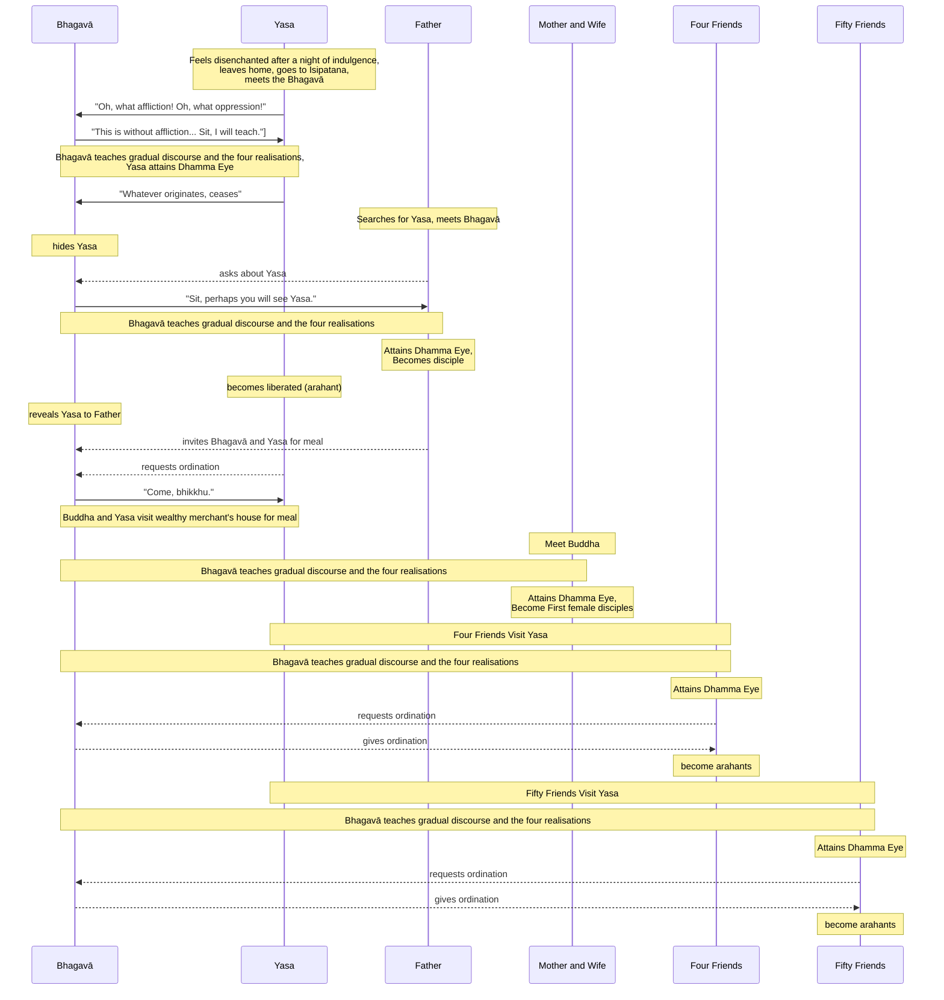

import { Tabs, TabItem } from '@astrojs/starlight/components';

Original text: [World Tipitaka Edition](https://tipitaka2500.github.io/tipitaka/3V/1/1.7.html)

## Summary

Yasa, a wealthy young man, experiences profound revulsion at his life of sensual pleasure, exclaiming "Oh, what affliction!" and leaves home, encountering the Bhagavā (Buddha). The Buddha teaches Yasa a gradual discourse followed by the four realisations, leading Yasa to attain the "dust-free, stainless `dhammacakkhu` (Dhamma Eye)" and, after his father also hears the Dhamma, full liberation as an `arahant` (liberated one) and ordination as a bhikkhu. Yasa's father, initially searching for him, is also taught by the Buddha, attains the `dhammacakkhu`, and becomes the first lay follower; Yasa's mother and former wife similarly become the first laywomen followers. Inspired by Yasa, his four closest friends and later about fifty more also seek out the Buddha, receive the same progressive instruction, attain the `dhammacakkhu`, are ordained, and become `arahanto` (liberated ones), significantly expanding the early Saṅgha.

## Diagram

## Text

<Tabs syncKey="paliquote">
<TabItem label="My Translation">
(25.)

107\. At that time in Bārāṇasī a young man of good family named Yasa, the son of a wealthy merchant, was delicate. He had three palaces — one for the winter, one for the summer, one for the rainy season. For four months in the rainy-season palace, being entertained by female musicians, he did not descend to the lower palace. Then, while Yasa, the young man of good family, was furnished and endowed with the five strands of sensual pleasure and being entertained, sleep came over him early, and sleep came over his retinue too, and the oil lamp burned all night. Then Yasa, the young man of good family, having woken up early, saw his own retinue sleeping — a lute under the arm of one, a double-headed drum at the neck of another, a drum under the arm of another, another with dishevelled hair, another drooling, others chattering — as it were, a burial ground for bones of cremated corpses right at hand. Having seen this, the `ādīnava` (unsatisfactoriness) appeared to him, and his `citta` (mind) became established in `nibbidā` (disenchantment). Then Yasa, the young man of good family, uttered an exclamation: “Oh, what affliction! Oh, what trouble!”

108\. Then Yasa, the young man of good family, having put on his golden sandals, approached the door of his dwelling. Non-human beings opened the door, thinking: “Let no one make an obstacle to the going forth of Yasa, the young man of good family, from the home life into homelessness.” Then Yasa, the young man of good family, approached the city gate. Non-human beings opened the door, thinking: “Let no one make an obstacle to the going forth of Yasa, the young man of good family, from the home life into homelessness.” Then Yasa, the young man of good family, approached Isipatana, the Deer Park.

(26.)

109\. At that time the Bhagavā, having risen in the night at the time before dawn, was walking up and down in the open air. The Bhagavā saw Yasa, the young man of good family, coming from afar; having seen him, he descended from the walking path and sat down on the prepared seat. Then Yasa, the young man of good family, not far from the Bhagavā, uttered an exclamation: “Oh, what affliction! Oh, what trouble!” Then the Bhagavā said this to Yasa, the young man of good family: “This, Yasa, is indeed without affliction, this is without trouble. Come, Yasa, sit down, I will teach you the Dhamma.” Then Yasa, the young man of good family, thinking, “This, it seems, is without affliction, this is without trouble,” joyful and elated, stepped down from his golden sandals, approached the Bhagavā, and having approached and paid homage to the Bhagavā, sat down to one side.

110\. To Yasa, the young man of good family, seated to one side, the Bhagavā gave a gradual discourse, that is to say, `dānakathā` (talk on giving), `sīlakathā` (talk on virtue), `saggakathā` (talk on heaven); he explained the danger, baseness, and defilement of sensual pleasures, and the benefit of renunciation. When the Bhagavā knew Yasa, the young man of good family, to have a ready mind, a pliable mind, a mind free from hindrances, an elated mind, a confident mind, then he expounded that teaching of the Dhamma which is the most elevated of the Buddhas — `dukkha` (suffering), `samudaya` (origin), `nirodha` (cessation), `magga` (path). Just as a clean cloth, free from stains, would rightly receive dye; even so, for Yasa, the young man of good family, on that very seat, there arose the `viraja` (pure), `vītamala` (stainless) `dhammacakkhu` (Dhamma Eye): “Whatever phenomenon is subject to origination is completely subject to cessation.”

(27.)

111\. Then the mother of Yasa, the young man of good family, having ascended to the palace and not seeing Yasa, the young man of good family, approached the wealthy merchant householder, and having approached, said this to the wealthy merchant householder: “Your son, householder, Yasa, is not to be seen.” Then the wealthy merchant householder, having sent out mounted messengers to the four directions, himself approached Isipatana, the Deer Park. The wealthy merchant householder saw where the golden sandals had been put down; having seen it, he followed that very [track]. The Bhagavā saw the wealthy merchant householder coming from afar; having seen him, this thought occurred to the Bhagavā: “What if I were to perform such a display of psychic power that the wealthy merchant householder, seated here, would not see Yasa, the young man of good family, seated here?” Then the Bhagavā performed such a display of psychic power.

112\. Then the wealthy merchant householder approached the Bhagavā, and having approached, said this to the Bhagavā: “Bhante, might the Bhagavā have seen Yasa, the young man of good family?”

113\. “Well then, householder, sit down; perhaps, seated here, you might see Yasa, the young man of good family, seated here.” Then the wealthy merchant householder, thinking, “It seems that, seated right here, I will see Yasa, the young man of good family, seated here,” joyful and elated, paid homage to the Bhagavā and sat down to one side.

114\. To the wealthy merchant householder, seated to one side, the Bhagavā gave a gradual discourse, that is to say, `dānakathā` (talk on giving), `sīlakathā` (talk on virtue), `saggakathā` (talk on heaven); he explained the danger, baseness, and defilement of sensual pleasures, and the benefit of renunciation. When the Bhagavā knew the wealthy merchant householder to have a ready mind, a pliable mind, a mind free from hindrances, an elated mind, a confident mind, then he expounded that teaching of the Dhamma which is the most elevated of the Buddhas — `dukkha` (suffering), `samudaya` (origin), `nirodha` (cessation), `magga` (path). Just as a clean cloth, free from stains, would rightly receive dye; even so, for the wealthy merchant householder, on that very seat, there arose the `viraja` (pure), `vītamala` (stainless) `dhammacakkhu` (Dhamma Eye): “Whatever phenomenon is subject to origination is completely subject to cessation.”

115\. Then the wealthy merchant householder, who had seen the Dhamma, attained the Dhamma, understood the Dhamma, deeply penetrated the Dhamma, overcome uncertainty, free from doubt, attained confidence, not relying on another in the Teacher's instruction, said this to the Bhagavā: “Excellent, Bhante! Excellent, Bhante! Just as, Bhante, one might set upright what has been overturned, or reveal what is hidden, or point out the path to one who is lost, or hold up an oil lamp in the darkness, thinking, ‘those with eyes will see forms’; even so, the Dhamma has been made clear in many ways by the Bhagavā. I go for refuge to the Bhagavā, Bhante, to the Dhamma, and to the `bhikkhusaṃgha` (Saṅgha of bhikkhū). May the Bhagavā remember me as an `upāsaka` (lay disciple) who has gone for refuge for life, from today onwards.” He was the first `upāsaka` (lay disciple) in the world with the `tevācika` (threefold utterance).

(28.)

116\. Then, while the Dhamma was being taught to his father, the `citta` (mind) of Yasa, the young man of good family, as he reviewed the stage he had seen and known, `anupādāya` (not grasping), was liberated from the `āsavā` (defilements). Then this thought occurred to the Bhagavā: “While the Dhamma was being taught to his father, the `citta` (mind) of Yasa, the young man of good family, as he reviewed the stage he had seen and known, `anupādāya` (not grasping), has been liberated from the `āsavā` (defilements). Yasa, the young man of good family, is indeed incapable of reverting to the lay life and enjoying sensual pleasures as before, when he was a householder; what if I were to cause that display of psychic power to cease?” Then the Bhagavā caused that display of psychic power to cease.

117\. The wealthy merchant householder saw Yasa, the young man of good family, seated; having seen him, he said this to Yasa, the young man of good family: “Your mother, dear Yasa, is overcome with lamentation and sorrow. Give life to your mother!” Then Yasa, the young man of good family, looked up at the Bhagavā. Then the Bhagavā said this to the wealthy merchant householder: “What do you think, householder? One by whom the Dhamma has been seen and known with a trainee's knowledge and a trainee's vision, just as by you — his `citta` (mind), as he reviews the stage he has seen and known, `anupādāya` (not grasping), is liberated from the `āsavā` (defilements). Is he, householder, capable of reverting to the lay life and enjoying sensual pleasures as before, when he was a householder?” “Of course not, Bhante.” “Householder, the Dhamma has been seen and known by Yasa, the young man of good family, with a trainee's knowledge and a trainee's vision, just as by you; his `citta` (mind), as he reviews the stage he has seen and known, `anupādāya` (not grasping), is liberated from the `āsavā` (defilements). Householder, Yasa, the young man of good family, is indeed incapable of reverting to the lay life and enjoying sensual pleasures as before, when he was a householder.” “It is a gain, Bhante, for Yasa, the young man of good family, it is a great gain, Bhante, for Yasa, the young man of good family, that the `citta` (mind) of Yasa, the young man of good family, `anupādāya` (not grasping), is liberated from the `āsavā` (defilements). May the Bhagavā, Bhante, consent to my meal for today, with Yasa, the young man of good family, as `pacchāsamaṇa` (attendant monk).” The Bhagavā consented by silence.

118\. Then the wealthy merchant householder, knowing the Bhagavā's consent, rose from his seat, paid homage to the Bhagavā, circumambulated him keeping his right side towards him, and departed. Then Yasa, the young man of good family, soon after the wealthy merchant householder had departed, said this to the Bhagavā: “Bhante, may I receive the `pabbajjā` (going forth) in the Bhagavā's presence, may I receive the `upasampadā` (higher ordination)?” “Come, bhikkhu,” the Bhagavā said, “The Dhamma is well-proclaimed. Live the optimal life for the complete ending of suffering.” That itself was the āyasmant's higher ordination. At that time there were seven arahants in the world.

---

119\. The going forth of Yasa is finished.

(29.)

120\. Then the Bhagavā, in the morning, having dressed and taking his bowl and robes, with āyasmā Yasa as `pacchāsamaṇa` (attendant monk), approached the dwelling of the wealthy merchant householder; having approached, he sat down on the prepared seat. Then the mother and the former wife of āyasmā Yasa approached the Bhagavā, and having approached, paid homage to the Bhagavā and sat down to one side.

121\. To them the Bhagavā gave a gradual discourse, that is to say, `dānakathā` (talk on giving), `sīlakathā` (talk on virtue), `saggakathā` (talk on heaven); he explained the danger, baseness, and defilement of sensual pleasures, and the benefit of renunciation. When the Bhagavā knew them to have ready minds, pliable minds, minds free from hindrances, elated minds, confident minds, then he expounded that teaching of the Dhamma which is the most elevated of the Buddhas — `dukkha` (suffering), `samudaya` (origin), `nirodha` (cessation), `magga` (path). Just as a clean cloth, free from stains, would rightly receive dye; even so, for them, on that very seat, there arose the `viraja` (pure), `vītamala` (stainless) `dhammacakkhu` (Dhamma Eye): “Whatever phenomenon is subject to origination is completely subject to cessation.” They, who had seen the Dhamma, attained the Dhamma, understood the Dhamma, deeply penetrated the Dhamma, overcome uncertainty, free from doubt, attained confidence, not relying on another in the Teacher's instruction, said this to the Bhagavā: “Excellent, Bhante! Excellent, Bhante! … and so on … We, Bhante, go for refuge to the Bhagavā, to the Dhamma, and to the `bhikkhusaṃgha` (Saṅgha of bhikkhū). May the Bhagavā remember us as `upāsikā` (female lay disciples) who have gone for refuge for life, from today onwards.” And they were the first `upāsikā` (female lay disciples) in the world with the `tevācika` (threefold utterance).

122\. Then the mother, father, and former wife of āyasmā Yasa, having with their own hands satisfied and satiated the Bhagavā and āyasmā Yasa with fine hard and soft food, when the Bhagavā had eaten and withdrawn his hand from the bowl, sat down to one side. Then the Bhagavā, having instructed, encouraged, inspired, and gladdened the mother, father, and former wife of āyasmā Yasa with a Dhamma talk, rose from his seat and departed.

(30.)

123\. Four lay friends of āyasmā Yasa, sons of families of leading and secondary merchants in Bārāṇasī — Vimala, Subāhu, Puṇṇaji, and Gavampati — heard: “Yasa, the young man of good family, it is said, has shaved off his hair and beard, put on ochre robes, and gone forth from the home life into homelessness.” Having heard, this thought occurred to them: “Surely that Dhamma and Discipline is not inferior, that going forth is not inferior, wherein Yasa, the young man of good family, has shaved off his hair and beard, put on ochre robes, and gone forth from the home life into homelessness.” They approached āyasmā Yasa, and having approached, paid homage to āyasmā Yasa and stood to one side.

124\. Then āyasmā Yasa, taking those four lay friends, approached the Bhagavā, and having approached, paid homage to the Bhagavā and sat down to one side. Seated to one side, āyasmā Yasa said this to the Bhagavā: “These, Bhante, are my four lay friends, sons of families of leading and secondary merchants in Bārāṇasī — Vimala, Subāhu, Puṇṇaji, and Gavampati. May the Bhagavā instruct and admonish them.”

125\. To them the Bhagavā gave a gradual discourse, that is to say, `dānakathā` (talk on giving), `sīlakathā` (talk on virtue), `saggakathā` (talk on heaven); he explained the danger, baseness, and defilement of sensual pleasures, and the benefit of renunciation. When the Bhagavā knew them to have ready minds, pliable minds, minds free from hindrances, elated minds, confident minds, then he expounded that teaching of the Dhamma which is the most elevated of the Buddhas — `dukkha` (suffering), `samudaya` (origin), `nirodha` (cessation), `magga` (path). Just as a clean cloth, free from stains, would rightly receive dye; even so, for them, on that very seat, there arose the `viraja` (pure), `vītamala` (stainless) `dhammacakkhu` (Dhamma Eye): “Whatever phenomenon is subject to origination is completely subject to cessation.” They, who had seen the Dhamma, attained the Dhamma, understood the Dhamma, deeply penetrated the Dhamma, overcome uncertainty, free from doubt, attained confidence, not relying on another in the Teacher's instruction, said this to the Bhagavā: “Bhante, may we receive the `pabbajjā` (going forth) in the Bhagavā's presence, may we receive the `upasampadā` (higher ordination).” “Come, Bhikkhavo,” the Bhagavā said, “The Dhamma is well-proclaimed. Live the optimal life for the complete ending of suffering.” That itself was the higher ordination of those āyasmants. Then the Bhagavā instructed and admonished those bhikkhū with a Dhamma talk. While they were being instructed and admonished by the Bhagavā with a Dhamma talk, their `cittāni` (minds), `anupādāya` (not grasping), were liberated from the `āsavā` (defilements). At that time there were eleven arahants in the world.

---

126\. The going forth of the four lay friends is finished.

(31.)

127\. Fifty lay friends of āyasmā Yasa from the countryside, sons of ancestral families, heard: “Yasa, the young man of good family, it is said, has shaved off his hair and beard, put on ochre robes, and gone forth from the home life into homelessness.” Having heard, this thought occurred to them: “Surely that Dhamma and Discipline is not inferior, that going forth is not inferior, wherein Yasa, the young man of good family, has shaved off his hair and beard, put on ochre robes, and gone forth from the home life into homelessness.” They approached āyasmā Yasa, and having approached, paid homage to āyasmā Yasa and stood to one side.

128\. Then āyasmā Yasa, taking those fifty lay friends, approached the Bhagavā, and having approached, paid homage to the Bhagavā and sat down to one side. Seated to one side, āyasmā Yasa said this to the Bhagavā: “These, Bhante, are my fifty lay friends from the countryside, sons of ancestral families. May the Bhagavā instruct and admonish them.”

129\. To them the Bhagavā gave a gradual discourse, that is to say, `dānakathā` (talk on giving), `sīlakathā` (talk on virtue), `saggakathā` (talk on heaven); he explained the danger, baseness, and defilement of sensual pleasures, and the benefit of renunciation. When the Bhagavā knew them to have ready minds, pliable minds, minds free from hindrances, elated minds, confident minds, then he expounded that teaching of the Dhamma which is the most elevated of the Buddhas — `dukkha` (suffering), `samudaya` (origin), `nirodha` (cessation), `magga` (path). Just as a clean cloth, free from stains, would rightly receive dye; even so, for them, on that very seat, there arose the `viraja` (pure), `vītamala` (stainless) `dhammacakkhu` (Dhamma Eye): “Whatever phenomenon is subject to origination is completely subject to cessation.” They, who had seen the Dhamma, attained the Dhamma, understood the Dhamma, deeply penetrated the Dhamma, overcome uncertainty, free from doubt, attained confidence, not relying on another in the Teacher's instruction, said this to the Bhagavā: “Bhante, may we receive the `pabbajjā` (going forth) in the Bhagavā's presence, may we receive the `upasampadā` (higher ordination).” “Come, Bhikkhavo,” the Bhagavā said, “The Dhamma is well-proclaimed. Live the optimal life for the complete ending of suffering.” That itself was the higher ordination of those āyasmants. Then the Bhagavā instructed and admonished those bhikkhū with a Dhamma talk. While they were being instructed and admonished by the Bhagavā with a Dhamma talk, their `cittāni` (minds), `anupādāya` (not grasping), were liberated from the `āsavā` (defilements). At that time there were sixty-one arahants in the world.

---

130\. The going forth of the fifty lay friends is finished.
</TabItem>

<TabItem label="Pāḷi (Roman IAST)">
(25.)

107\. Tena kho pana samayena bārāṇasiyaṃ yaso nāma kulaputto seṭṭhiputto sukhumālo hoti. Tassa tayo pāsādā honti—  eko hemantiko, eko gimhiko, eko vassiko. So vassike pāsāde cattāro māse nippurisehi tūriyehi paricārayamāno na heṭṭhāpāsādaṃ orohati. Atha kho yasassa kulaputtassa pañcahi kāmaguṇehi samappitassa samaṅgībhūtassa paricārayamānassa paṭikacceva niddā okkami, parijanassapi niddā okkami, sabbarattiyo ca telapadīpo jhāyati. Atha kho yaso kulaputto paṭikacceva pabujjhitvā addasa sakaṃ parijanaṃ supantaṃ—  aññissā kacche vīṇaṃ, aññissā kaṇṭhe mudiṅgaṃ, aññissā kacche āḷambaraṃ, aññaṃ vikesikaṃ, aññaṃ vikkheḷikaṃ, aññā vippalapantiyo, hatthappattaṃ susānaṃ maññe. Disvānassa ādīnavo pāturahosi, nibbidāya cittaṃ saṇṭhāsi. Atha kho yaso kulaputto udānaṃ udānesi—  “upaddutaṃ vata bho, upassaṭṭhaṃ vata bho”ti.

108\. Atha kho yaso kulaputto suvaṇṇapādukāyo ārohitvā yena nivesanadvāraṃ tenupasaṅkami. Amanussā dvāraṃ vivariṃsu—  “mā yasassa kulaputtassa koci antarāyamakāsi agārasmā anagāriyaṃ pabbajjāyā”ti. Atha kho yaso kulaputto yena nagaradvāraṃ tenupasaṅkami. Amanussā dvāraṃ vivariṃsu—  “mā yasassa kulaputtassa koci antarāyamakāsi agārasmā anagāriyaṃ pabbajjāyā”ti. Atha kho yaso kulaputto yena isipatanaṃ migadāyo tenupasaṅkami.

(26.)

109\. Tena kho pana samayena bhagavā rattiyā paccūsasamayaṃ paccuṭṭhāya ajjhokāse caṅkamati. Addasā kho bhagavā yasaṃ kulaputtaṃ dūratova āgacchantaṃ, disvāna caṅkamā orohitvā paññatte āsane nisīdi. Atha kho yaso kulaputto bhagavato avidūre udānaṃ udānesi—  “upaddutaṃ vata bho, upassaṭṭhaṃ vata bho”ti. Atha kho bhagavā yasaṃ kulaputtaṃ etadavoca—  “idaṃ kho, yasa, anupaddutaṃ, idaṃ anupassaṭṭhaṃ. Ehi, yasa, nisīda, dhammaṃ te desessāmī”ti. Atha kho yaso kulaputto—  “idaṃ kira anupaddutaṃ, idaṃ anupassaṭṭhan”ti haṭṭho udaggo suvaṇṇapādukāhi orohitvā yena bhagavā tenupasaṅkami, upasaṅkamitvā bhagavantaṃ abhivādetvā ekamantaṃ nisīdi.

110\. Ekamantaṃ nisinnassa kho yasassa kulaputtassa bhagavā anupubbiṃ kathaṃ kathesi, seyyathidaṃ—  dānakathaṃ sīlakathaṃ saggakathaṃ, kāmānaṃ ādīnavaṃ okāraṃ saṃkilesaṃ, nekkhamme ānisaṃsaṃ pakāsesi. Yadā bhagavā aññāsi yasaṃ kulaputtaṃ kallacittaṃ, muducittaṃ, vinīvaraṇacittaṃ, udaggacittaṃ, pasannacittaṃ, atha yā buddhānaṃ sāmukkaṃsikā dhammadesanā taṃ pakāsesi—  dukkhaṃ, samudayaṃ, nirodhaṃ, maggaṃ. Seyyathāpi nāma suddhaṃ vatthaṃ apagatakāḷakaṃ sammadeva rajanaṃ paṭiggaṇheyya; evameva yasassa kulaputtassa tasmiṃyeva āsane virajaṃ vītamalaṃ dhammacakkhuṃ udapādi—  “yaṃ kiñci samudayadhammaṃ sabbaṃ taṃ nirodhadhamman”ti.

(27.)

111\. Atha kho yasassa kulaputtassa mātā pāsādaṃ abhiruhitvā yasaṃ kulaputtaṃ apassantī yena seṭṭhi gahapati tenupasaṅkami, upasaṅkamitvā seṭṭhiṃ gahapatiṃ etadavoca—  “putto te, gahapati, yaso na dissatī”ti. Atha kho seṭṭhi gahapati catuddisā assadūte uyyojetvā sāmaṃyeva yena isipatanaṃ migadāyo tenupasaṅkami. Addasā kho seṭṭhi gahapati suvaṇṇapādukānaṃ nikkhepaṃ, disvāna taṃyeva anugamāsi. Addasā kho bhagavā seṭṭhiṃ gahapatiṃ dūratova āgacchantaṃ, disvāna bhagavato etadahosi—  “yannūnāhaṃ tathārūpaṃ iddhābhisaṅkhāraṃ abhisaṅkhareyyaṃ yathā seṭṭhi gahapati idha nisinno idha nisinnaṃ yasaṃ kulaputtaṃ na passeyyā”ti. Atha kho bhagavā tathārūpaṃ iddhābhisaṅkhāraṃ abhisaṅkharesi.

112\. Atha kho seṭṭhi gahapati yena bhagavā tenupasaṅkami, upasaṅkamitvā bhagavantaṃ etadavoca—  “api, bhante, bhagavā yasaṃ kulaputtaṃ passeyyā”ti?

113\. “Tena hi, gahapati, nisīda, appeva nāma idha nisinno idha nisinnaṃ yasaṃ kulaputtaṃ passeyyāsī”ti. Atha kho seṭṭhi gahapati—  “idheva kirāhaṃ nisinno idha nisinnaṃ yasaṃ kulaputtaṃ passissāmī”ti haṭṭho udaggo bhagavantaṃ abhivādetvā ekamantaṃ nisīdi.

114\. Ekamantaṃ nisinnassa kho seṭṭhissa gahapatissa bhagavā anupubbiṃ kathaṃ kathesi, seyyathidaṃ—  dānakathaṃ sīlakathaṃ saggakathaṃ, kāmānaṃ ādīnavaṃ okāraṃ saṃkilesaṃ, nekkhamme ānisaṃsaṃ pakāsesi. Yadā bhagavā aññāsi seṭṭhiṃ gahapatiṃ kallacittaṃ, muducittaṃ, vinīvaraṇacittaṃ, udaggacittaṃ, pasannacittaṃ, atha yā buddhānaṃ sāmukkaṃsikā dhammadesanā, taṃ pakāsesi—  dukkhaṃ, samudayaṃ, nirodhaṃ, maggaṃ. Seyyathāpi nāma suddhaṃ vatthaṃ apagatakāḷakaṃ sammadeva rajanaṃ paṭiggaṇheyya; evameva seṭṭhissa gahapatissa tasmiṃyeva āsane virajaṃ vītamalaṃ dhammacakkhuṃ udapādi—  “yaṃ kiñci samudayadhammaṃ sabbaṃ taṃ nirodhadhamman”ti.

115\. Atha kho seṭṭhi gahapati diṭṭhadhammo pattadhammo viditadhammo pariyogāḷhadhammo tiṇṇavicikiccho vigatakathaṃkatho vesārajjappatto aparappaccayo satthusāsane bhagavantaṃ etadavoca—  “abhikkantaṃ, bhante, abhikkantaṃ, bhante. Seyyathāpi, bhante, nikkujjitaṃ vā ukkujjeyya, paṭicchannaṃ vā vivareyya, mūḷhassa vā `maggaṃ` ācikkheyya, andhakāre vā telapajjotaṃ dhāreyya—  ‘cakkhumanto rūpāni dakkhantī’ti; evamevaṃ bhagavatā anekapariyāyena dhammo pakāsito. Esāhaṃ, bhante, bhagavantaṃ saraṇaṃ gacchāmi, dhammañca, bhikkhusaṃghañca. Upāsakaṃ maṃ bhagavā dhāretu ajjatagge pāṇupetaṃ saraṇaṃ gatan”ti. Sova loke paṭhamaṃ upāsako ahosi tevāciko.

(28.)

116\. Atha kho yasassa kulaputtassa pituno dhamme desiyamāne yathādiṭṭhaṃ yathāviditaṃ bhūmiṃ paccavekkhantassa anupādāya āsavehi cittaṃ vimucci. Atha kho bhagavato etadahosi—  “yasassa kho kulaputtassa pituno dhamme desiyamāne yathādiṭṭhaṃ yathāviditaṃ bhūmiṃ paccavekkhantassa anupādāya āsavehi cittaṃ vimuttaṃ. Abhabbo kho yaso kulaputto hīnāyāvattitvā kāme paribhuñjituṃ, seyyathāpi pubbe agārikabhūto; yannūnāhaṃ taṃ iddhābhisaṅkhāraṃ paṭippassambheyyan”ti. Atha kho bhagavā taṃ iddhābhisaṅkhāraṃ paṭippassambhesi.

117\. Addasā kho seṭṭhi gahapati yasaṃ kulaputtaṃ nisinnaṃ disvāna, yasaṃ kulaputtaṃ etadavoca—  “mātā te, tāta yasa, paridevasokasamāpannā, dehi mātuyā jīvitan”ti. Atha kho yaso kulaputto bhagavantaṃ ullokesi. Atha kho bhagavā seṭṭhiṃ gahapatiṃ etadavoca—  “taṃ kiṃ maññasi, gahapati, yassa sekkhena ñāṇena sekkhena dassanena dhammo diṭṭho vidito seyyathāpi tayā, tassa yathādiṭṭhaṃ yathāviditaṃ bhūmiṃ paccavekkhantassa anupādāya āsavehi cittaṃ vimuttaṃ. Bhabbo nu kho so, gahapati, hīnāyāvattitvā kāme paribhuñjituṃ seyyathāpi pubbe agārikabhūto”ti? “No hetaṃ, bhante”. “Yasassa kho, gahapati, kulaputtassa sekkhena ñāṇena sekkhena dassanena dhammo diṭṭho vidito seyyathāpi tayā, tassa yathādiṭṭhaṃ yathāviditaṃ bhūmiṃ paccavekkhantassa anupādāya āsavehi cittaṃ vimuttaṃ. Abhabbo kho, gahapati, yaso kulaputto hīnāyāvattitvā kāme paribhuñjituṃ seyyathāpi pubbe agārikabhūto”ti. “Lābhā, bhante, yasassa kulaputtassa, suladdhaṃ, bhante, yasassa kulaputtassa, yathā yasassa kulaputtassa anupādāya āsavehi cittaṃ vimuttaṃ. Adhivāsetu me, bhante, bhagavā ajjatanāya bhattaṃ yasena kulaputtena pacchāsamaṇenā”ti. Adhivāsesi bhagavā tuṇhībhāvena.

118\. Atha kho seṭṭhi gahapati bhagavato adhivāsanaṃ viditvā uṭṭhāyāsanā bhagavantaṃ abhivādetvā padakkhiṇaṃ katvā pakkāmi. Atha kho yaso kulaputto acirapakkante seṭṭhimhi gahapatimhi bhagavantaṃ etadavoca—  “labheyyāhaṃ, bhante, bhagavato santike pabbajjaṃ, labheyyaṃ upasampadan”ti. “Ehi bhikkhū”ti bhagavā avoca—  “svākkhāto dhammo, cara brahmacariyaṃ sammā dukkhassa antakiriyāyā”ti. Sāva tassa āyasmato upasampadā ahosi. Tena kho pana samayena satta loke arahanto honti.

---

119\. Yasassa pabbajjā niṭṭhitā.

(29.)

120\. Atha kho bhagavā pubbaṇhasamayaṃ nivāsetvā pattacīvaramādāya āyasmatā yasena pacchāsamaṇena yena seṭṭhissa gahapatissa nivesanaṃ tenupasaṅkami, upasaṅkamitvā paññatte āsane nisīdi. Atha kho āyasmato yasassa mātā ca purāṇadutiyikā ca yena bhagavā tenupasaṅkamiṃsu, upasaṅkamitvā bhagavantaṃ abhivādetvā ekamantaṃ nisīdiṃsu.

121\. Tāsaṃ bhagavā anupubbiṃ kathaṃ kathesi, seyyathidaṃ—  dānakathaṃ sīlakathaṃ saggakathaṃ, kāmānaṃ ādīnavaṃ okāraṃ saṃkilesaṃ, nekkhamme ānisaṃsaṃ pakāsesi. Yadā tā bhagavā aññāsi kallacittā, muducittā, vinīvaraṇacittā, udaggacittā, pasannacittā, atha yā buddhānaṃ sāmukkaṃsikā dhammadesanā taṃ pakāsesi—  dukkhaṃ, samudayaṃ, nirodhaṃ, maggaṃ. Seyyathāpi nāma suddhaṃ vatthaṃ apagatakāḷakaṃ sammadeva rajanaṃ paṭiggaṇheyya; evameva tāsaṃ tasmiṃyeva āsane virajaṃ vītamalaṃ dhammacakkhuṃ udapādi—  “yaṃ kiñci samudayadhammaṃ sabbaṃ taṃ nirodhadhamman”ti. Tā diṭṭhadhammā pattadhammā viditadhammā pariyogāḷhadhammā tiṇṇavicikicchā vigatakathaṃkathā vesārajjappattā aparappaccayā satthusāsane bhagavantaṃ etadavocuṃ—  “abhikkantaṃ, bhante, abhikkantaṃ, bhante…pe…  etā mayaṃ, bhante, bhagavantaṃ saraṇaṃ gacchāma, dhammañca, bhikkhusaṃghañca. Upāsikāyo no bhagavā dhāretu ajjatagge pāṇupetā saraṇaṃ gatā”ti. Tā ca loke paṭhamaṃ upāsikā ahesuṃ tevācikā.

122\. Atha kho āyasmato yasassa mātā ca pitā ca purāṇadutiyikā ca bhagavantañca āyasmantañca yasaṃ paṇītena khādanīyena bhojanīyena sahatthā santappetvā sampavāretvā, bhagavantaṃ bhuttāviṃ onītapattapāṇiṃ, ekamantaṃ nisīdiṃsu. Atha kho bhagavā āyasmato yasassa mātarañca pitarañca purāṇadutiyikañca dhammiyā kathāya sandassetvā samādapetvā samuttejetvā sampahaṃsetvā uṭṭhāyāsanā pakkāmi.

(30.)

123\. Assosuṃ kho āyasmato yasassa cattāro gihisahāyakā bārāṇasiyaṃ seṭṭhānuseṭṭhīnaṃ kulānaṃ puttā—  vimalo, subāhu, puṇṇaji, gavampati—  yaso kira kulaputto kesamassuṃ ohāretvā kāsāyāni vatthāni acchādetvā agārasmā anagāriyaṃ pabbajitoti. Sutvāna nesaṃ etadahosi—  “na hi nūna so orako dhammavinayo, na sā orakā pabbajjā, yattha yaso kulaputto kesamassuṃ ohāretvā kāsāyāni vatthāni acchādetvā agārasmā anagāriyaṃ pabbajito”ti. Te yenāyasmā yaso tenupasaṅkamiṃsu, upasaṅkamitvā āyasmantaṃ yasaṃ abhivādetvā ekamantaṃ aṭṭhaṃsu.

124\. Atha kho āyasmā yaso te cattāro gihisahāyake ādāya yena bhagavā tenupasaṅkami, upasaṅkamitvā bhagavantaṃ abhivādetvā ekamantaṃ nisīdi. Ekamantaṃ nisinno kho āyasmā yaso bhagavantaṃ etadavoca—  “ime me, bhante, cattāro gihisahāyakā bārāṇasiyaṃ seṭṭhānuseṭṭhīnaṃ kulānaṃ puttā—  vimalo, subāhu, puṇṇaji, gavampati. Ime bhagavā ovadatu anusāsatū”ti.

125\. Tesaṃ bhagavā anupubbiṃ kathaṃ kathesi, seyyathidaṃ—  dānakathaṃ sīlakathaṃ saggakathaṃ kāmānaṃ ādīnavaṃ okāraṃ saṃkilesaṃ nekkhamme ānisaṃsaṃ pakāsesi. Yadā te bhagavā aññāsi kallacitte muducitte vinīvaraṇacitte udaggacitte pasannacitte, atha yā buddhānaṃ sāmukkaṃsikā dhammadesanā, taṃ pakāsesi dukkhaṃ samudayaṃ nirodhaṃ maggaṃ. Seyyathāpi nāma suddhaṃ vatthaṃ apagatakāḷakaṃ sammadeva rajanaṃ paṭiggaṇheyya; evameva tesaṃ tasmiṃyeva āsane virajaṃ vītamalaṃ dhammacakkhuṃ udapādi—  “yaṃ kiñci samudayadhammaṃ sabbaṃ taṃ nirodhadhamman”ti. Te diṭṭhadhammā pattadhammā viditadhammā pariyogāḷhadhammā tiṇṇavicikicchā vigatakathaṃkathā vesārajjappattā aparappaccayā satthusāsane bhagavantaṃ etadavocuṃ—  “labheyyāma mayaṃ, bhante, bhagavato santike pabbajjaṃ, labheyyāma upasampadan”ti. “Etha bhikkhavo”ti bhagavā avoca—  “svākkhāto dhammo, caratha brahmacariyaṃ sammā dukkhassa antakiriyāyā”ti. Sāva tesaṃ āyasmantānaṃ upasampadā ahosi. Atha kho bhagavā te bhikkhū dhammiyā kathāya ovadi anusāsi. Tesaṃ bhagavatā dhammiyā kathāya ovadiyamānānaṃ anusāsiyamānānaṃ anupādāya āsavehi cittāni vimucciṃsu. Tena kho pana samayena ekādasa loke arahanto honti.

---

126\. Catugihisahāyakapabbajjā niṭṭhitā.

(31.)

127\. Assosuṃ kho āyasmato yasassa paññāsamattā gihisahāyakā jānapadā pubbānupubbakānaṃ kulānaṃ puttā—  yaso kira kulaputto kesamassuṃ ohāretvā kāsāyāni vatthāni acchādetvā agārasmā anagāriyaṃ pabbajitoti. Sutvāna nesaṃ etadahosi—  “na hi nūna so orako dhammavinayo, na sā orakā pabbajjā, yattha yaso kulaputto kesamassuṃ ohāretvā kāsāyāni vatthāni acchādetvā agārasmā anagāriyaṃ pabbajito”ti. Te yenāyasmā yaso tenupasaṅkamiṃsu, upasaṅkamitvā āyasmantaṃ yasaṃ abhivādetvā ekamantaṃ aṭṭhaṃsu.

128\. Atha kho āyasmā yaso te paññāsamatte gihisahāyake ādāya yena bhagavā tenupasaṅkami, upasaṅkamitvā bhagavantaṃ abhivādetvā ekamantaṃ nisīdi. Ekamantaṃ nisinno kho āyasmā yaso bhagavantaṃ etadavoca—  “ime me, bhante, paññāsamattā gihisahāyakā jānapadā pubbānupubbakānaṃ kulānaṃ puttā. Ime bhagavā ovadatu anusāsatū”ti.

129\. Tesaṃ bhagavā anupubbiṃ kathaṃ kathesi, seyyathidaṃ—  dānakathaṃ sīlakathaṃ saggakathaṃ kāmānaṃ ādīnavaṃ okāraṃ saṃkilesaṃ nekkhamme ānisaṃsaṃ pakāsesi. Yadā te bhagavā aññāsi kallacitte muducitte vinīvaraṇacitte udaggacitte pasannacitte, atha yā buddhānaṃ sāmukkaṃsikā dhammadesanā, taṃ pakāsesi dukkhaṃ samudayaṃ nirodhaṃ maggaṃ. Seyyathāpi nāma suddhaṃ vatthaṃ apagatakāḷakaṃ sammadeva rajanaṃ paṭiggaṇheyya; evameva tesaṃ tasmiṃyeva āsane virajaṃ vītamalaṃ dhammacakkhuṃ udapādi—  “yaṃ kiñci samudayadhammaṃ sabbaṃ taṃ nirodhadhamman”ti. Te diṭṭhadhammā pattadhammā viditadhammā pariyogāḷhadhammā tiṇṇavicikicchā vigatakathaṃkathā vesārajjappattā aparappaccayā satthusāsane bhagavantaṃ etadavocuṃ—  “labheyyāma mayaṃ, bhante, bhagavato santike pabbajjaṃ, labheyyāma upasampadan”ti. “Etha bhikkhavo”ti bhagavā avoca—  “svākkhāto dhammo, caratha brahmacariyaṃ sammā dukkhassa antakiriyāyā”ti. Sāva tesaṃ āyasmantānaṃ upasampadā ahosi. Atha kho bhagavā te bhikkhū dhammiyā kathāya ovadi anusāsi. Tesaṃ bhagavatā dhammiyā kathāya ovadiyamānānaṃ anusāsiyamānānaṃ anupādāya āsavehi cittāni vimucciṃsu. Tena kho pana samayena ekasaṭṭhi loke arahanto honti.

---

130\. Paññāsagihisahāyakapabbajjā niṭṭhitā.
</TabItem>

<TabItem label="Pāḷi (Brahmi)">
(25.)

107\. 𑀢𑁂𑀦 𑀔𑁄 𑀧𑀦 𑀲𑀫𑀬𑁂𑀦 𑀩𑀸𑀭𑀸𑀡𑀲𑀺𑀬𑀁 𑀬𑀲𑁄 𑀦𑀸𑀫 𑀓𑀼𑀮𑀧𑀼𑀢𑁆𑀢𑁄 𑀲𑁂𑀝𑁆𑀞𑀺𑀧𑀼𑀢𑁆𑀢𑁄 𑀲𑀼𑀔𑀼𑀫𑀸𑀮𑁄 𑀳𑁄𑀢𑀺. 𑀢𑀲𑁆𑀲 𑀢𑀬𑁄 𑀧𑀸𑀲𑀸𑀤𑀸 𑀳𑁄𑀦𑁆𑀢𑀺—  𑀏𑀓𑁄 𑀳𑁂𑀫𑀦𑁆𑀢𑀺𑀓𑁄, 𑀏𑀓𑁄 𑀕𑀺𑀫𑁆𑀳𑀺𑀓𑁄, 𑀏𑀓𑁄 𑀯𑀲𑁆𑀲𑀺𑀓𑁄. 𑀲𑁄 𑀯𑀲𑁆𑀲𑀺𑀓𑁂 𑀧𑀸𑀲𑀸𑀤𑁂 𑀘𑀢𑁆𑀢𑀸𑀭𑁄 𑀫𑀸𑀲𑁂 𑀦𑀺𑀧𑁆𑀧𑀼𑀭𑀺𑀲𑁂𑀳𑀺 𑀢𑀽𑀭𑀺𑀬𑁂𑀳𑀺 𑀧𑀭𑀺𑀘𑀸𑀭𑀬𑀫𑀸𑀦𑁄 𑀦 𑀳𑁂𑀝𑁆𑀞𑀸𑀧𑀸𑀲𑀸𑀤𑀁 𑀑𑀭𑁄𑀳𑀢𑀺. 𑀅𑀣 𑀔𑁄 𑀬𑀲𑀲𑁆𑀲 𑀓𑀼𑀮𑀧𑀼𑀢𑁆𑀢𑀲𑁆𑀲 𑀧𑀜𑁆𑀘𑀳𑀺 𑀓𑀸𑀫𑀕𑀼𑀡𑁂𑀳𑀺 𑀲𑀫𑀧𑁆𑀧𑀺𑀢𑀲𑁆𑀲 𑀲𑀫𑀗𑁆𑀕𑀻𑀪𑀽𑀢𑀲𑁆𑀲 𑀧𑀭𑀺𑀘𑀸𑀭𑀬𑀫𑀸𑀦𑀲𑁆𑀲 𑀧𑀝𑀺𑀓𑀘𑁆𑀘𑁂𑀯 𑀦𑀺𑀤𑁆𑀤𑀸 𑀑𑀓𑁆𑀓𑀫𑀺, 𑀧𑀭𑀺𑀚𑀦𑀲𑁆𑀲𑀧𑀺 𑀦𑀺𑀤𑁆𑀤𑀸 𑀑𑀓𑁆𑀓𑀫𑀺, 𑀲𑀩𑁆𑀩𑀭𑀢𑁆𑀢𑀺𑀬𑁄 𑀘 𑀢𑁂𑀮𑀧𑀤𑀻𑀧𑁄 𑀛𑀸𑀬𑀢𑀺. 𑀅𑀣 𑀔𑁄 𑀬𑀲𑁄 𑀓𑀼𑀮𑀧𑀼𑀢𑁆𑀢𑁄 𑀧𑀝𑀺𑀓𑀘𑁆𑀘𑁂𑀯 𑀧𑀩𑀼𑀚𑁆𑀛𑀺𑀢𑁆𑀯𑀸 𑀅𑀤𑁆𑀤𑀲 𑀲𑀓𑀁 𑀧𑀭𑀺𑀚𑀦𑀁 𑀲𑀼𑀧𑀦𑁆𑀢𑀁—  𑀅𑀜𑁆𑀜𑀺𑀲𑁆𑀲𑀸 𑀓𑀘𑁆𑀙𑁂 𑀯𑀻𑀡𑀁, 𑀅𑀜𑁆𑀜𑀺𑀲𑁆𑀲𑀸 𑀓𑀡𑁆𑀞𑁂 𑀫𑀼𑀤𑀺𑀗𑁆𑀕𑀁, 𑀅𑀜𑁆𑀜𑀺𑀲𑁆𑀲𑀸 𑀓𑀘𑁆𑀙𑁂 𑀆𑀍𑀅𑀫𑁆𑀩𑀭𑀁, 𑀅𑀜𑁆𑀜𑀁 𑀯𑀺𑀓𑁂𑀲𑀺𑀓𑀁, 𑀅𑀜𑁆𑀜𑀁 𑀯𑀺𑀓𑁆𑀔𑁂𑀍𑀇𑀓𑀁, 𑀅𑀜𑁆𑀜𑀸 𑀯𑀺𑀧𑁆𑀧𑀮𑀧𑀦𑁆𑀢𑀺𑀬𑁄, 𑀳𑀢𑁆𑀣𑀧𑁆𑀧𑀢𑁆𑀢𑀁 𑀲𑀼𑀲𑀸𑀦𑀁 𑀫𑀜𑁆𑀜𑁂. 𑀤𑀺𑀲𑁆𑀯𑀸𑀦𑀲𑁆𑀲 𑀆𑀤𑀻𑀦𑀯𑁄 𑀧𑀸𑀢𑀼𑀭𑀳𑁄𑀲𑀺, 𑀦𑀺𑀩𑁆𑀩𑀺𑀤𑀸𑀬 𑀘𑀺𑀢𑁆𑀢𑀁 𑀲𑀡𑁆𑀞𑀸𑀲𑀺. 𑀅𑀣 𑀔𑁄 𑀬𑀲𑁄 𑀓𑀼𑀮𑀧𑀼𑀢𑁆𑀢𑁄 𑀉𑀤𑀸𑀦𑀁 𑀉𑀤𑀸𑀦𑁂𑀲𑀺—  “𑀉𑀧𑀤𑁆𑀤𑀼𑀢𑀁 𑀯𑀢 𑀪𑁄, 𑀉𑀧𑀲𑁆𑀲𑀝𑁆𑀞𑀁 𑀯𑀢 𑀪𑁄”𑀢𑀺.

108\. 𑀅𑀣 𑀔𑁄 𑀬𑀲𑁄 𑀓𑀼𑀮𑀧𑀼𑀢𑁆𑀢𑁄 𑀲𑀼𑀯𑀡𑁆𑀡𑀧𑀸𑀤𑀼𑀓𑀸𑀬𑁄 𑀆𑀭𑁄𑀳𑀺𑀢𑁆𑀯𑀸 𑀬𑁂𑀦 𑀦𑀺𑀯𑁂𑀲𑀦𑀤𑁆𑀯𑀸𑀭𑀁 𑀢𑁂𑀦𑀼𑀧𑀲𑀗𑁆𑀓𑀫𑀺. 𑀅𑀫𑀦𑀼𑀲𑁆𑀲𑀸 𑀤𑁆𑀯𑀸𑀭𑀁 𑀯𑀺𑀯𑀭𑀺𑀁𑀲𑀼—  “𑀫𑀸 𑀬𑀲𑀲𑁆𑀲 𑀓𑀼𑀮𑀧𑀼𑀢𑁆𑀢𑀲𑁆𑀲 𑀓𑁄𑀘𑀺 𑀅𑀦𑁆𑀢𑀭𑀸𑀬𑀫𑀓𑀸𑀲𑀺 𑀅𑀕𑀸𑀭𑀲𑁆𑀫𑀸 𑀅𑀦𑀕𑀸𑀭𑀺𑀬𑀁 𑀧𑀩𑁆𑀩𑀚𑁆𑀚𑀸𑀬𑀸”𑀢𑀺. 𑀅𑀣 𑀔𑁄 𑀬𑀲𑁄 𑀓𑀼𑀮𑀧𑀼𑀢𑁆𑀢𑁄 𑀬𑁂𑀦 𑀦𑀕𑀭𑀤𑁆𑀯𑀸𑀭𑀁 𑀢𑁂𑀦𑀼𑀧𑀲𑀗𑁆𑀓𑀫𑀺. 𑀅𑀫𑀦𑀼𑀲𑁆𑀲𑀸 𑀤𑁆𑀯𑀸𑀭𑀁 𑀯𑀺𑀯𑀭𑀺𑀁𑀲𑀼—  “𑀫𑀸 𑀬𑀲𑀲𑁆𑀲 𑀓𑀼𑀮𑀧𑀼𑀢𑁆𑀢𑀲𑁆𑀲 𑀓𑁄𑀘𑀺 𑀅𑀦𑁆𑀢𑀭𑀸𑀬𑀫𑀓𑀸𑀲𑀺 𑀅𑀕𑀸𑀭𑀲𑁆𑀫𑀸 𑀅𑀦𑀕𑀸𑀭𑀺𑀬𑀁 𑀧𑀩𑁆𑀩𑀚𑁆𑀚𑀸𑀬𑀸”𑀢𑀺. 𑀅𑀣 𑀔𑁄 𑀬𑀲𑁄 𑀓𑀼𑀮𑀧𑀼𑀢𑁆𑀢𑁄 𑀬𑁂𑀦 𑀇𑀲𑀺𑀧𑀢𑀦𑀁 𑀫𑀺𑀕𑀤𑀸𑀬𑁄 𑀢𑁂𑀦𑀼𑀧𑀲𑀗𑁆𑀓𑀫𑀺.

(26.)

109\. 𑀢𑁂𑀦 𑀔𑁄 𑀧𑀦 𑀲𑀫𑀬𑁂𑀦 𑀪𑀕𑀯𑀸 𑀭𑀢𑁆𑀢𑀺𑀬𑀸 𑀧𑀘𑁆𑀘𑀽𑀲𑀲𑀫𑀬𑀁 𑀧𑀘𑁆𑀘𑀼𑀝𑁆𑀞𑀸𑀬 𑀅𑀚𑁆𑀛𑁄𑀓𑀸𑀲𑁂 𑀘𑀗𑁆𑀓𑀫𑀢𑀺. 𑀅𑀤𑁆𑀤𑀲𑀸 𑀔𑁄 𑀪𑀕𑀯𑀸 𑀬𑀲𑀁 𑀓𑀼𑀮𑀧𑀼𑀢𑁆𑀢𑀁 𑀤𑀽𑀭𑀢𑁄𑀯 𑀆𑀕𑀘𑁆𑀙𑀦𑁆𑀢𑀁, 𑀤𑀺𑀲𑁆𑀯𑀸𑀦 𑀘𑀗𑁆𑀓𑀫𑀸 𑀑𑀭𑁄𑀳𑀺𑀢𑁆𑀯𑀸 𑀧𑀜𑁆𑀜𑀢𑁆𑀢𑁂 𑀆𑀲𑀦𑁂 𑀦𑀺𑀲𑀻𑀤𑀺. 𑀅𑀣 𑀔𑁄 𑀬𑀲𑁄 𑀓𑀼𑀮𑀧𑀼𑀢𑁆𑀢𑁄 𑀪𑀕𑀯𑀢𑁄 𑀅𑀯𑀺𑀤𑀽𑀭𑁂 𑀉𑀤𑀸𑀦𑀁 𑀉𑀤𑀸𑀦𑁂𑀲𑀺—  “𑀉𑀧𑀤𑁆𑀤𑀼𑀢𑀁 𑀯𑀢 𑀪𑁄, 𑀉𑀧𑀲𑁆𑀲𑀝𑁆𑀞𑀁 𑀯𑀢 𑀪𑁄”𑀢𑀺. 𑀅𑀣 𑀔𑁄 𑀪𑀕𑀯𑀸 𑀬𑀲𑀁 𑀓𑀼𑀮𑀧𑀼𑀢𑁆𑀢𑀁 𑀏𑀢𑀤𑀯𑁄𑀘—  “𑀇𑀤𑀁 𑀔𑁄, 𑀬𑀲, 𑀅𑀦𑀼𑀧𑀤𑁆𑀤𑀼𑀢𑀁, 𑀇𑀤𑀁 𑀅𑀦𑀼𑀧𑀲𑁆𑀲𑀝𑁆𑀞𑀁. 𑀏𑀳𑀺, 𑀬𑀲, 𑀦𑀺𑀲𑀻𑀤, 𑀥𑀫𑁆𑀫𑀁 𑀢𑁂 𑀤𑁂𑀲𑁂𑀲𑁆𑀲𑀸𑀫𑀻”𑀢𑀺. 𑀅𑀣 𑀔𑁄 𑀬𑀲𑁄 𑀓𑀼𑀮𑀧𑀼𑀢𑁆𑀢𑁄—  “𑀇𑀤𑀁 𑀓𑀺𑀭 𑀅𑀦𑀼𑀧𑀤𑁆𑀤𑀼𑀢𑀁, 𑀇𑀤𑀁 𑀅𑀦𑀼𑀧𑀲𑁆𑀲𑀝𑁆𑀞𑀦𑁆”𑀢𑀺 𑀳𑀝𑁆𑀞𑁄 𑀉𑀤𑀕𑁆𑀕𑁄 𑀲𑀼𑀯𑀡𑁆𑀡𑀧𑀸𑀤𑀼𑀓𑀸𑀳𑀺 𑀑𑀭𑁄𑀳𑀺𑀢𑁆𑀯𑀸 𑀬𑁂𑀦 𑀪𑀕𑀯𑀸 𑀢𑁂𑀦𑀼𑀧𑀲𑀗𑁆𑀓𑀫𑀺, 𑀉𑀧𑀲𑀗𑁆𑀓𑀫𑀺𑀢𑁆𑀯𑀸 𑀪𑀕𑀯𑀦𑁆𑀢𑀁 𑀅𑀪𑀺𑀯𑀸𑀤𑁂𑀢𑁆𑀯𑀸 𑀏𑀓𑀫𑀦𑁆𑀢𑀁 𑀦𑀺𑀲𑀻𑀤𑀺.

110\. 𑀏𑀓𑀫𑀦𑁆𑀢𑀁 𑀦𑀺𑀲𑀺𑀦𑁆𑀦𑀲𑁆𑀲 𑀔𑁄 𑀬𑀲𑀲𑁆𑀲 𑀓𑀼𑀮𑀧𑀼𑀢𑁆𑀢𑀲𑁆𑀲 𑀪𑀕𑀯𑀸 𑀅𑀦𑀼𑀧𑀼𑀩𑁆𑀩𑀺𑀁 𑀓𑀣𑀁 𑀓𑀣𑁂𑀲𑀺, 𑀲𑁂𑀬𑁆𑀬𑀣𑀺𑀤𑀁—  𑀤𑀸𑀦𑀓𑀣𑀁 𑀲𑀻𑀮𑀓𑀣𑀁 𑀲𑀕𑁆𑀕𑀓𑀣𑀁, 𑀓𑀸𑀫𑀸𑀦𑀁 𑀆𑀤𑀻𑀦𑀯𑀁 𑀑𑀓𑀸𑀭𑀁 𑀲𑀁𑀓𑀺𑀮𑁂𑀲𑀁, 𑀦𑁂𑀓𑁆𑀔𑀫𑁆𑀫𑁂 𑀆𑀦𑀺𑀲𑀁𑀲𑀁 𑀧𑀓𑀸𑀲𑁂𑀲𑀺. 𑀬𑀤𑀸 𑀪𑀕𑀯𑀸 𑀅𑀜𑁆𑀜𑀸𑀲𑀺 𑀬𑀲𑀁 𑀓𑀼𑀮𑀧𑀼𑀢𑁆𑀢𑀁 𑀓𑀮𑁆𑀮𑀘𑀺𑀢𑁆𑀢𑀁, 𑀫𑀼𑀤𑀼𑀘𑀺𑀢𑁆𑀢𑀁, 𑀯𑀺𑀦𑀻𑀯𑀭𑀡𑀘𑀺𑀢𑁆𑀢𑀁, 𑀉𑀤𑀕𑁆𑀕𑀘𑀺𑀢𑁆𑀢𑀁, 𑀧𑀲𑀦𑁆𑀦𑀘𑀺𑀢𑁆𑀢𑀁, 𑀅𑀣 𑀬𑀸 𑀩𑀼𑀤𑁆𑀥𑀸𑀦𑀁 𑀲𑀸𑀫𑀼𑀓𑁆𑀓𑀁𑀲𑀺𑀓𑀸 𑀥𑀫𑁆𑀫𑀤𑁂𑀲𑀦𑀸 𑀢𑀁 𑀧𑀓𑀸𑀲𑁂𑀲𑀺—  𑀤𑀼𑀓𑁆𑀔𑀁, 𑀲𑀫𑀼𑀤𑀬𑀁, 𑀦𑀺𑀭𑁄𑀥𑀁, 𑀫𑀕𑁆𑀕𑀁. 𑀲𑁂𑀬𑁆𑀬𑀣𑀸𑀧𑀺 𑀦𑀸𑀫 𑀲𑀼𑀤𑁆𑀥𑀁 𑀯𑀢𑁆𑀣𑀁 𑀅𑀧𑀕𑀢𑀓𑀸𑀍𑀅𑀓𑀁 𑀲𑀫𑁆𑀫𑀤𑁂𑀯 𑀭𑀚𑀦𑀁 𑀧𑀝𑀺𑀕𑁆𑀕𑀡𑁆𑀳𑁂𑀬𑁆𑀬; 𑀏𑀯𑀫𑁂𑀯 𑀬𑀲𑀲𑁆𑀲 𑀓𑀼𑀮𑀧𑀼𑀢𑁆𑀢𑀲𑁆𑀲 𑀢𑀲𑁆𑀫𑀺𑀁𑀬𑁂𑀯 𑀆𑀲𑀦𑁂 𑀯𑀺𑀭𑀚𑀁 𑀯𑀻𑀢𑀫𑀮𑀁 𑀥𑀫𑁆𑀫𑀘𑀓𑁆𑀔𑀼𑀁 𑀉𑀤𑀧𑀸𑀤𑀺—  “𑀬𑀁 𑀓𑀺𑀜𑁆𑀘𑀺 𑀲𑀫𑀼𑀤𑀬𑀥𑀫𑁆𑀫𑀁 𑀲𑀩𑁆𑀩𑀁 𑀢𑀁 𑀦𑀺𑀭𑁄𑀥𑀥𑀫𑁆𑀫𑀦𑁆”𑀢𑀺.

(27.)

111\. 𑀅𑀣 𑀔𑁄 𑀬𑀲𑀲𑁆𑀲 𑀓𑀼𑀮𑀧𑀼𑀢𑁆𑀢𑀲𑁆𑀲 𑀫𑀸𑀢𑀸 𑀧𑀸𑀲𑀸𑀤𑀁 𑀅𑀪𑀺𑀭𑀼𑀳𑀺𑀢𑁆𑀯𑀸 𑀬𑀲𑀁 𑀓𑀼𑀮𑀧𑀼𑀢𑁆𑀢𑀁 𑀅𑀧𑀲𑁆𑀲𑀦𑁆𑀢𑀻 𑀬𑁂𑀦 𑀲𑁂𑀝𑁆𑀞𑀺 𑀕𑀳𑀧𑀢𑀺 𑀢𑁂𑀦𑀼𑀧𑀲𑀗𑁆𑀓𑀫𑀺, 𑀉𑀧𑀲𑀗𑁆𑀓𑀫𑀺𑀢𑁆𑀯𑀸 𑀲𑁂𑀝𑁆𑀞𑀺𑀁 𑀕𑀳𑀧𑀢𑀺𑀁 𑀏𑀢𑀤𑀯𑁄𑀘—  “𑀧𑀼𑀢𑁆𑀢𑁄 𑀢𑁂, 𑀕𑀳𑀧𑀢𑀺, 𑀬𑀲𑁄 𑀦 𑀤𑀺𑀲𑁆𑀲𑀢𑀻”𑀢𑀺. 𑀅𑀣 𑀔𑁄 𑀲𑁂𑀝𑁆𑀞𑀺 𑀕𑀳𑀧𑀢𑀺 𑀘𑀢𑀼𑀤𑁆𑀤𑀺𑀲𑀸 𑀅𑀲𑁆𑀲𑀤𑀽𑀢𑁂 𑀉𑀬𑁆𑀬𑁄𑀚𑁂𑀢𑁆𑀯𑀸 𑀲𑀸𑀫𑀁𑀬𑁂𑀯 𑀬𑁂𑀦 𑀇𑀲𑀺𑀧𑀢𑀦𑀁 𑀫𑀺𑀕𑀤𑀸𑀬𑁄 𑀢𑁂𑀦𑀼𑀧𑀲𑀗𑁆𑀓𑀫𑀺. 𑀅𑀤𑁆𑀤𑀲𑀸 𑀔𑁄 𑀲𑁂𑀝𑁆𑀞𑀺 𑀕𑀳𑀧𑀢𑀺 𑀲𑀼𑀯𑀡𑁆𑀡𑀧𑀸𑀤𑀼𑀓𑀸𑀦𑀁 𑀦𑀺𑀓𑁆𑀔𑁂𑀧𑀁, 𑀤𑀺𑀲𑁆𑀯𑀸𑀦 𑀢𑀁𑀬𑁂𑀯 𑀅𑀦𑀼𑀕𑀫𑀸𑀲𑀺. 𑀅𑀤𑁆𑀤𑀲𑀸 𑀔𑁄 𑀪𑀕𑀯𑀸 𑀲𑁂𑀝𑁆𑀞𑀺𑀁 𑀕𑀳𑀧𑀢𑀺𑀁 𑀤𑀽𑀭𑀢𑁄𑀯 𑀆𑀕𑀘𑁆𑀙𑀦𑁆𑀢𑀁, 𑀤𑀺𑀲𑁆𑀯𑀸𑀦 𑀪𑀕𑀯𑀢𑁄 𑀏𑀢𑀤𑀳𑁄𑀲𑀺—  “𑀬𑀦𑁆𑀦𑀽𑀦𑀸𑀳𑀁 𑀢𑀣𑀸𑀭𑀽𑀧𑀁 𑀇𑀤𑁆𑀥𑀸𑀪𑀺𑀲𑀗𑁆𑀔𑀸𑀭𑀁 𑀅𑀪𑀺𑀲𑀗𑁆𑀔𑀭𑁂𑀬𑁆𑀬𑀁 𑀬𑀣𑀸 𑀲𑁂𑀝𑁆𑀞𑀺 𑀕𑀳𑀧𑀢𑀺 𑀇𑀥 𑀦𑀺𑀲𑀺𑀦𑁆𑀦𑁄 𑀇𑀥 𑀦𑀺𑀲𑀺𑀦𑁆𑀦𑀁 𑀬𑀲𑀁 𑀓𑀼𑀮𑀧𑀼𑀢𑁆𑀢𑀁 𑀦 𑀧𑀲𑁆𑀲𑁂𑀬𑁆𑀬𑀸”𑀢𑀺. 𑀅𑀣 𑀔𑁄 𑀪𑀕𑀯𑀸 𑀢𑀣𑀸𑀭𑀽𑀧𑀁 𑀇𑀤𑁆𑀥𑀸𑀪𑀺𑀲𑀗𑁆𑀔𑀸𑀭𑀁 𑀅𑀪𑀺𑀲𑀗𑁆𑀔𑀭𑁂𑀲𑀺.

112\. 𑀅𑀣 𑀔𑁄 𑀲𑁂𑀝𑁆𑀞𑀺 𑀕𑀳𑀧𑀢𑀺 𑀬𑁂𑀦 𑀪𑀕𑀯𑀸 𑀢𑁂𑀦𑀼𑀧𑀲𑀗𑁆𑀓𑀫𑀺, 𑀉𑀧𑀲𑀗𑁆𑀓𑀫𑀺𑀢𑁆𑀯𑀸 𑀪𑀕𑀯𑀦𑁆𑀢𑀁 𑀏𑀢𑀤𑀯𑁄𑀘—  “𑀅𑀧𑀺, 𑀪𑀦𑁆𑀢𑁂, 𑀪𑀕𑀯𑀸 𑀬𑀲𑀁 𑀓𑀼𑀮𑀧𑀼𑀢𑁆𑀢𑀁 𑀧𑀲𑁆𑀲𑁂𑀬𑁆𑀬𑀸”𑀢𑀺?

113\. “𑀢𑁂𑀦 𑀳𑀺, 𑀕𑀳𑀧𑀢𑀺, 𑀦𑀺𑀲𑀻𑀤, 𑀅𑀧𑁆𑀧𑁂𑀯 𑀦𑀸𑀫 𑀇𑀥 𑀦𑀺𑀲𑀺𑀦𑁆𑀦𑁄 𑀇𑀥 𑀦𑀺𑀲𑀺𑀦𑁆𑀦𑀁 𑀬𑀲𑀁 𑀓𑀼𑀮𑀧𑀼𑀢𑁆𑀢𑀁 𑀧𑀲𑁆𑀲𑁂𑀬𑁆𑀬𑀸𑀲𑀻”𑀢𑀺. 𑀅𑀣 𑀔𑁄 𑀲𑁂𑀝𑁆𑀞𑀺 𑀕𑀳𑀧𑀢𑀺—  “𑀇𑀥𑁂𑀯 𑀓𑀺𑀭𑀸𑀳𑀁 𑀦𑀺𑀲𑀺𑀦𑁆𑀦𑁄 𑀇𑀥 𑀦𑀺𑀲𑀺𑀦𑁆𑀦𑀁 𑀬𑀲𑀁 𑀓𑀼𑀮𑀧𑀼𑀢𑁆𑀢𑀁 𑀧𑀲𑁆𑀲𑀺𑀲𑁆𑀲𑀸𑀫𑀻”𑀢𑀺 𑀳𑀝𑁆𑀞𑁄 𑀉𑀤𑀕𑁆𑀕𑁄 𑀪𑀕𑀯𑀦𑁆𑀢𑀁 𑀅𑀪𑀺𑀯𑀸𑀤𑁂𑀢𑁆𑀯𑀸 𑀏𑀓𑀫𑀦𑁆𑀢𑀁 𑀦𑀺𑀲𑀻𑀤𑀺.

114\. 𑀏𑀓𑀫𑀦𑁆𑀢𑀁 𑀦𑀺𑀲𑀺𑀦𑁆𑀦𑀲𑁆𑀲 𑀔𑁄 𑀲𑁂𑀝𑁆𑀞𑀺𑀲𑁆𑀲 𑀕𑀳𑀧𑀢𑀺𑀲𑁆𑀲 𑀪𑀕𑀯𑀸 𑀅𑀦𑀼𑀧𑀼𑀩𑁆𑀩𑀺𑀁 𑀓𑀣𑀁 𑀓𑀣𑁂𑀲𑀺, 𑀲𑁂𑀬𑁆𑀬𑀣𑀺𑀤𑀁—  𑀤𑀸𑀦𑀓𑀣𑀁 𑀲𑀻𑀮𑀓𑀣𑀁 𑀲𑀕𑁆𑀕𑀓𑀣𑀁, 𑀓𑀸𑀫𑀸𑀦𑀁 𑀆𑀤𑀻𑀦𑀯𑀁 𑀑𑀓𑀸𑀭𑀁 𑀲𑀁𑀓𑀺𑀮𑁂𑀲𑀁, 𑀦𑁂𑀓𑁆𑀔𑀫𑁆𑀫𑁂 𑀆𑀦𑀺𑀲𑀁𑀲𑀁 𑀧𑀓𑀸𑀲𑁂𑀲𑀺. 𑀬𑀤𑀸 𑀪𑀕𑀯𑀸 𑀅𑀜𑁆𑀜𑀸𑀲𑀺 𑀲𑁂𑀝𑁆𑀞𑀺𑀁 𑀕𑀳𑀧𑀢𑀺𑀁 𑀓𑀮𑁆𑀮𑀘𑀺𑀢𑁆𑀢𑀁, 𑀫𑀼𑀤𑀼𑀘𑀺𑀢𑁆𑀢𑀁, 𑀯𑀺𑀦𑀻𑀯𑀭𑀡𑀘𑀺𑀢𑁆𑀢𑀁, 𑀉𑀤𑀕𑁆𑀕𑀘𑀺𑀢𑁆𑀢𑀁, 𑀧𑀲𑀦𑁆𑀦𑀘𑀺𑀢𑁆𑀢𑀁, 𑀅𑀣 𑀬𑀸 𑀩𑀼𑀤𑁆𑀥𑀸𑀦𑀁 𑀲𑀸𑀫𑀼𑀓𑁆𑀓𑀁𑀲𑀺𑀓𑀸 𑀥𑀫𑁆𑀫𑀤𑁂𑀲𑀦𑀸, 𑀢𑀁 𑀧𑀓𑀸𑀲𑁂𑀲𑀺—  𑀤𑀼𑀓𑁆𑀔𑀁, 𑀲𑀫𑀼𑀤𑀬𑀁, 𑀦𑀺𑀭𑁄𑀥𑀁, 𑀫𑀕𑁆𑀕𑀁. 𑀲𑁂𑀬𑁆𑀬𑀣𑀸𑀧𑀺 𑀦𑀸𑀫 𑀲𑀼𑀤𑁆𑀥𑀁 𑀯𑀢𑁆𑀣𑀁 𑀅𑀧𑀕𑀢𑀓𑀸𑀍𑀅𑀓𑀁 𑀲𑀫𑁆𑀫𑀤𑁂𑀯 𑀭𑀚𑀦𑀁 𑀧𑀝𑀺𑀕𑁆𑀕𑀡𑁆𑀳𑁂𑀬𑁆𑀬; 𑀏𑀯𑀫𑁂𑀯 𑀲𑁂𑀝𑁆𑀞𑀺𑀲𑁆𑀲 𑀕𑀳𑀧𑀢𑀺𑀲𑁆𑀲 𑀢𑀲𑁆𑀫𑀺𑀁𑀬𑁂𑀯 𑀆𑀲𑀦𑁂 𑀯𑀺𑀭𑀚𑀁 𑀯𑀻𑀢𑀫𑀮𑀁 𑀥𑀫𑁆𑀫𑀘𑀓𑁆𑀔𑀼𑀁 𑀉𑀤𑀧𑀸𑀤𑀺—  “𑀬𑀁 𑀓𑀺𑀜𑁆𑀘𑀺 𑀲𑀫𑀼𑀤𑀬𑀥𑀫𑁆𑀫𑀁 𑀲𑀩𑁆𑀩𑀁 𑀢𑀁 𑀦𑀺𑀭𑁄𑀥𑀥𑀫𑁆𑀫𑀦𑁆”𑀢𑀺.

115\. 𑀅𑀣 𑀔𑁄 𑀲𑁂𑀝𑁆𑀞𑀺 𑀕𑀳𑀧𑀢𑀺 𑀤𑀺𑀝𑁆𑀞𑀥𑀫𑁆𑀫𑁄 𑀧𑀢𑁆𑀢𑀥𑀫𑁆𑀫𑁄 𑀯𑀺𑀤𑀺𑀢𑀥𑀫𑁆𑀫𑁄 𑀧𑀭𑀺𑀬𑁄𑀕𑀸𑀍𑀳𑀥𑀫𑁆𑀫𑁄 𑀢𑀺𑀡𑁆𑀡𑀯𑀺𑀘𑀺𑀓𑀺𑀘𑁆𑀙𑁄 𑀯𑀺𑀕𑀢𑀓𑀣𑀁𑀓𑀣𑁄 𑀯𑁂𑀲𑀸𑀭𑀚𑁆𑀚𑀧𑁆𑀧𑀢𑁆𑀢𑁄 𑀅𑀧𑀭𑀧𑁆𑀧𑀘𑁆𑀘𑀬𑁄 𑀲𑀢𑁆𑀣𑀼𑀲𑀸𑀲𑀦𑁂 𑀪𑀕𑀯𑀦𑁆𑀢𑀁 𑀏𑀢𑀤𑀯𑁄𑀘—  “𑀅𑀪𑀺𑀓𑁆𑀓𑀦𑁆𑀢𑀁, 𑀪𑀦𑁆𑀢𑁂, 𑀅𑀪𑀺𑀓𑁆𑀓𑀦𑁆𑀢𑀁, 𑀪𑀦𑁆𑀢𑁂. 𑀲𑁂𑀬𑁆𑀬𑀣𑀸𑀧𑀺, 𑀪𑀦𑁆𑀢𑁂, 𑀦𑀺𑀓𑁆𑀓𑀼𑀚𑁆𑀚𑀺𑀢𑀁 𑀯𑀸 𑀉𑀓𑁆𑀓𑀼𑀚𑁆𑀚𑁂𑀬𑁆𑀬, 𑀧𑀝𑀺𑀘𑁆𑀙𑀦𑁆𑀦𑀁 𑀯𑀸 𑀯𑀺𑀯𑀭𑁂𑀬𑁆𑀬, 𑀫𑀽𑀍𑀳𑀲𑁆𑀲 𑀯𑀸 `𑀫𑀕𑁆𑀕𑀁` 𑀆𑀘𑀺𑀓𑁆𑀔𑁂𑀬𑁆𑀬, 𑀅𑀦𑁆𑀥𑀓𑀸𑀭𑁂 𑀯𑀸 𑀢𑁂𑀮𑀧𑀚𑁆𑀚𑁄𑀢𑀁 𑀥𑀸𑀭𑁂𑀬𑁆𑀬—  ‘𑀘𑀓𑁆𑀔𑀼𑀫𑀦𑁆𑀢𑁄 𑀭𑀽𑀧𑀸𑀦𑀺 𑀤𑀓𑁆𑀔𑀦𑁆𑀢𑀻’𑀢𑀺; 𑀏𑀯𑀫𑁂𑀯𑀁 𑀪𑀕𑀯𑀢𑀸 𑀅𑀦𑁂𑀓𑀧𑀭𑀺𑀬𑀸𑀬𑁂𑀦 𑀥𑀫𑁆𑀫𑁄 𑀧𑀓𑀸𑀲𑀺𑀢𑁄. 𑀏𑀲𑀸𑀳𑀁, 𑀪𑀦𑁆𑀢𑁂, 𑀪𑀕𑀯𑀦𑁆𑀢𑀁 𑀲𑀭𑀡𑀁 𑀕𑀘𑁆𑀙𑀸𑀫𑀺, 𑀥𑀫𑁆𑀫𑀜𑁆𑀘, 𑀪𑀺𑀓𑁆𑀔𑀼𑀲𑀁𑀖𑀜𑁆𑀘. 𑀉𑀧𑀸𑀲𑀓𑀁 𑀫𑀁 𑀪𑀕𑀯𑀸 𑀥𑀸𑀭𑁂𑀢𑀼 𑀅𑀚𑁆𑀚𑀢𑀕𑁆𑀕𑁂 𑀧𑀸𑀡𑀼𑀧𑁂𑀢𑀁 𑀲𑀭𑀡𑀁 𑀕𑀢𑀦𑁆”𑀢𑀺. 𑀲𑁄𑀯 𑀮𑁄𑀓𑁂 𑀧𑀞𑀫𑀁 𑀉𑀧𑀸𑀲𑀓𑁄 𑀅𑀳𑁄𑀲𑀺 𑀢𑁂𑀯𑀸𑀘𑀺𑀓𑁄.

(28.)

116\. 𑀅𑀣 𑀔𑁄 𑀬𑀲𑀲𑁆𑀲 𑀓𑀼𑀮𑀧𑀼𑀢𑁆𑀢𑀲𑁆𑀲 𑀧𑀺𑀢𑀼𑀦𑁄 𑀥𑀫𑁆𑀫𑁂 𑀤𑁂𑀲𑀺𑀬𑀫𑀸𑀦𑁂 𑀬𑀣𑀸𑀤𑀺𑀝𑁆𑀞𑀁 𑀬𑀣𑀸𑀯𑀺𑀤𑀺𑀢𑀁 𑀪𑀽𑀫𑀺𑀁 𑀧𑀘𑁆𑀘𑀯𑁂𑀓𑁆𑀔𑀦𑁆𑀢𑀲𑁆𑀲 𑀅𑀦𑀼𑀧𑀸𑀤𑀸𑀬 𑀆𑀲𑀯𑁂𑀳𑀺 𑀘𑀺𑀢𑁆𑀢𑀁 𑀯𑀺𑀫𑀼𑀘𑁆𑀘𑀺. 𑀅𑀣 𑀔𑁄 𑀪𑀕𑀯𑀢𑁄 𑀏𑀢𑀤𑀳𑁄𑀲𑀺—  “𑀬𑀲𑀲𑁆𑀲 𑀔𑁄 𑀓𑀼𑀮𑀧𑀼𑀢𑁆𑀢𑀲𑁆𑀲 𑀧𑀺𑀢𑀼𑀦𑁄 𑀥𑀫𑁆𑀫𑁂 𑀤𑁂𑀲𑀺𑀬𑀫𑀸𑀦𑁂 𑀬𑀣𑀸𑀤𑀺𑀝𑁆𑀞𑀁 𑀬𑀣𑀸𑀯𑀺𑀤𑀺𑀢𑀁 𑀪𑀽𑀫𑀺𑀁 𑀧𑀘𑁆𑀘𑀯𑁂𑀓𑁆𑀔𑀦𑁆𑀢𑀲𑁆𑀲 𑀅𑀦𑀼𑀧𑀸𑀤𑀸𑀬 𑀆𑀲𑀯𑁂𑀳𑀺 𑀘𑀺𑀢𑁆𑀢𑀁 𑀯𑀺𑀫𑀼𑀢𑁆𑀢𑀁. 𑀅𑀪𑀩𑁆𑀩𑁄 𑀔𑁄 𑀬𑀲𑁄 𑀓𑀼𑀮𑀧𑀼𑀢𑁆𑀢𑁄 𑀳𑀻𑀦𑀸𑀬𑀸𑀯𑀢𑁆𑀢𑀺𑀢𑁆𑀯𑀸 𑀓𑀸𑀫𑁂 𑀧𑀭𑀺𑀪𑀼𑀜𑁆𑀚𑀺𑀢𑀼𑀁, 𑀲𑁂𑀬𑁆𑀬𑀣𑀸𑀧𑀺 𑀧𑀼𑀩𑁆𑀩𑁂 𑀅𑀕𑀸𑀭𑀺𑀓𑀪𑀽𑀢𑁄; 𑀬𑀦𑁆𑀦𑀽𑀦𑀸𑀳𑀁 𑀢𑀁 𑀇𑀤𑁆𑀥𑀸𑀪𑀺𑀲𑀗𑁆𑀔𑀸𑀭𑀁 𑀧𑀝𑀺𑀧𑁆𑀧𑀲𑁆𑀲𑀫𑁆𑀪𑁂𑀬𑁆𑀬𑀦𑁆”𑀢𑀺. 𑀅𑀣 𑀔𑁄 𑀪𑀕𑀯𑀸 𑀢𑀁 𑀇𑀤𑁆𑀥𑀸𑀪𑀺𑀲𑀗𑁆𑀔𑀸𑀭𑀁 𑀧𑀝𑀺𑀧𑁆𑀧𑀲𑁆𑀲𑀫𑁆𑀪𑁂𑀲𑀺.

117\. 𑀅𑀤𑁆𑀤𑀲𑀸 𑀔𑁄 𑀲𑁂𑀝𑁆𑀞𑀺 𑀕𑀳𑀧𑀢𑀺 𑀬𑀲𑀁 𑀓𑀼𑀮𑀧𑀼𑀢𑁆𑀢𑀁 𑀦𑀺𑀲𑀺𑀦𑁆𑀦𑀁 𑀤𑀺𑀲𑁆𑀯𑀸𑀦, 𑀬𑀲𑀁 𑀓𑀼𑀮𑀧𑀼𑀢𑁆𑀢𑀁 𑀏𑀢𑀤𑀯𑁄𑀘—  “𑀫𑀸𑀢𑀸 𑀢𑁂, 𑀢𑀸𑀢 𑀬𑀲, 𑀧𑀭𑀺𑀤𑁂𑀯𑀲𑁄𑀓𑀲𑀫𑀸𑀧𑀦𑁆𑀦𑀸, 𑀤𑁂𑀳𑀺 𑀫𑀸𑀢𑀼𑀬𑀸 𑀚𑀻𑀯𑀺𑀢𑀦𑁆”𑀢𑀺. 𑀅𑀣 𑀔𑁄 𑀬𑀲𑁄 𑀓𑀼𑀮𑀧𑀼𑀢𑁆𑀢𑁄 𑀪𑀕𑀯𑀦𑁆𑀢𑀁 𑀉𑀮𑁆𑀮𑁄𑀓𑁂𑀲𑀺. 𑀅𑀣 𑀔𑁄 𑀪𑀕𑀯𑀸 𑀲𑁂𑀝𑁆𑀞𑀺𑀁 𑀕𑀳𑀧𑀢𑀺𑀁 𑀏𑀢𑀤𑀯𑁄𑀘—  “𑀢𑀁 𑀓𑀺𑀁 𑀫𑀜𑁆𑀜𑀲𑀺, 𑀕𑀳𑀧𑀢𑀺, 𑀬𑀲𑁆𑀲 𑀲𑁂𑀓𑁆𑀔𑁂𑀦 𑀜𑀸𑀡𑁂𑀦 𑀲𑁂𑀓𑁆𑀔𑁂𑀦 𑀤𑀲𑁆𑀲𑀦𑁂𑀦 𑀥𑀫𑁆𑀫𑁄 𑀤𑀺𑀝𑁆𑀞𑁄 𑀯𑀺𑀤𑀺𑀢𑁄 𑀲𑁂𑀬𑁆𑀬𑀣𑀸𑀧𑀺 𑀢𑀬𑀸, 𑀢𑀲𑁆𑀲 𑀬𑀣𑀸𑀤𑀺𑀝𑁆𑀞𑀁 𑀬𑀣𑀸𑀯𑀺𑀤𑀺𑀢𑀁 𑀪𑀽𑀫𑀺𑀁 𑀧𑀘𑁆𑀘𑀯𑁂𑀓𑁆𑀔𑀦𑁆𑀢𑀲𑁆𑀲 𑀅𑀦𑀼𑀧𑀸𑀤𑀸𑀬 𑀆𑀲𑀯𑁂𑀳𑀺 𑀘𑀺𑀢𑁆𑀢𑀁 𑀯𑀺𑀫𑀼𑀢𑁆𑀢𑀁. 𑀪𑀩𑁆𑀩𑁄 𑀦𑀼 𑀔𑁄 𑀲𑁄, 𑀕𑀳𑀧𑀢𑀺, 𑀳𑀻𑀦𑀸𑀬𑀸𑀯𑀢𑁆𑀢𑀺𑀢𑁆𑀯𑀸 𑀓𑀸𑀫𑁂 𑀧𑀭𑀺𑀪𑀼𑀜𑁆𑀚𑀺𑀢𑀼𑀁 𑀲𑁂𑀬𑁆𑀬𑀣𑀸𑀧𑀺 𑀧𑀼𑀩𑁆𑀩𑁂 𑀅𑀕𑀸𑀭𑀺𑀓𑀪𑀽𑀢𑁄”𑀢𑀺? “𑀦𑁄 𑀳𑁂𑀢𑀁, 𑀪𑀦𑁆𑀢𑁂”. “𑀬𑀲𑀲𑁆𑀲 𑀔𑁄, 𑀕𑀳𑀧𑀢𑀺, 𑀓𑀼𑀮𑀧𑀼𑀢𑁆𑀢𑀲𑁆𑀲 𑀲𑁂𑀓𑁆𑀔𑁂𑀦 𑀜𑀸𑀡𑁂𑀦 𑀲𑁂𑀓𑁆𑀔𑁂𑀦 𑀤𑀲𑁆𑀲𑀦𑁂𑀦 𑀥𑀫𑁆𑀫𑁄 𑀤𑀺𑀝𑁆𑀞𑁄 𑀯𑀺𑀤𑀺𑀢𑁄 𑀲𑁂𑀬𑁆𑀬𑀣𑀸𑀧𑀺 𑀢𑀬𑀸, 𑀢𑀲𑁆𑀲 𑀬𑀣𑀸𑀤𑀺𑀝𑁆𑀞𑀁 𑀬𑀣𑀸𑀯𑀺𑀤𑀺𑀢𑀁 𑀪𑀽𑀫𑀺𑀁 𑀧𑀘𑁆𑀘𑀯𑁂𑀓𑁆𑀔𑀦𑁆𑀢𑀲𑁆𑀲 𑀅𑀦𑀼𑀧𑀸𑀤𑀸𑀬 𑀆𑀲𑀯𑁂𑀳𑀺 𑀘𑀺𑀢𑁆𑀢𑀁 𑀯𑀺𑀫𑀼𑀢𑁆𑀢𑀁. 𑀅𑀪𑀩𑁆𑀩𑁄 𑀔𑁄, 𑀕𑀳𑀧𑀢𑀺, 𑀬𑀲𑁄 𑀓𑀼𑀮𑀧𑀼𑀢𑁆𑀢𑁄 𑀳𑀻𑀦𑀸𑀬𑀸𑀯𑀢𑁆𑀢𑀺𑀢𑁆𑀯𑀸 𑀓𑀸𑀫𑁂 𑀧𑀭𑀺𑀪𑀼𑀜𑁆𑀚𑀺𑀢𑀼𑀁 𑀲𑁂𑀬𑁆𑀬𑀣𑀸𑀧𑀺 𑀧𑀼𑀩𑁆𑀩𑁂 𑀅𑀕𑀸𑀭𑀺𑀓𑀪𑀽𑀢𑁄”𑀢𑀺. “𑀮𑀸𑀪𑀸, 𑀪𑀦𑁆𑀢𑁂, 𑀬𑀲𑀲𑁆𑀲 𑀓𑀼𑀮𑀧𑀼𑀢𑁆𑀢𑀲𑁆𑀲, 𑀲𑀼𑀮𑀤𑁆𑀥𑀁, 𑀪𑀦𑁆𑀢𑁂, 𑀬𑀲𑀲𑁆𑀲 𑀓𑀼𑀮𑀧𑀼𑀢𑁆𑀢𑀲𑁆𑀲, 𑀬𑀣𑀸 𑀬𑀲𑀲𑁆𑀲 𑀓𑀼𑀮𑀧𑀼𑀢𑁆𑀢𑀲𑁆𑀲 𑀅𑀦𑀼𑀧𑀸𑀤𑀸𑀬 𑀆𑀲𑀯𑁂𑀳𑀺 𑀘𑀺𑀢𑁆𑀢𑀁 𑀯𑀺𑀫𑀼𑀢𑁆𑀢𑀁. 𑀅𑀥𑀺𑀯𑀸𑀲𑁂𑀢𑀼 𑀫𑁂, 𑀪𑀦𑁆𑀢𑁂, 𑀪𑀕𑀯𑀸 𑀅𑀚𑁆𑀚𑀢𑀦𑀸𑀬 𑀪𑀢𑁆𑀢𑀁 𑀬𑀲𑁂𑀦 𑀓𑀼𑀮𑀧𑀼𑀢𑁆𑀢𑁂𑀦 𑀧𑀘𑁆𑀙𑀸𑀲𑀫𑀡𑁂𑀦𑀸”𑀢𑀺. 𑀅𑀥𑀺𑀯𑀸𑀲𑁂𑀲𑀺 𑀪𑀕𑀯𑀸 𑀢𑀼𑀡𑁆𑀳𑀻𑀪𑀸𑀯𑁂𑀦.

118\. 𑀅𑀣 𑀔𑁄 𑀲𑁂𑀝𑁆𑀞𑀺 𑀕𑀳𑀧𑀢𑀺 𑀪𑀕𑀯𑀢𑁄 𑀅𑀥𑀺𑀯𑀸𑀲𑀦𑀁 𑀯𑀺𑀤𑀺𑀢𑁆𑀯𑀸 𑀉𑀝𑁆𑀞𑀸𑀬𑀸𑀲𑀦𑀸 𑀪𑀕𑀯𑀦𑁆𑀢𑀁 𑀅𑀪𑀺𑀯𑀸𑀤𑁂𑀢𑁆𑀯𑀸 𑀧𑀤𑀓𑁆𑀔𑀺𑀡𑀁 𑀓𑀢𑁆𑀯𑀸 𑀧𑀓𑁆𑀓𑀸𑀫𑀺. 𑀅𑀣 𑀔𑁄 𑀬𑀲𑁄 𑀓𑀼𑀮𑀧𑀼𑀢𑁆𑀢𑁄 𑀅𑀘𑀺𑀭𑀧𑀓𑁆𑀓𑀦𑁆𑀢𑁂 𑀲𑁂𑀝𑁆𑀞𑀺𑀫𑁆𑀳𑀺 𑀕𑀳𑀧𑀢𑀺𑀫𑁆𑀳𑀺 𑀪𑀕𑀯𑀦𑁆𑀢𑀁 𑀏𑀢𑀤𑀯𑁄𑀘—  “𑀮𑀪𑁂𑀬𑁆𑀬𑀸𑀳𑀁, 𑀪𑀦𑁆𑀢𑁂, 𑀪𑀕𑀯𑀢𑁄 𑀲𑀦𑁆𑀢𑀺𑀓𑁂 𑀧𑀩𑁆𑀩𑀚𑁆𑀚𑀁, 𑀮𑀪𑁂𑀬𑁆𑀬𑀁 𑀉𑀧𑀲𑀫𑁆𑀧𑀤𑀦𑁆”𑀢𑀺. “𑀏𑀳𑀺 𑀪𑀺𑀓𑁆𑀔𑀽”𑀢𑀺 𑀪𑀕𑀯𑀸 𑀅𑀯𑁄𑀘—  “𑀲𑁆𑀯𑀸𑀓𑁆𑀔𑀸𑀢𑁄 𑀥𑀫𑁆𑀫𑁄, 𑀘𑀭 𑀩𑁆𑀭𑀳𑁆𑀫𑀘𑀭𑀺𑀬𑀁 𑀲𑀫𑁆𑀫𑀸 𑀤𑀼𑀓𑁆𑀔𑀲𑁆𑀲 𑀅𑀦𑁆𑀢𑀓𑀺𑀭𑀺𑀬𑀸𑀬𑀸”𑀢𑀺. 𑀲𑀸𑀯 𑀢𑀲𑁆𑀲 𑀆𑀬𑀲𑁆𑀫𑀢𑁄 𑀉𑀧𑀲𑀫𑁆𑀧𑀤𑀸 𑀅𑀳𑁄𑀲𑀺. 𑀢𑁂𑀦 𑀔𑁄 𑀧𑀦 𑀲𑀫𑀬𑁂𑀦 𑀲𑀢𑁆𑀢 𑀮𑁄𑀓𑁂 𑀅𑀭𑀳𑀦𑁆𑀢𑁄 𑀳𑁄𑀦𑁆𑀢𑀺.

---

119\. 𑀬𑀲𑀲𑁆𑀲 𑀧𑀩𑁆𑀩𑀚𑁆𑀚𑀸 𑀦𑀺𑀝𑁆𑀞𑀺𑀢𑀸.

(29.)

120\. 𑀅𑀣 𑀔𑁄 𑀪𑀕𑀯𑀸 𑀧𑀼𑀩𑁆𑀩𑀡𑁆𑀳𑀲𑀫𑀬𑀁 𑀦𑀺𑀯𑀸𑀲𑁂𑀢𑁆𑀯𑀸 𑀧𑀢𑁆𑀢𑀘𑀻𑀯𑀭𑀫𑀸𑀤𑀸𑀬 𑀆𑀬𑀲𑁆𑀫𑀢𑀸 𑀬𑀲𑁂𑀦 𑀧𑀘𑁆𑀙𑀸𑀲𑀫𑀡𑁂𑀦 𑀬𑁂𑀦 𑀲𑁂𑀝𑁆𑀞𑀺𑀲𑁆𑀲 𑀕𑀳𑀧𑀢𑀺𑀲𑁆𑀲 𑀦𑀺𑀯𑁂𑀲𑀦𑀁 𑀢𑁂𑀦𑀼𑀧𑀲𑀗𑁆𑀓𑀫𑀺, 𑀉𑀧𑀲𑀗𑁆𑀓𑀫𑀺𑀢𑁆𑀯𑀸 𑀧𑀜𑁆𑀜𑀢𑁆𑀢𑁂 𑀆𑀲𑀦𑁂 𑀦𑀺𑀲𑀻𑀤𑀺. 𑀅𑀣 𑀔𑁄 𑀆𑀬𑀲𑁆𑀫𑀢𑁄 𑀬𑀲𑀲𑁆𑀲 𑀫𑀸𑀢𑀸 𑀘 𑀧𑀼𑀭𑀸𑀡𑀤𑀼𑀢𑀺𑀬𑀺𑀓𑀸 𑀘 𑀬𑁂𑀦 𑀪𑀕𑀯𑀸 𑀢𑁂𑀦𑀼𑀧𑀲𑀗𑁆𑀓𑀫𑀺𑀁𑀲𑀼, 𑀉𑀧𑀲𑀗𑁆𑀓𑀫𑀺𑀢𑁆𑀯𑀸 𑀪𑀕𑀯𑀦𑁆𑀢𑀁 𑀅𑀪𑀺𑀯𑀸𑀤𑁂𑀢𑁆𑀯𑀸 𑀏𑀓𑀫𑀦𑁆𑀢𑀁 𑀦𑀺𑀲𑀻𑀤𑀺𑀁𑀲𑀼.

121\. 𑀢𑀸𑀲𑀁 𑀪𑀕𑀯𑀸 𑀅𑀦𑀼𑀧𑀼𑀩𑁆𑀩𑀺𑀁 𑀓𑀣𑀁 𑀓𑀣𑁂𑀲𑀺, 𑀲𑁂𑀬𑁆𑀬𑀣𑀺𑀤𑀁—  𑀤𑀸𑀦𑀓𑀣𑀁 𑀲𑀻𑀮𑀓𑀣𑀁 𑀲𑀕𑁆𑀕𑀓𑀣𑀁, 𑀓𑀸𑀫𑀸𑀦𑀁 𑀆𑀤𑀻𑀦𑀯𑀁 𑀑𑀓𑀸𑀭𑀁 𑀲𑀁𑀓𑀺𑀮𑁂𑀲𑀁, 𑀦𑁂𑀓𑁆𑀔𑀫𑁆𑀫𑁂 𑀆𑀦𑀺𑀲𑀁𑀲𑀁 𑀧𑀓𑀸𑀲𑁂𑀲𑀺. 𑀬𑀤𑀸 𑀢𑀸 𑀪𑀕𑀯𑀸 𑀅𑀜𑁆𑀜𑀸𑀲𑀺 𑀓𑀮𑁆𑀮𑀘𑀺𑀢𑁆𑀢𑀸, 𑀫𑀼𑀤𑀼𑀘𑀺𑀢𑁆𑀢𑀸, 𑀯𑀺𑀦𑀻𑀯𑀭𑀡𑀘𑀺𑀢𑁆𑀢𑀸, 𑀉𑀤𑀕𑁆𑀕𑀘𑀺𑀢𑁆𑀢𑀸, 𑀧𑀲𑀦𑁆𑀦𑀘𑀺𑀢𑁆𑀢𑀸, 𑀅𑀣 𑀬𑀸 𑀩𑀼𑀤𑁆𑀥𑀸𑀦𑀁 𑀲𑀸𑀫𑀼𑀓𑁆𑀓𑀁𑀲𑀺𑀓𑀸 𑀥𑀫𑁆𑀫𑀤𑁂𑀲𑀦𑀸 𑀢𑀁 𑀧𑀓𑀸𑀲𑁂𑀲𑀺—  𑀤𑀼𑀓𑁆𑀔𑀁, 𑀲𑀫𑀼𑀤𑀬𑀁, 𑀦𑀺𑀭𑁄𑀥𑀁, 𑀫𑀕𑁆𑀕𑀁. 𑀲𑁂𑀬𑁆𑀬𑀣𑀸𑀧𑀺 𑀦𑀸𑀫 𑀲𑀼𑀤𑁆𑀥𑀁 𑀯𑀢𑁆𑀣𑀁 𑀅𑀧𑀕𑀢𑀓𑀸𑀍𑀅𑀓𑀁 𑀲𑀫𑁆𑀫𑀤𑁂𑀯 𑀭𑀚𑀦𑀁 𑀧𑀝𑀺𑀕𑁆𑀕𑀡𑁆𑀳𑁂𑀬𑁆𑀬; 𑀏𑀯𑀫𑁂𑀯 𑀢𑀸𑀲𑀁 𑀢𑀲𑁆𑀫𑀺𑀁𑀬𑁂𑀯 𑀆𑀲𑀦𑁂 𑀯𑀺𑀭𑀚𑀁 𑀯𑀻𑀢𑀫𑀮𑀁 𑀥𑀫𑁆𑀫𑀘𑀓𑁆𑀔𑀼𑀁 𑀉𑀤𑀧𑀸𑀤𑀺—  “𑀬𑀁 𑀓𑀺𑀜𑁆𑀘𑀺 𑀲𑀫𑀼𑀤𑀬𑀥𑀫𑁆𑀫𑀁 𑀲𑀩𑁆𑀩𑀁 𑀢𑀁 𑀦𑀺𑀭𑁄𑀥𑀥𑀫𑁆𑀫𑀦𑁆”𑀢𑀺. 𑀢𑀸 𑀤𑀺𑀝𑁆𑀞𑀥𑀫𑁆𑀫𑀸 𑀧𑀢𑁆𑀢𑀥𑀫𑁆𑀫𑀸 𑀯𑀺𑀤𑀺𑀢𑀥𑀫𑁆𑀫𑀸 𑀧𑀭𑀺𑀬𑁄𑀕𑀸𑀍𑀳𑀥𑀫𑁆𑀫𑀸 𑀢𑀺𑀡𑁆𑀡𑀯𑀺𑀘𑀺𑀓𑀺𑀘𑁆𑀙𑀸 𑀯𑀺𑀕𑀢𑀓𑀣𑀁𑀓𑀣𑀸 𑀯𑁂𑀲𑀸𑀭𑀚𑁆𑀚𑀧𑁆𑀧𑀢𑁆𑀢𑀸 𑀅𑀧𑀭𑀧𑁆𑀧𑀘𑁆𑀘𑀬𑀸 𑀲𑀢𑁆𑀣𑀼𑀲𑀸𑀲𑀦𑁂 𑀪𑀕𑀯𑀦𑁆𑀢𑀁 𑀏𑀢𑀤𑀯𑁄𑀘𑀼𑀁—  “𑀅𑀪𑀺𑀓𑁆𑀓𑀦𑁆𑀢𑀁, 𑀪𑀦𑁆𑀢𑁂, 𑀅𑀪𑀺𑀓𑁆𑀓𑀦𑁆𑀢𑀁, 𑀪𑀦𑁆𑀢𑁂…𑀧𑁂…  𑀏𑀢𑀸 𑀫𑀬𑀁, 𑀪𑀦𑁆𑀢𑁂, 𑀪𑀕𑀯𑀦𑁆𑀢𑀁 𑀲𑀭𑀡𑀁 𑀕𑀘𑁆𑀙𑀸𑀫, 𑀥𑀫𑁆𑀫𑀜𑁆𑀘, 𑀪𑀺𑀓𑁆𑀔𑀼𑀲𑀁𑀖𑀜𑁆𑀘. 𑀉𑀧𑀸𑀲𑀺𑀓𑀸𑀬𑁄 𑀦𑁄 𑀪𑀕𑀯𑀸 𑀥𑀸𑀭𑁂𑀢𑀼 𑀅𑀚𑁆𑀚𑀢𑀕𑁆𑀕𑁂 𑀧𑀸𑀡𑀼𑀧𑁂𑀢𑀸 𑀲𑀭𑀡𑀁 𑀕𑀢𑀸”𑀢𑀺. 𑀢𑀸 𑀘 𑀮𑁄𑀓𑁂 𑀧𑀞𑀫𑀁 𑀉𑀧𑀸𑀲𑀺𑀓𑀸 𑀅𑀳𑁂𑀲𑀼𑀁 𑀢𑁂𑀯𑀸𑀘𑀺𑀓𑀸.

122\. 𑀅𑀣 𑀔𑁄 𑀆𑀬𑀲𑁆𑀫𑀢𑁄 𑀬𑀲𑀲𑁆𑀲 𑀫𑀸𑀢𑀸 𑀘 𑀧𑀺𑀢𑀸 𑀘 𑀧𑀼𑀭𑀸𑀡𑀤𑀼𑀢𑀺𑀬𑀺𑀓𑀸 𑀘 𑀪𑀕𑀯𑀦𑁆𑀢𑀜𑁆𑀘 𑀆𑀬𑀲𑁆𑀫𑀦𑁆𑀢𑀜𑁆𑀘 𑀬𑀲𑀁 𑀧𑀡𑀻𑀢𑁂𑀦 𑀔𑀸𑀤𑀦𑀻𑀬𑁂𑀦 𑀪𑁄𑀚𑀦𑀻𑀬𑁂𑀦 𑀲𑀳𑀢𑁆𑀣𑀸 𑀲𑀦𑁆𑀢𑀧𑁆𑀧𑁂𑀢𑁆𑀯𑀸 𑀲𑀫𑁆𑀧𑀯𑀸𑀭𑁂𑀢𑁆𑀯𑀸, 𑀪𑀕𑀯𑀦𑁆𑀢𑀁 𑀪𑀼𑀢𑁆𑀢𑀸𑀯𑀺𑀁 𑀑𑀦𑀻𑀢𑀧𑀢𑁆𑀢𑀧𑀸𑀡𑀺𑀁, 𑀏𑀓𑀫𑀦𑁆𑀢𑀁 𑀦𑀺𑀲𑀻𑀤𑀺𑀁𑀲𑀼. 𑀅𑀣 𑀔𑁄 𑀪𑀕𑀯𑀸 𑀆𑀬𑀲𑁆𑀫𑀢𑁄 𑀬𑀲𑀲𑁆𑀲 𑀫𑀸𑀢𑀭𑀜𑁆𑀘 𑀧𑀺𑀢𑀭𑀜𑁆𑀘 𑀧𑀼𑀭𑀸𑀡𑀤𑀼𑀢𑀺𑀬𑀺𑀓𑀜𑁆𑀘 𑀥𑀫𑁆𑀫𑀺𑀬𑀸 𑀓𑀣𑀸𑀬 𑀲𑀦𑁆𑀤𑀲𑁆𑀲𑁂𑀢𑁆𑀯𑀸 𑀲𑀫𑀸𑀤𑀧𑁂𑀢𑁆𑀯𑀸 𑀲𑀫𑀼𑀢𑁆𑀢𑁂𑀚𑁂𑀢𑁆𑀯𑀸 𑀲𑀫𑁆𑀧𑀳𑀁𑀲𑁂𑀢𑁆𑀯𑀸 𑀉𑀝𑁆𑀞𑀸𑀬𑀸𑀲𑀦𑀸 𑀧𑀓𑁆𑀓𑀸𑀫𑀺.

(30.)

123\. 𑀅𑀲𑁆𑀲𑁄𑀲𑀼𑀁 𑀔𑁄 𑀆𑀬𑀲𑁆𑀫𑀢𑁄 𑀬𑀲𑀲𑁆𑀲 𑀘𑀢𑁆𑀢𑀸𑀭𑁄 𑀕𑀺𑀳𑀺𑀲𑀳𑀸𑀬𑀓𑀸 𑀩𑀸𑀭𑀸𑀡𑀲𑀺𑀬𑀁 𑀲𑁂𑀝𑁆𑀞𑀸𑀦𑀼𑀲𑁂𑀝𑁆𑀞𑀻𑀦𑀁 𑀓𑀼𑀮𑀸𑀦𑀁 𑀧𑀼𑀢𑁆𑀢𑀸—  𑀯𑀺𑀫𑀮𑁄, 𑀲𑀼𑀩𑀸𑀳𑀼, 𑀧𑀼𑀡𑁆𑀡𑀚𑀺, 𑀕𑀯𑀫𑁆𑀧𑀢𑀺—  𑀬𑀲𑁄 𑀓𑀺𑀭 𑀓𑀼𑀮𑀧𑀼𑀢𑁆𑀢𑁄 𑀓𑁂𑀲𑀫𑀲𑁆𑀲𑀼𑀁 𑀑𑀳𑀸𑀭𑁂𑀢𑁆𑀯𑀸 𑀓𑀸𑀲𑀸𑀬𑀸𑀦𑀺 𑀯𑀢𑁆𑀣𑀸𑀦𑀺 𑀅𑀘𑁆𑀙𑀸𑀤𑁂𑀢𑁆𑀯𑀸 𑀅𑀕𑀸𑀭𑀲𑁆𑀫𑀸 𑀅𑀦𑀕𑀸𑀭𑀺𑀬𑀁 𑀧𑀩𑁆𑀩𑀚𑀺𑀢𑁄𑀢𑀺. 𑀲𑀼𑀢𑁆𑀯𑀸𑀦 𑀦𑁂𑀲𑀁 𑀏𑀢𑀤𑀳𑁄𑀲𑀺—  “𑀦 𑀳𑀺 𑀦𑀽𑀦 𑀲𑁄 𑀑𑀭𑀓𑁄 𑀥𑀫𑁆𑀫𑀯𑀺𑀦𑀬𑁄, 𑀦 𑀲𑀸 𑀑𑀭𑀓𑀸 𑀧𑀩𑁆𑀩𑀚𑁆𑀚𑀸, 𑀬𑀢𑁆𑀣 𑀬𑀲𑁄 𑀓𑀼𑀮𑀧𑀼𑀢𑁆𑀢𑁄 𑀓𑁂𑀲𑀫𑀲𑁆𑀲𑀼𑀁 𑀑𑀳𑀸𑀭𑁂𑀢𑁆𑀯𑀸 𑀓𑀸𑀲𑀸𑀬𑀸𑀦𑀺 𑀯𑀢𑁆𑀣𑀸𑀦𑀺 𑀅𑀘𑁆𑀙𑀸𑀤𑁂𑀢𑁆𑀯𑀸 𑀅𑀕𑀸𑀭𑀲𑁆𑀫𑀸 𑀅𑀦𑀕𑀸𑀭𑀺𑀬𑀁 𑀧𑀩𑁆𑀩𑀚𑀺𑀢𑁄”𑀢𑀺. 𑀢𑁂 𑀬𑁂𑀦𑀸𑀬𑀲𑁆𑀫𑀸 𑀬𑀲𑁄 𑀢𑁂𑀦𑀼𑀧𑀲𑀗𑁆𑀓𑀫𑀺𑀁𑀲𑀼, 𑀉𑀧𑀲𑀗𑁆𑀓𑀫𑀺𑀢𑁆𑀯𑀸 𑀆𑀬𑀲𑁆𑀫𑀦𑁆𑀢𑀁 𑀬𑀲𑀁 𑀅𑀪𑀺𑀯𑀸𑀤𑁂𑀢𑁆𑀯𑀸 𑀏𑀓𑀫𑀦𑁆𑀢𑀁 𑀅𑀝𑁆𑀞𑀁𑀲𑀼.

124\. 𑀅𑀣 𑀔𑁄 𑀆𑀬𑀲𑁆𑀫𑀸 𑀬𑀲𑁄 𑀢𑁂 𑀘𑀢𑁆𑀢𑀸𑀭𑁄 𑀕𑀺𑀳𑀺𑀲𑀳𑀸𑀬𑀓𑁂 𑀆𑀤𑀸𑀬 𑀬𑁂𑀦 𑀪𑀕𑀯𑀸 𑀢𑁂𑀦𑀼𑀧𑀲𑀗𑁆𑀓𑀫𑀺, 𑀉𑀧𑀲𑀗𑁆𑀓𑀫𑀺𑀢𑁆𑀯𑀸 𑀪𑀕𑀯𑀦𑁆𑀢𑀁 𑀅𑀪𑀺𑀯𑀸𑀤𑁂𑀢𑁆𑀯𑀸 𑀏𑀓𑀫𑀦𑁆𑀢𑀁 𑀦𑀺𑀲𑀻𑀤𑀺. 𑀏𑀓𑀫𑀦𑁆𑀢𑀁 𑀦𑀺𑀲𑀺𑀦𑁆𑀦𑁄 𑀔𑁄 𑀆𑀬𑀲𑁆𑀫𑀸 𑀬𑀲𑁄 𑀪𑀕𑀯𑀦𑁆𑀢𑀁 𑀏𑀢𑀤𑀯𑁄𑀘—  “𑀇𑀫𑁂 𑀫𑁂, 𑀪𑀦𑁆𑀢𑁂, 𑀘𑀢𑁆𑀢𑀸𑀭𑁄 𑀕𑀺𑀳𑀺𑀲𑀳𑀸𑀬𑀓𑀸 𑀩𑀸𑀭𑀸𑀡𑀲𑀺𑀬𑀁 𑀲𑁂𑀝𑁆𑀞𑀸𑀦𑀼𑀲𑁂𑀝𑁆𑀞𑀻𑀦𑀁 𑀓𑀼𑀮𑀸𑀦𑀁 𑀧𑀼𑀢𑁆𑀢𑀸—  𑀯𑀺𑀫𑀮𑁄, 𑀲𑀼𑀩𑀸𑀳𑀼, 𑀧𑀼𑀡𑁆𑀡𑀚𑀺, 𑀕𑀯𑀫𑁆𑀧𑀢𑀺. 𑀇𑀫𑁂 𑀪𑀕𑀯𑀸 𑀑𑀯𑀤𑀢𑀼 𑀅𑀦𑀼𑀲𑀸𑀲𑀢𑀽”𑀢𑀺.

125\. 𑀢𑁂𑀲𑀁 𑀪𑀕𑀯𑀸 𑀅𑀦𑀼𑀧𑀼𑀩𑁆𑀩𑀺𑀁 𑀓𑀣𑀁 𑀓𑀣𑁂𑀲𑀺, 𑀲𑁂𑀬𑁆𑀬𑀣𑀺𑀤𑀁—  𑀤𑀸𑀦𑀓𑀣𑀁 𑀲𑀻𑀮𑀓𑀣𑀁 𑀲𑀕𑁆𑀕𑀓𑀣𑀁 𑀓𑀸𑀫𑀸𑀦𑀁 𑀆𑀤𑀻𑀦𑀯𑀁 𑀑𑀓𑀸𑀭𑀁 𑀲𑀁𑀓𑀺𑀮𑁂𑀲𑀁 𑀦𑁂𑀓𑁆𑀔𑀫𑁆𑀫𑁂 𑀆𑀦𑀺𑀲𑀁𑀲𑀁 𑀧𑀓𑀸𑀲𑁂𑀲𑀺. 𑀬𑀤𑀸 𑀢𑁂 𑀪𑀕𑀯𑀸 𑀅𑀜𑁆𑀜𑀸𑀲𑀺 𑀓𑀮𑁆𑀮𑀘𑀺𑀢𑁆𑀢𑁂 𑀫𑀼𑀤𑀼𑀘𑀺𑀢𑁆𑀢𑁂 𑀯𑀺𑀦𑀻𑀯𑀭𑀡𑀘𑀺𑀢𑁆𑀢𑁂 𑀉𑀤𑀕𑁆𑀕𑀘𑀺𑀢𑁆𑀢𑁂 𑀧𑀲𑀦𑁆𑀦𑀘𑀺𑀢𑁆𑀢𑁂, 𑀅𑀣 𑀬𑀸 𑀩𑀼𑀤𑁆𑀥𑀸𑀦𑀁 𑀲𑀸𑀫𑀼𑀓𑁆𑀓𑀁𑀲𑀺𑀓𑀸 𑀥𑀫𑁆𑀫𑀤𑁂𑀲𑀦𑀸, 𑀢𑀁 𑀧𑀓𑀸𑀲𑁂𑀲𑀺 𑀤𑀼𑀓𑁆𑀔𑀁 𑀲𑀫𑀼𑀤𑀬𑀁 𑀦𑀺𑀭𑁄𑀥𑀁 𑀫𑀕𑁆𑀕𑀁. 𑀲𑁂𑀬𑁆𑀬𑀣𑀸𑀧𑀺 𑀦𑀸𑀫 𑀲𑀼𑀤𑁆𑀥𑀁 𑀯𑀢𑁆𑀣𑀁 𑀅𑀧𑀕𑀢𑀓𑀸𑀍𑀅𑀓𑀁 𑀲𑀫𑁆𑀫𑀤𑁂𑀯 𑀭𑀚𑀦𑀁 𑀧𑀝𑀺𑀕𑁆𑀕𑀡𑁆𑀳𑁂𑀬𑁆𑀬; 𑀏𑀯𑀫𑁂𑀯 𑀢𑁂𑀲𑀁 𑀢𑀲𑁆𑀫𑀺𑀁𑀬𑁂𑀯 𑀆𑀲𑀦𑁂 𑀯𑀺𑀭𑀚𑀁 𑀯𑀻𑀢𑀫𑀮𑀁 𑀥𑀫𑁆𑀫𑀘𑀓𑁆𑀔𑀼𑀁 𑀉𑀤𑀧𑀸𑀤𑀺—  “𑀬𑀁 𑀓𑀺𑀜𑁆𑀘𑀺 𑀲𑀫𑀼𑀤𑀬𑀥𑀫𑁆𑀫𑀁 𑀲𑀩𑁆𑀩𑀁 𑀢𑀁 𑀦𑀺𑀭𑁄𑀥𑀥𑀫𑁆𑀫𑀦𑁆”𑀢𑀺. 𑀢𑁂 𑀤𑀺𑀝𑁆𑀞𑀥𑀫𑁆𑀫𑀸 𑀧𑀢𑁆𑀢𑀥𑀫𑁆𑀫𑀸 𑀯𑀺𑀤𑀺𑀢𑀥𑀫𑁆𑀫𑀸 𑀧𑀭𑀺𑀬𑁄𑀕𑀸𑀍𑀳𑀥𑀫𑁆𑀫𑀸 𑀢𑀺𑀡𑁆𑀡𑀯𑀺𑀘𑀺𑀓𑀺𑀘𑁆𑀙𑀸 𑀯𑀺𑀕𑀢𑀓𑀣𑀁𑀓𑀣𑀸 𑀯𑁂𑀲𑀸𑀭𑀚𑁆𑀚𑀧𑁆𑀧𑀢𑁆𑀢𑀸 𑀅𑀧𑀭𑀧𑁆𑀧𑀘𑁆𑀘𑀬𑀸 𑀲𑀢𑁆𑀣𑀼𑀲𑀸𑀲𑀦𑁂 𑀪𑀕𑀯𑀦𑁆𑀢𑀁 𑀏𑀢𑀤𑀯𑁄𑀘𑀼𑀁—  “𑀮𑀪𑁂𑀬𑁆𑀬𑀸𑀫 𑀫𑀬𑀁, 𑀪𑀦𑁆𑀢𑁂, 𑀪𑀕𑀯𑀢𑁄 𑀲𑀦𑁆𑀢𑀺𑀓𑁂 𑀧𑀩𑁆𑀩𑀚𑁆𑀚𑀁, 𑀮𑀪𑁂𑀬𑁆𑀬𑀸𑀫 𑀉𑀧𑀲𑀫𑁆𑀧𑀤𑀦𑁆”𑀢𑀺. “𑀏𑀣 𑀪𑀺𑀓𑁆𑀔𑀯𑁄”𑀢𑀺 𑀪𑀕𑀯𑀸 𑀅𑀯𑁄𑀘—  “𑀲𑁆𑀯𑀸𑀓𑁆𑀔𑀸𑀢𑁄 𑀥𑀫𑁆𑀫𑁄, 𑀘𑀭𑀣 𑀩𑁆𑀭𑀳𑁆𑀫𑀘𑀭𑀺𑀬𑀁 𑀲𑀫𑁆𑀫𑀸 𑀤𑀼𑀓𑁆𑀔𑀲𑁆𑀲 𑀅𑀦𑁆𑀢𑀓𑀺𑀭𑀺𑀬𑀸𑀬𑀸”𑀢𑀺. 𑀲𑀸𑀯 𑀢𑁂𑀲𑀁 𑀆𑀬𑀲𑁆𑀫𑀦𑁆𑀢𑀸𑀦𑀁 𑀉𑀧𑀲𑀫𑁆𑀧𑀤𑀸 𑀅𑀳𑁄𑀲𑀺. 𑀅𑀣 𑀔𑁄 𑀪𑀕𑀯𑀸 𑀢𑁂 𑀪𑀺𑀓𑁆𑀔𑀽 𑀥𑀫𑁆𑀫𑀺𑀬𑀸 𑀓𑀣𑀸𑀬 𑀑𑀯𑀤𑀺 𑀅𑀦𑀼𑀲𑀸𑀲𑀺. 𑀢𑁂𑀲𑀁 𑀪𑀕𑀯𑀢𑀸 𑀥𑀫𑁆𑀫𑀺𑀬𑀸 𑀓𑀣𑀸𑀬 𑀑𑀯𑀤𑀺𑀬𑀫𑀸𑀦𑀸𑀦𑀁 𑀅𑀦𑀼𑀲𑀸𑀲𑀺𑀬𑀫𑀸𑀦𑀸𑀦𑀁 𑀅𑀦𑀼𑀧𑀸𑀤𑀸𑀬 𑀆𑀲𑀯𑁂𑀳𑀺 𑀘𑀺𑀢𑁆𑀢𑀸𑀦𑀺 𑀯𑀺𑀫𑀼𑀘𑁆𑀘𑀺𑀁𑀲𑀼. 𑀢𑁂𑀦 𑀔𑁄 𑀧𑀦 𑀲𑀫𑀬𑁂𑀦 𑀏𑀓𑀸𑀤𑀲 𑀮𑁄𑀓𑁂 𑀅𑀭𑀳𑀦𑁆𑀢𑁄 𑀳𑁄𑀦𑁆𑀢𑀺.

---

126\. 𑀘𑀢𑀼𑀕𑀺𑀳𑀺𑀲𑀳𑀸𑀬𑀓𑀧𑀩𑁆𑀩𑀚𑁆𑀚𑀸 𑀦𑀺𑀝𑁆𑀞𑀺𑀢𑀸.

(31.)

127\. 𑀅𑀲𑁆𑀲𑁄𑀲𑀼𑀁 𑀔𑁄 𑀆𑀬𑀲𑁆𑀫𑀢𑁄 𑀬𑀲𑀲𑁆𑀲 𑀧𑀜𑁆𑀜𑀸𑀲𑀫𑀢𑁆𑀢𑀸 𑀕𑀺𑀳𑀺𑀲𑀳𑀸𑀬𑀓𑀸 𑀚𑀸𑀦𑀧𑀤𑀸 𑀧𑀼𑀩𑁆𑀩𑀸𑀦𑀼𑀧𑀼𑀩𑁆𑀩𑀓𑀸𑀦𑀁 𑀓𑀼𑀮𑀸𑀦𑀁 𑀧𑀼𑀢𑁆𑀢𑀸—  𑀬𑀲𑁄 𑀓𑀺𑀭 𑀓𑀼𑀮𑀧𑀼𑀢𑁆𑀢𑁄 𑀓𑁂𑀲𑀫𑀲𑁆𑀲𑀼𑀁 𑀑𑀳𑀸𑀭𑁂𑀢𑁆𑀯𑀸 𑀓𑀸𑀲𑀸𑀬𑀸𑀦𑀺 𑀯𑀢𑁆𑀣𑀸𑀦𑀺 𑀅𑀘𑁆𑀙𑀸𑀤𑁂𑀢𑁆𑀯𑀸 𑀅𑀕𑀸𑀭𑀲𑁆𑀫𑀸 𑀅𑀦𑀕𑀸𑀭𑀺𑀬𑀁 𑀧𑀩𑁆𑀩𑀚𑀺𑀢𑁄𑀢𑀺. 𑀲𑀼𑀢𑁆𑀯𑀸𑀦 𑀦𑁂𑀲𑀁 𑀏𑀢𑀤𑀳𑁄𑀲𑀺—  “𑀦 𑀳𑀺 𑀦𑀽𑀦 𑀲𑁄 𑀑𑀭𑀓𑁄 𑀥𑀫𑁆𑀫𑀯𑀺𑀦𑀬𑁄, 𑀦 𑀲𑀸 𑀑𑀭𑀓𑀸 𑀧𑀩𑁆𑀩𑀚𑁆𑀚𑀸, 𑀬𑀢𑁆𑀣 𑀬𑀲𑁄 𑀓𑀼𑀮𑀧𑀼𑀢𑁆𑀢𑁄 𑀓𑁂𑀲𑀫𑀲𑁆𑀲𑀼𑀁 𑀑𑀳𑀸𑀭𑁂𑀢𑁆𑀯𑀸 𑀓𑀸𑀲𑀸𑀬𑀸𑀦𑀺 𑀯𑀢𑁆𑀣𑀸𑀦𑀺 𑀅𑀘𑁆𑀙𑀸𑀤𑁂𑀢𑁆𑀯𑀸 𑀅𑀕𑀸𑀭𑀲𑁆𑀫𑀸 𑀅𑀦𑀕𑀸𑀭𑀺𑀬𑀁 𑀧𑀩𑁆𑀩𑀚𑀺𑀢𑁄”𑀢𑀺. 𑀢𑁂 𑀬𑁂𑀦𑀸𑀬𑀲𑁆𑀫𑀸 𑀬𑀲𑁄 𑀢𑁂𑀦𑀼𑀧𑀲𑀗𑁆𑀓𑀫𑀺𑀁𑀲𑀼, 𑀉𑀧𑀲𑀗𑁆𑀓𑀫𑀺𑀢𑁆𑀯𑀸 𑀆𑀬𑀲𑁆𑀫𑀦𑁆𑀢𑀁 𑀬𑀲𑀁 𑀅𑀪𑀺𑀯𑀸𑀤𑁂𑀢𑁆𑀯𑀸 𑀏𑀓𑀫𑀦𑁆𑀢𑀁 𑀅𑀝𑁆𑀞𑀁𑀲𑀼.

128\. 𑀅𑀣 𑀔𑁄 𑀆𑀬𑀲𑁆𑀫𑀸 𑀬𑀲𑁄 𑀢𑁂 𑀧𑀜𑁆𑀜𑀸𑀲𑀫𑀢𑁆𑀢𑁂 𑀕𑀺𑀳𑀺𑀲𑀳𑀸𑀬𑀓𑁂 𑀆𑀤𑀸𑀬 𑀬𑁂𑀦 𑀪𑀕𑀯𑀸 𑀢𑁂𑀦𑀼𑀧𑀲𑀗𑁆𑀓𑀫𑀺, 𑀉𑀧𑀲𑀗𑁆𑀓𑀫𑀺𑀢𑁆𑀯𑀸 𑀪𑀕𑀯𑀦𑁆𑀢𑀁 𑀅𑀪𑀺𑀯𑀸𑀤𑁂𑀢𑁆𑀯𑀸 𑀏𑀓𑀫𑀦𑁆𑀢𑀁 𑀦𑀺𑀲𑀻𑀤𑀺. 𑀏𑀓𑀫𑀦𑁆𑀢𑀁 𑀦𑀺𑀲𑀺𑀦𑁆𑀦𑁄 𑀔𑁄 𑀆𑀬𑀲𑁆𑀫𑀸 𑀬𑀲𑁄 𑀪𑀕𑀯𑀦𑁆𑀢𑀁 𑀏𑀢𑀤𑀯𑁄𑀘—  “𑀇𑀫𑁂 𑀫𑁂, 𑀪𑀦𑁆𑀢𑁂, 𑀧𑀜𑁆𑀜𑀸𑀲𑀫𑀢𑁆𑀢𑀸 𑀕𑀺𑀳𑀺𑀲𑀳𑀸𑀬𑀓𑀸 𑀚𑀸𑀦𑀧𑀤𑀸 𑀧𑀼𑀩𑁆𑀩𑀸𑀦𑀼𑀧𑀼𑀩𑁆𑀩𑀓𑀸𑀦𑀁 𑀓𑀼𑀮𑀸𑀦𑀁 𑀧𑀼𑀢𑁆𑀢𑀸. 𑀇𑀫𑁂 𑀪𑀕𑀯𑀸 𑀑𑀯𑀤𑀢𑀼 𑀅𑀦𑀼𑀲𑀸𑀲𑀢𑀽”𑀢𑀺.

129\. 𑀢𑁂𑀲𑀁 𑀪𑀕𑀯𑀸 𑀅𑀦𑀼𑀧𑀼𑀩𑁆𑀩𑀺𑀁 𑀓𑀣𑀁 𑀓𑀣𑁂𑀲𑀺, 𑀲𑁂𑀬𑁆𑀬𑀣𑀺𑀤𑀁—  𑀤𑀸𑀦𑀓𑀣𑀁 𑀲𑀻𑀮𑀓𑀣𑀁 𑀲𑀕𑁆𑀕𑀓𑀣𑀁 𑀓𑀸𑀫𑀸𑀦𑀁 𑀆𑀤𑀻𑀦𑀯𑀁 𑀑𑀓𑀸𑀭𑀁 𑀲𑀁𑀓𑀺𑀮𑁂𑀲𑀁 𑀦𑁂𑀓𑁆𑀔𑀫𑁆𑀫𑁂 𑀆𑀦𑀺𑀲𑀁𑀲𑀁 𑀧𑀓𑀸𑀲𑁂𑀲𑀺. 𑀬𑀤𑀸 𑀢𑁂 𑀪𑀕𑀯𑀸 𑀅𑀜𑁆𑀜𑀸𑀲𑀺 𑀓𑀮𑁆𑀮𑀘𑀺𑀢𑁆𑀢𑁂 𑀫𑀼𑀤𑀼𑀘𑀺𑀢𑁆𑀢𑁂 𑀯𑀺𑀦𑀻𑀯𑀭𑀡𑀘𑀺𑀢𑁆𑀢𑁂 𑀉𑀤𑀕𑁆𑀕𑀘𑀺𑀢𑁆𑀢𑁂 𑀧𑀲𑀦𑁆𑀦𑀘𑀺𑀢𑁆𑀢𑁂, 𑀅𑀣 𑀬𑀸 𑀩𑀼𑀤𑁆𑀥𑀸𑀦𑀁 𑀲𑀸𑀫𑀼𑀓𑁆𑀓𑀁𑀲𑀺𑀓𑀸 𑀥𑀫𑁆𑀫𑀤𑁂𑀲𑀦𑀸, 𑀢𑀁 𑀧𑀓𑀸𑀲𑁂𑀲𑀺 𑀤𑀼𑀓𑁆𑀔𑀁 𑀲𑀫𑀼𑀤𑀬𑀁 𑀦𑀺𑀭𑁄𑀥𑀁 𑀫𑀕𑁆𑀕𑀁. 𑀲𑁂𑀬𑁆𑀬𑀣𑀸𑀧𑀺 𑀦𑀸𑀫 𑀲𑀼𑀤𑁆𑀥𑀁 𑀯𑀢𑁆𑀣𑀁 𑀅𑀧𑀕𑀢𑀓𑀸𑀍𑀅𑀓𑀁 𑀲𑀫𑁆𑀫𑀤𑁂𑀯 𑀭𑀚𑀦𑀁 𑀧𑀝𑀺𑀕𑁆𑀕𑀡𑁆𑀳𑁂𑀬𑁆𑀬; 𑀏𑀯𑀫𑁂𑀯 𑀢𑁂𑀲𑀁 𑀢𑀲𑁆𑀫𑀺𑀁𑀬𑁂𑀯 𑀆𑀲𑀦𑁂 𑀯𑀺𑀭𑀚𑀁 𑀯𑀻𑀢𑀫𑀮𑀁 𑀥𑀫𑁆𑀫𑀘𑀓𑁆𑀔𑀼𑀁 𑀉𑀤𑀧𑀸𑀤𑀺—  “𑀬𑀁 𑀓𑀺𑀜𑁆𑀘𑀺 𑀲𑀫𑀼𑀤𑀬𑀥𑀫𑁆𑀫𑀁 𑀲𑀩𑁆𑀩𑀁 𑀢𑀁 𑀦𑀺𑀭𑁄𑀥𑀥𑀫𑁆𑀫𑀦𑁆”𑀢𑀺. 𑀢𑁂 𑀤𑀺𑀝𑁆𑀞𑀥𑀫𑁆𑀫𑀸 𑀧𑀢𑁆𑀢𑀥𑀫𑁆𑀫𑀸 𑀯𑀺𑀤𑀺𑀢𑀥𑀫𑁆𑀫𑀸 𑀧𑀭𑀺𑀬𑁄𑀕𑀸𑀍𑀳𑀥𑀫𑁆𑀫𑀸 𑀢𑀺𑀡𑁆𑀡𑀯𑀺𑀘𑀺𑀓𑀺𑀘𑁆𑀙𑀸 𑀯𑀺𑀕𑀢𑀓𑀣𑀁𑀓𑀣𑀸 𑀯𑁂𑀲𑀸𑀭𑀚𑁆𑀚𑀧𑁆𑀧𑀢𑁆𑀢𑀸 𑀅𑀧𑀭𑀧𑁆𑀧𑀘𑁆𑀘𑀬𑀸 𑀲𑀢𑁆𑀣𑀼𑀲𑀸𑀲𑀦𑁂 𑀪𑀕𑀯𑀦𑁆𑀢𑀁 𑀏𑀢𑀤𑀯𑁄𑀘𑀼𑀁—  “𑀮𑀪𑁂𑀬𑁆𑀬𑀸𑀫 𑀫𑀬𑀁, 𑀪𑀦𑁆𑀢𑁂, 𑀪𑀕𑀯𑀢𑁄 𑀲𑀦𑁆𑀢𑀺𑀓𑁂 𑀧𑀩𑁆𑀩𑀚𑁆𑀚𑀁, 𑀮𑀪𑁂𑀬𑁆𑀬𑀸𑀫 𑀉𑀧𑀲𑀫𑁆𑀧𑀤𑀦𑁆”𑀢𑀺. “𑀏𑀣 𑀪𑀺𑀓𑁆𑀔𑀯𑁄”𑀢𑀺 𑀪𑀕𑀯𑀸 𑀅𑀯𑁄𑀘—  “𑀲𑁆𑀯𑀸𑀓𑁆𑀔𑀸𑀢𑁄 𑀥𑀫𑁆𑀫𑁄, 𑀘𑀭𑀣 𑀩𑁆𑀭𑀳𑁆𑀫𑀘𑀭𑀺𑀬𑀁 𑀲𑀫𑁆𑀫𑀸 𑀤𑀼𑀓𑁆𑀔𑀲𑁆𑀲 𑀅𑀦𑁆𑀢𑀓𑀺𑀭𑀺𑀬𑀸𑀬𑀸”𑀢𑀺. 𑀲𑀸𑀯 𑀢𑁂𑀲𑀁 𑀆𑀬𑀲𑁆𑀫𑀦𑁆𑀢𑀸𑀦𑀁 𑀉𑀧𑀲𑀫𑁆𑀧𑀤𑀸 𑀅𑀳𑁄𑀲𑀺. 𑀅𑀣 𑀔𑁄 𑀪𑀕𑀯𑀸 𑀢𑁂 𑀪𑀺𑀓𑁆𑀔𑀽 𑀥𑀫𑁆𑀫𑀺𑀬𑀸 𑀓𑀣𑀸𑀬 𑀑𑀯𑀤𑀺 𑀅𑀦𑀼𑀲𑀸𑀲𑀺. 𑀢𑁂𑀲𑀁 𑀪𑀕𑀯𑀢𑀸 𑀥𑀫𑁆𑀫𑀺𑀬𑀸 𑀓𑀣𑀸𑀬 𑀑𑀯𑀤𑀺𑀬𑀫𑀸𑀦𑀸𑀦𑀁 𑀅𑀦𑀼𑀲𑀸𑀲𑀺𑀬𑀫𑀸𑀦𑀸𑀦𑀁 𑀅𑀦𑀼𑀧𑀸𑀤𑀸𑀬 𑀆𑀲𑀯𑁂𑀳𑀺 𑀘𑀺𑀢𑁆𑀢𑀸𑀦𑀺 𑀯𑀺𑀫𑀼𑀘𑁆𑀘𑀺𑀁𑀲𑀼. 𑀢𑁂𑀦 𑀔𑁄 𑀧𑀦 𑀲𑀫𑀬𑁂𑀦 𑀏𑀓𑀲𑀝𑁆𑀞𑀺 𑀮𑁄𑀓𑁂 𑀅𑀭𑀳𑀦𑁆𑀢𑁄 𑀳𑁄𑀦𑁆𑀢𑀺.

---

130\. 𑀧𑀜𑁆𑀜𑀸𑀲𑀕𑀺𑀳𑀺𑀲𑀳𑀸𑀬𑀓𑀧𑀩𑁆𑀩𑀚𑁆𑀚𑀸 𑀦𑀺𑀝𑁆𑀞𑀺𑀢𑀸.
</TabItem>

<TabItem label="Interlinear">
(25.)

[107](https://tipitaka2500.github.io/tipitaka/3V/1/1.7.html#107) Tena kho pana samayena bārāṇasiyaṃ yaso nāma kulaputto seṭṭhiputto sukhumālo hoti.  
*️⃣🤟🚹⨀③(ta) ⏏️(kho) ⏏️(pana) 🚹⨀③(samaya) 🚺⨀⑦(bārāṇasī) 🚹⨀①(yasa) ⏏️(nāma) 🚹⨀①🆎(kula+putta) 🚹⨀①🆎(seṭṭhi+putta) 🚹⨀①(sukhumāla) 🟢⨀🤟▶️(hoti)  
at that | indeed | now | time | in Bārāṇasī | Yasa | named | a young man of good family | the son of a wealthy merchant | delicate | was  
At that time in Bārāṇasī a young man of good family named Yasa, the son of a wealthy merchant, was delicate.

Tassa tayo pāsādā honti— eko hemantiko, eko gimhiko, eko vassiko.  
*️⃣🤟🚹⨀⑥(ta) 🚹⨂①(ti) 🚹⨂①(pāsāda) 🟢⨂🤟▶️(hoti) *️⃣🤟🚹⨀①(eka) 🚹⨀①(hemantika) *️⃣🤟🚹⨀①(eka) 🚹⨀①(gimhika) *️⃣🤟🚹⨀①(eka) 🚹⨀①(vassika)  
his | three | palaces | were | one | for the winter | one | for the summer | one | for the rainy season  
He had three palaces — one for the winter, one for the summer, one for the rainy season.

So vassike pāsāde cattāro māse nippurisehi tūriyehi paricārayamāno na heṭṭhāpāsādaṃ orohati.  
*️⃣🤟🚹⨀①(ta) 🚹⨀⑦(vassika) 🚹⨀⑦(pāsāda) 🚹⨂②(catu) 🚹⨂②(māsa) 🚹⨂③🆎(nir+purisa) 🚹⨂③(tūriya) 🚹⨀①🔽(māna)(paricārayamāna) ⏏️(na) 🚹⨀②🆎(heṭṭhā+pāsāda) 🟢⨀🤟▶️(orohati)  
he | in the rainy season | palace | four | months | by all-female | musicians | being entertained | not | to the lower palace | descends  
For four months in the rainy-season palace, being entertained by female musicians, he did not descend to the lower palace.

Atha kho yasassa kulaputtassa pañcahi kāmaguṇehi samappitassa samaṅgībhūtassa paricārayamānassa paṭikacceva niddā okkami, parijanassapi niddā okkami, sabbarattiyo ca telapadīpo jhāyati.  
⏏️(atha) ⏏️(kho) 🚹⨀④(yasa) 🚹⨀④🆎(kula+putta) ⚧⨂③(pañca) 🚹⨂③🆎(kāma+guṇa) 🚹⨀④🔽(ta)(samappita) 🚹⨀④🆎(samaṅgī+bhūta) 🚹⨀④🔽(māna)(paricārayamāna) ⏏️(paṭikacca) ⏏️(eva) 🚺⨀①(niddā) 🟢⨀🤟⏮(okkamati) 🚹⨀④(parijana) ⏏️(api) 🚺⨀①(niddā) 🟢⨀🤟⏮(okkamati) 🚺⨂②🆎(sabba+ratti) ⏏️(ca) 🚹⨀①🆎(tela+padīpa) 🟢⨀🤟▶️(jhāyati)  
then | indeed | to Yasa | to the young man of good family | with the five | strands of sensual pleasure | furnished | endowed | being entertained | early | just | sleep | came over | to the retinue | too | sleep | came over | all night | and | the oil lamp | burns  
Then, while Yasa, the young man of good family, was furnished and endowed with the five strands of sensual pleasure and being entertained, sleep came over him early, and sleep came over his retinue too, and the oil lamp burned all night.

Atha kho yaso kulaputto paṭikacceva pabujjhitvā addasa sakaṃ parijanaṃ supantaṃ— aññissā kacche vīṇaṃ, aññissā kaṇṭhe mudiṅgaṃ, aññissā kacche āḷambaraṃ, aññaṃ vikesikaṃ, aññaṃ vikkheḷikaṃ, aññā vippalapantiyo, hatthappattaṃ susānaṃ maññe.  
⏏️(atha) ⏏️(kho) 🚹⨀①(yasa) 🚹⨀①🆎(kula+putta) ⏏️(paṭikacca) ⏏️(eva) 🔽(tvā)(pabujjhati) 🟢⨀🤟⏮(passati) 🚹⨀②(saka) 🚹⨀②(parijana) 🚹⨀②🔽(anta)(supanta) *️⃣🤟🚺⨀⑥(añña) 🚹⨀⑦(kaccha) 🚺⨀②(vīṇā) *️⃣🤟🚺⨀⑥(añña) 🚹⨀⑦(kaṇṭha) 🚹⨀②(mudiṅga) *️⃣🤟🚺⨀⑥(añña) 🚹⨀⑦(kaccha) 🚹⨀②(āḷambara) *️⃣🤟🚺⨀②(añña) 🚺⨀②(vikesika) *️⃣🤟🚺⨀②(añña) 🚺⨀②(vikkheḷika) *️⃣🤟🚺⨂②(añña) 🚺⨂②🔽(anta)(vippalapanta) 🚻⨀②🆎(hattha+patta) 🚻⨀②(susāna) ⏏️(maññe)  
then | indeed | Yasa | the young man of good family | early | just | having woken up | saw | his own | retinue | sleeping | of one | in the armpit | a lute | of another | at the neck | a double-headed drum | of another | in the armpit | a drum | another | with dishevelled hair | another | drooling | others | chattering | right at hand | a charnel ground | as it were  
Then Yasa, the young man of good family, having woken up early, saw his own retinue sleeping — a lute under the arm of one, a double-headed drum at the neck of another, a drum under the arm of another, another with dishevelled hair, another drooling, others chattering — as it were, a burial ground for bones of cremated corpses right at hand.

Disvānassa ādīnavo pāturahosi, nibbidāya cittaṃ saṇṭhāsi.  
🔽(tvāna)(passati) *️⃣🤟🚹⨀④(ta) 🚹⨀①(ādīnava) 🟢⨀🤟⏮(pātubhavati) 🚺⨀⑦(nibbidā) 🚻⨀①(citta) 🟢⨀🤟⏮(saṇṭhāti)  
having seen | to him | the unsatisfactoriness | appeared | in disenchantment | mind | became established  
Having seen this, the `ādīnava` (unsatisfactoriness) appeared to him, and his `citta` (mind) became established in `nibbidā` (disenchantment).

Atha kho yaso kulaputto udānaṃ udānesi— “upaddutaṃ vata bho, upassaṭṭhaṃ vata bho”ti.  
⏏️(atha) ⏏️(kho) 🚹⨀①(yasa) 🚹⨀①🆎(kula+putta) 🚻⨀②(udāna) 🟠⨀🤟⏮(udāneti) 🚻⨀①🔽(ta)(upadduta) ⏏️(vata) 🚹⨀⓪(bhavant) 🚻⨀①🔽(ta)(upassaṭṭha) ⏏️(vata) 🚹⨀⓪(bhavant) ⏏️(iti)  
then | indeed | Yasa | the young man of good family | exclamation | uttered | afflicted | oh | Bho | troubled | oh | Bho | (end quote)  
Then Yasa, the young man of good family, uttered an exclamation: “Oh, what affliction! Oh, what trouble!”

[108](https://tipitaka2500.github.io/tipitaka/3V/1/1.7.html#108) Atha kho yaso kulaputto suvaṇṇapādukāyo ārohitvā yena nivesanadvāraṃ tenupasaṅkami.  
⏏️(atha) ⏏️(kho) 🚹⨀①(yasa) 🚹⨀①🆎(kula+putta) 🚺⨂②🆎(suvaṇṇa+pādukā) 🔽(tvā)(ārohati) *️⃣🤟🚹⨀③(ya) 🚻⨀①🆎(nivesana+dvāra) *️⃣🤟🚹⨀③(ta) 🟢⨀🤟⏮(upasaṅkamati)  
then | indeed | Yasa | the young man of good family | golden sandals | having put on | by where | the door of the dwelling | by there | approached  
Then Yasa, the young man of good family, having put on his golden sandals, approached the door of his dwelling.

Amanussā dvāraṃ vivariṃsu— “mā yasassa kulaputtassa koci antarāyamakāsi agārasmā anagāriyaṃ pabbajjāyā”ti.  
🚹⨂①🆎(na+manussa) 🚻⨀②(dvāra) 🟢⨂🤟⏮(vivarati) ⏏️(mā) 🚹⨀⑥(yasa) 🚹⨀⑥🆎(kula+putta) *️⃣🤟🚹⨀①(kaci) 🚹⨀②(antarāya) 🟢⨀🤟⏮(karoti) 🚻⨀⑤(agāra) 🚻⨀②🆎(na+agāriya) 🚺⨀④(pabbajjā) ⏏️(iti)  
non-human beings | the door | opened | let not | of Yasa | of the young man of good family | anyone | an obstacle | make | from household life | to homeless state | to the going forth | (end quote)  
Non-human beings opened the door, thinking: “Let no one make an obstacle to the going forth of Yasa, the young man of good family, from the home life into homelessness.”

Atha kho yaso kulaputto yena nagaradvāraṃ tenupasaṅkami.  
⏏️(atha) ⏏️(kho) 🚹⨀①(yasa) 🚹⨀①🆎(kula+putta) *️⃣🤟🚹⨀③(ya) 🚻⨀①🆎(nagara+dvāra) *️⃣🤟🚹⨀③(ta) 🟢⨀🤟⏮(upasaṅkamati)  
then | indeed | Yasa | the young man of good family | by where | the city gate | by there | approached  
Then Yasa, the young man of good family, approached the city gate.

Amanussā dvāraṃ vivariṃsu— “mā yasassa kulaputtassa koci antarāyamakāsi agārasmā anagāriyaṃ pabbajjāyā”ti.  
🚹⨂①🆎(na+manussa) 🚻⨀②(dvāra) 🟢⨂🤟⏮(vivarati) ⏏️(mā) 🚹⨀⑥(yasa) 🚹⨀⑥🆎(kula+putta) *️⃣🤟🚹⨀①(kaci) 🚹⨀②(antarāya) 🟢⨀🤟⏮(karoti) 🚻⨀⑤(agāra) 🚻⨀②🆎(na+agāriya) 🚺⨀④(pabbajjā) ⏏️(iti)  
non-human beings | the door | opened | let not | of Yasa | of the young man of good family | anyone | an obstacle | make | from household life | to homeless state | to the going forth | (end quote)  
Non-human beings opened the door, thinking: “Let no one make an obstacle to the going forth of Yasa, the young man of good family, from the home life into homelessness.”

Atha kho yaso kulaputto yena isipatanaṃ migadāyo tenupasaṅkami.  
⏏️(atha) ⏏️(kho) 🚹⨀①(yasa) 🚹⨀①🆎(kula+putta) *️⃣🤟🚹⨀③(ya) 🚻⨀①(isipatana) 🚹⨀①🆎(miga+dāya) *️⃣🤟🚹⨀③(ta) 🟢⨀🤟⏮(upasaṅkamati)  
then | indeed | Yasa | the young man of good family | by where | Isipatana | the Deer Park | by there | approached  
Then Yasa, the young man of good family, approached Isipatana, the Deer Park.

(26.)

[109](https://tipitaka2500.github.io/tipitaka/3V/1/1.7.html#109) Tena kho pana samayena bhagavā rattiyā paccūsasamayaṃ paccuṭṭhāya ajjhokāse caṅkamati.  
*️⃣🤟🚹⨀③(ta) ⏏️(kho) ⏏️(pana) 🚹⨀③(samaya) 🚹⨀①(bhagavant) 🚺⨀⑥(ratti) 🚹⨀②🆎(paccūsa+samaya) 🔽(ya)(paccuṭṭhāti) 🚹⨀⑦(ajjhokāsa) 🟢⨀🤟▶️(caṅkamati)  
at that | indeed | now | time | the Bhagavā | of the night | at the time before dawn | having risen | in the open air | walks up and down  
At that time the Bhagavā, having risen in the night at the time before dawn, was walking up and down in the open air.

Addasā kho bhagavā yasaṃ kulaputtaṃ dūratova āgacchantaṃ, disvāna caṅkamā orohitvā paññatte āsane nisīdi.  
🟢⨀🤟⏮(passati) ⏏️(kho) 🚹⨀①(bhagavant) 🚹⨀②(yasa) 🚹⨀②🆎(kula+putta) 🚻⨀⑤(dūra) ⏏️(eva) 🚹⨀②🔽(anta)(āgacchanta) 🔽(tvāna)(passati) 🚹⨀⑤(caṅkama) 🔽(tvā)(orohati) 🚻⨀⑦🔽(ta)(paññatta) 🚻⨀⑦(āsana) 🟢⨀🤟⏮(nisīdati)  
saw | indeed | the Bhagavā | Yasa | the young man of good family | from afar | just | coming | having seen | from the walking path | having descended | prepared | on the seat | sat down  
The Bhagavā saw Yasa, the young man of good family, coming from afar; having seen him, he descended from the walking path and sat down on the prepared seat.

Atha kho yaso kulaputto bhagavato avidūre udānaṃ udānesi— “upaddutaṃ vata bho, upassaṭṭhaṃ vata bho”ti.  
⏏️(atha) ⏏️(kho) 🚹⨀①(yasa) 🚹⨀①🆎(kula+putta) 🚹⨀⑥(bhagavant) ⏏️(avidūre) 🚻⨀②(udāna) 🟠⨀🤟⏮(udāneti) 🚻⨀①🔽(ta)(upadduta) ⏏️(vata) 🚹⨀⓪(bhavant) 🚻⨀①🔽(ta)(upassaṭṭha) ⏏️(vata) 🚹⨀⓪(bhavant) ⏏️(iti)  
then | indeed | Yasa | the young man of good family | of the Bhagavā | not far | exclamation | uttered | afflicted | oh | Bho | troubled | oh | Bho | (end quote)  
Then Yasa, the young man of good family, not far from the Bhagavā, uttered an exclamation: “Oh, what affliction! Oh, what trouble!”

Atha kho bhagavā yasaṃ kulaputtaṃ etadavoca— “idaṃ kho, yasa, anupaddutaṃ, idaṃ anupassaṭṭhaṃ.  
⏏️(atha) ⏏️(kho) 🚹⨀①(bhagavant) 🚹⨀②(yasa) 🚹⨀②🆎(kula+putta) *️⃣🤟🚻⨀②(eta) 🟢⨀🤟⏮(vadati) *️⃣🤟🚻⨀①(ima) ⏏️(kho) 🚹⨀⓪(yasa) 🚻⨀①🔽(ta)🆎(na+upadduta) *️⃣🤟🚻⨀①(ima) 🚻⨀①🔽(ta)🆎(na+upassaṭṭha)  
then | indeed | the Bhagavā | Yasa | the young man of good family | this | said | this | indeed | Yasa | without affliction | this | without trouble  
Then the Bhagavā said this to Yasa, the young man of good family: “This, Yasa, is indeed without affliction, this is without trouble.

Ehi, yasa, nisīda, dhammaṃ te desessāmī”ti.  
🟢⨀🤘⏹(eti) 🚹⨀⓪(yasa) 🟢⨀🤘⏹(nisīdati) 🚹⨀②(dhamma) *️⃣🤘⚧⨀④(tvaṃ) 🟠⨀👆⏭(deseti) ⏏️(iti)  
come | Yasa | sit down | the Dhamma | to you | I will teach | (end quote)  
Come, Yasa, sit down, I will teach you the Dhamma.”

Atha kho yaso kulaputto— “idaṃ kira anupaddutaṃ, idaṃ anupassaṭṭhan”ti haṭṭho udaggo suvaṇṇapādukāhi orohitvā yena bhagavā tenupasaṅkami, upasaṅkamitvā bhagavantaṃ abhivādetvā ekamantaṃ nisīdi.  
⏏️(atha) ⏏️(kho) 🚹⨀①(yasa) 🚹⨀①🆎(kula+putta) *️⃣🤟🚻⨀①(ima) ⏏️(kira) 🚻⨀①🔽(ta)🆎(na+upadduta) *️⃣🤟🚻⨀①(ima) 🚻⨀①🔽(ta)🆎(na+upassaṭṭha) ⏏️(iti) 🚹⨀①🔽(ta)(haṭṭha) 🚹⨀①(udagga) 🚺⨂⑤🆎(suvaṇṇa+pādukā) 🔽(tvā)(orohati) *️⃣🤟🚹⨀③(ya) 🚹⨀①(bhagavant) *️⃣🤟🚹⨀③(ta) 🟢⨀🤟⏮(upasaṅkamati) 🔽(tvā)(upasaṅkamati) 🚹⨀②(bhagavant) 🔽(tvā)(abhivādeti) ⏏️🆎(eka+anta) 🟢⨀🤟⏮(nisīdati)  
then | indeed | Yasa | the young man of good family | this | it seems | without affliction | this | without trouble | (end quote) | joyful | elated | from the golden sandals | having stepped down | by where | the Bhagavā | by there | approached | having approached | the Bhagavā | having bowed down to | to one side | sat down  
Then Yasa, the young man of good family, thinking, “This, it seems, is without affliction, this is without trouble,” joyful and elated, stepped down from his golden sandals, approached the Bhagavā, and having approached and paid homage to the Bhagavā, sat down to one side.

[110](https://tipitaka2500.github.io/tipitaka/3V/1/1.7.html#110) Ekamantaṃ nisinnassa kho yasassa kulaputtassa bhagavā anupubbiṃ kathaṃ kathesi, seyyathidaṃ— dānakathaṃ sīlakathaṃ saggakathaṃ, kāmānaṃ ādīnavaṃ okāraṃ saṃkilesaṃ, nekkhamme ānisaṃsaṃ pakāsesi.  
⏏️🆎(eka+anta) 🚹⨀④🔽(ta)(nisinna) ⏏️(kho) 🚹⨀④(yasa) 🚹⨀④🆎(kula+putta) 🚹⨀①(bhagavant) 🚺⨀②(anupubbī) 🚺⨀②(kathā) 🟢⨀🤟⏮(katheti) ⏏️(seyyathidaṃ) 🚺⨀②🆎(dāna+kathā) 🚺⨀②🆎(sīla+kathā) 🚺⨀②🆎(sagga+kathā) 🚹⨂⑥(kāma) 🚹⨀②(ādīnava) 🚹⨀②(okāra) 🚹⨀②(saṃkilesa) 🚻⨀⑦(nekkhamma) 🚹⨀②(ānisaṃsa) 🟠⨀🤟⏮(pakāseti)  
to one side | seated | indeed | to Yasa | to the young man of good family | the Bhagavā | gradual | discourse | gave | that is to say | talk on giving | talk on virtue | talk on heaven | of sensual pleasures | the danger | the baseness | the defilement | in renunciation | the benefit | explained  
To Yasa, the young man of good family, seated to one side, the Bhagavā gave a gradual discourse, that is to say, `dānakathā` (talk on giving), `sīlakathā` (talk on virtue), `saggakathā` (talk on heaven); he explained the danger, baseness, and defilement of sensual pleasures, and the benefit of renunciation.

Yadā bhagavā aññāsi yasaṃ kulaputtaṃ kallacittaṃ, muducittaṃ, vinīvaraṇacittaṃ, udaggacittaṃ, pasannacittaṃ, atha yā buddhānaṃ sāmukkaṃsikā dhammadesanā taṃ pakāsesi— dukkhaṃ, samudayaṃ, nirodhaṃ, maggaṃ.  
⏏️(yadā) 🚹⨀①(bhagavant) 🟢⨀🤟⏮(ājānāti) 🚹⨀②(yasa) 🚹⨀②🆎(kula+putta) 🚹⨀②🆎(kalla+citta) 🚹⨀②🆎(mudu+citta) 🚹⨀②🆎(vinīvaraṇa+citta) 🚹⨀②🆎(udagga+citta) 🚹⨀②🆎(pasanna+citta) ⏏️(atha) *️⃣🤟🚺⨀①(ya) 🚹⨂⑥(buddha) 🚺⨀①(sāmukkaṃsika) 🚺⨀①🆎(dhamma+desanā) *️⃣🤟🚺⨀②(ta) 🟠⨀🤟⏮(pakāseti) 🚻⨀②(dukkha) 🚹⨀②(samudaya) 🚹⨀②(nirodha) 🚹⨀②(magga)  
when | the Bhagavā | knew | Yasa | the young man of good family | with a ready mind | with a pliable mind | with a mind free from hindrances | with an elated mind | with a confident mind | then | which | of the Buddhas | most elevated | teaching of the Dhamma | that | expounded | suffering | origin | cessation | path  
When the Bhagavā knew Yasa, the young man of good family, to have a ready mind, a pliable mind, a mind free from hindrances, an elated mind, a confident mind, then he expounded that teaching of the Dhamma which is the most elevated of the Buddhas — `dukkha` (suffering), `samudaya` (origin), `nirodha` (cessation), `magga` (path).

Seyyathāpi nāma suddhaṃ vatthaṃ apagatakāḷakaṃ sammadeva rajanaṃ paṭiggaṇheyya;  
⏏️(seyyathāpi) ⏏️(nāma) 🚻⨀①🔽(ta)(suddha) 🚻⨀①(vattha) 🚻⨀①🆎(apagata+kāḷaka) ⏏️(sammā) ⏏️(eva) 🚻⨀②(rajana) 🟢⨀🤟⏯(paṭiggaṇhāti)  
just as | indeed | clean | cloth | free from stains | rightly | just | dye | would receive  
Just as a clean cloth, free from stains, would rightly receive dye;

evameva yasassa kulaputtassa tasmiṃyeva āsane virajaṃ vītamalaṃ dhammacakkhuṃ udapādi— “yaṃ kiñci samudayadhammaṃ sabbaṃ taṃ nirodhadhamman”ti.  
⏏️(evaṃ) ⏏️(eva) 🚹⨀④(yasa) 🚹⨀④🆎(kula+putta) *️⃣🤟🚻⨀⑦(ta) ⏏️(eva) 🚻⨀⑦(āsana) 🚻⨀①(viraja) 🚻⨀①🆎(vīta+mala) 🚻⨀①🆎(dhamma+cakkhu) 🟢⨀🤟⏮(uppajjati) *️⃣🤟🚻⨀①(ya) *️⃣🤟🚻⨀①(kaci) 🚻⨀①🆎(samudaya+dhamma) *️⃣🤟🚻⨀①(sabba) *️⃣🤟🚻⨀①(ta) 🚻⨀①🆎(nirodha+dhamma) ⏏️(iti)  
in the same way | just | for Yasa | for the young man of good family | on that | very | seat | pure | stainless | Dhamma Eye | arose | whatever | anything | subject to origination | all | that | subject to cessation | (end quote)  
even so, for Yasa, the young man of good family, on that very seat, there arose the `viraja` (pure), `vītamala` (stainless) `dhammacakkhu` (Dhamma Eye): “Whatever phenomenon is subject to origination is completely subject to cessation.”

(27.)

[111](https://tipitaka2500.github.io/tipitaka/3V/1/1.7.html#111) Atha kho yasassa kulaputtassa mātā pāsādaṃ abhiruhitvā yasaṃ kulaputtaṃ apassantī yena seṭṭhi gahapati tenupasaṅkami, upasaṅkamitvā seṭṭhiṃ gahapatiṃ etadavoca— “putto te, gahapati, yaso na dissatī”ti.  
⏏️(atha) ⏏️(kho) 🚹⨀⑥(yasa) 🚹⨀⑥🆎(kula+putta) 🚺⨀①(mātar) 🚹⨀②(pāsāda) 🔽(tvā)(abhiruhati) 🚹⨀②(yasa) 🚹⨀②🆎(kula+putta) 🚺⨀①🔽(anta)🆎(na+passanta) *️⃣🤟🚹⨀③(ya) 🚹⨀①(seṭṭhi) 🚹⨀①🆎(gaha+pati) *️⃣🤟🚹⨀③(ta) 🟢⨀🤟⏮(upasaṅkamati) 🔽(tvā)(upasaṅkamati) 🚹⨀②(seṭṭhi) 🚹⨀②🆎(gaha+pati) *️⃣🤟🚻⨀②(eta) 🟢⨀🤟⏮(vadati) 🚹⨀①(putta) *️⃣🤘⚧⨀⑥(tvaṃ) 🚹⨀⓪🆎(gaha+pati) 🚹⨀①(yasa) ⏏️(na) 🔴⨀🤟▶️(dissati) ⏏️(iti)  
then | indeed | of Yasa | of the young man of good family | the mother | the palace | having ascended | Yasa | the young man of good family | not seeing | by where | the wealthy merchant | the householder | by there | approached | having approached | the wealthy merchant | the householder | this | said | son | your | householder | Yasa | not | is seen | (end quote)  
Then the mother of Yasa, the young man of good family, having ascended to the palace and not seeing Yasa, the young man of good family, approached the wealthy merchant householder, and having approached, said this to the wealthy merchant householder: “Your son, householder, Yasa, is not to be seen.”

Atha kho seṭṭhi gahapati catuddisā assadūte uyyojetvā sāmaṃyeva yena isipatanaṃ migadāyo tenupasaṅkami.  
⏏️(atha) ⏏️(kho) 🚹⨀①(seṭṭhi) 🚹⨀①🆎(gaha+pati) 🚺⨂②🆎(catu+disā) 🚹⨂②🆎(assa+dūta) 🔽(tvā)(uyyojeti) ⏏️(sāmaṃ) ⏏️(eva) *️⃣🤟🚹⨀③(ya) 🚻⨀①(isipatana) 🚹⨀①🆎(miga+dāya) *️⃣🤟🚹⨀③(ta) 🟢⨀🤟⏮(upasaṅkamati)  
then | indeed | the wealthy merchant | the householder | to the four directions | mounted messengers | having sent out | himself | just | by where | Isipatana | the Deer Park | by there | approached  
Then the wealthy merchant householder, having sent out mounted messengers to the four directions, himself approached Isipatana, the Deer Park.

Addasā kho seṭṭhi gahapati suvaṇṇapādukānaṃ nikkhepaṃ, disvāna taṃyeva anugamāsi.  
🟢⨀🤟⏮(passati) ⏏️(kho) 🚹⨀①(seṭṭhi) 🚹⨀①🆎(gaha+pati) 🚺⨂⑥🆎(suvaṇṇa+pādukā) 🚹⨀②(nikkhepa) 🔽(tvāna)(passati) *️⃣🤟🚹⨀②(ta) ⏏️(eva) 🟢⨀🤟⏮(anugacchati)  
saw | indeed | the wealthy merchant | the householder | of the golden sandals | the putting down | having seen | that | very | followed  
The wealthy merchant householder saw where the golden sandals had been put down; having seen it, he followed that very [track].

Addasā kho bhagavā seṭṭhiṃ gahapatiṃ dūratova āgacchantaṃ, disvāna bhagavato etadahosi— “yannūnāhaṃ tathārūpaṃ iddhābhisaṅkhāraṃ abhisaṅkhareyyaṃ yathā seṭṭhi gahapati idha nisinno idha nisinnaṃ yasaṃ kulaputtaṃ na passeyyā”ti.  
🟢⨀🤟⏮(passati) ⏏️(kho) 🚹⨀①(bhagavant) 🚹⨀②(seṭṭhi) 🚹⨀②🆎(gaha+pati) 🚻⨀⑤(dūra) ⏏️(eva) 🚹⨀②🔽(anta)(āgacchanta) 🔽(tvāna)(passati) 🚹⨀④(bhagavant) *️⃣🤟🚻⨀①(eta) 🟢⨀🤟⏮(hoti) *️⃣🤟🚻⨀①(ya) ⏏️(nūna) *️⃣👆⚧⨀①(ahaṃ) 🚹⨀②🆎(tathā+rūpa) 🚹⨀②🆎(iddhi+abhisaṅkhāra) 🔵⨀👆⏯(abhisaṅkhareti) ⏏️(yathā) 🚹⨀①(seṭṭhi) 🚹⨀①🆎(gaha+pati) ⏏️(idha) 🚹⨀①🔽(ta)(nisinna) ⏏️(idha) 🚹⨀②🔽(ta)(nisinna) 🚹⨀②(yasa) 🚹⨀②🆎(kula+putta) ⏏️(na) 🟢⨀🤟⏯(passati) ⏏️(iti)  
saw | indeed | the Bhagavā | the wealthy merchant | the householder | from afar | just | coming | having seen | to the Bhagavā | this | occurred | what | if | I | such | a display of psychic power | were to perform | so that | the wealthy merchant | the householder | here | seated | here | seated | Yasa | the young man of good family | not | would see | (end quote)  
The Bhagavā saw the wealthy merchant householder coming from afar; having seen him, this thought occurred to the Bhagavā: “What if I were to perform such a display of psychic power that the wealthy merchant householder, seated here, would not see Yasa, the young man of good family, seated here?”

Atha kho bhagavā tathārūpaṃ iddhābhisaṅkhāraṃ abhisaṅkharesi.  
⏏️(atha) ⏏️(kho) 🚹⨀①(bhagavant) 🚹⨀②🆎(tathā+rūpa) 🚹⨀②🆎(iddhi+abhisaṅkhāra) 🟠⨀🤟⏮(abhisaṅkhareti)  
then | indeed | the Bhagavā | such | a display of psychic power | performed  
Then the Bhagavā performed such a display of psychic power.

[112](https://tipitaka2500.github.io/tipitaka/3V/1/1.7.html#112) Atha kho seṭṭhi gahapati yena bhagavā tenupasaṅkami, upasaṅkamitvā bhagavantaṃ etadavoca— “api, bhante, bhagavā yasaṃ kulaputtaṃ passeyyā”ti?  
⏏️(atha) ⏏️(kho) 🚹⨀①(seṭṭhi) 🚹⨀①🆎(gaha+pati) *️⃣🤟🚹⨀③(ya) 🚹⨀①(bhagavant) *️⃣🤟🚹⨀③(ta) 🟢⨀🤟⏮(upasaṅkamati) 🔽(tvā)(upasaṅkamati) 🚹⨀②(bhagavant) *️⃣🤟🚻⨀②(eta) 🟢⨀🤟⏮(vadati) ⏏️(api) 🚹⨀⓪(bhavant) 🚹⨀①(bhagavant) 🚹⨀②(yasa) 🚹⨀②🆎(kula+putta) 🟢⨀🤟⏯(passati) ⏏️(iti)  
then | indeed | the wealthy merchant | the householder | by where | the Bhagavā | by there | approached | having approached | the Bhagavā | this | said | perhaps | Bhante | the Bhagavā | Yasa | the young man of good family | might see | (end quote)  
Then the wealthy merchant householder approached the Bhagavā, and having approached, said this to the Bhagavā: “Bhante, might the Bhagavā have seen Yasa, the young man of good family?”

[113](https://tipitaka2500.github.io/tipitaka/3V/1/1.7.html#113) “Tena hi, gahapati, nisīda, appeva nāma idha nisinno idha nisinnaṃ yasaṃ kulaputtaṃ passeyyāsī”ti.  
*️⃣🤟🚹⨀③(ta) ⏏️(hi) 🚹⨀⓪🆎(gaha+pati) 🟢⨀🤘⏹(nisīdati) ⏏️(api) ⏏️(eva) ⏏️(nāma) ⏏️(idha) 🚹⨀①🔽(ta)(nisinna) ⏏️(idha) 🚹⨀②🔽(ta)(nisinna) 🚹⨀②(yasa) 🚹⨀②🆎(kula+putta) 🟢⨀🤘⏯(passati) ⏏️(iti)  
by that | certainly | householder | sit down | perhaps | just | indeed | here | seated | here | seated | Yasa | the young man of good family | you might see | (end quote)  
“Well then, householder, sit down; perhaps, seated here, you might see Yasa, the young man of good family, seated here.”

Atha kho seṭṭhi gahapati— “idheva kirāhaṃ nisinno idha nisinnaṃ yasaṃ kulaputtaṃ passissāmī”ti haṭṭho udaggo bhagavantaṃ abhivādetvā ekamantaṃ nisīdi.  
⏏️(atha) ⏏️(kho) 🚹⨀①(seṭṭhi) 🚹⨀①🆎(gaha+pati) ⏏️(idha) ⏏️(eva) ⏏️(kira) *️⃣👆⚧⨀①(ahaṃ) 🚹⨀①🔽(ta)(nisinna) ⏏️(idha) 🚹⨀②🔽(ta)(nisinna) 🚹⨀②(yasa) 🚹⨀②🆎(kula+putta) 🟢⨀👆⏭(passati) ⏏️(iti) 🚹⨀①🔽(ta)(haṭṭha) 🚹⨀①(udagga) 🚹⨀②(bhagavant) 🔽(tvā)(abhivādeti) ⏏️🆎(eka+anta) 🟢⨀🤟⏮(nisīdati)  
then | indeed | the wealthy merchant | the householder | here | right | it seems | I | seated | here | seated | Yasa | the young man of good family | I will see | (end quote) | joyful | elated | the Bhagavā | having bowed down to | to one side | sat down  
Then the wealthy merchant householder, thinking, “It seems that, seated right here, I will see Yasa, the young man of good family, seated here,” joyful and elated, paid homage to the Bhagavā and sat down to one side.

[114](https://tipitaka2500.github.io/tipitaka/3V/1/1.7.html#114) Ekamantaṃ nisinnassa kho seṭṭhissa gahapatissa bhagavā anupubbiṃ kathaṃ kathesi, seyyathidaṃ— dānakathaṃ sīlakathaṃ saggakathaṃ, kāmānaṃ ādīnavaṃ okāraṃ saṃkilesaṃ, nekkhamme ānisaṃsaṃ pakāsesi.  
⏏️🆎(eka+anta) 🚹⨀④🔽(ta)(nisinna) ⏏️(kho) 🚹⨀④(seṭṭhi) 🚹⨀④🆎(gaha+pati) 🚹⨀①(bhagavant) 🚺⨀②(anupubbī) 🚺⨀②(kathā) 🟢⨀🤟⏮(katheti) ⏏️(seyyathidaṃ) 🚺⨀②🆎(dāna+kathā) 🚺⨀②🆎(sīla+kathā) 🚺⨀②🆎(sagga+kathā) 🚹⨂⑥(kāma) 🚹⨀②(ādīnava) 🚹⨀②(okāra) 🚹⨀②(saṃkilesa) 🚻⨀⑦(nekkhamma) 🚹⨀②(ānisaṃsa) 🟠⨀🤟⏮(pakāseti)  
to one side | seated | indeed | to the wealthy merchant | to the householder | the Bhagavā | gradual | discourse | gave | that is to say | talk on giving | talk on virtue | talk on heaven | of sensual pleasures | the danger | the baseness | the defilement | in renunciation | the benefit | explained  
To the wealthy merchant householder, seated to one side, the Bhagavā gave a gradual discourse, that is to say, `dānakathā` (talk on giving), `sīlakathā` (talk on virtue), `saggakathā` (talk on heaven); he explained the danger, baseness, and defilement of sensual pleasures, and the benefit of renunciation.

Yadā bhagavā aññāsi seṭṭhiṃ gahapatiṃ kallacittaṃ, muducittaṃ, vinīvaraṇacittaṃ, udaggacittaṃ, pasannacittaṃ, atha yā buddhānaṃ sāmukkaṃsikā dhammadesanā, taṃ pakāsesi— dukkhaṃ, samudayaṃ, nirodhaṃ, maggaṃ.  
⏏️(yadā) 🚹⨀①(bhagavant) 🟢⨀🤟⏮(ājānāti) 🚹⨀②(seṭṭhi) 🚹⨀②🆎(gaha+pati) 🚹⨀②🆎(kalla+citta) 🚹⨀②🆎(mudu+citta) 🚹⨀②🆎(vinīvaraṇa+citta) 🚹⨀②🆎(udagga+citta) 🚹⨀②🆎(pasanna+citta) ⏏️(atha) *️⃣🤟🚺⨀①(ya) 🚹⨂⑥(buddha) 🚺⨀①(sāmukkaṃsika) 🚺⨀①🆎(dhamma+desanā) *️⃣🤟🚺⨀②(ta) 🟠⨀🤟⏮(pakāseti) 🚻⨀②(dukkha) 🚹⨀②(samudaya) 🚹⨀②(nirodha) 🚹⨀②(magga)  
when | the Bhagavā | knew | the wealthy merchant | the householder | with a ready mind | with a pliable mind | with a mind free from hindrances | with an elated mind | with a confident mind | then | which | of the Buddhas | most elevated | teaching of the Dhamma | that | expounded | suffering | origin | cessation | path  
When the Bhagavā knew the wealthy merchant householder to have a ready mind, a pliable mind, a mind free from hindrances, an elated mind, a confident mind, then he expounded that teaching of the Dhamma which is the most elevated of the Buddhas — `dukkha` (suffering), `samudaya` (origin), `nirodha` (cessation), `magga` (path).

Seyyathāpi nāma suddhaṃ vatthaṃ apagatakāḷakaṃ sammadeva rajanaṃ paṭiggaṇheyya;  
⏏️(seyyathāpi) ⏏️(nāma) 🚻⨀①🔽(ta)(suddha) 🚻⨀①(vattha) 🚻⨀①🆎(apagata+kāḷaka) ⏏️(sammā) ⏏️(eva) 🚻⨀②(rajana) 🟢⨀🤟⏯(paṭiggaṇhāti)  
just as | indeed | clean | cloth | free from stains | rightly | just | dye | would receive  
Just as a clean cloth, free from stains, would rightly receive dye;

evameva seṭṭhissa gahapatissa tasmiṃyeva āsane virajaṃ vītamalaṃ dhammacakkhuṃ udapādi— “yaṃ kiñci samudayadhammaṃ sabbaṃ taṃ nirodhadhamman”ti.  
⏏️(evaṃ) ⏏️(eva) 🚹⨀④(seṭṭhi) 🚹⨀④🆎(gaha+pati) *️⃣🤟🚻⨀⑦(ta) ⏏️(eva) 🚻⨀⑦(āsana) 🚻⨀①(viraja) 🚻⨀①🆎(vīta+mala) 🚻⨀①🆎(dhamma+cakkhu) 🟢⨀🤟⏮(uppajjati) *️⃣🤟🚻⨀①(ya) *️⃣🤟🚻⨀①(kaci) 🚻⨀①🆎(samudaya+dhamma) *️⃣🤟🚻⨀①(sabba) *️⃣🤟🚻⨀①(ta) 🚻⨀①🆎(nirodha+dhamma) ⏏️(iti)  
in the same way | just | for the wealthy merchant | for the householder | on that | very | seat | pure | stainless | Dhamma Eye | arose | whatever | anything | subject to origination | all | that | subject to cessation | (end quote)  
even so, for the wealthy merchant householder, on that very seat, there arose the `viraja` (pure), `vītamala` (stainless) `dhammacakkhu` (Dhamma Eye): “Whatever phenomenon is subject to origination is completely subject to cessation.”

[115](https://tipitaka2500.github.io/tipitaka/3V/1/1.7.html#115) Atha kho seṭṭhi gahapati diṭṭhadhammo pattadhammo viditadhammo pariyogāḷhadhammo tiṇṇavicikiccho vigatakathaṃkatho vesārajjappatto aparappaccayo satthusāsane bhagavantaṃ etadavoca— “abhikkantaṃ, bhante, abhikkantaṃ, bhante.  
⏏️(atha) ⏏️(kho) 🚹⨀①(seṭṭhi) 🚹⨀①🆎(gaha+pati) 🚹⨀①🆎(diṭṭha+dhamma) 🚹⨀①🆎(patta+dhamma) 🚹⨀①🆎(vidita+dhamma) 🚹⨀①🆎(pariyogāḷha+dhamma) 🚹⨀①🆎(tiṇṇa+vicikicchā) 🚹⨀①🆎(vigata+kathaṃkathā) 🚹⨀①🆎(vesārajja+patta) 🚹⨀①🆎(na+para+paccaya) 🚻⨀⑦🆎(satthar+sāsana) 🚹⨀②(bhagavant) *️⃣🤟🚻⨀②(eta) 🟢⨀🤟⏮(vadati) ⏏️(abhikkantaṃ) 🚹⨀⓪(bhavant) ⏏️(abhikkantaṃ) 🚹⨀⓪(bhavant)  
then | indeed | the wealthy merchant | the householder | who has seen the Dhamma | who has attained the Dhamma | who has understood the Dhamma | who has deeply penetrated the Dhamma | having crossed over doubt | free from doubt | who has attained confidence | not relying on another | in the Teacher's instruction | to the Bhagavā | this | said | excellent | Bhante | excellent | Bhante  
Then the wealthy merchant householder, who had seen the Dhamma, attained the Dhamma, understood the Dhamma, deeply penetrated the Dhamma, overcome uncertainty, free from doubt, attained confidence, not relying on another in the Teacher's instruction, said this to the Bhagavā: “Excellent, Bhante! Excellent, Bhante!

Seyyathāpi, bhante, nikkujjitaṃ vā ukkujjeyya, paṭicchannaṃ vā vivareyya, mūḷhassa vā maggaṃ ācikkheyya, andhakāre vā telapajjotaṃ dhāreyya— ‘cakkhumanto rūpāni dakkhantī’ti;  
⏏️(seyyathāpi) 🚹⨀⓪(bhavant) 🚻⨀②🔽(ta)(nikkujjita) ⏏️(vā) 🟢⨀🤟⏯(ukkujjati) 🚻⨀②🔽(ta)(paṭicchanna) ⏏️(vā) 🟢⨀🤟⏯(vivarati) 🚹⨀④(mūḷha) ⏏️(vā) 🚹⨀②(magga) 🟢⨀🤟⏯(ācikkhati) 🚹⨀⑦🆎(andha+kāra) ⏏️(vā) 🚹⨀②🆎(tela+pajjota) 🟢⨀🤟⏯(dhāreti) 🚹⨂①🔽(mantu)(cakkhumant) 🚻⨂②(rūpa) 🟢⨂🤟⏭(dakkhati) ⏏️(iti)  
just as | Bhante | overturned | or | would set upright | hidden | or | would reveal | to one who is lost | or | the path | would point out | in the darkness | or | an oil lamp | would hold up | those with eyes | forms | will see | (end quote)  
Just as, Bhante, one might set upright what has been overturned, or reveal what is hidden, or point out the path to one who is lost, or hold up an oil lamp in the darkness, thinking, ‘those with eyes will see forms’;

evamevaṃ bhagavatā anekapariyāyena dhammo pakāsito.  
⏏️(evaṃ) ⏏️(evaṃ) 🚹⨀③(bhagavant) 🚹⨀③🆎(na+eka+pariyāya) 🚹⨀①(dhamma) 🚹⨀①🔽(ta)(pakāsita)  
in the same way | just so | by the Bhagavā | in many ways | the Dhamma | made clear  
even so, the Dhamma has been made clear in many ways by the Bhagavā.

Esāhaṃ, bhante, bhagavantaṃ saraṇaṃ gacchāmi, dhammañca, bhikkhusaṃghañca.  
*️⃣🤟🚹⨀①(eta) *️⃣👆⚧⨀①(ahaṃ) 🚹⨀⓪(bhavant) 🚹⨀②(bhagavant) 🚻⨀②(saraṇa) 🟢⨀👆▶️(gacchati) 🚹⨀②(dhamma) ⏏️(ca) 🚹⨀②🆎(bhikkhu+saṃgha) ⏏️(ca)  
this | I | Bhante | to the Bhagavā | as refuge | I go | to the Dhamma | and | to the Saṅgha of bhikkhū | and  
I go for refuge to the Bhagavā, Bhante, to the Dhamma, and to the `bhikkhusaṃgha` (Saṅgha of bhikkhū).

Upāsakaṃ maṃ bhagavā dhāretu ajjatagge pāṇupetaṃ saraṇaṃ gatan”ti.  
🚹⨀②(upāsaka) *️⃣👆⚧⨀②(ahaṃ) 🚹⨀①(bhagavant) 🟢⨀🤟⏹(dhāreti) ⏏️(ajjatagge) 🚹⨀②🆎(pāṇa+upeta) 🚻⨀②(saraṇa) 🚹⨀②🔽(ta)(gata) ⏏️(iti)  
a lay disciple | me | the Bhagavā | may remember | from today onwards | for life | to refuge | gone | (end quote)  
May the Bhagavā remember me as an `upāsaka` (lay disciple) who has gone for refuge for life, from today onwards.”

Sova loke paṭhamaṃ upāsako ahosi tevāciko.  
*️⃣🤟🚹⨀①(ta) ⏏️(eva) 🚹⨀⑦(loka) 🚻⨀②(paṭhama) 🚹⨀①(upāsaka) 🟢⨀🤟⏮(hoti) 🚹⨀①🆎(ti+vācika)  
he | just | in the world | first | lay disciple | was | with the threefold utterance  
He was the first `upāsaka` (lay disciple) in the world with the `tevācika` (threefold utterance).

(28.)

[116](https://tipitaka2500.github.io/tipitaka/3V/1/1.7.html#116) Atha kho yasassa kulaputtassa pituno dhamme desiyamāne yathādiṭṭhaṃ yathāviditaṃ bhūmiṃ paccavekkhantassa anupādāya āsavehi cittaṃ vimucci.  
⏏️(atha) ⏏️(kho) 🚹⨀⑥(yasa) 🚹⨀⑥🆎(kula+putta) 🚹⨀④(pitar) 🚹⨀⑦(dhamma) 🚹⨀⑦🔽(māna)(desiyamāna) ⏏️🆎(yathā+diṭṭha) ⏏️🆎(yathā+vidita) 🚺⨀②(bhūmi) 🚹⨀⑥🔽(anta)(paccavekkhanta) 🔽(ya)🆎(na+upādiyati) 🚹⨂⑤(āsava) 🚻⨀①(citta) 🔴⨀🤟⏮(vimuccati)  
then | indeed | of Yasa | of the young man of good family | to the father | the Dhamma | being taught | as seen | as known | the stage | reviewing | not grasping | from the defilements | mind | was liberated  
Then, while the Dhamma was being taught to his father, the `citta` (mind) of Yasa, the young man of good family, as he reviewed the stage he had seen and known, `anupādāya` (not grasping), was liberated from the `āsavā` (defilements).

Atha kho bhagavato etadahosi— “yasassa kho kulaputtassa pituno dhamme desiyamāne yathādiṭṭhaṃ yathāviditaṃ bhūmiṃ paccavekkhantassa anupādāya āsavehi cittaṃ vimuttaṃ.  
⏏️(atha) ⏏️(kho) 🚹⨀④(bhagavant) *️⃣🤟🚻⨀①(eta) 🟢⨀🤟⏮(hoti) 🚹⨀⑥(yasa) ⏏️(kho) 🚹⨀⑥🆎(kula+putta) 🚹⨀④(pitar) 🚹⨀⑦(dhamma) 🚹⨀⑦🔽(māna)(desiyamāna) ⏏️🆎(yathā+diṭṭha) ⏏️🆎(yathā+vidita) 🚺⨀②(bhūmi) 🚹⨀⑥🔽(anta)(paccavekkhanta) 🔽(ya)🆎(na+upādiyati) 🚹⨂⑤(āsava) 🚻⨀①(citta) 🚻⨀①🔽(ta)(vimutta)  
then | indeed | to the Bhagavā | this | occurred | of Yasa | indeed | of the young man of good family | to the father | the Dhamma | being taught | as seen | as known | the stage | reviewing | not grasping | from the defilements | mind | liberated  
Then this thought occurred to the Bhagavā: “While the Dhamma was being taught to his father, the `citta` (mind) of Yasa, the young man of good family, as he reviewed the stage he had seen and known, `anupādāya` (not grasping), has been liberated from the `āsavā` (defilements).

Abhabbo kho yaso kulaputto hīnāyāvattitvā kāme paribhuñjituṃ, seyyathāpi pubbe agārikabhūto;  
🚹⨀①🔽(ṇya)🆎(na+bhabba) ⏏️(kho) 🚹⨀①(yasa) 🚹⨀①🆎(kula+putta) 🔽(tvā)(hīnāyāvattati) 🚹⨂②(kāma) 🔽(tuṃ)(paribhuñjati) ⏏️(seyyathāpi) ⏏️(pubbe) 🚹⨀①🆎(agārika+bhūta)  
incapable | indeed | Yasa | the young man of good family | having reverted to the lay life | sensual pleasures | to enjoy | just as | before | being a householder  
Yasa, the young man of good family, is indeed incapable of reverting to the lay life and enjoying sensual pleasures as before, when he was a householder;

yannūnāhaṃ taṃ iddhābhisaṅkhāraṃ paṭippassambheyyan”ti.  
*️⃣🤟🚻⨀①(ya) ⏏️(nūna) *️⃣👆⚧⨀①(ahaṃ) *️⃣🤟🚹⨀②(ta) 🚹⨀②🆎(iddhi+abhisaṅkhāra) 🔵⨀👆⏯(paṭippassambheti) ⏏️(iti)  
what | if | I | that | display of psychic power | were to cause to cease | (end quote)  
what if I were to cause that display of psychic power to cease?”

Atha kho bhagavā taṃ iddhābhisaṅkhāraṃ paṭippassambhesi.  
⏏️(atha) ⏏️(kho) 🚹⨀①(bhagavant) *️⃣🤟🚹⨀②(ta) 🚹⨀②🆎(iddhi+abhisaṅkhāra) 🟠⨀🤟⏮(paṭippassambheti)  
then | indeed | the Bhagavā | that | display of psychic power | caused to cease  
Then the Bhagavā caused that display of psychic power to cease.

[117](https://tipitaka2500.github.io/tipitaka/3V/1/1.7.html#117) Addasā kho seṭṭhi gahapati yasaṃ kulaputtaṃ nisinnaṃ disvāna, yasaṃ kulaputtaṃ etadavoca— “mātā te, tāta yasa, paridevasokasamāpannā, dehi mātuyā jīvitan”ti.  
🟢⨀🤟⏮(passati) ⏏️(kho) 🚹⨀①(seṭṭhi) 🚹⨀①🆎(gaha+pati) 🚹⨀②(yasa) 🚹⨀②🆎(kula+putta) 🚹⨀②🔽(ta)(nisinna) 🔽(tvāna)(passati) 🚹⨀②(yasa) 🚹⨀②🆎(kula+putta) *️⃣🤟🚻⨀②(eta) 🟢⨀🤟⏮(vadati) 🚺⨀①(mātar) *️⃣🤘⚧⨀⑥(tvaṃ) 🚹⨀⓪(tāta) 🚹⨀⓪(yasa) 🚺⨀①🆎(parideva+soka+samāpanna) 🟢⨀🤘⏹(deti) 🚺⨀④(mātar) 🚻⨀②(jīvita) ⏏️(iti)  
saw | indeed | the wealthy merchant | the householder | Yasa | the young man of good family | seated | having seen | Yasa | the young man of good family | this | said | mother | your | dear | Yasa | overcome with lamentation and sorrow | give | to the mother | life | (end quote)  
The wealthy merchant householder saw Yasa, the young man of good family, seated; having seen him, he said this to Yasa, the young man of good family: “Your mother, dear Yasa, is overcome with lamentation and sorrow. Give life to your mother!”

Atha kho yaso kulaputto bhagavantaṃ ullokesi.  
⏏️(atha) ⏏️(kho) 🚹⨀①(yasa) 🚹⨀①🆎(kula+putta) 🚹⨀②(bhagavant) 🟢⨀🤟⏮(ulloketi)  
then | indeed | Yasa | the young man of good family | the Bhagavā | looked up at  
Then Yasa, the young man of good family, looked up at the Bhagavā.

Atha kho bhagavā seṭṭhiṃ gahapatiṃ etadavoca— “taṃ kiṃ maññasi, gahapati, yassa sekkhena ñāṇena sekkhena dassanena dhammo diṭṭho vidito seyyathāpi tayā, tassa yathādiṭṭhaṃ yathāviditaṃ bhūmiṃ paccavekkhantassa anupādāya āsavehi cittaṃ vimuttaṃ.  
⏏️(atha) ⏏️(kho) 🚹⨀①(bhagavant) 🚹⨀②(seṭṭhi) 🚹⨀②🆎(gaha+pati) *️⃣🤟🚻⨀②(eta) 🟢⨀🤟⏮(vadati) *️⃣🤟🚻⨀②(ta) *️⃣🤟🚻⨀②(kiṃ) 🟢⨀🤘▶️(maññati) 🚹⨀⓪🆎(gaha+pati) *️⃣🤟🚹⨀⑥(ya) 🚹⨀③(sekkha) 🚻⨀③(ñāṇa) 🚹⨀③(sekkha) 🚻⨀③(dassana) 🚹⨀①(dhamma) 🚹⨀①🔽(ta)(diṭṭha) 🚹⨀①🔽(ta)(vidita) ⏏️(seyyathāpi) *️⃣🤘⚧⨀③(tvaṃ) *️⃣🤟🚹⨀⑥(ta) ⏏️🆎(yathā+diṭṭha) ⏏️🆎(yathā+vidita) 🚺⨀②(bhūmi) 🚹⨀⑥🔽(anta)(paccavekkhanta) 🔽(ya)🆎(na+upādiyati) 🚹⨂⑤(āsava) 🚻⨀①(citta) 🚻⨀①🔽(ta)(vimutta)  
then | indeed | the Bhagavā | the wealthy merchant | the householder | this | said | that | what | do you think | householder | by whom | a trainee's | with the knowledge | a trainee's | with the vision | the Dhamma | seen | known | just as | by you | his | as seen | as known | the stage | reviewing | not grasping | from the defilements | mind | liberated  
Then the Bhagavā said this to the wealthy merchant householder: “What do you think, householder? One by whom the Dhamma has been seen and known with a trainee's knowledge and a trainee's vision, just as by you — his `citta` (mind), as he reviews the stage he has seen and known, `anupādāya` (not grasping), is liberated from the `āsavā` (defilements).

Bhabbo nu kho so, gahapati, hīnāyāvattitvā kāme paribhuñjituṃ seyyathāpi pubbe agārikabhūto”ti?  
🚹⨀①🔽(ṇya)(bhabba) ⏏️(nu) ⏏️(kho) *️⃣🤟🚹⨀①(ta) 🚹⨀⓪🆎(gaha+pati) 🔽(tvā)(hīnāyāvattati) 🚹⨂②(kāma) 🔽(tuṃ)(paribhuñjati) ⏏️(seyyathāpi) ⏏️(pubbe) 🚹⨀①🆎(agārika+bhūta) ⏏️(iti)  
capable | (question) | indeed | he | householder | having reverted to the lay life | sensual pleasures | to enjoy | just as | before | being a householder | (end quote)  
Is he, householder, capable of reverting to the lay life and enjoying sensual pleasures as before, when he was a householder?”

“No hetaṃ, bhante”.  
⏏️(no) ⏏️(hi) *️⃣🤟🚻⨀①(eta) 🚹⨀⓪(bhavant)  
not | indeed | this | Bhante  
“Of course not, Bhante.”

“Yasassa kho, gahapati, kulaputtassa sekkhena ñāṇena sekkhena dassanena dhammo diṭṭho vidito seyyathāpi tayā, tassa yathādiṭṭhaṃ yathāviditaṃ bhūmiṃ paccavekkhantassa anupādāya āsavehi cittaṃ vimuttaṃ.  
🚹⨀⑥(yasa) ⏏️(kho) 🚹⨀⓪🆎(gaha+pati) 🚹⨀⑥🆎(kula+putta) 🚹⨀③(sekkha) 🚻⨀③(ñāṇa) 🚹⨀③(sekkha) 🚻⨀③(dassana) 🚹⨀①(dhamma) 🚹⨀①🔽(ta)(diṭṭha) 🚹⨀①🔽(ta)(vidita) ⏏️(seyyathāpi) *️⃣🤘⚧⨀③(tvaṃ) *️⃣🤟🚹⨀⑥(ta) ⏏️🆎(yathā+diṭṭha) ⏏️🆎(yathā+vidita) 🚺⨀②(bhūmi) 🚹⨀⑥🔽(anta)(paccavekkhanta) 🔽(ya)🆎(na+upādiyati) 🚹⨂⑤(āsava) 🚻⨀①(citta) 🚻⨀①🔽(ta)(vimutta)  
of Yasa | indeed | householder | of the young man of good family | a trainee's | with the knowledge | a trainee's | with the vision | the Dhamma | seen | known | just as | by you | his | as seen | as known | the stage | reviewing | not grasping | from the defilements | mind | liberated  
“Householder, the Dhamma has been seen and known by Yasa, the young man of good family, with a trainee's knowledge and a trainee's vision, just as by you; his `citta` (mind), as he reviews the stage he has seen and known, `anupādāya` (not grasping), is liberated from the `āsavā` (defilements).

Abhabbo kho, gahapati, yaso kulaputto hīnāyāvattitvā kāme paribhuñjituṃ seyyathāpi pubbe agārikabhūto”ti.  
🚹⨀①🔽(ṇya)🆎(na+bhabba) ⏏️(kho) 🚹⨀⓪🆎(gaha+pati) 🚹⨀①(yasa) 🚹⨀①🆎(kula+putta) 🔽(tvā)(hīnāyāvattati) 🚹⨂②(kāma) 🔽(tuṃ)(paribhuñjati) ⏏️(seyyathāpi) ⏏️(pubbe) 🚹⨀①🆎(agārika+bhūta) ⏏️(iti)  
incapable | indeed | householder | Yasa | the young man of good family | having reverted to the lay life | sensual pleasures | to enjoy | just as | before | being a householder | (end quote)  
Householder, Yasa, the young man of good family, is indeed incapable of reverting to the lay life and enjoying sensual pleasures as before, when he was a householder.”

“Lābhā, bhante, yasassa kulaputtassa, suladdhaṃ, bhante, yasassa kulaputtassa, yathā yasassa kulaputtassa anupādāya āsavehi cittaṃ vimuttaṃ.  
⏏️(lābhā) 🚹⨀⓪(bhavant) 🚹⨀④(yasa) 🚹⨀④🆎(kula+putta) ⏏️(suladdhaṃ) 🚹⨀⓪(bhavant) 🚹⨀④(yasa) 🚹⨀④🆎(kula+putta) ⏏️(yathā) 🚹⨀⑥(yasa) 🚹⨀⑥🆎(kula+putta) 🔽(ya)🆎(na+upādiyati) 🚹⨂⑤(āsava) 🚻⨀①(citta) 🚻⨀①🔽(ta)(vimutta)  
it is a gain | Bhante | for Yasa | for the young man of good family | it is a great gain | Bhante | for Yasa | for the young man of good family | since | of Yasa | of the young man of good family | not grasping | from the defilements | mind | liberated  
“It is a gain, Bhante, for Yasa, the young man of good family, it is a great gain, Bhante, for Yasa, the young man of good family, that the `citta` (mind) of Yasa, the young man of good family, `anupādāya` (not grasping), is liberated from the `āsavā` (defilements).

Adhivāsetu me, bhante, bhagavā ajjatanāya bhattaṃ yasena kulaputtena pacchāsamaṇenā”ti.  
🟠⨀🤟⏹(adhivāseti) *️⃣👆⚧⨀⑥(ahaṃ) 🚹⨀⓪(bhavant) 🚹⨀①(bhagavant) ⏏️(ajjatanāya) 🚻⨀②(bhatta) 🚹⨀③(yasa) 🚹⨀③🆎(kula+putta) 🚹⨀③🆎(pacchā+samaṇa) ⏏️(iti)  
may consent to | my | Bhante | the Bhagavā | for today | meal | with Yasa | the young man of good family | as the attendant monk | (end quote)  
May the Bhagavā, Bhante, consent to my meal for today, with Yasa, the young man of good family, as `pacchāsamaṇa` (attendant monk).”

Adhivāsesi bhagavā tuṇhībhāvena.  
🟠⨀🤟⏮(adhivāseti) 🚹⨀①(bhagavant) 🚹⨀③🆎(tuṇhī+bhāva)  
consented | the Bhagavā | by silence  
The Bhagavā consented by silence.

[118](https://tipitaka2500.github.io/tipitaka/3V/1/1.7.html#118) Atha kho seṭṭhi gahapati bhagavato adhivāsanaṃ viditvā uṭṭhāyāsanā bhagavantaṃ abhivādetvā padakkhiṇaṃ katvā pakkāmi.  
⏏️(atha) ⏏️(kho) 🚹⨀①(seṭṭhi) 🚹⨀①🆎(gaha+pati) 🚹⨀⑥(bhagavant) 🚻⨀②(adhivāsana) 🔽(tvā)(vidati) 🔽(ya)(uṭṭhāti) 🚻⨀⑤(āsana) 🚹⨀②(bhagavant) 🔽(tvā)(abhivādeti) 🚻⨀②(padakkhiṇa) 🔽(tvā)(karoti) 🟢⨀🤟⏮(pakkamati)  
then | indeed | the wealthy merchant | the householder | of the Bhagavā | consent | having known | having risen | from his seat | the Bhagavā | having bowed down to | keeping the right side towards | having done | departed  
Then the wealthy merchant householder, knowing the Bhagavā's consent, rose from his seat, paid homage to the Bhagavā, circumambulated him keeping his right side towards him, and departed.

Atha kho yaso kulaputto acirapakkante seṭṭhimhi gahapatimhi bhagavantaṃ etadavoca— “labheyyāhaṃ, bhante, bhagavato santike pabbajjaṃ, labheyyaṃ upasampadan”ti.  
⏏️(atha) ⏏️(kho) 🚹⨀①(yasa) 🚹⨀①🆎(kula+putta) 🚹⨀⑦🆎(acira+pakkanta) 🚹⨀⑦(seṭṭhi) 🚹⨀⑦🆎(gaha+pati) 🚹⨀②(bhagavant) *️⃣🤟🚻⨀②(eta) 🟢⨀🤟⏮(vadati) 🔵⨀👆⏯(labhati) *️⃣👆⚧⨀①(ahaṃ) 🚹⨀⓪(bhavant) 🚹⨀⑥(bhagavant) ⏏️(santike) 🚺⨀②(pabbajjā) 🔵⨀👆⏯(labhati) 🚺⨀②(upasampadā) ⏏️(iti)  
then | indeed | Yasa | the young man of good family | soon after departed | the wealthy merchant | the householder | to the Bhagavā | this | said | may I receive | I | Bhante | of the Bhagavā | in the presence | the going forth | may I receive | the higher ordination | (end quote)  
Then Yasa, the young man of good family, soon after the wealthy merchant householder had departed, said this to the Bhagavā: “Bhante, may I receive the `pabbajjā` (going forth) in the Bhagavā's presence, may I receive the `upasampadā` (higher ordination)?”

“Ehi bhikkhū”ti bhagavā avoca— “svākkhāto dhammo, cara brahmacariyaṃ sammā dukkhassa antakiriyāyā”ti.  
🟢⨀🤘⏹(eti) 🚹⨀⓪(bhikkhu) ⏏️(iti) 🚹⨀①(bhagavant) 🟢⨀🤟⏮(vadati) 🚹⨀①🆎(su+akkhāta) 🚹⨀①(dhamma) 🟢⨀🤘⏹(carati) 🚻⨀②🆎(brahma+cariya) ⏏️(sammā) 🚻⨀⑥(dukkha) 🚺⨀④🆎(anta+kiriyā) ⏏️(iti)  
come | bhikkhu | (end quote) | the Bhagavā | said | well proclaimed | the Dhamma | live | the optimal life | completely | of suffering | for the ending | (end quote)  
“Come, bhikkhu,” the Bhagavā said, “The Dhamma is well-proclaimed. Live the optimal life for the complete ending of suffering.”

Sāva tassa āyasmato upasampadā ahosi.  
*️⃣🤟🚺⨀①(ta) ⏏️(eva) *️⃣🤟🚹⨀⑥(ta) 🚹⨀⑥(āyasmant) 🚺⨀①(upasampadā) 🟢⨀🤟⏮(hoti)  
that | itself | of that | of the venerable | higher ordination | was  
That itself was the āyasmant's higher ordination.

Tena kho pana samayena satta loke arahanto honti.  
*️⃣🤟🚹⨀③(ta) ⏏️(kho) ⏏️(pana) 🚹⨀③(samaya) ⚧⨂①(satta) 🚹⨀⑦(loka) 🚹⨂①(arahant) 🟢⨂🤟▶️(hoti)  
at that | indeed | now | time | seven | in the world | liberated ones | were  
At that time there were seven arahants in the world.

[119](https://tipitaka2500.github.io/tipitaka/3V/1/1.7.html#119) Yasassa pabbajjā niṭṭhitā.  
🚹⨀⑥(yasa) 🚺⨀①(pabbajjā) 🚺⨀①🔽(ta)(niṭṭhita)  
of Yasa | the going forth | finished  
The going forth of Yasa is finished.

(29.)

[120](https://tipitaka2500.github.io/tipitaka/3V/1/1.7.html#120) Atha kho bhagavā pubbaṇhasamayaṃ nivāsetvā pattacīvaramādāya āyasmatā yasena pacchāsamaṇena yena seṭṭhissa gahapatissa nivesanaṃ tenupasaṅkami, upasaṅkamitvā paññatte āsane nisīdi.  
⏏️(atha) ⏏️(kho) 🚹⨀①(bhagavant) 🚹⨀②🆎(pubbaṇha+samaya) 🔽(tvā)(nivāseti) 🚻⨀②🆎(patta+cīvara) 🔽(ya)(ādāti) 🚹⨀③(āyasmant) 🚹⨀③(yasa) 🚹⨀③🆎(pacchā+samaṇa) *️⃣🤟🚹⨀③(ya) 🚹⨀⑥(seṭṭhi) 🚹⨀⑥🆎(gaha+pati) 🚻⨀①(nivesana) *️⃣🤟🚹⨀③(ta) 🟢⨀🤟⏮(upasaṅkamati) 🔽(tvā)(upasaṅkamati) 🚻⨀⑦🔽(ta)(paññatta) 🚻⨀⑦(āsana) 🟢⨀🤟⏮(nisīdati)  
then | indeed | the Bhagavā | in the morning | having dressed | bowl and robes | taking | with the venerable | Yasa | as the attendant monk | by where | of the wealthy merchant | of the householder | the dwelling | by there | approached | having approached | prepared | on the seat | sat down  
Then the Bhagavā, in the morning, having dressed and taking his bowl and robes, with āyasmā Yasa as `pacchāsamaṇa` (attendant monk), approached the dwelling of the wealthy merchant householder; having approached, he sat down on the prepared seat.

Atha kho āyasmato yasassa mātā ca purāṇadutiyikā ca yena bhagavā tenupasaṅkamiṃsu, upasaṅkamitvā bhagavantaṃ abhivādetvā ekamantaṃ nisīdiṃsu.  
⏏️(atha) ⏏️(kho) 🚹⨀⑥(āyasmant) 🚹⨀⑥(yasa) 🚺⨀①(mātar) ⏏️(ca) 🚺⨀①🆎(purāṇa+dutiyikā) ⏏️(ca) *️⃣🤟🚹⨀③(ya) 🚹⨀①(bhagavant) *️⃣🤟🚹⨀③(ta) 🟢⨂🤟⏮(upasaṅkamati) 🔽(tvā)(upasaṅkamati) 🚹⨀②(bhagavant) 🔽(tvā)(abhivādeti) ⏏️🆎(eka+anta) 🟢⨂🤟⏮(nisīdati)  
then | indeed | of the venerable | Yasa | the mother | and | the former wife | and | by where | the Bhagavā | by there | approached | having approached | the Bhagavā | having bowed down to | to one side | sat down  
Then the mother and the former wife of āyasmā Yasa approached the Bhagavā, and having approached, paid homage to the Bhagavā and sat down to one side.

[121](https://tipitaka2500.github.io/tipitaka/3V/1/1.7.html#121) Tāsaṃ bhagavā anupubbiṃ kathaṃ kathesi, seyyathidaṃ— dānakathaṃ sīlakathaṃ saggakathaṃ, kāmānaṃ ādīnavaṃ okāraṃ saṃkilesaṃ, nekkhamme ānisaṃsaṃ pakāsesi.  
*️⃣🤟🚺⨂④(ta) 🚹⨀①(bhagavant) 🚺⨀②(anupubbī) 🚺⨀②(kathā) 🟢⨀🤟⏮(katheti) ⏏️(seyyathidaṃ) 🚺⨀②🆎(dāna+kathā) 🚺⨀②🆎(sīla+kathā) 🚺⨀②🆎(sagga+kathā) 🚹⨂⑥(kāma) 🚹⨀②(ādīnava) 🚹⨀②(okāra) 🚹⨀②(saṃkilesa) 🚻⨀⑦(nekkhamma) 🚹⨀②(ānisaṃsa) 🟠⨀🤟⏮(pakāseti)  
to them | the Bhagavā | gradual | discourse | gave | that is to say | talk on giving | talk on virtue | talk on heaven | of sensual pleasures | the danger | the baseness | the defilement | in renunciation | the benefit | explained  
To them the Bhagavā gave a gradual discourse, that is to say, `dānakathā` (talk on giving), `sīlakathā` (talk on virtue), `saggakathā` (talk on heaven); he explained the danger, baseness, and defilement of sensual pleasures, and the benefit of renunciation.

Yadā tā bhagavā aññāsi kallacittā, muducittā, vinīvaraṇacittā, udaggacittā, pasannacittā, atha yā buddhānaṃ sāmukkaṃsikā dhammadesanā taṃ pakāsesi— dukkhaṃ, samudayaṃ, nirodhaṃ, maggaṃ.  
⏏️(yadā) *️⃣🤟🚺⨂②(ta) 🚹⨀①(bhagavant) 🟢⨀🤟⏮(ājānāti) 🚺⨂②🆎(kalla+citta) 🚺⨂②🆎(mudu+citta) 🚺⨂②🆎(vinīvaraṇa+citta) 🚺⨂②🆎(udagga+citta) 🚺⨂②🆎(pasanna+citta) ⏏️(atha) *️⃣🤟🚺⨀①(ya) 🚹⨂⑥(buddha) 🚺⨀①(sāmukkaṃsika) 🚺⨀①🆎(dhamma+desanā) *️⃣🤟🚺⨀②(ta) 🟠⨀🤟⏮(pakāseti) 🚻⨀②(dukkha) 🚹⨀②(samudaya) 🚹⨀②(nirodha) 🚹⨀②(magga)  
when | them | the Bhagavā | knew | with ready minds | with pliable minds | with minds free from hindrances | with elated minds | with confident minds | then | which | of the Buddhas | most elevated | teaching of the Dhamma | that | expounded | suffering | origin | cessation | path  
When the Bhagavā knew them to have ready minds, pliable minds, minds free from hindrances, elated minds, confident minds, then he expounded that teaching of the Dhamma which is the most elevated of the Buddhas — `dukkha` (suffering), `samudaya` (origin), `nirodha` (cessation), `magga` (path).

Seyyathāpi nāma suddhaṃ vatthaṃ apagatakāḷakaṃ sammadeva rajanaṃ paṭiggaṇheyya;  
⏏️(seyyathāpi) ⏏️(nāma) 🚻⨀①🔽(ta)(suddha) 🚻⨀①(vattha) 🚻⨀①🆎(apagata+kāḷaka) ⏏️(sammā) ⏏️(eva) 🚻⨀②(rajana) 🟢⨀🤟⏯(paṭiggaṇhāti)  
just as | indeed | clean | cloth | free from stains | rightly | just | dye | would receive  
Just as a clean cloth, free from stains, would rightly receive dye;

evameva tāsaṃ tasmiṃyeva āsane virajaṃ vītamalaṃ dhammacakkhuṃ udapādi— “yaṃ kiñci samudayadhammaṃ sabbaṃ taṃ nirodhadhamman”ti.  
⏏️(evaṃ) ⏏️(eva) *️⃣🤟🚺⨂④(ta) *️⃣🤟🚻⨀⑦(ta) ⏏️(eva) 🚻⨀⑦(āsana) 🚻⨀①(viraja) 🚻⨀①🆎(vīta+mala) 🚻⨀①🆎(dhamma+cakkhu) 🟢⨀🤟⏮(uppajjati) *️⃣🤟🚻⨀①(ya) *️⃣🤟🚻⨀①(kaci) 🚻⨀①🆎(samudaya+dhamma) *️⃣🤟🚻⨀①(sabba) *️⃣🤟🚻⨀①(ta) 🚻⨀①🆎(nirodha+dhamma) ⏏️(iti)  
in the same way | just | for them | on that | very | seat | pure | stainless | Dhamma Eye | arose | whatever | anything | subject to origination | all | that | subject to cessation | (end quote)  
even so, for them, on that very seat, there arose the `viraja` (pure), `vītamala` (stainless) `dhammacakkhu` (Dhamma Eye): “Whatever phenomenon is subject to origination is completely subject to cessation.”

Tā diṭṭhadhammā pattadhammā viditadhammā pariyogāḷhadhammā tiṇṇavicikicchā vigatakathaṃkathā vesārajjappattā aparappaccayā satthusāsane bhagavantaṃ etadavocuṃ— “abhikkantaṃ, bhante, abhikkantaṃ, bhante…pe… etā mayaṃ, bhante, bhagavantaṃ saraṇaṃ gacchāma, dhammañca, bhikkhusaṃghañca.  
*️⃣🤟🚺⨂①(ta) 🚺⨂①🆎(diṭṭha+dhamma) 🚺⨂①🆎(patta+dhamma) 🚺⨂①🆎(vidita+dhamma) 🚺⨂①🆎(pariyogāḷha+dhamma) 🚺⨂①🆎(tiṇṇa+vicikicchā) 🚺⨂①🆎(vigata+kathaṃkathā) 🚺⨂①🆎(vesārajja+patta) 🚺⨂①🆎(na+para+paccaya) 🚻⨀⑦🆎(satthar+sāsana) 🚹⨀②(bhagavant) *️⃣🤟🚻⨀②(eta) 🟢⨂🤟⏮(vadati) ⏏️(abhikkantaṃ) 🚹⨀⓪(bhavant) ⏏️(abhikkantaṃ) 🚹⨀⓪(bhavant) ⏏️(peyyāla) *️⃣🤟🚺⨂①(eta) *️⃣👆⚧⨂①(ahaṃ) 🚹⨀⓪(bhavant) 🚹⨀②(bhagavant) 🚻⨀②(saraṇa) 🟢⨂👆▶️(gacchati) 🚹⨀②(dhamma) ⏏️(ca) 🚹⨀②🆎(bhikkhu+saṃgha) ⏏️(ca)  
they | who has seen the Dhamma | who has attained the Dhamma | who has understood the Dhamma | who has deeply penetrated the Dhamma | having crossed over doubt | free from doubt | who has attained confidence | not relying on another | in the Teacher's instruction | to the Bhagavā | this | said | excellent | Bhante | excellent | Bhante | (and so on) | these | we | Bhante | to the Bhagavā | as refuge | go | to the Dhamma | and | to the Saṅgha of bhikkhū | and  
They, who had seen the Dhamma, attained the Dhamma, understood the Dhamma, deeply penetrated the Dhamma, overcome uncertainty, free from doubt, attained confidence, not relying on another in the Teacher's instruction, said this to the Bhagavā: “Excellent, Bhante! Excellent, Bhante! … and so on … We, Bhante, go for refuge to the Bhagavā, to the Dhamma, and to the `bhikkhusaṃgha` (Saṅgha of bhikkhū).

Upāsikāyo no bhagavā dhāretu ajjatagge pāṇupetā saraṇaṃ gatā”ti.  
🚺⨂②(upāsikā) *️⃣👆⚧⨂②(ahaṃ) 🚹⨀①(bhagavant) 🟢⨀🤟⏹(dhāreti) ⏏️(ajjatagge) 🚺⨂②🆎(pāṇa+upeta) 🚻⨀②(saraṇa) 🚺⨂②🔽(ta)(gata) ⏏️(iti)  
female lay disciples | us | the Bhagavā | may remember | from today onwards | for life | to refuge | gone | (end quote)  
May the Bhagavā remember us as `upāsikā` (female lay disciples) who have gone for refuge for life, from today onwards.”

Tā ca loke paṭhamaṃ upāsikā ahesuṃ tevācikā.  
*️⃣🤟🚺⨂①(ta) ⏏️(ca) 🚹⨀⑦(loka) 🚻⨀②(paṭhama) 🚺⨂①(upāsikā) 🟢⨂🤟⏮(hoti) 🚺⨂①🆎(ti+vācika)  
they | and | in the world | first | female lay disciples | were | with the threefold utterance  
And they were the first `upāsikā` (female lay disciples) in the world with the `tevācika` (threefold utterance).

[122](https://tipitaka2500.github.io/tipitaka/3V/1/1.7.html#122) Atha kho āyasmato yasassa mātā ca pitā ca purāṇadutiyikā ca bhagavantañca āyasmantañca yasaṃ paṇītena khādanīyena bhojanīyena sahatthā santappetvā sampavāretvā, bhagavantaṃ bhuttāviṃ onītapattapāṇiṃ, ekamantaṃ nisīdiṃsu.  
⏏️(atha) ⏏️(kho) 🚹⨀⑥(āyasmant) 🚹⨀⑥(yasa) 🚺⨀①(mātar) ⏏️(ca) 🚹⨀①(pitar) ⏏️(ca) 🚺⨀①🆎(purāṇa+dutiyikā) ⏏️(ca) 🚹⨀②(bhagavant) ⏏️(ca) 🚹⨀②(āyasmant) ⏏️(ca) 🚹⨀②(yasa) 🚻⨀③🔽(ta)(paṇīta) 🚻⨀③(khādanīya) 🚻⨀③(bhojanīya) ⏏️(sahatthā) 🔽(tvā)(santappeti) 🔽(tvā)(sampavāreti) 🚹⨀②(bhagavant) 🚹⨀②🔽(tāvī)(bhuttāvī) 🚹⨀②🆎(onīta+patta+pāṇi) ⏏️🆎(eka+anta) 🟢⨂🤟⏮(nisīdati)  
then | indeed | of the venerable | Yasa | the mother | and | the father | and | the former wife | and | the Bhagavā | and | the venerable | and | Yasa | with fine | hard food | soft food | with their own hands | having satisfied | having satiated | the Bhagavā | who had eaten | having withdrawn his hand from the bowl | to one side | sat down  
Then the mother, father, and former wife of āyasmā Yasa, having with their own hands satisfied and satiated the Bhagavā and āyasmā Yasa with fine hard and soft food, when the Bhagavā had eaten and withdrawn his hand from the bowl, sat down to one side.

Atha kho bhagavā āyasmato yasassa mātarañca pitarañca purāṇadutiyikañca dhammiyā kathāya sandassetvā samādapetvā samuttejetvā sampahaṃsetvā uṭṭhāyāsanā pakkāmi.  
⏏️(atha) ⏏️(kho) 🚹⨀①(bhagavant) 🚹⨀⑥(āyasmant) 🚹⨀⑥(yasa) 🚺⨀②(mātar) ⏏️(ca) 🚹⨀②(pitar) ⏏️(ca) 🚺⨀②🆎(purāṇa+dutiyikā) ⏏️(ca) 🚺⨀③(dhammī) 🚺⨀③(kathā) 🔽(tvā)(sandasseti) 🔽(tvā)(samādapeti) 🔽(tvā)(samuttejeti) 🔽(tvā)(sampahaṃseti) 🔽(ya)(uṭṭhāti) 🚻⨀⑤(āsana) 🟢⨀🤟⏮(pakkamati)  
then | indeed | the Bhagavā | of the venerable | Yasa | the mother | and | the father | and | the former wife | and | with a Dhamma | talk | having instructed | having encouraged | having inspired | having gladdened | having risen | from his seat | departed  
Then the Bhagavā, having instructed, encouraged, inspired, and gladdened the mother, father, and former wife of āyasmā Yasa with a Dhamma talk, rose from his seat and departed.

(30.)

[123](https://tipitaka2500.github.io/tipitaka/3V/1/1.7.html#123) Assosuṃ kho āyasmato yasassa cattāro gihisahāyakā bārāṇasiyaṃ seṭṭhānuseṭṭhīnaṃ kulānaṃ puttā— vimalo, subāhu, puṇṇaji, gavampati— yaso kira kulaputto kesamassuṃ ohāretvā kāsāyāni vatthāni acchādetvā agārasmā anagāriyaṃ pabbajitoti.  
🟢⨂🤟⏮(suṇāti) ⏏️(kho) 🚹⨀⑥(āyasmant) 🚹⨀⑥(yasa) 🚹⨂①(catu) 🚹⨂①🆎(gihī+sahāyaka) 🚺⨀⑦(bārāṇasī) 🚹⨂⑥🆎(seṭṭhi+anuseṭṭhi) 🚻⨂⑥(kula) 🚹⨂①(putta) 🚹⨀①(vimala) 🚹⨀①(subāhu) 🚹⨀①(puṇṇaji) 🚹⨀①(gavampati) 🚹⨀①(yasa) ⏏️(kira) 🚹⨀①🆎(kula+putta) 🚻⨀②🆎(kesa+massu) 🔽(tvā)(ohāreti) 🚻⨂②(kāsāya) 🚻⨂②(vattha) 🔽(tvā)(acchādeti) 🚻⨀⑤(agāra) 🚻⨀②🆎(na+agāriya) 🚹⨀①🔽(ta)(pabbajita) ⏏️(iti)  
heard | indeed | of the venerable | Yasa | four | lay friends | in Bārāṇasī | of leading and secondary merchants | of families | sons | Vimala | Subāhu | Puṇṇaji | Gavampati | Yasa | it is said | the young man of good family | hair and beard | having shaved off | ochre | robes | having put on | from household life | to homeless state | gone forth | (end quote)  
Four lay friends of āyasmā Yasa, sons of families of leading and secondary merchants in Bārāṇasī — Vimala, Subāhu, Puṇṇaji, and Gavampati — heard: “Yasa, the young man of good family, it is said, has shaved off his hair and beard, put on ochre robes, and gone forth from the home life into homelessness.”

Sutvāna nesaṃ etadahosi— “na hi nūna so orako dhammavinayo, na sā orakā pabbajjā, yattha yaso kulaputto kesamassuṃ ohāretvā kāsāyāni vatthāni acchādetvā agārasmā anagāriyaṃ pabbajito”ti.  
🔽(tvāna)(suṇāti) *️⃣🤟🚹⨂④(ta) *️⃣🤟🚻⨀①(eta) 🟢⨀🤟⏮(hoti) ⏏️(na) ⏏️(hi) ⏏️(nūna) *️⃣🤟🚹⨀①(ta) 🚹⨀①(oraka) 🚹⨀①🆎(dhamma+vinaya) ⏏️(na) *️⃣🤟🚺⨀①(ta) 🚺⨀①(oraka) 🚺⨀①(pabbajjā) ⏏️(yattha) 🚹⨀①(yasa) 🚹⨀①🆎(kula+putta) 🚻⨀②🆎(kesa+massu) 🔽(tvā)(ohāreti) 🚻⨂②(kāsāya) 🚻⨂②(vattha) 🔽(tvā)(acchādeti) 🚻⨀⑤(agāra) 🚻⨀②🆎(na+agāriya) 🚹⨀①🔽(ta)(pabbajita) ⏏️(iti)  
having heard | to them | this | occurred | not | indeed | surely | that | inferior | Dhamma and Discipline | not | that | inferior | going forth | wherein | Yasa | the young man of good family | hair and beard | having shaved off | ochre | robes | having put on | from household life | to homeless state | gone forth | (end quote)  
Having heard, this thought occurred to them: “Surely that Dhamma and Discipline is not inferior, that going forth is not inferior, wherein Yasa, the young man of good family, has shaved off his hair and beard, put on ochre robes, and gone forth from the home life into homelessness.”

Te yenāyasmā yaso tenupasaṅkamiṃsu, upasaṅkamitvā āyasmantaṃ yasaṃ abhivādetvā ekamantaṃ aṭṭhaṃsu.  
*️⃣🤟🚹⨂①(ta) *️⃣🤟🚹⨀③(ya) 🚹⨀①(āyasmant) 🚹⨀①(yasa) *️⃣🤟🚹⨀③(ta) 🟢⨂🤟⏮(upasaṅkamati) 🔽(tvā)(upasaṅkamati) 🚹⨀②(āyasmant) 🚹⨀②(yasa) 🔽(tvā)(abhivādeti) ⏏️🆎(eka+anta) 🟢⨂🤟⏮(tiṭṭhati)  
they | by where | the venerable | Yasa | by there | approached | having approached | the venerable | Yasa | having bowed down to | to one side | stood  
They approached āyasmā Yasa, and having approached, paid homage to āyasmā Yasa and stood to one side.

[124](https://tipitaka2500.github.io/tipitaka/3V/1/1.7.html#124) Atha kho āyasmā yaso te cattāro gihisahāyake ādāya yena bhagavā tenupasaṅkami, upasaṅkamitvā bhagavantaṃ abhivādetvā ekamantaṃ nisīdi.  
⏏️(atha) ⏏️(kho) 🚹⨀①(āyasmant) 🚹⨀①(yasa) *️⃣🤟🚹⨂②(ta) 🚹⨂②(catu) 🚹⨂②🆎(gihī+sahāyaka) 🔽(ya)(ādāti) *️⃣🤟🚹⨀③(ya) 🚹⨀①(bhagavant) *️⃣🤟🚹⨀③(ta) 🟢⨀🤟⏮(upasaṅkamati) 🔽(tvā)(upasaṅkamati) 🚹⨀②(bhagavant) 🔽(tvā)(abhivādeti) ⏏️🆎(eka+anta) 🟢⨀🤟⏮(nisīdati)  
then | indeed | the venerable | Yasa | those | four | lay friends | taking | by where | the Bhagavā | by there | approached | having approached | the Bhagavā | having bowed down to | to one side | sat down  
Then āyasmā Yasa, taking those four lay friends, approached the Bhagavā, and having approached, paid homage to the Bhagavā and sat down to one side.

Ekamantaṃ nisinno kho āyasmā yaso bhagavantaṃ etadavoca— “ime me, bhante, cattāro gihisahāyakā bārāṇasiyaṃ seṭṭhānuseṭṭhīnaṃ kulānaṃ puttā— vimalo, subāhu, puṇṇaji, gavampati.  
⏏️🆎(eka+anta) 🚹⨀①🔽(ta)(nisinna) ⏏️(kho) 🚹⨀①(āyasmant) 🚹⨀①(yasa) 🚹⨀②(bhagavant) *️⃣🤟🚻⨀②(eta) 🟢⨀🤟⏮(vadati) *️⃣🤟🚹⨂①(ima) *️⃣👆⚧⨀⑥(ahaṃ) 🚹⨀⓪(bhavant) 🚹⨂①(catu) 🚹⨂①🆎(gihī+sahāyaka) 🚺⨀⑦(bārāṇasī) 🚹⨂⑥🆎(seṭṭhi+anuseṭṭhi) 🚻⨂⑥(kula) 🚹⨂①(putta) 🚹⨀①(vimala) 🚹⨀①(subāhu) 🚹⨀①(puṇṇaji) 🚹⨀①(gavampati)  
to one side | seated | indeed | the venerable | Yasa | to the Bhagavā | this | said | these | my | Bhante | four | lay friends | in Bārāṇasī | of leading and secondary merchants | of families | sons | Vimala | Subāhu | Puṇṇaji | Gavampati  
Seated to one side, āyasmā Yasa said this to the Bhagavā: “These, Bhante, are my four lay friends, sons of families of leading and secondary merchants in Bārāṇasī — Vimala, Subāhu, Puṇṇaji, and Gavampati.

Ime bhagavā ovadatu anusāsatū”ti.  
*️⃣🤟🚹⨂②(ima) 🚹⨀①(bhagavant) 🟢⨀🤟⏹(ovadati) 🟢⨀🤟⏹(anusāsati) ⏏️(iti)  
these | the Bhagavā | may instruct | may admonish | (end quote)  
May the Bhagavā instruct and admonish them.”

[125](https://tipitaka2500.github.io/tipitaka/3V/1/1.7.html#125) Tesaṃ bhagavā anupubbiṃ kathaṃ kathesi, seyyathidaṃ— dānakathaṃ sīlakathaṃ saggakathaṃ kāmānaṃ ādīnavaṃ okāraṃ saṃkilesaṃ nekkhamme ānisaṃsaṃ pakāsesi.  
*️⃣🤟🚹⨂④(ta) 🚹⨀①(bhagavant) 🚺⨀②(anupubbī) 🚺⨀②(kathā) 🟢⨀🤟⏮(katheti) ⏏️(seyyathidaṃ) 🚺⨀②🆎(dāna+kathā) 🚺⨀②🆎(sīla+kathā) 🚺⨀②🆎(sagga+kathā) 🚹⨂⑥(kāma) 🚹⨀②(ādīnava) 🚹⨀②(okāra) 🚹⨀②(saṃkilesa) 🚻⨀⑦(nekkhamma) 🚹⨀②(ānisaṃsa) 🟠⨀🤟⏮(pakāseti)  
to them | the Bhagavā | gradual | discourse | gave | that is to say | talk on giving | talk on virtue | talk on heaven | of sensual pleasures | the danger | the baseness | the defilement | in renunciation | the benefit | explained  
To them the Bhagavā gave a gradual discourse, that is to say, `dānakathā` (talk on giving), `sīlakathā` (talk on virtue), `saggakathā` (talk on heaven); he explained the danger, baseness, and defilement of sensual pleasures, and the benefit of renunciation.

Yadā te bhagavā aññāsi kallacitte muducitte vinīvaraṇacitte udaggacitte pasannacitte, atha yā buddhānaṃ sāmukkaṃsikā dhammadesanā, taṃ pakāsesi dukkhaṃ samudayaṃ nirodhaṃ maggaṃ.  
⏏️(yadā) *️⃣🤟🚹⨂②(ta) 🚹⨀①(bhagavant) 🟢⨀🤟⏮(ājānāti) 🚹⨂②🆎(kalla+citta) 🚹⨂②🆎(mudu+citta) 🚹⨂②🆎(vinīvaraṇa+citta) 🚹⨂②🆎(udagga+citta) 🚹⨂②🆎(pasanna+citta) ⏏️(atha) *️⃣🤟🚺⨀①(ya) 🚹⨂⑥(buddha) 🚺⨀①(sāmukkaṃsika) 🚺⨀①🆎(dhamma+desanā) *️⃣🤟🚺⨀②(ta) 🟠⨀🤟⏮(pakāseti) 🚻⨀②(dukkha) 🚹⨀②(samudaya) 🚹⨀②(nirodha) 🚹⨀②(magga)  
when | them | the Bhagavā | knew | with ready minds | with pliable minds | with minds free from hindrances | with elated minds | with confident minds | then | which | of the Buddhas | most elevated | teaching of the Dhamma | that | expounded | suffering | origin | cessation | path  
When the Bhagavā knew them to have ready minds, pliable minds, minds free from hindrances, elated minds, confident minds, then he expounded that teaching of the Dhamma which is the most elevated of the Buddhas — `dukkha` (suffering), `samudaya` (origin), `nirodha` (cessation), `magga` (path).

Seyyathāpi nāma suddhaṃ vatthaṃ apagatakāḷakaṃ sammadeva rajanaṃ paṭiggaṇheyya;  
⏏️(seyyathāpi) ⏏️(nāma) 🚻⨀①🔽(ta)(suddha) 🚻⨀①(vattha) 🚻⨀①🆎(apagata+kāḷaka) ⏏️(sammā) ⏏️(eva) 🚻⨀②(rajana) 🟢⨀🤟⏯(paṭiggaṇhāti)  
just as | indeed | clean | cloth | free from stains | rightly | just | dye | would receive  
Just as a clean cloth, free from stains, would rightly receive dye;

evameva tesaṃ tasmiṃyeva āsane virajaṃ vītamalaṃ dhammacakkhuṃ udapādi— “yaṃ kiñci samudayadhammaṃ sabbaṃ taṃ nirodhadhamman”ti.  
⏏️(evaṃ) ⏏️(eva) *️⃣🤟🚹⨂④(ta) *️⃣🤟🚻⨀⑦(ta) ⏏️(eva) 🚻⨀⑦(āsana) 🚻⨀①(viraja) 🚻⨀①🆎(vīta+mala) 🚻⨀①🆎(dhamma+cakkhu) 🟢⨀🤟⏮(uppajjati) *️⃣🤟🚻⨀①(ya) *️⃣🤟🚻⨀①(kaci) 🚻⨀①🆎(samudaya+dhamma) *️⃣🤟🚻⨀①(sabba) *️⃣🤟🚻⨀①(ta) 🚻⨀①🆎(nirodha+dhamma) ⏏️(iti)  
in the same way | just | for them | on that | very | seat | pure | stainless | Dhamma Eye | arose | whatever | anything | subject to origination | all | that | subject to cessation | (end quote)  
even so, for them, on that very seat, there arose the `viraja` (pure), `vītamala` (stainless) `dhammacakkhu` (Dhamma Eye): “Whatever phenomenon is subject to origination is completely subject to cessation.”

Te diṭṭhadhammā pattadhammā viditadhammā pariyogāḷhadhammā tiṇṇavicikicchā vigatakathaṃkathā vesārajjappattā aparappaccayā satthusāsane bhagavantaṃ etadavocuṃ— “labheyyāma mayaṃ, bhante, bhagavato santike pabbajjaṃ, labheyyāma upasampadan”ti.  
*️⃣🤟🚹⨂①(ta) 🚹⨂①🆎(diṭṭha+dhamma) 🚹⨂①🆎(patta+dhamma) 🚹⨂①🆎(vidita+dhamma) 🚹⨂①🆎(pariyogāḷha+dhamma) 🚹⨂①🆎(tiṇṇa+vicikicchā) 🚹⨂①🆎(vigata+kathaṃkathā) 🚹⨂①🆎(vesārajja+patta) 🚹⨂①🆎(na+para+paccaya) 🚻⨀⑦🆎(satthar+sāsana) 🚹⨀②(bhagavant) *️⃣🤟🚻⨀②(eta) 🟢⨂🤟⏮(vadati) 🟢⨂👆⏯(labhati) *️⃣👆⚧⨂①(ahaṃ) 🚹⨀⓪(bhavant) 🚹⨀⑥(bhagavant) ⏏️(santike) 🚺⨀②(pabbajjā) 🟢⨂👆⏯(labhati) 🚺⨀②(upasampadā) ⏏️(iti)  
they | who has seen the Dhamma | who has attained the Dhamma | who has understood the Dhamma | who has deeply penetrated the Dhamma | having crossed over doubt | free from doubt | who has attained confidence | not relying on another | in the Teacher's instruction | to the Bhagavā | this | said | may we receive | we | Bhante | of the Bhagavā | in the presence | the going forth | may we receive | the higher ordination | (end quote)  
They, who had seen the Dhamma, attained the Dhamma, understood the Dhamma, deeply penetrated the Dhamma, overcome uncertainty, free from doubt, attained confidence, not relying on another in the Teacher's instruction, said this to the Bhagavā: “Bhante, may we receive the `pabbajjā` (going forth) in the Bhagavā's presence, may we receive the `upasampadā` (higher ordination).”

“Etha bhikkhavo”ti bhagavā avoca— “svākkhāto dhammo, caratha brahmacariyaṃ sammā dukkhassa antakiriyāyā”ti.  
🟢⨂🤘⏹(eti) 🚹⨂⓪(bhikkhu) ⏏️(iti) 🚹⨀①(bhagavant) 🟢⨀🤟⏮(vadati) 🚹⨀①🆎(su+akkhāta) 🚹⨀①(dhamma) 🟢⨂🤘⏹(carati) 🚻⨀②🆎(brahma+cariya) ⏏️(sammā) 🚻⨀⑥(dukkha) 🚺⨀④🆎(anta+kiriyā) ⏏️(iti)  
come | Bhikkhavo | (end quote) | the Bhagavā | said | well proclaimed | the Dhamma | live | the optimal life | completely | of suffering | for the ending | (end quote)  
“Come, Bhikkhavo,” the Bhagavā said, “The Dhamma is well-proclaimed. Live the optimal life for the complete ending of suffering.”

Sāva tesaṃ āyasmantānaṃ upasampadā ahosi.  
*️⃣🤟🚺⨀①(ta) ⏏️(eva) *️⃣🤟🚹⨂⑥(ta) 🚹⨂⑥(āyasmant) 🚺⨀①(upasampadā) 🟢⨀🤟⏮(hoti)  
that | itself | of those | of the venerable ones | higher ordination | was  
That itself was the higher ordination of those āyasmants.

Atha kho bhagavā te bhikkhū dhammiyā kathāya ovadi anusāsi.  
⏏️(atha) ⏏️(kho) 🚹⨀①(bhagavant) *️⃣🤟🚹⨂②(ta) 🚹⨂②(bhikkhu) 🚺⨀③(dhammī) 🚺⨀③(kathā) 🟢⨀🤟⏮(ovadati) 🟢⨀🤟⏮(anusāsati)  
then | indeed | the Bhagavā | those | bhikkhū | with a Dhamma | talk | instructed | admonished  
Then the Bhagavā instructed and admonished those bhikkhū with a Dhamma talk.

Tesaṃ bhagavatā dhammiyā kathāya ovadiyamānānaṃ anusāsiyamānānaṃ anupādāya āsavehi cittāni vimucciṃsu.  
*️⃣🤟🚹⨂⑥(ta) 🚹⨀③(bhagavant) 🚺⨀③(dhammī) 🚺⨀③(kathā) 🚹⨂⑥🔽(māna)(ovadiyamāna) 🚹⨂⑥🔽(māna)(anusāsiyamāna) 🔽(ya)🆎(na+upādiyati) 🚹⨂⑤(āsava) 🚻⨂①(citta) 🔴⨂🤟⏮(vimuccati)  
of them | by the Bhagavā | with a Dhamma | talk | being instructed | being admonished | not grasping | from the defilements | minds | were liberated  
While they were being instructed and admonished by the Bhagavā with a Dhamma talk, their `cittāni` (minds), `anupādāya` (not grasping), were liberated from the `āsavā` (defilements).

Tena kho pana samayena ekādasa loke arahanto honti.  
*️⃣🤟🚹⨀③(ta) ⏏️(kho) ⏏️(pana) 🚹⨀③(samaya) ⚧⨂①(ekādasa) 🚹⨀⑦(loka) 🚹⨂①(arahant) 🟢⨂🤟▶️(hoti)  
at that | indeed | now | time | eleven | in the world | liberated ones | were  
At that time there were eleven arahants in the world.

[126](https://tipitaka2500.github.io/tipitaka/3V/1/1.7.html#126) Catugihisahāyakapabbajjā niṭṭhitā.  
🚺⨀①🆎(catu+gihī+sahāyaka+pabbajjā) 🚺⨀①🔽(ta)(niṭṭhita)  
the going forth of the four lay friends | finished  
The going forth of the four lay friends is finished.

(31.)

[127](https://tipitaka2500.github.io/tipitaka/3V/1/1.7.html#127) Assosuṃ kho āyasmato yasassa paññāsamattā gihisahāyakā jānapadā pubbānupubbakānaṃ kulānaṃ puttā— yaso kira kulaputto kesamassuṃ ohāretvā kāsāyāni vatthāni acchādetvā agārasmā anagāriyaṃ pabbajitoti.  
🟢⨂🤟⏮(suṇāti) ⏏️(kho) 🚹⨀⑥(āyasmant) 🚹⨀⑥(yasa) 🚹⨂①🆎(paññāsa+matta) 🚹⨂①🆎(gihī+sahāyaka) 🚹⨂①(jānapada) 🚻⨂⑥🔽(ka)🆎(pubba+anupubba) 🚻⨂⑥(kula) 🚹⨂①(putta) 🚹⨀①(yasa) ⏏️(kira) 🚹⨀①🆎(kula+putta) 🚻⨀②🆎(kesa+massu) 🔽(tvā)(ohāreti) 🚻⨂②(kāsāya) 🚻⨂②(vattha) 🔽(tvā)(acchādeti) 🚻⨀⑤(agāra) 🚻⨀②🆎(na+agāriya) 🚹⨀①🔽(ta)(pabbajita) ⏏️(iti)  
heard | indeed | of the venerable | Yasa | fifty in number | lay friends | from the countryside | of ancestral | of families | sons | Yasa | it is said | the young man of good family | hair and beard | having shaved off | ochre | robes | having put on | from household life | to homeless state | gone forth | (end quote)  
Fifty lay friends of āyasmā Yasa from the countryside, sons of ancestral families, heard: “Yasa, the young man of good family, it is said, has shaved off his hair and beard, put on ochre robes, and gone forth from the home life into homelessness.”

Sutvāna nesaṃ etadahosi— “na hi nūna so orako dhammavinayo, na sā orakā pabbajjā, yattha yaso kulaputto kesamassuṃ ohāretvā kāsāyāni vatthāni acchādetvā agārasmā anagāriyaṃ pabbajito”ti.  
🔽(tvāna)(suṇāti) *️⃣🤟🚹⨂④(ta) *️⃣🤟🚻⨀①(eta) 🟢⨀🤟⏮(hoti) ⏏️(na) ⏏️(hi) ⏏️(nūna) *️⃣🤟🚹⨀①(ta) 🚹⨀①(oraka) 🚹⨀①🆎(dhamma+vinaya) ⏏️(na) *️⃣🤟🚺⨀①(ta) 🚺⨀①(oraka) 🚺⨀①(pabbajjā) ⏏️(yattha) 🚹⨀①(yasa) 🚹⨀①🆎(kula+putta) 🚻⨀②🆎(kesa+massu) 🔽(tvā)(ohāreti) 🚻⨂②(kāsāya) 🚻⨂②(vattha) 🔽(tvā)(acchādeti) 🚻⨀⑤(agāra) 🚻⨀②🆎(na+agāriya) 🚹⨀①🔽(ta)(pabbajita) ⏏️(iti)  
having heard | to them | this | occurred | not | indeed | surely | that | inferior | Dhamma and Discipline | not | that | inferior | going forth | wherein | Yasa | the young man of good family | hair and beard | having shaved off | ochre | robes | having put on | from household life | to homeless state | gone forth | (end quote)  
Having heard, this thought occurred to them: “Surely that Dhamma and Discipline is not inferior, that going forth is not inferior, wherein Yasa, the young man of good family, has shaved off his hair and beard, put on ochre robes, and gone forth from the home life into homelessness.”

Te yenāyasmā yaso tenupasaṅkamiṃsu, upasaṅkamitvā āyasmantaṃ yasaṃ abhivādetvā ekamantaṃ aṭṭhaṃsu.  
*️⃣🤟🚹⨂①(ta) *️⃣🤟🚹⨀③(ya) 🚹⨀①(āyasmant) 🚹⨀①(yasa) *️⃣🤟🚹⨀③(ta) 🟢⨂🤟⏮(upasaṅkamati) 🔽(tvā)(upasaṅkamati) 🚹⨀②(āyasmant) 🚹⨀②(yasa) 🔽(tvā)(abhivādeti) ⏏️🆎(eka+anta) 🟢⨂🤟⏮(tiṭṭhati)  
they | by where | the venerable | Yasa | by there | approached | having approached | the venerable | Yasa | having bowed down to | to one side | stood  
They approached āyasmā Yasa, and having approached, paid homage to āyasmā Yasa and stood to one side.

[128](https://tipitaka2500.github.io/tipitaka/3V/1/1.7.html#128) Atha kho āyasmā yaso te paññāsamatte gihisahāyake ādāya yena bhagavā tenupasaṅkami, upasaṅkamitvā bhagavantaṃ abhivādetvā ekamantaṃ nisīdi.  
⏏️(atha) ⏏️(kho) 🚹⨀①(āyasmant) 🚹⨀①(yasa) *️⃣🤟🚹⨂②(ta) 🚹⨂②🆎(paññāsa+matta) 🚹⨂②🆎(gihī+sahāyaka) 🔽(ya)(ādāti) *️⃣🤟🚹⨀③(ya) 🚹⨀①(bhagavant) *️⃣🤟🚹⨀③(ta) 🟢⨀🤟⏮(upasaṅkamati) 🔽(tvā)(upasaṅkamati) 🚹⨀②(bhagavant) 🔽(tvā)(abhivādeti) ⏏️🆎(eka+anta) 🟢⨀🤟⏮(nisīdati)  
then | indeed | the venerable | Yasa | those | fifty in number | lay friends | taking | by where | the Bhagavā | by there | approached | having approached | the Bhagavā | having bowed down to | to one side | sat down  
Then āyasmā Yasa, taking those fifty lay friends, approached the Bhagavā, and having approached, paid homage to the Bhagavā and sat down to one side.

Ekamantaṃ nisinno kho āyasmā yaso bhagavantaṃ etadavoca— “ime me, bhante, paññāsamattā gihisahāyakā jānapadā pubbānupubbakānaṃ kulānaṃ puttā.  
⏏️🆎(eka+anta) 🚹⨀①🔽(ta)(nisinna) ⏏️(kho) 🚹⨀①(āyasmant) 🚹⨀①(yasa) 🚹⨀②(bhagavant) *️⃣🤟🚻⨀②(eta) 🟢⨀🤟⏮(vadati) *️⃣🤟🚹⨂①(ima) *️⃣👆⚧⨀⑥(ahaṃ) 🚹⨀⓪(bhavant) 🚹⨂①🆎(paññāsa+matta) 🚹⨂①🆎(gihī+sahāyaka) 🚹⨂①(jānapada) 🚻⨂⑥🔽(ka)🆎(pubba+anupubba) 🚻⨂⑥(kula) 🚹⨂①(putta)  
to one side | seated | indeed | the venerable | Yasa | to the Bhagavā | this | said | these | my | Bhante | fifty in number | lay friends | from the countryside | of ancestral | of families | sons  
Seated to one side, āyasmā Yasa said this to the Bhagavā: “These, Bhante, are my fifty lay friends from the countryside, sons of ancestral families.

Ime bhagavā ovadatu anusāsatū”ti.  
*️⃣🤟🚹⨂②(ima) 🚹⨀①(bhagavant) 🟢⨀🤟⏹(ovadati) 🟢⨀🤟⏹(anusāsati) ⏏️(iti)  
these | the Bhagavā | may instruct | may admonish | (end quote)  
May the Bhagavā instruct and admonish them.”

[129](https://tipitaka2500.github.io/tipitaka/3V/1/1.7.html#129) Tesaṃ bhagavā anupubbiṃ kathaṃ kathesi, seyyathidaṃ— dānakathaṃ sīlakathaṃ saggakathaṃ kāmānaṃ ādīnavaṃ okāraṃ saṃkilesaṃ nekkhamme ānisaṃsaṃ pakāsesi.  
*️⃣🤟🚹⨂④(ta) 🚹⨀①(bhagavant) 🚺⨀②(anupubbī) 🚺⨀②(kathā) 🟢⨀🤟⏮(katheti) ⏏️(seyyathidaṃ) 🚺⨀②🆎(dāna+kathā) 🚺⨀②🆎(sīla+kathā) 🚺⨀②🆎(sagga+kathā) 🚹⨂⑥(kāma) 🚹⨀②(ādīnava) 🚹⨀②(okāra) 🚹⨀②(saṃkilesa) 🚻⨀⑦(nekkhamma) 🚹⨀②(ānisaṃsa) 🟠⨀🤟⏮(pakāseti)  
to them | the Bhagavā | gradual | discourse | gave | that is to say | talk on giving | talk on virtue | talk on heaven | of sensual pleasures | the danger | the baseness | the defilement | in renunciation | the benefit | explained  
To them the Bhagavā gave a gradual discourse, that is to say, `dānakathā` (talk on giving), `sīlakathā` (talk on virtue), `saggakathā` (talk on heaven); he explained the danger, baseness, and defilement of sensual pleasures, and the benefit of renunciation.

Yadā te bhagavā aññāsi kallacitte muducitte vinīvaraṇacitte udaggacitte pasannacitte, atha yā buddhānaṃ sāmukkaṃsikā dhammadesanā, taṃ pakāsesi dukkhaṃ samudayaṃ nirodhaṃ maggaṃ.  
⏏️(yadā) *️⃣🤟🚹⨂②(ta) 🚹⨀①(bhagavant) 🟢⨀🤟⏮(ājānāti) 🚹⨂②🆎(kalla+citta) 🚹⨂②🆎(mudu+citta) 🚹⨂②🆎(vinīvaraṇa+citta) 🚹⨂②🆎(udagga+citta) 🚹⨂②🆎(pasanna+citta) ⏏️(atha) *️⃣🤟🚺⨀①(ya) 🚹⨂⑥(buddha) 🚺⨀①(sāmukkaṃsika) 🚺⨀①🆎(dhamma+desanā) *️⃣🤟🚺⨀②(ta) 🟠⨀🤟⏮(pakāseti) 🚻⨀②(dukkha) 🚹⨀②(samudaya) 🚹⨀②(nirodha) 🚹⨀②(magga)  
when | them | the Bhagavā | knew | with ready minds | with pliable minds | with minds free from hindrances | with elated minds | with confident minds | then | which | of the Buddhas | most elevated | teaching of the Dhamma | that | expounded | suffering | origin | cessation | path  
When the Bhagavā knew them to have ready minds, pliable minds, minds free from hindrances, elated minds, confident minds, then he expounded that teaching of the Dhamma which is the most elevated of the Buddhas — `dukkha` (suffering), `samudaya` (origin), `nirodha` (cessation), `magga` (path).

Seyyathāpi nāma suddhaṃ vatthaṃ apagatakāḷakaṃ sammadeva rajanaṃ paṭiggaṇheyya;  
⏏️(seyyathāpi) ⏏️(nāma) 🚻⨀①🔽(ta)(suddha) 🚻⨀①(vattha) 🚻⨀①🆎(apagata+kāḷaka) ⏏️(sammā) ⏏️(eva) 🚻⨀②(rajana) 🟢⨀🤟⏯(paṭiggaṇhāti)  
just as | indeed | clean | cloth | free from stains | rightly | just | dye | would receive  
Just as a clean cloth, free from stains, would rightly receive dye;

evameva tesaṃ tasmiṃyeva āsane virajaṃ vītamalaṃ dhammacakkhuṃ udapādi— “yaṃ kiñci samudayadhammaṃ sabbaṃ taṃ nirodhadhamman”ti.  
⏏️(evaṃ) ⏏️(eva) *️⃣🤟🚹⨂④(ta) *️⃣🤟🚻⨀⑦(ta) ⏏️(eva) 🚻⨀⑦(āsana) 🚻⨀①(viraja) 🚻⨀①🆎(vīta+mala) 🚻⨀①🆎(dhamma+cakkhu) 🟢⨀🤟⏮(uppajjati) *️⃣🤟🚻⨀①(ya) *️⃣🤟🚻⨀①(kaci) 🚻⨀①🆎(samudaya+dhamma) *️⃣🤟🚻⨀①(sabba) *️⃣🤟🚻⨀①(ta) 🚻⨀①🆎(nirodha+dhamma) ⏏️(iti)  
in the same way | just | for them | on that | very | seat | pure | stainless | Dhamma Eye | arose | whatever | anything | subject to origination | all | that | subject to cessation | (end quote)  
even so, for them, on that very seat, there arose the `viraja` (pure), `vītamala` (stainless) `dhammacakkhu` (Dhamma Eye): “Whatever phenomenon is subject to origination is completely subject to cessation.”

Te diṭṭhadhammā pattadhammā viditadhammā pariyogāḷhadhammā tiṇṇavicikicchā vigatakathaṃkathā vesārajjappattā aparappaccayā satthusāsane bhagavantaṃ etadavocuṃ— “labheyyāma mayaṃ, bhante, bhagavato santike pabbajjaṃ, labheyyāma upasampadan”ti.  
*️⃣🤟🚹⨂①(ta) 🚹⨂①🆎(diṭṭha+dhamma) 🚹⨂①🆎(patta+dhamma) 🚹⨂①🆎(vidita+dhamma) 🚹⨂①🆎(pariyogāḷha+dhamma) 🚹⨂①🆎(tiṇṇa+vicikicchā) 🚹⨂①🆎(vigata+kathaṃkathā) 🚹⨂①🆎(vesārajja+patta) 🚹⨂①🆎(na+para+paccaya) 🚻⨀⑦🆎(satthar+sāsana) 🚹⨀②(bhagavant) *️⃣🤟🚻⨀②(eta) 🟢⨂🤟⏮(vadati) 🟢⨂👆⏯(labhati) *️⃣👆⚧⨂①(ahaṃ) 🚹⨀⓪(bhavant) 🚹⨀⑥(bhagavant) ⏏️(santike) 🚺⨀②(pabbajjā) 🟢⨂👆⏯(labhati) 🚺⨀②(upasampadā) ⏏️(iti)  
they | who has seen the Dhamma | who has attained the Dhamma | who has understood the Dhamma | who has deeply penetrated the Dhamma | having crossed over doubt | free from doubt | who has attained confidence | not relying on another | in the Teacher's instruction | to the Bhagavā | this | said | may we receive | we | Bhante | of the Bhagavā | in the presence | the going forth | may we receive | the higher ordination | (end quote)  
They, who had seen the Dhamma, attained the Dhamma, understood the Dhamma, deeply penetrated the Dhamma, overcome uncertainty, free from doubt, attained confidence, not relying on another in the Teacher's instruction, said this to the Bhagavā: “Bhante, may we receive the `pabbajjā` (going forth) in the Bhagavā's presence, may we receive the `upasampadā` (higher ordination).”

“Etha bhikkhavo”ti bhagavā avoca— “svākkhāto dhammo, caratha brahmacariyaṃ sammā dukkhassa antakiriyāyā”ti.  
🟢⨂🤘⏹(eti) 🚹⨂⓪(bhikkhu) ⏏️(iti) 🚹⨀①(bhagavant) 🟢⨀🤟⏮(vadati) 🚹⨀①🆎(su+akkhāta) 🚹⨀①(dhamma) 🟢⨂🤘⏹(carati) 🚻⨀②🆎(brahma+cariya) ⏏️(sammā) 🚻⨀⑥(dukkha) 🚺⨀④🆎(anta+kiriyā) ⏏️(iti)  
come | Bhikkhavo | (end quote) | the Bhagavā | said | well proclaimed | the Dhamma | live | the optimal life | completely | of suffering | for the ending | (end quote)  
“Come, Bhikkhavo,” the Bhagavā said, “The Dhamma is well-proclaimed. Live the optimal life for the complete ending of suffering.”

Sāva tesaṃ āyasmantānaṃ upasampadā ahosi.  
*️⃣🤟🚺⨀①(ta) ⏏️(eva) *️⃣🤟🚹⨂⑥(ta) 🚹⨂⑥(āyasmant) 🚺⨀①(upasampadā) 🟢⨀🤟⏮(hoti)  
that | itself | of those | of the venerable ones | higher ordination | was  
That itself was the higher ordination of those āyasmants.

Atha kho bhagavā te bhikkhū dhammiyā kathāya ovadi anusāsi.  
⏏️(atha) ⏏️(kho) 🚹⨀①(bhagavant) *️⃣🤟🚹⨂②(ta) 🚹⨂②(bhikkhu) 🚺⨀③(dhammī) 🚺⨀③(kathā) 🟢⨀🤟⏮(ovadati) 🟢⨀🤟⏮(anusāsati)  
then | indeed | the Bhagavā | those | bhikkhū | with a Dhamma | talk | instructed | admonished  
Then the Bhagavā instructed and admonished those bhikkhū with a Dhamma talk.

Tesaṃ bhagavatā dhammiyā kathāya ovadiyamānānaṃ anusāsiyamānānaṃ anupādāya āsavehi cittāni vimucciṃsu.  
*️⃣🤟🚹⨂⑥(ta) 🚹⨀③(bhagavant) 🚺⨀③(dhammī) 🚺⨀③(kathā) 🚹⨂⑥🔽(māna)(ovadiyamāna) 🚹⨂⑥🔽(māna)(anusāsiyamāna) 🔽(ya)🆎(na+upādiyati) 🚹⨂⑤(āsava) 🚻⨂①(citta) 🔴⨂🤟⏮(vimuccati)  
of them | by the Bhagavā | with a Dhamma | talk | being instructed | being admonished | not grasping | from the defilements | minds | were liberated  
While they were being instructed and admonished by the Bhagavā with a Dhamma talk, their `cittāni` (minds), `anupādāya` (not grasping), were liberated from the `āsavā` (defilements).

Tena kho pana samayena ekasaṭṭhi loke arahanto honti.  
*️⃣🤟🚹⨀③(ta) ⏏️(kho) ⏏️(pana) 🚹⨀③(samaya) 🚺⨀①(ekasaṭṭhi) 🚹⨀⑦(loka) 🚹⨂①(arahant) 🟢⨂🤟▶️(hoti)  
at that | indeed | now | time | sixty-one | in the world | liberated ones | were  
At that time there were sixty-one arahants in the world.

[130](https://tipitaka2500.github.io/tipitaka/3V/1/1.7.html#130) Paññāsagihisahāyakapabbajjā niṭṭhitā.  
🚺⨀①🆎(paññāsa+gihī+sahāyaka+pabbajjā) 🚺⨀①🔽(ta)(niṭṭhita)  
the going forth of the fifty lay friends | finished  
The going forth of the fifty lay friends is finished.
</TabItem>
</Tabs>

## Commentary

Yasa's narrative begins with a profound perceptual shift: the familiar objects of sensual pleasure — his attendants and their instruments — are suddenly perceived not as sources of delight but as a burial ground full of corpses. This intense revulsion signifies a crisis in his lived experience, where the previously positive valence of his surroundings inverts, generating feelings of "affliction" and "oppression." This isn't a moral judgment imposed from outside, but an immediate, visceral re-evaluation of his sensory world.

### Rational explanation

His encounter with the Bhagavā offers a framework to understand and transcend this newly perceived suffering. The "celestial beings" opening doors can be understood as a metaphor for the powerful, unimpeded intentionality arising from Yasa's acute distress and singular focus on escape, or simply fortunate circumstances interpreted through a lens of urgency. The Bhagavā’s gradual discourse — on generosity, virtue, and the drawbacks of sensual pleasures — systematically prepares Yasa's mind, altering his cognitive and affective state to one of receptivity. This "ready mind" is a state primed for a new understanding.

The arising of the "Dhamma Eye" — "Whatever is subject to origination is all subject to cessation" — is a direct, non-inferential insight into the fundamental structure of experience itself. It's a cognitive restructuring where the impermanent nature of phenomena becomes self-evident. This isn't a mystical vision but a profound shift in the way Yasa perceives and relates to his own experiences.

The "psychic feat" preventing Yasa's father from initially seeing him can be interpreted rationally as the Bhagavā skillfully managing the father's perceptual field and attention, perhaps through engrossing discourse or subtle direction, ensuring the father is also in a receptive state before confronting his son's transformation. The father, too, undergoes the same process: a gradual discourse leading to a "ready mind" and the subsequent arising of the "Dhamma Eye," demonstrating the replicability of this perceptual shift. Yasa’s later full liberation from "non optimal mental flows" (`āsava`s) signifies a deeper, stable transformation of his experiential baseline, a freedom from ingrained patterns of craving and aversion. The subsequent conversions of his family and friends follow this same pattern, highlighting how a structured presentation of these ideas can reliably induce similar profound shifts in understanding and lived experience when individuals are phenomenologically prepared.

This narrative highlights the Buddha's use of "skill in means" (upāya-kauśalya) by adapting his teaching to lay people as opposed to experienced ascetics in the previous episode. It is important to note the various people featured in the narrative are depicted as ordinary people (albeit wealthy) with a history of indulgence and not asceticism.

### Gradual discourse

The "gradual discourse" technique used by the Buddha on Yasa proved to be so successful the Buddha used the same approach for his parents, former wife, and friends, and subsequently for the Bhaddavaggiya group, all with excellent results.

The initial topics for the gradual discourse are:

1. `dānakathaṃ` (talk on generosity)
2. `sīlakathaṃ` (talk on ethical behaviour)
3. `saggakathaṃ` (talk about heaven)
4. `kāmānaṃ ādīnavaṃ okāraṃ saṃkilesaṃ` (danger, degradation, and defilement of sensual pleasures)
5. `nekkhamme ānisaṃsaṃ` (the benefit of renunciation).

It is only when the Buddha is confident Yasa is receptive to his teachings, that he introduces the four realisations. Note that with the five bhikkhū, the Buddha did not need to introduce his teachings with concepts like generosity, ethical behaviour and heaven, but he probably feels this is a what ordinary people would expect from a `samaṇa` (renunciant) like himself.

Note that no details are provided for the introductory topics, because they are not deemed to be significant. From this, we can also conclude the Buddha, or at least the author of the narrative, do not consider these topics to be part of the soteriology.

### Achievability of liberation

This narrative is also significant in that it clearly depicts that ordinary people from different backgrounds - without prior instruction or renunciation - can achieve more or less spontaneous understanding, and perhaps liberation, purely from hearing the Buddha's teachings. And therefore the decision to join the `saṅgha` is a vocational one, and it is also possible to be a lay disciple and live relatively normal lives.

There are two possible paths when a person achieves the "Dhamma eye" - to continue as a disciple, or to ordain as a monastic. It is also clear in demonstrating that both men and women can achieve at least the Dhamma eye, and therefore potential liberation. Although the narrative is not clear whether Yasa's parents or his wife eventually attained liberation, the implication is that there is nothing preventing them from doing so.

This is of course in stark contrast to later tradition, which stipulates that awakening occurs over multiple stages across multiple lifetimes, and it is not possible for a lay person to achieve awakening without renunciation and leading a monastic life. Other versions of this narrative downplay the liberation of these early disciples and claim those who did not join the `saṅgha` (such as Yasa's parents) were in fact not liberated.

### Request for ordination

The narrative also seems to imply that if one achieves liberation, as Yasa and his fifty four friends did, one will automatically requests for and is granted ordination.

Of course, it is difficult to imagine that one who is successfully liberated will be able to adjust to a normal life with ease, but it is not impossible. So the community that the Buddha has established act as a support network for liberated ones, to enable them to continue existence with the minimum of temptation to lapse into old ways (the danger of which is illustrated in the very next section of the narrative).

### The Establishment of the Saṅgha

Although the [five bhikkhū](/khandhaka/1-6/) requested and was granted the going forth (`pabbajja`) and ordination (`upasampadā`) by the Buddha, that was probably a later addition to the narrative, as the five bhikkhū obviously had already "gone forth" so they were merely joining the Buddha in living the optimal life (`brahmacariya`).

Therefore, this narrative contains the formalisation of the `saṅgha` as a community of renunciants who have chosen to "follow" him into `brahmacariya`. Yasa and his friends probably represented the beginning of this community.

[@Brekke1997] says that the emphasis in the early sections of the Khandhaka is "... on the conversion of new members to the Saṃgha and the lack of restrictions in admittance. The early Buddhists seem to have engaged in fervent and competitive proselytizeing activity both toward other sects and toward Brahmins and other important members of society."

He adds:

> In the Khandhaka section of the Vinayapitaka we have the most detailed description of the early stages of the Buddhist Saṃgha available in Buddhist literature. Its account starts right after the enlightenment of Gotama. The young prince is now a Buddha, but he has no congregation yet. Initially, he does not want to experience the weariness and vexation caused by the dull intellects of his potential pupils and he must be persuaded by Brahmā Sahāmpati to teach the Dhamma. The first question which arises is to whom he should first preach. He decides to approach the group of five ascetics with whom he previously has practiced asceticism. These five form the first Saṃgha.
> 
> Part I. 7 of the MV is about the conversion and going forth of Yasa, the son of a rich merchant of Benares and about the conversion and going forth as a lay-disciple of Yasa's father. The Buddha uses his charisma to win over Yasa as a monk and his father as a lay-disciple. When the great merchant sees his son who has run away from home in order to join the Buddha's following he begs him to come home for his mother's sake. [^21] When the merchant asks his son to come back, the Buddha tells him that Yasa cannot turn back to the low life and enjoy sensual pleasures as he did before when he led the life of a householder. [^22]
> 
> In MV I.8. the mother and former wife of Yasa take refuge in the Buddha, the Dhamma and the Saṃgha as lay-disciples and become the first women lay-disciples using the three-word formula. [^23] In MV I. 9 four friends of Yasa approach the Lord and are ordained. In MV I. 10 sons of other families in Benares approach the Lord and are ordained.

In the early days, the `saṅgha` probably operated informally as a group of renunciants living together, supporting each other, and monitoring each other to ensure everyone is following the eightfold path and successfully eradicating the conditions that lead to `dukkha`. All members of the community will have achieved `dhammacakkhu` (Dhamma Eye) and therefore understand the phenomenological framework and nature of subjective experience of reality, the Middle Way, the Four Realisations and the Eightfold Path.

Over time, the community started accepting new members who may not have fully grasped the `dhammacakkhu` and therefore "preceptors" were assigned to guide them towards understanding.

Once the community grew, it became more and more important to prescribe "rules" to govern the community and ensure exemplary behaviour, and these rules expanded into the Vinaya we know today, and the Khandhaka also grew to encompass the description of the origin of many of these rules. Many rules were for the purpose of maintaining the "reputation" of the community and public perception of the `saṅgha` as the community became increasingly less reliant on individual alms-seeking and more and more on royal and wealthy benefactors.

## Other opinions

- [Brekke - The Early Samgha and the Laity (1996)](/articles/brekke---the-early-samgha-and-the-laity-1996/) [@Brekke1997] \
  This article argues that early Buddhism transformed from an open, conversionist movement into a more withdrawn, introversionist sect due to the persistent problem of individuals joining the Saṃgha for extrinsic, worldly motivations. Initially, the Saṃgha actively sought converts, competing with other religious groups for followers. However, as people began joining to escape debt, military service, or simply to attain an easy life, the community's purity and reputation were threatened, jeopardizing the crucial material support it received from the laity. In response, the Saṃgha developed introversionist characteristics by implementing stricter admission rules, emphasizing internal unity, regulating the appearance and conduct of monks to project an image of holiness, and establishing fixed monasteries for physical separation. This created a self-enforcing cycle where the Saṃgha's enhanced purity attracted greater lay support, which in turn made it a more appealing refuge for the extrinsically motivated, necessitating a continuous process of purification to maintain its stability.

[Go to previous page (6. Pañcavaggiyakathā)](/khandhaka/1-6/) / [Go to parent page (Khandhaka)](/khandhaka/) / [Go to next page (8. Mārakathā)](/khandhaka/1-8/)

## References
