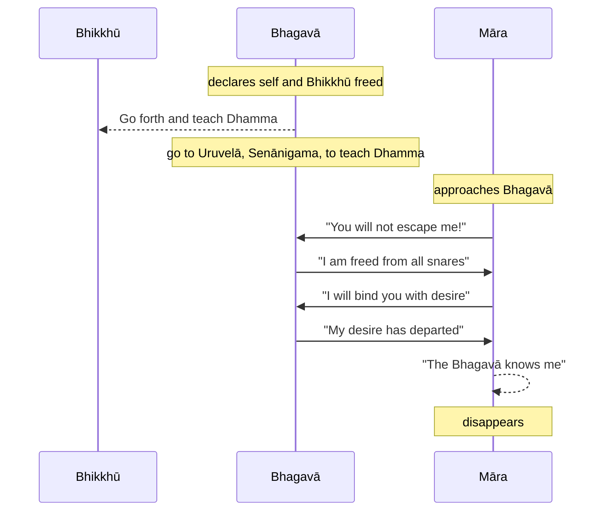

import { Tabs, TabItem } from '@astrojs/starlight/components';

Original text: [World Tipitaka Edition](https://tipitaka2500.github.io/tipitaka/3V/1/1.8.html)

## Summary

The Buddha, declaring both himself and his bhikkhū freed from all divine and human snares, instructs them to go forth and teach the Dhamma — a teaching good in its beginning, middle, and end, leading to the perfectly complete optimal life — for the welfare and happiness of all beings, as some are ready to understand it; he himself also intends to teach. This declaration of freedom is immediately challenged by Māra, who claims the Buddha is still bound. However, the Buddha refutes Māra's assertions, specifically stating his detachment from sensory desires (forms, sounds, tastes, smells, tangibles), which Māra intended as a "mental snare," causing Māra to recognise his defeat and vanish in distress.

## Diagram

## Text

<Tabs syncKey="paliquote">
<TabItem label="My Translation">
(32.)

131\. Then the Bhagavā addressed those bhikkhū: “I am freed, Bhikkhave, from all snares, both divine and human. You too, Bhikkhave, are freed from all snares, both divine and human. Wander, Bhikkhave, on tour for the welfare of the many, for the happiness of the many, out of compassion for the world, for the good, welfare, and happiness of devas (deities) and humans. Let not two go by one [way]. Teach, Bhikkhave, the `Dhamma` (doctrine) that is good in the beginning, good in the middle, and good in the end, meaningful and well-phrased; make known the `brahmacariya` (the optimal life) that is wholly complete and perfectly pure. There are beings `apparajakkhajātikā` (with little dust in their eyes by nature) who are wasting away through not hearing the `Dhamma` (doctrine), and there will be those who understand the `Dhamma`. I too, Bhikkhave, will go to Uruvelā, the army township, to teach the `Dhamma` (doctrine).”

(33.)

132\. Then Māra the Evil One approached the Bhagavā; having approached, he addressed the Bhagavā with a verse:

133\. _“You are bound by all snares,_ \
_both divine and human;_ \
_You are bound by a great bond,_ \
_You will not be freed from me, Samaṇa (Wanderer)!”_

134\. _“I am freed from all snares,_ \
_Both divine and human;_ \
_I am freed from the great bond,_ \
_You are struck down, Antaka (Death)!”_

135\. _“The snare that moves in the air,_ \
_this mental one that roams;_ \
_With that I will catch you,_ \
_You will not be freed from me, Samaṇa (Wanderer)!”_

136\. _“Forms, sounds, tastes, smells,_ \
_And delightful tangibles;_ \
_My `chanda` (desire) for these has departed,_ \
_You are struck down, Antaka (Death)!”_

137\. Then Māra the Evil One — “The Bhagavā knows me, the `sugata` (Fortunate One) knows me,” — distressed and dejected, vanished right there.

---

138\. The Account of Māra is finished.
</TabItem>

<TabItem label="Pāḷi (Roman IAST)">
(32.)

131\. Atha kho bhagavā te bhikkhū āmantesi—  “muttāhaṃ, bhikkhave, sabbapāsehi, ye dibbā ye ca mānusā. Tumhepi, bhikkhave, muttā sabbapāsehi, ye dibbā ye ca mānusā. Caratha, bhikkhave, cārikaṃ bahujanahitāya bahujanasukhāya lokānukampāya atthāya hitāya sukhāya devamanussānaṃ. Mā ekena dve agamittha. Desetha, bhikkhave, dhammaṃ ādikalyāṇaṃ majjhekalyāṇaṃ pariyosānakalyāṇaṃ sātthaṃ sabyañjanaṃ kevalaparipuṇṇaṃ parisuddhaṃ brahmacariyaṃ pakāsetha. Santi sattā apparajakkhajātikā, assavanatā dhammassa parihāyanti, bhavissanti dhammassa aññātāro. Ahampi, bhikkhave, yena uruvelā senānigamo tenupasaṅkamissāmi dhammadesanāyā”ti.

(33.)

132\. Atha kho māro pāpimā yena bhagavā tenupasaṅkami, upasaṅkamitvā bhagavantaṃ gāthāya ajjhabhāsi—

133\. _“Baddhosi sabbapāsehi,_  \
_ye dibbā ye ca mānusā;_  \
_Mahābandhanabaddhosi,_  \
_na me samaṇa mokkhasī”ti._  

134\. _“Muttāhaṃ sabbapāsehi,_  \
_Ye dibbā ye ca mānusā;_  \
_Mahābandhanamuttomhi,_  \
_Nihato tvamasi antakā”ti._  

135\. _“Antalikkhacaro pāso,_  \
_yvāyaṃ carati mānaso;_  \
_Tena taṃ bādhayissāmi,_  \
_na me samaṇa mokkhasī”ti._  

136\. _“Rūpā saddā rasā gandhā,_  \
_Phoṭṭhabbā ca manoramā;_  \
_Ettha me vigato chando,_  \
_Nihato tvamasi antakā”ti._  

137\. Atha kho māro pāpimā—  “jānāti maṃ bhagavā, jānāti maṃ sugato”ti dukkhī dummano tatthevantaradhāyīti.

---

138\. Mārakathā niṭṭhitā.
</TabItem>

<TabItem label="Pāḷi (Brahmi)">
(32.)

131\. 𑀅𑀣 𑀔𑁄 𑀪𑀕𑀯𑀸 𑀢𑁂 𑀪𑀺𑀓𑁆𑀔𑀽 𑀆𑀫𑀦𑁆𑀢𑁂𑀲𑀺—  “𑀫𑀼𑀢𑁆𑀢𑀸𑀳𑀁, 𑀪𑀺𑀓𑁆𑀔𑀯𑁂, 𑀲𑀩𑁆𑀩𑀧𑀸𑀲𑁂𑀳𑀺, 𑀬𑁂 𑀤𑀺𑀩𑁆𑀩𑀸 𑀬𑁂 𑀘 𑀫𑀸𑀦𑀼𑀲𑀸. 𑀢𑀼𑀫𑁆𑀳𑁂𑀧𑀺, 𑀪𑀺𑀓𑁆𑀔𑀯𑁂, 𑀫𑀼𑀢𑁆𑀢𑀸 𑀲𑀩𑁆𑀩𑀧𑀸𑀲𑁂𑀳𑀺, 𑀬𑁂 𑀤𑀺𑀩𑁆𑀩𑀸 𑀬𑁂 𑀘 𑀫𑀸𑀦𑀼𑀲𑀸. 𑀘𑀭𑀣, 𑀪𑀺𑀓𑁆𑀔𑀯𑁂, 𑀘𑀸𑀭𑀺𑀓𑀁 𑀩𑀳𑀼𑀚𑀦𑀳𑀺𑀢𑀸𑀬 𑀩𑀳𑀼𑀚𑀦𑀲𑀼𑀔𑀸𑀬 𑀮𑁄𑀓𑀸𑀦𑀼𑀓𑀫𑁆𑀧𑀸𑀬 𑀅𑀢𑁆𑀣𑀸𑀬 𑀳𑀺𑀢𑀸𑀬 𑀲𑀼𑀔𑀸𑀬 𑀤𑁂𑀯𑀫𑀦𑀼𑀲𑁆𑀲𑀸𑀦𑀁. 𑀫𑀸 𑀏𑀓𑁂𑀦 𑀤𑁆𑀯𑁂 𑀅𑀕𑀫𑀺𑀢𑁆𑀣. 𑀤𑁂𑀲𑁂𑀣, 𑀪𑀺𑀓𑁆𑀔𑀯𑁂, 𑀥𑀫𑁆𑀫𑀁 𑀆𑀤𑀺𑀓𑀮𑁆𑀬𑀸𑀡𑀁 𑀫𑀚𑁆𑀛𑁂𑀓𑀮𑁆𑀬𑀸𑀡𑀁 𑀧𑀭𑀺𑀬𑁄𑀲𑀸𑀦𑀓𑀮𑁆𑀬𑀸𑀡𑀁 𑀲𑀸𑀢𑁆𑀣𑀁 𑀲𑀩𑁆𑀬𑀜𑁆𑀚𑀦𑀁 𑀓𑁂𑀯𑀮𑀧𑀭𑀺𑀧𑀼𑀡𑁆𑀡𑀁 𑀧𑀭𑀺𑀲𑀼𑀤𑁆𑀥𑀁 𑀩𑁆𑀭𑀳𑁆𑀫𑀘𑀭𑀺𑀬𑀁 𑀧𑀓𑀸𑀲𑁂𑀣. 𑀲𑀦𑁆𑀢𑀺 𑀲𑀢𑁆𑀢𑀸 𑀅𑀧𑁆𑀧𑀭𑀚𑀓𑁆𑀔𑀚𑀸𑀢𑀺𑀓𑀸, 𑀅𑀲𑁆𑀲𑀯𑀦𑀢𑀸 𑀥𑀫𑁆𑀫𑀲𑁆𑀲 𑀧𑀭𑀺𑀳𑀸𑀬𑀦𑁆𑀢𑀺, 𑀪𑀯𑀺𑀲𑁆𑀲𑀦𑁆𑀢𑀺 𑀥𑀫𑁆𑀫𑀲𑁆𑀲 𑀅𑀜𑁆𑀜𑀸𑀢𑀸𑀭𑁄. 𑀅𑀳𑀫𑁆𑀧𑀺, 𑀪𑀺𑀓𑁆𑀔𑀯𑁂, 𑀬𑁂𑀦 𑀉𑀭𑀼𑀯𑁂𑀮𑀸 𑀲𑁂𑀦𑀸𑀦𑀺𑀕𑀫𑁄 𑀢𑁂𑀦𑀼𑀧𑀲𑀗𑁆𑀓𑀫𑀺𑀲𑁆𑀲𑀸𑀫𑀺 𑀥𑀫𑁆𑀫𑀤𑁂𑀲𑀦𑀸𑀬𑀸”𑀢𑀺.

(33.)

132\. 𑀅𑀣 𑀔𑁄 𑀫𑀸𑀭𑁄 𑀧𑀸𑀧𑀺𑀫𑀸 𑀬𑁂𑀦 𑀪𑀕𑀯𑀸 𑀢𑁂𑀦𑀼𑀧𑀲𑀗𑁆𑀓𑀫𑀺, 𑀉𑀧𑀲𑀗𑁆𑀓𑀫𑀺𑀢𑁆𑀯𑀸 𑀪𑀕𑀯𑀦𑁆𑀢𑀁 𑀕𑀸𑀣𑀸𑀬 𑀅𑀚𑁆𑀛𑀪𑀸𑀲𑀺—

133\. _“𑀩𑀤𑁆𑀥𑁄𑀲𑀺 𑀲𑀩𑁆𑀩𑀧𑀸𑀲𑁂𑀳𑀺,_  \
_𑀬𑁂 𑀤𑀺𑀩𑁆𑀩𑀸 𑀬𑁂 𑀘 𑀫𑀸𑀦𑀼𑀲𑀸;_  \
_𑀫𑀳𑀸𑀩𑀦𑁆𑀥𑀦𑀩𑀤𑁆𑀥𑁄𑀲𑀺,_  \
_𑀦 𑀫𑁂 𑀲𑀫𑀡 𑀫𑁄𑀓𑁆𑀔𑀲𑀻”𑀢𑀺._  

134\. _“𑀫𑀼𑀢𑁆𑀢𑀸𑀳𑀁 𑀲𑀩𑁆𑀩𑀧𑀸𑀲𑁂𑀳𑀺,_  \
_𑀬𑁂 𑀤𑀺𑀩𑁆𑀩𑀸 𑀬𑁂 𑀘 𑀫𑀸𑀦𑀼𑀲𑀸;_  \
_𑀫𑀳𑀸𑀩𑀦𑁆𑀥𑀦𑀫𑀼𑀢𑁆𑀢𑁄𑀫𑁆𑀳𑀺,_  \
_𑀦𑀺𑀳𑀢𑁄 𑀢𑁆𑀯𑀫𑀲𑀺 𑀅𑀦𑁆𑀢𑀓𑀸”𑀢𑀺._  

135\. _“𑀅𑀦𑁆𑀢𑀮𑀺𑀓𑁆𑀔𑀘𑀭𑁄 𑀧𑀸𑀲𑁄,_  \
_𑀬𑁆𑀯𑀸𑀬𑀁 𑀘𑀭𑀢𑀺 𑀫𑀸𑀦𑀲𑁄;_  \
_𑀢𑁂𑀦 𑀢𑀁 𑀩𑀸𑀥𑀬𑀺𑀲𑁆𑀲𑀸𑀫𑀺,_  \
_𑀦 𑀫𑁂 𑀲𑀫𑀡 𑀫𑁄𑀓𑁆𑀔𑀲𑀻”𑀢𑀺._  

136\. _“𑀭𑀽𑀧𑀸 𑀲𑀤𑁆𑀤𑀸 𑀭𑀲𑀸 𑀕𑀦𑁆𑀥𑀸,_  \
_𑀨𑁄𑀝𑁆𑀞𑀩𑁆𑀩𑀸 𑀘 𑀫𑀦𑁄𑀭𑀫𑀸;_  \
_𑀏𑀢𑁆𑀣 𑀫𑁂 𑀯𑀺𑀕𑀢𑁄 𑀙𑀦𑁆𑀤𑁄,_  \
_𑀦𑀺𑀳𑀢𑁄 𑀢𑁆𑀯𑀫𑀲𑀺 𑀅𑀦𑁆𑀢𑀓𑀸”𑀢𑀺._  

137\. 𑀅𑀣 𑀔𑁄 𑀫𑀸𑀭𑁄 𑀧𑀸𑀧𑀺𑀫𑀸—  “𑀚𑀸𑀦𑀸𑀢𑀺 𑀫𑀁 𑀪𑀕𑀯𑀸, 𑀚𑀸𑀦𑀸𑀢𑀺 𑀫𑀁 𑀲𑀼𑀕𑀢𑁄”𑀢𑀺 𑀤𑀼𑀓𑁆𑀔𑀻 𑀤𑀼𑀫𑁆𑀫𑀦𑁄 𑀢𑀢𑁆𑀣𑁂𑀯𑀦𑁆𑀢𑀭𑀥𑀸𑀬𑀻𑀢𑀺.

---

138\. 𑀫𑀸𑀭𑀓𑀣𑀸 𑀦𑀺𑀝𑁆𑀞𑀺𑀢𑀸.
</TabItem>

<TabItem label="Interlinear">
(32.)

[131](https://tipitaka2500.github.io/tipitaka/3V/1/1.8.html#131) Atha kho bhagavā te bhikkhū āmantesi— “muttāhaṃ, bhikkhave, sabbapāsehi, ye dibbā ye ca mānusā.  
⏏️(atha) ⏏️(kho) 🚹⨀①(bhagavant) *️⃣🤟🚹⨂②(ta) 🚹⨂②(bhikkhu) 🟢⨀🤟⏮(āmanteti) 🚹⨀①🔽(ta)(mutta) *️⃣👆⚧⨀①(ahaṃ) 🚹⨂⓪(bhikkhu) 🚹⨂⑤🆎(sabba+pāsa) *️⃣🤟🚹⨂①(ya) 🚹⨂①(dibba) *️⃣🤟🚹⨂①(ya) ⏏️(ca) 🚹⨂①(mānusa)  
then | indeed | the Bhagavā | those | bhikkhū | addressed | freed | I | Bhikkhave | from all snares | those which | divine | those which | and | human  
Then the Bhagavā addressed those bhikkhū: “I am freed, Bhikkhave, from all snares, both divine and human.

Tumhepi, bhikkhave, muttā sabbapāsehi, ye dibbā ye ca mānusā.  
*️⃣🤘⚧⨂①(tvaṃ) ⏏️(api) 🚹⨂⓪(bhikkhu) 🚹⨂①🔽(ta)(mutta) 🚹⨂⑤🆎(sabba+pāsa) *️⃣🤟🚹⨂①(ya) 🚹⨂①(dibba) *️⃣🤟🚹⨂①(ya) ⏏️(ca) 🚹⨂①(mānusa)  
you | too | Bhikkhave | freed | from all snares | those which | divine | those which | and | human  
You too, Bhikkhave, are freed from all snares, both divine and human.

Caratha, bhikkhave, cārikaṃ bahujanahitāya bahujanasukhāya lokānukampāya atthāya hitāya sukhāya devamanussānaṃ.  
🟢⨂🤘⏹(carati) 🚹⨂⓪(bhikkhu) 🚺⨀②(cārikā) 🚻⨀④🆎(bahu+jana+hita) 🚻⨀④🆎(bahu+jana+sukha) 🚺⨀④🆎(loka+anukampā) 🚹⨀④(attha) 🚻⨀④(hita) 🚻⨀④(sukha) 🚹⨂⑥🆎(deva+manussa)  
wander | Bhikkhave | on a journey | for the welfare of many people | for the happiness of many people | out of compassion for the world | for the good | for the welfare | for the happiness | of gods and humans  
Wander, Bhikkhave, on tour for the welfare of the many, for the happiness of the many, out of compassion for the world, for the good, welfare, and happiness of devas (deities) and humans.

Mā ekena dve agamittha.  
⏏️(mā) *️⃣🤟🚹⨀③(eka) ⚧⨂①(dvi) 🟢⨂🤘⏮(gacchati)  
do not | by one | two | go  
Let not two go by one [way].

Desetha, bhikkhave, dhammaṃ ādikalyāṇaṃ majjhekalyāṇaṃ pariyosānakalyāṇaṃ sātthaṃ sabyañjanaṃ kevalaparipuṇṇaṃ parisuddhaṃ brahmacariyaṃ pakāsetha.  
🟠⨂🤘⏹(deseti) 🚹⨂⓪(bhikkhu) 🚹⨀②(dhamma) 🚹⨀②🆎(ādi+kalyāṇa) 🚹⨀②🆎(majjhe+kalyāṇa) 🚹⨀②🆎(pariyosāna+kalyāṇa) 🚹⨀②🆎(sa+attha) 🚹⨀②🆎(sa+byañjana) 🚻⨀②🆎(kevala+paripuṇṇa) 🚻⨀②🔽(ta)(parisuddha) 🚻⨀②🆎(brahma+cariya) 🟠⨂🤘⏹(pakāseti)  
teach | Bhikkhave | the Dhamma | good in the beginning | good in the middle | good in the end | meaningful | well-phrased | wholly complete | perfectly pure | the optimal life | make known  
Teach, Bhikkhave, the `Dhamma` (doctrine) that is good in the beginning, good in the middle, and good in the end, meaningful and well-phrased; make known the `brahmacariya` (the optimal life) that is wholly complete and perfectly pure.

Santi sattā apparajakkhajātikā, assavanatā dhammassa parihāyanti, bhavissanti dhammassa aññātāro.  
🟢⨂🤟▶️(atthi) 🚹⨂①(satta) 🚹⨂①🆎(appa+rajas+akkha+jātika) 🚺⨀③(assavanatā) 🚹⨀⑥(dhamma) 🟢⨂🤟▶️(parihāyati) 🟢⨂🤟⏭(bhavati) 🚹⨀⑥(dhamma) 🚹⨂①(aññātar)  
there are | beings | with little dust in their eyes by nature | through not hearing | of the Dhamma | are wasting away | there will be | of the Dhamma | those who understand  
There are beings `apparajakkhajātikā` (with little dust in their eyes by nature) who are wasting away through not hearing the `Dhamma` (doctrine), and there will be those who understand the `Dhamma`.

Ahampi, bhikkhave, yena uruvelā senānigamo tenupasaṅkamissāmi dhammadesanāyā”ti.  
*️⃣👆⚧⨀①(ahaṃ) ⏏️(api) 🚹⨂⓪(bhikkhu) *️⃣🤟🚹⨀③(ya) 🚺⨀①(uruvelā) 🚹⨀①🆎(senā+nigama) *️⃣🤟🚹⨀③(ta) 🟢⨀👆⏭(upasaṅkamati) 🚺⨀④🆎(dhamma+desanā) ⏏️(iti)  
I | too | Bhikkhave | by where | Uruvelā | the army township | by there | will approach | for the teaching of the Dhamma | (end quote)  
I too, Bhikkhave, will go to Uruvelā, the army township, to teach the `Dhamma` (doctrine).”

(33.)

[132](https://tipitaka2500.github.io/tipitaka/3V/1/1.8.html#132) Atha kho māro pāpimā yena bhagavā tenupasaṅkami, upasaṅkamitvā bhagavantaṃ gāthāya ajjhabhāsi—  
⏏️(atha) ⏏️(kho) 🚹⨀①(māra) 🚹⨀①(pāpimant) *️⃣🤟🚹⨀③(ya) 🚹⨀①(bhagavant) *️⃣🤟🚹⨀③(ta) 🟢⨀🤟⏮(upasaṅkamati) 🔽(tvā)(upasaṅkamati) 🚹⨀②(bhagavant) 🚺⨀③(gāthā) 🟢⨀🤟⏮(ajjhabhāsati)  
then | indeed | Māra | the Evil One | by where | the Bhagavā | by there | approached | having approached | the Bhagavā | with a verse | addressed  
Then Māra the Evil One approached the Bhagavā; having approached, he addressed the Bhagavā with a verse:

[133](https://tipitaka2500.github.io/tipitaka/3V/1/1.8.html#133) “Baddhosi sabbapāsehi,  
🚹⨀①🔽(ta)(baddha) 🟢⨀🤘▶️(atthi) 🚹⨂③🆎(sabba+pāsa)  
bound | you are | by all snares  
ye dibbā ye ca mānusā;  
*️⃣🤟🚹⨂①(ya) 🚹⨂①(dibba) *️⃣🤟🚹⨂①(ya) ⏏️(ca) 🚹⨂①(mānusa)  
those which | divine | those which | and | human  
Mahābandhanabaddhosi,  
🚹⨀①🆎(mahā+bandhana+baddha) 🟢⨀🤘▶️(atthi)  
bound by a great bond | you are  
na me samaṇa mokkhasī”ti.  
⏏️(na) *️⃣👆⚧⨀⑥(ahaṃ) 🚹⨀⓪(samaṇa) 🟢⨀🤘⏭(muñcati) ⏏️(iti)  
not | from me | wanderer | will be freed | (end quote)  

“You are bound by all snares,  
both divine and human;  
You are bound by a great bond,  
You will not be freed from me, Samaṇa (Wanderer)!”

[134](https://tipitaka2500.github.io/tipitaka/3V/1/1.8.html#134) “Muttāhaṃ sabbapāsehi,  
🚹⨀①🔽(ta)(mutta) *️⃣👆⚧⨀①(ahaṃ) 🚹⨂⑤🆎(sabba+pāsa)  
freed | I | from all snares  
Ye dibbā ye ca mānusā;  
*️⃣🤟🚹⨂①(ya) 🚹⨂①(dibba) *️⃣🤟🚹⨂①(ya) ⏏️(ca) 🚹⨂①(mānusa)  
those which | divine | those which | and | human  
Mahābandhanamuttomhi,  
🚹⨀①🆎(mahā+bandhana+mutta) 🟢⨀👆▶️(atthi)  
freed from the great bond | I am  
Nihato tvamasi antakā”ti.  
🚹⨀①🔽(ta)(nihata) *️⃣🤘⚧⨀①(tvaṃ) 🟢⨀🤘▶️(atthi) 🚹⨀⓪(antaka) ⏏️(iti)  
struck down | you | are | Death | (end quote)  

“I am freed from all snares,  
Both divine and human;  
I am freed from the great bond,  
You are struck down, Antaka (Death)!”

[135](https://tipitaka2500.github.io/tipitaka/3V/1/1.8.html#135) “Antalikkhacaro pāso,  
🚹⨀①🆎(antalikkha+cara) 🚹⨀①(pāsa)  
moving through the air | snare  
yvāyaṃ carati mānaso;  
*️⃣🤟🚹⨀①(ya) *️⃣🤟🚹⨀①(ima) 🟢⨀🤟▶️(carati) 🚹⨀①(mānasa)  
which | this | wanders | mental  
Tena taṃ bādhayissāmi,  
*️⃣🤟🚹⨀③(ta) *️⃣🤘⚧⨀②(tvaṃ) 🟠⨀👆⏭(bādheti)  
with that | you | will catch  
na me samaṇa mokkhasī”ti.  
⏏️(na) *️⃣👆⚧⨀⑥(ahaṃ) 🚹⨀⓪(samaṇa) 🟢⨀🤘⏭(muñcati) ⏏️(iti)  
not | from me | wanderer | will be freed | (end quote)  

“The snare that moves in the air,  
this mental one that roams;  
With that I will catch you,  
You will not be freed from me, Samaṇa (Wanderer)!”

[136](https://tipitaka2500.github.io/tipitaka/3V/1/1.8.html#136) “Rūpā saddā rasā gandhā,  
🚻⨂①(rūpa) 🚹⨂①(sadda) 🚹⨂①(rasa) 🚹⨂①(gandha)  
forms | sounds | tastes | odours  
Phoṭṭhabbā ca manoramā;  
🚻⨂①(phoṭṭhabba) ⏏️(ca) 🚻⨂①🆎(mano+rama)  
tangibles | and | delightful  
Ettha me vigato chando,  
⏏️(ettha) *️⃣👆⚧⨀⑥(ahaṃ) 🚹⨀①🔽(ta)(vigata) 🚹⨀①(chanda)  
here | my | gone | desire  
Nihato tvamasi antakā”ti.  
🚹⨀①🔽(ta)(nihata) *️⃣🤘⚧⨀①(tvaṃ) 🟢⨀🤘▶️(atthi) 🚹⨀⓪(antaka) ⏏️(iti)  
struck down | you | are | Death | (end quote)  

“Forms, sounds, tastes, smells,  
And delightful tangibles;  
My `chanda` (desire) for these has departed,  
You are struck down, Antaka (Death)!”

[137](https://tipitaka2500.github.io/tipitaka/3V/1/1.8.html#137) Atha kho māro pāpimā— “jānāti maṃ bhagavā, jānāti maṃ sugato”ti dukkhī dummano tatthevantaradhāyīti.  
⏏️(atha) ⏏️(kho) 🚹⨀①(māra) 🚹⨀①(pāpimant) 🟢⨀🤟▶️(jānāti) *️⃣👆⚧⨀②(ahaṃ) 🚹⨀①(bhagavant) 🟢⨀🤟▶️(jānāti) *️⃣👆⚧⨀②(ahaṃ) 🚹⨀①🆎(su+gata) ⏏️(iti) 🚹⨀①(dukkhī) 🚹⨀①🆎(dur+mana) ⏏️(tattha) ⏏️(eva) 🟢⨀🤟⏮(antaradhāyati) ⏏️(iti)  
then | indeed | Māra | the Evil One | knows | me | the Bhagavā | knows | me | the Fortunate One | (end quote) | unhappy | dejected | there | just | vanished | (end quote)  
Then Māra the Evil One — “The Bhagavā knows me, the `sugata` (Fortunate One) knows me,” — distressed and dejected, vanished right there.

[138](https://tipitaka2500.github.io/tipitaka/3V/1/1.8.html#138) Mārakathā niṭṭhitā.  
🚺⨀①🆎(māra+kathā) 🚺⨀①🔽(ta)(niṭṭhita)  
the Mārakathā | finished  
The Account of Māra is finished.
</TabItem>
</Tabs>

## Commentary

The narrative starts the scene by introducing the Buddha's decision to send forth his disciples to spread the Dhamma widely. This marks a turning point in the Buddha's teaching career - to transition from him personally teaching the Dhamma to authorising those who are liberated ('freed from all snares, both divine and human') to teach on his behalf.

This immediately raises the possibility and the risk that temptation may cause relapse either in the Buddha or in his disciples once they are geographically separated. The Buddha's nemesis Māra appears before him, challenging him and raising exactly this issue.

Note that Māra personifies the internal psychological forces that resist this liberation — the inertia of habitual thought, attachment, and aversion. Rationally, Māra is the voice of the ego-construct or established patterns of intentionality that perceive this shift as a threat. His challenge, "You are bound," is the reassertion of these old, binding structures within consciousness.

The Bhagavā’s refutation, particularly "My `chanda` (desire) for these [sensory objects] has departed," identifies the core of this phenomenological freedom: a detachment from the compulsive urge towards or away from sensory stimuli. While phenomena are still perceived, their power to bind through craving or aversion is extinguished. "Māra," as the embodiment of these now-undermined internal compulsions, is "struck down" and "vanishes" when this clear, non-attached awareness is fully realised and acknowledged. His "distress" is the trace of these internal resistances losing their hold.

### Quest for Converts

[@Brekke1997] noted:

> The clearest and most famous expression of the quest for converts is found in MV I. 11 where the Buddha tells the monks to walk out in the world for the welfare, blessing and happiness for devas and men and teach Dhamma which is lovely at the beginning, lovely in the middle and lovely at the end. It is interesting to see this missionary ideal together with a statement in CV.V. Here, the Buddha forbids monks to recite his speeches in metrical form and tells them to learn the word of the Buddha in their own dialect. These passages give an impression of a sect with a wish to convert which is reminescent of protestant Christian sects. The account of general Sīha, a disciple of the Jains (MV VI.31), also expresses a competition between the sects, in this case the Buddhists and the Jains, and a proselytizing activity of the Buddha.

### Brahmanism antecedents

According to [@HowBuddhismBegan] Māra is another figure borrowed from Brahmanism:

> It is very hard to tell how seriously one is supposed to take Māra. In fact I suppose that there is no one answer to this: that different authors and compilers had different opinions and attitudes. Since all the world around us, including the hells beneath us and the heavens of the gods (deva) above us, are within the plane of desire (kāmâvacara), Māra is allegorically said to reside in the highest of those heavens, so that he presides over the world of which human beings are at the centre and holds it in his grasp; this is graphically depicted in Tibetan pictures of the wheel of life, in which this world is shown in the grip of a devouring demon. But the Pali texts tend to treat Māra more lightly ...

and also

> We must bear in mind that Māra, there called Mrtyu, figures in the Brāhmaṇas as personified Death; there of course he is taken seriously. Satirizing Māra was therefore much like satirizing Brahmā. I suspect that in both cases the original spirit of the satire may have been rather light-hearted, even when it made serious points.

### Māra as a personification of the risk of "lapsing"

This narrative is highly significant because it implies that liberation is not permanent - residual tendencies to revert to old ways can reassert themselves, and therefore living a liberated life requires constant monitoring and assessment. This narrative signals confidence that the Buddha's initial community is strong and should be able to resist these tendencies.

It is important to understand the core purpose of the `saṅgha` is to act as a support group for monitoring `brahmacariya` - in assessing whether individuals have maintained their "awakened" status and continuing to live the optimal life. Think of it as similar to "Alcoholics Anonymous" - members of the community have essentially agreed to avoid non-optimal mental flows and constructions, and behave in an "optimal" manner (as prescribed by the `Pātimokkha`). However, there is a risk of temptation (represented by Māra) and the danger of lapsing into non-optimal tendencies and habits.

The essence of `brahmacariya` is that members of the community should continually assess themselves and periodically declare their "purity" (`pārisuddhi`) to each other. Anyone who has engaged in non-optimal thoughts or behaviour (`āpatti`) should reveal it so that the community can help that person.

## Other opinions

- [Brekke - The Early Samgha and the Laity (1996)](/articles/brekke---the-early-samgha-and-the-laity-1996/) [@Brekke1997] \
  This article argues that early Buddhism transformed from an open, conversionist movement into a more withdrawn, introversionist sect due to the persistent problem of individuals joining the Saṅgha for extrinsic, worldly motivations. Initially, the Saṅgha actively sought converts, competing with other religious groups for followers. However, as people began joining to escape debt, military service, or simply to attain an easy life, the community's purity and reputation were threatened, jeopardising the crucial material support it received from the laity. In response, the Saṅgha developed introversionist characteristics by implementing stricter admission rules, emphasising internal unity, regulating the appearance and conduct of bhikkhū to project an image of holiness, and establishing fixed monasteries for physical separation. This created a self-enforcing cycle where the Saṅgha's enhanced purity attracted greater lay support, which in turn made it a more appealing refuge for the extrinsically motivated, necessitating a continuous process of purification to maintain its stability.
- [Gombrich - How Buddhism Began: The conditioned genesis of the early teachings (2006)](/books/gombrich---how-buddhism-began-2006/) [@HowBuddhismBegan] \
  Gombrich analyses the _Padhāna Sutta_, an early allegorical account of the Buddha's awakening as a battle with Māra, the personification of death. It highlights a major contradiction with the later, more famous story: in this sutta, the Buddha defeats Māra _through_ extreme asceticism, directly opposing the orthodox "middle path" narrative where he rejects such practices. The author suggests this discrepancy reflects an early internal debate within Buddhism, possibly with Jain influence, regarding the value of asceticism. The text also explores the inconsistent portrayal of Māra, contrasting his serious role as the cosmic ruler of the world of desire with his more light-hearted and even humorous treatment in other Pāḷi texts, where he is satirised, exorcised like a common demon, and comically defeated. This satirical approach, applied to figures like Māra and Brahmā, is presented as a method early Buddhists used to make serious theological points in a light-hearted manner.

[Go to previous page (7. Pabbajjākathā)](/khandhaka/1-7/) / [Go to parent page (Khandhaka)](/khandhaka/) / [Go to next page (9. Pabbajjūpasampadākathā)](/khandhaka/1-9/)

## References
