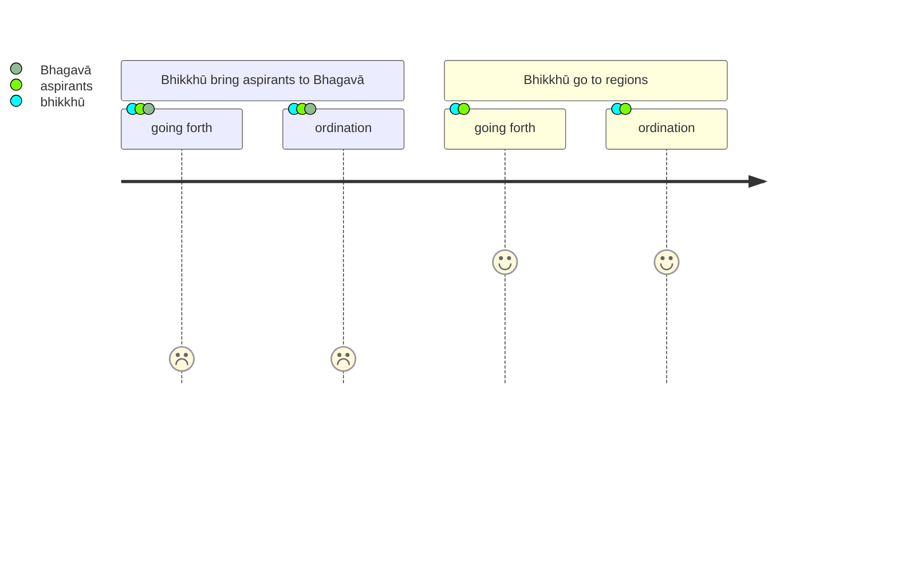
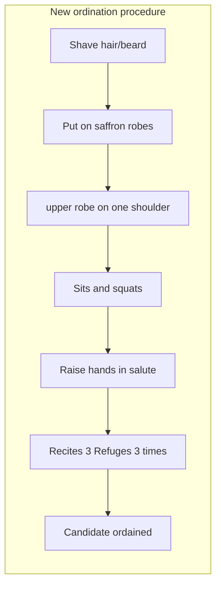

import { Tabs, TabItem } from '@astrojs/starlight/components';

Original text: [World Tipitaka Edition](https://tipitaka2500.github.io/tipitaka/3V/1/1.9.html)

## Summary

Due to the weariness experienced by both bhikkhū and aspirants travelling to the Bhagavā for ordination (`upasampadā`), the Bhagavā, after reflection, decided to authorise bhikkhū to conduct these ordinations themselves in their respective regions. He then detailed the ordination process, which includes preparatory actions like shaving and donning robes, paying homage, and culminates in the aspirant thrice reciting the Three Refuges (taking refuge in the Buddha, Dhamma, and Saṅgha). The Bhagavā declared that this act of taking the Three Refuges itself constitutes both `pabbajjā` (going forth) and `upasampadā` (higher ordination).

## Diagram

## Text

<Tabs syncKey="paliquote">
<TabItem label="My Translation">
(34.)

139\. Now at that time, bhikkhū from various regions, from various countries, brought those wishing for `pabbajjā` (going forth) and those wishing for `upasampadā` (higher ordination), thinking: “The Bhagavā will give them `pabbajjā`, will give them `upasampadā`.” In that, both the bhikkhū and those wishing for `pabbajjā` and those wishing for `upasampadā` became weary. Then, while the Bhagavā was alone in seclusion, this reflection arose in his mind: “Now bhikkhū from various regions, from various countries, bring those wishing for `pabbajjā` and those wishing for `upasampadā`, thinking: ‘The Bhagavā will give them `pabbajjā`, will give them `upasampadā`.’ In that, both the bhikkhū and those wishing for `pabbajjā` and those wishing for `upasampadā` become weary. What if I were to allow the bhikkhū: you yourselves now, Bhikkhave, in those various regions, in those various countries, may give `pabbajjā`, may give `upasampadā`.”

140\. Then the Bhagavā, having risen from seclusion in the evening, having given a Dhamma talk on this account, on this matter, addressed the bhikkhū: “Here, Bhikkhave, while I was alone in seclusion, this reflection arose in my mind: ‘Now bhikkhū from various regions, from various countries, bring those wishing for `pabbajjā` (going forth) and those wishing for `upasampadā` (higher ordination), thinking: “The Bhagavā will give them `pabbajjā`, will give them `upasampadā`.” In that, both the bhikkhū and those wishing for `pabbajjā` and those wishing for `upasampadā` become weary. What if I were to allow the bhikkhū: you yourselves now, Bhikkhave, in those various regions, in those various countries, may give `pabbajjā`, may give `upasampadā`.’ I allow, Bhikkhave, you yourselves now, in those various regions, in those various countries, to give `pabbajjā`, to give `upasampadā`. And in this way, Bhikkhave, [he] should be given `pabbajjā`, should be given `upasampadā`—

141\. First, having had the hair and beard shaved off, having had saffron robes put on, having had the upper robe arranged over one shoulder, having had homage paid to the feet of the bhikkhū, having had him sit in a squatting position, having had him raise his hands in `añjali` (palms placed together as a token of respect), he should be told: ‘Speak thus’—

142\. _‘I go to the Buddha as refuge,_ \
_I go to the Dhamma as refuge,_ \
_I go to the Saṅgha as refuge._

143\. _For the second time too, I go to the Buddha as refuge,_ \
_For the second time too, I go to the Dhamma as refuge,_ \
_For the second time too, I go to the Saṅgha as refuge._

144\. _For the third time too, I go to the Buddha as refuge,_ \
_For the third time too, I go to the Dhamma as refuge,_ \
_For the third time too, I go to the Saṅgha as refuge.’_

145\. I allow, Bhikkhave, by these three goings for refuge, the `pabbajjā` (going forth) and the `upasampadā` (higher ordination).”

---

146\. The Account of `upasampadā` (higher ordination) by the three goings for refuge is finished.
</TabItem>

<TabItem label="Pāḷi (Roman IAST)">
(34.)

139\. Tena kho pana samayena bhikkhū nānādisā nānājanapadā pabbajjāpekkhe ca upasampadāpekkhe ca ānenti—  “bhagavā ne pabbājessati upasampādessatī”ti. Tattha bhikkhū ceva kilamanti pabbajjāpekkhā ca upasampadāpekkhā ca. Atha kho bhagavato rahogatassa paṭisallīnassa evaṃ cetaso parivitakko udapādi—  “etarahi kho bhikkhū nānādisā nānājanapadā pabbajjāpekkhe ca upasampadāpekkhe ca ānenti—  ‘bhagavā ne pabbājessati upasampādessatī’ti. Tattha bhikkhū ceva kilamanti pabbajjāpekkhā ca upasampadāpekkhā ca. Yannūnāhaṃ bhikkhūnaṃ anujāneyyaṃ—  tumheva dāni, bhikkhave, tāsu tāsu disāsu tesu tesu janapadesu pabbājetha upasampādethā”ti.

140\. Atha kho bhagavā sāyanhasamayaṃ paṭisallānā vuṭṭhito etasmiṃ nidāne etasmiṃ pakaraṇe dhammiṃ kathaṃ katvā bhikkhū āmantesi—  “idha mayhaṃ, bhikkhave, rahogatassa paṭisallīnassa evaṃ cetaso parivitakko udapādi—  etarahi kho bhikkhū nānādisā nānājanapadā pabbajjāpekkhe ca upasampadāpekkhe ca ānenti—  ‘bhagavā ne pabbājessati upasampādessatī’ti, Tattha bhikkhū ceva kilamanti pabbajjāpekkhā ca upasampadāpekkhā ca. Yannūnāhaṃ bhikkhūnaṃ anujāneyyaṃ tumheva dāni, bhikkhave, tāsu tāsu disāsu tesu tesu janapadesu pabbājetha upasampādethāti, Anujānāmi, bhikkhave, tumheva dāni tāsu tāsu disāsu tesu tesu janapadesu pabbājetha upasampādetha. Evañca pana, bhikkhave, pabbājetabbo upasampādetabbo—

141\. Paṭhamaṃ kesamassuṃ ohārāpetvā, kāsāyāni vatthāni acchādāpetvā, ekaṃsaṃ uttarāsaṅgaṃ kārāpetvā, bhikkhūnaṃ pāde vandāpetvā, ukkuṭikaṃ nisīdāpetvā, añjaliṃ paggaṇhāpetvā ‘evaṃ vadehī’ti vattabbo—

142\. _‘Buddhaṃ saraṇaṃ gacchāmi,_  
_Dhammaṃ saraṇaṃ gacchāmi,_  
_Saṃghaṃ saraṇaṃ gacchāmi._  

143\. _Dutiyampi buddhaṃ saraṇaṃ gacchāmi,_  
_Dutiyampi dhammaṃ saraṇaṃ gacchāmi,_  
_Dutiyampi saṃghaṃ saraṇaṃ gacchāmi._  

144\. _Tatiyampi buddhaṃ saraṇaṃ gacchāmi,_  
_Tatiyampi dhammaṃ saraṇaṃ gacchāmi,_  
_Tatiyampi saṃghaṃ saraṇaṃ gacchāmī’ti._  

145\. Anujānāmi, bhikkhave, imehi tīhi saraṇagamanehi pabbajjaṃ upasampadan”ti.

---

146\. Tīhi saraṇagamanehi upasampadākathā niṭṭhitā.
</TabItem>

<TabItem label="Pāḷi (Brahmi)">
(34.)

139\. 𑀢𑁂𑀦 𑀔𑁄 𑀧𑀦 𑀲𑀫𑀬𑁂𑀦 𑀪𑀺𑀓𑁆𑀔𑀽 𑀦𑀸𑀦𑀸𑀤𑀺𑀲𑀸 𑀦𑀸𑀦𑀸𑀚𑀦𑀧𑀤𑀸 𑀧𑀩𑁆𑀩𑀚𑁆𑀚𑀸𑀧𑁂𑀓𑁆𑀔𑁂 𑀘 𑀉𑀧𑀲𑀫𑁆𑀧𑀤𑀸𑀧𑁂𑀓𑁆𑀔𑁂 𑀘 𑀆𑀦𑁂𑀦𑁆𑀢𑀺—  “𑀪𑀕𑀯𑀸 𑀦𑁂 𑀧𑀩𑁆𑀩𑀸𑀚𑁂𑀲𑁆𑀲𑀢𑀺 𑀉𑀧𑀲𑀫𑁆𑀧𑀸𑀤𑁂𑀲𑁆𑀲𑀢𑀻”𑀢𑀺. 𑀢𑀢𑁆𑀣 𑀪𑀺𑀓𑁆𑀔𑀽 𑀘𑁂𑀯 𑀓𑀺𑀮𑀫𑀦𑁆𑀢𑀺 𑀧𑀩𑁆𑀩𑀚𑁆𑀚𑀸𑀧𑁂𑀓𑁆𑀔𑀸 𑀘 𑀉𑀧𑀲𑀫𑁆𑀧𑀤𑀸𑀧𑁂𑀓𑁆𑀔𑀸 𑀘. 𑀅𑀣 𑀔𑁄 𑀪𑀕𑀯𑀢𑁄 𑀭𑀳𑁄𑀕𑀢𑀲𑁆𑀲 𑀧𑀝𑀺𑀲𑀮𑁆𑀮𑀻𑀦𑀲𑁆𑀲 𑀏𑀯𑀁 𑀘𑁂𑀢𑀲𑁄 𑀧𑀭𑀺𑀯𑀺𑀢𑀓𑁆𑀓𑁄 𑀉𑀤𑀧𑀸𑀤𑀺—  “𑀏𑀢𑀭𑀳𑀺 𑀔𑁄 𑀪𑀺𑀓𑁆𑀔𑀽 𑀦𑀸𑀦𑀸𑀤𑀺𑀲𑀸 𑀦𑀸𑀦𑀸𑀚𑀦𑀧𑀤𑀸 𑀧𑀩𑁆𑀩𑀚𑁆𑀚𑀸𑀧𑁂𑀓𑁆𑀔𑁂 𑀘 𑀉𑀧𑀲𑀫𑁆𑀧𑀤𑀸𑀧𑁂𑀓𑁆𑀔𑁂 𑀘 𑀆𑀦𑁂𑀦𑁆𑀢𑀺—  ‘𑀪𑀕𑀯𑀸 𑀦𑁂 𑀧𑀩𑁆𑀩𑀸𑀚𑁂𑀲𑁆𑀲𑀢𑀺 𑀉𑀧𑀲𑀫𑁆𑀧𑀸𑀤𑁂𑀲𑁆𑀲𑀢𑀻’𑀢𑀺. 𑀢𑀢𑁆𑀣 𑀪𑀺𑀓𑁆𑀔𑀽 𑀘𑁂𑀯 𑀓𑀺𑀮𑀫𑀦𑁆𑀢𑀺 𑀧𑀩𑁆𑀩𑀚𑁆𑀚𑀸𑀧𑁂𑀓𑁆𑀔𑀸 𑀘 𑀉𑀧𑀲𑀫𑁆𑀧𑀤𑀸𑀧𑁂𑀓𑁆𑀔𑀸 𑀘. 𑀬𑀦𑁆𑀦𑀽𑀦𑀸𑀳𑀁 𑀪𑀺𑀓𑁆𑀔𑀽𑀦𑀁 𑀅𑀦𑀼𑀚𑀸𑀦𑁂𑀬𑁆𑀬𑀁—  𑀢𑀼𑀫𑁆𑀳𑁂𑀯 𑀤𑀸𑀦𑀺, 𑀪𑀺𑀓𑁆𑀔𑀯𑁂, 𑀢𑀸𑀲𑀼 𑀢𑀸𑀲𑀼 𑀤𑀺𑀲𑀸𑀲𑀼 𑀢𑁂𑀲𑀼 𑀢𑁂𑀲𑀼 𑀚𑀦𑀧𑀤𑁂𑀲𑀼 𑀧𑀩𑁆𑀩𑀸𑀚𑁂𑀣 𑀉𑀧𑀲𑀫𑁆𑀧𑀸𑀤𑁂𑀣𑀸”𑀢𑀺.

140\. 𑀅𑀣 𑀔𑁄 𑀪𑀕𑀯𑀸 𑀲𑀸𑀬𑀦𑁆𑀳𑀲𑀫𑀬𑀁 𑀧𑀝𑀺𑀲𑀮𑁆𑀮𑀸𑀦𑀸 𑀯𑀼𑀝𑁆𑀞𑀺𑀢𑁄 𑀏𑀢𑀲𑁆𑀫𑀺𑀁 𑀦𑀺𑀤𑀸𑀦𑁂 𑀏𑀢𑀲𑁆𑀫𑀺𑀁 𑀧𑀓𑀭𑀡𑁂 𑀥𑀫𑁆𑀫𑀺𑀁 𑀓𑀣𑀁 𑀓𑀢𑁆𑀯𑀸 𑀪𑀺𑀓𑁆𑀔𑀽 𑀆𑀫𑀦𑁆𑀢𑁂𑀲𑀺—  “𑀇𑀥 𑀫𑀬𑁆𑀳𑀁, 𑀪𑀺𑀓𑁆𑀔𑀯𑁂, 𑀭𑀳𑁄𑀕𑀢𑀲𑁆𑀲 𑀧𑀝𑀺𑀲𑀮𑁆𑀮𑀻𑀦𑀲𑁆𑀲 𑀏𑀯𑀁 𑀘𑁂𑀢𑀲𑁄 𑀧𑀭𑀺𑀯𑀺𑀢𑀓𑁆𑀓𑁄 𑀉𑀤𑀧𑀸𑀤𑀺—  𑀏𑀢𑀭𑀳𑀺 𑀔𑁄 𑀪𑀺𑀓𑁆𑀔𑀽 𑀦𑀸𑀦𑀸𑀤𑀺𑀲𑀸 𑀦𑀸𑀦𑀸𑀚𑀦𑀧𑀤𑀸 𑀧𑀩𑁆𑀩𑀚𑁆𑀚𑀸𑀧𑁂𑀓𑁆𑀔𑁂 𑀘 𑀉𑀧𑀲𑀫𑁆𑀧𑀤𑀸𑀧𑁂𑀓𑁆𑀔𑁂 𑀘 𑀆𑀦𑁂𑀦𑁆𑀢𑀺—  ‘𑀪𑀕𑀯𑀸 𑀦𑁂 𑀧𑀩𑁆𑀩𑀸𑀚𑁂𑀲𑁆𑀲𑀢𑀺 𑀉𑀧𑀲𑀫𑁆𑀧𑀸𑀤𑁂𑀲𑁆𑀲𑀢𑀻’𑀢𑀺, 𑀢𑀢𑁆𑀣 𑀪𑀺𑀓𑁆𑀔𑀽 𑀘𑁂𑀯 𑀓𑀺𑀮𑀫𑀦𑁆𑀢𑀺 𑀧𑀩𑁆𑀩𑀚𑁆𑀚𑀸𑀧𑁂𑀓𑁆𑀔𑀸 𑀘 𑀉𑀧𑀲𑀫𑁆𑀧𑀤𑀸𑀧𑁂𑀓𑁆𑀔𑀸 𑀘. 𑀬𑀦𑁆𑀦𑀽𑀦𑀸𑀳𑀁 𑀪𑀺𑀓𑁆𑀔𑀽𑀦𑀁 𑀅𑀦𑀼𑀚𑀸𑀦𑁂𑀬𑁆𑀬𑀁 𑀢𑀼𑀫𑁆𑀳𑁂𑀯 𑀤𑀸𑀦𑀺, 𑀪𑀺𑀓𑁆𑀔𑀯𑁂, 𑀢𑀸𑀲𑀼 𑀢𑀸𑀲𑀼 𑀤𑀺𑀲𑀸𑀲𑀼 𑀢𑁂𑀲𑀼 𑀢𑁂𑀲𑀼 𑀚𑀦𑀧𑀤𑁂𑀲𑀼 𑀧𑀩𑁆𑀩𑀸𑀚𑁂𑀣 𑀉𑀧𑀲𑀫𑁆𑀧𑀸𑀤𑁂𑀣𑀸𑀢𑀺, 𑀅𑀦𑀼𑀚𑀸𑀦𑀸𑀫𑀺, 𑀪𑀺𑀓𑁆𑀔𑀯𑁂, 𑀢𑀼𑀫𑁆𑀳𑁂𑀯 𑀤𑀸𑀦𑀺 𑀢𑀸𑀲𑀼 𑀢𑀸𑀲𑀼 𑀤𑀺𑀲𑀸𑀲𑀼 𑀢𑁂𑀲𑀼 𑀢𑁂𑀲𑀼 𑀚𑀦𑀧𑀤𑁂𑀲𑀼 𑀧𑀩𑁆𑀩𑀸𑀚𑁂𑀣 𑀉𑀧𑀲𑀫𑁆𑀧𑀸𑀤𑁂𑀣. 𑀏𑀯𑀜𑁆𑀘 𑀧𑀦, 𑀪𑀺𑀓𑁆𑀔𑀯𑁂, 𑀧𑀩𑁆𑀩𑀸𑀚𑁂𑀢𑀩𑁆𑀩𑁄 𑀉𑀧𑀲𑀫𑁆𑀧𑀸𑀤𑁂𑀢𑀩𑁆𑀩𑁄—

141\. 𑀧𑀞𑀫𑀁 𑀓𑁂𑀲𑀫𑀲𑁆𑀲𑀼𑀁 𑀑𑀳𑀸𑀭𑀸𑀧𑁂𑀢𑁆𑀯𑀸, 𑀓𑀸𑀲𑀸𑀬𑀸𑀦𑀺 𑀯𑀢𑁆𑀣𑀸𑀦𑀺 𑀅𑀘𑁆𑀙𑀸𑀤𑀸𑀧𑁂𑀢𑁆𑀯𑀸, 𑀏𑀓𑀁𑀲𑀁 𑀉𑀢𑁆𑀢𑀭𑀸𑀲𑀗𑁆𑀕𑀁 𑀓𑀸𑀭𑀸𑀧𑁂𑀢𑁆𑀯𑀸, 𑀪𑀺𑀓𑁆𑀔𑀽𑀦𑀁 𑀧𑀸𑀤𑁂 𑀯𑀦𑁆𑀤𑀸𑀧𑁂𑀢𑁆𑀯𑀸, 𑀉𑀓𑁆𑀓𑀼𑀝𑀺𑀓𑀁 𑀦𑀺𑀲𑀻𑀤𑀸𑀧𑁂𑀢𑁆𑀯𑀸, 𑀅𑀜𑁆𑀚𑀮𑀺𑀁 𑀧𑀕𑁆𑀕𑀡𑁆𑀳𑀸𑀧𑁂𑀢𑁆𑀯𑀸 ‘𑀏𑀯𑀁 𑀯𑀤𑁂𑀳𑀻’𑀢𑀺 𑀯𑀢𑁆𑀢𑀩𑁆𑀩𑁄—

142\. _‘𑀩𑀼𑀤𑁆𑀥𑀁 𑀲𑀭𑀡𑀁 𑀕𑀘𑁆𑀙𑀸𑀫𑀺,_  
_𑀥𑀫𑁆𑀫𑀁 𑀲𑀭𑀡𑀁 𑀕𑀘𑁆𑀙𑀸𑀫𑀺,_  
_𑀲𑀁𑀖𑀁 𑀲𑀭𑀡𑀁 𑀕𑀘𑁆𑀙𑀸𑀫𑀺._  

143\. _𑀤𑀼𑀢𑀺𑀬𑀫𑁆𑀧𑀺 𑀩𑀼𑀤𑁆𑀥𑀁 𑀲𑀭𑀡𑀁 𑀕𑀘𑁆𑀙𑀸𑀫𑀺,_  
_𑀤𑀼𑀢𑀺𑀬𑀫𑁆𑀧𑀺 𑀥𑀫𑁆𑀫𑀁 𑀲𑀭𑀡𑀁 𑀕𑀘𑁆𑀙𑀸𑀫𑀺,_  
_𑀤𑀼𑀢𑀺𑀬𑀫𑁆𑀧𑀺 𑀲𑀁𑀖𑀁 𑀲𑀭𑀡𑀁 𑀕𑀘𑁆𑀙𑀸𑀫𑀺._  

144\. _𑀢𑀢𑀺𑀬𑀫𑁆𑀧𑀺 𑀩𑀼𑀤𑁆𑀥𑀁 𑀲𑀭𑀡𑀁 𑀕𑀘𑁆𑀙𑀸𑀫𑀺,_  
_𑀢𑀢𑀺𑀬𑀫𑁆𑀧𑀺 𑀥𑀫𑁆𑀫𑀁 𑀲𑀭𑀡𑀁 𑀕𑀘𑁆𑀙𑀸𑀫𑀺,_  
_𑀢𑀢𑀺𑀬𑀫𑁆𑀧𑀺 𑀲𑀁𑀖𑀁 𑀲𑀭𑀡𑀁 𑀕𑀘𑁆𑀙𑀸𑀫𑀻’𑀢𑀺._  

145\. 𑀅𑀦𑀼𑀚𑀸𑀦𑀸𑀫𑀺, 𑀪𑀺𑀓𑁆𑀔𑀯𑁂, 𑀇𑀫𑁂𑀳𑀺 𑀢𑀻𑀳𑀺 𑀲𑀭𑀡𑀕𑀫𑀦𑁂𑀳𑀺 𑀧𑀩𑁆𑀩𑀚𑁆𑀚𑀁 𑀉𑀧𑀲𑀫𑁆𑀧𑀤𑀦𑁆”𑀢𑀺.

---

146\. 𑀢𑀻𑀳𑀺 𑀲𑀭𑀡𑀕𑀫𑀦𑁂𑀳𑀺 𑀉𑀧𑀲𑀫𑁆𑀧𑀤𑀸𑀓𑀣𑀸 𑀦𑀺𑀝𑁆𑀞𑀺𑀢𑀸.
</TabItem>

<TabItem label="Interlinear">
(34.)

[139](https://tipitaka2500.github.io/tipitaka/3V/1/1.9.html#139) Tena kho pana samayena bhikkhū nānādisā nānājanapadā pabbajjāpekkhe ca upasampadāpekkhe ca ānenti— “bhagavā ne pabbājessati upasampādessatī”ti.  
*️⃣🤟🚹⨀③(ta) ⏏️(kho) ⏏️(pana) 🚹⨀③(samaya) 🚹⨂①(bhikkhu) 🚹⨂①🆎(nānā+disā) 🚹⨂①🆎(nānā+janapada) 🚹⨂②🆎(pabbajjā+apekkha) ⏏️(ca) 🚹⨂②🆎(upasampadā+apekkha) ⏏️(ca) 🟢⨂🤟▶️(āneti) 🚹⨀①(bhagavant) *️⃣🤟🚹⨂②(ta) 🟠⨀🤟⏭(pabbājeti) 🟠⨀🤟⏭(upasampādeti) ⏏️(iti)  
at that | indeed | now | time | bhikkhū | from various regions | from various countries | those wishing for the going forth | and | those wishing for the higher ordination | and | bring | the Bhagavā | them | will give the going forth | will give the higher ordination | (end quote)  
Now at that time, bhikkhū from various regions, from various countries, brought those wishing for `pabbajjā` (going forth) and those wishing for `upasampadā` (higher ordination), thinking: “The Bhagavā will give them `pabbajjā`, will give them `upasampadā`.”

Tattha bhikkhū ceva kilamanti pabbajjāpekkhā ca upasampadāpekkhā ca.  
⏏️(tattha) 🚹⨂①(bhikkhu) ⏏️(ca) ⏏️(eva) 🟢⨂🤟▶️(kilamati) 🚹⨂①🆎(pabbajjā+apekkha) ⏏️(ca) 🚹⨂①🆎(upasampadā+apekkha) ⏏️(ca)  
in that | bhikkhū | both | just | grow weary | those wishing for the going forth | and | those wishing for the higher ordination | and  
In that, both the bhikkhū and those wishing for `pabbajjā` and those wishing for `upasampadā` became weary.

Atha kho bhagavato rahogatassa paṭisallīnassa evaṃ cetaso parivitakko udapādi— “etarahi kho bhikkhū nānādisā nānājanapadā pabbajjāpekkhe ca upasampadāpekkhe ca ānenti— ‘bhagavā ne pabbājessati upasampādessatī’ti.  
⏏️(atha) ⏏️(kho) 🚹⨀④(bhagavant) 🚹⨀④🆎(raho+gata) 🚹⨀④🔽(ta)(paṭisallīna) ⏏️(evaṃ) 🚹⨀⑥(cetas) 🚹⨀①(parivitakka) 🟢⨀🤟⏮(uppajjati) ⏏️(etarahi) ⏏️(kho) 🚹⨂①(bhikkhu) 🚹⨂①🆎(nānā+disā) 🚹⨂①🆎(nānā+janapada) 🚹⨂②🆎(pabbajjā+apekkha) ⏏️(ca) 🚹⨂②🆎(upasampadā+apekkha) ⏏️(ca) 🟢⨂🤟▶️(āneti) 🚹⨀①(bhagavant) *️⃣🤟🚹⨂②(ta) 🟠⨀🤟⏭(pabbājeti) 🟠⨀🤟⏭(upasampādeti) ⏏️(iti)  
then | indeed | to the Bhagavā | alone | in seclusion | thus | of mind | reflection | arose | now | indeed | bhikkhū | from various regions | from various countries | those wishing for the going forth | and | those wishing for the higher ordination | and | bring | the Bhagavā | them | will give the going forth | will give the higher ordination | (end quote)  
Then, while the Bhagavā was alone in seclusion, this reflection arose in his mind: “Now bhikkhū from various regions, from various countries, bring those wishing for `pabbajjā` and those wishing for `upasampadā`, thinking: ‘The Bhagavā will give them `pabbajjā`, will give them `upasampadā`.’

Tattha bhikkhū ceva kilamanti pabbajjāpekkhā ca upasampadāpekkhā ca.  
⏏️(tattha) 🚹⨂①(bhikkhu) ⏏️(ca) ⏏️(eva) 🟢⨂🤟▶️(kilamati) 🚹⨂①🆎(pabbajjā+apekkha) ⏏️(ca) 🚹⨂①🆎(upasampadā+apekkha) ⏏️(ca)  
in that | bhikkhū | both | just | grow weary | those wishing for the going forth | and | those wishing for the higher ordination | and  
In that, both the bhikkhū and those wishing for `pabbajjā` and those wishing for `upasampadā` become weary.

Yannūnāhaṃ bhikkhūnaṃ anujāneyyaṃ— tumheva dāni, bhikkhave, tāsu tāsu disāsu tesu tesu janapadesu pabbājetha upasampādethā”ti.  
*️⃣🤟🚻⨀①(ya) ⏏️(nūna) *️⃣👆⚧⨀①(ahaṃ) 🚹⨂④(bhikkhu) 🔵⨀👆⏯(anujānāti) *️⃣🤘⚧⨂①(tvaṃ) ⏏️(eva) ⏏️(dāni) 🚹⨂⓪(bhikkhu) *️⃣🤟🚺⨂⑦(ta) *️⃣🤟🚺⨂⑦(ta) 🚺⨂⑦(disā) *️⃣🤟🚹⨂⑦(ta) *️⃣🤟🚹⨂⑦(ta) 🚹⨂⑦(janapada) 🟠⨂🤘⏹(pabbājeti) 🟠⨂🤘⏹(upasampādeti) ⏏️(iti)  
what | if | I | to the bhikkhū | were to allow | you | yourselves | now | Bhikkhave | in those | in those | regions | in those | in those | countries | may give the going forth | may give the higher ordination | (end quote)  
What if I were to allow the bhikkhū: you yourselves now, Bhikkhave, in those various regions, in those various countries, may give `pabbajjā`, may give `upasampadā`.”

[140](https://tipitaka2500.github.io/tipitaka/3V/1/1.9.html#140) Atha kho bhagavā sāyanhasamayaṃ paṭisallānā vuṭṭhito etasmiṃ nidāne etasmiṃ pakaraṇe dhammiṃ kathaṃ katvā bhikkhū āmantesi— “idha mayhaṃ, bhikkhave, rahogatassa paṭisallīnassa evaṃ cetaso parivitakko udapādi— etarahi kho bhikkhū nānādisā nānājanapadā pabbajjāpekkhe ca upasampadāpekkhe ca ānenti— ‘bhagavā ne pabbājessati upasampādessatī’ti, Tattha bhikkhū ceva kilamanti pabbajjāpekkhā ca upasampadāpekkhā ca.  
⏏️(atha) ⏏️(kho) 🚹⨀①(bhagavant) 🚹⨀②🆎(sāyanha+samaya) 🚻⨀⑤(paṭisallāna) 🚹⨀①🔽(ta)(vuṭṭhita) *️⃣🤟🚻⨀⑦(eta) 🚻⨀⑦(nidāna) *️⃣🤟🚻⨀⑦(eta) 🚻⨀⑦(pakaraṇa) 🚺⨀②(dhammī) 🚺⨀②(kathā) 🔽(tvā)(karoti) 🚹⨂②(bhikkhu) 🟢⨀🤟⏮(āmanteti) ⏏️(idha) *️⃣👆⚧⨀④(ahaṃ) 🚹⨂⓪(bhikkhu) 🚹⨀④🆎(raho+gata) 🚹⨀④🔽(ta)(paṭisallīna) ⏏️(evaṃ) 🚹⨀⑥(cetas) 🚹⨀①(parivitakka) 🟢⨀🤟⏮(uppajjati) ⏏️(etarahi) ⏏️(kho) 🚹⨂①(bhikkhu) 🚹⨂①🆎(nānā+disā) 🚹⨂①🆎(nānā+janapada) 🚹⨂②🆎(pabbajjā+apekkha) ⏏️(ca) 🚹⨂②🆎(upasampadā+apekkha) ⏏️(ca) 🟢⨂🤟▶️(āneti) 🚹⨀①(bhagavant) *️⃣🤟🚹⨂②(ta) 🟠⨀🤟⏭(pabbājeti) 🟠⨀🤟⏭(upasampādeti) ⏏️(iti) ⏏️(tattha) 🚹⨂①(bhikkhu) ⏏️(ca) ⏏️(eva) 🟢⨂🤟▶️(kilamati) 🚹⨂①🆎(pabbajjā+apekkha) ⏏️(ca) 🚹⨂①🆎(upasampadā+apekkha) ⏏️(ca)  
then | indeed | the Bhagavā | in the evening | from seclusion | having risen | for this | reason | on this | occasion | on the Dhamma | talk | having given | the bhikkhū | addressed | here | to me | Bhikkhave | alone | in seclusion | thus | of mind | reflection | arose | now | indeed | bhikkhū | from various regions | from various countries | those wishing for the going forth | and | those wishing for the higher ordination | and | bring | the Bhagavā | them | will give the going forth | will give the higher ordination | (end quote) | in that | bhikkhū | both | just | grow weary | those wishing for the going forth | and | those wishing for the higher ordination | and  
Then the Bhagavā, having risen from seclusion in the evening, having given a Dhamma talk on this account, on this matter, addressed the bhikkhū: “Here, Bhikkhave, while I was alone in seclusion, this reflection arose in my mind: ‘Now bhikkhū from various regions, from various countries, bring those wishing for `pabbajjā` (going forth) and those wishing for `upasampadā` (higher ordination), thinking: “The Bhagavā will give them `pabbajjā`, will give them `upasampadā`.” In that, both the bhikkhū and those wishing for `pabbajjā` and those wishing for `upasampadā` become weary.

Yannūnāhaṃ bhikkhūnaṃ anujāneyyaṃ tumheva dāni, bhikkhave, tāsu tāsu disāsu tesu tesu janapadesu pabbājetha upasampādethāti, Anujānāmi, bhikkhave, tumheva dāni tāsu tāsu disāsu tesu tesu janapadesu pabbājetha upasampādetha.  
*️⃣🤟🚻⨀①(ya) ⏏️(nūna) *️⃣👆⚧⨀①(ahaṃ) 🚹⨂④(bhikkhu) 🔵⨀👆⏯(anujānāti) *️⃣🤘⚧⨂①(tvaṃ) ⏏️(eva) ⏏️(dāni) 🚹⨂⓪(bhikkhu) *️⃣🤟🚺⨂⑦(ta) *️⃣🤟🚺⨂⑦(ta) 🚺⨂⑦(disā) *️⃣🤟🚹⨂⑦(ta) *️⃣🤟🚹⨂⑦(ta) 🚹⨂⑦(janapada) 🟠⨂🤘⏹(pabbājeti) 🟠⨂🤘⏹(upasampādeti) ⏏️(iti) 🟢⨀👆▶️(anujānāti) 🚹⨂⓪(bhikkhu) *️⃣🤘⚧⨂①(tvaṃ) ⏏️(eva) ⏏️(dāni) *️⃣🤟🚺⨂⑦(ta) *️⃣🤟🚺⨂⑦(ta) 🚺⨂⑦(disā) *️⃣🤟🚹⨂⑦(ta) *️⃣🤟🚹⨂⑦(ta) 🚹⨂⑦(janapada) 🟠⨂🤘⏹(pabbājeti) 🟠⨂🤘⏹(upasampādeti)  
what | if | I | to the bhikkhū | were to allow | you | yourselves | now | Bhikkhave | in those | in those | regions | in those | in those | countries | may give the going forth | may give the higher ordination | (end quote) | I allow | Bhikkhave | you | yourselves | now | in those | in those | regions | in those | in those | countries | may give the going forth | may give the higher ordination  
What if I were to allow the bhikkhū: you yourselves now, Bhikkhave, in those various regions, in those various countries, may give `pabbajjā`, may give `upasampadā`.’ I allow, Bhikkhave, you yourselves now, in those various regions, in those various countries, to give `pabbajjā`, to give `upasampadā`.

Evañca pana, bhikkhave, pabbājetabbo upasampādetabbo—  
⏏️(evaṃ) ⏏️(ca) ⏏️(pana) 🚹⨂⓪(bhikkhu) 🚹⨀①🔽(tabba)(pabbājetabba) 🚹⨀①🔽(tabba)(upasampādetabba)  
thus | and | now | Bhikkhave | should be given the going forth | should be given the higher ordination  
And in this way, Bhikkhave, [he] should be given `pabbajjā`, should be given `upasampadā`—

[141](https://tipitaka2500.github.io/tipitaka/3V/1/1.9.html#141) Paṭhamaṃ kesamassuṃ ohārāpetvā, kāsāyāni vatthāni acchādāpetvā, ekaṃsaṃ uttarāsaṅgaṃ kārāpetvā, bhikkhūnaṃ pāde vandāpetvā, ukkuṭikaṃ nisīdāpetvā, añjaliṃ paggaṇhāpetvā ‘evaṃ vadehī’ti vattabbo—  
🚻⨀②(paṭhama) 🚻⨀②🆎(kesa+massu) 🔽(tvā)(ohārāpetvā) 🚻⨂②(kāsāya) 🚻⨂②(vattha) 🔽(tvā)(acchādāpetvā) 🚹⨀②🆎(eka+aṃsa) 🚹⨀②🆎(uttara+āsaṅga) 🔽(tvā)(kārāpeti) 🚹⨂⑥(bhikkhu) 🚹⨂②(pāda) 🔽(tvā)(vandāpeti) 🚻⨀②(ukkuṭika) 🔽(tvā)(nisīdāpeti) 🚹⨀②(añjali) 🔽(tvā)(paggaṇhāpeti) ⏏️(evaṃ) 🟢⨀🤘⏹(vadeti) ⏏️(iti) 🚹⨀①🔽(tabba)(vattabba)  
first | hair and beard | having had shaved off | ochre | robes | having had put on | over one shoulder | upper robe | having had arranged | of the bhikkhū | feet | having had homage paid to | squatting | having had sit | clasped hands | having had raise | thus | speak | (end quote) | should be told  
First, having had the hair and beard shaved off, having had saffron robes put on, having had the upper robe arranged over one shoulder, having had homage paid to the feet of the bhikkhū, having had him sit in a squatting position, having had him raise his hands in `añjali` (palms placed together as a token of respect), he should be told: ‘Speak thus’—

[142](https://tipitaka2500.github.io/tipitaka/3V/1/1.9.html#142) ‘Buddhaṃ saraṇaṃ gacchāmi,  
🚹⨀②(buddha) 🚻⨀②(saraṇa) 🟢⨀👆▶️(gacchati)  
to the Buddha | as refuge | I go  
Dhammaṃ saraṇaṃ gacchāmi,  
🚹⨀②(dhamma) 🚻⨀②(saraṇa) 🟢⨀👆▶️(gacchati)  
to the Dhamma | as refuge | I go  
Saṃghaṃ saraṇaṃ gacchāmi.  
🚹⨀②(saṅgha) 🚻⨀②(saraṇa) 🟢⨀👆▶️(gacchati)  
to the Saṅgha | as refuge | I go  

‘I go to the Buddha as refuge,  
I go to the Dhamma as refuge,  
I go to the Saṅgha as refuge.

[143](https://tipitaka2500.github.io/tipitaka/3V/1/1.9.html#143) Dutiyampi buddhaṃ saraṇaṃ gacchāmi,  
🚻⨀②(dutiya) ⏏️(api) 🚹⨀②(buddha) 🚻⨀②(saraṇa) 🟢⨀👆▶️(gacchati)  
second time | too | to the Buddha | as refuge | I go  
Dutiyampi dhammaṃ saraṇaṃ gacchāmi,  
🚻⨀②(dutiya) ⏏️(api) 🚹⨀②(dhamma) 🚻⨀②(saraṇa) 🟢⨀👆▶️(gacchati)  
second time | too | to the Dhamma | as refuge | I go  
Dutiyampi saṃghaṃ saraṇaṃ gacchāmi.  
🚻⨀②(dutiya) ⏏️(api) 🚹⨀②(saṅgha) 🚻⨀②(saraṇa) 🟢⨀👆▶️(gacchati)  
second time | too | to the Saṅgha | as refuge | I go  

For the second time too, I go to the Buddha as refuge,  
For the second time too, I go to the Dhamma as refuge,  
For the second time too, I go to the Saṅgha as refuge.

[144](https://tipitaka2500.github.io/tipitaka/3V/1/1.9.html#144) Tatiyampi buddhaṃ saraṇaṃ gacchāmi,  
🚻⨀②(tatiya) ⏏️(api) 🚹⨀②(buddha) 🚻⨀②(saraṇa) 🟢⨀👆▶️(gacchati)  
third time | too | to the Buddha | as refuge | I go  
Tatiyampi dhammaṃ saraṇaṃ gacchāmi,  
🚻⨀②(tatiya) ⏏️(api) 🚹⨀②(dhamma) 🚻⨀②(saraṇa) 🟢⨀👆▶️(gacchati)  
third time | too | to the Dhamma | as refuge | I go  
Tatiyampi saṃghaṃ saraṇaṃ gacchāmī’ti.  
🚻⨀②(tatiya) ⏏️(api) 🚹⨀②(saṅgha) 🚻⨀②(saraṇa) 🟢⨀👆▶️(gacchati) ⏏️(iti)  
third time | too | to the Saṅgha | as refuge | I go | (end quote)  

For the third time too, I go to the Buddha as refuge,  
For the third time too, I go to the Dhamma as refuge,  
For the third time too, I go to the Saṅgha as refuge.’

[145](https://tipitaka2500.github.io/tipitaka/3V/1/1.9.html#145) Anujānāmi, bhikkhave, imehi tīhi saraṇagamanehi pabbajjaṃ upasampadan”ti.  
🟢⨀👆▶️(anujānāti) 🚹⨂⓪(bhikkhu) *️⃣🤟🚻⨂③(ima) 🚻⨂③(ti) 🚻⨂③🆎(saraṇa+gamana) 🚺⨀②(pabbajjā) 🚺⨀②(upasampadā) ⏏️(iti)  
I allow | Bhikkhave | by these | three | goings for refuge | the going forth | the higher ordination | (end quote)  
I allow, Bhikkhave, by these three goings for refuge, the `pabbajjā` (going forth) and the `upasampadā` (higher ordination).”

[146](https://tipitaka2500.github.io/tipitaka/3V/1/1.9.html#146) Tīhi saraṇagamanehi upasampadākathā niṭṭhitā.  
🚻⨂③(ti) 🚻⨂③🆎(saraṇa+gamana) 🚺⨀①🆎(upasampadā+kathā) 🚺⨀①🔽(ta)(niṭṭhita)  
by three | goings for refuge | the Upasampadākathā | finished  
The Account of `upasampadā` (higher ordination) by the three goings for refuge is finished.
</TabItem>
</Tabs>

## Commentary

The formula the candidate is told to speak (142–144) is the Three Refuges, still recited today by those aspiring to become Buddhists.

This text describes a pragmatic organisational shift. Up till now, the Buddha's disciples had gone out individually - `Mā ekena dve agamittha` ("Let not two go by one way."). This resulted in new recruits having to travel back along with the missionary to receive ordination from the Buddha, a situation that proved hard to scale.

The Buddha, experiencing the logistical strain of personally overseeing all new member initiations (`pabbajjā` and `upasampadā`), recognised the inefficiency. This recognition, framed as a thought arising during a period of focused reflection ("solitude," "seclusion"), represents a rational problem-solving process rather than a mystical insight. The observed "weariness" of both existing members and aspirants is the trigger prompting this re-evaluation.

The solution is a decentralisation of authority, empowering existing members to conduct initiations regionally. This is a logical adaptation to ensure the group's scalability and reduce systemic burden. The newly instituted ritual for initiation, involving specific physical actions (shaving, donning robes, prescribed postures) and verbal declarations, serves to structure the phenomenological experience of transition for the individual. These are not inherently spiritual acts but embodied practices that mark a clear shift in social identity and commitment.

The core of this new, simplified ordination is the threefold "going for refuge."

* Declaring `Buddhaṃ saraṇaṃ gacchāmi` is an individual's conscious alignment with an exemplary human model of inquiry and ethical living.
* `Dhammaṃ saraṇaṃ gacchāmi` signifies an experiential commitment to a specific set of teachings or principles as a framework for understanding and navigating lived experience.
* `Saṃghaṃ saraṇaṃ gacchāmi` represents the conscious decision to integrate into a community of like-minded individuals, seeking shared understanding and mutual support.

The repetition intensifies this experiential commitment. Thus, the entire process is an acknowledgement and response to practical challenges, formalising entry into a community through shared, observable actions and declarations that shape the individual's subjective experience of belonging and purpose.

[@Shults2016b] has an interesting essay on the significance of the triple refuge in Buddhism and whether it could potentially have been influenced by the Vedic triple refuge to Indra (see also [@Shults2014]). Shults concludes the Buddhist refuge has an additional connotation of "discontinuity" - signifying a personal resolve to transform linked to realisation or changed circumstances.

Given my theory that the Khandhaka was possibly compiled and finalised immediately prior to the missions that spread Buddhism all across India during Emperor Aśoka's reign, this narrative could be a reference to the missionary effort, acting as a justification and motivation for the missionaries, and also setting forward the basic rules under which they operate. So, although the narrative is framed as the Buddha being still alive and making this decision for efficiency reasons, this narrative may also be covertly describing a situation when the Buddha has passed away. Previously, Buddhism probably spread organically, through the Buddha travelling to different regions and attracting disciples. Clearly, with the Buddha no longer present, the missionaries need an authority to be able to accept new members using the Refuges as a replacement for the Buddha's personal authority.

## Other opinions

- [Brekke - The Early Samgha and the Laity (1996)](/articles/brekke---the-early-samgha-and-the-laity-1996/) [@Brekke1997] \
  This article argues that early Buddhism transformed from an open, conversionist movement into a more withdrawn, introversionist sect due to the persistent problem of individuals joining the Saṅgha for extrinsic, worldly motivations. Initially, the Saṅgha actively sought converts, competing with other religious groups for followers. However, as people began joining to escape debt, military service, or simply to attain an easy life, the community's purity and reputation were threatened, jeopardising the crucial material support it received from the laity. In response, the Saṅgha developed introversionist characteristics by implementing stricter admission rules, emphasising internal unity, regulating the appearance and conduct of bhikkhū to project an image of holiness, and establishing fixed monasteries for physical separation. This created a self-enforcing cycle where the Saṅgha's enhanced purity attracted greater lay support, which in turn made it a more appealing refuge for the extrinsically motivated, necessitating a continuous process of purification to maintain its stability.
- [Shults - A Note on Refuge in Vedic and Pāli Texts (2016)](/articles/shults---a-note-on-refuge-in-vedic-and-pāli-texts-2016/) [@Shults2016b] \
  This article explores the concept of refuge (*śaraṇa*/*saraṇa*) by tracing its development from Vedic to Pāḷi Buddhist texts, arguing that while the motif of a "triple refuge" existed in the *Ṛgveda* and later Vedic literature, it was primarily a ritualistic or protective formula for seeking shelter from gods like Indra. In contrast, early Buddhism repurposed this concept, imbuing it with a profound, personal, and transformative significance. Citing Pāḷi narratives such as those of Sumanā, Ubbirī, and Aṅgulimāla, the author demonstrates that for Buddhists, "going for refuge" was not merely a formal act but a pivotal "change of heart" marking a dramatic discontinuity in one's life, linked to inner realisation, overcoming suffering, and renouncing a sinful past. This shift from a functional, ritualistic notion to an experience of profound personal conversion represents the key Buddhist innovation on the pre-existing Vedic motif.

[Go to previous page (8. Mārakathā)](/khandhaka/1-8/) / [Go to parent page (Khandhaka)](/khandhaka/) / [Go to next page (10. Dutiyamārakathā)](/khandhaka/1-10/)

## References
