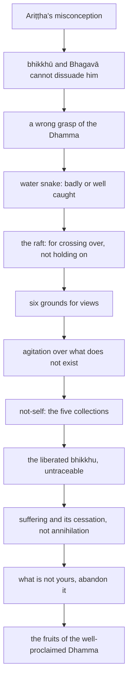

import { Tabs, TabItem } from '@astrojs/starlight/components';

Original text: [9M/3.2 Alagaddūpamasutta 772–836](https://tipitaka2500.github.io/tipitaka/9M/3/3.2.html#772) in the [World Tipitaka Edition](https://tipitaka2500.github.io)

## Summary

The bhikkhu Ariṭṭha insists that the things the Bhagavā has called obstructive do not obstruct one who indulges in them, and no one can dissuade him. From his wrong grasp the Bhagavā teaches that a badly grasped teaching harms like a badly caught water snake and that the Dhamma is a raft for crossing over, not for holding on; he then sets out the six grounds for views and the not-self reflection on the five collections, answers the charge that he teaches annihilation, since he teaches suffering and its cessation, and closes with the fruits of the well-proclaimed Dhamma.

## Diagram

## Text

<Tabs syncKey="paliquote">
<TabItem label="My Translation">
(234.)

772\. Thus heard by me — At one time the Bhagavā was dwelling at Sāvatthī, in Jeta's Grove, Anāthapiṇḍika's Park. Now at that time such a harmful misconception had arisen in a bhikkhu named Ariṭṭha, formerly a vulture catcher: “I understand the Dhamma taught by the Bhagavā in such a way that those things the Bhagavā has called obstructive are not able to be an obstacle for one who indulges in them.” Many bhikkhū heard: “It is said that such a harmful misconception has arisen in a bhikkhu named Ariṭṭha, formerly a vulture catcher: ‘I understand the Dhamma taught by the Bhagavā in such a way that those things the Bhagavā has called obstructive are not able to be an obstacle for one who indulges in them.’”

773\. Then those bhikkhū approached the bhikkhu Ariṭṭha, formerly a vulture catcher; having approached, they said this to the bhikkhu Ariṭṭha, formerly a vulture catcher: “Is it really true, Āvuso Ariṭṭha, that such a harmful misconception has arisen in you: ‘I understand the Dhamma taught by the Bhagavā in such a way that those things the Bhagavā has called obstructive are not able to be an obstacle for one who indulges in them’?” “Indeed, Āvuso, I understand the Dhamma taught by the Bhagavā in such a way that those things the Bhagavā has called obstructive are not able to be an obstacle for one who indulges in them.”

774\. Then those bhikkhū, wishing to dissuade the bhikkhu Ariṭṭha, formerly a vulture catcher, from that harmful misconception, cross-questioned, closely questioned and admonished him: “Do not say so, Āvuso Ariṭṭha, do not misrepresent the Bhagavā; for misrepresenting the Bhagavā is not good, and the Bhagavā would not speak thus. In many ways, Āvuso Ariṭṭha, obstructive things have been called obstructive by the Bhagavā, and they are indeed able to be an obstacle for one who indulges in them. Sensual pleasures have been said by the Bhagavā to give little enjoyment, much suffering and much despair; the danger in them is greater. Sensual pleasures have been said by the Bhagavā to be like a skeleton… sensual pleasures have been said by the Bhagavā to be like a lump of meat… sensual pleasures have been said by the Bhagavā to be like a grass torch… sensual pleasures have been said by the Bhagavā to be like a pit of burning coals… sensual pleasures have been said by the Bhagavā to be like a dream… sensual pleasures have been said by the Bhagavā to be like borrowed goods… sensual pleasures have been said by the Bhagavā to be like a fruit tree… sensual pleasures have been said by the Bhagavā to be like a slaughterhouse… sensual pleasures have been said by the Bhagavā to be like swords and spears… sensual pleasures have been said by the Bhagavā to be like a snake’s head, with much suffering and much despair; the danger in them is greater.”

775\. Even so, being cross-questioned, closely questioned and admonished by those bhikkhū, the bhikkhu Ariṭṭha, formerly a vulture catcher, obstinately and with clinging held fast to that same harmful misconception and declared: “Indeed, Āvuso, I understand the Dhamma taught by the Bhagavā in such a way that those things the Bhagavā has called obstructive are not able to be an obstacle for one who indulges in them.”

(235.)

776\. Since those bhikkhū were unable to dissuade the bhikkhu Ariṭṭha, formerly a vulture catcher, from that harmful misconception, those bhikkhū approached the Bhagavā; having approached, they bowed to the Bhagavā and sat down to one side. Seated to one side, those bhikkhū said this to the Bhagavā: “Bhante, such a harmful misconception has arisen in a bhikkhu named Ariṭṭha, formerly a vulture catcher: ‘I understand the Dhamma taught by the Bhagavā in such a way that those things the Bhagavā has called obstructive are not able to be an obstacle for one who indulges in them.’ We heard, Bhante: ‘It is said that such a harmful misconception has arisen in a bhikkhu named Ariṭṭha, formerly a vulture catcher: I understand the Dhamma taught by the Bhagavā in such a way that those things the Bhagavā has called obstructive are not able to be an obstacle for one who indulges in them.’

777\. Then, Bhante, we approached the bhikkhu Ariṭṭha, formerly a vulture catcher; having approached, we said this to the bhikkhu Ariṭṭha, formerly a vulture catcher: ‘Is it really true, Āvuso Ariṭṭha, that such a harmful misconception has arisen in you: I understand the Dhamma taught by the Bhagavā in such a way that those things the Bhagavā has called obstructive are not able to be an obstacle for one who indulges in them?’

778\. When this was said, Bhante, the bhikkhu Ariṭṭha, formerly a vulture catcher, said this to us: ‘Indeed, Āvuso, I understand the Dhamma taught by the Bhagavā in such a way that those things the Bhagavā has called obstructive are not able to be an obstacle for one who indulges in them.’ Then, Bhante, wishing to dissuade the bhikkhu Ariṭṭha, formerly a vulture catcher, from that harmful misconception, we cross-questioned, closely questioned and admonished him: ‘Do not say so, Āvuso Ariṭṭha, do not misrepresent the Bhagavā; for misrepresenting the Bhagavā is not good, and the Bhagavā would not speak thus. In many ways, Āvuso Ariṭṭha, obstructive things have been called obstructive by the Bhagavā, and they are indeed able to be an obstacle for one who indulges in them. Sensual pleasures have been said by the Bhagavā to give little enjoyment, much suffering and much despair; the danger in them is greater. Sensual pleasures have been said by the Bhagavā to be like a skeleton … and so on … sensual pleasures have been said by the Bhagavā to be like a snake’s head, with much suffering and much despair; the danger in them is greater.’

779\. Even so, Bhante, being cross-questioned, closely questioned and admonished by us, the bhikkhu Ariṭṭha, formerly a vulture catcher, obstinately and with clinging held fast to that same harmful misconception and declared: ‘Indeed, Āvuso, I understand the Dhamma taught by the Bhagavā in such a way that those things the Bhagavā has called obstructive are not able to be an obstacle for one who indulges in them.’ Since, Bhante, we were unable to dissuade the bhikkhu Ariṭṭha, formerly a vulture catcher, from that harmful misconception, we are reporting this matter to the Bhagavā.”

(236.)

780\. Then the Bhagavā addressed a certain bhikkhu: “Come, bhikkhu, in my name summon the bhikkhu Ariṭṭha, formerly a vulture catcher, saying: ‘The Teacher summons you, Āvuso Ariṭṭha.’” “Yes, Bhante,” that bhikkhu replied to the Bhagavā, and he approached the bhikkhu Ariṭṭha, formerly a vulture catcher; having approached, he said this to the bhikkhu Ariṭṭha, formerly a vulture catcher: “The Teacher summons you, Āvuso Ariṭṭha.” “Yes, Āvuso,” the bhikkhu Ariṭṭha, formerly a vulture catcher, replied to that bhikkhu, and he approached the Bhagavā; having approached, he bowed to the Bhagavā and sat down to one side. The Bhagavā said this to the bhikkhu Ariṭṭha, formerly a vulture catcher, seated to one side: “Is it really true, Ariṭṭha, that such a harmful misconception has arisen in you: ‘I understand the Dhamma taught by the Bhagavā in such a way that those things the Bhagavā has called obstructive are not able to be an obstacle for one who indulges in them’?” “Indeed, Bhante, I understand the Dhamma taught by the Bhagavā thus: ‘those things the Bhagavā has called obstructive are not able to be an obstacle for one who indulges in them.’”

781\. “To whom indeed, foolish man, do you understand me to have taught the Dhamma in such a way? Have I not, foolish man, in many ways called obstructive things obstructive? And they are indeed able to be an obstacle for one who indulges in them. Sensual pleasures have been said by me to give little enjoyment, much suffering and much despair; the danger in them is greater. Sensual pleasures have been said by me to be like a skeleton… sensual pleasures have been said by me to be like a lump of meat… sensual pleasures have been said by me to be like a grass torch… sensual pleasures have been said by me to be like a pit of burning coals… sensual pleasures have been said by me to be like a dream… sensual pleasures have been said by me to be like borrowed goods… sensual pleasures have been said by me to be like a fruit tree… sensual pleasures have been said by me to be like a slaughterhouse… sensual pleasures have been said by me to be like swords and spears… sensual pleasures have been said by me to be like a snake’s head, with much suffering and much despair; the danger in them is greater. And yet you, foolish man, by your own wrong grasp misrepresent us, harm yourself and produce much demerit. That will be for your harm and suffering for a long time, foolish man.”

782\. Then the Bhagavā addressed the bhikkhū: “What do you think, Bhikkhave? Has this bhikkhu Ariṭṭha, formerly a vulture catcher, kindled even a flicker of understanding in this Dhamma and Discipline?” “How could he, Bhante; of course not, Bhante.” When this was said, the bhikkhu Ariṭṭha, formerly a vulture catcher, sat silent, dumbstruck, slumped over, downcast, brooding and at a loss for words. Then the Bhagavā, having perceived the bhikkhu Ariṭṭha, formerly a vulture catcher, silent, dumbstruck, slumped over, downcast, brooding and at a loss for words, said this to the bhikkhu Ariṭṭha, formerly a vulture catcher: “You will be known, foolish man, by this harmful misconception of your own. Here I shall question the bhikkhū in return.”

(237.)

783\. Then the Bhagavā addressed the bhikkhū: “Do you too, Bhikkhave, understand the Dhamma taught by me in such a way as this bhikkhu Ariṭṭha, formerly a vulture catcher, who by his own wrong grasp misrepresents us, harms himself and produces much demerit?” “Of course not, Bhante. For in many ways, Bhante, obstructive things have been called obstructive for us by the Bhagavā; and they are indeed able to be an obstacle for one who indulges in them. Sensual pleasures have been said by the Bhagavā to give little enjoyment, much suffering and much despair; the danger in them is greater. Sensual pleasures have been said by the Bhagavā to be like a skeleton … and so on … sensual pleasures have been said by the Bhagavā to be like a snake’s head, with much suffering and much despair; the danger in them is greater.”

784\. “Excellent, excellent, Bhikkhave! It is good, Bhikkhave, that you understand the Dhamma taught by me in such a way. For in many ways, Bhikkhave, obstructive things have been spoken of by me, and they are indeed able to be an obstacle for one who indulges in them.

785\. Sensual pleasures have been said by me to give little enjoyment, much suffering and much despair; the danger in them is greater. Sensual pleasures have been said by me to be like a skeleton … and so on … sensual pleasures have been said by me to be like a snake’s head, with much suffering and much despair; the danger in them is greater. And yet this bhikkhu Ariṭṭha, formerly a vulture catcher, by his own wrong grasp misrepresents us, harms himself and produces much demerit. That will be for that foolish man’s harm and suffering for a long time. That one, Bhikkhave, will indulge in sensual pleasures apart from sensual pleasures, apart from the apperception of sensual pleasure, apart from sensual thoughts — this is not possible.

(238.)

786\. Here, Bhikkhave, some foolish people learn the Dhamma: `suttaṃ` (discourses,) `geyyaṃ` (mixed prose and verse,) `veyyākaraṇaṃ` (explanations,) `gāthaṃ` (verses,) `udānaṃ` (inspired utterances,) `itivuttakaṃ` (‘as it was said’ speeches,) `jātakaṃ` (birth stories,) `abbhutadhammaṃ` (amazing phenomena, and) `vedallaṃ` (question-and-answer sessions.) Having learned that Dhamma, they don’t examine the meaning of those teachings with wisdom. For them, those teachings don’t bear scrutiny when their meaning is not examined with wisdom. They learn the Dhamma for the purpose of criticising others and for escaping criticism in debate. They don’t experience the benefit for which they learned the Dhamma. For them, those teachings, being badly grasped, lead to their harm and suffering for a long time. For what reason? Because, Bhikkhave, the teachings were badly grasped.

787\. Suppose, Bhikkhave, a man needing a water snake, searching for a water snake, was wandering in search of a water snake. He might see a large water snake. He might grab it by its coil or its tail. That water snake, turning back, could bite him on the hand, the arm, or some other limb. Because of that, he would come to death or to death-like suffering. For what reason? Because, Bhikkhave, the water snake was badly grasped. In the same way, Bhikkhave, some foolish people here learn the Dhamma: `suttaṃ` (discourses,) `geyyaṃ` (mixed prose and verse,) `veyyākaraṇaṃ` (explanations,) `gāthaṃ` (verses,) `udānaṃ` (inspired utterances,) `itivuttakaṃ` (‘as it was said’ speeches,) `jātakaṃ` (birth stories,) `abbhutadhammaṃ` (amazing phenomena, and) `vedallaṃ` (question-and-answer sessions.) Having learned that Dhamma, they don’t examine the meaning of those teachings with wisdom. For them, those teachings don’t bear scrutiny when their meaning is not examined with wisdom. They learn the Dhamma for the purpose of criticising others and for escaping criticism in debate. They don’t experience the benefit for which they learned the Dhamma. For them, those teachings, being badly grasped, lead to their harm and suffering for a long time. For what reason? Because, Bhikkhave, the teachings were badly grasped.

(239.)

788\. But here, Bhikkhave, some young men of good families learn the Dhamma: `suttaṃ` (discourses,) `geyyaṃ` (mixed prose and verse,) `veyyākaraṇaṃ` (explanations,) `gāthaṃ` (verses,) `udānaṃ` (inspired utterances,) `itivuttakaṃ` (‘as it was said’ speeches,) `jātakaṃ` (birth stories,) `abbhutadhammaṃ` (amazing phenomena, and) `vedallaṃ` (question-and-answer sessions.) Having learned that Dhamma, they examine the meaning of those teachings with wisdom. For them, those teachings bear scrutiny when their meaning is examined with wisdom. They do not learn the Dhamma for the purpose of criticising others, nor for escaping criticism in debate. They experience the benefit for which they learned the Dhamma. For them, those teachings, being well grasped, lead to their welfare and happiness for a long time. For what reason? Because, Bhikkhave, the teachings were well grasped.

789\. Suppose, Bhikkhave, a man needing a water snake, searching for a water snake, was wandering in search of a water snake. He might see a large water snake. He might hold it down firmly with a forked stick. Having held it down firmly with a forked stick, he might grab it firmly by the neck. Even though that water snake, Bhikkhave, might wrap its coils around that man’s hand, arm or some other limb, he would not because of that come to death or to death-like suffering. For what reason? Because, Bhikkhave, the water snake was well grasped. In the same way, Bhikkhave, some young men of good families here learn the Dhamma: `suttaṃ` (discourses,) `geyyaṃ` (mixed prose and verse,) `veyyākaraṇaṃ` (explanations,) `gāthaṃ` (verses,) `udānaṃ` (inspired utterances,) `itivuttakaṃ` (‘as it was said’ speeches,) `jātakaṃ` (birth stories,) `abbhutadhammaṃ` (amazing phenomena, and) `vedallaṃ` (question-and-answer sessions.) Having learned that Dhamma, they examine the meaning of those teachings with wisdom. For them, those teachings bear scrutiny when their meaning is examined with wisdom. They do not learn the Dhamma for the purpose of criticising others, nor for escaping criticism in debate. They experience the benefit for which they learned the Dhamma. For them, those teachings, being well grasped, lead to their good, welfare and happiness for a long time. For what reason? Because, Bhikkhave, the teachings were well grasped. Therefore, Bhikkhave, when you understand the meaning of what I have said, you should bear it in mind accordingly. But when you do not understand the meaning of what I have said, you should question me about it, or those bhikkhū who are skilled.

(240.)

790\. Bhikkhave, I will teach you the `dhamma` that is like a raft: for crossing over, not for holding on. Listen and pay close attention, I will speak.” “Yes, Bhante,” those bhikkhū replied to the Bhagavā. The Bhagavā said this:

791\. “Suppose, Bhikkhave, a person was travelling along a road. He might see a great expanse of water, with the near shore dangerous and fearful, and the far shore safe and free from fear; but there was no boat for crossing over or bridge to go from this side to the other. It might occur to him: ‘This is a great expanse of water, with the near shore dangerous and fearful, and the far shore safe and free from fear; but there is no boat for crossing over or bridge to go from this side to the other. What if I were to gather grass, sticks, branches, and foliage, bind them into a raft, and relying on that raft, striving with my hands and feet, safely cross over to the far shore?’ Then that person, having gathered grass, sticks, branches, and foliage, binding them into a raft, and relying on that raft, striving with hands and feet, would safely cross over to the far shore. Having crossed over and gone beyond, it might occur to him: ‘This raft has been very helpful to me. Relying on this raft, striving with my hands and feet, I have safely crossed over to the far shore. What if I were to hoist this raft onto my head or lift it onto my shoulder and go wherever I want?’ What do you think, Bhikkhave? Would that person be doing what should be done with that raft?”

792\. “Of course not, Bhante.” “And how, Bhikkhave, would that person be doing what should be done with that raft? Here, Bhikkhave, having crossed over and gone beyond, it might occur to that person: ‘This raft has been very helpful to me. Relying on this raft, striving with my hands and feet, I have safely crossed over to the far shore. What if I were to beach this raft on dry land or set it adrift in the water and go wherever I want?’ By doing so, Bhikkhave, that person would be doing what should be done with that raft. In the same way, Bhikkhave, I have taught the `dhamma` using the simile of the raft: for crossing over, not for holding on. By understanding the `dhamma` as similar to a raft, you should abandon even the teachings, let alone what is against the teachings.

(241.)

793\. Bhikkhave, there are these six grounds for views. What six? Here, Bhikkhave, an `assutavā` (unlearned) `puthujjana` (ordinary person), who has no regard for the liberated, unskilled in the Dhamma of the liberated, untrained in the Dhamma of the liberated, who has no regard for good people, unskilled in the Dhamma of good people, untrained in the Dhamma of good people, regards `rūpa` (form) as: ‘This is mine, this I am, this is my `attā` (self)’; he regards `vedanā` (feeling) as: ‘This is mine, this I am, this is my `attā`’; he regards `saññā` (apperception) as: ‘This is mine, this I am, this is my `attā`’; he regards `saṅkhārā` (mental constructions) as: ‘This is mine, this I am, this is my `attā`’; and whatever is seen, heard, thought, known, attained, sought, explored by the mind, that too he regards as: ‘This is mine, this I am, this is my `attā`’; and whatever ground for views there is— ‘That is the world, that is the `attā`; after death I shall be permanent, stable, eternal, not subject to change, and I shall remain just so for ever and ever’— that too he regards as: ‘This is mine, this I am, this is my `attā`.’

794\. But the `sutavā` (learned) `ariyasāvaka` (disciple of the liberated), Bhikkhave, who has regard for the liberated, skilled in the Dhamma of the liberated, well trained in the Dhamma of the liberated, who has regard for good people, skilled in the Dhamma of good people, well trained in the Dhamma of good people, regards `rūpa` as: ‘This is not mine, this I am not, this is not my `attā`’; he regards `vedanā` as: ‘This is not mine, this I am not, this is not my `attā`’; he regards `saññā` as: ‘This is not mine, this I am not, this is not my `attā`’; he regards `saṅkhārā` as: ‘This is not mine, this I am not, this is not my `attā`’; and whatever is seen, heard, thought, known, attained, sought, explored by the mind, that too he regards as: ‘This is not mine, this I am not, this is not my `attā`’; and whatever ground for views there is— ‘That is the world, that is the `attā`; after death I shall be permanent, stable, eternal, not subject to change, and I shall remain just so for ever and ever’— that too he regards as: ‘This is not mine, this I am not, this is not my `attā`.’ Regarding thus, he is not agitated about what does not exist.”

(242.)

795\. When this was said, a certain bhikkhu said this to the Bhagavā: “Could there be, Bhante, agitation about what does not exist externally?” “There could be, Bhikkhu,” the Bhagavā said. “Here, Bhikkhu, it occurs to someone: ‘Alas, it was mine; alas, it is mine no more; alas, may it be mine; alas, I do not get it.’ He sorrows, becomes weary, laments, wails beating his breast, and falls into confusion. Thus, Bhikkhu, there is agitation about what does not exist externally.”

796\. “But could there be, Bhante, an absence of agitation about what does not exist externally?” “There could be, Bhikkhu,” the Bhagavā said. “Here, Bhikkhu, it does not occur to someone: ‘Alas, it was mine; alas, it is mine no more; alas, may it be mine; alas, I do not get it.’ He does not sorrow, does not become weary, does not lament, does not wail beating his breast, and does not fall into confusion. Thus, Bhikkhu, there is an absence of agitation about what does not exist externally.”

797\. “Could there be, Bhante, agitation about what does not exist internally?” “There could be, Bhikkhu,” the Bhagavā said. “Here, Bhikkhu, someone has this view: ‘That is the world, that is the `attā`; after death I shall be permanent, stable, eternal, not subject to change, and I shall remain just so for ever and ever.’ He hears the Tathāgata or a disciple of the Tathāgata teaching the Dhamma for the eradication of all grounds for views, standpoints, obsessions, adherences and underlying tendencies, for the calming of all `saṅkhārā`, for the relinquishing of all acquisitions, for the destruction of `taṇhā` (craving), for detachment, for cessation, for `nibbāna` (extinguishment). It occurs to him: ‘I shall certainly be annihilated! I shall certainly perish! I certainly shall not be!’ He sorrows, becomes weary, laments, wails beating his breast, and falls into confusion. Thus, Bhikkhu, there is agitation about what does not exist internally.”

798\. “But could there be, Bhante, an absence of agitation about what does not exist internally?” “There could be, Bhikkhu,” the Bhagavā said. “Here, Bhikkhu, someone does not have this view: ‘That is the world, that is the `attā`; after death I shall be permanent, stable, eternal, not subject to change, and I shall remain just so for ever and ever.’ He hears the Tathāgata or a disciple of the Tathāgata teaching the Dhamma for the eradication of all grounds for views, standpoints, obsessions, adherences and underlying tendencies, for the calming of all `saṅkhārā`, for the relinquishing of all acquisitions, for the destruction of `taṇhā`, for detachment, for cessation, for `nibbāna`. It does not occur to him: ‘I shall certainly be annihilated! I shall certainly perish! I certainly shall not be!’ He does not sorrow, does not become weary, does not lament, does not wail beating his breast, and does not fall into confusion. Thus, Bhikkhu, there is an absence of agitation about what does not exist internally.

(243.)

799\. Bhikkhave, you may well take possession of that possession, a possession which would be permanent, stable, eternal, not subject to change, and would remain just so for ever and ever. Do you see, Bhikkhave, that possession, a possession which would be permanent, stable, eternal, not subject to change, and would remain just so for ever and ever?” “Of course not, Bhante.” “Excellent, Bhikkhave. I too, Bhikkhave, do not see that possession, a possession which would be permanent, stable, eternal, not subject to change, and would remain just so for ever and ever.

800\. Bhikkhave, you may well take up that `attavādupādāna` (fuel of the theory of self), a fuel of the theory of self such that, for one taking it up, sorrow, lamentation, pain, displeasure and despair would not arise. Do you see, Bhikkhave, that `attavādupādāna`, a fuel of the theory of self such that, for one taking it up, sorrow, lamentation, pain, displeasure and despair would not arise?” “Of course not, Bhante.” “Excellent, Bhikkhave. I too, Bhikkhave, do not see that `attavādupādāna`, a fuel of the theory of self such that, for one taking it up, sorrow, lamentation, pain, displeasure and despair would not arise.

801\. Bhikkhave, you may well rely on that `diṭṭhinissaya` (support for views), a support for views such that, for one relying on it, sorrow, lamentation, pain, displeasure and despair would not arise. Do you see, Bhikkhave, that `diṭṭhinissaya`, a support for views such that, for one relying on it, sorrow, lamentation, pain, displeasure and despair would not arise?” “Of course not, Bhante.” “Excellent, Bhikkhave. I too, Bhikkhave, do not see that `diṭṭhinissaya`, a support for views such that, for one relying on it, sorrow, lamentation, pain, displeasure and despair would not arise.”

(244.)

802\. “And, Bhikkhave, when there is an `attā`, would there be: ‘What belongs to the self is mine’?”

803\. “Yes, Bhante.”

804\. “Or, Bhikkhave, when there is what belongs to the self, would there be: ‘The self is mine’?” “Yes, Bhante.”

805\. “Bhikkhave, when an `attā` and what belongs to the self are not found as true and real, is not this ground for views— ‘That is the world, that is the `attā`; after death I shall be permanent, stable, eternal, not subject to change, and I shall remain just so for ever and ever’— Bhikkhave, an entirely and completely foolish teaching?”

806\. “Why should it not be, Bhante? It is indeed, Bhante, an entirely and completely foolish teaching.”

807\. “Bhikkhave, what do you consider: is `rūpa` (form) `nicca` (permanent) or `anicca` (impermanent)?”

808\. “`Anicca`, Bhante.”

809\. “Now, is that which is impermanent `dukkha` (suffering) or `sukha` (happiness)?”

810\. “`Dukkha`, Bhante.”

811\. “Now, is it proper to regard that which is `anicca`, `dukkha`, and `vipariṇāmadhamma` (subject to change), as: ‘This is mine, this I am, this is my `attā` (self)’?”

812\. “Of course not, Bhante.”

813\. “Bhikkhave, what do you consider: is `vedanā` (feeling) … and so on … `saññā` (apperception)… `saṅkhārā` (mental constructions)… `viññāṇa` (consciousness) `nicca` or `anicca`?”

814\. “`Anicca`, Bhante.”

815\. “Now, is that which is impermanent `dukkha` (suffering) or `sukha` (happiness)?”

816\. “`Dukkha`, Bhante.”

817\. “Now, is it proper to regard that which is `anicca`, `dukkha`, and `vipariṇāmadhamma` (subject to change), as: ‘This is mine, this I am, this is my `attā` (self)’?”

818\. “Of course not, Bhante.”

819\. “Therefore, Bhikkhave, whatever `rūpa` there is, `atītānāgatapaccuppanna` (past, future, or present), `ajjhatta` (internal) or `bahiddhā` (external), `oḷārika` (coarse) or `sukhuma` (fine), `hīna` (inferior) or `paṇīta` (superior), far or near, all `rūpa` should be regarded `yathābhūta` (in reality), with `sammappaññā` (correct understanding), thus: ‘This is not mine, this I am not, this is not my `attā`.’ Whatever `vedanā` there is … and so on … whatever `saññā`… whatever `saṅkhārā`… whatever `viññāṇa` there is, `atītānāgatapaccuppanna`, `ajjhatta` or `bahiddhā`, `oḷārika` or `sukhuma`, `hīna` or `paṇīta`, far or near, all `viññāṇa` should be regarded `yathābhūta`, with `sammappaññā`, thus: ‘This is not mine, this I am not, this is not my `attā`.’

(245.)

820\. Thus seeing, Bhikkhave, the `sutavā` `ariyasāvaka` `nibbindati` (is disenchanted with) `rūpa`, is disenchanted with `vedanā`, is disenchanted with `saññā`, is disenchanted with `saṅkhārā`, is disenchanted with `viññāṇa`; through `nibbidā` (disenchantment) he `virajjati` (becomes detached); from detachment he `vimuccati` (becomes liberated); in liberation there is the `ñāṇa` (knowledge): ‘liberated’. He knows clearly: ‘Birth (of suffering) is finished, the optimal life is lived, what had to be done is done, there is nothing further for this present state of existence.’ This bhikkhu, Bhikkhave, is called ‘one who has lifted the crossbar’, and also ‘one who has filled the trench’, and also ‘one who has pulled out the pillar’, and also ‘one who is unbarred’, and also ‘a liberated one who has lowered the banner, laid down the burden, unfettered’.

821\. And how, Bhikkhave, is a bhikkhu one who has lifted the crossbar? Here, Bhikkhave, a bhikkhu's `avijjā` (ignorance) is given up, cut off at the root, made like a palm stump, obliterated, and not subject to future arising. Thus, Bhikkhave, a bhikkhu is one who has lifted the crossbar.

822\. And how, Bhikkhave, is a bhikkhu one who has filled the trench? Here, Bhikkhave, a bhikkhu's cycle of rebirth leading to renewed existence is given up, cut off at the root, made like a palm stump, obliterated, and not subject to future arising. Thus, Bhikkhave, a bhikkhu is one who has filled the trench.

823\. And how, Bhikkhave, is a bhikkhu one who has pulled out the pillar? Here, Bhikkhave, a bhikkhu's `taṇhā` is given up, cut off at the root, made like a palm stump, obliterated, and not subject to future arising. Thus, Bhikkhave, a bhikkhu is one who has pulled out the pillar.

824\. And how, Bhikkhave, is a bhikkhu one who is unbarred? Here, Bhikkhave, a bhikkhu's five lower fetters are given up, cut off at the root, made like palm stumps, obliterated, and not subject to future arising. Thus, Bhikkhave, a bhikkhu is one who is unbarred.

825\. And how, Bhikkhave, is a bhikkhu a liberated one who has lowered the banner, laid down the burden, unfettered? Here, Bhikkhave, a bhikkhu's `asmimāna` (conceit ‘I am’) is given up, cut off at the root, made like a palm stump, obliterated, and not subject to future arising. Thus, Bhikkhave, a bhikkhu is a liberated one who has lowered the banner, laid down the burden, unfettered.

(246.)

826\. Bhikkhave, the devas with Inda, with Brahmā, with Pajāpati, searching for a bhikkhu whose mind is thus liberated, do not find [anything of which to say]: ‘The consciousness of the `tathāgata` (one thus gone) is dependent on this.’ For what reason? Even in this very life, Bhikkhave, I say the Tathāgata is untraceable. Bhikkhave, some religious practitioners misrepresent me, who speak thus and declare thus, with what is not true, with what is hollow, falsely, with what is false: ‘The wanderer Gotama is an annihilationist; he declares the annihilation, destruction and non-existence of an existing being.’ As I am not, Bhikkhave, and as I do not say, so those worthy religious practitioners misrepresent me with what is not true, with what is hollow, falsely, with what is false: ‘The wanderer Gotama is an annihilationist; he declares the annihilation, destruction and non-existence of an existing being.’ Both formerly, Bhikkhave, and now, I declare only suffering and the cessation of suffering. In that case, Bhikkhave, if others abuse, revile, irritate and harass the Tathāgata, there is in the Tathāgata, Bhikkhave, no resentment, no indignation, no displeasure of mind.

827\. In that case, Bhikkhave, if others honour, esteem, revere and respect the Tathāgata, there is in the Tathāgata, Bhikkhave, no joy, no pleasure, no elation of mind. Or, in that case, Bhikkhave, if others honour, esteem, revere and respect the Tathāgata, the Tathāgata thinks, Bhikkhave: ‘Such services are done to me in regard to that which was formerly fully understood.’ Therefore, Bhikkhave, even if others should abuse, revile, irritate and harass you, in that case you indeed should have no resentment, no indignation, no displeasure of mind. Therefore, Bhikkhave, even if others should honour, esteem, revere and respect you, in that case you should have no joy, no pleasure, no elation of mind. Therefore, Bhikkhave, even if others should honour, esteem, revere and respect you, in that case you should think: ‘Such services are done to me in regard to that which was formerly fully understood.’

(247.)

828\. Therefore, Bhikkhave, what is not yours, give that up; when it is given up, that will be for your welfare and happiness for a long time. And what, Bhikkhave, is not yours? `Rūpa`, Bhikkhave, is not yours; give it up; when it is given up, that will be for your welfare and happiness for a long time. `Vedanā`, Bhikkhave, is not yours; give it up; when it is given up, that will be for your welfare and happiness for a long time. `Saññā`, Bhikkhave, is not yours; give it up; when it is given up, that will be for your welfare and happiness for a long time. `Saṅkhārā`, Bhikkhave, are not yours; give them up; when they are given up, those will be for your welfare and happiness for a long time. `Viññāṇa`, Bhikkhave, is not yours; give it up; when it is given up, that will be for your welfare and happiness for a long time. Bhikkhave, what do you consider: whatever grass, sticks, branches and foliage there are in this Jeta's Grove, people might carry them away, or burn them, or do with them as they like. Would you think: ‘People are carrying us away, or burning us, or doing with us as they like’?” “Of course not, Bhante.” “For what reason?” “No indeed, Bhante, for this is neither our `attā` nor what belongs to our self.” “Just so, Bhikkhave, what is not yours, give that up; when it is given up, that will be for your welfare and happiness for a long time. And what, Bhikkhave, is not yours? `Rūpa`, Bhikkhave, is not yours; give it up; when it is given up, that will be for your welfare and happiness for a long time. `Vedanā`, Bhikkhave, … and so on … `saññā`, Bhikkhave… `saṅkhārā`, Bhikkhave, … and so on … `viññāṇa`, Bhikkhave, is not yours; give it up; when it is given up, that will be for your welfare and happiness for a long time.

(248.)

829\. Thus, Bhikkhave, the Dhamma has been well proclaimed by me, clear, open, made known, free from patchwork. Bhikkhave, in the Dhamma thus well proclaimed by me, clear, open, made known, free from patchwork, those bhikkhū who are liberated ones, with the defilements destroyed, who have lived the life, done what had to be done, laid down the burden, attained the true goal, utterly destroyed the fetters of existence, liberated by right knowledge — for them there is no round [of existence] for description.

830\. Thus, Bhikkhave, the Dhamma has been well proclaimed by me, clear, open, made known, free from patchwork. Bhikkhave, in the Dhamma thus well proclaimed by me, clear, open, made known, free from patchwork, those bhikkhū who have given up the five lower fetters are all spontaneously reborn, attaining complete extinguishment there, not destined to return from that world.

831\. Thus, Bhikkhave, the Dhamma has been well proclaimed by me, clear, open, made known, free from patchwork. Bhikkhave, in the Dhamma thus well proclaimed by me, clear, open, made known, free from patchwork, those bhikkhū who have given up three fetters, with passion, hatred and delusion diminished, are all once-returners; having come back to this world only once, they will make an end of suffering.

832\. Thus, Bhikkhave, the Dhamma has been well proclaimed by me, clear, open, made known, free from patchwork. Bhikkhave, in the Dhamma thus well proclaimed by me, clear, open, made known, free from patchwork, those bhikkhū who have given up three fetters are all stream-enterers, not liable to states of suffering, certain, destined for full awakening.

833\. Thus, Bhikkhave, the Dhamma has been well proclaimed by me, clear, open, made known, free from patchwork. Bhikkhave, in the Dhamma thus well proclaimed by me, clear, open, made known, free from patchwork, those bhikkhū who are Dhamma-followers and confidence-followers are all destined for full awakening.

834\. Thus, Bhikkhave, the Dhamma has been well proclaimed by me, clear, open, made known, free from patchwork. Bhikkhave, in the Dhamma thus well proclaimed by me, clear, open, made known, free from patchwork, those who have a measure of `saddhā` (confidence) in me, a measure of affection, are all destined for heaven.”

835\. This the Bhagavā said. Those bhikkhū, delighted, rejoiced in the Bhagavā’s words.

836\. The Discourse on the Simile of the Water Snake, the second, is finished.
</TabItem>

<TabItem label="Pāḷi (Roman IAST)">
(234.)

772\. Evaṃ me sutaṃ— ekaṃ samayaṃ bhagavā sāvatthiyaṃ viharati jetavane anāthapiṇḍikassa ārāme. Tena kho pana samayena ariṭṭhassa nāma bhikkhuno gaddhabādhipubbassa evarūpaṃ pāpakaṃ diṭṭhigataṃ uppannaṃ hoti— “tathāhaṃ bhagavatā dhammaṃ desitaṃ ājānāmi yathā yeme antarāyikā dhammā vuttā bhagavatā te paṭisevato nālaṃ antarāyāyā”ti. Assosuṃ kho sambahulā bhikkhū— “ariṭṭhassa kira nāma bhikkhuno gaddhabādhipubbassa evarūpaṃ pāpakaṃ diṭṭhigataṃ uppannaṃ— ‘tathāhaṃ bhagavatā dhammaṃ desitaṃ ājānāmi yathā yeme antarāyikā dhammā vuttā bhagavatā te paṭisevato nālaṃ antarāyāyā’”ti.

773\. Atha kho te bhikkhū yena ariṭṭho bhikkhu gaddhabādhipubbo tenupasaṅkamiṃsu; upasaṅkamitvā ariṭṭhaṃ bhikkhuṃ gaddhabādhipubbaṃ etadavocuṃ— “saccaṃ kira te, āvuso ariṭṭha, evarūpaṃ pāpakaṃ diṭṭhigataṃ uppannaṃ— ‘tathāhaṃ bhagavatā dhammaṃ desitaṃ ājānāmi yathā yeme antarāyikā dhammā vuttā bhagavatā te paṭisevato nālaṃ antarāyāyā’”ti. “Evaṃ byā kho ahaṃ, āvuso, bhagavatā dhammaṃ desitaṃ ājānāmi yathā yeme antarāyikā dhammā vuttā bhagavatā te paṭisevato nālaṃ antarāyāyā”ti.

774\. Atha kho tepi bhikkhū ariṭṭhaṃ bhikkhuṃ gaddhabādhipubbaṃ etasmā pāpakā diṭṭhigatā vivecetukāmā samanuyuñjanti samanugāhanti samanubhāsanti— “mā hevaṃ, āvuso ariṭṭha, avaca, mā bhagavantaṃ abbhācikkhi; na hi sādhu bhagavato abbhakkhānaṃ, na hi bhagavā evaṃ vadeyya. Anekapariyāyenāvuso ariṭṭha, antarāyikā dhammā antarāyikā vuttā bhagavatā, alañca pana te paṭisevato antarāyāya. Appassādā kāmā vuttā bhagavatā bahudukkhā bahupāyāsā, ādīnavo ettha bhiyyo. Aṭṭhikaṅkalūpamā kāmā vuttā bhagavatā… maṃsapesūpamā kāmā vuttā bhagavatā… tiṇukkūpamā kāmā vuttā bhagavatā… aṅgārakāsūpamā kāmā vuttā bhagavatā… supinakūpamā kāmā vuttā bhagavatā… yācitakūpamā kāmā vuttā bhagavatā… rukkhaphalūpamā kāmā vuttā bhagavatā… asisūnūpamā kāmā vuttā bhagavatā… sattisūlūpamā kāmā vuttā bhagavatā… sappasirūpamā kāmā vuttā bhagavatā bahudukkhā bahupāyāsā, ādīnavo ettha bhiyyo”ti.

775\. Evampi kho ariṭṭho bhikkhu gaddhabādhipubbo tehi bhikkhūhi samanuyuñjiyamāno samanugāhiyamāno samanubhāsiyamāno tadeva pāpakaṃ diṭṭhigataṃ thāmasā parāmāsā abhinivissa voharati— “evaṃ byā kho ahaṃ, āvuso, bhagavatā dhammaṃ desitaṃ ājānāmi yathā yeme antarāyikā dhammā vuttā bhagavatā te paṭisevato nālaṃ antarāyāyā”ti.

(235.)

776\. Yato kho te bhikkhū nāsakkhiṃsu ariṭṭhaṃ bhikkhuṃ gaddhabādhipubbaṃ etasmā pāpakā diṭṭhigatā vivecetuṃ, atha kho te bhikkhū yena bhagavā tenupasaṅkamiṃsu; upasaṅkamitvā bhagavantaṃ abhivādetvā ekamantaṃ nisīdiṃsu. Ekamantaṃ nisinnā kho te bhikkhū bhagavantaṃ etadavocuṃ— “ariṭṭhassa nāma, bhante, bhikkhuno gaddhabādhipubbassa evarūpaṃ pāpakaṃ diṭṭhigataṃ uppannaṃ— ‘tathāhaṃ bhagavatā dhammaṃ desitaṃ ājānāmi yathā yeme antarāyikā dhammā vuttā bhagavatā te paṭisevato nālaṃ antarāyāyā’ti. Assumha kho mayaṃ, bhante— ‘ariṭṭhassa kira nāma bhikkhuno gaddhabādhipubbassa evarūpaṃ pāpakaṃ diṭṭhigataṃ uppannaṃ— tathāhaṃ bhagavatā dhammaṃ desitaṃ ājānāmi yathā yeme antarāyikā dhammā vuttā bhagavatā te paṭisevato nālaṃ antarāyāyā’ti.

777\. Atha kho mayaṃ, bhante, yena ariṭṭho bhikkhu gaddhabādhipubbo tenupasaṅkamimha; upasaṅkamitvā ariṭṭhaṃ bhikkhuṃ gaddhabādhipubbaṃ etadavocumha— ‘saccaṃ kira te, āvuso ariṭṭha, evarūpaṃ pāpakaṃ diṭṭhigataṃ uppannaṃ— tathāhaṃ bhagavatā dhammaṃ desitaṃ ājānāmi yathā yeme antarāyikā dhammā vuttā bhagavatā te paṭisevato nālaṃ antarāyāyā’ti?

778\. Evaṃ vutte, bhante, ariṭṭho bhikkhu gaddhabādhipubbo amhe etadavoca— ‘evaṃ byā kho ahaṃ, āvuso, bhagavatā dhammaṃ desitaṃ ājānāmi yathā yeme antarāyikā dhammā vuttā bhagavatā te paṭisevato nālaṃ antarāyāyā’ti. Atha kho mayaṃ, bhante, ariṭṭhaṃ bhikkhuṃ gaddhabādhipubbaṃ etasmā pāpakā diṭṭhigatā vivecetukāmā samanuyuñjimha samanugāhimha samanubhāsimha— ‘mā hevaṃ, āvuso ariṭṭha, avaca, mā bhagavantaṃ abbhācikkhi; na hi sādhu bhagavato abbhakkhānaṃ, na hi bhagavā evaṃ vadeyya. Anekapariyāyenāvuso ariṭṭha, antarāyikā dhammā antarāyikā vuttā bhagavatā, alañca pana te paṭisevato antarāyāya. Appassādā kāmā vuttā bhagavatā bahudukkhā bahupāyāsā, ādīnavo ettha bhiyyo. Aṭṭhikaṅkalūpamā kāmā vuttā bhagavatā…pe… sappasirūpamā kāmā vuttā bhagavatā bahudukkhā bahupāyāsā, ādīnavo ettha bhiyyo’ti.

779\. Evampi kho, bhante, ariṭṭho bhikkhu gaddhabādhipubbo amhehi samanuyuñjiyamāno samanugāhiyamāno samanubhāsiyamāno tadeva pāpakaṃ diṭṭhigataṃ thāmasā parāmāsā abhinivissa voharati— ‘evaṃ byā kho ahaṃ, āvuso, bhagavatā dhammaṃ desitaṃ ājānāmi yathā yeme antarāyikā dhammā vuttā bhagavatā te paṭisevato nālaṃ antarāyāyā’ti. Yato kho mayaṃ, bhante, nāsakkhimha ariṭṭhaṃ bhikkhuṃ gaddhabādhipubbaṃ etasmā pāpakā diṭṭhigatā vivecetuṃ, atha mayaṃ etamatthaṃ bhagavato ārocemā”ti.

(236.)

780\. Atha kho bhagavā aññataraṃ bhikkhuṃ āmantesi— “ehi tvaṃ, bhikkhu, mama vacanena ariṭṭhaṃ bhikkhuṃ gaddhabādhipubbaṃ āmantehi— ‘satthā taṃ, āvuso ariṭṭha, āmantetī’”ti. “Evaṃ, bhante”ti kho so bhikkhu bhagavato paṭissutvā, yena ariṭṭho bhikkhu gaddhabādhipubbo tenupasaṅkami; upasaṅkamitvā ariṭṭhaṃ bhikkhuṃ gaddhabādhipubbaṃ etadavoca— “satthā taṃ, āvuso ariṭṭha, āmantetī”ti. “Evamāvuso”ti kho ariṭṭho bhikkhu gaddhabādhipubbo tassa bhikkhuno paṭissutvā yena bhagavā tenupasaṅkami; upasaṅkamitvā bhagavantaṃ abhivādetvā ekamantaṃ nisīdi. Ekamantaṃ nisinnaṃ kho ariṭṭhaṃ bhikkhuṃ gaddhabādhipubbaṃ bhagavā etadavoca— “saccaṃ kira te, ariṭṭha, evarūpaṃ pāpakaṃ diṭṭhigataṃ uppannaṃ— ‘tathāhaṃ bhagavatā dhammaṃ desitaṃ ājānāmi yathā yeme antarāyikā dhammā vuttā bhagavatā te paṭisevato nālaṃ antarāyāyā’”ti? “Evaṃ byā kho ahaṃ, bhante, bhagavatā dhammaṃ desitaṃ ājānāmi— ‘yathā yeme antarāyikā dhammā vuttā bhagavatā te paṭisevato nālaṃ antarāyāyā’”ti.

781\. “Kassa kho nāma tvaṃ, moghapurisa, mayā evaṃ dhammaṃ desitaṃ ājānāsi? Nanu mayā, moghapurisa, anekapariyāyena antarāyikā dhammā antarāyikā vuttā? Alañca pana te paṭisevato antarāyāya. Appassādā kāmā vuttā mayā, bahudukkhā bahupāyāsā, ādīnavo ettha bhiyyo. Aṭṭhikaṅkalūpamā kāmā vuttā mayā… maṃsapesūpamā kāmā vuttā mayā… tiṇukkūpamā kāmā vuttā mayā… aṅgārakāsūpamā kāmā vuttā mayā… supinakūpamā kāmā vuttā mayā… yācitakūpamā kāmā vuttā mayā… rukkhaphalūpamā kāmā vuttā mayā… asisūnūpamā kāmā vuttā mayā… sattisūlūpamā kāmā vuttā mayā… sappasirūpamā kāmā vuttā mayā, bahudukkhā bahupāyāsā, ādīnavo ettha bhiyyo. Atha ca pana tvaṃ, moghapurisa, attanā duggahitena amhe ceva abbhācikkhasi, attānañca khanasi, bahuñca apuññaṃ pasavasi. Tañhi te, moghapurisa, bhavissati dīgharattaṃ ahitāya dukkhāyā”ti.

782\. Atha kho bhagavā bhikkhū āmantesi— “taṃ kiṃ maññatha, bhikkhave, api nāyaṃ ariṭṭho bhikkhu gaddhabādhipubbo usmīkatopi imasmiṃ dhammavinaye”ti? “Kiñhi siyā, bhante; no hetaṃ, bhante”ti. Evaṃ vutte, ariṭṭho bhikkhu gaddhabādhipubbo tuṇhībhūto maṅkubhūto pattakkhandho adhomukho pajjhāyanto appaṭibhāno nisīdi. Atha kho bhagavā ariṭṭhaṃ bhikkhuṃ gaddhabādhipubbaṃ tuṇhībhūtaṃ maṅkubhūtaṃ pattakkhandhaṃ adhomukhaṃ pajjhāyantaṃ appaṭibhānaṃ viditvā ariṭṭhaṃ bhikkhuṃ gaddhabādhipubbaṃ etadavoca— “paññāyissasi kho tvaṃ, moghapurisa, etena sakena pāpakena diṭṭhigatena. Idhāhaṃ bhikkhū paṭipucchissāmī”ti.

(237.)

783\. Atha kho bhagavā bhikkhū āmantesi— “tumhepi me, bhikkhave, evaṃ dhammaṃ desitaṃ ājānātha yathāyaṃ ariṭṭho bhikkhu gaddhabādhipubbo attanā duggahitena amhe ceva abbhācikkhati, attānañca khanati, bahuñca apuññaṃ pasavatī”ti? “No hetaṃ, bhante. Anekapariyāyena hi no, bhante, antarāyikā dhammā antarāyikā vuttā bhagavatā; alañca pana te paṭisevato antarāyāya. Appassādā kāmā vuttā bhagavatā bahudukkhā bahupāyāsā, ādīnavo ettha bhiyyo. Aṭṭhikaṅkalūpamā kāmā vuttā bhagavatā…pe… sappasirūpamā kāmā vuttā bhagavatā bahudukkhā bahupāyāsā, ādīnavo ettha bhiyyo”ti.

784\. “Sādhu sādhu, bhikkhave, sādhu, kho me tumhe, bhikkhave, evaṃ dhammaṃ desitaṃ ājānātha. Anekapariyāyena hi kho, bhikkhave, antarāyikā dhammā vuttā mayā, alañca pana te paṭisevato antarāyāya.

785\. Appassādā kāmā vuttā mayā, bahudukkhā bahupāyāsā, ādīnavo ettha bhiyyo. Aṭṭhikaṅkalūpamā kāmā vuttā mayā…pe… sappasirūpamā kāmā vuttā mayā, bahudukkhā bahupāyāsā, ādīnavo ettha bhiyyo. Atha ca panāyaṃ ariṭṭho bhikkhu gaddhabādhipubbo attanā duggahitena amhe ceva abbhācikkhati, attānañca khanati, bahuñca apuññaṃ pasavati. Tañhi tassa moghapurisassa bhavissati dīgharattaṃ ahitāya dukkhāya. So vata, bhikkhave, aññatreva kāmehi aññatra kāmasaññāya aññatra kāmavitakkehi kāme paṭisevissatīti— netaṃ ṭhānaṃ vijjati.

(238.)

786\. Idha, bhikkhave, ekacce moghapurisā dhammaṃ pariyāpuṇanti— suttaṃ, geyyaṃ, veyyākaraṇaṃ, gāthaṃ, udānaṃ, itivuttakaṃ, jātakaṃ, abbhutadhammaṃ, vedallaṃ. Te taṃ dhammaṃ pariyāpuṇitvā tesaṃ dhammānaṃ paññāya atthaṃ na upaparikkhanti. Tesaṃ te dhammā paññāya atthaṃ anupaparikkhataṃ na nijjhānaṃ khamanti. Te upārambhānisaṃsā ceva dhammaṃ pariyāpuṇanti itivādappamokkhānisaṃsā ca. Yassa catthāya dhammaṃ pariyāpuṇanti tañcassa atthaṃ nānubhonti. Tesaṃ te dhammā duggahitā dīgharattaṃ ahitāya dukkhāya saṃvattanti. Taṃ kissa hetu? Duggahitattā, bhikkhave, dhammānaṃ.

787\. Seyyathāpi, bhikkhave, puriso alagaddatthiko alagaddagavesī alagaddapariyesanaṃ caramāno. So passeyya mahantaṃ alagaddaṃ. Tamenaṃ bhoge vā naṅguṭṭhe vā gaṇheyya. Tassa so alagaddo paṭiparivattitvā hatthe vā bāhāya vā aññatarasmiṃ vā aṅgapaccaṅge ḍaṃseyya. So tatonidānaṃ maraṇaṃ vā nigaccheyya maraṇamattaṃ vā dukkhaṃ. Taṃ kissa hetu? Duggahitattā, bhikkhave, alagaddassa. Evameva kho, bhikkhave, idhekacce moghapurisā dhammaṃ pariyāpuṇanti— suttaṃ, geyyaṃ, veyyākaraṇaṃ, gāthaṃ, udānaṃ, itivuttakaṃ, jātakaṃ, abbhutadhammaṃ, vedallaṃ. Te taṃ dhammaṃ pariyāpuṇitvā tesaṃ dhammānaṃ paññāya atthaṃ na upaparikkhanti. Tesaṃ te dhammā paññāya atthaṃ anupaparikkhataṃ na nijjhānaṃ khamanti. Te upārambhānisaṃsā ceva dhammaṃ pariyāpuṇanti itivādappamokkhānisaṃsā ca. Yassa catthāya dhammaṃ pariyāpuṇanti tañcassa atthaṃ nānubhonti. Tesaṃ te dhammā duggahitā dīgharattaṃ ahitāya dukkhāya saṃvattanti. Taṃ kissa hetu? Duggahitattā, bhikkhave, dhammānaṃ.

(239.)

788\. Idha pana, bhikkhave, ekacce kulaputtā dhammaṃ pariyāpuṇanti— suttaṃ, geyyaṃ, veyyākaraṇaṃ, gāthaṃ, udānaṃ, itivuttakaṃ, jātakaṃ, abbhutadhammaṃ, vedallaṃ. Te taṃ dhammaṃ pariyāpuṇitvā tesaṃ dhammānaṃ paññāya atthaṃ upaparikkhanti. Tesaṃ te dhammā paññāya atthaṃ upaparikkhataṃ nijjhānaṃ khamanti. Te na ceva upārambhānisaṃsā dhammaṃ pariyāpuṇanti na itivādappamokkhānisaṃsā ca. Yassa catthāya dhammaṃ pariyāpuṇanti tañcassa atthaṃ anubhonti. Tesaṃ te dhammā suggahitā dīgharattaṃ hitāya sukhāya saṃvattanti. Taṃ kissa hetu? Suggahitattā bhikkhave dhammānaṃ.

789\. Seyyathāpi, bhikkhave, puriso alagaddatthiko alagaddagavesī alagaddapariyesanaṃ caramāno. So passeyya mahantaṃ alagaddaṃ. Tamenaṃ ajapadena daṇḍena suniggahitaṃ niggaṇheyya. Ajapadena daṇḍena suniggahitaṃ niggahitvā, gīvāya suggahitaṃ gaṇheyya. Kiñcāpi so, bhikkhave, alagaddo tassa purisassa hatthaṃ vā bāhaṃ vā aññataraṃ vā aṅgapaccaṅgaṃ bhogehi paliveṭheyya, atha kho so neva tatonidānaṃ maraṇaṃ vā nigaccheyya maraṇamattaṃ vā dukkhaṃ. Taṃ kissa hetu? Suggahitattā, bhikkhave, alagaddassa. Evameva kho, bhikkhave, idhekacce kulaputtā dhammaṃ pariyāpuṇanti— suttaṃ, geyyaṃ, veyyākaraṇaṃ, gāthaṃ, udānaṃ, itivuttakaṃ, jātakaṃ, abbhutadhammaṃ, vedallaṃ. Te taṃ dhammaṃ pariyāpuṇitvā tesaṃ dhammānaṃ paññāya atthaṃ upaparikkhanti. Tesaṃ te dhammā paññāya atthaṃ upaparikkhataṃ nijjhānaṃ khamanti. Te na ceva upārambhānisaṃsā dhammaṃ pariyāpuṇanti, na itivādappamokkhānisaṃsā ca. Yassa catthāya dhammaṃ pariyāpuṇanti, tañcassa atthaṃ anubhonti. Tesaṃ te dhammā suggahitā dīgharattaṃ atthāya hitāya sukhāya saṃvattanti. Taṃ kissa hetu? Suggahitattā, bhikkhave, dhammānaṃ. Tasmātiha, bhikkhave, yassa me bhāsitassa atthaṃ ājāneyyātha, tathā naṃ dhāreyyātha. Yassa ca pana me bhāsitassa atthaṃ na ājāneyyātha, ahaṃ vo tattha paṭipucchitabbo, ye vā panāssu viyattā bhikkhū.

(240.)

790\. Kullūpamaṃ vo, bhikkhave, dhammaṃ desessāmi nittharaṇatthāya, no gahaṇatthāya. Taṃ suṇātha, sādhukaṃ manasikarotha, bhāsissāmī”ti. “Evaṃ, bhante”ti kho te bhikkhū bhagavato paccassosuṃ. Bhagavā etadavoca—

791\. “Seyyathāpi, bhikkhave, puriso addhānamaggappaṭipanno. So passeyya mahantaṃ udakaṇṇavaṃ, orimaṃ tīraṃ sāsaṅkaṃ sappaṭibhayaṃ, pārimaṃ tīraṃ khemaṃ appaṭibhayaṃ; na cassa nāvā santāraṇī uttarasetu vā apārā pāraṃ gamanāya. Tassa evamassa— ‘ayaṃ kho mahāudakaṇṇavo, orimaṃ tīraṃ sāsaṅkaṃ sappaṭibhayaṃ, pārimaṃ tīraṃ khemaṃ appaṭibhayaṃ; natthi ca nāvā santāraṇī uttarasetu vā apārā pāraṃ gamanāya. Yannūnāhaṃ tiṇakaṭṭhasākhāpalāsaṃ saṅkaḍḍhitvā, kullaṃ bandhitvā, taṃ kullaṃ nissāya hatthehi ca pādehi ca vāyamamāno sotthinā pāraṃ uttareyyan’ti. Atha kho so, bhikkhave, puriso tiṇakaṭṭhasākhāpalāsaṃ saṅkaḍḍhitvā, kullaṃ bandhitvā taṃ kullaṃ nissāya hatthehi ca pādehi ca vāyamamāno sotthinā pāraṃ uttareyya. Tassa purisassa uttiṇṇassa pāraṅgatassa evamassa— ‘bahukāro kho me ayaṃ kullo; imāhaṃ kullaṃ nissāya hatthehi ca pādehi ca vāyamamāno sotthinā pāraṃ uttiṇṇo. Yannūnāhaṃ imaṃ kullaṃ sīse vā āropetvā khandhe vā uccāretvā yena kāmaṃ pakkameyyan’ti. Taṃ kiṃ maññatha, bhikkhave, api nu so puriso evaṃkārī tasmiṃ kulle kiccakārī assā”ti?

792\. “No hetaṃ, bhante”. “Kathaṃkārī ca so, bhikkhave, puriso tasmiṃ kulle kiccakārī assa? Idha, bhikkhave, tassa purisassa uttiṇṇassa pāraṅgatassa evamassa— ‘bahukāro kho me ayaṃ kullo; imāhaṃ kullaṃ nissāya hatthehi ca pādehi ca vāyamamāno sotthinā pāraṃ uttiṇṇo. Yannūnāhaṃ imaṃ kullaṃ thale vā ussādetvā udake vā opilāpetvā yena kāmaṃ pakkameyyan’ti. Evaṃkārī kho so, bhikkhave, puriso tasmiṃ kulle kiccakārī assa. Evameva kho, bhikkhave, kullūpamo mayā dhammo desito nittharaṇatthāya, no gahaṇatthāya. Kullūpamaṃ vo, bhikkhave, dhammaṃ desitaṃ, ājānantehi dhammāpi vo pahātabbā pageva adhammā.

(241.)

793\. Chayimāni, bhikkhave, diṭṭhiṭṭhānāni. Katamāni cha? Idha, bhikkhave, assutavā puthujjano ariyānaṃ adassāvī ariyadhammassa akovido ariyadhamme avinīto, sappurisānaṃ adassāvī sappurisadhammassa akovido sappurisadhamme avinīto, rūpaṃ ‘etaṃ mama, esohamasmi, eso me attā’ti samanupassati; vedanaṃ ‘etaṃ mama, esohamasmi, eso me attā’ti samanupassati; saññaṃ ‘etaṃ mama, esohamasmi, eso me attā’ti samanupassati; saṅkhāre ‘etaṃ mama, esohamasmi, eso me attā’ti samanupassati; yampi taṃ diṭṭhaṃ sutaṃ mutaṃ viññātaṃ pattaṃ pariyesitaṃ, anuvicaritaṃ manasā tampi ‘etaṃ mama, esohamasmi, eso me attā’ti samanupassati; yampi taṃ diṭṭhiṭṭhānaṃ— so loko so attā, so pecca bhavissāmi nicco dhuvo sassato avipariṇāmadhammo, sassatisamaṃ tatheva ṭhassāmīti— tampi ‘etaṃ mama, esohamasmi, eso me attā’ti samanupassati.

794\. Sutavā ca kho, bhikkhave, ariyasāvako ariyānaṃ dassāvī ariyadhammassa kovido ariyadhamme suvinīto, sappurisānaṃ dassāvī sappurisadhammassa kovido sappurisadhamme suvinīto, rūpaṃ ‘netaṃ mama, nesohamasmi, na meso attā’ti samanupassati; vedanaṃ ‘netaṃ mama, nesohamasmi, na meso attā’ti samanupassati; saññaṃ ‘netaṃ mama, nesohamasmi, na meso attā’ti samanupassati; saṅkhāre ‘netaṃ mama, nesohamasmi, na meso attā’ti samanupassati; yampi taṃ diṭṭhaṃ sutaṃ mutaṃ viññātaṃ pattaṃ pariyesitaṃ, anuvicaritaṃ manasā, tampi ‘netaṃ mama, nesohamasmi, na meso attā’ti samanupassati; yampi taṃ diṭṭhiṭṭhānaṃ— so loko so attā, so pecca bhavissāmi nicco dhuvo sassato avipariṇāmadhammo, sassatisamaṃ tatheva ṭhassāmīti— tampi ‘netaṃ mama, nesohamasmi, na meso attā’ti samanupassati. So evaṃ samanupassanto asati na paritassatī”ti.

(242.)

795\. Evaṃ vutte, aññataro bhikkhu bhagavantaṃ etadavoca— “siyā nu kho, bhante, bahiddhā asati paritassanā”ti? “Siyā, bhikkhū”ti— bhagavā avoca. “Idha bhikkhu ekaccassa evaṃ hoti— ‘ahu vata me, taṃ vata me natthi; siyā vata me, taṃ vatāhaṃ na labhāmī’ti. So socati kilamati paridevati urattāḷiṃ kandati sammohaṃ āpajjati. Evaṃ kho, bhikkhu, bahiddhā asati paritassanā hotī”ti.

796\. “Siyā pana, bhante, bahiddhā asati aparitassanā”ti? “Siyā, bhikkhū”ti— bhagavā avoca. “Idha bhikkhu ekaccassa na evaṃ hoti— ‘ahu vata me, taṃ vata me natthi; siyā vata me, taṃ vatāhaṃ na labhāmī’ti. So na socati na kilamati na paridevati na urattāḷiṃ kandati na sammohaṃ āpajjati. Evaṃ kho, bhikkhu, bahiddhā asati aparitassanā hotī”ti.

797\. “Siyā nu kho, bhante, ajjhattaṃ asati paritassanā”ti? “Siyā, bhikkhū”ti— bhagavā avoca. “Idha, bhikkhu, ekaccassa evaṃ diṭṭhi hoti— ‘so loko so attā, so pecca bhavissāmi nicco dhuvo sassato avipariṇāmadhammo, sassatisamaṃ tatheva ṭhassāmī’ti. So suṇāti tathāgatassa vā tathāgatasāvakassa vā sabbesaṃ diṭṭhiṭṭhānādhiṭṭhānapariyuṭṭhānābhinivesānusayānaṃ samugghātāya sabbasaṅkhārasamathāya sabbūpadhipaṭinissaggāya taṇhākkhayāya virāgāya nirodhāya nibbānāya dhammaṃ desentassa. Tassa evaṃ hoti— ‘ucchijjissāmi nāmassu, vinassissāmi nāmassu, nassu nāma bhavissāmī’ti. So socati kilamati paridevati urattāḷiṃ kandati sammohaṃ āpajjati. Evaṃ kho, bhikkhu, ajjhattaṃ asati paritassanā hotī”ti.

798\. “Siyā pana, bhante, ajjhattaṃ asati aparitassanā”ti? “Siyā, bhikkhū”ti bhagavā avoca. “Idha, bhikkhu, ekaccassa na evaṃ diṭṭhi hoti— ‘so loko so attā, so pecca bhavissāmi nicco dhuvo sassato avipariṇāmadhammo, sassatisamaṃ tatheva ṭhassāmī’ti. So suṇāti tathāgatassa vā tathāgatasāvakassa vā sabbesaṃ diṭṭhiṭṭhānādhiṭṭhānapariyuṭṭhānābhinivesānusayānaṃ samugghātāya sabbasaṅkhārasamathāya sabbūpadhipaṭinissaggāya taṇhākkhayāya virāgāya nirodhāya nibbānāya dhammaṃ desentassa. Tassa na evaṃ hoti— ‘ucchijjissāmi nāmassu, vinassissāmi nāmassu, nassu nāma bhavissāmī’ti. So na socati na kilamati na paridevati na urattāḷiṃ kandati na sammohaṃ āpajjati. Evaṃ kho, bhikkhu, ajjhattaṃ asati aparitassanā hoti.

(243.)

799\. Taṃ, bhikkhave, pariggahaṃ pariggaṇheyyātha, yvāssa pariggaho nicco dhuvo sassato avipariṇāmadhammo, sassatisamaṃ tatheva tiṭṭheyya. Passatha no tumhe, bhikkhave, taṃ pariggahaṃ yvāssa pariggaho nicco dhuvo sassato avipariṇāmadhammo, sassatisamaṃ tatheva tiṭṭheyyā”ti? “No hetaṃ, bhante”. “Sādhu, bhikkhave. Ahampi kho taṃ, bhikkhave, pariggahaṃ na samanupassāmi yvāssa pariggaho nicco dhuvo sassato avipariṇāmadhammo sassatisamaṃ tatheva tiṭṭheyya.

800\. Taṃ, bhikkhave, attavādupādānaṃ upādiyetha, yaṃsa attavādupādānaṃ upādiyato na uppajjeyyuṃ sokaparidevadukkhadomanassupāyāsā. Passatha no tumhe, bhikkhave, taṃ attavādupādānaṃ yaṃsa attavādupādānaṃ upādiyato na uppajjeyyuṃ sokaparidevadukkhadomanassupāyāsā”ti? “No hetaṃ, bhante”. “Sādhu, bhikkhave. Ahampi kho taṃ, bhikkhave, attavādupādānaṃ na samanupassāmi yaṃsa attavādupādānaṃ upādiyato na uppajjeyyuṃ sokaparidevadukkhadomanassupāyāsā.

801\. Taṃ, bhikkhave, diṭṭhinissayaṃ nissayetha yaṃsa diṭṭhinissayaṃ nissayato na uppajjeyyuṃ sokaparidevadukkhadomanassupāyāsā. Passatha no tumhe, bhikkhave, taṃ diṭṭhinissayaṃ yaṃsa diṭṭhinissayaṃ nissayato na uppajjeyyuṃ sokaparidevadukkhadomanassupāyāsā”ti? “No hetaṃ, bhante”. “Sādhu, bhikkhave. Ahampi kho taṃ, bhikkhave, diṭṭhinissayaṃ na samanupassāmi yaṃsa diṭṭhinissayaṃ nissayato na uppajjeyyuṃ sokaparidevadukkhadomanassupāyāsā”.

(244.)

802\. “Attani vā, bhikkhave, sati ‘attaniyaṃ me’ti assā”ti?

803\. “Evaṃ, bhante”.

804\. “Attaniye vā, bhikkhave, sati ‘attā me’ti assā”ti? “Evaṃ, bhante”.

805\. “Attani ca, bhikkhave, attaniye ca saccato thetato anupalabbhamāne, yampi taṃ diṭṭhiṭṭhānaṃ— ‘so loko so attā, so pecca bhavissāmi nicco dhuvo sassato avipariṇāmadhammo, sassatisamaṃ tatheva ṭhassāmī’ti— nanāyaṃ, bhikkhave, kevalo paripūro bāladhammo”ti?

806\. “Kiñhi no siyā, bhante, kevalo hi, bhante, paripūro bāladhammo”ti.

807\. “Taṃ kiṃ maññatha, bhikkhave, rūpaṃ niccaṃ vā aniccaṃ vā”ti?

808\. “Aniccaṃ, bhante”.

809\. “Yaṃ panāniccaṃ dukkhaṃ vā taṃ sukhaṃ vā”ti?

810\. “Dukkhaṃ, bhante”.

811\. “Yaṃ panāniccaṃ dukkhaṃ vipariṇāmadhammaṃ, kallaṃ nu taṃ samanupassituṃ— etaṃ mama, esohamasmi, eso me attā”ti?

812\. “No hetaṃ, bhante”.

813\. “Taṃ kiṃ maññatha, bhikkhave, vedanā…pe… saññā… saṅkhārā… viññāṇaṃ niccaṃ vā aniccaṃ vā”ti?

814\. “Aniccaṃ, bhante”.

815\. “Yaṃ panāniccaṃ dukkhaṃ vā taṃ sukhaṃ vā”ti?

816\. “Dukkhaṃ, bhante”.

817\. “Yaṃ panāniccaṃ dukkhaṃ vipariṇāmadhammaṃ, kallaṃ nu taṃ samanupassituṃ— etaṃ mama, esohamasmi, eso me attā”ti?

818\. “No hetaṃ, bhante”.

819\. “Tasmātiha, bhikkhave, yaṃ kiñci rūpaṃ atītānāgatapaccuppannaṃ, ajjhattaṃ vā bahiddhā vā, oḷārikaṃ vā sukhumaṃ vā, hīnaṃ vā paṇītaṃ vā, yaṃ dūre santike vā, sabbaṃ rūpaṃ ‘netaṃ mama, nesohamasmi, na meso attā’ti— evametaṃ yathābhūtaṃ sammappaññāya daṭṭhabbaṃ. Yā kāci vedanā…pe… yā kāci saññā… ye keci saṅkhārā… yaṃ kiñci viññāṇaṃ atītānāgatapaccuppannaṃ, ajjhattaṃ vā bahiddhā vā, oḷārikaṃ vā sukhumaṃ vā, hīnaṃ vā paṇītaṃ vā, yaṃ dūre santike vā, sabbaṃ viññāṇaṃ ‘netaṃ mama, nesohamasmi, na meso attā’ti— evametaṃ yathābhūtaṃ sammappaññāya daṭṭhabbaṃ.

(245.)

820\. Evaṃ passaṃ, bhikkhave, sutavā ariyasāvako rūpasmiṃ nibbindati, vedanāya nibbindati, saññāya nibbindati, saṅkhāresu nibbindati, viññāṇasmiṃ nibbindati, nibbidā virajjati, virāgā vimuccati, vimuttasmiṃ vimuttamiti ñāṇaṃ hoti. ‘Khīṇā jāti, vusitaṃ brahmacariyaṃ, kataṃ karaṇīyaṃ, nāparaṃ itthattāyā’ti pajānāti. Ayaṃ vuccati, bhikkhave, bhikkhu ukkhittapaligho itipi, saṃkiṇṇaparikkho itipi, abbūḷhesiko itipi, niraggaḷo itipi, ariyo pannaddhajo pannabhāro visaṃyutto itipi.

821\. Kathañca, bhikkhave, bhikkhu ukkhittapaligho hoti? Idha, bhikkhave, bhikkhuno avijjā pahīnā hoti, ucchinnamūlā tālāvatthukatā anabhāvaṃkatā, āyatiṃ anuppādadhammā. Evaṃ kho, bhikkhave, bhikkhu ukkhittapaligho hoti.

822\. Kathañca, bhikkhave, bhikkhu saṃkiṇṇaparikkho hoti? Idha, bhikkhave, bhikkhuno ponobbhaviko jātisaṃsāro pahīno hoti, ucchinnamūlo tālāvatthukato anabhāvaṃkato, āyatiṃ anuppādadhammo. Evaṃ kho, bhikkhave, bhikkhu saṃkiṇṇaparikkho hoti.

823\. Kathañca, bhikkhave, bhikkhu abbūḷhesiko hoti? Idha, bhikkhave, bhikkhuno taṇhā pahīnā hoti, ucchinnamūlā tālāvatthukatā anabhāvaṃkatā, āyatiṃ anuppādadhammā. Evaṃ kho, bhikkhave, bhikkhu abbūḷhesiko hoti.

824\. Kathañca, bhikkhave, bhikkhu niraggaḷo hoti? Idha, bhikkhave, bhikkhuno pañca orambhāgiyāni saṃyojanāni pahīnāni honti, ucchinnamūlāni tālāvatthukatāni anabhāvaṃkatāni, āyatiṃ anuppādadhammāni. Evaṃ kho, bhikkhave, bhikkhu niraggaḷo hoti.

825\. Kathañca, bhikkhave, bhikkhu ariyo pannaddhajo pannabhāro visaṃyutto hoti? Idha, bhikkhave, bhikkhuno asmimāno pahīno hoti, ucchinnamūlo tālāvatthukato anabhāvaṃkato, āyatiṃ anuppādadhammo. Evaṃ kho, bhikkhave, bhikkhu ariyo pannaddhajo pannabhāro visaṃyutto hoti.

(246.)

826\. Evaṃ vimuttacittaṃ kho, bhikkhave, bhikkhuṃ saindā devā sabrahmakā sapajāpatikā anvesaṃ nādhigacchanti— ‘idaṃ nissitaṃ tathāgatassa viññāṇan’ti. Taṃ kissa hetu? Diṭṭhevāhaṃ, bhikkhave, dhamme tathāgataṃ ananuvijjoti vadāmi. Evaṃvādiṃ kho maṃ, bhikkhave, evamakkhāyiṃ eke samaṇabrāhmaṇā asatā tucchā musā abhūtena abbhācikkhanti— ‘venayiko samaṇo gotamo, sato sattassa ucchedaṃ vināsaṃ vibhavaṃ paññāpetī’ti. Yathā cāhaṃ na, bhikkhave, yathā cāhaṃ na vadāmi, tathā maṃ te bhonto samaṇabrāhmaṇā asatā tucchā musā abhūtena abbhācikkhanti— ‘venayiko samaṇo gotamo, sato sattassa ucchedaṃ vināsaṃ vibhavaṃ paññāpetī’ti. Pubbe cāhaṃ, bhikkhave, etarahi ca dukkhañceva paññāpemi, dukkhassa ca nirodhaṃ. Tatra ce, bhikkhave, pare tathāgataṃ akkosanti paribhāsanti rosenti vihesenti, tatra, bhikkhave, tathāgatassa na hoti āghāto na appaccayo na cetaso anabhiraddhi.

827\. Tatra ce, bhikkhave, pare tathāgataṃ sakkaronti garuṃ karonti mānenti pūjenti, tatra, bhikkhave, tathāgatassa na hoti ānando na somanassaṃ na cetaso uppilāvitattaṃ. Tatra ce, bhikkhave, pare vā tathāgataṃ sakkaronti garuṃ karonti mānenti pūjenti, tatra, bhikkhave, tathāgatassa evaṃ hoti— ‘yaṃ kho idaṃ pubbe pariññātaṃ tattha me evarūpā kārā karīyantī’ti. Tasmātiha, bhikkhave, tumhe cepi pare akkoseyyuṃ paribhāseyyuṃ roseyyuṃ viheseyyuṃ, tatra tumhe hi na āghāto na appaccayo na cetaso anabhiraddhi karaṇīyā. Tasmātiha, bhikkhave, tumhe cepi pare sakkareyyuṃ garuṃ kareyyuṃ māneyyuṃ pūjeyyuṃ, tatra tumhehi na ānando na somanassaṃ na cetaso uppilāvitattaṃ karaṇīyaṃ. Tasmātiha, bhikkhave, tumhe cepi pare sakkareyyuṃ garuṃ kareyyuṃ māneyyuṃ pūjeyyuṃ, tatra tumhākaṃ evamassa— ‘yaṃ kho idaṃ pubbe pariññātaṃ, tatthame evarūpā kārā karīyantī’ti.

(247.)

828\. Tasmātiha, bhikkhave, yaṃ na tumhākaṃ taṃ pajahatha; taṃ vo pahīnaṃ dīgharattaṃ hitāya sukhāya bhavissati. Kiñca, bhikkhave, na tumhākaṃ? Rūpaṃ, bhikkhave, na tumhākaṃ, taṃ pajahatha; taṃ vo pahīnaṃ dīgharattaṃ hitāya sukhāya bhavissati. Vedanā, bhikkhave, na tumhākaṃ, taṃ pajahatha; sā vo pahīnā dīgharattaṃ hitāya sukhāya bhavissati. Saññā, bhikkhave, na tumhākaṃ, taṃ pajahatha; sā vo pahīnā dīgharattaṃ hitāya sukhāya bhavissati. Saṅkhārā, bhikkhave, na tumhākaṃ, te pajahatha; te vo pahīnā dīgharattaṃ hitāya sukhāya bhavissanti. Viññāṇaṃ, bhikkhave, na tumhākaṃ, taṃ pajahatha; taṃ vo pahīnaṃ dīgharattaṃ hitāya sukhāya bhavissati. Taṃ kiṃ maññatha, bhikkhave, yaṃ imasmiṃ jetavane tiṇakaṭṭhasākhāpalāsaṃ, taṃ jano hareyya vā daheyya vā yathāpaccayaṃ vā kareyya. Api nu tumhākaṃ evamassa— ‘amhe jano harati vā dahati vā yathāpaccayaṃ vā karotī’”ti? “No hetaṃ, bhante”. “Taṃ kissa hetu”? “Na hi no etaṃ, bhante, attā vā attaniyaṃ vā”ti. “Evameva kho, bhikkhave, yaṃ na tumhākaṃ taṃ pajahatha; taṃ vo pahīnaṃ dīgharattaṃ hitāya sukhāya bhavissati. Kiñca, bhikkhave, na tumhākaṃ? Rūpaṃ, bhikkhave, na tumhākaṃ, taṃ pajahatha; taṃ vo pahīnaṃ dīgharattaṃ hitāya sukhāya bhavissati. Vedanā, bhikkhave…pe… saññā, bhikkhave… saṅkhārā, bhikkhave…pe… viññāṇaṃ, bhikkhave, na tumhākaṃ, taṃ pajahatha; taṃ vo pahīnaṃ dīgharattaṃ hitāya sukhāya bhavissati.

(248.)

829\. Evaṃ svākkhāto, bhikkhave, mayā dhammo uttāno vivaṭo pakāsito chinnapilotiko. Evaṃ svākkhāte, bhikkhave, mayā dhamme uttāne vivaṭe pakāsite chinnapilotike ye te bhikkhū arahanto khīṇāsavā vusitavanto katakaraṇīyā ohitabhārā anuppattasadatthā parikkhīṇabhavasaṃyojanā sammadaññāvimuttā, vaṭṭaṃ tesaṃ natthi paññāpanāya.

830\. Evaṃ svākkhāto, bhikkhave, mayā dhammo uttāno vivaṭo pakāsito chinnapilotiko. Evaṃ svākkhāte, bhikkhave, mayā dhamme uttāne vivaṭe pakāsite chinnapilotike yesaṃ bhikkhūnaṃ pañcorambhāgiyāni saṃyojanāni pahīnāni, sabbe te opapātikā, tattha parinibbāyino, anāvattidhammā tasmā lokā.

831\. Evaṃ svākkhāto, bhikkhave, mayā dhammo uttāno vivaṭo pakāsito chinnapilotiko. Evaṃ svākkhāte, bhikkhave, mayā dhamme uttāne vivaṭe pakāsite chinnapilotike yesaṃ bhikkhūnaṃ tīṇi saṃyojanāni pahīnāni, rāgadosamohā tanubhūtā, sabbe te sakadāgāmino, sakideva imaṃ lokaṃ āgantvā dukkhassantaṃ karissanti.

832\. Evaṃ svākkhāto, bhikkhave, mayā dhammo uttāno vivaṭo pakāsito chinnapilotiko. Evaṃ svākkhāte, bhikkhave, mayā dhamme uttāne vivaṭe pakāsite chinnapilotike yesaṃ bhikkhūnaṃ tīṇi saṃyojanāni pahīnāni, sabbe te sotāpannā, avinipātadhammā, niyatā sambodhiparāyanā.

833\. Evaṃ svākkhāto, bhikkhave, mayā dhammo uttāno vivaṭo pakāsito chinnapilotiko. Evaṃ svākkhāte, bhikkhave, mayā dhamme uttāne vivaṭe pakāsite chinnapilotike ye te bhikkhū dhammānusārino saddhānusārino sabbe te sambodhiparāyanā.

834\. Evaṃ svākkhāto, bhikkhave, mayā dhammo uttāno vivaṭo pakāsito chinnapilotiko. Evaṃ svākkhāte, bhikkhave, mayā dhamme uttāne vivaṭe pakāsite chinnapilotike yesaṃ mayi saddhāmattaṃ pemamattaṃ sabbe te saggaparāyanā”ti.

835\. Idamavoca bhagavā. Attamanā te bhikkhū bhagavato bhāsitaṃ abhinandunti.

836\. Alagaddūpamasuttaṃ niṭṭhitaṃ dutiyaṃ.
</TabItem>

<TabItem label="Pāḷi (Brahmi)">
(234.)

772\. 𑀏𑀯𑀁 𑀫𑁂 𑀲𑀼𑀢𑀁— 𑀏𑀓𑀁 𑀲𑀫𑀬𑀁 𑀪𑀕𑀯𑀸 𑀲𑀸𑀯𑀢𑁆𑀣𑀺𑀬𑀁 𑀯𑀺𑀳𑀭𑀢𑀺 𑀚𑁂𑀢𑀯𑀦𑁂 𑀅𑀦𑀸𑀣𑀧𑀺𑀡𑁆𑀟𑀺𑀓𑀲𑁆𑀲 𑀆𑀭𑀸𑀫𑁂. 𑀢𑁂𑀦 𑀔𑁄 𑀧𑀦 𑀲𑀫𑀬𑁂𑀦 𑀅𑀭𑀺𑀝𑁆𑀞𑀲𑁆𑀲 𑀦𑀸𑀫 𑀪𑀺𑀓𑁆𑀔𑀼𑀦𑁄 𑀕𑀤𑁆𑀥𑀩𑀸𑀥𑀺𑀧𑀼𑀩𑁆𑀩𑀲𑁆𑀲 𑀏𑀯𑀭𑀽𑀧𑀁 𑀧𑀸𑀧𑀓𑀁 𑀤𑀺𑀝𑁆𑀞𑀺𑀕𑀢𑀁 𑀉𑀧𑁆𑀧𑀦𑁆𑀦𑀁 𑀳𑁄𑀢𑀺— “𑀢𑀣𑀸𑀳𑀁 𑀪𑀕𑀯𑀢𑀸 𑀥𑀫𑁆𑀫𑀁 𑀤𑁂𑀲𑀺𑀢𑀁 𑀆𑀚𑀸𑀦𑀸𑀫𑀺 𑀬𑀣𑀸 𑀬𑁂𑀫𑁂 𑀅𑀦𑁆𑀢𑀭𑀸𑀬𑀺𑀓𑀸 𑀥𑀫𑁆𑀫𑀸 𑀯𑀼𑀢𑁆𑀢𑀸 𑀪𑀕𑀯𑀢𑀸 𑀢𑁂 𑀧𑀝𑀺𑀲𑁂𑀯𑀢𑁄 𑀦𑀸𑀮𑀁 𑀅𑀦𑁆𑀢𑀭𑀸𑀬𑀸𑀬𑀸”𑀢𑀺. 𑀅𑀲𑁆𑀲𑁄𑀲𑀼𑀁 𑀔𑁄 𑀲𑀫𑁆𑀩𑀳𑀼𑀮𑀸 𑀪𑀺𑀓𑁆𑀔𑀽— “𑀅𑀭𑀺𑀝𑁆𑀞𑀲𑁆𑀲 𑀓𑀺𑀭 𑀦𑀸𑀫 𑀪𑀺𑀓𑁆𑀔𑀼𑀦𑁄 𑀕𑀤𑁆𑀥𑀩𑀸𑀥𑀺𑀧𑀼𑀩𑁆𑀩𑀲𑁆𑀲 𑀏𑀯𑀭𑀽𑀧𑀁 𑀧𑀸𑀧𑀓𑀁 𑀤𑀺𑀝𑁆𑀞𑀺𑀕𑀢𑀁 𑀉𑀧𑁆𑀧𑀦𑁆𑀦𑀁— ‘𑀢𑀣𑀸𑀳𑀁 𑀪𑀕𑀯𑀢𑀸 𑀥𑀫𑁆𑀫𑀁 𑀤𑁂𑀲𑀺𑀢𑀁 𑀆𑀚𑀸𑀦𑀸𑀫𑀺 𑀬𑀣𑀸 𑀬𑁂𑀫𑁂 𑀅𑀦𑁆𑀢𑀭𑀸𑀬𑀺𑀓𑀸 𑀥𑀫𑁆𑀫𑀸 𑀯𑀼𑀢𑁆𑀢𑀸 𑀪𑀕𑀯𑀢𑀸 𑀢𑁂 𑀧𑀝𑀺𑀲𑁂𑀯𑀢𑁄 𑀦𑀸𑀮𑀁 𑀅𑀦𑁆𑀢𑀭𑀸𑀬𑀸𑀬𑀸’”𑀢𑀺.

773\. 𑀅𑀣 𑀔𑁄 𑀢𑁂 𑀪𑀺𑀓𑁆𑀔𑀽 𑀬𑁂𑀦 𑀅𑀭𑀺𑀝𑁆𑀞𑁄 𑀪𑀺𑀓𑁆𑀔𑀼 𑀕𑀤𑁆𑀥𑀩𑀸𑀥𑀺𑀧𑀼𑀩𑁆𑀩𑁄 𑀢𑁂𑀦𑀼𑀧𑀲𑀗𑁆𑀓𑀫𑀺𑀁𑀲𑀼; 𑀉𑀧𑀲𑀗𑁆𑀓𑀫𑀺𑀢𑁆𑀯𑀸 𑀅𑀭𑀺𑀝𑁆𑀞𑀁 𑀪𑀺𑀓𑁆𑀔𑀼𑀁 𑀕𑀤𑁆𑀥𑀩𑀸𑀥𑀺𑀧𑀼𑀩𑁆𑀩𑀁 𑀏𑀢𑀤𑀯𑁄𑀘𑀼𑀁— “𑀲𑀘𑁆𑀘𑀁 𑀓𑀺𑀭 𑀢𑁂, 𑀆𑀯𑀼𑀲𑁄 𑀅𑀭𑀺𑀝𑁆𑀞, 𑀏𑀯𑀭𑀽𑀧𑀁 𑀧𑀸𑀧𑀓𑀁 𑀤𑀺𑀝𑁆𑀞𑀺𑀕𑀢𑀁 𑀉𑀧𑁆𑀧𑀦𑁆𑀦𑀁— ‘𑀢𑀣𑀸𑀳𑀁 𑀪𑀕𑀯𑀢𑀸 𑀥𑀫𑁆𑀫𑀁 𑀤𑁂𑀲𑀺𑀢𑀁 𑀆𑀚𑀸𑀦𑀸𑀫𑀺 𑀬𑀣𑀸 𑀬𑁂𑀫𑁂 𑀅𑀦𑁆𑀢𑀭𑀸𑀬𑀺𑀓𑀸 𑀥𑀫𑁆𑀫𑀸 𑀯𑀼𑀢𑁆𑀢𑀸 𑀪𑀕𑀯𑀢𑀸 𑀢𑁂 𑀧𑀝𑀺𑀲𑁂𑀯𑀢𑁄 𑀦𑀸𑀮𑀁 𑀅𑀦𑁆𑀢𑀭𑀸𑀬𑀸𑀬𑀸’”𑀢𑀺. “𑀏𑀯𑀁 𑀩𑁆𑀬𑀸 𑀔𑁄 𑀅𑀳𑀁, 𑀆𑀯𑀼𑀲𑁄, 𑀪𑀕𑀯𑀢𑀸 𑀥𑀫𑁆𑀫𑀁 𑀤𑁂𑀲𑀺𑀢𑀁 𑀆𑀚𑀸𑀦𑀸𑀫𑀺 𑀬𑀣𑀸 𑀬𑁂𑀫𑁂 𑀅𑀦𑁆𑀢𑀭𑀸𑀬𑀺𑀓𑀸 𑀥𑀫𑁆𑀫𑀸 𑀯𑀼𑀢𑁆𑀢𑀸 𑀪𑀕𑀯𑀢𑀸 𑀢𑁂 𑀧𑀝𑀺𑀲𑁂𑀯𑀢𑁄 𑀦𑀸𑀮𑀁 𑀅𑀦𑁆𑀢𑀭𑀸𑀬𑀸𑀬𑀸”𑀢𑀺.

774\. 𑀅𑀣 𑀔𑁄 𑀢𑁂𑀧𑀺 𑀪𑀺𑀓𑁆𑀔𑀽 𑀅𑀭𑀺𑀝𑁆𑀞𑀁 𑀪𑀺𑀓𑁆𑀔𑀼𑀁 𑀕𑀤𑁆𑀥𑀩𑀸𑀥𑀺𑀧𑀼𑀩𑁆𑀩𑀁 𑀏𑀢𑀲𑁆𑀫𑀸 𑀧𑀸𑀧𑀓𑀸 𑀤𑀺𑀝𑁆𑀞𑀺𑀕𑀢𑀸 𑀯𑀺𑀯𑁂𑀘𑁂𑀢𑀼𑀓𑀸𑀫𑀸 𑀲𑀫𑀦𑀼𑀬𑀼𑀜𑁆𑀚𑀦𑁆𑀢𑀺 𑀲𑀫𑀦𑀼𑀕𑀸𑀳𑀦𑁆𑀢𑀺 𑀲𑀫𑀦𑀼𑀪𑀸𑀲𑀦𑁆𑀢𑀺— “𑀫𑀸 𑀳𑁂𑀯𑀁, 𑀆𑀯𑀼𑀲𑁄 𑀅𑀭𑀺𑀝𑁆𑀞, 𑀅𑀯𑀘, 𑀫𑀸 𑀪𑀕𑀯𑀦𑁆𑀢𑀁 𑀅𑀩𑁆𑀪𑀸𑀘𑀺𑀓𑁆𑀔𑀺; 𑀦 𑀳𑀺 𑀲𑀸𑀥𑀼 𑀪𑀕𑀯𑀢𑁄 𑀅𑀩𑁆𑀪𑀓𑁆𑀔𑀸𑀦𑀁, 𑀦 𑀳𑀺 𑀪𑀕𑀯𑀸 𑀏𑀯𑀁 𑀯𑀤𑁂𑀬𑁆𑀬. 𑀅𑀦𑁂𑀓𑀧𑀭𑀺𑀬𑀸𑀬𑁂𑀦𑀸𑀯𑀼𑀲𑁄 𑀅𑀭𑀺𑀝𑁆𑀞, 𑀅𑀦𑁆𑀢𑀭𑀸𑀬𑀺𑀓𑀸 𑀥𑀫𑁆𑀫𑀸 𑀅𑀦𑁆𑀢𑀭𑀸𑀬𑀺𑀓𑀸 𑀯𑀼𑀢𑁆𑀢𑀸 𑀪𑀕𑀯𑀢𑀸, 𑀅𑀮𑀜𑁆𑀘 𑀧𑀦 𑀢𑁂 𑀧𑀝𑀺𑀲𑁂𑀯𑀢𑁄 𑀅𑀦𑁆𑀢𑀭𑀸𑀬𑀸𑀬. 𑀅𑀧𑁆𑀧𑀲𑁆𑀲𑀸𑀤𑀸 𑀓𑀸𑀫𑀸 𑀯𑀼𑀢𑁆𑀢𑀸 𑀪𑀕𑀯𑀢𑀸 𑀩𑀳𑀼𑀤𑀼𑀓𑁆𑀔𑀸 𑀩𑀳𑀼𑀧𑀸𑀬𑀸𑀲𑀸, 𑀆𑀤𑀻𑀦𑀯𑁄 𑀏𑀢𑁆𑀣 𑀪𑀺𑀬𑁆𑀬𑁄. 𑀅𑀝𑁆𑀞𑀺𑀓𑀗𑁆𑀓𑀮𑀽𑀧𑀫𑀸 𑀓𑀸𑀫𑀸 𑀯𑀼𑀢𑁆𑀢𑀸 𑀪𑀕𑀯𑀢𑀸… 𑀫𑀁𑀲𑀧𑁂𑀲𑀽𑀧𑀫𑀸 𑀓𑀸𑀫𑀸 𑀯𑀼𑀢𑁆𑀢𑀸 𑀪𑀕𑀯𑀢𑀸… 𑀢𑀺𑀡𑀼𑀓𑁆𑀓𑀽𑀧𑀫𑀸 𑀓𑀸𑀫𑀸 𑀯𑀼𑀢𑁆𑀢𑀸 𑀪𑀕𑀯𑀢𑀸… 𑀅𑀗𑁆𑀕𑀸𑀭𑀓𑀸𑀲𑀽𑀧𑀫𑀸 𑀓𑀸𑀫𑀸 𑀯𑀼𑀢𑁆𑀢𑀸 𑀪𑀕𑀯𑀢𑀸… 𑀲𑀼𑀧𑀺𑀦𑀓𑀽𑀧𑀫𑀸 𑀓𑀸𑀫𑀸 𑀯𑀼𑀢𑁆𑀢𑀸 𑀪𑀕𑀯𑀢𑀸… 𑀬𑀸𑀘𑀺𑀢𑀓𑀽𑀧𑀫𑀸 𑀓𑀸𑀫𑀸 𑀯𑀼𑀢𑁆𑀢𑀸 𑀪𑀕𑀯𑀢𑀸… 𑀭𑀼𑀓𑁆𑀔𑀨𑀮𑀽𑀧𑀫𑀸 𑀓𑀸𑀫𑀸 𑀯𑀼𑀢𑁆𑀢𑀸 𑀪𑀕𑀯𑀢𑀸… 𑀅𑀲𑀺𑀲𑀽𑀦𑀽𑀧𑀫𑀸 𑀓𑀸𑀫𑀸 𑀯𑀼𑀢𑁆𑀢𑀸 𑀪𑀕𑀯𑀢𑀸… 𑀲𑀢𑁆𑀢𑀺𑀲𑀽𑀮𑀽𑀧𑀫𑀸 𑀓𑀸𑀫𑀸 𑀯𑀼𑀢𑁆𑀢𑀸 𑀪𑀕𑀯𑀢𑀸… 𑀲𑀧𑁆𑀧𑀲𑀺𑀭𑀽𑀧𑀫𑀸 𑀓𑀸𑀫𑀸 𑀯𑀼𑀢𑁆𑀢𑀸 𑀪𑀕𑀯𑀢𑀸 𑀩𑀳𑀼𑀤𑀼𑀓𑁆𑀔𑀸 𑀩𑀳𑀼𑀧𑀸𑀬𑀸𑀲𑀸, 𑀆𑀤𑀻𑀦𑀯𑁄 𑀏𑀢𑁆𑀣 𑀪𑀺𑀬𑁆𑀬𑁄”𑀢𑀺.

775\. 𑀏𑀯𑀫𑁆𑀧𑀺 𑀔𑁄 𑀅𑀭𑀺𑀝𑁆𑀞𑁄 𑀪𑀺𑀓𑁆𑀔𑀼 𑀕𑀤𑁆𑀥𑀩𑀸𑀥𑀺𑀧𑀼𑀩𑁆𑀩𑁄 𑀢𑁂𑀳𑀺 𑀪𑀺𑀓𑁆𑀔𑀽𑀳𑀺 𑀲𑀫𑀦𑀼𑀬𑀼𑀜𑁆𑀚𑀺𑀬𑀫𑀸𑀦𑁄 𑀲𑀫𑀦𑀼𑀕𑀸𑀳𑀺𑀬𑀫𑀸𑀦𑁄 𑀲𑀫𑀦𑀼𑀪𑀸𑀲𑀺𑀬𑀫𑀸𑀦𑁄 𑀢𑀤𑁂𑀯 𑀧𑀸𑀧𑀓𑀁 𑀤𑀺𑀝𑁆𑀞𑀺𑀕𑀢𑀁 𑀣𑀸𑀫𑀲𑀸 𑀧𑀭𑀸𑀫𑀸𑀲𑀸 𑀅𑀪𑀺𑀦𑀺𑀯𑀺𑀲𑁆𑀲 𑀯𑁄𑀳𑀭𑀢𑀺— “𑀏𑀯𑀁 𑀩𑁆𑀬𑀸 𑀔𑁄 𑀅𑀳𑀁, 𑀆𑀯𑀼𑀲𑁄, 𑀪𑀕𑀯𑀢𑀸 𑀥𑀫𑁆𑀫𑀁 𑀤𑁂𑀲𑀺𑀢𑀁 𑀆𑀚𑀸𑀦𑀸𑀫𑀺 𑀬𑀣𑀸 𑀬𑁂𑀫𑁂 𑀅𑀦𑁆𑀢𑀭𑀸𑀬𑀺𑀓𑀸 𑀥𑀫𑁆𑀫𑀸 𑀯𑀼𑀢𑁆𑀢𑀸 𑀪𑀕𑀯𑀢𑀸 𑀢𑁂 𑀧𑀝𑀺𑀲𑁂𑀯𑀢𑁄 𑀦𑀸𑀮𑀁 𑀅𑀦𑁆𑀢𑀭𑀸𑀬𑀸𑀬𑀸”𑀢𑀺.

(235.)

776\. 𑀬𑀢𑁄 𑀔𑁄 𑀢𑁂 𑀪𑀺𑀓𑁆𑀔𑀽 𑀦𑀸𑀲𑀓𑁆𑀔𑀺𑀁𑀲𑀼 𑀅𑀭𑀺𑀝𑁆𑀞𑀁 𑀪𑀺𑀓𑁆𑀔𑀼𑀁 𑀕𑀤𑁆𑀥𑀩𑀸𑀥𑀺𑀧𑀼𑀩𑁆𑀩𑀁 𑀏𑀢𑀲𑁆𑀫𑀸 𑀧𑀸𑀧𑀓𑀸 𑀤𑀺𑀝𑁆𑀞𑀺𑀕𑀢𑀸 𑀯𑀺𑀯𑁂𑀘𑁂𑀢𑀼𑀁, 𑀅𑀣 𑀔𑁄 𑀢𑁂 𑀪𑀺𑀓𑁆𑀔𑀽 𑀬𑁂𑀦 𑀪𑀕𑀯𑀸 𑀢𑁂𑀦𑀼𑀧𑀲𑀗𑁆𑀓𑀫𑀺𑀁𑀲𑀼; 𑀉𑀧𑀲𑀗𑁆𑀓𑀫𑀺𑀢𑁆𑀯𑀸 𑀪𑀕𑀯𑀦𑁆𑀢𑀁 𑀅𑀪𑀺𑀯𑀸𑀤𑁂𑀢𑁆𑀯𑀸 𑀏𑀓𑀫𑀦𑁆𑀢𑀁 𑀦𑀺𑀲𑀻𑀤𑀺𑀁𑀲𑀼. 𑀏𑀓𑀫𑀦𑁆𑀢𑀁 𑀦𑀺𑀲𑀺𑀦𑁆𑀦𑀸 𑀔𑁄 𑀢𑁂 𑀪𑀺𑀓𑁆𑀔𑀽 𑀪𑀕𑀯𑀦𑁆𑀢𑀁 𑀏𑀢𑀤𑀯𑁄𑀘𑀼𑀁— “𑀅𑀭𑀺𑀝𑁆𑀞𑀲𑁆𑀲 𑀦𑀸𑀫, 𑀪𑀦𑁆𑀢𑁂, 𑀪𑀺𑀓𑁆𑀔𑀼𑀦𑁄 𑀕𑀤𑁆𑀥𑀩𑀸𑀥𑀺𑀧𑀼𑀩𑁆𑀩𑀲𑁆𑀲 𑀏𑀯𑀭𑀽𑀧𑀁 𑀧𑀸𑀧𑀓𑀁 𑀤𑀺𑀝𑁆𑀞𑀺𑀕𑀢𑀁 𑀉𑀧𑁆𑀧𑀦𑁆𑀦𑀁— ‘𑀢𑀣𑀸𑀳𑀁 𑀪𑀕𑀯𑀢𑀸 𑀥𑀫𑁆𑀫𑀁 𑀤𑁂𑀲𑀺𑀢𑀁 𑀆𑀚𑀸𑀦𑀸𑀫𑀺 𑀬𑀣𑀸 𑀬𑁂𑀫𑁂 𑀅𑀦𑁆𑀢𑀭𑀸𑀬𑀺𑀓𑀸 𑀥𑀫𑁆𑀫𑀸 𑀯𑀼𑀢𑁆𑀢𑀸 𑀪𑀕𑀯𑀢𑀸 𑀢𑁂 𑀧𑀝𑀺𑀲𑁂𑀯𑀢𑁄 𑀦𑀸𑀮𑀁 𑀅𑀦𑁆𑀢𑀭𑀸𑀬𑀸𑀬𑀸’𑀢𑀺. 𑀅𑀲𑁆𑀲𑀼𑀫𑁆𑀳 𑀔𑁄 𑀫𑀬𑀁, 𑀪𑀦𑁆𑀢𑁂— ‘𑀅𑀭𑀺𑀝𑁆𑀞𑀲𑁆𑀲 𑀓𑀺𑀭 𑀦𑀸𑀫 𑀪𑀺𑀓𑁆𑀔𑀼𑀦𑁄 𑀕𑀤𑁆𑀥𑀩𑀸𑀥𑀺𑀧𑀼𑀩𑁆𑀩𑀲𑁆𑀲 𑀏𑀯𑀭𑀽𑀧𑀁 𑀧𑀸𑀧𑀓𑀁 𑀤𑀺𑀝𑁆𑀞𑀺𑀕𑀢𑀁 𑀉𑀧𑁆𑀧𑀦𑁆𑀦𑀁— 𑀢𑀣𑀸𑀳𑀁 𑀪𑀕𑀯𑀢𑀸 𑀥𑀫𑁆𑀫𑀁 𑀤𑁂𑀲𑀺𑀢𑀁 𑀆𑀚𑀸𑀦𑀸𑀫𑀺 𑀬𑀣𑀸 𑀬𑁂𑀫𑁂 𑀅𑀦𑁆𑀢𑀭𑀸𑀬𑀺𑀓𑀸 𑀥𑀫𑁆𑀫𑀸 𑀯𑀼𑀢𑁆𑀢𑀸 𑀪𑀕𑀯𑀢𑀸 𑀢𑁂 𑀧𑀝𑀺𑀲𑁂𑀯𑀢𑁄 𑀦𑀸𑀮𑀁 𑀅𑀦𑁆𑀢𑀭𑀸𑀬𑀸𑀬𑀸’𑀢𑀺.

777\. 𑀅𑀣 𑀔𑁄 𑀫𑀬𑀁, 𑀪𑀦𑁆𑀢𑁂, 𑀬𑁂𑀦 𑀅𑀭𑀺𑀝𑁆𑀞𑁄 𑀪𑀺𑀓𑁆𑀔𑀼 𑀕𑀤𑁆𑀥𑀩𑀸𑀥𑀺𑀧𑀼𑀩𑁆𑀩𑁄 𑀢𑁂𑀦𑀼𑀧𑀲𑀗𑁆𑀓𑀫𑀺𑀫𑁆𑀳; 𑀉𑀧𑀲𑀗𑁆𑀓𑀫𑀺𑀢𑁆𑀯𑀸 𑀅𑀭𑀺𑀝𑁆𑀞𑀁 𑀪𑀺𑀓𑁆𑀔𑀼𑀁 𑀕𑀤𑁆𑀥𑀩𑀸𑀥𑀺𑀧𑀼𑀩𑁆𑀩𑀁 𑀏𑀢𑀤𑀯𑁄𑀘𑀼𑀫𑁆𑀳— ‘𑀲𑀘𑁆𑀘𑀁 𑀓𑀺𑀭 𑀢𑁂, 𑀆𑀯𑀼𑀲𑁄 𑀅𑀭𑀺𑀝𑁆𑀞, 𑀏𑀯𑀭𑀽𑀧𑀁 𑀧𑀸𑀧𑀓𑀁 𑀤𑀺𑀝𑁆𑀞𑀺𑀕𑀢𑀁 𑀉𑀧𑁆𑀧𑀦𑁆𑀦𑀁— 𑀢𑀣𑀸𑀳𑀁 𑀪𑀕𑀯𑀢𑀸 𑀥𑀫𑁆𑀫𑀁 𑀤𑁂𑀲𑀺𑀢𑀁 𑀆𑀚𑀸𑀦𑀸𑀫𑀺 𑀬𑀣𑀸 𑀬𑁂𑀫𑁂 𑀅𑀦𑁆𑀢𑀭𑀸𑀬𑀺𑀓𑀸 𑀥𑀫𑁆𑀫𑀸 𑀯𑀼𑀢𑁆𑀢𑀸 𑀪𑀕𑀯𑀢𑀸 𑀢𑁂 𑀧𑀝𑀺𑀲𑁂𑀯𑀢𑁄 𑀦𑀸𑀮𑀁 𑀅𑀦𑁆𑀢𑀭𑀸𑀬𑀸𑀬𑀸’𑀢𑀺?

778\. 𑀏𑀯𑀁 𑀯𑀼𑀢𑁆𑀢𑁂, 𑀪𑀦𑁆𑀢𑁂, 𑀅𑀭𑀺𑀝𑁆𑀞𑁄 𑀪𑀺𑀓𑁆𑀔𑀼 𑀕𑀤𑁆𑀥𑀩𑀸𑀥𑀺𑀧𑀼𑀩𑁆𑀩𑁄 𑀅𑀫𑁆𑀳𑁂 𑀏𑀢𑀤𑀯𑁄𑀘— ‘𑀏𑀯𑀁 𑀩𑁆𑀬𑀸 𑀔𑁄 𑀅𑀳𑀁, 𑀆𑀯𑀼𑀲𑁄, 𑀪𑀕𑀯𑀢𑀸 𑀥𑀫𑁆𑀫𑀁 𑀤𑁂𑀲𑀺𑀢𑀁 𑀆𑀚𑀸𑀦𑀸𑀫𑀺 𑀬𑀣𑀸 𑀬𑁂𑀫𑁂 𑀅𑀦𑁆𑀢𑀭𑀸𑀬𑀺𑀓𑀸 𑀥𑀫𑁆𑀫𑀸 𑀯𑀼𑀢𑁆𑀢𑀸 𑀪𑀕𑀯𑀢𑀸 𑀢𑁂 𑀧𑀝𑀺𑀲𑁂𑀯𑀢𑁄 𑀦𑀸𑀮𑀁 𑀅𑀦𑁆𑀢𑀭𑀸𑀬𑀸𑀬𑀸’𑀢𑀺. 𑀅𑀣 𑀔𑁄 𑀫𑀬𑀁, 𑀪𑀦𑁆𑀢𑁂, 𑀅𑀭𑀺𑀝𑁆𑀞𑀁 𑀪𑀺𑀓𑁆𑀔𑀼𑀁 𑀕𑀤𑁆𑀥𑀩𑀸𑀥𑀺𑀧𑀼𑀩𑁆𑀩𑀁 𑀏𑀢𑀲𑁆𑀫𑀸 𑀧𑀸𑀧𑀓𑀸 𑀤𑀺𑀝𑁆𑀞𑀺𑀕𑀢𑀸 𑀯𑀺𑀯𑁂𑀘𑁂𑀢𑀼𑀓𑀸𑀫𑀸 𑀲𑀫𑀦𑀼𑀬𑀼𑀜𑁆𑀚𑀺𑀫𑁆𑀳 𑀲𑀫𑀦𑀼𑀕𑀸𑀳𑀺𑀫𑁆𑀳 𑀲𑀫𑀦𑀼𑀪𑀸𑀲𑀺𑀫𑁆𑀳— ‘𑀫𑀸 𑀳𑁂𑀯𑀁, 𑀆𑀯𑀼𑀲𑁄 𑀅𑀭𑀺𑀝𑁆𑀞, 𑀅𑀯𑀘, 𑀫𑀸 𑀪𑀕𑀯𑀦𑁆𑀢𑀁 𑀅𑀩𑁆𑀪𑀸𑀘𑀺𑀓𑁆𑀔𑀺; 𑀦 𑀳𑀺 𑀲𑀸𑀥𑀼 𑀪𑀕𑀯𑀢𑁄 𑀅𑀩𑁆𑀪𑀓𑁆𑀔𑀸𑀦𑀁, 𑀦 𑀳𑀺 𑀪𑀕𑀯𑀸 𑀏𑀯𑀁 𑀯𑀤𑁂𑀬𑁆𑀬. 𑀅𑀦𑁂𑀓𑀧𑀭𑀺𑀬𑀸𑀬𑁂𑀦𑀸𑀯𑀼𑀲𑁄 𑀅𑀭𑀺𑀝𑁆𑀞, 𑀅𑀦𑁆𑀢𑀭𑀸𑀬𑀺𑀓𑀸 𑀥𑀫𑁆𑀫𑀸 𑀅𑀦𑁆𑀢𑀭𑀸𑀬𑀺𑀓𑀸 𑀯𑀼𑀢𑁆𑀢𑀸 𑀪𑀕𑀯𑀢𑀸, 𑀅𑀮𑀜𑁆𑀘 𑀧𑀦 𑀢𑁂 𑀧𑀝𑀺𑀲𑁂𑀯𑀢𑁄 𑀅𑀦𑁆𑀢𑀭𑀸𑀬𑀸𑀬. 𑀅𑀧𑁆𑀧𑀲𑁆𑀲𑀸𑀤𑀸 𑀓𑀸𑀫𑀸 𑀯𑀼𑀢𑁆𑀢𑀸 𑀪𑀕𑀯𑀢𑀸 𑀩𑀳𑀼𑀤𑀼𑀓𑁆𑀔𑀸 𑀩𑀳𑀼𑀧𑀸𑀬𑀸𑀲𑀸, 𑀆𑀤𑀻𑀦𑀯𑁄 𑀏𑀢𑁆𑀣 𑀪𑀺𑀬𑁆𑀬𑁄. 𑀅𑀝𑁆𑀞𑀺𑀓𑀗𑁆𑀓𑀮𑀽𑀧𑀫𑀸 𑀓𑀸𑀫𑀸 𑀯𑀼𑀢𑁆𑀢𑀸 𑀪𑀕𑀯𑀢𑀸…𑀧𑁂… 𑀲𑀧𑁆𑀧𑀲𑀺𑀭𑀽𑀧𑀫𑀸 𑀓𑀸𑀫𑀸 𑀯𑀼𑀢𑁆𑀢𑀸 𑀪𑀕𑀯𑀢𑀸 𑀩𑀳𑀼𑀤𑀼𑀓𑁆𑀔𑀸 𑀩𑀳𑀼𑀧𑀸𑀬𑀸𑀲𑀸, 𑀆𑀤𑀻𑀦𑀯𑁄 𑀏𑀢𑁆𑀣 𑀪𑀺𑀬𑁆𑀬𑁄’𑀢𑀺.

779\. 𑀏𑀯𑀫𑁆𑀧𑀺 𑀔𑁄, 𑀪𑀦𑁆𑀢𑁂, 𑀅𑀭𑀺𑀝𑁆𑀞𑁄 𑀪𑀺𑀓𑁆𑀔𑀼 𑀕𑀤𑁆𑀥𑀩𑀸𑀥𑀺𑀧𑀼𑀩𑁆𑀩𑁄 𑀅𑀫𑁆𑀳𑁂𑀳𑀺 𑀲𑀫𑀦𑀼𑀬𑀼𑀜𑁆𑀚𑀺𑀬𑀫𑀸𑀦𑁄 𑀲𑀫𑀦𑀼𑀕𑀸𑀳𑀺𑀬𑀫𑀸𑀦𑁄 𑀲𑀫𑀦𑀼𑀪𑀸𑀲𑀺𑀬𑀫𑀸𑀦𑁄 𑀢𑀤𑁂𑀯 𑀧𑀸𑀧𑀓𑀁 𑀤𑀺𑀝𑁆𑀞𑀺𑀕𑀢𑀁 𑀣𑀸𑀫𑀲𑀸 𑀧𑀭𑀸𑀫𑀸𑀲𑀸 𑀅𑀪𑀺𑀦𑀺𑀯𑀺𑀲𑁆𑀲 𑀯𑁄𑀳𑀭𑀢𑀺— ‘𑀏𑀯𑀁 𑀩𑁆𑀬𑀸 𑀔𑁄 𑀅𑀳𑀁, 𑀆𑀯𑀼𑀲𑁄, 𑀪𑀕𑀯𑀢𑀸 𑀥𑀫𑁆𑀫𑀁 𑀤𑁂𑀲𑀺𑀢𑀁 𑀆𑀚𑀸𑀦𑀸𑀫𑀺 𑀬𑀣𑀸 𑀬𑁂𑀫𑁂 𑀅𑀦𑁆𑀢𑀭𑀸𑀬𑀺𑀓𑀸 𑀥𑀫𑁆𑀫𑀸 𑀯𑀼𑀢𑁆𑀢𑀸 𑀪𑀕𑀯𑀢𑀸 𑀢𑁂 𑀧𑀝𑀺𑀲𑁂𑀯𑀢𑁄 𑀦𑀸𑀮𑀁 𑀅𑀦𑁆𑀢𑀭𑀸𑀬𑀸𑀬𑀸’𑀢𑀺. 𑀬𑀢𑁄 𑀔𑁄 𑀫𑀬𑀁, 𑀪𑀦𑁆𑀢𑁂, 𑀦𑀸𑀲𑀓𑁆𑀔𑀺𑀫𑁆𑀳 𑀅𑀭𑀺𑀝𑁆𑀞𑀁 𑀪𑀺𑀓𑁆𑀔𑀼𑀁 𑀕𑀤𑁆𑀥𑀩𑀸𑀥𑀺𑀧𑀼𑀩𑁆𑀩𑀁 𑀏𑀢𑀲𑁆𑀫𑀸 𑀧𑀸𑀧𑀓𑀸 𑀤𑀺𑀝𑁆𑀞𑀺𑀕𑀢𑀸 𑀯𑀺𑀯𑁂𑀘𑁂𑀢𑀼𑀁, 𑀅𑀣 𑀫𑀬𑀁 𑀏𑀢𑀫𑀢𑁆𑀣𑀁 𑀪𑀕𑀯𑀢𑁄 𑀆𑀭𑁄𑀘𑁂𑀫𑀸”𑀢𑀺.

(236.)

780\. 𑀅𑀣 𑀔𑁄 𑀪𑀕𑀯𑀸 𑀅𑀜𑁆𑀜𑀢𑀭𑀁 𑀪𑀺𑀓𑁆𑀔𑀼𑀁 𑀆𑀫𑀦𑁆𑀢𑁂𑀲𑀺— “𑀏𑀳𑀺 𑀢𑁆𑀯𑀁, 𑀪𑀺𑀓𑁆𑀔𑀼, 𑀫𑀫 𑀯𑀘𑀦𑁂𑀦 𑀅𑀭𑀺𑀝𑁆𑀞𑀁 𑀪𑀺𑀓𑁆𑀔𑀼𑀁 𑀕𑀤𑁆𑀥𑀩𑀸𑀥𑀺𑀧𑀼𑀩𑁆𑀩𑀁 𑀆𑀫𑀦𑁆𑀢𑁂𑀳𑀺— ‘𑀲𑀢𑁆𑀣𑀸 𑀢𑀁, 𑀆𑀯𑀼𑀲𑁄 𑀅𑀭𑀺𑀝𑁆𑀞, 𑀆𑀫𑀦𑁆𑀢𑁂𑀢𑀻’”𑀢𑀺. “𑀏𑀯𑀁, 𑀪𑀦𑁆𑀢𑁂”𑀢𑀺 𑀔𑁄 𑀲𑁄 𑀪𑀺𑀓𑁆𑀔𑀼 𑀪𑀕𑀯𑀢𑁄 𑀧𑀝𑀺𑀲𑁆𑀲𑀼𑀢𑁆𑀯𑀸, 𑀬𑁂𑀦 𑀅𑀭𑀺𑀝𑁆𑀞𑁄 𑀪𑀺𑀓𑁆𑀔𑀼 𑀕𑀤𑁆𑀥𑀩𑀸𑀥𑀺𑀧𑀼𑀩𑁆𑀩𑁄 𑀢𑁂𑀦𑀼𑀧𑀲𑀗𑁆𑀓𑀫𑀺; 𑀉𑀧𑀲𑀗𑁆𑀓𑀫𑀺𑀢𑁆𑀯𑀸 𑀅𑀭𑀺𑀝𑁆𑀞𑀁 𑀪𑀺𑀓𑁆𑀔𑀼𑀁 𑀕𑀤𑁆𑀥𑀩𑀸𑀥𑀺𑀧𑀼𑀩𑁆𑀩𑀁 𑀏𑀢𑀤𑀯𑁄𑀘— “𑀲𑀢𑁆𑀣𑀸 𑀢𑀁, 𑀆𑀯𑀼𑀲𑁄 𑀅𑀭𑀺𑀝𑁆𑀞, 𑀆𑀫𑀦𑁆𑀢𑁂𑀢𑀻”𑀢𑀺. “𑀏𑀯𑀫𑀸𑀯𑀼𑀲𑁄”𑀢𑀺 𑀔𑁄 𑀅𑀭𑀺𑀝𑁆𑀞𑁄 𑀪𑀺𑀓𑁆𑀔𑀼 𑀕𑀤𑁆𑀥𑀩𑀸𑀥𑀺𑀧𑀼𑀩𑁆𑀩𑁄 𑀢𑀲𑁆𑀲 𑀪𑀺𑀓𑁆𑀔𑀼𑀦𑁄 𑀧𑀝𑀺𑀲𑁆𑀲𑀼𑀢𑁆𑀯𑀸 𑀬𑁂𑀦 𑀪𑀕𑀯𑀸 𑀢𑁂𑀦𑀼𑀧𑀲𑀗𑁆𑀓𑀫𑀺; 𑀉𑀧𑀲𑀗𑁆𑀓𑀫𑀺𑀢𑁆𑀯𑀸 𑀪𑀕𑀯𑀦𑁆𑀢𑀁 𑀅𑀪𑀺𑀯𑀸𑀤𑁂𑀢𑁆𑀯𑀸 𑀏𑀓𑀫𑀦𑁆𑀢𑀁 𑀦𑀺𑀲𑀻𑀤𑀺. 𑀏𑀓𑀫𑀦𑁆𑀢𑀁 𑀦𑀺𑀲𑀺𑀦𑁆𑀦𑀁 𑀔𑁄 𑀅𑀭𑀺𑀝𑁆𑀞𑀁 𑀪𑀺𑀓𑁆𑀔𑀼𑀁 𑀕𑀤𑁆𑀥𑀩𑀸𑀥𑀺𑀧𑀼𑀩𑁆𑀩𑀁 𑀪𑀕𑀯𑀸 𑀏𑀢𑀤𑀯𑁄𑀘— “𑀲𑀘𑁆𑀘𑀁 𑀓𑀺𑀭 𑀢𑁂, 𑀅𑀭𑀺𑀝𑁆𑀞, 𑀏𑀯𑀭𑀽𑀧𑀁 𑀧𑀸𑀧𑀓𑀁 𑀤𑀺𑀝𑁆𑀞𑀺𑀕𑀢𑀁 𑀉𑀧𑁆𑀧𑀦𑁆𑀦𑀁— ‘𑀢𑀣𑀸𑀳𑀁 𑀪𑀕𑀯𑀢𑀸 𑀥𑀫𑁆𑀫𑀁 𑀤𑁂𑀲𑀺𑀢𑀁 𑀆𑀚𑀸𑀦𑀸𑀫𑀺 𑀬𑀣𑀸 𑀬𑁂𑀫𑁂 𑀅𑀦𑁆𑀢𑀭𑀸𑀬𑀺𑀓𑀸 𑀥𑀫𑁆𑀫𑀸 𑀯𑀼𑀢𑁆𑀢𑀸 𑀪𑀕𑀯𑀢𑀸 𑀢𑁂 𑀧𑀝𑀺𑀲𑁂𑀯𑀢𑁄 𑀦𑀸𑀮𑀁 𑀅𑀦𑁆𑀢𑀭𑀸𑀬𑀸𑀬𑀸’”𑀢𑀺? “𑀏𑀯𑀁 𑀩𑁆𑀬𑀸 𑀔𑁄 𑀅𑀳𑀁, 𑀪𑀦𑁆𑀢𑁂, 𑀪𑀕𑀯𑀢𑀸 𑀥𑀫𑁆𑀫𑀁 𑀤𑁂𑀲𑀺𑀢𑀁 𑀆𑀚𑀸𑀦𑀸𑀫𑀺— ‘𑀬𑀣𑀸 𑀬𑁂𑀫𑁂 𑀅𑀦𑁆𑀢𑀭𑀸𑀬𑀺𑀓𑀸 𑀥𑀫𑁆𑀫𑀸 𑀯𑀼𑀢𑁆𑀢𑀸 𑀪𑀕𑀯𑀢𑀸 𑀢𑁂 𑀧𑀝𑀺𑀲𑁂𑀯𑀢𑁄 𑀦𑀸𑀮𑀁 𑀅𑀦𑁆𑀢𑀭𑀸𑀬𑀸𑀬𑀸’”𑀢𑀺.

781\. “𑀓𑀲𑁆𑀲 𑀔𑁄 𑀦𑀸𑀫 𑀢𑁆𑀯𑀁, 𑀫𑁄𑀖𑀧𑀼𑀭𑀺𑀲, 𑀫𑀬𑀸 𑀏𑀯𑀁 𑀥𑀫𑁆𑀫𑀁 𑀤𑁂𑀲𑀺𑀢𑀁 𑀆𑀚𑀸𑀦𑀸𑀲𑀺? 𑀦𑀦𑀼 𑀫𑀬𑀸, 𑀫𑁄𑀖𑀧𑀼𑀭𑀺𑀲, 𑀅𑀦𑁂𑀓𑀧𑀭𑀺𑀬𑀸𑀬𑁂𑀦 𑀅𑀦𑁆𑀢𑀭𑀸𑀬𑀺𑀓𑀸 𑀥𑀫𑁆𑀫𑀸 𑀅𑀦𑁆𑀢𑀭𑀸𑀬𑀺𑀓𑀸 𑀯𑀼𑀢𑁆𑀢𑀸? 𑀅𑀮𑀜𑁆𑀘 𑀧𑀦 𑀢𑁂 𑀧𑀝𑀺𑀲𑁂𑀯𑀢𑁄 𑀅𑀦𑁆𑀢𑀭𑀸𑀬𑀸𑀬. 𑀅𑀧𑁆𑀧𑀲𑁆𑀲𑀸𑀤𑀸 𑀓𑀸𑀫𑀸 𑀯𑀼𑀢𑁆𑀢𑀸 𑀫𑀬𑀸, 𑀩𑀳𑀼𑀤𑀼𑀓𑁆𑀔𑀸 𑀩𑀳𑀼𑀧𑀸𑀬𑀸𑀲𑀸, 𑀆𑀤𑀻𑀦𑀯𑁄 𑀏𑀢𑁆𑀣 𑀪𑀺𑀬𑁆𑀬𑁄. 𑀅𑀝𑁆𑀞𑀺𑀓𑀗𑁆𑀓𑀮𑀽𑀧𑀫𑀸 𑀓𑀸𑀫𑀸 𑀯𑀼𑀢𑁆𑀢𑀸 𑀫𑀬𑀸… 𑀫𑀁𑀲𑀧𑁂𑀲𑀽𑀧𑀫𑀸 𑀓𑀸𑀫𑀸 𑀯𑀼𑀢𑁆𑀢𑀸 𑀫𑀬𑀸… 𑀢𑀺𑀡𑀼𑀓𑁆𑀓𑀽𑀧𑀫𑀸 𑀓𑀸𑀫𑀸 𑀯𑀼𑀢𑁆𑀢𑀸 𑀫𑀬𑀸… 𑀅𑀗𑁆𑀕𑀸𑀭𑀓𑀸𑀲𑀽𑀧𑀫𑀸 𑀓𑀸𑀫𑀸 𑀯𑀼𑀢𑁆𑀢𑀸 𑀫𑀬𑀸… 𑀲𑀼𑀧𑀺𑀦𑀓𑀽𑀧𑀫𑀸 𑀓𑀸𑀫𑀸 𑀯𑀼𑀢𑁆𑀢𑀸 𑀫𑀬𑀸… 𑀬𑀸𑀘𑀺𑀢𑀓𑀽𑀧𑀫𑀸 𑀓𑀸𑀫𑀸 𑀯𑀼𑀢𑁆𑀢𑀸 𑀫𑀬𑀸… 𑀭𑀼𑀓𑁆𑀔𑀨𑀮𑀽𑀧𑀫𑀸 𑀓𑀸𑀫𑀸 𑀯𑀼𑀢𑁆𑀢𑀸 𑀫𑀬𑀸… 𑀅𑀲𑀺𑀲𑀽𑀦𑀽𑀧𑀫𑀸 𑀓𑀸𑀫𑀸 𑀯𑀼𑀢𑁆𑀢𑀸 𑀫𑀬𑀸… 𑀲𑀢𑁆𑀢𑀺𑀲𑀽𑀮𑀽𑀧𑀫𑀸 𑀓𑀸𑀫𑀸 𑀯𑀼𑀢𑁆𑀢𑀸 𑀫𑀬𑀸… 𑀲𑀧𑁆𑀧𑀲𑀺𑀭𑀽𑀧𑀫𑀸 𑀓𑀸𑀫𑀸 𑀯𑀼𑀢𑁆𑀢𑀸 𑀫𑀬𑀸, 𑀩𑀳𑀼𑀤𑀼𑀓𑁆𑀔𑀸 𑀩𑀳𑀼𑀧𑀸𑀬𑀸𑀲𑀸, 𑀆𑀤𑀻𑀦𑀯𑁄 𑀏𑀢𑁆𑀣 𑀪𑀺𑀬𑁆𑀬𑁄. 𑀅𑀣 𑀘 𑀧𑀦 𑀢𑁆𑀯𑀁, 𑀫𑁄𑀖𑀧𑀼𑀭𑀺𑀲, 𑀅𑀢𑁆𑀢𑀦𑀸 𑀤𑀼𑀕𑁆𑀕𑀳𑀺𑀢𑁂𑀦 𑀅𑀫𑁆𑀳𑁂 𑀘𑁂𑀯 𑀅𑀩𑁆𑀪𑀸𑀘𑀺𑀓𑁆𑀔𑀲𑀺, 𑀅𑀢𑁆𑀢𑀸𑀦𑀜𑁆𑀘 𑀔𑀦𑀲𑀺, 𑀩𑀳𑀼𑀜𑁆𑀘 𑀅𑀧𑀼𑀜𑁆𑀜𑀁 𑀧𑀲𑀯𑀲𑀺. 𑀢𑀜𑁆𑀳𑀺 𑀢𑁂, 𑀫𑁄𑀖𑀧𑀼𑀭𑀺𑀲, 𑀪𑀯𑀺𑀲𑁆𑀲𑀢𑀺 𑀤𑀻𑀖𑀭𑀢𑁆𑀢𑀁 𑀅𑀳𑀺𑀢𑀸𑀬 𑀤𑀼𑀓𑁆𑀔𑀸𑀬𑀸”𑀢𑀺.

782\. 𑀅𑀣 𑀔𑁄 𑀪𑀕𑀯𑀸 𑀪𑀺𑀓𑁆𑀔𑀽 𑀆𑀫𑀦𑁆𑀢𑁂𑀲𑀺— “𑀢𑀁 𑀓𑀺𑀁 𑀫𑀜𑁆𑀜𑀣, 𑀪𑀺𑀓𑁆𑀔𑀯𑁂, 𑀅𑀧𑀺 𑀦𑀸𑀬𑀁 𑀅𑀭𑀺𑀝𑁆𑀞𑁄 𑀪𑀺𑀓𑁆𑀔𑀼 𑀕𑀤𑁆𑀥𑀩𑀸𑀥𑀺𑀧𑀼𑀩𑁆𑀩𑁄 𑀉𑀲𑁆𑀫𑀻𑀓𑀢𑁄𑀧𑀺 𑀇𑀫𑀲𑁆𑀫𑀺𑀁 𑀥𑀫𑁆𑀫𑀯𑀺𑀦𑀬𑁂”𑀢𑀺? “𑀓𑀺𑀜𑁆𑀳𑀺 𑀲𑀺𑀬𑀸, 𑀪𑀦𑁆𑀢𑁂; 𑀦𑁄 𑀳𑁂𑀢𑀁, 𑀪𑀦𑁆𑀢𑁂”𑀢𑀺. 𑀏𑀯𑀁 𑀯𑀼𑀢𑁆𑀢𑁂, 𑀅𑀭𑀺𑀝𑁆𑀞𑁄 𑀪𑀺𑀓𑁆𑀔𑀼 𑀕𑀤𑁆𑀥𑀩𑀸𑀥𑀺𑀧𑀼𑀩𑁆𑀩𑁄 𑀢𑀼𑀡𑁆𑀳𑀻𑀪𑀽𑀢𑁄 𑀫𑀗𑁆𑀓𑀼𑀪𑀽𑀢𑁄 𑀧𑀢𑁆𑀢𑀓𑁆𑀔𑀦𑁆𑀥𑁄 𑀅𑀥𑁄𑀫𑀼𑀔𑁄 𑀧𑀚𑁆𑀛𑀸𑀬𑀦𑁆𑀢𑁄 𑀅𑀧𑁆𑀧𑀝𑀺𑀪𑀸𑀦𑁄 𑀦𑀺𑀲𑀻𑀤𑀺. 𑀅𑀣 𑀔𑁄 𑀪𑀕𑀯𑀸 𑀅𑀭𑀺𑀝𑁆𑀞𑀁 𑀪𑀺𑀓𑁆𑀔𑀼𑀁 𑀕𑀤𑁆𑀥𑀩𑀸𑀥𑀺𑀧𑀼𑀩𑁆𑀩𑀁 𑀢𑀼𑀡𑁆𑀳𑀻𑀪𑀽𑀢𑀁 𑀫𑀗𑁆𑀓𑀼𑀪𑀽𑀢𑀁 𑀧𑀢𑁆𑀢𑀓𑁆𑀔𑀦𑁆𑀥𑀁 𑀅𑀥𑁄𑀫𑀼𑀔𑀁 𑀧𑀚𑁆𑀛𑀸𑀬𑀦𑁆𑀢𑀁 𑀅𑀧𑁆𑀧𑀝𑀺𑀪𑀸𑀦𑀁 𑀯𑀺𑀤𑀺𑀢𑁆𑀯𑀸 𑀅𑀭𑀺𑀝𑁆𑀞𑀁 𑀪𑀺𑀓𑁆𑀔𑀼𑀁 𑀕𑀤𑁆𑀥𑀩𑀸𑀥𑀺𑀧𑀼𑀩𑁆𑀩𑀁 𑀏𑀢𑀤𑀯𑁄𑀘— “𑀧𑀜𑁆𑀜𑀸𑀬𑀺𑀲𑁆𑀲𑀲𑀺 𑀔𑁄 𑀢𑁆𑀯𑀁, 𑀫𑁄𑀖𑀧𑀼𑀭𑀺𑀲, 𑀏𑀢𑁂𑀦 𑀲𑀓𑁂𑀦 𑀧𑀸𑀧𑀓𑁂𑀦 𑀤𑀺𑀝𑁆𑀞𑀺𑀕𑀢𑁂𑀦. 𑀇𑀥𑀸𑀳𑀁 𑀪𑀺𑀓𑁆𑀔𑀽 𑀧𑀝𑀺𑀧𑀼𑀘𑁆𑀙𑀺𑀲𑁆𑀲𑀸𑀫𑀻”𑀢𑀺.

(237.)

783\. 𑀅𑀣 𑀔𑁄 𑀪𑀕𑀯𑀸 𑀪𑀺𑀓𑁆𑀔𑀽 𑀆𑀫𑀦𑁆𑀢𑁂𑀲𑀺— “𑀢𑀼𑀫𑁆𑀳𑁂𑀧𑀺 𑀫𑁂, 𑀪𑀺𑀓𑁆𑀔𑀯𑁂, 𑀏𑀯𑀁 𑀥𑀫𑁆𑀫𑀁 𑀤𑁂𑀲𑀺𑀢𑀁 𑀆𑀚𑀸𑀦𑀸𑀣 𑀬𑀣𑀸𑀬𑀁 𑀅𑀭𑀺𑀝𑁆𑀞𑁄 𑀪𑀺𑀓𑁆𑀔𑀼 𑀕𑀤𑁆𑀥𑀩𑀸𑀥𑀺𑀧𑀼𑀩𑁆𑀩𑁄 𑀅𑀢𑁆𑀢𑀦𑀸 𑀤𑀼𑀕𑁆𑀕𑀳𑀺𑀢𑁂𑀦 𑀅𑀫𑁆𑀳𑁂 𑀘𑁂𑀯 𑀅𑀩𑁆𑀪𑀸𑀘𑀺𑀓𑁆𑀔𑀢𑀺, 𑀅𑀢𑁆𑀢𑀸𑀦𑀜𑁆𑀘 𑀔𑀦𑀢𑀺, 𑀩𑀳𑀼𑀜𑁆𑀘 𑀅𑀧𑀼𑀜𑁆𑀜𑀁 𑀧𑀲𑀯𑀢𑀻”𑀢𑀺? “𑀦𑁄 𑀳𑁂𑀢𑀁, 𑀪𑀦𑁆𑀢𑁂. 𑀅𑀦𑁂𑀓𑀧𑀭𑀺𑀬𑀸𑀬𑁂𑀦 𑀳𑀺 𑀦𑁄, 𑀪𑀦𑁆𑀢𑁂, 𑀅𑀦𑁆𑀢𑀭𑀸𑀬𑀺𑀓𑀸 𑀥𑀫𑁆𑀫𑀸 𑀅𑀦𑁆𑀢𑀭𑀸𑀬𑀺𑀓𑀸 𑀯𑀼𑀢𑁆𑀢𑀸 𑀪𑀕𑀯𑀢𑀸; 𑀅𑀮𑀜𑁆𑀘 𑀧𑀦 𑀢𑁂 𑀧𑀝𑀺𑀲𑁂𑀯𑀢𑁄 𑀅𑀦𑁆𑀢𑀭𑀸𑀬𑀸𑀬. 𑀅𑀧𑁆𑀧𑀲𑁆𑀲𑀸𑀤𑀸 𑀓𑀸𑀫𑀸 𑀯𑀼𑀢𑁆𑀢𑀸 𑀪𑀕𑀯𑀢𑀸 𑀩𑀳𑀼𑀤𑀼𑀓𑁆𑀔𑀸 𑀩𑀳𑀼𑀧𑀸𑀬𑀸𑀲𑀸, 𑀆𑀤𑀻𑀦𑀯𑁄 𑀏𑀢𑁆𑀣 𑀪𑀺𑀬𑁆𑀬𑁄. 𑀅𑀝𑁆𑀞𑀺𑀓𑀗𑁆𑀓𑀮𑀽𑀧𑀫𑀸 𑀓𑀸𑀫𑀸 𑀯𑀼𑀢𑁆𑀢𑀸 𑀪𑀕𑀯𑀢𑀸…𑀧𑁂… 𑀲𑀧𑁆𑀧𑀲𑀺𑀭𑀽𑀧𑀫𑀸 𑀓𑀸𑀫𑀸 𑀯𑀼𑀢𑁆𑀢𑀸 𑀪𑀕𑀯𑀢𑀸 𑀩𑀳𑀼𑀤𑀼𑀓𑁆𑀔𑀸 𑀩𑀳𑀼𑀧𑀸𑀬𑀸𑀲𑀸, 𑀆𑀤𑀻𑀦𑀯𑁄 𑀏𑀢𑁆𑀣 𑀪𑀺𑀬𑁆𑀬𑁄”𑀢𑀺.

784\. “𑀲𑀸𑀥𑀼 𑀲𑀸𑀥𑀼, 𑀪𑀺𑀓𑁆𑀔𑀯𑁂, 𑀲𑀸𑀥𑀼, 𑀔𑁄 𑀫𑁂 𑀢𑀼𑀫𑁆𑀳𑁂, 𑀪𑀺𑀓𑁆𑀔𑀯𑁂, 𑀏𑀯𑀁 𑀥𑀫𑁆𑀫𑀁 𑀤𑁂𑀲𑀺𑀢𑀁 𑀆𑀚𑀸𑀦𑀸𑀣. 𑀅𑀦𑁂𑀓𑀧𑀭𑀺𑀬𑀸𑀬𑁂𑀦 𑀳𑀺 𑀔𑁄, 𑀪𑀺𑀓𑁆𑀔𑀯𑁂, 𑀅𑀦𑁆𑀢𑀭𑀸𑀬𑀺𑀓𑀸 𑀥𑀫𑁆𑀫𑀸 𑀯𑀼𑀢𑁆𑀢𑀸 𑀫𑀬𑀸, 𑀅𑀮𑀜𑁆𑀘 𑀧𑀦 𑀢𑁂 𑀧𑀝𑀺𑀲𑁂𑀯𑀢𑁄 𑀅𑀦𑁆𑀢𑀭𑀸𑀬𑀸𑀬.

785\. 𑀅𑀧𑁆𑀧𑀲𑁆𑀲𑀸𑀤𑀸 𑀓𑀸𑀫𑀸 𑀯𑀼𑀢𑁆𑀢𑀸 𑀫𑀬𑀸, 𑀩𑀳𑀼𑀤𑀼𑀓𑁆𑀔𑀸 𑀩𑀳𑀼𑀧𑀸𑀬𑀸𑀲𑀸, 𑀆𑀤𑀻𑀦𑀯𑁄 𑀏𑀢𑁆𑀣 𑀪𑀺𑀬𑁆𑀬𑁄. 𑀅𑀝𑁆𑀞𑀺𑀓𑀗𑁆𑀓𑀮𑀽𑀧𑀫𑀸 𑀓𑀸𑀫𑀸 𑀯𑀼𑀢𑁆𑀢𑀸 𑀫𑀬𑀸…𑀧𑁂… 𑀲𑀧𑁆𑀧𑀲𑀺𑀭𑀽𑀧𑀫𑀸 𑀓𑀸𑀫𑀸 𑀯𑀼𑀢𑁆𑀢𑀸 𑀫𑀬𑀸, 𑀩𑀳𑀼𑀤𑀼𑀓𑁆𑀔𑀸 𑀩𑀳𑀼𑀧𑀸𑀬𑀸𑀲𑀸, 𑀆𑀤𑀻𑀦𑀯𑁄 𑀏𑀢𑁆𑀣 𑀪𑀺𑀬𑁆𑀬𑁄. 𑀅𑀣 𑀘 𑀧𑀦𑀸𑀬𑀁 𑀅𑀭𑀺𑀝𑁆𑀞𑁄 𑀪𑀺𑀓𑁆𑀔𑀼 𑀕𑀤𑁆𑀥𑀩𑀸𑀥𑀺𑀧𑀼𑀩𑁆𑀩𑁄 𑀅𑀢𑁆𑀢𑀦𑀸 𑀤𑀼𑀕𑁆𑀕𑀳𑀺𑀢𑁂𑀦 𑀅𑀫𑁆𑀳𑁂 𑀘𑁂𑀯 𑀅𑀩𑁆𑀪𑀸𑀘𑀺𑀓𑁆𑀔𑀢𑀺, 𑀅𑀢𑁆𑀢𑀸𑀦𑀜𑁆𑀘 𑀔𑀦𑀢𑀺, 𑀩𑀳𑀼𑀜𑁆𑀘 𑀅𑀧𑀼𑀜𑁆𑀜𑀁 𑀧𑀲𑀯𑀢𑀺. 𑀢𑀜𑁆𑀳𑀺 𑀢𑀲𑁆𑀲 𑀫𑁄𑀖𑀧𑀼𑀭𑀺𑀲𑀲𑁆𑀲 𑀪𑀯𑀺𑀲𑁆𑀲𑀢𑀺 𑀤𑀻𑀖𑀭𑀢𑁆𑀢𑀁 𑀅𑀳𑀺𑀢𑀸𑀬 𑀤𑀼𑀓𑁆𑀔𑀸𑀬. 𑀲𑁄 𑀯𑀢, 𑀪𑀺𑀓𑁆𑀔𑀯𑁂, 𑀅𑀜𑁆𑀜𑀢𑁆𑀭𑁂𑀯 𑀓𑀸𑀫𑁂𑀳𑀺 𑀅𑀜𑁆𑀜𑀢𑁆𑀭 𑀓𑀸𑀫𑀲𑀜𑁆𑀜𑀸𑀬 𑀅𑀜𑁆𑀜𑀢𑁆𑀭 𑀓𑀸𑀫𑀯𑀺𑀢𑀓𑁆𑀓𑁂𑀳𑀺 𑀓𑀸𑀫𑁂 𑀧𑀝𑀺𑀲𑁂𑀯𑀺𑀲𑁆𑀲𑀢𑀻𑀢𑀺— 𑀦𑁂𑀢𑀁 𑀞𑀸𑀦𑀁 𑀯𑀺𑀚𑁆𑀚𑀢𑀺.

(238.)

786\. 𑀇𑀥, 𑀪𑀺𑀓𑁆𑀔𑀯𑁂, 𑀏𑀓𑀘𑁆𑀘𑁂 𑀫𑁄𑀖𑀧𑀼𑀭𑀺𑀲𑀸 𑀥𑀫𑁆𑀫𑀁 𑀧𑀭𑀺𑀬𑀸𑀧𑀼𑀡𑀦𑁆𑀢𑀺— 𑀲𑀼𑀢𑁆𑀢𑀁, 𑀕𑁂𑀬𑁆𑀬𑀁, 𑀯𑁂𑀬𑁆𑀬𑀸𑀓𑀭𑀡𑀁, 𑀕𑀸𑀣𑀁, 𑀉𑀤𑀸𑀦𑀁, 𑀇𑀢𑀺𑀯𑀼𑀢𑁆𑀢𑀓𑀁, 𑀚𑀸𑀢𑀓𑀁, 𑀅𑀩𑁆𑀪𑀼𑀢𑀥𑀫𑁆𑀫𑀁, 𑀯𑁂𑀤𑀮𑁆𑀮𑀁. 𑀢𑁂 𑀢𑀁 𑀥𑀫𑁆𑀫𑀁 𑀧𑀭𑀺𑀬𑀸𑀧𑀼𑀡𑀺𑀢𑁆𑀯𑀸 𑀢𑁂𑀲𑀁 𑀥𑀫𑁆𑀫𑀸𑀦𑀁 𑀧𑀜𑁆𑀜𑀸𑀬 𑀅𑀢𑁆𑀣𑀁 𑀦 𑀉𑀧𑀧𑀭𑀺𑀓𑁆𑀔𑀦𑁆𑀢𑀺. 𑀢𑁂𑀲𑀁 𑀢𑁂 𑀥𑀫𑁆𑀫𑀸 𑀧𑀜𑁆𑀜𑀸𑀬 𑀅𑀢𑁆𑀣𑀁 𑀅𑀦𑀼𑀧𑀧𑀭𑀺𑀓𑁆𑀔𑀢𑀁 𑀦 𑀦𑀺𑀚𑁆𑀛𑀸𑀦𑀁 𑀔𑀫𑀦𑁆𑀢𑀺. 𑀢𑁂 𑀉𑀧𑀸𑀭𑀫𑁆𑀪𑀸𑀦𑀺𑀲𑀁𑀲𑀸 𑀘𑁂𑀯 𑀥𑀫𑁆𑀫𑀁 𑀧𑀭𑀺𑀬𑀸𑀧𑀼𑀡𑀦𑁆𑀢𑀺 𑀇𑀢𑀺𑀯𑀸𑀤𑀧𑁆𑀧𑀫𑁄𑀓𑁆𑀔𑀸𑀦𑀺𑀲𑀁𑀲𑀸 𑀘. 𑀬𑀲𑁆𑀲 𑀘𑀢𑁆𑀣𑀸𑀬 𑀥𑀫𑁆𑀫𑀁 𑀧𑀭𑀺𑀬𑀸𑀧𑀼𑀡𑀦𑁆𑀢𑀺 𑀢𑀜𑁆𑀘𑀲𑁆𑀲 𑀅𑀢𑁆𑀣𑀁 𑀦𑀸𑀦𑀼𑀪𑁄𑀦𑁆𑀢𑀺. 𑀢𑁂𑀲𑀁 𑀢𑁂 𑀥𑀫𑁆𑀫𑀸 𑀤𑀼𑀕𑁆𑀕𑀳𑀺𑀢𑀸 𑀤𑀻𑀖𑀭𑀢𑁆𑀢𑀁 𑀅𑀳𑀺𑀢𑀸𑀬 𑀤𑀼𑀓𑁆𑀔𑀸𑀬 𑀲𑀁𑀯𑀢𑁆𑀢𑀦𑁆𑀢𑀺. 𑀢𑀁 𑀓𑀺𑀲𑁆𑀲 𑀳𑁂𑀢𑀼? 𑀤𑀼𑀕𑁆𑀕𑀳𑀺𑀢𑀢𑁆𑀢𑀸, 𑀪𑀺𑀓𑁆𑀔𑀯𑁂, 𑀥𑀫𑁆𑀫𑀸𑀦𑀁.

787\. 𑀲𑁂𑀬𑁆𑀬𑀣𑀸𑀧𑀺, 𑀪𑀺𑀓𑁆𑀔𑀯𑁂, 𑀧𑀼𑀭𑀺𑀲𑁄 𑀅𑀮𑀕𑀤𑁆𑀤𑀢𑁆𑀣𑀺𑀓𑁄 𑀅𑀮𑀕𑀤𑁆𑀤𑀕𑀯𑁂𑀲𑀻 𑀅𑀮𑀕𑀤𑁆𑀤𑀧𑀭𑀺𑀬𑁂𑀲𑀦𑀁 𑀘𑀭𑀫𑀸𑀦𑁄. 𑀲𑁄 𑀧𑀲𑁆𑀲𑁂𑀬𑁆𑀬 𑀫𑀳𑀦𑁆𑀢𑀁 𑀅𑀮𑀕𑀤𑁆𑀤𑀁. 𑀢𑀫𑁂𑀦𑀁 𑀪𑁄𑀕𑁂 𑀯𑀸 𑀦𑀗𑁆𑀕𑀼𑀝𑁆𑀞𑁂 𑀯𑀸 𑀕𑀡𑁆𑀳𑁂𑀬𑁆𑀬. 𑀢𑀲𑁆𑀲 𑀲𑁄 𑀅𑀮𑀕𑀤𑁆𑀤𑁄 𑀧𑀝𑀺𑀧𑀭𑀺𑀯𑀢𑁆𑀢𑀺𑀢𑁆𑀯𑀸 𑀳𑀢𑁆𑀣𑁂 𑀯𑀸 𑀩𑀸𑀳𑀸𑀬 𑀯𑀸 𑀅𑀜𑁆𑀜𑀢𑀭𑀲𑁆𑀫𑀺𑀁 𑀯𑀸 𑀅𑀗𑁆𑀕𑀧𑀘𑁆𑀘𑀗𑁆𑀕𑁂 𑀟𑀁𑀲𑁂𑀬𑁆𑀬. 𑀲𑁄 𑀢𑀢𑁄𑀦𑀺𑀤𑀸𑀦𑀁 𑀫𑀭𑀡𑀁 𑀯𑀸 𑀦𑀺𑀕𑀘𑁆𑀙𑁂𑀬𑁆𑀬 𑀫𑀭𑀡𑀫𑀢𑁆𑀢𑀁 𑀯𑀸 𑀤𑀼𑀓𑁆𑀔𑀁. 𑀢𑀁 𑀓𑀺𑀲𑁆𑀲 𑀳𑁂𑀢𑀼? 𑀤𑀼𑀕𑁆𑀕𑀳𑀺𑀢𑀢𑁆𑀢𑀸, 𑀪𑀺𑀓𑁆𑀔𑀯𑁂, 𑀅𑀮𑀕𑀤𑁆𑀤𑀲𑁆𑀲. 𑀏𑀯𑀫𑁂𑀯 𑀔𑁄, 𑀪𑀺𑀓𑁆𑀔𑀯𑁂, 𑀇𑀥𑁂𑀓𑀘𑁆𑀘𑁂 𑀫𑁄𑀖𑀧𑀼𑀭𑀺𑀲𑀸 𑀥𑀫𑁆𑀫𑀁 𑀧𑀭𑀺𑀬𑀸𑀧𑀼𑀡𑀦𑁆𑀢𑀺— 𑀲𑀼𑀢𑁆𑀢𑀁, 𑀕𑁂𑀬𑁆𑀬𑀁, 𑀯𑁂𑀬𑁆𑀬𑀸𑀓𑀭𑀡𑀁, 𑀕𑀸𑀣𑀁, 𑀉𑀤𑀸𑀦𑀁, 𑀇𑀢𑀺𑀯𑀼𑀢𑁆𑀢𑀓𑀁, 𑀚𑀸𑀢𑀓𑀁, 𑀅𑀩𑁆𑀪𑀼𑀢𑀥𑀫𑁆𑀫𑀁, 𑀯𑁂𑀤𑀮𑁆𑀮𑀁. 𑀢𑁂 𑀢𑀁 𑀥𑀫𑁆𑀫𑀁 𑀧𑀭𑀺𑀬𑀸𑀧𑀼𑀡𑀺𑀢𑁆𑀯𑀸 𑀢𑁂𑀲𑀁 𑀥𑀫𑁆𑀫𑀸𑀦𑀁 𑀧𑀜𑁆𑀜𑀸𑀬 𑀅𑀢𑁆𑀣𑀁 𑀦 𑀉𑀧𑀧𑀭𑀺𑀓𑁆𑀔𑀦𑁆𑀢𑀺. 𑀢𑁂𑀲𑀁 𑀢𑁂 𑀥𑀫𑁆𑀫𑀸 𑀧𑀜𑁆𑀜𑀸𑀬 𑀅𑀢𑁆𑀣𑀁 𑀅𑀦𑀼𑀧𑀧𑀭𑀺𑀓𑁆𑀔𑀢𑀁 𑀦 𑀦𑀺𑀚𑁆𑀛𑀸𑀦𑀁 𑀔𑀫𑀦𑁆𑀢𑀺. 𑀢𑁂 𑀉𑀧𑀸𑀭𑀫𑁆𑀪𑀸𑀦𑀺𑀲𑀁𑀲𑀸 𑀘𑁂𑀯 𑀥𑀫𑁆𑀫𑀁 𑀧𑀭𑀺𑀬𑀸𑀧𑀼𑀡𑀦𑁆𑀢𑀺 𑀇𑀢𑀺𑀯𑀸𑀤𑀧𑁆𑀧𑀫𑁄𑀓𑁆𑀔𑀸𑀦𑀺𑀲𑀁𑀲𑀸 𑀘. 𑀬𑀲𑁆𑀲 𑀘𑀢𑁆𑀣𑀸𑀬 𑀥𑀫𑁆𑀫𑀁 𑀧𑀭𑀺𑀬𑀸𑀧𑀼𑀡𑀦𑁆𑀢𑀺 𑀢𑀜𑁆𑀘𑀲𑁆𑀲 𑀅𑀢𑁆𑀣𑀁 𑀦𑀸𑀦𑀼𑀪𑁄𑀦𑁆𑀢𑀺. 𑀢𑁂𑀲𑀁 𑀢𑁂 𑀥𑀫𑁆𑀫𑀸 𑀤𑀼𑀕𑁆𑀕𑀳𑀺𑀢𑀸 𑀤𑀻𑀖𑀭𑀢𑁆𑀢𑀁 𑀅𑀳𑀺𑀢𑀸𑀬 𑀤𑀼𑀓𑁆𑀔𑀸𑀬 𑀲𑀁𑀯𑀢𑁆𑀢𑀦𑁆𑀢𑀺. 𑀢𑀁 𑀓𑀺𑀲𑁆𑀲 𑀳𑁂𑀢𑀼? 𑀤𑀼𑀕𑁆𑀕𑀳𑀺𑀢𑀢𑁆𑀢𑀸, 𑀪𑀺𑀓𑁆𑀔𑀯𑁂, 𑀥𑀫𑁆𑀫𑀸𑀦𑀁.

(239.)

788\. 𑀇𑀥 𑀧𑀦, 𑀪𑀺𑀓𑁆𑀔𑀯𑁂, 𑀏𑀓𑀘𑁆𑀘𑁂 𑀓𑀼𑀮𑀧𑀼𑀢𑁆𑀢𑀸 𑀥𑀫𑁆𑀫𑀁 𑀧𑀭𑀺𑀬𑀸𑀧𑀼𑀡𑀦𑁆𑀢𑀺— 𑀲𑀼𑀢𑁆𑀢𑀁, 𑀕𑁂𑀬𑁆𑀬𑀁, 𑀯𑁂𑀬𑁆𑀬𑀸𑀓𑀭𑀡𑀁, 𑀕𑀸𑀣𑀁, 𑀉𑀤𑀸𑀦𑀁, 𑀇𑀢𑀺𑀯𑀼𑀢𑁆𑀢𑀓𑀁, 𑀚𑀸𑀢𑀓𑀁, 𑀅𑀩𑁆𑀪𑀼𑀢𑀥𑀫𑁆𑀫𑀁, 𑀯𑁂𑀤𑀮𑁆𑀮𑀁. 𑀢𑁂 𑀢𑀁 𑀥𑀫𑁆𑀫𑀁 𑀧𑀭𑀺𑀬𑀸𑀧𑀼𑀡𑀺𑀢𑁆𑀯𑀸 𑀢𑁂𑀲𑀁 𑀥𑀫𑁆𑀫𑀸𑀦𑀁 𑀧𑀜𑁆𑀜𑀸𑀬 𑀅𑀢𑁆𑀣𑀁 𑀉𑀧𑀧𑀭𑀺𑀓𑁆𑀔𑀦𑁆𑀢𑀺. 𑀢𑁂𑀲𑀁 𑀢𑁂 𑀥𑀫𑁆𑀫𑀸 𑀧𑀜𑁆𑀜𑀸𑀬 𑀅𑀢𑁆𑀣𑀁 𑀉𑀧𑀧𑀭𑀺𑀓𑁆𑀔𑀢𑀁 𑀦𑀺𑀚𑁆𑀛𑀸𑀦𑀁 𑀔𑀫𑀦𑁆𑀢𑀺. 𑀢𑁂 𑀦 𑀘𑁂𑀯 𑀉𑀧𑀸𑀭𑀫𑁆𑀪𑀸𑀦𑀺𑀲𑀁𑀲𑀸 𑀥𑀫𑁆𑀫𑀁 𑀧𑀭𑀺𑀬𑀸𑀧𑀼𑀡𑀦𑁆𑀢𑀺 𑀦 𑀇𑀢𑀺𑀯𑀸𑀤𑀧𑁆𑀧𑀫𑁄𑀓𑁆𑀔𑀸𑀦𑀺𑀲𑀁𑀲𑀸 𑀘. 𑀬𑀲𑁆𑀲 𑀘𑀢𑁆𑀣𑀸𑀬 𑀥𑀫𑁆𑀫𑀁 𑀧𑀭𑀺𑀬𑀸𑀧𑀼𑀡𑀦𑁆𑀢𑀺 𑀢𑀜𑁆𑀘𑀲𑁆𑀲 𑀅𑀢𑁆𑀣𑀁 𑀅𑀦𑀼𑀪𑁄𑀦𑁆𑀢𑀺. 𑀢𑁂𑀲𑀁 𑀢𑁂 𑀥𑀫𑁆𑀫𑀸 𑀲𑀼𑀕𑁆𑀕𑀳𑀺𑀢𑀸 𑀤𑀻𑀖𑀭𑀢𑁆𑀢𑀁 𑀳𑀺𑀢𑀸𑀬 𑀲𑀼𑀔𑀸𑀬 𑀲𑀁𑀯𑀢𑁆𑀢𑀦𑁆𑀢𑀺. 𑀢𑀁 𑀓𑀺𑀲𑁆𑀲 𑀳𑁂𑀢𑀼? 𑀲𑀼𑀕𑁆𑀕𑀳𑀺𑀢𑀢𑁆𑀢𑀸 𑀪𑀺𑀓𑁆𑀔𑀯𑁂 𑀥𑀫𑁆𑀫𑀸𑀦𑀁.

789\. 𑀲𑁂𑀬𑁆𑀬𑀣𑀸𑀧𑀺, 𑀪𑀺𑀓𑁆𑀔𑀯𑁂, 𑀧𑀼𑀭𑀺𑀲𑁄 𑀅𑀮𑀕𑀤𑁆𑀤𑀢𑁆𑀣𑀺𑀓𑁄 𑀅𑀮𑀕𑀤𑁆𑀤𑀕𑀯𑁂𑀲𑀻 𑀅𑀮𑀕𑀤𑁆𑀤𑀧𑀭𑀺𑀬𑁂𑀲𑀦𑀁 𑀘𑀭𑀫𑀸𑀦𑁄. 𑀲𑁄 𑀧𑀲𑁆𑀲𑁂𑀬𑁆𑀬 𑀫𑀳𑀦𑁆𑀢𑀁 𑀅𑀮𑀕𑀤𑁆𑀤𑀁. 𑀢𑀫𑁂𑀦𑀁 𑀅𑀚𑀧𑀤𑁂𑀦 𑀤𑀡𑁆𑀟𑁂𑀦 𑀲𑀼𑀦𑀺𑀕𑁆𑀕𑀳𑀺𑀢𑀁 𑀦𑀺𑀕𑁆𑀕𑀡𑁆𑀳𑁂𑀬𑁆𑀬. 𑀅𑀚𑀧𑀤𑁂𑀦 𑀤𑀡𑁆𑀟𑁂𑀦 𑀲𑀼𑀦𑀺𑀕𑁆𑀕𑀳𑀺𑀢𑀁 𑀦𑀺𑀕𑁆𑀕𑀳𑀺𑀢𑁆𑀯𑀸, 𑀕𑀻𑀯𑀸𑀬 𑀲𑀼𑀕𑁆𑀕𑀳𑀺𑀢𑀁 𑀕𑀡𑁆𑀳𑁂𑀬𑁆𑀬. 𑀓𑀺𑀜𑁆𑀘𑀸𑀧𑀺 𑀲𑁄, 𑀪𑀺𑀓𑁆𑀔𑀯𑁂, 𑀅𑀮𑀕𑀤𑁆𑀤𑁄 𑀢𑀲𑁆𑀲 𑀧𑀼𑀭𑀺𑀲𑀲𑁆𑀲 𑀳𑀢𑁆𑀣𑀁 𑀯𑀸 𑀩𑀸𑀳𑀁 𑀯𑀸 𑀅𑀜𑁆𑀜𑀢𑀭𑀁 𑀯𑀸 𑀅𑀗𑁆𑀕𑀧𑀘𑁆𑀘𑀗𑁆𑀕𑀁 𑀪𑁄𑀕𑁂𑀳𑀺 𑀧𑀮𑀺𑀯𑁂𑀞𑁂𑀬𑁆𑀬, 𑀅𑀣 𑀔𑁄 𑀲𑁄 𑀦𑁂𑀯 𑀢𑀢𑁄𑀦𑀺𑀤𑀸𑀦𑀁 𑀫𑀭𑀡𑀁 𑀯𑀸 𑀦𑀺𑀕𑀘𑁆𑀙𑁂𑀬𑁆𑀬 𑀫𑀭𑀡𑀫𑀢𑁆𑀢𑀁 𑀯𑀸 𑀤𑀼𑀓𑁆𑀔𑀁. 𑀢𑀁 𑀓𑀺𑀲𑁆𑀲 𑀳𑁂𑀢𑀼? 𑀲𑀼𑀕𑁆𑀕𑀳𑀺𑀢𑀢𑁆𑀢𑀸, 𑀪𑀺𑀓𑁆𑀔𑀯𑁂, 𑀅𑀮𑀕𑀤𑁆𑀤𑀲𑁆𑀲. 𑀏𑀯𑀫𑁂𑀯 𑀔𑁄, 𑀪𑀺𑀓𑁆𑀔𑀯𑁂, 𑀇𑀥𑁂𑀓𑀘𑁆𑀘𑁂 𑀓𑀼𑀮𑀧𑀼𑀢𑁆𑀢𑀸 𑀥𑀫𑁆𑀫𑀁 𑀧𑀭𑀺𑀬𑀸𑀧𑀼𑀡𑀦𑁆𑀢𑀺— 𑀲𑀼𑀢𑁆𑀢𑀁, 𑀕𑁂𑀬𑁆𑀬𑀁, 𑀯𑁂𑀬𑁆𑀬𑀸𑀓𑀭𑀡𑀁, 𑀕𑀸𑀣𑀁, 𑀉𑀤𑀸𑀦𑀁, 𑀇𑀢𑀺𑀯𑀼𑀢𑁆𑀢𑀓𑀁, 𑀚𑀸𑀢𑀓𑀁, 𑀅𑀩𑁆𑀪𑀼𑀢𑀥𑀫𑁆𑀫𑀁, 𑀯𑁂𑀤𑀮𑁆𑀮𑀁. 𑀢𑁂 𑀢𑀁 𑀥𑀫𑁆𑀫𑀁 𑀧𑀭𑀺𑀬𑀸𑀧𑀼𑀡𑀺𑀢𑁆𑀯𑀸 𑀢𑁂𑀲𑀁 𑀥𑀫𑁆𑀫𑀸𑀦𑀁 𑀧𑀜𑁆𑀜𑀸𑀬 𑀅𑀢𑁆𑀣𑀁 𑀉𑀧𑀧𑀭𑀺𑀓𑁆𑀔𑀦𑁆𑀢𑀺. 𑀢𑁂𑀲𑀁 𑀢𑁂 𑀥𑀫𑁆𑀫𑀸 𑀧𑀜𑁆𑀜𑀸𑀬 𑀅𑀢𑁆𑀣𑀁 𑀉𑀧𑀧𑀭𑀺𑀓𑁆𑀔𑀢𑀁 𑀦𑀺𑀚𑁆𑀛𑀸𑀦𑀁 𑀔𑀫𑀦𑁆𑀢𑀺. 𑀢𑁂 𑀦 𑀘𑁂𑀯 𑀉𑀧𑀸𑀭𑀫𑁆𑀪𑀸𑀦𑀺𑀲𑀁𑀲𑀸 𑀥𑀫𑁆𑀫𑀁 𑀧𑀭𑀺𑀬𑀸𑀧𑀼𑀡𑀦𑁆𑀢𑀺, 𑀦 𑀇𑀢𑀺𑀯𑀸𑀤𑀧𑁆𑀧𑀫𑁄𑀓𑁆𑀔𑀸𑀦𑀺𑀲𑀁𑀲𑀸 𑀘. 𑀬𑀲𑁆𑀲 𑀘𑀢𑁆𑀣𑀸𑀬 𑀥𑀫𑁆𑀫𑀁 𑀧𑀭𑀺𑀬𑀸𑀧𑀼𑀡𑀦𑁆𑀢𑀺, 𑀢𑀜𑁆𑀘𑀲𑁆𑀲 𑀅𑀢𑁆𑀣𑀁 𑀅𑀦𑀼𑀪𑁄𑀦𑁆𑀢𑀺. 𑀢𑁂𑀲𑀁 𑀢𑁂 𑀥𑀫𑁆𑀫𑀸 𑀲𑀼𑀕𑁆𑀕𑀳𑀺𑀢𑀸 𑀤𑀻𑀖𑀭𑀢𑁆𑀢𑀁 𑀅𑀢𑁆𑀣𑀸𑀬 𑀳𑀺𑀢𑀸𑀬 𑀲𑀼𑀔𑀸𑀬 𑀲𑀁𑀯𑀢𑁆𑀢𑀦𑁆𑀢𑀺. 𑀢𑀁 𑀓𑀺𑀲𑁆𑀲 𑀳𑁂𑀢𑀼? 𑀲𑀼𑀕𑁆𑀕𑀳𑀺𑀢𑀢𑁆𑀢𑀸, 𑀪𑀺𑀓𑁆𑀔𑀯𑁂, 𑀥𑀫𑁆𑀫𑀸𑀦𑀁. 𑀢𑀲𑁆𑀫𑀸𑀢𑀺𑀳, 𑀪𑀺𑀓𑁆𑀔𑀯𑁂, 𑀬𑀲𑁆𑀲 𑀫𑁂 𑀪𑀸𑀲𑀺𑀢𑀲𑁆𑀲 𑀅𑀢𑁆𑀣𑀁 𑀆𑀚𑀸𑀦𑁂𑀬𑁆𑀬𑀸𑀣, 𑀢𑀣𑀸 𑀦𑀁 𑀥𑀸𑀭𑁂𑀬𑁆𑀬𑀸𑀣. 𑀬𑀲𑁆𑀲 𑀘 𑀧𑀦 𑀫𑁂 𑀪𑀸𑀲𑀺𑀢𑀲𑁆𑀲 𑀅𑀢𑁆𑀣𑀁 𑀦 𑀆𑀚𑀸𑀦𑁂𑀬𑁆𑀬𑀸𑀣, 𑀅𑀳𑀁 𑀯𑁄 𑀢𑀢𑁆𑀣 𑀧𑀝𑀺𑀧𑀼𑀘𑁆𑀙𑀺𑀢𑀩𑁆𑀩𑁄, 𑀬𑁂 𑀯𑀸 𑀧𑀦𑀸𑀲𑁆𑀲𑀼 𑀯𑀺𑀬𑀢𑁆𑀢𑀸 𑀪𑀺𑀓𑁆𑀔𑀽.

(240.)

790\. 𑀓𑀼𑀮𑁆𑀮𑀽𑀧𑀫𑀁 𑀯𑁄, 𑀪𑀺𑀓𑁆𑀔𑀯𑁂, 𑀥𑀫𑁆𑀫𑀁 𑀤𑁂𑀲𑁂𑀲𑁆𑀲𑀸𑀫𑀺 𑀦𑀺𑀢𑁆𑀣𑀭𑀡𑀢𑁆𑀣𑀸𑀬, 𑀦𑁄 𑀕𑀳𑀡𑀢𑁆𑀣𑀸𑀬. 𑀢𑀁 𑀲𑀼𑀡𑀸𑀣, 𑀲𑀸𑀥𑀼𑀓𑀁 𑀫𑀦𑀲𑀺𑀓𑀭𑁄𑀣, 𑀪𑀸𑀲𑀺𑀲𑁆𑀲𑀸𑀫𑀻”𑀢𑀺. “𑀏𑀯𑀁, 𑀪𑀦𑁆𑀢𑁂”𑀢𑀺 𑀔𑁄 𑀢𑁂 𑀪𑀺𑀓𑁆𑀔𑀽 𑀪𑀕𑀯𑀢𑁄 𑀧𑀘𑁆𑀘𑀲𑁆𑀲𑁄𑀲𑀼𑀁. 𑀪𑀕𑀯𑀸 𑀏𑀢𑀤𑀯𑁄𑀘—

791\. “𑀲𑁂𑀬𑁆𑀬𑀣𑀸𑀧𑀺, 𑀪𑀺𑀓𑁆𑀔𑀯𑁂, 𑀧𑀼𑀭𑀺𑀲𑁄 𑀅𑀤𑁆𑀥𑀸𑀦𑀫𑀕𑁆𑀕𑀧𑁆𑀧𑀝𑀺𑀧𑀦𑁆𑀦𑁄. 𑀲𑁄 𑀧𑀲𑁆𑀲𑁂𑀬𑁆𑀬 𑀫𑀳𑀦𑁆𑀢𑀁 𑀉𑀤𑀓𑀡𑁆𑀡𑀯𑀁, 𑀑𑀭𑀺𑀫𑀁 𑀢𑀻𑀭𑀁 𑀲𑀸𑀲𑀗𑁆𑀓𑀁 𑀲𑀧𑁆𑀧𑀝𑀺𑀪𑀬𑀁, 𑀧𑀸𑀭𑀺𑀫𑀁 𑀢𑀻𑀭𑀁 𑀔𑁂𑀫𑀁 𑀅𑀧𑁆𑀧𑀝𑀺𑀪𑀬𑀁; 𑀦 𑀘𑀲𑁆𑀲 𑀦𑀸𑀯𑀸 𑀲𑀦𑁆𑀢𑀸𑀭𑀡𑀻 𑀉𑀢𑁆𑀢𑀭𑀲𑁂𑀢𑀼 𑀯𑀸 𑀅𑀧𑀸𑀭𑀸 𑀧𑀸𑀭𑀁 𑀕𑀫𑀦𑀸𑀬. 𑀢𑀲𑁆𑀲 𑀏𑀯𑀫𑀲𑁆𑀲— ‘𑀅𑀬𑀁 𑀔𑁄 𑀫𑀳𑀸𑀉𑀤𑀓𑀡𑁆𑀡𑀯𑁄, 𑀑𑀭𑀺𑀫𑀁 𑀢𑀻𑀭𑀁 𑀲𑀸𑀲𑀗𑁆𑀓𑀁 𑀲𑀧𑁆𑀧𑀝𑀺𑀪𑀬𑀁, 𑀧𑀸𑀭𑀺𑀫𑀁 𑀢𑀻𑀭𑀁 𑀔𑁂𑀫𑀁 𑀅𑀧𑁆𑀧𑀝𑀺𑀪𑀬𑀁; 𑀦𑀢𑁆𑀣𑀺 𑀘 𑀦𑀸𑀯𑀸 𑀲𑀦𑁆𑀢𑀸𑀭𑀡𑀻 𑀉𑀢𑁆𑀢𑀭𑀲𑁂𑀢𑀼 𑀯𑀸 𑀅𑀧𑀸𑀭𑀸 𑀧𑀸𑀭𑀁 𑀕𑀫𑀦𑀸𑀬. 𑀬𑀦𑁆𑀦𑀽𑀦𑀸𑀳𑀁 𑀢𑀺𑀡𑀓𑀝𑁆𑀞𑀲𑀸𑀔𑀸𑀧𑀮𑀸𑀲𑀁 𑀲𑀗𑁆𑀓𑀟𑁆𑀠𑀺𑀢𑁆𑀯𑀸, 𑀓𑀼𑀮𑁆𑀮𑀁 𑀩𑀦𑁆𑀥𑀺𑀢𑁆𑀯𑀸, 𑀢𑀁 𑀓𑀼𑀮𑁆𑀮𑀁 𑀦𑀺𑀲𑁆𑀲𑀸𑀬 𑀳𑀢𑁆𑀣𑁂𑀳𑀺 𑀘 𑀧𑀸𑀤𑁂𑀳𑀺 𑀘 𑀯𑀸𑀬𑀫𑀫𑀸𑀦𑁄 𑀲𑁄𑀢𑁆𑀣𑀺𑀦𑀸 𑀧𑀸𑀭𑀁 𑀉𑀢𑁆𑀢𑀭𑁂𑀬𑁆𑀬𑀦𑁆’𑀢𑀺. 𑀅𑀣 𑀔𑁄 𑀲𑁄, 𑀪𑀺𑀓𑁆𑀔𑀯𑁂, 𑀧𑀼𑀭𑀺𑀲𑁄 𑀢𑀺𑀡𑀓𑀝𑁆𑀞𑀲𑀸𑀔𑀸𑀧𑀮𑀸𑀲𑀁 𑀲𑀗𑁆𑀓𑀟𑁆𑀠𑀺𑀢𑁆𑀯𑀸, 𑀓𑀼𑀮𑁆𑀮𑀁 𑀩𑀦𑁆𑀥𑀺𑀢𑁆𑀯𑀸 𑀢𑀁 𑀓𑀼𑀮𑁆𑀮𑀁 𑀦𑀺𑀲𑁆𑀲𑀸𑀬 𑀳𑀢𑁆𑀣𑁂𑀳𑀺 𑀘 𑀧𑀸𑀤𑁂𑀳𑀺 𑀘 𑀯𑀸𑀬𑀫𑀫𑀸𑀦𑁄 𑀲𑁄𑀢𑁆𑀣𑀺𑀦𑀸 𑀧𑀸𑀭𑀁 𑀉𑀢𑁆𑀢𑀭𑁂𑀬𑁆𑀬. 𑀢𑀲𑁆𑀲 𑀧𑀼𑀭𑀺𑀲𑀲𑁆𑀲 𑀉𑀢𑁆𑀢𑀺𑀡𑁆𑀡𑀲𑁆𑀲 𑀧𑀸𑀭𑀗𑁆𑀕𑀢𑀲𑁆𑀲 𑀏𑀯𑀫𑀲𑁆𑀲— ‘𑀩𑀳𑀼𑀓𑀸𑀭𑁄 𑀔𑁄 𑀫𑁂 𑀅𑀬𑀁 𑀓𑀼𑀮𑁆𑀮𑁄; 𑀇𑀫𑀸𑀳𑀁 𑀓𑀼𑀮𑁆𑀮𑀁 𑀦𑀺𑀲𑁆𑀲𑀸𑀬 𑀳𑀢𑁆𑀣𑁂𑀳𑀺 𑀘 𑀧𑀸𑀤𑁂𑀳𑀺 𑀘 𑀯𑀸𑀬𑀫𑀫𑀸𑀦𑁄 𑀲𑁄𑀢𑁆𑀣𑀺𑀦𑀸 𑀧𑀸𑀭𑀁 𑀉𑀢𑁆𑀢𑀺𑀡𑁆𑀡𑁄. 𑀬𑀦𑁆𑀦𑀽𑀦𑀸𑀳𑀁 𑀇𑀫𑀁 𑀓𑀼𑀮𑁆𑀮𑀁 𑀲𑀻𑀲𑁂 𑀯𑀸 𑀆𑀭𑁄𑀧𑁂𑀢𑁆𑀯𑀸 𑀔𑀦𑁆𑀥𑁂 𑀯𑀸 𑀉𑀘𑁆𑀘𑀸𑀭𑁂𑀢𑁆𑀯𑀸 𑀬𑁂𑀦 𑀓𑀸𑀫𑀁 𑀧𑀓𑁆𑀓𑀫𑁂𑀬𑁆𑀬𑀦𑁆’𑀢𑀺. 𑀢𑀁 𑀓𑀺𑀁 𑀫𑀜𑁆𑀜𑀣, 𑀪𑀺𑀓𑁆𑀔𑀯𑁂, 𑀅𑀧𑀺 𑀦𑀼 𑀲𑁄 𑀧𑀼𑀭𑀺𑀲𑁄 𑀏𑀯𑀁𑀓𑀸𑀭𑀻 𑀢𑀲𑁆𑀫𑀺𑀁 𑀓𑀼𑀮𑁆𑀮𑁂 𑀓𑀺𑀘𑁆𑀘𑀓𑀸𑀭𑀻 𑀅𑀲𑁆𑀲𑀸”𑀢𑀺?

792\. “𑀦𑁄 𑀳𑁂𑀢𑀁, 𑀪𑀦𑁆𑀢𑁂”. “𑀓𑀣𑀁𑀓𑀸𑀭𑀻 𑀘 𑀲𑁄, 𑀪𑀺𑀓𑁆𑀔𑀯𑁂, 𑀧𑀼𑀭𑀺𑀲𑁄 𑀢𑀲𑁆𑀫𑀺𑀁 𑀓𑀼𑀮𑁆𑀮𑁂 𑀓𑀺𑀘𑁆𑀘𑀓𑀸𑀭𑀻 𑀅𑀲𑁆𑀲? 𑀇𑀥, 𑀪𑀺𑀓𑁆𑀔𑀯𑁂, 𑀢𑀲𑁆𑀲 𑀧𑀼𑀭𑀺𑀲𑀲𑁆𑀲 𑀉𑀢𑁆𑀢𑀺𑀡𑁆𑀡𑀲𑁆𑀲 𑀧𑀸𑀭𑀗𑁆𑀕𑀢𑀲𑁆𑀲 𑀏𑀯𑀫𑀲𑁆𑀲— ‘𑀩𑀳𑀼𑀓𑀸𑀭𑁄 𑀔𑁄 𑀫𑁂 𑀅𑀬𑀁 𑀓𑀼𑀮𑁆𑀮𑁄; 𑀇𑀫𑀸𑀳𑀁 𑀓𑀼𑀮𑁆𑀮𑀁 𑀦𑀺𑀲𑁆𑀲𑀸𑀬 𑀳𑀢𑁆𑀣𑁂𑀳𑀺 𑀘 𑀧𑀸𑀤𑁂𑀳𑀺 𑀘 𑀯𑀸𑀬𑀫𑀫𑀸𑀦𑁄 𑀲𑁄𑀢𑁆𑀣𑀺𑀦𑀸 𑀧𑀸𑀭𑀁 𑀉𑀢𑁆𑀢𑀺𑀡𑁆𑀡𑁄. 𑀬𑀦𑁆𑀦𑀽𑀦𑀸𑀳𑀁 𑀇𑀫𑀁 𑀓𑀼𑀮𑁆𑀮𑀁 𑀣𑀮𑁂 𑀯𑀸 𑀉𑀲𑁆𑀲𑀸𑀤𑁂𑀢𑁆𑀯𑀸 𑀉𑀤𑀓𑁂 𑀯𑀸 𑀑𑀧𑀺𑀮𑀸𑀧𑁂𑀢𑁆𑀯𑀸 𑀬𑁂𑀦 𑀓𑀸𑀫𑀁 𑀧𑀓𑁆𑀓𑀫𑁂𑀬𑁆𑀬𑀦𑁆’𑀢𑀺. 𑀏𑀯𑀁𑀓𑀸𑀭𑀻 𑀔𑁄 𑀲𑁄, 𑀪𑀺𑀓𑁆𑀔𑀯𑁂, 𑀧𑀼𑀭𑀺𑀲𑁄 𑀢𑀲𑁆𑀫𑀺𑀁 𑀓𑀼𑀮𑁆𑀮𑁂 𑀓𑀺𑀘𑁆𑀘𑀓𑀸𑀭𑀻 𑀅𑀲𑁆𑀲. 𑀏𑀯𑀫𑁂𑀯 𑀔𑁄, 𑀪𑀺𑀓𑁆𑀔𑀯𑁂, 𑀓𑀼𑀮𑁆𑀮𑀽𑀧𑀫𑁄 𑀫𑀬𑀸 𑀥𑀫𑁆𑀫𑁄 𑀤𑁂𑀲𑀺𑀢𑁄 𑀦𑀺𑀢𑁆𑀣𑀭𑀡𑀢𑁆𑀣𑀸𑀬, 𑀦𑁄 𑀕𑀳𑀡𑀢𑁆𑀣𑀸𑀬. 𑀓𑀼𑀮𑁆𑀮𑀽𑀧𑀫𑀁 𑀯𑁄, 𑀪𑀺𑀓𑁆𑀔𑀯𑁂, 𑀥𑀫𑁆𑀫𑀁 𑀤𑁂𑀲𑀺𑀢𑀁, 𑀆𑀚𑀸𑀦𑀦𑁆𑀢𑁂𑀳𑀺 𑀥𑀫𑁆𑀫𑀸𑀧𑀺 𑀯𑁄 𑀧𑀳𑀸𑀢𑀩𑁆𑀩𑀸 𑀧𑀕𑁂𑀯 𑀅𑀥𑀫𑁆𑀫𑀸.

(241.)

793\. 𑀙𑀬𑀺𑀫𑀸𑀦𑀺, 𑀪𑀺𑀓𑁆𑀔𑀯𑁂, 𑀤𑀺𑀝𑁆𑀞𑀺𑀝𑁆𑀞𑀸𑀦𑀸𑀦𑀺. 𑀓𑀢𑀫𑀸𑀦𑀺 𑀙? 𑀇𑀥, 𑀪𑀺𑀓𑁆𑀔𑀯𑁂, 𑀅𑀲𑁆𑀲𑀼𑀢𑀯𑀸 𑀧𑀼𑀣𑀼𑀚𑁆𑀚𑀦𑁄 𑀅𑀭𑀺𑀬𑀸𑀦𑀁 𑀅𑀤𑀲𑁆𑀲𑀸𑀯𑀻 𑀅𑀭𑀺𑀬𑀥𑀫𑁆𑀫𑀲𑁆𑀲 𑀅𑀓𑁄𑀯𑀺𑀤𑁄 𑀅𑀭𑀺𑀬𑀥𑀫𑁆𑀫𑁂 𑀅𑀯𑀺𑀦𑀻𑀢𑁄, 𑀲𑀧𑁆𑀧𑀼𑀭𑀺𑀲𑀸𑀦𑀁 𑀅𑀤𑀲𑁆𑀲𑀸𑀯𑀻 𑀲𑀧𑁆𑀧𑀼𑀭𑀺𑀲𑀥𑀫𑁆𑀫𑀲𑁆𑀲 𑀅𑀓𑁄𑀯𑀺𑀤𑁄 𑀲𑀧𑁆𑀧𑀼𑀭𑀺𑀲𑀥𑀫𑁆𑀫𑁂 𑀅𑀯𑀺𑀦𑀻𑀢𑁄, 𑀭𑀽𑀧𑀁 ‘𑀏𑀢𑀁 𑀫𑀫, 𑀏𑀲𑁄𑀳𑀫𑀲𑁆𑀫𑀺, 𑀏𑀲𑁄 𑀫𑁂 𑀅𑀢𑁆𑀢𑀸’𑀢𑀺 𑀲𑀫𑀦𑀼𑀧𑀲𑁆𑀲𑀢𑀺; 𑀯𑁂𑀤𑀦𑀁 ‘𑀏𑀢𑀁 𑀫𑀫, 𑀏𑀲𑁄𑀳𑀫𑀲𑁆𑀫𑀺, 𑀏𑀲𑁄 𑀫𑁂 𑀅𑀢𑁆𑀢𑀸’𑀢𑀺 𑀲𑀫𑀦𑀼𑀧𑀲𑁆𑀲𑀢𑀺; 𑀲𑀜𑁆𑀜𑀁 ‘𑀏𑀢𑀁 𑀫𑀫, 𑀏𑀲𑁄𑀳𑀫𑀲𑁆𑀫𑀺, 𑀏𑀲𑁄 𑀫𑁂 𑀅𑀢𑁆𑀢𑀸’𑀢𑀺 𑀲𑀫𑀦𑀼𑀧𑀲𑁆𑀲𑀢𑀺; 𑀲𑀗𑁆𑀔𑀸𑀭𑁂 ‘𑀏𑀢𑀁 𑀫𑀫, 𑀏𑀲𑁄𑀳𑀫𑀲𑁆𑀫𑀺, 𑀏𑀲𑁄 𑀫𑁂 𑀅𑀢𑁆𑀢𑀸’𑀢𑀺 𑀲𑀫𑀦𑀼𑀧𑀲𑁆𑀲𑀢𑀺; 𑀬𑀫𑁆𑀧𑀺 𑀢𑀁 𑀤𑀺𑀝𑁆𑀞𑀁 𑀲𑀼𑀢𑀁 𑀫𑀼𑀢𑀁 𑀯𑀺𑀜𑁆𑀜𑀸𑀢𑀁 𑀧𑀢𑁆𑀢𑀁 𑀧𑀭𑀺𑀬𑁂𑀲𑀺𑀢𑀁, 𑀅𑀦𑀼𑀯𑀺𑀘𑀭𑀺𑀢𑀁 𑀫𑀦𑀲𑀸 𑀢𑀫𑁆𑀧𑀺 ‘𑀏𑀢𑀁 𑀫𑀫, 𑀏𑀲𑁄𑀳𑀫𑀲𑁆𑀫𑀺, 𑀏𑀲𑁄 𑀫𑁂 𑀅𑀢𑁆𑀢𑀸’𑀢𑀺 𑀲𑀫𑀦𑀼𑀧𑀲𑁆𑀲𑀢𑀺; 𑀬𑀫𑁆𑀧𑀺 𑀢𑀁 𑀤𑀺𑀝𑁆𑀞𑀺𑀝𑁆𑀞𑀸𑀦𑀁— 𑀲𑁄 𑀮𑁄𑀓𑁄 𑀲𑁄 𑀅𑀢𑁆𑀢𑀸, 𑀲𑁄 𑀧𑁂𑀘𑁆𑀘 𑀪𑀯𑀺𑀲𑁆𑀲𑀸𑀫𑀺 𑀦𑀺𑀘𑁆𑀘𑁄 𑀥𑀼𑀯𑁄 𑀲𑀲𑁆𑀲𑀢𑁄 𑀅𑀯𑀺𑀧𑀭𑀺𑀡𑀸𑀫𑀥𑀫𑁆𑀫𑁄, 𑀲𑀲𑁆𑀲𑀢𑀺𑀲𑀫𑀁 𑀢𑀣𑁂𑀯 𑀞𑀲𑁆𑀲𑀸𑀫𑀻𑀢𑀺— 𑀢𑀫𑁆𑀧𑀺 ‘𑀏𑀢𑀁 𑀫𑀫, 𑀏𑀲𑁄𑀳𑀫𑀲𑁆𑀫𑀺, 𑀏𑀲𑁄 𑀫𑁂 𑀅𑀢𑁆𑀢𑀸’𑀢𑀺 𑀲𑀫𑀦𑀼𑀧𑀲𑁆𑀲𑀢𑀺.

794\. 𑀲𑀼𑀢𑀯𑀸 𑀘 𑀔𑁄, 𑀪𑀺𑀓𑁆𑀔𑀯𑁂, 𑀅𑀭𑀺𑀬𑀲𑀸𑀯𑀓𑁄 𑀅𑀭𑀺𑀬𑀸𑀦𑀁 𑀤𑀲𑁆𑀲𑀸𑀯𑀻 𑀅𑀭𑀺𑀬𑀥𑀫𑁆𑀫𑀲𑁆𑀲 𑀓𑁄𑀯𑀺𑀤𑁄 𑀅𑀭𑀺𑀬𑀥𑀫𑁆𑀫𑁂 𑀲𑀼𑀯𑀺𑀦𑀻𑀢𑁄, 𑀲𑀧𑁆𑀧𑀼𑀭𑀺𑀲𑀸𑀦𑀁 𑀤𑀲𑁆𑀲𑀸𑀯𑀻 𑀲𑀧𑁆𑀧𑀼𑀭𑀺𑀲𑀥𑀫𑁆𑀫𑀲𑁆𑀲 𑀓𑁄𑀯𑀺𑀤𑁄 𑀲𑀧𑁆𑀧𑀼𑀭𑀺𑀲𑀥𑀫𑁆𑀫𑁂 𑀲𑀼𑀯𑀺𑀦𑀻𑀢𑁄, 𑀭𑀽𑀧𑀁 ‘𑀦𑁂𑀢𑀁 𑀫𑀫, 𑀦𑁂𑀲𑁄𑀳𑀫𑀲𑁆𑀫𑀺, 𑀦 𑀫𑁂𑀲𑁄 𑀅𑀢𑁆𑀢𑀸’𑀢𑀺 𑀲𑀫𑀦𑀼𑀧𑀲𑁆𑀲𑀢𑀺; 𑀯𑁂𑀤𑀦𑀁 ‘𑀦𑁂𑀢𑀁 𑀫𑀫, 𑀦𑁂𑀲𑁄𑀳𑀫𑀲𑁆𑀫𑀺, 𑀦 𑀫𑁂𑀲𑁄 𑀅𑀢𑁆𑀢𑀸’𑀢𑀺 𑀲𑀫𑀦𑀼𑀧𑀲𑁆𑀲𑀢𑀺; 𑀲𑀜𑁆𑀜𑀁 ‘𑀦𑁂𑀢𑀁 𑀫𑀫, 𑀦𑁂𑀲𑁄𑀳𑀫𑀲𑁆𑀫𑀺, 𑀦 𑀫𑁂𑀲𑁄 𑀅𑀢𑁆𑀢𑀸’𑀢𑀺 𑀲𑀫𑀦𑀼𑀧𑀲𑁆𑀲𑀢𑀺; 𑀲𑀗𑁆𑀔𑀸𑀭𑁂 ‘𑀦𑁂𑀢𑀁 𑀫𑀫, 𑀦𑁂𑀲𑁄𑀳𑀫𑀲𑁆𑀫𑀺, 𑀦 𑀫𑁂𑀲𑁄 𑀅𑀢𑁆𑀢𑀸’𑀢𑀺 𑀲𑀫𑀦𑀼𑀧𑀲𑁆𑀲𑀢𑀺; 𑀬𑀫𑁆𑀧𑀺 𑀢𑀁 𑀤𑀺𑀝𑁆𑀞𑀁 𑀲𑀼𑀢𑀁 𑀫𑀼𑀢𑀁 𑀯𑀺𑀜𑁆𑀜𑀸𑀢𑀁 𑀧𑀢𑁆𑀢𑀁 𑀧𑀭𑀺𑀬𑁂𑀲𑀺𑀢𑀁, 𑀅𑀦𑀼𑀯𑀺𑀘𑀭𑀺𑀢𑀁 𑀫𑀦𑀲𑀸, 𑀢𑀫𑁆𑀧𑀺 ‘𑀦𑁂𑀢𑀁 𑀫𑀫, 𑀦𑁂𑀲𑁄𑀳𑀫𑀲𑁆𑀫𑀺, 𑀦 𑀫𑁂𑀲𑁄 𑀅𑀢𑁆𑀢𑀸’𑀢𑀺 𑀲𑀫𑀦𑀼𑀧𑀲𑁆𑀲𑀢𑀺; 𑀬𑀫𑁆𑀧𑀺 𑀢𑀁 𑀤𑀺𑀝𑁆𑀞𑀺𑀝𑁆𑀞𑀸𑀦𑀁— 𑀲𑁄 𑀮𑁄𑀓𑁄 𑀲𑁄 𑀅𑀢𑁆𑀢𑀸, 𑀲𑁄 𑀧𑁂𑀘𑁆𑀘 𑀪𑀯𑀺𑀲𑁆𑀲𑀸𑀫𑀺 𑀦𑀺𑀘𑁆𑀘𑁄 𑀥𑀼𑀯𑁄 𑀲𑀲𑁆𑀲𑀢𑁄 𑀅𑀯𑀺𑀧𑀭𑀺𑀡𑀸𑀫𑀥𑀫𑁆𑀫𑁄, 𑀲𑀲𑁆𑀲𑀢𑀺𑀲𑀫𑀁 𑀢𑀣𑁂𑀯 𑀞𑀲𑁆𑀲𑀸𑀫𑀻𑀢𑀺— 𑀢𑀫𑁆𑀧𑀺 ‘𑀦𑁂𑀢𑀁 𑀫𑀫, 𑀦𑁂𑀲𑁄𑀳𑀫𑀲𑁆𑀫𑀺, 𑀦 𑀫𑁂𑀲𑁄 𑀅𑀢𑁆𑀢𑀸’𑀢𑀺 𑀲𑀫𑀦𑀼𑀧𑀲𑁆𑀲𑀢𑀺. 𑀲𑁄 𑀏𑀯𑀁 𑀲𑀫𑀦𑀼𑀧𑀲𑁆𑀲𑀦𑁆𑀢𑁄 𑀅𑀲𑀢𑀺 𑀦 𑀧𑀭𑀺𑀢𑀲𑁆𑀲𑀢𑀻”𑀢𑀺.

(242.)

795\. 𑀏𑀯𑀁 𑀯𑀼𑀢𑁆𑀢𑁂, 𑀅𑀜𑁆𑀜𑀢𑀭𑁄 𑀪𑀺𑀓𑁆𑀔𑀼 𑀪𑀕𑀯𑀦𑁆𑀢𑀁 𑀏𑀢𑀤𑀯𑁄𑀘— “𑀲𑀺𑀬𑀸 𑀦𑀼 𑀔𑁄, 𑀪𑀦𑁆𑀢𑁂, 𑀩𑀳𑀺𑀤𑁆𑀥𑀸 𑀅𑀲𑀢𑀺 𑀧𑀭𑀺𑀢𑀲𑁆𑀲𑀦𑀸”𑀢𑀺? “𑀲𑀺𑀬𑀸, 𑀪𑀺𑀓𑁆𑀔𑀽”𑀢𑀺— 𑀪𑀕𑀯𑀸 𑀅𑀯𑁄𑀘. “𑀇𑀥 𑀪𑀺𑀓𑁆𑀔𑀼 𑀏𑀓𑀘𑁆𑀘𑀲𑁆𑀲 𑀏𑀯𑀁 𑀳𑁄𑀢𑀺— ‘𑀅𑀳𑀼 𑀯𑀢 𑀫𑁂, 𑀢𑀁 𑀯𑀢 𑀫𑁂 𑀦𑀢𑁆𑀣𑀺; 𑀲𑀺𑀬𑀸 𑀯𑀢 𑀫𑁂, 𑀢𑀁 𑀯𑀢𑀸𑀳𑀁 𑀦 𑀮𑀪𑀸𑀫𑀻’𑀢𑀺. 𑀲𑁄 𑀲𑁄𑀘𑀢𑀺 𑀓𑀺𑀮𑀫𑀢𑀺 𑀧𑀭𑀺𑀤𑁂𑀯𑀢𑀺 𑀉𑀭𑀢𑁆𑀢𑀸𑀍𑀇𑀁 𑀓𑀦𑁆𑀤𑀢𑀺 𑀲𑀫𑁆𑀫𑁄𑀳𑀁 𑀆𑀧𑀚𑁆𑀚𑀢𑀺. 𑀏𑀯𑀁 𑀔𑁄, 𑀪𑀺𑀓𑁆𑀔𑀼, 𑀩𑀳𑀺𑀤𑁆𑀥𑀸 𑀅𑀲𑀢𑀺 𑀧𑀭𑀺𑀢𑀲𑁆𑀲𑀦𑀸 𑀳𑁄𑀢𑀻”𑀢𑀺.

796\. “𑀲𑀺𑀬𑀸 𑀧𑀦, 𑀪𑀦𑁆𑀢𑁂, 𑀩𑀳𑀺𑀤𑁆𑀥𑀸 𑀅𑀲𑀢𑀺 𑀅𑀧𑀭𑀺𑀢𑀲𑁆𑀲𑀦𑀸”𑀢𑀺? “𑀲𑀺𑀬𑀸, 𑀪𑀺𑀓𑁆𑀔𑀽”𑀢𑀺— 𑀪𑀕𑀯𑀸 𑀅𑀯𑁄𑀘. “𑀇𑀥 𑀪𑀺𑀓𑁆𑀔𑀼 𑀏𑀓𑀘𑁆𑀘𑀲𑁆𑀲 𑀦 𑀏𑀯𑀁 𑀳𑁄𑀢𑀺— ‘𑀅𑀳𑀼 𑀯𑀢 𑀫𑁂, 𑀢𑀁 𑀯𑀢 𑀫𑁂 𑀦𑀢𑁆𑀣𑀺; 𑀲𑀺𑀬𑀸 𑀯𑀢 𑀫𑁂, 𑀢𑀁 𑀯𑀢𑀸𑀳𑀁 𑀦 𑀮𑀪𑀸𑀫𑀻’𑀢𑀺. 𑀲𑁄 𑀦 𑀲𑁄𑀘𑀢𑀺 𑀦 𑀓𑀺𑀮𑀫𑀢𑀺 𑀦 𑀧𑀭𑀺𑀤𑁂𑀯𑀢𑀺 𑀦 𑀉𑀭𑀢𑁆𑀢𑀸𑀍𑀇𑀁 𑀓𑀦𑁆𑀤𑀢𑀺 𑀦 𑀲𑀫𑁆𑀫𑁄𑀳𑀁 𑀆𑀧𑀚𑁆𑀚𑀢𑀺. 𑀏𑀯𑀁 𑀔𑁄, 𑀪𑀺𑀓𑁆𑀔𑀼, 𑀩𑀳𑀺𑀤𑁆𑀥𑀸 𑀅𑀲𑀢𑀺 𑀅𑀧𑀭𑀺𑀢𑀲𑁆𑀲𑀦𑀸 𑀳𑁄𑀢𑀻”𑀢𑀺.

797\. “𑀲𑀺𑀬𑀸 𑀦𑀼 𑀔𑁄, 𑀪𑀦𑁆𑀢𑁂, 𑀅𑀚𑁆𑀛𑀢𑁆𑀢𑀁 𑀅𑀲𑀢𑀺 𑀧𑀭𑀺𑀢𑀲𑁆𑀲𑀦𑀸”𑀢𑀺? “𑀲𑀺𑀬𑀸, 𑀪𑀺𑀓𑁆𑀔𑀽”𑀢𑀺— 𑀪𑀕𑀯𑀸 𑀅𑀯𑁄𑀘. “𑀇𑀥, 𑀪𑀺𑀓𑁆𑀔𑀼, 𑀏𑀓𑀘𑁆𑀘𑀲𑁆𑀲 𑀏𑀯𑀁 𑀤𑀺𑀝𑁆𑀞𑀺 𑀳𑁄𑀢𑀺— ‘𑀲𑁄 𑀮𑁄𑀓𑁄 𑀲𑁄 𑀅𑀢𑁆𑀢𑀸, 𑀲𑁄 𑀧𑁂𑀘𑁆𑀘 𑀪𑀯𑀺𑀲𑁆𑀲𑀸𑀫𑀺 𑀦𑀺𑀘𑁆𑀘𑁄 𑀥𑀼𑀯𑁄 𑀲𑀲𑁆𑀲𑀢𑁄 𑀅𑀯𑀺𑀧𑀭𑀺𑀡𑀸𑀫𑀥𑀫𑁆𑀫𑁄, 𑀲𑀲𑁆𑀲𑀢𑀺𑀲𑀫𑀁 𑀢𑀣𑁂𑀯 𑀞𑀲𑁆𑀲𑀸𑀫𑀻’𑀢𑀺. 𑀲𑁄 𑀲𑀼𑀡𑀸𑀢𑀺 𑀢𑀣𑀸𑀕𑀢𑀲𑁆𑀲 𑀯𑀸 𑀢𑀣𑀸𑀕𑀢𑀲𑀸𑀯𑀓𑀲𑁆𑀲 𑀯𑀸 𑀲𑀩𑁆𑀩𑁂𑀲𑀁 𑀤𑀺𑀝𑁆𑀞𑀺𑀝𑁆𑀞𑀸𑀦𑀸𑀥𑀺𑀝𑁆𑀞𑀸𑀦𑀧𑀭𑀺𑀬𑀼𑀝𑁆𑀞𑀸𑀦𑀸𑀪𑀺𑀦𑀺𑀯𑁂𑀲𑀸𑀦𑀼𑀲𑀬𑀸𑀦𑀁 𑀲𑀫𑀼𑀕𑁆𑀖𑀸𑀢𑀸𑀬 𑀲𑀩𑁆𑀩𑀲𑀗𑁆𑀔𑀸𑀭𑀲𑀫𑀣𑀸𑀬 𑀲𑀩𑁆𑀩𑀽𑀧𑀥𑀺𑀧𑀝𑀺𑀦𑀺𑀲𑁆𑀲𑀕𑁆𑀕𑀸𑀬 𑀢𑀡𑁆𑀳𑀸𑀓𑁆𑀔𑀬𑀸𑀬 𑀯𑀺𑀭𑀸𑀕𑀸𑀬 𑀦𑀺𑀭𑁄𑀥𑀸𑀬 𑀦𑀺𑀩𑁆𑀩𑀸𑀦𑀸𑀬 𑀥𑀫𑁆𑀫𑀁 𑀤𑁂𑀲𑁂𑀦𑁆𑀢𑀲𑁆𑀲. 𑀢𑀲𑁆𑀲 𑀏𑀯𑀁 𑀳𑁄𑀢𑀺— ‘𑀉𑀘𑁆𑀙𑀺𑀚𑁆𑀚𑀺𑀲𑁆𑀲𑀸𑀫𑀺 𑀦𑀸𑀫𑀲𑁆𑀲𑀼, 𑀯𑀺𑀦𑀲𑁆𑀲𑀺𑀲𑁆𑀲𑀸𑀫𑀺 𑀦𑀸𑀫𑀲𑁆𑀲𑀼, 𑀦𑀲𑁆𑀲𑀼 𑀦𑀸𑀫 𑀪𑀯𑀺𑀲𑁆𑀲𑀸𑀫𑀻’𑀢𑀺. 𑀲𑁄 𑀲𑁄𑀘𑀢𑀺 𑀓𑀺𑀮𑀫𑀢𑀺 𑀧𑀭𑀺𑀤𑁂𑀯𑀢𑀺 𑀉𑀭𑀢𑁆𑀢𑀸𑀍𑀇𑀁 𑀓𑀦𑁆𑀤𑀢𑀺 𑀲𑀫𑁆𑀫𑁄𑀳𑀁 𑀆𑀧𑀚𑁆𑀚𑀢𑀺. 𑀏𑀯𑀁 𑀔𑁄, 𑀪𑀺𑀓𑁆𑀔𑀼, 𑀅𑀚𑁆𑀛𑀢𑁆𑀢𑀁 𑀅𑀲𑀢𑀺 𑀧𑀭𑀺𑀢𑀲𑁆𑀲𑀦𑀸 𑀳𑁄𑀢𑀻”𑀢𑀺.

798\. “𑀲𑀺𑀬𑀸 𑀧𑀦, 𑀪𑀦𑁆𑀢𑁂, 𑀅𑀚𑁆𑀛𑀢𑁆𑀢𑀁 𑀅𑀲𑀢𑀺 𑀅𑀧𑀭𑀺𑀢𑀲𑁆𑀲𑀦𑀸”𑀢𑀺? “𑀲𑀺𑀬𑀸, 𑀪𑀺𑀓𑁆𑀔𑀽”𑀢𑀺 𑀪𑀕𑀯𑀸 𑀅𑀯𑁄𑀘. “𑀇𑀥, 𑀪𑀺𑀓𑁆𑀔𑀼, 𑀏𑀓𑀘𑁆𑀘𑀲𑁆𑀲 𑀦 𑀏𑀯𑀁 𑀤𑀺𑀝𑁆𑀞𑀺 𑀳𑁄𑀢𑀺— ‘𑀲𑁄 𑀮𑁄𑀓𑁄 𑀲𑁄 𑀅𑀢𑁆𑀢𑀸, 𑀲𑁄 𑀧𑁂𑀘𑁆𑀘 𑀪𑀯𑀺𑀲𑁆𑀲𑀸𑀫𑀺 𑀦𑀺𑀘𑁆𑀘𑁄 𑀥𑀼𑀯𑁄 𑀲𑀲𑁆𑀲𑀢𑁄 𑀅𑀯𑀺𑀧𑀭𑀺𑀡𑀸𑀫𑀥𑀫𑁆𑀫𑁄, 𑀲𑀲𑁆𑀲𑀢𑀺𑀲𑀫𑀁 𑀢𑀣𑁂𑀯 𑀞𑀲𑁆𑀲𑀸𑀫𑀻’𑀢𑀺. 𑀲𑁄 𑀲𑀼𑀡𑀸𑀢𑀺 𑀢𑀣𑀸𑀕𑀢𑀲𑁆𑀲 𑀯𑀸 𑀢𑀣𑀸𑀕𑀢𑀲𑀸𑀯𑀓𑀲𑁆𑀲 𑀯𑀸 𑀲𑀩𑁆𑀩𑁂𑀲𑀁 𑀤𑀺𑀝𑁆𑀞𑀺𑀝𑁆𑀞𑀸𑀦𑀸𑀥𑀺𑀝𑁆𑀞𑀸𑀦𑀧𑀭𑀺𑀬𑀼𑀝𑁆𑀞𑀸𑀦𑀸𑀪𑀺𑀦𑀺𑀯𑁂𑀲𑀸𑀦𑀼𑀲𑀬𑀸𑀦𑀁 𑀲𑀫𑀼𑀕𑁆𑀖𑀸𑀢𑀸𑀬 𑀲𑀩𑁆𑀩𑀲𑀗𑁆𑀔𑀸𑀭𑀲𑀫𑀣𑀸𑀬 𑀲𑀩𑁆𑀩𑀽𑀧𑀥𑀺𑀧𑀝𑀺𑀦𑀺𑀲𑁆𑀲𑀕𑁆𑀕𑀸𑀬 𑀢𑀡𑁆𑀳𑀸𑀓𑁆𑀔𑀬𑀸𑀬 𑀯𑀺𑀭𑀸𑀕𑀸𑀬 𑀦𑀺𑀭𑁄𑀥𑀸𑀬 𑀦𑀺𑀩𑁆𑀩𑀸𑀦𑀸𑀬 𑀥𑀫𑁆𑀫𑀁 𑀤𑁂𑀲𑁂𑀦𑁆𑀢𑀲𑁆𑀲. 𑀢𑀲𑁆𑀲 𑀦 𑀏𑀯𑀁 𑀳𑁄𑀢𑀺— ‘𑀉𑀘𑁆𑀙𑀺𑀚𑁆𑀚𑀺𑀲𑁆𑀲𑀸𑀫𑀺 𑀦𑀸𑀫𑀲𑁆𑀲𑀼, 𑀯𑀺𑀦𑀲𑁆𑀲𑀺𑀲𑁆𑀲𑀸𑀫𑀺 𑀦𑀸𑀫𑀲𑁆𑀲𑀼, 𑀦𑀲𑁆𑀲𑀼 𑀦𑀸𑀫 𑀪𑀯𑀺𑀲𑁆𑀲𑀸𑀫𑀻’𑀢𑀺. 𑀲𑁄 𑀦 𑀲𑁄𑀘𑀢𑀺 𑀦 𑀓𑀺𑀮𑀫𑀢𑀺 𑀦 𑀧𑀭𑀺𑀤𑁂𑀯𑀢𑀺 𑀦 𑀉𑀭𑀢𑁆𑀢𑀸𑀍𑀇𑀁 𑀓𑀦𑁆𑀤𑀢𑀺 𑀦 𑀲𑀫𑁆𑀫𑁄𑀳𑀁 𑀆𑀧𑀚𑁆𑀚𑀢𑀺. 𑀏𑀯𑀁 𑀔𑁄, 𑀪𑀺𑀓𑁆𑀔𑀼, 𑀅𑀚𑁆𑀛𑀢𑁆𑀢𑀁 𑀅𑀲𑀢𑀺 𑀅𑀧𑀭𑀺𑀢𑀲𑁆𑀲𑀦𑀸 𑀳𑁄𑀢𑀺.

(243.)

799\. 𑀢𑀁, 𑀪𑀺𑀓𑁆𑀔𑀯𑁂, 𑀧𑀭𑀺𑀕𑁆𑀕𑀳𑀁 𑀧𑀭𑀺𑀕𑁆𑀕𑀡𑁆𑀳𑁂𑀬𑁆𑀬𑀸𑀣, 𑀬𑁆𑀯𑀸𑀲𑁆𑀲 𑀧𑀭𑀺𑀕𑁆𑀕𑀳𑁄 𑀦𑀺𑀘𑁆𑀘𑁄 𑀥𑀼𑀯𑁄 𑀲𑀲𑁆𑀲𑀢𑁄 𑀅𑀯𑀺𑀧𑀭𑀺𑀡𑀸𑀫𑀥𑀫𑁆𑀫𑁄, 𑀲𑀲𑁆𑀲𑀢𑀺𑀲𑀫𑀁 𑀢𑀣𑁂𑀯 𑀢𑀺𑀝𑁆𑀞𑁂𑀬𑁆𑀬. 𑀧𑀲𑁆𑀲𑀣 𑀦𑁄 𑀢𑀼𑀫𑁆𑀳𑁂, 𑀪𑀺𑀓𑁆𑀔𑀯𑁂, 𑀢𑀁 𑀧𑀭𑀺𑀕𑁆𑀕𑀳𑀁 𑀬𑁆𑀯𑀸𑀲𑁆𑀲 𑀧𑀭𑀺𑀕𑁆𑀕𑀳𑁄 𑀦𑀺𑀘𑁆𑀘𑁄 𑀥𑀼𑀯𑁄 𑀲𑀲𑁆𑀲𑀢𑁄 𑀅𑀯𑀺𑀧𑀭𑀺𑀡𑀸𑀫𑀥𑀫𑁆𑀫𑁄, 𑀲𑀲𑁆𑀲𑀢𑀺𑀲𑀫𑀁 𑀢𑀣𑁂𑀯 𑀢𑀺𑀝𑁆𑀞𑁂𑀬𑁆𑀬𑀸”𑀢𑀺? “𑀦𑁄 𑀳𑁂𑀢𑀁, 𑀪𑀦𑁆𑀢𑁂”. “𑀲𑀸𑀥𑀼, 𑀪𑀺𑀓𑁆𑀔𑀯𑁂. 𑀅𑀳𑀫𑁆𑀧𑀺 𑀔𑁄 𑀢𑀁, 𑀪𑀺𑀓𑁆𑀔𑀯𑁂, 𑀧𑀭𑀺𑀕𑁆𑀕𑀳𑀁 𑀦 𑀲𑀫𑀦𑀼𑀧𑀲𑁆𑀲𑀸𑀫𑀺 𑀬𑁆𑀯𑀸𑀲𑁆𑀲 𑀧𑀭𑀺𑀕𑁆𑀕𑀳𑁄 𑀦𑀺𑀘𑁆𑀘𑁄 𑀥𑀼𑀯𑁄 𑀲𑀲𑁆𑀲𑀢𑁄 𑀅𑀯𑀺𑀧𑀭𑀺𑀡𑀸𑀫𑀥𑀫𑁆𑀫𑁄 𑀲𑀲𑁆𑀲𑀢𑀺𑀲𑀫𑀁 𑀢𑀣𑁂𑀯 𑀢𑀺𑀝𑁆𑀞𑁂𑀬𑁆𑀬.

800\. 𑀢𑀁, 𑀪𑀺𑀓𑁆𑀔𑀯𑁂, 𑀅𑀢𑁆𑀢𑀯𑀸𑀤𑀼𑀧𑀸𑀤𑀸𑀦𑀁 𑀉𑀧𑀸𑀤𑀺𑀬𑁂𑀣, 𑀬𑀁𑀲 𑀅𑀢𑁆𑀢𑀯𑀸𑀤𑀼𑀧𑀸𑀤𑀸𑀦𑀁 𑀉𑀧𑀸𑀤𑀺𑀬𑀢𑁄 𑀦 𑀉𑀧𑁆𑀧𑀚𑁆𑀚𑁂𑀬𑁆𑀬𑀼𑀁 𑀲𑁄𑀓𑀧𑀭𑀺𑀤𑁂𑀯𑀤𑀼𑀓𑁆𑀔𑀤𑁄𑀫𑀦𑀲𑁆𑀲𑀼𑀧𑀸𑀬𑀸𑀲𑀸. 𑀧𑀲𑁆𑀲𑀣 𑀦𑁄 𑀢𑀼𑀫𑁆𑀳𑁂, 𑀪𑀺𑀓𑁆𑀔𑀯𑁂, 𑀢𑀁 𑀅𑀢𑁆𑀢𑀯𑀸𑀤𑀼𑀧𑀸𑀤𑀸𑀦𑀁 𑀬𑀁𑀲 𑀅𑀢𑁆𑀢𑀯𑀸𑀤𑀼𑀧𑀸𑀤𑀸𑀦𑀁 𑀉𑀧𑀸𑀤𑀺𑀬𑀢𑁄 𑀦 𑀉𑀧𑁆𑀧𑀚𑁆𑀚𑁂𑀬𑁆𑀬𑀼𑀁 𑀲𑁄𑀓𑀧𑀭𑀺𑀤𑁂𑀯𑀤𑀼𑀓𑁆𑀔𑀤𑁄𑀫𑀦𑀲𑁆𑀲𑀼𑀧𑀸𑀬𑀸𑀲𑀸”𑀢𑀺? “𑀦𑁄 𑀳𑁂𑀢𑀁, 𑀪𑀦𑁆𑀢𑁂”. “𑀲𑀸𑀥𑀼, 𑀪𑀺𑀓𑁆𑀔𑀯𑁂. 𑀅𑀳𑀫𑁆𑀧𑀺 𑀔𑁄 𑀢𑀁, 𑀪𑀺𑀓𑁆𑀔𑀯𑁂, 𑀅𑀢𑁆𑀢𑀯𑀸𑀤𑀼𑀧𑀸𑀤𑀸𑀦𑀁 𑀦 𑀲𑀫𑀦𑀼𑀧𑀲𑁆𑀲𑀸𑀫𑀺 𑀬𑀁𑀲 𑀅𑀢𑁆𑀢𑀯𑀸𑀤𑀼𑀧𑀸𑀤𑀸𑀦𑀁 𑀉𑀧𑀸𑀤𑀺𑀬𑀢𑁄 𑀦 𑀉𑀧𑁆𑀧𑀚𑁆𑀚𑁂𑀬𑁆𑀬𑀼𑀁 𑀲𑁄𑀓𑀧𑀭𑀺𑀤𑁂𑀯𑀤𑀼𑀓𑁆𑀔𑀤𑁄𑀫𑀦𑀲𑁆𑀲𑀼𑀧𑀸𑀬𑀸𑀲𑀸.

801\. 𑀢𑀁, 𑀪𑀺𑀓𑁆𑀔𑀯𑁂, 𑀤𑀺𑀝𑁆𑀞𑀺𑀦𑀺𑀲𑁆𑀲𑀬𑀁 𑀦𑀺𑀲𑁆𑀲𑀬𑁂𑀣 𑀬𑀁𑀲 𑀤𑀺𑀝𑁆𑀞𑀺𑀦𑀺𑀲𑁆𑀲𑀬𑀁 𑀦𑀺𑀲𑁆𑀲𑀬𑀢𑁄 𑀦 𑀉𑀧𑁆𑀧𑀚𑁆𑀚𑁂𑀬𑁆𑀬𑀼𑀁 𑀲𑁄𑀓𑀧𑀭𑀺𑀤𑁂𑀯𑀤𑀼𑀓𑁆𑀔𑀤𑁄𑀫𑀦𑀲𑁆𑀲𑀼𑀧𑀸𑀬𑀸𑀲𑀸. 𑀧𑀲𑁆𑀲𑀣 𑀦𑁄 𑀢𑀼𑀫𑁆𑀳𑁂, 𑀪𑀺𑀓𑁆𑀔𑀯𑁂, 𑀢𑀁 𑀤𑀺𑀝𑁆𑀞𑀺𑀦𑀺𑀲𑁆𑀲𑀬𑀁 𑀬𑀁𑀲 𑀤𑀺𑀝𑁆𑀞𑀺𑀦𑀺𑀲𑁆𑀲𑀬𑀁 𑀦𑀺𑀲𑁆𑀲𑀬𑀢𑁄 𑀦 𑀉𑀧𑁆𑀧𑀚𑁆𑀚𑁂𑀬𑁆𑀬𑀼𑀁 𑀲𑁄𑀓𑀧𑀭𑀺𑀤𑁂𑀯𑀤𑀼𑀓𑁆𑀔𑀤𑁄𑀫𑀦𑀲𑁆𑀲𑀼𑀧𑀸𑀬𑀸𑀲𑀸”𑀢𑀺? “𑀦𑁄 𑀳𑁂𑀢𑀁, 𑀪𑀦𑁆𑀢𑁂”. “𑀲𑀸𑀥𑀼, 𑀪𑀺𑀓𑁆𑀔𑀯𑁂. 𑀅𑀳𑀫𑁆𑀧𑀺 𑀔𑁄 𑀢𑀁, 𑀪𑀺𑀓𑁆𑀔𑀯𑁂, 𑀤𑀺𑀝𑁆𑀞𑀺𑀦𑀺𑀲𑁆𑀲𑀬𑀁 𑀦 𑀲𑀫𑀦𑀼𑀧𑀲𑁆𑀲𑀸𑀫𑀺 𑀬𑀁𑀲 𑀤𑀺𑀝𑁆𑀞𑀺𑀦𑀺𑀲𑁆𑀲𑀬𑀁 𑀦𑀺𑀲𑁆𑀲𑀬𑀢𑁄 𑀦 𑀉𑀧𑁆𑀧𑀚𑁆𑀚𑁂𑀬𑁆𑀬𑀼𑀁 𑀲𑁄𑀓𑀧𑀭𑀺𑀤𑁂𑀯𑀤𑀼𑀓𑁆𑀔𑀤𑁄𑀫𑀦𑀲𑁆𑀲𑀼𑀧𑀸𑀬𑀸𑀲𑀸”.

(244.)

802\. “𑀅𑀢𑁆𑀢𑀦𑀺 𑀯𑀸, 𑀪𑀺𑀓𑁆𑀔𑀯𑁂, 𑀲𑀢𑀺 ‘𑀅𑀢𑁆𑀢𑀦𑀺𑀬𑀁 𑀫𑁂’𑀢𑀺 𑀅𑀲𑁆𑀲𑀸”𑀢𑀺?

803\. “𑀏𑀯𑀁, 𑀪𑀦𑁆𑀢𑁂”.

804\. “𑀅𑀢𑁆𑀢𑀦𑀺𑀬𑁂 𑀯𑀸, 𑀪𑀺𑀓𑁆𑀔𑀯𑁂, 𑀲𑀢𑀺 ‘𑀅𑀢𑁆𑀢𑀸 𑀫𑁂’𑀢𑀺 𑀅𑀲𑁆𑀲𑀸”𑀢𑀺? “𑀏𑀯𑀁, 𑀪𑀦𑁆𑀢𑁂”.

805\. “𑀅𑀢𑁆𑀢𑀦𑀺 𑀘, 𑀪𑀺𑀓𑁆𑀔𑀯𑁂, 𑀅𑀢𑁆𑀢𑀦𑀺𑀬𑁂 𑀘 𑀲𑀘𑁆𑀘𑀢𑁄 𑀣𑁂𑀢𑀢𑁄 𑀅𑀦𑀼𑀧𑀮𑀩𑁆𑀪𑀫𑀸𑀦𑁂, 𑀬𑀫𑁆𑀧𑀺 𑀢𑀁 𑀤𑀺𑀝𑁆𑀞𑀺𑀝𑁆𑀞𑀸𑀦𑀁— ‘𑀲𑁄 𑀮𑁄𑀓𑁄 𑀲𑁄 𑀅𑀢𑁆𑀢𑀸, 𑀲𑁄 𑀧𑁂𑀘𑁆𑀘 𑀪𑀯𑀺𑀲𑁆𑀲𑀸𑀫𑀺 𑀦𑀺𑀘𑁆𑀘𑁄 𑀥𑀼𑀯𑁄 𑀲𑀲𑁆𑀲𑀢𑁄 𑀅𑀯𑀺𑀧𑀭𑀺𑀡𑀸𑀫𑀥𑀫𑁆𑀫𑁄, 𑀲𑀲𑁆𑀲𑀢𑀺𑀲𑀫𑀁 𑀢𑀣𑁂𑀯 𑀞𑀲𑁆𑀲𑀸𑀫𑀻’𑀢𑀺— 𑀦𑀦𑀸𑀬𑀁, 𑀪𑀺𑀓𑁆𑀔𑀯𑁂, 𑀓𑁂𑀯𑀮𑁄 𑀧𑀭𑀺𑀧𑀽𑀭𑁄 𑀩𑀸𑀮𑀥𑀫𑁆𑀫𑁄”𑀢𑀺?

806\. “𑀓𑀺𑀜𑁆𑀳𑀺 𑀦𑁄 𑀲𑀺𑀬𑀸, 𑀪𑀦𑁆𑀢𑁂, 𑀓𑁂𑀯𑀮𑁄 𑀳𑀺, 𑀪𑀦𑁆𑀢𑁂, 𑀧𑀭𑀺𑀧𑀽𑀭𑁄 𑀩𑀸𑀮𑀥𑀫𑁆𑀫𑁄”𑀢𑀺.

807\. “𑀢𑀁 𑀓𑀺𑀁 𑀫𑀜𑁆𑀜𑀣, 𑀪𑀺𑀓𑁆𑀔𑀯𑁂, 𑀭𑀽𑀧𑀁 𑀦𑀺𑀘𑁆𑀘𑀁 𑀯𑀸 𑀅𑀦𑀺𑀘𑁆𑀘𑀁 𑀯𑀸”𑀢𑀺?

808\. “𑀅𑀦𑀺𑀘𑁆𑀘𑀁, 𑀪𑀦𑁆𑀢𑁂”.

809\. “𑀬𑀁 𑀧𑀦𑀸𑀦𑀺𑀘𑁆𑀘𑀁 𑀤𑀼𑀓𑁆𑀔𑀁 𑀯𑀸 𑀢𑀁 𑀲𑀼𑀔𑀁 𑀯𑀸”𑀢𑀺?

810\. “𑀤𑀼𑀓𑁆𑀔𑀁, 𑀪𑀦𑁆𑀢𑁂”.

811\. “𑀬𑀁 𑀧𑀦𑀸𑀦𑀺𑀘𑁆𑀘𑀁 𑀤𑀼𑀓𑁆𑀔𑀁 𑀯𑀺𑀧𑀭𑀺𑀡𑀸𑀫𑀥𑀫𑁆𑀫𑀁, 𑀓𑀮𑁆𑀮𑀁 𑀦𑀼 𑀢𑀁 𑀲𑀫𑀦𑀼𑀧𑀲𑁆𑀲𑀺𑀢𑀼𑀁— 𑀏𑀢𑀁 𑀫𑀫, 𑀏𑀲𑁄𑀳𑀫𑀲𑁆𑀫𑀺, 𑀏𑀲𑁄 𑀫𑁂 𑀅𑀢𑁆𑀢𑀸”𑀢𑀺?

812\. “𑀦𑁄 𑀳𑁂𑀢𑀁, 𑀪𑀦𑁆𑀢𑁂”.

813\. “𑀢𑀁 𑀓𑀺𑀁 𑀫𑀜𑁆𑀜𑀣, 𑀪𑀺𑀓𑁆𑀔𑀯𑁂, 𑀯𑁂𑀤𑀦𑀸…𑀧𑁂… 𑀲𑀜𑁆𑀜𑀸… 𑀲𑀗𑁆𑀔𑀸𑀭𑀸… 𑀯𑀺𑀜𑁆𑀜𑀸𑀡𑀁 𑀦𑀺𑀘𑁆𑀘𑀁 𑀯𑀸 𑀅𑀦𑀺𑀘𑁆𑀘𑀁 𑀯𑀸”𑀢𑀺?

814\. “𑀅𑀦𑀺𑀘𑁆𑀘𑀁, 𑀪𑀦𑁆𑀢𑁂”.

815\. “𑀬𑀁 𑀧𑀦𑀸𑀦𑀺𑀘𑁆𑀘𑀁 𑀤𑀼𑀓𑁆𑀔𑀁 𑀯𑀸 𑀢𑀁 𑀲𑀼𑀔𑀁 𑀯𑀸”𑀢𑀺?

816\. “𑀤𑀼𑀓𑁆𑀔𑀁, 𑀪𑀦𑁆𑀢𑁂”.

817\. “𑀬𑀁 𑀧𑀦𑀸𑀦𑀺𑀘𑁆𑀘𑀁 𑀤𑀼𑀓𑁆𑀔𑀁 𑀯𑀺𑀧𑀭𑀺𑀡𑀸𑀫𑀥𑀫𑁆𑀫𑀁, 𑀓𑀮𑁆𑀮𑀁 𑀦𑀼 𑀢𑀁 𑀲𑀫𑀦𑀼𑀧𑀲𑁆𑀲𑀺𑀢𑀼𑀁— 𑀏𑀢𑀁 𑀫𑀫, 𑀏𑀲𑁄𑀳𑀫𑀲𑁆𑀫𑀺, 𑀏𑀲𑁄 𑀫𑁂 𑀅𑀢𑁆𑀢𑀸”𑀢𑀺?

818\. “𑀦𑁄 𑀳𑁂𑀢𑀁, 𑀪𑀦𑁆𑀢𑁂”.

819\. “𑀢𑀲𑁆𑀫𑀸𑀢𑀺𑀳, 𑀪𑀺𑀓𑁆𑀔𑀯𑁂, 𑀬𑀁 𑀓𑀺𑀜𑁆𑀘𑀺 𑀭𑀽𑀧𑀁 𑀅𑀢𑀻𑀢𑀸𑀦𑀸𑀕𑀢𑀧𑀘𑁆𑀘𑀼𑀧𑁆𑀧𑀦𑁆𑀦𑀁, 𑀅𑀚𑁆𑀛𑀢𑁆𑀢𑀁 𑀯𑀸 𑀩𑀳𑀺𑀤𑁆𑀥𑀸 𑀯𑀸, 𑀑𑀍𑀆𑀭𑀺𑀓𑀁 𑀯𑀸 𑀲𑀼𑀔𑀼𑀫𑀁 𑀯𑀸, 𑀳𑀻𑀦𑀁 𑀯𑀸 𑀧𑀡𑀻𑀢𑀁 𑀯𑀸, 𑀬𑀁 𑀤𑀽𑀭𑁂 𑀲𑀦𑁆𑀢𑀺𑀓𑁂 𑀯𑀸, 𑀲𑀩𑁆𑀩𑀁 𑀭𑀽𑀧𑀁 ‘𑀦𑁂𑀢𑀁 𑀫𑀫, 𑀦𑁂𑀲𑁄𑀳𑀫𑀲𑁆𑀫𑀺, 𑀦 𑀫𑁂𑀲𑁄 𑀅𑀢𑁆𑀢𑀸’𑀢𑀺— 𑀏𑀯𑀫𑁂𑀢𑀁 𑀬𑀣𑀸𑀪𑀽𑀢𑀁 𑀲𑀫𑁆𑀫𑀧𑁆𑀧𑀜𑁆𑀜𑀸𑀬 𑀤𑀝𑁆𑀞𑀩𑁆𑀩𑀁. 𑀬𑀸 𑀓𑀸𑀘𑀺 𑀯𑁂𑀤𑀦𑀸…𑀧𑁂… 𑀬𑀸 𑀓𑀸𑀘𑀺 𑀲𑀜𑁆𑀜𑀸… 𑀬𑁂 𑀓𑁂𑀘𑀺 𑀲𑀗𑁆𑀔𑀸𑀭𑀸… 𑀬𑀁 𑀓𑀺𑀜𑁆𑀘𑀺 𑀯𑀺𑀜𑁆𑀜𑀸𑀡𑀁 𑀅𑀢𑀻𑀢𑀸𑀦𑀸𑀕𑀢𑀧𑀘𑁆𑀘𑀼𑀧𑁆𑀧𑀦𑁆𑀦𑀁, 𑀅𑀚𑁆𑀛𑀢𑁆𑀢𑀁 𑀯𑀸 𑀩𑀳𑀺𑀤𑁆𑀥𑀸 𑀯𑀸, 𑀑𑀍𑀆𑀭𑀺𑀓𑀁 𑀯𑀸 𑀲𑀼𑀔𑀼𑀫𑀁 𑀯𑀸, 𑀳𑀻𑀦𑀁 𑀯𑀸 𑀧𑀡𑀻𑀢𑀁 𑀯𑀸, 𑀬𑀁 𑀤𑀽𑀭𑁂 𑀲𑀦𑁆𑀢𑀺𑀓𑁂 𑀯𑀸, 𑀲𑀩𑁆𑀩𑀁 𑀯𑀺𑀜𑁆𑀜𑀸𑀡𑀁 ‘𑀦𑁂𑀢𑀁 𑀫𑀫, 𑀦𑁂𑀲𑁄𑀳𑀫𑀲𑁆𑀫𑀺, 𑀦 𑀫𑁂𑀲𑁄 𑀅𑀢𑁆𑀢𑀸’𑀢𑀺— 𑀏𑀯𑀫𑁂𑀢𑀁 𑀬𑀣𑀸𑀪𑀽𑀢𑀁 𑀲𑀫𑁆𑀫𑀧𑁆𑀧𑀜𑁆𑀜𑀸𑀬 𑀤𑀝𑁆𑀞𑀩𑁆𑀩𑀁.

(245.)

820\. 𑀏𑀯𑀁 𑀧𑀲𑁆𑀲𑀁, 𑀪𑀺𑀓𑁆𑀔𑀯𑁂, 𑀲𑀼𑀢𑀯𑀸 𑀅𑀭𑀺𑀬𑀲𑀸𑀯𑀓𑁄 𑀭𑀽𑀧𑀲𑁆𑀫𑀺𑀁 𑀦𑀺𑀩𑁆𑀩𑀺𑀦𑁆𑀤𑀢𑀺, 𑀯𑁂𑀤𑀦𑀸𑀬 𑀦𑀺𑀩𑁆𑀩𑀺𑀦𑁆𑀤𑀢𑀺, 𑀲𑀜𑁆𑀜𑀸𑀬 𑀦𑀺𑀩𑁆𑀩𑀺𑀦𑁆𑀤𑀢𑀺, 𑀲𑀗𑁆𑀔𑀸𑀭𑁂𑀲𑀼 𑀦𑀺𑀩𑁆𑀩𑀺𑀦𑁆𑀤𑀢𑀺, 𑀯𑀺𑀜𑁆𑀜𑀸𑀡𑀲𑁆𑀫𑀺𑀁 𑀦𑀺𑀩𑁆𑀩𑀺𑀦𑁆𑀤𑀢𑀺, 𑀦𑀺𑀩𑁆𑀩𑀺𑀤𑀸 𑀯𑀺𑀭𑀚𑁆𑀚𑀢𑀺, 𑀯𑀺𑀭𑀸𑀕𑀸 𑀯𑀺𑀫𑀼𑀘𑁆𑀘𑀢𑀺, 𑀯𑀺𑀫𑀼𑀢𑁆𑀢𑀲𑁆𑀫𑀺𑀁 𑀯𑀺𑀫𑀼𑀢𑁆𑀢𑀫𑀺𑀢𑀺 𑀜𑀸𑀡𑀁 𑀳𑁄𑀢𑀺. ‘𑀔𑀻𑀡𑀸 𑀚𑀸𑀢𑀺, 𑀯𑀼𑀲𑀺𑀢𑀁 𑀩𑁆𑀭𑀳𑁆𑀫𑀘𑀭𑀺𑀬𑀁, 𑀓𑀢𑀁 𑀓𑀭𑀡𑀻𑀬𑀁, 𑀦𑀸𑀧𑀭𑀁 𑀇𑀢𑁆𑀣𑀢𑁆𑀢𑀸𑀬𑀸’𑀢𑀺 𑀧𑀚𑀸𑀦𑀸𑀢𑀺. 𑀅𑀬𑀁 𑀯𑀼𑀘𑁆𑀘𑀢𑀺, 𑀪𑀺𑀓𑁆𑀔𑀯𑁂, 𑀪𑀺𑀓𑁆𑀔𑀼 𑀉𑀓𑁆𑀔𑀺𑀢𑁆𑀢𑀧𑀮𑀺𑀖𑁄 𑀇𑀢𑀺𑀧𑀺, 𑀲𑀁𑀓𑀺𑀡𑁆𑀡𑀧𑀭𑀺𑀓𑁆𑀔𑁄 𑀇𑀢𑀺𑀧𑀺, 𑀅𑀩𑁆𑀩𑀽𑀍𑀳𑁂𑀲𑀺𑀓𑁄 𑀇𑀢𑀺𑀧𑀺, 𑀦𑀺𑀭𑀕𑁆𑀕𑀍𑀑 𑀇𑀢𑀺𑀧𑀺, 𑀅𑀭𑀺𑀬𑁄 𑀧𑀦𑁆𑀦𑀤𑁆𑀥𑀚𑁄 𑀧𑀦𑁆𑀦𑀪𑀸𑀭𑁄 𑀯𑀺𑀲𑀁𑀬𑀼𑀢𑁆𑀢𑁄 𑀇𑀢𑀺𑀧𑀺.

821\. 𑀓𑀣𑀜𑁆𑀘, 𑀪𑀺𑀓𑁆𑀔𑀯𑁂, 𑀪𑀺𑀓𑁆𑀔𑀼 𑀉𑀓𑁆𑀔𑀺𑀢𑁆𑀢𑀧𑀮𑀺𑀖𑁄 𑀳𑁄𑀢𑀺? 𑀇𑀥, 𑀪𑀺𑀓𑁆𑀔𑀯𑁂, 𑀪𑀺𑀓𑁆𑀔𑀼𑀦𑁄 𑀅𑀯𑀺𑀚𑁆𑀚𑀸 𑀧𑀳𑀻𑀦𑀸 𑀳𑁄𑀢𑀺, 𑀉𑀘𑁆𑀙𑀺𑀦𑁆𑀦𑀫𑀽𑀮𑀸 𑀢𑀸𑀮𑀸𑀯𑀢𑁆𑀣𑀼𑀓𑀢𑀸 𑀅𑀦𑀪𑀸𑀯𑀁𑀓𑀢𑀸, 𑀆𑀬𑀢𑀺𑀁 𑀅𑀦𑀼𑀧𑁆𑀧𑀸𑀤𑀥𑀫𑁆𑀫𑀸. 𑀏𑀯𑀁 𑀔𑁄, 𑀪𑀺𑀓𑁆𑀔𑀯𑁂, 𑀪𑀺𑀓𑁆𑀔𑀼 𑀉𑀓𑁆𑀔𑀺𑀢𑁆𑀢𑀧𑀮𑀺𑀖𑁄 𑀳𑁄𑀢𑀺.

822\. 𑀓𑀣𑀜𑁆𑀘, 𑀪𑀺𑀓𑁆𑀔𑀯𑁂, 𑀪𑀺𑀓𑁆𑀔𑀼 𑀲𑀁𑀓𑀺𑀡𑁆𑀡𑀧𑀭𑀺𑀓𑁆𑀔𑁄 𑀳𑁄𑀢𑀺? 𑀇𑀥, 𑀪𑀺𑀓𑁆𑀔𑀯𑁂, 𑀪𑀺𑀓𑁆𑀔𑀼𑀦𑁄 𑀧𑁄𑀦𑁄𑀩𑁆𑀪𑀯𑀺𑀓𑁄 𑀚𑀸𑀢𑀺𑀲𑀁𑀲𑀸𑀭𑁄 𑀧𑀳𑀻𑀦𑁄 𑀳𑁄𑀢𑀺, 𑀉𑀘𑁆𑀙𑀺𑀦𑁆𑀦𑀫𑀽𑀮𑁄 𑀢𑀸𑀮𑀸𑀯𑀢𑁆𑀣𑀼𑀓𑀢𑁄 𑀅𑀦𑀪𑀸𑀯𑀁𑀓𑀢𑁄, 𑀆𑀬𑀢𑀺𑀁 𑀅𑀦𑀼𑀧𑁆𑀧𑀸𑀤𑀥𑀫𑁆𑀫𑁄. 𑀏𑀯𑀁 𑀔𑁄, 𑀪𑀺𑀓𑁆𑀔𑀯𑁂, 𑀪𑀺𑀓𑁆𑀔𑀼 𑀲𑀁𑀓𑀺𑀡𑁆𑀡𑀧𑀭𑀺𑀓𑁆𑀔𑁄 𑀳𑁄𑀢𑀺.

823\. 𑀓𑀣𑀜𑁆𑀘, 𑀪𑀺𑀓𑁆𑀔𑀯𑁂, 𑀪𑀺𑀓𑁆𑀔𑀼 𑀅𑀩𑁆𑀩𑀽𑀍𑀳𑁂𑀲𑀺𑀓𑁄 𑀳𑁄𑀢𑀺? 𑀇𑀥, 𑀪𑀺𑀓𑁆𑀔𑀯𑁂, 𑀪𑀺𑀓𑁆𑀔𑀼𑀦𑁄 𑀢𑀡𑁆𑀳𑀸 𑀧𑀳𑀻𑀦𑀸 𑀳𑁄𑀢𑀺, 𑀉𑀘𑁆𑀙𑀺𑀦𑁆𑀦𑀫𑀽𑀮𑀸 𑀢𑀸𑀮𑀸𑀯𑀢𑁆𑀣𑀼𑀓𑀢𑀸 𑀅𑀦𑀪𑀸𑀯𑀁𑀓𑀢𑀸, 𑀆𑀬𑀢𑀺𑀁 𑀅𑀦𑀼𑀧𑁆𑀧𑀸𑀤𑀥𑀫𑁆𑀫𑀸. 𑀏𑀯𑀁 𑀔𑁄, 𑀪𑀺𑀓𑁆𑀔𑀯𑁂, 𑀪𑀺𑀓𑁆𑀔𑀼 𑀅𑀩𑁆𑀩𑀽𑀍𑀳𑁂𑀲𑀺𑀓𑁄 𑀳𑁄𑀢𑀺.

824\. 𑀓𑀣𑀜𑁆𑀘, 𑀪𑀺𑀓𑁆𑀔𑀯𑁂, 𑀪𑀺𑀓𑁆𑀔𑀼 𑀦𑀺𑀭𑀕𑁆𑀕𑀍𑀑 𑀳𑁄𑀢𑀺? 𑀇𑀥, 𑀪𑀺𑀓𑁆𑀔𑀯𑁂, 𑀪𑀺𑀓𑁆𑀔𑀼𑀦𑁄 𑀧𑀜𑁆𑀘 𑀑𑀭𑀫𑁆𑀪𑀸𑀕𑀺𑀬𑀸𑀦𑀺 𑀲𑀁𑀬𑁄𑀚𑀦𑀸𑀦𑀺 𑀧𑀳𑀻𑀦𑀸𑀦𑀺 𑀳𑁄𑀦𑁆𑀢𑀺, 𑀉𑀘𑁆𑀙𑀺𑀦𑁆𑀦𑀫𑀽𑀮𑀸𑀦𑀺 𑀢𑀸𑀮𑀸𑀯𑀢𑁆𑀣𑀼𑀓𑀢𑀸𑀦𑀺 𑀅𑀦𑀪𑀸𑀯𑀁𑀓𑀢𑀸𑀦𑀺, 𑀆𑀬𑀢𑀺𑀁 𑀅𑀦𑀼𑀧𑁆𑀧𑀸𑀤𑀥𑀫𑁆𑀫𑀸𑀦𑀺. 𑀏𑀯𑀁 𑀔𑁄, 𑀪𑀺𑀓𑁆𑀔𑀯𑁂, 𑀪𑀺𑀓𑁆𑀔𑀼 𑀦𑀺𑀭𑀕𑁆𑀕𑀍𑀑 𑀳𑁄𑀢𑀺.

825\. 𑀓𑀣𑀜𑁆𑀘, 𑀪𑀺𑀓𑁆𑀔𑀯𑁂, 𑀪𑀺𑀓𑁆𑀔𑀼 𑀅𑀭𑀺𑀬𑁄 𑀧𑀦𑁆𑀦𑀤𑁆𑀥𑀚𑁄 𑀧𑀦𑁆𑀦𑀪𑀸𑀭𑁄 𑀯𑀺𑀲𑀁𑀬𑀼𑀢𑁆𑀢𑁄 𑀳𑁄𑀢𑀺? 𑀇𑀥, 𑀪𑀺𑀓𑁆𑀔𑀯𑁂, 𑀪𑀺𑀓𑁆𑀔𑀼𑀦𑁄 𑀅𑀲𑁆𑀫𑀺𑀫𑀸𑀦𑁄 𑀧𑀳𑀻𑀦𑁄 𑀳𑁄𑀢𑀺, 𑀉𑀘𑁆𑀙𑀺𑀦𑁆𑀦𑀫𑀽𑀮𑁄 𑀢𑀸𑀮𑀸𑀯𑀢𑁆𑀣𑀼𑀓𑀢𑁄 𑀅𑀦𑀪𑀸𑀯𑀁𑀓𑀢𑁄, 𑀆𑀬𑀢𑀺𑀁 𑀅𑀦𑀼𑀧𑁆𑀧𑀸𑀤𑀥𑀫𑁆𑀫𑁄. 𑀏𑀯𑀁 𑀔𑁄, 𑀪𑀺𑀓𑁆𑀔𑀯𑁂, 𑀪𑀺𑀓𑁆𑀔𑀼 𑀅𑀭𑀺𑀬𑁄 𑀧𑀦𑁆𑀦𑀤𑁆𑀥𑀚𑁄 𑀧𑀦𑁆𑀦𑀪𑀸𑀭𑁄 𑀯𑀺𑀲𑀁𑀬𑀼𑀢𑁆𑀢𑁄 𑀳𑁄𑀢𑀺.

(246.)

826\. 𑀏𑀯𑀁 𑀯𑀺𑀫𑀼𑀢𑁆𑀢𑀘𑀺𑀢𑁆𑀢𑀁 𑀔𑁄, 𑀪𑀺𑀓𑁆𑀔𑀯𑁂, 𑀪𑀺𑀓𑁆𑀔𑀼𑀁 𑀲𑁃𑀦𑁆𑀤𑀸 𑀤𑁂𑀯𑀸 𑀲𑀩𑁆𑀭𑀳𑁆𑀫𑀓𑀸 𑀲𑀧𑀚𑀸𑀧𑀢𑀺𑀓𑀸 𑀅𑀦𑁆𑀯𑁂𑀲𑀁 𑀦𑀸𑀥𑀺𑀕𑀘𑁆𑀙𑀦𑁆𑀢𑀺— ‘𑀇𑀤𑀁 𑀦𑀺𑀲𑁆𑀲𑀺𑀢𑀁 𑀢𑀣𑀸𑀕𑀢𑀲𑁆𑀲 𑀯𑀺𑀜𑁆𑀜𑀸𑀡𑀦𑁆’𑀢𑀺. 𑀢𑀁 𑀓𑀺𑀲𑁆𑀲 𑀳𑁂𑀢𑀼? 𑀤𑀺𑀝𑁆𑀞𑁂𑀯𑀸𑀳𑀁, 𑀪𑀺𑀓𑁆𑀔𑀯𑁂, 𑀥𑀫𑁆𑀫𑁂 𑀢𑀣𑀸𑀕𑀢𑀁 𑀅𑀦𑀦𑀼𑀯𑀺𑀚𑁆𑀚𑁄𑀢𑀺 𑀯𑀤𑀸𑀫𑀺. 𑀏𑀯𑀁𑀯𑀸𑀤𑀺𑀁 𑀔𑁄 𑀫𑀁, 𑀪𑀺𑀓𑁆𑀔𑀯𑁂, 𑀏𑀯𑀫𑀓𑁆𑀔𑀸𑀬𑀺𑀁 𑀏𑀓𑁂 𑀲𑀫𑀡𑀩𑁆𑀭𑀸𑀳𑁆𑀫𑀡𑀸 𑀅𑀲𑀢𑀸 𑀢𑀼𑀘𑁆𑀙𑀸 𑀫𑀼𑀲𑀸 𑀅𑀪𑀽𑀢𑁂𑀦 𑀅𑀩𑁆𑀪𑀸𑀘𑀺𑀓𑁆𑀔𑀦𑁆𑀢𑀺— ‘𑀯𑁂𑀦𑀬𑀺𑀓𑁄 𑀲𑀫𑀡𑁄 𑀕𑁄𑀢𑀫𑁄, 𑀲𑀢𑁄 𑀲𑀢𑁆𑀢𑀲𑁆𑀲 𑀉𑀘𑁆𑀙𑁂𑀤𑀁 𑀯𑀺𑀦𑀸𑀲𑀁 𑀯𑀺𑀪𑀯𑀁 𑀧𑀜𑁆𑀜𑀸𑀧𑁂𑀢𑀻’𑀢𑀺. 𑀬𑀣𑀸 𑀘𑀸𑀳𑀁 𑀦, 𑀪𑀺𑀓𑁆𑀔𑀯𑁂, 𑀬𑀣𑀸 𑀘𑀸𑀳𑀁 𑀦 𑀯𑀤𑀸𑀫𑀺, 𑀢𑀣𑀸 𑀫𑀁 𑀢𑁂 𑀪𑁄𑀦𑁆𑀢𑁄 𑀲𑀫𑀡𑀩𑁆𑀭𑀸𑀳𑁆𑀫𑀡𑀸 𑀅𑀲𑀢𑀸 𑀢𑀼𑀘𑁆𑀙𑀸 𑀫𑀼𑀲𑀸 𑀅𑀪𑀽𑀢𑁂𑀦 𑀅𑀩𑁆𑀪𑀸𑀘𑀺𑀓𑁆𑀔𑀦𑁆𑀢𑀺— ‘𑀯𑁂𑀦𑀬𑀺𑀓𑁄 𑀲𑀫𑀡𑁄 𑀕𑁄𑀢𑀫𑁄, 𑀲𑀢𑁄 𑀲𑀢𑁆𑀢𑀲𑁆𑀲 𑀉𑀘𑁆𑀙𑁂𑀤𑀁 𑀯𑀺𑀦𑀸𑀲𑀁 𑀯𑀺𑀪𑀯𑀁 𑀧𑀜𑁆𑀜𑀸𑀧𑁂𑀢𑀻’𑀢𑀺. 𑀧𑀼𑀩𑁆𑀩𑁂 𑀘𑀸𑀳𑀁, 𑀪𑀺𑀓𑁆𑀔𑀯𑁂, 𑀏𑀢𑀭𑀳𑀺 𑀘 𑀤𑀼𑀓𑁆𑀔𑀜𑁆𑀘𑁂𑀯 𑀧𑀜𑁆𑀜𑀸𑀧𑁂𑀫𑀺, 𑀤𑀼𑀓𑁆𑀔𑀲𑁆𑀲 𑀘 𑀦𑀺𑀭𑁄𑀥𑀁. 𑀢𑀢𑁆𑀭 𑀘𑁂, 𑀪𑀺𑀓𑁆𑀔𑀯𑁂, 𑀧𑀭𑁂 𑀢𑀣𑀸𑀕𑀢𑀁 𑀅𑀓𑁆𑀓𑁄𑀲𑀦𑁆𑀢𑀺 𑀧𑀭𑀺𑀪𑀸𑀲𑀦𑁆𑀢𑀺 𑀭𑁄𑀲𑁂𑀦𑁆𑀢𑀺 𑀯𑀺𑀳𑁂𑀲𑁂𑀦𑁆𑀢𑀺, 𑀢𑀢𑁆𑀭, 𑀪𑀺𑀓𑁆𑀔𑀯𑁂, 𑀢𑀣𑀸𑀕𑀢𑀲𑁆𑀲 𑀦 𑀳𑁄𑀢𑀺 𑀆𑀖𑀸𑀢𑁄 𑀦 𑀅𑀧𑁆𑀧𑀘𑁆𑀘𑀬𑁄 𑀦 𑀘𑁂𑀢𑀲𑁄 𑀅𑀦𑀪𑀺𑀭𑀤𑁆𑀥𑀺.

827\. 𑀢𑀢𑁆𑀭 𑀘𑁂, 𑀪𑀺𑀓𑁆𑀔𑀯𑁂, 𑀧𑀭𑁂 𑀢𑀣𑀸𑀕𑀢𑀁 𑀲𑀓𑁆𑀓𑀭𑁄𑀦𑁆𑀢𑀺 𑀕𑀭𑀼𑀁 𑀓𑀭𑁄𑀦𑁆𑀢𑀺 𑀫𑀸𑀦𑁂𑀦𑁆𑀢𑀺 𑀧𑀽𑀚𑁂𑀦𑁆𑀢𑀺, 𑀢𑀢𑁆𑀭, 𑀪𑀺𑀓𑁆𑀔𑀯𑁂, 𑀢𑀣𑀸𑀕𑀢𑀲𑁆𑀲 𑀦 𑀳𑁄𑀢𑀺 𑀆𑀦𑀦𑁆𑀤𑁄 𑀦 𑀲𑁄𑀫𑀦𑀲𑁆𑀲𑀁 𑀦 𑀘𑁂𑀢𑀲𑁄 𑀉𑀧𑁆𑀧𑀺𑀮𑀸𑀯𑀺𑀢𑀢𑁆𑀢𑀁. 𑀢𑀢𑁆𑀭 𑀘𑁂, 𑀪𑀺𑀓𑁆𑀔𑀯𑁂, 𑀧𑀭𑁂 𑀯𑀸 𑀢𑀣𑀸𑀕𑀢𑀁 𑀲𑀓𑁆𑀓𑀭𑁄𑀦𑁆𑀢𑀺 𑀕𑀭𑀼𑀁 𑀓𑀭𑁄𑀦𑁆𑀢𑀺 𑀫𑀸𑀦𑁂𑀦𑁆𑀢𑀺 𑀧𑀽𑀚𑁂𑀦𑁆𑀢𑀺, 𑀢𑀢𑁆𑀭, 𑀪𑀺𑀓𑁆𑀔𑀯𑁂, 𑀢𑀣𑀸𑀕𑀢𑀲𑁆𑀲 𑀏𑀯𑀁 𑀳𑁄𑀢𑀺— ‘𑀬𑀁 𑀔𑁄 𑀇𑀤𑀁 𑀧𑀼𑀩𑁆𑀩𑁂 𑀧𑀭𑀺𑀜𑁆𑀜𑀸𑀢𑀁 𑀢𑀢𑁆𑀣 𑀫𑁂 𑀏𑀯𑀭𑀽𑀧𑀸 𑀓𑀸𑀭𑀸 𑀓𑀭𑀻𑀬𑀦𑁆𑀢𑀻’𑀢𑀺. 𑀢𑀲𑁆𑀫𑀸𑀢𑀺𑀳, 𑀪𑀺𑀓𑁆𑀔𑀯𑁂, 𑀢𑀼𑀫𑁆𑀳𑁂 𑀘𑁂𑀧𑀺 𑀧𑀭𑁂 𑀅𑀓𑁆𑀓𑁄𑀲𑁂𑀬𑁆𑀬𑀼𑀁 𑀧𑀭𑀺𑀪𑀸𑀲𑁂𑀬𑁆𑀬𑀼𑀁 𑀭𑁄𑀲𑁂𑀬𑁆𑀬𑀼𑀁 𑀯𑀺𑀳𑁂𑀲𑁂𑀬𑁆𑀬𑀼𑀁, 𑀢𑀢𑁆𑀭 𑀢𑀼𑀫𑁆𑀳𑁂 𑀳𑀺 𑀦 𑀆𑀖𑀸𑀢𑁄 𑀦 𑀅𑀧𑁆𑀧𑀘𑁆𑀘𑀬𑁄 𑀦 𑀘𑁂𑀢𑀲𑁄 𑀅𑀦𑀪𑀺𑀭𑀤𑁆𑀥𑀺 𑀓𑀭𑀡𑀻𑀬𑀸. 𑀢𑀲𑁆𑀫𑀸𑀢𑀺𑀳, 𑀪𑀺𑀓𑁆𑀔𑀯𑁂, 𑀢𑀼𑀫𑁆𑀳𑁂 𑀘𑁂𑀧𑀺 𑀧𑀭𑁂 𑀲𑀓𑁆𑀓𑀭𑁂𑀬𑁆𑀬𑀼𑀁 𑀕𑀭𑀼𑀁 𑀓𑀭𑁂𑀬𑁆𑀬𑀼𑀁 𑀫𑀸𑀦𑁂𑀬𑁆𑀬𑀼𑀁 𑀧𑀽𑀚𑁂𑀬𑁆𑀬𑀼𑀁, 𑀢𑀢𑁆𑀭 𑀢𑀼𑀫𑁆𑀳𑁂𑀳𑀺 𑀦 𑀆𑀦𑀦𑁆𑀤𑁄 𑀦 𑀲𑁄𑀫𑀦𑀲𑁆𑀲𑀁 𑀦 𑀘𑁂𑀢𑀲𑁄 𑀉𑀧𑁆𑀧𑀺𑀮𑀸𑀯𑀺𑀢𑀢𑁆𑀢𑀁 𑀓𑀭𑀡𑀻𑀬𑀁. 𑀢𑀲𑁆𑀫𑀸𑀢𑀺𑀳, 𑀪𑀺𑀓𑁆𑀔𑀯𑁂, 𑀢𑀼𑀫𑁆𑀳𑁂 𑀘𑁂𑀧𑀺 𑀧𑀭𑁂 𑀲𑀓𑁆𑀓𑀭𑁂𑀬𑁆𑀬𑀼𑀁 𑀕𑀭𑀼𑀁 𑀓𑀭𑁂𑀬𑁆𑀬𑀼𑀁 𑀫𑀸𑀦𑁂𑀬𑁆𑀬𑀼𑀁 𑀧𑀽𑀚𑁂𑀬𑁆𑀬𑀼𑀁, 𑀢𑀢𑁆𑀭 𑀢𑀼𑀫𑁆𑀳𑀸𑀓𑀁 𑀏𑀯𑀫𑀲𑁆𑀲— ‘𑀬𑀁 𑀔𑁄 𑀇𑀤𑀁 𑀧𑀼𑀩𑁆𑀩𑁂 𑀧𑀭𑀺𑀜𑁆𑀜𑀸𑀢𑀁, 𑀢𑀢𑁆𑀣𑀫𑁂 𑀏𑀯𑀭𑀽𑀧𑀸 𑀓𑀸𑀭𑀸 𑀓𑀭𑀻𑀬𑀦𑁆𑀢𑀻’𑀢𑀺.

(247.)

828\. 𑀢𑀲𑁆𑀫𑀸𑀢𑀺𑀳, 𑀪𑀺𑀓𑁆𑀔𑀯𑁂, 𑀬𑀁 𑀦 𑀢𑀼𑀫𑁆𑀳𑀸𑀓𑀁 𑀢𑀁 𑀧𑀚𑀳𑀣; 𑀢𑀁 𑀯𑁄 𑀧𑀳𑀻𑀦𑀁 𑀤𑀻𑀖𑀭𑀢𑁆𑀢𑀁 𑀳𑀺𑀢𑀸𑀬 𑀲𑀼𑀔𑀸𑀬 𑀪𑀯𑀺𑀲𑁆𑀲𑀢𑀺. 𑀓𑀺𑀜𑁆𑀘, 𑀪𑀺𑀓𑁆𑀔𑀯𑁂, 𑀦 𑀢𑀼𑀫𑁆𑀳𑀸𑀓𑀁? 𑀭𑀽𑀧𑀁, 𑀪𑀺𑀓𑁆𑀔𑀯𑁂, 𑀦 𑀢𑀼𑀫𑁆𑀳𑀸𑀓𑀁, 𑀢𑀁 𑀧𑀚𑀳𑀣; 𑀢𑀁 𑀯𑁄 𑀧𑀳𑀻𑀦𑀁 𑀤𑀻𑀖𑀭𑀢𑁆𑀢𑀁 𑀳𑀺𑀢𑀸𑀬 𑀲𑀼𑀔𑀸𑀬 𑀪𑀯𑀺𑀲𑁆𑀲𑀢𑀺. 𑀯𑁂𑀤𑀦𑀸, 𑀪𑀺𑀓𑁆𑀔𑀯𑁂, 𑀦 𑀢𑀼𑀫𑁆𑀳𑀸𑀓𑀁, 𑀢𑀁 𑀧𑀚𑀳𑀣; 𑀲𑀸 𑀯𑁄 𑀧𑀳𑀻𑀦𑀸 𑀤𑀻𑀖𑀭𑀢𑁆𑀢𑀁 𑀳𑀺𑀢𑀸𑀬 𑀲𑀼𑀔𑀸𑀬 𑀪𑀯𑀺𑀲𑁆𑀲𑀢𑀺. 𑀲𑀜𑁆𑀜𑀸, 𑀪𑀺𑀓𑁆𑀔𑀯𑁂, 𑀦 𑀢𑀼𑀫𑁆𑀳𑀸𑀓𑀁, 𑀢𑀁 𑀧𑀚𑀳𑀣; 𑀲𑀸 𑀯𑁄 𑀧𑀳𑀻𑀦𑀸 𑀤𑀻𑀖𑀭𑀢𑁆𑀢𑀁 𑀳𑀺𑀢𑀸𑀬 𑀲𑀼𑀔𑀸𑀬 𑀪𑀯𑀺𑀲𑁆𑀲𑀢𑀺. 𑀲𑀗𑁆𑀔𑀸𑀭𑀸, 𑀪𑀺𑀓𑁆𑀔𑀯𑁂, 𑀦 𑀢𑀼𑀫𑁆𑀳𑀸𑀓𑀁, 𑀢𑁂 𑀧𑀚𑀳𑀣; 𑀢𑁂 𑀯𑁄 𑀧𑀳𑀻𑀦𑀸 𑀤𑀻𑀖𑀭𑀢𑁆𑀢𑀁 𑀳𑀺𑀢𑀸𑀬 𑀲𑀼𑀔𑀸𑀬 𑀪𑀯𑀺𑀲𑁆𑀲𑀦𑁆𑀢𑀺. 𑀯𑀺𑀜𑁆𑀜𑀸𑀡𑀁, 𑀪𑀺𑀓𑁆𑀔𑀯𑁂, 𑀦 𑀢𑀼𑀫𑁆𑀳𑀸𑀓𑀁, 𑀢𑀁 𑀧𑀚𑀳𑀣; 𑀢𑀁 𑀯𑁄 𑀧𑀳𑀻𑀦𑀁 𑀤𑀻𑀖𑀭𑀢𑁆𑀢𑀁 𑀳𑀺𑀢𑀸𑀬 𑀲𑀼𑀔𑀸𑀬 𑀪𑀯𑀺𑀲𑁆𑀲𑀢𑀺. 𑀢𑀁 𑀓𑀺𑀁 𑀫𑀜𑁆𑀜𑀣, 𑀪𑀺𑀓𑁆𑀔𑀯𑁂, 𑀬𑀁 𑀇𑀫𑀲𑁆𑀫𑀺𑀁 𑀚𑁂𑀢𑀯𑀦𑁂 𑀢𑀺𑀡𑀓𑀝𑁆𑀞𑀲𑀸𑀔𑀸𑀧𑀮𑀸𑀲𑀁, 𑀢𑀁 𑀚𑀦𑁄 𑀳𑀭𑁂𑀬𑁆𑀬 𑀯𑀸 𑀤𑀳𑁂𑀬𑁆𑀬 𑀯𑀸 𑀬𑀣𑀸𑀧𑀘𑁆𑀘𑀬𑀁 𑀯𑀸 𑀓𑀭𑁂𑀬𑁆𑀬. 𑀅𑀧𑀺 𑀦𑀼 𑀢𑀼𑀫𑁆𑀳𑀸𑀓𑀁 𑀏𑀯𑀫𑀲𑁆𑀲— ‘𑀅𑀫𑁆𑀳𑁂 𑀚𑀦𑁄 𑀳𑀭𑀢𑀺 𑀯𑀸 𑀤𑀳𑀢𑀺 𑀯𑀸 𑀬𑀣𑀸𑀧𑀘𑁆𑀘𑀬𑀁 𑀯𑀸 𑀓𑀭𑁄𑀢𑀻’”𑀢𑀺? “𑀦𑁄 𑀳𑁂𑀢𑀁, 𑀪𑀦𑁆𑀢𑁂”. “𑀢𑀁 𑀓𑀺𑀲𑁆𑀲 𑀳𑁂𑀢𑀼”? “𑀦 𑀳𑀺 𑀦𑁄 𑀏𑀢𑀁, 𑀪𑀦𑁆𑀢𑁂, 𑀅𑀢𑁆𑀢𑀸 𑀯𑀸 𑀅𑀢𑁆𑀢𑀦𑀺𑀬𑀁 𑀯𑀸”𑀢𑀺. “𑀏𑀯𑀫𑁂𑀯 𑀔𑁄, 𑀪𑀺𑀓𑁆𑀔𑀯𑁂, 𑀬𑀁 𑀦 𑀢𑀼𑀫𑁆𑀳𑀸𑀓𑀁 𑀢𑀁 𑀧𑀚𑀳𑀣; 𑀢𑀁 𑀯𑁄 𑀧𑀳𑀻𑀦𑀁 𑀤𑀻𑀖𑀭𑀢𑁆𑀢𑀁 𑀳𑀺𑀢𑀸𑀬 𑀲𑀼𑀔𑀸𑀬 𑀪𑀯𑀺𑀲𑁆𑀲𑀢𑀺. 𑀓𑀺𑀜𑁆𑀘, 𑀪𑀺𑀓𑁆𑀔𑀯𑁂, 𑀦 𑀢𑀼𑀫𑁆𑀳𑀸𑀓𑀁? 𑀭𑀽𑀧𑀁, 𑀪𑀺𑀓𑁆𑀔𑀯𑁂, 𑀦 𑀢𑀼𑀫𑁆𑀳𑀸𑀓𑀁, 𑀢𑀁 𑀧𑀚𑀳𑀣; 𑀢𑀁 𑀯𑁄 𑀧𑀳𑀻𑀦𑀁 𑀤𑀻𑀖𑀭𑀢𑁆𑀢𑀁 𑀳𑀺𑀢𑀸𑀬 𑀲𑀼𑀔𑀸𑀬 𑀪𑀯𑀺𑀲𑁆𑀲𑀢𑀺. 𑀯𑁂𑀤𑀦𑀸, 𑀪𑀺𑀓𑁆𑀔𑀯𑁂…𑀧𑁂… 𑀲𑀜𑁆𑀜𑀸, 𑀪𑀺𑀓𑁆𑀔𑀯𑁂… 𑀲𑀗𑁆𑀔𑀸𑀭𑀸, 𑀪𑀺𑀓𑁆𑀔𑀯𑁂…𑀧𑁂… 𑀯𑀺𑀜𑁆𑀜𑀸𑀡𑀁, 𑀪𑀺𑀓𑁆𑀔𑀯𑁂, 𑀦 𑀢𑀼𑀫𑁆𑀳𑀸𑀓𑀁, 𑀢𑀁 𑀧𑀚𑀳𑀣; 𑀢𑀁 𑀯𑁄 𑀧𑀳𑀻𑀦𑀁 𑀤𑀻𑀖𑀭𑀢𑁆𑀢𑀁 𑀳𑀺𑀢𑀸𑀬 𑀲𑀼𑀔𑀸𑀬 𑀪𑀯𑀺𑀲𑁆𑀲𑀢𑀺.

(248.)

829\. 𑀏𑀯𑀁 𑀲𑁆𑀯𑀸𑀓𑁆𑀔𑀸𑀢𑁄, 𑀪𑀺𑀓𑁆𑀔𑀯𑁂, 𑀫𑀬𑀸 𑀥𑀫𑁆𑀫𑁄 𑀉𑀢𑁆𑀢𑀸𑀦𑁄 𑀯𑀺𑀯𑀝𑁄 𑀧𑀓𑀸𑀲𑀺𑀢𑁄 𑀙𑀺𑀦𑁆𑀦𑀧𑀺𑀮𑁄𑀢𑀺𑀓𑁄. 𑀏𑀯𑀁 𑀲𑁆𑀯𑀸𑀓𑁆𑀔𑀸𑀢𑁂, 𑀪𑀺𑀓𑁆𑀔𑀯𑁂, 𑀫𑀬𑀸 𑀥𑀫𑁆𑀫𑁂 𑀉𑀢𑁆𑀢𑀸𑀦𑁂 𑀯𑀺𑀯𑀝𑁂 𑀧𑀓𑀸𑀲𑀺𑀢𑁂 𑀙𑀺𑀦𑁆𑀦𑀧𑀺𑀮𑁄𑀢𑀺𑀓𑁂 𑀬𑁂 𑀢𑁂 𑀪𑀺𑀓𑁆𑀔𑀽 𑀅𑀭𑀳𑀦𑁆𑀢𑁄 𑀔𑀻𑀡𑀸𑀲𑀯𑀸 𑀯𑀼𑀲𑀺𑀢𑀯𑀦𑁆𑀢𑁄 𑀓𑀢𑀓𑀭𑀡𑀻𑀬𑀸 𑀑𑀳𑀺𑀢𑀪𑀸𑀭𑀸 𑀅𑀦𑀼𑀧𑁆𑀧𑀢𑁆𑀢𑀲𑀤𑀢𑁆𑀣𑀸 𑀧𑀭𑀺𑀓𑁆𑀔𑀻𑀡𑀪𑀯𑀲𑀁𑀬𑁄𑀚𑀦𑀸 𑀲𑀫𑁆𑀫𑀤𑀜𑁆𑀜𑀸𑀯𑀺𑀫𑀼𑀢𑁆𑀢𑀸, 𑀯𑀝𑁆𑀝𑀁 𑀢𑁂𑀲𑀁 𑀦𑀢𑁆𑀣𑀺 𑀧𑀜𑁆𑀜𑀸𑀧𑀦𑀸𑀬.

830\. 𑀏𑀯𑀁 𑀲𑁆𑀯𑀸𑀓𑁆𑀔𑀸𑀢𑁄, 𑀪𑀺𑀓𑁆𑀔𑀯𑁂, 𑀫𑀬𑀸 𑀥𑀫𑁆𑀫𑁄 𑀉𑀢𑁆𑀢𑀸𑀦𑁄 𑀯𑀺𑀯𑀝𑁄 𑀧𑀓𑀸𑀲𑀺𑀢𑁄 𑀙𑀺𑀦𑁆𑀦𑀧𑀺𑀮𑁄𑀢𑀺𑀓𑁄. 𑀏𑀯𑀁 𑀲𑁆𑀯𑀸𑀓𑁆𑀔𑀸𑀢𑁂, 𑀪𑀺𑀓𑁆𑀔𑀯𑁂, 𑀫𑀬𑀸 𑀥𑀫𑁆𑀫𑁂 𑀉𑀢𑁆𑀢𑀸𑀦𑁂 𑀯𑀺𑀯𑀝𑁂 𑀧𑀓𑀸𑀲𑀺𑀢𑁂 𑀙𑀺𑀦𑁆𑀦𑀧𑀺𑀮𑁄𑀢𑀺𑀓𑁂 𑀬𑁂𑀲𑀁 𑀪𑀺𑀓𑁆𑀔𑀽𑀦𑀁 𑀧𑀜𑁆𑀘𑁄𑀭𑀫𑁆𑀪𑀸𑀕𑀺𑀬𑀸𑀦𑀺 𑀲𑀁𑀬𑁄𑀚𑀦𑀸𑀦𑀺 𑀧𑀳𑀻𑀦𑀸𑀦𑀺, 𑀲𑀩𑁆𑀩𑁂 𑀢𑁂 𑀑𑀧𑀧𑀸𑀢𑀺𑀓𑀸, 𑀢𑀢𑁆𑀣 𑀧𑀭𑀺𑀦𑀺𑀩𑁆𑀩𑀸𑀬𑀺𑀦𑁄, 𑀅𑀦𑀸𑀯𑀢𑁆𑀢𑀺𑀥𑀫𑁆𑀫𑀸 𑀢𑀲𑁆𑀫𑀸 𑀮𑁄𑀓𑀸.

831\. 𑀏𑀯𑀁 𑀲𑁆𑀯𑀸𑀓𑁆𑀔𑀸𑀢𑁄, 𑀪𑀺𑀓𑁆𑀔𑀯𑁂, 𑀫𑀬𑀸 𑀥𑀫𑁆𑀫𑁄 𑀉𑀢𑁆𑀢𑀸𑀦𑁄 𑀯𑀺𑀯𑀝𑁄 𑀧𑀓𑀸𑀲𑀺𑀢𑁄 𑀙𑀺𑀦𑁆𑀦𑀧𑀺𑀮𑁄𑀢𑀺𑀓𑁄. 𑀏𑀯𑀁 𑀲𑁆𑀯𑀸𑀓𑁆𑀔𑀸𑀢𑁂, 𑀪𑀺𑀓𑁆𑀔𑀯𑁂, 𑀫𑀬𑀸 𑀥𑀫𑁆𑀫𑁂 𑀉𑀢𑁆𑀢𑀸𑀦𑁂 𑀯𑀺𑀯𑀝𑁂 𑀧𑀓𑀸𑀲𑀺𑀢𑁂 𑀙𑀺𑀦𑁆𑀦𑀧𑀺𑀮𑁄𑀢𑀺𑀓𑁂 𑀬𑁂𑀲𑀁 𑀪𑀺𑀓𑁆𑀔𑀽𑀦𑀁 𑀢𑀻𑀡𑀺 𑀲𑀁𑀬𑁄𑀚𑀦𑀸𑀦𑀺 𑀧𑀳𑀻𑀦𑀸𑀦𑀺, 𑀭𑀸𑀕𑀤𑁄𑀲𑀫𑁄𑀳𑀸 𑀢𑀦𑀼𑀪𑀽𑀢𑀸, 𑀲𑀩𑁆𑀩𑁂 𑀢𑁂 𑀲𑀓𑀤𑀸𑀕𑀸𑀫𑀺𑀦𑁄, 𑀲𑀓𑀺𑀤𑁂𑀯 𑀇𑀫𑀁 𑀮𑁄𑀓𑀁 𑀆𑀕𑀦𑁆𑀢𑁆𑀯𑀸 𑀤𑀼𑀓𑁆𑀔𑀲𑁆𑀲𑀦𑁆𑀢𑀁 𑀓𑀭𑀺𑀲𑁆𑀲𑀦𑁆𑀢𑀺.

832\. 𑀏𑀯𑀁 𑀲𑁆𑀯𑀸𑀓𑁆𑀔𑀸𑀢𑁄, 𑀪𑀺𑀓𑁆𑀔𑀯𑁂, 𑀫𑀬𑀸 𑀥𑀫𑁆𑀫𑁄 𑀉𑀢𑁆𑀢𑀸𑀦𑁄 𑀯𑀺𑀯𑀝𑁄 𑀧𑀓𑀸𑀲𑀺𑀢𑁄 𑀙𑀺𑀦𑁆𑀦𑀧𑀺𑀮𑁄𑀢𑀺𑀓𑁄. 𑀏𑀯𑀁 𑀲𑁆𑀯𑀸𑀓𑁆𑀔𑀸𑀢𑁂, 𑀪𑀺𑀓𑁆𑀔𑀯𑁂, 𑀫𑀬𑀸 𑀥𑀫𑁆𑀫𑁂 𑀉𑀢𑁆𑀢𑀸𑀦𑁂 𑀯𑀺𑀯𑀝𑁂 𑀧𑀓𑀸𑀲𑀺𑀢𑁂 𑀙𑀺𑀦𑁆𑀦𑀧𑀺𑀮𑁄𑀢𑀺𑀓𑁂 𑀬𑁂𑀲𑀁 𑀪𑀺𑀓𑁆𑀔𑀽𑀦𑀁 𑀢𑀻𑀡𑀺 𑀲𑀁𑀬𑁄𑀚𑀦𑀸𑀦𑀺 𑀧𑀳𑀻𑀦𑀸𑀦𑀺, 𑀲𑀩𑁆𑀩𑁂 𑀢𑁂 𑀲𑁄𑀢𑀸𑀧𑀦𑁆𑀦𑀸, 𑀅𑀯𑀺𑀦𑀺𑀧𑀸𑀢𑀥𑀫𑁆𑀫𑀸, 𑀦𑀺𑀬𑀢𑀸 𑀲𑀫𑁆𑀩𑁄𑀥𑀺𑀧𑀭𑀸𑀬𑀦𑀸.

833\. 𑀏𑀯𑀁 𑀲𑁆𑀯𑀸𑀓𑁆𑀔𑀸𑀢𑁄, 𑀪𑀺𑀓𑁆𑀔𑀯𑁂, 𑀫𑀬𑀸 𑀥𑀫𑁆𑀫𑁄 𑀉𑀢𑁆𑀢𑀸𑀦𑁄 𑀯𑀺𑀯𑀝𑁄 𑀧𑀓𑀸𑀲𑀺𑀢𑁄 𑀙𑀺𑀦𑁆𑀦𑀧𑀺𑀮𑁄𑀢𑀺𑀓𑁄. 𑀏𑀯𑀁 𑀲𑁆𑀯𑀸𑀓𑁆𑀔𑀸𑀢𑁂, 𑀪𑀺𑀓𑁆𑀔𑀯𑁂, 𑀫𑀬𑀸 𑀥𑀫𑁆𑀫𑁂 𑀉𑀢𑁆𑀢𑀸𑀦𑁂 𑀯𑀺𑀯𑀝𑁂 𑀧𑀓𑀸𑀲𑀺𑀢𑁂 𑀙𑀺𑀦𑁆𑀦𑀧𑀺𑀮𑁄𑀢𑀺𑀓𑁂 𑀬𑁂 𑀢𑁂 𑀪𑀺𑀓𑁆𑀔𑀽 𑀥𑀫𑁆𑀫𑀸𑀦𑀼𑀲𑀸𑀭𑀺𑀦𑁄 𑀲𑀤𑁆𑀥𑀸𑀦𑀼𑀲𑀸𑀭𑀺𑀦𑁄 𑀲𑀩𑁆𑀩𑁂 𑀢𑁂 𑀲𑀫𑁆𑀩𑁄𑀥𑀺𑀧𑀭𑀸𑀬𑀦𑀸.

834\. 𑀏𑀯𑀁 𑀲𑁆𑀯𑀸𑀓𑁆𑀔𑀸𑀢𑁄, 𑀪𑀺𑀓𑁆𑀔𑀯𑁂, 𑀫𑀬𑀸 𑀥𑀫𑁆𑀫𑁄 𑀉𑀢𑁆𑀢𑀸𑀦𑁄 𑀯𑀺𑀯𑀝𑁄 𑀧𑀓𑀸𑀲𑀺𑀢𑁄 𑀙𑀺𑀦𑁆𑀦𑀧𑀺𑀮𑁄𑀢𑀺𑀓𑁄. 𑀏𑀯𑀁 𑀲𑁆𑀯𑀸𑀓𑁆𑀔𑀸𑀢𑁂, 𑀪𑀺𑀓𑁆𑀔𑀯𑁂, 𑀫𑀬𑀸 𑀥𑀫𑁆𑀫𑁂 𑀉𑀢𑁆𑀢𑀸𑀦𑁂 𑀯𑀺𑀯𑀝𑁂 𑀧𑀓𑀸𑀲𑀺𑀢𑁂 𑀙𑀺𑀦𑁆𑀦𑀧𑀺𑀮𑁄𑀢𑀺𑀓𑁂 𑀬𑁂𑀲𑀁 𑀫𑀬𑀺 𑀲𑀤𑁆𑀥𑀸𑀫𑀢𑁆𑀢𑀁 𑀧𑁂𑀫𑀫𑀢𑁆𑀢𑀁 𑀲𑀩𑁆𑀩𑁂 𑀢𑁂 𑀲𑀕𑁆𑀕𑀧𑀭𑀸𑀬𑀦𑀸”𑀢𑀺.

835\. 𑀇𑀤𑀫𑀯𑁄𑀘 𑀪𑀕𑀯𑀸. 𑀅𑀢𑁆𑀢𑀫𑀦𑀸 𑀢𑁂 𑀪𑀺𑀓𑁆𑀔𑀽 𑀪𑀕𑀯𑀢𑁄 𑀪𑀸𑀲𑀺𑀢𑀁 𑀅𑀪𑀺𑀦𑀦𑁆𑀤𑀼𑀦𑁆𑀢𑀺.

836\. 𑀅𑀮𑀕𑀤𑁆𑀤𑀽𑀧𑀫𑀲𑀼𑀢𑁆𑀢𑀁 𑀦𑀺𑀝𑁆𑀞𑀺𑀢𑀁 𑀤𑀼𑀢𑀺𑀬𑀁.
</TabItem>

<TabItem label="Interlinear">
(234.)

[772](https://tipitaka2500.github.io/tipitaka/9M/3/3.2.html#772) Evaṃ me sutaṃ— ekaṃ samayaṃ bhagavā sāvatthiyaṃ viharati jetavane anāthapiṇḍikassa ārāme.  
⏏️(evaṃ) *️⃣👆⚧⨀⑥(ahaṃ) 🚻⨀①🔽(ta)(suta) *️⃣🤟🚹⨀②(eka) 🚹⨀②(samaya) 🚹⨀①(bhagavant) 🚺⨀⑦(sāvatthī) 🟢⨀🤟▶️(viharati) 🚻⨀⑦(jetavana) 🚹⨀⑥(anāthapiṇḍika) 🚹⨀⑦(ārāma)  
thus | by me | heard | one | time | the Bhagavā | at Sāvatthī | dwells | in Jeta’s Grove | of Anāthapiṇḍika | in the park  
Thus heard by me — At one time the Bhagavā was dwelling at Sāvatthī, in Jeta’s Grove, Anāthapiṇḍika’s Park.

Tena kho pana samayena ariṭṭhassa nāma bhikkhuno gaddhabādhipubbassa evarūpaṃ pāpakaṃ diṭṭhigataṃ uppannaṃ hoti— “tathāhaṃ bhagavatā dhammaṃ desitaṃ ājānāmi yathā yeme antarāyikā dhammā vuttā bhagavatā te paṭisevato nālaṃ antarāyāyā”ti.  
*️⃣🤟🚹⨀③(ta) ⏏️(kho) ⏏️(pana) 🚹⨀③(samaya) 🚹⨀④(ariṭṭha) ⏏️(nāma) 🚹⨀④(bhikkhu) 🚹⨀④🆎(gaddhabādhī+pubba) 🚻⨀①🆎(evaṃ+rūpa) 🚻⨀①(pāpaka) 🚻⨀①🆎(diṭṭhi+gata) 🚻⨀①🔽(ta)(uppanna) 🟢⨀🤟▶️(hoti) ⏏️(tathā) *️⃣👆⚧⨀①(ahaṃ) 🚹⨀③(bhagavant) 🚹⨀②(dhamma) 🚹⨀②🔽(ta)(desita) 🟢⨀👆▶️(ājānāti) ⏏️(yathā) *️⃣🤟🚹⨂①(ya) *️⃣🤟🚹⨂①(ima) 🚹⨂①(antarāyika) 🚹⨂①(dhamma) 🚹⨂①🔽(ta)(vutta) 🚹⨀③(bhagavant) *️⃣🤟🚹⨂②(ta) 🚹⨀④🔽(anta)(paṭisevanta) ⏏️(nālaṃ) 🚹⨀④(antarāya) ⏏️(iti)  
at that | indeed | now | time | for Ariṭṭha | named | bhikkhu | formerly a vulture catcher | such | harmful | misconception | arisen | is | in such a way | I | by the Bhagavā | the Dhamma | taught | understand | that | which | these | obstructive | things | called | by the Bhagavā | them | for one indulging in | not able | to be an obstacle | (end quote)  
Now at that time such a harmful misconception had arisen in a bhikkhu named Ariṭṭha, formerly a vulture catcher: “I understand the Dhamma taught by the Bhagavā in such a way that those things the Bhagavā has called obstructive are not able to be an obstacle for one who indulges in them.”

Assosuṃ kho sambahulā bhikkhū— “ariṭṭhassa kira nāma bhikkhuno gaddhabādhipubbassa evarūpaṃ pāpakaṃ diṭṭhigataṃ uppannaṃ— ‘tathāhaṃ bhagavatā dhammaṃ desitaṃ ājānāmi yathā yeme antarāyikā dhammā vuttā bhagavatā te paṭisevato nālaṃ antarāyāyā’”ti.  
🟢⨂🤟⏮(suṇāti) ⏏️(kho) 🚹⨂①(sambahula) 🚹⨂①(bhikkhu) 🚹⨀④(ariṭṭha) ⏏️(kira) ⏏️(nāma) 🚹⨀④(bhikkhu) 🚹⨀④🆎(gaddhabādhī+pubba) 🚻⨀①🆎(evaṃ+rūpa) 🚻⨀①(pāpaka) 🚻⨀①🆎(diṭṭhi+gata) 🚻⨀①🔽(ta)(uppanna) ⏏️(tathā) *️⃣👆⚧⨀①(ahaṃ) 🚹⨀③(bhagavant) 🚹⨀②(dhamma) 🚹⨀②🔽(ta)(desita) 🟢⨀👆▶️(ājānāti) ⏏️(yathā) *️⃣🤟🚹⨂①(ya) *️⃣🤟🚹⨂①(ima) 🚹⨂①(antarāyika) 🚹⨂①(dhamma) 🚹⨂①🔽(ta)(vutta) 🚹⨀③(bhagavant) *️⃣🤟🚹⨂②(ta) 🚹⨀④🔽(anta)(paṭisevanta) ⏏️(nālaṃ) 🚹⨀④(antarāya) ⏏️(iti)  
heard | indeed | many | bhikkhū | for Ariṭṭha | it is said | named | bhikkhu | formerly a vulture catcher | such | harmful | misconception | arisen | in such a way | I | by the Bhagavā | the Dhamma | taught | understand | that | which | these | obstructive | things | called | by the Bhagavā | them | for one indulging in | not able | to be an obstacle | (end quote)  
Many bhikkhū heard: “It is said that such a harmful misconception has arisen in a bhikkhu named Ariṭṭha, formerly a vulture catcher: ‘I understand the Dhamma taught by the Bhagavā in such a way that those things the Bhagavā has called obstructive are not able to be an obstacle for one who indulges in them.’”

[773](https://tipitaka2500.github.io/tipitaka/9M/3/3.2.html#773) Atha kho te bhikkhū yena ariṭṭho bhikkhu gaddhabādhipubbo tenupasaṅkamiṃsu;  
⏏️(atha) ⏏️(kho) *️⃣🤟🚹⨂①(ta) 🚹⨂①(bhikkhu) *️⃣🤟🚹⨀③(ya) 🚹⨀①(ariṭṭha) 🚹⨀①(bhikkhu) 🚹⨀①🆎(gaddhabādhī+pubba) *️⃣🤟🚹⨀③(ta) 🟢⨂🤟⏮(upasaṅkamati)  
then | indeed | those | bhikkhū | by where | Ariṭṭha | the bhikkhu | formerly a vulture catcher | by there | approached  
Then those bhikkhū approached the bhikkhu Ariṭṭha, formerly a vulture catcher;

upasaṅkamitvā ariṭṭhaṃ bhikkhuṃ gaddhabādhipubbaṃ etadavocuṃ— “saccaṃ kira te, āvuso ariṭṭha, evarūpaṃ pāpakaṃ diṭṭhigataṃ uppannaṃ— ‘tathāhaṃ bhagavatā dhammaṃ desitaṃ ājānāmi yathā yeme antarāyikā dhammā vuttā bhagavatā te paṭisevato nālaṃ antarāyāyā’”ti.  
🔽(tvā)(upasaṅkamati) 🚹⨀②(ariṭṭha) 🚹⨀②(bhikkhu) 🚹⨀②🆎(gaddhabādhī+pubba) *️⃣🤟🚻⨀②(eta) 🟢⨂🤟⏮(vadati) 🚻⨀①(sacca) ⏏️(kira) *️⃣🤘⚧⨀④(tvaṃ) ⏏️(āvuso) 🚹⨀⓪(ariṭṭha) 🚻⨀①🆎(evaṃ+rūpa) 🚻⨀①(pāpaka) 🚻⨀①🆎(diṭṭhi+gata) 🚻⨀①🔽(ta)(uppanna) ⏏️(tathā) *️⃣👆⚧⨀①(ahaṃ) 🚹⨀③(bhagavant) 🚹⨀②(dhamma) 🚹⨀②🔽(ta)(desita) 🟢⨀👆▶️(ājānāti) ⏏️(yathā) *️⃣🤟🚹⨂①(ya) *️⃣🤟🚹⨂①(ima) 🚹⨂①(antarāyika) 🚹⨂①(dhamma) 🚹⨂①🔽(ta)(vutta) 🚹⨀③(bhagavant) *️⃣🤟🚹⨂②(ta) 🚹⨀④🔽(anta)(paṭisevanta) ⏏️(nālaṃ) 🚹⨀④(antarāya) ⏏️(iti)  
having approached | Ariṭṭha | the bhikkhu | formerly a vulture catcher | this | said | true | really | for you | Āvuso | Ariṭṭha | such | harmful | misconception | arisen | in such a way | I | by the Bhagavā | the Dhamma | taught | understand | that | which | these | obstructive | things | called | by the Bhagavā | them | for one indulging in | not able | to be an obstacle | (end quote)  
having approached, they said this to the bhikkhu Ariṭṭha, formerly a vulture catcher: “Is it really true, Āvuso Ariṭṭha, that such a harmful misconception has arisen in you: ‘I understand the Dhamma taught by the Bhagavā in such a way that those things the Bhagavā has called obstructive are not able to be an obstacle for one who indulges in them’?”

“Evaṃ byā kho ahaṃ, āvuso, bhagavatā dhammaṃ desitaṃ ājānāmi yathā yeme antarāyikā dhammā vuttā bhagavatā te paṭisevato nālaṃ antarāyāyā”ti.  
⏏️(evaṃ) ⏏️(byā) ⏏️(kho) *️⃣👆⚧⨀①(ahaṃ) ⏏️(āvuso) 🚹⨀③(bhagavant) 🚹⨀②(dhamma) 🚹⨀②🔽(ta)(desita) 🟢⨀👆▶️(ājānāti) ⏏️(yathā) *️⃣🤟🚹⨂①(ya) *️⃣🤟🚹⨂①(ima) 🚹⨂①(antarāyika) 🚹⨂①(dhamma) 🚹⨂①🔽(ta)(vutta) 🚹⨀③(bhagavant) *️⃣🤟🚹⨂②(ta) 🚹⨀④🔽(anta)(paṭisevanta) ⏏️(nālaṃ) 🚹⨀④(antarāya) ⏏️(iti)  
thus | truly | indeed | I | Āvuso | by the Bhagavā | the Dhamma | taught | understand | that | which | these | obstructive | things | called | by the Bhagavā | them | for one indulging in | not able | to be an obstacle | (end quote)  
“Indeed, Āvuso, I understand the Dhamma taught by the Bhagavā in such a way that those things the Bhagavā has called obstructive are not able to be an obstacle for one who indulges in them.”

[774](https://tipitaka2500.github.io/tipitaka/9M/3/3.2.html#774) Atha kho tepi bhikkhū ariṭṭhaṃ bhikkhuṃ gaddhabādhipubbaṃ etasmā pāpakā diṭṭhigatā vivecetukāmā samanuyuñjanti samanugāhanti samanubhāsanti— “mā hevaṃ, āvuso ariṭṭha, avaca, mā bhagavantaṃ abbhācikkhi;  
⏏️(atha) ⏏️(kho) *️⃣🤟🚹⨂①(ta) ⏏️(api) 🚹⨂①(bhikkhu) 🚹⨀②(ariṭṭha) 🚹⨀②(bhikkhu) 🚹⨀②🆎(gaddhabādhī+pubba) *️⃣🤟🚻⨀⑤(eta) 🚻⨀⑤(pāpaka) 🚻⨀⑤🆎(diṭṭhi+gata) 🚹⨂①🆎(vivecetuṃ+kāma) 🟢⨂🤟▶️(samanuyuñjati) 🟢⨂🤟▶️(samanugāhati) 🟢⨂🤟▶️(samanubhāsati) ⏏️(mā) ⏏️(hevaṃ) ⏏️(āvuso) 🚹⨀⓪(ariṭṭha) 🟢⨀🤘↩️(vadati) ⏏️(mā) 🚹⨀②(bhagavant) 🟢⨀🤘⏮(abbhācikkhati)  
then | indeed | those | too | bhikkhū | Ariṭṭha | the bhikkhu | formerly a vulture catcher | from this | harmful | misconception | wishing to dissuade | cross-question | closely question | admonish | do not | so | Āvuso | Ariṭṭha | say | do not | the Bhagavā | misrepresent  
Then those bhikkhū, wishing to dissuade the bhikkhu Ariṭṭha, formerly a vulture catcher, from that harmful misconception, cross-questioned, closely questioned and admonished him: “Do not say so, Āvuso Ariṭṭha, do not misrepresent the Bhagavā;

na hi sādhu bhagavato abbhakkhānaṃ, na hi bhagavā evaṃ vadeyya.  
⏏️(na) ⏏️(hi) ⏏️(sādhu) 🚹⨀⑥(bhagavant) 🚻⨀①(abbhakkhāna) ⏏️(na) ⏏️(hi) 🚹⨀①(bhagavant) ⏏️(evaṃ) 🟢⨀🤟⏯(vadati)  
not | indeed | good | of the Bhagavā | misrepresenting | not | indeed | the Bhagavā | thus | would speak  
for misrepresenting the Bhagavā is not good, and the Bhagavā would not speak thus.

Anekapariyāyenāvuso ariṭṭha, antarāyikā dhammā antarāyikā vuttā bhagavatā, alañca pana te paṭisevato antarāyāya.  
🚹⨀③🆎(na+eka+pariyāya) ⏏️(āvuso) 🚹⨀⓪(ariṭṭha) 🚹⨂①(antarāyika) 🚹⨂①(dhamma) 🚹⨂①(antarāyika) 🚹⨂①🔽(ta)(vutta) 🚹⨀③(bhagavant) ⏏️(alaṃ) ⏏️(ca) ⏏️(pana) *️⃣🤟🚹⨂②(ta) 🚹⨀④🔽(anta)(paṭisevanta) 🚹⨀④(antarāya)  
in many ways | Āvuso | Ariṭṭha | obstructive | things | obstructive | called | by the Bhagavā | able | and | indeed | them | for one indulging in | to be an obstacle  
In many ways, Āvuso Ariṭṭha, obstructive things have been called obstructive by the Bhagavā, and they are indeed able to be an obstacle for one who indulges in them.

Appassādā kāmā vuttā bhagavatā bahudukkhā bahupāyāsā, ādīnavo ettha bhiyyo.  
🚹⨂①🆎(appa+assāda) 🚹⨂①(kāma) 🚹⨂①🔽(ta)(vutta) 🚹⨀③(bhagavant) 🚹⨂①🆎(bahu+dukkha) 🚹⨂①🆎(bahu+upāyāsa) 🚹⨀①(ādīnava) ⏏️(ettha) ⏏️(bhiyyo)  
giving little enjoyment | sensual pleasures | said | by the Bhagavā | much suffering | much despair | the danger | in them | greater  
Sensual pleasures have been said by the Bhagavā to give little enjoyment, much suffering and much despair; the danger in them is greater.

Aṭṭhikaṅkalūpamā kāmā vuttā bhagavatā… maṃsapesūpamā kāmā vuttā bhagavatā… tiṇukkūpamā kāmā vuttā bhagavatā… aṅgārakāsūpamā kāmā vuttā bhagavatā… supinakūpamā kāmā vuttā bhagavatā… yācitakūpamā kāmā vuttā bhagavatā… rukkhaphalūpamā kāmā vuttā bhagavatā… asisūnūpamā kāmā vuttā bhagavatā… sattisūlūpamā kāmā vuttā bhagavatā… sappasirūpamā kāmā vuttā bhagavatā bahudukkhā bahupāyāsā, ādīnavo ettha bhiyyo”ti.  
🚹⨂①🆎(aṭṭhi+kaṅkala+upama) 🚹⨂①(kāma) 🚹⨂①🔽(ta)(vutta) 🚹⨀③(bhagavant) 🚹⨂①🆎(maṃsa+pesi+upama) 🚹⨂①(kāma) 🚹⨂①🔽(ta)(vutta) 🚹⨀③(bhagavant) 🚹⨂①🆎(tiṇa+ukkā+upama) 🚹⨂①(kāma) 🚹⨂①🔽(ta)(vutta) 🚹⨀③(bhagavant) 🚹⨂①🆎(aṅgārakāsu+upama) 🚹⨂①(kāma) 🚹⨂①🔽(ta)(vutta) 🚹⨀③(bhagavant) 🚹⨂①🆎(supinaka+upama) 🚹⨂①(kāma) 🚹⨂①🔽(ta)(vutta) 🚹⨀③(bhagavant) 🚹⨂①🆎(yācitaka+upama) 🚹⨂①(kāma) 🚹⨂①🔽(ta)(vutta) 🚹⨀③(bhagavant) 🚹⨂①🆎(rukkha+phala+upama) 🚹⨂①(kāma) 🚹⨂①🔽(ta)(vutta) 🚹⨀③(bhagavant) 🚹⨂①🆎(asi+sūna+upama) 🚹⨂①(kāma) 🚹⨂①🔽(ta)(vutta) 🚹⨀③(bhagavant) 🚹⨂①🆎(satti+sūla+upama) 🚹⨂①(kāma) 🚹⨂①🔽(ta)(vutta) 🚹⨀③(bhagavant) 🚹⨂①🆎(sappa+siras+upama) 🚹⨂①(kāma) 🚹⨂①🔽(ta)(vutta) 🚹⨀③(bhagavant) 🚹⨂①🆎(bahu+dukkha) 🚹⨂①🆎(bahu+upāyāsa) 🚹⨀①(ādīnava) ⏏️(ettha) ⏏️(bhiyyo) ⏏️(iti)  
like a skeleton | sensual pleasures | said | by the Bhagavā | like a lump of meat | sensual pleasures | said | by the Bhagavā | like a grass torch | sensual pleasures | said | by the Bhagavā | like a pit of burning coals | sensual pleasures | said | by the Bhagavā | like a dream | sensual pleasures | said | by the Bhagavā | like borrowed goods | sensual pleasures | said | by the Bhagavā | like a fruit tree | sensual pleasures | said | by the Bhagavā | like a slaughterhouse | sensual pleasures | said | by the Bhagavā | like swords and spears | sensual pleasures | said | by the Bhagavā | like a snake’s head | sensual pleasures | said | by the Bhagavā | much suffering | much despair | the danger | in them | greater | (end quote)  
Sensual pleasures have been said by the Bhagavā to be like a skeleton… sensual pleasures have been said by the Bhagavā to be like a lump of meat… sensual pleasures have been said by the Bhagavā to be like a grass torch… sensual pleasures have been said by the Bhagavā to be like a pit of burning coals… sensual pleasures have been said by the Bhagavā to be like a dream… sensual pleasures have been said by the Bhagavā to be like borrowed goods… sensual pleasures have been said by the Bhagavā to be like a fruit tree… sensual pleasures have been said by the Bhagavā to be like a slaughterhouse… sensual pleasures have been said by the Bhagavā to be like swords and spears… sensual pleasures have been said by the Bhagavā to be like a snake’s head, with much suffering and much despair; the danger in them is greater.”

[775](https://tipitaka2500.github.io/tipitaka/9M/3/3.2.html#775) Evampi kho ariṭṭho bhikkhu gaddhabādhipubbo tehi bhikkhūhi samanuyuñjiyamāno samanugāhiyamāno samanubhāsiyamāno tadeva pāpakaṃ diṭṭhigataṃ thāmasā parāmāsā abhinivissa voharati— “evaṃ byā kho ahaṃ, āvuso, bhagavatā dhammaṃ desitaṃ ājānāmi yathā yeme antarāyikā dhammā vuttā bhagavatā te paṭisevato nālaṃ antarāyāyā”ti.  
⏏️(evaṃ) ⏏️(api) ⏏️(kho) 🚹⨀①(ariṭṭha) 🚹⨀①(bhikkhu) 🚹⨀①🆎(gaddhabādhī+pubba) *️⃣🤟🚹⨂③(ta) 🚹⨂③(bhikkhu) 🚹⨀①🔽(māna)(samanuyuñjiyamāna) 🚹⨀①🔽(māna)(samanugāhiyamāna) 🚹⨀①🔽(māna)(samanubhāsiyamāna) *️⃣🤟🚻⨀②(ta) ⏏️(eva) 🚻⨀②(pāpaka) 🚻⨀②🆎(diṭṭhi+gata) ⏏️(thāmasā) ⏏️(parāmāsā) 🔽(ya)(abhinivisati) 🟢⨀🤟▶️(voharati) ⏏️(evaṃ) ⏏️(byā) ⏏️(kho) *️⃣👆⚧⨀①(ahaṃ) ⏏️(āvuso) 🚹⨀③(bhagavant) 🚹⨀②(dhamma) 🚹⨀②🔽(ta)(desita) 🟢⨀👆▶️(ājānāti) ⏏️(yathā) *️⃣🤟🚹⨂①(ya) *️⃣🤟🚹⨂①(ima) 🚹⨂①(antarāyika) 🚹⨂①(dhamma) 🚹⨂①🔽(ta)(vutta) 🚹⨀③(bhagavant) *️⃣🤟🚹⨂②(ta) 🚹⨀④🔽(anta)(paṭisevanta) ⏏️(nālaṃ) 🚹⨀④(antarāya) ⏏️(iti)  
thus | even | indeed | Ariṭṭha | the bhikkhu | formerly a vulture catcher | by those | bhikkhū | being cross-questioned | being closely questioned | being admonished | that | same | harmful | misconception | obstinately | with clinging | holding fast to | declares | thus | truly | indeed | I | Āvuso | by the Bhagavā | the Dhamma | taught | understand | that | which | these | obstructive | things | called | by the Bhagavā | them | for one indulging in | not able | to be an obstacle | (end quote)  
Even so, being cross-questioned, closely questioned and admonished by those bhikkhū, the bhikkhu Ariṭṭha, formerly a vulture catcher, obstinately and with clinging held fast to that same harmful misconception and declared: “Indeed, Āvuso, I understand the Dhamma taught by the Bhagavā in such a way that those things the Bhagavā has called obstructive are not able to be an obstacle for one who indulges in them.”

(235.)

[776](https://tipitaka2500.github.io/tipitaka/9M/3/3.2.html#776) Yato kho te bhikkhū nāsakkhiṃsu ariṭṭhaṃ bhikkhuṃ gaddhabādhipubbaṃ etasmā pāpakā diṭṭhigatā vivecetuṃ, atha kho te bhikkhū yena bhagavā tenupasaṅkamiṃsu;  
⏏️(yato) ⏏️(kho) *️⃣🤟🚹⨂①(ta) 🚹⨂①(bhikkhu) ⏏️(na) 🟢⨂🤟⏮(sakkoti) 🚹⨀②(ariṭṭha) 🚹⨀②(bhikkhu) 🚹⨀②🆎(gaddhabādhī+pubba) *️⃣🤟🚻⨀⑤(eta) 🚻⨀⑤(pāpaka) 🚻⨀⑤🆎(diṭṭhi+gata) 🔽(tuṃ)(viveceti) ⏏️(atha) ⏏️(kho) *️⃣🤟🚹⨂①(ta) 🚹⨂①(bhikkhu) *️⃣🤟🚹⨀③(ya) 🚹⨀①(bhagavant) *️⃣🤟🚹⨀③(ta) 🟢⨂🤟⏮(upasaṅkamati)  
since | indeed | those | bhikkhū | not | were able | Ariṭṭha | the bhikkhu | formerly a vulture catcher | from this | harmful | misconception | to dissuade | then | indeed | those | bhikkhū | by where | the Bhagavā | by there | approached  
Since those bhikkhū were unable to dissuade the bhikkhu Ariṭṭha, formerly a vulture catcher, from that harmful misconception, those bhikkhū approached the Bhagavā;

upasaṅkamitvā bhagavantaṃ abhivādetvā ekamantaṃ nisīdiṃsu.  
🔽(tvā)(upasaṅkamati) 🚹⨀②(bhagavant) 🔽(tvā)(abhivādeti) ⏏️🆎(eka+anta) 🟢⨂🤟⏮(nisīdati)  
having approached | the Bhagavā | having bowed down to | to one side | sat down  
having approached, they bowed to the Bhagavā and sat down to one side.

Ekamantaṃ nisinnā kho te bhikkhū bhagavantaṃ etadavocuṃ— “ariṭṭhassa nāma, bhante, bhikkhuno gaddhabādhipubbassa evarūpaṃ pāpakaṃ diṭṭhigataṃ uppannaṃ— ‘tathāhaṃ bhagavatā dhammaṃ desitaṃ ājānāmi yathā yeme antarāyikā dhammā vuttā bhagavatā te paṭisevato nālaṃ antarāyāyā’ti.  
⏏️🆎(eka+anta) 🚹⨂①🔽(ta)(nisinna) ⏏️(kho) *️⃣🤟🚹⨂①(ta) 🚹⨂①(bhikkhu) 🚹⨀②(bhagavant) *️⃣🤟🚻⨀②(eta) 🟢⨂🤟⏮(vadati) 🚹⨀④(ariṭṭha) ⏏️(nāma) 🚹⨀⓪(bhavant) 🚹⨀④(bhikkhu) 🚹⨀④🆎(gaddhabādhī+pubba) 🚻⨀①🆎(evaṃ+rūpa) 🚻⨀①(pāpaka) 🚻⨀①🆎(diṭṭhi+gata) 🚻⨀①🔽(ta)(uppanna) ⏏️(tathā) *️⃣👆⚧⨀①(ahaṃ) 🚹⨀③(bhagavant) 🚹⨀②(dhamma) 🚹⨀②🔽(ta)(desita) 🟢⨀👆▶️(ājānāti) ⏏️(yathā) *️⃣🤟🚹⨂①(ya) *️⃣🤟🚹⨂①(ima) 🚹⨂①(antarāyika) 🚹⨂①(dhamma) 🚹⨂①🔽(ta)(vutta) 🚹⨀③(bhagavant) *️⃣🤟🚹⨂②(ta) 🚹⨀④🔽(anta)(paṭisevanta) ⏏️(nālaṃ) 🚹⨀④(antarāya) ⏏️(iti)  
to one side | seated | indeed | those | bhikkhū | to the Bhagavā | this | said | for Ariṭṭha | named | Bhante | bhikkhu | formerly a vulture catcher | such | harmful | misconception | arisen | in such a way | I | by the Bhagavā | the Dhamma | taught | understand | that | which | these | obstructive | things | called | by the Bhagavā | them | for one indulging in | not able | to be an obstacle | (end quote)  
Seated to one side, those bhikkhū said this to the Bhagavā: “Bhante, such a harmful misconception has arisen in a bhikkhu named Ariṭṭha, formerly a vulture catcher: ‘I understand the Dhamma taught by the Bhagavā in such a way that those things the Bhagavā has called obstructive are not able to be an obstacle for one who indulges in them.’

Assumha kho mayaṃ, bhante— ‘ariṭṭhassa kira nāma bhikkhuno gaddhabādhipubbassa evarūpaṃ pāpakaṃ diṭṭhigataṃ uppannaṃ— tathāhaṃ bhagavatā dhammaṃ desitaṃ ājānāmi yathā yeme antarāyikā dhammā vuttā bhagavatā te paṭisevato nālaṃ antarāyāyā’ti.  
🟢⨂👆⏮(suṇāti) ⏏️(kho) *️⃣👆⚧⨂①(ahaṃ) 🚹⨀⓪(bhavant) 🚹⨀④(ariṭṭha) ⏏️(kira) ⏏️(nāma) 🚹⨀④(bhikkhu) 🚹⨀④🆎(gaddhabādhī+pubba) 🚻⨀①🆎(evaṃ+rūpa) 🚻⨀①(pāpaka) 🚻⨀①🆎(diṭṭhi+gata) 🚻⨀①🔽(ta)(uppanna) ⏏️(tathā) *️⃣👆⚧⨀①(ahaṃ) 🚹⨀③(bhagavant) 🚹⨀②(dhamma) 🚹⨀②🔽(ta)(desita) 🟢⨀👆▶️(ājānāti) ⏏️(yathā) *️⃣🤟🚹⨂①(ya) *️⃣🤟🚹⨂①(ima) 🚹⨂①(antarāyika) 🚹⨂①(dhamma) 🚹⨂①🔽(ta)(vutta) 🚹⨀③(bhagavant) *️⃣🤟🚹⨂②(ta) 🚹⨀④🔽(anta)(paṭisevanta) ⏏️(nālaṃ) 🚹⨀④(antarāya) ⏏️(iti)  
heard | indeed | we | Bhante | for Ariṭṭha | it is said | named | bhikkhu | formerly a vulture catcher | such | harmful | misconception | arisen | in such a way | I | by the Bhagavā | the Dhamma | taught | understand | that | which | these | obstructive | things | called | by the Bhagavā | them | for one indulging in | not able | to be an obstacle | (end quote)  
We heard, Bhante: ‘It is said that such a harmful misconception has arisen in a bhikkhu named Ariṭṭha, formerly a vulture catcher: I understand the Dhamma taught by the Bhagavā in such a way that those things the Bhagavā has called obstructive are not able to be an obstacle for one who indulges in them.’

[777](https://tipitaka2500.github.io/tipitaka/9M/3/3.2.html#777) Atha kho mayaṃ, bhante, yena ariṭṭho bhikkhu gaddhabādhipubbo tenupasaṅkamimha;  
⏏️(atha) ⏏️(kho) *️⃣👆⚧⨂①(ahaṃ) 🚹⨀⓪(bhavant) *️⃣🤟🚹⨀③(ya) 🚹⨀①(ariṭṭha) 🚹⨀①(bhikkhu) 🚹⨀①🆎(gaddhabādhī+pubba) *️⃣🤟🚹⨀③(ta) 🟢⨂👆⏮(upasaṅkamati)  
then | indeed | we | Bhante | by where | Ariṭṭha | the bhikkhu | formerly a vulture catcher | by there | approached  
Then, Bhante, we approached the bhikkhu Ariṭṭha, formerly a vulture catcher;

upasaṅkamitvā ariṭṭhaṃ bhikkhuṃ gaddhabādhipubbaṃ etadavocumha— ‘saccaṃ kira te, āvuso ariṭṭha, evarūpaṃ pāpakaṃ diṭṭhigataṃ uppannaṃ— tathāhaṃ bhagavatā dhammaṃ desitaṃ ājānāmi yathā yeme antarāyikā dhammā vuttā bhagavatā te paṭisevato nālaṃ antarāyāyā’ti?  
🔽(tvā)(upasaṅkamati) 🚹⨀②(ariṭṭha) 🚹⨀②(bhikkhu) 🚹⨀②🆎(gaddhabādhī+pubba) *️⃣🤟🚻⨀②(eta) 🟢⨂👆⏮(vadati) 🚻⨀①(sacca) ⏏️(kira) *️⃣🤘⚧⨀④(tvaṃ) ⏏️(āvuso) 🚹⨀⓪(ariṭṭha) 🚻⨀①🆎(evaṃ+rūpa) 🚻⨀①(pāpaka) 🚻⨀①🆎(diṭṭhi+gata) 🚻⨀①🔽(ta)(uppanna) ⏏️(tathā) *️⃣👆⚧⨀①(ahaṃ) 🚹⨀③(bhagavant) 🚹⨀②(dhamma) 🚹⨀②🔽(ta)(desita) 🟢⨀👆▶️(ājānāti) ⏏️(yathā) *️⃣🤟🚹⨂①(ya) *️⃣🤟🚹⨂①(ima) 🚹⨂①(antarāyika) 🚹⨂①(dhamma) 🚹⨂①🔽(ta)(vutta) 🚹⨀③(bhagavant) *️⃣🤟🚹⨂②(ta) 🚹⨀④🔽(anta)(paṭisevanta) ⏏️(nālaṃ) 🚹⨀④(antarāya) ⏏️(iti)  
having approached | Ariṭṭha | the bhikkhu | formerly a vulture catcher | this | we said | true | really | for you | Āvuso | Ariṭṭha | such | harmful | misconception | arisen | in such a way | I | by the Bhagavā | the Dhamma | taught | understand | that | which | these | obstructive | things | called | by the Bhagavā | them | for one indulging in | not able | to be an obstacle | (end quote)  
having approached, we said this to the bhikkhu Ariṭṭha, formerly a vulture catcher: ‘Is it really true, Āvuso Ariṭṭha, that such a harmful misconception has arisen in you: I understand the Dhamma taught by the Bhagavā in such a way that those things the Bhagavā has called obstructive are not able to be an obstacle for one who indulges in them?’

[778](https://tipitaka2500.github.io/tipitaka/9M/3/3.2.html#778) Evaṃ vutte, bhante, ariṭṭho bhikkhu gaddhabādhipubbo amhe etadavoca— ‘evaṃ byā kho ahaṃ, āvuso, bhagavatā dhammaṃ desitaṃ ājānāmi yathā yeme antarāyikā dhammā vuttā bhagavatā te paṭisevato nālaṃ antarāyāyā’ti.  
⏏️(evaṃ) 🚻⨀⑦🔽(ta)(vutta) 🚹⨀⓪(bhavant) 🚹⨀①(ariṭṭha) 🚹⨀①(bhikkhu) 🚹⨀①🆎(gaddhabādhī+pubba) *️⃣👆⚧⨂②(ahaṃ) *️⃣🤟🚻⨀②(eta) 🟢⨀🤟⏮(vadati) ⏏️(evaṃ) ⏏️(byā) ⏏️(kho) *️⃣👆⚧⨀①(ahaṃ) ⏏️(āvuso) 🚹⨀③(bhagavant) 🚹⨀②(dhamma) 🚹⨀②🔽(ta)(desita) 🟢⨀👆▶️(ājānāti) ⏏️(yathā) *️⃣🤟🚹⨂①(ya) *️⃣🤟🚹⨂①(ima) 🚹⨂①(antarāyika) 🚹⨂①(dhamma) 🚹⨂①🔽(ta)(vutta) 🚹⨀③(bhagavant) *️⃣🤟🚹⨂②(ta) 🚹⨀④🔽(anta)(paṭisevanta) ⏏️(nālaṃ) 🚹⨀④(antarāya) ⏏️(iti)  
thus | said | Bhante | Ariṭṭha | the bhikkhu | formerly a vulture catcher | to us | this | said | thus | truly | indeed | I | Āvuso | by the Bhagavā | the Dhamma | taught | understand | that | which | these | obstructive | things | called | by the Bhagavā | them | for one indulging in | not able | to be an obstacle | (end quote)  
When this was said, Bhante, the bhikkhu Ariṭṭha, formerly a vulture catcher, said this to us: ‘Indeed, Āvuso, I understand the Dhamma taught by the Bhagavā in such a way that those things the Bhagavā has called obstructive are not able to be an obstacle for one who indulges in them.’

Atha kho mayaṃ, bhante, ariṭṭhaṃ bhikkhuṃ gaddhabādhipubbaṃ etasmā pāpakā diṭṭhigatā vivecetukāmā samanuyuñjimha samanugāhimha samanubhāsimha— ‘mā hevaṃ, āvuso ariṭṭha, avaca, mā bhagavantaṃ abbhācikkhi;  
⏏️(atha) ⏏️(kho) *️⃣👆⚧⨂①(ahaṃ) 🚹⨀⓪(bhavant) 🚹⨀②(ariṭṭha) 🚹⨀②(bhikkhu) 🚹⨀②🆎(gaddhabādhī+pubba) *️⃣🤟🚻⨀⑤(eta) 🚻⨀⑤(pāpaka) 🚻⨀⑤🆎(diṭṭhi+gata) 🚹⨂①🆎(vivecetuṃ+kāma) 🟢⨂👆⏮(samanuyuñjati) 🟢⨂👆⏮(samanugāhati) 🟢⨂👆⏮(samanubhāsati) ⏏️(mā) ⏏️(hevaṃ) ⏏️(āvuso) 🚹⨀⓪(ariṭṭha) 🟢⨀🤘↩️(vadati) ⏏️(mā) 🚹⨀②(bhagavant) 🟢⨀🤘⏮(abbhācikkhati)  
then | indeed | we | Bhante | Ariṭṭha | the bhikkhu | formerly a vulture catcher | from this | harmful | misconception | wishing to dissuade | cross-questioned | closely questioned | admonished | do not | so | Āvuso | Ariṭṭha | say | do not | the Bhagavā | misrepresent  
Then, Bhante, wishing to dissuade the bhikkhu Ariṭṭha, formerly a vulture catcher, from that harmful misconception, we cross-questioned, closely questioned and admonished him: ‘Do not say so, Āvuso Ariṭṭha, do not misrepresent the Bhagavā;

na hi sādhu bhagavato abbhakkhānaṃ, na hi bhagavā evaṃ vadeyya.  
⏏️(na) ⏏️(hi) ⏏️(sādhu) 🚹⨀⑥(bhagavant) 🚻⨀①(abbhakkhāna) ⏏️(na) ⏏️(hi) 🚹⨀①(bhagavant) ⏏️(evaṃ) 🟢⨀🤟⏯(vadati)  
not | indeed | good | of the Bhagavā | misrepresenting | not | indeed | the Bhagavā | thus | would speak  
for misrepresenting the Bhagavā is not good, and the Bhagavā would not speak thus.

Anekapariyāyenāvuso ariṭṭha, antarāyikā dhammā antarāyikā vuttā bhagavatā, alañca pana te paṭisevato antarāyāya.  
🚹⨀③🆎(na+eka+pariyāya) ⏏️(āvuso) 🚹⨀⓪(ariṭṭha) 🚹⨂①(antarāyika) 🚹⨂①(dhamma) 🚹⨂①(antarāyika) 🚹⨂①🔽(ta)(vutta) 🚹⨀③(bhagavant) ⏏️(alaṃ) ⏏️(ca) ⏏️(pana) *️⃣🤟🚹⨂②(ta) 🚹⨀④🔽(anta)(paṭisevanta) 🚹⨀④(antarāya)  
in many ways | Āvuso | Ariṭṭha | obstructive | things | obstructive | called | by the Bhagavā | able | and | indeed | them | for one indulging in | to be an obstacle  
In many ways, Āvuso Ariṭṭha, obstructive things have been called obstructive by the Bhagavā, and they are indeed able to be an obstacle for one who indulges in them.

Appassādā kāmā vuttā bhagavatā bahudukkhā bahupāyāsā, ādīnavo ettha bhiyyo.  
🚹⨂①🆎(appa+assāda) 🚹⨂①(kāma) 🚹⨂①🔽(ta)(vutta) 🚹⨀③(bhagavant) 🚹⨂①🆎(bahu+dukkha) 🚹⨂①🆎(bahu+upāyāsa) 🚹⨀①(ādīnava) ⏏️(ettha) ⏏️(bhiyyo)  
giving little enjoyment | sensual pleasures | said | by the Bhagavā | much suffering | much despair | the danger | in them | greater  
Sensual pleasures have been said by the Bhagavā to give little enjoyment, much suffering and much despair; the danger in them is greater.

Aṭṭhikaṅkalūpamā kāmā vuttā bhagavatā…pe… sappasirūpamā kāmā vuttā bhagavatā bahudukkhā bahupāyāsā, ādīnavo ettha bhiyyo’ti.  
🚹⨂①🆎(aṭṭhi+kaṅkala+upama) 🚹⨂①(kāma) 🚹⨂①🔽(ta)(vutta) 🚹⨀③(bhagavant) ⏏️(peyyāla) 🚹⨂①🆎(sappa+siras+upama) 🚹⨂①(kāma) 🚹⨂①🔽(ta)(vutta) 🚹⨀③(bhagavant) 🚹⨂①🆎(bahu+dukkha) 🚹⨂①🆎(bahu+upāyāsa) 🚹⨀①(ādīnava) ⏏️(ettha) ⏏️(bhiyyo) ⏏️(iti)  
like a skeleton | sensual pleasures | said | by the Bhagavā | (and so on) | like a snake’s head | sensual pleasures | said | by the Bhagavā | much suffering | much despair | the danger | in them | greater | (end quote)  
Sensual pleasures have been said by the Bhagavā to be like a skeleton … and so on … sensual pleasures have been said by the Bhagavā to be like a snake’s head, with much suffering and much despair; the danger in them is greater.’

[779](https://tipitaka2500.github.io/tipitaka/9M/3/3.2.html#779) Evampi kho, bhante, ariṭṭho bhikkhu gaddhabādhipubbo amhehi samanuyuñjiyamāno samanugāhiyamāno samanubhāsiyamāno tadeva pāpakaṃ diṭṭhigataṃ thāmasā parāmāsā abhinivissa voharati— ‘evaṃ byā kho ahaṃ, āvuso, bhagavatā dhammaṃ desitaṃ ājānāmi yathā yeme antarāyikā dhammā vuttā bhagavatā te paṭisevato nālaṃ antarāyāyā’ti.  
⏏️(evaṃ) ⏏️(api) ⏏️(kho) 🚹⨀⓪(bhavant) 🚹⨀①(ariṭṭha) 🚹⨀①(bhikkhu) 🚹⨀①🆎(gaddhabādhī+pubba) *️⃣👆⚧⨂③(ahaṃ) 🚹⨀①🔽(māna)(samanuyuñjiyamāna) 🚹⨀①🔽(māna)(samanugāhiyamāna) 🚹⨀①🔽(māna)(samanubhāsiyamāna) *️⃣🤟🚻⨀②(ta) ⏏️(eva) 🚻⨀②(pāpaka) 🚻⨀②🆎(diṭṭhi+gata) ⏏️(thāmasā) ⏏️(parāmāsā) 🔽(ya)(abhinivisati) 🟢⨀🤟▶️(voharati) ⏏️(evaṃ) ⏏️(byā) ⏏️(kho) *️⃣👆⚧⨀①(ahaṃ) ⏏️(āvuso) 🚹⨀③(bhagavant) 🚹⨀②(dhamma) 🚹⨀②🔽(ta)(desita) 🟢⨀👆▶️(ājānāti) ⏏️(yathā) *️⃣🤟🚹⨂①(ya) *️⃣🤟🚹⨂①(ima) 🚹⨂①(antarāyika) 🚹⨂①(dhamma) 🚹⨂①🔽(ta)(vutta) 🚹⨀③(bhagavant) *️⃣🤟🚹⨂②(ta) 🚹⨀④🔽(anta)(paṭisevanta) ⏏️(nālaṃ) 🚹⨀④(antarāya) ⏏️(iti)  
thus | even | indeed | Bhante | Ariṭṭha | the bhikkhu | formerly a vulture catcher | by us | being cross-questioned | being closely questioned | being admonished | that | same | harmful | misconception | obstinately | with clinging | holding fast to | declares | thus | truly | indeed | I | Āvuso | by the Bhagavā | the Dhamma | taught | understand | that | which | these | obstructive | things | called | by the Bhagavā | them | for one indulging in | not able | to be an obstacle | (end quote)  
Even so, Bhante, being cross-questioned, closely questioned and admonished by us, the bhikkhu Ariṭṭha, formerly a vulture catcher, obstinately and with clinging held fast to that same harmful misconception and declared: ‘Indeed, Āvuso, I understand the Dhamma taught by the Bhagavā in such a way that those things the Bhagavā has called obstructive are not able to be an obstacle for one who indulges in them.’

Yato kho mayaṃ, bhante, nāsakkhimha ariṭṭhaṃ bhikkhuṃ gaddhabādhipubbaṃ etasmā pāpakā diṭṭhigatā vivecetuṃ, atha mayaṃ etamatthaṃ bhagavato ārocemā”ti.  
⏏️(yato) ⏏️(kho) *️⃣👆⚧⨂①(ahaṃ) 🚹⨀⓪(bhavant) ⏏️(na) 🟢⨂👆⏮(sakkoti) 🚹⨀②(ariṭṭha) 🚹⨀②(bhikkhu) 🚹⨀②🆎(gaddhabādhī+pubba) *️⃣🤟🚻⨀⑤(eta) 🚻⨀⑤(pāpaka) 🚻⨀⑤🆎(diṭṭhi+gata) 🔽(tuṃ)(viveceti) ⏏️(atha) *️⃣👆⚧⨂①(ahaṃ) *️⃣🤟🚹⨀②(eta) 🚹⨀②(attha) 🚹⨀④(bhagavant) 🟠⨂👆▶️(āroceti) ⏏️(iti)  
since | indeed | we | Bhante | not | were able | Ariṭṭha | the bhikkhu | formerly a vulture catcher | from this | harmful | misconception | to dissuade | so | we | this | matter | to the Bhagavā | report | (end quote)  
Since, Bhante, we were unable to dissuade the bhikkhu Ariṭṭha, formerly a vulture catcher, from that harmful misconception, we are reporting this matter to the Bhagavā.”

(236.)

[780](https://tipitaka2500.github.io/tipitaka/9M/3/3.2.html#780) Atha kho bhagavā aññataraṃ bhikkhuṃ āmantesi— “ehi tvaṃ, bhikkhu, mama vacanena ariṭṭhaṃ bhikkhuṃ gaddhabādhipubbaṃ āmantehi— ‘satthā taṃ, āvuso ariṭṭha, āmantetī’”ti.  
⏏️(atha) ⏏️(kho) 🚹⨀①(bhagavant) *️⃣🤟🚹⨀②(aññatara) 🚹⨀②(bhikkhu) 🟢⨀🤟⏮(āmanteti) 🟢⨀🤘⏹(eti) *️⃣🤘⚧⨀①(tvaṃ) 🚹⨀⓪(bhikkhu) *️⃣👆⚧⨀⑥(ahaṃ) 🚻⨀③(vacana) 🚹⨀②(ariṭṭha) 🚹⨀②(bhikkhu) 🚹⨀②🆎(gaddhabādhī+pubba) 🟢⨀🤘⏹(āmanteti) 🚹⨀①(satthar) *️⃣🤘⚧⨀②(tvaṃ) ⏏️(āvuso) 🚹⨀⓪(ariṭṭha) 🟢⨀🤟▶️(āmanteti) ⏏️(iti)  
then | indeed | the Bhagavā | a certain | bhikkhu | addressed | come | you | bhikkhu | my | by the word | Ariṭṭha | the bhikkhu | formerly a vulture catcher | summon | the Teacher | you | Āvuso | Ariṭṭha | summons | (end quote)  
Then the Bhagavā addressed a certain bhikkhu: “Come, bhikkhu, in my name summon the bhikkhu Ariṭṭha, formerly a vulture catcher, saying: ‘The Teacher summons you, Āvuso Ariṭṭha.’”

“Evaṃ, bhante”ti kho so bhikkhu bhagavato paṭissutvā, yena ariṭṭho bhikkhu gaddhabādhipubbo tenupasaṅkami;  
⏏️(evaṃ) 🚹⨀⓪(bhavant) ⏏️(iti) ⏏️(kho) *️⃣🤟🚹⨀①(ta) 🚹⨀①(bhikkhu) 🚹⨀④(bhagavant) 🔽(tvā)(paṭissuṇāti) *️⃣🤟🚹⨀③(ya) 🚹⨀①(ariṭṭha) 🚹⨀①(bhikkhu) 🚹⨀①🆎(gaddhabādhī+pubba) *️⃣🤟🚹⨀③(ta) 🟢⨀🤟⏮(upasaṅkamati)  
yes | Bhante | (end quote) | indeed | that | bhikkhu | to the Bhagavā | having replied | by where | Ariṭṭha | the bhikkhu | formerly a vulture catcher | by there | approached  
“Yes, Bhante,” that bhikkhu replied to the Bhagavā, and he approached the bhikkhu Ariṭṭha, formerly a vulture catcher;

upasaṅkamitvā ariṭṭhaṃ bhikkhuṃ gaddhabādhipubbaṃ etadavoca— “satthā taṃ, āvuso ariṭṭha, āmantetī”ti.  
🔽(tvā)(upasaṅkamati) 🚹⨀②(ariṭṭha) 🚹⨀②(bhikkhu) 🚹⨀②🆎(gaddhabādhī+pubba) *️⃣🤟🚻⨀②(eta) 🟢⨀🤟⏮(vadati) 🚹⨀①(satthar) *️⃣🤘⚧⨀②(tvaṃ) ⏏️(āvuso) 🚹⨀⓪(ariṭṭha) 🟢⨀🤟▶️(āmanteti) ⏏️(iti)  
having approached | Ariṭṭha | the bhikkhu | formerly a vulture catcher | this | said | the Teacher | you | Āvuso | Ariṭṭha | summons | (end quote)  
having approached, he said this to the bhikkhu Ariṭṭha, formerly a vulture catcher: “The Teacher summons you, Āvuso Ariṭṭha.”

“Evamāvuso”ti kho ariṭṭho bhikkhu gaddhabādhipubbo tassa bhikkhuno paṭissutvā yena bhagavā tenupasaṅkami;  
⏏️(evaṃ) ⏏️(āvuso) ⏏️(iti) ⏏️(kho) 🚹⨀①(ariṭṭha) 🚹⨀①(bhikkhu) 🚹⨀①🆎(gaddhabādhī+pubba) *️⃣🤟🚹⨀④(ta) 🚹⨀④(bhikkhu) 🔽(tvā)(paṭissuṇāti) *️⃣🤟🚹⨀③(ya) 🚹⨀①(bhagavant) *️⃣🤟🚹⨀③(ta) 🟢⨀🤟⏮(upasaṅkamati)  
yes | Āvuso | (end quote) | indeed | Ariṭṭha | the bhikkhu | formerly a vulture catcher | to that | bhikkhu | having replied | by where | the Bhagavā | by there | approached  
“Yes, Āvuso,” the bhikkhu Ariṭṭha, formerly a vulture catcher, replied to that bhikkhu, and he approached the Bhagavā;

upasaṅkamitvā bhagavantaṃ abhivādetvā ekamantaṃ nisīdi.  
🔽(tvā)(upasaṅkamati) 🚹⨀②(bhagavant) 🔽(tvā)(abhivādeti) ⏏️🆎(eka+anta) 🟢⨀🤟⏮(nisīdati)  
having approached | the Bhagavā | having bowed down to | to one side | sat down  
having approached, he bowed to the Bhagavā and sat down to one side.

Ekamantaṃ nisinnaṃ kho ariṭṭhaṃ bhikkhuṃ gaddhabādhipubbaṃ bhagavā etadavoca— “saccaṃ kira te, ariṭṭha, evarūpaṃ pāpakaṃ diṭṭhigataṃ uppannaṃ— ‘tathāhaṃ bhagavatā dhammaṃ desitaṃ ājānāmi yathā yeme antarāyikā dhammā vuttā bhagavatā te paṭisevato nālaṃ antarāyāyā’”ti?  
⏏️🆎(eka+anta) 🚹⨀②🔽(ta)(nisinna) ⏏️(kho) 🚹⨀②(ariṭṭha) 🚹⨀②(bhikkhu) 🚹⨀②🆎(gaddhabādhī+pubba) 🚹⨀①(bhagavant) *️⃣🤟🚻⨀②(eta) 🟢⨀🤟⏮(vadati) 🚻⨀①(sacca) ⏏️(kira) *️⃣🤘⚧⨀④(tvaṃ) 🚹⨀⓪(ariṭṭha) 🚻⨀①🆎(evaṃ+rūpa) 🚻⨀①(pāpaka) 🚻⨀①🆎(diṭṭhi+gata) 🚻⨀①🔽(ta)(uppanna) ⏏️(tathā) *️⃣👆⚧⨀①(ahaṃ) 🚹⨀③(bhagavant) 🚹⨀②(dhamma) 🚹⨀②🔽(ta)(desita) 🟢⨀👆▶️(ājānāti) ⏏️(yathā) *️⃣🤟🚹⨂①(ya) *️⃣🤟🚹⨂①(ima) 🚹⨂①(antarāyika) 🚹⨂①(dhamma) 🚹⨂①🔽(ta)(vutta) 🚹⨀③(bhagavant) *️⃣🤟🚹⨂②(ta) 🚹⨀④🔽(anta)(paṭisevanta) ⏏️(nālaṃ) 🚹⨀④(antarāya) ⏏️(iti)  
to one side | seated | indeed | Ariṭṭha | the bhikkhu | formerly a vulture catcher | the Bhagavā | this | said | true | really | for you | Ariṭṭha | such | harmful | misconception | arisen | in such a way | I | by the Bhagavā | the Dhamma | taught | understand | that | which | these | obstructive | things | called | by the Bhagavā | them | for one indulging in | not able | to be an obstacle | (end quote)  
The Bhagavā said this to the bhikkhu Ariṭṭha, formerly a vulture catcher, seated to one side: “Is it really true, Ariṭṭha, that such a harmful misconception has arisen in you: ‘I understand the Dhamma taught by the Bhagavā in such a way that those things the Bhagavā has called obstructive are not able to be an obstacle for one who indulges in them’?”

“Evaṃ byā kho ahaṃ, bhante, bhagavatā dhammaṃ desitaṃ ājānāmi— ‘yathā yeme antarāyikā dhammā vuttā bhagavatā te paṭisevato nālaṃ antarāyāyā’”ti.  
⏏️(evaṃ) ⏏️(byā) ⏏️(kho) *️⃣👆⚧⨀①(ahaṃ) 🚹⨀⓪(bhavant) 🚹⨀③(bhagavant) 🚹⨀②(dhamma) 🚹⨀②🔽(ta)(desita) 🟢⨀👆▶️(ājānāti) ⏏️(yathā) *️⃣🤟🚹⨂①(ya) *️⃣🤟🚹⨂①(ima) 🚹⨂①(antarāyika) 🚹⨂①(dhamma) 🚹⨂①🔽(ta)(vutta) 🚹⨀③(bhagavant) *️⃣🤟🚹⨂②(ta) 🚹⨀④🔽(anta)(paṭisevanta) ⏏️(nālaṃ) 🚹⨀④(antarāya) ⏏️(iti)  
thus | truly | indeed | I | Bhante | by the Bhagavā | the Dhamma | taught | understand | that | which | these | obstructive | things | called | by the Bhagavā | them | for one indulging in | not able | to be an obstacle | (end quote)  
“Indeed, Bhante, I understand the Dhamma taught by the Bhagavā thus: ‘those things the Bhagavā has called obstructive are not able to be an obstacle for one who indulges in them.’”

[781](https://tipitaka2500.github.io/tipitaka/9M/3/3.2.html#781) “Kassa kho nāma tvaṃ, moghapurisa, mayā evaṃ dhammaṃ desitaṃ ājānāsi?  
*️⃣🤟🚹⨀④(kiṃ) ⏏️(kho) ⏏️(nāma) *️⃣🤘⚧⨀①(tvaṃ) 🚹⨀⓪🆎(mogha+purisa) *️⃣👆⚧⨀③(ahaṃ) ⏏️(evaṃ) 🚹⨀②(dhamma) 🚹⨀②🔽(ta)(desita) 🟢⨀🤘▶️(ājānāti)  
to whom | indeed | truly | you | foolish man | by me | thus | the Dhamma | taught | do you understand  
“To whom indeed, foolish man, do you understand me to have taught the Dhamma in such a way?

Nanu mayā, moghapurisa, anekapariyāyena antarāyikā dhammā antarāyikā vuttā?  
⏏️(nanu) *️⃣👆⚧⨀③(ahaṃ) 🚹⨀⓪🆎(mogha+purisa) 🚹⨀③🆎(na+eka+pariyāya) 🚹⨂①(antarāyika) 🚹⨂①(dhamma) 🚹⨂①(antarāyika) 🚹⨂①🔽(ta)(vutta)  
have not | by me | foolish man | in many ways | obstructive | things | obstructive | been called  
Have I not, foolish man, in many ways called obstructive things obstructive?

Alañca pana te paṭisevato antarāyāya.  
⏏️(alaṃ) ⏏️(ca) ⏏️(pana) *️⃣🤟🚹⨂②(ta) 🚹⨀④🔽(anta)(paṭisevanta) 🚹⨀④(antarāya)  
able | and | indeed | them | for one indulging in | to be an obstacle  
And they are indeed able to be an obstacle for one who indulges in them.

Appassādā kāmā vuttā mayā, bahudukkhā bahupāyāsā, ādīnavo ettha bhiyyo.  
🚹⨂①🆎(appa+assāda) 🚹⨂①(kāma) 🚹⨂①🔽(ta)(vutta) *️⃣👆⚧⨀③(ahaṃ) 🚹⨂①🆎(bahu+dukkha) 🚹⨂①🆎(bahu+upāyāsa) 🚹⨀①(ādīnava) ⏏️(ettha) ⏏️(bhiyyo)  
giving little enjoyment | sensual pleasures | said | by me | much suffering | much despair | the danger | in them | greater  
Sensual pleasures have been said by me to give little enjoyment, much suffering and much despair; the danger in them is greater.

Aṭṭhikaṅkalūpamā kāmā vuttā mayā… maṃsapesūpamā kāmā vuttā mayā… tiṇukkūpamā kāmā vuttā mayā… aṅgārakāsūpamā kāmā vuttā mayā… supinakūpamā kāmā vuttā mayā… yācitakūpamā kāmā vuttā mayā… rukkhaphalūpamā kāmā vuttā mayā… asisūnūpamā kāmā vuttā mayā… sattisūlūpamā kāmā vuttā mayā… sappasirūpamā kāmā vuttā mayā, bahudukkhā bahupāyāsā, ādīnavo ettha bhiyyo.  
🚹⨂①🆎(aṭṭhi+kaṅkala+upama) 🚹⨂①(kāma) 🚹⨂①🔽(ta)(vutta) *️⃣👆⚧⨀③(ahaṃ) 🚹⨂①🆎(maṃsa+pesi+upama) 🚹⨂①(kāma) 🚹⨂①🔽(ta)(vutta) *️⃣👆⚧⨀③(ahaṃ) 🚹⨂①🆎(tiṇa+ukkā+upama) 🚹⨂①(kāma) 🚹⨂①🔽(ta)(vutta) *️⃣👆⚧⨀③(ahaṃ) 🚹⨂①🆎(aṅgārakāsu+upama) 🚹⨂①(kāma) 🚹⨂①🔽(ta)(vutta) *️⃣👆⚧⨀③(ahaṃ) 🚹⨂①🆎(supinaka+upama) 🚹⨂①(kāma) 🚹⨂①🔽(ta)(vutta) *️⃣👆⚧⨀③(ahaṃ) 🚹⨂①🆎(yācitaka+upama) 🚹⨂①(kāma) 🚹⨂①🔽(ta)(vutta) *️⃣👆⚧⨀③(ahaṃ) 🚹⨂①🆎(rukkha+phala+upama) 🚹⨂①(kāma) 🚹⨂①🔽(ta)(vutta) *️⃣👆⚧⨀③(ahaṃ) 🚹⨂①🆎(asi+sūna+upama) 🚹⨂①(kāma) 🚹⨂①🔽(ta)(vutta) *️⃣👆⚧⨀③(ahaṃ) 🚹⨂①🆎(satti+sūla+upama) 🚹⨂①(kāma) 🚹⨂①🔽(ta)(vutta) *️⃣👆⚧⨀③(ahaṃ) 🚹⨂①🆎(sappa+siras+upama) 🚹⨂①(kāma) 🚹⨂①🔽(ta)(vutta) *️⃣👆⚧⨀③(ahaṃ) 🚹⨂①🆎(bahu+dukkha) 🚹⨂①🆎(bahu+upāyāsa) 🚹⨀①(ādīnava) ⏏️(ettha) ⏏️(bhiyyo)  
like a skeleton | sensual pleasures | said | by me | like a lump of meat | sensual pleasures | said | by me | like a grass torch | sensual pleasures | said | by me | like a pit of burning coals | sensual pleasures | said | by me | like a dream | sensual pleasures | said | by me | like borrowed goods | sensual pleasures | said | by me | like a fruit tree | sensual pleasures | said | by me | like a slaughterhouse | sensual pleasures | said | by me | like swords and spears | sensual pleasures | said | by me | like a snake’s head | sensual pleasures | said | by me | much suffering | much despair | the danger | in them | greater  
Sensual pleasures have been said by me to be like a skeleton… sensual pleasures have been said by me to be like a lump of meat… sensual pleasures have been said by me to be like a grass torch… sensual pleasures have been said by me to be like a pit of burning coals… sensual pleasures have been said by me to be like a dream… sensual pleasures have been said by me to be like borrowed goods… sensual pleasures have been said by me to be like a fruit tree… sensual pleasures have been said by me to be like a slaughterhouse… sensual pleasures have been said by me to be like swords and spears… sensual pleasures have been said by me to be like a snake’s head, with much suffering and much despair; the danger in them is greater.

Atha ca pana tvaṃ, moghapurisa, attanā duggahitena amhe ceva abbhācikkhasi, attānañca khanasi, bahuñca apuññaṃ pasavasi.  
⏏️(atha) ⏏️(ca) ⏏️(pana) *️⃣🤘⚧⨀①(tvaṃ) 🚹⨀⓪🆎(mogha+purisa) 🚹⨀③(atta) 🚻⨀③🆎(dur+gahita) *️⃣👆⚧⨂②(ahaṃ) ⏏️(ca) ⏏️(eva) 🟢⨀🤘▶️(abbhācikkhati) 🚹⨀②(atta) ⏏️(ca) 🚻⨀②(bahu) ⏏️(ca) 🚻⨀②(apuñña) 🟢⨀🤘▶️(pasavati)  
but | and | yet | you | foolish man | by yourself | by what is wrongly grasped | us | and | just | misrepresent | yourself | and | much | and | demerit | produce  
And yet you, foolish man, by your own wrong grasp misrepresent us, harm yourself and produce much demerit.

Tañhi te, moghapurisa, bhavissati dīgharattaṃ ahitāya dukkhāyā”ti.  
*️⃣🤟🚻⨀①(ta) ⏏️(hi) *️⃣🤘⚧⨀④(tvaṃ) 🚹⨀⓪🆎(mogha+purisa) 🟢⨀🤟⏭(bhavati) 🚻⨀②🆎(dīgha+ratta) 🚻⨀④🆎(na+hita) 🚻⨀④(dukkha) ⏏️(iti)  
that | indeed | for you | foolish man | will be | for a long time | for harm | for suffering | (end quote)  
That will be for your harm and suffering for a long time, foolish man.”

[782](https://tipitaka2500.github.io/tipitaka/9M/3/3.2.html#782) Atha kho bhagavā bhikkhū āmantesi— “taṃ kiṃ maññatha, bhikkhave, api nāyaṃ ariṭṭho bhikkhu gaddhabādhipubbo usmīkatopi imasmiṃ dhammavinaye”ti?  
⏏️(atha) ⏏️(kho) 🚹⨀①(bhagavant) 🚹⨂②(bhikkhu) 🟢⨀🤟⏮(āmanteti) *️⃣🤟🚻⨀②(ta) *️⃣🤟🚻⨀②(kiṃ) 🟢⨂🤘▶️(maññati) 🚹⨂⓪(bhikkhu) ⏏️(api) ⏏️(nu) *️⃣🤟🚹⨀①(ima) 🚹⨀①(ariṭṭha) 🚹⨀①(bhikkhu) 🚹⨀①🆎(gaddhabādhī+pubba) 🚹⨀①🆎(usmā+kata) ⏏️(api) *️⃣🤟🚹⨀⑦(ima) 🚹⨀⑦🆎(dhamma+vinaya) ⏏️(iti)  
then | indeed | the Bhagavā | the bhikkhū | addressed | that | what | do you think | Bhikkhave | perhaps | (question) | this | Ariṭṭha | the bhikkhu | formerly a vulture catcher | kindled a flicker of understanding | even | in this | Dhamma and Discipline | (end quote)  
Then the Bhagavā addressed the bhikkhū: “What do you think, Bhikkhave? Has this bhikkhu Ariṭṭha, formerly a vulture catcher, kindled even a flicker of understanding in this Dhamma and Discipline?”

“Kiñhi siyā, bhante;  
*️⃣🤟🚻⨀①(kiṃ) ⏏️(hi) 🟢⨀🤟⏯(atthi) 🚹⨀⓪(bhavant)  
how | indeed | could it be | Bhante  
“How could he, Bhante;

no hetaṃ, bhante”ti.  
⏏️(no) ⏏️(hi) *️⃣🤟🚻⨀①(eta) 🚹⨀⓪(bhavant) ⏏️(iti)  
not | indeed | this | Bhante | (end quote)  
of course not, Bhante.”

Evaṃ vutte, ariṭṭho bhikkhu gaddhabādhipubbo tuṇhībhūto maṅkubhūto pattakkhandho adhomukho pajjhāyanto appaṭibhāno nisīdi.  
⏏️(evaṃ) 🚻⨀⑦🔽(ta)(vutta) 🚹⨀①(ariṭṭha) 🚹⨀①(bhikkhu) 🚹⨀①🆎(gaddhabādhī+pubba) 🚹⨀①🆎(tuṇhī+bhūta) 🚹⨀①🆎(maṅku+bhūta) 🚹⨀①🆎(patta+khandha) 🚹⨀①🆎(adho+mukha) 🚹⨀①🔽(anta)(pajjhāyanta) 🚹⨀①🆎(na+paṭibhāna) 🟢⨀🤟⏮(nisīdati)  
thus | said | Ariṭṭha | the bhikkhu | formerly a vulture catcher | silent | dumbstruck | slumped over | downcast | brooding | at a loss for words | sat  
When this was said, the bhikkhu Ariṭṭha, formerly a vulture catcher, sat silent, dumbstruck, slumped over, downcast, brooding and at a loss for words.

Atha kho bhagavā ariṭṭhaṃ bhikkhuṃ gaddhabādhipubbaṃ tuṇhībhūtaṃ maṅkubhūtaṃ pattakkhandhaṃ adhomukhaṃ pajjhāyantaṃ appaṭibhānaṃ viditvā ariṭṭhaṃ bhikkhuṃ gaddhabādhipubbaṃ etadavoca— “paññāyissasi kho tvaṃ, moghapurisa, etena sakena pāpakena diṭṭhigatena.  
⏏️(atha) ⏏️(kho) 🚹⨀①(bhagavant) 🚹⨀②(ariṭṭha) 🚹⨀②(bhikkhu) 🚹⨀②🆎(gaddhabādhī+pubba) 🚹⨀②🆎(tuṇhī+bhūta) 🚹⨀②🆎(maṅku+bhūta) 🚹⨀②🆎(patta+khandha) 🚹⨀②🆎(adho+mukha) 🚹⨀②🔽(anta)(pajjhāyanta) 🚹⨀②🆎(na+paṭibhāna) 🔽(tvā)(vidati) 🚹⨀②(ariṭṭha) 🚹⨀②(bhikkhu) 🚹⨀②🆎(gaddhabādhī+pubba) *️⃣🤟🚻⨀②(eta) 🟢⨀🤟⏮(vadati) 🔴⨀🤘⏭(paññāyati) ⏏️(kho) *️⃣🤘⚧⨀①(tvaṃ) 🚹⨀⓪🆎(mogha+purisa) *️⃣🤟🚻⨀③(eta) 🚻⨀③(saka) 🚻⨀③(pāpaka) 🚻⨀③🆎(diṭṭhi+gata)  
then | indeed | the Bhagavā | Ariṭṭha | the bhikkhu | formerly a vulture catcher | silent | dumbstruck | slumped over | downcast | brooding | at a loss for words | having perceived | Ariṭṭha | the bhikkhu | formerly a vulture catcher | this | said | you will be known | indeed | you | foolish man | by this | your own | harmful | misconception  
Then the Bhagavā, having perceived the bhikkhu Ariṭṭha, formerly a vulture catcher, silent, dumbstruck, slumped over, downcast, brooding and at a loss for words, said this to the bhikkhu Ariṭṭha, formerly a vulture catcher: “You will be known, foolish man, by this harmful misconception of your own.

Idhāhaṃ bhikkhū paṭipucchissāmī”ti.  
⏏️(idha) *️⃣👆⚧⨀①(ahaṃ) 🚹⨂②(bhikkhu) 🟢⨀👆⏭(paṭipucchati) ⏏️(iti)  
here | I | the bhikkhū | shall question in return | (end quote)  
Here I shall question the bhikkhū in return.”

(237.)

[783](https://tipitaka2500.github.io/tipitaka/9M/3/3.2.html#783) Atha kho bhagavā bhikkhū āmantesi— “tumhepi me, bhikkhave, evaṃ dhammaṃ desitaṃ ājānātha yathāyaṃ ariṭṭho bhikkhu gaddhabādhipubbo attanā duggahitena amhe ceva abbhācikkhati, attānañca khanati, bahuñca apuññaṃ pasavatī”ti?  
⏏️(atha) ⏏️(kho) 🚹⨀①(bhagavant) 🚹⨂②(bhikkhu) 🟢⨀🤟⏮(āmanteti) *️⃣🤘⚧⨂①(tvaṃ) ⏏️(api) *️⃣👆⚧⨀⑥(ahaṃ) 🚹⨂⓪(bhikkhu) ⏏️(evaṃ) 🚹⨀②(dhamma) 🚹⨀②🔽(ta)(desita) 🟢⨂🤘▶️(ājānāti) ⏏️(yathā) *️⃣🤟🚹⨀①(ima) 🚹⨀①(ariṭṭha) 🚹⨀①(bhikkhu) 🚹⨀①🆎(gaddhabādhī+pubba) 🚹⨀③(atta) 🚻⨀③🆎(dur+gahita) *️⃣👆⚧⨂②(ahaṃ) ⏏️(ca) ⏏️(eva) 🟢⨀🤟▶️(abbhācikkhati) 🚹⨀②(atta) ⏏️(ca) 🚻⨀②(bahu) ⏏️(ca) 🚻⨀②(apuñña) 🟢⨀🤟▶️(pasavati) ⏏️(iti)  
then | indeed | the Bhagavā | the bhikkhū | addressed | you | too | by me | Bhikkhave | thus | the Dhamma | taught | understand | as | this | Ariṭṭha | the bhikkhu | formerly a vulture catcher | by himself | by what is wrongly grasped | us | and | just | misrepresents | himself | and | much | and | demerit | produces | (end quote)  
Then the Bhagavā addressed the bhikkhū: “Do you too, Bhikkhave, understand the Dhamma taught by me in such a way as this bhikkhu Ariṭṭha, formerly a vulture catcher, who by his own wrong grasp misrepresents us, harms himself and produces much demerit?”

“No hetaṃ, bhante.  
⏏️(no) ⏏️(hi) *️⃣🤟🚻⨀①(eta) 🚹⨀⓪(bhavant)  
not | indeed | this | Bhante  
“Of course not, Bhante.

Anekapariyāyena hi no, bhante, antarāyikā dhammā antarāyikā vuttā bhagavatā;  
🚹⨀③🆎(na+eka+pariyāya) ⏏️(hi) *️⃣👆⚧⨂④(ahaṃ) 🚹⨀⓪(bhavant) 🚹⨂①(antarāyika) 🚹⨂①(dhamma) 🚹⨂①(antarāyika) 🚹⨂①🔽(ta)(vutta) 🚹⨀③(bhagavant)  
in many ways | for | for us | Bhante | obstructive | things | obstructive | called | by the Bhagavā  
For in many ways, Bhante, obstructive things have been called obstructive for us by the Bhagavā;

alañca pana te paṭisevato antarāyāya.  
⏏️(alaṃ) ⏏️(ca) ⏏️(pana) *️⃣🤟🚹⨂②(ta) 🚹⨀④🔽(anta)(paṭisevanta) 🚹⨀④(antarāya)  
able | and | indeed | them | for one indulging in | to be an obstacle  
and they are indeed able to be an obstacle for one who indulges in them.

Appassādā kāmā vuttā bhagavatā bahudukkhā bahupāyāsā, ādīnavo ettha bhiyyo.  
🚹⨂①🆎(appa+assāda) 🚹⨂①(kāma) 🚹⨂①🔽(ta)(vutta) 🚹⨀③(bhagavant) 🚹⨂①🆎(bahu+dukkha) 🚹⨂①🆎(bahu+upāyāsa) 🚹⨀①(ādīnava) ⏏️(ettha) ⏏️(bhiyyo)  
giving little enjoyment | sensual pleasures | said | by the Bhagavā | much suffering | much despair | the danger | in them | greater  
Sensual pleasures have been said by the Bhagavā to give little enjoyment, much suffering and much despair; the danger in them is greater.

Aṭṭhikaṅkalūpamā kāmā vuttā bhagavatā…pe… sappasirūpamā kāmā vuttā bhagavatā bahudukkhā bahupāyāsā, ādīnavo ettha bhiyyo”ti.  
🚹⨂①🆎(aṭṭhi+kaṅkala+upama) 🚹⨂①(kāma) 🚹⨂①🔽(ta)(vutta) 🚹⨀③(bhagavant) ⏏️(peyyāla) 🚹⨂①🆎(sappa+siras+upama) 🚹⨂①(kāma) 🚹⨂①🔽(ta)(vutta) 🚹⨀③(bhagavant) 🚹⨂①🆎(bahu+dukkha) 🚹⨂①🆎(bahu+upāyāsa) 🚹⨀①(ādīnava) ⏏️(ettha) ⏏️(bhiyyo) ⏏️(iti)  
like a skeleton | sensual pleasures | said | by the Bhagavā | (and so on) | like a snake’s head | sensual pleasures | said | by the Bhagavā | much suffering | much despair | the danger | in them | greater | (end quote)  
Sensual pleasures have been said by the Bhagavā to be like a skeleton … and so on … sensual pleasures have been said by the Bhagavā to be like a snake’s head, with much suffering and much despair; the danger in them is greater.”

[784](https://tipitaka2500.github.io/tipitaka/9M/3/3.2.html#784) “Sādhu sādhu, bhikkhave, sādhu, kho me tumhe, bhikkhave, evaṃ dhammaṃ desitaṃ ājānātha.  
⏏️(sādhu) ⏏️(sādhu) 🚹⨂⓪(bhikkhu) ⏏️(sādhu) ⏏️(kho) *️⃣👆⚧⨀⑥(ahaṃ) *️⃣🤘⚧⨂①(tvaṃ) 🚹⨂⓪(bhikkhu) ⏏️(evaṃ) 🚹⨀②(dhamma) 🚹⨀②🔽(ta)(desita) 🟢⨂🤘▶️(ājānāti)  
excellent | excellent | Bhikkhave | good | indeed | by me | you | Bhikkhave | thus | the Dhamma | taught | understand  
“Excellent, excellent, Bhikkhave! It is good, Bhikkhave, that you understand the Dhamma taught by me in such a way.

Anekapariyāyena hi kho, bhikkhave, antarāyikā dhammā vuttā mayā, alañca pana te paṭisevato antarāyāya.  
🚹⨀③🆎(na+eka+pariyāya) ⏏️(hi) ⏏️(kho) 🚹⨂⓪(bhikkhu) 🚹⨂①(antarāyika) 🚹⨂①(dhamma) 🚹⨂①🔽(ta)(vutta) *️⃣👆⚧⨀③(ahaṃ) ⏏️(alaṃ) ⏏️(ca) ⏏️(pana) *️⃣🤟🚹⨂②(ta) 🚹⨀④🔽(anta)(paṭisevanta) 🚹⨀④(antarāya)  
in many ways | for | indeed | Bhikkhave | obstructive | things | spoken of | by me | able | and | indeed | them | for one indulging in | to be an obstacle  
For in many ways, Bhikkhave, obstructive things have been spoken of by me, and they are indeed able to be an obstacle for one who indulges in them.

[785](https://tipitaka2500.github.io/tipitaka/9M/3/3.2.html#785) Appassādā kāmā vuttā mayā, bahudukkhā bahupāyāsā, ādīnavo ettha bhiyyo.  
🚹⨂①🆎(appa+assāda) 🚹⨂①(kāma) 🚹⨂①🔽(ta)(vutta) *️⃣👆⚧⨀③(ahaṃ) 🚹⨂①🆎(bahu+dukkha) 🚹⨂①🆎(bahu+upāyāsa) 🚹⨀①(ādīnava) ⏏️(ettha) ⏏️(bhiyyo)  
giving little enjoyment | sensual pleasures | said | by me | much suffering | much despair | the danger | in them | greater  
Sensual pleasures have been said by me to give little enjoyment, much suffering and much despair; the danger in them is greater.

Aṭṭhikaṅkalūpamā kāmā vuttā mayā…pe… sappasirūpamā kāmā vuttā mayā, bahudukkhā bahupāyāsā, ādīnavo ettha bhiyyo.  
🚹⨂①🆎(aṭṭhi+kaṅkala+upama) 🚹⨂①(kāma) 🚹⨂①🔽(ta)(vutta) *️⃣👆⚧⨀③(ahaṃ) ⏏️(peyyāla) 🚹⨂①🆎(sappa+siras+upama) 🚹⨂①(kāma) 🚹⨂①🔽(ta)(vutta) *️⃣👆⚧⨀③(ahaṃ) 🚹⨂①🆎(bahu+dukkha) 🚹⨂①🆎(bahu+upāyāsa) 🚹⨀①(ādīnava) ⏏️(ettha) ⏏️(bhiyyo)  
like a skeleton | sensual pleasures | said | by me | (and so on) | like a snake’s head | sensual pleasures | said | by me | much suffering | much despair | the danger | in them | greater  
Sensual pleasures have been said by me to be like a skeleton … and so on … sensual pleasures have been said by me to be like a snake’s head, with much suffering and much despair; the danger in them is greater.

Atha ca panāyaṃ ariṭṭho bhikkhu gaddhabādhipubbo attanā duggahitena amhe ceva abbhācikkhati, attānañca khanati, bahuñca apuññaṃ pasavati.  
⏏️(atha) ⏏️(ca) ⏏️(pana) *️⃣🤟🚹⨀①(ima) 🚹⨀①(ariṭṭha) 🚹⨀①(bhikkhu) 🚹⨀①🆎(gaddhabādhī+pubba) 🚹⨀③(atta) 🚻⨀③🆎(dur+gahita) *️⃣👆⚧⨂②(ahaṃ) ⏏️(ca) ⏏️(eva) 🟢⨀🤟▶️(abbhācikkhati) 🚹⨀②(atta) ⏏️(ca) 🚻⨀②(bahu) ⏏️(ca) 🚻⨀②(apuñña) 🟢⨀🤟▶️(pasavati)  
but | and | yet | this | Ariṭṭha | the bhikkhu | formerly a vulture catcher | by himself | by what is wrongly grasped | us | and | just | misrepresents | himself | and | much | and | demerit | produces  
And yet this bhikkhu Ariṭṭha, formerly a vulture catcher, by his own wrong grasp misrepresents us, harms himself and produces much demerit.

Tañhi tassa moghapurisassa bhavissati dīgharattaṃ ahitāya dukkhāya.  
*️⃣🤟🚻⨀①(ta) ⏏️(hi) *️⃣🤟🚹⨀④(ta) 🚹⨀④🆎(mogha+purisa) 🟢⨀🤟⏭(bhavati) 🚻⨀②🆎(dīgha+ratta) 🚻⨀④🆎(na+hita) 🚻⨀④(dukkha)  
that | indeed | for that | foolish man | will be | for a long time | for harm | for suffering  
That will be for that foolish man’s harm and suffering for a long time.

So vata, bhikkhave, aññatreva kāmehi aññatra kāmasaññāya aññatra kāmavitakkehi kāme paṭisevissatīti— netaṃ ṭhānaṃ vijjati.  
*️⃣🤟🚹⨀①(ta) ⏏️(vata) 🚹⨂⓪(bhikkhu) ⏏️(aññatra) ⏏️(eva) 🚹⨂⑤(kāma) ⏏️(aññatra) 🚺⨀⑤🆎(kāma+saññā) ⏏️(aññatra) 🚹⨂⑤🆎(kāma+vitakka) 🚹⨂②(kāma) 🟢⨀🤟⏭(paṭisevati) ⏏️(iti) ⏏️(na) *️⃣🤟🚻⨀①(eta) 🚻⨀①(ṭhāna) 🟢⨀🤟▶️(vijjati)  
that one | indeed | Bhikkhave | apart from | just | sensual pleasures | apart from | the apperception of sensual pleasure | apart from | sensual thoughts | sensual pleasures | will indulge in | (end quote) | not | this | possibility | exists  
That one, Bhikkhave, will indulge in sensual pleasures apart from sensual pleasures, apart from the apperception of sensual pleasure, apart from sensual thoughts — this is not possible.

(238.)

[786](https://tipitaka2500.github.io/tipitaka/9M/3/3.2.html#786) Idha, bhikkhave, ekacce moghapurisā dhammaṃ pariyāpuṇanti— suttaṃ, geyyaṃ, veyyākaraṇaṃ, gāthaṃ, udānaṃ, itivuttakaṃ, jātakaṃ, abbhutadhammaṃ, vedallaṃ.  
⏏️(idha) 🚹⨂⓪(bhikkhu) *️⃣🤟🚹⨂①(ekacca) 🚹⨂①🆎(mogha+purisa) 🚹⨀②(dhamma) 🟢⨂🤟▶️(pariyāpuṇāti) 🚻⨀②(sutta) 🚻⨀②(geyya) 🚻⨀②(veyyākaraṇa) 🚺⨀②(gāthā) 🚻⨀②(udāna) 🚻⨀②(itivuttaka) 🚻⨀②(jātaka) 🚻⨀②🆎(abbhuta+dhamma) 🚻⨀②(vedalla)  
here | Bhikkhave | some | foolish people | the Dhamma | learn | discourses | mixed prose and verse | explanations | verses | inspired utterances | ‘as it was said’ speeches | birth stories | amazing phenomena | question-and-answer sessions  
Here, Bhikkhave, some foolish people learn the Dhamma: `suttaṃ` (discourses,) `geyyaṃ` (mixed prose and verse,) `veyyākaraṇaṃ` (explanations,) `gāthaṃ` (verses,) `udānaṃ` (inspired utterances,) `itivuttakaṃ` (‘as it was said’ speeches,) `jātakaṃ` (birth stories,) `abbhutadhammaṃ` (amazing phenomena, and) `vedallaṃ` (question-and-answer sessions.)

Te taṃ dhammaṃ pariyāpuṇitvā tesaṃ dhammānaṃ paññāya atthaṃ na upaparikkhanti.  
*️⃣🤟🚹⨂①(ta) *️⃣🤟🚹⨀②(ta) 🚹⨀②(dhamma) 🔽(tvā)(pariyāpuṇāti) *️⃣🤟🚹⨂⑥(ta) 🚹⨂⑥(dhamma) 🚺⨀③(paññā) 🚹⨀②(attha) ⏏️(na) 🟢⨂🤟▶️(upaparikkhati)  
they | that | Dhamma | having learned | of those | teachings | with wisdom | the meaning | not | examine  
Having learned that Dhamma, they don’t examine the meaning of those teachings with wisdom.

Tesaṃ te dhammā paññāya atthaṃ anupaparikkhataṃ na nijjhānaṃ khamanti.  
*️⃣🤟🚹⨂⑥(ta) *️⃣🤟🚹⨂①(ta) 🚹⨂①(dhamma) 🚺⨀③(paññā) 🚹⨀②(attha) 🚹⨂⑥🔽(anta)🆎(na+upaparikkhanta) ⏏️(na) 🚻⨀②(nijjhāna) 🟢⨂🤟▶️(khamati)  
for them | those | teachings | with wisdom | the meaning | not examining | not | scrutiny | bear  
For them, those teachings don’t bear scrutiny when their meaning is not examined with wisdom.

Te upārambhānisaṃsā ceva dhammaṃ pariyāpuṇanti itivādappamokkhānisaṃsā ca.  
*️⃣🤟🚹⨂①(ta) 🚹⨂①🆎(upārambha+ānisaṃsa) ⏏️(ca) ⏏️(eva) 🚹⨀②(dhamma) 🟢⨂🤟▶️(pariyāpuṇāti) 🚹⨂①🆎(iti+vāda+pamokkha+ānisaṃsa) ⏏️(ca)  
they | for the purpose of criticising | and | just | the Dhamma | learn | for the purpose of escaping criticism in debate | and  
They learn the Dhamma for the purpose of criticising others and for escaping criticism in debate.

Yassa catthāya dhammaṃ pariyāpuṇanti tañcassa atthaṃ nānubhonti.  
*️⃣🤟🚹⨀⑥(ya) ⏏️(ca) 🚹⨀④(attha) 🚹⨀②(dhamma) 🟢⨂🤟▶️(pariyāpuṇāti) *️⃣🤟🚹⨀②(ta) ⏏️(ca) *️⃣🤟🚹⨀⑥(ima) 🚹⨀②(attha) ⏏️(na) 🟢⨂🤟▶️(anubhoti)  
of which | and | for the benefit | the Dhamma | they learn | that | and | of it | the benefit | not | experience  
They don’t experience the benefit for which they learned the Dhamma.

Tesaṃ te dhammā duggahitā dīgharattaṃ ahitāya dukkhāya saṃvattanti.  
*️⃣🤟🚹⨂⑥(ta) *️⃣🤟🚹⨂①(ta) 🚹⨂①(dhamma) 🚹⨂①🆎(dur+gahita) 🚻⨀②🆎(dīgha+ratta) 🚻⨀④🆎(na+hita) 🚻⨀④(dukkha) 🟢⨂🤟▶️(saṃvattati)  
for them | those | teachings | badly grasped | for a long time | for harm | for suffering | lead  
For them, those teachings, being badly grasped, lead to their harm and suffering for a long time.

Taṃ kissa hetu?  
*️⃣🤟🚻⨀①(ta) *️⃣🤟🚻⨀⑥(kiṃ) 🚹⨀①(hetu)  
that | of what | the reason  
For what reason?

Duggahitattā, bhikkhave, dhammānaṃ.  
🚻⨀⑤🔽(tta)(duggahitatta) 🚹⨂⓪(bhikkhu) 🚹⨂⑥(dhamma)  
because of being badly grasped | Bhikkhave | of the teachings  
Because, Bhikkhave, the teachings were badly grasped.

[787](https://tipitaka2500.github.io/tipitaka/9M/3/3.2.html#787) Seyyathāpi, bhikkhave, puriso alagaddatthiko alagaddagavesī alagaddapariyesanaṃ caramāno.  
⏏️(seyyathāpi) 🚹⨂⓪(bhikkhu) 🚹⨀①(purisa) 🚹⨀①🆎(alagadda+atthika) 🚹⨀①🆎(alagadda+gavesī) 🚺⨀②🆎(alagadda+pariyesanā) 🚹⨀①🔽(māna)(caramāna)  
just as | Bhikkhave | a man | needing a water snake | searching for a water snake | in search of a water snake | wandering  
Suppose, Bhikkhave, a man needing a water snake, searching for a water snake, was wandering in search of a water snake.

So passeyya mahantaṃ alagaddaṃ.  
*️⃣🤟🚹⨀①(ta) 🟢⨀🤟⏯(passati) 🚹⨀②(mahanta) 🚹⨀②(alagadda)  
he | would see | a large | water snake  
He might see a large water snake.

Tamenaṃ bhoge vā naṅguṭṭhe vā gaṇheyya.  
*️⃣🤟🚹⨀②(ta) *️⃣🤟🚹⨀②(eta) 🚹⨀⑦(bhoga) ⏏️(vā) 🚻⨀⑦(naṅguṭṭha) ⏏️(vā) 🟢⨀🤟⏯(gaṇhāti)  
that | this one | by the coil | or | by the tail | or | would grab  
He might grab it by its coil or its tail.

Tassa so alagaddo paṭiparivattitvā hatthe vā bāhāya vā aññatarasmiṃ vā aṅgapaccaṅge ḍaṃseyya.  
*️⃣🤟🚹⨀⑥(ta) *️⃣🤟🚹⨀①(ta) 🚹⨀①(alagadda) 🔽(tvā)(paṭiparivattitvā) 🚹⨀⑦(hattha) ⏏️(vā) 🚺⨀⑦(bāhā) ⏏️(vā) *️⃣🤟🚻⨀⑦(aññatara) ⏏️(vā) 🚻⨀⑦🆎(aṅga+paccaṅga) 🟢⨀🤟⏯(ḍaṃsati)  
his | that | water snake | having turned back | on the hand | or | on the arm | or | some other | or | limb | would bite  
That water snake, turning back, could bite him on the hand, the arm, or some other limb.

So tatonidānaṃ maraṇaṃ vā nigaccheyya maraṇamattaṃ vā dukkhaṃ.  
*️⃣🤟🚹⨀①(ta) ⏏️(tatonidānaṃ) 🚻⨀②(maraṇa) ⏏️(vā) 🟢⨀🤟⏯(nigacchati) 🚻⨀②🆎(maraṇa+matta) ⏏️(vā) 🚻⨀②(dukkha)  
he | because of that | death | or | would come to | death-like | or | suffering  
Because of that, he would come to death or to death-like suffering.

Taṃ kissa hetu?  
*️⃣🤟🚻⨀①(ta) *️⃣🤟🚻⨀⑥(kiṃ) 🚹⨀①(hetu)  
that | of what | the reason  
For what reason?

Duggahitattā, bhikkhave, alagaddassa.  
🚻⨀⑤🔽(tta)(duggahitatta) 🚹⨂⓪(bhikkhu) 🚹⨀⑥(alagadda)  
because of being badly grasped | Bhikkhave | of the water snake  
Because, Bhikkhave, the water snake was badly grasped.

Evameva kho, bhikkhave, idhekacce moghapurisā dhammaṃ pariyāpuṇanti— suttaṃ, geyyaṃ, veyyākaraṇaṃ, gāthaṃ, udānaṃ, itivuttakaṃ, jātakaṃ, abbhutadhammaṃ, vedallaṃ.  
⏏️(evaṃ) ⏏️(eva) ⏏️(kho) 🚹⨂⓪(bhikkhu) ⏏️(idha) *️⃣🤟🚹⨂①(ekacca) 🚹⨂①🆎(mogha+purisa) 🚹⨀②(dhamma) 🟢⨂🤟▶️(pariyāpuṇāti) 🚻⨀②(sutta) 🚻⨀②(geyya) 🚻⨀②(veyyākaraṇa) 🚺⨀②(gāthā) 🚻⨀②(udāna) 🚻⨀②(itivuttaka) 🚻⨀②(jātaka) 🚻⨀②🆎(abbhuta+dhamma) 🚻⨀②(vedalla)  
thus | just | indeed | Bhikkhave | here | some | foolish people | the Dhamma | learn | discourses | mixed prose and verse | explanations | verses | inspired utterances | ‘as it was said’ speeches | birth stories | amazing phenomena | question-and-answer sessions  
In the same way, Bhikkhave, some foolish people here learn the Dhamma: `suttaṃ` (discourses,) `geyyaṃ` (mixed prose and verse,) `veyyākaraṇaṃ` (explanations,) `gāthaṃ` (verses,) `udānaṃ` (inspired utterances,) `itivuttakaṃ` (‘as it was said’ speeches,) `jātakaṃ` (birth stories,) `abbhutadhammaṃ` (amazing phenomena, and) `vedallaṃ` (question-and-answer sessions.)

Te taṃ dhammaṃ pariyāpuṇitvā tesaṃ dhammānaṃ paññāya atthaṃ na upaparikkhanti.  
*️⃣🤟🚹⨂①(ta) *️⃣🤟🚹⨀②(ta) 🚹⨀②(dhamma) 🔽(tvā)(pariyāpuṇāti) *️⃣🤟🚹⨂⑥(ta) 🚹⨂⑥(dhamma) 🚺⨀③(paññā) 🚹⨀②(attha) ⏏️(na) 🟢⨂🤟▶️(upaparikkhati)  
they | that | Dhamma | having learned | of those | teachings | with wisdom | the meaning | not | examine  
Having learned that Dhamma, they don’t examine the meaning of those teachings with wisdom.

Tesaṃ te dhammā paññāya atthaṃ anupaparikkhataṃ na nijjhānaṃ khamanti.  
*️⃣🤟🚹⨂⑥(ta) *️⃣🤟🚹⨂①(ta) 🚹⨂①(dhamma) 🚺⨀③(paññā) 🚹⨀②(attha) 🚹⨂⑥🔽(anta)🆎(na+upaparikkhanta) ⏏️(na) 🚻⨀②(nijjhāna) 🟢⨂🤟▶️(khamati)  
for them | those | teachings | with wisdom | the meaning | not examining | not | scrutiny | bear  
For them, those teachings don’t bear scrutiny when their meaning is not examined with wisdom.

Te upārambhānisaṃsā ceva dhammaṃ pariyāpuṇanti itivādappamokkhānisaṃsā ca.  
*️⃣🤟🚹⨂①(ta) 🚹⨂①🆎(upārambha+ānisaṃsa) ⏏️(ca) ⏏️(eva) 🚹⨀②(dhamma) 🟢⨂🤟▶️(pariyāpuṇāti) 🚹⨂①🆎(iti+vāda+pamokkha+ānisaṃsa) ⏏️(ca)  
they | for the purpose of criticising | and | just | the Dhamma | learn | for the purpose of escaping criticism in debate | and  
They learn the Dhamma for the purpose of criticising others and for escaping criticism in debate.

Yassa catthāya dhammaṃ pariyāpuṇanti tañcassa atthaṃ nānubhonti.  
*️⃣🤟🚹⨀⑥(ya) ⏏️(ca) 🚹⨀④(attha) 🚹⨀②(dhamma) 🟢⨂🤟▶️(pariyāpuṇāti) *️⃣🤟🚹⨀②(ta) ⏏️(ca) *️⃣🤟🚹⨀⑥(ima) 🚹⨀②(attha) ⏏️(na) 🟢⨂🤟▶️(anubhoti)  
of which | and | for the benefit | the Dhamma | they learn | that | and | of it | the benefit | not | experience  
They don’t experience the benefit for which they learned the Dhamma.

Tesaṃ te dhammā duggahitā dīgharattaṃ ahitāya dukkhāya saṃvattanti.  
*️⃣🤟🚹⨂⑥(ta) *️⃣🤟🚹⨂①(ta) 🚹⨂①(dhamma) 🚹⨂①🆎(dur+gahita) 🚻⨀②🆎(dīgha+ratta) 🚻⨀④🆎(na+hita) 🚻⨀④(dukkha) 🟢⨂🤟▶️(saṃvattati)  
for them | those | teachings | badly grasped | for a long time | for harm | for suffering | lead  
For them, those teachings, being badly grasped, lead to their harm and suffering for a long time.

Taṃ kissa hetu?  
*️⃣🤟🚻⨀①(ta) *️⃣🤟🚻⨀⑥(kiṃ) 🚹⨀①(hetu)  
that | of what | the reason  
For what reason?

Duggahitattā, bhikkhave, dhammānaṃ.  
🚻⨀⑤🔽(tta)(duggahitatta) 🚹⨂⓪(bhikkhu) 🚹⨂⑥(dhamma)  
because of being badly grasped | Bhikkhave | of the teachings  
Because, Bhikkhave, the teachings were badly grasped.

(239.)

[788](https://tipitaka2500.github.io/tipitaka/9M/3/3.2.html#788) Idha pana, bhikkhave, ekacce kulaputtā dhammaṃ pariyāpuṇanti— suttaṃ, geyyaṃ, veyyākaraṇaṃ, gāthaṃ, udānaṃ, itivuttakaṃ, jātakaṃ, abbhutadhammaṃ, vedallaṃ.  
⏏️(idha) ⏏️(pana) 🚹⨂⓪(bhikkhu) *️⃣🤟🚹⨂①(ekacca) 🚹⨂①🆎(kula+putta) 🚹⨀②(dhamma) 🟢⨂🤟▶️(pariyāpuṇāti) 🚻⨀②(sutta) 🚻⨀②(geyya) 🚻⨀②(veyyākaraṇa) 🚺⨀②(gāthā) 🚻⨀②(udāna) 🚻⨀②(itivuttaka) 🚻⨀②(jātaka) 🚻⨀②🆎(abbhuta+dhamma) 🚻⨀②(vedalla)  
here | but | Bhikkhave | some | young men of good families | the Dhamma | learn | discourses | mixed prose and verse | explanations | verses | inspired utterances | ‘as it was said’ speeches | birth stories | amazing phenomena | question-and-answer sessions  
But here, Bhikkhave, some young men of good families learn the Dhamma: `suttaṃ` (discourses,) `geyyaṃ` (mixed prose and verse,) `veyyākaraṇaṃ` (explanations,) `gāthaṃ` (verses,) `udānaṃ` (inspired utterances,) `itivuttakaṃ` (‘as it was said’ speeches,) `jātakaṃ` (birth stories,) `abbhutadhammaṃ` (amazing phenomena, and) `vedallaṃ` (question-and-answer sessions.)

Te taṃ dhammaṃ pariyāpuṇitvā tesaṃ dhammānaṃ paññāya atthaṃ upaparikkhanti.  
*️⃣🤟🚹⨂①(ta) *️⃣🤟🚹⨀②(ta) 🚹⨀②(dhamma) 🔽(tvā)(pariyāpuṇāti) *️⃣🤟🚹⨂⑥(ta) 🚹⨂⑥(dhamma) 🚺⨀③(paññā) 🚹⨀②(attha) 🟢⨂🤟▶️(upaparikkhati)  
they | that | Dhamma | having learned | of those | teachings | with wisdom | the meaning | examine  
Having learned that Dhamma, they examine the meaning of those teachings with wisdom.

Tesaṃ te dhammā paññāya atthaṃ upaparikkhataṃ nijjhānaṃ khamanti.  
*️⃣🤟🚹⨂⑥(ta) *️⃣🤟🚹⨂①(ta) 🚹⨂①(dhamma) 🚺⨀③(paññā) 🚹⨀②(attha) 🚹⨂⑥🔽(anta)(upaparikkhanta) 🚻⨀②(nijjhāna) 🟢⨂🤟▶️(khamati)  
for them | those | teachings | with wisdom | the meaning | examining | scrutiny | bear  
For them, those teachings bear scrutiny when their meaning is examined with wisdom.

Te na ceva upārambhānisaṃsā dhammaṃ pariyāpuṇanti na itivādappamokkhānisaṃsā ca.  
*️⃣🤟🚹⨂①(ta) ⏏️(na) ⏏️(ca) ⏏️(eva) 🚹⨂①🆎(upārambha+ānisaṃsa) 🚹⨀②(dhamma) 🟢⨂🤟▶️(pariyāpuṇāti) ⏏️(na) 🚹⨂①🆎(iti+vāda+pamokkha+ānisaṃsa) ⏏️(ca)  
they | not | and | just | for the purpose of criticising | the Dhamma | learn | nor | for the purpose of escaping criticism in debate | and  
They do not learn the Dhamma for the purpose of criticising others, nor for escaping criticism in debate.

Yassa catthāya dhammaṃ pariyāpuṇanti tañcassa atthaṃ anubhonti.  
*️⃣🤟🚹⨀⑥(ya) ⏏️(ca) 🚹⨀④(attha) 🚹⨀②(dhamma) 🟢⨂🤟▶️(pariyāpuṇāti) *️⃣🤟🚹⨀②(ta) ⏏️(ca) *️⃣🤟🚹⨀⑥(ima) 🚹⨀②(attha) 🟢⨂🤟▶️(anubhoti)  
of which | and | for the benefit | the Dhamma | they learn | that | and | of it | the benefit | experience  
They experience the benefit for which they learned the Dhamma.

Tesaṃ te dhammā suggahitā dīgharattaṃ hitāya sukhāya saṃvattanti.  
*️⃣🤟🚹⨂⑥(ta) *️⃣🤟🚹⨂①(ta) 🚹⨂①(dhamma) 🚹⨂①🆎(su+gahita) 🚻⨀②🆎(dīgha+ratta) 🚻⨀④(hita) 🚻⨀④(sukha) 🟢⨂🤟▶️(saṃvattati)  
for them | those | teachings | well grasped | for a long time | for welfare | for happiness | lead  
For them, those teachings, being well grasped, lead to their welfare and happiness for a long time.

Taṃ kissa hetu?  
*️⃣🤟🚻⨀①(ta) *️⃣🤟🚻⨀⑥(kiṃ) 🚹⨀①(hetu)  
that | of what | the reason  
For what reason?

Suggahitattā bhikkhave dhammānaṃ.  
🚻⨀⑤🔽(tta)(suggahitatta) 🚹⨂⓪(bhikkhu) 🚹⨂⑥(dhamma)  
because of being well grasped | Bhikkhave | of the teachings  
Because, Bhikkhave, the teachings were well grasped.

[789](https://tipitaka2500.github.io/tipitaka/9M/3/3.2.html#789) Seyyathāpi, bhikkhave, puriso alagaddatthiko alagaddagavesī alagaddapariyesanaṃ caramāno.  
⏏️(seyyathāpi) 🚹⨂⓪(bhikkhu) 🚹⨀①(purisa) 🚹⨀①🆎(alagadda+atthika) 🚹⨀①🆎(alagadda+gavesī) 🚺⨀②🆎(alagadda+pariyesanā) 🚹⨀①🔽(māna)(caramāna)  
just as | Bhikkhave | a man | needing a water snake | searching for a water snake | in search of a water snake | wandering  
Suppose, Bhikkhave, a man needing a water snake, searching for a water snake, was wandering in search of a water snake.

So passeyya mahantaṃ alagaddaṃ.  
*️⃣🤟🚹⨀①(ta) 🟢⨀🤟⏯(passati) 🚹⨀②(mahanta) 🚹⨀②(alagadda)  
he | would see | a large | water snake  
He might see a large water snake.

Tamenaṃ ajapadena daṇḍena suniggahitaṃ niggaṇheyya.  
*️⃣🤟🚹⨀②(ta) *️⃣🤟🚹⨀②(eta) 🚹⨀③🆎(aja+pada) 🚹⨀③(daṇḍa) 🚹⨀②🆎(su+niggahita) 🟢⨀🤟⏯(niggaṇhāti)  
that | this one | with a forked | stick | firmly pinned down | would hold down  
He might hold it down firmly with a forked stick.

Ajapadena daṇḍena suniggahitaṃ niggahitvā, gīvāya suggahitaṃ gaṇheyya.  
🚹⨀③🆎(aja+pada) 🚹⨀③(daṇḍa) 🚹⨀②🆎(su+niggahita) 🔽(tvā)(niggaṇhāti) 🚺⨀⑦(gīvā) 🚹⨀②🆎(su+gahita) 🟢⨀🤟⏯(gaṇhāti)  
with a forked | stick | firmly pinned down | having held down | by the neck | firmly grasped | would grab  
Having held it down firmly with a forked stick, he might grab it firmly by the neck.

Kiñcāpi so, bhikkhave, alagaddo tassa purisassa hatthaṃ vā bāhaṃ vā aññataraṃ vā aṅgapaccaṅgaṃ bhogehi paliveṭheyya, atha kho so neva tatonidānaṃ maraṇaṃ vā nigaccheyya maraṇamattaṃ vā dukkhaṃ.  
⏏️(kiñcāpi) *️⃣🤟🚹⨀①(ta) 🚹⨂⓪(bhikkhu) 🚹⨀①(alagadda) *️⃣🤟🚹⨀⑥(ta) 🚹⨀⑥(purisa) 🚹⨀②(hattha) ⏏️(vā) 🚺⨀②(bāhā) ⏏️(vā) *️⃣🤟🚻⨀②(aññatara) ⏏️(vā) 🚻⨀②🆎(aṅga+paccaṅga) 🚹⨂③(bhoga) 🟠⨀🤟⏯(paliveṭheti) ⏏️(atha) ⏏️(kho) *️⃣🤟🚹⨀①(ta) ⏏️(na) ⏏️(eva) ⏏️(tatonidānaṃ) 🚻⨀②(maraṇa) ⏏️(vā) 🟢⨀🤟⏯(nigacchati) 🚻⨀②🆎(maraṇa+matta) ⏏️(vā) 🚻⨀②(dukkha)  
even though | that | Bhikkhave | water snake | of that | man | the hand | or | the arm | or | some other | or | limb | with its coils | would wrap around | then | indeed | he | not | just | because of that | death | or | would come to | death-like | or | suffering  
Even though that water snake, Bhikkhave, might wrap its coils around that man’s hand, arm or some other limb, he would not because of that come to death or to death-like suffering.

Taṃ kissa hetu?  
*️⃣🤟🚻⨀①(ta) *️⃣🤟🚻⨀⑥(kiṃ) 🚹⨀①(hetu)  
that | of what | the reason  
For what reason?

Suggahitattā, bhikkhave, alagaddassa.  
🚻⨀⑤🔽(tta)(suggahitatta) 🚹⨂⓪(bhikkhu) 🚹⨀⑥(alagadda)  
because of being well grasped | Bhikkhave | of the water snake  
Because, Bhikkhave, the water snake was well grasped.

Evameva kho, bhikkhave, idhekacce kulaputtā dhammaṃ pariyāpuṇanti— suttaṃ, geyyaṃ, veyyākaraṇaṃ, gāthaṃ, udānaṃ, itivuttakaṃ, jātakaṃ, abbhutadhammaṃ, vedallaṃ.  
⏏️(evaṃ) ⏏️(eva) ⏏️(kho) 🚹⨂⓪(bhikkhu) ⏏️(idha) *️⃣🤟🚹⨂①(ekacca) 🚹⨂①🆎(kula+putta) 🚹⨀②(dhamma) 🟢⨂🤟▶️(pariyāpuṇāti) 🚻⨀②(sutta) 🚻⨀②(geyya) 🚻⨀②(veyyākaraṇa) 🚺⨀②(gāthā) 🚻⨀②(udāna) 🚻⨀②(itivuttaka) 🚻⨀②(jātaka) 🚻⨀②🆎(abbhuta+dhamma) 🚻⨀②(vedalla)  
thus | just | indeed | Bhikkhave | here | some | young men of good families | the Dhamma | learn | discourses | mixed prose and verse | explanations | verses | inspired utterances | ‘as it was said’ speeches | birth stories | amazing phenomena | question-and-answer sessions  
In the same way, Bhikkhave, some young men of good families here learn the Dhamma: `suttaṃ` (discourses,) `geyyaṃ` (mixed prose and verse,) `veyyākaraṇaṃ` (explanations,) `gāthaṃ` (verses,) `udānaṃ` (inspired utterances,) `itivuttakaṃ` (‘as it was said’ speeches,) `jātakaṃ` (birth stories,) `abbhutadhammaṃ` (amazing phenomena, and) `vedallaṃ` (question-and-answer sessions.)

Te taṃ dhammaṃ pariyāpuṇitvā tesaṃ dhammānaṃ paññāya atthaṃ upaparikkhanti.  
*️⃣🤟🚹⨂①(ta) *️⃣🤟🚹⨀②(ta) 🚹⨀②(dhamma) 🔽(tvā)(pariyāpuṇāti) *️⃣🤟🚹⨂⑥(ta) 🚹⨂⑥(dhamma) 🚺⨀③(paññā) 🚹⨀②(attha) 🟢⨂🤟▶️(upaparikkhati)  
they | that | Dhamma | having learned | of those | teachings | with wisdom | the meaning | examine  
Having learned that Dhamma, they examine the meaning of those teachings with wisdom.

Tesaṃ te dhammā paññāya atthaṃ upaparikkhataṃ nijjhānaṃ khamanti.  
*️⃣🤟🚹⨂⑥(ta) *️⃣🤟🚹⨂①(ta) 🚹⨂①(dhamma) 🚺⨀③(paññā) 🚹⨀②(attha) 🚹⨂⑥🔽(anta)(upaparikkhanta) 🚻⨀②(nijjhāna) 🟢⨂🤟▶️(khamati)  
for them | those | teachings | with wisdom | the meaning | examining | scrutiny | bear  
For them, those teachings bear scrutiny when their meaning is examined with wisdom.

Te na ceva upārambhānisaṃsā dhammaṃ pariyāpuṇanti, na itivādappamokkhānisaṃsā ca.  
*️⃣🤟🚹⨂①(ta) ⏏️(na) ⏏️(ca) ⏏️(eva) 🚹⨂①🆎(upārambha+ānisaṃsa) 🚹⨀②(dhamma) 🟢⨂🤟▶️(pariyāpuṇāti) ⏏️(na) 🚹⨂①🆎(iti+vāda+pamokkha+ānisaṃsa) ⏏️(ca)  
they | not | and | just | for the purpose of criticising | the Dhamma | learn | nor | for the purpose of escaping criticism in debate | and  
They do not learn the Dhamma for the purpose of criticising others, nor for escaping criticism in debate.

Yassa catthāya dhammaṃ pariyāpuṇanti, tañcassa atthaṃ anubhonti.  
*️⃣🤟🚹⨀⑥(ya) ⏏️(ca) 🚹⨀④(attha) 🚹⨀②(dhamma) 🟢⨂🤟▶️(pariyāpuṇāti) *️⃣🤟🚹⨀②(ta) ⏏️(ca) *️⃣🤟🚹⨀⑥(ima) 🚹⨀②(attha) 🟢⨂🤟▶️(anubhoti)  
of which | and | for the benefit | the Dhamma | they learn | that | and | of it | the benefit | experience  
They experience the benefit for which they learned the Dhamma.

Tesaṃ te dhammā suggahitā dīgharattaṃ atthāya hitāya sukhāya saṃvattanti.  
*️⃣🤟🚹⨂⑥(ta) *️⃣🤟🚹⨂①(ta) 🚹⨂①(dhamma) 🚹⨂①🆎(su+gahita) 🚻⨀②🆎(dīgha+ratta) 🚹⨀④(attha) 🚻⨀④(hita) 🚻⨀④(sukha) 🟢⨂🤟▶️(saṃvattati)  
for them | those | teachings | well grasped | for a long time | for the good | for welfare | for happiness | lead  
For them, those teachings, being well grasped, lead to their good, welfare and happiness for a long time.

Taṃ kissa hetu?  
*️⃣🤟🚻⨀①(ta) *️⃣🤟🚻⨀⑥(kiṃ) 🚹⨀①(hetu)  
that | of what | the reason  
For what reason?

Suggahitattā, bhikkhave, dhammānaṃ.  
🚻⨀⑤🔽(tta)(suggahitatta) 🚹⨂⓪(bhikkhu) 🚹⨂⑥(dhamma)  
because of being well grasped | Bhikkhave | of the teachings  
Because, Bhikkhave, the teachings were well grasped.

Tasmātiha, bhikkhave, yassa me bhāsitassa atthaṃ ājāneyyātha, tathā naṃ dhāreyyātha.  
⏏️(tasmā) ⏏️(iha) 🚹⨂⓪(bhikkhu) *️⃣🤟🚻⨀⑥(ya) *️⃣👆⚧⨀⑥(ahaṃ) 🚻⨀⑥🔽(ta)(bhāsita) 🚹⨀②(attha) 🟢⨂🤘⏯(ājānāti) ⏏️(tathā) *️⃣🤟🚻⨀②(ta) 🟢⨂🤘⏯(dhāreti)  
therefore | here | Bhikkhave | of which | my | of what was said | the meaning | you understand | accordingly | it | you should bear in mind  
Therefore, Bhikkhave, when you understand the meaning of what I have said, you should bear it in mind accordingly.

Yassa ca pana me bhāsitassa atthaṃ na ājāneyyātha, ahaṃ vo tattha paṭipucchitabbo, ye vā panāssu viyattā bhikkhū.  
*️⃣🤟🚻⨀⑥(ya) ⏏️(ca) ⏏️(pana) *️⃣👆⚧⨀⑥(ahaṃ) 🚻⨀⑥🔽(ta)(bhāsita) 🚹⨀②(attha) ⏏️(na) 🟢⨂🤘⏯(ājānāti) *️⃣👆⚧⨀①(ahaṃ) *️⃣🤘⚧⨂③(tvaṃ) ⏏️(tattha) 🚹⨀①🔽(tabba)(paṭipucchitabba) *️⃣🤟🚹⨂①(ya) ⏏️(vā) ⏏️(pana) ⏏️(assu) 🚹⨂①🔽(ta)(viyatta) 🚹⨂①(bhikkhu)  
of which | and | but | my | of what was said | the meaning | not | you understand | I | by you | about it | should be questioned | those who | or | else | indeed | skilled | bhikkhū  
But when you do not understand the meaning of what I have said, you should question me about it, or those bhikkhū who are skilled.

(240.)

[790](https://tipitaka2500.github.io/tipitaka/9M/3/3.2.html#790) Kullūpamaṃ vo, bhikkhave, dhammaṃ desessāmi nittharaṇatthāya, no gahaṇatthāya.  
🚹⨀②🆎(kulla+upama) *️⃣🤘⚧⨂④(tvaṃ) 🚹⨂⓪(bhikkhu) 🚹⨀②(dhamma) 🟠⨀👆⏭(deseti) 🚹⨀④🆎(nittharaṇa+attha) ⏏️(no) 🚹⨀④🆎(gahaṇa+attha)  
like a raft | to you | Bhikkhave | the Dhamma | I will teach | for crossing over | not | for holding on  
Bhikkhave, I will teach you the `dhamma` that is like a raft: for crossing over, not for holding on.

Taṃ suṇātha, sādhukaṃ manasikarotha, bhāsissāmī”ti.  
*️⃣🤟🚹⨀②(ta) 🟢⨂🤘⏹(suṇāti) ⏏️(sādhukaṃ) 🟢⨂🤘⏹(manasikaroti) 🟢⨀👆⏭(bhāsati) ⏏️(iti)  
that | listen | carefully | pay attention | I will speak | (end quote)  
Listen and pay close attention, I will speak.”

“Evaṃ, bhante”ti kho te bhikkhū bhagavato paccassosuṃ.  
⏏️(evaṃ) 🚹⨀⓪(bhavant) ⏏️(iti) ⏏️(kho) *️⃣🤟🚹⨂①(ta) 🚹⨂①(bhikkhu) 🚹⨀④(bhagavant) 🟢⨂🤟⏮(paṭissuṇāti)  
yes | Bhante | (end quote) | indeed | those | bhikkhū | to the Bhagavā | replied  
“Yes, Bhante,” those bhikkhū replied to the Bhagavā.

Bhagavā etadavoca—  
🚹⨀①(bhagavant) *️⃣🤟🚻⨀②(eta) 🟢⨀🤟⏮(vadati)  
the Bhagavā | this | said  
The Bhagavā said this:

[791](https://tipitaka2500.github.io/tipitaka/9M/3/3.2.html#791) “Seyyathāpi, bhikkhave, puriso addhānamaggappaṭipanno.  
⏏️(seyyathāpi) 🚹⨂⓪(bhikkhu) 🚹⨀①(purisa) 🚹⨀①🆎(addhāna+magga+paṭipanna)  
just as | Bhikkhave | a person | travelling along a road  
“Suppose, Bhikkhave, a person was travelling along a road.

So passeyya mahantaṃ udakaṇṇavaṃ, orimaṃ tīraṃ sāsaṅkaṃ sappaṭibhayaṃ, pārimaṃ tīraṃ khemaṃ appaṭibhayaṃ;  
*️⃣🤟🚹⨀①(ta) 🟢⨀🤟⏯(passati) 🚹⨀②(mahanta) 🚹⨀②🆎(udaka+aṇṇava) 🚻⨀②(orima) 🚻⨀②(tīra) 🚻⨀②(sāsaṅka) 🚻⨀②(sappaṭibhaya) 🚻⨀②(pārima) 🚻⨀②(tīra) 🚻⨀②(khema) 🚻⨀②🆎(na+paṭibhaya)  
he | might see | a great | expanse of water | the near | shore | dangerous | fearful | the far | shore | safe | free from fear  
He might see a great expanse of water, with the near shore dangerous and fearful, and the far shore safe and free from fear;

na cassa nāvā santāraṇī uttarasetu vā apārā pāraṃ gamanāya.  
⏏️(na) ⏏️(ca) 🟢⨀🤟⏯(atthi) 🚺⨀①(nāvā) 🚺⨀①(santāraṇa) 🚹⨀①🆎(uttara+setu) ⏏️(vā) 🚻⨀⑤🆎(na+pāra) 🚻⨀②(pāra) 🚻⨀④(gamana)  
not | and | there would be | a boat | for crossing over | a bridge going across | or | from the near shore | to the far shore | for going  
but there was no boat for crossing over or bridge to go from this side to the other.

Tassa evamassa— ‘ayaṃ kho mahāudakaṇṇavo, orimaṃ tīraṃ sāsaṅkaṃ sappaṭibhayaṃ, pārimaṃ tīraṃ khemaṃ appaṭibhayaṃ;  
*️⃣🤟🚹⨀④(ta) ⏏️(evaṃ) 🟢⨀🤟⏯(atthi) *️⃣🤟🚹⨀①(ima) ⏏️(kho) 🚹⨀①🆎(mahā+udaka+aṇṇava) 🚻⨀①(orima) 🚻⨀①(tīra) 🚻⨀①(sāsaṅka) 🚻⨀①(sappaṭibhaya) 🚻⨀①(pārima) 🚻⨀①(tīra) 🚻⨀①(khema) 🚻⨀①🆎(na+paṭibhaya)  
to him | thus | it might be | this | indeed | a great expanse of water | the near | shore | dangerous | fearful | the far | shore | safe | free from fear  
It might occur to him: ‘This is a great expanse of water, with the near shore dangerous and fearful, and the far shore safe and free from fear;

natthi ca nāvā santāraṇī uttarasetu vā apārā pāraṃ gamanāya.  
⏏️(na) 🟢⨀🤟▶️(atthi) ⏏️(ca) 🚺⨀①(nāvā) 🚺⨀①(santāraṇa) 🚹⨀①🆎(uttara+setu) ⏏️(vā) 🚻⨀⑤🆎(na+pāra) 🚻⨀②(pāra) 🚻⨀④(gamana)  
not | there is | and | a boat | for crossing over | a bridge going across | or | from the near shore | to the far shore | for going  
but there is no boat for crossing over or bridge to go from this side to the other.

Yannūnāhaṃ tiṇakaṭṭhasākhāpalāsaṃ saṅkaḍḍhitvā, kullaṃ bandhitvā, taṃ kullaṃ nissāya hatthehi ca pādehi ca vāyamamāno sotthinā pāraṃ uttareyyan’ti.  
*️⃣🤟🚻⨀①(ya) ⏏️(nūna) *️⃣👆⚧⨀①(ahaṃ) 🚻⨀②🆎(tiṇa+kaṭṭha+sākhā+palāsa) 🔽(tvā)(saṅkaḍḍhati) 🚹⨀②(kulla) 🔽(tvā)(bandhati) *️⃣🤟🚹⨀②(ta) 🚹⨀②(kulla) 🔽(ya)(nissayati) 🚹⨂③(hattha) ⏏️(ca) 🚹⨂③(pāda) ⏏️(ca) 🚹⨀①🔽(māna)(vāyamamāna) ⏏️(sotthinā) 🚻⨀②(pāra) 🟢⨀👆⏯(uttarati) ⏏️(iti)  
what | if | I | grass, sticks, branches and foliage | having gathered | a raft | having bound | that | raft | relying on | with hands | and | with feet | and | striving | safely | to the far shore | I were to cross over | (end quote)  
What if I were to gather grass, sticks, branches, and foliage, bind them into a raft, and relying on that raft, striving with my hands and feet, safely cross over to the far shore?’

Atha kho so, bhikkhave, puriso tiṇakaṭṭhasākhāpalāsaṃ saṅkaḍḍhitvā, kullaṃ bandhitvā taṃ kullaṃ nissāya hatthehi ca pādehi ca vāyamamāno sotthinā pāraṃ uttareyya.  
⏏️(atha) ⏏️(kho) *️⃣🤟🚹⨀①(ta) 🚹⨂⓪(bhikkhu) 🚹⨀①(purisa) 🚻⨀②🆎(tiṇa+kaṭṭha+sākhā+palāsa) 🔽(tvā)(saṅkaḍḍhati) 🚹⨀②(kulla) 🔽(tvā)(bandhati) *️⃣🤟🚹⨀②(ta) 🚹⨀②(kulla) 🔽(ya)(nissayati) 🚹⨂③(hattha) ⏏️(ca) 🚹⨂③(pāda) ⏏️(ca) 🚹⨀①🔽(māna)(vāyamamāna) ⏏️(sotthinā) 🚻⨀②(pāra) 🟢⨀🤟⏯(uttarati)  
then | indeed | that | Bhikkhave | person | grass, sticks, branches and foliage | having gathered | a raft | having bound | that | raft | relying on | with hands | and | with feet | and | striving | safely | to the far shore | would cross over  
Then that person, having gathered grass, sticks, branches, and foliage, binding them into a raft, and relying on that raft, striving with hands and feet, would safely cross over to the far shore.

Tassa purisassa uttiṇṇassa pāraṅgatassa evamassa— ‘bahukāro kho me ayaṃ kullo;  
*️⃣🤟🚹⨀④(ta) 🚹⨀④(purisa) 🚹⨀④🔽(ta)(uttiṇṇa) 🚹⨀④🆎(pāra+gata) ⏏️(evaṃ) 🟢⨀🤟⏯(atthi) 🚹⨀①🆎(bahu+kāra) ⏏️(kho) *️⃣👆⚧⨀④(ahaṃ) *️⃣🤟🚹⨀①(ima) 🚹⨀①(kulla)  
to that | person | crossed over | gone beyond | thus | it might be | very helpful | indeed | to me | this | raft  
Having crossed over and gone beyond, it might occur to him: ‘This raft has been very helpful to me.

imāhaṃ kullaṃ nissāya hatthehi ca pādehi ca vāyamamāno sotthinā pāraṃ uttiṇṇo.  
*️⃣🤟🚹⨀②(ima) *️⃣👆⚧⨀①(ahaṃ) 🚹⨀②(kulla) 🔽(ya)(nissayati) 🚹⨂③(hattha) ⏏️(ca) 🚹⨂③(pāda) ⏏️(ca) 🚹⨀①🔽(māna)(vāyamamāna) ⏏️(sotthinā) 🚻⨀②(pāra) 🚹⨀①🔽(ta)(uttiṇṇa)  
this | I | raft | relying on | with hands | and | with feet | and | striving | safely | to the far shore | crossed over  
Relying on this raft, striving with my hands and feet, I have safely crossed over to the far shore.

Yannūnāhaṃ imaṃ kullaṃ sīse vā āropetvā khandhe vā uccāretvā yena kāmaṃ pakkameyyan’ti.  
*️⃣🤟🚻⨀①(ya) ⏏️(nūna) *️⃣👆⚧⨀①(ahaṃ) *️⃣🤟🚹⨀②(ima) 🚹⨀②(kulla) 🚻⨀⑦(sīsa) ⏏️(vā) 🔽(tvā)(āropeti) 🚹⨀⑦(khandha) ⏏️(vā) 🔽(tvā)(uccāreti) *️⃣🤟🚹⨀③(ya) ⏏️(kāmaṃ) 🟢⨀👆⏯(pakkamati) ⏏️(iti)  
what | if | I | this | raft | on the head | or | having hoisted | on the shoulder | or | having lifted | wherever | as I want | I were to go | (end quote)  
What if I were to hoist this raft onto my head or lift it onto my shoulder and go wherever I want?’

Taṃ kiṃ maññatha, bhikkhave, api nu so puriso evaṃkārī tasmiṃ kulle kiccakārī assā”ti?  
*️⃣🤟🚻⨀②(ta) *️⃣🤟🚻⨀②(kiṃ) 🟢⨂🤘▶️(maññati) 🚹⨂⓪(bhikkhu) ⏏️(api) ⏏️(nu) *️⃣🤟🚹⨀①(ta) 🚹⨀①(purisa) 🚹⨀①🆎(evaṃ+kārī) *️⃣🤟🚹⨀⑦(ta) 🚹⨀⑦(kulla) 🚹⨀①🆎(kicca+kārī) 🟢⨀🤟⏯(atthi) ⏏️(iti)  
that | what | do you think | Bhikkhave | perhaps | (question) | that | person | acting thus | with that | raft | doing what should be done | would be | (end quote)  
What do you think, Bhikkhave? Would that person be doing what should be done with that raft?”

[792](https://tipitaka2500.github.io/tipitaka/9M/3/3.2.html#792) “No hetaṃ, bhante”.  
⏏️(no) ⏏️(hi) *️⃣🤟🚻⨀①(eta) 🚹⨀⓪(bhavant)  
not | indeed | this | Bhante  
“Of course not, Bhante.”

“Kathaṃkārī ca so, bhikkhave, puriso tasmiṃ kulle kiccakārī assa?  
🚹⨀①🆎(kathaṃ+kārī) ⏏️(ca) *️⃣🤟🚹⨀①(ta) 🚹⨂⓪(bhikkhu) 🚹⨀①(purisa) *️⃣🤟🚹⨀⑦(ta) 🚹⨀⑦(kulla) 🚹⨀①🆎(kicca+kārī) 🟢⨀🤟⏯(atthi)  
acting how | and | that | Bhikkhave | person | with that | raft | doing what should be done | would be  
“And how, Bhikkhave, would that person be doing what should be done with that raft?

Idha, bhikkhave, tassa purisassa uttiṇṇassa pāraṅgatassa evamassa— ‘bahukāro kho me ayaṃ kullo;  
⏏️(idha) 🚹⨂⓪(bhikkhu) *️⃣🤟🚹⨀④(ta) 🚹⨀④(purisa) 🚹⨀④🔽(ta)(uttiṇṇa) 🚹⨀④🆎(pāra+gata) ⏏️(evaṃ) 🟢⨀🤟⏯(atthi) 🚹⨀①🆎(bahu+kāra) ⏏️(kho) *️⃣👆⚧⨀④(ahaṃ) *️⃣🤟🚹⨀①(ima) 🚹⨀①(kulla)  
here | Bhikkhave | to that | person | crossed over | gone beyond | thus | it might be | very helpful | indeed | to me | this | raft  
Here, Bhikkhave, having crossed over and gone beyond, it might occur to that person: ‘This raft has been very helpful to me.

imāhaṃ kullaṃ nissāya hatthehi ca pādehi ca vāyamamāno sotthinā pāraṃ uttiṇṇo.  
*️⃣🤟🚹⨀②(ima) *️⃣👆⚧⨀①(ahaṃ) 🚹⨀②(kulla) 🔽(ya)(nissayati) 🚹⨂③(hattha) ⏏️(ca) 🚹⨂③(pāda) ⏏️(ca) 🚹⨀①🔽(māna)(vāyamamāna) ⏏️(sotthinā) 🚻⨀②(pāra) 🚹⨀①🔽(ta)(uttiṇṇa)  
this | I | raft | relying on | with hands | and | with feet | and | striving | safely | to the far shore | crossed over  
Relying on this raft, striving with my hands and feet, I have safely crossed over to the far shore.

Yannūnāhaṃ imaṃ kullaṃ thale vā ussādetvā udake vā opilāpetvā yena kāmaṃ pakkameyyan’ti.  
*️⃣🤟🚻⨀①(ya) ⏏️(nūna) *️⃣👆⚧⨀①(ahaṃ) *️⃣🤟🚹⨀②(ima) 🚹⨀②(kulla) 🚻⨀⑦(thala) ⏏️(vā) 🔽(tvā)(ussādeti) 🚻⨀⑦(udaka) ⏏️(vā) 🔽(tvā)(opilāpeti) *️⃣🤟🚹⨀③(ya) ⏏️(kāmaṃ) 🟢⨀👆⏯(pakkamati) ⏏️(iti)  
what | if | I | this | raft | on dry land | or | having hauled up | in the water | or | having sunk | wherever | as I want | I were to go | (end quote)  
What if I were to beach this raft on dry land or set it adrift in the water and go wherever I want?’

Evaṃkārī kho so, bhikkhave, puriso tasmiṃ kulle kiccakārī assa.  
🚹⨀①🆎(evaṃ+kārī) ⏏️(kho) *️⃣🤟🚹⨀①(ta) 🚹⨂⓪(bhikkhu) 🚹⨀①(purisa) *️⃣🤟🚹⨀⑦(ta) 🚹⨀⑦(kulla) 🚹⨀①🆎(kicca+kārī) 🟢⨀🤟⏯(atthi)  
acting thus | indeed | that | Bhikkhave | person | with that | raft | doing what should be done | would be  
By doing so, Bhikkhave, that person would be doing what should be done with that raft.

Evameva kho, bhikkhave, kullūpamo mayā dhammo desito nittharaṇatthāya, no gahaṇatthāya.  
⏏️(evaṃ) ⏏️(eva) ⏏️(kho) 🚹⨂⓪(bhikkhu) 🚹⨀①🆎(kulla+upama) *️⃣👆⚧⨀③(ahaṃ) 🚹⨀①(dhamma) 🚹⨀①🔽(ta)(desita) 🚹⨀④🆎(nittharaṇa+attha) ⏏️(no) 🚹⨀④🆎(gahaṇa+attha)  
thus | just | indeed | Bhikkhave | like a raft | by me | the Dhamma | taught | for crossing over | not | for holding on  
In the same way, Bhikkhave, I have taught the `dhamma` using the simile of the raft: for crossing over, not for holding on.

Kullūpamaṃ vo, bhikkhave, dhammaṃ desitaṃ, ājānantehi dhammāpi vo pahātabbā pageva adhammā.  
🚹⨀②🆎(kulla+upama) *️⃣🤘⚧⨂④(tvaṃ) 🚹⨂⓪(bhikkhu) 🚹⨀②(dhamma) 🚹⨀②🔽(ta)(desita) 🚹⨂③🔽(anta)(ājānanta) 🚹⨂①(dhamma) ⏏️(api) *️⃣🤘⚧⨂③(tvaṃ) 🚹⨂①🔽(tabba)(pahātabba) ⏏️(pageva) 🚹⨂①🆎(na+dhamma)  
like a raft | to you | Bhikkhave | the Dhamma | taught | by those understanding | the teachings | even | by you | should be abandoned | let alone | what is against the teachings  
By understanding the `dhamma` as similar to a raft, you should abandon even the teachings, let alone what is against the teachings.

(241.)

[793](https://tipitaka2500.github.io/tipitaka/9M/3/3.2.html#793) Chayimāni, bhikkhave, diṭṭhiṭṭhānāni.  
⚧⨂①(cha) *️⃣🤟🚻⨂①(ima) 🚹⨂⓪(bhikkhu) 🚻⨂①🆎(diṭṭhi+ṭhāna)  
six | these | Bhikkhave | grounds for views  
Bhikkhave, there are these six grounds for views.

Katamāni cha?  
*️⃣🤟🚻⨂①(katama) ⚧⨂①(cha)  
which | six  
What six?

Idha, bhikkhave, assutavā puthujjano ariyānaṃ adassāvī ariyadhammassa akovido ariyadhamme avinīto, sappurisānaṃ adassāvī sappurisadhammassa akovido sappurisadhamme avinīto, rūpaṃ ‘etaṃ mama, esohamasmi, eso me attā’ti samanupassati;  
⏏️(idha) 🚹⨂⓪(bhikkhu) 🚹⨀①🆎(na+sutavant) 🚹⨀①🆎(puthu+jana) 🚹⨂⑥(ariya) 🚹⨀①🆎(na+dassāvī) 🚹⨀⑥🆎(ariya+dhamma) 🚹⨀①🆎(na+kovida) 🚹⨀⑦🆎(ariya+dhamma) 🚹⨀①🔽(ta)🆎(na+vinīta) 🚹⨂⑥(sappurisa) 🚹⨀①🆎(na+dassāvī) 🚹⨀⑥🆎(sappurisa+dhamma) 🚹⨀①🆎(na+kovida) 🚹⨀⑦🆎(sappurisa+dhamma) 🚹⨀①🔽(ta)🆎(na+vinīta) 🚻⨀②(rūpa) *️⃣🤟🚻⨀①(eta) *️⃣👆⚧⨀⑥(ahaṃ) *️⃣🤟🚹⨀①(eta) *️⃣👆⚧⨀①(ahaṃ) 🟢⨀👆▶️(atthi) *️⃣🤟🚹⨀①(eta) *️⃣👆⚧⨀⑥(ahaṃ) 🚹⨀①(atta) ⏏️(iti) 🟢⨀🤟▶️(samanupassati)  
here | Bhikkhave | unlearned | an ordinary person | of the liberated | who has no regard for | of the Dhamma of the liberated | unskilled in | in the Dhamma of the liberated | untrained | of good people | who has no regard for | of the Dhamma of good people | unskilled in | in the Dhamma of good people | untrained | form | this | mine | this | I | am | this | my | self | (end quote) | regards  
Here, Bhikkhave, an `assutavā` (unlearned) `puthujjana` (ordinary person), who has no regard for the liberated, unskilled in the Dhamma of the liberated, untrained in the Dhamma of the liberated, who has no regard for good people, unskilled in the Dhamma of good people, untrained in the Dhamma of good people, regards `rūpa` (form) as: ‘This is mine, this I am, this is my `attā` (self)’;

vedanaṃ ‘etaṃ mama, esohamasmi, eso me attā’ti samanupassati;  
🚺⨀②(vedanā) *️⃣🤟🚻⨀①(eta) *️⃣👆⚧⨀⑥(ahaṃ) *️⃣🤟🚹⨀①(eta) *️⃣👆⚧⨀①(ahaṃ) 🟢⨀👆▶️(atthi) *️⃣🤟🚹⨀①(eta) *️⃣👆⚧⨀⑥(ahaṃ) 🚹⨀①(atta) ⏏️(iti) 🟢⨀🤟▶️(samanupassati)  
feeling | this | mine | this | I | am | this | my | self | (end quote) | regards  
he regards `vedanā` (feeling) as: ‘This is mine, this I am, this is my `attā`’;

saññaṃ ‘etaṃ mama, esohamasmi, eso me attā’ti samanupassati;  
🚺⨀②(saññā) *️⃣🤟🚻⨀①(eta) *️⃣👆⚧⨀⑥(ahaṃ) *️⃣🤟🚹⨀①(eta) *️⃣👆⚧⨀①(ahaṃ) 🟢⨀👆▶️(atthi) *️⃣🤟🚹⨀①(eta) *️⃣👆⚧⨀⑥(ahaṃ) 🚹⨀①(atta) ⏏️(iti) 🟢⨀🤟▶️(samanupassati)  
apperception | this | mine | this | I | am | this | my | self | (end quote) | regards  
he regards `saññā` (apperception) as: ‘This is mine, this I am, this is my `attā`’;

saṅkhāre ‘etaṃ mama, esohamasmi, eso me attā’ti samanupassati;  
🚹⨂②(saṅkhāra) *️⃣🤟🚻⨀①(eta) *️⃣👆⚧⨀⑥(ahaṃ) *️⃣🤟🚹⨀①(eta) *️⃣👆⚧⨀①(ahaṃ) 🟢⨀👆▶️(atthi) *️⃣🤟🚹⨀①(eta) *️⃣👆⚧⨀⑥(ahaṃ) 🚹⨀①(atta) ⏏️(iti) 🟢⨀🤟▶️(samanupassati)  
mental constructions | this | mine | this | I | am | this | my | self | (end quote) | regards  
he regards `saṅkhārā` (mental constructions) as: ‘This is mine, this I am, this is my `attā`’;

yampi taṃ diṭṭhaṃ sutaṃ mutaṃ viññātaṃ pattaṃ pariyesitaṃ, anuvicaritaṃ manasā tampi ‘etaṃ mama, esohamasmi, eso me attā’ti samanupassati;  
*️⃣🤟🚻⨀①(ya) ⏏️(api) *️⃣🤟🚻⨀①(ta) 🚻⨀①🔽(ta)(diṭṭha) 🚻⨀①🔽(ta)(suta) 🚻⨀①🔽(ta)(muta) 🚻⨀①🔽(ta)(viññāta) 🚻⨀①🔽(ta)(patta) 🚻⨀①🔽(ta)(pariyesita) 🚻⨀①🔽(ta)(anuvicarita) 🚹⨀③(mano) *️⃣🤟🚻⨀②(ta) ⏏️(api) *️⃣🤟🚻⨀①(eta) *️⃣👆⚧⨀⑥(ahaṃ) *️⃣🤟🚹⨀①(eta) *️⃣👆⚧⨀①(ahaṃ) 🟢⨀👆▶️(atthi) *️⃣🤟🚹⨀①(eta) *️⃣👆⚧⨀⑥(ahaṃ) 🚹⨀①(atta) ⏏️(iti) 🟢⨀🤟▶️(samanupassati)  
whatever | too | that | seen | heard | thought | known | attained | sought | explored | by the mind | that | too | this | mine | this | I | am | this | my | self | (end quote) | regards  
and whatever is seen, heard, thought, known, attained, sought, explored by the mind, that too he regards as: ‘This is mine, this I am, this is my `attā`’;

yampi taṃ diṭṭhiṭṭhānaṃ— so loko so attā, so pecca bhavissāmi nicco dhuvo sassato avipariṇāmadhammo, sassatisamaṃ tatheva ṭhassāmīti— tampi ‘etaṃ mama, esohamasmi, eso me attā’ti samanupassati.  
*️⃣🤟🚻⨀①(ya) ⏏️(api) *️⃣🤟🚻⨀①(ta) 🚻⨀①🆎(diṭṭhi+ṭhāna) *️⃣🤟🚹⨀①(ta) 🚹⨀①(loka) *️⃣🤟🚹⨀①(ta) 🚹⨀①(atta) *️⃣🤟🚹⨀①(ta) ⏏️(pecca) 🟢⨀👆⏭(bhavati) 🚹⨀①(nicca) 🚹⨀①(dhuva) 🚹⨀①(sassata) 🚹⨀①🆎(na+vipariṇāma+dhamma) ⏏️(sassatisamaṃ) ⏏️(tathā) ⏏️(eva) 🟢⨀👆⏭(tiṭṭhati) ⏏️(iti) *️⃣🤟🚻⨀②(ta) ⏏️(api) *️⃣🤟🚻⨀①(eta) *️⃣👆⚧⨀⑥(ahaṃ) *️⃣🤟🚹⨀①(eta) *️⃣👆⚧⨀①(ahaṃ) 🟢⨀👆▶️(atthi) *️⃣🤟🚹⨀①(eta) *️⃣👆⚧⨀⑥(ahaṃ) 🚹⨀①(atta) ⏏️(iti) 🟢⨀🤟▶️(samanupassati)  
whatever | too | that | ground for views | that | the world | that | self | that | after death | I shall be | permanent | stable | eternal | not subject to change | for ever and ever | so | just | I shall remain | (end quote) | that | too | this | mine | this | I | am | this | my | self | (end quote) | regards  
and whatever ground for views there is— ‘That is the world, that is the `attā`; after death I shall be permanent, stable, eternal, not subject to change, and I shall remain just so for ever and ever’— that too he regards as: ‘This is mine, this I am, this is my `attā`.’

[794](https://tipitaka2500.github.io/tipitaka/9M/3/3.2.html#794) Sutavā ca kho, bhikkhave, ariyasāvako ariyānaṃ dassāvī ariyadhammassa kovido ariyadhamme suvinīto, sappurisānaṃ dassāvī sappurisadhammassa kovido sappurisadhamme suvinīto, rūpaṃ ‘netaṃ mama, nesohamasmi, na meso attā’ti samanupassati;  
🚹⨀①(sutavant) ⏏️(ca) ⏏️(kho) 🚹⨂⓪(bhikkhu) 🚹⨀①🆎(ariya+sāvaka) 🚹⨂⑥(ariya) 🚹⨀①(dassāvī) 🚹⨀⑥🆎(ariya+dhamma) 🚹⨀①(kovida) 🚹⨀⑦🆎(ariya+dhamma) 🚹⨀①(suvinīta) 🚹⨂⑥(sappurisa) 🚹⨀①(dassāvī) 🚹⨀⑥🆎(sappurisa+dhamma) 🚹⨀①(kovida) 🚹⨀⑦🆎(sappurisa+dhamma) 🚹⨀①(suvinīta) 🚻⨀②(rūpa) ⏏️(na) *️⃣🤟🚻⨀①(eta) *️⃣👆⚧⨀⑥(ahaṃ) ⏏️(na) *️⃣🤟🚹⨀①(eta) *️⃣👆⚧⨀①(ahaṃ) 🟢⨀👆▶️(atthi) ⏏️(na) *️⃣👆⚧⨀⑥(ahaṃ) *️⃣🤟🚹⨀①(eta) 🚹⨀①(atta) ⏏️(iti) 🟢⨀🤟▶️(samanupassati)  
learned | but | indeed | Bhikkhave | disciple of the liberated | of the liberated | who has regard for | of the Dhamma of the liberated | skilled in | in the Dhamma of the liberated | well trained | of good people | who has regard for | of the Dhamma of good people | skilled in | in the Dhamma of good people | well trained | form | not | this | mine | not | this | I | am | not | my | this | self | (end quote) | regards  
But the `sutavā` (learned) `ariyasāvaka` (disciple of the liberated), Bhikkhave, who has regard for the liberated, skilled in the Dhamma of the liberated, well trained in the Dhamma of the liberated, who has regard for good people, skilled in the Dhamma of good people, well trained in the Dhamma of good people, regards `rūpa` as: ‘This is not mine, this I am not, this is not my `attā`’;

vedanaṃ ‘netaṃ mama, nesohamasmi, na meso attā’ti samanupassati;  
🚺⨀②(vedanā) ⏏️(na) *️⃣🤟🚻⨀①(eta) *️⃣👆⚧⨀⑥(ahaṃ) ⏏️(na) *️⃣🤟🚹⨀①(eta) *️⃣👆⚧⨀①(ahaṃ) 🟢⨀👆▶️(atthi) ⏏️(na) *️⃣👆⚧⨀⑥(ahaṃ) *️⃣🤟🚹⨀①(eta) 🚹⨀①(atta) ⏏️(iti) 🟢⨀🤟▶️(samanupassati)  
feeling | not | this | mine | not | this | I | am | not | my | this | self | (end quote) | regards  
he regards `vedanā` as: ‘This is not mine, this I am not, this is not my `attā`’;

saññaṃ ‘netaṃ mama, nesohamasmi, na meso attā’ti samanupassati;  
🚺⨀②(saññā) ⏏️(na) *️⃣🤟🚻⨀①(eta) *️⃣👆⚧⨀⑥(ahaṃ) ⏏️(na) *️⃣🤟🚹⨀①(eta) *️⃣👆⚧⨀①(ahaṃ) 🟢⨀👆▶️(atthi) ⏏️(na) *️⃣👆⚧⨀⑥(ahaṃ) *️⃣🤟🚹⨀①(eta) 🚹⨀①(atta) ⏏️(iti) 🟢⨀🤟▶️(samanupassati)  
apperception | not | this | mine | not | this | I | am | not | my | this | self | (end quote) | regards  
he regards `saññā` as: ‘This is not mine, this I am not, this is not my `attā`’;

saṅkhāre ‘netaṃ mama, nesohamasmi, na meso attā’ti samanupassati;  
🚹⨂②(saṅkhāra) ⏏️(na) *️⃣🤟🚻⨀①(eta) *️⃣👆⚧⨀⑥(ahaṃ) ⏏️(na) *️⃣🤟🚹⨀①(eta) *️⃣👆⚧⨀①(ahaṃ) 🟢⨀👆▶️(atthi) ⏏️(na) *️⃣👆⚧⨀⑥(ahaṃ) *️⃣🤟🚹⨀①(eta) 🚹⨀①(atta) ⏏️(iti) 🟢⨀🤟▶️(samanupassati)  
mental constructions | not | this | mine | not | this | I | am | not | my | this | self | (end quote) | regards  
he regards `saṅkhārā` as: ‘This is not mine, this I am not, this is not my `attā`’;

yampi taṃ diṭṭhaṃ sutaṃ mutaṃ viññātaṃ pattaṃ pariyesitaṃ, anuvicaritaṃ manasā, tampi ‘netaṃ mama, nesohamasmi, na meso attā’ti samanupassati;  
*️⃣🤟🚻⨀①(ya) ⏏️(api) *️⃣🤟🚻⨀①(ta) 🚻⨀①🔽(ta)(diṭṭha) 🚻⨀①🔽(ta)(suta) 🚻⨀①🔽(ta)(muta) 🚻⨀①🔽(ta)(viññāta) 🚻⨀①🔽(ta)(patta) 🚻⨀①🔽(ta)(pariyesita) 🚻⨀①🔽(ta)(anuvicarita) 🚹⨀③(mano) *️⃣🤟🚻⨀②(ta) ⏏️(api) ⏏️(na) *️⃣🤟🚻⨀①(eta) *️⃣👆⚧⨀⑥(ahaṃ) ⏏️(na) *️⃣🤟🚹⨀①(eta) *️⃣👆⚧⨀①(ahaṃ) 🟢⨀👆▶️(atthi) ⏏️(na) *️⃣👆⚧⨀⑥(ahaṃ) *️⃣🤟🚹⨀①(eta) 🚹⨀①(atta) ⏏️(iti) 🟢⨀🤟▶️(samanupassati)  
whatever | too | that | seen | heard | thought | known | attained | sought | explored | by the mind | that | too | not | this | mine | not | this | I | am | not | my | this | self | (end quote) | regards  
and whatever is seen, heard, thought, known, attained, sought, explored by the mind, that too he regards as: ‘This is not mine, this I am not, this is not my `attā`’;

yampi taṃ diṭṭhiṭṭhānaṃ— so loko so attā, so pecca bhavissāmi nicco dhuvo sassato avipariṇāmadhammo, sassatisamaṃ tatheva ṭhassāmīti— tampi ‘netaṃ mama, nesohamasmi, na meso attā’ti samanupassati.  
*️⃣🤟🚻⨀①(ya) ⏏️(api) *️⃣🤟🚻⨀①(ta) 🚻⨀①🆎(diṭṭhi+ṭhāna) *️⃣🤟🚹⨀①(ta) 🚹⨀①(loka) *️⃣🤟🚹⨀①(ta) 🚹⨀①(atta) *️⃣🤟🚹⨀①(ta) ⏏️(pecca) 🟢⨀👆⏭(bhavati) 🚹⨀①(nicca) 🚹⨀①(dhuva) 🚹⨀①(sassata) 🚹⨀①🆎(na+vipariṇāma+dhamma) ⏏️(sassatisamaṃ) ⏏️(tathā) ⏏️(eva) 🟢⨀👆⏭(tiṭṭhati) ⏏️(iti) *️⃣🤟🚻⨀②(ta) ⏏️(api) ⏏️(na) *️⃣🤟🚻⨀①(eta) *️⃣👆⚧⨀⑥(ahaṃ) ⏏️(na) *️⃣🤟🚹⨀①(eta) *️⃣👆⚧⨀①(ahaṃ) 🟢⨀👆▶️(atthi) ⏏️(na) *️⃣👆⚧⨀⑥(ahaṃ) *️⃣🤟🚹⨀①(eta) 🚹⨀①(atta) ⏏️(iti) 🟢⨀🤟▶️(samanupassati)  
whatever | too | that | ground for views | that | the world | that | self | that | after death | I shall be | permanent | stable | eternal | not subject to change | for ever and ever | so | just | I shall remain | (end quote) | that | too | not | this | mine | not | this | I | am | not | my | this | self | (end quote) | regards  
and whatever ground for views there is— ‘That is the world, that is the `attā`; after death I shall be permanent, stable, eternal, not subject to change, and I shall remain just so for ever and ever’— that too he regards as: ‘This is not mine, this I am not, this is not my `attā`.’

So evaṃ samanupassanto asati na paritassatī”ti.  
*️⃣🤟🚹⨀①(ta) ⏏️(evaṃ) 🚹⨀①🔽(anta)(samanupassanta) 🚻⨀⑦🔽(anta)🆎(na+santa) ⏏️(na) 🔵⨀🤟▶️(paritassati) ⏏️(iti)  
he | thus | regarding | not existing | not | is agitated | (end quote)  
Regarding thus, he is not agitated about what does not exist.”

(242.)

[795](https://tipitaka2500.github.io/tipitaka/9M/3/3.2.html#795) Evaṃ vutte, aññataro bhikkhu bhagavantaṃ etadavoca— “siyā nu kho, bhante, bahiddhā asati paritassanā”ti?  
⏏️(evaṃ) 🚻⨀⑦🔽(ta)(vutta) *️⃣🤟🚹⨀①(aññatara) 🚹⨀①(bhikkhu) 🚹⨀②(bhagavant) *️⃣🤟🚻⨀②(eta) 🟢⨀🤟⏮(vadati) 🟢⨀🤟⏯(atthi) ⏏️(nu) ⏏️(kho) 🚹⨀⓪(bhavant) ⏏️(bahiddhā) 🚻⨀⑦🔽(anta)🆎(na+santa) 🚺⨀①(paritassanā) ⏏️(iti)  
thus | said | a certain | bhikkhu | the Bhagavā | this | said | could there be | (question) | indeed | Bhante | externally | not existing | agitation | (end quote)  
When this was said, a certain bhikkhu said this to the Bhagavā: “Could there be, Bhante, agitation about what does not exist externally?”

“Siyā, bhikkhū”ti— bhagavā avoca.  
🟢⨀🤟⏯(atthi) 🚹⨀⓪(bhikkhu) ⏏️(iti) 🚹⨀①(bhagavant) 🟢⨀🤟⏮(vadati)  
there could be | Bhikkhu | (end quote) | the Bhagavā | said  
“There could be, Bhikkhu,” the Bhagavā said.

“Idha bhikkhu ekaccassa evaṃ hoti— ‘ahu vata me, taṃ vata me natthi;  
⏏️(idha) 🚹⨀⓪(bhikkhu) *️⃣🤟🚹⨀⑥(ekacca) ⏏️(evaṃ) 🟢⨀🤟▶️(hoti) 🟢⨀🤟⏮(hoti) ⏏️(vata) *️⃣👆⚧⨀⑥(ahaṃ) *️⃣🤟🚻⨀①(ta) ⏏️(vata) *️⃣👆⚧⨀⑥(ahaṃ) 🟢⨀🤟▶️(natthi)  
here | Bhikkhu | for someone | thus | it is | there was | alas | mine | that | alas | mine | there is not  
“Here, Bhikkhu, it occurs to someone: ‘Alas, it was mine; alas, it is mine no more;

siyā vata me, taṃ vatāhaṃ na labhāmī’ti.  
🟢⨀🤟⏯(atthi) ⏏️(vata) *️⃣👆⚧⨀⑥(ahaṃ) *️⃣🤟🚻⨀②(ta) ⏏️(vata) *️⃣👆⚧⨀①(ahaṃ) ⏏️(na) 🟢⨀👆▶️(labhati) ⏏️(iti)  
may it be | alas | mine | that | alas | I | not | I get | (end quote)  
alas, may it be mine; alas, I do not get it.’

So socati kilamati paridevati urattāḷiṃ kandati sammohaṃ āpajjati.  
*️⃣🤟🚹⨀①(ta) 🟢⨀🤟▶️(socati) 🟢⨀🤟▶️(kilamati) 🟢⨀🤟▶️(paridevati) ⏏️(urattāḷiṃ) 🟢⨀🤟▶️(kandati) 🚹⨀②(sammoha) 🟢⨀🤟▶️(āpajjati)  
he | sorrows | becomes weary | laments | beating his breast | wails | confusion | falls into  
He sorrows, becomes weary, laments, wails beating his breast, and falls into confusion.

Evaṃ kho, bhikkhu, bahiddhā asati paritassanā hotī”ti.  
⏏️(evaṃ) ⏏️(kho) 🚹⨀⓪(bhikkhu) ⏏️(bahiddhā) 🚻⨀⑦🔽(anta)🆎(na+santa) 🚺⨀①(paritassanā) 🟢⨀🤟▶️(hoti) ⏏️(iti)  
thus | indeed | Bhikkhu | externally | not existing | agitation | there is | (end quote)  
Thus, Bhikkhu, there is agitation about what does not exist externally.”

[796](https://tipitaka2500.github.io/tipitaka/9M/3/3.2.html#796) “Siyā pana, bhante, bahiddhā asati aparitassanā”ti?  
🟢⨀🤟⏯(atthi) ⏏️(pana) 🚹⨀⓪(bhavant) ⏏️(bahiddhā) 🚻⨀⑦🔽(anta)🆎(na+santa) 🚺⨀①🆎(na+paritassanā) ⏏️(iti)  
could there be | but | Bhante | externally | not existing | absence of agitation | (end quote)  
“But could there be, Bhante, an absence of agitation about what does not exist externally?”

“Siyā, bhikkhū”ti— bhagavā avoca.  
🟢⨀🤟⏯(atthi) 🚹⨀⓪(bhikkhu) ⏏️(iti) 🚹⨀①(bhagavant) 🟢⨀🤟⏮(vadati)  
there could be | Bhikkhu | (end quote) | the Bhagavā | said  
“There could be, Bhikkhu,” the Bhagavā said.

“Idha bhikkhu ekaccassa na evaṃ hoti— ‘ahu vata me, taṃ vata me natthi;  
⏏️(idha) 🚹⨀⓪(bhikkhu) *️⃣🤟🚹⨀⑥(ekacca) ⏏️(na) ⏏️(evaṃ) 🟢⨀🤟▶️(hoti) 🟢⨀🤟⏮(hoti) ⏏️(vata) *️⃣👆⚧⨀⑥(ahaṃ) *️⃣🤟🚻⨀①(ta) ⏏️(vata) *️⃣👆⚧⨀⑥(ahaṃ) 🟢⨀🤟▶️(natthi)  
here | Bhikkhu | for someone | not | thus | it is | there was | alas | mine | that | alas | mine | there is not  
“Here, Bhikkhu, it does not occur to someone: ‘Alas, it was mine; alas, it is mine no more;

siyā vata me, taṃ vatāhaṃ na labhāmī’ti.  
🟢⨀🤟⏯(atthi) ⏏️(vata) *️⃣👆⚧⨀⑥(ahaṃ) *️⃣🤟🚻⨀②(ta) ⏏️(vata) *️⃣👆⚧⨀①(ahaṃ) ⏏️(na) 🟢⨀👆▶️(labhati) ⏏️(iti)  
may it be | alas | mine | that | alas | I | not | I get | (end quote)  
alas, may it be mine; alas, I do not get it.’

So na socati na kilamati na paridevati na urattāḷiṃ kandati na sammohaṃ āpajjati.  
*️⃣🤟🚹⨀①(ta) ⏏️(na) 🟢⨀🤟▶️(socati) ⏏️(na) 🟢⨀🤟▶️(kilamati) ⏏️(na) 🟢⨀🤟▶️(paridevati) ⏏️(na) ⏏️(urattāḷiṃ) 🟢⨀🤟▶️(kandati) ⏏️(na) 🚹⨀②(sammoha) 🟢⨀🤟▶️(āpajjati)  
he | not | sorrows | not | becomes weary | not | laments | not | beating his breast | wails | not | confusion | falls into  
He does not sorrow, does not become weary, does not lament, does not wail beating his breast, and does not fall into confusion.

Evaṃ kho, bhikkhu, bahiddhā asati aparitassanā hotī”ti.  
⏏️(evaṃ) ⏏️(kho) 🚹⨀⓪(bhikkhu) ⏏️(bahiddhā) 🚻⨀⑦🔽(anta)🆎(na+santa) 🚺⨀①🆎(na+paritassanā) 🟢⨀🤟▶️(hoti) ⏏️(iti)  
thus | indeed | Bhikkhu | externally | not existing | absence of agitation | there is | (end quote)  
Thus, Bhikkhu, there is an absence of agitation about what does not exist externally.”

[797](https://tipitaka2500.github.io/tipitaka/9M/3/3.2.html#797) “Siyā nu kho, bhante, ajjhattaṃ asati paritassanā”ti?  
🟢⨀🤟⏯(atthi) ⏏️(nu) ⏏️(kho) 🚹⨀⓪(bhavant) ⏏️(ajjhattaṃ) 🚻⨀⑦🔽(anta)🆎(na+santa) 🚺⨀①(paritassanā) ⏏️(iti)  
could there be | (question) | indeed | Bhante | internally | not existing | agitation | (end quote)  
“Could there be, Bhante, agitation about what does not exist internally?”

“Siyā, bhikkhū”ti— bhagavā avoca.  
🟢⨀🤟⏯(atthi) 🚹⨀⓪(bhikkhu) ⏏️(iti) 🚹⨀①(bhagavant) 🟢⨀🤟⏮(vadati)  
there could be | Bhikkhu | (end quote) | the Bhagavā | said  
“There could be, Bhikkhu,” the Bhagavā said.

“Idha, bhikkhu, ekaccassa evaṃ diṭṭhi hoti— ‘so loko so attā, so pecca bhavissāmi nicco dhuvo sassato avipariṇāmadhammo, sassatisamaṃ tatheva ṭhassāmī’ti.  
⏏️(idha) 🚹⨀⓪(bhikkhu) *️⃣🤟🚹⨀⑥(ekacca) ⏏️(evaṃ) 🚺⨀①(diṭṭhi) 🟢⨀🤟▶️(hoti) *️⃣🤟🚹⨀①(ta) 🚹⨀①(loka) *️⃣🤟🚹⨀①(ta) 🚹⨀①(atta) *️⃣🤟🚹⨀①(ta) ⏏️(pecca) 🟢⨀👆⏭(bhavati) 🚹⨀①(nicca) 🚹⨀①(dhuva) 🚹⨀①(sassata) 🚹⨀①🆎(na+vipariṇāma+dhamma) ⏏️(sassatisamaṃ) ⏏️(tathā) ⏏️(eva) 🟢⨀👆⏭(tiṭṭhati) ⏏️(iti)  
here | Bhikkhu | for someone | thus | view | is | that | the world | that | self | that | after death | I shall be | permanent | stable | eternal | not subject to change | for ever and ever | so | just | I shall remain | (end quote)  
“Here, Bhikkhu, someone has this view: ‘That is the world, that is the `attā`; after death I shall be permanent, stable, eternal, not subject to change, and I shall remain just so for ever and ever.’

So suṇāti tathāgatassa vā tathāgatasāvakassa vā sabbesaṃ diṭṭhiṭṭhānādhiṭṭhānapariyuṭṭhānābhinivesānusayānaṃ samugghātāya sabbasaṅkhārasamathāya sabbūpadhipaṭinissaggāya taṇhākkhayāya virāgāya nirodhāya nibbānāya dhammaṃ desentassa.  
*️⃣🤟🚹⨀①(ta) 🟢⨀🤟▶️(suṇāti) 🚹⨀⑥🆎(tathā+gata) ⏏️(vā) 🚹⨀⑥🆎(tathā+gata+sāvaka) ⏏️(vā) *️⃣🤟🚹⨂⑥(sabba) 🚹⨂⑥🆎(diṭṭhi+ṭhāna+adhiṭṭhāna+pariyuṭṭhāna+abhinivesa+anusaya) 🚹⨀④(samugghāta) 🚹⨀④🆎(sabba+saṅkhāra+samatha) 🚹⨀④🆎(sabba+upadhi+paṭinissagga) 🚹⨀④🆎(taṇhā+khaya) 🚹⨀④(virāga) 🚹⨀④(nirodha) 🚻⨀④(nibbāna) 🚹⨀②(dhamma) 🚹⨀⑥🔽(anta)(desenta)  
he | hears | of the Tathāgata | or | of a disciple of the Tathāgata | or | of all | grounds for views, standpoints, obsessions, adherences and underlying tendencies | for the eradication | for the calming of all mental constructions | for the relinquishing of all acquisitions | for the destruction of craving | for detachment | for cessation | for extinguishment | the Dhamma | teaching  
He hears the Tathāgata or a disciple of the Tathāgata teaching the Dhamma for the eradication of all grounds for views, standpoints, obsessions, adherences and underlying tendencies, for the calming of all `saṅkhārā`, for the relinquishing of all acquisitions, for the destruction of `taṇhā` (craving), for detachment, for cessation, for `nibbāna` (extinguishment).

Tassa evaṃ hoti— ‘ucchijjissāmi nāmassu, vinassissāmi nāmassu, nassu nāma bhavissāmī’ti.  
*️⃣🤟🚹⨀⑥(ta) ⏏️(evaṃ) 🟢⨀🤟▶️(hoti) 🔴⨀👆⏭(ucchijjati) ⏏️(nāma) ⏏️(su) 🟢⨀👆⏭(vinassati) ⏏️(nāma) ⏏️(su) ⏏️(na) ⏏️(ssu) ⏏️(nāma) 🟢⨀👆⏭(bhavati) ⏏️(iti)  
to him | thus | it is | I shall be annihilated | certainly | indeed | I shall perish | certainly | indeed | not | indeed | certainly | I shall be | (end quote)  
It occurs to him: ‘I shall certainly be annihilated! I shall certainly perish! I certainly shall not be!’

So socati kilamati paridevati urattāḷiṃ kandati sammohaṃ āpajjati.  
*️⃣🤟🚹⨀①(ta) 🟢⨀🤟▶️(socati) 🟢⨀🤟▶️(kilamati) 🟢⨀🤟▶️(paridevati) ⏏️(urattāḷiṃ) 🟢⨀🤟▶️(kandati) 🚹⨀②(sammoha) 🟢⨀🤟▶️(āpajjati)  
he | sorrows | becomes weary | laments | beating his breast | wails | confusion | falls into  
He sorrows, becomes weary, laments, wails beating his breast, and falls into confusion.

Evaṃ kho, bhikkhu, ajjhattaṃ asati paritassanā hotī”ti.  
⏏️(evaṃ) ⏏️(kho) 🚹⨀⓪(bhikkhu) ⏏️(ajjhattaṃ) 🚻⨀⑦🔽(anta)🆎(na+santa) 🚺⨀①(paritassanā) 🟢⨀🤟▶️(hoti) ⏏️(iti)  
thus | indeed | Bhikkhu | internally | not existing | agitation | there is | (end quote)  
Thus, Bhikkhu, there is agitation about what does not exist internally.”

[798](https://tipitaka2500.github.io/tipitaka/9M/3/3.2.html#798) “Siyā pana, bhante, ajjhattaṃ asati aparitassanā”ti?  
🟢⨀🤟⏯(atthi) ⏏️(pana) 🚹⨀⓪(bhavant) ⏏️(ajjhattaṃ) 🚻⨀⑦🔽(anta)🆎(na+santa) 🚺⨀①🆎(na+paritassanā) ⏏️(iti)  
could there be | but | Bhante | internally | not existing | absence of agitation | (end quote)  
“But could there be, Bhante, an absence of agitation about what does not exist internally?”

“Siyā, bhikkhū”ti bhagavā avoca.  
🟢⨀🤟⏯(atthi) 🚹⨀⓪(bhikkhu) ⏏️(iti) 🚹⨀①(bhagavant) 🟢⨀🤟⏮(vadati)  
there could be | Bhikkhu | (end quote) | the Bhagavā | said  
“There could be, Bhikkhu,” the Bhagavā said.

“Idha, bhikkhu, ekaccassa na evaṃ diṭṭhi hoti— ‘so loko so attā, so pecca bhavissāmi nicco dhuvo sassato avipariṇāmadhammo, sassatisamaṃ tatheva ṭhassāmī’ti.  
⏏️(idha) 🚹⨀⓪(bhikkhu) *️⃣🤟🚹⨀⑥(ekacca) ⏏️(na) ⏏️(evaṃ) 🚺⨀①(diṭṭhi) 🟢⨀🤟▶️(hoti) *️⃣🤟🚹⨀①(ta) 🚹⨀①(loka) *️⃣🤟🚹⨀①(ta) 🚹⨀①(atta) *️⃣🤟🚹⨀①(ta) ⏏️(pecca) 🟢⨀👆⏭(bhavati) 🚹⨀①(nicca) 🚹⨀①(dhuva) 🚹⨀①(sassata) 🚹⨀①🆎(na+vipariṇāma+dhamma) ⏏️(sassatisamaṃ) ⏏️(tathā) ⏏️(eva) 🟢⨀👆⏭(tiṭṭhati) ⏏️(iti)  
here | Bhikkhu | for someone | not | thus | view | is | that | the world | that | self | that | after death | I shall be | permanent | stable | eternal | not subject to change | for ever and ever | so | just | I shall remain | (end quote)  
“Here, Bhikkhu, someone does not have this view: ‘That is the world, that is the `attā`; after death I shall be permanent, stable, eternal, not subject to change, and I shall remain just so for ever and ever.’

So suṇāti tathāgatassa vā tathāgatasāvakassa vā sabbesaṃ diṭṭhiṭṭhānādhiṭṭhānapariyuṭṭhānābhinivesānusayānaṃ samugghātāya sabbasaṅkhārasamathāya sabbūpadhipaṭinissaggāya taṇhākkhayāya virāgāya nirodhāya nibbānāya dhammaṃ desentassa.  
*️⃣🤟🚹⨀①(ta) 🟢⨀🤟▶️(suṇāti) 🚹⨀⑥🆎(tathā+gata) ⏏️(vā) 🚹⨀⑥🆎(tathā+gata+sāvaka) ⏏️(vā) *️⃣🤟🚹⨂⑥(sabba) 🚹⨂⑥🆎(diṭṭhi+ṭhāna+adhiṭṭhāna+pariyuṭṭhāna+abhinivesa+anusaya) 🚹⨀④(samugghāta) 🚹⨀④🆎(sabba+saṅkhāra+samatha) 🚹⨀④🆎(sabba+upadhi+paṭinissagga) 🚹⨀④🆎(taṇhā+khaya) 🚹⨀④(virāga) 🚹⨀④(nirodha) 🚻⨀④(nibbāna) 🚹⨀②(dhamma) 🚹⨀⑥🔽(anta)(desenta)  
he | hears | of the Tathāgata | or | of a disciple of the Tathāgata | or | of all | grounds for views, standpoints, obsessions, adherences and underlying tendencies | for the eradication | for the calming of all mental constructions | for the relinquishing of all acquisitions | for the destruction of craving | for detachment | for cessation | for extinguishment | the Dhamma | teaching  
He hears the Tathāgata or a disciple of the Tathāgata teaching the Dhamma for the eradication of all grounds for views, standpoints, obsessions, adherences and underlying tendencies, for the calming of all `saṅkhārā`, for the relinquishing of all acquisitions, for the destruction of `taṇhā`, for detachment, for cessation, for `nibbāna`.

Tassa na evaṃ hoti— ‘ucchijjissāmi nāmassu, vinassissāmi nāmassu, nassu nāma bhavissāmī’ti.  
*️⃣🤟🚹⨀⑥(ta) ⏏️(na) ⏏️(evaṃ) 🟢⨀🤟▶️(hoti) 🔴⨀👆⏭(ucchijjati) ⏏️(nāma) ⏏️(su) 🟢⨀👆⏭(vinassati) ⏏️(nāma) ⏏️(su) ⏏️(na) ⏏️(ssu) ⏏️(nāma) 🟢⨀👆⏭(bhavati) ⏏️(iti)  
to him | not | thus | it is | I shall be annihilated | certainly | indeed | I shall perish | certainly | indeed | not | indeed | certainly | I shall be | (end quote)  
It does not occur to him: ‘I shall certainly be annihilated! I shall certainly perish! I certainly shall not be!’

So na socati na kilamati na paridevati na urattāḷiṃ kandati na sammohaṃ āpajjati.  
*️⃣🤟🚹⨀①(ta) ⏏️(na) 🟢⨀🤟▶️(socati) ⏏️(na) 🟢⨀🤟▶️(kilamati) ⏏️(na) 🟢⨀🤟▶️(paridevati) ⏏️(na) ⏏️(urattāḷiṃ) 🟢⨀🤟▶️(kandati) ⏏️(na) 🚹⨀②(sammoha) 🟢⨀🤟▶️(āpajjati)  
he | not | sorrows | not | becomes weary | not | laments | not | beating his breast | wails | not | confusion | falls into  
He does not sorrow, does not become weary, does not lament, does not wail beating his breast, and does not fall into confusion.

Evaṃ kho, bhikkhu, ajjhattaṃ asati aparitassanā hoti.  
⏏️(evaṃ) ⏏️(kho) 🚹⨀⓪(bhikkhu) ⏏️(ajjhattaṃ) 🚻⨀⑦🔽(anta)🆎(na+santa) 🚺⨀①🆎(na+paritassanā) 🟢⨀🤟▶️(hoti)  
thus | indeed | Bhikkhu | internally | not existing | absence of agitation | there is  
Thus, Bhikkhu, there is an absence of agitation about what does not exist internally.

(243.)

[799](https://tipitaka2500.github.io/tipitaka/9M/3/3.2.html#799) Taṃ, bhikkhave, pariggahaṃ pariggaṇheyyātha, yvāssa pariggaho nicco dhuvo sassato avipariṇāmadhammo, sassatisamaṃ tatheva tiṭṭheyya.  
*️⃣🤟🚹⨀②(ta) 🚹⨂⓪(bhikkhu) 🚹⨀②(pariggaha) 🟢⨂🤘⏯(pariggaṇhāti) *️⃣🤟🚹⨀①(ya) 🟢⨀🤟⏯(atthi) 🚹⨀①(pariggaha) 🚹⨀①(nicca) 🚹⨀①(dhuva) 🚹⨀①(sassata) 🚹⨀①🆎(na+vipariṇāma+dhamma) ⏏️(sassatisamaṃ) ⏏️(tathā) ⏏️(eva) 🟢⨀🤟⏯(tiṭṭhati)  
that | Bhikkhave | possession | you may take possession of | which | would be | possession | permanent | stable | eternal | not subject to change | for ever and ever | so | just | would remain  
Bhikkhave, you may well take possession of that possession, a possession which would be permanent, stable, eternal, not subject to change, and would remain just so for ever and ever.

Passatha no tumhe, bhikkhave, taṃ pariggahaṃ yvāssa pariggaho nicco dhuvo sassato avipariṇāmadhammo, sassatisamaṃ tatheva tiṭṭheyyā”ti?  
🟢⨂🤘▶️(passati) ⏏️(no) *️⃣🤘⚧⨂①(tvaṃ) 🚹⨂⓪(bhikkhu) *️⃣🤟🚹⨀②(ta) 🚹⨀②(pariggaha) *️⃣🤟🚹⨀①(ya) 🟢⨀🤟⏯(atthi) 🚹⨀①(pariggaha) 🚹⨀①(nicca) 🚹⨀①(dhuva) 🚹⨀①(sassata) 🚹⨀①🆎(na+vipariṇāma+dhamma) ⏏️(sassatisamaṃ) ⏏️(tathā) ⏏️(eva) 🟢⨀🤟⏯(tiṭṭhati) ⏏️(iti)  
do you see | (question) | you | Bhikkhave | that | possession | which | would be | possession | permanent | stable | eternal | not subject to change | for ever and ever | so | just | would remain | (end quote)  
Do you see, Bhikkhave, that possession, a possession which would be permanent, stable, eternal, not subject to change, and would remain just so for ever and ever?”

“No hetaṃ, bhante”.  
⏏️(no) ⏏️(hi) *️⃣🤟🚻⨀①(eta) 🚹⨀⓪(bhavant)  
not | indeed | this | Bhante  
“Of course not, Bhante.”

“Sādhu, bhikkhave.  
⏏️(sādhu) 🚹⨂⓪(bhikkhu)  
excellent | Bhikkhave  
“Excellent, Bhikkhave.

Ahampi kho taṃ, bhikkhave, pariggahaṃ na samanupassāmi yvāssa pariggaho nicco dhuvo sassato avipariṇāmadhammo sassatisamaṃ tatheva tiṭṭheyya.  
*️⃣👆⚧⨀①(ahaṃ) ⏏️(api) ⏏️(kho) *️⃣🤟🚹⨀②(ta) 🚹⨂⓪(bhikkhu) 🚹⨀②(pariggaha) ⏏️(na) 🟢⨀👆▶️(samanupassati) *️⃣🤟🚹⨀①(ya) 🟢⨀🤟⏯(atthi) 🚹⨀①(pariggaha) 🚹⨀①(nicca) 🚹⨀①(dhuva) 🚹⨀①(sassata) 🚹⨀①🆎(na+vipariṇāma+dhamma) ⏏️(sassatisamaṃ) ⏏️(tathā) ⏏️(eva) 🟢⨀🤟⏯(tiṭṭhati)  
I | too | indeed | that | Bhikkhave | possession | not | I see | which | would be | possession | permanent | stable | eternal | not subject to change | for ever and ever | so | just | would remain  
I too, Bhikkhave, do not see that possession, a possession which would be permanent, stable, eternal, not subject to change, and would remain just so for ever and ever.

[800](https://tipitaka2500.github.io/tipitaka/9M/3/3.2.html#800) Taṃ, bhikkhave, attavādupādānaṃ upādiyetha, yaṃsa attavādupādānaṃ upādiyato na uppajjeyyuṃ sokaparidevadukkhadomanassupāyāsā.  
*️⃣🤟🚻⨀②(ta) 🚹⨂⓪(bhikkhu) 🚻⨀②🆎(atta+vāda+upādāna) 🟢⨂🤘⏯(upādiyati) *️⃣🤟🚻⨀①(ya) *️⃣🤟🚹⨀⑥(ta) 🚻⨀②🆎(atta+vāda+upādāna) 🚹⨀⑥🔽(anta)(upādiyanta) ⏏️(na) 🟢⨂🤟⏯(uppajjati) 🚹⨂①🆎(soka+parideva+dukkha+domanassa+upāyāsa)  
that | Bhikkhave | fuel of the theory of self | you may take up | which | for him | fuel of the theory of self | taking up | not | would arise | sorrow, lamentation, pain, displeasure and despair  
Bhikkhave, you may well take up that `attavādupādāna` (fuel of the theory of self), a fuel of the theory of self such that, for one taking it up, sorrow, lamentation, pain, displeasure and despair would not arise.

Passatha no tumhe, bhikkhave, taṃ attavādupādānaṃ yaṃsa attavādupādānaṃ upādiyato na uppajjeyyuṃ sokaparidevadukkhadomanassupāyāsā”ti?  
🟢⨂🤘▶️(passati) ⏏️(no) *️⃣🤘⚧⨂①(tvaṃ) 🚹⨂⓪(bhikkhu) *️⃣🤟🚻⨀②(ta) 🚻⨀②🆎(atta+vāda+upādāna) *️⃣🤟🚻⨀①(ya) *️⃣🤟🚹⨀⑥(ta) 🚻⨀②🆎(atta+vāda+upādāna) 🚹⨀⑥🔽(anta)(upādiyanta) ⏏️(na) 🟢⨂🤟⏯(uppajjati) 🚹⨂①🆎(soka+parideva+dukkha+domanassa+upāyāsa) ⏏️(iti)  
do you see | (question) | you | Bhikkhave | that | fuel of the theory of self | which | for him | fuel of the theory of self | taking up | not | would arise | sorrow, lamentation, pain, displeasure and despair | (end quote)  
Do you see, Bhikkhave, that `attavādupādāna`, a fuel of the theory of self such that, for one taking it up, sorrow, lamentation, pain, displeasure and despair would not arise?”

“No hetaṃ, bhante”.  
⏏️(no) ⏏️(hi) *️⃣🤟🚻⨀①(eta) 🚹⨀⓪(bhavant)  
not | indeed | this | Bhante  
“Of course not, Bhante.”

“Sādhu, bhikkhave.  
⏏️(sādhu) 🚹⨂⓪(bhikkhu)  
excellent | Bhikkhave  
“Excellent, Bhikkhave.

Ahampi kho taṃ, bhikkhave, attavādupādānaṃ na samanupassāmi yaṃsa attavādupādānaṃ upādiyato na uppajjeyyuṃ sokaparidevadukkhadomanassupāyāsā.  
*️⃣👆⚧⨀①(ahaṃ) ⏏️(api) ⏏️(kho) *️⃣🤟🚻⨀②(ta) 🚹⨂⓪(bhikkhu) 🚻⨀②🆎(atta+vāda+upādāna) ⏏️(na) 🟢⨀👆▶️(samanupassati) *️⃣🤟🚻⨀①(ya) *️⃣🤟🚹⨀⑥(ta) 🚻⨀②🆎(atta+vāda+upādāna) 🚹⨀⑥🔽(anta)(upādiyanta) ⏏️(na) 🟢⨂🤟⏯(uppajjati) 🚹⨂①🆎(soka+parideva+dukkha+domanassa+upāyāsa)  
I | too | indeed | that | Bhikkhave | fuel of the theory of self | not | I see | which | for him | fuel of the theory of self | taking up | not | would arise | sorrow, lamentation, pain, displeasure and despair  
I too, Bhikkhave, do not see that `attavādupādāna`, a fuel of the theory of self such that, for one taking it up, sorrow, lamentation, pain, displeasure and despair would not arise.

[801](https://tipitaka2500.github.io/tipitaka/9M/3/3.2.html#801) Taṃ, bhikkhave, diṭṭhinissayaṃ nissayetha yaṃsa diṭṭhinissayaṃ nissayato na uppajjeyyuṃ sokaparidevadukkhadomanassupāyāsā.  
*️⃣🤟🚹⨀②(ta) 🚹⨂⓪(bhikkhu) 🚹⨀②🆎(diṭṭhi+nissaya) 🟢⨂🤘⏯(nissayati) *️⃣🤟🚻⨀①(ya) *️⃣🤟🚹⨀⑥(ta) 🚹⨀②🆎(diṭṭhi+nissaya) 🚹⨀⑥🔽(anta)(nissayanta) ⏏️(na) 🟢⨂🤟⏯(uppajjati) 🚹⨂①🆎(soka+parideva+dukkha+domanassa+upāyāsa)  
that | Bhikkhave | support for views | you may rely on | which | for him | support for views | relying on | not | would arise | sorrow, lamentation, pain, displeasure and despair  
Bhikkhave, you may well rely on that `diṭṭhinissaya` (support for views), a support for views such that, for one relying on it, sorrow, lamentation, pain, displeasure and despair would not arise.

Passatha no tumhe, bhikkhave, taṃ diṭṭhinissayaṃ yaṃsa diṭṭhinissayaṃ nissayato na uppajjeyyuṃ sokaparidevadukkhadomanassupāyāsā”ti?  
🟢⨂🤘▶️(passati) ⏏️(no) *️⃣🤘⚧⨂①(tvaṃ) 🚹⨂⓪(bhikkhu) *️⃣🤟🚹⨀②(ta) 🚹⨀②🆎(diṭṭhi+nissaya) *️⃣🤟🚻⨀①(ya) *️⃣🤟🚹⨀⑥(ta) 🚹⨀②🆎(diṭṭhi+nissaya) 🚹⨀⑥🔽(anta)(nissayanta) ⏏️(na) 🟢⨂🤟⏯(uppajjati) 🚹⨂①🆎(soka+parideva+dukkha+domanassa+upāyāsa) ⏏️(iti)  
do you see | (question) | you | Bhikkhave | that | support for views | which | for him | support for views | relying on | not | would arise | sorrow, lamentation, pain, displeasure and despair | (end quote)  
Do you see, Bhikkhave, that `diṭṭhinissaya`, a support for views such that, for one relying on it, sorrow, lamentation, pain, displeasure and despair would not arise?”

“No hetaṃ, bhante”.  
⏏️(no) ⏏️(hi) *️⃣🤟🚻⨀①(eta) 🚹⨀⓪(bhavant)  
not | indeed | this | Bhante  
“Of course not, Bhante.”

“Sādhu, bhikkhave.  
⏏️(sādhu) 🚹⨂⓪(bhikkhu)  
excellent | Bhikkhave  
“Excellent, Bhikkhave.

Ahampi kho taṃ, bhikkhave, diṭṭhinissayaṃ na samanupassāmi yaṃsa diṭṭhinissayaṃ nissayato na uppajjeyyuṃ sokaparidevadukkhadomanassupāyāsā”.  
*️⃣👆⚧⨀①(ahaṃ) ⏏️(api) ⏏️(kho) *️⃣🤟🚹⨀②(ta) 🚹⨂⓪(bhikkhu) 🚹⨀②🆎(diṭṭhi+nissaya) ⏏️(na) 🟢⨀👆▶️(samanupassati) *️⃣🤟🚻⨀①(ya) *️⃣🤟🚹⨀⑥(ta) 🚹⨀②🆎(diṭṭhi+nissaya) 🚹⨀⑥🔽(anta)(nissayanta) ⏏️(na) 🟢⨂🤟⏯(uppajjati) 🚹⨂①🆎(soka+parideva+dukkha+domanassa+upāyāsa)  
I | too | indeed | that | Bhikkhave | support for views | not | I see | which | for him | support for views | relying on | not | would arise | sorrow, lamentation, pain, displeasure and despair  
I too, Bhikkhave, do not see that `diṭṭhinissaya`, a support for views such that, for one relying on it, sorrow, lamentation, pain, displeasure and despair would not arise.”

(244.)

[802](https://tipitaka2500.github.io/tipitaka/9M/3/3.2.html#802) “Attani vā, bhikkhave, sati ‘attaniyaṃ me’ti assā”ti?  
🚹⨀⑦(atta) ⏏️(vā) 🚹⨂⓪(bhikkhu) 🚹⨀⑦🔽(anta)(santa) 🚻⨀①(attaniya) *️⃣👆⚧⨀⑥(ahaṃ) ⏏️(iti) 🟢⨀🤟⏯(atthi) ⏏️(iti)  
a self | and | Bhikkhave | when there is | belonging to the self | mine | (end quote) | would there be | (end quote)  
“And, Bhikkhave, when there is an `attā`, would there be: ‘What belongs to the self is mine’?”

[803](https://tipitaka2500.github.io/tipitaka/9M/3/3.2.html#803) “Evaṃ, bhante”.  
⏏️(evaṃ) 🚹⨀⓪(bhavant)  
yes | Bhante  
“Yes, Bhante.”

[804](https://tipitaka2500.github.io/tipitaka/9M/3/3.2.html#804) “Attaniye vā, bhikkhave, sati ‘attā me’ti assā”ti?  
🚻⨀⑦(attaniya) ⏏️(vā) 🚹⨂⓪(bhikkhu) 🚻⨀⑦🔽(anta)(santa) 🚹⨀①(atta) *️⃣👆⚧⨀⑥(ahaṃ) ⏏️(iti) 🟢⨀🤟⏯(atthi) ⏏️(iti)  
what belongs to the self | or | Bhikkhave | when there is | self | mine | (end quote) | would there be | (end quote)  
“Or, Bhikkhave, when there is what belongs to the self, would there be: ‘The self is mine’?”

“Evaṃ, bhante”.  
⏏️(evaṃ) 🚹⨀⓪(bhavant)  
yes | Bhante  
“Yes, Bhante.”

[805](https://tipitaka2500.github.io/tipitaka/9M/3/3.2.html#805) “Attani ca, bhikkhave, attaniye ca saccato thetato anupalabbhamāne, yampi taṃ diṭṭhiṭṭhānaṃ— ‘so loko so attā, so pecca bhavissāmi nicco dhuvo sassato avipariṇāmadhammo, sassatisamaṃ tatheva ṭhassāmī’ti— nanāyaṃ, bhikkhave, kevalo paripūro bāladhammo”ti?  
🚹⨀⑦(atta) ⏏️(ca) 🚹⨂⓪(bhikkhu) 🚻⨀⑦(attaniya) ⏏️(ca) 🚻⨀⑤(sacca) 🚹⨀⑤(theta) 🚹⨀⑦🔽(māna)🆎(na+upalabbhamāna) *️⃣🤟🚻⨀①(ya) ⏏️(api) *️⃣🤟🚻⨀①(ta) 🚻⨀①🆎(diṭṭhi+ṭhāna) *️⃣🤟🚹⨀①(ta) 🚹⨀①(loka) *️⃣🤟🚹⨀①(ta) 🚹⨀①(atta) *️⃣🤟🚹⨀①(ta) ⏏️(pecca) 🟢⨀👆⏭(bhavati) 🚹⨀①(nicca) 🚹⨀①(dhuva) 🚹⨀①(sassata) 🚹⨀①🆎(na+vipariṇāma+dhamma) ⏏️(sassatisamaṃ) ⏏️(tathā) ⏏️(eva) 🟢⨀👆⏭(tiṭṭhati) ⏏️(iti) ⏏️(nanu) *️⃣🤟🚹⨀①(ima) 🚹⨂⓪(bhikkhu) 🚹⨀①(kevala) 🚹⨀①(paripūra) 🚹⨀①🆎(bāla+dhamma) ⏏️(iti)  
a self | and | Bhikkhave | what belongs to the self | and | as true | as real | not being found | whatever | too | that | ground for views | that | the world | that | self | that | after death | I shall be | permanent | stable | eternal | not subject to change | for ever and ever | so | just | I shall remain | (end quote) | is not | this | Bhikkhave | entire | complete | foolish teaching | (end quote)  
“Bhikkhave, when an `attā` and what belongs to the self are not found as true and real, is not this ground for views— ‘That is the world, that is the `attā`; after death I shall be permanent, stable, eternal, not subject to change, and I shall remain just so for ever and ever’— Bhikkhave, an entirely and completely foolish teaching?”

[806](https://tipitaka2500.github.io/tipitaka/9M/3/3.2.html#806) “Kiñhi no siyā, bhante, kevalo hi, bhante, paripūro bāladhammo”ti.  
*️⃣🤟🚻⨀②(kiṃ) ⏏️(hi) ⏏️(no) 🟢⨀🤟⏯(atthi) 🚹⨀⓪(bhavant) 🚹⨀①(kevala) ⏏️(hi) 🚹⨀⓪(bhavant) 🚹⨀①(paripūra) 🚹⨀①🆎(bāla+dhamma) ⏏️(iti)  
why | indeed | not | should it be | Bhante | entire | indeed | Bhante | complete | foolish teaching | (end quote)  
“Why should it not be, Bhante? It is indeed, Bhante, an entirely and completely foolish teaching.”

[807](https://tipitaka2500.github.io/tipitaka/9M/3/3.2.html#807) “Taṃ kiṃ maññatha, bhikkhave, rūpaṃ niccaṃ vā aniccaṃ vā”ti?  
*️⃣🤟🚻⨀②(ta) *️⃣🤟🚻⨀②(kiṃ) 🟢⨂🤘▶️(maññati) 🚹⨂⓪(bhikkhu) 🚻⨀①(rūpa) 🚻⨀①(nicca) ⏏️(vā) 🚻⨀①🆎(na+nicca) ⏏️(vā) ⏏️(iti)  
that | what | do you think | Bhikkhave | form | permanent | or | impermanent | or | (end quote)  
“Bhikkhave, what do you consider: is `rūpa` (form) `nicca` (permanent) or `anicca` (impermanent)?”

[808](https://tipitaka2500.github.io/tipitaka/9M/3/3.2.html#808) “Aniccaṃ, bhante”.  
🚻⨀①🆎(na+nicca) 🚹⨀⓪(bhavant)  
impermanent | Bhante  
“`Anicca`, Bhante.”

[809](https://tipitaka2500.github.io/tipitaka/9M/3/3.2.html#809) “Yaṃ panāniccaṃ dukkhaṃ vā taṃ sukhaṃ vā”ti?  
*️⃣🤟🚻⨀①(ya) ⏏️(pana) 🚻⨀①🆎(na+nicca) 🚻⨀①(dukkha) ⏏️(vā) *️⃣🤟🚻⨀①(ta) 🚻⨀①(sukha) ⏏️(vā) ⏏️(iti)  
what | now | impermanent | suffering | or | that | happiness | or | (end quote)  
“Now, is that which is impermanent `dukkha` (suffering) or `sukha` (happiness)?”

[810](https://tipitaka2500.github.io/tipitaka/9M/3/3.2.html#810) “Dukkhaṃ, bhante”.  
🚻⨀①(dukkha) 🚹⨀⓪(bhavant)  
suffering | Bhante  
“`Dukkha`, Bhante.”

[811](https://tipitaka2500.github.io/tipitaka/9M/3/3.2.html#811) “Yaṃ panāniccaṃ dukkhaṃ vipariṇāmadhammaṃ, kallaṃ nu taṃ samanupassituṃ— etaṃ mama, esohamasmi, eso me attā”ti?  
*️⃣🤟🚻⨀①(ya) ⏏️(pana) 🚻⨀①🆎(na+nicca) 🚻⨀①(dukkha) 🚻⨀①🆎(vipariṇāma+dhamma) 🚻⨀①(kalla) ⏏️(nu) *️⃣🤟🚻⨀②(ta) 🔽(tuṃ)(samanupassati) *️⃣🤟🚻⨀①(eta) *️⃣👆⚧⨀⑥(ahaṃ) *️⃣🤟🚹⨀①(eta) *️⃣👆⚧⨀①(ahaṃ) 🟢⨀👆▶️(atthi) *️⃣🤟🚹⨀①(eta) *️⃣👆⚧⨀⑥(ahaṃ) 🚹⨀①(atta) ⏏️(iti)  
what | now | impermanent | suffering | subject to change | it is proper | (question) | that | to regard | this | mine | this | I | am | this | my | self | (end quote)  
“Now, is it proper to regard that which is `anicca`, `dukkha`, and `vipariṇāmadhamma` (subject to change), as: ‘This is mine, this I am, this is my `attā` (self)’?”

[812](https://tipitaka2500.github.io/tipitaka/9M/3/3.2.html#812) “No hetaṃ, bhante”.  
⏏️(no) ⏏️(hi) *️⃣🤟🚻⨀①(eta) 🚹⨀⓪(bhavant)  
not | indeed | this | Bhante  
“Of course not, Bhante.”

[813](https://tipitaka2500.github.io/tipitaka/9M/3/3.2.html#813) “Taṃ kiṃ maññatha, bhikkhave, vedanā…pe… saññā… saṅkhārā… viññāṇaṃ niccaṃ vā aniccaṃ vā”ti?  
*️⃣🤟🚻⨀②(ta) *️⃣🤟🚻⨀②(kiṃ) 🟢⨂🤘▶️(maññati) 🚹⨂⓪(bhikkhu) 🚺⨀①(vedanā) ⏏️(peyyāla) 🚺⨀①(saññā) 🚹⨂①(saṅkhāra) 🚻⨀①(viññāṇa) 🚻⨀①(nicca) ⏏️(vā) 🚻⨀①🆎(na+nicca) ⏏️(vā) ⏏️(iti)  
that | what | do you think | Bhikkhave | feeling | (and so on) | apperception | mental constructions | consciousness | permanent | or | impermanent | or | (end quote)  
“Bhikkhave, what do you consider: is `vedanā` (feeling) … and so on … `saññā` (apperception)… `saṅkhārā` (mental constructions)… `viññāṇa` (consciousness) `nicca` or `anicca`?”

[814](https://tipitaka2500.github.io/tipitaka/9M/3/3.2.html#814) “Aniccaṃ, bhante”.  
🚻⨀①🆎(na+nicca) 🚹⨀⓪(bhavant)  
impermanent | Bhante  
“`Anicca`, Bhante.”

[815](https://tipitaka2500.github.io/tipitaka/9M/3/3.2.html#815) “Yaṃ panāniccaṃ dukkhaṃ vā taṃ sukhaṃ vā”ti?  
*️⃣🤟🚻⨀①(ya) ⏏️(pana) 🚻⨀①🆎(na+nicca) 🚻⨀①(dukkha) ⏏️(vā) *️⃣🤟🚻⨀①(ta) 🚻⨀①(sukha) ⏏️(vā) ⏏️(iti)  
what | now | impermanent | suffering | or | that | happiness | or | (end quote)  
“Now, is that which is impermanent `dukkha` (suffering) or `sukha` (happiness)?”

[816](https://tipitaka2500.github.io/tipitaka/9M/3/3.2.html#816) “Dukkhaṃ, bhante”.  
🚻⨀①(dukkha) 🚹⨀⓪(bhavant)  
suffering | Bhante  
“`Dukkha`, Bhante.”

[817](https://tipitaka2500.github.io/tipitaka/9M/3/3.2.html#817) “Yaṃ panāniccaṃ dukkhaṃ vipariṇāmadhammaṃ, kallaṃ nu taṃ samanupassituṃ— etaṃ mama, esohamasmi, eso me attā”ti?  
*️⃣🤟🚻⨀①(ya) ⏏️(pana) 🚻⨀①🆎(na+nicca) 🚻⨀①(dukkha) 🚻⨀①🆎(vipariṇāma+dhamma) 🚻⨀①(kalla) ⏏️(nu) *️⃣🤟🚻⨀②(ta) 🔽(tuṃ)(samanupassati) *️⃣🤟🚻⨀①(eta) *️⃣👆⚧⨀⑥(ahaṃ) *️⃣🤟🚹⨀①(eta) *️⃣👆⚧⨀①(ahaṃ) 🟢⨀👆▶️(atthi) *️⃣🤟🚹⨀①(eta) *️⃣👆⚧⨀⑥(ahaṃ) 🚹⨀①(atta) ⏏️(iti)  
what | now | impermanent | suffering | subject to change | it is proper | (question) | that | to regard | this | mine | this | I | am | this | my | self | (end quote)  
“Now, is it proper to regard that which is `anicca`, `dukkha`, and `vipariṇāmadhamma` (subject to change), as: ‘This is mine, this I am, this is my `attā` (self)’?”

[818](https://tipitaka2500.github.io/tipitaka/9M/3/3.2.html#818) “No hetaṃ, bhante”.  
⏏️(no) ⏏️(hi) *️⃣🤟🚻⨀①(eta) 🚹⨀⓪(bhavant)  
not | indeed | this | Bhante  
“Of course not, Bhante.”

[819](https://tipitaka2500.github.io/tipitaka/9M/3/3.2.html#819) “Tasmātiha, bhikkhave, yaṃ kiñci rūpaṃ atītānāgatapaccuppannaṃ, ajjhattaṃ vā bahiddhā vā, oḷārikaṃ vā sukhumaṃ vā, hīnaṃ vā paṇītaṃ vā, yaṃ dūre santike vā, sabbaṃ rūpaṃ ‘netaṃ mama, nesohamasmi, na meso attā’ti— evametaṃ yathābhūtaṃ sammappaññāya daṭṭhabbaṃ.  
⏏️(tasmā) ⏏️(iha) 🚹⨂⓪(bhikkhu) *️⃣🤟🚻⨀①(ya) *️⃣🤟🚻⨀①(kaci) 🚻⨀①(rūpa) 🚻⨀①🆎(atīta+anāgata+paccuppanna) ⏏️(ajjhattaṃ) ⏏️(vā) ⏏️(bahiddhā) ⏏️(vā) 🚻⨀①(oḷārika) ⏏️(vā) 🚻⨀①(sukhuma) ⏏️(vā) 🚻⨀①(hīna) ⏏️(vā) 🚻⨀①(paṇīta) ⏏️(vā) *️⃣🤟🚻⨀①(ya) ⏏️(dūre) ⏏️(santike) ⏏️(vā) *️⃣🤟🚻⨀①(sabba) 🚻⨀①(rūpa) ⏏️(na) *️⃣🤟🚻⨀①(eta) *️⃣👆⚧⨀⑥(ahaṃ) ⏏️(na) *️⃣🤟🚹⨀①(eta) *️⃣👆⚧⨀①(ahaṃ) 🟢⨀👆▶️(atthi) ⏏️(na) *️⃣👆⚧⨀⑥(ahaṃ) *️⃣🤟🚹⨀①(eta) 🚹⨀①(atta) ⏏️(iti) ⏏️(evaṃ) *️⃣🤟🚻⨀①(eta) ⏏️🆎(yathā+bhūta) 🚺⨀③🆎(sammā+paññā) 🚻⨀①🔽(tabba)(daṭṭhabba)  
therefore | here | Bhikkhave | whatever | any | form | past, future or present | internal | or | external | or | coarse | or | fine | or | inferior | or | superior | or | which | far | near | or | all | form | not | this | mine | not | this | I | am | not | my | this | self | (end quote) | thus | this | in reality | with correct understanding | should be regarded  
“Therefore, Bhikkhave, whatever `rūpa` there is, `atītānāgatapaccuppanna` (past, future, or present), `ajjhatta` (internal) or `bahiddhā` (external), `oḷārika` (coarse) or `sukhuma` (fine), `hīna` (inferior) or `paṇīta` (superior), far or near, all `rūpa` should be regarded `yathābhūta` (in reality), with `sammappaññā` (correct understanding), thus: ‘This is not mine, this I am not, this is not my `attā`.’

Yā kāci vedanā…pe… yā kāci saññā… ye keci saṅkhārā… yaṃ kiñci viññāṇaṃ atītānāgatapaccuppannaṃ, ajjhattaṃ vā bahiddhā vā, oḷārikaṃ vā sukhumaṃ vā, hīnaṃ vā paṇītaṃ vā, yaṃ dūre santike vā, sabbaṃ viññāṇaṃ ‘netaṃ mama, nesohamasmi, na meso attā’ti— evametaṃ yathābhūtaṃ sammappaññāya daṭṭhabbaṃ.  
*️⃣🤟🚺⨀①(ya) *️⃣🤟🚺⨀①(kaci) 🚺⨀①(vedanā) ⏏️(peyyāla) *️⃣🤟🚺⨀①(ya) *️⃣🤟🚺⨀①(kaci) 🚺⨀①(saññā) *️⃣🤟🚹⨂①(ya) *️⃣🤟🚹⨂①(kaci) 🚹⨂①(saṅkhāra) *️⃣🤟🚻⨀①(ya) *️⃣🤟🚻⨀①(kaci) 🚻⨀①(viññāṇa) 🚻⨀①🆎(atīta+anāgata+paccuppanna) ⏏️(ajjhattaṃ) ⏏️(vā) ⏏️(bahiddhā) ⏏️(vā) 🚻⨀①(oḷārika) ⏏️(vā) 🚻⨀①(sukhuma) ⏏️(vā) 🚻⨀①(hīna) ⏏️(vā) 🚻⨀①(paṇīta) ⏏️(vā) *️⃣🤟🚻⨀①(ya) ⏏️(dūre) ⏏️(santike) ⏏️(vā) *️⃣🤟🚻⨀①(sabba) 🚻⨀①(viññāṇa) ⏏️(na) *️⃣🤟🚻⨀①(eta) *️⃣👆⚧⨀⑥(ahaṃ) ⏏️(na) *️⃣🤟🚹⨀①(eta) *️⃣👆⚧⨀①(ahaṃ) 🟢⨀👆▶️(atthi) ⏏️(na) *️⃣👆⚧⨀⑥(ahaṃ) *️⃣🤟🚹⨀①(eta) 🚹⨀①(atta) ⏏️(iti) ⏏️(evaṃ) *️⃣🤟🚻⨀①(eta) ⏏️🆎(yathā+bhūta) 🚺⨀③🆎(sammā+paññā) 🚻⨀①🔽(tabba)(daṭṭhabba)  
whatever | any | feeling | (and so on) | whatever | any | apperception | whatever | any | mental constructions | whatever | any | consciousness | past, future or present | internal | or | external | or | coarse | or | fine | or | inferior | or | superior | or | which | far | near | or | all | consciousness | not | this | mine | not | this | I | am | not | my | this | self | (end quote) | thus | this | in reality | with correct understanding | should be regarded  
Whatever `vedanā` there is … and so on … whatever `saññā`… whatever `saṅkhārā`… whatever `viññāṇa` there is, `atītānāgatapaccuppanna`, `ajjhatta` or `bahiddhā`, `oḷārika` or `sukhuma`, `hīna` or `paṇīta`, far or near, all `viññāṇa` should be regarded `yathābhūta`, with `sammappaññā`, thus: ‘This is not mine, this I am not, this is not my `attā`.’

(245.)

[820](https://tipitaka2500.github.io/tipitaka/9M/3/3.2.html#820) Evaṃ passaṃ, bhikkhave, sutavā ariyasāvako rūpasmiṃ nibbindati, vedanāya nibbindati, saññāya nibbindati, saṅkhāresu nibbindati, viññāṇasmiṃ nibbindati, nibbidā virajjati, virāgā vimuccati, vimuttasmiṃ vimuttamiti ñāṇaṃ hoti.  
⏏️(evaṃ) 🚹⨀①🔽(anta)(passanta) 🚹⨂⓪(bhikkhu) 🚹⨀①(sutavant) 🚹⨀①🆎(ariya+sāvaka) 🚻⨀⑦(rūpa) 🟢⨀🤟▶️(nibbindati) 🚺⨀⑦(vedanā) 🟢⨀🤟▶️(nibbindati) 🚺⨀⑦(saññā) 🟢⨀🤟▶️(nibbindati) 🚹⨂⑦(saṅkhāra) 🟢⨀🤟▶️(nibbindati) 🚻⨀⑦(viññāṇa) 🟢⨀🤟▶️(nibbindati) 🚺⨀③(nibbidā) 🟢⨀🤟▶️(virajjati) 🚹⨀⑤(virāga) 🔴⨀🤟▶️(vimuccati) 🚻⨀⑦🔽(ta)(vimutta) 🚻⨀①🔽(ta)(vimutta) ⏏️(iti) 🚻⨀①(ñāṇa) 🟢⨀🤟▶️(hoti)  
thus | seeing | Bhikkhave | learned | disciple of the liberated | form | is disenchanted with | feeling | is disenchanted with | apperception | is disenchanted with | mental constructions | is disenchanted with | consciousness | is disenchanted with | through disenchantment | becomes detached | from detachment | is liberated | in liberation | liberated | (end quote) | knowledge | there is  
Thus seeing, Bhikkhave, the `sutavā` `ariyasāvaka` `nibbindati` (is disenchanted with) `rūpa`, is disenchanted with `vedanā`, is disenchanted with `saññā`, is disenchanted with `saṅkhārā`, is disenchanted with `viññāṇa`; through `nibbidā` (disenchantment) he `virajjati` (becomes detached); from detachment he `vimuccati` (becomes liberated); in liberation there is the `ñāṇa` (knowledge): ‘liberated’.

‘Khīṇā jāti, vusitaṃ brahmacariyaṃ, kataṃ karaṇīyaṃ, nāparaṃ itthattāyā’ti pajānāti.  
🚺⨀①🔽(ta)(khīṇa) 🚺⨀①(jāti) 🚻⨀①🔽(ta)(vusita) 🚻⨀①🆎(brahma+cariya) 🚻⨀①🔽(ta)(kata) 🚻⨀①🔽(anīya)(karaṇīya) ⏏️(na) *️⃣🤟🚻⨀①(apara) 🚻⨀④(itthatta) ⏏️(iti) 🟢⨀🤟▶️(pajānāti)  
finished | birth | lived | the optimal life | done | what had to be done | not | further | for this state of existence | (end quote) | knows clearly  
He knows clearly: ‘Birth (of suffering) is finished, the optimal life is lived, what had to be done is done, there is nothing further for this present state of existence.’

Ayaṃ vuccati, bhikkhave, bhikkhu ukkhittapaligho itipi, saṃkiṇṇaparikkho itipi, abbūḷhesiko itipi, niraggaḷo itipi, ariyo pannaddhajo pannabhāro visaṃyutto itipi.  
*️⃣🤟🚹⨀①(ima) 🔴⨀🤟▶️(vuccati) 🚹⨂⓪(bhikkhu) 🚹⨀①(bhikkhu) 🚹⨀①🆎(ukkhitta+paligha) ⏏️(iti) ⏏️(api) 🚹⨀①🆎(saṃkiṇṇa+parikkhā) ⏏️(iti) ⏏️(api) 🚹⨀①🆎(abbūḷha+esikā) ⏏️(iti) ⏏️(api) 🚹⨀①(niraggaḷa) ⏏️(iti) ⏏️(api) 🚹⨀①(ariya) 🚹⨀①🆎(panna+dhaja) 🚹⨀①🆎(panna+bhāra) 🚹⨀①🔽(ta)(visaṃyutta) ⏏️(iti) ⏏️(api)  
this | is called | Bhikkhave | a bhikkhu | who has lifted the crossbar | (end quote) | also | who has filled the trench | (end quote) | also | who has pulled out the pillar | (end quote) | also | unbarred | (end quote) | also | liberated | who has lowered the banner | who has laid down the burden | unfettered | (end quote) | also  
This bhikkhu, Bhikkhave, is called ‘one who has lifted the crossbar’, and also ‘one who has filled the trench’, and also ‘one who has pulled out the pillar’, and also ‘one who is unbarred’, and also ‘a liberated one who has lowered the banner, laid down the burden, unfettered’.

[821](https://tipitaka2500.github.io/tipitaka/9M/3/3.2.html#821) Kathañca, bhikkhave, bhikkhu ukkhittapaligho hoti?  
⏏️(kathaṃ) ⏏️(ca) 🚹⨂⓪(bhikkhu) 🚹⨀①(bhikkhu) 🚹⨀①🆎(ukkhitta+paligha) 🟢⨀🤟▶️(hoti)  
how | and | Bhikkhave | a bhikkhu | who has lifted the crossbar | is  
And how, Bhikkhave, is a bhikkhu one who has lifted the crossbar?

Idha, bhikkhave, bhikkhuno avijjā pahīnā hoti, ucchinnamūlā tālāvatthukatā anabhāvaṃkatā, āyatiṃ anuppādadhammā.  
⏏️(idha) 🚹⨂⓪(bhikkhu) 🚹⨀⑥(bhikkhu) 🚺⨀①🆎(na+vijjā) 🚺⨀①🔽(ta)(pahīna) 🟢⨀🤟▶️(hoti) 🚺⨀①🆎(ucchinna+mūla) 🚺⨀①🆎(tāla+avatthu+kata) 🚺⨀①🆎(anabhāva+kata) ⏏️(āyatiṃ) 🚺⨀①🆎(na+uppāda+dhamma)  
here | Bhikkhave | of a bhikkhu | ignorance | given up | is | cut off at the root | made like a palm stump | obliterated | in future | not subject to arising  
Here, Bhikkhave, a bhikkhu's `avijjā` (ignorance) is given up, cut off at the root, made like a palm stump, obliterated, and not subject to future arising.

Evaṃ kho, bhikkhave, bhikkhu ukkhittapaligho hoti.  
⏏️(evaṃ) ⏏️(kho) 🚹⨂⓪(bhikkhu) 🚹⨀①(bhikkhu) 🚹⨀①🆎(ukkhitta+paligha) 🟢⨀🤟▶️(hoti)  
thus | indeed | Bhikkhave | a bhikkhu | who has lifted the crossbar | is  
Thus, Bhikkhave, a bhikkhu is one who has lifted the crossbar.

[822](https://tipitaka2500.github.io/tipitaka/9M/3/3.2.html#822) Kathañca, bhikkhave, bhikkhu saṃkiṇṇaparikkho hoti?  
⏏️(kathaṃ) ⏏️(ca) 🚹⨂⓪(bhikkhu) 🚹⨀①(bhikkhu) 🚹⨀①🆎(saṃkiṇṇa+parikkhā) 🟢⨀🤟▶️(hoti)  
how | and | Bhikkhave | a bhikkhu | who has filled the trench | is  
And how, Bhikkhave, is a bhikkhu one who has filled the trench?

Idha, bhikkhave, bhikkhuno ponobbhaviko jātisaṃsāro pahīno hoti, ucchinnamūlo tālāvatthukato anabhāvaṃkato, āyatiṃ anuppādadhammo.  
⏏️(idha) 🚹⨂⓪(bhikkhu) 🚹⨀⑥(bhikkhu) 🚹⨀①(ponobbhavika) 🚹⨀①🆎(jāti+saṃsāra) 🚹⨀①🔽(ta)(pahīna) 🟢⨀🤟▶️(hoti) 🚹⨀①🆎(ucchinna+mūla) 🚹⨀①🆎(tāla+avatthu+kata) 🚹⨀①🆎(anabhāva+kata) ⏏️(āyatiṃ) 🚹⨀①🆎(na+uppāda+dhamma)  
here | Bhikkhave | of a bhikkhu | leading to renewed existence | cycle of rebirth | given up | is | cut off at the root | made like a palm stump | obliterated | in future | not subject to arising  
Here, Bhikkhave, a bhikkhu's cycle of rebirth leading to renewed existence is given up, cut off at the root, made like a palm stump, obliterated, and not subject to future arising.

Evaṃ kho, bhikkhave, bhikkhu saṃkiṇṇaparikkho hoti.  
⏏️(evaṃ) ⏏️(kho) 🚹⨂⓪(bhikkhu) 🚹⨀①(bhikkhu) 🚹⨀①🆎(saṃkiṇṇa+parikkhā) 🟢⨀🤟▶️(hoti)  
thus | indeed | Bhikkhave | a bhikkhu | who has filled the trench | is  
Thus, Bhikkhave, a bhikkhu is one who has filled the trench.

[823](https://tipitaka2500.github.io/tipitaka/9M/3/3.2.html#823) Kathañca, bhikkhave, bhikkhu abbūḷhesiko hoti?  
⏏️(kathaṃ) ⏏️(ca) 🚹⨂⓪(bhikkhu) 🚹⨀①(bhikkhu) 🚹⨀①🆎(abbūḷha+esikā) 🟢⨀🤟▶️(hoti)  
how | and | Bhikkhave | a bhikkhu | who has pulled out the pillar | is  
And how, Bhikkhave, is a bhikkhu one who has pulled out the pillar?

Idha, bhikkhave, bhikkhuno taṇhā pahīnā hoti, ucchinnamūlā tālāvatthukatā anabhāvaṃkatā, āyatiṃ anuppādadhammā.  
⏏️(idha) 🚹⨂⓪(bhikkhu) 🚹⨀⑥(bhikkhu) 🚺⨀①(taṇhā) 🚺⨀①🔽(ta)(pahīna) 🟢⨀🤟▶️(hoti) 🚺⨀①🆎(ucchinna+mūla) 🚺⨀①🆎(tāla+avatthu+kata) 🚺⨀①🆎(anabhāva+kata) ⏏️(āyatiṃ) 🚺⨀①🆎(na+uppāda+dhamma)  
here | Bhikkhave | of a bhikkhu | craving | given up | is | cut off at the root | made like a palm stump | obliterated | in future | not subject to arising  
Here, Bhikkhave, a bhikkhu's `taṇhā` is given up, cut off at the root, made like a palm stump, obliterated, and not subject to future arising.

Evaṃ kho, bhikkhave, bhikkhu abbūḷhesiko hoti.  
⏏️(evaṃ) ⏏️(kho) 🚹⨂⓪(bhikkhu) 🚹⨀①(bhikkhu) 🚹⨀①🆎(abbūḷha+esikā) 🟢⨀🤟▶️(hoti)  
thus | indeed | Bhikkhave | a bhikkhu | who has pulled out the pillar | is  
Thus, Bhikkhave, a bhikkhu is one who has pulled out the pillar.

[824](https://tipitaka2500.github.io/tipitaka/9M/3/3.2.html#824) Kathañca, bhikkhave, bhikkhu niraggaḷo hoti?  
⏏️(kathaṃ) ⏏️(ca) 🚹⨂⓪(bhikkhu) 🚹⨀①(bhikkhu) 🚹⨀①(niraggaḷa) 🟢⨀🤟▶️(hoti)  
how | and | Bhikkhave | a bhikkhu | unbarred | is  
And how, Bhikkhave, is a bhikkhu one who is unbarred?

Idha, bhikkhave, bhikkhuno pañca orambhāgiyāni saṃyojanāni pahīnāni honti, ucchinnamūlāni tālāvatthukatāni anabhāvaṃkatāni, āyatiṃ anuppādadhammāni.  
⏏️(idha) 🚹⨂⓪(bhikkhu) 🚹⨀⑥(bhikkhu) ⚧⨂①(pañca) 🚻⨂①🆎(ora+bhāgiya) 🚻⨂①(saṃyojana) 🚻⨂①🔽(ta)(pahīna) 🟢⨂🤟▶️(hoti) 🚻⨂①🆎(ucchinna+mūla) 🚻⨂①🆎(tāla+avatthu+kata) 🚻⨂①🆎(anabhāva+kata) ⏏️(āyatiṃ) 🚻⨂①🆎(na+uppāda+dhamma)  
here | Bhikkhave | of a bhikkhu | five | lower | fetters | given up | are | cut off at the root | made like palm stumps | obliterated | in future | not subject to arising  
Here, Bhikkhave, a bhikkhu's five lower fetters are given up, cut off at the root, made like palm stumps, obliterated, and not subject to future arising.

Evaṃ kho, bhikkhave, bhikkhu niraggaḷo hoti.  
⏏️(evaṃ) ⏏️(kho) 🚹⨂⓪(bhikkhu) 🚹⨀①(bhikkhu) 🚹⨀①(niraggaḷa) 🟢⨀🤟▶️(hoti)  
thus | indeed | Bhikkhave | a bhikkhu | unbarred | is  
Thus, Bhikkhave, a bhikkhu is one who is unbarred.

[825](https://tipitaka2500.github.io/tipitaka/9M/3/3.2.html#825) Kathañca, bhikkhave, bhikkhu ariyo pannaddhajo pannabhāro visaṃyutto hoti?  
⏏️(kathaṃ) ⏏️(ca) 🚹⨂⓪(bhikkhu) 🚹⨀①(bhikkhu) 🚹⨀①(ariya) 🚹⨀①🆎(panna+dhaja) 🚹⨀①🆎(panna+bhāra) 🚹⨀①🔽(ta)(visaṃyutta) 🟢⨀🤟▶️(hoti)  
how | and | Bhikkhave | a bhikkhu | liberated | who has lowered the banner | who has laid down the burden | unfettered | is  
And how, Bhikkhave, is a bhikkhu a liberated one who has lowered the banner, laid down the burden, unfettered?

Idha, bhikkhave, bhikkhuno asmimāno pahīno hoti, ucchinnamūlo tālāvatthukato anabhāvaṃkato, āyatiṃ anuppādadhammo.  
⏏️(idha) 🚹⨂⓪(bhikkhu) 🚹⨀⑥(bhikkhu) 🚹⨀①🆎(asmi+māna) 🚹⨀①🔽(ta)(pahīna) 🟢⨀🤟▶️(hoti) 🚹⨀①🆎(ucchinna+mūla) 🚹⨀①🆎(tāla+avatthu+kata) 🚹⨀①🆎(anabhāva+kata) ⏏️(āyatiṃ) 🚹⨀①🆎(na+uppāda+dhamma)  
here | Bhikkhave | of a bhikkhu | conceit ‘I am’ | given up | is | cut off at the root | made like a palm stump | obliterated | in future | not subject to arising  
Here, Bhikkhave, a bhikkhu's `asmimāna` (conceit ‘I am’) is given up, cut off at the root, made like a palm stump, obliterated, and not subject to future arising.

Evaṃ kho, bhikkhave, bhikkhu ariyo pannaddhajo pannabhāro visaṃyutto hoti.  
⏏️(evaṃ) ⏏️(kho) 🚹⨂⓪(bhikkhu) 🚹⨀①(bhikkhu) 🚹⨀①(ariya) 🚹⨀①🆎(panna+dhaja) 🚹⨀①🆎(panna+bhāra) 🚹⨀①🔽(ta)(visaṃyutta) 🟢⨀🤟▶️(hoti)  
thus | indeed | Bhikkhave | a bhikkhu | liberated | who has lowered the banner | who has laid down the burden | unfettered | is  
Thus, Bhikkhave, a bhikkhu is a liberated one who has lowered the banner, laid down the burden, unfettered.

(246.)

[826](https://tipitaka2500.github.io/tipitaka/9M/3/3.2.html#826) Evaṃ vimuttacittaṃ kho, bhikkhave, bhikkhuṃ saindā devā sabrahmakā sapajāpatikā anvesaṃ nādhigacchanti— ‘idaṃ nissitaṃ tathāgatassa viññāṇan’ti.  
⏏️(evaṃ) 🚹⨀②🆎(vimutta+citta) ⏏️(kho) 🚹⨂⓪(bhikkhu) 🚹⨀②(bhikkhu) 🚹⨂①(sainda) 🚹⨂①(deva) 🚹⨂①(sabrahmaka) 🚹⨂①🆎(sa+pajāpati) 🚹⨀①🔽(anta)(anvesanta) ⏏️(na) 🟢⨂🤟▶️(adhigacchati) *️⃣🤟🚻⨀①(ima) 🚻⨀①🔽(ta)(nissita) 🚹⨀⑥🆎(tathā+gata) 🚻⨀①(viññāṇa) ⏏️(iti)  
thus | whose mind is liberated | indeed | Bhikkhave | a bhikkhu | with Inda | the devas | with Brahmā | with Pajāpati | searching | not | find | this | dependent on | of the one thus gone | consciousness | (end quote)  
Bhikkhave, the devas with Inda, with Brahmā, with Pajāpati, searching for a bhikkhu whose mind is thus liberated, do not find [anything of which to say]: ‘The consciousness of the `tathāgata` (one thus gone) is dependent on this.’

Taṃ kissa hetu?  
*️⃣🤟🚻⨀①(ta) *️⃣🤟🚻⨀⑥(kiṃ) 🚹⨀①(hetu)  
that | of what | the reason  
For what reason?

Diṭṭhevāhaṃ, bhikkhave, dhamme tathāgataṃ ananuvijjoti vadāmi.  
🚹⨀⑦🔽(ta)(diṭṭha) ⏏️(eva) *️⃣👆⚧⨀①(ahaṃ) 🚹⨂⓪(bhikkhu) 🚹⨀⑦(dhamma) 🚹⨀②🆎(tathā+gata) 🚹⨀①🔽(ya)(ananuvijja) ⏏️(iti) 🟢⨀👆▶️(vadati)  
in the seen | very | I | Bhikkhave | life | the Tathāgata | untraceable | (end quote) | I say  
Even in this very life, Bhikkhave, I say the Tathāgata is untraceable.

Evaṃvādiṃ kho maṃ, bhikkhave, evamakkhāyiṃ eke samaṇabrāhmaṇā asatā tucchā musā abhūtena abbhācikkhanti— ‘venayiko samaṇo gotamo, sato sattassa ucchedaṃ vināsaṃ vibhavaṃ paññāpetī’ti.  
🚹⨀②(evaṃvādī) ⏏️(kho) *️⃣👆⚧⨀②(ahaṃ) 🚹⨂⓪(bhikkhu) 🚹⨀②(evamakkhāyī) *️⃣🤟🚹⨂①(eka) 🚹⨂①🆎(samaṇa+brāhmaṇa) 🚻⨀③🔽(anta)🆎(na+santa) 🚻⨀③(tuccha) ⏏️(musā) 🚻⨀③🔽(ta)🆎(na+bhūta) 🟢⨂🤟▶️(abbhācikkhati) 🚹⨀①(venayika) 🚹⨀①(samaṇa) 🚹⨀①(gotama) 🚹⨀⑥🔽(anta)(santa) 🚹⨀⑥(satta) 🚹⨀②(uccheda) 🚹⨀②(vināsa) 🚹⨀②(vibhava) 🟠⨀🤟▶️(paññāpeti) ⏏️(iti)  
who speaks thus | indeed | me | Bhikkhave | who declares thus | some | religious practitioners | with what is not true | with what is hollow | falsely | with what is false | misrepresent | an annihilationist | the wanderer | Gotama | existing | of a being | annihilation | destruction | non-existence | declares | (end quote)  
Bhikkhave, some religious practitioners misrepresent me, who speak thus and declare thus, with what is not true, with what is hollow, falsely, with what is false: ‘The wanderer Gotama is an annihilationist; he declares the annihilation, destruction and non-existence of an existing being.’

Yathā cāhaṃ na, bhikkhave, yathā cāhaṃ na vadāmi, tathā maṃ te bhonto samaṇabrāhmaṇā asatā tucchā musā abhūtena abbhācikkhanti— ‘venayiko samaṇo gotamo, sato sattassa ucchedaṃ vināsaṃ vibhavaṃ paññāpetī’ti.  
⏏️(yathā) ⏏️(ca) *️⃣👆⚧⨀①(ahaṃ) ⏏️(na) 🚹⨂⓪(bhikkhu) ⏏️(yathā) ⏏️(ca) *️⃣👆⚧⨀①(ahaṃ) ⏏️(na) 🟢⨀👆▶️(vadati) ⏏️(tathā) *️⃣👆⚧⨀②(ahaṃ) *️⃣🤟🚹⨂①(ta) 🚹⨂①(bhavant) 🚹⨂①🆎(samaṇa+brāhmaṇa) 🚻⨀③🔽(anta)🆎(na+santa) 🚻⨀③(tuccha) ⏏️(musā) 🚻⨀③🔽(ta)🆎(na+bhūta) 🟢⨂🤟▶️(abbhācikkhati) 🚹⨀①(venayika) 🚹⨀①(samaṇa) 🚹⨀①(gotama) 🚹⨀⑥🔽(anta)(santa) 🚹⨀⑥(satta) 🚹⨀②(uccheda) 🚹⨀②(vināsa) 🚹⨀②(vibhava) 🟠⨀🤟▶️(paññāpeti) ⏏️(iti)  
as | and | I | not | Bhikkhave | as | and | I | not | I say | so | me | those | worthy | religious practitioners | with what is not true | with what is hollow | falsely | with what is false | misrepresent | an annihilationist | the wanderer | Gotama | existing | of a being | annihilation | destruction | non-existence | declares | (end quote)  
As I am not, Bhikkhave, and as I do not say, so those worthy religious practitioners misrepresent me with what is not true, with what is hollow, falsely, with what is false: ‘The wanderer Gotama is an annihilationist; he declares the annihilation, destruction and non-existence of an existing being.’

Pubbe cāhaṃ, bhikkhave, etarahi ca dukkhañceva paññāpemi, dukkhassa ca nirodhaṃ.  
⏏️(pubbe) ⏏️(ca) *️⃣👆⚧⨀①(ahaṃ) 🚹⨂⓪(bhikkhu) ⏏️(etarahi) ⏏️(ca) 🚻⨀②(dukkha) ⏏️(ca) ⏏️(eva) 🟠⨀👆▶️(paññāpeti) 🚻⨀⑥(dukkha) ⏏️(ca) 🚹⨀②(nirodha)  
formerly | both | I | Bhikkhave | now | and | suffering | and | only | I declare | of suffering | and | the cessation  
Both formerly, Bhikkhave, and now, I declare only suffering and the cessation of suffering.

Tatra ce, bhikkhave, pare tathāgataṃ akkosanti paribhāsanti rosenti vihesenti, tatra, bhikkhave, tathāgatassa na hoti āghāto na appaccayo na cetaso anabhiraddhi.  
⏏️(tatra) ⏏️(ce) 🚹⨂⓪(bhikkhu) *️⃣🤟🚹⨂①(para) 🚹⨀②🆎(tathā+gata) 🟢⨂🤟▶️(akkosati) 🟢⨂🤟▶️(paribhāsati) 🟠⨂🤟▶️(roseti) 🟠⨂🤟▶️(viheseti) ⏏️(tatra) 🚹⨂⓪(bhikkhu) 🚹⨀⑥🆎(tathā+gata) ⏏️(na) 🟢⨀🤟▶️(hoti) 🚹⨀①(āghāta) ⏏️(na) 🚹⨀①(appaccaya) ⏏️(na) 🚹⨀⑥(cetas) 🚺⨀①(anabhiraddhi)  
in that case | if | Bhikkhave | others | the Tathāgata | abuse | revile | irritate | harass | in that case | Bhikkhave | of the Tathāgata | not | there is | resentment | not | indignation | not | of mind | displeasure  
In that case, Bhikkhave, if others abuse, revile, irritate and harass the Tathāgata, there is in the Tathāgata, Bhikkhave, no resentment, no indignation, no displeasure of mind.

[827](https://tipitaka2500.github.io/tipitaka/9M/3/3.2.html#827) Tatra ce, bhikkhave, pare tathāgataṃ sakkaronti garuṃ karonti mānenti pūjenti, tatra, bhikkhave, tathāgatassa na hoti ānando na somanassaṃ na cetaso uppilāvitattaṃ.  
⏏️(tatra) ⏏️(ce) 🚹⨂⓪(bhikkhu) *️⃣🤟🚹⨂①(para) 🚹⨀②🆎(tathā+gata) 🟢⨂🤟▶️(sakkaroti) 🚹⨀②(garu) 🟢⨂🤟▶️(karoti) 🟠⨂🤟▶️(māneti) 🟠⨂🤟▶️(pūjeti) ⏏️(tatra) 🚹⨂⓪(bhikkhu) 🚹⨀⑥🆎(tathā+gata) ⏏️(na) 🟢⨀🤟▶️(hoti) 🚹⨀①(ānanda) ⏏️(na) 🚻⨀①(somanassa) ⏏️(na) 🚹⨀⑥(cetas) 🚻⨀①(uppilāvitatta)  
in that case | if | Bhikkhave | others | the Tathāgata | honour | esteemed | make | revere | respect | in that case | Bhikkhave | of the Tathāgata | not | there is | joy | not | pleasure | not | of mind | elation  
In that case, Bhikkhave, if others honour, esteem, revere and respect the Tathāgata, there is in the Tathāgata, Bhikkhave, no joy, no pleasure, no elation of mind.

Tatra ce, bhikkhave, pare vā tathāgataṃ sakkaronti garuṃ karonti mānenti pūjenti, tatra, bhikkhave, tathāgatassa evaṃ hoti— ‘yaṃ kho idaṃ pubbe pariññātaṃ tattha me evarūpā kārā karīyantī’ti.  
⏏️(tatra) ⏏️(ce) 🚹⨂⓪(bhikkhu) *️⃣🤟🚹⨂①(para) ⏏️(vā) 🚹⨀②🆎(tathā+gata) 🟢⨂🤟▶️(sakkaroti) 🚹⨀②(garu) 🟢⨂🤟▶️(karoti) 🟠⨂🤟▶️(māneti) 🟠⨂🤟▶️(pūjeti) ⏏️(tatra) 🚹⨂⓪(bhikkhu) 🚹⨀⑥🆎(tathā+gata) ⏏️(evaṃ) 🟢⨀🤟▶️(hoti) *️⃣🤟🚻⨀①(ya) ⏏️(kho) *️⃣🤟🚻⨀①(ima) ⏏️(pubbe) 🚻⨀①🔽(ta)(pariññāta) ⏏️(tattha) *️⃣👆⚧⨀④(ahaṃ) 🚹⨂①(evarūpa) 🚹⨂①(kāra) 🔴⨂🤟▶️(karīyati) ⏏️(iti)  
in that case | if | Bhikkhave | others | or | the Tathāgata | honour | esteemed | make | revere | respect | in that case | Bhikkhave | of the Tathāgata | thus | it is | which | indeed | this | formerly | fully understood | in regard to that | to me | such | services | are done | (end quote)  
Or, in that case, Bhikkhave, if others honour, esteem, revere and respect the Tathāgata, the Tathāgata thinks, Bhikkhave: ‘Such services are done to me in regard to that which was formerly fully understood.’

Tasmātiha, bhikkhave, tumhe cepi pare akkoseyyuṃ paribhāseyyuṃ roseyyuṃ viheseyyuṃ, tatra tumhe hi na āghāto na appaccayo na cetaso anabhiraddhi karaṇīyā.  
⏏️(tasmā) ⏏️(iha) 🚹⨂⓪(bhikkhu) *️⃣🤘⚧⨂②(tvaṃ) ⏏️(ce) ⏏️(api) *️⃣🤟🚹⨂①(para) 🟢⨂🤟⏯(akkosati) 🟢⨂🤟⏯(paribhāsati) 🟠⨂🤟⏯(roseti) 🟠⨂🤟⏯(viheseti) ⏏️(tatra) *️⃣🤘⚧⨂①(tvaṃ) ⏏️(hi) ⏏️(na) 🚹⨀①(āghāta) ⏏️(na) 🚹⨀①(appaccaya) ⏏️(na) 🚹⨀⑥(cetas) 🚺⨀①(anabhiraddhi) 🚺⨀①🔽(anīya)(karaṇīya)  
therefore | here | Bhikkhave | you | if | even | others | should abuse | should revile | should irritate | should harass | in that case | you | indeed | not | resentment | not | indignation | not | of mind | displeasure | should be made  
Therefore, Bhikkhave, even if others should abuse, revile, irritate and harass you, in that case you indeed should have no resentment, no indignation, no displeasure of mind.

Tasmātiha, bhikkhave, tumhe cepi pare sakkareyyuṃ garuṃ kareyyuṃ māneyyuṃ pūjeyyuṃ, tatra tumhehi na ānando na somanassaṃ na cetaso uppilāvitattaṃ karaṇīyaṃ.  
⏏️(tasmā) ⏏️(iha) 🚹⨂⓪(bhikkhu) *️⃣🤘⚧⨂②(tvaṃ) ⏏️(ce) ⏏️(api) *️⃣🤟🚹⨂①(para) 🟢⨂🤟⏯(sakkaroti) 🚹⨀②(garu) 🟢⨂🤟⏯(karoti) 🟠⨂🤟⏯(māneti) 🟠⨂🤟⏯(pūjeti) ⏏️(tatra) *️⃣🤘⚧⨂③(tvaṃ) ⏏️(na) 🚹⨀①(ānanda) ⏏️(na) 🚻⨀①(somanassa) ⏏️(na) 🚹⨀⑥(cetas) 🚻⨀①(uppilāvitatta) 🚻⨀①🔽(anīya)(karaṇīya)  
therefore | here | Bhikkhave | you | if | even | others | should honour | esteemed | should make | should revere | should respect | in that case | by you | not | joy | not | pleasure | not | of mind | elation | should be made  
Therefore, Bhikkhave, even if others should honour, esteem, revere and respect you, in that case you should have no joy, no pleasure, no elation of mind.

Tasmātiha, bhikkhave, tumhe cepi pare sakkareyyuṃ garuṃ kareyyuṃ māneyyuṃ pūjeyyuṃ, tatra tumhākaṃ evamassa— ‘yaṃ kho idaṃ pubbe pariññātaṃ, tatthame evarūpā kārā karīyantī’ti.  
⏏️(tasmā) ⏏️(iha) 🚹⨂⓪(bhikkhu) *️⃣🤘⚧⨂②(tvaṃ) ⏏️(ce) ⏏️(api) *️⃣🤟🚹⨂①(para) 🟢⨂🤟⏯(sakkaroti) 🚹⨀②(garu) 🟢⨂🤟⏯(karoti) 🟠⨂🤟⏯(māneti) 🟠⨂🤟⏯(pūjeti) ⏏️(tatra) *️⃣🤘⚧⨂④(tvaṃ) ⏏️(evaṃ) 🟢⨀🤟⏯(atthi) *️⃣🤟🚻⨀①(ya) ⏏️(kho) *️⃣🤟🚻⨀①(ima) ⏏️(pubbe) 🚻⨀①🔽(ta)(pariññāta) ⏏️(tattha) *️⃣👆⚧⨀④(ahaṃ) 🚹⨂①(evarūpa) 🚹⨂①(kāra) 🔴⨂🤟▶️(karīyati) ⏏️(iti)  
therefore | here | Bhikkhave | you | if | even | others | should honour | esteemed | should make | should revere | should respect | in that case | to you | thus | would be | which | indeed | this | formerly | fully understood | in regard to that | to me | such | services | are done | (end quote)  
Therefore, Bhikkhave, even if others should honour, esteem, revere and respect you, in that case you should think: ‘Such services are done to me in regard to that which was formerly fully understood.’

(247.)

[828](https://tipitaka2500.github.io/tipitaka/9M/3/3.2.html#828) Tasmātiha, bhikkhave, yaṃ na tumhākaṃ taṃ pajahatha;  
⏏️(tasmā) ⏏️(iha) 🚹⨂⓪(bhikkhu) *️⃣🤟🚻⨀①(ya) ⏏️(na) *️⃣🤘⚧⨂⑥(tvaṃ) *️⃣🤟🚻⨀②(ta) 🟢⨂🤘⏹(pajahati)  
therefore | here | Bhikkhave | what | not | yours | that | give up  
Therefore, Bhikkhave, what is not yours, give that up;

taṃ vo pahīnaṃ dīgharattaṃ hitāya sukhāya bhavissati.  
*️⃣🤟🚻⨀①(ta) *️⃣🤘⚧⨂④(tvaṃ) 🚻⨀①🔽(ta)(pahīna) 🚻⨀②🆎(dīgha+ratta) 🚻⨀④(hita) 🚻⨀④(sukha) 🟢⨀🤟⏭(bhavati)  
that | for you | given up | for a long time | for the welfare | for the happiness | will be  
when it is given up, that will be for your welfare and happiness for a long time.

Kiñca, bhikkhave, na tumhākaṃ?  
*️⃣🤟🚻⨀①(kiṃ) ⏏️(ca) 🚹⨂⓪(bhikkhu) ⏏️(na) *️⃣🤘⚧⨂⑥(tvaṃ)  
what | and | Bhikkhave | not | yours  
And what, Bhikkhave, is not yours?

Rūpaṃ, bhikkhave, na tumhākaṃ, taṃ pajahatha;  
🚻⨀①(rūpa) 🚹⨂⓪(bhikkhu) ⏏️(na) *️⃣🤘⚧⨂⑥(tvaṃ) *️⃣🤟🚻⨀②(ta) 🟢⨂🤘⏹(pajahati)  
form | Bhikkhave | not | yours | that | give up  
`Rūpa`, Bhikkhave, is not yours; give it up;

taṃ vo pahīnaṃ dīgharattaṃ hitāya sukhāya bhavissati.  
*️⃣🤟🚻⨀①(ta) *️⃣🤘⚧⨂④(tvaṃ) 🚻⨀①🔽(ta)(pahīna) 🚻⨀②🆎(dīgha+ratta) 🚻⨀④(hita) 🚻⨀④(sukha) 🟢⨀🤟⏭(bhavati)  
that | for you | given up | for a long time | for the welfare | for the happiness | will be  
when it is given up, that will be for your welfare and happiness for a long time.

Vedanā, bhikkhave, na tumhākaṃ, taṃ pajahatha;  
🚺⨀①(vedanā) 🚹⨂⓪(bhikkhu) ⏏️(na) *️⃣🤘⚧⨂⑥(tvaṃ) *️⃣🤟🚻⨀②(ta) 🟢⨂🤘⏹(pajahati)  
feeling | Bhikkhave | not | yours | that | give up  
`Vedanā`, Bhikkhave, is not yours; give it up;

sā vo pahīnā dīgharattaṃ hitāya sukhāya bhavissati.  
*️⃣🤟🚺⨀①(ta) *️⃣🤘⚧⨂④(tvaṃ) 🚺⨀①🔽(ta)(pahīna) 🚻⨀②🆎(dīgha+ratta) 🚻⨀④(hita) 🚻⨀④(sukha) 🟢⨀🤟⏭(bhavati)  
that | for you | given up | for a long time | for the welfare | for the happiness | will be  
when it is given up, that will be for your welfare and happiness for a long time.

Saññā, bhikkhave, na tumhākaṃ, taṃ pajahatha;  
🚺⨀①(saññā) 🚹⨂⓪(bhikkhu) ⏏️(na) *️⃣🤘⚧⨂⑥(tvaṃ) *️⃣🤟🚻⨀②(ta) 🟢⨂🤘⏹(pajahati)  
apperception | Bhikkhave | not | yours | that | give up  
`Saññā`, Bhikkhave, is not yours; give it up;

sā vo pahīnā dīgharattaṃ hitāya sukhāya bhavissati.  
*️⃣🤟🚺⨀①(ta) *️⃣🤘⚧⨂④(tvaṃ) 🚺⨀①🔽(ta)(pahīna) 🚻⨀②🆎(dīgha+ratta) 🚻⨀④(hita) 🚻⨀④(sukha) 🟢⨀🤟⏭(bhavati)  
that | for you | given up | for a long time | for the welfare | for the happiness | will be  
when it is given up, that will be for your welfare and happiness for a long time.

Saṅkhārā, bhikkhave, na tumhākaṃ, te pajahatha;  
🚹⨂①(saṅkhāra) 🚹⨂⓪(bhikkhu) ⏏️(na) *️⃣🤘⚧⨂⑥(tvaṃ) *️⃣🤟🚹⨂②(ta) 🟢⨂🤘⏹(pajahati)  
mental constructions | Bhikkhave | not | yours | those | give up  
`Saṅkhārā`, Bhikkhave, are not yours; give them up;

te vo pahīnā dīgharattaṃ hitāya sukhāya bhavissanti.  
*️⃣🤟🚹⨂①(ta) *️⃣🤘⚧⨂④(tvaṃ) 🚹⨂①🔽(ta)(pahīna) 🚻⨀②🆎(dīgha+ratta) 🚻⨀④(hita) 🚻⨀④(sukha) 🟢⨂🤟⏭(bhavati)  
those | for you | given up | for a long time | for the welfare | for the happiness | will be  
when they are given up, those will be for your welfare and happiness for a long time.

Viññāṇaṃ, bhikkhave, na tumhākaṃ, taṃ pajahatha;  
🚻⨀①(viññāṇa) 🚹⨂⓪(bhikkhu) ⏏️(na) *️⃣🤘⚧⨂⑥(tvaṃ) *️⃣🤟🚻⨀②(ta) 🟢⨂🤘⏹(pajahati)  
consciousness | Bhikkhave | not | yours | that | give up  
`Viññāṇa`, Bhikkhave, is not yours; give it up;

taṃ vo pahīnaṃ dīgharattaṃ hitāya sukhāya bhavissati.  
*️⃣🤟🚻⨀①(ta) *️⃣🤘⚧⨂④(tvaṃ) 🚻⨀①🔽(ta)(pahīna) 🚻⨀②🆎(dīgha+ratta) 🚻⨀④(hita) 🚻⨀④(sukha) 🟢⨀🤟⏭(bhavati)  
that | for you | given up | for a long time | for the welfare | for the happiness | will be  
when it is given up, that will be for your welfare and happiness for a long time.

Taṃ kiṃ maññatha, bhikkhave, yaṃ imasmiṃ jetavane tiṇakaṭṭhasākhāpalāsaṃ, taṃ jano hareyya vā daheyya vā yathāpaccayaṃ vā kareyya.  
*️⃣🤟🚻⨀②(ta) *️⃣🤟🚻⨀②(kiṃ) 🟢⨂🤘▶️(maññati) 🚹⨂⓪(bhikkhu) *️⃣🤟🚻⨀①(ya) *️⃣🤟🚻⨀⑦(ima) 🚻⨀⑦(jetavana) 🚻⨀①🆎(tiṇa+kaṭṭha+sākhā+palāsa) *️⃣🤟🚻⨀②(ta) 🚹⨀①(jana) 🟢⨀🤟⏯(harati) ⏏️(vā) 🟢⨀🤟⏯(dahati) ⏏️(vā) ⏏️(yathāpaccayaṃ) ⏏️(vā) 🟢⨀🤟⏯(karoti)  
that | what | do you think | Bhikkhave | whatever | in this | Jeta's Grove | grass, sticks, branches and foliage | that | people | would carry away | or | would burn | or | as they like | or | would do  
Bhikkhave, what do you consider: whatever grass, sticks, branches and foliage there are in this Jeta's Grove, people might carry them away, or burn them, or do with them as they like.

Api nu tumhākaṃ evamassa— ‘amhe jano harati vā dahati vā yathāpaccayaṃ vā karotī’”ti?  
⏏️(api) ⏏️(nu) *️⃣🤘⚧⨂④(tvaṃ) ⏏️(evaṃ) 🟢⨀🤟⏯(atthi) *️⃣👆⚧⨂②(ahaṃ) 🚹⨀①(jana) 🟢⨀🤟▶️(harati) ⏏️(vā) 🟢⨀🤟▶️(dahati) ⏏️(vā) ⏏️(yathāpaccayaṃ) ⏏️(vā) 🟢⨀🤟▶️(karoti) ⏏️(iti)  
perhaps | (question) | to you | thus | would be | us | people | carry away | or | burn | or | as they like | or | do | (end quote)  
Would you think: ‘People are carrying us away, or burning us, or doing with us as they like’?”

“No hetaṃ, bhante”.  
⏏️(no) ⏏️(hi) *️⃣🤟🚻⨀①(eta) 🚹⨀⓪(bhavant)  
not | indeed | this | Bhante  
“Of course not, Bhante.”

“Taṃ kissa hetu”?  
*️⃣🤟🚻⨀①(ta) *️⃣🤟🚻⨀⑥(kiṃ) 🚹⨀①(hetu)  
that | of what | the reason  
“For what reason?”

“Na hi no etaṃ, bhante, attā vā attaniyaṃ vā”ti.  
⏏️(na) ⏏️(hi) *️⃣👆⚧⨂④(ahaṃ) *️⃣🤟🚻⨀①(eta) 🚹⨀⓪(bhavant) 🚹⨀①(atta) ⏏️(vā) 🚻⨀①(attaniya) ⏏️(vā) ⏏️(iti)  
not | indeed | for us | this | Bhante | self | or | belonging to the self | or | (end quote)  
“No indeed, Bhante, for this is neither our `attā` nor what belongs to our self.”

“Evameva kho, bhikkhave, yaṃ na tumhākaṃ taṃ pajahatha;  
⏏️(evaṃ) ⏏️(eva) ⏏️(kho) 🚹⨂⓪(bhikkhu) *️⃣🤟🚻⨀①(ya) ⏏️(na) *️⃣🤘⚧⨂⑥(tvaṃ) *️⃣🤟🚻⨀②(ta) 🟢⨂🤘⏹(pajahati)  
thus | just | indeed | Bhikkhave | what | not | yours | that | give up  
“Just so, Bhikkhave, what is not yours, give that up;

taṃ vo pahīnaṃ dīgharattaṃ hitāya sukhāya bhavissati.  
*️⃣🤟🚻⨀①(ta) *️⃣🤘⚧⨂④(tvaṃ) 🚻⨀①🔽(ta)(pahīna) 🚻⨀②🆎(dīgha+ratta) 🚻⨀④(hita) 🚻⨀④(sukha) 🟢⨀🤟⏭(bhavati)  
that | for you | given up | for a long time | for the welfare | for the happiness | will be  
when it is given up, that will be for your welfare and happiness for a long time.

Kiñca, bhikkhave, na tumhākaṃ?  
*️⃣🤟🚻⨀①(kiṃ) ⏏️(ca) 🚹⨂⓪(bhikkhu) ⏏️(na) *️⃣🤘⚧⨂⑥(tvaṃ)  
what | and | Bhikkhave | not | yours  
And what, Bhikkhave, is not yours?

Rūpaṃ, bhikkhave, na tumhākaṃ, taṃ pajahatha;  
🚻⨀①(rūpa) 🚹⨂⓪(bhikkhu) ⏏️(na) *️⃣🤘⚧⨂⑥(tvaṃ) *️⃣🤟🚻⨀②(ta) 🟢⨂🤘⏹(pajahati)  
form | Bhikkhave | not | yours | that | give up  
`Rūpa`, Bhikkhave, is not yours; give it up;

taṃ vo pahīnaṃ dīgharattaṃ hitāya sukhāya bhavissati.  
*️⃣🤟🚻⨀①(ta) *️⃣🤘⚧⨂④(tvaṃ) 🚻⨀①🔽(ta)(pahīna) 🚻⨀②🆎(dīgha+ratta) 🚻⨀④(hita) 🚻⨀④(sukha) 🟢⨀🤟⏭(bhavati)  
that | for you | given up | for a long time | for the welfare | for the happiness | will be  
when it is given up, that will be for your welfare and happiness for a long time.

Vedanā, bhikkhave…pe… saññā, bhikkhave… saṅkhārā, bhikkhave…pe… viññāṇaṃ, bhikkhave, na tumhākaṃ, taṃ pajahatha;  
🚺⨀①(vedanā) 🚹⨂⓪(bhikkhu) ⏏️(peyyāla) 🚺⨀①(saññā) 🚹⨂⓪(bhikkhu) 🚹⨂①(saṅkhāra) 🚹⨂⓪(bhikkhu) ⏏️(peyyāla) 🚻⨀①(viññāṇa) 🚹⨂⓪(bhikkhu) ⏏️(na) *️⃣🤘⚧⨂⑥(tvaṃ) *️⃣🤟🚻⨀②(ta) 🟢⨂🤘⏹(pajahati)  
feeling | Bhikkhave | (and so on) | apperception | Bhikkhave | mental constructions | Bhikkhave | (and so on) | consciousness | Bhikkhave | not | yours | that | give up  
`Vedanā`, Bhikkhave, … and so on … `saññā`, Bhikkhave… `saṅkhārā`, Bhikkhave, … and so on … `viññāṇa`, Bhikkhave, is not yours; give it up;

taṃ vo pahīnaṃ dīgharattaṃ hitāya sukhāya bhavissati.  
*️⃣🤟🚻⨀①(ta) *️⃣🤘⚧⨂④(tvaṃ) 🚻⨀①🔽(ta)(pahīna) 🚻⨀②🆎(dīgha+ratta) 🚻⨀④(hita) 🚻⨀④(sukha) 🟢⨀🤟⏭(bhavati)  
that | for you | given up | for a long time | for the welfare | for the happiness | will be  
when it is given up, that will be for your welfare and happiness for a long time.

(248.)

[829](https://tipitaka2500.github.io/tipitaka/9M/3/3.2.html#829) Evaṃ svākkhāto, bhikkhave, mayā dhammo uttāno vivaṭo pakāsito chinnapilotiko.  
⏏️(evaṃ) 🚹⨀①🆎(su+akkhāta) 🚹⨂⓪(bhikkhu) *️⃣👆⚧⨀③(ahaṃ) 🚹⨀①(dhamma) 🚹⨀①(uttāna) 🚹⨀①🔽(ta)(vivaṭa) 🚹⨀①🔽(ta)(pakāsita) 🚹⨀①🆎(chinna+pilotikā)  
thus | well proclaimed | Bhikkhave | by me | the Dhamma | clear | open | made known | free from patchwork  
Thus, Bhikkhave, the Dhamma has been well proclaimed by me, clear, open, made known, free from patchwork.

Evaṃ svākkhāte, bhikkhave, mayā dhamme uttāne vivaṭe pakāsite chinnapilotike ye te bhikkhū arahanto khīṇāsavā vusitavanto katakaraṇīyā ohitabhārā anuppattasadatthā parikkhīṇabhavasaṃyojanā sammadaññāvimuttā, vaṭṭaṃ tesaṃ natthi paññāpanāya.  
⏏️(evaṃ) 🚹⨀⑦🆎(su+akkhāta) 🚹⨂⓪(bhikkhu) *️⃣👆⚧⨀③(ahaṃ) 🚹⨀⑦(dhamma) 🚹⨀⑦(uttāna) 🚹⨀⑦🔽(ta)(vivaṭa) 🚹⨀⑦🔽(ta)(pakāsita) 🚹⨀⑦🆎(chinna+pilotikā) *️⃣🤟🚹⨂①(ya) *️⃣🤟🚹⨂①(ta) 🚹⨂①(bhikkhu) 🚹⨂①(arahant) 🚹⨂①🆎(khīṇa+āsava) 🚹⨂①🔽(vantu)(vusitavant) 🚹⨂①🆎(kata+karaṇīya) 🚹⨂①🆎(ohita+bhāra) 🚹⨂①🆎(anuppatta+sat+attha) 🚹⨂①🆎(parikkhīṇa+bhava+saṃyojana) 🚹⨂①🆎(sammā+aññā+vimutta) 🚻⨀①(vaṭṭa) *️⃣🤟🚹⨂⑥(ta) 🟢⨀🤟▶️(natthi) 🚻⨀④(paññāpana)  
thus | in the well proclaimed | Bhikkhave | by me | in the Dhamma | clear | open | made known | free from patchwork | those who | they | bhikkhū | liberated ones | with the defilements destroyed | who have lived the life | who have done what had to be done | who have laid down the burden | who have attained the true goal | who have utterly destroyed the fetters of existence | liberated by right knowledge | round | for them | there is not | for description  
Bhikkhave, in the Dhamma thus well proclaimed by me, clear, open, made known, free from patchwork, those bhikkhū who are liberated ones, with the defilements destroyed, who have lived the life, done what had to be done, laid down the burden, attained the true goal, utterly destroyed the fetters of existence, liberated by right knowledge — for them there is no round [of existence] for description.

[830](https://tipitaka2500.github.io/tipitaka/9M/3/3.2.html#830) Evaṃ svākkhāto, bhikkhave, mayā dhammo uttāno vivaṭo pakāsito chinnapilotiko.  
⏏️(evaṃ) 🚹⨀①🆎(su+akkhāta) 🚹⨂⓪(bhikkhu) *️⃣👆⚧⨀③(ahaṃ) 🚹⨀①(dhamma) 🚹⨀①(uttāna) 🚹⨀①🔽(ta)(vivaṭa) 🚹⨀①🔽(ta)(pakāsita) 🚹⨀①🆎(chinna+pilotikā)  
thus | well proclaimed | Bhikkhave | by me | the Dhamma | clear | open | made known | free from patchwork  
Thus, Bhikkhave, the Dhamma has been well proclaimed by me, clear, open, made known, free from patchwork.

Evaṃ svākkhāte, bhikkhave, mayā dhamme uttāne vivaṭe pakāsite chinnapilotike yesaṃ bhikkhūnaṃ pañcorambhāgiyāni saṃyojanāni pahīnāni, sabbe te opapātikā, tattha parinibbāyino, anāvattidhammā tasmā lokā.  
⏏️(evaṃ) 🚹⨀⑦🆎(su+akkhāta) 🚹⨂⓪(bhikkhu) *️⃣👆⚧⨀③(ahaṃ) 🚹⨀⑦(dhamma) 🚹⨀⑦(uttāna) 🚹⨀⑦🔽(ta)(vivaṭa) 🚹⨀⑦🔽(ta)(pakāsita) 🚹⨀⑦🆎(chinna+pilotikā) *️⃣🤟🚹⨂⑥(ya) 🚹⨂⑥(bhikkhu) 🚻⨂①🆎(pañca+ora+bhāgiya) 🚻⨂①(saṃyojana) 🚻⨂①🔽(ta)(pahīna) *️⃣🤟🚹⨂①(sabba) *️⃣🤟🚹⨂①(ta) 🚹⨂①(opapātika) ⏏️(tattha) 🚹⨂①(parinibbāyī) 🚹⨂①🆎(na+āvatti+dhamma) *️⃣🤟🚹⨀⑤(ta) 🚹⨀⑤(loka)  
thus | in the well proclaimed | Bhikkhave | by me | in the Dhamma | clear | open | made known | free from patchwork | of which | bhikkhū | five lower | fetters | given up | all | they | spontaneously reborn | there | attaining complete extinguishment | not destined to return | from that | world  
Bhikkhave, in the Dhamma thus well proclaimed by me, clear, open, made known, free from patchwork, those bhikkhū who have given up the five lower fetters are all spontaneously reborn, attaining complete extinguishment there, not destined to return from that world.

[831](https://tipitaka2500.github.io/tipitaka/9M/3/3.2.html#831) Evaṃ svākkhāto, bhikkhave, mayā dhammo uttāno vivaṭo pakāsito chinnapilotiko.  
⏏️(evaṃ) 🚹⨀①🆎(su+akkhāta) 🚹⨂⓪(bhikkhu) *️⃣👆⚧⨀③(ahaṃ) 🚹⨀①(dhamma) 🚹⨀①(uttāna) 🚹⨀①🔽(ta)(vivaṭa) 🚹⨀①🔽(ta)(pakāsita) 🚹⨀①🆎(chinna+pilotikā)  
thus | well proclaimed | Bhikkhave | by me | the Dhamma | clear | open | made known | free from patchwork  
Thus, Bhikkhave, the Dhamma has been well proclaimed by me, clear, open, made known, free from patchwork.

Evaṃ svākkhāte, bhikkhave, mayā dhamme uttāne vivaṭe pakāsite chinnapilotike yesaṃ bhikkhūnaṃ tīṇi saṃyojanāni pahīnāni, rāgadosamohā tanubhūtā, sabbe te sakadāgāmino, sakideva imaṃ lokaṃ āgantvā dukkhassantaṃ karissanti.  
⏏️(evaṃ) 🚹⨀⑦🆎(su+akkhāta) 🚹⨂⓪(bhikkhu) *️⃣👆⚧⨀③(ahaṃ) 🚹⨀⑦(dhamma) 🚹⨀⑦(uttāna) 🚹⨀⑦🔽(ta)(vivaṭa) 🚹⨀⑦🔽(ta)(pakāsita) 🚹⨀⑦🆎(chinna+pilotikā) *️⃣🤟🚹⨂⑥(ya) 🚹⨂⑥(bhikkhu) 🚻⨂①(ti) 🚻⨂①(saṃyojana) 🚻⨂①🔽(ta)(pahīna) 🚹⨂①🆎(rāga+dosa+moha) 🚹⨂①🆎(tanu+bhūta) *️⃣🤟🚹⨂①(sabba) *️⃣🤟🚹⨂①(ta) 🚹⨂①(sakadāgāmī) ⏏️(saki) ⏏️(eva) *️⃣🤟🚹⨀②(ima) 🚹⨀②(loka) 🔽(tvā)(āgacchati) 🚹⨀②🆎(dukkha+anta) 🟢⨂🤟⏭(karoti)  
thus | in the well proclaimed | Bhikkhave | by me | in the Dhamma | clear | open | made known | free from patchwork | of which | bhikkhū | three | fetters | given up | passion, hatred and delusion | diminished | all | they | once-returners | once | only | this | world | having come back to | the end of suffering | will make  
Bhikkhave, in the Dhamma thus well proclaimed by me, clear, open, made known, free from patchwork, those bhikkhū who have given up three fetters, with passion, hatred and delusion diminished, are all once-returners; having come back to this world only once, they will make an end of suffering.

[832](https://tipitaka2500.github.io/tipitaka/9M/3/3.2.html#832) Evaṃ svākkhāto, bhikkhave, mayā dhammo uttāno vivaṭo pakāsito chinnapilotiko.  
⏏️(evaṃ) 🚹⨀①🆎(su+akkhāta) 🚹⨂⓪(bhikkhu) *️⃣👆⚧⨀③(ahaṃ) 🚹⨀①(dhamma) 🚹⨀①(uttāna) 🚹⨀①🔽(ta)(vivaṭa) 🚹⨀①🔽(ta)(pakāsita) 🚹⨀①🆎(chinna+pilotikā)  
thus | well proclaimed | Bhikkhave | by me | the Dhamma | clear | open | made known | free from patchwork  
Thus, Bhikkhave, the Dhamma has been well proclaimed by me, clear, open, made known, free from patchwork.

Evaṃ svākkhāte, bhikkhave, mayā dhamme uttāne vivaṭe pakāsite chinnapilotike yesaṃ bhikkhūnaṃ tīṇi saṃyojanāni pahīnāni, sabbe te sotāpannā, avinipātadhammā, niyatā sambodhiparāyanā.  
⏏️(evaṃ) 🚹⨀⑦🆎(su+akkhāta) 🚹⨂⓪(bhikkhu) *️⃣👆⚧⨀③(ahaṃ) 🚹⨀⑦(dhamma) 🚹⨀⑦(uttāna) 🚹⨀⑦🔽(ta)(vivaṭa) 🚹⨀⑦🔽(ta)(pakāsita) 🚹⨀⑦🆎(chinna+pilotikā) *️⃣🤟🚹⨂⑥(ya) 🚹⨂⑥(bhikkhu) 🚻⨂①(ti) 🚻⨂①(saṃyojana) 🚻⨂①🔽(ta)(pahīna) *️⃣🤟🚹⨂①(sabba) *️⃣🤟🚹⨂①(ta) 🚹⨂①(sotāpanna) 🚹⨂①🆎(na+vinipāta+dhamma) 🚹⨂①🔽(ta)(niyata) 🚹⨂①🆎(sambodhi+parāyana)  
thus | in the well proclaimed | Bhikkhave | by me | in the Dhamma | clear | open | made known | free from patchwork | of which | bhikkhū | three | fetters | given up | all | they | stream-enterers | not liable to states of suffering | certain | destined for full awakening  
Bhikkhave, in the Dhamma thus well proclaimed by me, clear, open, made known, free from patchwork, those bhikkhū who have given up three fetters are all stream-enterers, not liable to states of suffering, certain, destined for full awakening.

[833](https://tipitaka2500.github.io/tipitaka/9M/3/3.2.html#833) Evaṃ svākkhāto, bhikkhave, mayā dhammo uttāno vivaṭo pakāsito chinnapilotiko.  
⏏️(evaṃ) 🚹⨀①🆎(su+akkhāta) 🚹⨂⓪(bhikkhu) *️⃣👆⚧⨀③(ahaṃ) 🚹⨀①(dhamma) 🚹⨀①(uttāna) 🚹⨀①🔽(ta)(vivaṭa) 🚹⨀①🔽(ta)(pakāsita) 🚹⨀①🆎(chinna+pilotikā)  
thus | well proclaimed | Bhikkhave | by me | the Dhamma | clear | open | made known | free from patchwork  
Thus, Bhikkhave, the Dhamma has been well proclaimed by me, clear, open, made known, free from patchwork.

Evaṃ svākkhāte, bhikkhave, mayā dhamme uttāne vivaṭe pakāsite chinnapilotike ye te bhikkhū dhammānusārino saddhānusārino sabbe te sambodhiparāyanā.  
⏏️(evaṃ) 🚹⨀⑦🆎(su+akkhāta) 🚹⨂⓪(bhikkhu) *️⃣👆⚧⨀③(ahaṃ) 🚹⨀⑦(dhamma) 🚹⨀⑦(uttāna) 🚹⨀⑦🔽(ta)(vivaṭa) 🚹⨀⑦🔽(ta)(pakāsita) 🚹⨀⑦🆎(chinna+pilotikā) *️⃣🤟🚹⨂①(ya) *️⃣🤟🚹⨂①(ta) 🚹⨂①(bhikkhu) 🚹⨂①🆎(dhamma+anusārī) 🚹⨂①🆎(saddhā+anusārī) *️⃣🤟🚹⨂①(sabba) *️⃣🤟🚹⨂①(ta) 🚹⨂①🆎(sambodhi+parāyana)  
thus | in the well proclaimed | Bhikkhave | by me | in the Dhamma | clear | open | made known | free from patchwork | those who | they | bhikkhū | Dhamma-followers | confidence-followers | all | they | destined for full awakening  
Bhikkhave, in the Dhamma thus well proclaimed by me, clear, open, made known, free from patchwork, those bhikkhū who are Dhamma-followers and confidence-followers are all destined for full awakening.

[834](https://tipitaka2500.github.io/tipitaka/9M/3/3.2.html#834) Evaṃ svākkhāto, bhikkhave, mayā dhammo uttāno vivaṭo pakāsito chinnapilotiko.  
⏏️(evaṃ) 🚹⨀①🆎(su+akkhāta) 🚹⨂⓪(bhikkhu) *️⃣👆⚧⨀③(ahaṃ) 🚹⨀①(dhamma) 🚹⨀①(uttāna) 🚹⨀①🔽(ta)(vivaṭa) 🚹⨀①🔽(ta)(pakāsita) 🚹⨀①🆎(chinna+pilotikā)  
thus | well proclaimed | Bhikkhave | by me | the Dhamma | clear | open | made known | free from patchwork  
Thus, Bhikkhave, the Dhamma has been well proclaimed by me, clear, open, made known, free from patchwork.

Evaṃ svākkhāte, bhikkhave, mayā dhamme uttāne vivaṭe pakāsite chinnapilotike yesaṃ mayi saddhāmattaṃ pemamattaṃ sabbe te saggaparāyanā”ti.  
⏏️(evaṃ) 🚹⨀⑦🆎(su+akkhāta) 🚹⨂⓪(bhikkhu) *️⃣👆⚧⨀③(ahaṃ) 🚹⨀⑦(dhamma) 🚹⨀⑦(uttāna) 🚹⨀⑦🔽(ta)(vivaṭa) 🚹⨀⑦🔽(ta)(pakāsita) 🚹⨀⑦🆎(chinna+pilotikā) *️⃣🤟🚹⨂⑥(ya) *️⃣👆⚧⨀⑦(ahaṃ) 🚻⨀①🆎(saddhā+matta) 🚻⨀①🆎(pema+matta) *️⃣🤟🚹⨂①(sabba) *️⃣🤟🚹⨂①(ta) 🚹⨂①🆎(sagga+parāyana) ⏏️(iti)  
thus | in the well proclaimed | Bhikkhave | by me | in the Dhamma | clear | open | made known | free from patchwork | of whom | in me | a measure of confidence | a measure of affection | all | they | destined for heaven | (end quote)  
Bhikkhave, in the Dhamma thus well proclaimed by me, clear, open, made known, free from patchwork, those who have a measure of `saddhā` (confidence) in me, a measure of affection, are all destined for heaven.”

[835](https://tipitaka2500.github.io/tipitaka/9M/3/3.2.html#835) Idamavoca bhagavā.  
*️⃣🤟🚻⨀②(ima) 🟢⨀🤟⏮(vadati) 🚹⨀①(bhagavant)  
this | said | the Bhagavā  
This the Bhagavā said.

Attamanā te bhikkhū bhagavato bhāsitaṃ abhinandunti.  
🚹⨂①🆎(atta+mana) *️⃣🤟🚹⨂①(ta) 🚹⨂①(bhikkhu) 🚹⨀⑥(bhagavant) 🚻⨀②🔽(ta)(bhāsita) 🟢⨂🤟⏮(abhinandati) ⏏️(iti)  
delighted | those | bhikkhū | of the Bhagavā | what was spoken | rejoiced in | (end quote)  
Those bhikkhū, delighted, rejoiced in the Bhagavā’s words.

[836](https://tipitaka2500.github.io/tipitaka/9M/3/3.2.html#836) Alagaddūpamasuttaṃ niṭṭhitaṃ dutiyaṃ.  
🚻⨀①🆎(alagadda+upamā+sutta) 🚻⨀①🔽(ta)(niṭṭhita) 🚻⨀①(dutiya)  
the Alagaddūpamasutta | finished | the second  
The Discourse on the Simile of the Water Snake, the second, is finished.
</TabItem>
</Tabs>

## Commentary

- Grasping holds the sutta together: Ariṭṭha's wrong grasp (`duggahita`) of a teaching, the water snake and the raft, then the `upādāna` (fuel) of views of self and the "not yours" simile. The raft and learning passages are the author's twins on buddhavacana ([mahayana](https://buddhavacana.github.io/articles/mahayana/), [devolution](https://buddhavacana.github.io/articles/devolution/), [failure](https://buddhavacana.github.io/articles/failure/)); not-self and the five collections: [7-anatta](https://buddhavacana.github.io/pali-textbook/7-anatta/), [collections](https://buddhavacana.github.io/sutta/collections/).
- Renderings: `alagadda` "water snake" (the DPD; buddhavacana's failure page has "cobra"), `antarāyikā dhammā` "obstructive things", `kāmā` "sensual pleasures", `diṭṭhigata` "misconception", `moghapurisa` "foolish man".
- The edition opens the Bhagavā's speech at 784 and closes it at 834, so the English carries no closing mark between, and the raft passage (790) lacks the opening quote of the buddhavacana extract.
- The gods' search for the liberated bhikkhu's consciousness (826) and the heavenly destiny of those with mere confidence (834) are the text's rhetoric, for the author's rational reading.

## Parallels

The Chinese parallel is the 阿梨吒經 of the Madhyama Āgama (MA 200, 中阿含經 fascicle 54, CBETA T01, no. 26, pp. 763b–766b), read here in CBETA's text; the discourse is compared with the Pāḷi in Minh Chau's and Anālayo's studies of the two collections [@MinhChau1991; @Anālayo2011c]. The frame and the sequence are the same: the Bhagavā at Sāvatthī in Jeta's Grove; the bhikkhu Ariṭṭha, formerly a vulture catcher (阿梨吒比丘本伽陀婆梨), holds his view, is questioned and rebuked by the bhikkhū without yielding, is reported and summoned, and is questioned and rebuked by the Bhagavā, who turns to the other bhikkhū and the similes of sensual pleasures; the badly and the well grasped teaching are compared with a snake badly and well caught, and the Dhamma is a raft for crossing over, not for holding on; then the six grounds for views, a bhikkhu's questions on agitation over what does not exist, the three things that would not bring sorrow and cannot be found, self and what belongs to self not found, the liberated bhikkhu with his five epithets, the gods who cannot find the Tathāgata's consciousness and the charge of annihilationism, evenness under abuse and honour, the grass and wood of Jeta's Grove, the well-taught Dhamma and the destinies of those who practise it, and the bhikkhū's delight. The differences, checked in CBETA's text:

- **The view and the rebuke.** The Chinese names the view "one who practises sensual pleasure has no obstacle" (行欲者無障礙, p. 763b), where the Pāḷi speaks of "the things the Bhagavā has called obstructive" (772); Ariṭṭha's obstinacy is the formula "this is true, all else is false" said up to three times (此是真實，餘者虛妄 … 如是再三), and the bhikkhū answer with the Bhagavā's countless statements that sensual pleasure obstructs and "give up this evil view quickly" (汝可速捨此惡見, p. 763b), without the Pāḷi's ten similes (774). The messenger bows and circumambulates the Bhagavā three times (p. 763c).
- **The Bhagavā's rebuke.** The Chinese asks "from whose mouth did you hear me teach thus?" and "I do not speak one-sidedly, yet you speak one-sidedly?" (我不一向說，汝一向說耶), and puts "I shall now ask the bhikkhū" into what Ariṭṭha should have answered (p. 763c); the bhikkhū are questioned first, and only after their answer is Ariṭṭha told that he has "grasped the meaning and the letter upside down" (顛倒受解義及文) and sits dejected (p. 764a). The Pāḷi has the rebuke, the question whether he has kindled even a flicker of understanding, and his dejection before the bhikkhū are questioned (781–783); the Chinese has no "flicker" (782.1) and no "you will be known by this harmful misconception of your own" (782.5).
- **The similes.** Eight for the Pāḷi's ten: a chain of bones, a lump of meat, a torch, a fire pit, a poisonous snake, a dream, borrowed goods and tree fruit (p. 763c), given in full twice; the slaughterhouse and the swords and spears are absent, and the snake stands fifth.
- **Learning the Dhamma.** The instruction to ask about what one does not understand stands before the passage on learning and names "me and the wise companions in the optimal life" (問我及諸智梵行者, p. 764a); the divisions of the teaching are twelve (p. 764a) against the Pāḷi's nine (786), and the foolish learner learns "for dispute, not for liberation" and "suffers greatly and tires himself in vain" (但受極苦，唐自疲勞).
- **The snake and the raft.** The Chinese man seizes the snake "by the middle" (捉其腰中) and is bitten in hand, foot or limb, so that he "does not get what he sought" (p. 764a), where the Pāḷi's man dies (787); the skilled man presses the snake's head down with an iron staff before gripping it (先以鐵杖押彼蛇頂, p. 764b), the Pāḷi's with a forked stick (789). The raft is a teaching "long taught" (我為汝等長夜說筏喻法, p. 764b); the water is a mountain torrent with no boat or bridge and no contrast of a dangerous and a safe shore (791); the raft of grass and wood is ridden across, and after the right course the bhikkhū themselves answer that it is beneficial (益也, p. 764c).
- **The six grounds.** The Chinese states them only as the learned disciple regards them, "not mine, I am not that, nor is it a self" (彼一切非我有，我非彼有，亦非是神, p. 764c), with the qualifiers past, future, present, inside, outside and the rest on form, where the Pāḷi gives first the ordinary person's regard (793), then the disciple's (794), and the qualifiers at 819; its fourth ground is the view "I shall not be, I shall not exist" (我當無，我當不有) where the Pāḷi has `saṅkhārā`.
- **Agitation inside and outside.** The Chinese explains "fear because of the inside" (因內有恐怖, p. 764c) by the loss of a possession and "fear because of the outside" (因外有恐怖, p. 765a) by the self-view and the fear of annihilation, the reverse of the Pāḷi's external and internal cases (795, 797); its bhikkhu rises, bares a shoulder, asks "how is there fear?" before each answer and praises the Bhagavā at the end, and its Tathāgata teaches "for the cessation of all self-identity, the abandoning of all defilements, all 'I' and 'mine', the cessation of the tendency to conceit" (p. 765a), where the Pāḷi lists the grounds for views, `saṅkhārā`, acquisitions, craving, detachment, cessation and `nibbāna` (797.4).
- **The three things not found.** The Chinese order is a taking up (受), a support for views and a permanent "body" (p. 765b), the Pāḷi's a possession, the fuel of the theory of self and a support for views (799–801), and the Chinese opens each question with "Good, good!" (善哉！善哉！). It then asks whether the self-view is not "a complete statement of views, like that of the bhikkhu Ariṭṭha" (猶如阿梨吒比丘, pp. 765b–c), where the Pāḷi calls it "an entirely and completely foolish teaching" (805–806).
- **No catechism.** The Pāḷi's "is form permanent or impermanent?" over the five collections (807–819) has no counterpart; the Chinese repeats the six grounds and ties liberation to the absence of fear, "not taking up this world, he has no fear; without fear he attains `parinibbāna`" (便不受此世…便無恐怖，因不恐怖已，便得般涅槃, p. 765c), where the Pāḷi runs disenchantment, detachment, liberation and knowledge (820).
- **The five epithets.** Chinese: crossed the moat (ignorance), passed beyond the moat (craving for existence), broken the city wall (endless birth and death), without gate (the five lower fetters), mirror of the wisdom of the liberated (聖智慧鏡; the conceit "I am") (pp. 765c–766a); the Pāḷi's crossbar, trench, pillar, bar and lowered banner (820–825) assign the round of births to the second and craving to the third, and the images differ.
- **The gods and the Tathāgata.** The Chinese names Indra, Īśāna, Brahmā and his retinue (因提羅及天伊沙那，有梵及眷屬, p. 766a) for the Pāḷi's Inda, Brahmā and Pajāpati, adds "the Tathāgata is Brahmā, the Tathāgata is cool, without fever, not other" (如來是梵，如來是冷，如來不煩熱，如來是不異), and has "the Tathāgata declares freedom from sorrow in this very life" where the Pāḷi has "both formerly and now I declare only suffering and the cessation of suffering" (826).
- **Abuse, honour and the grass.** The Chinese adds beating to the abuse (撾打, p. 766a), has the Tathāgata reflect under abuse too, "what I formerly did and made, because of that this has come" (若我本所作、本所造者，因彼致此), gives the reason "we have no self and nothing belonging to self" (我等無神、無神所有) before the simile where the Pāḷi's bhikkhū give it after (828.18), asks whether the dry grass and dead wood outside the gate of Jeta's Grove would think "people are taking me away to burn" (pp. 766a–b), and has no "what is not yours, give it up" (828).
- **The destinies.** The Chinese Dhamma is "well taught, revealed and widely spread, without gaps, proclaimed as far as gods and humans" (p. 766b); it adds "at death" to each class, gives the stream-enterer "at most seven returns among gods and humans" (極七往來天上人間), has no Dhamma-followers and confidence-followers (833), and ends with those who "have faith and delight in me" born "in a good place" (信樂於我…皆生善處) where the Pāḷi's measure of confidence and affection leads to heaven (834).

[Go to parent page (Majjhima Nikāya)](/majjhimanikaya/) / [Go to next page (Pāsarāsisutta (The Discourse on the Heap of Traps))](/majjhimanikaya/pasarasisutta/)

## References
