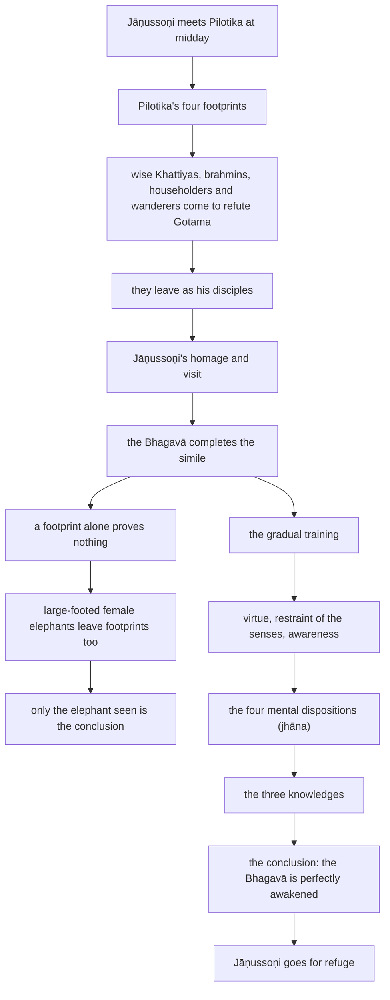

import { Tabs, TabItem } from '@astrojs/starlight/components';

Original text: [9M/3.7 Cūḷahatthipadopamasutta 1008–1052](https://tipitaka2500.github.io/tipitaka/9M/3/3.7.html#1008) in the [World Tipitaka Edition](https://tipitaka2500.github.io)

## Summary

The brahmin Jāṇussoṇi hears from the renunciant Pilotika why he is confident in the Bhagavā: four ‘footprints’, the wise of four classes who come to refute Gotama and leave as his disciples, as a tracker infers a great elephant from a footprint. The Bhagavā completes the simile: a skilled tracker does not conclude from a footprint alone, since large-footed female elephants leave them too, but only on seeing the elephant; so the disciple of the liberated concludes that the Bhagavā is perfectly awakened only when the gradual training ends in the destruction of the defilements. Jāṇussoṇi goes for refuge.

## Diagram

## Text

<Tabs syncKey="paliquote">
<TabItem label="My Translation">
(288.)

1008\. Thus heard by me — At one time the Bhagavā was dwelling at Sāvatthī, in Jeta's Grove, Anāthapiṇḍika's Park. Now at that time the brahmin Jāṇussoṇi was going out of Sāvatthī at midday in an all-white chariot drawn by mares. The brahmin Jāṇussoṇi saw the renunciant Pilotika coming from afar. Having seen him, he said this to the renunciant Pilotika:

1009\. “Well then, where is Bho Vacchāyana coming from at midday?”

1010\. “Indeed, Bho, I am coming from here, from the presence of the wanderer Gotama.”

1011\. “What does Bho Vacchāyana consider of the wanderer Gotama's lucidity of wisdom: he is wise, one would think?”

1012\. “Who am I, Bho, and who [am I] to know the wanderer Gotama's lucidity of wisdom? He too would surely be just such a one who could know the wanderer Gotama's lucidity of wisdom.”

1013\. “Bho Vacchāyana indeed praises the wanderer Gotama with great praise.”

1014\. “Who am I, Bho, and who [am I] to praise the wanderer Gotama, [when] Bho Gotama is indeed praised by the praised, the foremost of gods and humans?”

1015\. “But seeing what reason is Bho Vacchāyana so confident in the wanderer Gotama?”

1016\. “Just as, Bho, a skilled elephant tracker might enter an elephant forest. He might see in the elephant forest a large elephant footprint, long in length and wide across. He would come to the conclusion: ‘Indeed, Bho, a great bull elephant!’ In the same way, Bho, when I saw four footprints in the wanderer Gotama, then I came to the conclusion: ‘The Bhagavā is perfectly awakened, the Dhamma has been well proclaimed by the Bhagavā, the Saṅgha of the Bhagavā’s disciples has practised well.’

(289.)

1017\. What four? Here, Bho, I see some wise Khattiyas, astute, well acquainted with the doctrines of others, like hair-splitting marksmen; they go about, one would think, shooting down speculative views with their intellect. They hear: ‘Indeed, Bho, the wanderer Gotama will come to a village or town named such and such.’ They construct a question: ‘Having approached the wanderer Gotama, we will ask him this question. If, asked thus by us, he answers thus, we will refute his assertion thus. And if, asked thus by us, he answers thus, we will refute his assertion thus too.’ They hear: ‘Indeed, Bho, the wanderer Gotama has come to a village or town named such and such.’ They approach the wanderer Gotama. The wanderer Gotama educates, encourages, fires up, and inspires them with a Dhamma talk. Educated, encouraged, fired up, and inspired by the wanderer Gotama with a Dhamma talk, they do not even ask the wanderer Gotama the question; how then will they refute his assertion? On the contrary, they become disciples of the wanderer Gotama himself. When, Bho, I saw this first footprint in the wanderer Gotama, then I came to the conclusion: ‘The Bhagavā is perfectly awakened, the Dhamma has been well proclaimed by the Bhagavā, the Saṅgha of the Bhagavā’s disciples has practised well.’ (1)

1018\. And furthermore, Bho, I see here some wise brahmins … and so on … (2) wise householders … and so on … (3) wise wanderers, astute, well acquainted with the doctrines of others, like hair-splitting marksmen; they go about, one would think, shooting down speculative views with their intellect. They hear: ‘Indeed, Bho, the wanderer Gotama will come to a village or town named such and such.’ They construct a question: ‘Having approached the wanderer Gotama, we will ask him this question. If, asked thus by us, he answers thus, we will refute his assertion thus. And if, asked thus by us, he answers thus, we will refute his assertion thus too.’ They hear: ‘Indeed, Bho, the wanderer Gotama has come to a village or town named such and such.’ They approach the wanderer Gotama. The wanderer Gotama educates, encourages, fires up, and inspires them with a Dhamma talk. Educated, encouraged, fired up, and inspired by the wanderer Gotama with a Dhamma talk, they do not even ask the wanderer Gotama the question; how then will they refute his assertion? On the contrary, they ask the wanderer Gotama himself for permission to go forth from the home life into homelessness. The wanderer Gotama gives them the going forth. Having gone forth there, dwelling secluded, diligent, ardent and resolute, before long — for the sake of which young men of good families rightly go forth from the home life into homelessness, that unsurpassed culmination of the optimal life — having realised it for themselves through experiential understanding in this very life, they enter and dwell in it. They said this: ‘We were nearly lost, Bho; we were nearly ruined, Bho; for formerly, being no wanderers at all, we claimed to be wanderers; being no brahmins at all, we claimed to be brahmins; being no liberated ones at all, we claimed to be liberated ones. Now we are truly wanderers, now we are truly brahmins, now we are truly liberated ones.’ When, Bho, I saw this fourth footprint in the wanderer Gotama, then I came to the conclusion: ‘The Bhagavā is perfectly awakened, the Dhamma has been well proclaimed by the Bhagavā, the Saṅgha of the Bhagavā’s disciples has practised well.’ (4)

1019\. When, Bho, I saw these four footprints in the wanderer Gotama, then I came to the conclusion: ‘The Bhagavā is perfectly awakened, the Dhamma has been well proclaimed by the Bhagavā, the Saṅgha of the Bhagavā’s disciples has practised well.’”

(290.)

1020\. When this was said, the brahmin Jāṇussoṇi, having got down from the all-white chariot drawn by mares, arranging his upper robe over one shoulder and extending his clasped hands towards the Bhagavā, three times uttered an inspired utterance:

1021\. “Homage to that Bhagavā, a liberated one, a perfectly awakened one;

1022\. homage to that Bhagavā, a liberated one, a perfectly awakened one;

1023\. homage to that Bhagavā, a liberated one, a perfectly awakened one.

1024\. Perhaps at some time or other we too might meet with that Bho Gotama; perhaps there might be some conversation.”

1025\. Then the brahmin Jāṇussoṇi approached the Bhagavā; having approached, he exchanged friendly greetings with the Bhagavā. When they had concluded their courteous and amiable talk, he sat down to one side. Seated to one side, the brahmin Jāṇussoṇi related to the Bhagavā all the conversation he had had with the renunciant Pilotika. When this was said, the Bhagavā said this to the brahmin Jāṇussoṇi: “Brāhmaṇa, to this extent the simile of the elephant's footprint is not complete in detail. However, Brāhmaṇa, listen to how the simile of the elephant's footprint is complete in detail. Attend closely, I shall speak.” “Yes, Bho,” the brahmin Jāṇussoṇi replied to the Bhagavā. The Bhagavā said this:

(291.)

1026\. “Just as, Brāhmaṇa, an elephant tracker might enter an elephant forest. He might see in the elephant forest a large elephant footprint, long in length and wide across. One who is a skilled elephant tracker does not yet come to the conclusion: ‘Indeed, Bho, a great bull elephant!’ For what reason? For in the elephant forest, Brāhmaṇa, there are female elephants called `vāmanikā` (dwarfish) with large footprints; this might be a footprint of theirs too.

1027\. He follows it. Following it, he sees in the elephant forest a large elephant footprint, long in length and wide across, and a track high up. One who is a skilled elephant tracker does not yet come to the conclusion: ‘Indeed, Bho, a great bull elephant!’ For what reason? For in the elephant forest, Brāhmaṇa, there are tall female elephants called `kāḷārikā` (with gapped and protruding teeth) with large footprints; this might be a footprint of theirs too.

1028\. He follows it. Following it, he sees in the elephant forest a large elephant footprint, long in length and wide across, and a track high up, and markings made by tusks high up. One who is a skilled elephant tracker does not yet come to the conclusion: ‘Indeed, Bho, a great bull elephant!’ For what reason? For in the elephant forest, Brāhmaṇa, there are tall female elephants called `kaṇerukā` (with pointed tusks) with large footprints; this might be a footprint of theirs too.

1029\. He follows it. Following it, he sees in the elephant forest a large elephant footprint, long in length and wide across, and a track high up, and markings made by tusks high up, and a broken branch high up. And he sees that bull elephant gone to the foot of a tree or gone into the open, walking or standing, sitting or lying down. He comes to the conclusion: ‘This very one is that great bull elephant.’

1030\. In the same way, Brāhmaṇa, here in the world, a Tathāgata arises, an `arahant` (liberated one), a `sammāsambuddha` (perfectly awakened one), accomplished in knowledge and conduct, fortunate, knower of the world, unsurpassed trainer of persons to be tamed, teacher of gods and humans, the Awakened One, the Bhagavā. He declares this world — with its deities, Māras, and Brahmās, this generation with its religious practitioners, its gods and humans — having realised it for himself through experiential understanding. He teaches the Dhamma that is good in the beginning, good in the middle, and good in the end, meaningful and well-phrased; he makes known the `brahmacariya` (optimal life) that is wholly complete and perfectly pure. A householder or a householder's son, or one born in some other family, hears that Dhamma. Having heard that Dhamma, he gains confidence in the Tathāgata. Endowed with that gain of confidence, he reflects thus: ‘Household life is confining, a dusty path. Going forth is the open air. It is not easy for one living in a house to lead the optimal life that is utterly perfect, utterly pure, like a polished shell. What if I, having shaved off my hair and beard, and having put on saffron robes, were to go forth from the home life into homelessness?’ So, at a later time, having given up a small or large pile of wealth, having given up a small or large family circle, having shaved off his hair and beard, and having put on saffron robes, he goes forth from the home life into homelessness.

(292.)

1031\. Having thus gone forth, having undertaken the training and livelihood of bhikkhū, giving up the taking of life, he abstains from the taking of life; he lives with rod and weapon laid aside, scrupulous, compassionate, sympathetic for the welfare of all living beings.

1032\. Giving up the taking of what is not given, he abstains from the taking of what is not given; he takes what is given, expects only what is given. Not a thief, he lives pure in himself.

1033\. Giving up uncelibacy, he practises celibacy, keeps far away from sexual intercourse, abstains from vulgar practice.

1034\. Giving up false speech, he abstains from false speech; he is truthful, true to his word, honest, reliable, keeping promises for everyone in the world.

1035\. Giving up slanderous speech, he abstains from slanderous speech; having listened here, he does not tell it there to break up these people; having listened there, he does not tell it here to break up those people. Thus he is a conciliator of the broken and a provider of friendly terms; enjoying concord, liking harmony, delighting in unity, he speaks peace-making speech.

1036\. Giving up harsh speech, he abstains from harsh speech. Whatever speech is gentle, pleasant to hear, friendly, heart-warming, polite, loved by the people, charming to the people — such speech he speaks.

1037\. Giving up gossip, he abstains from gossip; he speaks at the proper time, speaks what is true, speaks what is meaningful, speaks about the Dhamma, speaks about the discipline; he speaks speech worth remembering, timely, reasonable, purposeful, beneficial.

(293.)

1038\. He abstains from harming seed-and-plant life. He eats one meal a day, abstaining from eating at night, abstaining from eating between midday and dawn. He abstains from dancing, singing, instrumental music, and watching shows. He abstains from using garlands, perfumes, oils, adornments and decorations. He abstains from large and luxurious beds. He abstains from accepting gold and silver. He abstains from accepting raw grain. He abstains from accepting raw meat. He abstains from accepting women and girls. He abstains from accepting female and male servants. He abstains from accepting goats and sheep. He abstains from accepting chickens and pigs. He abstains from accepting elephants, cattle, horses, and mares. He abstains from accepting fields and land. He abstains from engaging in messages and errands. He abstains from buying and selling. He abstains from cheating with scales, weights, or measures. He abstains from bribery, deception, fraud, and crookedness. He abstains from cutting, beating, binding, robbery, plunder, and violence.

(294.)

1039\. He is content with a robe to look after his body and alms food to look after his stomach. Wherever he goes, he goes taking only these with him. Just as a winged bird, wherever it flies, flies with its wings as its only burden; in the same way, a bhikkhu is content with a robe to look after his body and alms food to look after his stomach. Wherever he goes, he goes taking only these with him. Endowed with this collection of virtue of the liberated, he experiences blameless happiness within himself.

(295.)

1040\. When he sees a form with the eye, he does not grasp at its representations or details. He practises for the restraint of that eye faculty, through which, if it were unrestrained, evil, unwholesome characteristics of covetousness and displeasure might invade him. He guards the eye faculty; he undertakes restraint of the eye faculty. When he hears a sound with the ear… when he smells an odour with the nose… when he tastes a taste with the tongue… when he touches a tangible with the body… when he cognises a mind-object with the mind, he does not grasp at its representations or details. He practises for the restraint of that mind faculty, through which, if it were unrestrained, evil, unwholesome characteristics of covetousness and displeasure might invade him. He guards the mind faculty; he undertakes restraint of the mind faculty. Endowed with this restraint of the faculties of the liberated, he experiences unadulterated happiness within himself.

1041\. He acts with clear comprehension when going forward and returning; he acts with clear comprehension when looking forward and looking around; he acts with clear comprehension when bending and stretching; he acts with clear comprehension when carrying his outer robe, bowl, and robe; he acts with clear comprehension when eating, drinking, chewing, and tasting; he acts with clear comprehension when defecating and urinating; he acts with clear comprehension when walking, standing, sitting, sleeping, waking, speaking, and remaining silent.

(296.)

1042\. Endowed with this collection of virtue of the liberated, endowed with this contentment of the liberated, endowed with this restraint of the faculties of the liberated, and endowed with this `sati` (awareness) and `sampajañña` (clear comprehension) of the liberated, he resorts to a secluded dwelling: a wilderness, the foot of a tree, a mountain, a ravine, a hillside cave, a charnel ground, a forest grove, the open air, a heap of straw. After his meal, having returned from his alms round, he sits down, folding his legs crosswise, setting his body erect, and establishing awareness in front of him. Giving up covetousness for the world, he dwells with a mind free from covetousness; he purifies his mind from covetousness. Giving up ill will and hatred, he dwells with a mind free from ill will, sympathetic for the welfare of all living beings; he purifies his mind from ill will and hatred. Giving up sloth and torpor, he dwells free from sloth and torpor, with apperception of light, aware and clearly comprehending; he purifies his mind from sloth and torpor. Giving up restlessness and remorse, he dwells undisturbed, with his mind inwardly peaceful; he purifies his mind from restlessness and remorse. Giving up doubt, he dwells having crossed over doubt, without perplexity regarding wholesome characteristics; he purifies his mind from doubt.

(297.)

1043\. Having given up these five `nīvaraṇā` (hindrances), imperfections of the mind that weaken wisdom, secluding himself from sensual pleasures, detaching from unwholesome characteristics, he enters and remains in the first `jhāna` (mental disposition), accompanied by reflection and consideration, secluded from defilements, with felicity and satisfaction. This too, Brāhmaṇa, is called a footprint of the Tathāgata, and a track of the Tathāgata, and a marking of the Tathāgata. Yet the `ariyasāvaka` (disciple of the liberated) does not yet come to the conclusion: ‘The Bhagavā is perfectly awakened, the Dhamma has been well proclaimed by the Bhagavā, the Saṅgha of the Bhagavā’s disciples has practised well.’

1044\. And furthermore, Brāhmaṇa, a bhikkhu, with the conclusion of reflection and consideration, enters and remains in the second mental disposition, accompanied by an inner calming of intention, focused, without reflection, without consideration, born from focus, with felicity and satisfaction. This too, Brāhmaṇa, is called… the Saṅgha of the Bhagavā’s disciples has practised well.’

1045\. And furthermore, Brāhmaṇa, a bhikkhu, with the detachment from felicity, remains equanimous, aware and clearly comprehending, and experiences body comfort, as the liberated ones describe: ‘equanimous, aware, living at ease’ — he enters and remains in the third mental disposition. This too, Brāhmaṇa, is called… the Saṅgha of the Bhagavā’s disciples has practised well.’

1046\. And furthermore, Brāhmaṇa, a bhikkhu, with the giving up of the pleasant and the unpleasant, and with the previous disappearance of mental pleasure and displeasure, enters and remains in the fourth mental disposition, in a neutral state, and possessing purification of awareness by equanimity. This too, Brāhmaṇa, is called a footprint of the Tathāgata, and a track of the Tathāgata, and a marking of the Tathāgata. Yet the disciple of the liberated does not yet come to the conclusion: ‘The Bhagavā is perfectly awakened, the Dhamma has been well proclaimed by the Bhagavā, the Saṅgha of the Bhagavā’s disciples has practised well.’

(298.)

1047\. When his mind is thus focused, purified, bright, unblemished, rid of imperfection, malleable, wieldy, steady, and attained to imperturbability, he directs it to knowledge of the recollection of past lives. He recollects his manifold past lives, that is, one birth, two births… thus with their aspects and particulars, he recollects his manifold past lives. This too, Brāhmaṇa, is called a footprint of the Tathāgata, and a track of the Tathāgata, and a marking of the Tathāgata. Yet the disciple of the liberated does not yet come to the conclusion: ‘The Bhagavā is perfectly awakened, the Dhamma has been well proclaimed by the Bhagavā, the Saṅgha of the Bhagavā’s disciples has practised well.’

1048\. When his mind is thus focused, purified, bright, unblemished, rid of imperfection, malleable, wieldy, steady, and attained to imperturbability, he directs it to knowledge of the passing away and reappearance of beings. With the divine eye, which is purified and surpasses the human… he understands how beings pass on according to their actions. This too, Brāhmaṇa, is called a footprint of the Tathāgata, and a track of the Tathāgata, and a marking of the Tathāgata. Yet the disciple of the liberated does not yet come to the conclusion: ‘The Bhagavā is perfectly awakened, the Dhamma has been well proclaimed by the Bhagavā, the Saṅgha of the Bhagavā’s disciples has practised well.’

(299.)

1049\. When his mind is thus focused, purified, bright, unblemished, rid of imperfection, malleable, wieldy, steady, and attained to imperturbability, he directs it to knowledge of the destruction of the `āsavā` (defilements). He knows clearly as it really is: ‘This is `dukkha` (suffering).’ He knows clearly as it really is: ‘This is the origin of suffering.’ He knows clearly as it really is: ‘This is the cessation of suffering.’ He knows clearly as it really is: ‘This is the path leading to the cessation of suffering.’ He knows clearly as it really is: ‘These are the defilements.’ He knows clearly as it really is: ‘This is the origin of the defilements.’ He knows clearly as it really is: ‘This is the cessation of the defilements.’ He knows clearly as it really is: ‘This is the path leading to the cessation of the defilements.’ This too, Brāhmaṇa, is called a footprint of the Tathāgata, and a track of the Tathāgata, and a marking of the Tathāgata. Yet the disciple of the liberated has not yet come to the conclusion, but rather is coming to the conclusion: ‘The Bhagavā is perfectly awakened, the Dhamma has been well proclaimed by the Bhagavā, the Saṅgha of the Bhagavā’s disciples has practised well.’

1050\. When he knows and sees thus, his mind is liberated from the defilement of sensual pleasure, his mind is liberated from the defilement of existence, his mind is liberated from the defilement of ignorance. In liberation there is the knowledge: ‘liberated’. He knows clearly: ‘Birth (of suffering) is finished, the optimal life is lived, what had to be done is done, there is nothing further for this present state of existence.’ This too, Brāhmaṇa, is called a footprint of the Tathāgata, and a track of the Tathāgata, and a marking of the Tathāgata. To this extent, Brāhmaṇa, the disciple of the liberated has come to the conclusion: ‘The Bhagavā is perfectly awakened, the Dhamma has been well proclaimed by the Bhagavā, the Saṅgha of the Bhagavā’s disciples has practised well.’ To this extent, Brāhmaṇa, the simile of the elephant's footprint is complete in detail.”

1051\. When this was said, the brahmin Jāṇussoṇi said this to the Bhagavā: “Excellent, Bho Gotama! Excellent, Bho Gotama! Just as, Bho Gotama, one might set upright what has been overturned, or reveal what is hidden, or point out the path to one who is lost, or hold up an oil lamp in the darkness, thinking, ‘those with eyes will see forms’; even so, the Dhamma has been made clear in many ways by Bho Gotama. I go for refuge to Bho Gotama, to the Dhamma, and to the `bhikkhusaṃgha` (Saṅgha of bhikkhū). May Bho Gotama remember me as an `upāsaka` (lay disciple) who has gone for refuge for life, from today onwards.”

1052\. The Shorter Discourse on the Simile of the Elephant's Footprint, the seventh, is finished.
</TabItem>

<TabItem label="Pāḷi (Roman IAST)">
(288.)

1008\. Evaṃ me sutaṃ— ekaṃ samayaṃ bhagavā sāvatthiyaṃ viharati jetavane anāthapiṇḍikassa ārāme. Tena kho pana samayena jāṇussoṇi brāhmaṇo sabbasetena vaḷavābhirathena sāvatthiyā niyyāti divādivassa. Addasā kho jāṇussoṇi brāhmaṇo pilotikaṃ paribbājakaṃ dūratova āgacchantaṃ. Disvāna pilotikaṃ paribbājakaṃ etadavoca—

1009\. “Handa kuto nu bhavaṃ vacchāyano āgacchati divādivassā”ti?

1010\. “Ito hi kho ahaṃ, bho, āgacchāmi samaṇassa gotamassa santikā”ti.

1011\. “Taṃ kiṃ maññati bhavaṃ vacchāyano samaṇassa gotamassa paññāveyyattiyaṃ paṇḍito maññe”ti.

1012\. “Ko cāhaṃ, bho, ko ca samaṇassa gotamassa paññāveyyattiyaṃ jānissāmi. Sopi nūnassa tādisova yo samaṇassa gotamassa paññāveyyattiyaṃ jāneyyā”ti.

1013\. “Uḷārāya khalu bhavaṃ vacchāyano samaṇaṃ gotamaṃ pasaṃsāya pasaṃsatī”ti.

1014\. “Ko cāhaṃ, bho, ko ca samaṇaṃ gotamaṃ pasaṃsissāmi, pasatthapasatthova so bhavaṃ gotamo seṭṭho devamanussānan”ti.

1015\. “Kaṃ pana bhavaṃ vacchāyano atthavasaṃ sampassamāno samaṇe gotame evaṃ abhippasanno”ti?

1016\. “Seyyathāpi, bho, kusalo nāgavaniko nāgavanaṃ paviseyya. So passeyya nāgavane mahantaṃ hatthipadaṃ, dīghato ca āyataṃ, tiriyañca vitthataṃ. So niṭṭhaṃ gaccheyya— ‘mahā vata bho nāgo’ti. Evameva kho ahaṃ, bho, yato addasaṃ samaṇe gotame cattāri padāni athāhaṃ niṭṭhamagamaṃ— ‘sammāsambuddho bhagavā, svākkhāto bhagavatā dhammo, suppaṭipanno bhagavato sāvakasaṃgho’ti.

(289.)

1017\. Katamāni cattāri? Idhāhaṃ, bho, passāmi ekacce khattiyapaṇḍite nipuṇe kataparappavāde vālavedhirūpe, te bhindantā maññe caranti paññāgatena diṭṭhigatāni. Te suṇanti— ‘samaṇo khalu, bho, gotamo amukaṃ nāma gāmaṃ vā nigamaṃ vā osarissatī’ti. Te pañhaṃ abhisaṅkharonti— ‘imaṃ mayaṃ pañhaṃ samaṇaṃ gotamaṃ upasaṅkamitvā pucchissāma. Evañce no puṭṭho evaṃ byākarissati, evamassa mayaṃ vādaṃ āropessāma. Evañcepi no puṭṭho evaṃ byākarissati, evampissa mayaṃ vādaṃ āropessāmā’ti. Te suṇanti— ‘samaṇo khalu, bho, gotamo amukaṃ nāma gāmaṃ vā nigamaṃ vā osaṭo’ti. Te yena samaṇo gotamo tenupasaṅkamanti. Te samaṇo gotamo dhammiyā kathāya sandasseti samādapeti samuttejeti sampahaṃseti. Te samaṇena gotamena dhammiyā kathāya sandassitā samādapitā samuttejitā sampahaṃsitā na ceva samaṇaṃ gotamaṃ pañhaṃ pucchanti, kutossa vādaṃ āropessanti? Aññadatthu samaṇasseva gotamassa sāvakā sampajjanti. Yadāhaṃ, bho, samaṇe gotame imaṃ paṭhamaṃ padaṃ addasaṃ athāhaṃ niṭṭhamagamaṃ— ‘sammāsambuddho bhagavā, svākkhāto bhagavatā dhammo, suppaṭipanno bhagavato sāvakasaṃgho’ti. (1)

1018\. Puna caparāhaṃ, bho, passāmi idhekacce brāhmaṇapaṇḍite…pe… (2) gahapatipaṇḍite…pe… (3) samaṇapaṇḍite nipuṇe kataparappavāde vālavedhirūpe te bhindantā maññe caranti paññāgatena diṭṭhigatāni. Te suṇanti— ‘samaṇo khalu bho gotamo amukaṃ nāma gāmaṃ vā nigamaṃ vā osarissatī’ti. Te pañhaṃ abhisaṅkharonti ‘imaṃ mayaṃ pañhaṃ samaṇaṃ gotamaṃ upasaṅkamitvā pucchissāma. Evañce no puṭṭho evaṃ byākarissati, evamassa mayaṃ vādaṃ āropessāma. Evañcepi no puṭṭho evaṃ byākarissati, evampissa mayaṃ vādaṃ āropessāmā’ti. Te suṇanti ‘samaṇo khalu bho gotamo amukaṃ nāma gāmaṃ vā nigamaṃ vā osaṭo’ti. Te yena samaṇo gotamo tenupasaṅkamanti. Te samaṇo gotamo dhammiyā kathāya sandasseti samādapeti samuttejeti sampahaṃseti. Te samaṇena gotamena dhammiyā kathāya sandassitā samādapitā samuttejitā sampahaṃsitā na ceva samaṇaṃ gotamaṃ pañhaṃ pucchanti, kutossa vādaṃ āropessanti? Aññadatthu samaṇaṃyeva gotamaṃ okāsaṃ yācanti agārasmā anagāriyaṃ pabbajjāya. Te samaṇo gotamo pabbājeti. Te tattha pabbajitā samānā vūpakaṭṭhā appamattā ātāpino pahitattā viharantā nacirasseva— yassatthāya kulaputtā sammadeva agārasmā anagāriyaṃ pabbajanti, tadanuttaraṃ— brahmacariyapariyosānaṃ diṭṭheva dhamme sayaṃ abhiññā sacchikatvā upasampajja viharanti. Te evamāhaṃsu— ‘manaṃ vata, bho, anassāma, manaṃ vata, bho, panassāma; mayañhi pubbe assamaṇāva samānā samaṇamhāti paṭijānimha, abrāhmaṇāva samānā brāhmaṇamhāti paṭijānimha, anarahantova samānā arahantamhāti paṭijānimha. Idāni khomha samaṇā, idāni khomha brāhmaṇā, idāni khomha arahanto’ti. Yadāhaṃ, bho, samaṇe gotame imaṃ catutthaṃ padaṃ addasaṃ athāhaṃ niṭṭhamagamaṃ— ‘sammāsambuddho bhagavā, svākkhāto bhagavatā dhammo, suppaṭipanno bhagavato sāvakasaṃgho’ti. (4)

1019\. Yato kho ahaṃ, bho, samaṇe gotame imāni cattāri padāni addasaṃ athāhaṃ niṭṭhamagamaṃ— ‘sammāsambuddho bhagavā, svākkhāto bhagavatā dhammo, suppaṭipanno bhagavato sāvakasaṃgho’”ti.

(290.)

1020\. Evaṃ vutte, jāṇussoṇi brāhmaṇo sabbasetā vaḷavābhirathā orohitvā ekaṃsaṃ uttarāsaṅgaṃ karitvā yena bhagavā tenañjaliṃ paṇāmetvā tikkhattuṃ udānaṃ udānesi—

1021\. “Namo tassa bhagavato arahato sammāsambuddhassa;

1022\. namo tassa bhagavato arahato sammāsambuddhassa;

1023\. namo tassa bhagavato arahato sammāsambuddhassāti.

1024\. Appeva nāma mayampi kadāci karahaci tena bhotā gotamena saddhiṃ samāgaccheyyāma, appeva nāma siyā kocideva kathāsallāpo”ti.

1025\. Atha kho jāṇussoṇi brāhmaṇo yena bhagavā tenupasaṅkami; upasaṅkamitvā bhagavatā saddhiṃ sammodi. Sammodanīyaṃ kathaṃ sāraṇīyaṃ vītisāretvā ekamantaṃ nisīdi. Ekamantaṃ nisinno kho jāṇussoṇi brāhmaṇo yāvatako ahosi pilotikena paribbājakena saddhiṃ kathāsallāpo taṃ sabbaṃ bhagavato ārocesi. Evaṃ vutte, bhagavā jāṇussoṇiṃ brāhmaṇaṃ etadavoca— “na kho, brāhmaṇa, ettāvatā hatthipadopamo vitthārena paripūro hoti. Api ca, brāhmaṇa, yathā hatthipadopamo vitthārena paripūro hoti taṃ suṇāhi, sādhukaṃ manasi karohi, bhāsissāmī”ti. “Evaṃ, bho”ti kho jāṇussoṇi brāhmaṇo bhagavato paccassosi. Bhagavā etadavoca—

(291.)

1026\. “Seyyathāpi, brāhmaṇa, nāgavaniko nāgavanaṃ paviseyya. So passeyya nāgavane mahantaṃ hatthipadaṃ, dīghato ca āyataṃ, tiriyañca vitthataṃ. Yo hoti kusalo nāgavaniko neva tāva niṭṭhaṃ gacchati— ‘mahā vata bho nāgo’ti. Taṃ kissa hetu? Santi hi, brāhmaṇa, nāgavane vāmanikā nāma hatthiniyo mahāpadā, tāsaṃ petaṃ padaṃ assāti.

1027\. So tamanugacchati. Tamanugacchanto passati nāgavane mahantaṃ hatthipadaṃ, dīghato ca āyataṃ, tiriyañca vitthataṃ, uccā ca nisevitaṃ. Yo hoti kusalo nāgavaniko neva tāva niṭṭhaṃ gacchati— ‘mahā vata bho nāgo’ti. Taṃ kissa hetu? Santi hi, brāhmaṇa, nāgavane uccā kāḷārikā nāma hatthiniyo mahāpadā, tāsaṃ petaṃ padaṃ assāti.

1028\. So tamanugacchati. Tamanugacchanto passati nāgavane mahantaṃ hatthipadaṃ, dīghato ca āyataṃ, tiriyañca vitthataṃ, uccā ca nisevitaṃ, uccā ca dantehi ārañjitāni. Yo hoti kusalo nāgavaniko neva tāva niṭṭhaṃ gacchati— ‘mahā vata bho nāgo’ti. Taṃ kissa hetu? Santi hi, brāhmaṇa, nāgavane uccā kaṇerukā nāma hatthiniyo mahāpadā, tāsaṃ petaṃ padaṃ assāti.

1029\. So tamanugacchati. Tamanugacchanto passati nāgavane mahantaṃ hatthipadaṃ, dīghato ca āyataṃ, tiriyañca vitthataṃ, uccā ca nisevitaṃ, uccā ca dantehi ārañjitāni, uccā ca sākhābhaṅgaṃ. Tañca nāgaṃ passati rukkhamūlagataṃ vā abbhokāsagataṃ vā gacchantaṃ vā tiṭṭhantaṃ vā nisinnaṃ vā nipannaṃ vā. So niṭṭhaṃ gacchati— ‘ayameva so mahānāgo’ti.

1030\. Evameva kho, brāhmaṇa, idha tathāgato loke uppajjati arahaṃ sammāsambuddho vijjācaraṇasampanno sugato lokavidū anuttaro purisadammasārathi satthā devamanussānaṃ buddho bhagavā. So imaṃ lokaṃ sadevakaṃ samārakaṃ sabrahmakaṃ sassamaṇabrāhmaṇiṃ pajaṃ sadevamanussaṃ sayaṃ abhiññā sacchikatvā pavedeti. So dhammaṃ deseti ādikalyāṇaṃ majjhekalyāṇaṃ pariyosānakalyāṇaṃ sātthaṃ sabyañjanaṃ; kevalaparipuṇṇaṃ parisuddhaṃ brahmacariyaṃ pakāseti. Taṃ dhammaṃ suṇāti gahapati vā gahapatiputto vā aññatarasmiṃ vā kule paccājāto. So taṃ dhammaṃ sutvā tathāgate saddhaṃ paṭilabhati. So tena saddhāpaṭilābhena samannāgato iti paṭisañcikkhati— ‘sambādho gharāvāso rajopatho, abbhokāso pabbajjā. Nayidaṃ sukaraṃ agāraṃ ajjhāvasatā ekantaparipuṇṇaṃ ekantaparisuddhaṃ saṅkhalikhitaṃ brahmacariyaṃ carituṃ. Yannūnāhaṃ kesamassuṃ ohāretvā kāsāyāni vatthāni acchādetvā agārasmā anagāriyaṃ pabbajeyyan’ti. So aparena samayena appaṃ vā bhogakkhandhaṃ pahāya mahantaṃ vā bhogakkhandhaṃ pahāya appaṃ vā ñātiparivaṭṭaṃ pahāya mahantaṃ vā ñātiparivaṭṭaṃ pahāya kesamassuṃ ohāretvā kāsāyāni vatthāni acchādetvā agārasmā anagāriyaṃ pabbajati.

(292.)

1031\. So evaṃ pabbajito samāno bhikkhūnaṃ sikkhāsājīvasamāpanno pāṇātipātaṃ pahāya pāṇātipātā paṭivirato hoti, nihitadaṇḍo nihitasattho lajjī dayāpanno sabbapāṇabhūtahitānukampī viharati.

1032\. Adinnādānaṃ pahāya adinnādānā paṭivirato hoti dinnādāyī dinnapāṭikaṅkhī. Athenena sucibhūtena attanā viharati.

1033\. Abrahmacariyaṃ pahāya brahmacārī hoti ārācārī virato methunā gāmadhammā.

1034\. Musāvādaṃ pahāya musāvādā paṭivirato hoti saccavādī saccasandho theto paccayiko avisaṃvādako lokassa.

1035\. Pisuṇaṃ vācaṃ pahāya pisuṇāya vācāya paṭivirato hoti, ito sutvā na amutra akkhātā imesaṃ bhedāya, amutra vā sutvā na imesaṃ akkhātā amūsaṃ bhedāya. Iti bhinnānaṃ vā sandhātā sahitānaṃ vā anuppadātā, samaggārāmo samaggarato samagganandī samaggakaraṇiṃ vācaṃ bhāsitā hoti.

1036\. Pharusaṃ vācaṃ pahāya pharusāya vācāya paṭivirato hoti. Yā sā vācā nelā kaṇṇasukhā pemanīyā hadayaṅgamā porī bahujanakantā bahujanamanāpā tathārūpiṃ vācaṃ bhāsitā hoti.

1037\. Samphappalāpaṃ pahāya samphappalāpā paṭivirato hoti kālavādī bhūtavādī atthavādī dhammavādī vinayavādī, nidhānavatiṃ vācaṃ bhāsitā kālena sāpadesaṃ pariyantavatiṃ atthasaṃhitaṃ.

(293.)

1038\. So bījagāmabhūtagāmasamārambhā paṭivirato hoti, ekabhattiko hoti rattūparato, virato vikālabhojanā, naccagītavāditavisūkadassanā paṭivirato hoti, mālāgandhavilepanadhāraṇamaṇḍanavibhūsanaṭṭhānā paṭivirato hoti, uccāsayanamahāsayanā paṭivirato hoti, jātarūparajatapaṭiggahaṇā paṭivirato hoti, āmakadhaññapaṭiggahaṇā paṭivirato hoti, āmakamaṃsapaṭiggahaṇā paṭivirato hoti, itthikumārikapaṭiggahaṇā paṭivirato hoti, dāsidāsapaṭiggahaṇā paṭivirato hoti, ajeḷakapaṭiggahaṇā paṭivirato hoti, kukkuṭasūkarapaṭiggahaṇā paṭivirato hoti, hatthigavāssavaḷavapaṭiggahaṇā paṭivirato hoti, khettavatthupaṭiggahaṇā paṭivirato hoti, dūteyyapahiṇagamanānuyogā paṭivirato hoti, kayavikkayā paṭivirato hoti, tulākūṭakaṃsakūṭamānakūṭā paṭivirato hoti, ukkoṭanavañcananikatisāciyogā paṭivirato hoti, chedanavadhabandhanaviparāmosaālopasahasākārā paṭivirato hoti.

(294.)

1039\. So santuṭṭho hoti kāyaparihārikena cīvarena kucchiparihārikena piṇḍapātena. So yena yeneva pakkamati samādāyeva pakkamati. Seyyathāpi nāma pakkhī sakuṇo yena yeneva ḍeti sapattabhārova ḍeti; evameva bhikkhu santuṭṭho hoti kāyaparihārikena cīvarena kucchiparihārikena piṇḍapātena. So yena yeneva pakkamati samādāyeva pakkamati. So iminā ariyena sīlakkhandhena samannāgato ajjhattaṃ anavajjasukhaṃ paṭisaṃvedeti.

(295.)

1040\. So cakkhunā rūpaṃ disvā na nimittaggāhī hoti nānubyañjanaggāhī. Yatvādhikaraṇamenaṃ cakkhundriyaṃ asaṃvutaṃ viharantaṃ abhijjhādomanassā pāpakā akusalā dhammā anvāssaveyyuṃ tassa saṃvarāya paṭipajjati, rakkhati cakkhundriyaṃ, cakkhundriye saṃvaraṃ āpajjati. Sotena saddaṃ sutvā…pe… ghānena gandhaṃ ghāyitvā… jivhāya rasaṃ sāyitvā… kāyena phoṭṭhabbaṃ phusitvā… manasā dhammaṃ viññāya na nimittaggāhī hoti nānubyañjanaggāhī. Yatvādhikaraṇamenaṃ manindriyaṃ asaṃvutaṃ viharantaṃ abhijjhādomanassā pāpakā akusalā dhammā anvāssaveyyuṃ tassa saṃvarāya paṭipajjati, rakkhati manindriyaṃ, manindriye saṃvaraṃ āpajjati. So iminā ariyena indriyasaṃvarena samannāgato ajjhattaṃ abyāsekasukhaṃ paṭisaṃvedeti.

1041\. So abhikkante paṭikkante sampajānakārī hoti, ālokite vilokite sampajānakārī hoti, samiñjite pasārite sampajānakārī hoti, saṃghāṭipattacīvaradhāraṇe sampajānakārī hoti, asite pīte khāyite sāyite sampajānakārī hoti, uccārapassāvakamme sampajānakārī hoti, gate ṭhite nisinne sutte jāgarite bhāsite tuṇhībhāve sampajānakārī hoti.

(296.)

1042\. So iminā ca ariyena sīlakkhandhena samannāgato, imāya ca ariyāya santuṭṭhiyā samannāgato iminā ca ariyena indriyasaṃvarena samannāgato, iminā ca ariyena satisampajaññena samannāgato vivittaṃ senāsanaṃ bhajati araññaṃ rukkhamūlaṃ pabbataṃ kandaraṃ giriguhaṃ susānaṃ vanapatthaṃ abbhokāsaṃ palālapuñjaṃ. So pacchābhattaṃ piṇḍapātapaṭikkanto nisīdati pallaṅkaṃ ābhujitvā, ujuṃ kāyaṃ paṇidhāya, parimukhaṃ satiṃ upaṭṭhapetvā. So abhijjhaṃ loke pahāya vigatābhijjhena cetasā viharati, abhijjhāya cittaṃ parisodheti. Byāpādapadosaṃ pahāya abyāpannacitto viharati, sabbapāṇabhūtahitānukampī byāpādapadosā cittaṃ parisodheti. Thinamiddhaṃ pahāya vigatathinamiddho viharati ālokasaññī sato sampajāno, thinamiddhā cittaṃ parisodheti. Uddhaccakukkuccaṃ pahāya anuddhato viharati, ajjhattaṃ vūpasantacitto uddhaccakukkuccā cittaṃ parisodheti. Vicikicchaṃ pahāya tiṇṇavicikiccho viharati akathaṃkathī kusalesu dhammesu, vicikicchāya cittaṃ parisodheti.

(297.)

1043\. So ime pañca nīvaraṇe pahāya cetaso upakkilese paññāya dubbalīkaraṇe, vivicceva kāmehi vivicca akusalehi dhammehi savitakkaṃ savicāraṃ vivekajaṃ pītisukhaṃ paṭhamaṃ jhānaṃ upasampajja viharati. Idampi vuccati, brāhmaṇa, tathāgatapadaṃ itipi, tathāgatanisevitaṃ itipi, tathāgatārañjitaṃ itipi. Na tveva tāva ariyasāvako niṭṭhaṃ gacchati— ‘sammāsambuddho bhagavā, svākkhāto bhagavatā dhammo, suppaṭipanno bhagavato sāvakasaṃgho’ti.

1044\. Puna caparaṃ, brāhmaṇa, bhikkhu vitakkavicārānaṃ vūpasamā ajjhattaṃ sampasādanaṃ cetaso ekodibhāvaṃ avitakkaṃ avicāraṃ samādhijaṃ pītisukhaṃ dutiyaṃ jhānaṃ upasampajja viharati. Idampi vuccati, brāhmaṇa…pe… suppaṭipanno bhagavato sāvakasaṃgho’ti.

1045\. Puna caparaṃ, brāhmaṇa, bhikkhu pītiyā ca virāgā upekkhako ca viharati sato ca sampajāno, sukhañca kāyena paṭisaṃvedeti, yaṃ taṃ ariyā ācikkhanti ‘upekkhako satimā sukhavihārī’ti tatiyaṃ jhānaṃ upasampajja viharati. Idampi vuccati, brāhmaṇa…pe… suppaṭipanno bhagavato sāvakasaṃgho’ti.

1046\. Puna caparaṃ, brāhmaṇa, bhikkhu sukhassa ca pahānā dukkhassa ca pahānā, pubbeva somanassadomanassānaṃ atthaṅgamā, adukkhamasukhaṃ upekkhāsatipārisuddhiṃ catutthaṃ jhānaṃ upasampajja viharati. Idampi vuccati, brāhmaṇa, tathāgatapadaṃ itipi, tathāgatanisevitaṃ itipi, tathāgatārañjitaṃ itipi. Na tveva tāva ariyasāvako niṭṭhaṃ gacchati— ‘sammāsambuddho bhagavā, svākkhāto bhagavatā dhammo, suppaṭipanno bhagavato sāvakasaṃgho’ti.

(298.)

1047\. So evaṃ samāhite citte parisuddhe pariyodāte anaṅgaṇe vigatūpakkilese mudubhūte kammaniye ṭhite āneñjappatte pubbenivāsānussatiñāṇāya cittaṃ abhininnāmeti. So anekavihitaṃ pubbenivāsaṃ anussarati, seyyathidaṃ— ekampi jātiṃ, dvepi jātiyo…pe… iti sākāraṃ sauddesaṃ anekavihitaṃ pubbenivāsaṃ anussarati. Idampi vuccati, brāhmaṇa, tathāgatapadaṃ itipi, tathāgatanisevitaṃ itipi, tathāgatārañjitaṃ itipi. Na tveva tāva ariyasāvako niṭṭhaṃ gacchati— ‘sammāsambuddho bhagavā, svākkhāto bhagavatā dhammo, suppaṭipanno bhagavato sāvakasaṃgho’ti.

1048\. So evaṃ samāhite citte parisuddhe pariyodāte anaṅgaṇe vigatūpakkilese mudubhūte kammaniye ṭhite āneñjappatte sattānaṃ cutūpapātañāṇāya cittaṃ abhininnāmeti. So dibbena cakkhunā visuddhena atikkantamānusakena…pe… yathākammūpage satte pajānāti. Idampi vuccati, brāhmaṇa, tathāgatapadaṃ itipi, tathāgatanisevitaṃ itipi, tathāgatārañjitaṃ itipi. Na tveva tāva ariyasāvako niṭṭhaṃ gacchati— ‘sammāsambuddho bhagavā, svākkhāto bhagavatā dhammo, suppaṭipanno bhagavato sāvakasaṃgho’ti.

(299.)

1049\. So evaṃ samāhite citte parisuddhe pariyodāte anaṅgaṇe vigatūpakkilese mudubhūte kammaniye ṭhite āneñjappatte āsavānaṃ khayañāṇāya cittaṃ abhininnāmeti. So ‘idaṃ dukkhan’ti yathābhūtaṃ pajānāti, ‘ayaṃ dukkhasamudayo’ti yathābhūtaṃ pajānāti, ‘ayaṃ dukkhanirodho’ti yathābhūtaṃ pajānāti, ‘ayaṃ dukkhanirodhagāminī paṭipadā’ti yathābhūtaṃ pajānāti. ‘Ime āsavā’ti yathābhūtaṃ pajānāti, ‘ayaṃ āsavasamudayo’ti yathābhūtaṃ pajānāti, ‘ayaṃ āsavanirodho’ti yathābhūtaṃ pajānāti, ‘ayaṃ āsavanirodhagāminī paṭipadā’ti yathābhūtaṃ pajānāti. Idampi vuccati, brāhmaṇa, tathāgatapadaṃ itipi, tathāgatanisevitaṃ itipi, tathāgatārañjitaṃ itipi. Na tveva tāva ariyasāvako niṭṭhaṃ gato hoti, api ca kho niṭṭhaṃ gacchati— ‘sammāsambuddho bhagavā, svākkhāto bhagavatā dhammo, suppaṭipanno bhagavato sāvakasaṃgho’ti.

1050\. Tassa evaṃ jānato evaṃ passato kāmāsavāpi cittaṃ vimuccati, bhavāsavāpi cittaṃ vimuccati, avijjāsavāpi cittaṃ vimuccati. Vimuttasmiṃ vimuttamiti ñāṇaṃ hoti. ‘Khīṇā jāti, vusitaṃ brahmacariyaṃ, kataṃ karaṇīyaṃ, nāparaṃ itthattāyā’ti pajānāti. Idampi vuccati, brāhmaṇa, tathāgatapadaṃ itipi, tathāgatanisevitaṃ itipi, tathāgatārañjitaṃ itipi. Ettāvatā kho, brāhmaṇa, ariyasāvako niṭṭhaṃ gato hoti— ‘sammāsambuddho bhagavā, svākkhāto bhagavatā dhammo, suppaṭipanno bhagavato sāvakasaṃgho’ti. Ettāvatā kho, brāhmaṇa, hatthipadopamo vitthārena paripūro hotī”ti.

1051\. Evaṃ vutte, jāṇussoṇi brāhmaṇo bhagavantaṃ etadavoca— “abhikkantaṃ, bho gotama, abhikkantaṃ, bho gotama. Seyyathāpi, bho gotama, nikkujjitaṃ vā ukkujjeyya, paṭicchannaṃ vā vivareyya, mūḷhassa vā maggaṃ ācikkheyya, andhakāre vā telapajjotaṃ dhāreyya— ‘cakkhumanto rūpāni dakkhantī’ti; evamevaṃ bhotā gotamena anekapariyāyena dhammo pakāsito. Esāhaṃ bhavantaṃ gotamaṃ saraṇaṃ gacchāmi, dhammañca, bhikkhusaṃghañca. Upāsakaṃ maṃ bhavaṃ gotamo dhāretu ajjatagge pāṇupetaṃ saraṇaṃ gatan”ti.

1052\. Cūḷahatthipadopamasuttaṃ niṭṭhitaṃ sattamaṃ.
</TabItem>

<TabItem label="Pāḷi (Brahmi)">
(288.)

1008\. 𑀏𑀯𑀁 𑀫𑁂 𑀲𑀼𑀢𑀁— 𑀏𑀓𑀁 𑀲𑀫𑀬𑀁 𑀪𑀕𑀯𑀸 𑀲𑀸𑀯𑀢𑁆𑀣𑀺𑀬𑀁 𑀯𑀺𑀳𑀭𑀢𑀺 𑀚𑁂𑀢𑀯𑀦𑁂 𑀅𑀦𑀸𑀣𑀧𑀺𑀡𑁆𑀟𑀺𑀓𑀲𑁆𑀲 𑀆𑀭𑀸𑀫𑁂. 𑀢𑁂𑀦 𑀔𑁄 𑀧𑀦 𑀲𑀫𑀬𑁂𑀦 𑀚𑀸𑀡𑀼𑀲𑁆𑀲𑁄𑀡𑀺 𑀩𑁆𑀭𑀸𑀳𑁆𑀫𑀡𑁄 𑀲𑀩𑁆𑀩𑀲𑁂𑀢𑁂𑀦 𑀯𑀍𑀅𑀯𑀸𑀪𑀺𑀭𑀣𑁂𑀦 𑀲𑀸𑀯𑀢𑁆𑀣𑀺𑀬𑀸 𑀦𑀺𑀬𑁆𑀬𑀸𑀢𑀺 𑀤𑀺𑀯𑀸𑀤𑀺𑀯𑀲𑁆𑀲. 𑀅𑀤𑁆𑀤𑀲𑀸 𑀔𑁄 𑀚𑀸𑀡𑀼𑀲𑁆𑀲𑁄𑀡𑀺 𑀩𑁆𑀭𑀸𑀳𑁆𑀫𑀡𑁄 𑀧𑀺𑀮𑁄𑀢𑀺𑀓𑀁 𑀧𑀭𑀺𑀩𑁆𑀩𑀸𑀚𑀓𑀁 𑀤𑀽𑀭𑀢𑁄𑀯 𑀆𑀕𑀘𑁆𑀙𑀦𑁆𑀢𑀁. 𑀤𑀺𑀲𑁆𑀯𑀸𑀦 𑀧𑀺𑀮𑁄𑀢𑀺𑀓𑀁 𑀧𑀭𑀺𑀩𑁆𑀩𑀸𑀚𑀓𑀁 𑀏𑀢𑀤𑀯𑁄𑀘—

1009\. “𑀳𑀦𑁆𑀤 𑀓𑀼𑀢𑁄 𑀦𑀼 𑀪𑀯𑀁 𑀯𑀘𑁆𑀙𑀸𑀬𑀦𑁄 𑀆𑀕𑀘𑁆𑀙𑀢𑀺 𑀤𑀺𑀯𑀸𑀤𑀺𑀯𑀲𑁆𑀲𑀸”𑀢𑀺?

1010\. “𑀇𑀢𑁄 𑀳𑀺 𑀔𑁄 𑀅𑀳𑀁, 𑀪𑁄, 𑀆𑀕𑀘𑁆𑀙𑀸𑀫𑀺 𑀲𑀫𑀡𑀲𑁆𑀲 𑀕𑁄𑀢𑀫𑀲𑁆𑀲 𑀲𑀦𑁆𑀢𑀺𑀓𑀸”𑀢𑀺.

1011\. “𑀢𑀁 𑀓𑀺𑀁 𑀫𑀜𑁆𑀜𑀢𑀺 𑀪𑀯𑀁 𑀯𑀘𑁆𑀙𑀸𑀬𑀦𑁄 𑀲𑀫𑀡𑀲𑁆𑀲 𑀕𑁄𑀢𑀫𑀲𑁆𑀲 𑀧𑀜𑁆𑀜𑀸𑀯𑁂𑀬𑁆𑀬𑀢𑁆𑀢𑀺𑀬𑀁 𑀧𑀡𑁆𑀟𑀺𑀢𑁄 𑀫𑀜𑁆𑀜𑁂”𑀢𑀺.

1012\. “𑀓𑁄 𑀘𑀸𑀳𑀁, 𑀪𑁄, 𑀓𑁄 𑀘 𑀲𑀫𑀡𑀲𑁆𑀲 𑀕𑁄𑀢𑀫𑀲𑁆𑀲 𑀧𑀜𑁆𑀜𑀸𑀯𑁂𑀬𑁆𑀬𑀢𑁆𑀢𑀺𑀬𑀁 𑀚𑀸𑀦𑀺𑀲𑁆𑀲𑀸𑀫𑀺. 𑀲𑁄𑀧𑀺 𑀦𑀽𑀦𑀲𑁆𑀲 𑀢𑀸𑀤𑀺𑀲𑁄𑀯 𑀬𑁄 𑀲𑀫𑀡𑀲𑁆𑀲 𑀕𑁄𑀢𑀫𑀲𑁆𑀲 𑀧𑀜𑁆𑀜𑀸𑀯𑁂𑀬𑁆𑀬𑀢𑁆𑀢𑀺𑀬𑀁 𑀚𑀸𑀦𑁂𑀬𑁆𑀬𑀸”𑀢𑀺.

1013\. “𑀉𑀍𑀆𑀭𑀸𑀬 𑀔𑀮𑀼 𑀪𑀯𑀁 𑀯𑀘𑁆𑀙𑀸𑀬𑀦𑁄 𑀲𑀫𑀡𑀁 𑀕𑁄𑀢𑀫𑀁 𑀧𑀲𑀁𑀲𑀸𑀬 𑀧𑀲𑀁𑀲𑀢𑀻”𑀢𑀺.

1014\. “𑀓𑁄 𑀘𑀸𑀳𑀁, 𑀪𑁄, 𑀓𑁄 𑀘 𑀲𑀫𑀡𑀁 𑀕𑁄𑀢𑀫𑀁 𑀧𑀲𑀁𑀲𑀺𑀲𑁆𑀲𑀸𑀫𑀺, 𑀧𑀲𑀢𑁆𑀣𑀧𑀲𑀢𑁆𑀣𑁄𑀯 𑀲𑁄 𑀪𑀯𑀁 𑀕𑁄𑀢𑀫𑁄 𑀲𑁂𑀝𑁆𑀞𑁄 𑀤𑁂𑀯𑀫𑀦𑀼𑀲𑁆𑀲𑀸𑀦𑀦𑁆”𑀢𑀺.

1015\. “𑀓𑀁 𑀧𑀦 𑀪𑀯𑀁 𑀯𑀘𑁆𑀙𑀸𑀬𑀦𑁄 𑀅𑀢𑁆𑀣𑀯𑀲𑀁 𑀲𑀫𑁆𑀧𑀲𑁆𑀲𑀫𑀸𑀦𑁄 𑀲𑀫𑀡𑁂 𑀕𑁄𑀢𑀫𑁂 𑀏𑀯𑀁 𑀅𑀪𑀺𑀧𑁆𑀧𑀲𑀦𑁆𑀦𑁄”𑀢𑀺?

1016\. “𑀲𑁂𑀬𑁆𑀬𑀣𑀸𑀧𑀺, 𑀪𑁄, 𑀓𑀼𑀲𑀮𑁄 𑀦𑀸𑀕𑀯𑀦𑀺𑀓𑁄 𑀦𑀸𑀕𑀯𑀦𑀁 𑀧𑀯𑀺𑀲𑁂𑀬𑁆𑀬. 𑀲𑁄 𑀧𑀲𑁆𑀲𑁂𑀬𑁆𑀬 𑀦𑀸𑀕𑀯𑀦𑁂 𑀫𑀳𑀦𑁆𑀢𑀁 𑀳𑀢𑁆𑀣𑀺𑀧𑀤𑀁, 𑀤𑀻𑀖𑀢𑁄 𑀘 𑀆𑀬𑀢𑀁, 𑀢𑀺𑀭𑀺𑀬𑀜𑁆𑀘 𑀯𑀺𑀢𑁆𑀣𑀢𑀁. 𑀲𑁄 𑀦𑀺𑀝𑁆𑀞𑀁 𑀕𑀘𑁆𑀙𑁂𑀬𑁆𑀬— ‘𑀫𑀳𑀸 𑀯𑀢 𑀪𑁄 𑀦𑀸𑀕𑁄’𑀢𑀺. 𑀏𑀯𑀫𑁂𑀯 𑀔𑁄 𑀅𑀳𑀁, 𑀪𑁄, 𑀬𑀢𑁄 𑀅𑀤𑁆𑀤𑀲𑀁 𑀲𑀫𑀡𑁂 𑀕𑁄𑀢𑀫𑁂 𑀘𑀢𑁆𑀢𑀸𑀭𑀺 𑀧𑀤𑀸𑀦𑀺 𑀅𑀣𑀸𑀳𑀁 𑀦𑀺𑀝𑁆𑀞𑀫𑀕𑀫𑀁— ‘𑀲𑀫𑁆𑀫𑀸𑀲𑀫𑁆𑀩𑀼𑀤𑁆𑀥𑁄 𑀪𑀕𑀯𑀸, 𑀲𑁆𑀯𑀸𑀓𑁆𑀔𑀸𑀢𑁄 𑀪𑀕𑀯𑀢𑀸 𑀥𑀫𑁆𑀫𑁄, 𑀲𑀼𑀧𑁆𑀧𑀝𑀺𑀧𑀦𑁆𑀦𑁄 𑀪𑀕𑀯𑀢𑁄 𑀲𑀸𑀯𑀓𑀲𑀁𑀖𑁄’𑀢𑀺.

(289.)

1017\. 𑀓𑀢𑀫𑀸𑀦𑀺 𑀘𑀢𑁆𑀢𑀸𑀭𑀺? 𑀇𑀥𑀸𑀳𑀁, 𑀪𑁄, 𑀧𑀲𑁆𑀲𑀸𑀫𑀺 𑀏𑀓𑀘𑁆𑀘𑁂 𑀔𑀢𑁆𑀢𑀺𑀬𑀧𑀡𑁆𑀟𑀺𑀢𑁂 𑀦𑀺𑀧𑀼𑀡𑁂 𑀓𑀢𑀧𑀭𑀧𑁆𑀧𑀯𑀸𑀤𑁂 𑀯𑀸𑀮𑀯𑁂𑀥𑀺𑀭𑀽𑀧𑁂, 𑀢𑁂 𑀪𑀺𑀦𑁆𑀤𑀦𑁆𑀢𑀸 𑀫𑀜𑁆𑀜𑁂 𑀘𑀭𑀦𑁆𑀢𑀺 𑀧𑀜𑁆𑀜𑀸𑀕𑀢𑁂𑀦 𑀤𑀺𑀝𑁆𑀞𑀺𑀕𑀢𑀸𑀦𑀺. 𑀢𑁂 𑀲𑀼𑀡𑀦𑁆𑀢𑀺— ‘𑀲𑀫𑀡𑁄 𑀔𑀮𑀼, 𑀪𑁄, 𑀕𑁄𑀢𑀫𑁄 𑀅𑀫𑀼𑀓𑀁 𑀦𑀸𑀫 𑀕𑀸𑀫𑀁 𑀯𑀸 𑀦𑀺𑀕𑀫𑀁 𑀯𑀸 𑀑𑀲𑀭𑀺𑀲𑁆𑀲𑀢𑀻’𑀢𑀺. 𑀢𑁂 𑀧𑀜𑁆𑀳𑀁 𑀅𑀪𑀺𑀲𑀗𑁆𑀔𑀭𑁄𑀦𑁆𑀢𑀺— ‘𑀇𑀫𑀁 𑀫𑀬𑀁 𑀧𑀜𑁆𑀳𑀁 𑀲𑀫𑀡𑀁 𑀕𑁄𑀢𑀫𑀁 𑀉𑀧𑀲𑀗𑁆𑀓𑀫𑀺𑀢𑁆𑀯𑀸 𑀧𑀼𑀘𑁆𑀙𑀺𑀲𑁆𑀲𑀸𑀫. 𑀏𑀯𑀜𑁆𑀘𑁂 𑀦𑁄 𑀧𑀼𑀝𑁆𑀞𑁄 𑀏𑀯𑀁 𑀩𑁆𑀬𑀸𑀓𑀭𑀺𑀲𑁆𑀲𑀢𑀺, 𑀏𑀯𑀫𑀲𑁆𑀲 𑀫𑀬𑀁 𑀯𑀸𑀤𑀁 𑀆𑀭𑁄𑀧𑁂𑀲𑁆𑀲𑀸𑀫. 𑀏𑀯𑀜𑁆𑀘𑁂𑀧𑀺 𑀦𑁄 𑀧𑀼𑀝𑁆𑀞𑁄 𑀏𑀯𑀁 𑀩𑁆𑀬𑀸𑀓𑀭𑀺𑀲𑁆𑀲𑀢𑀺, 𑀏𑀯𑀫𑁆𑀧𑀺𑀲𑁆𑀲 𑀫𑀬𑀁 𑀯𑀸𑀤𑀁 𑀆𑀭𑁄𑀧𑁂𑀲𑁆𑀲𑀸𑀫𑀸’𑀢𑀺. 𑀢𑁂 𑀲𑀼𑀡𑀦𑁆𑀢𑀺— ‘𑀲𑀫𑀡𑁄 𑀔𑀮𑀼, 𑀪𑁄, 𑀕𑁄𑀢𑀫𑁄 𑀅𑀫𑀼𑀓𑀁 𑀦𑀸𑀫 𑀕𑀸𑀫𑀁 𑀯𑀸 𑀦𑀺𑀕𑀫𑀁 𑀯𑀸 𑀑𑀲𑀝𑁄’𑀢𑀺. 𑀢𑁂 𑀬𑁂𑀦 𑀲𑀫𑀡𑁄 𑀕𑁄𑀢𑀫𑁄 𑀢𑁂𑀦𑀼𑀧𑀲𑀗𑁆𑀓𑀫𑀦𑁆𑀢𑀺. 𑀢𑁂 𑀲𑀫𑀡𑁄 𑀕𑁄𑀢𑀫𑁄 𑀥𑀫𑁆𑀫𑀺𑀬𑀸 𑀓𑀣𑀸𑀬 𑀲𑀦𑁆𑀤𑀲𑁆𑀲𑁂𑀢𑀺 𑀲𑀫𑀸𑀤𑀧𑁂𑀢𑀺 𑀲𑀫𑀼𑀢𑁆𑀢𑁂𑀚𑁂𑀢𑀺 𑀲𑀫𑁆𑀧𑀳𑀁𑀲𑁂𑀢𑀺. 𑀢𑁂 𑀲𑀫𑀡𑁂𑀦 𑀕𑁄𑀢𑀫𑁂𑀦 𑀥𑀫𑁆𑀫𑀺𑀬𑀸 𑀓𑀣𑀸𑀬 𑀲𑀦𑁆𑀤𑀲𑁆𑀲𑀺𑀢𑀸 𑀲𑀫𑀸𑀤𑀧𑀺𑀢𑀸 𑀲𑀫𑀼𑀢𑁆𑀢𑁂𑀚𑀺𑀢𑀸 𑀲𑀫𑁆𑀧𑀳𑀁𑀲𑀺𑀢𑀸 𑀦 𑀘𑁂𑀯 𑀲𑀫𑀡𑀁 𑀕𑁄𑀢𑀫𑀁 𑀧𑀜𑁆𑀳𑀁 𑀧𑀼𑀘𑁆𑀙𑀦𑁆𑀢𑀺, 𑀓𑀼𑀢𑁄𑀲𑁆𑀲 𑀯𑀸𑀤𑀁 𑀆𑀭𑁄𑀧𑁂𑀲𑁆𑀲𑀦𑁆𑀢𑀺? 𑀅𑀜𑁆𑀜𑀤𑀢𑁆𑀣𑀼 𑀲𑀫𑀡𑀲𑁆𑀲𑁂𑀯 𑀕𑁄𑀢𑀫𑀲𑁆𑀲 𑀲𑀸𑀯𑀓𑀸 𑀲𑀫𑁆𑀧𑀚𑁆𑀚𑀦𑁆𑀢𑀺. 𑀬𑀤𑀸𑀳𑀁, 𑀪𑁄, 𑀲𑀫𑀡𑁂 𑀕𑁄𑀢𑀫𑁂 𑀇𑀫𑀁 𑀧𑀞𑀫𑀁 𑀧𑀤𑀁 𑀅𑀤𑁆𑀤𑀲𑀁 𑀅𑀣𑀸𑀳𑀁 𑀦𑀺𑀝𑁆𑀞𑀫𑀕𑀫𑀁— ‘𑀲𑀫𑁆𑀫𑀸𑀲𑀫𑁆𑀩𑀼𑀤𑁆𑀥𑁄 𑀪𑀕𑀯𑀸, 𑀲𑁆𑀯𑀸𑀓𑁆𑀔𑀸𑀢𑁄 𑀪𑀕𑀯𑀢𑀸 𑀥𑀫𑁆𑀫𑁄, 𑀲𑀼𑀧𑁆𑀧𑀝𑀺𑀧𑀦𑁆𑀦𑁄 𑀪𑀕𑀯𑀢𑁄 𑀲𑀸𑀯𑀓𑀲𑀁𑀖𑁄’𑀢𑀺. (1)

1018\. 𑀧𑀼𑀦 𑀘𑀧𑀭𑀸𑀳𑀁, 𑀪𑁄, 𑀧𑀲𑁆𑀲𑀸𑀫𑀺 𑀇𑀥𑁂𑀓𑀘𑁆𑀘𑁂 𑀩𑁆𑀭𑀸𑀳𑁆𑀫𑀡𑀧𑀡𑁆𑀟𑀺𑀢𑁂…𑀧𑁂… (2) 𑀕𑀳𑀧𑀢𑀺𑀧𑀡𑁆𑀟𑀺𑀢𑁂…𑀧𑁂… (3) 𑀲𑀫𑀡𑀧𑀡𑁆𑀟𑀺𑀢𑁂 𑀦𑀺𑀧𑀼𑀡𑁂 𑀓𑀢𑀧𑀭𑀧𑁆𑀧𑀯𑀸𑀤𑁂 𑀯𑀸𑀮𑀯𑁂𑀥𑀺𑀭𑀽𑀧𑁂 𑀢𑁂 𑀪𑀺𑀦𑁆𑀤𑀦𑁆𑀢𑀸 𑀫𑀜𑁆𑀜𑁂 𑀘𑀭𑀦𑁆𑀢𑀺 𑀧𑀜𑁆𑀜𑀸𑀕𑀢𑁂𑀦 𑀤𑀺𑀝𑁆𑀞𑀺𑀕𑀢𑀸𑀦𑀺. 𑀢𑁂 𑀲𑀼𑀡𑀦𑁆𑀢𑀺— ‘𑀲𑀫𑀡𑁄 𑀔𑀮𑀼 𑀪𑁄 𑀕𑁄𑀢𑀫𑁄 𑀅𑀫𑀼𑀓𑀁 𑀦𑀸𑀫 𑀕𑀸𑀫𑀁 𑀯𑀸 𑀦𑀺𑀕𑀫𑀁 𑀯𑀸 𑀑𑀲𑀭𑀺𑀲𑁆𑀲𑀢𑀻’𑀢𑀺. 𑀢𑁂 𑀧𑀜𑁆𑀳𑀁 𑀅𑀪𑀺𑀲𑀗𑁆𑀔𑀭𑁄𑀦𑁆𑀢𑀺 ‘𑀇𑀫𑀁 𑀫𑀬𑀁 𑀧𑀜𑁆𑀳𑀁 𑀲𑀫𑀡𑀁 𑀕𑁄𑀢𑀫𑀁 𑀉𑀧𑀲𑀗𑁆𑀓𑀫𑀺𑀢𑁆𑀯𑀸 𑀧𑀼𑀘𑁆𑀙𑀺𑀲𑁆𑀲𑀸𑀫. 𑀏𑀯𑀜𑁆𑀘𑁂 𑀦𑁄 𑀧𑀼𑀝𑁆𑀞𑁄 𑀏𑀯𑀁 𑀩𑁆𑀬𑀸𑀓𑀭𑀺𑀲𑁆𑀲𑀢𑀺, 𑀏𑀯𑀫𑀲𑁆𑀲 𑀫𑀬𑀁 𑀯𑀸𑀤𑀁 𑀆𑀭𑁄𑀧𑁂𑀲𑁆𑀲𑀸𑀫. 𑀏𑀯𑀜𑁆𑀘𑁂𑀧𑀺 𑀦𑁄 𑀧𑀼𑀝𑁆𑀞𑁄 𑀏𑀯𑀁 𑀩𑁆𑀬𑀸𑀓𑀭𑀺𑀲𑁆𑀲𑀢𑀺, 𑀏𑀯𑀫𑁆𑀧𑀺𑀲𑁆𑀲 𑀫𑀬𑀁 𑀯𑀸𑀤𑀁 𑀆𑀭𑁄𑀧𑁂𑀲𑁆𑀲𑀸𑀫𑀸’𑀢𑀺. 𑀢𑁂 𑀲𑀼𑀡𑀦𑁆𑀢𑀺 ‘𑀲𑀫𑀡𑁄 𑀔𑀮𑀼 𑀪𑁄 𑀕𑁄𑀢𑀫𑁄 𑀅𑀫𑀼𑀓𑀁 𑀦𑀸𑀫 𑀕𑀸𑀫𑀁 𑀯𑀸 𑀦𑀺𑀕𑀫𑀁 𑀯𑀸 𑀑𑀲𑀝𑁄’𑀢𑀺. 𑀢𑁂 𑀬𑁂𑀦 𑀲𑀫𑀡𑁄 𑀕𑁄𑀢𑀫𑁄 𑀢𑁂𑀦𑀼𑀧𑀲𑀗𑁆𑀓𑀫𑀦𑁆𑀢𑀺. 𑀢𑁂 𑀲𑀫𑀡𑁄 𑀕𑁄𑀢𑀫𑁄 𑀥𑀫𑁆𑀫𑀺𑀬𑀸 𑀓𑀣𑀸𑀬 𑀲𑀦𑁆𑀤𑀲𑁆𑀲𑁂𑀢𑀺 𑀲𑀫𑀸𑀤𑀧𑁂𑀢𑀺 𑀲𑀫𑀼𑀢𑁆𑀢𑁂𑀚𑁂𑀢𑀺 𑀲𑀫𑁆𑀧𑀳𑀁𑀲𑁂𑀢𑀺. 𑀢𑁂 𑀲𑀫𑀡𑁂𑀦 𑀕𑁄𑀢𑀫𑁂𑀦 𑀥𑀫𑁆𑀫𑀺𑀬𑀸 𑀓𑀣𑀸𑀬 𑀲𑀦𑁆𑀤𑀲𑁆𑀲𑀺𑀢𑀸 𑀲𑀫𑀸𑀤𑀧𑀺𑀢𑀸 𑀲𑀫𑀼𑀢𑁆𑀢𑁂𑀚𑀺𑀢𑀸 𑀲𑀫𑁆𑀧𑀳𑀁𑀲𑀺𑀢𑀸 𑀦 𑀘𑁂𑀯 𑀲𑀫𑀡𑀁 𑀕𑁄𑀢𑀫𑀁 𑀧𑀜𑁆𑀳𑀁 𑀧𑀼𑀘𑁆𑀙𑀦𑁆𑀢𑀺, 𑀓𑀼𑀢𑁄𑀲𑁆𑀲 𑀯𑀸𑀤𑀁 𑀆𑀭𑁄𑀧𑁂𑀲𑁆𑀲𑀦𑁆𑀢𑀺? 𑀅𑀜𑁆𑀜𑀤𑀢𑁆𑀣𑀼 𑀲𑀫𑀡𑀁𑀬𑁂𑀯 𑀕𑁄𑀢𑀫𑀁 𑀑𑀓𑀸𑀲𑀁 𑀬𑀸𑀘𑀦𑁆𑀢𑀺 𑀅𑀕𑀸𑀭𑀲𑁆𑀫𑀸 𑀅𑀦𑀕𑀸𑀭𑀺𑀬𑀁 𑀧𑀩𑁆𑀩𑀚𑁆𑀚𑀸𑀬. 𑀢𑁂 𑀲𑀫𑀡𑁄 𑀕𑁄𑀢𑀫𑁄 𑀧𑀩𑁆𑀩𑀸𑀚𑁂𑀢𑀺. 𑀢𑁂 𑀢𑀢𑁆𑀣 𑀧𑀩𑁆𑀩𑀚𑀺𑀢𑀸 𑀲𑀫𑀸𑀦𑀸 𑀯𑀽𑀧𑀓𑀝𑁆𑀞𑀸 𑀅𑀧𑁆𑀧𑀫𑀢𑁆𑀢𑀸 𑀆𑀢𑀸𑀧𑀺𑀦𑁄 𑀧𑀳𑀺𑀢𑀢𑁆𑀢𑀸 𑀯𑀺𑀳𑀭𑀦𑁆𑀢𑀸 𑀦𑀘𑀺𑀭𑀲𑁆𑀲𑁂𑀯— 𑀬𑀲𑁆𑀲𑀢𑁆𑀣𑀸𑀬 𑀓𑀼𑀮𑀧𑀼𑀢𑁆𑀢𑀸 𑀲𑀫𑁆𑀫𑀤𑁂𑀯 𑀅𑀕𑀸𑀭𑀲𑁆𑀫𑀸 𑀅𑀦𑀕𑀸𑀭𑀺𑀬𑀁 𑀧𑀩𑁆𑀩𑀚𑀦𑁆𑀢𑀺, 𑀢𑀤𑀦𑀼𑀢𑁆𑀢𑀭𑀁— 𑀩𑁆𑀭𑀳𑁆𑀫𑀘𑀭𑀺𑀬𑀧𑀭𑀺𑀬𑁄𑀲𑀸𑀦𑀁 𑀤𑀺𑀝𑁆𑀞𑁂𑀯 𑀥𑀫𑁆𑀫𑁂 𑀲𑀬𑀁 𑀅𑀪𑀺𑀜𑁆𑀜𑀸 𑀲𑀘𑁆𑀙𑀺𑀓𑀢𑁆𑀯𑀸 𑀉𑀧𑀲𑀫𑁆𑀧𑀚𑁆𑀚 𑀯𑀺𑀳𑀭𑀦𑁆𑀢𑀺. 𑀢𑁂 𑀏𑀯𑀫𑀸𑀳𑀁𑀲𑀼— ‘𑀫𑀦𑀁 𑀯𑀢, 𑀪𑁄, 𑀅𑀦𑀲𑁆𑀲𑀸𑀫, 𑀫𑀦𑀁 𑀯𑀢, 𑀪𑁄, 𑀧𑀦𑀲𑁆𑀲𑀸𑀫; 𑀫𑀬𑀜𑁆𑀳𑀺 𑀧𑀼𑀩𑁆𑀩𑁂 𑀅𑀲𑁆𑀲𑀫𑀡𑀸𑀯 𑀲𑀫𑀸𑀦𑀸 𑀲𑀫𑀡𑀫𑁆𑀳𑀸𑀢𑀺 𑀧𑀝𑀺𑀚𑀸𑀦𑀺𑀫𑁆𑀳, 𑀅𑀩𑁆𑀭𑀸𑀳𑁆𑀫𑀡𑀸𑀯 𑀲𑀫𑀸𑀦𑀸 𑀩𑁆𑀭𑀸𑀳𑁆𑀫𑀡𑀫𑁆𑀳𑀸𑀢𑀺 𑀧𑀝𑀺𑀚𑀸𑀦𑀺𑀫𑁆𑀳, 𑀅𑀦𑀭𑀳𑀦𑁆𑀢𑁄𑀯 𑀲𑀫𑀸𑀦𑀸 𑀅𑀭𑀳𑀦𑁆𑀢𑀫𑁆𑀳𑀸𑀢𑀺 𑀧𑀝𑀺𑀚𑀸𑀦𑀺𑀫𑁆𑀳. 𑀇𑀤𑀸𑀦𑀺 𑀔𑁄𑀫𑁆𑀳 𑀲𑀫𑀡𑀸, 𑀇𑀤𑀸𑀦𑀺 𑀔𑁄𑀫𑁆𑀳 𑀩𑁆𑀭𑀸𑀳𑁆𑀫𑀡𑀸, 𑀇𑀤𑀸𑀦𑀺 𑀔𑁄𑀫𑁆𑀳 𑀅𑀭𑀳𑀦𑁆𑀢𑁄’𑀢𑀺. 𑀬𑀤𑀸𑀳𑀁, 𑀪𑁄, 𑀲𑀫𑀡𑁂 𑀕𑁄𑀢𑀫𑁂 𑀇𑀫𑀁 𑀘𑀢𑀼𑀢𑁆𑀣𑀁 𑀧𑀤𑀁 𑀅𑀤𑁆𑀤𑀲𑀁 𑀅𑀣𑀸𑀳𑀁 𑀦𑀺𑀝𑁆𑀞𑀫𑀕𑀫𑀁— ‘𑀲𑀫𑁆𑀫𑀸𑀲𑀫𑁆𑀩𑀼𑀤𑁆𑀥𑁄 𑀪𑀕𑀯𑀸, 𑀲𑁆𑀯𑀸𑀓𑁆𑀔𑀸𑀢𑁄 𑀪𑀕𑀯𑀢𑀸 𑀥𑀫𑁆𑀫𑁄, 𑀲𑀼𑀧𑁆𑀧𑀝𑀺𑀧𑀦𑁆𑀦𑁄 𑀪𑀕𑀯𑀢𑁄 𑀲𑀸𑀯𑀓𑀲𑀁𑀖𑁄’𑀢𑀺. (4)

1019\. 𑀬𑀢𑁄 𑀔𑁄 𑀅𑀳𑀁, 𑀪𑁄, 𑀲𑀫𑀡𑁂 𑀕𑁄𑀢𑀫𑁂 𑀇𑀫𑀸𑀦𑀺 𑀘𑀢𑁆𑀢𑀸𑀭𑀺 𑀧𑀤𑀸𑀦𑀺 𑀅𑀤𑁆𑀤𑀲𑀁 𑀅𑀣𑀸𑀳𑀁 𑀦𑀺𑀝𑁆𑀞𑀫𑀕𑀫𑀁— ‘𑀲𑀫𑁆𑀫𑀸𑀲𑀫𑁆𑀩𑀼𑀤𑁆𑀥𑁄 𑀪𑀕𑀯𑀸, 𑀲𑁆𑀯𑀸𑀓𑁆𑀔𑀸𑀢𑁄 𑀪𑀕𑀯𑀢𑀸 𑀥𑀫𑁆𑀫𑁄, 𑀲𑀼𑀧𑁆𑀧𑀝𑀺𑀧𑀦𑁆𑀦𑁄 𑀪𑀕𑀯𑀢𑁄 𑀲𑀸𑀯𑀓𑀲𑀁𑀖𑁄’”𑀢𑀺.

(290.)

1020\. 𑀏𑀯𑀁 𑀯𑀼𑀢𑁆𑀢𑁂, 𑀚𑀸𑀡𑀼𑀲𑁆𑀲𑁄𑀡𑀺 𑀩𑁆𑀭𑀸𑀳𑁆𑀫𑀡𑁄 𑀲𑀩𑁆𑀩𑀲𑁂𑀢𑀸 𑀯𑀍𑀅𑀯𑀸𑀪𑀺𑀭𑀣𑀸 𑀑𑀭𑁄𑀳𑀺𑀢𑁆𑀯𑀸 𑀏𑀓𑀁𑀲𑀁 𑀉𑀢𑁆𑀢𑀭𑀸𑀲𑀗𑁆𑀕𑀁 𑀓𑀭𑀺𑀢𑁆𑀯𑀸 𑀬𑁂𑀦 𑀪𑀕𑀯𑀸 𑀢𑁂𑀦𑀜𑁆𑀚𑀮𑀺𑀁 𑀧𑀡𑀸𑀫𑁂𑀢𑁆𑀯𑀸 𑀢𑀺𑀓𑁆𑀔𑀢𑁆𑀢𑀼𑀁 𑀉𑀤𑀸𑀦𑀁 𑀉𑀤𑀸𑀦𑁂𑀲𑀺—

1021\. “𑀦𑀫𑁄 𑀢𑀲𑁆𑀲 𑀪𑀕𑀯𑀢𑁄 𑀅𑀭𑀳𑀢𑁄 𑀲𑀫𑁆𑀫𑀸𑀲𑀫𑁆𑀩𑀼𑀤𑁆𑀥𑀲𑁆𑀲;

1022\. 𑀦𑀫𑁄 𑀢𑀲𑁆𑀲 𑀪𑀕𑀯𑀢𑁄 𑀅𑀭𑀳𑀢𑁄 𑀲𑀫𑁆𑀫𑀸𑀲𑀫𑁆𑀩𑀼𑀤𑁆𑀥𑀲𑁆𑀲;

1023\. 𑀦𑀫𑁄 𑀢𑀲𑁆𑀲 𑀪𑀕𑀯𑀢𑁄 𑀅𑀭𑀳𑀢𑁄 𑀲𑀫𑁆𑀫𑀸𑀲𑀫𑁆𑀩𑀼𑀤𑁆𑀥𑀲𑁆𑀲𑀸𑀢𑀺.

1024\. 𑀅𑀧𑁆𑀧𑁂𑀯 𑀦𑀸𑀫 𑀫𑀬𑀫𑁆𑀧𑀺 𑀓𑀤𑀸𑀘𑀺 𑀓𑀭𑀳𑀘𑀺 𑀢𑁂𑀦 𑀪𑁄𑀢𑀸 𑀕𑁄𑀢𑀫𑁂𑀦 𑀲𑀤𑁆𑀥𑀺𑀁 𑀲𑀫𑀸𑀕𑀘𑁆𑀙𑁂𑀬𑁆𑀬𑀸𑀫, 𑀅𑀧𑁆𑀧𑁂𑀯 𑀦𑀸𑀫 𑀲𑀺𑀬𑀸 𑀓𑁄𑀘𑀺𑀤𑁂𑀯 𑀓𑀣𑀸𑀲𑀮𑁆𑀮𑀸𑀧𑁄”𑀢𑀺.

1025\. 𑀅𑀣 𑀔𑁄 𑀚𑀸𑀡𑀼𑀲𑁆𑀲𑁄𑀡𑀺 𑀩𑁆𑀭𑀸𑀳𑁆𑀫𑀡𑁄 𑀬𑁂𑀦 𑀪𑀕𑀯𑀸 𑀢𑁂𑀦𑀼𑀧𑀲𑀗𑁆𑀓𑀫𑀺; 𑀉𑀧𑀲𑀗𑁆𑀓𑀫𑀺𑀢𑁆𑀯𑀸 𑀪𑀕𑀯𑀢𑀸 𑀲𑀤𑁆𑀥𑀺𑀁 𑀲𑀫𑁆𑀫𑁄𑀤𑀺. 𑀲𑀫𑁆𑀫𑁄𑀤𑀦𑀻𑀬𑀁 𑀓𑀣𑀁 𑀲𑀸𑀭𑀡𑀻𑀬𑀁 𑀯𑀻𑀢𑀺𑀲𑀸𑀭𑁂𑀢𑁆𑀯𑀸 𑀏𑀓𑀫𑀦𑁆𑀢𑀁 𑀦𑀺𑀲𑀻𑀤𑀺. 𑀏𑀓𑀫𑀦𑁆𑀢𑀁 𑀦𑀺𑀲𑀺𑀦𑁆𑀦𑁄 𑀔𑁄 𑀚𑀸𑀡𑀼𑀲𑁆𑀲𑁄𑀡𑀺 𑀩𑁆𑀭𑀸𑀳𑁆𑀫𑀡𑁄 𑀬𑀸𑀯𑀢𑀓𑁄 𑀅𑀳𑁄𑀲𑀺 𑀧𑀺𑀮𑁄𑀢𑀺𑀓𑁂𑀦 𑀧𑀭𑀺𑀩𑁆𑀩𑀸𑀚𑀓𑁂𑀦 𑀲𑀤𑁆𑀥𑀺𑀁 𑀓𑀣𑀸𑀲𑀮𑁆𑀮𑀸𑀧𑁄 𑀢𑀁 𑀲𑀩𑁆𑀩𑀁 𑀪𑀕𑀯𑀢𑁄 𑀆𑀭𑁄𑀘𑁂𑀲𑀺. 𑀏𑀯𑀁 𑀯𑀼𑀢𑁆𑀢𑁂, 𑀪𑀕𑀯𑀸 𑀚𑀸𑀡𑀼𑀲𑁆𑀲𑁄𑀡𑀺𑀁 𑀩𑁆𑀭𑀸𑀳𑁆𑀫𑀡𑀁 𑀏𑀢𑀤𑀯𑁄𑀘— “𑀦 𑀔𑁄, 𑀩𑁆𑀭𑀸𑀳𑁆𑀫𑀡, 𑀏𑀢𑁆𑀢𑀸𑀯𑀢𑀸 𑀳𑀢𑁆𑀣𑀺𑀧𑀤𑁄𑀧𑀫𑁄 𑀯𑀺𑀢𑁆𑀣𑀸𑀭𑁂𑀦 𑀧𑀭𑀺𑀧𑀽𑀭𑁄 𑀳𑁄𑀢𑀺. 𑀅𑀧𑀺 𑀘, 𑀩𑁆𑀭𑀸𑀳𑁆𑀫𑀡, 𑀬𑀣𑀸 𑀳𑀢𑁆𑀣𑀺𑀧𑀤𑁄𑀧𑀫𑁄 𑀯𑀺𑀢𑁆𑀣𑀸𑀭𑁂𑀦 𑀧𑀭𑀺𑀧𑀽𑀭𑁄 𑀳𑁄𑀢𑀺 𑀢𑀁 𑀲𑀼𑀡𑀸𑀳𑀺, 𑀲𑀸𑀥𑀼𑀓𑀁 𑀫𑀦𑀲𑀺 𑀓𑀭𑁄𑀳𑀺, 𑀪𑀸𑀲𑀺𑀲𑁆𑀲𑀸𑀫𑀻”𑀢𑀺. “𑀏𑀯𑀁, 𑀪𑁄”𑀢𑀺 𑀔𑁄 𑀚𑀸𑀡𑀼𑀲𑁆𑀲𑁄𑀡𑀺 𑀩𑁆𑀭𑀸𑀳𑁆𑀫𑀡𑁄 𑀪𑀕𑀯𑀢𑁄 𑀧𑀘𑁆𑀘𑀲𑁆𑀲𑁄𑀲𑀺. 𑀪𑀕𑀯𑀸 𑀏𑀢𑀤𑀯𑁄𑀘—

(291.)

1026\. “𑀲𑁂𑀬𑁆𑀬𑀣𑀸𑀧𑀺, 𑀩𑁆𑀭𑀸𑀳𑁆𑀫𑀡, 𑀦𑀸𑀕𑀯𑀦𑀺𑀓𑁄 𑀦𑀸𑀕𑀯𑀦𑀁 𑀧𑀯𑀺𑀲𑁂𑀬𑁆𑀬. 𑀲𑁄 𑀧𑀲𑁆𑀲𑁂𑀬𑁆𑀬 𑀦𑀸𑀕𑀯𑀦𑁂 𑀫𑀳𑀦𑁆𑀢𑀁 𑀳𑀢𑁆𑀣𑀺𑀧𑀤𑀁, 𑀤𑀻𑀖𑀢𑁄 𑀘 𑀆𑀬𑀢𑀁, 𑀢𑀺𑀭𑀺𑀬𑀜𑁆𑀘 𑀯𑀺𑀢𑁆𑀣𑀢𑀁. 𑀬𑁄 𑀳𑁄𑀢𑀺 𑀓𑀼𑀲𑀮𑁄 𑀦𑀸𑀕𑀯𑀦𑀺𑀓𑁄 𑀦𑁂𑀯 𑀢𑀸𑀯 𑀦𑀺𑀝𑁆𑀞𑀁 𑀕𑀘𑁆𑀙𑀢𑀺— ‘𑀫𑀳𑀸 𑀯𑀢 𑀪𑁄 𑀦𑀸𑀕𑁄’𑀢𑀺. 𑀢𑀁 𑀓𑀺𑀲𑁆𑀲 𑀳𑁂𑀢𑀼? 𑀲𑀦𑁆𑀢𑀺 𑀳𑀺, 𑀩𑁆𑀭𑀸𑀳𑁆𑀫𑀡, 𑀦𑀸𑀕𑀯𑀦𑁂 𑀯𑀸𑀫𑀦𑀺𑀓𑀸 𑀦𑀸𑀫 𑀳𑀢𑁆𑀣𑀺𑀦𑀺𑀬𑁄 𑀫𑀳𑀸𑀧𑀤𑀸, 𑀢𑀸𑀲𑀁 𑀧𑁂𑀢𑀁 𑀧𑀤𑀁 𑀅𑀲𑁆𑀲𑀸𑀢𑀺.

1027\. 𑀲𑁄 𑀢𑀫𑀦𑀼𑀕𑀘𑁆𑀙𑀢𑀺. 𑀢𑀫𑀦𑀼𑀕𑀘𑁆𑀙𑀦𑁆𑀢𑁄 𑀧𑀲𑁆𑀲𑀢𑀺 𑀦𑀸𑀕𑀯𑀦𑁂 𑀫𑀳𑀦𑁆𑀢𑀁 𑀳𑀢𑁆𑀣𑀺𑀧𑀤𑀁, 𑀤𑀻𑀖𑀢𑁄 𑀘 𑀆𑀬𑀢𑀁, 𑀢𑀺𑀭𑀺𑀬𑀜𑁆𑀘 𑀯𑀺𑀢𑁆𑀣𑀢𑀁, 𑀉𑀘𑁆𑀘𑀸 𑀘 𑀦𑀺𑀲𑁂𑀯𑀺𑀢𑀁. 𑀬𑁄 𑀳𑁄𑀢𑀺 𑀓𑀼𑀲𑀮𑁄 𑀦𑀸𑀕𑀯𑀦𑀺𑀓𑁄 𑀦𑁂𑀯 𑀢𑀸𑀯 𑀦𑀺𑀝𑁆𑀞𑀁 𑀕𑀘𑁆𑀙𑀢𑀺— ‘𑀫𑀳𑀸 𑀯𑀢 𑀪𑁄 𑀦𑀸𑀕𑁄’𑀢𑀺. 𑀢𑀁 𑀓𑀺𑀲𑁆𑀲 𑀳𑁂𑀢𑀼? 𑀲𑀦𑁆𑀢𑀺 𑀳𑀺, 𑀩𑁆𑀭𑀸𑀳𑁆𑀫𑀡, 𑀦𑀸𑀕𑀯𑀦𑁂 𑀉𑀘𑁆𑀘𑀸 𑀓𑀸𑀍𑀆𑀭𑀺𑀓𑀸 𑀦𑀸𑀫 𑀳𑀢𑁆𑀣𑀺𑀦𑀺𑀬𑁄 𑀫𑀳𑀸𑀧𑀤𑀸, 𑀢𑀸𑀲𑀁 𑀧𑁂𑀢𑀁 𑀧𑀤𑀁 𑀅𑀲𑁆𑀲𑀸𑀢𑀺.

1028\. 𑀲𑁄 𑀢𑀫𑀦𑀼𑀕𑀘𑁆𑀙𑀢𑀺. 𑀢𑀫𑀦𑀼𑀕𑀘𑁆𑀙𑀦𑁆𑀢𑁄 𑀧𑀲𑁆𑀲𑀢𑀺 𑀦𑀸𑀕𑀯𑀦𑁂 𑀫𑀳𑀦𑁆𑀢𑀁 𑀳𑀢𑁆𑀣𑀺𑀧𑀤𑀁, 𑀤𑀻𑀖𑀢𑁄 𑀘 𑀆𑀬𑀢𑀁, 𑀢𑀺𑀭𑀺𑀬𑀜𑁆𑀘 𑀯𑀺𑀢𑁆𑀣𑀢𑀁, 𑀉𑀘𑁆𑀘𑀸 𑀘 𑀦𑀺𑀲𑁂𑀯𑀺𑀢𑀁, 𑀉𑀘𑁆𑀘𑀸 𑀘 𑀤𑀦𑁆𑀢𑁂𑀳𑀺 𑀆𑀭𑀜𑁆𑀚𑀺𑀢𑀸𑀦𑀺. 𑀬𑁄 𑀳𑁄𑀢𑀺 𑀓𑀼𑀲𑀮𑁄 𑀦𑀸𑀕𑀯𑀦𑀺𑀓𑁄 𑀦𑁂𑀯 𑀢𑀸𑀯 𑀦𑀺𑀝𑁆𑀞𑀁 𑀕𑀘𑁆𑀙𑀢𑀺— ‘𑀫𑀳𑀸 𑀯𑀢 𑀪𑁄 𑀦𑀸𑀕𑁄’𑀢𑀺. 𑀢𑀁 𑀓𑀺𑀲𑁆𑀲 𑀳𑁂𑀢𑀼? 𑀲𑀦𑁆𑀢𑀺 𑀳𑀺, 𑀩𑁆𑀭𑀸𑀳𑁆𑀫𑀡, 𑀦𑀸𑀕𑀯𑀦𑁂 𑀉𑀘𑁆𑀘𑀸 𑀓𑀡𑁂𑀭𑀼𑀓𑀸 𑀦𑀸𑀫 𑀳𑀢𑁆𑀣𑀺𑀦𑀺𑀬𑁄 𑀫𑀳𑀸𑀧𑀤𑀸, 𑀢𑀸𑀲𑀁 𑀧𑁂𑀢𑀁 𑀧𑀤𑀁 𑀅𑀲𑁆𑀲𑀸𑀢𑀺.

1029\. 𑀲𑁄 𑀢𑀫𑀦𑀼𑀕𑀘𑁆𑀙𑀢𑀺. 𑀢𑀫𑀦𑀼𑀕𑀘𑁆𑀙𑀦𑁆𑀢𑁄 𑀧𑀲𑁆𑀲𑀢𑀺 𑀦𑀸𑀕𑀯𑀦𑁂 𑀫𑀳𑀦𑁆𑀢𑀁 𑀳𑀢𑁆𑀣𑀺𑀧𑀤𑀁, 𑀤𑀻𑀖𑀢𑁄 𑀘 𑀆𑀬𑀢𑀁, 𑀢𑀺𑀭𑀺𑀬𑀜𑁆𑀘 𑀯𑀺𑀢𑁆𑀣𑀢𑀁, 𑀉𑀘𑁆𑀘𑀸 𑀘 𑀦𑀺𑀲𑁂𑀯𑀺𑀢𑀁, 𑀉𑀘𑁆𑀘𑀸 𑀘 𑀤𑀦𑁆𑀢𑁂𑀳𑀺 𑀆𑀭𑀜𑁆𑀚𑀺𑀢𑀸𑀦𑀺, 𑀉𑀘𑁆𑀘𑀸 𑀘 𑀲𑀸𑀔𑀸𑀪𑀗𑁆𑀕𑀁. 𑀢𑀜𑁆𑀘 𑀦𑀸𑀕𑀁 𑀧𑀲𑁆𑀲𑀢𑀺 𑀭𑀼𑀓𑁆𑀔𑀫𑀽𑀮𑀕𑀢𑀁 𑀯𑀸 𑀅𑀩𑁆𑀪𑁄𑀓𑀸𑀲𑀕𑀢𑀁 𑀯𑀸 𑀕𑀘𑁆𑀙𑀦𑁆𑀢𑀁 𑀯𑀸 𑀢𑀺𑀝𑁆𑀞𑀦𑁆𑀢𑀁 𑀯𑀸 𑀦𑀺𑀲𑀺𑀦𑁆𑀦𑀁 𑀯𑀸 𑀦𑀺𑀧𑀦𑁆𑀦𑀁 𑀯𑀸. 𑀲𑁄 𑀦𑀺𑀝𑁆𑀞𑀁 𑀕𑀘𑁆𑀙𑀢𑀺— ‘𑀅𑀬𑀫𑁂𑀯 𑀲𑁄 𑀫𑀳𑀸𑀦𑀸𑀕𑁄’𑀢𑀺.

1030\. 𑀏𑀯𑀫𑁂𑀯 𑀔𑁄, 𑀩𑁆𑀭𑀸𑀳𑁆𑀫𑀡, 𑀇𑀥 𑀢𑀣𑀸𑀕𑀢𑁄 𑀮𑁄𑀓𑁂 𑀉𑀧𑁆𑀧𑀚𑁆𑀚𑀢𑀺 𑀅𑀭𑀳𑀁 𑀲𑀫𑁆𑀫𑀸𑀲𑀫𑁆𑀩𑀼𑀤𑁆𑀥𑁄 𑀯𑀺𑀚𑁆𑀚𑀸𑀘𑀭𑀡𑀲𑀫𑁆𑀧𑀦𑁆𑀦𑁄 𑀲𑀼𑀕𑀢𑁄 𑀮𑁄𑀓𑀯𑀺𑀤𑀽 𑀅𑀦𑀼𑀢𑁆𑀢𑀭𑁄 𑀧𑀼𑀭𑀺𑀲𑀤𑀫𑁆𑀫𑀲𑀸𑀭𑀣𑀺 𑀲𑀢𑁆𑀣𑀸 𑀤𑁂𑀯𑀫𑀦𑀼𑀲𑁆𑀲𑀸𑀦𑀁 𑀩𑀼𑀤𑁆𑀥𑁄 𑀪𑀕𑀯𑀸. 𑀲𑁄 𑀇𑀫𑀁 𑀮𑁄𑀓𑀁 𑀲𑀤𑁂𑀯𑀓𑀁 𑀲𑀫𑀸𑀭𑀓𑀁 𑀲𑀩𑁆𑀭𑀳𑁆𑀫𑀓𑀁 𑀲𑀲𑁆𑀲𑀫𑀡𑀩𑁆𑀭𑀸𑀳𑁆𑀫𑀡𑀺𑀁 𑀧𑀚𑀁 𑀲𑀤𑁂𑀯𑀫𑀦𑀼𑀲𑁆𑀲𑀁 𑀲𑀬𑀁 𑀅𑀪𑀺𑀜𑁆𑀜𑀸 𑀲𑀘𑁆𑀙𑀺𑀓𑀢𑁆𑀯𑀸 𑀧𑀯𑁂𑀤𑁂𑀢𑀺. 𑀲𑁄 𑀥𑀫𑁆𑀫𑀁 𑀤𑁂𑀲𑁂𑀢𑀺 𑀆𑀤𑀺𑀓𑀮𑁆𑀬𑀸𑀡𑀁 𑀫𑀚𑁆𑀛𑁂𑀓𑀮𑁆𑀬𑀸𑀡𑀁 𑀧𑀭𑀺𑀬𑁄𑀲𑀸𑀦𑀓𑀮𑁆𑀬𑀸𑀡𑀁 𑀲𑀸𑀢𑁆𑀣𑀁 𑀲𑀩𑁆𑀬𑀜𑁆𑀚𑀦𑀁; 𑀓𑁂𑀯𑀮𑀧𑀭𑀺𑀧𑀼𑀡𑁆𑀡𑀁 𑀧𑀭𑀺𑀲𑀼𑀤𑁆𑀥𑀁 𑀩𑁆𑀭𑀳𑁆𑀫𑀘𑀭𑀺𑀬𑀁 𑀧𑀓𑀸𑀲𑁂𑀢𑀺. 𑀢𑀁 𑀥𑀫𑁆𑀫𑀁 𑀲𑀼𑀡𑀸𑀢𑀺 𑀕𑀳𑀧𑀢𑀺 𑀯𑀸 𑀕𑀳𑀧𑀢𑀺𑀧𑀼𑀢𑁆𑀢𑁄 𑀯𑀸 𑀅𑀜𑁆𑀜𑀢𑀭𑀲𑁆𑀫𑀺𑀁 𑀯𑀸 𑀓𑀼𑀮𑁂 𑀧𑀘𑁆𑀘𑀸𑀚𑀸𑀢𑁄. 𑀲𑁄 𑀢𑀁 𑀥𑀫𑁆𑀫𑀁 𑀲𑀼𑀢𑁆𑀯𑀸 𑀢𑀣𑀸𑀕𑀢𑁂 𑀲𑀤𑁆𑀥𑀁 𑀧𑀝𑀺𑀮𑀪𑀢𑀺. 𑀲𑁄 𑀢𑁂𑀦 𑀲𑀤𑁆𑀥𑀸𑀧𑀝𑀺𑀮𑀸𑀪𑁂𑀦 𑀲𑀫𑀦𑁆𑀦𑀸𑀕𑀢𑁄 𑀇𑀢𑀺 𑀧𑀝𑀺𑀲𑀜𑁆𑀘𑀺𑀓𑁆𑀔𑀢𑀺— ‘𑀲𑀫𑁆𑀩𑀸𑀥𑁄 𑀖𑀭𑀸𑀯𑀸𑀲𑁄 𑀭𑀚𑁄𑀧𑀣𑁄, 𑀅𑀩𑁆𑀪𑁄𑀓𑀸𑀲𑁄 𑀧𑀩𑁆𑀩𑀚𑁆𑀚𑀸. 𑀦𑀬𑀺𑀤𑀁 𑀲𑀼𑀓𑀭𑀁 𑀅𑀕𑀸𑀭𑀁 𑀅𑀚𑁆𑀛𑀸𑀯𑀲𑀢𑀸 𑀏𑀓𑀦𑁆𑀢𑀧𑀭𑀺𑀧𑀼𑀡𑁆𑀡𑀁 𑀏𑀓𑀦𑁆𑀢𑀧𑀭𑀺𑀲𑀼𑀤𑁆𑀥𑀁 𑀲𑀗𑁆𑀔𑀮𑀺𑀔𑀺𑀢𑀁 𑀩𑁆𑀭𑀳𑁆𑀫𑀘𑀭𑀺𑀬𑀁 𑀘𑀭𑀺𑀢𑀼𑀁. 𑀬𑀦𑁆𑀦𑀽𑀦𑀸𑀳𑀁 𑀓𑁂𑀲𑀫𑀲𑁆𑀲𑀼𑀁 𑀑𑀳𑀸𑀭𑁂𑀢𑁆𑀯𑀸 𑀓𑀸𑀲𑀸𑀬𑀸𑀦𑀺 𑀯𑀢𑁆𑀣𑀸𑀦𑀺 𑀅𑀘𑁆𑀙𑀸𑀤𑁂𑀢𑁆𑀯𑀸 𑀅𑀕𑀸𑀭𑀲𑁆𑀫𑀸 𑀅𑀦𑀕𑀸𑀭𑀺𑀬𑀁 𑀧𑀩𑁆𑀩𑀚𑁂𑀬𑁆𑀬𑀦𑁆’𑀢𑀺. 𑀲𑁄 𑀅𑀧𑀭𑁂𑀦 𑀲𑀫𑀬𑁂𑀦 𑀅𑀧𑁆𑀧𑀁 𑀯𑀸 𑀪𑁄𑀕𑀓𑁆𑀔𑀦𑁆𑀥𑀁 𑀧𑀳𑀸𑀬 𑀫𑀳𑀦𑁆𑀢𑀁 𑀯𑀸 𑀪𑁄𑀕𑀓𑁆𑀔𑀦𑁆𑀥𑀁 𑀧𑀳𑀸𑀬 𑀅𑀧𑁆𑀧𑀁 𑀯𑀸 𑀜𑀸𑀢𑀺𑀧𑀭𑀺𑀯𑀝𑁆𑀝𑀁 𑀧𑀳𑀸𑀬 𑀫𑀳𑀦𑁆𑀢𑀁 𑀯𑀸 𑀜𑀸𑀢𑀺𑀧𑀭𑀺𑀯𑀝𑁆𑀝𑀁 𑀧𑀳𑀸𑀬 𑀓𑁂𑀲𑀫𑀲𑁆𑀲𑀼𑀁 𑀑𑀳𑀸𑀭𑁂𑀢𑁆𑀯𑀸 𑀓𑀸𑀲𑀸𑀬𑀸𑀦𑀺 𑀯𑀢𑁆𑀣𑀸𑀦𑀺 𑀅𑀘𑁆𑀙𑀸𑀤𑁂𑀢𑁆𑀯𑀸 𑀅𑀕𑀸𑀭𑀲𑁆𑀫𑀸 𑀅𑀦𑀕𑀸𑀭𑀺𑀬𑀁 𑀧𑀩𑁆𑀩𑀚𑀢𑀺.

(292.)

1031\. 𑀲𑁄 𑀏𑀯𑀁 𑀧𑀩𑁆𑀩𑀚𑀺𑀢𑁄 𑀲𑀫𑀸𑀦𑁄 𑀪𑀺𑀓𑁆𑀔𑀽𑀦𑀁 𑀲𑀺𑀓𑁆𑀔𑀸𑀲𑀸𑀚𑀻𑀯𑀲𑀫𑀸𑀧𑀦𑁆𑀦𑁄 𑀧𑀸𑀡𑀸𑀢𑀺𑀧𑀸𑀢𑀁 𑀧𑀳𑀸𑀬 𑀧𑀸𑀡𑀸𑀢𑀺𑀧𑀸𑀢𑀸 𑀧𑀝𑀺𑀯𑀺𑀭𑀢𑁄 𑀳𑁄𑀢𑀺, 𑀦𑀺𑀳𑀺𑀢𑀤𑀡𑁆𑀟𑁄 𑀦𑀺𑀳𑀺𑀢𑀲𑀢𑁆𑀣𑁄 𑀮𑀚𑁆𑀚𑀻 𑀤𑀬𑀸𑀧𑀦𑁆𑀦𑁄 𑀲𑀩𑁆𑀩𑀧𑀸𑀡𑀪𑀽𑀢𑀳𑀺𑀢𑀸𑀦𑀼𑀓𑀫𑁆𑀧𑀻 𑀯𑀺𑀳𑀭𑀢𑀺.

1032\. 𑀅𑀤𑀺𑀦𑁆𑀦𑀸𑀤𑀸𑀦𑀁 𑀧𑀳𑀸𑀬 𑀅𑀤𑀺𑀦𑁆𑀦𑀸𑀤𑀸𑀦𑀸 𑀧𑀝𑀺𑀯𑀺𑀭𑀢𑁄 𑀳𑁄𑀢𑀺 𑀤𑀺𑀦𑁆𑀦𑀸𑀤𑀸𑀬𑀻 𑀤𑀺𑀦𑁆𑀦𑀧𑀸𑀝𑀺𑀓𑀗𑁆𑀔𑀻. 𑀅𑀣𑁂𑀦𑁂𑀦 𑀲𑀼𑀘𑀺𑀪𑀽𑀢𑁂𑀦 𑀅𑀢𑁆𑀢𑀦𑀸 𑀯𑀺𑀳𑀭𑀢𑀺.

1033\. 𑀅𑀩𑁆𑀭𑀳𑁆𑀫𑀘𑀭𑀺𑀬𑀁 𑀧𑀳𑀸𑀬 𑀩𑁆𑀭𑀳𑁆𑀫𑀘𑀸𑀭𑀻 𑀳𑁄𑀢𑀺 𑀆𑀭𑀸𑀘𑀸𑀭𑀻 𑀯𑀺𑀭𑀢𑁄 𑀫𑁂𑀣𑀼𑀦𑀸 𑀕𑀸𑀫𑀥𑀫𑁆𑀫𑀸.

1034\. 𑀫𑀼𑀲𑀸𑀯𑀸𑀤𑀁 𑀧𑀳𑀸𑀬 𑀫𑀼𑀲𑀸𑀯𑀸𑀤𑀸 𑀧𑀝𑀺𑀯𑀺𑀭𑀢𑁄 𑀳𑁄𑀢𑀺 𑀲𑀘𑁆𑀘𑀯𑀸𑀤𑀻 𑀲𑀘𑁆𑀘𑀲𑀦𑁆𑀥𑁄 𑀣𑁂𑀢𑁄 𑀧𑀘𑁆𑀘𑀬𑀺𑀓𑁄 𑀅𑀯𑀺𑀲𑀁𑀯𑀸𑀤𑀓𑁄 𑀮𑁄𑀓𑀲𑁆𑀲.

1035\. 𑀧𑀺𑀲𑀼𑀡𑀁 𑀯𑀸𑀘𑀁 𑀧𑀳𑀸𑀬 𑀧𑀺𑀲𑀼𑀡𑀸𑀬 𑀯𑀸𑀘𑀸𑀬 𑀧𑀝𑀺𑀯𑀺𑀭𑀢𑁄 𑀳𑁄𑀢𑀺, 𑀇𑀢𑁄 𑀲𑀼𑀢𑁆𑀯𑀸 𑀦 𑀅𑀫𑀼𑀢𑁆𑀭 𑀅𑀓𑁆𑀔𑀸𑀢𑀸 𑀇𑀫𑁂𑀲𑀁 𑀪𑁂𑀤𑀸𑀬, 𑀅𑀫𑀼𑀢𑁆𑀭 𑀯𑀸 𑀲𑀼𑀢𑁆𑀯𑀸 𑀦 𑀇𑀫𑁂𑀲𑀁 𑀅𑀓𑁆𑀔𑀸𑀢𑀸 𑀅𑀫𑀽𑀲𑀁 𑀪𑁂𑀤𑀸𑀬. 𑀇𑀢𑀺 𑀪𑀺𑀦𑁆𑀦𑀸𑀦𑀁 𑀯𑀸 𑀲𑀦𑁆𑀥𑀸𑀢𑀸 𑀲𑀳𑀺𑀢𑀸𑀦𑀁 𑀯𑀸 𑀅𑀦𑀼𑀧𑁆𑀧𑀤𑀸𑀢𑀸, 𑀲𑀫𑀕𑁆𑀕𑀸𑀭𑀸𑀫𑁄 𑀲𑀫𑀕𑁆𑀕𑀭𑀢𑁄 𑀲𑀫𑀕𑁆𑀕𑀦𑀦𑁆𑀤𑀻 𑀲𑀫𑀕𑁆𑀕𑀓𑀭𑀡𑀺𑀁 𑀯𑀸𑀘𑀁 𑀪𑀸𑀲𑀺𑀢𑀸 𑀳𑁄𑀢𑀺.

1036\. 𑀨𑀭𑀼𑀲𑀁 𑀯𑀸𑀘𑀁 𑀧𑀳𑀸𑀬 𑀨𑀭𑀼𑀲𑀸𑀬 𑀯𑀸𑀘𑀸𑀬 𑀧𑀝𑀺𑀯𑀺𑀭𑀢𑁄 𑀳𑁄𑀢𑀺. 𑀬𑀸 𑀲𑀸 𑀯𑀸𑀘𑀸 𑀦𑁂𑀮𑀸 𑀓𑀡𑁆𑀡𑀲𑀼𑀔𑀸 𑀧𑁂𑀫𑀦𑀻𑀬𑀸 𑀳𑀤𑀬𑀗𑁆𑀕𑀫𑀸 𑀧𑁄𑀭𑀻 𑀩𑀳𑀼𑀚𑀦𑀓𑀦𑁆𑀢𑀸 𑀩𑀳𑀼𑀚𑀦𑀫𑀦𑀸𑀧𑀸 𑀢𑀣𑀸𑀭𑀽𑀧𑀺𑀁 𑀯𑀸𑀘𑀁 𑀪𑀸𑀲𑀺𑀢𑀸 𑀳𑁄𑀢𑀺.

1037\. 𑀲𑀫𑁆𑀨𑀧𑁆𑀧𑀮𑀸𑀧𑀁 𑀧𑀳𑀸𑀬 𑀲𑀫𑁆𑀨𑀧𑁆𑀧𑀮𑀸𑀧𑀸 𑀧𑀝𑀺𑀯𑀺𑀭𑀢𑁄 𑀳𑁄𑀢𑀺 𑀓𑀸𑀮𑀯𑀸𑀤𑀻 𑀪𑀽𑀢𑀯𑀸𑀤𑀻 𑀅𑀢𑁆𑀣𑀯𑀸𑀤𑀻 𑀥𑀫𑁆𑀫𑀯𑀸𑀤𑀻 𑀯𑀺𑀦𑀬𑀯𑀸𑀤𑀻, 𑀦𑀺𑀥𑀸𑀦𑀯𑀢𑀺𑀁 𑀯𑀸𑀘𑀁 𑀪𑀸𑀲𑀺𑀢𑀸 𑀓𑀸𑀮𑁂𑀦 𑀲𑀸𑀧𑀤𑁂𑀲𑀁 𑀧𑀭𑀺𑀬𑀦𑁆𑀢𑀯𑀢𑀺𑀁 𑀅𑀢𑁆𑀣𑀲𑀁𑀳𑀺𑀢𑀁.

(293.)

1038\. 𑀲𑁄 𑀩𑀻𑀚𑀕𑀸𑀫𑀪𑀽𑀢𑀕𑀸𑀫𑀲𑀫𑀸𑀭𑀫𑁆𑀪𑀸 𑀧𑀝𑀺𑀯𑀺𑀭𑀢𑁄 𑀳𑁄𑀢𑀺, 𑀏𑀓𑀪𑀢𑁆𑀢𑀺𑀓𑁄 𑀳𑁄𑀢𑀺 𑀭𑀢𑁆𑀢𑀽𑀧𑀭𑀢𑁄, 𑀯𑀺𑀭𑀢𑁄 𑀯𑀺𑀓𑀸𑀮𑀪𑁄𑀚𑀦𑀸, 𑀦𑀘𑁆𑀘𑀕𑀻𑀢𑀯𑀸𑀤𑀺𑀢𑀯𑀺𑀲𑀽𑀓𑀤𑀲𑁆𑀲𑀦𑀸 𑀧𑀝𑀺𑀯𑀺𑀭𑀢𑁄 𑀳𑁄𑀢𑀺, 𑀫𑀸𑀮𑀸𑀕𑀦𑁆𑀥𑀯𑀺𑀮𑁂𑀧𑀦𑀥𑀸𑀭𑀡𑀫𑀡𑁆𑀟𑀦𑀯𑀺𑀪𑀽𑀲𑀦𑀝𑁆𑀞𑀸𑀦𑀸 𑀧𑀝𑀺𑀯𑀺𑀭𑀢𑁄 𑀳𑁄𑀢𑀺, 𑀉𑀘𑁆𑀘𑀸𑀲𑀬𑀦𑀫𑀳𑀸𑀲𑀬𑀦𑀸 𑀧𑀝𑀺𑀯𑀺𑀭𑀢𑁄 𑀳𑁄𑀢𑀺, 𑀚𑀸𑀢𑀭𑀽𑀧𑀭𑀚𑀢𑀧𑀝𑀺𑀕𑁆𑀕𑀳𑀡𑀸 𑀧𑀝𑀺𑀯𑀺𑀭𑀢𑁄 𑀳𑁄𑀢𑀺, 𑀆𑀫𑀓𑀥𑀜𑁆𑀜𑀧𑀝𑀺𑀕𑁆𑀕𑀳𑀡𑀸 𑀧𑀝𑀺𑀯𑀺𑀭𑀢𑁄 𑀳𑁄𑀢𑀺, 𑀆𑀫𑀓𑀫𑀁𑀲𑀧𑀝𑀺𑀕𑁆𑀕𑀳𑀡𑀸 𑀧𑀝𑀺𑀯𑀺𑀭𑀢𑁄 𑀳𑁄𑀢𑀺, 𑀇𑀢𑁆𑀣𑀺𑀓𑀼𑀫𑀸𑀭𑀺𑀓𑀧𑀝𑀺𑀕𑁆𑀕𑀳𑀡𑀸 𑀧𑀝𑀺𑀯𑀺𑀭𑀢𑁄 𑀳𑁄𑀢𑀺, 𑀤𑀸𑀲𑀺𑀤𑀸𑀲𑀧𑀝𑀺𑀕𑁆𑀕𑀳𑀡𑀸 𑀧𑀝𑀺𑀯𑀺𑀭𑀢𑁄 𑀳𑁄𑀢𑀺, 𑀅𑀚𑁂𑀍𑀅𑀓𑀧𑀝𑀺𑀕𑁆𑀕𑀳𑀡𑀸 𑀧𑀝𑀺𑀯𑀺𑀭𑀢𑁄 𑀳𑁄𑀢𑀺, 𑀓𑀼𑀓𑁆𑀓𑀼𑀝𑀲𑀽𑀓𑀭𑀧𑀝𑀺𑀕𑁆𑀕𑀳𑀡𑀸 𑀧𑀝𑀺𑀯𑀺𑀭𑀢𑁄 𑀳𑁄𑀢𑀺, 𑀳𑀢𑁆𑀣𑀺𑀕𑀯𑀸𑀲𑁆𑀲𑀯𑀍𑀅𑀯𑀧𑀝𑀺𑀕𑁆𑀕𑀳𑀡𑀸 𑀧𑀝𑀺𑀯𑀺𑀭𑀢𑁄 𑀳𑁄𑀢𑀺, 𑀔𑁂𑀢𑁆𑀢𑀯𑀢𑁆𑀣𑀼𑀧𑀝𑀺𑀕𑁆𑀕𑀳𑀡𑀸 𑀧𑀝𑀺𑀯𑀺𑀭𑀢𑁄 𑀳𑁄𑀢𑀺, 𑀤𑀽𑀢𑁂𑀬𑁆𑀬𑀧𑀳𑀺𑀡𑀕𑀫𑀦𑀸𑀦𑀼𑀬𑁄𑀕𑀸 𑀧𑀝𑀺𑀯𑀺𑀭𑀢𑁄 𑀳𑁄𑀢𑀺, 𑀓𑀬𑀯𑀺𑀓𑁆𑀓𑀬𑀸 𑀧𑀝𑀺𑀯𑀺𑀭𑀢𑁄 𑀳𑁄𑀢𑀺, 𑀢𑀼𑀮𑀸𑀓𑀽𑀝𑀓𑀁𑀲𑀓𑀽𑀝𑀫𑀸𑀦𑀓𑀽𑀝𑀸 𑀧𑀝𑀺𑀯𑀺𑀭𑀢𑁄 𑀳𑁄𑀢𑀺, 𑀉𑀓𑁆𑀓𑁄𑀝𑀦𑀯𑀜𑁆𑀘𑀦𑀦𑀺𑀓𑀢𑀺𑀲𑀸𑀘𑀺𑀬𑁄𑀕𑀸 𑀧𑀝𑀺𑀯𑀺𑀭𑀢𑁄 𑀳𑁄𑀢𑀺, 𑀙𑁂𑀤𑀦𑀯𑀥𑀩𑀦𑁆𑀥𑀦𑀯𑀺𑀧𑀭𑀸𑀫𑁄𑀲𑀆𑀮𑁄𑀧𑀲𑀳𑀲𑀸𑀓𑀸𑀭𑀸 𑀧𑀝𑀺𑀯𑀺𑀭𑀢𑁄 𑀳𑁄𑀢𑀺.

(294.)

1039\. 𑀲𑁄 𑀲𑀦𑁆𑀢𑀼𑀝𑁆𑀞𑁄 𑀳𑁄𑀢𑀺 𑀓𑀸𑀬𑀧𑀭𑀺𑀳𑀸𑀭𑀺𑀓𑁂𑀦 𑀘𑀻𑀯𑀭𑁂𑀦 𑀓𑀼𑀘𑁆𑀙𑀺𑀧𑀭𑀺𑀳𑀸𑀭𑀺𑀓𑁂𑀦 𑀧𑀺𑀡𑁆𑀟𑀧𑀸𑀢𑁂𑀦. 𑀲𑁄 𑀬𑁂𑀦 𑀬𑁂𑀦𑁂𑀯 𑀧𑀓𑁆𑀓𑀫𑀢𑀺 𑀲𑀫𑀸𑀤𑀸𑀬𑁂𑀯 𑀧𑀓𑁆𑀓𑀫𑀢𑀺. 𑀲𑁂𑀬𑁆𑀬𑀣𑀸𑀧𑀺 𑀦𑀸𑀫 𑀧𑀓𑁆𑀔𑀻 𑀲𑀓𑀼𑀡𑁄 𑀬𑁂𑀦 𑀬𑁂𑀦𑁂𑀯 𑀟𑁂𑀢𑀺 𑀲𑀧𑀢𑁆𑀢𑀪𑀸𑀭𑁄𑀯 𑀟𑁂𑀢𑀺; 𑀏𑀯𑀫𑁂𑀯 𑀪𑀺𑀓𑁆𑀔𑀼 𑀲𑀦𑁆𑀢𑀼𑀝𑁆𑀞𑁄 𑀳𑁄𑀢𑀺 𑀓𑀸𑀬𑀧𑀭𑀺𑀳𑀸𑀭𑀺𑀓𑁂𑀦 𑀘𑀻𑀯𑀭𑁂𑀦 𑀓𑀼𑀘𑁆𑀙𑀺𑀧𑀭𑀺𑀳𑀸𑀭𑀺𑀓𑁂𑀦 𑀧𑀺𑀡𑁆𑀟𑀧𑀸𑀢𑁂𑀦. 𑀲𑁄 𑀬𑁂𑀦 𑀬𑁂𑀦𑁂𑀯 𑀧𑀓𑁆𑀓𑀫𑀢𑀺 𑀲𑀫𑀸𑀤𑀸𑀬𑁂𑀯 𑀧𑀓𑁆𑀓𑀫𑀢𑀺. 𑀲𑁄 𑀇𑀫𑀺𑀦𑀸 𑀅𑀭𑀺𑀬𑁂𑀦 𑀲𑀻𑀮𑀓𑁆𑀔𑀦𑁆𑀥𑁂𑀦 𑀲𑀫𑀦𑁆𑀦𑀸𑀕𑀢𑁄 𑀅𑀚𑁆𑀛𑀢𑁆𑀢𑀁 𑀅𑀦𑀯𑀚𑁆𑀚𑀲𑀼𑀔𑀁 𑀧𑀝𑀺𑀲𑀁𑀯𑁂𑀤𑁂𑀢𑀺.

(295.)

1040\. 𑀲𑁄 𑀘𑀓𑁆𑀔𑀼𑀦𑀸 𑀭𑀽𑀧𑀁 𑀤𑀺𑀲𑁆𑀯𑀸 𑀦 𑀦𑀺𑀫𑀺𑀢𑁆𑀢𑀕𑁆𑀕𑀸𑀳𑀻 𑀳𑁄𑀢𑀺 𑀦𑀸𑀦𑀼𑀩𑁆𑀬𑀜𑁆𑀚𑀦𑀕𑁆𑀕𑀸𑀳𑀻. 𑀬𑀢𑁆𑀯𑀸𑀥𑀺𑀓𑀭𑀡𑀫𑁂𑀦𑀁 𑀘𑀓𑁆𑀔𑀼𑀦𑁆𑀤𑁆𑀭𑀺𑀬𑀁 𑀅𑀲𑀁𑀯𑀼𑀢𑀁 𑀯𑀺𑀳𑀭𑀦𑁆𑀢𑀁 𑀅𑀪𑀺𑀚𑁆𑀛𑀸𑀤𑁄𑀫𑀦𑀲𑁆𑀲𑀸 𑀧𑀸𑀧𑀓𑀸 𑀅𑀓𑀼𑀲𑀮𑀸 𑀥𑀫𑁆𑀫𑀸 𑀅𑀦𑁆𑀯𑀸𑀲𑁆𑀲𑀯𑁂𑀬𑁆𑀬𑀼𑀁 𑀢𑀲𑁆𑀲 𑀲𑀁𑀯𑀭𑀸𑀬 𑀧𑀝𑀺𑀧𑀚𑁆𑀚𑀢𑀺, 𑀭𑀓𑁆𑀔𑀢𑀺 𑀘𑀓𑁆𑀔𑀼𑀦𑁆𑀤𑁆𑀭𑀺𑀬𑀁, 𑀘𑀓𑁆𑀔𑀼𑀦𑁆𑀤𑁆𑀭𑀺𑀬𑁂 𑀲𑀁𑀯𑀭𑀁 𑀆𑀧𑀚𑁆𑀚𑀢𑀺. 𑀲𑁄𑀢𑁂𑀦 𑀲𑀤𑁆𑀤𑀁 𑀲𑀼𑀢𑁆𑀯𑀸…𑀧𑁂… 𑀖𑀸𑀦𑁂𑀦 𑀕𑀦𑁆𑀥𑀁 𑀖𑀸𑀬𑀺𑀢𑁆𑀯𑀸… 𑀚𑀺𑀯𑁆𑀳𑀸𑀬 𑀭𑀲𑀁 𑀲𑀸𑀬𑀺𑀢𑁆𑀯𑀸… 𑀓𑀸𑀬𑁂𑀦 𑀨𑁄𑀝𑁆𑀞𑀩𑁆𑀩𑀁 𑀨𑀼𑀲𑀺𑀢𑁆𑀯𑀸… 𑀫𑀦𑀲𑀸 𑀥𑀫𑁆𑀫𑀁 𑀯𑀺𑀜𑁆𑀜𑀸𑀬 𑀦 𑀦𑀺𑀫𑀺𑀢𑁆𑀢𑀕𑁆𑀕𑀸𑀳𑀻 𑀳𑁄𑀢𑀺 𑀦𑀸𑀦𑀼𑀩𑁆𑀬𑀜𑁆𑀚𑀦𑀕𑁆𑀕𑀸𑀳𑀻. 𑀬𑀢𑁆𑀯𑀸𑀥𑀺𑀓𑀭𑀡𑀫𑁂𑀦𑀁 𑀫𑀦𑀺𑀦𑁆𑀤𑁆𑀭𑀺𑀬𑀁 𑀅𑀲𑀁𑀯𑀼𑀢𑀁 𑀯𑀺𑀳𑀭𑀦𑁆𑀢𑀁 𑀅𑀪𑀺𑀚𑁆𑀛𑀸𑀤𑁄𑀫𑀦𑀲𑁆𑀲𑀸 𑀧𑀸𑀧𑀓𑀸 𑀅𑀓𑀼𑀲𑀮𑀸 𑀥𑀫𑁆𑀫𑀸 𑀅𑀦𑁆𑀯𑀸𑀲𑁆𑀲𑀯𑁂𑀬𑁆𑀬𑀼𑀁 𑀢𑀲𑁆𑀲 𑀲𑀁𑀯𑀭𑀸𑀬 𑀧𑀝𑀺𑀧𑀚𑁆𑀚𑀢𑀺, 𑀭𑀓𑁆𑀔𑀢𑀺 𑀫𑀦𑀺𑀦𑁆𑀤𑁆𑀭𑀺𑀬𑀁, 𑀫𑀦𑀺𑀦𑁆𑀤𑁆𑀭𑀺𑀬𑁂 𑀲𑀁𑀯𑀭𑀁 𑀆𑀧𑀚𑁆𑀚𑀢𑀺. 𑀲𑁄 𑀇𑀫𑀺𑀦𑀸 𑀅𑀭𑀺𑀬𑁂𑀦 𑀇𑀦𑁆𑀤𑁆𑀭𑀺𑀬𑀲𑀁𑀯𑀭𑁂𑀦 𑀲𑀫𑀦𑁆𑀦𑀸𑀕𑀢𑁄 𑀅𑀚𑁆𑀛𑀢𑁆𑀢𑀁 𑀅𑀩𑁆𑀬𑀸𑀲𑁂𑀓𑀲𑀼𑀔𑀁 𑀧𑀝𑀺𑀲𑀁𑀯𑁂𑀤𑁂𑀢𑀺.

1041\. 𑀲𑁄 𑀅𑀪𑀺𑀓𑁆𑀓𑀦𑁆𑀢𑁂 𑀧𑀝𑀺𑀓𑁆𑀓𑀦𑁆𑀢𑁂 𑀲𑀫𑁆𑀧𑀚𑀸𑀦𑀓𑀸𑀭𑀻 𑀳𑁄𑀢𑀺, 𑀆𑀮𑁄𑀓𑀺𑀢𑁂 𑀯𑀺𑀮𑁄𑀓𑀺𑀢𑁂 𑀲𑀫𑁆𑀧𑀚𑀸𑀦𑀓𑀸𑀭𑀻 𑀳𑁄𑀢𑀺, 𑀲𑀫𑀺𑀜𑁆𑀚𑀺𑀢𑁂 𑀧𑀲𑀸𑀭𑀺𑀢𑁂 𑀲𑀫𑁆𑀧𑀚𑀸𑀦𑀓𑀸𑀭𑀻 𑀳𑁄𑀢𑀺, 𑀲𑀁𑀖𑀸𑀝𑀺𑀧𑀢𑁆𑀢𑀘𑀻𑀯𑀭𑀥𑀸𑀭𑀡𑁂 𑀲𑀫𑁆𑀧𑀚𑀸𑀦𑀓𑀸𑀭𑀻 𑀳𑁄𑀢𑀺, 𑀅𑀲𑀺𑀢𑁂 𑀧𑀻𑀢𑁂 𑀔𑀸𑀬𑀺𑀢𑁂 𑀲𑀸𑀬𑀺𑀢𑁂 𑀲𑀫𑁆𑀧𑀚𑀸𑀦𑀓𑀸𑀭𑀻 𑀳𑁄𑀢𑀺, 𑀉𑀘𑁆𑀘𑀸𑀭𑀧𑀲𑁆𑀲𑀸𑀯𑀓𑀫𑁆𑀫𑁂 𑀲𑀫𑁆𑀧𑀚𑀸𑀦𑀓𑀸𑀭𑀻 𑀳𑁄𑀢𑀺, 𑀕𑀢𑁂 𑀞𑀺𑀢𑁂 𑀦𑀺𑀲𑀺𑀦𑁆𑀦𑁂 𑀲𑀼𑀢𑁆𑀢𑁂 𑀚𑀸𑀕𑀭𑀺𑀢𑁂 𑀪𑀸𑀲𑀺𑀢𑁂 𑀢𑀼𑀡𑁆𑀳𑀻𑀪𑀸𑀯𑁂 𑀲𑀫𑁆𑀧𑀚𑀸𑀦𑀓𑀸𑀭𑀻 𑀳𑁄𑀢𑀺.

(296.)

1042\. 𑀲𑁄 𑀇𑀫𑀺𑀦𑀸 𑀘 𑀅𑀭𑀺𑀬𑁂𑀦 𑀲𑀻𑀮𑀓𑁆𑀔𑀦𑁆𑀥𑁂𑀦 𑀲𑀫𑀦𑁆𑀦𑀸𑀕𑀢𑁄, 𑀇𑀫𑀸𑀬 𑀘 𑀅𑀭𑀺𑀬𑀸𑀬 𑀲𑀦𑁆𑀢𑀼𑀝𑁆𑀞𑀺𑀬𑀸 𑀲𑀫𑀦𑁆𑀦𑀸𑀕𑀢𑁄 𑀇𑀫𑀺𑀦𑀸 𑀘 𑀅𑀭𑀺𑀬𑁂𑀦 𑀇𑀦𑁆𑀤𑁆𑀭𑀺𑀬𑀲𑀁𑀯𑀭𑁂𑀦 𑀲𑀫𑀦𑁆𑀦𑀸𑀕𑀢𑁄, 𑀇𑀫𑀺𑀦𑀸 𑀘 𑀅𑀭𑀺𑀬𑁂𑀦 𑀲𑀢𑀺𑀲𑀫𑁆𑀧𑀚𑀜𑁆𑀜𑁂𑀦 𑀲𑀫𑀦𑁆𑀦𑀸𑀕𑀢𑁄 𑀯𑀺𑀯𑀺𑀢𑁆𑀢𑀁 𑀲𑁂𑀦𑀸𑀲𑀦𑀁 𑀪𑀚𑀢𑀺 𑀅𑀭𑀜𑁆𑀜𑀁 𑀭𑀼𑀓𑁆𑀔𑀫𑀽𑀮𑀁 𑀧𑀩𑁆𑀩𑀢𑀁 𑀓𑀦𑁆𑀤𑀭𑀁 𑀕𑀺𑀭𑀺𑀕𑀼𑀳𑀁 𑀲𑀼𑀲𑀸𑀦𑀁 𑀯𑀦𑀧𑀢𑁆𑀣𑀁 𑀅𑀩𑁆𑀪𑁄𑀓𑀸𑀲𑀁 𑀧𑀮𑀸𑀮𑀧𑀼𑀜𑁆𑀚𑀁. 𑀲𑁄 𑀧𑀘𑁆𑀙𑀸𑀪𑀢𑁆𑀢𑀁 𑀧𑀺𑀡𑁆𑀟𑀧𑀸𑀢𑀧𑀝𑀺𑀓𑁆𑀓𑀦𑁆𑀢𑁄 𑀦𑀺𑀲𑀻𑀤𑀢𑀺 𑀧𑀮𑁆𑀮𑀗𑁆𑀓𑀁 𑀆𑀪𑀼𑀚𑀺𑀢𑁆𑀯𑀸, 𑀉𑀚𑀼𑀁 𑀓𑀸𑀬𑀁 𑀧𑀡𑀺𑀥𑀸𑀬, 𑀧𑀭𑀺𑀫𑀼𑀔𑀁 𑀲𑀢𑀺𑀁 𑀉𑀧𑀝𑁆𑀞𑀧𑁂𑀢𑁆𑀯𑀸. 𑀲𑁄 𑀅𑀪𑀺𑀚𑁆𑀛𑀁 𑀮𑁄𑀓𑁂 𑀧𑀳𑀸𑀬 𑀯𑀺𑀕𑀢𑀸𑀪𑀺𑀚𑁆𑀛𑁂𑀦 𑀘𑁂𑀢𑀲𑀸 𑀯𑀺𑀳𑀭𑀢𑀺, 𑀅𑀪𑀺𑀚𑁆𑀛𑀸𑀬 𑀘𑀺𑀢𑁆𑀢𑀁 𑀧𑀭𑀺𑀲𑁄𑀥𑁂𑀢𑀺. 𑀩𑁆𑀬𑀸𑀧𑀸𑀤𑀧𑀤𑁄𑀲𑀁 𑀧𑀳𑀸𑀬 𑀅𑀩𑁆𑀬𑀸𑀧𑀦𑁆𑀦𑀘𑀺𑀢𑁆𑀢𑁄 𑀯𑀺𑀳𑀭𑀢𑀺, 𑀲𑀩𑁆𑀩𑀧𑀸𑀡𑀪𑀽𑀢𑀳𑀺𑀢𑀸𑀦𑀼𑀓𑀫𑁆𑀧𑀻 𑀩𑁆𑀬𑀸𑀧𑀸𑀤𑀧𑀤𑁄𑀲𑀸 𑀘𑀺𑀢𑁆𑀢𑀁 𑀧𑀭𑀺𑀲𑁄𑀥𑁂𑀢𑀺. 𑀣𑀺𑀦𑀫𑀺𑀤𑁆𑀥𑀁 𑀧𑀳𑀸𑀬 𑀯𑀺𑀕𑀢𑀣𑀺𑀦𑀫𑀺𑀤𑁆𑀥𑁄 𑀯𑀺𑀳𑀭𑀢𑀺 𑀆𑀮𑁄𑀓𑀲𑀜𑁆𑀜𑀻 𑀲𑀢𑁄 𑀲𑀫𑁆𑀧𑀚𑀸𑀦𑁄, 𑀣𑀺𑀦𑀫𑀺𑀤𑁆𑀥𑀸 𑀘𑀺𑀢𑁆𑀢𑀁 𑀧𑀭𑀺𑀲𑁄𑀥𑁂𑀢𑀺. 𑀉𑀤𑁆𑀥𑀘𑁆𑀘𑀓𑀼𑀓𑁆𑀓𑀼𑀘𑁆𑀘𑀁 𑀧𑀳𑀸𑀬 𑀅𑀦𑀼𑀤𑁆𑀥𑀢𑁄 𑀯𑀺𑀳𑀭𑀢𑀺, 𑀅𑀚𑁆𑀛𑀢𑁆𑀢𑀁 𑀯𑀽𑀧𑀲𑀦𑁆𑀢𑀘𑀺𑀢𑁆𑀢𑁄 𑀉𑀤𑁆𑀥𑀘𑁆𑀘𑀓𑀼𑀓𑁆𑀓𑀼𑀘𑁆𑀘𑀸 𑀘𑀺𑀢𑁆𑀢𑀁 𑀧𑀭𑀺𑀲𑁄𑀥𑁂𑀢𑀺. 𑀯𑀺𑀘𑀺𑀓𑀺𑀘𑁆𑀙𑀁 𑀧𑀳𑀸𑀬 𑀢𑀺𑀡𑁆𑀡𑀯𑀺𑀘𑀺𑀓𑀺𑀘𑁆𑀙𑁄 𑀯𑀺𑀳𑀭𑀢𑀺 𑀅𑀓𑀣𑀁𑀓𑀣𑀻 𑀓𑀼𑀲𑀮𑁂𑀲𑀼 𑀥𑀫𑁆𑀫𑁂𑀲𑀼, 𑀯𑀺𑀘𑀺𑀓𑀺𑀘𑁆𑀙𑀸𑀬 𑀘𑀺𑀢𑁆𑀢𑀁 𑀧𑀭𑀺𑀲𑁄𑀥𑁂𑀢𑀺.

(297.)

1043\. 𑀲𑁄 𑀇𑀫𑁂 𑀧𑀜𑁆𑀘 𑀦𑀻𑀯𑀭𑀡𑁂 𑀧𑀳𑀸𑀬 𑀘𑁂𑀢𑀲𑁄 𑀉𑀧𑀓𑁆𑀓𑀺𑀮𑁂𑀲𑁂 𑀧𑀜𑁆𑀜𑀸𑀬 𑀤𑀼𑀩𑁆𑀩𑀮𑀻𑀓𑀭𑀡𑁂, 𑀯𑀺𑀯𑀺𑀘𑁆𑀘𑁂𑀯 𑀓𑀸𑀫𑁂𑀳𑀺 𑀯𑀺𑀯𑀺𑀘𑁆𑀘 𑀅𑀓𑀼𑀲𑀮𑁂𑀳𑀺 𑀥𑀫𑁆𑀫𑁂𑀳𑀺 𑀲𑀯𑀺𑀢𑀓𑁆𑀓𑀁 𑀲𑀯𑀺𑀘𑀸𑀭𑀁 𑀯𑀺𑀯𑁂𑀓𑀚𑀁 𑀧𑀻𑀢𑀺𑀲𑀼𑀔𑀁 𑀧𑀞𑀫𑀁 𑀛𑀸𑀦𑀁 𑀉𑀧𑀲𑀫𑁆𑀧𑀚𑁆𑀚 𑀯𑀺𑀳𑀭𑀢𑀺. 𑀇𑀤𑀫𑁆𑀧𑀺 𑀯𑀼𑀘𑁆𑀘𑀢𑀺, 𑀩𑁆𑀭𑀸𑀳𑁆𑀫𑀡, 𑀢𑀣𑀸𑀕𑀢𑀧𑀤𑀁 𑀇𑀢𑀺𑀧𑀺, 𑀢𑀣𑀸𑀕𑀢𑀦𑀺𑀲𑁂𑀯𑀺𑀢𑀁 𑀇𑀢𑀺𑀧𑀺, 𑀢𑀣𑀸𑀕𑀢𑀸𑀭𑀜𑁆𑀚𑀺𑀢𑀁 𑀇𑀢𑀺𑀧𑀺. 𑀦 𑀢𑁆𑀯𑁂𑀯 𑀢𑀸𑀯 𑀅𑀭𑀺𑀬𑀲𑀸𑀯𑀓𑁄 𑀦𑀺𑀝𑁆𑀞𑀁 𑀕𑀘𑁆𑀙𑀢𑀺— ‘𑀲𑀫𑁆𑀫𑀸𑀲𑀫𑁆𑀩𑀼𑀤𑁆𑀥𑁄 𑀪𑀕𑀯𑀸, 𑀲𑁆𑀯𑀸𑀓𑁆𑀔𑀸𑀢𑁄 𑀪𑀕𑀯𑀢𑀸 𑀥𑀫𑁆𑀫𑁄, 𑀲𑀼𑀧𑁆𑀧𑀝𑀺𑀧𑀦𑁆𑀦𑁄 𑀪𑀕𑀯𑀢𑁄 𑀲𑀸𑀯𑀓𑀲𑀁𑀖𑁄’𑀢𑀺.

1044\. 𑀧𑀼𑀦 𑀘𑀧𑀭𑀁, 𑀩𑁆𑀭𑀸𑀳𑁆𑀫𑀡, 𑀪𑀺𑀓𑁆𑀔𑀼 𑀯𑀺𑀢𑀓𑁆𑀓𑀯𑀺𑀘𑀸𑀭𑀸𑀦𑀁 𑀯𑀽𑀧𑀲𑀫𑀸 𑀅𑀚𑁆𑀛𑀢𑁆𑀢𑀁 𑀲𑀫𑁆𑀧𑀲𑀸𑀤𑀦𑀁 𑀘𑁂𑀢𑀲𑁄 𑀏𑀓𑁄𑀤𑀺𑀪𑀸𑀯𑀁 𑀅𑀯𑀺𑀢𑀓𑁆𑀓𑀁 𑀅𑀯𑀺𑀘𑀸𑀭𑀁 𑀲𑀫𑀸𑀥𑀺𑀚𑀁 𑀧𑀻𑀢𑀺𑀲𑀼𑀔𑀁 𑀤𑀼𑀢𑀺𑀬𑀁 𑀛𑀸𑀦𑀁 𑀉𑀧𑀲𑀫𑁆𑀧𑀚𑁆𑀚 𑀯𑀺𑀳𑀭𑀢𑀺. 𑀇𑀤𑀫𑁆𑀧𑀺 𑀯𑀼𑀘𑁆𑀘𑀢𑀺, 𑀩𑁆𑀭𑀸𑀳𑁆𑀫𑀡…𑀧𑁂… 𑀲𑀼𑀧𑁆𑀧𑀝𑀺𑀧𑀦𑁆𑀦𑁄 𑀪𑀕𑀯𑀢𑁄 𑀲𑀸𑀯𑀓𑀲𑀁𑀖𑁄’𑀢𑀺.

1045\. 𑀧𑀼𑀦 𑀘𑀧𑀭𑀁, 𑀩𑁆𑀭𑀸𑀳𑁆𑀫𑀡, 𑀪𑀺𑀓𑁆𑀔𑀼 𑀧𑀻𑀢𑀺𑀬𑀸 𑀘 𑀯𑀺𑀭𑀸𑀕𑀸 𑀉𑀧𑁂𑀓𑁆𑀔𑀓𑁄 𑀘 𑀯𑀺𑀳𑀭𑀢𑀺 𑀲𑀢𑁄 𑀘 𑀲𑀫𑁆𑀧𑀚𑀸𑀦𑁄, 𑀲𑀼𑀔𑀜𑁆𑀘 𑀓𑀸𑀬𑁂𑀦 𑀧𑀝𑀺𑀲𑀁𑀯𑁂𑀤𑁂𑀢𑀺, 𑀬𑀁 𑀢𑀁 𑀅𑀭𑀺𑀬𑀸 𑀆𑀘𑀺𑀓𑁆𑀔𑀦𑁆𑀢𑀺 ‘𑀉𑀧𑁂𑀓𑁆𑀔𑀓𑁄 𑀲𑀢𑀺𑀫𑀸 𑀲𑀼𑀔𑀯𑀺𑀳𑀸𑀭𑀻’𑀢𑀺 𑀢𑀢𑀺𑀬𑀁 𑀛𑀸𑀦𑀁 𑀉𑀧𑀲𑀫𑁆𑀧𑀚𑁆𑀚 𑀯𑀺𑀳𑀭𑀢𑀺. 𑀇𑀤𑀫𑁆𑀧𑀺 𑀯𑀼𑀘𑁆𑀘𑀢𑀺, 𑀩𑁆𑀭𑀸𑀳𑁆𑀫𑀡…𑀧𑁂… 𑀲𑀼𑀧𑁆𑀧𑀝𑀺𑀧𑀦𑁆𑀦𑁄 𑀪𑀕𑀯𑀢𑁄 𑀲𑀸𑀯𑀓𑀲𑀁𑀖𑁄’𑀢𑀺.

1046\. 𑀧𑀼𑀦 𑀘𑀧𑀭𑀁, 𑀩𑁆𑀭𑀸𑀳𑁆𑀫𑀡, 𑀪𑀺𑀓𑁆𑀔𑀼 𑀲𑀼𑀔𑀲𑁆𑀲 𑀘 𑀧𑀳𑀸𑀦𑀸 𑀤𑀼𑀓𑁆𑀔𑀲𑁆𑀲 𑀘 𑀧𑀳𑀸𑀦𑀸, 𑀧𑀼𑀩𑁆𑀩𑁂𑀯 𑀲𑁄𑀫𑀦𑀲𑁆𑀲𑀤𑁄𑀫𑀦𑀲𑁆𑀲𑀸𑀦𑀁 𑀅𑀢𑁆𑀣𑀗𑁆𑀕𑀫𑀸, 𑀅𑀤𑀼𑀓𑁆𑀔𑀫𑀲𑀼𑀔𑀁 𑀉𑀧𑁂𑀓𑁆𑀔𑀸𑀲𑀢𑀺𑀧𑀸𑀭𑀺𑀲𑀼𑀤𑁆𑀥𑀺𑀁 𑀘𑀢𑀼𑀢𑁆𑀣𑀁 𑀛𑀸𑀦𑀁 𑀉𑀧𑀲𑀫𑁆𑀧𑀚𑁆𑀚 𑀯𑀺𑀳𑀭𑀢𑀺. 𑀇𑀤𑀫𑁆𑀧𑀺 𑀯𑀼𑀘𑁆𑀘𑀢𑀺, 𑀩𑁆𑀭𑀸𑀳𑁆𑀫𑀡, 𑀢𑀣𑀸𑀕𑀢𑀧𑀤𑀁 𑀇𑀢𑀺𑀧𑀺, 𑀢𑀣𑀸𑀕𑀢𑀦𑀺𑀲𑁂𑀯𑀺𑀢𑀁 𑀇𑀢𑀺𑀧𑀺, 𑀢𑀣𑀸𑀕𑀢𑀸𑀭𑀜𑁆𑀚𑀺𑀢𑀁 𑀇𑀢𑀺𑀧𑀺. 𑀦 𑀢𑁆𑀯𑁂𑀯 𑀢𑀸𑀯 𑀅𑀭𑀺𑀬𑀲𑀸𑀯𑀓𑁄 𑀦𑀺𑀝𑁆𑀞𑀁 𑀕𑀘𑁆𑀙𑀢𑀺— ‘𑀲𑀫𑁆𑀫𑀸𑀲𑀫𑁆𑀩𑀼𑀤𑁆𑀥𑁄 𑀪𑀕𑀯𑀸, 𑀲𑁆𑀯𑀸𑀓𑁆𑀔𑀸𑀢𑁄 𑀪𑀕𑀯𑀢𑀸 𑀥𑀫𑁆𑀫𑁄, 𑀲𑀼𑀧𑁆𑀧𑀝𑀺𑀧𑀦𑁆𑀦𑁄 𑀪𑀕𑀯𑀢𑁄 𑀲𑀸𑀯𑀓𑀲𑀁𑀖𑁄’𑀢𑀺.

(298.)

1047\. 𑀲𑁄 𑀏𑀯𑀁 𑀲𑀫𑀸𑀳𑀺𑀢𑁂 𑀘𑀺𑀢𑁆𑀢𑁂 𑀧𑀭𑀺𑀲𑀼𑀤𑁆𑀥𑁂 𑀧𑀭𑀺𑀬𑁄𑀤𑀸𑀢𑁂 𑀅𑀦𑀗𑁆𑀕𑀡𑁂 𑀯𑀺𑀕𑀢𑀽𑀧𑀓𑁆𑀓𑀺𑀮𑁂𑀲𑁂 𑀫𑀼𑀤𑀼𑀪𑀽𑀢𑁂 𑀓𑀫𑁆𑀫𑀦𑀺𑀬𑁂 𑀞𑀺𑀢𑁂 𑀆𑀦𑁂𑀜𑁆𑀚𑀧𑁆𑀧𑀢𑁆𑀢𑁂 𑀧𑀼𑀩𑁆𑀩𑁂𑀦𑀺𑀯𑀸𑀲𑀸𑀦𑀼𑀲𑁆𑀲𑀢𑀺𑀜𑀸𑀡𑀸𑀬 𑀘𑀺𑀢𑁆𑀢𑀁 𑀅𑀪𑀺𑀦𑀺𑀦𑁆𑀦𑀸𑀫𑁂𑀢𑀺. 𑀲𑁄 𑀅𑀦𑁂𑀓𑀯𑀺𑀳𑀺𑀢𑀁 𑀧𑀼𑀩𑁆𑀩𑁂𑀦𑀺𑀯𑀸𑀲𑀁 𑀅𑀦𑀼𑀲𑁆𑀲𑀭𑀢𑀺, 𑀲𑁂𑀬𑁆𑀬𑀣𑀺𑀤𑀁— 𑀏𑀓𑀫𑁆𑀧𑀺 𑀚𑀸𑀢𑀺𑀁, 𑀤𑁆𑀯𑁂𑀧𑀺 𑀚𑀸𑀢𑀺𑀬𑁄…𑀧𑁂… 𑀇𑀢𑀺 𑀲𑀸𑀓𑀸𑀭𑀁 𑀲𑁅𑀤𑁆𑀤𑁂𑀲𑀁 𑀅𑀦𑁂𑀓𑀯𑀺𑀳𑀺𑀢𑀁 𑀧𑀼𑀩𑁆𑀩𑁂𑀦𑀺𑀯𑀸𑀲𑀁 𑀅𑀦𑀼𑀲𑁆𑀲𑀭𑀢𑀺. 𑀇𑀤𑀫𑁆𑀧𑀺 𑀯𑀼𑀘𑁆𑀘𑀢𑀺, 𑀩𑁆𑀭𑀸𑀳𑁆𑀫𑀡, 𑀢𑀣𑀸𑀕𑀢𑀧𑀤𑀁 𑀇𑀢𑀺𑀧𑀺, 𑀢𑀣𑀸𑀕𑀢𑀦𑀺𑀲𑁂𑀯𑀺𑀢𑀁 𑀇𑀢𑀺𑀧𑀺, 𑀢𑀣𑀸𑀕𑀢𑀸𑀭𑀜𑁆𑀚𑀺𑀢𑀁 𑀇𑀢𑀺𑀧𑀺. 𑀦 𑀢𑁆𑀯𑁂𑀯 𑀢𑀸𑀯 𑀅𑀭𑀺𑀬𑀲𑀸𑀯𑀓𑁄 𑀦𑀺𑀝𑁆𑀞𑀁 𑀕𑀘𑁆𑀙𑀢𑀺— ‘𑀲𑀫𑁆𑀫𑀸𑀲𑀫𑁆𑀩𑀼𑀤𑁆𑀥𑁄 𑀪𑀕𑀯𑀸, 𑀲𑁆𑀯𑀸𑀓𑁆𑀔𑀸𑀢𑁄 𑀪𑀕𑀯𑀢𑀸 𑀥𑀫𑁆𑀫𑁄, 𑀲𑀼𑀧𑁆𑀧𑀝𑀺𑀧𑀦𑁆𑀦𑁄 𑀪𑀕𑀯𑀢𑁄 𑀲𑀸𑀯𑀓𑀲𑀁𑀖𑁄’𑀢𑀺.

1048\. 𑀲𑁄 𑀏𑀯𑀁 𑀲𑀫𑀸𑀳𑀺𑀢𑁂 𑀘𑀺𑀢𑁆𑀢𑁂 𑀧𑀭𑀺𑀲𑀼𑀤𑁆𑀥𑁂 𑀧𑀭𑀺𑀬𑁄𑀤𑀸𑀢𑁂 𑀅𑀦𑀗𑁆𑀕𑀡𑁂 𑀯𑀺𑀕𑀢𑀽𑀧𑀓𑁆𑀓𑀺𑀮𑁂𑀲𑁂 𑀫𑀼𑀤𑀼𑀪𑀽𑀢𑁂 𑀓𑀫𑁆𑀫𑀦𑀺𑀬𑁂 𑀞𑀺𑀢𑁂 𑀆𑀦𑁂𑀜𑁆𑀚𑀧𑁆𑀧𑀢𑁆𑀢𑁂 𑀲𑀢𑁆𑀢𑀸𑀦𑀁 𑀘𑀼𑀢𑀽𑀧𑀧𑀸𑀢𑀜𑀸𑀡𑀸𑀬 𑀘𑀺𑀢𑁆𑀢𑀁 𑀅𑀪𑀺𑀦𑀺𑀦𑁆𑀦𑀸𑀫𑁂𑀢𑀺. 𑀲𑁄 𑀤𑀺𑀩𑁆𑀩𑁂𑀦 𑀘𑀓𑁆𑀔𑀼𑀦𑀸 𑀯𑀺𑀲𑀼𑀤𑁆𑀥𑁂𑀦 𑀅𑀢𑀺𑀓𑁆𑀓𑀦𑁆𑀢𑀫𑀸𑀦𑀼𑀲𑀓𑁂𑀦…𑀧𑁂… 𑀬𑀣𑀸𑀓𑀫𑁆𑀫𑀽𑀧𑀕𑁂 𑀲𑀢𑁆𑀢𑁂 𑀧𑀚𑀸𑀦𑀸𑀢𑀺. 𑀇𑀤𑀫𑁆𑀧𑀺 𑀯𑀼𑀘𑁆𑀘𑀢𑀺, 𑀩𑁆𑀭𑀸𑀳𑁆𑀫𑀡, 𑀢𑀣𑀸𑀕𑀢𑀧𑀤𑀁 𑀇𑀢𑀺𑀧𑀺, 𑀢𑀣𑀸𑀕𑀢𑀦𑀺𑀲𑁂𑀯𑀺𑀢𑀁 𑀇𑀢𑀺𑀧𑀺, 𑀢𑀣𑀸𑀕𑀢𑀸𑀭𑀜𑁆𑀚𑀺𑀢𑀁 𑀇𑀢𑀺𑀧𑀺. 𑀦 𑀢𑁆𑀯𑁂𑀯 𑀢𑀸𑀯 𑀅𑀭𑀺𑀬𑀲𑀸𑀯𑀓𑁄 𑀦𑀺𑀝𑁆𑀞𑀁 𑀕𑀘𑁆𑀙𑀢𑀺— ‘𑀲𑀫𑁆𑀫𑀸𑀲𑀫𑁆𑀩𑀼𑀤𑁆𑀥𑁄 𑀪𑀕𑀯𑀸, 𑀲𑁆𑀯𑀸𑀓𑁆𑀔𑀸𑀢𑁄 𑀪𑀕𑀯𑀢𑀸 𑀥𑀫𑁆𑀫𑁄, 𑀲𑀼𑀧𑁆𑀧𑀝𑀺𑀧𑀦𑁆𑀦𑁄 𑀪𑀕𑀯𑀢𑁄 𑀲𑀸𑀯𑀓𑀲𑀁𑀖𑁄’𑀢𑀺.

(299.)

1049\. 𑀲𑁄 𑀏𑀯𑀁 𑀲𑀫𑀸𑀳𑀺𑀢𑁂 𑀘𑀺𑀢𑁆𑀢𑁂 𑀧𑀭𑀺𑀲𑀼𑀤𑁆𑀥𑁂 𑀧𑀭𑀺𑀬𑁄𑀤𑀸𑀢𑁂 𑀅𑀦𑀗𑁆𑀕𑀡𑁂 𑀯𑀺𑀕𑀢𑀽𑀧𑀓𑁆𑀓𑀺𑀮𑁂𑀲𑁂 𑀫𑀼𑀤𑀼𑀪𑀽𑀢𑁂 𑀓𑀫𑁆𑀫𑀦𑀺𑀬𑁂 𑀞𑀺𑀢𑁂 𑀆𑀦𑁂𑀜𑁆𑀚𑀧𑁆𑀧𑀢𑁆𑀢𑁂 𑀆𑀲𑀯𑀸𑀦𑀁 𑀔𑀬𑀜𑀸𑀡𑀸𑀬 𑀘𑀺𑀢𑁆𑀢𑀁 𑀅𑀪𑀺𑀦𑀺𑀦𑁆𑀦𑀸𑀫𑁂𑀢𑀺. 𑀲𑁄 ‘𑀇𑀤𑀁 𑀤𑀼𑀓𑁆𑀔𑀦𑁆’𑀢𑀺 𑀬𑀣𑀸𑀪𑀽𑀢𑀁 𑀧𑀚𑀸𑀦𑀸𑀢𑀺, ‘𑀅𑀬𑀁 𑀤𑀼𑀓𑁆𑀔𑀲𑀫𑀼𑀤𑀬𑁄’𑀢𑀺 𑀬𑀣𑀸𑀪𑀽𑀢𑀁 𑀧𑀚𑀸𑀦𑀸𑀢𑀺, ‘𑀅𑀬𑀁 𑀤𑀼𑀓𑁆𑀔𑀦𑀺𑀭𑁄𑀥𑁄’𑀢𑀺 𑀬𑀣𑀸𑀪𑀽𑀢𑀁 𑀧𑀚𑀸𑀦𑀸𑀢𑀺, ‘𑀅𑀬𑀁 𑀤𑀼𑀓𑁆𑀔𑀦𑀺𑀭𑁄𑀥𑀕𑀸𑀫𑀺𑀦𑀻 𑀧𑀝𑀺𑀧𑀤𑀸’𑀢𑀺 𑀬𑀣𑀸𑀪𑀽𑀢𑀁 𑀧𑀚𑀸𑀦𑀸𑀢𑀺. ‘𑀇𑀫𑁂 𑀆𑀲𑀯𑀸’𑀢𑀺 𑀬𑀣𑀸𑀪𑀽𑀢𑀁 𑀧𑀚𑀸𑀦𑀸𑀢𑀺, ‘𑀅𑀬𑀁 𑀆𑀲𑀯𑀲𑀫𑀼𑀤𑀬𑁄’𑀢𑀺 𑀬𑀣𑀸𑀪𑀽𑀢𑀁 𑀧𑀚𑀸𑀦𑀸𑀢𑀺, ‘𑀅𑀬𑀁 𑀆𑀲𑀯𑀦𑀺𑀭𑁄𑀥𑁄’𑀢𑀺 𑀬𑀣𑀸𑀪𑀽𑀢𑀁 𑀧𑀚𑀸𑀦𑀸𑀢𑀺, ‘𑀅𑀬𑀁 𑀆𑀲𑀯𑀦𑀺𑀭𑁄𑀥𑀕𑀸𑀫𑀺𑀦𑀻 𑀧𑀝𑀺𑀧𑀤𑀸’𑀢𑀺 𑀬𑀣𑀸𑀪𑀽𑀢𑀁 𑀧𑀚𑀸𑀦𑀸𑀢𑀺. 𑀇𑀤𑀫𑁆𑀧𑀺 𑀯𑀼𑀘𑁆𑀘𑀢𑀺, 𑀩𑁆𑀭𑀸𑀳𑁆𑀫𑀡, 𑀢𑀣𑀸𑀕𑀢𑀧𑀤𑀁 𑀇𑀢𑀺𑀧𑀺, 𑀢𑀣𑀸𑀕𑀢𑀦𑀺𑀲𑁂𑀯𑀺𑀢𑀁 𑀇𑀢𑀺𑀧𑀺, 𑀢𑀣𑀸𑀕𑀢𑀸𑀭𑀜𑁆𑀚𑀺𑀢𑀁 𑀇𑀢𑀺𑀧𑀺. 𑀦 𑀢𑁆𑀯𑁂𑀯 𑀢𑀸𑀯 𑀅𑀭𑀺𑀬𑀲𑀸𑀯𑀓𑁄 𑀦𑀺𑀝𑁆𑀞𑀁 𑀕𑀢𑁄 𑀳𑁄𑀢𑀺, 𑀅𑀧𑀺 𑀘 𑀔𑁄 𑀦𑀺𑀝𑁆𑀞𑀁 𑀕𑀘𑁆𑀙𑀢𑀺— ‘𑀲𑀫𑁆𑀫𑀸𑀲𑀫𑁆𑀩𑀼𑀤𑁆𑀥𑁄 𑀪𑀕𑀯𑀸, 𑀲𑁆𑀯𑀸𑀓𑁆𑀔𑀸𑀢𑁄 𑀪𑀕𑀯𑀢𑀸 𑀥𑀫𑁆𑀫𑁄, 𑀲𑀼𑀧𑁆𑀧𑀝𑀺𑀧𑀦𑁆𑀦𑁄 𑀪𑀕𑀯𑀢𑁄 𑀲𑀸𑀯𑀓𑀲𑀁𑀖𑁄’𑀢𑀺.

1050\. 𑀢𑀲𑁆𑀲 𑀏𑀯𑀁 𑀚𑀸𑀦𑀢𑁄 𑀏𑀯𑀁 𑀧𑀲𑁆𑀲𑀢𑁄 𑀓𑀸𑀫𑀸𑀲𑀯𑀸𑀧𑀺 𑀘𑀺𑀢𑁆𑀢𑀁 𑀯𑀺𑀫𑀼𑀘𑁆𑀘𑀢𑀺, 𑀪𑀯𑀸𑀲𑀯𑀸𑀧𑀺 𑀘𑀺𑀢𑁆𑀢𑀁 𑀯𑀺𑀫𑀼𑀘𑁆𑀘𑀢𑀺, 𑀅𑀯𑀺𑀚𑁆𑀚𑀸𑀲𑀯𑀸𑀧𑀺 𑀘𑀺𑀢𑁆𑀢𑀁 𑀯𑀺𑀫𑀼𑀘𑁆𑀘𑀢𑀺. 𑀯𑀺𑀫𑀼𑀢𑁆𑀢𑀲𑁆𑀫𑀺𑀁 𑀯𑀺𑀫𑀼𑀢𑁆𑀢𑀫𑀺𑀢𑀺 𑀜𑀸𑀡𑀁 𑀳𑁄𑀢𑀺. ‘𑀔𑀻𑀡𑀸 𑀚𑀸𑀢𑀺, 𑀯𑀼𑀲𑀺𑀢𑀁 𑀩𑁆𑀭𑀳𑁆𑀫𑀘𑀭𑀺𑀬𑀁, 𑀓𑀢𑀁 𑀓𑀭𑀡𑀻𑀬𑀁, 𑀦𑀸𑀧𑀭𑀁 𑀇𑀢𑁆𑀣𑀢𑁆𑀢𑀸𑀬𑀸’𑀢𑀺 𑀧𑀚𑀸𑀦𑀸𑀢𑀺. 𑀇𑀤𑀫𑁆𑀧𑀺 𑀯𑀼𑀘𑁆𑀘𑀢𑀺, 𑀩𑁆𑀭𑀸𑀳𑁆𑀫𑀡, 𑀢𑀣𑀸𑀕𑀢𑀧𑀤𑀁 𑀇𑀢𑀺𑀧𑀺, 𑀢𑀣𑀸𑀕𑀢𑀦𑀺𑀲𑁂𑀯𑀺𑀢𑀁 𑀇𑀢𑀺𑀧𑀺, 𑀢𑀣𑀸𑀕𑀢𑀸𑀭𑀜𑁆𑀚𑀺𑀢𑀁 𑀇𑀢𑀺𑀧𑀺. 𑀏𑀢𑁆𑀢𑀸𑀯𑀢𑀸 𑀔𑁄, 𑀩𑁆𑀭𑀸𑀳𑁆𑀫𑀡, 𑀅𑀭𑀺𑀬𑀲𑀸𑀯𑀓𑁄 𑀦𑀺𑀝𑁆𑀞𑀁 𑀕𑀢𑁄 𑀳𑁄𑀢𑀺— ‘𑀲𑀫𑁆𑀫𑀸𑀲𑀫𑁆𑀩𑀼𑀤𑁆𑀥𑁄 𑀪𑀕𑀯𑀸, 𑀲𑁆𑀯𑀸𑀓𑁆𑀔𑀸𑀢𑁄 𑀪𑀕𑀯𑀢𑀸 𑀥𑀫𑁆𑀫𑁄, 𑀲𑀼𑀧𑁆𑀧𑀝𑀺𑀧𑀦𑁆𑀦𑁄 𑀪𑀕𑀯𑀢𑁄 𑀲𑀸𑀯𑀓𑀲𑀁𑀖𑁄’𑀢𑀺. 𑀏𑀢𑁆𑀢𑀸𑀯𑀢𑀸 𑀔𑁄, 𑀩𑁆𑀭𑀸𑀳𑁆𑀫𑀡, 𑀳𑀢𑁆𑀣𑀺𑀧𑀤𑁄𑀧𑀫𑁄 𑀯𑀺𑀢𑁆𑀣𑀸𑀭𑁂𑀦 𑀧𑀭𑀺𑀧𑀽𑀭𑁄 𑀳𑁄𑀢𑀻”𑀢𑀺.

1051\. 𑀏𑀯𑀁 𑀯𑀼𑀢𑁆𑀢𑁂, 𑀚𑀸𑀡𑀼𑀲𑁆𑀲𑁄𑀡𑀺 𑀩𑁆𑀭𑀸𑀳𑁆𑀫𑀡𑁄 𑀪𑀕𑀯𑀦𑁆𑀢𑀁 𑀏𑀢𑀤𑀯𑁄𑀘— “𑀅𑀪𑀺𑀓𑁆𑀓𑀦𑁆𑀢𑀁, 𑀪𑁄 𑀕𑁄𑀢𑀫, 𑀅𑀪𑀺𑀓𑁆𑀓𑀦𑁆𑀢𑀁, 𑀪𑁄 𑀕𑁄𑀢𑀫. 𑀲𑁂𑀬𑁆𑀬𑀣𑀸𑀧𑀺, 𑀪𑁄 𑀕𑁄𑀢𑀫, 𑀦𑀺𑀓𑁆𑀓𑀼𑀚𑁆𑀚𑀺𑀢𑀁 𑀯𑀸 𑀉𑀓𑁆𑀓𑀼𑀚𑁆𑀚𑁂𑀬𑁆𑀬, 𑀧𑀝𑀺𑀘𑁆𑀙𑀦𑁆𑀦𑀁 𑀯𑀸 𑀯𑀺𑀯𑀭𑁂𑀬𑁆𑀬, 𑀫𑀽𑀍𑀳𑀲𑁆𑀲 𑀯𑀸 𑀫𑀕𑁆𑀕𑀁 𑀆𑀘𑀺𑀓𑁆𑀔𑁂𑀬𑁆𑀬, 𑀅𑀦𑁆𑀥𑀓𑀸𑀭𑁂 𑀯𑀸 𑀢𑁂𑀮𑀧𑀚𑁆𑀚𑁄𑀢𑀁 𑀥𑀸𑀭𑁂𑀬𑁆𑀬— ‘𑀘𑀓𑁆𑀔𑀼𑀫𑀦𑁆𑀢𑁄 𑀭𑀽𑀧𑀸𑀦𑀺 𑀤𑀓𑁆𑀔𑀦𑁆𑀢𑀻’𑀢𑀺; 𑀏𑀯𑀫𑁂𑀯𑀁 𑀪𑁄𑀢𑀸 𑀕𑁄𑀢𑀫𑁂𑀦 𑀅𑀦𑁂𑀓𑀧𑀭𑀺𑀬𑀸𑀬𑁂𑀦 𑀥𑀫𑁆𑀫𑁄 𑀧𑀓𑀸𑀲𑀺𑀢𑁄. 𑀏𑀲𑀸𑀳𑀁 𑀪𑀯𑀦𑁆𑀢𑀁 𑀕𑁄𑀢𑀫𑀁 𑀲𑀭𑀡𑀁 𑀕𑀘𑁆𑀙𑀸𑀫𑀺, 𑀥𑀫𑁆𑀫𑀜𑁆𑀘, 𑀪𑀺𑀓𑁆𑀔𑀼𑀲𑀁𑀖𑀜𑁆𑀘. 𑀉𑀧𑀸𑀲𑀓𑀁 𑀫𑀁 𑀪𑀯𑀁 𑀕𑁄𑀢𑀫𑁄 𑀥𑀸𑀭𑁂𑀢𑀼 𑀅𑀚𑁆𑀚𑀢𑀕𑁆𑀕𑁂 𑀧𑀸𑀡𑀼𑀧𑁂𑀢𑀁 𑀲𑀭𑀡𑀁 𑀕𑀢𑀦𑁆”𑀢𑀺.

1052\. 𑀘𑀽𑀍𑀅𑀳𑀢𑁆𑀣𑀺𑀧𑀤𑁄𑀧𑀫𑀲𑀼𑀢𑁆𑀢𑀁 𑀦𑀺𑀝𑁆𑀞𑀺𑀢𑀁 𑀲𑀢𑁆𑀢𑀫𑀁.
</TabItem>

<TabItem label="Interlinear">
(288.)

[1008](https://tipitaka2500.github.io/tipitaka/9M/3/3.7.html#1008) Evaṃ me sutaṃ— ekaṃ samayaṃ bhagavā sāvatthiyaṃ viharati jetavane anāthapiṇḍikassa ārāme.  
⏏️(evaṃ) *️⃣👆⚧⨀⑥(ahaṃ) 🚻⨀①🔽(ta)(suta) *️⃣🤟🚹⨀②(eka) 🚹⨀②(samaya) 🚹⨀①(bhagavant) 🚺⨀⑦(sāvatthī) 🟢⨀🤟▶️(viharati) 🚻⨀⑦(jetavana) 🚹⨀⑥(anāthapiṇḍika) 🚹⨀⑦(ārāma)  
thus | by me | heard | one | time | the Bhagavā | at Sāvatthī | dwells | in Jeta’s Grove | of Anāthapiṇḍika | in the park  
Thus heard by me: At one time the Bhagavā was dwelling at Sāvatthī, in Jeta’s Grove, Anāthapiṇḍika’s Park.

Tena kho pana samayena jāṇussoṇi brāhmaṇo sabbasetena vaḷavābhirathena sāvatthiyā niyyāti divādivassa.  
*️⃣🤟🚹⨀③(ta) ⏏️(kho) ⏏️(pana) 🚹⨀③(samaya) 🚹⨀①(jāṇussoṇi) 🚹⨀①(brāhmaṇa) 🚹⨀③🆎(sabba+seta) 🚹⨀③🆎(vaḷavā+ratha) 🚺⨀⑤(sāvatthī) 🟢⨀🤟▶️(niyyāti) ⏏️(divādivassa)  
at that | indeed | now | time | Jāṇussoṇi | the brahmin | in an all-white | chariot drawn by mares | from Sāvatthī | goes out | at midday  
Now at that time the brahmin Jāṇussoṇi was going out of Sāvatthī at midday in an all-white chariot drawn by mares.

Addasā kho jāṇussoṇi brāhmaṇo pilotikaṃ paribbājakaṃ dūratova āgacchantaṃ.  
🟢⨀🤟⏮(passati) ⏏️(kho) 🚹⨀①(jāṇussoṇi) 🚹⨀①(brāhmaṇa) 🚹⨀②(pilotika) 🚹⨀②(paribbājaka) 🚻⨀⑤(dūra) ⏏️(eva) 🚹⨀②🔽(anta)(āgacchanta)  
saw | indeed | Jāṇussoṇi | the brahmin | Pilotika | the renunciant | from afar | just | coming  
The brahmin Jāṇussoṇi saw the renunciant Pilotika coming from afar.

Disvāna pilotikaṃ paribbājakaṃ etadavoca—  
🔽(tvāna)(passati) 🚹⨀②(pilotika) 🚹⨀②(paribbājaka) *️⃣🤟🚻⨀②(eta) 🟢⨀🤟⏮(vadati)  
having seen | Pilotika | the renunciant | this | said  
Having seen him, he said this to the renunciant Pilotika:

[1009](https://tipitaka2500.github.io/tipitaka/9M/3/3.7.html#1009) “Handa kuto nu bhavaṃ vacchāyano āgacchati divādivassā”ti?  
⏏️(handa) ⏏️(kuto) ⏏️(nu) 🚹⨀①(bhavant) 🚹⨀①(vacchāyana) 🟢⨀🤟▶️(āgacchati) ⏏️(divādivassa) ⏏️(iti)  
well then | from where | (question) | Bho | Vacchāyana | is coming | at midday | (end quote)  
“Well then, where is Bho Vacchāyana coming from at midday?”

[1010](https://tipitaka2500.github.io/tipitaka/9M/3/3.7.html#1010) “Ito hi kho ahaṃ, bho, āgacchāmi samaṇassa gotamassa santikā”ti.  
⏏️(ito) ⏏️(hi) ⏏️(kho) *️⃣👆⚧⨀①(ahaṃ) 🚹⨀⓪(bhavant) 🟢⨀👆▶️(āgacchati) 🚹⨀⑥(samaṇa) 🚹⨀⑥(gotama) ⏏️(santikā) ⏏️(iti)  
from here | indeed | indeed | I | Bho | am coming | of the wanderer | Gotama | from the presence | (end quote)  
“Indeed, Bho, I am coming from here, from the presence of the wanderer Gotama.”

[1011](https://tipitaka2500.github.io/tipitaka/9M/3/3.7.html#1011) “Taṃ kiṃ maññati bhavaṃ vacchāyano samaṇassa gotamassa paññāveyyattiyaṃ paṇḍito maññe”ti.  
*️⃣🤟🚻⨀②(ta) *️⃣🤟🚻⨀②(kiṃ) 🟢⨀🤟▶️(maññati) 🚹⨀①(bhavant) 🚹⨀①(vacchāyana) 🚹⨀⑥(samaṇa) 🚹⨀⑥(gotama) 🚻⨀②🆎(paññā+veyyattiya) 🚹⨀①(paṇḍita) ⏏️(maññe) ⏏️(iti)  
that | what | considers | Bho | Vacchāyana | of the wanderer | Gotama | lucidity of wisdom | wise | one would think | (end quote)  
“What does Bho Vacchāyana consider of the wanderer Gotama's lucidity of wisdom: he is wise, one would think?”

[1012](https://tipitaka2500.github.io/tipitaka/9M/3/3.7.html#1012) “Ko cāhaṃ, bho, ko ca samaṇassa gotamassa paññāveyyattiyaṃ jānissāmi.  
*️⃣🤟🚹⨀①(kiṃ) ⏏️(ca) *️⃣👆⚧⨀①(ahaṃ) 🚹⨀⓪(bhavant) *️⃣🤟🚹⨀①(kiṃ) ⏏️(ca) 🚹⨀⑥(samaṇa) 🚹⨀⑥(gotama) 🚻⨀②🆎(paññā+veyyattiya) 🟢⨀👆⏭(jānāti)  
who | and | I | Bho | who | and | of the wanderer | Gotama | lucidity of wisdom | will know  
“Who am I, Bho, and who [am I] to know the wanderer Gotama's lucidity of wisdom?

Sopi nūnassa tādisova yo samaṇassa gotamassa paññāveyyattiyaṃ jāneyyā”ti.  
*️⃣🤟🚹⨀①(ta) ⏏️(api) ⏏️(nūna) 🟢⨀🤟⏯(atthi) 🚹⨀①(tādisa) ⏏️(eva) *️⃣🤟🚹⨀①(ya) 🚹⨀⑥(samaṇa) 🚹⨀⑥(gotama) 🚻⨀②🆎(paññā+veyyattiya) 🟢⨀🤟⏯(jānāti) ⏏️(iti)  
he | too | surely | would be | such a one | just | who | of the wanderer | Gotama | lucidity of wisdom | could know | (end quote)  
He too would surely be just such a one who could know the wanderer Gotama's lucidity of wisdom.”

[1013](https://tipitaka2500.github.io/tipitaka/9M/3/3.7.html#1013) “Uḷārāya khalu bhavaṃ vacchāyano samaṇaṃ gotamaṃ pasaṃsāya pasaṃsatī”ti.  
🚺⨀③(uḷāra) ⏏️(khalu) 🚹⨀①(bhavant) 🚹⨀①(vacchāyana) 🚹⨀②(samaṇa) 🚹⨀②(gotama) 🚺⨀③(pasaṃsā) 🟢⨀🤟▶️(pasaṃsati) ⏏️(iti)  
with great | indeed | Bho | Vacchāyana | the wanderer | Gotama | praise | praises | (end quote)  
“Bho Vacchāyana indeed praises the wanderer Gotama with great praise.”

[1014](https://tipitaka2500.github.io/tipitaka/9M/3/3.7.html#1014) “Ko cāhaṃ, bho, ko ca samaṇaṃ gotamaṃ pasaṃsissāmi, pasatthapasatthova so bhavaṃ gotamo seṭṭho devamanussānan”ti.  
*️⃣🤟🚹⨀①(kiṃ) ⏏️(ca) *️⃣👆⚧⨀①(ahaṃ) 🚹⨀⓪(bhavant) *️⃣🤟🚹⨀①(kiṃ) ⏏️(ca) 🚹⨀②(samaṇa) 🚹⨀②(gotama) 🟢⨀👆⏭(pasaṃsati) 🚹⨀①🆎(pasattha+pasattha) ⏏️(eva) *️⃣🤟🚹⨀①(ta) 🚹⨀①(bhavant) 🚹⨀①(gotama) 🚹⨀①(seṭṭha) 🚹⨂⑥🆎(deva+manussa) ⏏️(iti)  
who | and | I | Bho | who | and | the wanderer | Gotama | will praise | praised by the praised | indeed | that | Bho | Gotama | the foremost | of gods and humans | (end quote)  
“Who am I, Bho, and who [am I] to praise the wanderer Gotama, [when] Bho Gotama is indeed praised by the praised, the foremost of gods and humans?”

[1015](https://tipitaka2500.github.io/tipitaka/9M/3/3.7.html#1015) “Kaṃ pana bhavaṃ vacchāyano atthavasaṃ sampassamāno samaṇe gotame evaṃ abhippasanno”ti?  
*️⃣🤟🚹⨀②(kiṃ) ⏏️(pana) 🚹⨀①(bhavant) 🚹⨀①(vacchāyana) 🚹⨀②🆎(attha+vasa) 🚹⨀①🔽(māna)(sampassamāna) 🚹⨀⑦(samaṇa) 🚹⨀⑦(gotama) ⏏️(evaṃ) 🚹⨀①🔽(ta)(abhippasanna) ⏏️(iti)  
what | but | Bho | Vacchāyana | reason | seeing | in the wanderer | Gotama | so | confident | (end quote)  
“But seeing what reason is Bho Vacchāyana so confident in the wanderer Gotama?”

[1016](https://tipitaka2500.github.io/tipitaka/9M/3/3.7.html#1016) “Seyyathāpi, bho, kusalo nāgavaniko nāgavanaṃ paviseyya.  
⏏️(seyyathāpi) 🚹⨀⓪(bhavant) 🚹⨀①(kusala) 🚹⨀①(nāgavanika) 🚻⨀②🆎(nāga+vana) 🟢⨀🤟⏯(pavisati)  
just as | Bho | a skilled | elephant tracker | an elephant forest | might enter  
“Just as, Bho, a skilled elephant tracker might enter an elephant forest.

So passeyya nāgavane mahantaṃ hatthipadaṃ, dīghato ca āyataṃ, tiriyañca vitthataṃ.  
*️⃣🤟🚹⨀①(ta) 🟢⨀🤟⏯(passati) 🚻⨀⑦🆎(nāga+vana) 🚻⨀②(mahanta) 🚻⨀②🆎(hatthī+pada) ⏏️(dīghato) ⏏️(ca) 🚻⨀②🔽(ta)(āyata) ⏏️(tiriyaṃ) ⏏️(ca) 🚻⨀②🔽(ta)(vitthata)  
he | might see | in the elephant forest | a large | elephant footprint | in length | and | long | across | and | wide  
He might see in the elephant forest a large elephant footprint, long in length and wide across.

So niṭṭhaṃ gaccheyya— ‘mahā vata bho nāgo’ti.  
*️⃣🤟🚹⨀①(ta) 🚺⨀②(niṭṭhā) 🟢⨀🤟⏯(gacchati) 🚹⨀①(mahanta) ⏏️(vata) 🚹⨀⓪(bhavant) 🚹⨀①(nāga) ⏏️(iti)  
he | the conclusion | would come to | great | indeed | Bho | a bull elephant | (end quote)  
He would come to the conclusion: ‘Indeed, Bho, a great bull elephant!’

Evameva kho ahaṃ, bho, yato addasaṃ samaṇe gotame cattāri padāni athāhaṃ niṭṭhamagamaṃ— ‘sammāsambuddho bhagavā, svākkhāto bhagavatā dhammo, suppaṭipanno bhagavato sāvakasaṃgho’ti.  
⏏️(evaṃ) ⏏️(eva) ⏏️(kho) *️⃣👆⚧⨀①(ahaṃ) 🚹⨀⓪(bhavant) ⏏️(yato) 🟢⨀👆⏮(passati) 🚹⨀⑦(samaṇa) 🚹⨀⑦(gotama) 🚻⨂②(catu) 🚻⨂②(pada) ⏏️(atha) *️⃣👆⚧⨀①(ahaṃ) 🚺⨀②(niṭṭhā) 🟢⨀👆⏮(gacchati) 🚹⨀①🆎(sammā+sambuddha) 🚹⨀①(bhagavant) 🚹⨀①🆎(su+akkhāta) 🚹⨀③(bhagavant) 🚹⨀①(dhamma) 🚹⨀①🆎(su+paṭipanna) 🚹⨀⑥(bhagavant) 🚹⨀①🆎(sāvaka+saṃgha) ⏏️(iti)  
thus | just | indeed | I | Bho | when | I saw | in the wanderer | Gotama | four | footprints | then | I | the conclusion | came to | perfectly awakened | the Bhagavā | well proclaimed | by the Bhagavā | the Dhamma | has practised well | of the Bhagavā | the Saṅgha of disciples | (end quote)  
In the same way, Bho, when I saw four footprints in the wanderer Gotama, then I came to the conclusion: ‘The Bhagavā is perfectly awakened, the Dhamma has been well proclaimed by the Bhagavā, the Saṅgha of the Bhagavā’s disciples has practised well.’

(289.)

[1017](https://tipitaka2500.github.io/tipitaka/9M/3/3.7.html#1017) Katamāni cattāri?  
*️⃣🤟🚻⨂①(katama) 🚻⨂①(catu)  
which | four  
What four?

Idhāhaṃ, bho, passāmi ekacce khattiyapaṇḍite nipuṇe kataparappavāde vālavedhirūpe, te bhindantā maññe caranti paññāgatena diṭṭhigatāni.  
⏏️(idha) *️⃣👆⚧⨀①(ahaṃ) 🚹⨀⓪(bhavant) 🟢⨀👆▶️(passati) *️⃣🤟🚹⨂②(ekacca) 🚹⨂②🆎(khattiya+paṇḍita) 🚹⨂②(nipuṇa) 🚹⨂②🆎(kata+parappavāda) 🚹⨂②🆎(vālavedhī+rūpa) *️⃣🤟🚹⨂①(ta) 🚹⨂①🔽(anta)(bhindanta) ⏏️(maññe) 🟢⨂🤟▶️(carati) 🚻⨀③🆎(paññā+gata) 🚻⨂②🆎(diṭṭhi+gata)  
here | I | Bho | see | some | wise Khattiyas | astute | well acquainted with the doctrines of others | like hair-splitting marksmen | they | shooting down | one would think | go about | with their intellect | speculative views  
Here, Bho, I see some wise Khattiyas, astute, well acquainted with the doctrines of others, like hair-splitting marksmen; they go about, one would think, shooting down speculative views with their intellect.

Te suṇanti— ‘samaṇo khalu, bho, gotamo amukaṃ nāma gāmaṃ vā nigamaṃ vā osarissatī’ti.  
*️⃣🤟🚹⨂①(ta) 🟢⨂🤟▶️(suṇāti) 🚹⨀①(samaṇa) ⏏️(khalu) 🚹⨀⓪(bhavant) 🚹⨀①(gotama) 🚹⨀②(amuka) ⏏️(nāma) 🚹⨀②(gāma) ⏏️(vā) 🚹⨀②(nigama) ⏏️(vā) 🟢⨀🤟⏭(osarati) ⏏️(iti)  
they | hear | the wanderer | indeed | Bho | Gotama | such and such | named | a village | or | a town | or | will come to | (end quote)  
They hear: ‘Indeed, Bho, the wanderer Gotama will come to a village or town named such and such.’

Te pañhaṃ abhisaṅkharonti— ‘imaṃ mayaṃ pañhaṃ samaṇaṃ gotamaṃ upasaṅkamitvā pucchissāma.  
*️⃣🤟🚹⨂①(ta) 🚹⨀②(pañha) 🟢⨂🤟▶️(abhisaṅkharoti) *️⃣🤟🚹⨀②(ima) *️⃣👆⚧⨂①(ahaṃ) 🚹⨀②(pañha) 🚹⨀②(samaṇa) 🚹⨀②(gotama) 🔽(tvā)(upasaṅkamati) 🟢⨂👆⏭(pucchati)  
they | a question | construct | this | we | question | the wanderer | Gotama | having approached | will ask  
They construct a question: ‘Having approached the wanderer Gotama, we will ask him this question.

Evañce no puṭṭho evaṃ byākarissati, evamassa mayaṃ vādaṃ āropessāma.  
⏏️(evaṃ) ⏏️(ce) *️⃣👆⚧⨂③(ahaṃ) 🚹⨀①🔽(ta)(puṭṭha) ⏏️(evaṃ) 🟢⨀🤟⏭(byākaroti) ⏏️(evaṃ) *️⃣🤟🚹⨀⑥(ta) *️⃣👆⚧⨂①(ahaṃ) 🚹⨀②(vāda) 🟠⨂👆⏭(āropeti)  
thus | if | by us | asked | thus | he will answer | thus | his | we | assertion | will refute  
If, asked thus by us, he answers thus, we will refute his assertion thus.

Evañcepi no puṭṭho evaṃ byākarissati, evampissa mayaṃ vādaṃ āropessāmā’ti.  
⏏️(evaṃ) ⏏️(ce) ⏏️(api) *️⃣👆⚧⨂③(ahaṃ) 🚹⨀①🔽(ta)(puṭṭha) ⏏️(evaṃ) 🟢⨀🤟⏭(byākaroti) ⏏️(evaṃ) ⏏️(api) *️⃣🤟🚹⨀⑥(ta) *️⃣👆⚧⨂①(ahaṃ) 🚹⨀②(vāda) 🟠⨂👆⏭(āropeti) ⏏️(iti)  
thus | if | and | by us | asked | thus | he will answer | thus | too | his | we | assertion | will refute | (end quote)  
And if, asked thus by us, he answers thus, we will refute his assertion thus too.’

Te suṇanti— ‘samaṇo khalu, bho, gotamo amukaṃ nāma gāmaṃ vā nigamaṃ vā osaṭo’ti.  
*️⃣🤟🚹⨂①(ta) 🟢⨂🤟▶️(suṇāti) 🚹⨀①(samaṇa) ⏏️(khalu) 🚹⨀⓪(bhavant) 🚹⨀①(gotama) 🚹⨀②(amuka) ⏏️(nāma) 🚹⨀②(gāma) ⏏️(vā) 🚹⨀②(nigama) ⏏️(vā) 🚹⨀①🔽(ta)(osaṭa) ⏏️(iti)  
they | hear | the wanderer | indeed | Bho | Gotama | such and such | named | a village | or | a town | or | has come to | (end quote)  
They hear: ‘Indeed, Bho, the wanderer Gotama has come to a village or town named such and such.’

Te yena samaṇo gotamo tenupasaṅkamanti.  
*️⃣🤟🚹⨂①(ta) *️⃣🤟🚹⨀③(ya) 🚹⨀①(samaṇa) 🚹⨀①(gotama) *️⃣🤟🚹⨀③(ta) 🟢⨂🤟▶️(upasaṅkamati)  
they | by where | the wanderer | Gotama | by there | approach  
They approach the wanderer Gotama.

Te samaṇo gotamo dhammiyā kathāya sandasseti samādapeti samuttejeti sampahaṃseti.  
*️⃣🤟🚹⨂②(ta) 🚹⨀①(samaṇa) 🚹⨀①(gotama) 🚺⨀③(dhammī) 🚺⨀③(kathā) 🟠⨀🤟▶️(sandasseti) 🟠⨀🤟▶️(samādapeti) 🟢⨀🤟▶️(samuttejeti) 🟠⨀🤟▶️(sampahaṃseti)  
them | the wanderer | Gotama | with a Dhamma | talk | educates | encourages | fires up | inspires  
The wanderer Gotama educates, encourages, fires up, and inspires them with a Dhamma talk.

Te samaṇena gotamena dhammiyā kathāya sandassitā samādapitā samuttejitā sampahaṃsitā na ceva samaṇaṃ gotamaṃ pañhaṃ pucchanti, kutossa vādaṃ āropessanti?  
*️⃣🤟🚹⨂①(ta) 🚹⨀③(samaṇa) 🚹⨀③(gotama) 🚺⨀③(dhammī) 🚺⨀③(kathā) 🚹⨂①🔽(ta)(sandassita) 🚹⨂①🔽(ta)(samādapita) 🚹⨂①🔽(ta)(samuttejita) 🚹⨂①🔽(ta)(sampahaṃsita) ⏏️(na) ⏏️(ca) ⏏️(eva) 🚹⨀②(samaṇa) 🚹⨀②(gotama) 🚹⨀②(pañha) 🟢⨂🤟▶️(pucchati) ⏏️(kuto) *️⃣🤟🚹⨀⑥(ta) 🚹⨀②(vāda) 🟠⨂🤟⏭(āropeti)  
they | by the wanderer | Gotama | with a Dhamma | talk | educated | encouraged | fired up | inspired | not | and | even | the wanderer | Gotama | the question | ask | how | his | assertion | will refute  
Educated, encouraged, fired up, and inspired by the wanderer Gotama with a Dhamma talk, they do not even ask the wanderer Gotama the question; how then will they refute his assertion?

Aññadatthu samaṇasseva gotamassa sāvakā sampajjanti.  
⏏️(aññadatthu) 🚹⨀⑥(samaṇa) ⏏️(eva) 🚹⨀⑥(gotama) 🚹⨂①(sāvaka) 🟢⨂🤟▶️(sampajjati)  
on the contrary | of the wanderer | himself | Gotama | disciples | they become  
On the contrary, they become disciples of the wanderer Gotama himself.

Yadāhaṃ, bho, samaṇe gotame imaṃ paṭhamaṃ padaṃ addasaṃ athāhaṃ niṭṭhamagamaṃ— ‘sammāsambuddho bhagavā, svākkhāto bhagavatā dhammo, suppaṭipanno bhagavato sāvakasaṃgho’ti. (1)  
⏏️(yadā) *️⃣👆⚧⨀①(ahaṃ) 🚹⨀⓪(bhavant) 🚹⨀⑦(samaṇa) 🚹⨀⑦(gotama) *️⃣🤟🚻⨀②(ima) 🚻⨀②(paṭhama) 🚻⨀②(pada) 🟢⨀👆⏮(passati) ⏏️(atha) *️⃣👆⚧⨀①(ahaṃ) 🚺⨀②(niṭṭhā) 🟢⨀👆⏮(gacchati) 🚹⨀①🆎(sammā+sambuddha) 🚹⨀①(bhagavant) 🚹⨀①🆎(su+akkhāta) 🚹⨀③(bhagavant) 🚹⨀①(dhamma) 🚹⨀①🆎(su+paṭipanna) 🚹⨀⑥(bhagavant) 🚹⨀①🆎(sāvaka+saṃgha) ⏏️(iti)  
when | I | Bho | in the wanderer | Gotama | this | first | footprint | I saw | then | I | the conclusion | came to | perfectly awakened | the Bhagavā | well proclaimed | by the Bhagavā | the Dhamma | has practised well | of the Bhagavā | the Saṅgha of disciples | (end quote)  
When, Bho, I saw this first footprint in the wanderer Gotama, then I came to the conclusion: ‘The Bhagavā is perfectly awakened, the Dhamma has been well proclaimed by the Bhagavā, the Saṅgha of the Bhagavā’s disciples has practised well.’ (1)

[1018](https://tipitaka2500.github.io/tipitaka/9M/3/3.7.html#1018) Puna caparāhaṃ, bho, passāmi idhekacce brāhmaṇapaṇḍite…pe… (2) gahapatipaṇḍite…pe… (3) samaṇapaṇḍite nipuṇe kataparappavāde vālavedhirūpe te bhindantā maññe caranti paññāgatena diṭṭhigatāni.  
⏏️(puna) ⏏️(ca) ⏏️(paraṃ) *️⃣👆⚧⨀①(ahaṃ) 🚹⨀⓪(bhavant) 🟢⨀👆▶️(passati) ⏏️(idha) *️⃣🤟🚹⨂②(ekacca) 🚹⨂②🆎(brāhmaṇa+paṇḍita) ⏏️(peyyāla) 🚹⨂②🆎(gahapati+paṇḍita) ⏏️(peyyāla) 🚹⨂②🆎(samaṇa+paṇḍita) 🚹⨂②(nipuṇa) 🚹⨂②🆎(kata+parappavāda) 🚹⨂②🆎(vālavedhī+rūpa) *️⃣🤟🚹⨂①(ta) 🚹⨂①🔽(anta)(bhindanta) ⏏️(maññe) 🟢⨂🤟▶️(carati) 🚻⨀③🆎(paññā+gata) 🚻⨂②🆎(diṭṭhi+gata)  
again | and | further | I | Bho | see | here | some | wise brahmins | (and so on) | wise householders | (and so on) | wise wanderers | astute | well acquainted with the doctrines of others | like hair-splitting marksmen | they | shooting down | one would think | go about | with their intellect | speculative views  
And furthermore, Bho, I see here some wise brahmins … and so on … (2) wise householders … and so on … (3) wise wanderers, astute, well acquainted with the doctrines of others, like hair-splitting marksmen; they go about, one would think, shooting down speculative views with their intellect.

Te suṇanti— ‘samaṇo khalu bho gotamo amukaṃ nāma gāmaṃ vā nigamaṃ vā osarissatī’ti.  
*️⃣🤟🚹⨂①(ta) 🟢⨂🤟▶️(suṇāti) 🚹⨀①(samaṇa) ⏏️(khalu) 🚹⨀⓪(bhavant) 🚹⨀①(gotama) 🚹⨀②(amuka) ⏏️(nāma) 🚹⨀②(gāma) ⏏️(vā) 🚹⨀②(nigama) ⏏️(vā) 🟢⨀🤟⏭(osarati) ⏏️(iti)  
they | hear | the wanderer | indeed | Bho | Gotama | such and such | named | a village | or | a town | or | will come to | (end quote)  
They hear: ‘Indeed, Bho, the wanderer Gotama will come to a village or town named such and such.’

Te pañhaṃ abhisaṅkharonti ‘imaṃ mayaṃ pañhaṃ samaṇaṃ gotamaṃ upasaṅkamitvā pucchissāma.  
*️⃣🤟🚹⨂①(ta) 🚹⨀②(pañha) 🟢⨂🤟▶️(abhisaṅkharoti) *️⃣🤟🚹⨀②(ima) *️⃣👆⚧⨂①(ahaṃ) 🚹⨀②(pañha) 🚹⨀②(samaṇa) 🚹⨀②(gotama) 🔽(tvā)(upasaṅkamati) 🟢⨂👆⏭(pucchati)  
they | a question | construct | this | we | question | the wanderer | Gotama | having approached | will ask  
They construct a question: ‘Having approached the wanderer Gotama, we will ask him this question.

Evañce no puṭṭho evaṃ byākarissati, evamassa mayaṃ vādaṃ āropessāma.  
⏏️(evaṃ) ⏏️(ce) *️⃣👆⚧⨂③(ahaṃ) 🚹⨀①🔽(ta)(puṭṭha) ⏏️(evaṃ) 🟢⨀🤟⏭(byākaroti) ⏏️(evaṃ) *️⃣🤟🚹⨀⑥(ta) *️⃣👆⚧⨂①(ahaṃ) 🚹⨀②(vāda) 🟠⨂👆⏭(āropeti)  
thus | if | by us | asked | thus | he will answer | thus | his | we | assertion | will refute  
If, asked thus by us, he answers thus, we will refute his assertion thus.

Evañcepi no puṭṭho evaṃ byākarissati, evampissa mayaṃ vādaṃ āropessāmā’ti.  
⏏️(evaṃ) ⏏️(ce) ⏏️(api) *️⃣👆⚧⨂③(ahaṃ) 🚹⨀①🔽(ta)(puṭṭha) ⏏️(evaṃ) 🟢⨀🤟⏭(byākaroti) ⏏️(evaṃ) ⏏️(api) *️⃣🤟🚹⨀⑥(ta) *️⃣👆⚧⨂①(ahaṃ) 🚹⨀②(vāda) 🟠⨂👆⏭(āropeti) ⏏️(iti)  
thus | if | and | by us | asked | thus | he will answer | thus | too | his | we | assertion | will refute | (end quote)  
And if, asked thus by us, he answers thus, we will refute his assertion thus too.’

Te suṇanti ‘samaṇo khalu bho gotamo amukaṃ nāma gāmaṃ vā nigamaṃ vā osaṭo’ti.  
*️⃣🤟🚹⨂①(ta) 🟢⨂🤟▶️(suṇāti) 🚹⨀①(samaṇa) ⏏️(khalu) 🚹⨀⓪(bhavant) 🚹⨀①(gotama) 🚹⨀②(amuka) ⏏️(nāma) 🚹⨀②(gāma) ⏏️(vā) 🚹⨀②(nigama) ⏏️(vā) 🚹⨀①🔽(ta)(osaṭa) ⏏️(iti)  
they | hear | the wanderer | indeed | Bho | Gotama | such and such | named | a village | or | a town | or | has come to | (end quote)  
They hear: ‘Indeed, Bho, the wanderer Gotama has come to a village or town named such and such.’

Te yena samaṇo gotamo tenupasaṅkamanti.  
*️⃣🤟🚹⨂①(ta) *️⃣🤟🚹⨀③(ya) 🚹⨀①(samaṇa) 🚹⨀①(gotama) *️⃣🤟🚹⨀③(ta) 🟢⨂🤟▶️(upasaṅkamati)  
they | by where | the wanderer | Gotama | by there | approach  
They approach the wanderer Gotama.

Te samaṇo gotamo dhammiyā kathāya sandasseti samādapeti samuttejeti sampahaṃseti.  
*️⃣🤟🚹⨂②(ta) 🚹⨀①(samaṇa) 🚹⨀①(gotama) 🚺⨀③(dhammī) 🚺⨀③(kathā) 🟠⨀🤟▶️(sandasseti) 🟠⨀🤟▶️(samādapeti) 🟢⨀🤟▶️(samuttejeti) 🟠⨀🤟▶️(sampahaṃseti)  
them | the wanderer | Gotama | with a Dhamma | talk | educates | encourages | fires up | inspires  
The wanderer Gotama educates, encourages, fires up, and inspires them with a Dhamma talk.

Te samaṇena gotamena dhammiyā kathāya sandassitā samādapitā samuttejitā sampahaṃsitā na ceva samaṇaṃ gotamaṃ pañhaṃ pucchanti, kutossa vādaṃ āropessanti?  
*️⃣🤟🚹⨂①(ta) 🚹⨀③(samaṇa) 🚹⨀③(gotama) 🚺⨀③(dhammī) 🚺⨀③(kathā) 🚹⨂①🔽(ta)(sandassita) 🚹⨂①🔽(ta)(samādapita) 🚹⨂①🔽(ta)(samuttejita) 🚹⨂①🔽(ta)(sampahaṃsita) ⏏️(na) ⏏️(ca) ⏏️(eva) 🚹⨀②(samaṇa) 🚹⨀②(gotama) 🚹⨀②(pañha) 🟢⨂🤟▶️(pucchati) ⏏️(kuto) *️⃣🤟🚹⨀⑥(ta) 🚹⨀②(vāda) 🟠⨂🤟⏭(āropeti)  
they | by the wanderer | Gotama | with a Dhamma | talk | educated | encouraged | fired up | inspired | not | and | even | the wanderer | Gotama | the question | ask | how | his | assertion | will refute  
Educated, encouraged, fired up, and inspired by the wanderer Gotama with a Dhamma talk, they do not even ask the wanderer Gotama the question; how then will they refute his assertion?

Aññadatthu samaṇaṃyeva gotamaṃ okāsaṃ yācanti agārasmā anagāriyaṃ pabbajjāya.  
⏏️(aññadatthu) 🚹⨀②(samaṇa) ⏏️(eva) 🚹⨀②(gotama) 🚹⨀②(okāsa) 🟢⨂🤟▶️(yācati) 🚻⨀⑤(agāra) 🚻⨀②🆎(na+agāriya) 🚺⨀④(pabbajjā)  
on the contrary | the wanderer | himself | Gotama | permission | they ask for | from household life | to homeless state | for the going forth  
On the contrary, they ask the wanderer Gotama himself for permission to go forth from the home life into homelessness.

Te samaṇo gotamo pabbājeti.  
*️⃣🤟🚹⨂②(ta) 🚹⨀①(samaṇa) 🚹⨀①(gotama) 🟠⨀🤟▶️(pabbājeti)  
them | the wanderer | Gotama | gives the going forth  
The wanderer Gotama gives them the going forth.

Te tattha pabbajitā samānā vūpakaṭṭhā appamattā ātāpino pahitattā viharantā nacirasseva— yassatthāya kulaputtā sammadeva agārasmā anagāriyaṃ pabbajanti, tadanuttaraṃ— brahmacariyapariyosānaṃ diṭṭheva dhamme sayaṃ abhiññā sacchikatvā upasampajja viharanti.  
*️⃣🤟🚹⨂①(ta) ⏏️(tattha) 🚹⨂①🔽(ta)(pabbajita) 🚹⨂①🔽(māna)(samāna) 🚹⨂①🔽(ta)(vūpakaṭṭha) 🚹⨂①🔽(ta)🆎(na+pamatta) 🚹⨂①(ātāpī) 🚹⨂①🆎(pahita+atta) 🚹⨂①🔽(anta)(viharanta) ⏏️(na) ⏏️(cirassa) ⏏️(eva) *️⃣🤟🚻⨀⑥(ya) 🚹⨀④(attha) 🚹⨂①🆎(kula+putta) ⏏️(sammā) ⏏️(eva) 🚻⨀⑤(agāra) 🚻⨀②🆎(na+agāriya) 🟢⨂🤟▶️(pabbajati) *️⃣🤟🚻⨀②(ta) 🚻⨀②🆎(na+uttara) 🚻⨀②🆎(brahma+cariya+pariyosāna) 🚹⨀⑦🔽(ta)(diṭṭha) ⏏️(eva) 🚹⨀⑦(dhamma) ⏏️(sayaṃ) 🚺⨀③(abhiññā) 🔽(tvā)(sacchikaroti) 🔽(ya)(upasampajjati) 🟢⨂🤟▶️(viharati)  
they | there | gone forth | being | secluded | diligent | ardent | resolute | dwelling | not | long | just | of which | for the sake | young men of good families | rightly | just | from household life | to homeless state | go forth | that | unsurpassed | culmination of the optimal life | in the seen | very | life | for themselves | through experiential understanding | having realised | entering | dwell  
Having gone forth there, dwelling secluded, diligent, ardent and resolute, before long — for the sake of which young men of good families rightly go forth from the home life into homelessness, that unsurpassed culmination of the optimal life — having realised it for themselves through experiential understanding in this very life, they enter and dwell in it.

Te evamāhaṃsu— ‘manaṃ vata, bho, anassāma, manaṃ vata, bho, panassāma;  
*️⃣🤟🚹⨂①(ta) ⏏️(evaṃ) 🟢⨂🤟🔄(āha) ⏏️(manaṃ) ⏏️(vata) 🚹⨀⓪(bhavant) 🟢⨂👆⏮(nassati) ⏏️(manaṃ) ⏏️(vata) 🚹⨀⓪(bhavant) 🟢⨂👆▶️(panassati)  
they | thus | said | nearly | indeed | Bho | we were lost | nearly | indeed | Bho | we are ruined  
They said this: ‘We were nearly lost, Bho; we were nearly ruined, Bho;

mayañhi pubbe assamaṇāva samānā samaṇamhāti paṭijānimha, abrāhmaṇāva samānā brāhmaṇamhāti paṭijānimha, anarahantova samānā arahantamhāti paṭijānimha.  
*️⃣👆⚧⨂①(ahaṃ) ⏏️(hi) ⏏️(pubbe) 🚹⨂①🆎(na+samaṇa) ⏏️(eva) 🚹⨂①🔽(māna)(samāna) 🚹⨂①(samaṇa) 🟢⨂👆▶️(atthi) ⏏️(iti) 🟢⨂👆⏮(paṭijānāti) 🚹⨂①🆎(na+brāhmaṇa) ⏏️(eva) 🚹⨂①🔽(māna)(samāna) 🚹⨂①(brāhmaṇa) 🟢⨂👆▶️(atthi) ⏏️(iti) 🟢⨂👆⏮(paṭijānāti) 🚹⨂①🆎(na+arahant) ⏏️(eva) 🚹⨂①🔽(māna)(samāna) 🚹⨂①(arahant) 🟢⨂👆▶️(atthi) ⏏️(iti) 🟢⨂👆⏮(paṭijānāti)  
we | for | formerly | no wanderers | at all | being | wanderers | we are | thus | claimed | no brahmins | at all | being | brahmins | we are | thus | claimed | no liberated ones | at all | being | liberated ones | we are | thus | claimed  
for formerly, being no wanderers at all, we claimed to be wanderers; being no brahmins at all, we claimed to be brahmins; being no liberated ones at all, we claimed to be liberated ones.

Idāni khomha samaṇā, idāni khomha brāhmaṇā, idāni khomha arahanto’ti.  
⏏️(idāni) ⏏️(kho) 🟢⨂👆▶️(atthi) 🚹⨂①(samaṇa) ⏏️(idāni) ⏏️(kho) 🟢⨂👆▶️(atthi) 🚹⨂①(brāhmaṇa) ⏏️(idāni) ⏏️(kho) 🟢⨂👆▶️(atthi) 🚹⨂①(arahant) ⏏️(iti)  
now | truly | we are | wanderers | now | truly | we are | brahmins | now | truly | we are | liberated ones | (end quote)  
Now we are truly wanderers, now we are truly brahmins, now we are truly liberated ones.’

Yadāhaṃ, bho, samaṇe gotame imaṃ catutthaṃ padaṃ addasaṃ athāhaṃ niṭṭhamagamaṃ— ‘sammāsambuddho bhagavā, svākkhāto bhagavatā dhammo, suppaṭipanno bhagavato sāvakasaṃgho’ti. (4)  
⏏️(yadā) *️⃣👆⚧⨀①(ahaṃ) 🚹⨀⓪(bhavant) 🚹⨀⑦(samaṇa) 🚹⨀⑦(gotama) *️⃣🤟🚻⨀②(ima) 🚻⨀②(catuttha) 🚻⨀②(pada) 🟢⨀👆⏮(passati) ⏏️(atha) *️⃣👆⚧⨀①(ahaṃ) 🚺⨀②(niṭṭhā) 🟢⨀👆⏮(gacchati) 🚹⨀①🆎(sammā+sambuddha) 🚹⨀①(bhagavant) 🚹⨀①🆎(su+akkhāta) 🚹⨀③(bhagavant) 🚹⨀①(dhamma) 🚹⨀①🆎(su+paṭipanna) 🚹⨀⑥(bhagavant) 🚹⨀①🆎(sāvaka+saṃgha) ⏏️(iti)  
when | I | Bho | in the wanderer | Gotama | this | fourth | footprint | I saw | then | I | the conclusion | came to | perfectly awakened | the Bhagavā | well proclaimed | by the Bhagavā | the Dhamma | has practised well | of the Bhagavā | the Saṅgha of disciples | (end quote)  
When, Bho, I saw this fourth footprint in the wanderer Gotama, then I came to the conclusion: ‘The Bhagavā is perfectly awakened, the Dhamma has been well proclaimed by the Bhagavā, the Saṅgha of the Bhagavā’s disciples has practised well.’ (4)

[1019](https://tipitaka2500.github.io/tipitaka/9M/3/3.7.html#1019) Yato kho ahaṃ, bho, samaṇe gotame imāni cattāri padāni addasaṃ athāhaṃ niṭṭhamagamaṃ— ‘sammāsambuddho bhagavā, svākkhāto bhagavatā dhammo, suppaṭipanno bhagavato sāvakasaṃgho’”ti.  
⏏️(yato) ⏏️(kho) *️⃣👆⚧⨀①(ahaṃ) 🚹⨀⓪(bhavant) 🚹⨀⑦(samaṇa) 🚹⨀⑦(gotama) *️⃣🤟🚻⨂②(ima) 🚻⨂②(catu) 🚻⨂②(pada) 🟢⨀👆⏮(passati) ⏏️(atha) *️⃣👆⚧⨀①(ahaṃ) 🚺⨀②(niṭṭhā) 🟢⨀👆⏮(gacchati) 🚹⨀①🆎(sammā+sambuddha) 🚹⨀①(bhagavant) 🚹⨀①🆎(su+akkhāta) 🚹⨀③(bhagavant) 🚹⨀①(dhamma) 🚹⨀①🆎(su+paṭipanna) 🚹⨀⑥(bhagavant) 🚹⨀①🆎(sāvaka+saṃgha) ⏏️(iti)  
when | indeed | I | Bho | in the wanderer | Gotama | these | four | footprints | I saw | then | I | the conclusion | came to | perfectly awakened | the Bhagavā | well proclaimed | by the Bhagavā | the Dhamma | has practised well | of the Bhagavā | the Saṅgha of disciples | (end quote)  
When, Bho, I saw these four footprints in the wanderer Gotama, then I came to the conclusion: ‘The Bhagavā is perfectly awakened, the Dhamma has been well proclaimed by the Bhagavā, the Saṅgha of the Bhagavā’s disciples has practised well.’”

(290.)

[1020](https://tipitaka2500.github.io/tipitaka/9M/3/3.7.html#1020) Evaṃ vutte, jāṇussoṇi brāhmaṇo sabbasetā vaḷavābhirathā orohitvā ekaṃsaṃ uttarāsaṅgaṃ karitvā yena bhagavā tenañjaliṃ paṇāmetvā tikkhattuṃ udānaṃ udānesi—  
⏏️(evaṃ) 🚻⨀⑦🔽(ta)(vutta) 🚹⨀①(jāṇussoṇi) 🚹⨀①(brāhmaṇa) 🚹⨀⑤🆎(sabba+seta) 🚹⨀⑤🆎(vaḷavā+ratha) 🔽(tvā)(orohati) 🚹⨀②🆎(eka+aṃsa) 🚹⨀②🆎(uttara+āsaṅga) 🔽(tvā)(karoti) *️⃣🤟🚹⨀③(ya) 🚹⨀①(bhagavant) *️⃣🤟🚹⨀③(ta) 🚹⨀②(añjali) 🔽(tvā)(paṇāmeti) ⏏️(tikkhattuṃ) 🚻⨀②(udāna) 🟠⨀🤟⏮(udāneti)  
thus | said | Jāṇussoṇi | the brahmin | from the all-white | chariot drawn by mares | having got down | over one shoulder | upper robe | having arranged | by where | the Bhagavā | by there | clasped hands | having extended | three times | inspired utterance | uttered  
When this was said, the brahmin Jāṇussoṇi, having got down from the all-white chariot drawn by mares, arranging his upper robe over one shoulder and extending his clasped hands towards the Bhagavā, three times uttered an inspired utterance:

[1021](https://tipitaka2500.github.io/tipitaka/9M/3/3.7.html#1021) “Namo tassa bhagavato arahato sammāsambuddhassa;  
⏏️(namo) *️⃣🤟🚹⨀④(ta) 🚹⨀④(bhagavant) 🚹⨀④(arahant) 🚹⨀④🆎(sammā+sambuddha)  
homage | to that | Bhagavā | a liberated one | a perfectly awakened one  
“Homage to that Bhagavā, a liberated one, a perfectly awakened one;

[1022](https://tipitaka2500.github.io/tipitaka/9M/3/3.7.html#1022) namo tassa bhagavato arahato sammāsambuddhassa;  
⏏️(namo) *️⃣🤟🚹⨀④(ta) 🚹⨀④(bhagavant) 🚹⨀④(arahant) 🚹⨀④🆎(sammā+sambuddha)  
homage | to that | Bhagavā | a liberated one | a perfectly awakened one  
homage to that Bhagavā, a liberated one, a perfectly awakened one;

[1023](https://tipitaka2500.github.io/tipitaka/9M/3/3.7.html#1023) namo tassa bhagavato arahato sammāsambuddhassāti.  
⏏️(namo) *️⃣🤟🚹⨀④(ta) 🚹⨀④(bhagavant) 🚹⨀④(arahant) 🚹⨀④🆎(sammā+sambuddha) ⏏️(iti)  
homage | to that | Bhagavā | a liberated one | a perfectly awakened one | thus  
homage to that Bhagavā, a liberated one, a perfectly awakened one.

[1024](https://tipitaka2500.github.io/tipitaka/9M/3/3.7.html#1024) Appeva nāma mayampi kadāci karahaci tena bhotā gotamena saddhiṃ samāgaccheyyāma, appeva nāma siyā kocideva kathāsallāpo”ti.  
⏏️(api) ⏏️(eva) ⏏️(nāma) *️⃣👆⚧⨂①(ahaṃ) ⏏️(api) ⏏️(kadāci) ⏏️(karahaci) *️⃣🤟🚹⨀③(ta) 🚹⨀③(bhavant) 🚹⨀③(gotama) ⏏️(saddhiṃ) 🟢⨂👆⏯(samāgacchati) ⏏️(api) ⏏️(eva) ⏏️(nāma) 🟢⨀🤟⏯(atthi) *️⃣🤟🚹⨀①(kaci) ⏏️(eva) 🚹⨀①🆎(kathā+sallāpa) ⏏️(iti)  
perhaps | just | indeed | we | too | sometimes | at times | with that | Bho | Gotama | together | might meet | perhaps | just | indeed | there might be | some | just | conversation | (end quote)  
Perhaps at some time or other we too might meet with that Bho Gotama; perhaps there might be some conversation.”

[1025](https://tipitaka2500.github.io/tipitaka/9M/3/3.7.html#1025) Atha kho jāṇussoṇi brāhmaṇo yena bhagavā tenupasaṅkami;  
⏏️(atha) ⏏️(kho) 🚹⨀①(jāṇussoṇi) 🚹⨀①(brāhmaṇa) *️⃣🤟🚹⨀③(ya) 🚹⨀①(bhagavant) *️⃣🤟🚹⨀③(ta) 🟢⨀🤟⏮(upasaṅkamati)  
then | indeed | Jāṇussoṇi | the brahmin | by where | the Bhagavā | by there | approached  
Then the brahmin Jāṇussoṇi approached the Bhagavā;

upasaṅkamitvā bhagavatā saddhiṃ sammodi.  
🔽(tvā)(upasaṅkamati) 🚹⨀③(bhagavant) ⏏️(saddhiṃ) 🟢⨀🤟⏮(sammodati)  
having approached | with the Bhagavā | together | exchanged greetings  
having approached, he exchanged friendly greetings with the Bhagavā.

Sammodanīyaṃ kathaṃ sāraṇīyaṃ vītisāretvā ekamantaṃ nisīdi.  
🚺⨀②🔽(anīya)(sammodanīya) 🚺⨀②(kathā) 🚺⨀②🔽(anīya)(sāraṇīya) 🔽(tvā)(vītisāreti) ⏏️🆎(eka+anta) 🟢⨀🤟⏮(nisīdati)  
courteous | talk | amiable | having concluded | to one side | sat down  
When they had concluded their courteous and amiable talk, he sat down to one side.

Ekamantaṃ nisinno kho jāṇussoṇi brāhmaṇo yāvatako ahosi pilotikena paribbājakena saddhiṃ kathāsallāpo taṃ sabbaṃ bhagavato ārocesi.  
⏏️🆎(eka+anta) 🚹⨀①🔽(ta)(nisinna) ⏏️(kho) 🚹⨀①(jāṇussoṇi) 🚹⨀①(brāhmaṇa) 🚹⨀①(yāvataka) 🟢⨀🤟⏮(hoti) 🚹⨀③(pilotika) 🚹⨀③(paribbājaka) ⏏️(saddhiṃ) 🚹⨀①🆎(kathā+sallāpa) *️⃣🤟🚻⨀②(ta) *️⃣🤟🚻⨀②(sabba) 🚹⨀④(bhagavant) 🟠⨀🤟⏮(āroceti)  
to one side | seated | indeed | Jāṇussoṇi | the brahmin | as much as | was | with Pilotika | the renunciant | together | conversation | that | all | to the Bhagavā | related  
Seated to one side, the brahmin Jāṇussoṇi related to the Bhagavā all the conversation he had had with the renunciant Pilotika.

Evaṃ vutte, bhagavā jāṇussoṇiṃ brāhmaṇaṃ etadavoca— “na kho, brāhmaṇa, ettāvatā hatthipadopamo vitthārena paripūro hoti.  
⏏️(evaṃ) 🚻⨀⑦🔽(ta)(vutta) 🚹⨀①(bhagavant) 🚹⨀②(jāṇussoṇi) 🚹⨀②(brāhmaṇa) *️⃣🤟🚻⨀②(eta) 🟢⨀🤟⏮(vadati) ⏏️(na) ⏏️(kho) 🚹⨀⓪(brāhmaṇa) ⏏️(ettāvatā) 🚹⨀①🆎(hatthī+pada+upamā) 🚹⨀③(vitthāra) 🚹⨀①(paripūra) 🟢⨀🤟▶️(hoti)  
thus | said | the Bhagavā | Jāṇussoṇi | the brahmin | this | said | not | indeed | Brāhmaṇa | to this extent | the simile of the elephant's footprint | in detail | complete | is  
When this was said, the Bhagavā said this to the brahmin Jāṇussoṇi: “Brāhmaṇa, to this extent the simile of the elephant's footprint is not complete in detail.

Api ca, brāhmaṇa, yathā hatthipadopamo vitthārena paripūro hoti taṃ suṇāhi, sādhukaṃ manasi karohi, bhāsissāmī”ti.  
⏏️(api) ⏏️(ca) 🚹⨀⓪(brāhmaṇa) ⏏️(yathā) 🚹⨀①🆎(hatthī+pada+upamā) 🚹⨀③(vitthāra) 🚹⨀①(paripūra) 🟢⨀🤟▶️(hoti) *️⃣🤟🚻⨀②(ta) 🟢⨀🤘⏹(suṇāti) ⏏️(sādhukaṃ) 🚹⨀⑦(manas) 🟢⨀🤘⏹(karoti) 🟢⨀👆⏭(bhāsati) ⏏️(iti)  
but | rather | Brāhmaṇa | how | the simile of the elephant's footprint | in detail | complete | is | that | listen to | closely | in mind | make | I shall speak | (end quote)  
However, Brāhmaṇa, listen to how the simile of the elephant's footprint is complete in detail. Attend closely, I shall speak.”

“Evaṃ, bho”ti kho jāṇussoṇi brāhmaṇo bhagavato paccassosi.  
⏏️(evaṃ) 🚹⨀⓪(bhavant) ⏏️(iti) ⏏️(kho) 🚹⨀①(jāṇussoṇi) 🚹⨀①(brāhmaṇa) 🚹⨀④(bhagavant) 🟢⨀🤟⏮(paṭissuṇāti)  
yes | Bho | (end quote) | indeed | Jāṇussoṇi | the brahmin | to the Bhagavā | replied  
“Yes, Bho,” the brahmin Jāṇussoṇi replied to the Bhagavā.

Bhagavā etadavoca—  
🚹⨀①(bhagavant) *️⃣🤟🚻⨀②(eta) 🟢⨀🤟⏮(vadati)  
the Bhagavā | this | said  
The Bhagavā said this:

(291.)

[1026](https://tipitaka2500.github.io/tipitaka/9M/3/3.7.html#1026) “Seyyathāpi, brāhmaṇa, nāgavaniko nāgavanaṃ paviseyya.  
⏏️(seyyathāpi) 🚹⨀⓪(brāhmaṇa) 🚹⨀①(nāgavanika) 🚻⨀②🆎(nāga+vana) 🟢⨀🤟⏯(pavisati)  
just as | Brāhmaṇa | an elephant tracker | an elephant forest | might enter  
“Just as, Brāhmaṇa, an elephant tracker might enter an elephant forest.

So passeyya nāgavane mahantaṃ hatthipadaṃ, dīghato ca āyataṃ, tiriyañca vitthataṃ.  
*️⃣🤟🚹⨀①(ta) 🟢⨀🤟⏯(passati) 🚻⨀⑦🆎(nāga+vana) 🚻⨀②(mahanta) 🚻⨀②🆎(hatthī+pada) ⏏️(dīghato) ⏏️(ca) 🚻⨀②🔽(ta)(āyata) ⏏️(tiriyaṃ) ⏏️(ca) 🚻⨀②🔽(ta)(vitthata)  
he | might see | in the elephant forest | a large | elephant footprint | in length | and | long | across | and | wide  
He might see in the elephant forest a large elephant footprint, long in length and wide across.

Yo hoti kusalo nāgavaniko neva tāva niṭṭhaṃ gacchati— ‘mahā vata bho nāgo’ti.  
*️⃣🤟🚹⨀①(ya) 🟢⨀🤟▶️(hoti) 🚹⨀①(kusala) 🚹⨀①(nāgavanika) ⏏️(na) ⏏️(eva) ⏏️(tāva) 🚺⨀②(niṭṭhā) 🟢⨀🤟▶️(gacchati) 🚹⨀①(mahanta) ⏏️(vata) 🚹⨀⓪(bhavant) 🚹⨀①(nāga) ⏏️(iti)  
who | is | a skilled | elephant tracker | not | just | yet | the conclusion | comes to | great | indeed | Bho | a bull elephant | (end quote)  
One who is a skilled elephant tracker does not yet come to the conclusion: ‘Indeed, Bho, a great bull elephant!’

Taṃ kissa hetu?  
*️⃣🤟🚻⨀①(ta) *️⃣🤟🚻⨀⑥(kiṃ) 🚹⨀①(hetu)  
that | of what | the reason  
For what reason?

Santi hi, brāhmaṇa, nāgavane vāmanikā nāma hatthiniyo mahāpadā, tāsaṃ petaṃ padaṃ assāti.  
🟢⨂🤟▶️(atthi) ⏏️(hi) 🚹⨀⓪(brāhmaṇa) 🚻⨀⑦🆎(nāga+vana) 🚺⨂①(vāmanaka) ⏏️(nāma) 🚺⨂①(hatthinī) 🚺⨂①🆎(mahā+pada) *️⃣🤟🚺⨂⑥(ta) ⏏️(api) *️⃣🤟🚻⨀①(eta) 🚻⨀①(pada) 🟢⨀🤟⏯(atthi) ⏏️(iti)  
there are | for | Brāhmaṇa | in the elephant forest | dwarfish | called | female elephants | with large footprints | of theirs | too | this | footprint | might be | thus  
For in the elephant forest, Brāhmaṇa, there are female elephants called `vāmanikā` (dwarfish) with large footprints; this might be a footprint of theirs too.

[1027](https://tipitaka2500.github.io/tipitaka/9M/3/3.7.html#1027) So tamanugacchati.  
*️⃣🤟🚹⨀①(ta) *️⃣🤟🚻⨀②(ta) 🟢⨀🤟▶️(anugacchati)  
he | it | follows  
He follows it.

Tamanugacchanto passati nāgavane mahantaṃ hatthipadaṃ, dīghato ca āyataṃ, tiriyañca vitthataṃ, uccā ca nisevitaṃ.  
*️⃣🤟🚻⨀②(ta) 🚹⨀①🔽(anta)(anugacchanta) 🟢⨀🤟▶️(passati) 🚻⨀⑦🆎(nāga+vana) 🚻⨀②(mahanta) 🚻⨀②🆎(hatthī+pada) ⏏️(dīghato) ⏏️(ca) 🚻⨀②🔽(ta)(āyata) ⏏️(tiriyaṃ) ⏏️(ca) 🚻⨀②🔽(ta)(vitthata) ⏏️(uccā) ⏏️(ca) 🚻⨀②🔽(ta)(nisevita)  
it | following | he sees | in the elephant forest | a large | elephant footprint | in length | and | long | across | and | wide | high up | and | a track  
Following it, he sees in the elephant forest a large elephant footprint, long in length and wide across, and a track high up.

Yo hoti kusalo nāgavaniko neva tāva niṭṭhaṃ gacchati— ‘mahā vata bho nāgo’ti.  
*️⃣🤟🚹⨀①(ya) 🟢⨀🤟▶️(hoti) 🚹⨀①(kusala) 🚹⨀①(nāgavanika) ⏏️(na) ⏏️(eva) ⏏️(tāva) 🚺⨀②(niṭṭhā) 🟢⨀🤟▶️(gacchati) 🚹⨀①(mahanta) ⏏️(vata) 🚹⨀⓪(bhavant) 🚹⨀①(nāga) ⏏️(iti)  
who | is | a skilled | elephant tracker | not | just | yet | the conclusion | comes to | great | indeed | Bho | a bull elephant | (end quote)  
One who is a skilled elephant tracker does not yet come to the conclusion: ‘Indeed, Bho, a great bull elephant!’

Taṃ kissa hetu?  
*️⃣🤟🚻⨀①(ta) *️⃣🤟🚻⨀⑥(kiṃ) 🚹⨀①(hetu)  
that | of what | the reason  
For what reason?

Santi hi, brāhmaṇa, nāgavane uccā kāḷārikā nāma hatthiniyo mahāpadā, tāsaṃ petaṃ padaṃ assāti.  
🟢⨂🤟▶️(atthi) ⏏️(hi) 🚹⨀⓪(brāhmaṇa) 🚻⨀⑦🆎(nāga+vana) 🚺⨂①(ucca) 🚺⨂①(kāḷārikā) ⏏️(nāma) 🚺⨂①(hatthinī) 🚺⨂①🆎(mahā+pada) *️⃣🤟🚺⨂⑥(ta) ⏏️(api) *️⃣🤟🚻⨀①(eta) 🚻⨀①(pada) 🟢⨀🤟⏯(atthi) ⏏️(iti)  
there are | for | Brāhmaṇa | in the elephant forest | tall | kāḷārikā | called | female elephants | with large footprints | of theirs | too | this | footprint | might be | thus  
For in the elephant forest, Brāhmaṇa, there are tall female elephants called `kāḷārikā` (with gapped and protruding teeth) with large footprints; this might be a footprint of theirs too.

[1028](https://tipitaka2500.github.io/tipitaka/9M/3/3.7.html#1028) So tamanugacchati.  
*️⃣🤟🚹⨀①(ta) *️⃣🤟🚻⨀②(ta) 🟢⨀🤟▶️(anugacchati)  
he | it | follows  
He follows it.

Tamanugacchanto passati nāgavane mahantaṃ hatthipadaṃ, dīghato ca āyataṃ, tiriyañca vitthataṃ, uccā ca nisevitaṃ, uccā ca dantehi ārañjitāni.  
*️⃣🤟🚻⨀②(ta) 🚹⨀①🔽(anta)(anugacchanta) 🟢⨀🤟▶️(passati) 🚻⨀⑦🆎(nāga+vana) 🚻⨀②(mahanta) 🚻⨀②🆎(hatthī+pada) ⏏️(dīghato) ⏏️(ca) 🚻⨀②🔽(ta)(āyata) ⏏️(tiriyaṃ) ⏏️(ca) 🚻⨀②🔽(ta)(vitthata) ⏏️(uccā) ⏏️(ca) 🚻⨀②🔽(ta)(nisevita) ⏏️(uccā) ⏏️(ca) 🚹⨂③(danta) 🚻⨂②🔽(ta)(ārañjita)  
it | following | he sees | in the elephant forest | a large | elephant footprint | in length | and | long | across | and | wide | high up | and | a track | high up | and | by tusks | markings  
Following it, he sees in the elephant forest a large elephant footprint, long in length and wide across, and a track high up, and markings made by tusks high up.

Yo hoti kusalo nāgavaniko neva tāva niṭṭhaṃ gacchati— ‘mahā vata bho nāgo’ti.  
*️⃣🤟🚹⨀①(ya) 🟢⨀🤟▶️(hoti) 🚹⨀①(kusala) 🚹⨀①(nāgavanika) ⏏️(na) ⏏️(eva) ⏏️(tāva) 🚺⨀②(niṭṭhā) 🟢⨀🤟▶️(gacchati) 🚹⨀①(mahanta) ⏏️(vata) 🚹⨀⓪(bhavant) 🚹⨀①(nāga) ⏏️(iti)  
who | is | a skilled | elephant tracker | not | just | yet | the conclusion | comes to | great | indeed | Bho | a bull elephant | (end quote)  
One who is a skilled elephant tracker does not yet come to the conclusion: ‘Indeed, Bho, a great bull elephant!’

Taṃ kissa hetu?  
*️⃣🤟🚻⨀①(ta) *️⃣🤟🚻⨀⑥(kiṃ) 🚹⨀①(hetu)  
that | of what | the reason  
For what reason?

Santi hi, brāhmaṇa, nāgavane uccā kaṇerukā nāma hatthiniyo mahāpadā, tāsaṃ petaṃ padaṃ assāti.  
🟢⨂🤟▶️(atthi) ⏏️(hi) 🚹⨀⓪(brāhmaṇa) 🚻⨀⑦🆎(nāga+vana) 🚺⨂①(ucca) 🚺⨂①(kaṇerukā) ⏏️(nāma) 🚺⨂①(hatthinī) 🚺⨂①🆎(mahā+pada) *️⃣🤟🚺⨂⑥(ta) ⏏️(api) *️⃣🤟🚻⨀①(eta) 🚻⨀①(pada) 🟢⨀🤟⏯(atthi) ⏏️(iti)  
there are | for | Brāhmaṇa | in the elephant forest | tall | kaṇerukā | called | female elephants | with large footprints | of theirs | too | this | footprint | might be | thus  
For in the elephant forest, Brāhmaṇa, there are tall female elephants called `kaṇerukā` (with pointed tusks) with large footprints; this might be a footprint of theirs too.

[1029](https://tipitaka2500.github.io/tipitaka/9M/3/3.7.html#1029) So tamanugacchati.  
*️⃣🤟🚹⨀①(ta) *️⃣🤟🚻⨀②(ta) 🟢⨀🤟▶️(anugacchati)  
he | it | follows  
He follows it.

Tamanugacchanto passati nāgavane mahantaṃ hatthipadaṃ, dīghato ca āyataṃ, tiriyañca vitthataṃ, uccā ca nisevitaṃ, uccā ca dantehi ārañjitāni, uccā ca sākhābhaṅgaṃ.  
*️⃣🤟🚻⨀②(ta) 🚹⨀①🔽(anta)(anugacchanta) 🟢⨀🤟▶️(passati) 🚻⨀⑦🆎(nāga+vana) 🚻⨀②(mahanta) 🚻⨀②🆎(hatthī+pada) ⏏️(dīghato) ⏏️(ca) 🚻⨀②🔽(ta)(āyata) ⏏️(tiriyaṃ) ⏏️(ca) 🚻⨀②🔽(ta)(vitthata) ⏏️(uccā) ⏏️(ca) 🚻⨀②🔽(ta)(nisevita) ⏏️(uccā) ⏏️(ca) 🚹⨂③(danta) 🚻⨂②🔽(ta)(ārañjita) ⏏️(uccā) ⏏️(ca) 🚹⨀②🆎(sākhā+bhaṅga)  
it | following | he sees | in the elephant forest | a large | elephant footprint | in length | and | long | across | and | wide | high up | and | a track | high up | and | by tusks | markings | high up | and | a broken branch  
Following it, he sees in the elephant forest a large elephant footprint, long in length and wide across, and a track high up, and markings made by tusks high up, and a broken branch high up.

Tañca nāgaṃ passati rukkhamūlagataṃ vā abbhokāsagataṃ vā gacchantaṃ vā tiṭṭhantaṃ vā nisinnaṃ vā nipannaṃ vā.  
*️⃣🤟🚹⨀②(ta) ⏏️(ca) 🚹⨀②(nāga) 🟢⨀🤟▶️(passati) 🚹⨀②🆎(rukkha+mūla+gata) ⏏️(vā) 🚹⨀②🆎(abbhokāsa+gata) ⏏️(vā) 🚹⨀②🔽(anta)(gacchanta) ⏏️(vā) 🚹⨀②🔽(anta)(tiṭṭhanta) ⏏️(vā) 🚹⨀②🔽(ta)(nisinna) ⏏️(vā) 🚹⨀②🔽(ta)(nipanna) ⏏️(vā)  
that | and | bull elephant | he sees | gone to the foot of a tree | or | gone into the open | or | walking | or | standing | or | sitting | or | lying down | or  
And he sees that bull elephant gone to the foot of a tree or gone into the open, walking or standing, sitting or lying down.

So niṭṭhaṃ gacchati— ‘ayameva so mahānāgo’ti.  
*️⃣🤟🚹⨀①(ta) 🚺⨀②(niṭṭhā) 🟢⨀🤟▶️(gacchati) *️⃣🤟🚹⨀①(ima) ⏏️(eva) *️⃣🤟🚹⨀①(ta) 🚹⨀①🆎(mahā+nāga) ⏏️(iti)  
he | the conclusion | comes to | this | very | that | great bull elephant | (end quote)  
He comes to the conclusion: ‘This very one is that great bull elephant.’

[1030](https://tipitaka2500.github.io/tipitaka/9M/3/3.7.html#1030) Evameva kho, brāhmaṇa, idha tathāgato loke uppajjati arahaṃ sammāsambuddho vijjācaraṇasampanno sugato lokavidū anuttaro purisadammasārathi satthā devamanussānaṃ buddho bhagavā.  
⏏️(evaṃ) ⏏️(eva) ⏏️(kho) 🚹⨀⓪(brāhmaṇa) ⏏️(idha) 🚹⨀①🆎(tathā+gata) 🚹⨀⑦(loka) 🟢⨀🤟▶️(uppajjati) 🚹⨀①(arahant) 🚹⨀①🆎(sammā+sambuddha) 🚹⨀①🆎(vijjā+caraṇa+sampanna) 🚹⨀①🆎(su+gata) 🚹⨀①🆎(loka+vidū) 🚹⨀①🆎(na+uttara) 🚹⨀①🆎(purisa+damma+sārathi) 🚹⨀①(satthar) 🚹⨂⑥🆎(deva+manussa) 🚹⨀①(buddha) 🚹⨀①(bhagavant)  
thus | just | indeed | Brāhmaṇa | here | a Tathāgata | in the world | arises | liberated one | perfectly awakened one | accomplished in knowledge and conduct | fortunate | knower of the world | unsurpassed | trainer of persons to be tamed | teacher | of gods and humans | the Awakened One | the Bhagavā  
In the same way, Brāhmaṇa, here in the world, a Tathāgata arises, an `arahant` (liberated one), a `sammāsambuddha` (perfectly awakened one), accomplished in knowledge and conduct, fortunate, knower of the world, unsurpassed trainer of persons to be tamed, teacher of gods and humans, the Awakened One, the Bhagavā.

So imaṃ lokaṃ sadevakaṃ samārakaṃ sabrahmakaṃ sassamaṇabrāhmaṇiṃ pajaṃ sadevamanussaṃ sayaṃ abhiññā sacchikatvā pavedeti.  
*️⃣🤟🚹⨀①(ta) *️⃣🤟🚹⨀②(ima) 🚹⨀②(loka) 🚹⨀②(sadevaka) 🚹⨀②(samāraka) 🚹⨀②(sabrahmaka) 🚺⨀②🆎(sa+samaṇa+brāhmaṇa) 🚺⨀②(pajā) 🚺⨀②🆎(sa+deva+manussa) ⏏️(sayaṃ) 🚺⨀③(abhiññā) 🔽(tvā)(sacchikaroti) 🟠⨀🤟▶️(pavedeti)  
he | this | world | with its deities | with Māras | with Brahmās | with its religious practitioners | generation | with its gods and humans | for himself | through experiential understanding | having realised | declares  
He declares this world — with its deities, Māras, and Brahmās, this generation with its religious practitioners, its gods and humans — having realised it for himself through experiential understanding.

So dhammaṃ deseti ādikalyāṇaṃ majjhekalyāṇaṃ pariyosānakalyāṇaṃ sātthaṃ sabyañjanaṃ;  
*️⃣🤟🚹⨀①(ta) 🚹⨀②(dhamma) 🟠⨀🤟▶️(deseti) 🚹⨀②🆎(ādi+kalyāṇa) 🚹⨀②🆎(majjhe+kalyāṇa) 🚹⨀②🆎(pariyosāna+kalyāṇa) 🚹⨀②🆎(sa+attha) 🚹⨀②🆎(sa+byañjana)  
he | the Dhamma | teaches | good in the beginning | good in the middle | good in the end | meaningful | well-phrased  
He teaches the Dhamma that is good in the beginning, good in the middle, and good in the end, meaningful and well-phrased;

kevalaparipuṇṇaṃ parisuddhaṃ brahmacariyaṃ pakāseti.  
🚻⨀②🆎(kevala+paripuṇṇa) 🚻⨀②🔽(ta)(parisuddha) 🚻⨀②🆎(brahma+cariya) 🟠⨀🤟▶️(pakāseti)  
wholly complete | perfectly pure | the optimal life | makes known  
he makes known the `brahmacariya` (optimal life) that is wholly complete and perfectly pure.

Taṃ dhammaṃ suṇāti gahapati vā gahapatiputto vā aññatarasmiṃ vā kule paccājāto.  
*️⃣🤟🚹⨀②(ta) 🚹⨀②(dhamma) 🟢⨀🤟▶️(suṇāti) 🚹⨀①🆎(gaha+pati) ⏏️(vā) 🚹⨀①🆎(gaha+pati+putta) ⏏️(vā) *️⃣🤟🚻⨀⑦(aññatara) ⏏️(vā) 🚻⨀⑦(kula) 🚹⨀①🔽(ta)(paccājāta)  
that | Dhamma | hears | a householder | or | a householder's son | or | in some other | or | family | born  
A householder or a householder's son, or one born in some other family, hears that Dhamma.

So taṃ dhammaṃ sutvā tathāgate saddhaṃ paṭilabhati.  
*️⃣🤟🚹⨀①(ta) *️⃣🤟🚹⨀②(ta) 🚹⨀②(dhamma) 🔽(tvā)(suṇāti) 🚹⨀⑦🆎(tathā+gata) 🚺⨀②(saddhā) 🟢⨀🤟▶️(paṭilabhati)  
he | that | Dhamma | having heard | in the Tathāgata | confidence | gains  
Having heard that Dhamma, he gains confidence in the Tathāgata.

So tena saddhāpaṭilābhena samannāgato iti paṭisañcikkhati— ‘sambādho gharāvāso rajopatho, abbhokāso pabbajjā.  
*️⃣🤟🚹⨀①(ta) *️⃣🤟🚹⨀③(ta) 🚹⨀③🆎(saddhā+paṭilābha) 🚹⨀①🔽(ta)(samannāgata) ⏏️(iti) 🟢⨀🤟▶️(paṭisañcikkhati) 🚹⨀①(sambādha) 🚹⨀①🆎(ghara+āvāsa) 🚹⨀①🆎(rajas+patha) 🚹⨀①(abbhokāsa) 🚺⨀①(pabbajjā)  
he | with that | gain of confidence | endowed | thus | reflects | confining | household life | a dusty path | the open air | going forth  
Endowed with that gain of confidence, he reflects thus: ‘Household life is confining, a dusty path. Going forth is the open air.

Nayidaṃ sukaraṃ agāraṃ ajjhāvasatā ekantaparipuṇṇaṃ ekantaparisuddhaṃ saṅkhalikhitaṃ brahmacariyaṃ carituṃ.  
⏏️(na) *️⃣🤟🚻⨀①(ima) 🚻⨀①🆎(su+kara) 🚻⨀②(agāra) 🚹⨀③🔽(anta)(ajjhāvasanta) 🚻⨀②🆎(ekanta+paripuṇṇa) 🚻⨀②🆎(ekanta+parisuddha) 🚻⨀②🆎(saṅkha+likhita) 🚻⨀②🆎(brahma+cariya) 🔽(tuṃ)(carati)  
not | this | easy to do | domestic living | by one domestically settled | completely perfect | completely pure | flawless | the optimal life | to live  
It is not easy for one living in a house to lead the optimal life that is utterly perfect, utterly pure, like a polished shell.

Yannūnāhaṃ kesamassuṃ ohāretvā kāsāyāni vatthāni acchādetvā agārasmā anagāriyaṃ pabbajeyyan’ti.  
*️⃣🤟🚻⨀①(ya) ⏏️(nūna) *️⃣👆⚧⨀①(ahaṃ) 🚻⨀②🆎(kesa+massu) 🔽(tvā)(ohāreti) 🚻⨂②(kāsāya) 🚻⨂②(vattha) 🔽(tvā)(acchādeti) 🚻⨀⑤(agāra) 🚻⨀②🆎(na+agāriya) 🔵⨀👆⏯(pabbajati) ⏏️(iti)  
what | if | I | hair and beard | having shaved off | ochre | robes | having put on | from household life | to homeless state | renounce | (end quote)  
What if I, having shaved off my hair and beard, and having put on saffron robes, were to go forth from the home life into homelessness?’

So aparena samayena appaṃ vā bhogakkhandhaṃ pahāya mahantaṃ vā bhogakkhandhaṃ pahāya appaṃ vā ñātiparivaṭṭaṃ pahāya mahantaṃ vā ñātiparivaṭṭaṃ pahāya kesamassuṃ ohāretvā kāsāyāni vatthāni acchādetvā agārasmā anagāriyaṃ pabbajati.  
*️⃣🤟🚹⨀①(ta) *️⃣🤟🚹⨀③(apara) 🚹⨀③(samaya) 🚹⨀②(appa) ⏏️(vā) 🚹⨀②🆎(bhoga+khandha) 🔽(ya)(pajahati) 🚹⨀②(mahanta) ⏏️(vā) 🚹⨀②🆎(bhoga+khandha) 🔽(ya)(pajahati) 🚹⨀②(appa) ⏏️(vā) 🚹⨀②🆎(ñāti+parivaṭṭa) 🔽(ya)(pajahati) 🚹⨀②(mahanta) ⏏️(vā) 🚹⨀②🆎(ñāti+parivaṭṭa) 🔽(ya)(pajahati) 🚻⨀②🆎(kesa+massu) 🔽(tvā)(ohāreti) 🚻⨂②(kāsāya) 🚻⨂②(vattha) 🔽(tvā)(acchādeti) 🚻⨀⑤(agāra) 🚻⨀②🆎(na+agāriya) 🟢⨀🤟▶️(pabbajati)  
he | at a later | time | small | or | pile of wealth | giving up | large | or | pile of wealth | giving up | small | or | family circle | giving up | large | or | family circle | giving up | hair and beard | having shaved off | ochre | robes | having put on | from household life | to homeless state | goes forth  
So, at a later time, having given up a small or large pile of wealth, having given up a small or large family circle, having shaved off his hair and beard, and having put on saffron robes, he goes forth from the home life into homelessness.

(292.)

[1031](https://tipitaka2500.github.io/tipitaka/9M/3/3.7.html#1031) So evaṃ pabbajito samāno bhikkhūnaṃ sikkhāsājīvasamāpanno pāṇātipātaṃ pahāya pāṇātipātā paṭivirato hoti, nihitadaṇḍo nihitasattho lajjī dayāpanno sabbapāṇabhūtahitānukampī viharati.  
*️⃣🤟🚹⨀①(ta) ⏏️(evaṃ) 🚹⨀①🔽(ta)(pabbajita) 🚹⨀①🔽(māna)(samāna) 🚹⨂⑥(bhikkhu) 🚹⨀①🆎(sikkhā+sājīva+samāpanna) 🚹⨀②🆎(pāṇa+atipāta) 🔽(ya)(pajahati) 🚹⨀⑤🆎(pāṇa+atipāta) 🚹⨀①🔽(ta)(paṭivirata) 🟢⨀🤟▶️(hoti) 🚹⨀①🆎(nihita+daṇḍa) 🚹⨀①🆎(nihita+sattha) 🚹⨀①(lajjī) 🚹⨀①🆎(dayā+āpanna) 🚹⨀①🆎(sabba+pāṇa+bhūta+hita+anukampī) 🟢⨀🤟▶️(viharati)  
he | thus | gone forth | being | of bhikkhū | having undertaken the training and livelihood | the taking of life | giving up | from the taking of life | abstaining from | is | with rod laid aside | with weapon laid aside | scrupulous | compassionate | sympathetic for the welfare of all living beings | dwells  
Having thus gone forth, having undertaken the training and livelihood of bhikkhū, giving up the taking of life, he abstains from the taking of life; he lives with rod and weapon laid aside, scrupulous, compassionate, sympathetic for the welfare of all living beings.

[1032](https://tipitaka2500.github.io/tipitaka/9M/3/3.7.html#1032) Adinnādānaṃ pahāya adinnādānā paṭivirato hoti dinnādāyī dinnapāṭikaṅkhī.  
🚻⨀②🆎(na+dinna+ādāna) 🔽(ya)(pajahati) 🚻⨀⑤🆎(na+dinna+ādāna) 🚹⨀①🔽(ta)(paṭivirata) 🟢⨀🤟▶️(hoti) 🚹⨀①🆎(dinna+ādāyī) 🚹⨀①🆎(dinna+pāṭikaṅkhī)  
the taking of what is not given | giving up | from the taking of what is not given | abstaining from | is | taking what is given | expecting only what is given  
Giving up the taking of what is not given, he abstains from the taking of what is not given; he takes what is given, expects only what is given.

Athenena sucibhūtena attanā viharati.  
🚹⨀③🆎(na+thena) 🚹⨀③🆎(suci+bhūta) 🚹⨀③(atta) 🟢⨀🤟▶️(viharati)  
not a thief | pure | in himself | dwells  
Not a thief, he lives pure in himself.

[1033](https://tipitaka2500.github.io/tipitaka/9M/3/3.7.html#1033) Abrahmacariyaṃ pahāya brahmacārī hoti ārācārī virato methunā gāmadhammā.  
🚻⨀②🆎(na+brahma+cariya) 🔽(ya)(pajahati) 🚹⨀①🆎(brahma+cārī) 🟢⨀🤟▶️(hoti) 🚹⨀①🆎(ārā+cārī) 🚹⨀①🔽(ta)(virata) 🚻⨀⑤(methuna) 🚹⨀⑤🆎(gāma+dhamma)  
uncelibacy | giving up | practising celibacy | is | keeping far away | abstaining | from sexual intercourse | from vulgar practice  
Giving up uncelibacy, he practises celibacy, keeps far away from sexual intercourse, abstains from vulgar practice.

[1034](https://tipitaka2500.github.io/tipitaka/9M/3/3.7.html#1034) Musāvādaṃ pahāya musāvādā paṭivirato hoti saccavādī saccasandho theto paccayiko avisaṃvādako lokassa.  
🚹⨀②🆎(musā+vāda) 🔽(ya)(pajahati) 🚹⨀⑤🆎(musā+vāda) 🚹⨀①🔽(ta)(paṭivirata) 🟢⨀🤟▶️(hoti) 🚹⨀①🆎(sacca+vādī) 🚹⨀①🆎(sacca+sandha) 🚹⨀①(theta) 🚹⨀①(paccayika) 🚹⨀①🆎(na+visaṃvādaka) 🚹⨀④(loka)  
false speech | giving up | from false speech | abstaining from | is | truthful | true to one's word | honest | reliable | keeping promises | for people of the world  
Giving up false speech, he abstains from false speech; he is truthful, true to his word, honest, reliable, keeping promises for everyone in the world.

[1035](https://tipitaka2500.github.io/tipitaka/9M/3/3.7.html#1035) Pisuṇaṃ vācaṃ pahāya pisuṇāya vācāya paṭivirato hoti, ito sutvā na amutra akkhātā imesaṃ bhedāya, amutra vā sutvā na imesaṃ akkhātā amūsaṃ bhedāya.  
🚺⨀②(pisuṇa) 🚺⨀②(vācā) 🔽(ya)(pajahati) 🚺⨀⑤(pisuṇa) 🚺⨀⑤(vācā) 🚹⨀①🔽(ta)(paṭivirata) 🟢⨀🤟▶️(hoti) ⏏️(ito) 🔽(tvā)(suṇāti) ⏏️(na) ⏏️(amutra) 🚹⨀①(akkhātar) *️⃣🤟🚹⨂⑥(ima) 🚹⨀④(bheda) ⏏️(amutra) ⏏️(vā) 🔽(tvā)(suṇāti) ⏏️(na) *️⃣🤟🚹⨂⑥(ima) 🚹⨀①(akkhātar) *️⃣🤟🚹⨂⑥(amu) 🚹⨀④(bheda)  
slanderous | speech | giving up | from slanderous | from speech | abstaining from | is | here | having listened | not | there | one who tells | of these | to break up | there | or | having listened | not | of these | one who tells | of those | to break up  
Giving up slanderous speech, he abstains from slanderous speech; having listened here, he does not tell it there to break up these people; having listened there, he does not tell it here to break up those people.

Iti bhinnānaṃ vā sandhātā sahitānaṃ vā anuppadātā, samaggārāmo samaggarato samagganandī samaggakaraṇiṃ vācaṃ bhāsitā hoti.  
⏏️(iti) 🚹⨂⑥🔽(ta)(bhinna) ⏏️(vā) 🚹⨀①(sandhātar) 🚹⨂⑥🔽(ta)(sahita) ⏏️(vā) 🚹⨀①(anuppadātar) 🚹⨀①🆎(samagga+ārāma) 🚹⨀①🆎(samagga+rata) 🚹⨀①🆎(samagga+nandī) 🚺⨀②🆎(samagga+karaṇa) 🚺⨀②(vācā) 🚹⨀①(bhāsitar) 🟢⨀🤟▶️(hoti)  
thus | of the broken | or | a conciliator | of those on friendly terms | or | a provider | enjoying concord | liking harmony | delighting in unity | peace-making | speech | speaker | is  
Thus he is a conciliator of the broken and a provider of friendly terms; enjoying concord, liking harmony, delighting in unity, he speaks peace-making speech.

[1036](https://tipitaka2500.github.io/tipitaka/9M/3/3.7.html#1036) Pharusaṃ vācaṃ pahāya pharusāya vācāya paṭivirato hoti.  
🚺⨀②(pharusa) 🚺⨀②(vācā) 🔽(ya)(pajahati) 🚺⨀⑤(pharusa) 🚺⨀⑤(vācā) 🚹⨀①🔽(ta)(paṭivirata) 🟢⨀🤟▶️(hoti)  
harsh | speech | giving up | from harsh | from speech | abstaining from | is  
Giving up harsh speech, he abstains from harsh speech.

Yā sā vācā nelā kaṇṇasukhā pemanīyā hadayaṅgamā porī bahujanakantā bahujanamanāpā tathārūpiṃ vācaṃ bhāsitā hoti.  
*️⃣🤟🚺⨀①(ya) *️⃣🤟🚺⨀①(ta) 🚺⨀①(vācā) 🚺⨀①🆎(na+ela) 🚺⨀①🆎(kaṇṇa+sukha) 🚺⨀①(pemanīya) 🚺⨀①🆎(hadaya+gama) 🚺⨀①(porī) 🚺⨀①🆎(bahu+jana+kanta) 🚺⨀①🆎(bahu+jana+manāpa) 🚺⨀②🆎(tathā+rūpa) 🚺⨀②(vācā) 🚹⨀①(bhāsitar) 🟢⨀🤟▶️(hoti)  
whatever | that | speech | gentle | pleasant to hear | friendly | heart-warming | polite | loved by the people | charming to the people | such | speech | speaker | is  
Whatever speech is gentle, pleasant to hear, friendly, heart-warming, polite, loved by the people, charming to the people — such speech he speaks.

[1037](https://tipitaka2500.github.io/tipitaka/9M/3/3.7.html#1037) Samphappalāpaṃ pahāya samphappalāpā paṭivirato hoti kālavādī bhūtavādī atthavādī dhammavādī vinayavādī, nidhānavatiṃ vācaṃ bhāsitā kālena sāpadesaṃ pariyantavatiṃ atthasaṃhitaṃ.  
🚹⨀②🆎(sampha+palāpa) 🔽(ya)(pajahati) 🚹⨀⑤🆎(sampha+palāpa) 🚹⨀①🔽(ta)(paṭivirata) 🟢⨀🤟▶️(hoti) 🚹⨀①🆎(kāla+vādī) 🚹⨀①🆎(bhūta+vādī) 🚹⨀①🆎(attha+vādī) 🚹⨀①🆎(dhamma+vādī) 🚹⨀①🆎(vinaya+vādī) 🚺⨀②(nidhānavant) 🚺⨀②(vācā) 🚹⨀①(bhāsitar) 🚹⨀③(kāla) 🚺⨀②🆎(sa+apadesa) 🚺⨀②(pariyantavant) 🚺⨀②🆎(attha+saṃhita)  
gossip | giving up | from gossip | abstaining from | is | speaking at the proper time | speaking what is true | speaking what is meaningful | speaking about the Dhamma | speaking about the discipline | worth remembering | speech | speaker | timely | reasonable | purposeful | beneficial  
Giving up gossip, he abstains from gossip; he speaks at the proper time, speaks what is true, speaks what is meaningful, speaks about the Dhamma, speaks about the discipline; he speaks speech worth remembering, timely, reasonable, purposeful, beneficial.

(293.)

[1038](https://tipitaka2500.github.io/tipitaka/9M/3/3.7.html#1038) So bījagāmabhūtagāmasamārambhā paṭivirato hoti, ekabhattiko hoti rattūparato, virato vikālabhojanā, naccagītavāditavisūkadassanā paṭivirato hoti, mālāgandhavilepanadhāraṇamaṇḍanavibhūsanaṭṭhānā paṭivirato hoti, uccāsayanamahāsayanā paṭivirato hoti, jātarūparajatapaṭiggahaṇā paṭivirato hoti, āmakadhaññapaṭiggahaṇā paṭivirato hoti, āmakamaṃsapaṭiggahaṇā paṭivirato hoti, itthikumārikapaṭiggahaṇā paṭivirato hoti, dāsidāsapaṭiggahaṇā paṭivirato hoti, ajeḷakapaṭiggahaṇā paṭivirato hoti, kukkuṭasūkarapaṭiggahaṇā paṭivirato hoti, hatthigavāssavaḷavapaṭiggahaṇā paṭivirato hoti, khettavatthupaṭiggahaṇā paṭivirato hoti, dūteyyapahiṇagamanānuyogā paṭivirato hoti, kayavikkayā paṭivirato hoti, tulākūṭakaṃsakūṭamānakūṭā paṭivirato hoti, ukkoṭanavañcananikatisāciyogā paṭivirato hoti, chedanavadhabandhanaviparāmosaālopasahasākārā paṭivirato hoti.  
*️⃣🤟🚹⨀①(ta) 🚹⨀⑤🆎(bīja+gāma+bhūta+gāma+samārambha) 🚹⨀①🔽(ta)(paṭivirata) 🟢⨀🤟▶️(hoti) 🚹⨀①🆎(eka+bhattika) 🟢⨀🤟▶️(hoti) 🚹⨀①🆎(ratti+uparata) 🚹⨀①🔽(ta)(virata) 🚻⨀⑤🆎(vikāla+bhojana) 🚻⨀⑤🆎(nacca+gīta+vādita+visūka+dassana) 🚹⨀①🔽(ta)(paṭivirata) 🟢⨀🤟▶️(hoti) 🚻⨀⑤🆎(mālā+gandha+vilepana+dhāraṇa+maṇḍana+vibhūsana+ṭhāna) 🚹⨀①🔽(ta)(paṭivirata) 🟢⨀🤟▶️(hoti) 🚻⨀⑤🆎(uccā+sayana+mahā+sayana) 🚹⨀①🔽(ta)(paṭivirata) 🟢⨀🤟▶️(hoti) 🚻⨀⑤🆎(jāta+rūpa+rajata+paṭiggahaṇa) 🚹⨀①🔽(ta)(paṭivirata) 🟢⨀🤟▶️(hoti) 🚻⨀⑤🆎(āmaka+dhañña+paṭiggahaṇa) 🚹⨀①🔽(ta)(paṭivirata) 🟢⨀🤟▶️(hoti) 🚻⨀⑤🆎(āmaka+maṃsa+paṭiggahaṇa) 🚹⨀①🔽(ta)(paṭivirata) 🟢⨀🤟▶️(hoti) 🚻⨀⑤🆎(itthi+kumārikā+paṭiggahaṇa) 🚹⨀①🔽(ta)(paṭivirata) 🟢⨀🤟▶️(hoti) 🚻⨀⑤🆎(dāsī+dāsa+paṭiggahaṇa) 🚹⨀①🔽(ta)(paṭivirata) 🟢⨀🤟▶️(hoti) 🚻⨀⑤🆎(aja+eḷaka+paṭiggahaṇa) 🚹⨀①🔽(ta)(paṭivirata) 🟢⨀🤟▶️(hoti) 🚻⨀⑤🆎(kukkuṭa+sūkara+paṭiggahaṇa) 🚹⨀①🔽(ta)(paṭivirata) 🟢⨀🤟▶️(hoti) 🚻⨀⑤🆎(hatthī+gava+assa+vaḷavā+paṭiggahaṇa) 🚹⨀①🔽(ta)(paṭivirata) 🟢⨀🤟▶️(hoti) 🚻⨀⑤🆎(khetta+vatthu+paṭiggahaṇa) 🚹⨀①🔽(ta)(paṭivirata) 🟢⨀🤟▶️(hoti) 🚹⨀⑤🆎(dūteyya+pahiṇa+gamana+anuyoga) 🚹⨀①🔽(ta)(paṭivirata) 🟢⨀🤟▶️(hoti) 🚹⨀⑤🆎(kaya+vikkaya) 🚹⨀①🔽(ta)(paṭivirata) 🟢⨀🤟▶️(hoti) 🚻⨀⑤🆎(tulā+kūṭa+kaṃsa+kūṭa+māna+kūṭa) 🚹⨀①🔽(ta)(paṭivirata) 🟢⨀🤟▶️(hoti) 🚹⨀⑤🆎(ukkoṭana+vañcana+nikati+sāci+yoga) 🚹⨀①🔽(ta)(paṭivirata) 🟢⨀🤟▶️(hoti) 🚹⨀⑤🆎(chedana+vadha+bandhana+viparāmosa+ālopa+sahasā+kāra) 🚹⨀①🔽(ta)(paṭivirata) 🟢⨀🤟▶️(hoti)  
he | from harming seed-and-plant life | abstaining from | is | eating one meal a day | is | abstaining from eating at night | abstaining | from eating between midday and dawn | from dancing, singing, instrumental music, and watching shows | abstaining from | is | from using garlands, perfumes, oils, adornments and decorations | abstaining from | is | from large and luxurious beds | abstaining from | is | from accepting gold and silver | abstaining from | is | from accepting raw grain | abstaining from | is | from accepting raw meat | abstaining from | is | from accepting women and girls | abstaining from | is | from accepting female and male servants | abstaining from | is | from accepting goats and sheep | abstaining from | is | from accepting chickens and pigs | abstaining from | is | from accepting elephants, cattle, horses, and mares | abstaining from | is | from accepting fields and land | abstaining from | is | from engaging in messages and errands | abstaining from | is | from buying and selling | abstaining from | is | from cheating with scales, weights, or measures | abstaining from | is | from bribery, deception, fraud, and crookedness | abstaining from | is | from cutting, beating, binding, robbery, plunder, and violence | abstaining from | is  
He abstains from harming seed-and-plant life. He eats one meal a day, abstaining from eating at night, abstaining from eating between midday and dawn. He abstains from dancing, singing, instrumental music, and watching shows. He abstains from using garlands, perfumes, oils, adornments and decorations. He abstains from large and luxurious beds. He abstains from accepting gold and silver. He abstains from accepting raw grain. He abstains from accepting raw meat. He abstains from accepting women and girls. He abstains from accepting female and male servants. He abstains from accepting goats and sheep. He abstains from accepting chickens and pigs. He abstains from accepting elephants, cattle, horses, and mares. He abstains from accepting fields and land. He abstains from engaging in messages and errands. He abstains from buying and selling. He abstains from cheating with scales, weights, or measures. He abstains from bribery, deception, fraud, and crookedness. He abstains from cutting, beating, binding, robbery, plunder, and violence.

(294.)

[1039](https://tipitaka2500.github.io/tipitaka/9M/3/3.7.html#1039) So santuṭṭho hoti kāyaparihārikena cīvarena kucchiparihārikena piṇḍapātena.  
*️⃣🤟🚹⨀①(ta) 🚹⨀①🔽(ta)(santuṭṭha) 🟢⨀🤟▶️(hoti) 🚻⨀③🆎(kāya+parihārika) 🚻⨀③(cīvara) 🚹⨀③🆎(kucchi+parihārika) 🚹⨀③🆎(piṇḍa+pāta)  
he | content | is | to look after his body | with a robe | to look after his stomach | with alms food  
He is content with a robe to look after his body and alms food to look after his stomach.

So yena yeneva pakkamati samādāyeva pakkamati.  
*️⃣🤟🚹⨀①(ta) *️⃣🤟🚹⨀③(ya) *️⃣🤟🚹⨀③(ya) ⏏️(eva) 🟢⨀🤟▶️(pakkamati) 🔽(ya)(samādiyati) ⏏️(eva) 🟢⨀🤟▶️(pakkamati)  
he | wherever | wherever | just | goes | taking | just | goes  
Wherever he goes, he goes taking only these with him.

Seyyathāpi nāma pakkhī sakuṇo yena yeneva ḍeti sapattabhārova ḍeti;  
⏏️(seyyathāpi) ⏏️(nāma) 🚹⨀①(pakkhī) 🚹⨀①(sakuṇa) *️⃣🤟🚹⨀③(ya) *️⃣🤟🚹⨀③(ya) ⏏️(eva) 🟢⨀🤟▶️(ḍeti) 🚹⨀①🆎(sa+patta+bhāra) ⏏️(eva) 🟢⨀🤟▶️(ḍeti)  
just as | indeed | winged | bird | wherever | wherever | just | flies | with its wings as its only burden | just | flies  
Just as a winged bird, wherever it flies, flies with its wings as its only burden;

evameva bhikkhu santuṭṭho hoti kāyaparihārikena cīvarena kucchiparihārikena piṇḍapātena.  
⏏️(evaṃ) ⏏️(eva) 🚹⨀①(bhikkhu) 🚹⨀①🔽(ta)(santuṭṭha) 🟢⨀🤟▶️(hoti) 🚻⨀③🆎(kāya+parihārika) 🚻⨀③(cīvara) 🚹⨀③🆎(kucchi+parihārika) 🚹⨀③🆎(piṇḍa+pāta)  
thus | just | a bhikkhu | content | is | to look after his body | with a robe | to look after his stomach | with alms food  
in the same way, a bhikkhu is content with a robe to look after his body and alms food to look after his stomach.

So yena yeneva pakkamati samādāyeva pakkamati.  
*️⃣🤟🚹⨀①(ta) *️⃣🤟🚹⨀③(ya) *️⃣🤟🚹⨀③(ya) ⏏️(eva) 🟢⨀🤟▶️(pakkamati) 🔽(ya)(samādiyati) ⏏️(eva) 🟢⨀🤟▶️(pakkamati)  
he | wherever | wherever | just | goes | taking | just | goes  
Wherever he goes, he goes taking only these with him.

So iminā ariyena sīlakkhandhena samannāgato ajjhattaṃ anavajjasukhaṃ paṭisaṃvedeti.  
*️⃣🤟🚹⨀①(ta) *️⃣🤟🚹⨀③(ima) 🚹⨀③(ariya) 🚹⨀③🆎(sīla+khandha) 🚹⨀①🔽(ta)(samannāgata) ⏏️(ajjhattaṃ) 🚻⨀②🆎(na+avajja+sukha) 🟢⨀🤟▶️(paṭisaṃvedeti)  
he | with this | of the liberated | collection of virtue | endowed | inwardly | blameless happiness | experiences  
Endowed with this collection of virtue of the liberated, he experiences blameless happiness within himself.

(295.)

[1040](https://tipitaka2500.github.io/tipitaka/9M/3/3.7.html#1040) So cakkhunā rūpaṃ disvā na nimittaggāhī hoti nānubyañjanaggāhī.  
*️⃣🤟🚹⨀①(ta) 🚻⨀③(cakkhu) 🚻⨀②(rūpa) 🔽(tvā)(passati) ⏏️(na) 🚹⨀①🆎(nimitta+gāhī) 🟢⨀🤟▶️(hoti) 🚹⨀①🆎(na+anubyañjana+gāhī)  
he | with the eye | a form | having seen | not | grasping at representations | is | not grasping at details  
When he sees a form with the eye, he does not grasp at its representations or details.

Yatvādhikaraṇamenaṃ cakkhundriyaṃ asaṃvutaṃ viharantaṃ abhijjhādomanassā pāpakā akusalā dhammā anvāssaveyyuṃ tassa saṃvarāya paṭipajjati, rakkhati cakkhundriyaṃ, cakkhundriye saṃvaraṃ āpajjati.  
⏏️(yato) ⏏️(adhikaraṇaṃ) *️⃣🤟🚹⨀②(eta) 🚻⨀②🆎(cakkhu+indriya) 🚻⨀②🔽(ta)🆎(na+saṃvuta) 🚹⨀②🔽(anta)(viharanta) 🚹⨂①🆎(abhijjhā+domanassa) 🚹⨂①(pāpaka) 🚹⨂①🆎(na+kusala) 🚹⨂①(dhamma) 🟢⨂🤟⏯(anvāssavati) *️⃣🤟🚻⨀⑥(ta) 🚹⨀④(saṃvara) 🟢⨀🤟▶️(paṭipajjati) 🟢⨀🤟▶️(rakkhati) 🚻⨀②🆎(cakkhu+indriya) 🚻⨀⑦🆎(cakkhu+indriya) 🚹⨀②(saṃvara) 🟢⨀🤟▶️(āpajjati)  
through which | on account of | him | the eye faculty | unrestrained | dwelling | covetousness and displeasure | evil | unwholesome | characteristics | might invade | of that | for the restraint | practises | guards | the eye faculty | in the eye faculty | restraint | undertakes  
He practises for the restraint of that eye faculty, through which, if it were unrestrained, evil, unwholesome characteristics of covetousness and displeasure might invade him. He guards the eye faculty; he undertakes restraint of the eye faculty.

Sotena saddaṃ sutvā…pe… ghānena gandhaṃ ghāyitvā… jivhāya rasaṃ sāyitvā… kāyena phoṭṭhabbaṃ phusitvā… manasā dhammaṃ viññāya na nimittaggāhī hoti nānubyañjanaggāhī.  
🚻⨀③(sota) 🚹⨀②(sadda) 🔽(tvā)(suṇāti) ⏏️(peyyāla) 🚻⨀③(ghāna) 🚹⨀②(gandha) 🔽(tvā)(ghāyati) 🚺⨀③(jivhā) 🚹⨀②(rasa) 🔽(tvā)(sāyati) 🚹⨀③(kāya) 🚻⨀②🔽(tabba)(phoṭṭhabba) 🔽(tvā)(phusati) 🚹⨀③(mano) 🚹⨀②(dhamma) 🔽(ya)(vijānāti) ⏏️(na) 🚹⨀①🆎(nimitta+gāhī) 🟢⨀🤟▶️(hoti) 🚹⨀①🆎(na+anubyañjana+gāhī)  
with the ear | a sound | having heard | (and so on) | with the nose | an odour | having smelled | with the tongue | a taste | having tasted | with the body | a tangible | having touched | with the mind | a mind-object | having cognised | not | grasping at representations | is | not grasping at details  
When he hears a sound with the ear… when he smells an odour with the nose… when he tastes a taste with the tongue… when he touches a tangible with the body… when he cognises a mind-object with the mind, he does not grasp at its representations or details.

Yatvādhikaraṇamenaṃ manindriyaṃ asaṃvutaṃ viharantaṃ abhijjhādomanassā pāpakā akusalā dhammā anvāssaveyyuṃ tassa saṃvarāya paṭipajjati, rakkhati manindriyaṃ, manindriye saṃvaraṃ āpajjati.  
⏏️(yato) ⏏️(adhikaraṇaṃ) *️⃣🤟🚹⨀②(eta) 🚻⨀②🆎(mano+indriya) 🚻⨀②🔽(ta)🆎(na+saṃvuta) 🚹⨀②🔽(anta)(viharanta) 🚹⨂①🆎(abhijjhā+domanassa) 🚹⨂①(pāpaka) 🚹⨂①🆎(na+kusala) 🚹⨂①(dhamma) 🟢⨂🤟⏯(anvāssavati) *️⃣🤟🚻⨀⑥(ta) 🚹⨀④(saṃvara) 🟢⨀🤟▶️(paṭipajjati) 🟢⨀🤟▶️(rakkhati) 🚻⨀②🆎(mano+indriya) 🚻⨀⑦🆎(mano+indriya) 🚹⨀②(saṃvara) 🟢⨀🤟▶️(āpajjati)  
through which | on account of | him | the mind faculty | unrestrained | dwelling | covetousness and displeasure | evil | unwholesome | characteristics | might invade | of that | for the restraint | practises | guards | the mind faculty | in the mind faculty | restraint | undertakes  
He practises for the restraint of that mind faculty, through which, if it were unrestrained, evil, unwholesome characteristics of covetousness and displeasure might invade him. He guards the mind faculty; he undertakes restraint of the mind faculty.

So iminā ariyena indriyasaṃvarena samannāgato ajjhattaṃ abyāsekasukhaṃ paṭisaṃvedeti.  
*️⃣🤟🚹⨀①(ta) *️⃣🤟🚹⨀③(ima) 🚹⨀③(ariya) 🚹⨀③🆎(indriya+saṃvara) 🚹⨀①🔽(ta)(samannāgata) ⏏️(ajjhattaṃ) 🚻⨀②🆎(na+byāseka+sukha) 🟢⨀🤟▶️(paṭisaṃvedeti)  
he | with this | of the liberated | restraint of the faculties | endowed | inwardly | unadulterated happiness | experiences  
Endowed with this restraint of the faculties of the liberated, he experiences unadulterated happiness within himself.

[1041](https://tipitaka2500.github.io/tipitaka/9M/3/3.7.html#1041) So abhikkante paṭikkante sampajānakārī hoti, ālokite vilokite sampajānakārī hoti, samiñjite pasārite sampajānakārī hoti, saṃghāṭipattacīvaradhāraṇe sampajānakārī hoti, asite pīte khāyite sāyite sampajānakārī hoti, uccārapassāvakamme sampajānakārī hoti, gate ṭhite nisinne sutte jāgarite bhāsite tuṇhībhāve sampajānakārī hoti.  
*️⃣🤟🚹⨀①(ta) 🚻⨀⑦🔽(ta)(abhikkanta) 🚻⨀⑦🔽(ta)(paṭikkanta) 🚹⨀①🆎(sampajāna+kārī) 🟢⨀🤟▶️(hoti) 🚻⨀⑦🔽(ta)(ālokita) 🚻⨀⑦🔽(ta)(vilokita) 🚹⨀①🆎(sampajāna+kārī) 🟢⨀🤟▶️(hoti) 🚻⨀⑦🔽(ta)(samiñjita) 🚻⨀⑦🔽(ta)(pasārita) 🚹⨀①🆎(sampajāna+kārī) 🟢⨀🤟▶️(hoti) 🚻⨀⑦🆎(saṅghāṭi+patta+cīvara+dhāraṇa) 🚹⨀①🆎(sampajāna+kārī) 🟢⨀🤟▶️(hoti) 🚻⨀⑦🔽(ta)(asita) 🚻⨀⑦🔽(ta)(pīta) 🚻⨀⑦🔽(ta)(khāyita) 🚻⨀⑦🔽(ta)(sāyita) 🚹⨀①🆎(sampajāna+kārī) 🟢⨀🤟▶️(hoti) 🚻⨀⑦🆎(uccāra+passāva+kamma) 🚹⨀①🆎(sampajāna+kārī) 🟢⨀🤟▶️(hoti) 🚻⨀⑦🔽(ta)(gata) 🚻⨀⑦🔽(ta)(ṭhita) 🚻⨀⑦🔽(ta)(nisinna) 🚻⨀⑦🔽(ta)(sutta) 🚻⨀⑦🔽(ta)(jāgarita) 🚻⨀⑦🔽(ta)(bhāsita) 🚹⨀⑦🆎(tuṇhī+bhāva) 🚹⨀①🆎(sampajāna+kārī) 🟢⨀🤟▶️(hoti)  
he | going forward | coming back | acting with clear comprehension | is | looking ahead | looking around | acting with clear comprehension | is | flexing | stretching | acting with clear comprehension | is | carrying the outer robe, bowl and robe | acting with clear comprehension | is | eating | drinking | chewing | tasting | acting with clear comprehension | is | going to the toilet | acting with clear comprehension | is | walking | standing | sitting | sleeping | being awake | talking | keeping quiet | acting with clear comprehension | is  
He acts with clear comprehension when going forward and returning; he acts with clear comprehension when looking forward and looking around; he acts with clear comprehension when bending and stretching; he acts with clear comprehension when carrying his outer robe, bowl, and robe; he acts with clear comprehension when eating, drinking, chewing, and tasting; he acts with clear comprehension when defecating and urinating; he acts with clear comprehension when walking, standing, sitting, sleeping, waking, speaking, and remaining silent.

(296.)

[1042](https://tipitaka2500.github.io/tipitaka/9M/3/3.7.html#1042) So iminā ca ariyena sīlakkhandhena samannāgato, imāya ca ariyāya santuṭṭhiyā samannāgato iminā ca ariyena indriyasaṃvarena samannāgato, iminā ca ariyena satisampajaññena samannāgato vivittaṃ senāsanaṃ bhajati araññaṃ rukkhamūlaṃ pabbataṃ kandaraṃ giriguhaṃ susānaṃ vanapatthaṃ abbhokāsaṃ palālapuñjaṃ.  
*️⃣🤟🚹⨀①(ta) *️⃣🤟🚹⨀③(ima) ⏏️(ca) 🚹⨀③(ariya) 🚹⨀③🆎(sīla+khandha) 🚹⨀①🔽(ta)(samannāgata) *️⃣🤟🚺⨀③(ima) ⏏️(ca) 🚺⨀③(ariya) 🚺⨀③(santuṭṭhi) 🚹⨀①🔽(ta)(samannāgata) *️⃣🤟🚹⨀③(ima) ⏏️(ca) 🚹⨀③(ariya) 🚹⨀③🆎(indriya+saṃvara) 🚹⨀①🔽(ta)(samannāgata) *️⃣🤟🚻⨀③(ima) ⏏️(ca) 🚻⨀③(ariya) 🚻⨀③🆎(sati+sampajañña) 🚹⨀①🔽(ta)(samannāgata) 🚻⨀②🔽(ta)(vivitta) 🚻⨀②🆎(sena+āsana) 🟢⨀🤟▶️(bhajati) 🚻⨀②(arañña) 🚻⨀②🆎(rukkha+mūla) 🚹⨀②(pabbata) 🚹⨀②(kandara) 🚺⨀②🆎(giri+guhā) 🚻⨀②(susāna) 🚻⨀②🆎(vana+pattha) 🚹⨀②(abbhokāsa) 🚹⨀②🆎(palāla+puñja)  
he | with this | and | of the liberated | collection of virtue | endowed | with this | and | of the liberated | contentment | endowed | with this | and | of the liberated | restraint of the faculties | endowed | with this | and | of the liberated | awareness and clear comprehension | endowed | secluded | dwelling | resorts to | a wilderness | the foot of a tree | a mountain | a ravine | a hillside cave | a charnel ground | a forest grove | the open air | a heap of straw  
Endowed with this collection of virtue of the liberated, endowed with this contentment of the liberated, endowed with this restraint of the faculties of the liberated, and endowed with this `sati` (awareness) and `sampajañña` (clear comprehension) of the liberated, he resorts to a secluded dwelling: a wilderness, the foot of a tree, a mountain, a ravine, a hillside cave, a charnel ground, a forest grove, the open air, a heap of straw.

So pacchābhattaṃ piṇḍapātapaṭikkanto nisīdati pallaṅkaṃ ābhujitvā, ujuṃ kāyaṃ paṇidhāya, parimukhaṃ satiṃ upaṭṭhapetvā.  
*️⃣🤟🚹⨀①(ta) ⏏️(pacchābhattaṃ) 🚹⨀①🆎(piṇḍa+pāta+paṭikkanta) 🟢⨀🤟▶️(nisīdati) 🚹⨀②(pallaṅka) 🔽(tvā)(ābhujati) 🚹⨀②(uju) 🚹⨀②(kāya) 🔽(ya)(paṇidahati) ⏏️(parimukhaṃ) 🚺⨀②(sati) 🔽(tvā)(upaṭṭhapeti)  
he | after his meal | having returned from his alms round | sits down | legs crosswise | folding | erect | body | setting | in front of him | awareness | establishing  
After his meal, having returned from his alms round, he sits down, folding his legs crosswise, setting his body erect, and establishing awareness in front of him.

So abhijjhaṃ loke pahāya vigatābhijjhena cetasā viharati, abhijjhāya cittaṃ parisodheti.  
*️⃣🤟🚹⨀①(ta) 🚺⨀②(abhijjhā) 🚹⨀⑦(loka) 🔽(ya)(pajahati) 🚹⨀③🆎(vigata+abhijjhā) 🚹⨀③(cetas) 🟢⨀🤟▶️(viharati) 🚺⨀⑤(abhijjhā) 🚻⨀②(citta) 🟠⨀🤟▶️(parisodheti)  
he | covetousness | for the world | giving up | free from covetousness | with a mind | dwells | from covetousness | mind | purifies  
Giving up covetousness for the world, he dwells with a mind free from covetousness; he purifies his mind from covetousness.

Byāpādapadosaṃ pahāya abyāpannacitto viharati, sabbapāṇabhūtahitānukampī byāpādapadosā cittaṃ parisodheti.  
🚹⨀②🆎(byāpāda+padosa) 🔽(ya)(pajahati) 🚹⨀①🆎(na+byāpanna+citta) 🟢⨀🤟▶️(viharati) 🚹⨀①🆎(sabba+pāṇa+bhūta+hita+anukampī) 🚹⨀⑤🆎(byāpāda+padosa) 🚻⨀②(citta) 🟠⨀🤟▶️(parisodheti)  
ill will and hatred | giving up | with a mind free from ill will | dwells | sympathetic for the welfare of all living beings | from ill will and hatred | mind | purifies  
Giving up ill will and hatred, he dwells with a mind free from ill will, sympathetic for the welfare of all living beings; he purifies his mind from ill will and hatred.

Thinamiddhaṃ pahāya vigatathinamiddho viharati ālokasaññī sato sampajāno, thinamiddhā cittaṃ parisodheti.  
🚻⨀②🆎(thina+middha) 🔽(ya)(pajahati) 🚹⨀①🆎(vigata+thina+middha) 🟢⨀🤟▶️(viharati) 🚹⨀①🆎(āloka+saññī) 🚹⨀①🔽(ta)(sata) 🚹⨀①(sampajāna) 🚻⨀⑤🆎(thina+middha) 🚻⨀②(citta) 🟠⨀🤟▶️(parisodheti)  
sloth and torpor | giving up | free from sloth and torpor | dwells | with apperception of light | aware | clearly comprehending | from sloth and torpor | mind | purifies  
Giving up sloth and torpor, he dwells free from sloth and torpor, with apperception of light, aware and clearly comprehending; he purifies his mind from sloth and torpor.

Uddhaccakukkuccaṃ pahāya anuddhato viharati, ajjhattaṃ vūpasantacitto uddhaccakukkuccā cittaṃ parisodheti.  
🚻⨀②🆎(uddhacca+kukkucca) 🔽(ya)(pajahati) 🚹⨀①🔽(ta)🆎(na+uddhata) 🟢⨀🤟▶️(viharati) ⏏️(ajjhattaṃ) 🚹⨀①🆎(vūpasanta+citta) 🚻⨀⑤🆎(uddhacca+kukkucca) 🚻⨀②(citta) 🟠⨀🤟▶️(parisodheti)  
restlessness and remorse | giving up | undisturbed | dwells | inwardly | with his mind peaceful | from restlessness and remorse | mind | purifies  
Giving up restlessness and remorse, he dwells undisturbed, with his mind inwardly peaceful; he purifies his mind from restlessness and remorse.

Vicikicchaṃ pahāya tiṇṇavicikiccho viharati akathaṃkathī kusalesu dhammesu, vicikicchāya cittaṃ parisodheti.  
🚺⨀②(vicikicchā) 🔽(ya)(pajahati) 🚹⨀①🆎(tiṇṇa+vicikicchā) 🟢⨀🤟▶️(viharati) 🚹⨀①🆎(na+kathaṃ+kathī) 🚹⨂⑦(kusala) 🚹⨂⑦(dhamma) 🚺⨀⑤(vicikicchā) 🚻⨀②(citta) 🟠⨀🤟▶️(parisodheti)  
doubt | giving up | having crossed over doubt | dwells | without perplexity | regarding wholesome | characteristics | from doubt | mind | purifies  
Giving up doubt, he dwells having crossed over doubt, without perplexity regarding wholesome characteristics; he purifies his mind from doubt.

(297.)

[1043](https://tipitaka2500.github.io/tipitaka/9M/3/3.7.html#1043) So ime pañca nīvaraṇe pahāya cetaso upakkilese paññāya dubbalīkaraṇe, vivicceva kāmehi vivicca akusalehi dhammehi savitakkaṃ savicāraṃ vivekajaṃ pītisukhaṃ paṭhamaṃ jhānaṃ upasampajja viharati.  
*️⃣🤟🚹⨀①(ta) *️⃣🤟🚹⨂②(ima) ⚧⨂②(pañca) 🚹⨂②(nīvaraṇa) 🔽(ya)(pajahati) 🚹⨀⑥(cetas) 🚹⨂②(upakkilesa) 🚺⨀⑥(paññā) 🚹⨂②🆎(dubbala+karaṇa) 🔽(ya)(viviccati) ⏏️(eva) 🚹⨂⑤(kāma) 🔽(ya)(viviccati) 🚹⨂⑤🆎(na+kusala) 🚹⨂⑤(dhamma) 🚻⨀②🆎(sa+vitakka) 🚻⨀②🆎(sa+vicāra) 🚻⨀②🆎(viveka+ja) 🚻⨀②🆎(pīti+sukha) 🚻⨀②(paṭhama) 🚻⨀②(jhāna) 🔽(ya)(upasampajjati) 🟢⨀🤟▶️(viharati)  
he | these | five | hindrances | giving up | of the mind | imperfections | wisdom | that weaken | secluding oneself from | just | sensual pleasures | detaching from | unwholesome | characteristics | accompanied by reflection | with consideration | secluded from defilements | with felicity and satisfaction | first | mental disposition | entering | remains in  
Having given up these five `nīvaraṇā` (hindrances), imperfections of the mind that weaken wisdom, secluding himself from sensual pleasures, detaching from unwholesome characteristics, he enters and remains in the first `jhāna` (mental disposition), accompanied by reflection and consideration, secluded from defilements, with felicity and satisfaction.

Idampi vuccati, brāhmaṇa, tathāgatapadaṃ itipi, tathāgatanisevitaṃ itipi, tathāgatārañjitaṃ itipi.  
*️⃣🤟🚻⨀①(ima) ⏏️(api) 🔴⨀🤟▶️(vuccati) 🚹⨀⓪(brāhmaṇa) 🚻⨀①🆎(tathā+gata+pada) ⏏️(iti) ⏏️(api) 🚻⨀①🆎(tathā+gata+nisevita) ⏏️(iti) ⏏️(api) 🚻⨀①🆎(tathā+gata+ārañjita) ⏏️(iti) ⏏️(api)  
this | too | is called | Brāhmaṇa | a footprint of the Tathāgata | thus | too | a track of the Tathāgata | thus | too | a marking of the Tathāgata | thus | too  
This too, Brāhmaṇa, is called a footprint of the Tathāgata, and a track of the Tathāgata, and a marking of the Tathāgata.

Na tveva tāva ariyasāvako niṭṭhaṃ gacchati— ‘sammāsambuddho bhagavā, svākkhāto bhagavatā dhammo, suppaṭipanno bhagavato sāvakasaṃgho’ti.  
⏏️(na) ⏏️(tu) ⏏️(eva) ⏏️(tāva) 🚹⨀①🆎(ariya+sāvaka) 🚺⨀②(niṭṭhā) 🟢⨀🤟▶️(gacchati) 🚹⨀①🆎(sammā+sambuddha) 🚹⨀①(bhagavant) 🚹⨀①🆎(su+akkhāta) 🚹⨀③(bhagavant) 🚹⨀①(dhamma) 🚹⨀①🆎(su+paṭipanna) 🚹⨀⑥(bhagavant) 🚹⨀①🆎(sāvaka+saṃgha) ⏏️(iti)  
not | but | just | yet | the disciple of the liberated | the conclusion | comes to | perfectly awakened | the Bhagavā | well proclaimed | by the Bhagavā | the Dhamma | has practised well | of the Bhagavā | the Saṅgha of disciples | (end quote)  
Yet the `ariyasāvaka` (disciple of the liberated) does not yet come to the conclusion: ‘The Bhagavā is perfectly awakened, the Dhamma has been well proclaimed by the Bhagavā, the Saṅgha of the Bhagavā’s disciples has practised well.’

[1044](https://tipitaka2500.github.io/tipitaka/9M/3/3.7.html#1044) Puna caparaṃ, brāhmaṇa, bhikkhu vitakkavicārānaṃ vūpasamā ajjhattaṃ sampasādanaṃ cetaso ekodibhāvaṃ avitakkaṃ avicāraṃ samādhijaṃ pītisukhaṃ dutiyaṃ jhānaṃ upasampajja viharati.  
⏏️(puna) ⏏️(ca) ⏏️(paraṃ) 🚹⨀⓪(brāhmaṇa) 🚹⨀①(bhikkhu) 🚹⨂⑥🆎(vitakka+vicāra) 🚹⨀⑤(vūpasama) 🚻⨀②(ajjhatta) 🚻⨀②(sampasādana) 🚹⨀⑥(cetas) 🚹⨀②🆎(ekodi+bhāva) 🚻⨀②🆎(na+vitakka) 🚻⨀②🆎(na+vicāra) 🚻⨀②🆎(samādhi+ja) 🚻⨀②🆎(pīti+sukha) 🚻⨀②(dutiya) 🚻⨀②(jhāna) 🔽(ya)(upasampajjati) 🟢⨀🤟▶️(viharati)  
again | and | further | Brāhmaṇa | a bhikkhu | of reflection and consideration | with the conclusion | inner | calming | of intention | focused | without reflection | without consideration | born from focus | with felicity and satisfaction | second | mental disposition | entering | remains in  
And furthermore, Brāhmaṇa, a bhikkhu, with the conclusion of reflection and consideration, enters and remains in the second mental disposition, accompanied by an inner calming of intention, focused, without reflection, without consideration, born from focus, with felicity and satisfaction.

Idampi vuccati, brāhmaṇa…pe… suppaṭipanno bhagavato sāvakasaṃgho’ti.  
*️⃣🤟🚻⨀①(ima) ⏏️(api) 🔴⨀🤟▶️(vuccati) 🚹⨀⓪(brāhmaṇa) ⏏️(peyyāla) 🚹⨀①🆎(su+paṭipanna) 🚹⨀⑥(bhagavant) 🚹⨀①🆎(sāvaka+saṃgha) ⏏️(iti)  
this | too | is called | Brāhmaṇa | (and so on) | has practised well | of the Bhagavā | the Saṅgha of disciples | (end quote)  
This too, Brāhmaṇa, is called… the Saṅgha of the Bhagavā’s disciples has practised well.’

[1045](https://tipitaka2500.github.io/tipitaka/9M/3/3.7.html#1045) Puna caparaṃ, brāhmaṇa, bhikkhu pītiyā ca virāgā upekkhako ca viharati sato ca sampajāno, sukhañca kāyena paṭisaṃvedeti, yaṃ taṃ ariyā ācikkhanti ‘upekkhako satimā sukhavihārī’ti tatiyaṃ jhānaṃ upasampajja viharati.  
⏏️(puna) ⏏️(ca) ⏏️(paraṃ) 🚹⨀⓪(brāhmaṇa) 🚹⨀①(bhikkhu) 🚺⨀⑥(pīti) ⏏️(ca) 🚹⨀⑤(virāga) 🚹⨀①(upekkhaka) ⏏️(ca) 🟢⨀🤟▶️(viharati) 🚹⨀①🔽(ta)(sata) ⏏️(ca) 🚹⨀①(sampajāna) 🚻⨀②(sukha) ⏏️(ca) 🚹⨀③(kāya) 🟢⨀🤟▶️(paṭisaṃvedeti) *️⃣🤟🚻⨀②(ya) *️⃣🤟🚻⨀②(ta) 🚹⨂①(ariya) 🟢⨂🤟▶️(ācikkhati) 🚹⨀①(upekkhaka) 🚹⨀①🔽(mantu)(satimant) 🚹⨀①🆎(sukha+vihārī) ⏏️(iti) 🚻⨀②(tatiya) 🚻⨀②(jhāna) 🔽(ya)(upasampajjati) 🟢⨀🤟▶️(viharati)  
again | and | further | Brāhmaṇa | a bhikkhu | of felicity | and | with the detachment | equanimous | and | remains | aware | and | clearly comprehending | comfort | and | with the body | experiences | which | that | the liberated ones | describe | equanimous | aware | living at ease | (end quote) | third | mental disposition | entering | remains in  
And furthermore, Brāhmaṇa, a bhikkhu, with the detachment from felicity, remains equanimous, aware and clearly comprehending, and experiences body comfort, as the liberated ones describe: ‘equanimous, aware, living at ease’ — he enters and remains in the third mental disposition.

Idampi vuccati, brāhmaṇa…pe… suppaṭipanno bhagavato sāvakasaṃgho’ti.  
*️⃣🤟🚻⨀①(ima) ⏏️(api) 🔴⨀🤟▶️(vuccati) 🚹⨀⓪(brāhmaṇa) ⏏️(peyyāla) 🚹⨀①🆎(su+paṭipanna) 🚹⨀⑥(bhagavant) 🚹⨀①🆎(sāvaka+saṃgha) ⏏️(iti)  
this | too | is called | Brāhmaṇa | (and so on) | has practised well | of the Bhagavā | the Saṅgha of disciples | (end quote)  
This too, Brāhmaṇa, is called… the Saṅgha of the Bhagavā’s disciples has practised well.’

[1046](https://tipitaka2500.github.io/tipitaka/9M/3/3.7.html#1046) Puna caparaṃ, brāhmaṇa, bhikkhu sukhassa ca pahānā dukkhassa ca pahānā, pubbeva somanassadomanassānaṃ atthaṅgamā, adukkhamasukhaṃ upekkhāsatipārisuddhiṃ catutthaṃ jhānaṃ upasampajja viharati.  
⏏️(puna) ⏏️(ca) ⏏️(paraṃ) 🚹⨀⓪(brāhmaṇa) 🚹⨀①(bhikkhu) 🚻⨀⑥(sukha) ⏏️(ca) 🚻⨀⑤(pahāna) 🚻⨀⑥(dukkha) ⏏️(ca) 🚻⨀⑤(pahāna) ⏏️(pubbe) ⏏️(eva) 🚻⨂⑥🆎(somanassa+domanassa) 🚹⨀⑤🆎(attha+gama) 🚻⨀②🆎(na+dukkha+na+sukha) 🚻⨀②🆎(upekkhā+sati+pārisuddhi) 🚻⨀②(catuttha) 🚻⨀②(jhāna) 🔽(ya)(upasampajjati) 🟢⨀🤟▶️(viharati)  
again | and | further | Brāhmaṇa | a bhikkhu | of the pleasant | and | with the giving up | of the unpleasant | and | with the giving up | before | just | of mental pleasure and displeasure | with the disappearance | neutral | possessing purification of awareness by equanimity | fourth | mental disposition | entering | remains in  
And furthermore, Brāhmaṇa, a bhikkhu, with the giving up of the pleasant and the unpleasant, and with the previous disappearance of mental pleasure and displeasure, enters and remains in the fourth mental disposition, in a neutral state, and possessing purification of awareness by equanimity.

Idampi vuccati, brāhmaṇa, tathāgatapadaṃ itipi, tathāgatanisevitaṃ itipi, tathāgatārañjitaṃ itipi.  
*️⃣🤟🚻⨀①(ima) ⏏️(api) 🔴⨀🤟▶️(vuccati) 🚹⨀⓪(brāhmaṇa) 🚻⨀①🆎(tathā+gata+pada) ⏏️(iti) ⏏️(api) 🚻⨀①🆎(tathā+gata+nisevita) ⏏️(iti) ⏏️(api) 🚻⨀①🆎(tathā+gata+ārañjita) ⏏️(iti) ⏏️(api)  
this | too | is called | Brāhmaṇa | a footprint of the Tathāgata | thus | too | a track of the Tathāgata | thus | too | a marking of the Tathāgata | thus | too  
This too, Brāhmaṇa, is called a footprint of the Tathāgata, and a track of the Tathāgata, and a marking of the Tathāgata.

Na tveva tāva ariyasāvako niṭṭhaṃ gacchati— ‘sammāsambuddho bhagavā, svākkhāto bhagavatā dhammo, suppaṭipanno bhagavato sāvakasaṃgho’ti.  
⏏️(na) ⏏️(tu) ⏏️(eva) ⏏️(tāva) 🚹⨀①🆎(ariya+sāvaka) 🚺⨀②(niṭṭhā) 🟢⨀🤟▶️(gacchati) 🚹⨀①🆎(sammā+sambuddha) 🚹⨀①(bhagavant) 🚹⨀①🆎(su+akkhāta) 🚹⨀③(bhagavant) 🚹⨀①(dhamma) 🚹⨀①🆎(su+paṭipanna) 🚹⨀⑥(bhagavant) 🚹⨀①🆎(sāvaka+saṃgha) ⏏️(iti)  
not | but | just | yet | the disciple of the liberated | the conclusion | comes to | perfectly awakened | the Bhagavā | well proclaimed | by the Bhagavā | the Dhamma | has practised well | of the Bhagavā | the Saṅgha of disciples | (end quote)  
Yet the disciple of the liberated does not yet come to the conclusion: ‘The Bhagavā is perfectly awakened, the Dhamma has been well proclaimed by the Bhagavā, the Saṅgha of the Bhagavā’s disciples has practised well.’

(298.)

[1047](https://tipitaka2500.github.io/tipitaka/9M/3/3.7.html#1047) So evaṃ samāhite citte parisuddhe pariyodāte anaṅgaṇe vigatūpakkilese mudubhūte kammaniye ṭhite āneñjappatte pubbenivāsānussatiñāṇāya cittaṃ abhininnāmeti.  
*️⃣🤟🚹⨀①(ta) ⏏️(evaṃ) 🚻⨀⑦🔽(ta)(samāhita) 🚻⨀⑦(citta) 🚻⨀⑦🔽(ta)(parisuddha) 🚻⨀⑦🔽(ta)(pariyodāta) 🚻⨀⑦🆎(na+aṅgaṇa) 🚻⨀⑦🆎(vigata+upakkilesa) 🚻⨀⑦🆎(mudu+bhūta) 🚻⨀⑦(kammaniya) 🚻⨀⑦🔽(ta)(ṭhita) 🚻⨀⑦🆎(āneñja+patta) 🚻⨀④🆎(pubbe+nivāsa+anussati+ñāṇa) 🚻⨀②(citta) 🟠⨀🤟▶️(abhininnāmeti)  
he | thus | focused | when his mind is | purified | bright | unblemished | rid of imperfection | malleable | wieldy | steady | attained to imperturbability | to knowledge of the recollection of past lives | mind | directs  
When his mind is thus focused, purified, bright, unblemished, rid of imperfection, malleable, wieldy, steady, and attained to imperturbability, he directs it to knowledge of the recollection of past lives.

So anekavihitaṃ pubbenivāsaṃ anussarati, seyyathidaṃ— ekampi jātiṃ, dvepi jātiyo…pe… iti sākāraṃ sauddesaṃ anekavihitaṃ pubbenivāsaṃ anussarati.  
*️⃣🤟🚹⨀①(ta) 🚹⨀②🆎(na+eka+vihita) 🚹⨀②🆎(pubbe+nivāsa) 🟢⨀🤟▶️(anussarati) ⏏️(seyyathidaṃ) *️⃣🤟🚺⨀②(eka) ⏏️(api) 🚺⨀②(jāti) ⚧⨂②(dvi) ⏏️(api) 🚺⨂②(jāti) ⏏️(peyyāla) ⏏️(iti) ⏏️🆎(sa+ākāra) ⏏️🆎(sa+uddesa) 🚹⨀②🆎(na+eka+vihita) 🚹⨀②🆎(pubbe+nivāsa) 🟢⨀🤟▶️(anussarati)  
he | manifold | past lives | recollects | that is | one | too | birth | two | too | births | (and so on) | thus | with their aspects | with their particulars | manifold | past lives | recollects  
He recollects his manifold past lives, that is, one birth, two births… thus with their aspects and particulars, he recollects his manifold past lives.

Idampi vuccati, brāhmaṇa, tathāgatapadaṃ itipi, tathāgatanisevitaṃ itipi, tathāgatārañjitaṃ itipi.  
*️⃣🤟🚻⨀①(ima) ⏏️(api) 🔴⨀🤟▶️(vuccati) 🚹⨀⓪(brāhmaṇa) 🚻⨀①🆎(tathā+gata+pada) ⏏️(iti) ⏏️(api) 🚻⨀①🆎(tathā+gata+nisevita) ⏏️(iti) ⏏️(api) 🚻⨀①🆎(tathā+gata+ārañjita) ⏏️(iti) ⏏️(api)  
this | too | is called | Brāhmaṇa | a footprint of the Tathāgata | thus | too | a track of the Tathāgata | thus | too | a marking of the Tathāgata | thus | too  
This too, Brāhmaṇa, is called a footprint of the Tathāgata, and a track of the Tathāgata, and a marking of the Tathāgata.

Na tveva tāva ariyasāvako niṭṭhaṃ gacchati— ‘sammāsambuddho bhagavā, svākkhāto bhagavatā dhammo, suppaṭipanno bhagavato sāvakasaṃgho’ti.  
⏏️(na) ⏏️(tu) ⏏️(eva) ⏏️(tāva) 🚹⨀①🆎(ariya+sāvaka) 🚺⨀②(niṭṭhā) 🟢⨀🤟▶️(gacchati) 🚹⨀①🆎(sammā+sambuddha) 🚹⨀①(bhagavant) 🚹⨀①🆎(su+akkhāta) 🚹⨀③(bhagavant) 🚹⨀①(dhamma) 🚹⨀①🆎(su+paṭipanna) 🚹⨀⑥(bhagavant) 🚹⨀①🆎(sāvaka+saṃgha) ⏏️(iti)  
not | but | just | yet | the disciple of the liberated | the conclusion | comes to | perfectly awakened | the Bhagavā | well proclaimed | by the Bhagavā | the Dhamma | has practised well | of the Bhagavā | the Saṅgha of disciples | (end quote)  
Yet the disciple of the liberated does not yet come to the conclusion: ‘The Bhagavā is perfectly awakened, the Dhamma has been well proclaimed by the Bhagavā, the Saṅgha of the Bhagavā’s disciples has practised well.’

[1048](https://tipitaka2500.github.io/tipitaka/9M/3/3.7.html#1048) So evaṃ samāhite citte parisuddhe pariyodāte anaṅgaṇe vigatūpakkilese mudubhūte kammaniye ṭhite āneñjappatte sattānaṃ cutūpapātañāṇāya cittaṃ abhininnāmeti.  
*️⃣🤟🚹⨀①(ta) ⏏️(evaṃ) 🚻⨀⑦🔽(ta)(samāhita) 🚻⨀⑦(citta) 🚻⨀⑦🔽(ta)(parisuddha) 🚻⨀⑦🔽(ta)(pariyodāta) 🚻⨀⑦🆎(na+aṅgaṇa) 🚻⨀⑦🆎(vigata+upakkilesa) 🚻⨀⑦🆎(mudu+bhūta) 🚻⨀⑦(kammaniya) 🚻⨀⑦🔽(ta)(ṭhita) 🚻⨀⑦🆎(āneñja+patta) 🚹⨂⑥(satta) 🚻⨀④🆎(cuti+upapāta+ñāṇa) 🚻⨀②(citta) 🟠⨀🤟▶️(abhininnāmeti)  
he | thus | focused | when his mind is | purified | bright | unblemished | rid of imperfection | malleable | wieldy | steady | attained to imperturbability | of beings | to knowledge of the passing away and reappearance | mind | directs  
When his mind is thus focused, purified, bright, unblemished, rid of imperfection, malleable, wieldy, steady, and attained to imperturbability, he directs it to knowledge of the passing away and reappearance of beings.

So dibbena cakkhunā visuddhena atikkantamānusakena…pe… yathākammūpage satte pajānāti.  
*️⃣🤟🚹⨀①(ta) 🚻⨀③(dibba) 🚻⨀③(cakkhu) 🚻⨀③🔽(ta)(visuddha) 🚻⨀③🆎(atikkanta+mānusaka) ⏏️(peyyāla) 🚹⨂②🆎(yathā+kamma+upaga) 🚹⨂②(satta) 🟢⨀🤟▶️(pajānāti)  
he | with the divine | eye | purified | surpassing the human | (and so on) | passing on according to their actions | beings | knows clearly  
With the divine eye, which is purified and surpasses the human… he understands how beings pass on according to their actions.

Idampi vuccati, brāhmaṇa, tathāgatapadaṃ itipi, tathāgatanisevitaṃ itipi, tathāgatārañjitaṃ itipi.  
*️⃣🤟🚻⨀①(ima) ⏏️(api) 🔴⨀🤟▶️(vuccati) 🚹⨀⓪(brāhmaṇa) 🚻⨀①🆎(tathā+gata+pada) ⏏️(iti) ⏏️(api) 🚻⨀①🆎(tathā+gata+nisevita) ⏏️(iti) ⏏️(api) 🚻⨀①🆎(tathā+gata+ārañjita) ⏏️(iti) ⏏️(api)  
this | too | is called | Brāhmaṇa | a footprint of the Tathāgata | thus | too | a track of the Tathāgata | thus | too | a marking of the Tathāgata | thus | too  
This too, Brāhmaṇa, is called a footprint of the Tathāgata, and a track of the Tathāgata, and a marking of the Tathāgata.

Na tveva tāva ariyasāvako niṭṭhaṃ gacchati— ‘sammāsambuddho bhagavā, svākkhāto bhagavatā dhammo, suppaṭipanno bhagavato sāvakasaṃgho’ti.  
⏏️(na) ⏏️(tu) ⏏️(eva) ⏏️(tāva) 🚹⨀①🆎(ariya+sāvaka) 🚺⨀②(niṭṭhā) 🟢⨀🤟▶️(gacchati) 🚹⨀①🆎(sammā+sambuddha) 🚹⨀①(bhagavant) 🚹⨀①🆎(su+akkhāta) 🚹⨀③(bhagavant) 🚹⨀①(dhamma) 🚹⨀①🆎(su+paṭipanna) 🚹⨀⑥(bhagavant) 🚹⨀①🆎(sāvaka+saṃgha) ⏏️(iti)  
not | but | just | yet | the disciple of the liberated | the conclusion | comes to | perfectly awakened | the Bhagavā | well proclaimed | by the Bhagavā | the Dhamma | has practised well | of the Bhagavā | the Saṅgha of disciples | (end quote)  
Yet the disciple of the liberated does not yet come to the conclusion: ‘The Bhagavā is perfectly awakened, the Dhamma has been well proclaimed by the Bhagavā, the Saṅgha of the Bhagavā’s disciples has practised well.’

(299.)

[1049](https://tipitaka2500.github.io/tipitaka/9M/3/3.7.html#1049) So evaṃ samāhite citte parisuddhe pariyodāte anaṅgaṇe vigatūpakkilese mudubhūte kammaniye ṭhite āneñjappatte āsavānaṃ khayañāṇāya cittaṃ abhininnāmeti.  
*️⃣🤟🚹⨀①(ta) ⏏️(evaṃ) 🚻⨀⑦🔽(ta)(samāhita) 🚻⨀⑦(citta) 🚻⨀⑦🔽(ta)(parisuddha) 🚻⨀⑦🔽(ta)(pariyodāta) 🚻⨀⑦🆎(na+aṅgaṇa) 🚻⨀⑦🆎(vigata+upakkilesa) 🚻⨀⑦🆎(mudu+bhūta) 🚻⨀⑦(kammaniya) 🚻⨀⑦🔽(ta)(ṭhita) 🚻⨀⑦🆎(āneñja+patta) 🚹⨂⑥(āsava) 🚻⨀④🆎(khaya+ñāṇa) 🚻⨀②(citta) 🟠⨀🤟▶️(abhininnāmeti)  
he | thus | focused | when his mind is | purified | bright | unblemished | rid of imperfection | malleable | wieldy | steady | attained to imperturbability | of the defilements | to knowledge of the destruction | mind | directs  
When his mind is thus focused, purified, bright, unblemished, rid of imperfection, malleable, wieldy, steady, and attained to imperturbability, he directs it to knowledge of the destruction of the `āsavā` (defilements).

So ‘idaṃ dukkhan’ti yathābhūtaṃ pajānāti, ‘ayaṃ dukkhasamudayo’ti yathābhūtaṃ pajānāti, ‘ayaṃ dukkhanirodho’ti yathābhūtaṃ pajānāti, ‘ayaṃ dukkhanirodhagāminī paṭipadā’ti yathābhūtaṃ pajānāti.  
*️⃣🤟🚹⨀①(ta) *️⃣🤟🚻⨀①(ima) 🚻⨀①(dukkha) ⏏️(iti) ⏏️🆎(yathā+bhūta) 🟢⨀🤟▶️(pajānāti) *️⃣🤟🚹⨀①(ima) 🚹⨀①🆎(dukkha+samudaya) ⏏️(iti) ⏏️🆎(yathā+bhūta) 🟢⨀🤟▶️(pajānāti) *️⃣🤟🚹⨀①(ima) 🚹⨀①🆎(dukkha+nirodha) ⏏️(iti) ⏏️🆎(yathā+bhūta) 🟢⨀🤟▶️(pajānāti) *️⃣🤟🚺⨀①(ima) 🚺⨀①🆎(dukkha+nirodha+gāmī) 🚺⨀①(paṭipadā) ⏏️(iti) ⏏️🆎(yathā+bhūta) 🟢⨀🤟▶️(pajānāti)  
he | this | suffering | (end quote) | as it really is | knows clearly | this | the origin of suffering | (end quote) | as it really is | knows clearly | this | the cessation of suffering | (end quote) | as it really is | knows clearly | this | leading to the cessation of suffering | path | (end quote) | as it really is | knows clearly  
He knows clearly as it really is: ‘This is `dukkha` (suffering).’ He knows clearly as it really is: ‘This is the origin of suffering.’ He knows clearly as it really is: ‘This is the cessation of suffering.’ He knows clearly as it really is: ‘This is the path leading to the cessation of suffering.’

‘Ime āsavā’ti yathābhūtaṃ pajānāti, ‘ayaṃ āsavasamudayo’ti yathābhūtaṃ pajānāti, ‘ayaṃ āsavanirodho’ti yathābhūtaṃ pajānāti, ‘ayaṃ āsavanirodhagāminī paṭipadā’ti yathābhūtaṃ pajānāti.  
*️⃣🤟🚹⨂①(ima) 🚹⨂①(āsava) ⏏️(iti) ⏏️🆎(yathā+bhūta) 🟢⨀🤟▶️(pajānāti) *️⃣🤟🚹⨀①(ima) 🚹⨀①🆎(āsava+samudaya) ⏏️(iti) ⏏️🆎(yathā+bhūta) 🟢⨀🤟▶️(pajānāti) *️⃣🤟🚹⨀①(ima) 🚹⨀①🆎(āsava+nirodha) ⏏️(iti) ⏏️🆎(yathā+bhūta) 🟢⨀🤟▶️(pajānāti) *️⃣🤟🚺⨀①(ima) 🚺⨀①🆎(āsava+nirodha+gāmī) 🚺⨀①(paṭipadā) ⏏️(iti) ⏏️🆎(yathā+bhūta) 🟢⨀🤟▶️(pajānāti)  
these | the defilements | (end quote) | as it really is | knows clearly | this | the origin of the defilements | (end quote) | as it really is | knows clearly | this | the cessation of the defilements | (end quote) | as it really is | knows clearly | this | leading to the cessation of the defilements | path | (end quote) | as it really is | knows clearly  
He knows clearly as it really is: ‘These are the defilements.’ He knows clearly as it really is: ‘This is the origin of the defilements.’ He knows clearly as it really is: ‘This is the cessation of the defilements.’ He knows clearly as it really is: ‘This is the path leading to the cessation of the defilements.’

Idampi vuccati, brāhmaṇa, tathāgatapadaṃ itipi, tathāgatanisevitaṃ itipi, tathāgatārañjitaṃ itipi.  
*️⃣🤟🚻⨀①(ima) ⏏️(api) 🔴⨀🤟▶️(vuccati) 🚹⨀⓪(brāhmaṇa) 🚻⨀①🆎(tathā+gata+pada) ⏏️(iti) ⏏️(api) 🚻⨀①🆎(tathā+gata+nisevita) ⏏️(iti) ⏏️(api) 🚻⨀①🆎(tathā+gata+ārañjita) ⏏️(iti) ⏏️(api)  
this | too | is called | Brāhmaṇa | a footprint of the Tathāgata | thus | too | a track of the Tathāgata | thus | too | a marking of the Tathāgata | thus | too  
This too, Brāhmaṇa, is called a footprint of the Tathāgata, and a track of the Tathāgata, and a marking of the Tathāgata.

Na tveva tāva ariyasāvako niṭṭhaṃ gato hoti, api ca kho niṭṭhaṃ gacchati— ‘sammāsambuddho bhagavā, svākkhāto bhagavatā dhammo, suppaṭipanno bhagavato sāvakasaṃgho’ti.  
⏏️(na) ⏏️(tu) ⏏️(eva) ⏏️(tāva) 🚹⨀①🆎(ariya+sāvaka) 🚺⨀②(niṭṭhā) 🚹⨀①🔽(ta)(gata) 🟢⨀🤟▶️(hoti) ⏏️(api) ⏏️(ca) ⏏️(kho) 🚺⨀②(niṭṭhā) 🟢⨀🤟▶️(gacchati) 🚹⨀①🆎(sammā+sambuddha) 🚹⨀①(bhagavant) 🚹⨀①🆎(su+akkhāta) 🚹⨀③(bhagavant) 🚹⨀①(dhamma) 🚹⨀①🆎(su+paṭipanna) 🚹⨀⑥(bhagavant) 🚹⨀①🆎(sāvaka+saṃgha) ⏏️(iti)  
not | but | just | yet | the disciple of the liberated | the conclusion | come to | has | but | rather | indeed | the conclusion | is coming to | perfectly awakened | the Bhagavā | well proclaimed | by the Bhagavā | the Dhamma | has practised well | of the Bhagavā | the Saṅgha of disciples | (end quote)  
Yet the disciple of the liberated has not yet come to the conclusion, but rather is coming to the conclusion: ‘The Bhagavā is perfectly awakened, the Dhamma has been well proclaimed by the Bhagavā, the Saṅgha of the Bhagavā’s disciples has practised well.’

[1050](https://tipitaka2500.github.io/tipitaka/9M/3/3.7.html#1050) Tassa evaṃ jānato evaṃ passato kāmāsavāpi cittaṃ vimuccati, bhavāsavāpi cittaṃ vimuccati, avijjāsavāpi cittaṃ vimuccati.  
*️⃣🤟🚹⨀⑥(ta) ⏏️(evaṃ) 🚹⨀⑥🔽(anta)(jānanta) ⏏️(evaṃ) 🚹⨀⑥🔽(anta)(passanta) 🚹⨀⑤🆎(kāma+āsava) ⏏️(api) 🚻⨀①(citta) 🔴⨀🤟▶️(vimuccati) 🚹⨀⑤🆎(bhava+āsava) ⏏️(api) 🚻⨀①(citta) 🔴⨀🤟▶️(vimuccati) 🚹⨀⑤🆎(avijjā+āsava) ⏏️(api) 🚻⨀①(citta) 🔴⨀🤟▶️(vimuccati)  
his | thus | knowing | thus | seeing | from the defilement of sensual pleasure | too | mind | is liberated | from the defilement of existence | too | mind | is liberated | from the defilement of ignorance | too | mind | is liberated  
When he knows and sees thus, his mind is liberated from the defilement of sensual pleasure, his mind is liberated from the defilement of existence, his mind is liberated from the defilement of ignorance.

Vimuttasmiṃ vimuttamiti ñāṇaṃ hoti.  
🚻⨀⑦🔽(ta)(vimutta) 🚻⨀①🔽(ta)(vimutta) ⏏️(iti) 🚻⨀①(ñāṇa) 🟢⨀🤟▶️(hoti)  
in liberation | liberated | (end quote) | knowledge | there is  
In liberation there is the knowledge: ‘liberated’.

‘Khīṇā jāti, vusitaṃ brahmacariyaṃ, kataṃ karaṇīyaṃ, nāparaṃ itthattāyā’ti pajānāti.  
🚺⨀①🔽(ta)(khīṇa) 🚺⨀①(jāti) 🚻⨀①🔽(ta)(vusita) 🚻⨀①🆎(brahma+cariya) 🚻⨀①🔽(ta)(kata) 🚻⨀①🔽(anīya)(karaṇīya) ⏏️(na) *️⃣🤟🚻⨀①(apara) 🚻⨀④(itthatta) ⏏️(iti) 🟢⨀🤟▶️(pajānāti)  
finished | birth | lived | the optimal life | done | what had to be done | not | further | for this state of existence | (end quote) | knows clearly  
He knows clearly: ‘Birth (of suffering) is finished, the optimal life is lived, what had to be done is done, there is nothing further for this present state of existence.’

Idampi vuccati, brāhmaṇa, tathāgatapadaṃ itipi, tathāgatanisevitaṃ itipi, tathāgatārañjitaṃ itipi.  
*️⃣🤟🚻⨀①(ima) ⏏️(api) 🔴⨀🤟▶️(vuccati) 🚹⨀⓪(brāhmaṇa) 🚻⨀①🆎(tathā+gata+pada) ⏏️(iti) ⏏️(api) 🚻⨀①🆎(tathā+gata+nisevita) ⏏️(iti) ⏏️(api) 🚻⨀①🆎(tathā+gata+ārañjita) ⏏️(iti) ⏏️(api)  
this | too | is called | Brāhmaṇa | a footprint of the Tathāgata | thus | too | a track of the Tathāgata | thus | too | a marking of the Tathāgata | thus | too  
This too, Brāhmaṇa, is called a footprint of the Tathāgata, and a track of the Tathāgata, and a marking of the Tathāgata.

Ettāvatā kho, brāhmaṇa, ariyasāvako niṭṭhaṃ gato hoti— ‘sammāsambuddho bhagavā, svākkhāto bhagavatā dhammo, suppaṭipanno bhagavato sāvakasaṃgho’ti.  
⏏️(ettāvatā) ⏏️(kho) 🚹⨀⓪(brāhmaṇa) 🚹⨀①🆎(ariya+sāvaka) 🚺⨀②(niṭṭhā) 🚹⨀①🔽(ta)(gata) 🟢⨀🤟▶️(hoti) 🚹⨀①🆎(sammā+sambuddha) 🚹⨀①(bhagavant) 🚹⨀①🆎(su+akkhāta) 🚹⨀③(bhagavant) 🚹⨀①(dhamma) 🚹⨀①🆎(su+paṭipanna) 🚹⨀⑥(bhagavant) 🚹⨀①🆎(sāvaka+saṃgha) ⏏️(iti)  
to this extent | indeed | Brāhmaṇa | the disciple of the liberated | the conclusion | come to | has | perfectly awakened | the Bhagavā | well proclaimed | by the Bhagavā | the Dhamma | has practised well | of the Bhagavā | the Saṅgha of disciples | (end quote)  
To this extent, Brāhmaṇa, the disciple of the liberated has come to the conclusion: ‘The Bhagavā is perfectly awakened, the Dhamma has been well proclaimed by the Bhagavā, the Saṅgha of the Bhagavā’s disciples has practised well.’

Ettāvatā kho, brāhmaṇa, hatthipadopamo vitthārena paripūro hotī”ti.  
⏏️(ettāvatā) ⏏️(kho) 🚹⨀⓪(brāhmaṇa) 🚹⨀①🆎(hatthī+pada+upamā) 🚹⨀③(vitthāra) 🚹⨀①(paripūra) 🟢⨀🤟▶️(hoti) ⏏️(iti)  
to this extent | indeed | Brāhmaṇa | the simile of the elephant's footprint | in detail | complete | is | (end quote)  
To this extent, Brāhmaṇa, the simile of the elephant's footprint is complete in detail.”

[1051](https://tipitaka2500.github.io/tipitaka/9M/3/3.7.html#1051) Evaṃ vutte, jāṇussoṇi brāhmaṇo bhagavantaṃ etadavoca— “abhikkantaṃ, bho gotama, abhikkantaṃ, bho gotama.  
⏏️(evaṃ) 🚻⨀⑦🔽(ta)(vutta) 🚹⨀①(jāṇussoṇi) 🚹⨀①(brāhmaṇa) 🚹⨀②(bhagavant) *️⃣🤟🚻⨀②(eta) 🟢⨀🤟⏮(vadati) 🚻⨀①🔽(ta)(abhikkanta) 🚹⨀⓪(bhavant) 🚹⨀⓪(gotama) 🚻⨀①🔽(ta)(abhikkanta) 🚹⨀⓪(bhavant) 🚹⨀⓪(gotama)  
thus | said | Jāṇussoṇi | the brahmin | to the Bhagavā | this | said | excellent | Bho | Gotama | excellent | Bho | Gotama  
When this was said, the brahmin Jāṇussoṇi said this to the Bhagavā: “Excellent, Bho Gotama! Excellent, Bho Gotama!

Seyyathāpi, bho gotama, nikkujjitaṃ vā ukkujjeyya, paṭicchannaṃ vā vivareyya, mūḷhassa vā maggaṃ ācikkheyya, andhakāre vā telapajjotaṃ dhāreyya— ‘cakkhumanto rūpāni dakkhantī’ti;  
⏏️(seyyathāpi) 🚹⨀⓪(bhavant) 🚹⨀⓪(gotama) 🚻⨀②🔽(ta)(nikkujjita) ⏏️(vā) 🟢⨀🤟⏯(ukkujjati) 🚻⨀②🔽(ta)(paṭicchanna) ⏏️(vā) 🟢⨀🤟⏯(vivarati) 🚹⨀④🔽(ta)(mūḷha) ⏏️(vā) 🚹⨀②(magga) 🟢⨀🤟⏯(ācikkhati) 🚹⨀⑦🆎(andha+kāra) ⏏️(vā) 🚹⨀②🆎(tela+pajjota) 🟢⨀🤟⏯(dhāreti) 🚹⨂①🔽(vantu)(cakkhumant) 🚻⨂②(rūpa) 🟢⨂🤟▶️(dakkhati) ⏏️(iti)  
just as | Bho | Gotama | overturned | or | would set upright | hidden | or | would reveal | to one who is lost | or | the way | would show | in the darkness | or | an oil lamp | would hold up | those with eyes | forms | see | (end quote)  
Just as, Bho Gotama, one might set upright what has been overturned, or reveal what is hidden, or point out the path to one who is lost, or hold up an oil lamp in the darkness, thinking, ‘those with eyes will see forms’;

evamevaṃ bhotā gotamena anekapariyāyena dhammo pakāsito.  
⏏️(evaṃ) ⏏️(evaṃ) 🚹⨀③(bhavant) 🚹⨀③(gotama) 🚹⨀③🆎(na+eka+pariyāya) 🚹⨀①(dhamma) 🚹⨀①🔽(ta)(pakāsita)  
even | so | by Bho | Gotama | in many ways | the Dhamma | made known  
even so, the Dhamma has been made clear in many ways by Bho Gotama.

Esāhaṃ bhavantaṃ gotamaṃ saraṇaṃ gacchāmi, dhammañca, bhikkhusaṃghañca.  
*️⃣🤟🚹⨀①(eta) *️⃣👆⚧⨀①(ahaṃ) 🚹⨀②(bhavant) 🚹⨀②(gotama) 🚻⨀②(saraṇa) 🟢⨀👆▶️(gacchati) 🚹⨀②(dhamma) ⏏️(ca) 🚹⨀②🆎(bhikkhu+saṃgha) ⏏️(ca)  
this | I | to Bho | Gotama | as refuge | I go | to the Dhamma | and | to the Saṅgha of bhikkhū | and  
I go for refuge to Bho Gotama, to the Dhamma, and to the `bhikkhusaṃgha` (Saṅgha of bhikkhū).

Upāsakaṃ maṃ bhavaṃ gotamo dhāretu ajjatagge pāṇupetaṃ saraṇaṃ gatan”ti.  
🚹⨀②(upāsaka) *️⃣👆⚧⨀②(ahaṃ) 🚹⨀①(bhavant) 🚹⨀①(gotama) 🟢⨀🤟⏹(dhāreti) ⏏️(ajjatagge) 🚹⨀②🆎(pāṇa+upeta) 🚻⨀②(saraṇa) 🚹⨀②🔽(ta)(gata) ⏏️(iti)  
a lay disciple | me | Bho | Gotama | may remember | from today onwards | for life | to refuge | gone | (end quote)  
May Bho Gotama remember me as an `upāsaka` (lay disciple) who has gone for refuge for life, from today onwards.”

[1052](https://tipitaka2500.github.io/tipitaka/9M/3/3.7.html#1052) Cūḷahatthipadopamasuttaṃ niṭṭhitaṃ sattamaṃ.  
🚻⨀①🆎(cūḷa+hatthī+pada+upamā+sutta) 🚻⨀①🔽(ta)(niṭṭhita) 🚻⨀①(sattama)  
the Shorter Discourse on the Simile of the Elephant's Footprint | finished | the seventh  
The Shorter Discourse on the Simile of the Elephant's Footprint, the seventh, is finished.
</TabItem>
</Tabs>

## Commentary

- The simile is a lesson in evidence: Pilotika's four footprints are the effect of the teaching on the clever, and the Bhagavā allows them only as footprints; the conclusion is reached by the one who walks the whole path to the destruction of the defilements.
- The gradual training (1030–1050) is the author's own translation on buddhavacana, [Gradual Path to Awakening](https://buddhavacana.github.io/sutta/gradual/), and stands here verbatim; the refuge formula and the lamp simile are the wording of the [Khandhaka](/khandhaka/1-7/) and the [Mahāpadānasutta](/dighanikaya/mahapadanasutta/8-aggasavakayuga/).
- Renderings: `samaṇa` wanderer, `paribbājaka` renunciant (Pilotika), `brāhmaṇa` "brahmin" in the narrative and the vocative Brāhmaṇa; `nāga` "bull elephant" beside `hatthī` "elephant"; the three kinds of female elephant kept in Pāḷi with the DPD's glosses.
- The recollection of past lives and the divine eye (1047–1048) are stated as stages of the training, for the author's rational reading.

## Parallels

The Madhyama Āgama parallel is MA 146 象跡喻經, 中阿含經 fascicle 36, CBETA T01, no. 26, pp. 656a–658a, a title it shares with MA 30, the parallel of the Mahāhatthipadopamasutta (9M/3.8); the two collections' agreement is the subject of Minh Chau's comparative study [@MinhChau1991] and Anālayo's re-examination [@Anālayo2008], and the discourse is treated in his comparative study of the Majjhima [@Anālayo2011c]. The frame is the same: Sāvatthī, Jeta's Grove, Anāthapiṇḍika's park (勝林給孤獨園, p. 656a); the brahmin Jāṇussoṇi (生聞梵志) in a white chariot (極好白乘) meets the renunciant Pilotika (卑盧異學), who gives his four reasons with the simile of the elephant tracker (善象師, p. 656b); Jāṇussoṇi's threefold homage (p. 656c) and visit; the Bhagavā's completed simile with three female elephants, the Tathāgata's arising, the gradual training, the four `jhāna` and the destruction of the defilements, each stage called the Tathāgata's footprint with the refrain that the disciple does not yet conclude (p. 657c–658a); and the refuge (p. 658a). The differences:

- **The opening.** The Chinese begins with Pilotika's visit to the Buddha at dawn, where he is taught, delighted and sent on his way (p. 656a); the Pāḷi opens with Jāṇussoṇi's chariot. Jāṇussoṇi leaves the city at dawn (平旦) with five hundred disciples, to teach them the recitation of texts in a secluded place (欲教弟子諷讀經書, p. 656a); the Pāḷi has midday (`divādivassa`) and no company.
- **The question.** Jāṇussoṇi asks whether Pilotika knows "the wanderer Gotama's wisdom cultivated in a quiet place" (空安靜處學智慧, p. 656a–b); the Pāḷi asks about his "lucidity of wisdom" (`paññāveyyattiya`, 1011).
- **The four footprints.** In the Chinese they are "four statements" (四句義) that Pilotika has read in his books (我所讀書, p. 656b), and the clever who come to defeat Gotama "dare not even ask, let alone defeat him" (尚不敢問，況復能伏, p. 656b); the four classes are treated alike, and the Pāḷi's fourth footprint, the wanderers who go forth and say that they were nearly lost (1018), has no counterpart. Pilotika's refrain is belief (必信) in the Bhagavā, the Dhamma and the community (p. 656b), where the Pāḷi has a conclusion (`niṭṭhaṃ agamaṃ`).
- **The homage.** Jāṇussoṇi dismounts, kneels on his right knee, joins his palms towards Jeta's Grove and three times says 南無如來、無所著、等正覺 (p. 656c); then he rides to the grove, dismounts at the chariot ground and walks to the Buddha (p. 656c). The Pāḷi's wish for a meeting at some time or other (1024) is absent.
- **The tracker.** The Bhagavā calls Pilotika's simile "not well made and not complete" (猶不善作，亦不具足, p. 656c). The three female elephants are 加梨㝹, 加羅梨 and 婆惒㝹, each "of extremely tall body" (身極高大, p. 656c), where the Pāḷi's first is the dwarfish `vāmanikā` (1026); the Pāḷi's graded signs, the rubbing, the tusk gashes and the broken branches (1027–1029), are absent, and the final footprint is "square, very long and broad, pressed deep into the ground" (方極長極廣，周匝遍著，正深入地, p. 656c), the elephant seen "going or coming, staying or running, standing or lying" (或去或來，或住或走，或立或臥).
- **The training.** The Chinese adds the liberation formula to the Tathāgata's arising (生已盡，梵行已立，所作已辦，不更受有, p. 657a) and "bound by fetters" (為鏁所鏁, p. 657a) to the householder's reflection; after each precept it repeats "he purifies his mind of it" (淨除其心, p. 657a–b); it includes abstention from alcohol (離酒、斷酒, p. 657b), which the Pāḷi list (1038) lacks, and orders the minor rules differently, trade and false measures first (p. 657b); the contentment simile is a hawk with its two wings (鷹鳥，與兩翅俱, p. 657b–c). The hindrances are abbreviated to a list (瞋恚、睡眠、調悔、斷疑, p. 657c).
- **The refrain.** "This is called what the Tathāgata has trodden, where the Tathāgata has walked, what the Tathāgata has used; yet by this he does not reach the end" (是謂如來所屈，如來所行，如來所服。然彼不以此為訖, p. 657c), against the Pāḷi's footprint, track and marking (`tathāgatapada`, `tathāgatanisevita`, `tathāgatārañjita`, 1043).
- **The knowledges.** From the fourth `jhāna` the Chinese passes directly to the knowledge of the destruction of the defilements (趣向漏盡智通作證, p. 658a); the recollection of past lives and the divine eye (1047–1048) are absent.
- **The close.** Jāṇussoṇi affirms that the simile is now complete (如是象跡喻善作具足, p. 658a), says "Bhagavā, I know; Sugata, I understand" (世尊！我已知。善逝！我已解, p. 658a) and takes refuge for life (終身自歸，乃至命盡); the closing sentence has both Jāṇussoṇi and Pilotika rejoice (生聞梵志及卑盧異學…歡喜奉行, p. 658a), though Pilotika is not present in the scene.

[Go to previous page (Pāsarāsisutta (The Discourse on the Heap of Traps))](/majjhimanikaya/pasarasisutta/) / [Go to parent page (Majjhima Nikāya)](/majjhimanikaya/) / [Go to next page (Mahātaṇhāsaṅkhayasutta (The Greater Discourse on the Destruction of Craving))](/majjhimanikaya/mahatanhasankhayasutta/)

## References
