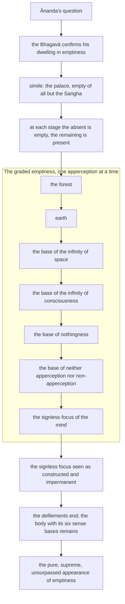

import { Tabs, TabItem } from '@astrojs/starlight/components';

Original text: [11M/3.1 Cūḷasuññatasutta 496–508](https://tipitaka2500.github.io/tipitaka/11M/3/3.1.html#496) in the [World Tipitaka Edition](https://tipitaka2500.github.io)

## Summary

At Sāvatthī āyasmā Ānanda asks whether he heard the Bhagavā rightly: that he often dwells in `suññatāvihāra` (contemplation on emptiness). The Bhagavā confirms it and sets out a graded practice: attending to one apperception at a time, from the forest through earth and the four formless bases to the signless `cetosamādhi` (focus of the mind), a bhikkhu regards what is absent as empty and knows what remains as present, until the defilements end and only this body with its six sense bases remains. This is the pure, supreme, unsurpassed appearance of emptiness, in which Ānanda is to train.

## Diagram

## Text

<Tabs syncKey="paliquote">
<TabItem label="My Translation">
(176.)

496\. Thus heard by me — At one time the Bhagavā was dwelling at Sāvatthī, in the Eastern Park, in the Palace of Migāra’s Mother. Then āyasmā Ānanda, having risen from seclusion in the evening, approached the Bhagavā; having approached, he bowed to the Bhagavā and sat down to one side. Seated to one side, āyasmā Ānanda said this to the Bhagavā:

497\. “This one time, Bhante, the Bhagavā was dwelling among the Sakyans, [at] Nagaraka, a market town of the Sakyans. There, Bhante, I heard this in the Bhagavā’s presence, received it in his presence: ‘Ānanda, I now often dwell in `suññatāvihāra` (contemplation on emptiness).’ I hope, Bhante, that this was well heard by me, well grasped, well attended to, well understood?”

498\. “Indeed, Ānanda, this was well heard by you, well grasped, well attended to, well understood. Formerly too, Ānanda, and now too, I often dwell in contemplation on emptiness. Just as, Ānanda, this Palace of Migāra’s Mother is empty of elephants, cattle, horses, and mares, empty of gold and silver, empty of gatherings of women and men, and there is just this that is not empty, namely the oneness dependent on the Saṅgha of bhikkhū; even so, Ānanda, a bhikkhu, not attending to the apperception of the village, not attending to the apperception of people, attends to the oneness dependent on the apperception of the forest. His mind takes to the apperception of the forest, gains confidence, remains still and is resolved on it. He knows clearly thus: ‘Whatever stresses there might be dependent on the apperception of the village, those are not present here; whatever stresses there might be dependent on the apperception of people, those are not present here; and there is just this measure of stress, namely the oneness dependent on the apperception of the forest.’ He knows clearly: ‘This field of apperception is empty of the apperception of the village’; he knows clearly: ‘This field of apperception is empty of the apperception of people’; and ‘there is just this that is not empty, namely the oneness dependent on the apperception of the forest.’ Thus, whatever is not there, he regards it as empty of that; but whatever remains there, he knows clearly: ‘This is present, it exists.’ Thus too, Ānanda, this is for him a genuine, undeluded, pure appearance of emptiness.

(177.)

499\. And furthermore, Ānanda, a bhikkhu, not attending to the apperception of people, not attending to the apperception of the forest, attends to the oneness dependent on the apperception of earth. His mind takes to the apperception of earth, gains confidence, remains still and is resolved on it. Just as, Ānanda, a stud bull’s hide well staked with a hundred pegs is free of folds; even so, Ānanda, a bhikkhu, not attending to all that is hills and dales, rivers hard to cross, places full of stumps and thorns and rugged mountains on this earth, attends to the oneness dependent on the apperception of earth. His mind takes to the apperception of earth, gains confidence, remains still and is resolved on it. He knows clearly thus: ‘Whatever stresses there might be dependent on the apperception of people, those are not present here; whatever stresses there might be dependent on the apperception of the forest, those are not present here; and there is just this measure of stress, namely the oneness dependent on the apperception of earth.’ He knows clearly: ‘This field of apperception is empty of the apperception of people’; he knows clearly: ‘This field of apperception is empty of the apperception of the forest’; and ‘there is just this that is not empty, namely the oneness dependent on the apperception of earth.’ Thus, whatever is not there, he regards it as empty of that; but whatever remains there, he knows clearly: ‘This is present, it exists.’ Thus too, Ānanda, this is for him a genuine, undeluded, pure appearance of emptiness.

(178.)

500\. And furthermore, Ānanda, a bhikkhu, not attending to the apperception of the forest, not attending to the apperception of earth, attends to the oneness dependent on the apperception of the base of the infinity of space. His mind takes to the apperception of the base of the infinity of space, gains confidence, remains still and is resolved on it. He knows clearly thus: ‘Whatever stresses there might be dependent on the apperception of the forest, those are not present here; whatever stresses there might be dependent on the apperception of earth, those are not present here; and there is just this measure of stress, namely the oneness dependent on the apperception of the base of the infinity of space.’ He knows clearly: ‘This field of apperception is empty of the apperception of the forest’; he knows clearly: ‘This field of apperception is empty of the apperception of earth’; and ‘there is just this that is not empty, namely the oneness dependent on the apperception of the base of the infinity of space.’ Thus, whatever is not there, he regards it as empty of that; but whatever remains there, he knows clearly: ‘This is present, it exists.’ Thus too, Ānanda, this is for him a genuine, undeluded, pure appearance of emptiness.

(179.)

501\. And furthermore, Ānanda, a bhikkhu, not attending to the apperception of earth, not attending to the apperception of the base of the infinity of space, attends to the oneness dependent on the apperception of the base of the infinity of consciousness. His mind takes to the apperception of the base of the infinity of consciousness, gains confidence, remains still and is resolved on it. He knows clearly thus: ‘Whatever stresses there might be dependent on the apperception of earth, those are not present here; whatever stresses there might be dependent on the apperception of the base of the infinity of space, those are not present here; and there is just this measure of stress, namely the oneness dependent on the apperception of the base of the infinity of consciousness.’ He knows clearly: ‘This field of apperception is empty of the apperception of earth’; he knows clearly: ‘This field of apperception is empty of the apperception of the base of the infinity of space’; and ‘there is just this that is not empty, namely the oneness dependent on the apperception of the base of the infinity of consciousness.’ Thus, whatever is not there, he regards it as empty of that; but whatever remains there, he knows clearly: ‘This is present, it exists.’ Thus too, Ānanda, this is for him a genuine, undeluded, pure appearance of emptiness.

(180.)

502\. And furthermore, Ānanda, a bhikkhu, not attending to the apperception of the base of the infinity of space, not attending to the apperception of the base of the infinity of consciousness, attends to the oneness dependent on the apperception of the base of nothingness. His mind takes to the apperception of the base of nothingness, gains confidence, remains still and is resolved on it. He knows clearly thus: ‘Whatever stresses there might be dependent on the apperception of the base of the infinity of space, those are not present here; whatever stresses there might be dependent on the apperception of the base of the infinity of consciousness, those are not present here; and there is just this measure of stress, namely the oneness dependent on the apperception of the base of nothingness.’ He knows clearly: ‘This field of apperception is empty of the apperception of the base of the infinity of space’; he knows clearly: ‘This field of apperception is empty of the apperception of the base of the infinity of consciousness’; and ‘there is just this that is not empty, namely the oneness dependent on the apperception of the base of nothingness.’ Thus, whatever is not there, he regards it as empty of that; but whatever remains there, he knows clearly: ‘This is present, it exists.’ Thus too, Ānanda, this is for him a genuine, undeluded, pure appearance of emptiness.

(181.)

503\. And furthermore, Ānanda, a bhikkhu, not attending to the apperception of the base of the infinity of consciousness, not attending to the apperception of the base of nothingness, attends to the oneness dependent on the apperception of the base of neither apperception nor non-apperception. His mind takes to the apperception of the base of neither apperception nor non-apperception, gains confidence, remains still and is resolved on it. He knows clearly thus: ‘Whatever stresses there might be dependent on the apperception of the base of the infinity of consciousness, those are not present here; whatever stresses there might be dependent on the apperception of the base of nothingness, those are not present here; and there is just this measure of stress, namely the oneness dependent on the apperception of the base of neither apperception nor non-apperception.’ He knows clearly: ‘This field of apperception is empty of the apperception of the base of the infinity of consciousness’; he knows clearly: ‘This field of apperception is empty of the apperception of the base of nothingness’; and ‘there is just this that is not empty, namely the oneness dependent on the apperception of the base of neither apperception nor non-apperception.’ Thus, whatever is not there, he regards it as empty of that; but whatever remains there, he knows clearly: ‘This is present, it exists.’ Thus too, Ānanda, this is for him a genuine, undeluded, pure appearance of emptiness.

(182.)

504\. And furthermore, Ānanda, a bhikkhu, not attending to the apperception of the base of nothingness, not attending to the apperception of the base of neither apperception nor non-apperception, attends to the oneness dependent on the signless `cetosamādhi` (focus of the mind). His mind takes to the signless focus of the mind, gains confidence, remains still and is resolved on it. He knows clearly thus: ‘Whatever stresses there might be dependent on the apperception of the base of nothingness, those are not present here; whatever stresses there might be dependent on the apperception of the base of neither apperception nor non-apperception, those are not present here; and there is just this measure of stress, namely that dependent on this very body with its six sense bases, with life as cause.’ He knows clearly: ‘This field of apperception is empty of the apperception of the base of nothingness’; he knows clearly: ‘This field of apperception is empty of the apperception of the base of neither apperception nor non-apperception’; and ‘there is just this that is not empty, namely that dependent on this very body with its six sense bases, with life as cause.’ Thus, whatever is not there, he regards it as empty of that; but whatever remains there, he knows clearly: ‘This is present, it exists.’ Thus too, Ānanda, this is for him a genuine, undeluded, pure appearance of emptiness.

(183.)

505\. And furthermore, Ānanda, a bhikkhu, not attending to the apperception of the base of nothingness, not attending to the apperception of the base of neither apperception nor non-apperception, attends to the oneness dependent on the signless `cetosamādhi` (focus of the mind). His mind takes to the signless focus of the mind, gains confidence, remains still and is resolved on it. He knows clearly thus: ‘This signless focus of the mind too is mentally constructed and volitionally generated’. He knows clearly: ‘But whatever is mentally constructed and volitionally generated, that is impermanent, subject to cessation.’ When he knows and sees thus, his mind is liberated from the defilement of sensual pleasure, his mind is liberated from the defilement of existence, his mind is liberated from the defilement of ignorance. In liberation there is the `ñāṇa` (knowledge): ‘liberated’. He knows clearly: ‘Birth (of suffering) is finished, the optimal life is lived, what had to be done is done, there is nothing further for this present state of existence.’ He knows clearly thus: ‘Whatever stresses there might be dependent on the defilement of sensual pleasure, those are not present here; whatever stresses there might be dependent on the defilement of existence, those are not present here; whatever stresses there might be dependent on the defilement of ignorance, those are not present here; and there is just this measure of stress, namely that dependent on this very body with its six sense bases, with life as cause.’ He knows clearly: ‘This field of apperception is empty of the defilement of sensual pleasure’; he knows clearly: ‘This field of apperception is empty of the defilement of existence’; he knows clearly: ‘This field of apperception is empty of the defilement of ignorance’; and ‘there is just this that is not empty, namely that dependent on this very body with its six sense bases, with life as cause.’ Thus, whatever is not there, he regards it as empty of that; but whatever remains there, he knows clearly: ‘This is present, it exists.’ Thus too, Ānanda, this is for him a genuine, undeluded, pure, supreme, unsurpassed appearance of emptiness.

(184.)

506\. Indeed, Ānanda, whatever wanderers or brahmins in the past attained and dwelled in the pure, supreme, unsurpassed `suññataṃ` (emptiness), all of them attained and dwelled in this same pure, supreme, unsurpassed emptiness. Indeed, Ānanda, whatever wanderers or brahmins in the future will attain and dwell in the pure, supreme, unsurpassed emptiness, all of them will attain and dwell in this same pure, supreme, unsurpassed emptiness. Indeed, Ānanda, whatever wanderers or brahmins at present attain and dwell in the pure, supreme, unsurpassed emptiness, all of them attain and dwell in this same pure, supreme, unsurpassed emptiness. Therefore, Ānanda, you should train yourselves thus: ‘We will attain and dwell in the pure, supreme, unsurpassed emptiness.’”

507\. This the Bhagavā said. Delighted, āyasmā Ānanda rejoiced in the Bhagavā’s words.

508\. The Shorter Discourse on Emptiness, the first, is finished.
</TabItem>

<TabItem label="Pāḷi (Roman IAST)">
(176.)

496\. Evaṃ me sutaṃ— ekaṃ samayaṃ bhagavā sāvatthiyaṃ viharati pubbārāme migāramātupāsāde. Atha kho āyasmā ānando sāyanhasamayaṃ paṭisallānā vuṭṭhito yena bhagavā tenupasaṅkami; upasaṅkamitvā bhagavantaṃ abhivādetvā ekamantaṃ nisīdi. Ekamantaṃ nisinno kho āyasmā ānando bhagavantaṃ etadavoca—

497\. “Ekamidaṃ, bhante, samayaṃ bhagavā sakkesu viharati nagarakaṃ nāma sakyānaṃ nigamo. Tattha me, bhante, bhagavato sammukhā sutaṃ, sammukhā paṭiggahitaṃ— ‘suññatāvihārenāhaṃ, ānanda, etarahi bahulaṃ viharāmī’ti. Kacci metaṃ, bhante, sussutaṃ suggahitaṃ sumanasikataṃ sūpadhāritan”ti?

498\. “Taggha te etaṃ, ānanda, sussutaṃ suggahitaṃ sumanasikataṃ sūpadhāritaṃ. Pubbepāhaṃ, ānanda, etarahipi suññatāvihārena bahulaṃ viharāmi. Seyyathāpi, ānanda, ayaṃ migāramātupāsādo suñño hatthigavassavaḷavena, suñño jātarūparajatena, suñño itthipurisasannipātena atthi cevidaṃ asuññataṃ yadidaṃ— bhikkhusaṃghaṃ paṭicca ekattaṃ; evameva kho, ānanda, bhikkhu amanasikaritvā gāmasaññaṃ, amanasikaritvā manussasaññaṃ, araññasaññaṃ paṭicca manasi karoti ekattaṃ. Tassa araññasaññāya cittaṃ pakkhandati pasīdati santiṭṭhati adhimuccati. So evaṃ pajānāti— ‘ye assu darathā gāmasaññaṃ paṭicca tedha na santi, ye assu darathā manussasaññaṃ paṭicca tedha na santi, atthi cevāyaṃ darathamattā yadidaṃ— araññasaññaṃ paṭicca ekattan’ti. So ‘suññamidaṃ saññāgataṃ gāmasaññāyā’ti pajānāti, ‘suññamidaṃ saññāgataṃ manussasaññāyā’ti pajānāti, ‘atthi cevidaṃ asuññataṃ yadidaṃ— araññasaññaṃ paṭicca ekattan’ti. Iti yañhi kho tattha na hoti tena taṃ suññaṃ samanupassati, yaṃ pana tattha avasiṭṭhaṃ hoti taṃ ‘santamidaṃ atthī’ti pajānāti. Evampissa esā, ānanda, yathābhuccā avipallatthā parisuddhā suññatāvakkanti bhavati.

(177.)

499\. Puna caparaṃ, ānanda, bhikkhu amanasikaritvā manussasaññaṃ, amanasikaritvā araññasaññaṃ, pathavīsaññaṃ paṭicca manasi karoti ekattaṃ. Tassa pathavīsaññāya cittaṃ pakkhandati pasīdati santiṭṭhati adhimuccati. Seyyathāpi, ānanda, āsabhacammaṃ saṅkusatena suvihataṃ vigatavalikaṃ; evameva kho, ānanda, bhikkhu yaṃ imissā pathaviyā ukkūlavikkūlaṃ nadīviduggaṃ khāṇukaṇṭakaṭṭhānaṃ pabbatavisamaṃ taṃ sabbaṃ amanasikaritvā pathavīsaññaṃ paṭicca manasi karoti ekattaṃ. Tassa pathavīsaññāya cittaṃ pakkhandati pasīdati santiṭṭhati adhimuccati. So evaṃ pajānāti— ‘ye assu darathā manussasaññaṃ paṭicca tedha na santi, ye assu darathā araññasaññaṃ paṭicca tedha na santi, atthi cevāyaṃ darathamattā yadidaṃ— pathavīsaññaṃ paṭicca ekattan’ti. So ‘suññamidaṃ saññāgataṃ manussasaññāyā’ti pajānāti, ‘suññamidaṃ saññāgataṃ araññasaññāyā’ti pajānāti, ‘atthi cevidaṃ asuññataṃ yadidaṃ— pathavīsaññaṃ paṭicca ekattan’ti. Iti yañhi kho tattha na hoti tena taṃ suññaṃ samanupassati, yaṃ pana tattha avasiṭṭhaṃ hoti taṃ ‘santamidaṃ atthī’ti pajānāti. Evampissa esā, ānanda, yathābhuccā avipallatthā parisuddhā suññatāvakkanti bhavati.

(178.)

500\. Puna caparaṃ, ānanda, bhikkhu amanasikaritvā araññasaññaṃ, amanasikaritvā pathavīsaññaṃ, ākāsānañcāyatanasaññaṃ paṭicca manasi karoti ekattaṃ. Tassa ākāsānañcāyatanasaññāya cittaṃ pakkhandati pasīdati santiṭṭhati adhimuccati. So evaṃ pajānāti— ‘ye assu darathā araññasaññaṃ paṭicca tedha na santi, ye assu darathā pathavīsaññaṃ paṭicca tedha na santi, atthi cevāyaṃ darathamattā yadidaṃ— ākāsānañcāyatanasaññaṃ paṭicca ekattan’ti. So ‘suññamidaṃ saññāgataṃ araññasaññāyā’ti pajānāti, ‘suññamidaṃ saññāgataṃ pathavīsaññāyā’ti pajānāti, ‘atthi cevidaṃ asuññataṃ yadidaṃ— ākāsānañcāyatanasaññaṃ paṭicca ekattan’ti. Iti yañhi kho tattha na hoti tena taṃ suññaṃ samanupassati, yaṃ pana tattha avasiṭṭhaṃ hoti taṃ ‘santamidaṃ atthī’ti pajānāti. Evampissa esā, ānanda, yathābhuccā avipallatthā parisuddhā suññatāvakkanti bhavati.

(179.)

501\. Puna caparaṃ, ānanda, bhikkhu amanasikaritvā pathavīsaññaṃ, amanasikaritvā ākāsānañcāyatanasaññaṃ, viññāṇañcāyatanasaññaṃ paṭicca manasi karoti ekattaṃ. Tassa viññāṇañcāyatanasaññāya cittaṃ pakkhandati pasīdati santiṭṭhati adhimuccati. So evaṃ pajānāti— ‘ye assu darathā pathavīsaññaṃ paṭicca tedha na santi, ye assu darathā ākāsānañcāyatanasaññaṃ paṭicca tedha na santi, atthi cevāyaṃ darathamattā yadidaṃ— viññāṇañcāyatanasaññaṃ paṭicca ekattan’ti. So ‘suññamidaṃ saññāgataṃ pathavīsaññāyā’ti pajānāti, ‘suññamidaṃ saññāgataṃ ākāsānañcāyatanasaññāyā’ti pajānāti, ‘atthi cevidaṃ asuññataṃ yadidaṃ— viññāṇañcāyatanasaññaṃ paṭicca ekattan’ti. Iti yañhi kho tattha na hoti tena taṃ suññaṃ samanupassati, yaṃ pana tattha avasiṭṭhaṃ hoti taṃ ‘santamidaṃ atthī’ti pajānāti. Evampissa esā, ānanda, yathābhuccā avipallatthā parisuddhā suññatāvakkanti bhavati.

(180.)

502\. Puna caparaṃ, ānanda, bhikkhu amanasikaritvā ākāsānañcāyatanasaññaṃ, amanasikaritvā viññāṇañcāyatanasaññaṃ, ākiñcaññāyatanasaññaṃ paṭicca manasi karoti ekattaṃ. Tassa ākiñcaññāyatanasaññāya cittaṃ pakkhandati pasīdati santiṭṭhati adhimuccati. So evaṃ pajānāti— ‘ye assu darathā ākāsānañcāyatanasaññaṃ paṭicca tedha na santi, ye assu darathā viññāṇañcāyatanasaññaṃ paṭicca tedha na santi, atthi cevāyaṃ darathamattā yadidaṃ— ākiñcaññāyatanasaññaṃ paṭicca ekattan’ti. So ‘suññamidaṃ saññāgataṃ ākāsānañcāyatanasaññāyā’ti pajānāti, ‘suññamidaṃ saññāgataṃ viññāṇañcāyatanasaññāyā’ti pajānāti, ‘atthi cevidaṃ asuññataṃ yadidaṃ— ākiñcaññāyatanasaññaṃ paṭicca ekattan’ti. Iti yañhi kho tattha na hoti tena taṃ suññaṃ samanupassati, yaṃ pana tattha avasiṭṭhaṃ hoti taṃ ‘santamidaṃ atthī’ti pajānāti. Evampissa esā, ānanda, yathābhuccā avipallatthā parisuddhā suññatāvakkanti bhavati.

(181.)

503\. Puna caparaṃ, ānanda bhikkhu amanasikaritvā viññāṇañcāyatanasaññaṃ, amanasikaritvā ākiñcaññāyatanasaññaṃ, nevasaññānāsaññāyatanasaññaṃ paṭicca manasi karoti ekattaṃ. Tassa nevasaññānāsaññāyatanasaññāya cittaṃ pakkhandati pasīdati santiṭṭhati adhimuccati. So evaṃ pajānāti— ‘ye assu darathā viññāṇañcāyatanasaññaṃ paṭicca tedha na santi, ye assu darathā ākiñcaññāyatanasaññaṃ paṭicca tedha na santi, atthi cevāyaṃ darathamattā yadidaṃ— nevasaññānāsaññāyatanasaññaṃ paṭicca ekattan’ti. So ‘suññamidaṃ saññāgataṃ viññāṇañcāyatanasaññāyā’ti pajānāti, ‘suññamidaṃ saññāgataṃ ākiñcaññāyatanasaññāyā’ti pajānāti, ‘atthi cevidaṃ asuññataṃ yadidaṃ— nevasaññānāsaññāyatanasaññaṃ paṭicca ekattan’ti. Iti yañhi kho tattha na hoti tena taṃ suññaṃ samanupassati, yaṃ pana tattha avasiṭṭhaṃ hoti taṃ ‘santamidaṃ atthī’ti pajānāti. Evampissa esā, ānanda, yathābhuccā avipallatthā parisuddhā suññatāvakkanti bhavati.

(182.)

504\. Puna caparaṃ, ānanda, bhikkhu amanasikaritvā ākiñcaññāyatanasaññaṃ, amanasikaritvā nevasaññānāsaññāyatanasaññaṃ, animittaṃ cetosamādhiṃ paṭicca manasi karoti ekattaṃ. Tassa animitte cetosamādhimhi cittaṃ pakkhandati pasīdati santiṭṭhati adhimuccati. So evaṃ pajānāti— ‘ye assu darathā ākiñcaññāyatanasaññaṃ paṭicca tedha na santi, ye assu darathā nevasaññānāsaññāyatanasaññaṃ paṭicca tedha na santi, atthi cevāyaṃ darathamattā yadidaṃ— imameva kāyaṃ paṭicca saḷāyatanikaṃ jīvitapaccayā’ti. So ‘suññamidaṃ saññāgataṃ ākiñcaññāyatanasaññāyā’ti pajānāti, ‘suññamidaṃ saññāgataṃ nevasaññānāsaññāyatanasaññāyā’ti pajānāti, ‘atthi cevidaṃ asuññataṃ yadidaṃ— imameva kāyaṃ paṭicca saḷāyatanikaṃ jīvitapaccayā’ti. Iti yañhi kho tattha na hoti tena taṃ suññaṃ samanupassati, yaṃ pana tattha avasiṭṭhaṃ hoti taṃ ‘santamidaṃ atthī’ti pajānāti. Evampissa esā, ānanda, yathābhuccā avipallatthā parisuddhā suññatāvakkanti bhavati.

(183.)

505\. Puna caparaṃ, ānanda, bhikkhu amanasikaritvā ākiñcaññāyatanasaññaṃ, amanasikaritvā nevasaññānāsaññāyatanasaññaṃ, animittaṃ cetosamādhiṃ paṭicca manasi karoti ekattaṃ. Tassa animitte cetosamādhimhi cittaṃ pakkhandati pasīdati santiṭṭhati adhimuccati. So evaṃ pajānāti— ‘ayampi kho animitto cetosamādhi abhisaṅkhato abhisañcetayito’. ‘Yaṃ kho pana kiñci abhisaṅkhataṃ abhisañcetayitaṃ tadaniccaṃ nirodhadhamman’ti pajānāti. Tassa evaṃ jānato evaṃ passato kāmāsavāpi cittaṃ vimuccati, bhavāsavāpi cittaṃ vimuccati, avijjāsavāpi cittaṃ vimuccati. Vimuttasmiṃ vimuttamiti ñāṇaṃ hoti. ‘Khīṇā jāti, vusitaṃ brahmacariyaṃ, kataṃ karaṇīyaṃ, nāparaṃ itthattāyā’ti pajānāti. So evaṃ pajānāti— ‘ye assu darathā kāmāsavaṃ paṭicca tedha na santi, ye assu darathā bhavāsavaṃ paṭicca tedha na santi, ye assu darathā avijjāsavaṃ paṭicca tedha na santi, atthi cevāyaṃ darathamattā yadidaṃ— imameva kāyaṃ paṭicca saḷāyatanikaṃ jīvitapaccayā’ti. So ‘suññamidaṃ saññāgataṃ kāmāsavenā’ti pajānāti, ‘suññamidaṃ saññāgataṃ bhavāsavenā’ti pajānāti, ‘suññamidaṃ saññāgataṃ avijjāsavenā’ti pajānāti, ‘atthi cevidaṃ asuññataṃ yadidaṃ— imameva kāyaṃ paṭicca saḷāyatanikaṃ jīvitapaccayā’ti. Iti yañhi kho tattha na hoti tena taṃ suññaṃ samanupassati, yaṃ pana tattha avasiṭṭhaṃ hoti taṃ ‘santamidaṃ atthī’ti pajānāti. Evampissa esā, ānanda, yathābhuccā avipallatthā parisuddhā paramānuttarā suññatāvakkanti bhavati.

(184.)

506\. Yepi hi keci, ānanda, atītamaddhānaṃ samaṇā vā brāhmaṇā vā parisuddhaṃ paramānuttaraṃ suññataṃ upasampajja vihariṃsu, sabbe te imaṃyeva parisuddhaṃ paramānuttaraṃ suññataṃ upasampajja vihariṃsu. Yepi hi keci, ānanda, anāgatamaddhānaṃ samaṇā vā brāhmaṇā vā parisuddhaṃ paramānuttaraṃ suññataṃ upasampajja viharissanti, sabbe te imaṃyeva parisuddhaṃ paramānuttaraṃ suññataṃ upasampajja viharissanti. Yepi hi keci, ānanda, etarahi samaṇā vā brāhmaṇā vā parisuddhaṃ paramānuttaraṃ suññataṃ upasampajja viharanti, sabbe te imaṃyeva parisuddhaṃ paramānuttaraṃ suññataṃ upasampajja viharanti. Tasmātiha, ānanda, ‘parisuddhaṃ paramānuttaraṃ suññataṃ upasampajja viharissāmā’ti— evañhi vo, ānanda, sikkhitabban”ti.

507\. Idamavoca bhagavā. Attamano āyasmā ānando bhagavato bhāsitaṃ abhinandīti.

508\. Cūḷasuññatasuttaṃ niṭṭhitaṃ paṭhamaṃ.
</TabItem>

<TabItem label="Pāḷi (Brahmi)">
(176.)

496\. 𑀏𑀯𑀁 𑀫𑁂 𑀲𑀼𑀢𑀁— 𑀏𑀓𑀁 𑀲𑀫𑀬𑀁 𑀪𑀕𑀯𑀸 𑀲𑀸𑀯𑀢𑁆𑀣𑀺𑀬𑀁 𑀯𑀺𑀳𑀭𑀢𑀺 𑀧𑀼𑀩𑁆𑀩𑀸𑀭𑀸𑀫𑁂 𑀫𑀺𑀕𑀸𑀭𑀫𑀸𑀢𑀼𑀧𑀸𑀲𑀸𑀤𑁂. 𑀅𑀣 𑀔𑁄 𑀆𑀬𑀲𑁆𑀫𑀸 𑀆𑀦𑀦𑁆𑀤𑁄 𑀲𑀸𑀬𑀦𑁆𑀳𑀲𑀫𑀬𑀁 𑀧𑀝𑀺𑀲𑀮𑁆𑀮𑀸𑀦𑀸 𑀯𑀼𑀝𑁆𑀞𑀺𑀢𑁄 𑀬𑁂𑀦 𑀪𑀕𑀯𑀸 𑀢𑁂𑀦𑀼𑀧𑀲𑀗𑁆𑀓𑀫𑀺; 𑀉𑀧𑀲𑀗𑁆𑀓𑀫𑀺𑀢𑁆𑀯𑀸 𑀪𑀕𑀯𑀦𑁆𑀢𑀁 𑀅𑀪𑀺𑀯𑀸𑀤𑁂𑀢𑁆𑀯𑀸 𑀏𑀓𑀫𑀦𑁆𑀢𑀁 𑀦𑀺𑀲𑀻𑀤𑀺. 𑀏𑀓𑀫𑀦𑁆𑀢𑀁 𑀦𑀺𑀲𑀺𑀦𑁆𑀦𑁄 𑀔𑁄 𑀆𑀬𑀲𑁆𑀫𑀸 𑀆𑀦𑀦𑁆𑀤𑁄 𑀪𑀕𑀯𑀦𑁆𑀢𑀁 𑀏𑀢𑀤𑀯𑁄𑀘—

497\. “𑀏𑀓𑀫𑀺𑀤𑀁, 𑀪𑀦𑁆𑀢𑁂, 𑀲𑀫𑀬𑀁 𑀪𑀕𑀯𑀸 𑀲𑀓𑁆𑀓𑁂𑀲𑀼 𑀯𑀺𑀳𑀭𑀢𑀺 𑀦𑀕𑀭𑀓𑀁 𑀦𑀸𑀫 𑀲𑀓𑁆𑀬𑀸𑀦𑀁 𑀦𑀺𑀕𑀫𑁄. 𑀢𑀢𑁆𑀣 𑀫𑁂, 𑀪𑀦𑁆𑀢𑁂, 𑀪𑀕𑀯𑀢𑁄 𑀲𑀫𑁆𑀫𑀼𑀔𑀸 𑀲𑀼𑀢𑀁, 𑀲𑀫𑁆𑀫𑀼𑀔𑀸 𑀧𑀝𑀺𑀕𑁆𑀕𑀳𑀺𑀢𑀁— ‘𑀲𑀼𑀜𑁆𑀜𑀢𑀸𑀯𑀺𑀳𑀸𑀭𑁂𑀦𑀸𑀳𑀁, 𑀆𑀦𑀦𑁆𑀤, 𑀏𑀢𑀭𑀳𑀺 𑀩𑀳𑀼𑀮𑀁 𑀯𑀺𑀳𑀭𑀸𑀫𑀻’𑀢𑀺. 𑀓𑀘𑁆𑀘𑀺 𑀫𑁂𑀢𑀁, 𑀪𑀦𑁆𑀢𑁂, 𑀲𑀼𑀲𑁆𑀲𑀼𑀢𑀁 𑀲𑀼𑀕𑁆𑀕𑀳𑀺𑀢𑀁 𑀲𑀼𑀫𑀦𑀲𑀺𑀓𑀢𑀁 𑀲𑀽𑀧𑀥𑀸𑀭𑀺𑀢𑀦𑁆”𑀢𑀺?

498\. “𑀢𑀕𑁆𑀖 𑀢𑁂 𑀏𑀢𑀁, 𑀆𑀦𑀦𑁆𑀤, 𑀲𑀼𑀲𑁆𑀲𑀼𑀢𑀁 𑀲𑀼𑀕𑁆𑀕𑀳𑀺𑀢𑀁 𑀲𑀼𑀫𑀦𑀲𑀺𑀓𑀢𑀁 𑀲𑀽𑀧𑀥𑀸𑀭𑀺𑀢𑀁. 𑀧𑀼𑀩𑁆𑀩𑁂𑀧𑀸𑀳𑀁, 𑀆𑀦𑀦𑁆𑀤, 𑀏𑀢𑀭𑀳𑀺𑀧𑀺 𑀲𑀼𑀜𑁆𑀜𑀢𑀸𑀯𑀺𑀳𑀸𑀭𑁂𑀦 𑀩𑀳𑀼𑀮𑀁 𑀯𑀺𑀳𑀭𑀸𑀫𑀺. 𑀲𑁂𑀬𑁆𑀬𑀣𑀸𑀧𑀺, 𑀆𑀦𑀦𑁆𑀤, 𑀅𑀬𑀁 𑀫𑀺𑀕𑀸𑀭𑀫𑀸𑀢𑀼𑀧𑀸𑀲𑀸𑀤𑁄 𑀲𑀼𑀜𑁆𑀜𑁄 𑀳𑀢𑁆𑀣𑀺𑀕𑀯𑀲𑁆𑀲𑀯𑀍𑀅𑀯𑁂𑀦, 𑀲𑀼𑀜𑁆𑀜𑁄 𑀚𑀸𑀢𑀭𑀽𑀧𑀭𑀚𑀢𑁂𑀦, 𑀲𑀼𑀜𑁆𑀜𑁄 𑀇𑀢𑁆𑀣𑀺𑀧𑀼𑀭𑀺𑀲𑀲𑀦𑁆𑀦𑀺𑀧𑀸𑀢𑁂𑀦 𑀅𑀢𑁆𑀣𑀺 𑀘𑁂𑀯𑀺𑀤𑀁 𑀅𑀲𑀼𑀜𑁆𑀜𑀢𑀁 𑀬𑀤𑀺𑀤𑀁— 𑀪𑀺𑀓𑁆𑀔𑀼𑀲𑀁𑀖𑀁 𑀧𑀝𑀺𑀘𑁆𑀘 𑀏𑀓𑀢𑁆𑀢𑀁; 𑀏𑀯𑀫𑁂𑀯 𑀔𑁄, 𑀆𑀦𑀦𑁆𑀤, 𑀪𑀺𑀓𑁆𑀔𑀼 𑀅𑀫𑀦𑀲𑀺𑀓𑀭𑀺𑀢𑁆𑀯𑀸 𑀕𑀸𑀫𑀲𑀜𑁆𑀜𑀁, 𑀅𑀫𑀦𑀲𑀺𑀓𑀭𑀺𑀢𑁆𑀯𑀸 𑀫𑀦𑀼𑀲𑁆𑀲𑀲𑀜𑁆𑀜𑀁, 𑀅𑀭𑀜𑁆𑀜𑀲𑀜𑁆𑀜𑀁 𑀧𑀝𑀺𑀘𑁆𑀘 𑀫𑀦𑀲𑀺 𑀓𑀭𑁄𑀢𑀺 𑀏𑀓𑀢𑁆𑀢𑀁. 𑀢𑀲𑁆𑀲 𑀅𑀭𑀜𑁆𑀜𑀲𑀜𑁆𑀜𑀸𑀬 𑀘𑀺𑀢𑁆𑀢𑀁 𑀧𑀓𑁆𑀔𑀦𑁆𑀤𑀢𑀺 𑀧𑀲𑀻𑀤𑀢𑀺 𑀲𑀦𑁆𑀢𑀺𑀝𑁆𑀞𑀢𑀺 𑀅𑀥𑀺𑀫𑀼𑀘𑁆𑀘𑀢𑀺. 𑀲𑁄 𑀏𑀯𑀁 𑀧𑀚𑀸𑀦𑀸𑀢𑀺— ‘𑀬𑁂 𑀅𑀲𑁆𑀲𑀼 𑀤𑀭𑀣𑀸 𑀕𑀸𑀫𑀲𑀜𑁆𑀜𑀁 𑀧𑀝𑀺𑀘𑁆𑀘 𑀢𑁂𑀥 𑀦 𑀲𑀦𑁆𑀢𑀺, 𑀬𑁂 𑀅𑀲𑁆𑀲𑀼 𑀤𑀭𑀣𑀸 𑀫𑀦𑀼𑀲𑁆𑀲𑀲𑀜𑁆𑀜𑀁 𑀧𑀝𑀺𑀘𑁆𑀘 𑀢𑁂𑀥 𑀦 𑀲𑀦𑁆𑀢𑀺, 𑀅𑀢𑁆𑀣𑀺 𑀘𑁂𑀯𑀸𑀬𑀁 𑀤𑀭𑀣𑀫𑀢𑁆𑀢𑀸 𑀬𑀤𑀺𑀤𑀁— 𑀅𑀭𑀜𑁆𑀜𑀲𑀜𑁆𑀜𑀁 𑀧𑀝𑀺𑀘𑁆𑀘 𑀏𑀓𑀢𑁆𑀢𑀦𑁆’𑀢𑀺. 𑀲𑁄 ‘𑀲𑀼𑀜𑁆𑀜𑀫𑀺𑀤𑀁 𑀲𑀜𑁆𑀜𑀸𑀕𑀢𑀁 𑀕𑀸𑀫𑀲𑀜𑁆𑀜𑀸𑀬𑀸’𑀢𑀺 𑀧𑀚𑀸𑀦𑀸𑀢𑀺, ‘𑀲𑀼𑀜𑁆𑀜𑀫𑀺𑀤𑀁 𑀲𑀜𑁆𑀜𑀸𑀕𑀢𑀁 𑀫𑀦𑀼𑀲𑁆𑀲𑀲𑀜𑁆𑀜𑀸𑀬𑀸’𑀢𑀺 𑀧𑀚𑀸𑀦𑀸𑀢𑀺, ‘𑀅𑀢𑁆𑀣𑀺 𑀘𑁂𑀯𑀺𑀤𑀁 𑀅𑀲𑀼𑀜𑁆𑀜𑀢𑀁 𑀬𑀤𑀺𑀤𑀁— 𑀅𑀭𑀜𑁆𑀜𑀲𑀜𑁆𑀜𑀁 𑀧𑀝𑀺𑀘𑁆𑀘 𑀏𑀓𑀢𑁆𑀢𑀦𑁆’𑀢𑀺. 𑀇𑀢𑀺 𑀬𑀜𑁆𑀳𑀺 𑀔𑁄 𑀢𑀢𑁆𑀣 𑀦 𑀳𑁄𑀢𑀺 𑀢𑁂𑀦 𑀢𑀁 𑀲𑀼𑀜𑁆𑀜𑀁 𑀲𑀫𑀦𑀼𑀧𑀲𑁆𑀲𑀢𑀺, 𑀬𑀁 𑀧𑀦 𑀢𑀢𑁆𑀣 𑀅𑀯𑀲𑀺𑀝𑁆𑀞𑀁 𑀳𑁄𑀢𑀺 𑀢𑀁 ‘𑀲𑀦𑁆𑀢𑀫𑀺𑀤𑀁 𑀅𑀢𑁆𑀣𑀻’𑀢𑀺 𑀧𑀚𑀸𑀦𑀸𑀢𑀺. 𑀏𑀯𑀫𑁆𑀧𑀺𑀲𑁆𑀲 𑀏𑀲𑀸, 𑀆𑀦𑀦𑁆𑀤, 𑀬𑀣𑀸𑀪𑀼𑀘𑁆𑀘𑀸 𑀅𑀯𑀺𑀧𑀮𑁆𑀮𑀢𑁆𑀣𑀸 𑀧𑀭𑀺𑀲𑀼𑀤𑁆𑀥𑀸 𑀲𑀼𑀜𑁆𑀜𑀢𑀸𑀯𑀓𑁆𑀓𑀦𑁆𑀢𑀺 𑀪𑀯𑀢𑀺.

(177.)

499\. 𑀧𑀼𑀦 𑀘𑀧𑀭𑀁, 𑀆𑀦𑀦𑁆𑀤, 𑀪𑀺𑀓𑁆𑀔𑀼 𑀅𑀫𑀦𑀲𑀺𑀓𑀭𑀺𑀢𑁆𑀯𑀸 𑀫𑀦𑀼𑀲𑁆𑀲𑀲𑀜𑁆𑀜𑀁, 𑀅𑀫𑀦𑀲𑀺𑀓𑀭𑀺𑀢𑁆𑀯𑀸 𑀅𑀭𑀜𑁆𑀜𑀲𑀜𑁆𑀜𑀁, 𑀧𑀣𑀯𑀻𑀲𑀜𑁆𑀜𑀁 𑀧𑀝𑀺𑀘𑁆𑀘 𑀫𑀦𑀲𑀺 𑀓𑀭𑁄𑀢𑀺 𑀏𑀓𑀢𑁆𑀢𑀁. 𑀢𑀲𑁆𑀲 𑀧𑀣𑀯𑀻𑀲𑀜𑁆𑀜𑀸𑀬 𑀘𑀺𑀢𑁆𑀢𑀁 𑀧𑀓𑁆𑀔𑀦𑁆𑀤𑀢𑀺 𑀧𑀲𑀻𑀤𑀢𑀺 𑀲𑀦𑁆𑀢𑀺𑀝𑁆𑀞𑀢𑀺 𑀅𑀥𑀺𑀫𑀼𑀘𑁆𑀘𑀢𑀺. 𑀲𑁂𑀬𑁆𑀬𑀣𑀸𑀧𑀺, 𑀆𑀦𑀦𑁆𑀤, 𑀆𑀲𑀪𑀘𑀫𑁆𑀫𑀁 𑀲𑀗𑁆𑀓𑀼𑀲𑀢𑁂𑀦 𑀲𑀼𑀯𑀺𑀳𑀢𑀁 𑀯𑀺𑀕𑀢𑀯𑀮𑀺𑀓𑀁; 𑀏𑀯𑀫𑁂𑀯 𑀔𑁄, 𑀆𑀦𑀦𑁆𑀤, 𑀪𑀺𑀓𑁆𑀔𑀼 𑀬𑀁 𑀇𑀫𑀺𑀲𑁆𑀲𑀸 𑀧𑀣𑀯𑀺𑀬𑀸 𑀉𑀓𑁆𑀓𑀽𑀮𑀯𑀺𑀓𑁆𑀓𑀽𑀮𑀁 𑀦𑀤𑀻𑀯𑀺𑀤𑀼𑀕𑁆𑀕𑀁 𑀔𑀸𑀡𑀼𑀓𑀡𑁆𑀝𑀓𑀝𑁆𑀞𑀸𑀦𑀁 𑀧𑀩𑁆𑀩𑀢𑀯𑀺𑀲𑀫𑀁 𑀢𑀁 𑀲𑀩𑁆𑀩𑀁 𑀅𑀫𑀦𑀲𑀺𑀓𑀭𑀺𑀢𑁆𑀯𑀸 𑀧𑀣𑀯𑀻𑀲𑀜𑁆𑀜𑀁 𑀧𑀝𑀺𑀘𑁆𑀘 𑀫𑀦𑀲𑀺 𑀓𑀭𑁄𑀢𑀺 𑀏𑀓𑀢𑁆𑀢𑀁. 𑀢𑀲𑁆𑀲 𑀧𑀣𑀯𑀻𑀲𑀜𑁆𑀜𑀸𑀬 𑀘𑀺𑀢𑁆𑀢𑀁 𑀧𑀓𑁆𑀔𑀦𑁆𑀤𑀢𑀺 𑀧𑀲𑀻𑀤𑀢𑀺 𑀲𑀦𑁆𑀢𑀺𑀝𑁆𑀞𑀢𑀺 𑀅𑀥𑀺𑀫𑀼𑀘𑁆𑀘𑀢𑀺. 𑀲𑁄 𑀏𑀯𑀁 𑀧𑀚𑀸𑀦𑀸𑀢𑀺— ‘𑀬𑁂 𑀅𑀲𑁆𑀲𑀼 𑀤𑀭𑀣𑀸 𑀫𑀦𑀼𑀲𑁆𑀲𑀲𑀜𑁆𑀜𑀁 𑀧𑀝𑀺𑀘𑁆𑀘 𑀢𑁂𑀥 𑀦 𑀲𑀦𑁆𑀢𑀺, 𑀬𑁂 𑀅𑀲𑁆𑀲𑀼 𑀤𑀭𑀣𑀸 𑀅𑀭𑀜𑁆𑀜𑀲𑀜𑁆𑀜𑀁 𑀧𑀝𑀺𑀘𑁆𑀘 𑀢𑁂𑀥 𑀦 𑀲𑀦𑁆𑀢𑀺, 𑀅𑀢𑁆𑀣𑀺 𑀘𑁂𑀯𑀸𑀬𑀁 𑀤𑀭𑀣𑀫𑀢𑁆𑀢𑀸 𑀬𑀤𑀺𑀤𑀁— 𑀧𑀣𑀯𑀻𑀲𑀜𑁆𑀜𑀁 𑀧𑀝𑀺𑀘𑁆𑀘 𑀏𑀓𑀢𑁆𑀢𑀦𑁆’𑀢𑀺. 𑀲𑁄 ‘𑀲𑀼𑀜𑁆𑀜𑀫𑀺𑀤𑀁 𑀲𑀜𑁆𑀜𑀸𑀕𑀢𑀁 𑀫𑀦𑀼𑀲𑁆𑀲𑀲𑀜𑁆𑀜𑀸𑀬𑀸’𑀢𑀺 𑀧𑀚𑀸𑀦𑀸𑀢𑀺, ‘𑀲𑀼𑀜𑁆𑀜𑀫𑀺𑀤𑀁 𑀲𑀜𑁆𑀜𑀸𑀕𑀢𑀁 𑀅𑀭𑀜𑁆𑀜𑀲𑀜𑁆𑀜𑀸𑀬𑀸’𑀢𑀺 𑀧𑀚𑀸𑀦𑀸𑀢𑀺, ‘𑀅𑀢𑁆𑀣𑀺 𑀘𑁂𑀯𑀺𑀤𑀁 𑀅𑀲𑀼𑀜𑁆𑀜𑀢𑀁 𑀬𑀤𑀺𑀤𑀁— 𑀧𑀣𑀯𑀻𑀲𑀜𑁆𑀜𑀁 𑀧𑀝𑀺𑀘𑁆𑀘 𑀏𑀓𑀢𑁆𑀢𑀦𑁆’𑀢𑀺. 𑀇𑀢𑀺 𑀬𑀜𑁆𑀳𑀺 𑀔𑁄 𑀢𑀢𑁆𑀣 𑀦 𑀳𑁄𑀢𑀺 𑀢𑁂𑀦 𑀢𑀁 𑀲𑀼𑀜𑁆𑀜𑀁 𑀲𑀫𑀦𑀼𑀧𑀲𑁆𑀲𑀢𑀺, 𑀬𑀁 𑀧𑀦 𑀢𑀢𑁆𑀣 𑀅𑀯𑀲𑀺𑀝𑁆𑀞𑀁 𑀳𑁄𑀢𑀺 𑀢𑀁 ‘𑀲𑀦𑁆𑀢𑀫𑀺𑀤𑀁 𑀅𑀢𑁆𑀣𑀻’𑀢𑀺 𑀧𑀚𑀸𑀦𑀸𑀢𑀺. 𑀏𑀯𑀫𑁆𑀧𑀺𑀲𑁆𑀲 𑀏𑀲𑀸, 𑀆𑀦𑀦𑁆𑀤, 𑀬𑀣𑀸𑀪𑀼𑀘𑁆𑀘𑀸 𑀅𑀯𑀺𑀧𑀮𑁆𑀮𑀢𑁆𑀣𑀸 𑀧𑀭𑀺𑀲𑀼𑀤𑁆𑀥𑀸 𑀲𑀼𑀜𑁆𑀜𑀢𑀸𑀯𑀓𑁆𑀓𑀦𑁆𑀢𑀺 𑀪𑀯𑀢𑀺.

(178.)

500\. 𑀧𑀼𑀦 𑀘𑀧𑀭𑀁, 𑀆𑀦𑀦𑁆𑀤, 𑀪𑀺𑀓𑁆𑀔𑀼 𑀅𑀫𑀦𑀲𑀺𑀓𑀭𑀺𑀢𑁆𑀯𑀸 𑀅𑀭𑀜𑁆𑀜𑀲𑀜𑁆𑀜𑀁, 𑀅𑀫𑀦𑀲𑀺𑀓𑀭𑀺𑀢𑁆𑀯𑀸 𑀧𑀣𑀯𑀻𑀲𑀜𑁆𑀜𑀁, 𑀆𑀓𑀸𑀲𑀸𑀦𑀜𑁆𑀘𑀸𑀬𑀢𑀦𑀲𑀜𑁆𑀜𑀁 𑀧𑀝𑀺𑀘𑁆𑀘 𑀫𑀦𑀲𑀺 𑀓𑀭𑁄𑀢𑀺 𑀏𑀓𑀢𑁆𑀢𑀁. 𑀢𑀲𑁆𑀲 𑀆𑀓𑀸𑀲𑀸𑀦𑀜𑁆𑀘𑀸𑀬𑀢𑀦𑀲𑀜𑁆𑀜𑀸𑀬 𑀘𑀺𑀢𑁆𑀢𑀁 𑀧𑀓𑁆𑀔𑀦𑁆𑀤𑀢𑀺 𑀧𑀲𑀻𑀤𑀢𑀺 𑀲𑀦𑁆𑀢𑀺𑀝𑁆𑀞𑀢𑀺 𑀅𑀥𑀺𑀫𑀼𑀘𑁆𑀘𑀢𑀺. 𑀲𑁄 𑀏𑀯𑀁 𑀧𑀚𑀸𑀦𑀸𑀢𑀺— ‘𑀬𑁂 𑀅𑀲𑁆𑀲𑀼 𑀤𑀭𑀣𑀸 𑀅𑀭𑀜𑁆𑀜𑀲𑀜𑁆𑀜𑀁 𑀧𑀝𑀺𑀘𑁆𑀘 𑀢𑁂𑀥 𑀦 𑀲𑀦𑁆𑀢𑀺, 𑀬𑁂 𑀅𑀲𑁆𑀲𑀼 𑀤𑀭𑀣𑀸 𑀧𑀣𑀯𑀻𑀲𑀜𑁆𑀜𑀁 𑀧𑀝𑀺𑀘𑁆𑀘 𑀢𑁂𑀥 𑀦 𑀲𑀦𑁆𑀢𑀺, 𑀅𑀢𑁆𑀣𑀺 𑀘𑁂𑀯𑀸𑀬𑀁 𑀤𑀭𑀣𑀫𑀢𑁆𑀢𑀸 𑀬𑀤𑀺𑀤𑀁— 𑀆𑀓𑀸𑀲𑀸𑀦𑀜𑁆𑀘𑀸𑀬𑀢𑀦𑀲𑀜𑁆𑀜𑀁 𑀧𑀝𑀺𑀘𑁆𑀘 𑀏𑀓𑀢𑁆𑀢𑀦𑁆’𑀢𑀺. 𑀲𑁄 ‘𑀲𑀼𑀜𑁆𑀜𑀫𑀺𑀤𑀁 𑀲𑀜𑁆𑀜𑀸𑀕𑀢𑀁 𑀅𑀭𑀜𑁆𑀜𑀲𑀜𑁆𑀜𑀸𑀬𑀸’𑀢𑀺 𑀧𑀚𑀸𑀦𑀸𑀢𑀺, ‘𑀲𑀼𑀜𑁆𑀜𑀫𑀺𑀤𑀁 𑀲𑀜𑁆𑀜𑀸𑀕𑀢𑀁 𑀧𑀣𑀯𑀻𑀲𑀜𑁆𑀜𑀸𑀬𑀸’𑀢𑀺 𑀧𑀚𑀸𑀦𑀸𑀢𑀺, ‘𑀅𑀢𑁆𑀣𑀺 𑀘𑁂𑀯𑀺𑀤𑀁 𑀅𑀲𑀼𑀜𑁆𑀜𑀢𑀁 𑀬𑀤𑀺𑀤𑀁— 𑀆𑀓𑀸𑀲𑀸𑀦𑀜𑁆𑀘𑀸𑀬𑀢𑀦𑀲𑀜𑁆𑀜𑀁 𑀧𑀝𑀺𑀘𑁆𑀘 𑀏𑀓𑀢𑁆𑀢𑀦𑁆’𑀢𑀺. 𑀇𑀢𑀺 𑀬𑀜𑁆𑀳𑀺 𑀔𑁄 𑀢𑀢𑁆𑀣 𑀦 𑀳𑁄𑀢𑀺 𑀢𑁂𑀦 𑀢𑀁 𑀲𑀼𑀜𑁆𑀜𑀁 𑀲𑀫𑀦𑀼𑀧𑀲𑁆𑀲𑀢𑀺, 𑀬𑀁 𑀧𑀦 𑀢𑀢𑁆𑀣 𑀅𑀯𑀲𑀺𑀝𑁆𑀞𑀁 𑀳𑁄𑀢𑀺 𑀢𑀁 ‘𑀲𑀦𑁆𑀢𑀫𑀺𑀤𑀁 𑀅𑀢𑁆𑀣𑀻’𑀢𑀺 𑀧𑀚𑀸𑀦𑀸𑀢𑀺. 𑀏𑀯𑀫𑁆𑀧𑀺𑀲𑁆𑀲 𑀏𑀲𑀸, 𑀆𑀦𑀦𑁆𑀤, 𑀬𑀣𑀸𑀪𑀼𑀘𑁆𑀘𑀸 𑀅𑀯𑀺𑀧𑀮𑁆𑀮𑀢𑁆𑀣𑀸 𑀧𑀭𑀺𑀲𑀼𑀤𑁆𑀥𑀸 𑀲𑀼𑀜𑁆𑀜𑀢𑀸𑀯𑀓𑁆𑀓𑀦𑁆𑀢𑀺 𑀪𑀯𑀢𑀺.

(179.)

501\. 𑀧𑀼𑀦 𑀘𑀧𑀭𑀁, 𑀆𑀦𑀦𑁆𑀤, 𑀪𑀺𑀓𑁆𑀔𑀼 𑀅𑀫𑀦𑀲𑀺𑀓𑀭𑀺𑀢𑁆𑀯𑀸 𑀧𑀣𑀯𑀻𑀲𑀜𑁆𑀜𑀁, 𑀅𑀫𑀦𑀲𑀺𑀓𑀭𑀺𑀢𑁆𑀯𑀸 𑀆𑀓𑀸𑀲𑀸𑀦𑀜𑁆𑀘𑀸𑀬𑀢𑀦𑀲𑀜𑁆𑀜𑀁, 𑀯𑀺𑀜𑁆𑀜𑀸𑀡𑀜𑁆𑀘𑀸𑀬𑀢𑀦𑀲𑀜𑁆𑀜𑀁 𑀧𑀝𑀺𑀘𑁆𑀘 𑀫𑀦𑀲𑀺 𑀓𑀭𑁄𑀢𑀺 𑀏𑀓𑀢𑁆𑀢𑀁. 𑀢𑀲𑁆𑀲 𑀯𑀺𑀜𑁆𑀜𑀸𑀡𑀜𑁆𑀘𑀸𑀬𑀢𑀦𑀲𑀜𑁆𑀜𑀸𑀬 𑀘𑀺𑀢𑁆𑀢𑀁 𑀧𑀓𑁆𑀔𑀦𑁆𑀤𑀢𑀺 𑀧𑀲𑀻𑀤𑀢𑀺 𑀲𑀦𑁆𑀢𑀺𑀝𑁆𑀞𑀢𑀺 𑀅𑀥𑀺𑀫𑀼𑀘𑁆𑀘𑀢𑀺. 𑀲𑁄 𑀏𑀯𑀁 𑀧𑀚𑀸𑀦𑀸𑀢𑀺— ‘𑀬𑁂 𑀅𑀲𑁆𑀲𑀼 𑀤𑀭𑀣𑀸 𑀧𑀣𑀯𑀻𑀲𑀜𑁆𑀜𑀁 𑀧𑀝𑀺𑀘𑁆𑀘 𑀢𑁂𑀥 𑀦 𑀲𑀦𑁆𑀢𑀺, 𑀬𑁂 𑀅𑀲𑁆𑀲𑀼 𑀤𑀭𑀣𑀸 𑀆𑀓𑀸𑀲𑀸𑀦𑀜𑁆𑀘𑀸𑀬𑀢𑀦𑀲𑀜𑁆𑀜𑀁 𑀧𑀝𑀺𑀘𑁆𑀘 𑀢𑁂𑀥 𑀦 𑀲𑀦𑁆𑀢𑀺, 𑀅𑀢𑁆𑀣𑀺 𑀘𑁂𑀯𑀸𑀬𑀁 𑀤𑀭𑀣𑀫𑀢𑁆𑀢𑀸 𑀬𑀤𑀺𑀤𑀁— 𑀯𑀺𑀜𑁆𑀜𑀸𑀡𑀜𑁆𑀘𑀸𑀬𑀢𑀦𑀲𑀜𑁆𑀜𑀁 𑀧𑀝𑀺𑀘𑁆𑀘 𑀏𑀓𑀢𑁆𑀢𑀦𑁆’𑀢𑀺. 𑀲𑁄 ‘𑀲𑀼𑀜𑁆𑀜𑀫𑀺𑀤𑀁 𑀲𑀜𑁆𑀜𑀸𑀕𑀢𑀁 𑀧𑀣𑀯𑀻𑀲𑀜𑁆𑀜𑀸𑀬𑀸’𑀢𑀺 𑀧𑀚𑀸𑀦𑀸𑀢𑀺, ‘𑀲𑀼𑀜𑁆𑀜𑀫𑀺𑀤𑀁 𑀲𑀜𑁆𑀜𑀸𑀕𑀢𑀁 𑀆𑀓𑀸𑀲𑀸𑀦𑀜𑁆𑀘𑀸𑀬𑀢𑀦𑀲𑀜𑁆𑀜𑀸𑀬𑀸’𑀢𑀺 𑀧𑀚𑀸𑀦𑀸𑀢𑀺, ‘𑀅𑀢𑁆𑀣𑀺 𑀘𑁂𑀯𑀺𑀤𑀁 𑀅𑀲𑀼𑀜𑁆𑀜𑀢𑀁 𑀬𑀤𑀺𑀤𑀁— 𑀯𑀺𑀜𑁆𑀜𑀸𑀡𑀜𑁆𑀘𑀸𑀬𑀢𑀦𑀲𑀜𑁆𑀜𑀁 𑀧𑀝𑀺𑀘𑁆𑀘 𑀏𑀓𑀢𑁆𑀢𑀦𑁆’𑀢𑀺. 𑀇𑀢𑀺 𑀬𑀜𑁆𑀳𑀺 𑀔𑁄 𑀢𑀢𑁆𑀣 𑀦 𑀳𑁄𑀢𑀺 𑀢𑁂𑀦 𑀢𑀁 𑀲𑀼𑀜𑁆𑀜𑀁 𑀲𑀫𑀦𑀼𑀧𑀲𑁆𑀲𑀢𑀺, 𑀬𑀁 𑀧𑀦 𑀢𑀢𑁆𑀣 𑀅𑀯𑀲𑀺𑀝𑁆𑀞𑀁 𑀳𑁄𑀢𑀺 𑀢𑀁 ‘𑀲𑀦𑁆𑀢𑀫𑀺𑀤𑀁 𑀅𑀢𑁆𑀣𑀻’𑀢𑀺 𑀧𑀚𑀸𑀦𑀸𑀢𑀺. 𑀏𑀯𑀫𑁆𑀧𑀺𑀲𑁆𑀲 𑀏𑀲𑀸, 𑀆𑀦𑀦𑁆𑀤, 𑀬𑀣𑀸𑀪𑀼𑀘𑁆𑀘𑀸 𑀅𑀯𑀺𑀧𑀮𑁆𑀮𑀢𑁆𑀣𑀸 𑀧𑀭𑀺𑀲𑀼𑀤𑁆𑀥𑀸 𑀲𑀼𑀜𑁆𑀜𑀢𑀸𑀯𑀓𑁆𑀓𑀦𑁆𑀢𑀺 𑀪𑀯𑀢𑀺.

(180.)

502\. 𑀧𑀼𑀦 𑀘𑀧𑀭𑀁, 𑀆𑀦𑀦𑁆𑀤, 𑀪𑀺𑀓𑁆𑀔𑀼 𑀅𑀫𑀦𑀲𑀺𑀓𑀭𑀺𑀢𑁆𑀯𑀸 𑀆𑀓𑀸𑀲𑀸𑀦𑀜𑁆𑀘𑀸𑀬𑀢𑀦𑀲𑀜𑁆𑀜𑀁, 𑀅𑀫𑀦𑀲𑀺𑀓𑀭𑀺𑀢𑁆𑀯𑀸 𑀯𑀺𑀜𑁆𑀜𑀸𑀡𑀜𑁆𑀘𑀸𑀬𑀢𑀦𑀲𑀜𑁆𑀜𑀁, 𑀆𑀓𑀺𑀜𑁆𑀘𑀜𑁆𑀜𑀸𑀬𑀢𑀦𑀲𑀜𑁆𑀜𑀁 𑀧𑀝𑀺𑀘𑁆𑀘 𑀫𑀦𑀲𑀺 𑀓𑀭𑁄𑀢𑀺 𑀏𑀓𑀢𑁆𑀢𑀁. 𑀢𑀲𑁆𑀲 𑀆𑀓𑀺𑀜𑁆𑀘𑀜𑁆𑀜𑀸𑀬𑀢𑀦𑀲𑀜𑁆𑀜𑀸𑀬 𑀘𑀺𑀢𑁆𑀢𑀁 𑀧𑀓𑁆𑀔𑀦𑁆𑀤𑀢𑀺 𑀧𑀲𑀻𑀤𑀢𑀺 𑀲𑀦𑁆𑀢𑀺𑀝𑁆𑀞𑀢𑀺 𑀅𑀥𑀺𑀫𑀼𑀘𑁆𑀘𑀢𑀺. 𑀲𑁄 𑀏𑀯𑀁 𑀧𑀚𑀸𑀦𑀸𑀢𑀺— ‘𑀬𑁂 𑀅𑀲𑁆𑀲𑀼 𑀤𑀭𑀣𑀸 𑀆𑀓𑀸𑀲𑀸𑀦𑀜𑁆𑀘𑀸𑀬𑀢𑀦𑀲𑀜𑁆𑀜𑀁 𑀧𑀝𑀺𑀘𑁆𑀘 𑀢𑁂𑀥 𑀦 𑀲𑀦𑁆𑀢𑀺, 𑀬𑁂 𑀅𑀲𑁆𑀲𑀼 𑀤𑀭𑀣𑀸 𑀯𑀺𑀜𑁆𑀜𑀸𑀡𑀜𑁆𑀘𑀸𑀬𑀢𑀦𑀲𑀜𑁆𑀜𑀁 𑀧𑀝𑀺𑀘𑁆𑀘 𑀢𑁂𑀥 𑀦 𑀲𑀦𑁆𑀢𑀺, 𑀅𑀢𑁆𑀣𑀺 𑀘𑁂𑀯𑀸𑀬𑀁 𑀤𑀭𑀣𑀫𑀢𑁆𑀢𑀸 𑀬𑀤𑀺𑀤𑀁— 𑀆𑀓𑀺𑀜𑁆𑀘𑀜𑁆𑀜𑀸𑀬𑀢𑀦𑀲𑀜𑁆𑀜𑀁 𑀧𑀝𑀺𑀘𑁆𑀘 𑀏𑀓𑀢𑁆𑀢𑀦𑁆’𑀢𑀺. 𑀲𑁄 ‘𑀲𑀼𑀜𑁆𑀜𑀫𑀺𑀤𑀁 𑀲𑀜𑁆𑀜𑀸𑀕𑀢𑀁 𑀆𑀓𑀸𑀲𑀸𑀦𑀜𑁆𑀘𑀸𑀬𑀢𑀦𑀲𑀜𑁆𑀜𑀸𑀬𑀸’𑀢𑀺 𑀧𑀚𑀸𑀦𑀸𑀢𑀺, ‘𑀲𑀼𑀜𑁆𑀜𑀫𑀺𑀤𑀁 𑀲𑀜𑁆𑀜𑀸𑀕𑀢𑀁 𑀯𑀺𑀜𑁆𑀜𑀸𑀡𑀜𑁆𑀘𑀸𑀬𑀢𑀦𑀲𑀜𑁆𑀜𑀸𑀬𑀸’𑀢𑀺 𑀧𑀚𑀸𑀦𑀸𑀢𑀺, ‘𑀅𑀢𑁆𑀣𑀺 𑀘𑁂𑀯𑀺𑀤𑀁 𑀅𑀲𑀼𑀜𑁆𑀜𑀢𑀁 𑀬𑀤𑀺𑀤𑀁— 𑀆𑀓𑀺𑀜𑁆𑀘𑀜𑁆𑀜𑀸𑀬𑀢𑀦𑀲𑀜𑁆𑀜𑀁 𑀧𑀝𑀺𑀘𑁆𑀘 𑀏𑀓𑀢𑁆𑀢𑀦𑁆’𑀢𑀺. 𑀇𑀢𑀺 𑀬𑀜𑁆𑀳𑀺 𑀔𑁄 𑀢𑀢𑁆𑀣 𑀦 𑀳𑁄𑀢𑀺 𑀢𑁂𑀦 𑀢𑀁 𑀲𑀼𑀜𑁆𑀜𑀁 𑀲𑀫𑀦𑀼𑀧𑀲𑁆𑀲𑀢𑀺, 𑀬𑀁 𑀧𑀦 𑀢𑀢𑁆𑀣 𑀅𑀯𑀲𑀺𑀝𑁆𑀞𑀁 𑀳𑁄𑀢𑀺 𑀢𑀁 ‘𑀲𑀦𑁆𑀢𑀫𑀺𑀤𑀁 𑀅𑀢𑁆𑀣𑀻’𑀢𑀺 𑀧𑀚𑀸𑀦𑀸𑀢𑀺. 𑀏𑀯𑀫𑁆𑀧𑀺𑀲𑁆𑀲 𑀏𑀲𑀸, 𑀆𑀦𑀦𑁆𑀤, 𑀬𑀣𑀸𑀪𑀼𑀘𑁆𑀘𑀸 𑀅𑀯𑀺𑀧𑀮𑁆𑀮𑀢𑁆𑀣𑀸 𑀧𑀭𑀺𑀲𑀼𑀤𑁆𑀥𑀸 𑀲𑀼𑀜𑁆𑀜𑀢𑀸𑀯𑀓𑁆𑀓𑀦𑁆𑀢𑀺 𑀪𑀯𑀢𑀺.

(181.)

503\. 𑀧𑀼𑀦 𑀘𑀧𑀭𑀁, 𑀆𑀦𑀦𑁆𑀤 𑀪𑀺𑀓𑁆𑀔𑀼 𑀅𑀫𑀦𑀲𑀺𑀓𑀭𑀺𑀢𑁆𑀯𑀸 𑀯𑀺𑀜𑁆𑀜𑀸𑀡𑀜𑁆𑀘𑀸𑀬𑀢𑀦𑀲𑀜𑁆𑀜𑀁, 𑀅𑀫𑀦𑀲𑀺𑀓𑀭𑀺𑀢𑁆𑀯𑀸 𑀆𑀓𑀺𑀜𑁆𑀘𑀜𑁆𑀜𑀸𑀬𑀢𑀦𑀲𑀜𑁆𑀜𑀁, 𑀦𑁂𑀯𑀲𑀜𑁆𑀜𑀸𑀦𑀸𑀲𑀜𑁆𑀜𑀸𑀬𑀢𑀦𑀲𑀜𑁆𑀜𑀁 𑀧𑀝𑀺𑀘𑁆𑀘 𑀫𑀦𑀲𑀺 𑀓𑀭𑁄𑀢𑀺 𑀏𑀓𑀢𑁆𑀢𑀁. 𑀢𑀲𑁆𑀲 𑀦𑁂𑀯𑀲𑀜𑁆𑀜𑀸𑀦𑀸𑀲𑀜𑁆𑀜𑀸𑀬𑀢𑀦𑀲𑀜𑁆𑀜𑀸𑀬 𑀘𑀺𑀢𑁆𑀢𑀁 𑀧𑀓𑁆𑀔𑀦𑁆𑀤𑀢𑀺 𑀧𑀲𑀻𑀤𑀢𑀺 𑀲𑀦𑁆𑀢𑀺𑀝𑁆𑀞𑀢𑀺 𑀅𑀥𑀺𑀫𑀼𑀘𑁆𑀘𑀢𑀺. 𑀲𑁄 𑀏𑀯𑀁 𑀧𑀚𑀸𑀦𑀸𑀢𑀺— ‘𑀬𑁂 𑀅𑀲𑁆𑀲𑀼 𑀤𑀭𑀣𑀸 𑀯𑀺𑀜𑁆𑀜𑀸𑀡𑀜𑁆𑀘𑀸𑀬𑀢𑀦𑀲𑀜𑁆𑀜𑀁 𑀧𑀝𑀺𑀘𑁆𑀘 𑀢𑁂𑀥 𑀦 𑀲𑀦𑁆𑀢𑀺, 𑀬𑁂 𑀅𑀲𑁆𑀲𑀼 𑀤𑀭𑀣𑀸 𑀆𑀓𑀺𑀜𑁆𑀘𑀜𑁆𑀜𑀸𑀬𑀢𑀦𑀲𑀜𑁆𑀜𑀁 𑀧𑀝𑀺𑀘𑁆𑀘 𑀢𑁂𑀥 𑀦 𑀲𑀦𑁆𑀢𑀺, 𑀅𑀢𑁆𑀣𑀺 𑀘𑁂𑀯𑀸𑀬𑀁 𑀤𑀭𑀣𑀫𑀢𑁆𑀢𑀸 𑀬𑀤𑀺𑀤𑀁— 𑀦𑁂𑀯𑀲𑀜𑁆𑀜𑀸𑀦𑀸𑀲𑀜𑁆𑀜𑀸𑀬𑀢𑀦𑀲𑀜𑁆𑀜𑀁 𑀧𑀝𑀺𑀘𑁆𑀘 𑀏𑀓𑀢𑁆𑀢𑀦𑁆’𑀢𑀺. 𑀲𑁄 ‘𑀲𑀼𑀜𑁆𑀜𑀫𑀺𑀤𑀁 𑀲𑀜𑁆𑀜𑀸𑀕𑀢𑀁 𑀯𑀺𑀜𑁆𑀜𑀸𑀡𑀜𑁆𑀘𑀸𑀬𑀢𑀦𑀲𑀜𑁆𑀜𑀸𑀬𑀸’𑀢𑀺 𑀧𑀚𑀸𑀦𑀸𑀢𑀺, ‘𑀲𑀼𑀜𑁆𑀜𑀫𑀺𑀤𑀁 𑀲𑀜𑁆𑀜𑀸𑀕𑀢𑀁 𑀆𑀓𑀺𑀜𑁆𑀘𑀜𑁆𑀜𑀸𑀬𑀢𑀦𑀲𑀜𑁆𑀜𑀸𑀬𑀸’𑀢𑀺 𑀧𑀚𑀸𑀦𑀸𑀢𑀺, ‘𑀅𑀢𑁆𑀣𑀺 𑀘𑁂𑀯𑀺𑀤𑀁 𑀅𑀲𑀼𑀜𑁆𑀜𑀢𑀁 𑀬𑀤𑀺𑀤𑀁— 𑀦𑁂𑀯𑀲𑀜𑁆𑀜𑀸𑀦𑀸𑀲𑀜𑁆𑀜𑀸𑀬𑀢𑀦𑀲𑀜𑁆𑀜𑀁 𑀧𑀝𑀺𑀘𑁆𑀘 𑀏𑀓𑀢𑁆𑀢𑀦𑁆’𑀢𑀺. 𑀇𑀢𑀺 𑀬𑀜𑁆𑀳𑀺 𑀔𑁄 𑀢𑀢𑁆𑀣 𑀦 𑀳𑁄𑀢𑀺 𑀢𑁂𑀦 𑀢𑀁 𑀲𑀼𑀜𑁆𑀜𑀁 𑀲𑀫𑀦𑀼𑀧𑀲𑁆𑀲𑀢𑀺, 𑀬𑀁 𑀧𑀦 𑀢𑀢𑁆𑀣 𑀅𑀯𑀲𑀺𑀝𑁆𑀞𑀁 𑀳𑁄𑀢𑀺 𑀢𑀁 ‘𑀲𑀦𑁆𑀢𑀫𑀺𑀤𑀁 𑀅𑀢𑁆𑀣𑀻’𑀢𑀺 𑀧𑀚𑀸𑀦𑀸𑀢𑀺. 𑀏𑀯𑀫𑁆𑀧𑀺𑀲𑁆𑀲 𑀏𑀲𑀸, 𑀆𑀦𑀦𑁆𑀤, 𑀬𑀣𑀸𑀪𑀼𑀘𑁆𑀘𑀸 𑀅𑀯𑀺𑀧𑀮𑁆𑀮𑀢𑁆𑀣𑀸 𑀧𑀭𑀺𑀲𑀼𑀤𑁆𑀥𑀸 𑀲𑀼𑀜𑁆𑀜𑀢𑀸𑀯𑀓𑁆𑀓𑀦𑁆𑀢𑀺 𑀪𑀯𑀢𑀺.

(182.)

504\. 𑀧𑀼𑀦 𑀘𑀧𑀭𑀁, 𑀆𑀦𑀦𑁆𑀤, 𑀪𑀺𑀓𑁆𑀔𑀼 𑀅𑀫𑀦𑀲𑀺𑀓𑀭𑀺𑀢𑁆𑀯𑀸 𑀆𑀓𑀺𑀜𑁆𑀘𑀜𑁆𑀜𑀸𑀬𑀢𑀦𑀲𑀜𑁆𑀜𑀁, 𑀅𑀫𑀦𑀲𑀺𑀓𑀭𑀺𑀢𑁆𑀯𑀸 𑀦𑁂𑀯𑀲𑀜𑁆𑀜𑀸𑀦𑀸𑀲𑀜𑁆𑀜𑀸𑀬𑀢𑀦𑀲𑀜𑁆𑀜𑀁, 𑀅𑀦𑀺𑀫𑀺𑀢𑁆𑀢𑀁 𑀘𑁂𑀢𑁄𑀲𑀫𑀸𑀥𑀺𑀁 𑀧𑀝𑀺𑀘𑁆𑀘 𑀫𑀦𑀲𑀺 𑀓𑀭𑁄𑀢𑀺 𑀏𑀓𑀢𑁆𑀢𑀁. 𑀢𑀲𑁆𑀲 𑀅𑀦𑀺𑀫𑀺𑀢𑁆𑀢𑁂 𑀘𑁂𑀢𑁄𑀲𑀫𑀸𑀥𑀺𑀫𑁆𑀳𑀺 𑀘𑀺𑀢𑁆𑀢𑀁 𑀧𑀓𑁆𑀔𑀦𑁆𑀤𑀢𑀺 𑀧𑀲𑀻𑀤𑀢𑀺 𑀲𑀦𑁆𑀢𑀺𑀝𑁆𑀞𑀢𑀺 𑀅𑀥𑀺𑀫𑀼𑀘𑁆𑀘𑀢𑀺. 𑀲𑁄 𑀏𑀯𑀁 𑀧𑀚𑀸𑀦𑀸𑀢𑀺— ‘𑀬𑁂 𑀅𑀲𑁆𑀲𑀼 𑀤𑀭𑀣𑀸 𑀆𑀓𑀺𑀜𑁆𑀘𑀜𑁆𑀜𑀸𑀬𑀢𑀦𑀲𑀜𑁆𑀜𑀁 𑀧𑀝𑀺𑀘𑁆𑀘 𑀢𑁂𑀥 𑀦 𑀲𑀦𑁆𑀢𑀺, 𑀬𑁂 𑀅𑀲𑁆𑀲𑀼 𑀤𑀭𑀣𑀸 𑀦𑁂𑀯𑀲𑀜𑁆𑀜𑀸𑀦𑀸𑀲𑀜𑁆𑀜𑀸𑀬𑀢𑀦𑀲𑀜𑁆𑀜𑀁 𑀧𑀝𑀺𑀘𑁆𑀘 𑀢𑁂𑀥 𑀦 𑀲𑀦𑁆𑀢𑀺, 𑀅𑀢𑁆𑀣𑀺 𑀘𑁂𑀯𑀸𑀬𑀁 𑀤𑀭𑀣𑀫𑀢𑁆𑀢𑀸 𑀬𑀤𑀺𑀤𑀁— 𑀇𑀫𑀫𑁂𑀯 𑀓𑀸𑀬𑀁 𑀧𑀝𑀺𑀘𑁆𑀘 𑀲𑀍𑀆𑀬𑀢𑀦𑀺𑀓𑀁 𑀚𑀻𑀯𑀺𑀢𑀧𑀘𑁆𑀘𑀬𑀸’𑀢𑀺. 𑀲𑁄 ‘𑀲𑀼𑀜𑁆𑀜𑀫𑀺𑀤𑀁 𑀲𑀜𑁆𑀜𑀸𑀕𑀢𑀁 𑀆𑀓𑀺𑀜𑁆𑀘𑀜𑁆𑀜𑀸𑀬𑀢𑀦𑀲𑀜𑁆𑀜𑀸𑀬𑀸’𑀢𑀺 𑀧𑀚𑀸𑀦𑀸𑀢𑀺, ‘𑀲𑀼𑀜𑁆𑀜𑀫𑀺𑀤𑀁 𑀲𑀜𑁆𑀜𑀸𑀕𑀢𑀁 𑀦𑁂𑀯𑀲𑀜𑁆𑀜𑀸𑀦𑀸𑀲𑀜𑁆𑀜𑀸𑀬𑀢𑀦𑀲𑀜𑁆𑀜𑀸𑀬𑀸’𑀢𑀺 𑀧𑀚𑀸𑀦𑀸𑀢𑀺, ‘𑀅𑀢𑁆𑀣𑀺 𑀘𑁂𑀯𑀺𑀤𑀁 𑀅𑀲𑀼𑀜𑁆𑀜𑀢𑀁 𑀬𑀤𑀺𑀤𑀁— 𑀇𑀫𑀫𑁂𑀯 𑀓𑀸𑀬𑀁 𑀧𑀝𑀺𑀘𑁆𑀘 𑀲𑀍𑀆𑀬𑀢𑀦𑀺𑀓𑀁 𑀚𑀻𑀯𑀺𑀢𑀧𑀘𑁆𑀘𑀬𑀸’𑀢𑀺. 𑀇𑀢𑀺 𑀬𑀜𑁆𑀳𑀺 𑀔𑁄 𑀢𑀢𑁆𑀣 𑀦 𑀳𑁄𑀢𑀺 𑀢𑁂𑀦 𑀢𑀁 𑀲𑀼𑀜𑁆𑀜𑀁 𑀲𑀫𑀦𑀼𑀧𑀲𑁆𑀲𑀢𑀺, 𑀬𑀁 𑀧𑀦 𑀢𑀢𑁆𑀣 𑀅𑀯𑀲𑀺𑀝𑁆𑀞𑀁 𑀳𑁄𑀢𑀺 𑀢𑀁 ‘𑀲𑀦𑁆𑀢𑀫𑀺𑀤𑀁 𑀅𑀢𑁆𑀣𑀻’𑀢𑀺 𑀧𑀚𑀸𑀦𑀸𑀢𑀺. 𑀏𑀯𑀫𑁆𑀧𑀺𑀲𑁆𑀲 𑀏𑀲𑀸, 𑀆𑀦𑀦𑁆𑀤, 𑀬𑀣𑀸𑀪𑀼𑀘𑁆𑀘𑀸 𑀅𑀯𑀺𑀧𑀮𑁆𑀮𑀢𑁆𑀣𑀸 𑀧𑀭𑀺𑀲𑀼𑀤𑁆𑀥𑀸 𑀲𑀼𑀜𑁆𑀜𑀢𑀸𑀯𑀓𑁆𑀓𑀦𑁆𑀢𑀺 𑀪𑀯𑀢𑀺.

(183.)

505\. 𑀧𑀼𑀦 𑀘𑀧𑀭𑀁, 𑀆𑀦𑀦𑁆𑀤, 𑀪𑀺𑀓𑁆𑀔𑀼 𑀅𑀫𑀦𑀲𑀺𑀓𑀭𑀺𑀢𑁆𑀯𑀸 𑀆𑀓𑀺𑀜𑁆𑀘𑀜𑁆𑀜𑀸𑀬𑀢𑀦𑀲𑀜𑁆𑀜𑀁, 𑀅𑀫𑀦𑀲𑀺𑀓𑀭𑀺𑀢𑁆𑀯𑀸 𑀦𑁂𑀯𑀲𑀜𑁆𑀜𑀸𑀦𑀸𑀲𑀜𑁆𑀜𑀸𑀬𑀢𑀦𑀲𑀜𑁆𑀜𑀁, 𑀅𑀦𑀺𑀫𑀺𑀢𑁆𑀢𑀁 𑀘𑁂𑀢𑁄𑀲𑀫𑀸𑀥𑀺𑀁 𑀧𑀝𑀺𑀘𑁆𑀘 𑀫𑀦𑀲𑀺 𑀓𑀭𑁄𑀢𑀺 𑀏𑀓𑀢𑁆𑀢𑀁. 𑀢𑀲𑁆𑀲 𑀅𑀦𑀺𑀫𑀺𑀢𑁆𑀢𑁂 𑀘𑁂𑀢𑁄𑀲𑀫𑀸𑀥𑀺𑀫𑁆𑀳𑀺 𑀘𑀺𑀢𑁆𑀢𑀁 𑀧𑀓𑁆𑀔𑀦𑁆𑀤𑀢𑀺 𑀧𑀲𑀻𑀤𑀢𑀺 𑀲𑀦𑁆𑀢𑀺𑀝𑁆𑀞𑀢𑀺 𑀅𑀥𑀺𑀫𑀼𑀘𑁆𑀘𑀢𑀺. 𑀲𑁄 𑀏𑀯𑀁 𑀧𑀚𑀸𑀦𑀸𑀢𑀺— ‘𑀅𑀬𑀫𑁆𑀧𑀺 𑀔𑁄 𑀅𑀦𑀺𑀫𑀺𑀢𑁆𑀢𑁄 𑀘𑁂𑀢𑁄𑀲𑀫𑀸𑀥𑀺 𑀅𑀪𑀺𑀲𑀗𑁆𑀔𑀢𑁄 𑀅𑀪𑀺𑀲𑀜𑁆𑀘𑁂𑀢𑀬𑀺𑀢𑁄’. ‘𑀬𑀁 𑀔𑁄 𑀧𑀦 𑀓𑀺𑀜𑁆𑀘𑀺 𑀅𑀪𑀺𑀲𑀗𑁆𑀔𑀢𑀁 𑀅𑀪𑀺𑀲𑀜𑁆𑀘𑁂𑀢𑀬𑀺𑀢𑀁 𑀢𑀤𑀦𑀺𑀘𑁆𑀘𑀁 𑀦𑀺𑀭𑁄𑀥𑀥𑀫𑁆𑀫𑀦𑁆’𑀢𑀺 𑀧𑀚𑀸𑀦𑀸𑀢𑀺. 𑀢𑀲𑁆𑀲 𑀏𑀯𑀁 𑀚𑀸𑀦𑀢𑁄 𑀏𑀯𑀁 𑀧𑀲𑁆𑀲𑀢𑁄 𑀓𑀸𑀫𑀸𑀲𑀯𑀸𑀧𑀺 𑀘𑀺𑀢𑁆𑀢𑀁 𑀯𑀺𑀫𑀼𑀘𑁆𑀘𑀢𑀺, 𑀪𑀯𑀸𑀲𑀯𑀸𑀧𑀺 𑀘𑀺𑀢𑁆𑀢𑀁 𑀯𑀺𑀫𑀼𑀘𑁆𑀘𑀢𑀺, 𑀅𑀯𑀺𑀚𑁆𑀚𑀸𑀲𑀯𑀸𑀧𑀺 𑀘𑀺𑀢𑁆𑀢𑀁 𑀯𑀺𑀫𑀼𑀘𑁆𑀘𑀢𑀺. 𑀯𑀺𑀫𑀼𑀢𑁆𑀢𑀲𑁆𑀫𑀺𑀁 𑀯𑀺𑀫𑀼𑀢𑁆𑀢𑀫𑀺𑀢𑀺 𑀜𑀸𑀡𑀁 𑀳𑁄𑀢𑀺. ‘𑀔𑀻𑀡𑀸 𑀚𑀸𑀢𑀺, 𑀯𑀼𑀲𑀺𑀢𑀁 𑀩𑁆𑀭𑀳𑁆𑀫𑀘𑀭𑀺𑀬𑀁, 𑀓𑀢𑀁 𑀓𑀭𑀡𑀻𑀬𑀁, 𑀦𑀸𑀧𑀭𑀁 𑀇𑀢𑁆𑀣𑀢𑁆𑀢𑀸𑀬𑀸’𑀢𑀺 𑀧𑀚𑀸𑀦𑀸𑀢𑀺. 𑀲𑁄 𑀏𑀯𑀁 𑀧𑀚𑀸𑀦𑀸𑀢𑀺— ‘𑀬𑁂 𑀅𑀲𑁆𑀲𑀼 𑀤𑀭𑀣𑀸 𑀓𑀸𑀫𑀸𑀲𑀯𑀁 𑀧𑀝𑀺𑀘𑁆𑀘 𑀢𑁂𑀥 𑀦 𑀲𑀦𑁆𑀢𑀺, 𑀬𑁂 𑀅𑀲𑁆𑀲𑀼 𑀤𑀭𑀣𑀸 𑀪𑀯𑀸𑀲𑀯𑀁 𑀧𑀝𑀺𑀘𑁆𑀘 𑀢𑁂𑀥 𑀦 𑀲𑀦𑁆𑀢𑀺, 𑀬𑁂 𑀅𑀲𑁆𑀲𑀼 𑀤𑀭𑀣𑀸 𑀅𑀯𑀺𑀚𑁆𑀚𑀸𑀲𑀯𑀁 𑀧𑀝𑀺𑀘𑁆𑀘 𑀢𑁂𑀥 𑀦 𑀲𑀦𑁆𑀢𑀺, 𑀅𑀢𑁆𑀣𑀺 𑀘𑁂𑀯𑀸𑀬𑀁 𑀤𑀭𑀣𑀫𑀢𑁆𑀢𑀸 𑀬𑀤𑀺𑀤𑀁— 𑀇𑀫𑀫𑁂𑀯 𑀓𑀸𑀬𑀁 𑀧𑀝𑀺𑀘𑁆𑀘 𑀲𑀍𑀆𑀬𑀢𑀦𑀺𑀓𑀁 𑀚𑀻𑀯𑀺𑀢𑀧𑀘𑁆𑀘𑀬𑀸’𑀢𑀺. 𑀲𑁄 ‘𑀲𑀼𑀜𑁆𑀜𑀫𑀺𑀤𑀁 𑀲𑀜𑁆𑀜𑀸𑀕𑀢𑀁 𑀓𑀸𑀫𑀸𑀲𑀯𑁂𑀦𑀸’𑀢𑀺 𑀧𑀚𑀸𑀦𑀸𑀢𑀺, ‘𑀲𑀼𑀜𑁆𑀜𑀫𑀺𑀤𑀁 𑀲𑀜𑁆𑀜𑀸𑀕𑀢𑀁 𑀪𑀯𑀸𑀲𑀯𑁂𑀦𑀸’𑀢𑀺 𑀧𑀚𑀸𑀦𑀸𑀢𑀺, ‘𑀲𑀼𑀜𑁆𑀜𑀫𑀺𑀤𑀁 𑀲𑀜𑁆𑀜𑀸𑀕𑀢𑀁 𑀅𑀯𑀺𑀚𑁆𑀚𑀸𑀲𑀯𑁂𑀦𑀸’𑀢𑀺 𑀧𑀚𑀸𑀦𑀸𑀢𑀺, ‘𑀅𑀢𑁆𑀣𑀺 𑀘𑁂𑀯𑀺𑀤𑀁 𑀅𑀲𑀼𑀜𑁆𑀜𑀢𑀁 𑀬𑀤𑀺𑀤𑀁— 𑀇𑀫𑀫𑁂𑀯 𑀓𑀸𑀬𑀁 𑀧𑀝𑀺𑀘𑁆𑀘 𑀲𑀍𑀆𑀬𑀢𑀦𑀺𑀓𑀁 𑀚𑀻𑀯𑀺𑀢𑀧𑀘𑁆𑀘𑀬𑀸’𑀢𑀺. 𑀇𑀢𑀺 𑀬𑀜𑁆𑀳𑀺 𑀔𑁄 𑀢𑀢𑁆𑀣 𑀦 𑀳𑁄𑀢𑀺 𑀢𑁂𑀦 𑀢𑀁 𑀲𑀼𑀜𑁆𑀜𑀁 𑀲𑀫𑀦𑀼𑀧𑀲𑁆𑀲𑀢𑀺, 𑀬𑀁 𑀧𑀦 𑀢𑀢𑁆𑀣 𑀅𑀯𑀲𑀺𑀝𑁆𑀞𑀁 𑀳𑁄𑀢𑀺 𑀢𑀁 ‘𑀲𑀦𑁆𑀢𑀫𑀺𑀤𑀁 𑀅𑀢𑁆𑀣𑀻’𑀢𑀺 𑀧𑀚𑀸𑀦𑀸𑀢𑀺. 𑀏𑀯𑀫𑁆𑀧𑀺𑀲𑁆𑀲 𑀏𑀲𑀸, 𑀆𑀦𑀦𑁆𑀤, 𑀬𑀣𑀸𑀪𑀼𑀘𑁆𑀘𑀸 𑀅𑀯𑀺𑀧𑀮𑁆𑀮𑀢𑁆𑀣𑀸 𑀧𑀭𑀺𑀲𑀼𑀤𑁆𑀥𑀸 𑀧𑀭𑀫𑀸𑀦𑀼𑀢𑁆𑀢𑀭𑀸 𑀲𑀼𑀜𑁆𑀜𑀢𑀸𑀯𑀓𑁆𑀓𑀦𑁆𑀢𑀺 𑀪𑀯𑀢𑀺.

(184.)

506\. 𑀬𑁂𑀧𑀺 𑀳𑀺 𑀓𑁂𑀘𑀺, 𑀆𑀦𑀦𑁆𑀤, 𑀅𑀢𑀻𑀢𑀫𑀤𑁆𑀥𑀸𑀦𑀁 𑀲𑀫𑀡𑀸 𑀯𑀸 𑀩𑁆𑀭𑀸𑀳𑁆𑀫𑀡𑀸 𑀯𑀸 𑀧𑀭𑀺𑀲𑀼𑀤𑁆𑀥𑀁 𑀧𑀭𑀫𑀸𑀦𑀼𑀢𑁆𑀢𑀭𑀁 𑀲𑀼𑀜𑁆𑀜𑀢𑀁 𑀉𑀧𑀲𑀫𑁆𑀧𑀚𑁆𑀚 𑀯𑀺𑀳𑀭𑀺𑀁𑀲𑀼, 𑀲𑀩𑁆𑀩𑁂 𑀢𑁂 𑀇𑀫𑀁𑀬𑁂𑀯 𑀧𑀭𑀺𑀲𑀼𑀤𑁆𑀥𑀁 𑀧𑀭𑀫𑀸𑀦𑀼𑀢𑁆𑀢𑀭𑀁 𑀲𑀼𑀜𑁆𑀜𑀢𑀁 𑀉𑀧𑀲𑀫𑁆𑀧𑀚𑁆𑀚 𑀯𑀺𑀳𑀭𑀺𑀁𑀲𑀼. 𑀬𑁂𑀧𑀺 𑀳𑀺 𑀓𑁂𑀘𑀺, 𑀆𑀦𑀦𑁆𑀤, 𑀅𑀦𑀸𑀕𑀢𑀫𑀤𑁆𑀥𑀸𑀦𑀁 𑀲𑀫𑀡𑀸 𑀯𑀸 𑀩𑁆𑀭𑀸𑀳𑁆𑀫𑀡𑀸 𑀯𑀸 𑀧𑀭𑀺𑀲𑀼𑀤𑁆𑀥𑀁 𑀧𑀭𑀫𑀸𑀦𑀼𑀢𑁆𑀢𑀭𑀁 𑀲𑀼𑀜𑁆𑀜𑀢𑀁 𑀉𑀧𑀲𑀫𑁆𑀧𑀚𑁆𑀚 𑀯𑀺𑀳𑀭𑀺𑀲𑁆𑀲𑀦𑁆𑀢𑀺, 𑀲𑀩𑁆𑀩𑁂 𑀢𑁂 𑀇𑀫𑀁𑀬𑁂𑀯 𑀧𑀭𑀺𑀲𑀼𑀤𑁆𑀥𑀁 𑀧𑀭𑀫𑀸𑀦𑀼𑀢𑁆𑀢𑀭𑀁 𑀲𑀼𑀜𑁆𑀜𑀢𑀁 𑀉𑀧𑀲𑀫𑁆𑀧𑀚𑁆𑀚 𑀯𑀺𑀳𑀭𑀺𑀲𑁆𑀲𑀦𑁆𑀢𑀺. 𑀬𑁂𑀧𑀺 𑀳𑀺 𑀓𑁂𑀘𑀺, 𑀆𑀦𑀦𑁆𑀤, 𑀏𑀢𑀭𑀳𑀺 𑀲𑀫𑀡𑀸 𑀯𑀸 𑀩𑁆𑀭𑀸𑀳𑁆𑀫𑀡𑀸 𑀯𑀸 𑀧𑀭𑀺𑀲𑀼𑀤𑁆𑀥𑀁 𑀧𑀭𑀫𑀸𑀦𑀼𑀢𑁆𑀢𑀭𑀁 𑀲𑀼𑀜𑁆𑀜𑀢𑀁 𑀉𑀧𑀲𑀫𑁆𑀧𑀚𑁆𑀚 𑀯𑀺𑀳𑀭𑀦𑁆𑀢𑀺, 𑀲𑀩𑁆𑀩𑁂 𑀢𑁂 𑀇𑀫𑀁𑀬𑁂𑀯 𑀧𑀭𑀺𑀲𑀼𑀤𑁆𑀥𑀁 𑀧𑀭𑀫𑀸𑀦𑀼𑀢𑁆𑀢𑀭𑀁 𑀲𑀼𑀜𑁆𑀜𑀢𑀁 𑀉𑀧𑀲𑀫𑁆𑀧𑀚𑁆𑀚 𑀯𑀺𑀳𑀭𑀦𑁆𑀢𑀺. 𑀢𑀲𑁆𑀫𑀸𑀢𑀺𑀳, 𑀆𑀦𑀦𑁆𑀤, ‘𑀧𑀭𑀺𑀲𑀼𑀤𑁆𑀥𑀁 𑀧𑀭𑀫𑀸𑀦𑀼𑀢𑁆𑀢𑀭𑀁 𑀲𑀼𑀜𑁆𑀜𑀢𑀁 𑀉𑀧𑀲𑀫𑁆𑀧𑀚𑁆𑀚 𑀯𑀺𑀳𑀭𑀺𑀲𑁆𑀲𑀸𑀫𑀸’𑀢𑀺— 𑀏𑀯𑀜𑁆𑀳𑀺 𑀯𑁄, 𑀆𑀦𑀦𑁆𑀤, 𑀲𑀺𑀓𑁆𑀔𑀺𑀢𑀩𑁆𑀩𑀦𑁆”𑀢𑀺.

507\. 𑀇𑀤𑀫𑀯𑁄𑀘 𑀪𑀕𑀯𑀸. 𑀅𑀢𑁆𑀢𑀫𑀦𑁄 𑀆𑀬𑀲𑁆𑀫𑀸 𑀆𑀦𑀦𑁆𑀤𑁄 𑀪𑀕𑀯𑀢𑁄 𑀪𑀸𑀲𑀺𑀢𑀁 𑀅𑀪𑀺𑀦𑀦𑁆𑀤𑀻𑀢𑀺.

508\. 𑀘𑀽𑀍𑀅𑀲𑀼𑀜𑁆𑀜𑀢𑀲𑀼𑀢𑁆𑀢𑀁 𑀦𑀺𑀝𑁆𑀞𑀺𑀢𑀁 𑀧𑀞𑀫𑀁.
</TabItem>

<TabItem label="Interlinear">
(176.)

[496](https://tipitaka2500.github.io/tipitaka/11M/3/3.1.html#496) Evaṃ me sutaṃ— ekaṃ samayaṃ bhagavā sāvatthiyaṃ viharati pubbārāme migāramātupāsāde.  
⏏️(evaṃ) *️⃣👆⚧⨀⑥(ahaṃ) 🚻⨀①🔽(ta)(suta) *️⃣🤟🚹⨀②(eka) 🚹⨀②(samaya) 🚹⨀①(bhagavant) 🚺⨀⑦(sāvatthī) 🟢⨀🤟▶️(viharati) 🚹⨀⑦(pubbārāma) 🚹⨀⑦(migāramātupāsāda)  
thus | by me | heard | one | time | the Bhagavā | at Sāvatthī | dwells | in the Eastern Park | in the Palace of Migāra's Mother  
Thus heard by me — At one time the Bhagavā was dwelling at Sāvatthī, in the Eastern Park, in the Palace of Migāra’s Mother.

Atha kho āyasmā ānando sāyanhasamayaṃ paṭisallānā vuṭṭhito yena bhagavā tenupasaṅkami;  
⏏️(atha) ⏏️(kho) 🚹⨀①(āyasmant) 🚹⨀①(ānanda) 🚹⨀②🆎(sāyanha+samaya) 🚻⨀⑤(paṭisallāna) 🚹⨀①🔽(ta)(vuṭṭhita) *️⃣🤟🚹⨀③(ya) 🚹⨀①(bhagavant) *️⃣🤟🚹⨀③(ta) 🟢⨀🤟⏮(upasaṅkamati)  
then | indeed | Venerable | Ānanda | in the evening | from seclusion | having risen | by where | the Bhagavā | by there | approached  
Then āyasmā Ānanda, having risen from seclusion in the evening, approached the Bhagavā;

upasaṅkamitvā bhagavantaṃ abhivādetvā ekamantaṃ nisīdi.  
🔽(tvā)(upasaṅkamati) 🚹⨀②(bhagavant) 🔽(tvā)(abhivādeti) ⏏️🆎(eka+anta) 🟢⨀🤟⏮(nisīdati)  
having approached | the Bhagavā | having bowed down to | to one side | sat down  
having approached, he bowed to the Bhagavā and sat down to one side.

Ekamantaṃ nisinno kho āyasmā ānando bhagavantaṃ etadavoca—  
⏏️🆎(eka+anta) 🚹⨀①🔽(ta)(nisinna) ⏏️(kho) 🚹⨀①(āyasmant) 🚹⨀①(ānanda) 🚹⨀②(bhagavant) *️⃣🤟🚻⨀②(eta) 🟢⨀🤟⏮(vadati)  
to one side | seated | indeed | Venerable | Ānanda | to the Bhagavā | this | said  
Seated to one side, āyasmā Ānanda said this to the Bhagavā:

[497](https://tipitaka2500.github.io/tipitaka/11M/3/3.1.html#497) “Ekamidaṃ, bhante, samayaṃ bhagavā sakkesu viharati nagarakaṃ nāma sakyānaṃ nigamo.  
*️⃣🤟🚹⨀②(eka) *️⃣🤟🚻⨀②(ima) 🚹⨀⓪(bhavant) 🚹⨀②(samaya) 🚹⨀①(bhagavant) 🚹⨂⑦(sakka) 🟢⨀🤟▶️(viharati) 🚻⨀①(nagaraka) ⏏️(nāma) 🚹⨂⑥(sakya) 🚹⨀①(nigama)  
one | this | Bhante | time | the Bhagavā | among the Sakyans | dwells | Nagaraka | named | of the Sakyans | a market town  
“This one time, Bhante, the Bhagavā was dwelling among the Sakyans, [at] Nagaraka, a market town of the Sakyans.

Tattha me, bhante, bhagavato sammukhā sutaṃ, sammukhā paṭiggahitaṃ— ‘suññatāvihārenāhaṃ, ānanda, etarahi bahulaṃ viharāmī’ti.  
⏏️(tattha) *️⃣👆⚧⨀⑥(ahaṃ) 🚹⨀⓪(bhavant) 🚹⨀⑥(bhagavant) ⏏️(sammukhā) 🚻⨀①🔽(ta)(suta) ⏏️(sammukhā) 🚻⨀①🔽(ta)(paṭiggahita) 🚹⨀③🆎(suññatā+vihāra) *️⃣👆⚧⨀①(ahaṃ) 🚹⨀⓪(ānanda) ⏏️(etarahi) 🚻⨀②(bahula) 🟢⨀👆▶️(viharati) ⏏️(iti)  
there | by me | Bhante | of the Bhagavā | in the presence | heard | in the presence | received | with contemplation on emptiness | I | Ānanda | now | often | dwell | (end quote)  
There, Bhante, I heard this in the Bhagavā’s presence, received it in his presence: ‘Ānanda, I now often dwell in `suññatāvihāra` (contemplation on emptiness).’

Kacci metaṃ, bhante, sussutaṃ suggahitaṃ sumanasikataṃ sūpadhāritan”ti?  
⏏️(kacci) *️⃣👆⚧⨀⑥(ahaṃ) *️⃣🤟🚻⨀①(eta) 🚹⨀⓪(bhavant) 🚻⨀①🆎(su+suta) 🚻⨀①🆎(su+gahita) 🚻⨀①🆎(su+manasikata) 🚻⨀①🆎(su+upadhārita) ⏏️(iti)  
I hope | by me | this | Bhante | well heard | well grasped | well attended to | well understood | (end quote)  
I hope, Bhante, that this was well heard by me, well grasped, well attended to, well understood?”

[498](https://tipitaka2500.github.io/tipitaka/11M/3/3.1.html#498) “Taggha te etaṃ, ānanda, sussutaṃ suggahitaṃ sumanasikataṃ sūpadhāritaṃ.  
⏏️(taggha) *️⃣🤘⚧⨀⑥(tvaṃ) *️⃣🤟🚻⨀①(eta) 🚹⨀⓪(ānanda) 🚻⨀①🆎(su+suta) 🚻⨀①🆎(su+gahita) 🚻⨀①🆎(su+manasikata) 🚻⨀①🆎(su+upadhārita)  
indeed | by you | this | Ānanda | well heard | well grasped | well attended to | well understood  
“Indeed, Ānanda, this was well heard by you, well grasped, well attended to, well understood.

Pubbepāhaṃ, ānanda, etarahipi suññatāvihārena bahulaṃ viharāmi.  
⏏️(pubbe) ⏏️(api) *️⃣👆⚧⨀①(ahaṃ) 🚹⨀⓪(ānanda) ⏏️(etarahi) ⏏️(api) 🚹⨀③🆎(suññatā+vihāra) 🚻⨀②(bahula) 🟢⨀👆▶️(viharati)  
formerly | too | I | Ānanda | now | too | with contemplation on emptiness | often | dwell  
Formerly too, Ānanda, and now too, I often dwell in contemplation on emptiness.

Seyyathāpi, ānanda, ayaṃ migāramātupāsādo suñño hatthigavassavaḷavena, suñño jātarūparajatena, suñño itthipurisasannipātena atthi cevidaṃ asuññataṃ yadidaṃ— bhikkhusaṃghaṃ paṭicca ekattaṃ;  
⏏️(seyyathāpi) 🚹⨀⓪(ānanda) *️⃣🤟🚹⨀①(ima) 🚹⨀①(migāramātupāsāda) 🚹⨀①(suñña) 🚻⨀③🆎(hatthī+gava+assa+vaḷavā) 🚹⨀①(suñña) 🚻⨀③🆎(jāta+rūpa+rajata) 🚹⨀①(suñña) 🚹⨀③🆎(itthi+purisa+sannipāta) 🟢⨀🤟▶️(atthi) ⏏️(ca) ⏏️(eva) *️⃣🤟🚻⨀①(ima) 🚻⨀①🆎(na+suññata) ⏏️(yadidaṃ) 🚹⨀②🆎(bhikkhu+saṃgha) 🔽(ya)(pacceti) 🚻⨀①(ekatta)  
just as | Ānanda | this | the Palace of Migāra's Mother | empty | of elephants, cattle, horses, and mares | empty | of gold and silver | empty | of gatherings of women and men | there is | and | just | this | not empty | namely | the Saṅgha of bhikkhū | dependent on | oneness  
Just as, Ānanda, this Palace of Migāra’s Mother is empty of elephants, cattle, horses, and mares, empty of gold and silver, empty of gatherings of women and men, and there is just this that is not empty, namely the oneness dependent on the Saṅgha of bhikkhū;

evameva kho, ānanda, bhikkhu amanasikaritvā gāmasaññaṃ, amanasikaritvā manussasaññaṃ, araññasaññaṃ paṭicca manasi karoti ekattaṃ.  
⏏️(evaṃ) ⏏️(eva) ⏏️(kho) 🚹⨀⓪(ānanda) 🚹⨀①(bhikkhu) 🔽(tvā)🆎(na+manasikaroti) 🚺⨀②🆎(gāma+saññā) 🔽(tvā)🆎(na+manasikaroti) 🚺⨀②🆎(manussa+saññā) 🚺⨀②🆎(arañña+saññā) 🔽(ya)(pacceti) 🚹⨀⑦(mano) 🟢⨀🤟▶️(karoti) 🚻⨀②(ekatta)  
just | so | indeed | Ānanda | a bhikkhu | not having attended to | the apperception of the village | not having attended to | the apperception of people | the apperception of the forest | dependent on | in mind | does | oneness  
even so, Ānanda, a bhikkhu, not attending to the apperception of the village, not attending to the apperception of people, attends to the oneness dependent on the apperception of the forest.

Tassa araññasaññāya cittaṃ pakkhandati pasīdati santiṭṭhati adhimuccati.  
*️⃣🤟🚹⨀⑥(ta) 🚺⨀⑦🆎(arañña+saññā) 🚻⨀①(citta) 🟢⨀🤟▶️(pakkhandati) 🟢⨀🤟▶️(pasīdati) 🟢⨀🤟▶️(santiṭṭhati) 🔴⨀🤟▶️(adhimuccati)  
his | in the apperception of the forest | mind | takes to it | gains confidence | remains still | is resolved on it  
His mind takes to the apperception of the forest, gains confidence, remains still and is resolved on it.

So evaṃ pajānāti— ‘ye assu darathā gāmasaññaṃ paṭicca tedha na santi, ye assu darathā manussasaññaṃ paṭicca tedha na santi, atthi cevāyaṃ darathamattā yadidaṃ— araññasaññaṃ paṭicca ekattan’ti.  
*️⃣🤟🚹⨀①(ta) ⏏️(evaṃ) 🟢⨀🤟▶️(pajānāti) *️⃣🤟🚹⨂①(ya) 🟢⨂🤟⏯(atthi) 🚹⨂①(daratha) 🚺⨀②🆎(gāma+saññā) 🔽(ya)(pacceti) *️⃣🤟🚹⨂①(ta) ⏏️(idha) ⏏️(na) 🟢⨂🤟▶️(atthi) *️⃣🤟🚹⨂①(ya) 🟢⨂🤟⏯(atthi) 🚹⨂①(daratha) 🚺⨀②🆎(manussa+saññā) 🔽(ya)(pacceti) *️⃣🤟🚹⨂①(ta) ⏏️(idha) ⏏️(na) 🟢⨂🤟▶️(atthi) 🟢⨀🤟▶️(atthi) ⏏️(ca) ⏏️(eva) *️⃣🤟🚺⨀①(ima) 🚺⨀①🆎(daratha+mattā) ⏏️(yadidaṃ) 🚺⨀②🆎(arañña+saññā) 🔽(ya)(pacceti) 🚻⨀①(ekatta) ⏏️(iti)  
he | thus | knows clearly | whatever | there might be | stresses | the apperception of the village | dependent on | those | here | not | are present | whatever | there might be | stresses | the apperception of people | dependent on | those | here | not | are present | there is | and | just | this | measure of stress | namely | the apperception of the forest | dependent on | oneness | (end quote)  
He knows clearly thus: ‘Whatever stresses there might be dependent on the apperception of the village, those are not present here; whatever stresses there might be dependent on the apperception of people, those are not present here; and there is just this measure of stress, namely the oneness dependent on the apperception of the forest.’

So ‘suññamidaṃ saññāgataṃ gāmasaññāyā’ti pajānāti, ‘suññamidaṃ saññāgataṃ manussasaññāyā’ti pajānāti, ‘atthi cevidaṃ asuññataṃ yadidaṃ— araññasaññaṃ paṭicca ekattan’ti.  
*️⃣🤟🚹⨀①(ta) 🚻⨀①(suñña) *️⃣🤟🚻⨀①(ima) 🚻⨀①🆎(saññā+gata) 🚺⨀③🆎(gāma+saññā) ⏏️(iti) 🟢⨀🤟▶️(pajānāti) 🚻⨀①(suñña) *️⃣🤟🚻⨀①(ima) 🚻⨀①🆎(saññā+gata) 🚺⨀③🆎(manussa+saññā) ⏏️(iti) 🟢⨀🤟▶️(pajānāti) 🟢⨀🤟▶️(atthi) ⏏️(ca) ⏏️(eva) *️⃣🤟🚻⨀①(ima) 🚻⨀①🆎(na+suññata) ⏏️(yadidaṃ) 🚺⨀②🆎(arañña+saññā) 🔽(ya)(pacceti) 🚻⨀①(ekatta) ⏏️(iti)  
he | empty | this | field of apperception | of the apperception of the village | (end quote) | knows clearly | empty | this | field of apperception | of the apperception of people | (end quote) | knows clearly | there is | and | just | this | not empty | namely | the apperception of the forest | dependent on | oneness | (end quote)  
He knows clearly: ‘This field of apperception is empty of the apperception of the village’; he knows clearly: ‘This field of apperception is empty of the apperception of people’; and ‘there is just this that is not empty, namely the oneness dependent on the apperception of the forest.’

Iti yañhi kho tattha na hoti tena taṃ suññaṃ samanupassati, yaṃ pana tattha avasiṭṭhaṃ hoti taṃ ‘santamidaṃ atthī’ti pajānāti.  
⏏️(iti) *️⃣🤟🚻⨀①(ya) ⏏️(hi) ⏏️(kho) ⏏️(tattha) ⏏️(na) 🟢⨀🤟▶️(hoti) *️⃣🤟🚻⨀③(ta) *️⃣🤟🚻⨀②(ta) 🚻⨀②(suñña) 🟢⨀🤟▶️(samanupassati) *️⃣🤟🚻⨀①(ya) ⏏️(pana) ⏏️(tattha) 🚻⨀①🔽(ta)(avasiṭṭha) 🟢⨀🤟▶️(hoti) *️⃣🤟🚻⨀②(ta) 🚻⨀①🔽(anta)(santa) *️⃣🤟🚻⨀①(ima) 🟢⨀🤟▶️(atthi) ⏏️(iti) 🟢⨀🤟▶️(pajānāti)  
thus | whatever | indeed | indeed | there | not | is | by that | that | empty | regards | whatever | but | there | remaining | is | that | present | this | exists | (end quote) | knows clearly  
Thus, whatever is not there, he regards it as empty of that; but whatever remains there, he knows clearly: ‘This is present, it exists.’

Evampissa esā, ānanda, yathābhuccā avipallatthā parisuddhā suññatāvakkanti bhavati.  
⏏️(evaṃ) ⏏️(api) *️⃣🤟🚹⨀④(ima) *️⃣🤟🚺⨀①(eta) 🚹⨀⓪(ānanda) 🚺⨀①(yathābhucca) 🚺⨀①🔽(ta)🆎(na+vipallattha) 🚺⨀①🔽(ta)(parisuddha) 🚺⨀①🆎(suññatā+avakkanti) 🟢⨀🤟▶️(bhavati)  
thus | too | for him | this | Ānanda | genuine | undeluded | pure | appearance of emptiness | is  
Thus too, Ānanda, this is for him a genuine, undeluded, pure appearance of emptiness.

(177.)

[499](https://tipitaka2500.github.io/tipitaka/11M/3/3.1.html#499) Puna caparaṃ, ānanda, bhikkhu amanasikaritvā manussasaññaṃ, amanasikaritvā araññasaññaṃ, pathavīsaññaṃ paṭicca manasi karoti ekattaṃ.  
⏏️(puna) ⏏️(ca) ⏏️(paraṃ) 🚹⨀⓪(ānanda) 🚹⨀①(bhikkhu) 🔽(tvā)🆎(na+manasikaroti) 🚺⨀②🆎(manussa+saññā) 🔽(tvā)🆎(na+manasikaroti) 🚺⨀②🆎(arañña+saññā) 🚺⨀②🆎(pathavī+saññā) 🔽(ya)(pacceti) 🚹⨀⑦(mano) 🟢⨀🤟▶️(karoti) 🚻⨀②(ekatta)  
again | and | further | Ānanda | a bhikkhu | not having attended to | the apperception of people | not having attended to | the apperception of the forest | the apperception of earth | dependent on | in mind | does | oneness  
And furthermore, Ānanda, a bhikkhu, not attending to the apperception of people, not attending to the apperception of the forest, attends to the oneness dependent on the apperception of earth.

Tassa pathavīsaññāya cittaṃ pakkhandati pasīdati santiṭṭhati adhimuccati.  
*️⃣🤟🚹⨀⑥(ta) 🚺⨀⑦🆎(pathavī+saññā) 🚻⨀①(citta) 🟢⨀🤟▶️(pakkhandati) 🟢⨀🤟▶️(pasīdati) 🟢⨀🤟▶️(santiṭṭhati) 🔴⨀🤟▶️(adhimuccati)  
his | in the apperception of earth | mind | takes to it | gains confidence | remains still | is resolved on it  
His mind takes to the apperception of earth, gains confidence, remains still and is resolved on it.

Seyyathāpi, ānanda, āsabhacammaṃ saṅkusatena suvihataṃ vigatavalikaṃ;  
⏏️(seyyathāpi) 🚹⨀⓪(ānanda) 🚻⨀①🆎(āsabha+camma) 🚻⨀③🆎(saṅku+sata) 🚻⨀①🆎(su+vihata) 🚻⨀①🆎(vigata+valika)  
just as | Ānanda | a stud bull's hide | with a hundred pegs | well staked | free of folds  
Just as, Ānanda, a stud bull’s hide well staked with a hundred pegs is free of folds;

evameva kho, ānanda, bhikkhu yaṃ imissā pathaviyā ukkūlavikkūlaṃ nadīviduggaṃ khāṇukaṇṭakaṭṭhānaṃ pabbatavisamaṃ taṃ sabbaṃ amanasikaritvā pathavīsaññaṃ paṭicca manasi karoti ekattaṃ.  
⏏️(evaṃ) ⏏️(eva) ⏏️(kho) 🚹⨀⓪(ānanda) 🚹⨀①(bhikkhu) *️⃣🤟🚻⨀①(ya) *️⃣🤟🚺⨀⑥(ima) 🚺⨀⑥(pathavī) 🚻⨀①🆎(ukkūla+vikkūla) 🚻⨀①🆎(nadī+vidugga) 🚻⨀①🆎(khāṇu+kaṇṭaka+ṭhāna) 🚹⨀①🆎(pabbata+visama) *️⃣🤟🚻⨀②(ta) *️⃣🤟🚻⨀②(sabba) 🔽(tvā)🆎(na+manasikaroti) 🚺⨀②🆎(pathavī+saññā) 🔽(ya)(pacceti) 🚹⨀⑦(mano) 🟢⨀🤟▶️(karoti) 🚻⨀②(ekatta)  
just | so | indeed | Ānanda | a bhikkhu | whatever | of this | earth | hills and dales | rivers hard to cross | places full of stumps and thorns | rugged mountains | that | all | not having attended to | the apperception of earth | dependent on | in mind | does | oneness  
even so, Ānanda, a bhikkhu, not attending to all that is hills and dales, rivers hard to cross, places full of stumps and thorns and rugged mountains on this earth, attends to the oneness dependent on the apperception of earth.

Tassa pathavīsaññāya cittaṃ pakkhandati pasīdati santiṭṭhati adhimuccati.  
*️⃣🤟🚹⨀⑥(ta) 🚺⨀⑦🆎(pathavī+saññā) 🚻⨀①(citta) 🟢⨀🤟▶️(pakkhandati) 🟢⨀🤟▶️(pasīdati) 🟢⨀🤟▶️(santiṭṭhati) 🔴⨀🤟▶️(adhimuccati)  
his | in the apperception of earth | mind | takes to it | gains confidence | remains still | is resolved on it  
His mind takes to the apperception of earth, gains confidence, remains still and is resolved on it.

So evaṃ pajānāti— ‘ye assu darathā manussasaññaṃ paṭicca tedha na santi, ye assu darathā araññasaññaṃ paṭicca tedha na santi, atthi cevāyaṃ darathamattā yadidaṃ— pathavīsaññaṃ paṭicca ekattan’ti.  
*️⃣🤟🚹⨀①(ta) ⏏️(evaṃ) 🟢⨀🤟▶️(pajānāti) *️⃣🤟🚹⨂①(ya) 🟢⨂🤟⏯(atthi) 🚹⨂①(daratha) 🚺⨀②🆎(manussa+saññā) 🔽(ya)(pacceti) *️⃣🤟🚹⨂①(ta) ⏏️(idha) ⏏️(na) 🟢⨂🤟▶️(atthi) *️⃣🤟🚹⨂①(ya) 🟢⨂🤟⏯(atthi) 🚹⨂①(daratha) 🚺⨀②🆎(arañña+saññā) 🔽(ya)(pacceti) *️⃣🤟🚹⨂①(ta) ⏏️(idha) ⏏️(na) 🟢⨂🤟▶️(atthi) 🟢⨀🤟▶️(atthi) ⏏️(ca) ⏏️(eva) *️⃣🤟🚺⨀①(ima) 🚺⨀①🆎(daratha+mattā) ⏏️(yadidaṃ) 🚺⨀②🆎(pathavī+saññā) 🔽(ya)(pacceti) 🚻⨀①(ekatta) ⏏️(iti)  
he | thus | knows clearly | whatever | there might be | stresses | the apperception of people | dependent on | those | here | not | are present | whatever | there might be | stresses | the apperception of the forest | dependent on | those | here | not | are present | there is | and | just | this | measure of stress | namely | the apperception of earth | dependent on | oneness | (end quote)  
He knows clearly thus: ‘Whatever stresses there might be dependent on the apperception of people, those are not present here; whatever stresses there might be dependent on the apperception of the forest, those are not present here; and there is just this measure of stress, namely the oneness dependent on the apperception of earth.’

So ‘suññamidaṃ saññāgataṃ manussasaññāyā’ti pajānāti, ‘suññamidaṃ saññāgataṃ araññasaññāyā’ti pajānāti, ‘atthi cevidaṃ asuññataṃ yadidaṃ— pathavīsaññaṃ paṭicca ekattan’ti.  
*️⃣🤟🚹⨀①(ta) 🚻⨀①(suñña) *️⃣🤟🚻⨀①(ima) 🚻⨀①🆎(saññā+gata) 🚺⨀③🆎(manussa+saññā) ⏏️(iti) 🟢⨀🤟▶️(pajānāti) 🚻⨀①(suñña) *️⃣🤟🚻⨀①(ima) 🚻⨀①🆎(saññā+gata) 🚺⨀③🆎(arañña+saññā) ⏏️(iti) 🟢⨀🤟▶️(pajānāti) 🟢⨀🤟▶️(atthi) ⏏️(ca) ⏏️(eva) *️⃣🤟🚻⨀①(ima) 🚻⨀①🆎(na+suññata) ⏏️(yadidaṃ) 🚺⨀②🆎(pathavī+saññā) 🔽(ya)(pacceti) 🚻⨀①(ekatta) ⏏️(iti)  
he | empty | this | field of apperception | of the apperception of people | (end quote) | knows clearly | empty | this | field of apperception | of the apperception of the forest | (end quote) | knows clearly | there is | and | just | this | not empty | namely | the apperception of earth | dependent on | oneness | (end quote)  
He knows clearly: ‘This field of apperception is empty of the apperception of people’; he knows clearly: ‘This field of apperception is empty of the apperception of the forest’; and ‘there is just this that is not empty, namely the oneness dependent on the apperception of earth.’

Iti yañhi kho tattha na hoti tena taṃ suññaṃ samanupassati, yaṃ pana tattha avasiṭṭhaṃ hoti taṃ ‘santamidaṃ atthī’ti pajānāti.  
⏏️(iti) *️⃣🤟🚻⨀①(ya) ⏏️(hi) ⏏️(kho) ⏏️(tattha) ⏏️(na) 🟢⨀🤟▶️(hoti) *️⃣🤟🚻⨀③(ta) *️⃣🤟🚻⨀②(ta) 🚻⨀②(suñña) 🟢⨀🤟▶️(samanupassati) *️⃣🤟🚻⨀①(ya) ⏏️(pana) ⏏️(tattha) 🚻⨀①🔽(ta)(avasiṭṭha) 🟢⨀🤟▶️(hoti) *️⃣🤟🚻⨀②(ta) 🚻⨀①🔽(anta)(santa) *️⃣🤟🚻⨀①(ima) 🟢⨀🤟▶️(atthi) ⏏️(iti) 🟢⨀🤟▶️(pajānāti)  
thus | whatever | indeed | indeed | there | not | is | by that | that | empty | regards | whatever | but | there | remaining | is | that | present | this | exists | (end quote) | knows clearly  
Thus, whatever is not there, he regards it as empty of that; but whatever remains there, he knows clearly: ‘This is present, it exists.’

Evampissa esā, ānanda, yathābhuccā avipallatthā parisuddhā suññatāvakkanti bhavati.  
⏏️(evaṃ) ⏏️(api) *️⃣🤟🚹⨀④(ima) *️⃣🤟🚺⨀①(eta) 🚹⨀⓪(ānanda) 🚺⨀①(yathābhucca) 🚺⨀①🔽(ta)🆎(na+vipallattha) 🚺⨀①🔽(ta)(parisuddha) 🚺⨀①🆎(suññatā+avakkanti) 🟢⨀🤟▶️(bhavati)  
thus | too | for him | this | Ānanda | genuine | undeluded | pure | appearance of emptiness | is  
Thus too, Ānanda, this is for him a genuine, undeluded, pure appearance of emptiness.

(178.)

[500](https://tipitaka2500.github.io/tipitaka/11M/3/3.1.html#500) Puna caparaṃ, ānanda, bhikkhu amanasikaritvā araññasaññaṃ, amanasikaritvā pathavīsaññaṃ, ākāsānañcāyatanasaññaṃ paṭicca manasi karoti ekattaṃ.  
⏏️(puna) ⏏️(ca) ⏏️(paraṃ) 🚹⨀⓪(ānanda) 🚹⨀①(bhikkhu) 🔽(tvā)🆎(na+manasikaroti) 🚺⨀②🆎(arañña+saññā) 🔽(tvā)🆎(na+manasikaroti) 🚺⨀②🆎(pathavī+saññā) 🚺⨀②🆎(ākāsa+ānañca+āyatana+saññā) 🔽(ya)(pacceti) 🚹⨀⑦(mano) 🟢⨀🤟▶️(karoti) 🚻⨀②(ekatta)  
again | and | further | Ānanda | a bhikkhu | not having attended to | the apperception of the forest | not having attended to | the apperception of earth | the apperception of the base of the infinity of space | dependent on | in mind | does | oneness  
And furthermore, Ānanda, a bhikkhu, not attending to the apperception of the forest, not attending to the apperception of earth, attends to the oneness dependent on the apperception of the base of the infinity of space.

Tassa ākāsānañcāyatanasaññāya cittaṃ pakkhandati pasīdati santiṭṭhati adhimuccati.  
*️⃣🤟🚹⨀⑥(ta) 🚺⨀⑦🆎(ākāsa+ānañca+āyatana+saññā) 🚻⨀①(citta) 🟢⨀🤟▶️(pakkhandati) 🟢⨀🤟▶️(pasīdati) 🟢⨀🤟▶️(santiṭṭhati) 🔴⨀🤟▶️(adhimuccati)  
his | in the apperception of the base of the infinity of space | mind | takes to it | gains confidence | remains still | is resolved on it  
His mind takes to the apperception of the base of the infinity of space, gains confidence, remains still and is resolved on it.

So evaṃ pajānāti— ‘ye assu darathā araññasaññaṃ paṭicca tedha na santi, ye assu darathā pathavīsaññaṃ paṭicca tedha na santi, atthi cevāyaṃ darathamattā yadidaṃ— ākāsānañcāyatanasaññaṃ paṭicca ekattan’ti.  
*️⃣🤟🚹⨀①(ta) ⏏️(evaṃ) 🟢⨀🤟▶️(pajānāti) *️⃣🤟🚹⨂①(ya) 🟢⨂🤟⏯(atthi) 🚹⨂①(daratha) 🚺⨀②🆎(arañña+saññā) 🔽(ya)(pacceti) *️⃣🤟🚹⨂①(ta) ⏏️(idha) ⏏️(na) 🟢⨂🤟▶️(atthi) *️⃣🤟🚹⨂①(ya) 🟢⨂🤟⏯(atthi) 🚹⨂①(daratha) 🚺⨀②🆎(pathavī+saññā) 🔽(ya)(pacceti) *️⃣🤟🚹⨂①(ta) ⏏️(idha) ⏏️(na) 🟢⨂🤟▶️(atthi) 🟢⨀🤟▶️(atthi) ⏏️(ca) ⏏️(eva) *️⃣🤟🚺⨀①(ima) 🚺⨀①🆎(daratha+mattā) ⏏️(yadidaṃ) 🚺⨀②🆎(ākāsa+ānañca+āyatana+saññā) 🔽(ya)(pacceti) 🚻⨀①(ekatta) ⏏️(iti)  
he | thus | knows clearly | whatever | there might be | stresses | the apperception of the forest | dependent on | those | here | not | are present | whatever | there might be | stresses | the apperception of earth | dependent on | those | here | not | are present | there is | and | just | this | measure of stress | namely | the apperception of the base of the infinity of space | dependent on | oneness | (end quote)  
He knows clearly thus: ‘Whatever stresses there might be dependent on the apperception of the forest, those are not present here; whatever stresses there might be dependent on the apperception of earth, those are not present here; and there is just this measure of stress, namely the oneness dependent on the apperception of the base of the infinity of space.’

So ‘suññamidaṃ saññāgataṃ araññasaññāyā’ti pajānāti, ‘suññamidaṃ saññāgataṃ pathavīsaññāyā’ti pajānāti, ‘atthi cevidaṃ asuññataṃ yadidaṃ— ākāsānañcāyatanasaññaṃ paṭicca ekattan’ti.  
*️⃣🤟🚹⨀①(ta) 🚻⨀①(suñña) *️⃣🤟🚻⨀①(ima) 🚻⨀①🆎(saññā+gata) 🚺⨀③🆎(arañña+saññā) ⏏️(iti) 🟢⨀🤟▶️(pajānāti) 🚻⨀①(suñña) *️⃣🤟🚻⨀①(ima) 🚻⨀①🆎(saññā+gata) 🚺⨀③🆎(pathavī+saññā) ⏏️(iti) 🟢⨀🤟▶️(pajānāti) 🟢⨀🤟▶️(atthi) ⏏️(ca) ⏏️(eva) *️⃣🤟🚻⨀①(ima) 🚻⨀①🆎(na+suññata) ⏏️(yadidaṃ) 🚺⨀②🆎(ākāsa+ānañca+āyatana+saññā) 🔽(ya)(pacceti) 🚻⨀①(ekatta) ⏏️(iti)  
he | empty | this | field of apperception | of the apperception of the forest | (end quote) | knows clearly | empty | this | field of apperception | of the apperception of earth | (end quote) | knows clearly | there is | and | just | this | not empty | namely | the apperception of the base of the infinity of space | dependent on | oneness | (end quote)  
He knows clearly: ‘This field of apperception is empty of the apperception of the forest’; he knows clearly: ‘This field of apperception is empty of the apperception of earth’; and ‘there is just this that is not empty, namely the oneness dependent on the apperception of the base of the infinity of space.’

Iti yañhi kho tattha na hoti tena taṃ suññaṃ samanupassati, yaṃ pana tattha avasiṭṭhaṃ hoti taṃ ‘santamidaṃ atthī’ti pajānāti.  
⏏️(iti) *️⃣🤟🚻⨀①(ya) ⏏️(hi) ⏏️(kho) ⏏️(tattha) ⏏️(na) 🟢⨀🤟▶️(hoti) *️⃣🤟🚻⨀③(ta) *️⃣🤟🚻⨀②(ta) 🚻⨀②(suñña) 🟢⨀🤟▶️(samanupassati) *️⃣🤟🚻⨀①(ya) ⏏️(pana) ⏏️(tattha) 🚻⨀①🔽(ta)(avasiṭṭha) 🟢⨀🤟▶️(hoti) *️⃣🤟🚻⨀②(ta) 🚻⨀①🔽(anta)(santa) *️⃣🤟🚻⨀①(ima) 🟢⨀🤟▶️(atthi) ⏏️(iti) 🟢⨀🤟▶️(pajānāti)  
thus | whatever | indeed | indeed | there | not | is | by that | that | empty | regards | whatever | but | there | remaining | is | that | present | this | exists | (end quote) | knows clearly  
Thus, whatever is not there, he regards it as empty of that; but whatever remains there, he knows clearly: ‘This is present, it exists.’

Evampissa esā, ānanda, yathābhuccā avipallatthā parisuddhā suññatāvakkanti bhavati.  
⏏️(evaṃ) ⏏️(api) *️⃣🤟🚹⨀④(ima) *️⃣🤟🚺⨀①(eta) 🚹⨀⓪(ānanda) 🚺⨀①(yathābhucca) 🚺⨀①🔽(ta)🆎(na+vipallattha) 🚺⨀①🔽(ta)(parisuddha) 🚺⨀①🆎(suññatā+avakkanti) 🟢⨀🤟▶️(bhavati)  
thus | too | for him | this | Ānanda | genuine | undeluded | pure | appearance of emptiness | is  
Thus too, Ānanda, this is for him a genuine, undeluded, pure appearance of emptiness.

(179.)

[501](https://tipitaka2500.github.io/tipitaka/11M/3/3.1.html#501) Puna caparaṃ, ānanda, bhikkhu amanasikaritvā pathavīsaññaṃ, amanasikaritvā ākāsānañcāyatanasaññaṃ, viññāṇañcāyatanasaññaṃ paṭicca manasi karoti ekattaṃ.  
⏏️(puna) ⏏️(ca) ⏏️(paraṃ) 🚹⨀⓪(ānanda) 🚹⨀①(bhikkhu) 🔽(tvā)🆎(na+manasikaroti) 🚺⨀②🆎(pathavī+saññā) 🔽(tvā)🆎(na+manasikaroti) 🚺⨀②🆎(ākāsa+ānañca+āyatana+saññā) 🚺⨀②🆎(viññāṇa+ānañca+āyatana+saññā) 🔽(ya)(pacceti) 🚹⨀⑦(mano) 🟢⨀🤟▶️(karoti) 🚻⨀②(ekatta)  
again | and | further | Ānanda | a bhikkhu | not having attended to | the apperception of earth | not having attended to | the apperception of the base of the infinity of space | the apperception of the base of the infinity of consciousness | dependent on | in mind | does | oneness  
And furthermore, Ānanda, a bhikkhu, not attending to the apperception of earth, not attending to the apperception of the base of the infinity of space, attends to the oneness dependent on the apperception of the base of the infinity of consciousness.

Tassa viññāṇañcāyatanasaññāya cittaṃ pakkhandati pasīdati santiṭṭhati adhimuccati.  
*️⃣🤟🚹⨀⑥(ta) 🚺⨀⑦🆎(viññāṇa+ānañca+āyatana+saññā) 🚻⨀①(citta) 🟢⨀🤟▶️(pakkhandati) 🟢⨀🤟▶️(pasīdati) 🟢⨀🤟▶️(santiṭṭhati) 🔴⨀🤟▶️(adhimuccati)  
his | in the apperception of the base of the infinity of consciousness | mind | takes to it | gains confidence | remains still | is resolved on it  
His mind takes to the apperception of the base of the infinity of consciousness, gains confidence, remains still and is resolved on it.

So evaṃ pajānāti— ‘ye assu darathā pathavīsaññaṃ paṭicca tedha na santi, ye assu darathā ākāsānañcāyatanasaññaṃ paṭicca tedha na santi, atthi cevāyaṃ darathamattā yadidaṃ— viññāṇañcāyatanasaññaṃ paṭicca ekattan’ti.  
*️⃣🤟🚹⨀①(ta) ⏏️(evaṃ) 🟢⨀🤟▶️(pajānāti) *️⃣🤟🚹⨂①(ya) 🟢⨂🤟⏯(atthi) 🚹⨂①(daratha) 🚺⨀②🆎(pathavī+saññā) 🔽(ya)(pacceti) *️⃣🤟🚹⨂①(ta) ⏏️(idha) ⏏️(na) 🟢⨂🤟▶️(atthi) *️⃣🤟🚹⨂①(ya) 🟢⨂🤟⏯(atthi) 🚹⨂①(daratha) 🚺⨀②🆎(ākāsa+ānañca+āyatana+saññā) 🔽(ya)(pacceti) *️⃣🤟🚹⨂①(ta) ⏏️(idha) ⏏️(na) 🟢⨂🤟▶️(atthi) 🟢⨀🤟▶️(atthi) ⏏️(ca) ⏏️(eva) *️⃣🤟🚺⨀①(ima) 🚺⨀①🆎(daratha+mattā) ⏏️(yadidaṃ) 🚺⨀②🆎(viññāṇa+ānañca+āyatana+saññā) 🔽(ya)(pacceti) 🚻⨀①(ekatta) ⏏️(iti)  
he | thus | knows clearly | whatever | there might be | stresses | the apperception of earth | dependent on | those | here | not | are present | whatever | there might be | stresses | the apperception of the base of the infinity of space | dependent on | those | here | not | are present | there is | and | just | this | measure of stress | namely | the apperception of the base of the infinity of consciousness | dependent on | oneness | (end quote)  
He knows clearly thus: ‘Whatever stresses there might be dependent on the apperception of earth, those are not present here; whatever stresses there might be dependent on the apperception of the base of the infinity of space, those are not present here; and there is just this measure of stress, namely the oneness dependent on the apperception of the base of the infinity of consciousness.’

So ‘suññamidaṃ saññāgataṃ pathavīsaññāyā’ti pajānāti, ‘suññamidaṃ saññāgataṃ ākāsānañcāyatanasaññāyā’ti pajānāti, ‘atthi cevidaṃ asuññataṃ yadidaṃ— viññāṇañcāyatanasaññaṃ paṭicca ekattan’ti.  
*️⃣🤟🚹⨀①(ta) 🚻⨀①(suñña) *️⃣🤟🚻⨀①(ima) 🚻⨀①🆎(saññā+gata) 🚺⨀③🆎(pathavī+saññā) ⏏️(iti) 🟢⨀🤟▶️(pajānāti) 🚻⨀①(suñña) *️⃣🤟🚻⨀①(ima) 🚻⨀①🆎(saññā+gata) 🚺⨀③🆎(ākāsa+ānañca+āyatana+saññā) ⏏️(iti) 🟢⨀🤟▶️(pajānāti) 🟢⨀🤟▶️(atthi) ⏏️(ca) ⏏️(eva) *️⃣🤟🚻⨀①(ima) 🚻⨀①🆎(na+suññata) ⏏️(yadidaṃ) 🚺⨀②🆎(viññāṇa+ānañca+āyatana+saññā) 🔽(ya)(pacceti) 🚻⨀①(ekatta) ⏏️(iti)  
he | empty | this | field of apperception | of the apperception of earth | (end quote) | knows clearly | empty | this | field of apperception | of the apperception of the base of the infinity of space | (end quote) | knows clearly | there is | and | just | this | not empty | namely | the apperception of the base of the infinity of consciousness | dependent on | oneness | (end quote)  
He knows clearly: ‘This field of apperception is empty of the apperception of earth’; he knows clearly: ‘This field of apperception is empty of the apperception of the base of the infinity of space’; and ‘there is just this that is not empty, namely the oneness dependent on the apperception of the base of the infinity of consciousness.’

Iti yañhi kho tattha na hoti tena taṃ suññaṃ samanupassati, yaṃ pana tattha avasiṭṭhaṃ hoti taṃ ‘santamidaṃ atthī’ti pajānāti.  
⏏️(iti) *️⃣🤟🚻⨀①(ya) ⏏️(hi) ⏏️(kho) ⏏️(tattha) ⏏️(na) 🟢⨀🤟▶️(hoti) *️⃣🤟🚻⨀③(ta) *️⃣🤟🚻⨀②(ta) 🚻⨀②(suñña) 🟢⨀🤟▶️(samanupassati) *️⃣🤟🚻⨀①(ya) ⏏️(pana) ⏏️(tattha) 🚻⨀①🔽(ta)(avasiṭṭha) 🟢⨀🤟▶️(hoti) *️⃣🤟🚻⨀②(ta) 🚻⨀①🔽(anta)(santa) *️⃣🤟🚻⨀①(ima) 🟢⨀🤟▶️(atthi) ⏏️(iti) 🟢⨀🤟▶️(pajānāti)  
thus | whatever | indeed | indeed | there | not | is | by that | that | empty | regards | whatever | but | there | remaining | is | that | present | this | exists | (end quote) | knows clearly  
Thus, whatever is not there, he regards it as empty of that; but whatever remains there, he knows clearly: ‘This is present, it exists.’

Evampissa esā, ānanda, yathābhuccā avipallatthā parisuddhā suññatāvakkanti bhavati.  
⏏️(evaṃ) ⏏️(api) *️⃣🤟🚹⨀④(ima) *️⃣🤟🚺⨀①(eta) 🚹⨀⓪(ānanda) 🚺⨀①(yathābhucca) 🚺⨀①🔽(ta)🆎(na+vipallattha) 🚺⨀①🔽(ta)(parisuddha) 🚺⨀①🆎(suññatā+avakkanti) 🟢⨀🤟▶️(bhavati)  
thus | too | for him | this | Ānanda | genuine | undeluded | pure | appearance of emptiness | is  
Thus too, Ānanda, this is for him a genuine, undeluded, pure appearance of emptiness.

(180.)

[502](https://tipitaka2500.github.io/tipitaka/11M/3/3.1.html#502) Puna caparaṃ, ānanda, bhikkhu amanasikaritvā ākāsānañcāyatanasaññaṃ, amanasikaritvā viññāṇañcāyatanasaññaṃ, ākiñcaññāyatanasaññaṃ paṭicca manasi karoti ekattaṃ.  
⏏️(puna) ⏏️(ca) ⏏️(paraṃ) 🚹⨀⓪(ānanda) 🚹⨀①(bhikkhu) 🔽(tvā)🆎(na+manasikaroti) 🚺⨀②🆎(ākāsa+ānañca+āyatana+saññā) 🔽(tvā)🆎(na+manasikaroti) 🚺⨀②🆎(viññāṇa+ānañca+āyatana+saññā) 🚺⨀②🆎(ākiñcañña+āyatana+saññā) 🔽(ya)(pacceti) 🚹⨀⑦(mano) 🟢⨀🤟▶️(karoti) 🚻⨀②(ekatta)  
again | and | further | Ānanda | a bhikkhu | not having attended to | the apperception of the base of the infinity of space | not having attended to | the apperception of the base of the infinity of consciousness | the apperception of the base of nothingness | dependent on | in mind | does | oneness  
And furthermore, Ānanda, a bhikkhu, not attending to the apperception of the base of the infinity of space, not attending to the apperception of the base of the infinity of consciousness, attends to the oneness dependent on the apperception of the base of nothingness.

Tassa ākiñcaññāyatanasaññāya cittaṃ pakkhandati pasīdati santiṭṭhati adhimuccati.  
*️⃣🤟🚹⨀⑥(ta) 🚺⨀⑦🆎(ākiñcañña+āyatana+saññā) 🚻⨀①(citta) 🟢⨀🤟▶️(pakkhandati) 🟢⨀🤟▶️(pasīdati) 🟢⨀🤟▶️(santiṭṭhati) 🔴⨀🤟▶️(adhimuccati)  
his | in the apperception of the base of nothingness | mind | takes to it | gains confidence | remains still | is resolved on it  
His mind takes to the apperception of the base of nothingness, gains confidence, remains still and is resolved on it.

So evaṃ pajānāti— ‘ye assu darathā ākāsānañcāyatanasaññaṃ paṭicca tedha na santi, ye assu darathā viññāṇañcāyatanasaññaṃ paṭicca tedha na santi, atthi cevāyaṃ darathamattā yadidaṃ— ākiñcaññāyatanasaññaṃ paṭicca ekattan’ti.  
*️⃣🤟🚹⨀①(ta) ⏏️(evaṃ) 🟢⨀🤟▶️(pajānāti) *️⃣🤟🚹⨂①(ya) 🟢⨂🤟⏯(atthi) 🚹⨂①(daratha) 🚺⨀②🆎(ākāsa+ānañca+āyatana+saññā) 🔽(ya)(pacceti) *️⃣🤟🚹⨂①(ta) ⏏️(idha) ⏏️(na) 🟢⨂🤟▶️(atthi) *️⃣🤟🚹⨂①(ya) 🟢⨂🤟⏯(atthi) 🚹⨂①(daratha) 🚺⨀②🆎(viññāṇa+ānañca+āyatana+saññā) 🔽(ya)(pacceti) *️⃣🤟🚹⨂①(ta) ⏏️(idha) ⏏️(na) 🟢⨂🤟▶️(atthi) 🟢⨀🤟▶️(atthi) ⏏️(ca) ⏏️(eva) *️⃣🤟🚺⨀①(ima) 🚺⨀①🆎(daratha+mattā) ⏏️(yadidaṃ) 🚺⨀②🆎(ākiñcañña+āyatana+saññā) 🔽(ya)(pacceti) 🚻⨀①(ekatta) ⏏️(iti)  
he | thus | knows clearly | whatever | there might be | stresses | the apperception of the base of the infinity of space | dependent on | those | here | not | are present | whatever | there might be | stresses | the apperception of the base of the infinity of consciousness | dependent on | those | here | not | are present | there is | and | just | this | measure of stress | namely | the apperception of the base of nothingness | dependent on | oneness | (end quote)  
He knows clearly thus: ‘Whatever stresses there might be dependent on the apperception of the base of the infinity of space, those are not present here; whatever stresses there might be dependent on the apperception of the base of the infinity of consciousness, those are not present here; and there is just this measure of stress, namely the oneness dependent on the apperception of the base of nothingness.’

So ‘suññamidaṃ saññāgataṃ ākāsānañcāyatanasaññāyā’ti pajānāti, ‘suññamidaṃ saññāgataṃ viññāṇañcāyatanasaññāyā’ti pajānāti, ‘atthi cevidaṃ asuññataṃ yadidaṃ— ākiñcaññāyatanasaññaṃ paṭicca ekattan’ti.  
*️⃣🤟🚹⨀①(ta) 🚻⨀①(suñña) *️⃣🤟🚻⨀①(ima) 🚻⨀①🆎(saññā+gata) 🚺⨀③🆎(ākāsa+ānañca+āyatana+saññā) ⏏️(iti) 🟢⨀🤟▶️(pajānāti) 🚻⨀①(suñña) *️⃣🤟🚻⨀①(ima) 🚻⨀①🆎(saññā+gata) 🚺⨀③🆎(viññāṇa+ānañca+āyatana+saññā) ⏏️(iti) 🟢⨀🤟▶️(pajānāti) 🟢⨀🤟▶️(atthi) ⏏️(ca) ⏏️(eva) *️⃣🤟🚻⨀①(ima) 🚻⨀①🆎(na+suññata) ⏏️(yadidaṃ) 🚺⨀②🆎(ākiñcañña+āyatana+saññā) 🔽(ya)(pacceti) 🚻⨀①(ekatta) ⏏️(iti)  
he | empty | this | field of apperception | of the apperception of the base of the infinity of space | (end quote) | knows clearly | empty | this | field of apperception | of the apperception of the base of the infinity of consciousness | (end quote) | knows clearly | there is | and | just | this | not empty | namely | the apperception of the base of nothingness | dependent on | oneness | (end quote)  
He knows clearly: ‘This field of apperception is empty of the apperception of the base of the infinity of space’; he knows clearly: ‘This field of apperception is empty of the apperception of the base of the infinity of consciousness’; and ‘there is just this that is not empty, namely the oneness dependent on the apperception of the base of nothingness.’

Iti yañhi kho tattha na hoti tena taṃ suññaṃ samanupassati, yaṃ pana tattha avasiṭṭhaṃ hoti taṃ ‘santamidaṃ atthī’ti pajānāti.  
⏏️(iti) *️⃣🤟🚻⨀①(ya) ⏏️(hi) ⏏️(kho) ⏏️(tattha) ⏏️(na) 🟢⨀🤟▶️(hoti) *️⃣🤟🚻⨀③(ta) *️⃣🤟🚻⨀②(ta) 🚻⨀②(suñña) 🟢⨀🤟▶️(samanupassati) *️⃣🤟🚻⨀①(ya) ⏏️(pana) ⏏️(tattha) 🚻⨀①🔽(ta)(avasiṭṭha) 🟢⨀🤟▶️(hoti) *️⃣🤟🚻⨀②(ta) 🚻⨀①🔽(anta)(santa) *️⃣🤟🚻⨀①(ima) 🟢⨀🤟▶️(atthi) ⏏️(iti) 🟢⨀🤟▶️(pajānāti)  
thus | whatever | indeed | indeed | there | not | is | by that | that | empty | regards | whatever | but | there | remaining | is | that | present | this | exists | (end quote) | knows clearly  
Thus, whatever is not there, he regards it as empty of that; but whatever remains there, he knows clearly: ‘This is present, it exists.’

Evampissa esā, ānanda, yathābhuccā avipallatthā parisuddhā suññatāvakkanti bhavati.  
⏏️(evaṃ) ⏏️(api) *️⃣🤟🚹⨀④(ima) *️⃣🤟🚺⨀①(eta) 🚹⨀⓪(ānanda) 🚺⨀①(yathābhucca) 🚺⨀①🔽(ta)🆎(na+vipallattha) 🚺⨀①🔽(ta)(parisuddha) 🚺⨀①🆎(suññatā+avakkanti) 🟢⨀🤟▶️(bhavati)  
thus | too | for him | this | Ānanda | genuine | undeluded | pure | appearance of emptiness | is  
Thus too, Ānanda, this is for him a genuine, undeluded, pure appearance of emptiness.

(181.)

[503](https://tipitaka2500.github.io/tipitaka/11M/3/3.1.html#503) Puna caparaṃ, ānanda bhikkhu amanasikaritvā viññāṇañcāyatanasaññaṃ, amanasikaritvā ākiñcaññāyatanasaññaṃ, nevasaññānāsaññāyatanasaññaṃ paṭicca manasi karoti ekattaṃ.  
⏏️(puna) ⏏️(ca) ⏏️(paraṃ) 🚹⨀⓪(ānanda) 🚹⨀①(bhikkhu) 🔽(tvā)🆎(na+manasikaroti) 🚺⨀②🆎(viññāṇa+ānañca+āyatana+saññā) 🔽(tvā)🆎(na+manasikaroti) 🚺⨀②🆎(ākiñcañña+āyatana+saññā) 🚺⨀②🆎(na+eva+saññā+na+saññā+āyatana+saññā) 🔽(ya)(pacceti) 🚹⨀⑦(mano) 🟢⨀🤟▶️(karoti) 🚻⨀②(ekatta)  
again | and | further | Ānanda | a bhikkhu | not having attended to | the apperception of the base of the infinity of consciousness | not having attended to | the apperception of the base of nothingness | the apperception of the base of neither apperception nor non-apperception | dependent on | in mind | does | oneness  
And furthermore, Ānanda, a bhikkhu, not attending to the apperception of the base of the infinity of consciousness, not attending to the apperception of the base of nothingness, attends to the oneness dependent on the apperception of the base of neither apperception nor non-apperception.

Tassa nevasaññānāsaññāyatanasaññāya cittaṃ pakkhandati pasīdati santiṭṭhati adhimuccati.  
*️⃣🤟🚹⨀⑥(ta) 🚺⨀⑦🆎(na+eva+saññā+na+saññā+āyatana+saññā) 🚻⨀①(citta) 🟢⨀🤟▶️(pakkhandati) 🟢⨀🤟▶️(pasīdati) 🟢⨀🤟▶️(santiṭṭhati) 🔴⨀🤟▶️(adhimuccati)  
his | in the apperception of the base of neither apperception nor non-apperception | mind | takes to it | gains confidence | remains still | is resolved on it  
His mind takes to the apperception of the base of neither apperception nor non-apperception, gains confidence, remains still and is resolved on it.

So evaṃ pajānāti— ‘ye assu darathā viññāṇañcāyatanasaññaṃ paṭicca tedha na santi, ye assu darathā ākiñcaññāyatanasaññaṃ paṭicca tedha na santi, atthi cevāyaṃ darathamattā yadidaṃ— nevasaññānāsaññāyatanasaññaṃ paṭicca ekattan’ti.  
*️⃣🤟🚹⨀①(ta) ⏏️(evaṃ) 🟢⨀🤟▶️(pajānāti) *️⃣🤟🚹⨂①(ya) 🟢⨂🤟⏯(atthi) 🚹⨂①(daratha) 🚺⨀②🆎(viññāṇa+ānañca+āyatana+saññā) 🔽(ya)(pacceti) *️⃣🤟🚹⨂①(ta) ⏏️(idha) ⏏️(na) 🟢⨂🤟▶️(atthi) *️⃣🤟🚹⨂①(ya) 🟢⨂🤟⏯(atthi) 🚹⨂①(daratha) 🚺⨀②🆎(ākiñcañña+āyatana+saññā) 🔽(ya)(pacceti) *️⃣🤟🚹⨂①(ta) ⏏️(idha) ⏏️(na) 🟢⨂🤟▶️(atthi) 🟢⨀🤟▶️(atthi) ⏏️(ca) ⏏️(eva) *️⃣🤟🚺⨀①(ima) 🚺⨀①🆎(daratha+mattā) ⏏️(yadidaṃ) 🚺⨀②🆎(na+eva+saññā+na+saññā+āyatana+saññā) 🔽(ya)(pacceti) 🚻⨀①(ekatta) ⏏️(iti)  
he | thus | knows clearly | whatever | there might be | stresses | the apperception of the base of the infinity of consciousness | dependent on | those | here | not | are present | whatever | there might be | stresses | the apperception of the base of nothingness | dependent on | those | here | not | are present | there is | and | just | this | measure of stress | namely | the apperception of the base of neither apperception nor non-apperception | dependent on | oneness | (end quote)  
He knows clearly thus: ‘Whatever stresses there might be dependent on the apperception of the base of the infinity of consciousness, those are not present here; whatever stresses there might be dependent on the apperception of the base of nothingness, those are not present here; and there is just this measure of stress, namely the oneness dependent on the apperception of the base of neither apperception nor non-apperception.’

So ‘suññamidaṃ saññāgataṃ viññāṇañcāyatanasaññāyā’ti pajānāti, ‘suññamidaṃ saññāgataṃ ākiñcaññāyatanasaññāyā’ti pajānāti, ‘atthi cevidaṃ asuññataṃ yadidaṃ— nevasaññānāsaññāyatanasaññaṃ paṭicca ekattan’ti.  
*️⃣🤟🚹⨀①(ta) 🚻⨀①(suñña) *️⃣🤟🚻⨀①(ima) 🚻⨀①🆎(saññā+gata) 🚺⨀③🆎(viññāṇa+ānañca+āyatana+saññā) ⏏️(iti) 🟢⨀🤟▶️(pajānāti) 🚻⨀①(suñña) *️⃣🤟🚻⨀①(ima) 🚻⨀①🆎(saññā+gata) 🚺⨀③🆎(ākiñcañña+āyatana+saññā) ⏏️(iti) 🟢⨀🤟▶️(pajānāti) 🟢⨀🤟▶️(atthi) ⏏️(ca) ⏏️(eva) *️⃣🤟🚻⨀①(ima) 🚻⨀①🆎(na+suññata) ⏏️(yadidaṃ) 🚺⨀②🆎(na+eva+saññā+na+saññā+āyatana+saññā) 🔽(ya)(pacceti) 🚻⨀①(ekatta) ⏏️(iti)  
he | empty | this | field of apperception | of the apperception of the base of the infinity of consciousness | (end quote) | knows clearly | empty | this | field of apperception | of the apperception of the base of nothingness | (end quote) | knows clearly | there is | and | just | this | not empty | namely | the apperception of the base of neither apperception nor non-apperception | dependent on | oneness | (end quote)  
He knows clearly: ‘This field of apperception is empty of the apperception of the base of the infinity of consciousness’; he knows clearly: ‘This field of apperception is empty of the apperception of the base of nothingness’; and ‘there is just this that is not empty, namely the oneness dependent on the apperception of the base of neither apperception nor non-apperception.’

Iti yañhi kho tattha na hoti tena taṃ suññaṃ samanupassati, yaṃ pana tattha avasiṭṭhaṃ hoti taṃ ‘santamidaṃ atthī’ti pajānāti.  
⏏️(iti) *️⃣🤟🚻⨀①(ya) ⏏️(hi) ⏏️(kho) ⏏️(tattha) ⏏️(na) 🟢⨀🤟▶️(hoti) *️⃣🤟🚻⨀③(ta) *️⃣🤟🚻⨀②(ta) 🚻⨀②(suñña) 🟢⨀🤟▶️(samanupassati) *️⃣🤟🚻⨀①(ya) ⏏️(pana) ⏏️(tattha) 🚻⨀①🔽(ta)(avasiṭṭha) 🟢⨀🤟▶️(hoti) *️⃣🤟🚻⨀②(ta) 🚻⨀①🔽(anta)(santa) *️⃣🤟🚻⨀①(ima) 🟢⨀🤟▶️(atthi) ⏏️(iti) 🟢⨀🤟▶️(pajānāti)  
thus | whatever | indeed | indeed | there | not | is | by that | that | empty | regards | whatever | but | there | remaining | is | that | present | this | exists | (end quote) | knows clearly  
Thus, whatever is not there, he regards it as empty of that; but whatever remains there, he knows clearly: ‘This is present, it exists.’

Evampissa esā, ānanda, yathābhuccā avipallatthā parisuddhā suññatāvakkanti bhavati.  
⏏️(evaṃ) ⏏️(api) *️⃣🤟🚹⨀④(ima) *️⃣🤟🚺⨀①(eta) 🚹⨀⓪(ānanda) 🚺⨀①(yathābhucca) 🚺⨀①🔽(ta)🆎(na+vipallattha) 🚺⨀①🔽(ta)(parisuddha) 🚺⨀①🆎(suññatā+avakkanti) 🟢⨀🤟▶️(bhavati)  
thus | too | for him | this | Ānanda | genuine | undeluded | pure | appearance of emptiness | is  
Thus too, Ānanda, this is for him a genuine, undeluded, pure appearance of emptiness.

(182.)

[504](https://tipitaka2500.github.io/tipitaka/11M/3/3.1.html#504) Puna caparaṃ, ānanda, bhikkhu amanasikaritvā ākiñcaññāyatanasaññaṃ, amanasikaritvā nevasaññānāsaññāyatanasaññaṃ, animittaṃ cetosamādhiṃ paṭicca manasi karoti ekattaṃ.  
⏏️(puna) ⏏️(ca) ⏏️(paraṃ) 🚹⨀⓪(ānanda) 🚹⨀①(bhikkhu) 🔽(tvā)🆎(na+manasikaroti) 🚺⨀②🆎(ākiñcañña+āyatana+saññā) 🔽(tvā)🆎(na+manasikaroti) 🚺⨀②🆎(na+eva+saññā+na+saññā+āyatana+saññā) 🚹⨀②🆎(na+nimitta) 🚹⨀②🆎(cetas+samādhi) 🔽(ya)(pacceti) 🚹⨀⑦(mano) 🟢⨀🤟▶️(karoti) 🚻⨀②(ekatta)  
again | and | further | Ānanda | a bhikkhu | not having attended to | the apperception of the base of nothingness | not having attended to | the apperception of the base of neither apperception nor non-apperception | the signless | focus of the mind | dependent on | in mind | does | oneness  
And furthermore, Ānanda, a bhikkhu, not attending to the apperception of the base of nothingness, not attending to the apperception of the base of neither apperception nor non-apperception, attends to the oneness dependent on the signless `cetosamādhi` (focus of the mind).

Tassa animitte cetosamādhimhi cittaṃ pakkhandati pasīdati santiṭṭhati adhimuccati.  
*️⃣🤟🚹⨀⑥(ta) 🚹⨀⑦🆎(na+nimitta) 🚹⨀⑦🆎(cetas+samādhi) 🚻⨀①(citta) 🟢⨀🤟▶️(pakkhandati) 🟢⨀🤟▶️(pasīdati) 🟢⨀🤟▶️(santiṭṭhati) 🔴⨀🤟▶️(adhimuccati)  
his | in the signless | focus of the mind | mind | takes to it | gains confidence | remains still | is resolved on it  
His mind takes to the signless focus of the mind, gains confidence, remains still and is resolved on it.

So evaṃ pajānāti— ‘ye assu darathā ākiñcaññāyatanasaññaṃ paṭicca tedha na santi, ye assu darathā nevasaññānāsaññāyatanasaññaṃ paṭicca tedha na santi, atthi cevāyaṃ darathamattā yadidaṃ— imameva kāyaṃ paṭicca saḷāyatanikaṃ jīvitapaccayā’ti.  
*️⃣🤟🚹⨀①(ta) ⏏️(evaṃ) 🟢⨀🤟▶️(pajānāti) *️⃣🤟🚹⨂①(ya) 🟢⨂🤟⏯(atthi) 🚹⨂①(daratha) 🚺⨀②🆎(ākiñcañña+āyatana+saññā) 🔽(ya)(pacceti) *️⃣🤟🚹⨂①(ta) ⏏️(idha) ⏏️(na) 🟢⨂🤟▶️(atthi) *️⃣🤟🚹⨂①(ya) 🟢⨂🤟⏯(atthi) 🚹⨂①(daratha) 🚺⨀②🆎(na+eva+saññā+na+saññā+āyatana+saññā) 🔽(ya)(pacceti) *️⃣🤟🚹⨂①(ta) ⏏️(idha) ⏏️(na) 🟢⨂🤟▶️(atthi) 🟢⨀🤟▶️(atthi) ⏏️(ca) ⏏️(eva) *️⃣🤟🚺⨀①(ima) 🚺⨀①🆎(daratha+mattā) ⏏️(yadidaṃ) *️⃣🤟🚹⨀②(ima) ⏏️(eva) 🚹⨀②(kāya) 🔽(ya)(pacceti) 🚹⨀②(saḷāyatanika) 🚹⨀⑤🆎(jīvita+paccaya) ⏏️(iti)  
he | thus | knows clearly | whatever | there might be | stresses | the apperception of the base of nothingness | dependent on | those | here | not | are present | whatever | there might be | stresses | the apperception of the base of neither apperception nor non-apperception | dependent on | those | here | not | are present | there is | and | just | this | measure of stress | namely | this | very | body | dependent on | with its six sense bases | with life as cause | (end quote)  
He knows clearly thus: ‘Whatever stresses there might be dependent on the apperception of the base of nothingness, those are not present here; whatever stresses there might be dependent on the apperception of the base of neither apperception nor non-apperception, those are not present here; and there is just this measure of stress, namely that dependent on this very body with its six sense bases, with life as cause.’

So ‘suññamidaṃ saññāgataṃ ākiñcaññāyatanasaññāyā’ti pajānāti, ‘suññamidaṃ saññāgataṃ nevasaññānāsaññāyatanasaññāyā’ti pajānāti, ‘atthi cevidaṃ asuññataṃ yadidaṃ— imameva kāyaṃ paṭicca saḷāyatanikaṃ jīvitapaccayā’ti.  
*️⃣🤟🚹⨀①(ta) 🚻⨀①(suñña) *️⃣🤟🚻⨀①(ima) 🚻⨀①🆎(saññā+gata) 🚺⨀③🆎(ākiñcañña+āyatana+saññā) ⏏️(iti) 🟢⨀🤟▶️(pajānāti) 🚻⨀①(suñña) *️⃣🤟🚻⨀①(ima) 🚻⨀①🆎(saññā+gata) 🚺⨀③🆎(na+eva+saññā+na+saññā+āyatana+saññā) ⏏️(iti) 🟢⨀🤟▶️(pajānāti) 🟢⨀🤟▶️(atthi) ⏏️(ca) ⏏️(eva) *️⃣🤟🚻⨀①(ima) 🚻⨀①🆎(na+suññata) ⏏️(yadidaṃ) *️⃣🤟🚹⨀②(ima) ⏏️(eva) 🚹⨀②(kāya) 🔽(ya)(pacceti) 🚹⨀②(saḷāyatanika) 🚹⨀⑤🆎(jīvita+paccaya) ⏏️(iti)  
he | empty | this | field of apperception | of the apperception of the base of nothingness | (end quote) | knows clearly | empty | this | field of apperception | of the apperception of the base of neither apperception nor non-apperception | (end quote) | knows clearly | there is | and | just | this | not empty | namely | this | very | body | dependent on | with its six sense bases | with life as cause | (end quote)  
He knows clearly: ‘This field of apperception is empty of the apperception of the base of nothingness’; he knows clearly: ‘This field of apperception is empty of the apperception of the base of neither apperception nor non-apperception’; and ‘there is just this that is not empty, namely that dependent on this very body with its six sense bases, with life as cause.’

Iti yañhi kho tattha na hoti tena taṃ suññaṃ samanupassati, yaṃ pana tattha avasiṭṭhaṃ hoti taṃ ‘santamidaṃ atthī’ti pajānāti.  
⏏️(iti) *️⃣🤟🚻⨀①(ya) ⏏️(hi) ⏏️(kho) ⏏️(tattha) ⏏️(na) 🟢⨀🤟▶️(hoti) *️⃣🤟🚻⨀③(ta) *️⃣🤟🚻⨀②(ta) 🚻⨀②(suñña) 🟢⨀🤟▶️(samanupassati) *️⃣🤟🚻⨀①(ya) ⏏️(pana) ⏏️(tattha) 🚻⨀①🔽(ta)(avasiṭṭha) 🟢⨀🤟▶️(hoti) *️⃣🤟🚻⨀②(ta) 🚻⨀①🔽(anta)(santa) *️⃣🤟🚻⨀①(ima) 🟢⨀🤟▶️(atthi) ⏏️(iti) 🟢⨀🤟▶️(pajānāti)  
thus | whatever | indeed | indeed | there | not | is | by that | that | empty | regards | whatever | but | there | remaining | is | that | present | this | exists | (end quote) | knows clearly  
Thus, whatever is not there, he regards it as empty of that; but whatever remains there, he knows clearly: ‘This is present, it exists.’

Evampissa esā, ānanda, yathābhuccā avipallatthā parisuddhā suññatāvakkanti bhavati.  
⏏️(evaṃ) ⏏️(api) *️⃣🤟🚹⨀④(ima) *️⃣🤟🚺⨀①(eta) 🚹⨀⓪(ānanda) 🚺⨀①(yathābhucca) 🚺⨀①🔽(ta)🆎(na+vipallattha) 🚺⨀①🔽(ta)(parisuddha) 🚺⨀①🆎(suññatā+avakkanti) 🟢⨀🤟▶️(bhavati)  
thus | too | for him | this | Ānanda | genuine | undeluded | pure | appearance of emptiness | is  
Thus too, Ānanda, this is for him a genuine, undeluded, pure appearance of emptiness.

(183.)

[505](https://tipitaka2500.github.io/tipitaka/11M/3/3.1.html#505) Puna caparaṃ, ānanda, bhikkhu amanasikaritvā ākiñcaññāyatanasaññaṃ, amanasikaritvā nevasaññānāsaññāyatanasaññaṃ, animittaṃ cetosamādhiṃ paṭicca manasi karoti ekattaṃ.  
⏏️(puna) ⏏️(ca) ⏏️(paraṃ) 🚹⨀⓪(ānanda) 🚹⨀①(bhikkhu) 🔽(tvā)🆎(na+manasikaroti) 🚺⨀②🆎(ākiñcañña+āyatana+saññā) 🔽(tvā)🆎(na+manasikaroti) 🚺⨀②🆎(na+eva+saññā+na+saññā+āyatana+saññā) 🚹⨀②🆎(na+nimitta) 🚹⨀②🆎(cetas+samādhi) 🔽(ya)(pacceti) 🚹⨀⑦(mano) 🟢⨀🤟▶️(karoti) 🚻⨀②(ekatta)  
again | and | further | Ānanda | a bhikkhu | not having attended to | the apperception of the base of nothingness | not having attended to | the apperception of the base of neither apperception nor non-apperception | the signless | focus of the mind | dependent on | in mind | does | oneness  
And furthermore, Ānanda, a bhikkhu, not attending to the apperception of the base of nothingness, not attending to the apperception of the base of neither apperception nor non-apperception, attends to the oneness dependent on the signless `cetosamādhi` (focus of the mind).

Tassa animitte cetosamādhimhi cittaṃ pakkhandati pasīdati santiṭṭhati adhimuccati.  
*️⃣🤟🚹⨀⑥(ta) 🚹⨀⑦🆎(na+nimitta) 🚹⨀⑦🆎(cetas+samādhi) 🚻⨀①(citta) 🟢⨀🤟▶️(pakkhandati) 🟢⨀🤟▶️(pasīdati) 🟢⨀🤟▶️(santiṭṭhati) 🔴⨀🤟▶️(adhimuccati)  
his | in the signless | focus of the mind | mind | takes to it | gains confidence | remains still | is resolved on it  
His mind takes to the signless focus of the mind, gains confidence, remains still and is resolved on it.

So evaṃ pajānāti— ‘ayampi kho animitto cetosamādhi abhisaṅkhato abhisañcetayito’.  
*️⃣🤟🚹⨀①(ta) ⏏️(evaṃ) 🟢⨀🤟▶️(pajānāti) *️⃣🤟🚹⨀①(ima) ⏏️(api) ⏏️(kho) 🚹⨀①🆎(na+nimitta) 🚹⨀①🆎(cetas+samādhi) 🚹⨀①🔽(ta)(abhisaṅkhata) 🚹⨀①🔽(ta)(abhisañcetayita)  
he | thus | knows clearly | this | too | indeed | signless | focus of the mind | mentally constructed | volitionally generated  
He knows clearly thus: ‘This signless focus of the mind too is mentally constructed and volitionally generated’.

‘Yaṃ kho pana kiñci abhisaṅkhataṃ abhisañcetayitaṃ tadaniccaṃ nirodhadhamman’ti pajānāti.  
*️⃣🤟🚻⨀①(ya) ⏏️(kho) ⏏️(pana) *️⃣🤟🚻⨀①(kaci) 🚻⨀①🔽(ta)(abhisaṅkhata) 🚻⨀①🔽(ta)(abhisañcetayita) *️⃣🤟🚻⨀①(ta) 🚻⨀①🆎(na+nicca) 🚻⨀①🆎(nirodha+dhamma) ⏏️(iti) 🟢⨀🤟▶️(pajānāti)  
whatever | indeed | but | anything | mentally constructed | volitionally generated | that | impermanent | subject to cessation | (end quote) | knows clearly  
He knows clearly: ‘But whatever is mentally constructed and volitionally generated, that is impermanent, subject to cessation.’

Tassa evaṃ jānato evaṃ passato kāmāsavāpi cittaṃ vimuccati, bhavāsavāpi cittaṃ vimuccati, avijjāsavāpi cittaṃ vimuccati.  
*️⃣🤟🚹⨀⑥(ta) ⏏️(evaṃ) 🚹⨀⑥🔽(anta)(jānanta) ⏏️(evaṃ) 🚹⨀⑥🔽(anta)(passanta) 🚹⨀⑤🆎(kāma+āsava) ⏏️(api) 🚻⨀①(citta) 🔴⨀🤟▶️(vimuccati) 🚹⨀⑤🆎(bhava+āsava) ⏏️(api) 🚻⨀①(citta) 🔴⨀🤟▶️(vimuccati) 🚹⨀⑤🆎(avijjā+āsava) ⏏️(api) 🚻⨀①(citta) 🔴⨀🤟▶️(vimuccati)  
his | thus | knowing | thus | seeing | from the defilement of sensual pleasure | too | mind | is liberated | from the defilement of existence | too | mind | is liberated | from the defilement of ignorance | too | mind | is liberated  
When he knows and sees thus, his mind is liberated from the defilement of sensual pleasure, his mind is liberated from the defilement of existence, his mind is liberated from the defilement of ignorance.

Vimuttasmiṃ vimuttamiti ñāṇaṃ hoti.  
🚻⨀⑦🔽(ta)(vimutta) 🚻⨀①🔽(ta)(vimutta) ⏏️(iti) 🚻⨀①(ñāṇa) 🟢⨀🤟▶️(hoti)  
in liberation | liberated | (end quote) | knowledge | there is  
In liberation there is the `ñāṇa` (knowledge): ‘liberated’.

‘Khīṇā jāti, vusitaṃ brahmacariyaṃ, kataṃ karaṇīyaṃ, nāparaṃ itthattāyā’ti pajānāti.  
🚺⨀①🔽(ta)(khīṇa) 🚺⨀①(jāti) 🚻⨀①🔽(ta)(vusita) 🚻⨀①🆎(brahma+cariya) 🚻⨀①🔽(ta)(kata) 🚻⨀①🔽(anīya)(karaṇīya) ⏏️(na) *️⃣🤟🚻⨀①(apara) 🚻⨀④(itthatta) ⏏️(iti) 🟢⨀🤟▶️(pajānāti)  
finished | birth | lived | the optimal life | done | what had to be done | not | further | for this state of existence | (end quote) | knows clearly  
He knows clearly: ‘Birth (of suffering) is finished, the optimal life is lived, what had to be done is done, there is nothing further for this present state of existence.’

So evaṃ pajānāti— ‘ye assu darathā kāmāsavaṃ paṭicca tedha na santi, ye assu darathā bhavāsavaṃ paṭicca tedha na santi, ye assu darathā avijjāsavaṃ paṭicca tedha na santi, atthi cevāyaṃ darathamattā yadidaṃ— imameva kāyaṃ paṭicca saḷāyatanikaṃ jīvitapaccayā’ti.  
*️⃣🤟🚹⨀①(ta) ⏏️(evaṃ) 🟢⨀🤟▶️(pajānāti) *️⃣🤟🚹⨂①(ya) 🟢⨂🤟⏯(atthi) 🚹⨂①(daratha) 🚹⨀②🆎(kāma+āsava) 🔽(ya)(pacceti) *️⃣🤟🚹⨂①(ta) ⏏️(idha) ⏏️(na) 🟢⨂🤟▶️(atthi) *️⃣🤟🚹⨂①(ya) 🟢⨂🤟⏯(atthi) 🚹⨂①(daratha) 🚹⨀②🆎(bhava+āsava) 🔽(ya)(pacceti) *️⃣🤟🚹⨂①(ta) ⏏️(idha) ⏏️(na) 🟢⨂🤟▶️(atthi) *️⃣🤟🚹⨂①(ya) 🟢⨂🤟⏯(atthi) 🚹⨂①(daratha) 🚹⨀②🆎(avijjā+āsava) 🔽(ya)(pacceti) *️⃣🤟🚹⨂①(ta) ⏏️(idha) ⏏️(na) 🟢⨂🤟▶️(atthi) 🟢⨀🤟▶️(atthi) ⏏️(ca) ⏏️(eva) *️⃣🤟🚺⨀①(ima) 🚺⨀①🆎(daratha+mattā) ⏏️(yadidaṃ) *️⃣🤟🚹⨀②(ima) ⏏️(eva) 🚹⨀②(kāya) 🔽(ya)(pacceti) 🚹⨀②(saḷāyatanika) 🚹⨀⑤🆎(jīvita+paccaya) ⏏️(iti)  
he | thus | knows clearly | whatever | there might be | stresses | the defilement of sensual pleasure | dependent on | those | here | not | are present | whatever | there might be | stresses | the defilement of existence | dependent on | those | here | not | are present | whatever | there might be | stresses | the defilement of ignorance | dependent on | those | here | not | are present | there is | and | just | this | measure of stress | namely | this | very | body | dependent on | with its six sense bases | with life as cause | (end quote)  
He knows clearly thus: ‘Whatever stresses there might be dependent on the defilement of sensual pleasure, those are not present here; whatever stresses there might be dependent on the defilement of existence, those are not present here; whatever stresses there might be dependent on the defilement of ignorance, those are not present here; and there is just this measure of stress, namely that dependent on this very body with its six sense bases, with life as cause.’

So ‘suññamidaṃ saññāgataṃ kāmāsavenā’ti pajānāti, ‘suññamidaṃ saññāgataṃ bhavāsavenā’ti pajānāti, ‘suññamidaṃ saññāgataṃ avijjāsavenā’ti pajānāti, ‘atthi cevidaṃ asuññataṃ yadidaṃ— imameva kāyaṃ paṭicca saḷāyatanikaṃ jīvitapaccayā’ti.  
*️⃣🤟🚹⨀①(ta) 🚻⨀①(suñña) *️⃣🤟🚻⨀①(ima) 🚻⨀①🆎(saññā+gata) 🚹⨀③🆎(kāma+āsava) ⏏️(iti) 🟢⨀🤟▶️(pajānāti) 🚻⨀①(suñña) *️⃣🤟🚻⨀①(ima) 🚻⨀①🆎(saññā+gata) 🚹⨀③🆎(bhava+āsava) ⏏️(iti) 🟢⨀🤟▶️(pajānāti) 🚻⨀①(suñña) *️⃣🤟🚻⨀①(ima) 🚻⨀①🆎(saññā+gata) 🚹⨀③🆎(avijjā+āsava) ⏏️(iti) 🟢⨀🤟▶️(pajānāti) 🟢⨀🤟▶️(atthi) ⏏️(ca) ⏏️(eva) *️⃣🤟🚻⨀①(ima) 🚻⨀①🆎(na+suññata) ⏏️(yadidaṃ) *️⃣🤟🚹⨀②(ima) ⏏️(eva) 🚹⨀②(kāya) 🔽(ya)(pacceti) 🚹⨀②(saḷāyatanika) 🚹⨀⑤🆎(jīvita+paccaya) ⏏️(iti)  
he | empty | this | field of apperception | of the defilement of sensual pleasure | (end quote) | knows clearly | empty | this | field of apperception | of the defilement of existence | (end quote) | knows clearly | empty | this | field of apperception | of the defilement of ignorance | (end quote) | knows clearly | there is | and | just | this | not empty | namely | this | very | body | dependent on | with its six sense bases | with life as cause | (end quote)  
He knows clearly: ‘This field of apperception is empty of the defilement of sensual pleasure’; he knows clearly: ‘This field of apperception is empty of the defilement of existence’; he knows clearly: ‘This field of apperception is empty of the defilement of ignorance’; and ‘there is just this that is not empty, namely that dependent on this very body with its six sense bases, with life as cause.’

Iti yañhi kho tattha na hoti tena taṃ suññaṃ samanupassati, yaṃ pana tattha avasiṭṭhaṃ hoti taṃ ‘santamidaṃ atthī’ti pajānāti.  
⏏️(iti) *️⃣🤟🚻⨀①(ya) ⏏️(hi) ⏏️(kho) ⏏️(tattha) ⏏️(na) 🟢⨀🤟▶️(hoti) *️⃣🤟🚻⨀③(ta) *️⃣🤟🚻⨀②(ta) 🚻⨀②(suñña) 🟢⨀🤟▶️(samanupassati) *️⃣🤟🚻⨀①(ya) ⏏️(pana) ⏏️(tattha) 🚻⨀①🔽(ta)(avasiṭṭha) 🟢⨀🤟▶️(hoti) *️⃣🤟🚻⨀②(ta) 🚻⨀①🔽(anta)(santa) *️⃣🤟🚻⨀①(ima) 🟢⨀🤟▶️(atthi) ⏏️(iti) 🟢⨀🤟▶️(pajānāti)  
thus | whatever | indeed | indeed | there | not | is | by that | that | empty | regards | whatever | but | there | remaining | is | that | present | this | exists | (end quote) | knows clearly  
Thus, whatever is not there, he regards it as empty of that; but whatever remains there, he knows clearly: ‘This is present, it exists.’

Evampissa esā, ānanda, yathābhuccā avipallatthā parisuddhā paramānuttarā suññatāvakkanti bhavati.  
⏏️(evaṃ) ⏏️(api) *️⃣🤟🚹⨀④(ima) *️⃣🤟🚺⨀①(eta) 🚹⨀⓪(ānanda) 🚺⨀①(yathābhucca) 🚺⨀①🔽(ta)🆎(na+vipallattha) 🚺⨀①🔽(ta)(parisuddha) 🚺⨀①🆎(parama+anuttara) 🚺⨀①🆎(suññatā+avakkanti) 🟢⨀🤟▶️(bhavati)  
thus | too | for him | this | Ānanda | genuine | undeluded | pure | supreme and unsurpassed | appearance of emptiness | is  
Thus too, Ānanda, this is for him a genuine, undeluded, pure, supreme, unsurpassed appearance of emptiness.

(184.)

[506](https://tipitaka2500.github.io/tipitaka/11M/3/3.1.html#506) Yepi hi keci, ānanda, atītamaddhānaṃ samaṇā vā brāhmaṇā vā parisuddhaṃ paramānuttaraṃ suññataṃ upasampajja vihariṃsu, sabbe te imaṃyeva parisuddhaṃ paramānuttaraṃ suññataṃ upasampajja vihariṃsu.  
*️⃣🤟🚹⨂①(ya) ⏏️(api) ⏏️(hi) *️⃣🤟🚹⨂①(kaci) 🚹⨀⓪(ānanda) 🚹⨀②🔽(ta)(atīta) 🚹⨀②(addha) 🚹⨂①(samaṇa) ⏏️(vā) 🚹⨂①(brāhmaṇa) ⏏️(vā) 🚺⨀②🔽(ta)(parisuddha) 🚺⨀②🆎(parama+anuttara) 🚺⨀②(suññatā) 🔽(ya)(upasampajjati) 🟢⨂🤟⏮(viharati) *️⃣🤟🚹⨂①(sabba) *️⃣🤟🚹⨂①(ta) *️⃣🤟🚺⨀②(ima) ⏏️(eva) 🚺⨀②🔽(ta)(parisuddha) 🚺⨀②🆎(parama+anuttara) 🚺⨀②(suññatā) 🔽(ya)(upasampajjati) 🟢⨂🤟⏮(viharati)  
whatever | too | indeed | any | Ānanda | past | time | wanderers | or | brahmins | or | pure | supreme and unsurpassed | emptiness | entering | dwelt | all | they | this | same | pure | supreme and unsurpassed | emptiness | entering | dwelt  
Indeed, Ānanda, whatever wanderers or brahmins in the past attained and dwelled in the pure, supreme, unsurpassed `suññataṃ` (emptiness), all of them attained and dwelled in this same pure, supreme, unsurpassed emptiness.

Yepi hi keci, ānanda, anāgatamaddhānaṃ samaṇā vā brāhmaṇā vā parisuddhaṃ paramānuttaraṃ suññataṃ upasampajja viharissanti, sabbe te imaṃyeva parisuddhaṃ paramānuttaraṃ suññataṃ upasampajja viharissanti.  
*️⃣🤟🚹⨂①(ya) ⏏️(api) ⏏️(hi) *️⃣🤟🚹⨂①(kaci) 🚹⨀⓪(ānanda) 🚹⨀②🔽(ta)🆎(na+āgata) 🚹⨀②(addha) 🚹⨂①(samaṇa) ⏏️(vā) 🚹⨂①(brāhmaṇa) ⏏️(vā) 🚺⨀②🔽(ta)(parisuddha) 🚺⨀②🆎(parama+anuttara) 🚺⨀②(suññatā) 🔽(ya)(upasampajjati) 🟢⨂🤟⏭(viharati) *️⃣🤟🚹⨂①(sabba) *️⃣🤟🚹⨂①(ta) *️⃣🤟🚺⨀②(ima) ⏏️(eva) 🚺⨀②🔽(ta)(parisuddha) 🚺⨀②🆎(parama+anuttara) 🚺⨀②(suññatā) 🔽(ya)(upasampajjati) 🟢⨂🤟⏭(viharati)  
whatever | too | indeed | any | Ānanda | future | time | wanderers | or | brahmins | or | pure | supreme and unsurpassed | emptiness | entering | will dwell | all | they | this | same | pure | supreme and unsurpassed | emptiness | entering | will dwell  
Indeed, Ānanda, whatever wanderers or brahmins in the future will attain and dwell in the pure, supreme, unsurpassed emptiness, all of them will attain and dwell in this same pure, supreme, unsurpassed emptiness.

Yepi hi keci, ānanda, etarahi samaṇā vā brāhmaṇā vā parisuddhaṃ paramānuttaraṃ suññataṃ upasampajja viharanti, sabbe te imaṃyeva parisuddhaṃ paramānuttaraṃ suññataṃ upasampajja viharanti.  
*️⃣🤟🚹⨂①(ya) ⏏️(api) ⏏️(hi) *️⃣🤟🚹⨂①(kaci) 🚹⨀⓪(ānanda) ⏏️(etarahi) 🚹⨂①(samaṇa) ⏏️(vā) 🚹⨂①(brāhmaṇa) ⏏️(vā) 🚺⨀②🔽(ta)(parisuddha) 🚺⨀②🆎(parama+anuttara) 🚺⨀②(suññatā) 🔽(ya)(upasampajjati) 🟢⨂🤟▶️(viharati) *️⃣🤟🚹⨂①(sabba) *️⃣🤟🚹⨂①(ta) *️⃣🤟🚺⨀②(ima) ⏏️(eva) 🚺⨀②🔽(ta)(parisuddha) 🚺⨀②🆎(parama+anuttara) 🚺⨀②(suññatā) 🔽(ya)(upasampajjati) 🟢⨂🤟▶️(viharati)  
whatever | too | indeed | any | Ānanda | now | wanderers | or | brahmins | or | pure | supreme and unsurpassed | emptiness | entering | dwell | all | they | this | same | pure | supreme and unsurpassed | emptiness | entering | dwell  
Indeed, Ānanda, whatever wanderers or brahmins at present attain and dwell in the pure, supreme, unsurpassed emptiness, all of them attain and dwell in this same pure, supreme, unsurpassed emptiness.

Tasmātiha, ānanda, ‘parisuddhaṃ paramānuttaraṃ suññataṃ upasampajja viharissāmā’ti— evañhi vo, ānanda, sikkhitabban”ti.  
⏏️(tasmā) ⏏️(iha) 🚹⨀⓪(ānanda) 🚺⨀②🔽(ta)(parisuddha) 🚺⨀②🆎(parama+anuttara) 🚺⨀②(suññatā) 🔽(ya)(upasampajjati) 🟢⨂👆⏭(viharati) ⏏️(iti) ⏏️(evaṃ) ⏏️(hi) *️⃣🤘⚧⨂③(tvaṃ) 🚹⨀⓪(ānanda) 🚻⨀①🔽(tabba)(sikkhitabba) ⏏️(iti)  
therefore | here | Ānanda | pure | supreme and unsurpassed | emptiness | entering | we will dwell | (end quote) | thus | indeed | by you | Ānanda | should be trained | (end quote)  
Therefore, Ānanda, you should train yourselves thus: ‘We will attain and dwell in the pure, supreme, unsurpassed emptiness.’”

[507](https://tipitaka2500.github.io/tipitaka/11M/3/3.1.html#507) Idamavoca bhagavā.  
*️⃣🤟🚻⨀②(ima) 🟢⨀🤟⏮(vadati) 🚹⨀①(bhagavant)  
this | said | the Bhagavā  
This the Bhagavā said.

Attamano āyasmā ānando bhagavato bhāsitaṃ abhinandīti.  
🚹⨀①🆎(atta+mana) 🚹⨀①(āyasmant) 🚹⨀①(ānanda) 🚹⨀⑥(bhagavant) 🚻⨀②🔽(ta)(bhāsita) 🟢⨀🤟⏮(abhinandati) ⏏️(iti)  
delighted | Venerable | Ānanda | of the Bhagavā | what was spoken | rejoiced in | (end quote)  
Delighted, āyasmā Ānanda rejoiced in the Bhagavā’s words.

[508](https://tipitaka2500.github.io/tipitaka/11M/3/3.1.html#508) Cūḷasuññatasuttaṃ niṭṭhitaṃ paṭhamaṃ.  
🚻⨀①🆎(cūḷa+suññata+sutta) 🚻⨀①🔽(ta)(niṭṭhita) 🚻⨀①(paṭhama)  
the Cūḷasuññatasutta | finished | the first  
The Shorter Discourse on Emptiness, the first, is finished.
</TabItem>
</Tabs>

## Commentary

- The graded emptiness: one apperception is attended to at a time, from the forest to the signless `cetosamādhi` (focus of the mind); at each stage what is absent is "empty" and what remains is "present", until the defilements end and this body with its six sense bases alone remains.
- Renderings by the DPD: `daratha` "stress", `ekatta` "oneness", `saññāgata` "field of apperception", `suññatāvakkanti` "appearance of emptiness" (elsewhere "descent" or "entry into emptiness"), `abhisaṅkhata` "mentally constructed"; `paccaya` "cause" in `jīvitapaccayā` and `samādhi` "focus" by the glossary.
- The formless bases are named as on /majjhimanikaya/pasarasisutta/ and the liberation formula (505) as on https://buddhavacana.github.io/sutta/gradual/; 506–507 are the author's lines quoted at https://buddhavacana.github.io/articles/devolution/, which reads the sutta as a proto-`prajñāpāramitā` text.
- The Bhagavā's one speech runs from 498 to 506, so the paragraphs between carry no closing quotation marks.

## Parallels

The Chinese parallel is MA 190 小空經, the fourth discourse of the Madhyama Āgama's 雙品 (中阿含經 fascicle 49, CBETA T01, no. 26, pp. 736c–738a), read here in CBETA's text; Anālayo's comparative study of the discourse is the chapter on it in his *Madhyama-āgama Studies* [@Anālayo2012c, pp. 325-364]. The two versions share the frame and the sequence: the Bhagavā in the Eastern Park, in the Palace of Migāra's Mother (東園鹿子母堂, pp. 736c–737a); Ānanda rising from meditation in the late afternoon and recalling the saying heard among the Sakyans that the Bhagavā often dwells in emptiness (我多行空, p. 737a); the confirmation; the simile of the palace, empty of animals and goods but not of the Saṅgha of bhikkhū; the graded practice that drops one apperception for the next, from the village and people to the forest, earth, the formless bases and the signless focus of the mind (無想心定, p. 737c); the reflection that this focus is itself produced; the end of the three defilements with only this body with its six sense bases and life remaining (唯此我身六處、命存, p. 737c); the practitioners of the past, the future and the present who dwell in the same emptiness; and the instruction to train in it. The differences, checked in CBETA's text:

- **The formless bases.** The Chinese has three, 無量空處想, 無量識處想 and 無所有處想 (pp. 737b–c), and passes from nothingness straight to the signless 無想心定 (p. 737c); the Pāḷi has all four, the base of neither apperception nor non-apperception standing at 503. Anālayo notes that the Madhyama and the Tibetan versions alike mention only the first three formless attainments before the signless stage [@Anālayo2012c, p. 350], his note 43; the Pāḷi stands alone with four.
- **The signless stage.** In the Chinese what remains at the signless stage is the signless focus itself (然有不空，唯一無想心定, p. 737c), and only after the reflection on its origin does the body with its six sense bases and life remain; in the Pāḷi the body with its six sense bases, with life as cause, already remains at 504, and 505 repeats the stage with the reflection. The Chinese reflection runs "my signless focus of the mind is produced by practice, produced by thought; whatever is produced by practice and thought, I do not delight in it, do not seek it, should not dwell in it" (本所行、本所思 … 我不樂彼，不求彼，不應住彼, p. 737c), where the Pāḷi has "mentally constructed and volitionally generated … impermanent, subject to cessation".
- **The refrain.** The Chinese closes each stage with "this is called practising the true, empty, non-inverted" (是謂行真實、空、不顛倒也, p. 737a and after), without the Pāḷi's "pure" (parisuddhā) and without its "appearance" (avakkanti), and in the last sections adds "namely the destruction of the defilements, without defilements, unconditioned, liberation of mind" (謂漏盡、無漏、無為、心解脫, p. 737c) where the Pāḷi has "supreme, unsurpassed". The Chinese also applies the empty and not-empty formula to the palace itself first, in the Buddha's own person (若此中無者，以此故我見是空，若此有餘者，我見真實有, p. 737a), before turning to the bhikkhu, and keeps the bhikkhu's knowledge in the first person throughout (我無是也).
- **The mind's response.** The Pāḷi's "his mind takes to it, gains confidence, remains still and is resolved on it" (498 and after) has no counterpart; the Chinese says instead that the bhikkhu "should frequently attend to" the single apperception (當數念一無事想, p. 737a).
- **The earth stage.** The Chinese adds snake nests, sand and stones to the uneven ground to be disregarded and a positive image, ground "level like a palm, pleasant to look at", to be attended to (若見此地平正如掌，觀望處好，當數念彼, p. 737a), stated before and after the simile of the ox hide stretched with a hundred nails (牛皮，以百釘張, p. 737a); the Pāḷi has the hills and dales, rivers, stumps and thorns and rugged mountains alone.
- **Details of the frame.** The Chinese Ānanda stands to one side (却住一面, p. 737a) where the Pāḷi's sits; he asks whether he "well knew, well received, well retained" the saying (善知、善受，為善持, p. 737a), three terms to the Pāḷi's four; the palace is empty of elephants, horses, cattle, sheep, wealth, grain and slaves (象、馬、牛、羊、財物、穀米、奴婢, p. 737a) against the Pāḷi's elephants, cattle, horses and mares, gold and silver, and gatherings of women and men; the practitioners of the past, the future and the present are Tathāgatas, liberated ones, fully awakened (諸如來、無所著、等正覺, p. 737c), the Buddha himself the present one, where the Pāḷi has wanderers and brahmins; and at the close Ānanda and the bhikkhus rejoice (尊者阿難及諸比丘, p. 738a) where the Pāḷi has Ānanda alone.

[Go to previous page (Mahātaṇhāsaṅkhayasutta (The Greater Discourse on the Destruction of Craving))](/majjhimanikaya/mahatanhasankhayasutta/) / [Go to parent page (Majjhima Nikāya)](/majjhimanikaya/)

## References
