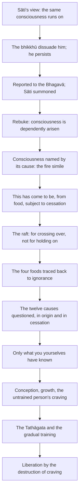

import { Tabs, TabItem } from '@astrojs/starlight/components';

Original text: [9M/4.8 Mahātaṇhāsaṅkhayasutta 1282–1392](https://tipitaka2500.github.io/tipitaka/9M/4/4.8.html#1282) in the [World Tipitaka Edition](https://tipitaka2500.github.io)

## Summary

The bhikkhu Sāti holds that one and the same consciousness runs on and wanders on; the Bhagavā rebukes him and has the bhikkhū confirm that consciousness is dependently arisen and is named by whatever it arises from, as a fire is named by its fuel. He then takes them through what has come to be and its food, the twelve causes in origin and in cessation, and their own knowledge as the only ground of the teaching, and traces a person from conception through the gradual training to the liberation by the destruction of craving.

## Diagram

## Text

<Tabs syncKey="paliquote">
<TabItem label="My Translation">
(396.)

1282\. Thus heard by me — At one time the Bhagavā was dwelling at Sāvatthī, in Jeta's Grove, Anāthapiṇḍika's Park. Now at that time such a harmful `diṭṭhigata` (misconception) had arisen in a bhikkhu named Sāti, the fisherman's son: “As I understand the Dhamma taught by the Bhagavā, it is this same `viññāṇa` (consciousness) that runs on and wanders on, not another.” Several bhikkhū heard: “It is said that such a harmful misconception has arisen in a bhikkhu named Sāti, the fisherman's son: ‘As I understand the Dhamma taught by the Bhagavā, it is this same consciousness that runs on and wanders on, not another.’” Then those bhikkhū approached the bhikkhu Sāti, the fisherman's son; having approached, they said this to the bhikkhu Sāti, the fisherman's son: “Is it true, Āvuso Sāti, as it is said, that such a harmful misconception has arisen in you: ‘As I understand the Dhamma taught by the Bhagavā, it is this same consciousness that runs on and wanders on, not another’?” “Exactly so, Āvuso, I understand the Dhamma taught by the Bhagavā: it is this same consciousness that runs on and wanders on, not another.” Then those bhikkhū, wishing to dissuade the bhikkhu Sāti, the fisherman's son, from this harmful misconception, cross-questioned, closely questioned and admonished him: “Do not say so, Āvuso Sāti; do not misrepresent the Bhagavā, for misrepresenting the Bhagavā is not good, and the Bhagavā would not say so. In many ways, Āvuso Sāti, the Bhagavā has said that consciousness is `paṭiccasamuppanna` (dependently arisen); apart from a `paccaya` (cause) there is no coming into being of consciousness.” Even so, the bhikkhu Sāti, the fisherman's son, being cross-questioned, closely questioned and admonished by those bhikkhū, obstinately clutching and adhering to that same harmful misconception, kept saying: “Exactly so, Āvuso, I understand the Dhamma taught by the Bhagavā: it is this same consciousness that runs on and wanders on, not another.”

(397.)

1283\. Since those bhikkhū were unable to dissuade the bhikkhu Sāti, the fisherman's son, from this harmful misconception, they approached the Bhagavā; having approached, they bowed to the Bhagavā and sat down to one side. Seated to one side, those bhikkhū said this to the Bhagavā: “Bhante, such a harmful misconception has arisen in a bhikkhu named Sāti, the fisherman's son: ‘As I understand the Dhamma taught by the Bhagavā, it is this same consciousness that runs on and wanders on, not another.’ We heard, Bhante, that such a harmful misconception has, it is said, arisen in a bhikkhu named Sāti, the fisherman's son: ‘As I understand the Dhamma taught by the Bhagavā, it is this same consciousness that runs on and wanders on, not another.’ Then, Bhante, we approached the bhikkhu Sāti, the fisherman's son; having approached, we said this to the bhikkhu Sāti, the fisherman's son: ‘Is it true, Āvuso Sāti, as it is said, that such a harmful misconception has arisen in you: “As I understand the Dhamma taught by the Bhagavā, it is this same consciousness that runs on and wanders on, not another”?’ When this was said, Bhante, the bhikkhu Sāti, the fisherman's son, said this to us: ‘Exactly so, Āvuso, I understand the Dhamma taught by the Bhagavā: it is this same consciousness that runs on and wanders on, not another.’ Then, Bhante, wishing to dissuade the bhikkhu Sāti, the fisherman's son, from this harmful misconception, we cross-questioned, closely questioned and admonished him: ‘Do not say so, Āvuso Sāti; do not misrepresent the Bhagavā, for misrepresenting the Bhagavā is not good, and the Bhagavā would not say so. In many ways, Āvuso Sāti, the Bhagavā has said that consciousness is dependently arisen; apart from a cause there is no coming into being of consciousness.’ Even so, Bhante, the bhikkhu Sāti, the fisherman's son, being cross-questioned, closely questioned and admonished by us, obstinately clutching and adhering to that same harmful misconception, kept saying: ‘Exactly so, Āvuso, I understand the Dhamma taught by the Bhagavā: it is this same consciousness that runs on and wanders on, not another.’ Since, Bhante, we were unable to dissuade the bhikkhu Sāti, the fisherman's son, from this harmful misconception, we report this matter to the Bhagavā.”

(398.)

1284\. Then the Bhagavā addressed a certain bhikkhu: “Come, bhikkhu, in my name summon the bhikkhu Sāti, the fisherman's son: ‘The Teacher summons you, Āvuso Sāti.’” “Yes, Bhante,” that bhikkhu replied to the Bhagavā, and he approached the bhikkhu Sāti, the fisherman's son; having approached, he said this to the bhikkhu Sāti, the fisherman's son: “The Teacher summons you, Āvuso Sāti.” “Yes, Āvuso,” the bhikkhu Sāti, the fisherman's son, replied to that bhikkhu, and he approached the Bhagavā; having approached, he bowed to the Bhagavā and sat down to one side. The Bhagavā said this to the bhikkhu Sāti, the fisherman's son, seated to one side: “Is it true, Sāti, as it is said, that such a harmful misconception has arisen in you: ‘As I understand the Dhamma taught by the Bhagavā, it is this same consciousness that runs on and wanders on, not another’?” “Exactly so, Bhante, I understand the Dhamma taught by the Bhagavā: it is this same consciousness that runs on and wanders on, not another.” “Which is that consciousness, Sāti?” “It is that, Bhante, which speaks and feels, which experiences here and there the result of good and bad `kamma` (actions).” “To whom, foolish man, do you understand the Dhamma to have been taught by me in this way? Has it not been said by me in many ways, foolish man, that consciousness is dependently arisen, that apart from a cause there is no coming into being of consciousness? And yet you, foolish man, by your own wrong grasp both misrepresent us and uproot yourself and generate much demerit. That will be for your harm and suffering for a long time, foolish man.”

(399.)

1285\. Then the Bhagavā addressed the bhikkhū: “Bhikkhave, what do you consider: has this bhikkhu Sāti, the fisherman's son, kindled even a flicker [of understanding] in this Dhamma and Discipline?” “How could that be, Bhante? Of course not, Bhante.” When this was said, the bhikkhu Sāti, the fisherman's son, sat silent, humiliated, slumped over, downcast, brooding and at a loss for words. Then the Bhagavā, having perceived that the bhikkhu Sāti, the fisherman's son, was silent, humiliated, slumped over, downcast, brooding and at a loss for words, said this to the bhikkhu Sāti, the fisherman's son: “You will be known, foolish man, by this harmful misconception of your own. Here I will question the bhikkhū.” Then the Bhagavā addressed the bhikkhū: “Do you too, Bhikkhave, understand the Dhamma taught by me in the way this bhikkhu Sāti, the fisherman's son, does, who by his own wrong grasp both misrepresents us and uproots himself and generates much demerit?” “Of course not, Bhante. For in many ways, Bhante, the Bhagavā has said to us that consciousness is dependently arisen; apart from a cause there is no coming into being of consciousness.” “Excellent, excellent, Bhikkhave. It is excellent indeed, Bhikkhave, that you understand the Dhamma taught by me in this way. For in many ways, Bhikkhave, I have said to you that consciousness is dependently arisen; apart from a cause there is no coming into being of consciousness.” And yet this bhikkhu Sāti, the fisherman's son, by his own wrong grasp both misrepresents us and uproots himself and generates much demerit. That will be for that foolish man's harm and suffering for a long time.

(400.)

1286\. “Whenever any prerequisite or dependency causing consciousness arises, just by that alone “consciousness” becomes constructed. The eye (faculty of seeing) is a dependency of form causing consciousness to arise, to become categorised as “visual-consciousness”. The ear (faculty of hearing) is a dependency of sound causing consciousness to arise, to become categorised as “auditory-consciousness”. The nose (faculty of smelling) is a dependency of smell causing consciousness to arise, to become categorised as “olfactory-consciousness”. The tongue (faculty of tasting) is a dependency of taste causing consciousness to arise, to become categorised as “gustatory-consciousness”. The body (faculty of touch) is a dependency of physical sensation causing consciousness to arise, to become categorised as “tactile-consciousness”. The mind (faculty of thought) is a dependency of mental states causing consciousness to arise, to become categorised as “mental-consciousness”.

1287\. Just as, Bhikkhave, dependent on whatever cause a fire burns, just by that alone it becomes categorised. Dependent on logs a fire burns, and it becomes categorised just as a “log fire”; dependent on wood chips a fire burns, and it becomes categorised just as a “wood-chip fire”; dependent on grass a fire burns, and it becomes categorised just as a “grass fire”; dependent on cowdung a fire burns, and it becomes categorised just as a “cowdung fire”; dependent on husks a fire burns, and it becomes categorised just as a “husk fire”; dependent on rubbish a fire burns, and it becomes categorised just as a “rubbish fire”. In the same way, Bhikkhave, dependent on whatever cause consciousness arises, just by that alone it becomes categorised. The eye (faculty of seeing) is a dependency of form causing consciousness to arise, to become categorised as “visual-consciousness”. The ear (faculty of hearing) is a dependency of sound causing consciousness to arise, to become categorised as “auditory-consciousness”, the nose (faculty of smelling) is a dependency of smell causing consciousness to arise, to become categorised as “olfactory-consciousness”, the tongue (faculty of tasting) is a dependency of taste causing consciousness to arise, to become categorised as “gustatory-consciousness”. The body (faculty of touch) is a dependency of physical sensation causing consciousness to arise, to become categorised as “tactile-consciousness”. The mind (faculty of thought) is a dependency of mental states causing consciousness to arise, to become categorised as “mental-consciousness”.

(401.)

1288\. “Bhikkhave, do you see: ‘This has come to be’?”

1289\. “Yes, Bhante.”

1290\. “Bhikkhave, do you see: ‘It has that `āhāra` (food) as its origin’?”

1291\. “Yes, Bhante.”

1292\. “Bhikkhave, do you see: ‘With the cessation of that food, what has come to be is subject to cessation’?”

1293\. “Yes, Bhante.”

1294\. “Bhikkhave, does `vicikicchā` (doubt) arise in one who is uncertain: ‘Has this come to be or not?’”

1295\. “Yes, Bhante.”

1296\. “Bhikkhave, does doubt arise in one who is uncertain: ‘Does it have that food as its origin or not?’”

1297\. “Yes, Bhante.”

1298\. “Bhikkhave, does doubt arise in one who is uncertain: ‘With the cessation of that food, is what has come to be subject to cessation or not?’”

1299\. “Yes, Bhante.”

1300\. “Bhikkhave, for one who sees `yathābhūta` (as it really is) with `sammappaññā` (correct understanding), ‘This has come to be’, is that doubt given up?”

1301\. “Yes, Bhante.”

1302\. “Bhikkhave, for one who sees as it really is with correct understanding, ‘It has that food as its origin’, is that doubt given up?”

1303\. “Yes, Bhante.”

1304\. “Bhikkhave, for one who sees as it really is with correct understanding, ‘With the cessation of that food, what has come to be is subject to cessation’, is that doubt given up?”

1305\. “Yes, Bhante.”

1306\. “Bhikkhave, ‘This has come to be’: in this way too, is there no doubt for you here?”

1307\. “Yes, Bhante.”

1308\. “Bhikkhave, ‘It has that food as its origin’: in this way too, is there no doubt for you here?”

1309\. “Yes, Bhante.”

1310\. “Bhikkhave, ‘With the cessation of that food, what has come to be is subject to cessation’: in this way too, is there no doubt for you here?”

1311\. “Yes, Bhante.”

1312\. “Bhikkhave, ‘This has come to be’: has it been well seen as it really is with correct understanding?”

1313\. “Yes, Bhante.”

1314\. “Bhikkhave, ‘It has that food as its origin’: has it been well seen as it really is with correct understanding?”

1315\. “Yes, Bhante.”

1316\. “Bhikkhave, ‘With the cessation of that food, what has come to be is subject to cessation’: has it been well seen as it really is with correct understanding?”

1317\. “Yes, Bhante.”

1318\. “Bhikkhave, if you were to cling to, cherish, treasure and take as your own this `diṭṭhi` (view), so perfectly pure, so bright, would you then, Bhikkhave, understand the Dhamma taught by me as like a raft, for crossing over, not for holding on?”

1319\. “Of course not, Bhante.”

1320\. “Bhikkhave, if you were not to cling to, not cherish, not treasure and not take as your own this view, so perfectly pure, so bright, would you then, Bhikkhave, understand the Dhamma taught by me as like a raft, for crossing over, not for holding on?”

1321\. “Yes, Bhante.”

(402.)

1322\. “Bhikkhave, there are these four foods for the maintenance of beings that have come to be, or for the support of those seeking to come into being. What four? Physical food, solid or subtle; contact, the second; mental intention, the third; and consciousness, the fourth.

1323\. And these four foods, Bhikkhave, have what as their source, what as their origin, are born from what, are produced by what? These four foods have `taṇhā` (craving) as their source, craving as their origin, are born from craving, are produced by craving. And this craving, Bhikkhave, has what as its source, what as its origin, is born from what, is produced by what?

1324\. Craving has `vedanā` (feeling) as its source, feeling as its origin, is born from feeling, is produced by feeling.

1325\. And this feeling, Bhikkhave, has what as its source, what as its origin, is born from what, is produced by what? Feeling has `phassa` (contact) as its source, contact as its origin, is born from contact, is produced by contact.

1326\. And this contact, Bhikkhave, has what as its source, what as its origin, is born from what, is produced by what? Contact has `saḷāyatana` (the six sense bases) as its source, the six sense bases as its origin, is born from the six sense bases, is produced by the six sense bases.

1327\. And these six sense bases, Bhikkhave, have what as their source, what as their origin, are born from what, are produced by what? The six sense bases have `nāmarūpa` (phenomenal objects) as their source, phenomenal objects as their origin, are born from phenomenal objects, are produced by phenomenal objects.

1328\. And these phenomenal objects, Bhikkhave, have what as their source, what as their origin, are born from what, are produced by what? Phenomenal objects have consciousness as their source, consciousness as their origin, are born from consciousness, are produced by consciousness.

1329\. And this consciousness, Bhikkhave, has what as its source, what as its origin, is born from what, is produced by what? Consciousness has `saṅkhārā` (mental constructions) as its source, mental constructions as its origin, is born from mental constructions, is produced by mental constructions.

1330\. And these mental constructions, Bhikkhave, have what as their source, what as their origin, are born from what, are produced by what? Mental constructions have `avijjā` (ignorance) as their source, ignorance as their origin, are born from ignorance, are produced by ignorance.

1331\. Thus, Bhikkhave, with ignorance as cause, mental constructions [arise]; with mental constructions as cause, consciousness [arises]; with consciousness as cause, phenomenal objects [arise]; with phenomenal objects as cause, the six sense bases [arise]; with the six sense bases as cause, contact [arises]; with contact as cause, feeling [arises]; with feeling as cause, craving [arises]; with craving as cause, `upādāna` (fuel) [arises]; with fuel as cause, `bhava` (existence (constructed self)) [arises]; with existence as cause, `jāti` (birth (of suffering)) [arises]; with birth as cause, `jarāmaraṇa` (ageing and death), sorrow, lamentation, pain, displeasure and despair come into being. Thus is the origin of this whole mass of `dukkha` (suffering).

(403.)

1332\. ‘With birth as cause, ageing and death [arise]’: this is what was said; is it with birth as cause, Bhikkhave, that ageing and death [arise], or not, or how is it here?” “It is with birth as cause, Bhante, that ageing and death [arise]; so it is for us here: with birth as cause, ageing and death [arise].”

1333\. “‘With existence as cause, birth [arises]’: this is what was said; is it with existence as cause, Bhikkhave, that birth [arises], or not, or how is it here?” “It is with existence as cause, Bhante, that birth [arises]; so it is for us here: with existence as cause, birth [arises].”

1334\. “‘With fuel as cause, existence [arises]’: this is what was said; is it with fuel as cause, Bhikkhave, that existence [arises], or not, or how is it here?” “It is with fuel as cause, Bhante, that existence [arises]; so it is for us here: with fuel as cause, existence [arises].”

1335\. “‘With craving as cause, fuel [arises]’: this is what was said; is it with craving as cause, Bhikkhave, that fuel [arises], or not, or how is it here?” “It is with craving as cause, Bhante, that fuel [arises]; so it is for us here: with craving as cause, fuel [arises].”

1336\. “‘With feeling as cause, craving [arises]’: this is what was said; is it with feeling as cause, Bhikkhave, that craving [arises], or not, or how is it here?” “It is with feeling as cause, Bhante, that craving [arises]; so it is for us here: with feeling as cause, craving [arises].”

1337\. “‘With contact as cause, feeling [arises]’: this is what was said; is it with contact as cause, Bhikkhave, that feeling [arises], or not, or how is it here?” “It is with contact as cause, Bhante, that feeling [arises]; so it is for us here: with contact as cause, feeling [arises].”

1338\. “‘With the six sense bases as cause, contact [arises]’: this is what was said; is it with the six sense bases as cause, Bhikkhave, that contact [arises], or not, or how is it here?” “It is with the six sense bases as cause, Bhante, that contact [arises]; so it is for us here: with the six sense bases as cause, contact [arises].”

1339\. “‘With phenomenal objects as cause, the six sense bases [arise]’: this is what was said; is it with phenomenal objects as cause, Bhikkhave, that the six sense bases [arise], or not, or how is it here?” “It is with phenomenal objects as cause, Bhante, that the six sense bases [arise]; so it is for us here: with phenomenal objects as cause, the six sense bases [arise].”

1340\. “‘With consciousness as cause, phenomenal objects [arise]’: this is what was said; is it with consciousness as cause, Bhikkhave, that phenomenal objects [arise], or not, or how is it here?” “It is with consciousness as cause, Bhante, that phenomenal objects [arise]; so it is for us here: with consciousness as cause, phenomenal objects [arise].”

1341\. “‘With mental constructions as cause, consciousness [arises]’: this is what was said; is it with mental constructions as cause, Bhikkhave, that consciousness [arises], or not, or how is it here?” “It is with mental constructions as cause, Bhante, that consciousness [arises]; so it is for us here: with mental constructions as cause, consciousness [arises].”

1342\. “‘With ignorance as cause, mental constructions [arise]’: this is what was said; is it with ignorance as cause, Bhikkhave, that mental constructions [arise], or not, or how is it here?” “It is with ignorance as cause, Bhante, that mental constructions [arise]; so it is for us here: with ignorance as cause, mental constructions [arise].”

(404.)

1343\. “Excellent, Bhikkhave. Thus indeed, Bhikkhave, you too would say this, and I too say this: when this exists, that is; with the arising of this, that arises, namely: with `avijjā` (ignorance) as cause, `saṅkhārā` (mental constructions) [arise]; with `saṅkhārā` as cause, `viññāṇa` (consciousness) [arises]; with `viññāṇa` as cause, `nāmarūpa` (phenomenal objects) [arise]; with `nāmarūpa` as cause, `saḷāyatana` (the six sense bases) [arise]; with `saḷāyatana` as cause, `phassa` (contact) [arises]; with `phassa` as cause, `vedanā` (feeling) [arises]; with `vedanā` as cause, `taṇhā` (craving) [arises]; with `taṇhā` as cause, `upādāna` (fuel) [arises]; with `upādāna` as cause, `bhava` (existence (constructed self)) [arises]; with `bhava` as cause, `jāti` (birth (of suffering)) [arises]; with `jāti` as cause, `jarāmaraṇa` (ageing and death), `soka` (sorrow), `parideva` (lamentation), `dukkha` (pain), `domanassa` (displeasure) and `upāyāsa` (despair) come into being. Thus is the origin of this whole mass of `dukkha` (suffering).

1344\. But with the remainderless fading away and cessation of `avijjā` (ignorance) comes the cessation of `saṅkhārā` (mental constructions); with the cessation of `saṅkhārā` comes the cessation of `viññāṇa` (consciousness); with the cessation of `viññāṇa` comes the cessation of `nāmarūpa` (phenomenal objects); with the cessation of `nāmarūpa` comes the cessation of `saḷāyatana` (the six sense bases); with the cessation of `saḷāyatana` comes the cessation of `phassa` (contact); with the cessation of `phassa` comes the cessation of `vedanā` (feeling); with the cessation of `vedanā` comes the cessation of `taṇhā` (craving); with the cessation of `taṇhā` comes the cessation of `upādāna` (fuel); with the cessation of `upādāna` comes the cessation of `bhava` (existence (constructed self)); with the cessation of `bhava` comes the cessation of `jāti` (birth (of suffering)); with the cessation of `jāti`, `jarāmaraṇa` (ageing and death), `soka` (sorrow), `parideva` (lamentation), `dukkha` (pain), `domanassa` (displeasure) and `upāyāsa` (despair) cease. Thus is the cessation of this whole mass of suffering.

(405.)

1345\. ‘With the cessation of birth comes the cessation of ageing and death’: this is what was said; is it, Bhikkhave, that with the cessation of birth comes the cessation of ageing and death, or not, or how is it here?” “With the cessation of birth, Bhante, comes the cessation of ageing and death; so it is for us here: with the cessation of birth comes the cessation of ageing and death.”

1346\. “‘With the cessation of existence comes the cessation of birth’: this is what was said; is it, Bhikkhave, that with the cessation of existence comes the cessation of birth, or not, or how is it here?” “With the cessation of existence, Bhante, comes the cessation of birth; so it is for us here: with the cessation of existence comes the cessation of birth.”

1347\. “‘With the cessation of fuel comes the cessation of existence’: this is what was said; is it, Bhikkhave, that with the cessation of fuel comes the cessation of existence, or not, or how is it here?” “With the cessation of fuel, Bhante, comes the cessation of existence; so it is for us here: with the cessation of fuel comes the cessation of existence.”

1348\. “‘With the cessation of craving comes the cessation of fuel’: this is what was said; is it, Bhikkhave, that with the cessation of craving comes the cessation of fuel, or not, or how is it here?” “With the cessation of craving, Bhante, comes the cessation of fuel; so it is for us here: with the cessation of craving comes the cessation of fuel.”

1349\. “‘With the cessation of feeling comes the cessation of craving’: this is what was said; is it, Bhikkhave, that with the cessation of feeling comes the cessation of craving, or not, or how is it here?” “With the cessation of feeling, Bhante, comes the cessation of craving; so it is for us here: with the cessation of feeling comes the cessation of craving.”

1350\. “‘With the cessation of contact comes the cessation of feeling’: this is what was said; is it, Bhikkhave, that with the cessation of contact comes the cessation of feeling, or not, or how is it here?” “With the cessation of contact, Bhante, comes the cessation of feeling; so it is for us here: with the cessation of contact comes the cessation of feeling.”

1351\. “‘With the cessation of the six sense bases comes the cessation of contact’: this is what was said; is it, Bhikkhave, that with the cessation of the six sense bases comes the cessation of contact, or not, or how is it here? With the cessation of the six sense bases, Bhante, comes the cessation of contact; so it is for us here: with the cessation of the six sense bases comes the cessation of contact.”

1352\. “‘With the cessation of phenomenal objects comes the cessation of the six sense bases’: this is what was said; is it, Bhikkhave, that with the cessation of phenomenal objects comes the cessation of the six sense bases, or not, or how is it here?” “With the cessation of phenomenal objects, Bhante, comes the cessation of the six sense bases; so it is for us here: with the cessation of phenomenal objects comes the cessation of the six sense bases.” “‘With the cessation of consciousness comes the cessation of phenomenal objects’: this is what was said; is it, Bhikkhave, that with the cessation of consciousness comes the cessation of phenomenal objects, or not, or how is it here?”

1353\. “With the cessation of consciousness, Bhante, comes the cessation of phenomenal objects; so it is for us here: with the cessation of consciousness comes the cessation of phenomenal objects.” “‘With the cessation of mental constructions comes the cessation of consciousness’: this is what was said; is it, Bhikkhave, that with the cessation of mental constructions comes the cessation of consciousness, or not, or how is it here?” “With the cessation of mental constructions, Bhante, comes the cessation of consciousness; so it is for us here: with the cessation of mental constructions comes the cessation of consciousness.”

1354\. “‘With the cessation of ignorance comes the cessation of mental constructions’: this is what was said; is it, Bhikkhave, that with the cessation of ignorance comes the cessation of mental constructions, or not, or how is it here?” “With the cessation of ignorance, Bhante, comes the cessation of mental constructions; so it is for us here: with the cessation of ignorance comes the cessation of mental constructions.”

(406.)

1355\. “Excellent, Bhikkhave. Thus indeed, Bhikkhave, you too would say this, and I too say this: when this does not exist, that is not; with the cessation of this, that ceases, namely: with the cessation of `avijjā` (ignorance) comes the cessation of `saṅkhārā` (mental constructions); with the cessation of `saṅkhārā` comes the cessation of `viññāṇa` (consciousness); with the cessation of `viññāṇa` comes the cessation of `nāmarūpa` (phenomenal objects); with the cessation of `nāmarūpa` comes the cessation of `saḷāyatana` (the six sense bases); with the cessation of `saḷāyatana` comes the cessation of `phassa` (contact); with the cessation of `phassa` comes the cessation of `vedanā` (feeling); with the cessation of `vedanā` comes the cessation of `taṇhā` (craving); with the cessation of `taṇhā` comes the cessation of `upādāna` (fuel); with the cessation of `upādāna` comes the cessation of `bhava` (existence (constructed self)); with the cessation of `bhava` comes the cessation of `jāti` (birth (of suffering)); with the cessation of `jāti`, `jarāmaraṇa` (ageing and death), `soka` (sorrow), `parideva` (lamentation), `dukkha` (pain), `domanassa` (displeasure) and `upāyāsa` (despair) cease. Thus is the cessation of this whole mass of suffering.

(407.)

1356\. Thus knowing and thus seeing, Bhikkhave, would you run back to the past: ‘Did we exist in the past? Did we not exist in the past? What were we in the past? How were we in the past? Having been what, what were we in the past?’”

1357\. “Of course not, Bhante.”

1358\. “Thus knowing and thus seeing, Bhikkhave, would you run forward to the future: will we exist in the future? Will we not exist in the future? What will we be in the future? How will we be in the future? Having been what, what will we be in the future?”

1359\. “Of course not, Bhante.”

1360\. “Thus knowing and thus seeing, Bhikkhave, would you now, in the present time, be inwardly uncertain: do I exist? Do I not exist? What am I? How am I? Where has this being come from, and where will it be going?”

1361\. “Of course not, Bhante.”

1362\. “Thus knowing and thus seeing, Bhikkhave, would you say: ‘Our teacher is respected, and out of respect for the teacher we would say thus’?”

1363\. “Of course not, Bhante.”

1364\. “Thus knowing and thus seeing, Bhikkhave, would you say: ‘The wanderer said thus, and we, being wanderers indeed, would say thus’?”

1365\. “Of course not, Bhante.”

1366\. “Thus knowing and thus seeing, Bhikkhave, will you appoint another teacher?”

1367\. “Of course not, Bhante.”

1368\. “Thus knowing and thus seeing, Bhikkhave, will you return to whatever (you regarded as) valuable, such as various religious practitioners, noisy debates and auspicious ceremonies?”

1369\. “Of course not, Bhante.”

1370\. “Would you say whatever amongst you that you have known by yourselves, seen by yourselves, experienced by yourselves?”

1371\. “Yes, Bhante.”

1372\. “Excellent, Bhikkhave. Bhikkhave, you have indeed been instructed by me with an evident `dhamma` (principle interpreting the essential nature of existence and experience) that is verifiable and should be personally experienced by those who are intelligent. ‘This `dhamma`, Bhikkhave, is evident, immediate, verifiable, leading onward, to be personally experienced by those who are intelligent’ — that which was said thus, it was said in reference to this.

(408.)

1373\. Now, Bhikkhave, it is through the coming together of three [things] that conception takes place. Here the mother and father have come together, and the mother is not in season, and the `gandhabba` (stream of consciousness impelled to be reborn) is not present: then conception does not take place. Here the mother and father have come together, and the mother is in season, and the `gandhabba` is not present: then conception does not take place. But when, Bhikkhave, the mother and father have come together, and the mother is in season, and the `gandhabba` is present, then through the coming together of these three conception takes place. Then, Bhikkhave, the mother carries that embryo in her womb for nine or ten months with great anxiety, as a heavy burden. Then, Bhikkhave, after the passing of nine or ten months, the mother gives birth to it with great anxiety, as a heavy burden. Then, once it is born, she looks after it with her own blood. For this, Bhikkhave, is blood in the Discipline of the Liberated One, namely mother's milk. Then, Bhikkhave, that boy, following his growth and the maturing of his faculties, plays with whatever toys boys have, namely: a toy plough, tip-cat, somersaults, a toy windmill, toy measures, a toy chariot and a toy bow.

1374\. Then, Bhikkhave, that boy, following his growth and the maturing of his faculties, endowed and furnished with the five strands of sensual pleasures, indulges in: forms cognisable by the eye that are agreeable, pleasant, charming, alluring, accompanied by sensual desire, and stimulating; sounds cognisable by the ear … smells cognisable by the nose … tastes cognisable by the tongue … tactile objects cognisable by the body that are agreeable, pleasant, charming, alluring, accompanied by sensual desire, and stimulating.

(409.)

1375\. When he sees a form with the eye, he is attracted to an agreeable form and repelled by a disagreeable form, and he lives with awareness of the body unestablished, with a limited mind. And he does not know clearly as it really is that mental liberation and liberation by wisdom where those evil, unwholesome characteristics of his cease without remainder. Thus engaged in liking and disliking, whatever feeling he feels, whether pleasant or painful or neither painful nor pleasant, he delights in that feeling, welcomes it and remains clinging to it. As he delights in that feeling, welcomes it and remains clinging to it, delight arises. Whatever delight there is in feelings, that is fuel; with his fuel as cause, existence [arises]; with existence as cause, birth [arises]; with birth as cause, ageing and death, sorrow, lamentation, pain, displeasure and despair come into being. Thus is the origin of this whole mass of suffering. When he hears a sound with the ear… when he smells an odour with the nose… when he tastes a taste with the tongue… when he touches a tangible with the body… when he cognises a mind-object with the mind, he is attracted to an agreeable mind-object and repelled by a disagreeable mind-object, and he lives with awareness of the body unestablished, with a limited mind. And he does not know clearly as it really is that mental liberation and liberation by wisdom where those evil, unwholesome characteristics of his cease without remainder. Thus engaged in liking and disliking, whatever feeling he feels, whether pleasant or painful or neither painful nor pleasant, he delights in that feeling, welcomes it and remains clinging to it. As he delights in that feeling, welcomes it and remains clinging to it, delight arises. Whatever delight there is in feelings, that is fuel; with his fuel as cause, existence [arises]; with existence as cause, birth [arises]; with birth as cause, ageing and death, sorrow, lamentation, pain, displeasure and despair come into being. Thus is the origin of this whole mass of suffering.

(410.)

1376\. Here, Bhikkhave, a Tathāgata arises in the world, an `arahant` (liberated one), a `sammāsambuddha` (perfectly awakened one), accomplished in knowledge and conduct, fortunate, knower of the world, unsurpassed trainer of persons to be tamed, teacher of gods and humans, the Awakened One, the Bhagavā. He declares this world — with its deities, Māras, and Brahmās, this generation with its religious practitioners, its gods and humans — having realised it for himself through experiential understanding. He teaches the Dhamma that is good in the beginning, good in the middle, and good in the end, meaningful and well-phrased; he makes known the `brahmacariya` (optimal life) that is wholly complete and perfectly pure. A householder or a householder's son, or one born in some other family, hears that Dhamma. Having heard that Dhamma, he gains confidence in the Tathāgata. Endowed with that gain of confidence, he reflects thus: ‘Household life is confining, a dusty path. Going forth is the open air. It is not easy for one living in a house to lead the optimal life that is utterly perfect, utterly pure, like a polished shell. What if I, having shaved off my hair and beard, and having put on saffron robes, were to go forth from the home life into homelessness?’” So, at a later time, having given up a small or large pile of wealth, having given up a small or large family circle, having shaved off his hair and beard, and having put on saffron robes, he goes forth from the home life into homelessness.

(411.)

1377\. Having thus gone forth, having undertaken the training and livelihood of bhikkhū, giving up the taking of life, he abstains from the taking of life; he lives with rod and weapon laid aside, scrupulous, compassionate, sympathetic for the welfare of all living beings.

1378\. Giving up the taking of what is not given, he abstains from the taking of what is not given; he takes what is given, expects only what is given. Not a thief, he lives pure in himself.

1379\. Giving up uncelibacy, he practises celibacy, keeps far away from sexual intercourse, abstains from vulgar practice.

1380\. Giving up false speech, he abstains from false speech; he is truthful, true to his word, honest, reliable, keeping promises for everyone in the world.

1381\. Giving up slanderous speech, he abstains from slanderous speech; having listened here, he does not tell it there to break up these people; having listened there, he does not tell it here to break up those people. Thus he is a conciliator of the broken and a provider of friendly terms; enjoying concord, liking harmony, delighting in unity, he speaks peace-making speech.

1382\. Giving up harsh speech, he abstains from harsh speech. Whatever speech is gentle, pleasant to hear, friendly, heart-warming, polite, loved by the people, charming to the people — such speech he speaks.

1383\. Giving up gossip, he abstains from gossip; he speaks at the proper time, speaks what is true, speaks what is meaningful, speaks about the Dhamma, speaks about the discipline; he speaks speech worth remembering, timely, reasonable, purposeful, beneficial.

1384\. He abstains from harming seed-and-plant life. He eats one meal a day, abstaining from eating at night, abstaining from eating between midday and dawn. He abstains from dancing, singing, instrumental music, and watching shows. He abstains from using garlands, perfumes, oils, adornments and decorations. He abstains from large and luxurious beds. He abstains from accepting gold and silver. He abstains from accepting raw grain. He abstains from accepting raw meat. He abstains from accepting women and girls. He abstains from accepting female and male servants. He abstains from accepting goats and sheep. He abstains from accepting chickens and pigs. He abstains from accepting elephants, cattle, horses, and mares. He abstains from accepting fields and land. He abstains from engaging in messages and errands. He abstains from buying and selling. He abstains from cheating with scales, weights, or measures. He abstains from bribery, deception, fraud, and crookedness. He abstains from cutting, beating, binding, robbery, plunder, and violence.

1385\. He is content with a robe to look after his body and alms food to look after his stomach. Wherever he goes, he goes taking only these with him. Just as a winged bird, wherever it flies, flies with its wings as its only burden; in the same way, a bhikkhu is content with a robe to look after his body and alms food to look after his stomach. Wherever he goes, he goes taking only these with him. Endowed with this collection of virtue of the liberated, he experiences blameless happiness within himself.

1386\. When he sees a form with the eye, he does not grasp at its representations or details. He practises for the restraint of that eye faculty, through which, if it were unrestrained, evil, unwholesome characteristics of covetousness and displeasure might invade him. He guards the eye faculty; he undertakes restraint of the eye faculty. When he hears a sound with the ear… when he smells an odour with the nose… when he tastes a taste with the tongue… when he touches a tangible with the body… when he cognises a mind-object with the mind, he does not grasp at its representations or details. He practises for the restraint of that mind faculty, through which, if it were unrestrained, evil, unwholesome characteristics of covetousness and displeasure might invade him. He guards the mind faculty; he undertakes restraint of the mind faculty. Endowed with this restraint of the faculties of the liberated, he experiences unadulterated happiness within himself.

1387\. He acts with clear comprehension when going forward and returning; he acts with clear comprehension when looking forward and looking around; he acts with clear comprehension when bending and stretching; he acts with clear comprehension when carrying his outer robe, bowl, and robe; he acts with clear comprehension when eating, drinking, chewing, and tasting; he acts with clear comprehension when defecating and urinating; he acts with clear comprehension when walking, standing, sitting, sleeping, waking, speaking, and remaining silent.

(412.)

1388\. Endowed with this collection of virtue of the liberated, endowed with this contentment of the liberated, endowed with this restraint of the faculties of the liberated, and endowed with this `sati` (awareness) and `sampajañña` (clear comprehension) of the liberated, he resorts to a secluded dwelling: a wilderness, the foot of a tree, a mountain, a ravine, a hillside cave, a charnel ground, a forest grove, the open air, a heap of straw. After his meal, having returned from his alms round, he sits down, folding his legs crosswise, setting his body erect, and establishing awareness in front of him. Giving up covetousness for the world, he dwells with a mind free from covetousness; he purifies his mind from covetousness. Giving up ill will and hatred, he dwells with a mind free from ill will, sympathetic for the welfare of all living beings; he purifies his mind from ill will and hatred. Giving up sloth and torpor, he dwells free from sloth and torpor, with apperception of light, aware and clearly comprehending; he purifies his mind from sloth and torpor. Giving up restlessness and remorse, he dwells undisturbed, with his mind inwardly peaceful; he purifies his mind from restlessness and remorse. Giving up doubt, he dwells having crossed over doubt, without perplexity regarding wholesome characteristics; he purifies his mind from doubt.

(413.)

1389\. Having given up these five `nīvaraṇā` (hindrances), imperfections of the mind that weaken wisdom, secluding himself from sensual pleasures, detaching from unwholesome characteristics, he enters and remains in the first `jhāna` (mental disposition), accompanied by reflection and consideration, secluded from defilements, with felicity and satisfaction. And furthermore, Bhikkhave, a bhikkhu, with the conclusion of reflection and consideration, [enters and remains in] the second `jhāna`, accompanied by an inner calming of intention, focused, without reflection, without consideration, born from focus, with felicity and satisfaction … and so on … the third `jhāna` … and so on … he enters and remains in the fourth `jhāna`.

(414.)

1390\. When he sees a form with the eye, he is not attracted to an agreeable form and not repelled by a disagreeable form, and he lives with awareness of the body established, with an immeasurable mind. And he knows clearly as it really is that mental liberation and liberation by wisdom where those evil, unwholesome characteristics of his cease without remainder. Having thus abandoned liking and disliking, whatever feeling he feels, whether pleasant or painful or neither painful nor pleasant, he does not delight in that feeling, does not welcome it and does not remain clinging to it. As he does not delight in that feeling, does not welcome it and does not remain clinging to it, whatever delight there is in feelings ceases. With the cessation of his delight comes the cessation of fuel; with the cessation of fuel comes the cessation of existence; with the cessation of existence comes the cessation of birth; with the cessation of birth, ageing and death, sorrow, lamentation, pain, displeasure and despair cease. Thus is the cessation of this whole mass of suffering. When he hears a sound with the ear… when he smells an odour with the nose… when he tastes a taste with the tongue… when he touches a tangible with the body… when he cognises a mind-object with the mind, he is not attracted to an agreeable mind-object and not repelled by a disagreeable mind-object, and he lives with awareness of the body established, with an immeasurable mind; and he knows clearly as it really is that mental liberation and liberation by wisdom where those evil, unwholesome characteristics of his cease without remainder. Having thus abandoned liking and disliking, whatever feeling he feels, whether pleasant or painful or neither painful nor pleasant, he does not delight in that feeling, does not welcome it and does not remain clinging to it. As he does not delight in that feeling, does not welcome it and does not remain clinging to it, whatever delight there is in feelings ceases. With the cessation of his delight comes the cessation of fuel; with the cessation of fuel comes the cessation of existence; with the cessation of existence comes the cessation of birth; with the cessation of birth, ageing and death, sorrow, lamentation, pain, displeasure and despair cease. Thus is the cessation of this whole mass of suffering. Remember this, Bhikkhave, in brief, as my `taṇhāsaṅkhayavimutti` (liberation through the destruction of craving); but [remember] the bhikkhu Sāti, the fisherman's son, as caught in the great net of craving, the tangle of craving.”

1391\. This the Bhagavā said. Those bhikkhū, delighted, rejoiced in the Bhagavā’s words.

1392\. The Greater Discourse on the Destruction of Craving, the eighth, is finished.
</TabItem>

<TabItem label="Pāḷi (Roman IAST)">
(396.)

1282\. Evaṃ me sutaṃ— ekaṃ samayaṃ bhagavā sāvatthiyaṃ viharati jetavane anāthapiṇḍikassa ārāme. Tena kho pana samayena sātissa nāma bhikkhuno kevaṭṭaputtassa evarūpaṃ pāpakaṃ diṭṭhigataṃ uppannaṃ hoti— “tathāhaṃ bhagavatā dhammaṃ desitaṃ ājānāmi yathā tadevidaṃ viññāṇaṃ sandhāvati saṃsarati anaññan”ti. Assosuṃ kho sambahulā bhikkhū— “sātissa kira nāma bhikkhuno kevaṭṭaputtassa evarūpaṃ pāpakaṃ diṭṭhigataṃ uppannaṃ— ‘tathāhaṃ bhagavatā dhammaṃ desitaṃ ājānāmi yathā tadevidaṃ viññāṇaṃ sandhāvati saṃsarati, anaññan’”ti. Atha kho te bhikkhū yena sāti bhikkhu kevaṭṭaputto tenupasaṅkamiṃsu; upasaṅkamitvā sātiṃ bhikkhuṃ kevaṭṭaputtaṃ etadavocuṃ— “saccaṃ kira te, āvuso sāti, evarūpaṃ pāpakaṃ diṭṭhigataṃ uppannaṃ— ‘tathāhaṃ bhagavatā dhammaṃ desitaṃ ājānāmi yathā tadevidaṃ viññāṇaṃ sandhāvati saṃsarati, anaññan’”ti? “Evaṃ byā kho ahaṃ, āvuso, bhagavatā dhammaṃ desitaṃ ājānāmi yathā tadevidaṃ viññāṇaṃ sandhāvati saṃsarati, anaññan”ti. Atha kho te bhikkhū sātiṃ bhikkhuṃ kevaṭṭaputtaṃ etasmā pāpakā diṭṭhigatā vivecetukāmā samanuyuñjanti samanugāhanti samanubhāsanti— “mā evaṃ, āvuso sāti, avaca, mā bhagavantaṃ abbhācikkhi, na hi sādhu bhagavato abbhakkhānaṃ, na hi bhagavā evaṃ vadeyya. Anekapariyāyenāvuso sāti, paṭiccasamuppannaṃ viññāṇaṃ vuttaṃ bhagavatā, aññatra paccayā natthi viññāṇassa sambhavo”ti. Evampi kho sāti bhikkhu kevaṭṭaputto tehi bhikkhūhi samanuyuñjiyamāno samanugāhiyamāno samanubhāsiyamāno tadeva pāpakaṃ diṭṭhigataṃ thāmasā parāmāsā abhinivissa voharati— “evaṃ byā kho ahaṃ, āvuso, bhagavatā dhammaṃ desitaṃ ājānāmi yathā tadevidaṃ viññāṇaṃ sandhāvati saṃsarati anaññan”ti.

(397.)

1283\. Yato kho te bhikkhū nāsakkhiṃsu sātiṃ bhikkhuṃ kevaṭṭaputtaṃ etasmā pāpakā diṭṭhigatā vivecetuṃ, atha kho te bhikkhū yena bhagavā tenupasaṅkamiṃsu; upasaṅkamitvā bhagavantaṃ abhivādetvā ekamantaṃ nisīdiṃsu. Ekamantaṃ nisinnā kho te bhikkhū bhagavantaṃ etadavocuṃ— “sātissa nāma, bhante, bhikkhuno kevaṭṭaputtassa evarūpaṃ pāpakaṃ diṭṭhigataṃ uppannaṃ— ‘tathāhaṃ bhagavatā dhammaṃ desitaṃ ājānāmi yathā tadevidaṃ viññāṇaṃ sandhāvati saṃsarati, anaññan’ti. Assumha kho mayaṃ, bhante, sātissa kira nāma bhikkhuno kevaṭṭaputtassa evarūpaṃ pāpakaṃ diṭṭhigataṃ uppannaṃ— ‘tathāhaṃ bhagavatā dhammaṃ desitaṃ ājānāmi yathā tadevidaṃ viññāṇaṃ sandhāvati saṃsarati, anaññan’ti. Atha kho mayaṃ, bhante, yena sāti bhikkhu kevaṭṭaputto tenupasaṅkamimha; upasaṅkamitvā sātiṃ bhikkhuṃ kevaṭṭaputtaṃ etadavocumha— ‘saccaṃ kira te, āvuso sāti, evarūpaṃ pāpakaṃ diṭṭhigataṃ uppannaṃ— “tathāhaṃ bhagavatā dhammaṃ desitaṃ ājānāmi yathā tadevidaṃ viññāṇaṃ sandhāvati saṃsarati, anaññan”’ti? Evaṃ vutte, bhante, sāti bhikkhu kevaṭṭaputto amhe etadavoca— ‘evaṃ byā kho ahaṃ, āvuso, bhagavatā dhammaṃ desitaṃ ājānāmi yathā tadevidaṃ viññāṇaṃ sandhāvati saṃsarati, anaññan’ti. Atha kho mayaṃ, bhante, sātiṃ bhikkhuṃ kevaṭṭaputtaṃ etasmā pāpakā diṭṭhigatā vivecetukāmā samanuyuñjimha samanugāhimha samanubhāsimha— ‘mā evaṃ, āvuso sāti, avaca, mā bhagavantaṃ abbhācikkhi, na hi sādhu bhagavato abbhakkhānaṃ, na hi bhagavā evaṃ vadeyya. Anekapariyāyenāvuso sāti, paṭiccasamuppannaṃ viññāṇaṃ vuttaṃ bhagavatā, aññatra paccayā natthi viññāṇassa sambhavo’ti. Evampi kho, bhante, sāti bhikkhu kevaṭṭaputto amhehi samanuyuñjiyamāno samanugāhiyamāno samanubhāsiyamāno tadeva pāpakaṃ diṭṭhigataṃ thāmasā parāmasā abhinivissa voharati— ‘evaṃ byā kho ahaṃ, āvuso, bhagavatā dhammaṃ desitaṃ ājānāmi yathā tadevidaṃ viññāṇaṃ sandhāvati saṃsarati, anaññan’ti. Yato kho mayaṃ, bhante, nāsakkhimha sātiṃ bhikkhuṃ kevaṭṭaputtaṃ etasmā pāpakā diṭṭhigatā vivecetuṃ, atha mayaṃ etamatthaṃ bhagavato ārocemā”ti.

(398.)

1284\. Atha kho bhagavā aññataraṃ bhikkhuṃ āmantesi— “ehi tvaṃ bhikkhu, mama vacanena sātiṃ bhikkhuṃ kevaṭṭaputtaṃ āmantehi— ‘satthā taṃ, āvuso sāti, āmantetī’”ti. “Evaṃ, bhante”ti kho so bhikkhu bhagavato paṭissutvā yena sāti bhikkhu kevaṭṭaputto tenupasaṅkami; upasaṅkamitvā sātiṃ bhikkhuṃ kevaṭṭaputtaṃ etadavoca— “satthā taṃ, āvuso sāti, āmantetī”ti. “Evamāvuso”ti kho sāti bhikkhu kevaṭṭaputto tassa bhikkhuno paṭissutvā yena bhagavā tenupasaṅkami; upasaṅkamitvā bhagavantaṃ abhivādetvā ekamantaṃ nisīdi. Ekamantaṃ nisinnaṃ kho sātiṃ bhikkhuṃ kevaṭṭaputtaṃ bhagavā etadavoca— “saccaṃ kira te, sāti, evarūpaṃ pāpakaṃ diṭṭhigataṃ uppannaṃ— ‘tathāhaṃ bhagavatā dhammaṃ desitaṃ ājānāmi yathā tadevidaṃ viññāṇaṃ sandhāvati saṃsarati, anaññan’”ti? “Evaṃ byā kho ahaṃ, bhante, bhagavatā dhammaṃ desitaṃ ājānāmi yathā tadevidaṃ viññāṇaṃ sandhāvati saṃsarati, anaññan”ti. “Katamaṃ taṃ, sāti, viññāṇan”ti? “Yvāyaṃ, bhante, vado vedeyyo tatra tatra kalyāṇapāpakānaṃ kammānaṃ vipākaṃ paṭisaṃvedetī”ti. “Kassa nu kho nāma tvaṃ, moghapurisa, mayā evaṃ dhammaṃ desitaṃ ājānāsi? Nanu mayā, moghapurisa, anekapariyāyena paṭiccasamuppannaṃ viññāṇaṃ vuttaṃ, aññatra paccayā natthi viññāṇassa sambhavoti? Atha ca pana tvaṃ, moghapurisa, attanā duggahitena amhe ceva abbhācikkhasi, attānañca khaṇasi, bahuñca apuññaṃ pasavasi. Tañhi te, moghapurisa, bhavissati dīgharattaṃ ahitāya dukkhāyā”ti.

(399.)

1285\. Atha kho bhagavā bhikkhū āmantesi— “taṃ kiṃ maññatha, bhikkhave, api nāyaṃ sāti bhikkhu kevaṭṭaputto usmīkatopi imasmiṃ dhammavinaye”ti? “Kiñhi siyā, bhante? No hetaṃ, bhante”ti. Evaṃ vutte, sāti bhikkhu kevaṭṭaputto tuṇhībhūto maṅkubhūto pattakkhandho adhomukho pajjhāyanto appaṭibhāno nisīdi. Atha kho bhagavā sātiṃ bhikkhuṃ kevaṭṭaputtaṃ tuṇhībhūtaṃ maṅkubhūtaṃ pattakkhandhaṃ adhomukhaṃ pajjhāyantaṃ appaṭibhānaṃ viditvā sātiṃ bhikkhuṃ kevaṭṭaputtaṃ etadavoca— “paññāyissasi kho tvaṃ, moghapurisa, etena sakena pāpakena diṭṭhigatena. Idhāhaṃ bhikkhū paṭipucchissāmī”ti. Atha kho bhagavā bhikkhū āmantesi— “tumhepi me, bhikkhave, evaṃ dhammaṃ desitaṃ ājānātha yathāyaṃ sāti bhikkhu kevaṭṭaputto attanā duggahitena amhe ceva abbhācikkhati, attānañca khaṇati, bahuñca apuññaṃ pasavatī”ti? “No hetaṃ, bhante. Anekapariyāyena hi no, bhante, paṭiccasamuppannaṃ viññāṇaṃ vuttaṃ bhagavatā, aññatra paccayā natthi viññāṇassa sambhavo”ti. “Sādhu sādhu, bhikkhave. Sādhu kho me tumhe, bhikkhave, evaṃ dhammaṃ desitaṃ ājānātha. Anekapariyāyena hi vo, bhikkhave, paṭiccasamuppannaṃ viññāṇaṃ vuttaṃ mayā, aññatra paccayā natthi viññāṇassa sambhavo”ti. Atha ca panāyaṃ sāti bhikkhu kevaṭṭaputto attanā duggahitena amhe ceva abbhācikkhati, attānañca khaṇati, bahuñca apuññaṃ pasavati. Tañhi tassa moghapurisassa bhavissati dīgharattaṃ ahitāya dukkhāya.

(400.)

1286\. “Yaṃ yadeva, bhikkhave, paccayaṃ paṭicca uppajjati viññāṇaṃ, tena teneva viññāṇantveva saṅkhyaṃ gacchati. Cakkhuñca paṭicca rūpe ca uppajjati viññāṇaṃ, cakkhuviññāṇantveva saṅkhyaṃ gacchati; sotañca paṭicca sadde ca uppajjati viññāṇaṃ, sotaviññāṇantveva saṅkhyaṃ gacchati; ghānañca paṭicca gandhe ca uppajjati viññāṇaṃ, ghānaviññāṇantveva saṅkhyaṃ gacchati; jivhañca paṭicca rase ca uppajjati viññāṇaṃ, jivhāviññāṇantveva saṅkhyaṃ gacchati; kāyañca paṭicca phoṭṭhabbe ca uppajjati viññāṇaṃ, kāyaviññāṇantveva saṅkhyaṃ gacchati; manañca paṭicca dhamme ca uppajjati viññāṇaṃ, manoviññāṇantveva saṅkhyaṃ gacchati.

1287\. Seyyathāpi, bhikkhave, yaṃ yadeva paccayaṃ paṭicca aggi jalati tena teneva saṅkhyaṃ gacchati. Kaṭṭhañca paṭicca aggi jalati, kaṭṭhaggitveva saṅkhyaṃ gacchati; sakalikañca paṭicca aggi jalati, sakalikaggitveva saṅkhyaṃ gacchati; tiṇañca paṭicca aggi jalati, tiṇaggitveva saṅkhyaṃ gacchati; gomayañca paṭicca aggi jalati, gomayaggitveva saṅkhyaṃ gacchati; thusañca paṭicca aggi jalati, thusaggitveva saṅkhyaṃ gacchati; saṅkārañca paṭicca aggi jalati, saṅkāraggitveva saṅkhyaṃ gacchati. Evameva kho, bhikkhave, yaṃ yadeva paccayaṃ paṭicca uppajjati viññāṇaṃ, tena teneva saṅkhyaṃ gacchati. Cakkhuñca paṭicca rūpe ca uppajjati viññāṇaṃ, cakkhuviññāṇantveva saṅkhyaṃ gacchati; sotañca paṭicca sadde ca uppajjati viññāṇaṃ, sotaviññāṇantveva saṅkhyaṃ gacchati, ghānañca paṭicca gandhe ca uppajjati viññāṇaṃ, ghānaviññāṇantveva saṅkhyaṃ gacchati, jivhañca paṭicca rase ca uppajjati viññāṇaṃ, jivhāviññāṇantveva saṅkhyaṃ gacchati. Kāyañca paṭicca phoṭṭhabbe ca uppajjati viññāṇaṃ, kāyaviññāṇantveva saṅkhyaṃ gacchati. Manañca paṭicca dhamme ca uppajjati viññāṇaṃ, manoviññāṇantveva saṅkhyaṃ gacchati.

(401.)

1288\. Bhūtamidanti, bhikkhave, passathā”ti?

1289\. “Evaṃ, bhante”.

1290\. “Tadāhārasambhavanti, bhikkhave, passathā”ti?

1291\. “Evaṃ, bhante”.

1292\. “Tadāhāranirodhā yaṃ bhūtaṃ, taṃ nirodhadhammanti, bhikkhave, passathā”ti?

1293\. “Evaṃ, bhante”.

1294\. “Bhūtamidaṃ nossūti, bhikkhave, kaṅkhato uppajjati vicikicchā”ti?

1295\. “Evaṃ, bhante”.

1296\. “Tadāhārasambhavaṃ nossūti, bhikkhave, kaṅkhato uppajjati vicikicchā”ti?

1297\. “Evaṃ, bhante”.

1298\. “Tadāhāranirodhā yaṃ bhūtaṃ, taṃ nirodhadhammaṃ nossūti, bhikkhave, kaṅkhato uppajjati vicikicchā”ti?

1299\. “Evaṃ, bhante”.

1300\. “Bhūtamidanti, bhikkhave, yathābhūtaṃ sammappaññāya passato yā vicikicchā sā pahīyatī”ti?

1301\. “Evaṃ, bhante”.

1302\. “Tadāhārasambhavanti, bhikkhave, yathābhūtaṃ sammappaññāya passato yā vicikicchā sā pahīyatī”ti?

1303\. “Evaṃ, bhante”.

1304\. “Tadāhāranirodhā yaṃ bhūtaṃ, taṃ nirodhadhammanti, bhikkhave, yathābhūtaṃ sammappaññāya passato yā vicikicchā sā pahīyatī”ti?

1305\. “Evaṃ, bhante”.

1306\. “Bhūtamidanti, bhikkhave, itipi vo ettha nibbicikicchā”ti?

1307\. “Evaṃ, bhante”.

1308\. “Tadāhārasambhavanti, bhikkhave, itipi vo ettha nibbicikicchā”ti?

1309\. “Evaṃ, bhante”.

1310\. “Tadāhāranirodhā yaṃ bhūtaṃ taṃ nirodhadhammanti, bhikkhave, itipi vo ettha nibbicikicchā”ti?

1311\. “Evaṃ, bhante”.

1312\. “Bhūtamidanti, bhikkhave, yathābhūtaṃ sammappaññāya sudiṭṭhan”ti?

1313\. “Evaṃ, bhante”.

1314\. “Tadāhārasambhavanti, bhikkhave, yathābhūtaṃ sammappaññāya sudiṭṭhan”ti?

1315\. “Evaṃ, bhante”.

1316\. “Tadāhāranirodhā yaṃ bhūtaṃ taṃ nirodhadhammanti, bhikkhave, yathābhūtaṃ sammappaññāya sudiṭṭhan”ti?

1317\. “Evaṃ, bhante”.

1318\. “Imañce tumhe, bhikkhave, diṭṭhiṃ evaṃ parisuddhaṃ evaṃ pariyodātaṃ allīyetha kelāyetha dhanāyetha mamāyetha, api nu me tumhe, bhikkhave, kullūpamaṃ dhammaṃ desitaṃ ājāneyyātha nittharaṇatthāya no gahaṇatthāyā”ti?

1319\. “No hetaṃ, bhante”.

1320\. “Imañce tumhe, bhikkhave, diṭṭhiṃ evaṃ parisuddhaṃ evaṃ pariyodātaṃ na allīyetha na kelāyetha na dhanāyetha na mamāyetha, api nu me tumhe, bhikkhave, kullūpamaṃ dhammaṃ desitaṃ ājāneyyātha nittharaṇatthāya no gahaṇatthāyā”ti?

1321\. “Evaṃ, bhante”.

(402.)

1322\. “Cattārome, bhikkhave, āhārā bhūtānaṃ vā sattānaṃ ṭhitiyā, sambhavesīnaṃ vā anuggahāya. Katame cattāro? Kabaḷīkāro āhāro oḷāriko vā sukhumo vā, phasso dutiyo, manosañcetanā tatiyā, viññāṇaṃ catutthaṃ.

1323\. Ime ca, bhikkhave, cattāro āhārā kiṃnidānā kiṃsamudayā kiṃjātikā kiṃpabhavā? Ime cattāro āhārā taṇhānidānā taṇhāsamudayā taṇhājātikā taṇhāpabhavā. Taṇhā cāyaṃ, bhikkhave, kiṃnidānā kiṃsamudayā kiṃjātikā kiṃpabhavā?

1324\. Taṇhā vedanānidānā vedanāsamudayā vedanājātikā vedanāpabhavā.

1325\. Vedanā cāyaṃ, bhikkhave, kiṃnidānā kiṃsamudayā kiṃjātikā kiṃpabhavā? Vedanā phassanidānā phassasamudayā phassajātikā phassapabhavā.

1326\. Phasso cāyaṃ, bhikkhave, kiṃnidāno kiṃsamudayo kiṃjātiko kiṃpabhavo? Phasso saḷāyatananidāno saḷāyatanasamudayo saḷāyatanajātiko saḷāyatanapabhavo.

1327\. Saḷāyatanañcidaṃ, bhikkhave, kiṃnidānaṃ kiṃsamudayaṃ kiṃjātikaṃ kiṃpabhavaṃ? Saḷāyatanaṃ nāmarūpanidānaṃ nāmarūpasamudayaṃ nāmarūpajātikaṃ nāmarūpapabhavaṃ.

1328\. Nāmarūpañcidaṃ, bhikkhave, kiṃnidānaṃ kiṃsamudayaṃ kiṃjātikaṃ kiṃpabhavaṃ? Nāmarūpaṃ viññāṇanidānaṃ viññāṇasamudayaṃ viññāṇajātikaṃ viññāṇapabhavaṃ.

1329\. Viññāṇañcidaṃ, bhikkhave, kiṃnidānaṃ kiṃsamudayaṃ kiṃjātikaṃ kiṃpabhavaṃ? Viññāṇaṃ saṅkhāranidānaṃ saṅkhārasamudayaṃ saṅkhārajātikaṃ saṅkhārapabhavaṃ.

1330\. Saṅkhārā cime, bhikkhave, kiṃnidānā kiṃsamudayā kiṃjātikā kiṃpabhavā? Saṅkhārā avijjānidānā avijjāsamudayā avijjājātikā avijjāpabhavā.

1331\. Iti kho, bhikkhave, avijjāpaccayā saṅkhārā, saṅkhārapaccayā viññāṇaṃ, viññāṇapaccayā nāmarūpaṃ, nāmarūpapaccayā saḷāyatanaṃ, saḷāyatanapaccayā phasso, phassapaccayā vedanā, vedanāpaccayā taṇhā, taṇhāpaccayā upādānaṃ, upādānapaccayā bhavo, bhavapaccayā jāti, jātipaccayā jarāmaraṇaṃ sokaparidevadukkhadomanassupāyāsā sambhavanti. Evametassa kevalassa dukkhakkhandhassa samudayo hoti.

(403.)

1332\. Jātipaccayā jarāmaraṇanti iti kho panetaṃ vuttaṃ; jātipaccayā nu kho, bhikkhave, jarāmaraṇaṃ, no vā, kathaṃ vā ettha hotī”ti? “Jātipaccayā, bhante, jarāmaraṇaṃ; evaṃ no ettha hoti— jātipaccayā jarāmaraṇan”ti.

1333\. “Bhavapaccayā jātīti iti kho panetaṃ vuttaṃ; bhavapaccayā nu kho, bhikkhave, jāti, no vā, kathaṃ vā ettha hotī”ti? “Bhavapaccayā, bhante, jāti; evaṃ no ettha hoti— bhavapaccayā jātī”ti.

1334\. “Upādānapaccayā bhavoti iti kho panetaṃ vuttaṃ; upādānapaccayā nu kho, bhikkhave, bhavo, no vā, kathaṃ vā ettha hotī”ti? “Upādānapaccayā, bhante, bhavo; evaṃ no ettha hoti— upādānapaccayā bhavo”ti.

1335\. “Taṇhāpaccayā upādānanti iti kho panetaṃ vuttaṃ, taṇhāpaccayā nu kho, bhikkhave, upādānaṃ, no vā, kathaṃ vā ettha hotī”ti? “Taṇhāpaccayā, bhante, upādānaṃ; evaṃ no ettha hoti— taṇhāpaccayā upādānan”ti.

1336\. “Vedanāpaccayā taṇhāti iti kho panetaṃ vuttaṃ; vedanāpaccayā nu kho, bhikkhave, taṇhā, no vā, kathaṃ vā ettha hotī”ti? “Vedanāpaccayā, bhante, taṇhā; evaṃ no ettha hoti— vedanāpaccayā taṇhā”ti.

1337\. “Phassapaccayā vedanāti iti kho panetaṃ vuttaṃ; phassapaccayā nu kho, bhikkhave, vedanā, no vā, kathaṃ vā ettha hotī”ti? “Phassapaccayā, bhante, vedanā; evaṃ no ettha hoti— phassapaccayā vedanā”ti.

1338\. “Saḷāyatanapaccayā phassoti iti kho panetaṃ vuttaṃ; saḷāyatanapaccayā nu kho, bhikkhave, phasso, no vā, kathaṃ vā ettha hotī”ti? “Saḷāyatanapaccayā, bhante, phasso; evaṃ no ettha hoti— saḷāyatanapaccayā phasso”ti.

1339\. “Nāmarūpapaccayā saḷāyatananti iti kho panetaṃ vuttaṃ; nāmarūpapaccayā nu kho, bhikkhave, saḷāyatanaṃ, no vā, kathaṃ vā ettha hotī”ti? “Nāmarūpapaccayā, bhante, saḷāyatanaṃ; evaṃ no ettha hoti— nāmarūpapaccayā saḷāyatanan”ti.

1340\. “Viññāṇapaccayā nāmarūpanti iti kho panetaṃ vuttaṃ; viññāṇapaccayā nu kho, bhikkhave, nāmarūpaṃ, no vā, kathaṃ vā ettha hotī”ti? “Viññāṇapaccayā, bhante, nāmarūpaṃ; evaṃ no ettha hoti— viññāṇapaccayā nāmarūpan”ti.

1341\. “Saṅkhārapaccayā viññāṇanti iti kho panetaṃ vuttaṃ; saṅkhārapaccayā nu kho, bhikkhave, viññāṇaṃ, no vā, kathaṃ vā ettha hotī”ti? “Saṅkhārapaccayā, bhante, viññāṇaṃ; evaṃ no ettha hoti— saṅkhārapaccayā viññāṇan”ti.

1342\. “Avijjāpaccayā saṅkhārāti iti kho panetaṃ vuttaṃ; avijjāpaccayā nu kho, bhikkhave, saṅkhārā, no vā, kathaṃ vā ettha hotī”ti? “Avijjāpaccayā, bhante, saṅkhārā; evaṃ no ettha hoti— avijjāpaccayā saṅkhārā”ti.

(404.)

1343\. “Sādhu, bhikkhave. Iti kho, bhikkhave, tumhepi evaṃ vadetha, ahampi evaṃ vadāmi— imasmiṃ sati idaṃ hoti, imassuppādā idaṃ uppajjati, yadidaṃ— avijjāpaccayā saṅkhārā, saṅkhārapaccayā viññāṇaṃ, viññāṇapaccayā nāmarūpaṃ, nāmarūpapaccayā saḷāyatanaṃ, saḷāyatanapaccayā phasso, phassapaccayā vedanā, vedanāpaccayā taṇhā, taṇhāpaccayā upādānaṃ, upādānapaccayā bhavo, bhavapaccayā jāti, jātipaccayā jarāmaraṇaṃ sokaparidevadukkhadomanassupāyāsā sambhavanti. Evametassa kevalassa dukkhakkhandhassa samudayo hoti.

1344\. Avijjāya tveva asesavirāganirodhā saṅkhāranirodho, saṅkhāranirodhā viññāṇanirodho, viññāṇanirodhā nāmarūpanirodho, nāmarūpanirodhā saḷāyatananirodho, saḷāyatananirodhā phassanirodho, phassanirodhā vedanānirodho, vedanānirodhā taṇhānirodho, taṇhānirodhā upādānanirodho, upādānanirodhā bhavanirodho, bhavanirodhā jātinirodho, jātinirodhā jarāmaraṇaṃ sokaparidevadukkhadomanassupāyāsā nirujjhanti. Evametassa kevalassa dukkhakkhandhassa nirodho hoti.

(405.)

1345\. Jātinirodhā jarāmaraṇanirodhoti iti kho panetaṃ vuttaṃ; jātinirodhā nu kho, bhikkhave, jarāmaraṇanirodho, no vā, kathaṃ vā ettha hotī”ti? “Jātinirodhā, bhante, jarāmaraṇanirodho; evaṃ no ettha hoti— jātinirodhā jarāmaraṇanirodho”ti.

1346\. “Bhavanirodhā jātinirodhoti iti kho panetaṃ vuttaṃ; bhavanirodhā nu kho, bhikkhave, jātinirodho, no vā, kathaṃ vā ettha hotī”ti? “Bhavanirodhā, bhante, jātinirodho; evaṃ no ettha hoti— bhavanirodhā jātinirodho”ti.

1347\. “Upādānanirodhā bhavanirodhoti iti kho panetaṃ vuttaṃ; upādānanirodhā nu kho, bhikkhave, bhavanirodho, no vā, kathaṃ vā ettha hotī”ti? “Upādānanirodhā, bhante, bhavanirodho; evaṃ no ettha hoti— upādānanirodhā bhavanirodho”ti.

1348\. “Taṇhānirodhā upādānanirodhoti iti kho panetaṃ vuttaṃ; taṇhānirodhā nu kho, bhikkhave, upādānanirodho, no vā, kathaṃ vā ettha hotī”ti? “Taṇhānirodhā, bhante, upādānanirodho; evaṃ no ettha hoti— taṇhānirodhā upādānanirodho”ti.

1349\. “Vedanānirodhā taṇhānirodhoti iti kho panetaṃ vuttaṃ; vedanānirodhā nu kho, bhikkhave, taṇhānirodho, no vā, kathaṃ vā ettha hotī”ti? “Vedanānirodhā, bhante, taṇhānirodho; evaṃ no ettha hoti— vedanānirodhā taṇhānirodho”ti.

1350\. “Phassanirodhā vedanānirodhoti iti kho panetaṃ vuttaṃ; phassanirodhā nu kho, bhikkhave, vedanānirodho, no vā, kathaṃ vā ettha hotī”ti? “Phassanirodhā, bhante, vedanānirodho; evaṃ no ettha hoti— phassanirodhā vedanānirodho”ti.

1351\. “Saḷāyatananirodhā phassanirodhoti iti kho panetaṃ vuttaṃ; saḷāyatananirodhā nu kho, bhikkhave, phassanirodho, no vā, kathaṃ vā ettha hotīti? Saḷāyatananirodhā, bhante, phassanirodho; evaṃ no ettha hoti— saḷāyatananirodhā phassanirodho”ti.

1352\. “Nāmarūpanirodhā saḷāyatananirodhoti iti kho panetaṃ vuttaṃ; nāmarūpanirodhā nu kho, bhikkhave, saḷāyatananirodho, no vā, kathaṃ vā ettha hotī”ti? “Nāmarūpanirodhā, bhante, saḷāyatananirodho; evaṃ no ettha hoti— nāmarūpanirodhā saḷāyatananirodho”ti. “Viññāṇanirodhā nāmarūpanirodhoti iti kho panetaṃ vuttaṃ; viññāṇanirodhā nu kho, bhikkhave, nāmarūpanirodho, no vā, kathaṃ vā ettha hotī”ti?

1353\. “Viññāṇanirodhā, bhante, nāmarūpanirodho; evaṃ no ettha hoti— viññāṇanirodhā nāmarūpanirodho”ti. “Saṅkhāranirodhā viññāṇanirodhoti iti kho panetaṃ vuttaṃ; saṅkhāranirodhā nu kho, bhikkhave, viññāṇanirodho, no vā, kathaṃ vā ettha hotī”ti? “Saṅkhāranirodhā, bhante, viññāṇanirodho; evaṃ no ettha hoti— saṅkhāranirodhā viññāṇanirodho”ti.

1354\. “Avijjānirodhā saṅkhāranirodhoti iti kho panetaṃ vuttaṃ; avijjānirodhā nu kho, bhikkhave, saṅkhāranirodho, no vā, kathaṃ vā ettha hotī”ti? “Avijjānirodhā, bhante, saṅkhāranirodho; evaṃ no ettha hoti— avijjānirodhā saṅkhāranirodho”ti.

(406.)

1355\. “Sādhu, bhikkhave. Iti kho, bhikkhave, tumhepi evaṃ vadetha, ahampi evaṃ vadāmi— imasmiṃ asati idaṃ na hoti, imassa nirodhā idaṃ nirujjhati, yadidaṃ— avijjānirodhā saṅkhāranirodho, saṅkhāranirodhā viññāṇanirodho, viññāṇanirodhā nāmarūpanirodho, nāmarūpanirodhā saḷāyatananirodho, saḷāyatananirodhā phassanirodho, phassanirodhā vedanānirodho, vedanānirodhā taṇhānirodho, taṇhānirodhā upādānanirodho, upādānanirodhā bhavanirodho, bhavanirodhā jātinirodho, jātinirodhā jarāmaraṇaṃ sokaparidevadukkhadomanassupāyāsā nirujjhanti. Evametassa kevalassa dukkhakkhandhassa nirodho hoti.

(407.)

1356\. Api nu tumhe, bhikkhave, evaṃ jānantā evaṃ passantā pubbantaṃ vā paṭidhāveyyātha— ‘ahesumha nu kho mayaṃ atītamaddhānaṃ, nanu kho ahesumha atītamaddhānaṃ, kiṃ nu kho ahesumha atītamaddhānaṃ, kathaṃ nu kho ahesumha atītamaddhānaṃ, kiṃ hutvā kiṃ ahesumha nu kho mayaṃ atītamaddhānan’”ti?

1357\. “No hetaṃ, bhante”.

1358\. “Api nu tumhe, bhikkhave, evaṃ jānantā evaṃ passantā aparantaṃ vā paṭidhāveyyātha— bhavissāma nu kho mayaṃ anāgatamaddhānaṃ, nanu kho bhavissāma anāgatamaddhānaṃ, kiṃ nu kho bhavissāma anāgatamaddhānaṃ, kathaṃ nu kho bhavissāma anāgatamaddhānaṃ, kiṃ hutvā kiṃ bhavissāma nu kho mayaṃ anāgatamaddhānan”ti?

1359\. “No hetaṃ, bhante”.

1360\. “Api nu tumhe, bhikkhave, evaṃ jānantā evaṃ passantā etarahi vā paccuppannamaddhānaṃ ajjhattaṃ kathaṃkathī assatha— ahaṃ nu khosmi, no nu khosmi, kiṃ nu khosmi, kathaṃ nu khosmi, ayaṃ nu kho satto kuto āgato, so kuhiṃ gāmī bhavissatī”ti?

1361\. “No hetaṃ, bhante”.

1362\. “Api nu tumhe, bhikkhave, evaṃ jānantā evaṃ passantā evaṃ vadeyyātha— satthā no garu, satthugāravena ca mayaṃ evaṃ vademā”ti?

1363\. “No hetaṃ, bhante”.

1364\. “Api nu tumhe, bhikkhave, evaṃ jānantā evaṃ passantā evaṃ vadeyyātha— samaṇo evamāha, samaṇā ca nāma mayaṃ evaṃ vademā”ti?

1365\. “No hetaṃ, bhante”.

1366\. “Api nu tumhe, bhikkhave, evaṃ jānantā evaṃ passantā aññaṃ satthāraṃ uddiseyyāthā”ti?

1367\. “No hetaṃ, bhante”.

1368\. “Api nu tumhe, bhikkhave, evaṃ jānantā evaṃ passantā yāni tāni puthusamaṇabrāhmaṇānaṃ vata kotūhalamaṅgalāni tāni sārato paccāgaccheyyāthā”ti?

1369\. “No hetaṃ, bhante”.

1370\. “Nanu, bhikkhave, yadeva tumhākaṃ sāmaṃ ñātaṃ sāmaṃ diṭṭhaṃ sāmaṃ viditaṃ, tadeva tumhe vadethā”ti.

1371\. “Evaṃ, bhante”.

1372\. “Sādhu, bhikkhave, upanītā kho me tumhe, bhikkhave, iminā sandiṭṭhikena dhammena akālikena ehipassikena opaneyyikena paccattaṃ veditabbena viññūhi. Sandiṭṭhiko ayaṃ, bhikkhave, dhammo akāliko ehipassiko opaneyyiko paccattaṃ veditabbo viññūhi— iti yantaṃ vuttaṃ, idametaṃ paṭicca vuttanti.

(408.)

1373\. Tiṇṇaṃ kho pana, bhikkhave, sannipātā gabbhassāvakkanti hoti. Idha mātāpitaro ca sannipatitā honti, mātā ca na utunī hoti, gandhabbo ca na paccupaṭṭhito hoti, neva tāva gabbhassāvakkanti hoti. Idha mātāpitaro ca sannipatitā honti, mātā ca utunī hoti, gandhabbo ca na paccupaṭṭhito hoti, neva tāva gabbhassāvakkanti hoti. Yato ca kho, bhikkhave, mātāpitaro ca sannipatitā honti, mātā ca utunī hoti, gandhabbo ca paccupaṭṭhito hoti— evaṃ tiṇṇaṃ sannipātā gabbhassāvakkanti hoti. Tamenaṃ, bhikkhave, mātā nava vā dasa vā māse gabbhaṃ kucchinā pariharati mahatā saṃsayena garubhāraṃ. Tamenaṃ, bhikkhave, mātā navannaṃ vā dasannaṃ vā māsānaṃ accayena vijāyati mahatā saṃsayena garubhāraṃ. Tamenaṃ jātaṃ samānaṃ sakena lohitena poseti. Lohitañhetaṃ, bhikkhave, ariyassa vinaye yadidaṃ mātuthaññaṃ. Sa kho so, bhikkhave, kumāro vuddhimanvāya indriyānaṃ paripākamanvāya yāni tāni kumārakānaṃ kīḷāpanakāni tehi kīḷati, seyyathidaṃ— vaṅkakaṃ ghaṭikaṃ mokkhacikaṃ ciṅgulakaṃ pattāḷhakaṃ rathakaṃ dhanukaṃ.

1374\. Sa kho so, bhikkhave, kumāro vuddhimanvāya indriyānaṃ paripākamanvāya pañcahi kāmaguṇehi samappito samaṅgībhūto paricāreti— cakkhuviññeyyehi rūpehi iṭṭhehi kantehi manāpehi piyarūpehi kāmūpasaṃhitehi rajanīyehi, sotaviññeyyehi saddehi… ghānaviññeyyehi gandhehi… jivhāviññeyyehi rasehi… kāyaviññeyyehi phoṭṭhabbehi iṭṭhehi kantehi manāpehi piyarūpehi kāmūpasaṃhitehi rajanīyehi.

(409.)

1375\. So cakkhunā rūpaṃ disvā piyarūpe rūpe sārajjati, appiyarūpe rūpe byāpajjati, anupaṭṭhitakāyasati ca viharati parittacetaso. Tañca cetovimuttiṃ paññāvimuttiṃ yathābhūtaṃ nappajānāti— yatthassa te pāpakā akusalā dhammā aparisesā nirujjhanti. So evaṃ anurodhavirodhaṃ samāpanno yaṃ kiñci vedanaṃ vedeti sukhaṃ vā dukkhaṃ vā adukkhamasukhaṃ vā, so taṃ vedanaṃ abhinandati abhivadati ajjhosāya tiṭṭhati. Tassa taṃ vedanaṃ abhinandato abhivadato ajjhosāya tiṭṭhato uppajjati nandī. Yā vedanāsu nandī tadupādānaṃ, tassupādānapaccayā bhavo, bhavapaccayā jāti, jātipaccayā jarāmaraṇaṃ sokaparidevadukkhadomanassupāyāsā sambhavanti. Evametassa kevalassa dukkhakkhandhassa samudayo hoti. Sotena saddaṃ sutvā…pe… ghānena gandhaṃ ghāyitvā…pe… jivhāya rasaṃ sāyitvā…pe… kāyena phoṭṭhabbaṃ phusitvā…pe… manasā dhammaṃ viññāya piyarūpe dhamme sārajjati, appiyarūpe dhamme byāpajjati, anupaṭṭhitakāyasati ca viharati parittacetaso. Tañca cetovimuttiṃ paññāvimuttiṃ yathābhūtaṃ nappajānāti— yatthassa te pāpakā akusalā dhammā aparisesā nirujjhanti. So evaṃ anurodhavirodhaṃ samāpanno yaṃ kiñci vedanaṃ vedeti sukhaṃ vā dukkhaṃ vā adukkhamasukhaṃ vā, so taṃ vedanaṃ abhinandati abhivadati ajjhosāya tiṭṭhati. Tassa taṃ vedanaṃ abhinandato abhivadato ajjhosāya tiṭṭhato uppajjati nandī. Yā vedanāsu nandī tadupādānaṃ, tassupādānapaccayā bhavo, bhavapaccayā jāti, jātipaccayā jarāmaraṇaṃ sokaparidevadukkhadomanassupāyāsā sambhavanti. Evametassa kevalassa dukkhakkhandhassa samudayo hoti.

(410.)

1376\. Idha, bhikkhave, tathāgato loke uppajjati arahaṃ sammāsambuddho vijjācaraṇasampanno sugato lokavidū anuttaro purisadammasārathi satthā devamanussānaṃ buddho bhagavā. So imaṃ lokaṃ sadevakaṃ samārakaṃ sabrahmakaṃ sassamaṇabrāhmaṇiṃ pajaṃ sadevamanussaṃ sayaṃ abhiññā sacchikatvā pavedeti. So dhammaṃ deseti ādikalyāṇaṃ majjhekalyāṇaṃ pariyosānakalyāṇaṃ sātthaṃ sabyañjanaṃ; kevalaparipuṇṇaṃ parisuddhaṃ brahmacariyaṃ pakāseti. Taṃ dhammaṃ suṇāti gahapati vā gahapatiputto vā aññatarasmiṃ vā kule paccājāto. So taṃ dhammaṃ sutvā tathāgate saddhaṃ paṭilabhati. So tena saddhāpaṭilābhena samannāgato iti paṭisañcikkhati— ‘sambādho gharāvāso rajāpatho, abbhokāso pabbajjā. Nayidaṃ sukaraṃ agāraṃ ajjhāvasatā ekantaparipuṇṇaṃ ekantaparisuddhaṃ saṅkhalikhitaṃ brahmacariyaṃ carituṃ. Yannūnāhaṃ kesamassuṃ ohāretvā, kāsāyāni vatthāni acchādetvā, agārasmā anagāriyaṃ pabbajeyyan’”ti. So aparena samayena appaṃ vā bhogakkhandhaṃ pahāya, mahantaṃ vā bhogakkhandhaṃ pahāya, appaṃ vā ñātiparivaṭṭaṃ pahāya, mahantaṃ vā ñātiparivaṭṭaṃ pahāya, kesamassuṃ ohāretvā, kāsāyāni vatthāni acchādetvā, agārasmā anagāriyaṃ pabbajati.

(411.)

1377\. So evaṃ pabbajito samāno bhikkhūnaṃ sikkhāsājīvasamāpanno pāṇātipātaṃ pahāya pāṇātipātā paṭivirato hoti, nihitadaṇḍo nihitasattho lajjī dayāpanno sabbapāṇabhūtahitānukampī viharati.

1378\. Adinnādānaṃ pahāya adinnādānā paṭivirato hoti, dinnādāyī dinnapāṭikaṅkhī athenena sucibhūtena attanā viharati.

1379\. Abrahmacariyaṃ pahāya brahmacārī hoti, ārācārī virato methunā gāmadhammā.

1380\. Musāvādaṃ pahāya musāvādā paṭivirato hoti, saccavādī saccasandho theto paccayiko avisaṃvādako lokassa.

1381\. Pisuṇaṃ vācaṃ pahāya pisuṇāya vācāya paṭivirato hoti— ito sutvā na amutra akkhātā imesaṃ bhedāya, amutra vā sutvā na imesaṃ akkhātā amūsaṃ bhedāya. Iti bhinnānaṃ vā sandhātā, sahitānaṃ vā anuppadātā samaggārāmo samaggarato samagganandī, samaggakaraṇiṃ vācaṃ bhāsitā hoti.

1382\. Pharusaṃ vācaṃ pahāya pharusāya vācāya paṭivirato hoti— yā sā vācā nelā kaṇṇasukhā pemanīyā hadayaṅgamā porī bahujanakantā bahujanamanāpā tathārūpiṃ vācaṃ bhāsitā hoti.

1383\. Samphappalāpaṃ pahāya samphappalāpā paṭivirato hoti, kālavādī bhūtavādī atthavādī dhammavādī vinayavādī, nidhānavatiṃ vācaṃ bhāsitā kālena, sāpadesaṃ pariyantavatiṃ atthasaṃhitaṃ.

1384\. So bījagāmabhūtagāmasamārambhā paṭivirato hoti, ekabhattiko hoti rattūparato, virato vikālabhojanā. Naccagītavāditavisūkadassanā paṭivirato hoti, mālāgandhavilepanadhāraṇamaṇḍanavibhūsanaṭṭhānā paṭivirato hoti, uccāsayanamahāsayanā paṭivirato hoti, jātarūparajatapaṭiggahaṇā paṭivirato hoti, āmakadhaññapaṭiggahaṇā paṭivirato hoti, āmakamaṃsapaṭiggahaṇā paṭivirato hoti, itthikumārikapaṭiggahaṇā paṭivirato hoti, dāsidāsapaṭiggahaṇā paṭivirato hoti, ajeḷakapaṭiggahaṇā paṭivirato hoti, kukkuṭasūkarapaṭiggahaṇā paṭivirato hoti, hatthigavāssavaḷavapaṭiggahaṇā paṭivirato hoti, khettavatthupaṭiggahaṇā paṭivirato hoti, dūteyyapahiṇagamanānuyogā paṭivirato hoti, kayavikkayā paṭivirato hoti, tulākūṭakaṃsakūṭamānakūṭā paṭivirato hoti, ukkoṭanavañcananikatisāciyogā paṭivirato hoti, chedanavadhabandhanaviparāmosaālopasahasākārā paṭivirato hoti.

1385\. So santuṭṭho hoti kāyaparihārikena cīvarena kucchiparihārikena piṇḍapātena. So yena yeneva pakkamati samādāyeva pakkamati. Seyyathāpi nāma pakkhī sakuṇo yena yeneva ḍeti sapattabhārova ḍeti; evameva bhikkhu santuṭṭho hoti kāyaparihārikena cīvarena, kucchiparihārikena piṇḍapātena. So yena yeneva pakkamati samādāyeva pakkamati. So iminā ariyena sīlakkhandhena samannāgato ajjhattaṃ anavajjasukhaṃ paṭisaṃvedeti.

1386\. So cakkhunā rūpaṃ disvā na nimittaggāhī hoti nānubyañjanaggāhī. Yatvādhikaraṇamenaṃ cakkhundriyaṃ asaṃvutaṃ viharantaṃ abhijjhādomanassā pāpakā akusalā dhammā anvāssaveyyuṃ tassa saṃvarāya paṭipajjati, rakkhati cakkhundriyaṃ, cakkhundriye saṃvaraṃ āpajjati. Sotena saddaṃ sutvā…pe… ghānena gandhaṃ ghāyitvā…pe… jivhāya rasaṃ sāyitvā…pe… kāyena phoṭṭhabbaṃ phusitvā…pe… manasā dhammaṃ viññāya na nimittaggāhī hoti nānubyañjanaggāhī. Yatvādhikaraṇamenaṃ manindriyaṃ asaṃvutaṃ viharantaṃ abhijjhādomanassā pāpakā akusalā dhammā anvāssaveyyuṃ tassa saṃvarāya paṭipajjati, rakkhati manindriyaṃ manindriye saṃvaraṃ āpajjati. So iminā ariyena indriyasaṃvarena samannāgato ajjhattaṃ abyāsekasukhaṃ paṭisaṃvedeti.

1387\. So abhikkante paṭikkante sampajānakārī hoti, ālokite vilokite sampajānakārī hoti, samiñjite pasārite sampajānakārī hoti, saṅghāṭipattacīvaradhāraṇe sampajānakārī hoti, asite pīte khāyite sāyite sampajānakārī hoti, uccārapassāvakamme sampajānakārī hoti, gate ṭhite nisinne sutte jāgarite bhāsite tuṇhībhāve sampajānakārī hoti.

(412.)

1388\. So iminā ca ariyena sīlakkhandhena samannāgato, imāya ca ariyāya santuṭṭhiyā samannāgato, iminā ca ariyena indriyasaṃvarena samannāgato, iminā ca ariyena satisampajaññena samannāgato, vivittaṃ senāsanaṃ bhajati— araññaṃ rukkhamūlaṃ pabbataṃ kandaraṃ giriguhaṃ susānaṃ vanapatthaṃ abbhokāsaṃ palālapuñjaṃ. So pacchābhattaṃ piṇḍapātapaṭikkanto nisīdati pallaṅkaṃ ābhujitvā, ujuṃ kāyaṃ paṇidhāya, parimukhaṃ satiṃ upaṭṭhapetvā. So abhijjhaṃ loke pahāya vigatābhijjhena cetasā viharati, abhijjhāya cittaṃ parisodheti; byāpādapadosaṃ pahāya abyāpannacitto viharati, sabbapāṇabhūtahitānukampī, byāpādapadosā cittaṃ parisodheti; thinamiddhaṃ pahāya vigatathinamiddho viharati ālokasaññī, sato sampajāno, thinamiddhā cittaṃ parisodheti; uddhaccakukkuccaṃ pahāya anuddhato viharati ajjhattaṃ vūpasantacitto, uddhaccakukkuccā cittaṃ parisodheti; vicikicchaṃ pahāya tiṇṇavicikiccho viharati akathaṃkathī kusalesu dhammesu, vicikicchāya cittaṃ parisodheti.

(413.)

1389\. So ime pañca nīvaraṇe pahāya cetaso upakkilese paññāya dubbalīkaraṇe, vivicceva kāmehi vivicca akusalehi dhammehi savitakkaṃ savicāraṃ vivekajaṃ pītisukhaṃ paṭhamaṃ jhānaṃ upasampajja viharati. Puna caparaṃ, bhikkhave, bhikkhu vitakkavicārānaṃ vūpasamā ajjhattaṃ sampasādanaṃ cetaso ekodibhāvaṃ avitakkaṃ avicāraṃ samādhijaṃ pītisukhaṃ dutiyaṃ jhānaṃ…pe… tatiyaṃ jhānaṃ…pe… catutthaṃ jhānaṃ upasampajja viharati.

(414.)

1390\. So cakkhunā rūpaṃ disvā piyarūpe rūpe na sārajjati, appiyarūpe rūpe na byāpajjati, upaṭṭhitakāyasati ca viharati appamāṇacetaso. Tañca cetovimuttiṃ paññāvimuttiṃ yathābhūtaṃ pajānāti— yatthassa te pāpakā akusalā dhammā aparisesā nirujjhanti. So evaṃ anurodhavirodhavippahīno yaṃ kiñci vedanaṃ vedeti, sukhaṃ vā dukkhaṃ vā adukkhamasukhaṃ vā, so taṃ vedanaṃ nābhinandati nābhivadati nājjhosāya tiṭṭhati. Tassa taṃ vedanaṃ anabhinandato anabhivadato anajjhosāya tiṭṭhato yā vedanāsu nandī sā nirujjhati. Tassa nandīnirodhā upādānanirodho, upādānanirodhā bhavanirodho, bhavanirodhā jātinirodho, jātinirodhā jarāmaraṇaṃ sokaparidevadukkhadomanassupāyāsā nirujjhanti. Evametassa kevalassa dukkhakkhandhassa nirodho hoti. Sotena saddaṃ sutvā…pe… ghānena gandhaṃ ghāyitvā…pe… jivhāya rasaṃ sāyitvā…pe… kāyena phoṭṭhabbaṃ phusitvā…pe… manasā dhammaṃ viññāya piyarūpe dhamme na sārajjati, appiyarūpe dhamme na byāpajjati, upaṭṭhitakāyasati ca viharati appamāṇacetaso, tañca cetovimuttiṃ paññāvimuttiṃ yathābhūtaṃ pajānāti— yatthassa te pāpakā akusalā dhammā aparisesā nirujjhanti. So evaṃ anurodhavirodhavippahīno yaṃ kiñci vedanaṃ vedeti, sukhaṃ vā dukkhaṃ vā adukkhamasukhaṃ vā, so taṃ vedanaṃ nābhinandati nābhivadati nājjhosāya tiṭṭhati. Tassa taṃ vedanaṃ anabhinandato anabhivadato anajjhosāya tiṭṭhato yā vedanāsu nandī sā nirujjhati. Tassa nandīnirodhā upādānanirodho, upādānanirodhā bhavanirodho, bhavanirodhā jātinirodho, jātinirodhā jarāmaraṇaṃ sokaparidevadukkhadomanassupāyāsā nirujjhanti. Evametassa kevalassa dukkhakkhandhassa nirodho hoti. Imaṃ kho me tumhe, bhikkhave, saṃkhittena taṇhāsaṅkhayavimuttiṃ dhāretha, sātiṃ pana bhikkhuṃ kevaṭṭaputtaṃ mahātaṇhājālataṇhāsaṅghāṭappaṭimukkan”ti.

1391\. Idamavoca bhagavā. Attamanā te bhikkhū bhagavato bhāsitaṃ abhinandunti.

1392\. Mahātaṇhāsaṅkhayasuttaṃ niṭṭhitaṃ aṭṭhamaṃ.
</TabItem>

<TabItem label="Pāḷi (Brahmi)">
(396.)

1282\. 𑀏𑀯𑀁 𑀫𑁂 𑀲𑀼𑀢𑀁— 𑀏𑀓𑀁 𑀲𑀫𑀬𑀁 𑀪𑀕𑀯𑀸 𑀲𑀸𑀯𑀢𑁆𑀣𑀺𑀬𑀁 𑀯𑀺𑀳𑀭𑀢𑀺 𑀚𑁂𑀢𑀯𑀦𑁂 𑀅𑀦𑀸𑀣𑀧𑀺𑀡𑁆𑀟𑀺𑀓𑀲𑁆𑀲 𑀆𑀭𑀸𑀫𑁂. 𑀢𑁂𑀦 𑀔𑁄 𑀧𑀦 𑀲𑀫𑀬𑁂𑀦 𑀲𑀸𑀢𑀺𑀲𑁆𑀲 𑀦𑀸𑀫 𑀪𑀺𑀓𑁆𑀔𑀼𑀦𑁄 𑀓𑁂𑀯𑀝𑁆𑀝𑀧𑀼𑀢𑁆𑀢𑀲𑁆𑀲 𑀏𑀯𑀭𑀽𑀧𑀁 𑀧𑀸𑀧𑀓𑀁 𑀤𑀺𑀝𑁆𑀞𑀺𑀕𑀢𑀁 𑀉𑀧𑁆𑀧𑀦𑁆𑀦𑀁 𑀳𑁄𑀢𑀺— “𑀢𑀣𑀸𑀳𑀁 𑀪𑀕𑀯𑀢𑀸 𑀥𑀫𑁆𑀫𑀁 𑀤𑁂𑀲𑀺𑀢𑀁 𑀆𑀚𑀸𑀦𑀸𑀫𑀺 𑀬𑀣𑀸 𑀢𑀤𑁂𑀯𑀺𑀤𑀁 𑀯𑀺𑀜𑁆𑀜𑀸𑀡𑀁 𑀲𑀦𑁆𑀥𑀸𑀯𑀢𑀺 𑀲𑀁𑀲𑀭𑀢𑀺 𑀅𑀦𑀜𑁆𑀜𑀦𑁆”𑀢𑀺. 𑀅𑀲𑁆𑀲𑁄𑀲𑀼𑀁 𑀔𑁄 𑀲𑀫𑁆𑀩𑀳𑀼𑀮𑀸 𑀪𑀺𑀓𑁆𑀔𑀽— “𑀲𑀸𑀢𑀺𑀲𑁆𑀲 𑀓𑀺𑀭 𑀦𑀸𑀫 𑀪𑀺𑀓𑁆𑀔𑀼𑀦𑁄 𑀓𑁂𑀯𑀝𑁆𑀝𑀧𑀼𑀢𑁆𑀢𑀲𑁆𑀲 𑀏𑀯𑀭𑀽𑀧𑀁 𑀧𑀸𑀧𑀓𑀁 𑀤𑀺𑀝𑁆𑀞𑀺𑀕𑀢𑀁 𑀉𑀧𑁆𑀧𑀦𑁆𑀦𑀁— ‘𑀢𑀣𑀸𑀳𑀁 𑀪𑀕𑀯𑀢𑀸 𑀥𑀫𑁆𑀫𑀁 𑀤𑁂𑀲𑀺𑀢𑀁 𑀆𑀚𑀸𑀦𑀸𑀫𑀺 𑀬𑀣𑀸 𑀢𑀤𑁂𑀯𑀺𑀤𑀁 𑀯𑀺𑀜𑁆𑀜𑀸𑀡𑀁 𑀲𑀦𑁆𑀥𑀸𑀯𑀢𑀺 𑀲𑀁𑀲𑀭𑀢𑀺, 𑀅𑀦𑀜𑁆𑀜𑀦𑁆’”𑀢𑀺. 𑀅𑀣 𑀔𑁄 𑀢𑁂 𑀪𑀺𑀓𑁆𑀔𑀽 𑀬𑁂𑀦 𑀲𑀸𑀢𑀺 𑀪𑀺𑀓𑁆𑀔𑀼 𑀓𑁂𑀯𑀝𑁆𑀝𑀧𑀼𑀢𑁆𑀢𑁄 𑀢𑁂𑀦𑀼𑀧𑀲𑀗𑁆𑀓𑀫𑀺𑀁𑀲𑀼; 𑀉𑀧𑀲𑀗𑁆𑀓𑀫𑀺𑀢𑁆𑀯𑀸 𑀲𑀸𑀢𑀺𑀁 𑀪𑀺𑀓𑁆𑀔𑀼𑀁 𑀓𑁂𑀯𑀝𑁆𑀝𑀧𑀼𑀢𑁆𑀢𑀁 𑀏𑀢𑀤𑀯𑁄𑀘𑀼𑀁— “𑀲𑀘𑁆𑀘𑀁 𑀓𑀺𑀭 𑀢𑁂, 𑀆𑀯𑀼𑀲𑁄 𑀲𑀸𑀢𑀺, 𑀏𑀯𑀭𑀽𑀧𑀁 𑀧𑀸𑀧𑀓𑀁 𑀤𑀺𑀝𑁆𑀞𑀺𑀕𑀢𑀁 𑀉𑀧𑁆𑀧𑀦𑁆𑀦𑀁— ‘𑀢𑀣𑀸𑀳𑀁 𑀪𑀕𑀯𑀢𑀸 𑀥𑀫𑁆𑀫𑀁 𑀤𑁂𑀲𑀺𑀢𑀁 𑀆𑀚𑀸𑀦𑀸𑀫𑀺 𑀬𑀣𑀸 𑀢𑀤𑁂𑀯𑀺𑀤𑀁 𑀯𑀺𑀜𑁆𑀜𑀸𑀡𑀁 𑀲𑀦𑁆𑀥𑀸𑀯𑀢𑀺 𑀲𑀁𑀲𑀭𑀢𑀺, 𑀅𑀦𑀜𑁆𑀜𑀦𑁆’”𑀢𑀺? “𑀏𑀯𑀁 𑀩𑁆𑀬𑀸 𑀔𑁄 𑀅𑀳𑀁, 𑀆𑀯𑀼𑀲𑁄, 𑀪𑀕𑀯𑀢𑀸 𑀥𑀫𑁆𑀫𑀁 𑀤𑁂𑀲𑀺𑀢𑀁 𑀆𑀚𑀸𑀦𑀸𑀫𑀺 𑀬𑀣𑀸 𑀢𑀤𑁂𑀯𑀺𑀤𑀁 𑀯𑀺𑀜𑁆𑀜𑀸𑀡𑀁 𑀲𑀦𑁆𑀥𑀸𑀯𑀢𑀺 𑀲𑀁𑀲𑀭𑀢𑀺, 𑀅𑀦𑀜𑁆𑀜𑀦𑁆”𑀢𑀺. 𑀅𑀣 𑀔𑁄 𑀢𑁂 𑀪𑀺𑀓𑁆𑀔𑀽 𑀲𑀸𑀢𑀺𑀁 𑀪𑀺𑀓𑁆𑀔𑀼𑀁 𑀓𑁂𑀯𑀝𑁆𑀝𑀧𑀼𑀢𑁆𑀢𑀁 𑀏𑀢𑀲𑁆𑀫𑀸 𑀧𑀸𑀧𑀓𑀸 𑀤𑀺𑀝𑁆𑀞𑀺𑀕𑀢𑀸 𑀯𑀺𑀯𑁂𑀘𑁂𑀢𑀼𑀓𑀸𑀫𑀸 𑀲𑀫𑀦𑀼𑀬𑀼𑀜𑁆𑀚𑀦𑁆𑀢𑀺 𑀲𑀫𑀦𑀼𑀕𑀸𑀳𑀦𑁆𑀢𑀺 𑀲𑀫𑀦𑀼𑀪𑀸𑀲𑀦𑁆𑀢𑀺— “𑀫𑀸 𑀏𑀯𑀁, 𑀆𑀯𑀼𑀲𑁄 𑀲𑀸𑀢𑀺, 𑀅𑀯𑀘, 𑀫𑀸 𑀪𑀕𑀯𑀦𑁆𑀢𑀁 𑀅𑀩𑁆𑀪𑀸𑀘𑀺𑀓𑁆𑀔𑀺, 𑀦 𑀳𑀺 𑀲𑀸𑀥𑀼 𑀪𑀕𑀯𑀢𑁄 𑀅𑀩𑁆𑀪𑀓𑁆𑀔𑀸𑀦𑀁, 𑀦 𑀳𑀺 𑀪𑀕𑀯𑀸 𑀏𑀯𑀁 𑀯𑀤𑁂𑀬𑁆𑀬. 𑀅𑀦𑁂𑀓𑀧𑀭𑀺𑀬𑀸𑀬𑁂𑀦𑀸𑀯𑀼𑀲𑁄 𑀲𑀸𑀢𑀺, 𑀧𑀝𑀺𑀘𑁆𑀘𑀲𑀫𑀼𑀧𑁆𑀧𑀦𑁆𑀦𑀁 𑀯𑀺𑀜𑁆𑀜𑀸𑀡𑀁 𑀯𑀼𑀢𑁆𑀢𑀁 𑀪𑀕𑀯𑀢𑀸, 𑀅𑀜𑁆𑀜𑀢𑁆𑀭 𑀧𑀘𑁆𑀘𑀬𑀸 𑀦𑀢𑁆𑀣𑀺 𑀯𑀺𑀜𑁆𑀜𑀸𑀡𑀲𑁆𑀲 𑀲𑀫𑁆𑀪𑀯𑁄”𑀢𑀺. 𑀏𑀯𑀫𑁆𑀧𑀺 𑀔𑁄 𑀲𑀸𑀢𑀺 𑀪𑀺𑀓𑁆𑀔𑀼 𑀓𑁂𑀯𑀝𑁆𑀝𑀧𑀼𑀢𑁆𑀢𑁄 𑀢𑁂𑀳𑀺 𑀪𑀺𑀓𑁆𑀔𑀽𑀳𑀺 𑀲𑀫𑀦𑀼𑀬𑀼𑀜𑁆𑀚𑀺𑀬𑀫𑀸𑀦𑁄 𑀲𑀫𑀦𑀼𑀕𑀸𑀳𑀺𑀬𑀫𑀸𑀦𑁄 𑀲𑀫𑀦𑀼𑀪𑀸𑀲𑀺𑀬𑀫𑀸𑀦𑁄 𑀢𑀤𑁂𑀯 𑀧𑀸𑀧𑀓𑀁 𑀤𑀺𑀝𑁆𑀞𑀺𑀕𑀢𑀁 𑀣𑀸𑀫𑀲𑀸 𑀧𑀭𑀸𑀫𑀸𑀲𑀸 𑀅𑀪𑀺𑀦𑀺𑀯𑀺𑀲𑁆𑀲 𑀯𑁄𑀳𑀭𑀢𑀺— “𑀏𑀯𑀁 𑀩𑁆𑀬𑀸 𑀔𑁄 𑀅𑀳𑀁, 𑀆𑀯𑀼𑀲𑁄, 𑀪𑀕𑀯𑀢𑀸 𑀥𑀫𑁆𑀫𑀁 𑀤𑁂𑀲𑀺𑀢𑀁 𑀆𑀚𑀸𑀦𑀸𑀫𑀺 𑀬𑀣𑀸 𑀢𑀤𑁂𑀯𑀺𑀤𑀁 𑀯𑀺𑀜𑁆𑀜𑀸𑀡𑀁 𑀲𑀦𑁆𑀥𑀸𑀯𑀢𑀺 𑀲𑀁𑀲𑀭𑀢𑀺 𑀅𑀦𑀜𑁆𑀜𑀦𑁆”𑀢𑀺.

(397.)

1283\. 𑀬𑀢𑁄 𑀔𑁄 𑀢𑁂 𑀪𑀺𑀓𑁆𑀔𑀽 𑀦𑀸𑀲𑀓𑁆𑀔𑀺𑀁𑀲𑀼 𑀲𑀸𑀢𑀺𑀁 𑀪𑀺𑀓𑁆𑀔𑀼𑀁 𑀓𑁂𑀯𑀝𑁆𑀝𑀧𑀼𑀢𑁆𑀢𑀁 𑀏𑀢𑀲𑁆𑀫𑀸 𑀧𑀸𑀧𑀓𑀸 𑀤𑀺𑀝𑁆𑀞𑀺𑀕𑀢𑀸 𑀯𑀺𑀯𑁂𑀘𑁂𑀢𑀼𑀁, 𑀅𑀣 𑀔𑁄 𑀢𑁂 𑀪𑀺𑀓𑁆𑀔𑀽 𑀬𑁂𑀦 𑀪𑀕𑀯𑀸 𑀢𑁂𑀦𑀼𑀧𑀲𑀗𑁆𑀓𑀫𑀺𑀁𑀲𑀼; 𑀉𑀧𑀲𑀗𑁆𑀓𑀫𑀺𑀢𑁆𑀯𑀸 𑀪𑀕𑀯𑀦𑁆𑀢𑀁 𑀅𑀪𑀺𑀯𑀸𑀤𑁂𑀢𑁆𑀯𑀸 𑀏𑀓𑀫𑀦𑁆𑀢𑀁 𑀦𑀺𑀲𑀻𑀤𑀺𑀁𑀲𑀼. 𑀏𑀓𑀫𑀦𑁆𑀢𑀁 𑀦𑀺𑀲𑀺𑀦𑁆𑀦𑀸 𑀔𑁄 𑀢𑁂 𑀪𑀺𑀓𑁆𑀔𑀽 𑀪𑀕𑀯𑀦𑁆𑀢𑀁 𑀏𑀢𑀤𑀯𑁄𑀘𑀼𑀁— “𑀲𑀸𑀢𑀺𑀲𑁆𑀲 𑀦𑀸𑀫, 𑀪𑀦𑁆𑀢𑁂, 𑀪𑀺𑀓𑁆𑀔𑀼𑀦𑁄 𑀓𑁂𑀯𑀝𑁆𑀝𑀧𑀼𑀢𑁆𑀢𑀲𑁆𑀲 𑀏𑀯𑀭𑀽𑀧𑀁 𑀧𑀸𑀧𑀓𑀁 𑀤𑀺𑀝𑁆𑀞𑀺𑀕𑀢𑀁 𑀉𑀧𑁆𑀧𑀦𑁆𑀦𑀁— ‘𑀢𑀣𑀸𑀳𑀁 𑀪𑀕𑀯𑀢𑀸 𑀥𑀫𑁆𑀫𑀁 𑀤𑁂𑀲𑀺𑀢𑀁 𑀆𑀚𑀸𑀦𑀸𑀫𑀺 𑀬𑀣𑀸 𑀢𑀤𑁂𑀯𑀺𑀤𑀁 𑀯𑀺𑀜𑁆𑀜𑀸𑀡𑀁 𑀲𑀦𑁆𑀥𑀸𑀯𑀢𑀺 𑀲𑀁𑀲𑀭𑀢𑀺, 𑀅𑀦𑀜𑁆𑀜𑀦𑁆’𑀢𑀺. 𑀅𑀲𑁆𑀲𑀼𑀫𑁆𑀳 𑀔𑁄 𑀫𑀬𑀁, 𑀪𑀦𑁆𑀢𑁂, 𑀲𑀸𑀢𑀺𑀲𑁆𑀲 𑀓𑀺𑀭 𑀦𑀸𑀫 𑀪𑀺𑀓𑁆𑀔𑀼𑀦𑁄 𑀓𑁂𑀯𑀝𑁆𑀝𑀧𑀼𑀢𑁆𑀢𑀲𑁆𑀲 𑀏𑀯𑀭𑀽𑀧𑀁 𑀧𑀸𑀧𑀓𑀁 𑀤𑀺𑀝𑁆𑀞𑀺𑀕𑀢𑀁 𑀉𑀧𑁆𑀧𑀦𑁆𑀦𑀁— ‘𑀢𑀣𑀸𑀳𑀁 𑀪𑀕𑀯𑀢𑀸 𑀥𑀫𑁆𑀫𑀁 𑀤𑁂𑀲𑀺𑀢𑀁 𑀆𑀚𑀸𑀦𑀸𑀫𑀺 𑀬𑀣𑀸 𑀢𑀤𑁂𑀯𑀺𑀤𑀁 𑀯𑀺𑀜𑁆𑀜𑀸𑀡𑀁 𑀲𑀦𑁆𑀥𑀸𑀯𑀢𑀺 𑀲𑀁𑀲𑀭𑀢𑀺, 𑀅𑀦𑀜𑁆𑀜𑀦𑁆’𑀢𑀺. 𑀅𑀣 𑀔𑁄 𑀫𑀬𑀁, 𑀪𑀦𑁆𑀢𑁂, 𑀬𑁂𑀦 𑀲𑀸𑀢𑀺 𑀪𑀺𑀓𑁆𑀔𑀼 𑀓𑁂𑀯𑀝𑁆𑀝𑀧𑀼𑀢𑁆𑀢𑁄 𑀢𑁂𑀦𑀼𑀧𑀲𑀗𑁆𑀓𑀫𑀺𑀫𑁆𑀳; 𑀉𑀧𑀲𑀗𑁆𑀓𑀫𑀺𑀢𑁆𑀯𑀸 𑀲𑀸𑀢𑀺𑀁 𑀪𑀺𑀓𑁆𑀔𑀼𑀁 𑀓𑁂𑀯𑀝𑁆𑀝𑀧𑀼𑀢𑁆𑀢𑀁 𑀏𑀢𑀤𑀯𑁄𑀘𑀼𑀫𑁆𑀳— ‘𑀲𑀘𑁆𑀘𑀁 𑀓𑀺𑀭 𑀢𑁂, 𑀆𑀯𑀼𑀲𑁄 𑀲𑀸𑀢𑀺, 𑀏𑀯𑀭𑀽𑀧𑀁 𑀧𑀸𑀧𑀓𑀁 𑀤𑀺𑀝𑁆𑀞𑀺𑀕𑀢𑀁 𑀉𑀧𑁆𑀧𑀦𑁆𑀦𑀁— “𑀢𑀣𑀸𑀳𑀁 𑀪𑀕𑀯𑀢𑀸 𑀥𑀫𑁆𑀫𑀁 𑀤𑁂𑀲𑀺𑀢𑀁 𑀆𑀚𑀸𑀦𑀸𑀫𑀺 𑀬𑀣𑀸 𑀢𑀤𑁂𑀯𑀺𑀤𑀁 𑀯𑀺𑀜𑁆𑀜𑀸𑀡𑀁 𑀲𑀦𑁆𑀥𑀸𑀯𑀢𑀺 𑀲𑀁𑀲𑀭𑀢𑀺, 𑀅𑀦𑀜𑁆𑀜𑀦𑁆”’𑀢𑀺? 𑀏𑀯𑀁 𑀯𑀼𑀢𑁆𑀢𑁂, 𑀪𑀦𑁆𑀢𑁂, 𑀲𑀸𑀢𑀺 𑀪𑀺𑀓𑁆𑀔𑀼 𑀓𑁂𑀯𑀝𑁆𑀝𑀧𑀼𑀢𑁆𑀢𑁄 𑀅𑀫𑁆𑀳𑁂 𑀏𑀢𑀤𑀯𑁄𑀘— ‘𑀏𑀯𑀁 𑀩𑁆𑀬𑀸 𑀔𑁄 𑀅𑀳𑀁, 𑀆𑀯𑀼𑀲𑁄, 𑀪𑀕𑀯𑀢𑀸 𑀥𑀫𑁆𑀫𑀁 𑀤𑁂𑀲𑀺𑀢𑀁 𑀆𑀚𑀸𑀦𑀸𑀫𑀺 𑀬𑀣𑀸 𑀢𑀤𑁂𑀯𑀺𑀤𑀁 𑀯𑀺𑀜𑁆𑀜𑀸𑀡𑀁 𑀲𑀦𑁆𑀥𑀸𑀯𑀢𑀺 𑀲𑀁𑀲𑀭𑀢𑀺, 𑀅𑀦𑀜𑁆𑀜𑀦𑁆’𑀢𑀺. 𑀅𑀣 𑀔𑁄 𑀫𑀬𑀁, 𑀪𑀦𑁆𑀢𑁂, 𑀲𑀸𑀢𑀺𑀁 𑀪𑀺𑀓𑁆𑀔𑀼𑀁 𑀓𑁂𑀯𑀝𑁆𑀝𑀧𑀼𑀢𑁆𑀢𑀁 𑀏𑀢𑀲𑁆𑀫𑀸 𑀧𑀸𑀧𑀓𑀸 𑀤𑀺𑀝𑁆𑀞𑀺𑀕𑀢𑀸 𑀯𑀺𑀯𑁂𑀘𑁂𑀢𑀼𑀓𑀸𑀫𑀸 𑀲𑀫𑀦𑀼𑀬𑀼𑀜𑁆𑀚𑀺𑀫𑁆𑀳 𑀲𑀫𑀦𑀼𑀕𑀸𑀳𑀺𑀫𑁆𑀳 𑀲𑀫𑀦𑀼𑀪𑀸𑀲𑀺𑀫𑁆𑀳— ‘𑀫𑀸 𑀏𑀯𑀁, 𑀆𑀯𑀼𑀲𑁄 𑀲𑀸𑀢𑀺, 𑀅𑀯𑀘, 𑀫𑀸 𑀪𑀕𑀯𑀦𑁆𑀢𑀁 𑀅𑀩𑁆𑀪𑀸𑀘𑀺𑀓𑁆𑀔𑀺, 𑀦 𑀳𑀺 𑀲𑀸𑀥𑀼 𑀪𑀕𑀯𑀢𑁄 𑀅𑀩𑁆𑀪𑀓𑁆𑀔𑀸𑀦𑀁, 𑀦 𑀳𑀺 𑀪𑀕𑀯𑀸 𑀏𑀯𑀁 𑀯𑀤𑁂𑀬𑁆𑀬. 𑀅𑀦𑁂𑀓𑀧𑀭𑀺𑀬𑀸𑀬𑁂𑀦𑀸𑀯𑀼𑀲𑁄 𑀲𑀸𑀢𑀺, 𑀧𑀝𑀺𑀘𑁆𑀘𑀲𑀫𑀼𑀧𑁆𑀧𑀦𑁆𑀦𑀁 𑀯𑀺𑀜𑁆𑀜𑀸𑀡𑀁 𑀯𑀼𑀢𑁆𑀢𑀁 𑀪𑀕𑀯𑀢𑀸, 𑀅𑀜𑁆𑀜𑀢𑁆𑀭 𑀧𑀘𑁆𑀘𑀬𑀸 𑀦𑀢𑁆𑀣𑀺 𑀯𑀺𑀜𑁆𑀜𑀸𑀡𑀲𑁆𑀲 𑀲𑀫𑁆𑀪𑀯𑁄’𑀢𑀺. 𑀏𑀯𑀫𑁆𑀧𑀺 𑀔𑁄, 𑀪𑀦𑁆𑀢𑁂, 𑀲𑀸𑀢𑀺 𑀪𑀺𑀓𑁆𑀔𑀼 𑀓𑁂𑀯𑀝𑁆𑀝𑀧𑀼𑀢𑁆𑀢𑁄 𑀅𑀫𑁆𑀳𑁂𑀳𑀺 𑀲𑀫𑀦𑀼𑀬𑀼𑀜𑁆𑀚𑀺𑀬𑀫𑀸𑀦𑁄 𑀲𑀫𑀦𑀼𑀕𑀸𑀳𑀺𑀬𑀫𑀸𑀦𑁄 𑀲𑀫𑀦𑀼𑀪𑀸𑀲𑀺𑀬𑀫𑀸𑀦𑁄 𑀢𑀤𑁂𑀯 𑀧𑀸𑀧𑀓𑀁 𑀤𑀺𑀝𑁆𑀞𑀺𑀕𑀢𑀁 𑀣𑀸𑀫𑀲𑀸 𑀧𑀭𑀸𑀫𑀲𑀸 𑀅𑀪𑀺𑀦𑀺𑀯𑀺𑀲𑁆𑀲 𑀯𑁄𑀳𑀭𑀢𑀺— ‘𑀏𑀯𑀁 𑀩𑁆𑀬𑀸 𑀔𑁄 𑀅𑀳𑀁, 𑀆𑀯𑀼𑀲𑁄, 𑀪𑀕𑀯𑀢𑀸 𑀥𑀫𑁆𑀫𑀁 𑀤𑁂𑀲𑀺𑀢𑀁 𑀆𑀚𑀸𑀦𑀸𑀫𑀺 𑀬𑀣𑀸 𑀢𑀤𑁂𑀯𑀺𑀤𑀁 𑀯𑀺𑀜𑁆𑀜𑀸𑀡𑀁 𑀲𑀦𑁆𑀥𑀸𑀯𑀢𑀺 𑀲𑀁𑀲𑀭𑀢𑀺, 𑀅𑀦𑀜𑁆𑀜𑀦𑁆’𑀢𑀺. 𑀬𑀢𑁄 𑀔𑁄 𑀫𑀬𑀁, 𑀪𑀦𑁆𑀢𑁂, 𑀦𑀸𑀲𑀓𑁆𑀔𑀺𑀫𑁆𑀳 𑀲𑀸𑀢𑀺𑀁 𑀪𑀺𑀓𑁆𑀔𑀼𑀁 𑀓𑁂𑀯𑀝𑁆𑀝𑀧𑀼𑀢𑁆𑀢𑀁 𑀏𑀢𑀲𑁆𑀫𑀸 𑀧𑀸𑀧𑀓𑀸 𑀤𑀺𑀝𑁆𑀞𑀺𑀕𑀢𑀸 𑀯𑀺𑀯𑁂𑀘𑁂𑀢𑀼𑀁, 𑀅𑀣 𑀫𑀬𑀁 𑀏𑀢𑀫𑀢𑁆𑀣𑀁 𑀪𑀕𑀯𑀢𑁄 𑀆𑀭𑁄𑀘𑁂𑀫𑀸”𑀢𑀺.

(398.)

1284\. 𑀅𑀣 𑀔𑁄 𑀪𑀕𑀯𑀸 𑀅𑀜𑁆𑀜𑀢𑀭𑀁 𑀪𑀺𑀓𑁆𑀔𑀼𑀁 𑀆𑀫𑀦𑁆𑀢𑁂𑀲𑀺— “𑀏𑀳𑀺 𑀢𑁆𑀯𑀁 𑀪𑀺𑀓𑁆𑀔𑀼, 𑀫𑀫 𑀯𑀘𑀦𑁂𑀦 𑀲𑀸𑀢𑀺𑀁 𑀪𑀺𑀓𑁆𑀔𑀼𑀁 𑀓𑁂𑀯𑀝𑁆𑀝𑀧𑀼𑀢𑁆𑀢𑀁 𑀆𑀫𑀦𑁆𑀢𑁂𑀳𑀺— ‘𑀲𑀢𑁆𑀣𑀸 𑀢𑀁, 𑀆𑀯𑀼𑀲𑁄 𑀲𑀸𑀢𑀺, 𑀆𑀫𑀦𑁆𑀢𑁂𑀢𑀻’”𑀢𑀺. “𑀏𑀯𑀁, 𑀪𑀦𑁆𑀢𑁂”𑀢𑀺 𑀔𑁄 𑀲𑁄 𑀪𑀺𑀓𑁆𑀔𑀼 𑀪𑀕𑀯𑀢𑁄 𑀧𑀝𑀺𑀲𑁆𑀲𑀼𑀢𑁆𑀯𑀸 𑀬𑁂𑀦 𑀲𑀸𑀢𑀺 𑀪𑀺𑀓𑁆𑀔𑀼 𑀓𑁂𑀯𑀝𑁆𑀝𑀧𑀼𑀢𑁆𑀢𑁄 𑀢𑁂𑀦𑀼𑀧𑀲𑀗𑁆𑀓𑀫𑀺; 𑀉𑀧𑀲𑀗𑁆𑀓𑀫𑀺𑀢𑁆𑀯𑀸 𑀲𑀸𑀢𑀺𑀁 𑀪𑀺𑀓𑁆𑀔𑀼𑀁 𑀓𑁂𑀯𑀝𑁆𑀝𑀧𑀼𑀢𑁆𑀢𑀁 𑀏𑀢𑀤𑀯𑁄𑀘— “𑀲𑀢𑁆𑀣𑀸 𑀢𑀁, 𑀆𑀯𑀼𑀲𑁄 𑀲𑀸𑀢𑀺, 𑀆𑀫𑀦𑁆𑀢𑁂𑀢𑀻”𑀢𑀺. “𑀏𑀯𑀫𑀸𑀯𑀼𑀲𑁄”𑀢𑀺 𑀔𑁄 𑀲𑀸𑀢𑀺 𑀪𑀺𑀓𑁆𑀔𑀼 𑀓𑁂𑀯𑀝𑁆𑀝𑀧𑀼𑀢𑁆𑀢𑁄 𑀢𑀲𑁆𑀲 𑀪𑀺𑀓𑁆𑀔𑀼𑀦𑁄 𑀧𑀝𑀺𑀲𑁆𑀲𑀼𑀢𑁆𑀯𑀸 𑀬𑁂𑀦 𑀪𑀕𑀯𑀸 𑀢𑁂𑀦𑀼𑀧𑀲𑀗𑁆𑀓𑀫𑀺; 𑀉𑀧𑀲𑀗𑁆𑀓𑀫𑀺𑀢𑁆𑀯𑀸 𑀪𑀕𑀯𑀦𑁆𑀢𑀁 𑀅𑀪𑀺𑀯𑀸𑀤𑁂𑀢𑁆𑀯𑀸 𑀏𑀓𑀫𑀦𑁆𑀢𑀁 𑀦𑀺𑀲𑀻𑀤𑀺. 𑀏𑀓𑀫𑀦𑁆𑀢𑀁 𑀦𑀺𑀲𑀺𑀦𑁆𑀦𑀁 𑀔𑁄 𑀲𑀸𑀢𑀺𑀁 𑀪𑀺𑀓𑁆𑀔𑀼𑀁 𑀓𑁂𑀯𑀝𑁆𑀝𑀧𑀼𑀢𑁆𑀢𑀁 𑀪𑀕𑀯𑀸 𑀏𑀢𑀤𑀯𑁄𑀘— “𑀲𑀘𑁆𑀘𑀁 𑀓𑀺𑀭 𑀢𑁂, 𑀲𑀸𑀢𑀺, 𑀏𑀯𑀭𑀽𑀧𑀁 𑀧𑀸𑀧𑀓𑀁 𑀤𑀺𑀝𑁆𑀞𑀺𑀕𑀢𑀁 𑀉𑀧𑁆𑀧𑀦𑁆𑀦𑀁— ‘𑀢𑀣𑀸𑀳𑀁 𑀪𑀕𑀯𑀢𑀸 𑀥𑀫𑁆𑀫𑀁 𑀤𑁂𑀲𑀺𑀢𑀁 𑀆𑀚𑀸𑀦𑀸𑀫𑀺 𑀬𑀣𑀸 𑀢𑀤𑁂𑀯𑀺𑀤𑀁 𑀯𑀺𑀜𑁆𑀜𑀸𑀡𑀁 𑀲𑀦𑁆𑀥𑀸𑀯𑀢𑀺 𑀲𑀁𑀲𑀭𑀢𑀺, 𑀅𑀦𑀜𑁆𑀜𑀦𑁆’”𑀢𑀺? “𑀏𑀯𑀁 𑀩𑁆𑀬𑀸 𑀔𑁄 𑀅𑀳𑀁, 𑀪𑀦𑁆𑀢𑁂, 𑀪𑀕𑀯𑀢𑀸 𑀥𑀫𑁆𑀫𑀁 𑀤𑁂𑀲𑀺𑀢𑀁 𑀆𑀚𑀸𑀦𑀸𑀫𑀺 𑀬𑀣𑀸 𑀢𑀤𑁂𑀯𑀺𑀤𑀁 𑀯𑀺𑀜𑁆𑀜𑀸𑀡𑀁 𑀲𑀦𑁆𑀥𑀸𑀯𑀢𑀺 𑀲𑀁𑀲𑀭𑀢𑀺, 𑀅𑀦𑀜𑁆𑀜𑀦𑁆”𑀢𑀺. “𑀓𑀢𑀫𑀁 𑀢𑀁, 𑀲𑀸𑀢𑀺, 𑀯𑀺𑀜𑁆𑀜𑀸𑀡𑀦𑁆”𑀢𑀺? “𑀬𑁆𑀯𑀸𑀬𑀁, 𑀪𑀦𑁆𑀢𑁂, 𑀯𑀤𑁄 𑀯𑁂𑀤𑁂𑀬𑁆𑀬𑁄 𑀢𑀢𑁆𑀭 𑀢𑀢𑁆𑀭 𑀓𑀮𑁆𑀬𑀸𑀡𑀧𑀸𑀧𑀓𑀸𑀦𑀁 𑀓𑀫𑁆𑀫𑀸𑀦𑀁 𑀯𑀺𑀧𑀸𑀓𑀁 𑀧𑀝𑀺𑀲𑀁𑀯𑁂𑀤𑁂𑀢𑀻”𑀢𑀺. “𑀓𑀲𑁆𑀲 𑀦𑀼 𑀔𑁄 𑀦𑀸𑀫 𑀢𑁆𑀯𑀁, 𑀫𑁄𑀖𑀧𑀼𑀭𑀺𑀲, 𑀫𑀬𑀸 𑀏𑀯𑀁 𑀥𑀫𑁆𑀫𑀁 𑀤𑁂𑀲𑀺𑀢𑀁 𑀆𑀚𑀸𑀦𑀸𑀲𑀺? 𑀦𑀦𑀼 𑀫𑀬𑀸, 𑀫𑁄𑀖𑀧𑀼𑀭𑀺𑀲, 𑀅𑀦𑁂𑀓𑀧𑀭𑀺𑀬𑀸𑀬𑁂𑀦 𑀧𑀝𑀺𑀘𑁆𑀘𑀲𑀫𑀼𑀧𑁆𑀧𑀦𑁆𑀦𑀁 𑀯𑀺𑀜𑁆𑀜𑀸𑀡𑀁 𑀯𑀼𑀢𑁆𑀢𑀁, 𑀅𑀜𑁆𑀜𑀢𑁆𑀭 𑀧𑀘𑁆𑀘𑀬𑀸 𑀦𑀢𑁆𑀣𑀺 𑀯𑀺𑀜𑁆𑀜𑀸𑀡𑀲𑁆𑀲 𑀲𑀫𑁆𑀪𑀯𑁄𑀢𑀺? 𑀅𑀣 𑀘 𑀧𑀦 𑀢𑁆𑀯𑀁, 𑀫𑁄𑀖𑀧𑀼𑀭𑀺𑀲, 𑀅𑀢𑁆𑀢𑀦𑀸 𑀤𑀼𑀕𑁆𑀕𑀳𑀺𑀢𑁂𑀦 𑀅𑀫𑁆𑀳𑁂 𑀘𑁂𑀯 𑀅𑀩𑁆𑀪𑀸𑀘𑀺𑀓𑁆𑀔𑀲𑀺, 𑀅𑀢𑁆𑀢𑀸𑀦𑀜𑁆𑀘 𑀔𑀡𑀲𑀺, 𑀩𑀳𑀼𑀜𑁆𑀘 𑀅𑀧𑀼𑀜𑁆𑀜𑀁 𑀧𑀲𑀯𑀲𑀺. 𑀢𑀜𑁆𑀳𑀺 𑀢𑁂, 𑀫𑁄𑀖𑀧𑀼𑀭𑀺𑀲, 𑀪𑀯𑀺𑀲𑁆𑀲𑀢𑀺 𑀤𑀻𑀖𑀭𑀢𑁆𑀢𑀁 𑀅𑀳𑀺𑀢𑀸𑀬 𑀤𑀼𑀓𑁆𑀔𑀸𑀬𑀸”𑀢𑀺.

(399.)

1285\. 𑀅𑀣 𑀔𑁄 𑀪𑀕𑀯𑀸 𑀪𑀺𑀓𑁆𑀔𑀽 𑀆𑀫𑀦𑁆𑀢𑁂𑀲𑀺— “𑀢𑀁 𑀓𑀺𑀁 𑀫𑀜𑁆𑀜𑀣, 𑀪𑀺𑀓𑁆𑀔𑀯𑁂, 𑀅𑀧𑀺 𑀦𑀸𑀬𑀁 𑀲𑀸𑀢𑀺 𑀪𑀺𑀓𑁆𑀔𑀼 𑀓𑁂𑀯𑀝𑁆𑀝𑀧𑀼𑀢𑁆𑀢𑁄 𑀉𑀲𑁆𑀫𑀻𑀓𑀢𑁄𑀧𑀺 𑀇𑀫𑀲𑁆𑀫𑀺𑀁 𑀥𑀫𑁆𑀫𑀯𑀺𑀦𑀬𑁂”𑀢𑀺? “𑀓𑀺𑀜𑁆𑀳𑀺 𑀲𑀺𑀬𑀸, 𑀪𑀦𑁆𑀢𑁂? 𑀦𑁄 𑀳𑁂𑀢𑀁, 𑀪𑀦𑁆𑀢𑁂”𑀢𑀺. 𑀏𑀯𑀁 𑀯𑀼𑀢𑁆𑀢𑁂, 𑀲𑀸𑀢𑀺 𑀪𑀺𑀓𑁆𑀔𑀼 𑀓𑁂𑀯𑀝𑁆𑀝𑀧𑀼𑀢𑁆𑀢𑁄 𑀢𑀼𑀡𑁆𑀳𑀻𑀪𑀽𑀢𑁄 𑀫𑀗𑁆𑀓𑀼𑀪𑀽𑀢𑁄 𑀧𑀢𑁆𑀢𑀓𑁆𑀔𑀦𑁆𑀥𑁄 𑀅𑀥𑁄𑀫𑀼𑀔𑁄 𑀧𑀚𑁆𑀛𑀸𑀬𑀦𑁆𑀢𑁄 𑀅𑀧𑁆𑀧𑀝𑀺𑀪𑀸𑀦𑁄 𑀦𑀺𑀲𑀻𑀤𑀺. 𑀅𑀣 𑀔𑁄 𑀪𑀕𑀯𑀸 𑀲𑀸𑀢𑀺𑀁 𑀪𑀺𑀓𑁆𑀔𑀼𑀁 𑀓𑁂𑀯𑀝𑁆𑀝𑀧𑀼𑀢𑁆𑀢𑀁 𑀢𑀼𑀡𑁆𑀳𑀻𑀪𑀽𑀢𑀁 𑀫𑀗𑁆𑀓𑀼𑀪𑀽𑀢𑀁 𑀧𑀢𑁆𑀢𑀓𑁆𑀔𑀦𑁆𑀥𑀁 𑀅𑀥𑁄𑀫𑀼𑀔𑀁 𑀧𑀚𑁆𑀛𑀸𑀬𑀦𑁆𑀢𑀁 𑀅𑀧𑁆𑀧𑀝𑀺𑀪𑀸𑀦𑀁 𑀯𑀺𑀤𑀺𑀢𑁆𑀯𑀸 𑀲𑀸𑀢𑀺𑀁 𑀪𑀺𑀓𑁆𑀔𑀼𑀁 𑀓𑁂𑀯𑀝𑁆𑀝𑀧𑀼𑀢𑁆𑀢𑀁 𑀏𑀢𑀤𑀯𑁄𑀘— “𑀧𑀜𑁆𑀜𑀸𑀬𑀺𑀲𑁆𑀲𑀲𑀺 𑀔𑁄 𑀢𑁆𑀯𑀁, 𑀫𑁄𑀖𑀧𑀼𑀭𑀺𑀲, 𑀏𑀢𑁂𑀦 𑀲𑀓𑁂𑀦 𑀧𑀸𑀧𑀓𑁂𑀦 𑀤𑀺𑀝𑁆𑀞𑀺𑀕𑀢𑁂𑀦. 𑀇𑀥𑀸𑀳𑀁 𑀪𑀺𑀓𑁆𑀔𑀽 𑀧𑀝𑀺𑀧𑀼𑀘𑁆𑀙𑀺𑀲𑁆𑀲𑀸𑀫𑀻”𑀢𑀺. 𑀅𑀣 𑀔𑁄 𑀪𑀕𑀯𑀸 𑀪𑀺𑀓𑁆𑀔𑀽 𑀆𑀫𑀦𑁆𑀢𑁂𑀲𑀺— “𑀢𑀼𑀫𑁆𑀳𑁂𑀧𑀺 𑀫𑁂, 𑀪𑀺𑀓𑁆𑀔𑀯𑁂, 𑀏𑀯𑀁 𑀥𑀫𑁆𑀫𑀁 𑀤𑁂𑀲𑀺𑀢𑀁 𑀆𑀚𑀸𑀦𑀸𑀣 𑀬𑀣𑀸𑀬𑀁 𑀲𑀸𑀢𑀺 𑀪𑀺𑀓𑁆𑀔𑀼 𑀓𑁂𑀯𑀝𑁆𑀝𑀧𑀼𑀢𑁆𑀢𑁄 𑀅𑀢𑁆𑀢𑀦𑀸 𑀤𑀼𑀕𑁆𑀕𑀳𑀺𑀢𑁂𑀦 𑀅𑀫𑁆𑀳𑁂 𑀘𑁂𑀯 𑀅𑀩𑁆𑀪𑀸𑀘𑀺𑀓𑁆𑀔𑀢𑀺, 𑀅𑀢𑁆𑀢𑀸𑀦𑀜𑁆𑀘 𑀔𑀡𑀢𑀺, 𑀩𑀳𑀼𑀜𑁆𑀘 𑀅𑀧𑀼𑀜𑁆𑀜𑀁 𑀧𑀲𑀯𑀢𑀻”𑀢𑀺? “𑀦𑁄 𑀳𑁂𑀢𑀁, 𑀪𑀦𑁆𑀢𑁂. 𑀅𑀦𑁂𑀓𑀧𑀭𑀺𑀬𑀸𑀬𑁂𑀦 𑀳𑀺 𑀦𑁄, 𑀪𑀦𑁆𑀢𑁂, 𑀧𑀝𑀺𑀘𑁆𑀘𑀲𑀫𑀼𑀧𑁆𑀧𑀦𑁆𑀦𑀁 𑀯𑀺𑀜𑁆𑀜𑀸𑀡𑀁 𑀯𑀼𑀢𑁆𑀢𑀁 𑀪𑀕𑀯𑀢𑀸, 𑀅𑀜𑁆𑀜𑀢𑁆𑀭 𑀧𑀘𑁆𑀘𑀬𑀸 𑀦𑀢𑁆𑀣𑀺 𑀯𑀺𑀜𑁆𑀜𑀸𑀡𑀲𑁆𑀲 𑀲𑀫𑁆𑀪𑀯𑁄”𑀢𑀺. “𑀲𑀸𑀥𑀼 𑀲𑀸𑀥𑀼, 𑀪𑀺𑀓𑁆𑀔𑀯𑁂. 𑀲𑀸𑀥𑀼 𑀔𑁄 𑀫𑁂 𑀢𑀼𑀫𑁆𑀳𑁂, 𑀪𑀺𑀓𑁆𑀔𑀯𑁂, 𑀏𑀯𑀁 𑀥𑀫𑁆𑀫𑀁 𑀤𑁂𑀲𑀺𑀢𑀁 𑀆𑀚𑀸𑀦𑀸𑀣. 𑀅𑀦𑁂𑀓𑀧𑀭𑀺𑀬𑀸𑀬𑁂𑀦 𑀳𑀺 𑀯𑁄, 𑀪𑀺𑀓𑁆𑀔𑀯𑁂, 𑀧𑀝𑀺𑀘𑁆𑀘𑀲𑀫𑀼𑀧𑁆𑀧𑀦𑁆𑀦𑀁 𑀯𑀺𑀜𑁆𑀜𑀸𑀡𑀁 𑀯𑀼𑀢𑁆𑀢𑀁 𑀫𑀬𑀸, 𑀅𑀜𑁆𑀜𑀢𑁆𑀭 𑀧𑀘𑁆𑀘𑀬𑀸 𑀦𑀢𑁆𑀣𑀺 𑀯𑀺𑀜𑁆𑀜𑀸𑀡𑀲𑁆𑀲 𑀲𑀫𑁆𑀪𑀯𑁄”𑀢𑀺. 𑀅𑀣 𑀘 𑀧𑀦𑀸𑀬𑀁 𑀲𑀸𑀢𑀺 𑀪𑀺𑀓𑁆𑀔𑀼 𑀓𑁂𑀯𑀝𑁆𑀝𑀧𑀼𑀢𑁆𑀢𑁄 𑀅𑀢𑁆𑀢𑀦𑀸 𑀤𑀼𑀕𑁆𑀕𑀳𑀺𑀢𑁂𑀦 𑀅𑀫𑁆𑀳𑁂 𑀘𑁂𑀯 𑀅𑀩𑁆𑀪𑀸𑀘𑀺𑀓𑁆𑀔𑀢𑀺, 𑀅𑀢𑁆𑀢𑀸𑀦𑀜𑁆𑀘 𑀔𑀡𑀢𑀺, 𑀩𑀳𑀼𑀜𑁆𑀘 𑀅𑀧𑀼𑀜𑁆𑀜𑀁 𑀧𑀲𑀯𑀢𑀺. 𑀢𑀜𑁆𑀳𑀺 𑀢𑀲𑁆𑀲 𑀫𑁄𑀖𑀧𑀼𑀭𑀺𑀲𑀲𑁆𑀲 𑀪𑀯𑀺𑀲𑁆𑀲𑀢𑀺 𑀤𑀻𑀖𑀭𑀢𑁆𑀢𑀁 𑀅𑀳𑀺𑀢𑀸𑀬 𑀤𑀼𑀓𑁆𑀔𑀸𑀬.

(400.)

1286\. “𑀬𑀁 𑀬𑀤𑁂𑀯, 𑀪𑀺𑀓𑁆𑀔𑀯𑁂, 𑀧𑀘𑁆𑀘𑀬𑀁 𑀧𑀝𑀺𑀘𑁆𑀘 𑀉𑀧𑁆𑀧𑀚𑁆𑀚𑀢𑀺 𑀯𑀺𑀜𑁆𑀜𑀸𑀡𑀁, 𑀢𑁂𑀦 𑀢𑁂𑀦𑁂𑀯 𑀯𑀺𑀜𑁆𑀜𑀸𑀡𑀦𑁆𑀢𑁆𑀯𑁂𑀯 𑀲𑀗𑁆𑀔𑁆𑀬𑀁 𑀕𑀘𑁆𑀙𑀢𑀺. 𑀘𑀓𑁆𑀔𑀼𑀜𑁆𑀘 𑀧𑀝𑀺𑀘𑁆𑀘 𑀭𑀽𑀧𑁂 𑀘 𑀉𑀧𑁆𑀧𑀚𑁆𑀚𑀢𑀺 𑀯𑀺𑀜𑁆𑀜𑀸𑀡𑀁, 𑀘𑀓𑁆𑀔𑀼𑀯𑀺𑀜𑁆𑀜𑀸𑀡𑀦𑁆𑀢𑁆𑀯𑁂𑀯 𑀲𑀗𑁆𑀔𑁆𑀬𑀁 𑀕𑀘𑁆𑀙𑀢𑀺; 𑀲𑁄𑀢𑀜𑁆𑀘 𑀧𑀝𑀺𑀘𑁆𑀘 𑀲𑀤𑁆𑀤𑁂 𑀘 𑀉𑀧𑁆𑀧𑀚𑁆𑀚𑀢𑀺 𑀯𑀺𑀜𑁆𑀜𑀸𑀡𑀁, 𑀲𑁄𑀢𑀯𑀺𑀜𑁆𑀜𑀸𑀡𑀦𑁆𑀢𑁆𑀯𑁂𑀯 𑀲𑀗𑁆𑀔𑁆𑀬𑀁 𑀕𑀘𑁆𑀙𑀢𑀺; 𑀖𑀸𑀦𑀜𑁆𑀘 𑀧𑀝𑀺𑀘𑁆𑀘 𑀕𑀦𑁆𑀥𑁂 𑀘 𑀉𑀧𑁆𑀧𑀚𑁆𑀚𑀢𑀺 𑀯𑀺𑀜𑁆𑀜𑀸𑀡𑀁, 𑀖𑀸𑀦𑀯𑀺𑀜𑁆𑀜𑀸𑀡𑀦𑁆𑀢𑁆𑀯𑁂𑀯 𑀲𑀗𑁆𑀔𑁆𑀬𑀁 𑀕𑀘𑁆𑀙𑀢𑀺; 𑀚𑀺𑀯𑁆𑀳𑀜𑁆𑀘 𑀧𑀝𑀺𑀘𑁆𑀘 𑀭𑀲𑁂 𑀘 𑀉𑀧𑁆𑀧𑀚𑁆𑀚𑀢𑀺 𑀯𑀺𑀜𑁆𑀜𑀸𑀡𑀁, 𑀚𑀺𑀯𑁆𑀳𑀸𑀯𑀺𑀜𑁆𑀜𑀸𑀡𑀦𑁆𑀢𑁆𑀯𑁂𑀯 𑀲𑀗𑁆𑀔𑁆𑀬𑀁 𑀕𑀘𑁆𑀙𑀢𑀺; 𑀓𑀸𑀬𑀜𑁆𑀘 𑀧𑀝𑀺𑀘𑁆𑀘 𑀨𑁄𑀝𑁆𑀞𑀩𑁆𑀩𑁂 𑀘 𑀉𑀧𑁆𑀧𑀚𑁆𑀚𑀢𑀺 𑀯𑀺𑀜𑁆𑀜𑀸𑀡𑀁, 𑀓𑀸𑀬𑀯𑀺𑀜𑁆𑀜𑀸𑀡𑀦𑁆𑀢𑁆𑀯𑁂𑀯 𑀲𑀗𑁆𑀔𑁆𑀬𑀁 𑀕𑀘𑁆𑀙𑀢𑀺; 𑀫𑀦𑀜𑁆𑀘 𑀧𑀝𑀺𑀘𑁆𑀘 𑀥𑀫𑁆𑀫𑁂 𑀘 𑀉𑀧𑁆𑀧𑀚𑁆𑀚𑀢𑀺 𑀯𑀺𑀜𑁆𑀜𑀸𑀡𑀁, 𑀫𑀦𑁄𑀯𑀺𑀜𑁆𑀜𑀸𑀡𑀦𑁆𑀢𑁆𑀯𑁂𑀯 𑀲𑀗𑁆𑀔𑁆𑀬𑀁 𑀕𑀘𑁆𑀙𑀢𑀺.

1287\. 𑀲𑁂𑀬𑁆𑀬𑀣𑀸𑀧𑀺, 𑀪𑀺𑀓𑁆𑀔𑀯𑁂, 𑀬𑀁 𑀬𑀤𑁂𑀯 𑀧𑀘𑁆𑀘𑀬𑀁 𑀧𑀝𑀺𑀘𑁆𑀘 𑀅𑀕𑁆𑀕𑀺 𑀚𑀮𑀢𑀺 𑀢𑁂𑀦 𑀢𑁂𑀦𑁂𑀯 𑀲𑀗𑁆𑀔𑁆𑀬𑀁 𑀕𑀘𑁆𑀙𑀢𑀺. 𑀓𑀝𑁆𑀞𑀜𑁆𑀘 𑀧𑀝𑀺𑀘𑁆𑀘 𑀅𑀕𑁆𑀕𑀺 𑀚𑀮𑀢𑀺, 𑀓𑀝𑁆𑀞𑀕𑁆𑀕𑀺𑀢𑁆𑀯𑁂𑀯 𑀲𑀗𑁆𑀔𑁆𑀬𑀁 𑀕𑀘𑁆𑀙𑀢𑀺; 𑀲𑀓𑀮𑀺𑀓𑀜𑁆𑀘 𑀧𑀝𑀺𑀘𑁆𑀘 𑀅𑀕𑁆𑀕𑀺 𑀚𑀮𑀢𑀺, 𑀲𑀓𑀮𑀺𑀓𑀕𑁆𑀕𑀺𑀢𑁆𑀯𑁂𑀯 𑀲𑀗𑁆𑀔𑁆𑀬𑀁 𑀕𑀘𑁆𑀙𑀢𑀺; 𑀢𑀺𑀡𑀜𑁆𑀘 𑀧𑀝𑀺𑀘𑁆𑀘 𑀅𑀕𑁆𑀕𑀺 𑀚𑀮𑀢𑀺, 𑀢𑀺𑀡𑀕𑁆𑀕𑀺𑀢𑁆𑀯𑁂𑀯 𑀲𑀗𑁆𑀔𑁆𑀬𑀁 𑀕𑀘𑁆𑀙𑀢𑀺; 𑀕𑁄𑀫𑀬𑀜𑁆𑀘 𑀧𑀝𑀺𑀘𑁆𑀘 𑀅𑀕𑁆𑀕𑀺 𑀚𑀮𑀢𑀺, 𑀕𑁄𑀫𑀬𑀕𑁆𑀕𑀺𑀢𑁆𑀯𑁂𑀯 𑀲𑀗𑁆𑀔𑁆𑀬𑀁 𑀕𑀘𑁆𑀙𑀢𑀺; 𑀣𑀼𑀲𑀜𑁆𑀘 𑀧𑀝𑀺𑀘𑁆𑀘 𑀅𑀕𑁆𑀕𑀺 𑀚𑀮𑀢𑀺, 𑀣𑀼𑀲𑀕𑁆𑀕𑀺𑀢𑁆𑀯𑁂𑀯 𑀲𑀗𑁆𑀔𑁆𑀬𑀁 𑀕𑀘𑁆𑀙𑀢𑀺; 𑀲𑀗𑁆𑀓𑀸𑀭𑀜𑁆𑀘 𑀧𑀝𑀺𑀘𑁆𑀘 𑀅𑀕𑁆𑀕𑀺 𑀚𑀮𑀢𑀺, 𑀲𑀗𑁆𑀓𑀸𑀭𑀕𑁆𑀕𑀺𑀢𑁆𑀯𑁂𑀯 𑀲𑀗𑁆𑀔𑁆𑀬𑀁 𑀕𑀘𑁆𑀙𑀢𑀺. 𑀏𑀯𑀫𑁂𑀯 𑀔𑁄, 𑀪𑀺𑀓𑁆𑀔𑀯𑁂, 𑀬𑀁 𑀬𑀤𑁂𑀯 𑀧𑀘𑁆𑀘𑀬𑀁 𑀧𑀝𑀺𑀘𑁆𑀘 𑀉𑀧𑁆𑀧𑀚𑁆𑀚𑀢𑀺 𑀯𑀺𑀜𑁆𑀜𑀸𑀡𑀁, 𑀢𑁂𑀦 𑀢𑁂𑀦𑁂𑀯 𑀲𑀗𑁆𑀔𑁆𑀬𑀁 𑀕𑀘𑁆𑀙𑀢𑀺. 𑀘𑀓𑁆𑀔𑀼𑀜𑁆𑀘 𑀧𑀝𑀺𑀘𑁆𑀘 𑀭𑀽𑀧𑁂 𑀘 𑀉𑀧𑁆𑀧𑀚𑁆𑀚𑀢𑀺 𑀯𑀺𑀜𑁆𑀜𑀸𑀡𑀁, 𑀘𑀓𑁆𑀔𑀼𑀯𑀺𑀜𑁆𑀜𑀸𑀡𑀦𑁆𑀢𑁆𑀯𑁂𑀯 𑀲𑀗𑁆𑀔𑁆𑀬𑀁 𑀕𑀘𑁆𑀙𑀢𑀺; 𑀲𑁄𑀢𑀜𑁆𑀘 𑀧𑀝𑀺𑀘𑁆𑀘 𑀲𑀤𑁆𑀤𑁂 𑀘 𑀉𑀧𑁆𑀧𑀚𑁆𑀚𑀢𑀺 𑀯𑀺𑀜𑁆𑀜𑀸𑀡𑀁, 𑀲𑁄𑀢𑀯𑀺𑀜𑁆𑀜𑀸𑀡𑀦𑁆𑀢𑁆𑀯𑁂𑀯 𑀲𑀗𑁆𑀔𑁆𑀬𑀁 𑀕𑀘𑁆𑀙𑀢𑀺, 𑀖𑀸𑀦𑀜𑁆𑀘 𑀧𑀝𑀺𑀘𑁆𑀘 𑀕𑀦𑁆𑀥𑁂 𑀘 𑀉𑀧𑁆𑀧𑀚𑁆𑀚𑀢𑀺 𑀯𑀺𑀜𑁆𑀜𑀸𑀡𑀁, 𑀖𑀸𑀦𑀯𑀺𑀜𑁆𑀜𑀸𑀡𑀦𑁆𑀢𑁆𑀯𑁂𑀯 𑀲𑀗𑁆𑀔𑁆𑀬𑀁 𑀕𑀘𑁆𑀙𑀢𑀺, 𑀚𑀺𑀯𑁆𑀳𑀜𑁆𑀘 𑀧𑀝𑀺𑀘𑁆𑀘 𑀭𑀲𑁂 𑀘 𑀉𑀧𑁆𑀧𑀚𑁆𑀚𑀢𑀺 𑀯𑀺𑀜𑁆𑀜𑀸𑀡𑀁, 𑀚𑀺𑀯𑁆𑀳𑀸𑀯𑀺𑀜𑁆𑀜𑀸𑀡𑀦𑁆𑀢𑁆𑀯𑁂𑀯 𑀲𑀗𑁆𑀔𑁆𑀬𑀁 𑀕𑀘𑁆𑀙𑀢𑀺. 𑀓𑀸𑀬𑀜𑁆𑀘 𑀧𑀝𑀺𑀘𑁆𑀘 𑀨𑁄𑀝𑁆𑀞𑀩𑁆𑀩𑁂 𑀘 𑀉𑀧𑁆𑀧𑀚𑁆𑀚𑀢𑀺 𑀯𑀺𑀜𑁆𑀜𑀸𑀡𑀁, 𑀓𑀸𑀬𑀯𑀺𑀜𑁆𑀜𑀸𑀡𑀦𑁆𑀢𑁆𑀯𑁂𑀯 𑀲𑀗𑁆𑀔𑁆𑀬𑀁 𑀕𑀘𑁆𑀙𑀢𑀺. 𑀫𑀦𑀜𑁆𑀘 𑀧𑀝𑀺𑀘𑁆𑀘 𑀥𑀫𑁆𑀫𑁂 𑀘 𑀉𑀧𑁆𑀧𑀚𑁆𑀚𑀢𑀺 𑀯𑀺𑀜𑁆𑀜𑀸𑀡𑀁, 𑀫𑀦𑁄𑀯𑀺𑀜𑁆𑀜𑀸𑀡𑀦𑁆𑀢𑁆𑀯𑁂𑀯 𑀲𑀗𑁆𑀔𑁆𑀬𑀁 𑀕𑀘𑁆𑀙𑀢𑀺.

(401.)

1288\. 𑀪𑀽𑀢𑀫𑀺𑀤𑀦𑁆𑀢𑀺, 𑀪𑀺𑀓𑁆𑀔𑀯𑁂, 𑀧𑀲𑁆𑀲𑀣𑀸”𑀢𑀺?

1289\. “𑀏𑀯𑀁, 𑀪𑀦𑁆𑀢𑁂”.

1290\. “𑀢𑀤𑀸𑀳𑀸𑀭𑀲𑀫𑁆𑀪𑀯𑀦𑁆𑀢𑀺, 𑀪𑀺𑀓𑁆𑀔𑀯𑁂, 𑀧𑀲𑁆𑀲𑀣𑀸”𑀢𑀺?

1291\. “𑀏𑀯𑀁, 𑀪𑀦𑁆𑀢𑁂”.

1292\. “𑀢𑀤𑀸𑀳𑀸𑀭𑀦𑀺𑀭𑁄𑀥𑀸 𑀬𑀁 𑀪𑀽𑀢𑀁, 𑀢𑀁 𑀦𑀺𑀭𑁄𑀥𑀥𑀫𑁆𑀫𑀦𑁆𑀢𑀺, 𑀪𑀺𑀓𑁆𑀔𑀯𑁂, 𑀧𑀲𑁆𑀲𑀣𑀸”𑀢𑀺?

1293\. “𑀏𑀯𑀁, 𑀪𑀦𑁆𑀢𑁂”.

1294\. “𑀪𑀽𑀢𑀫𑀺𑀤𑀁 𑀦𑁄𑀲𑁆𑀲𑀽𑀢𑀺, 𑀪𑀺𑀓𑁆𑀔𑀯𑁂, 𑀓𑀗𑁆𑀔𑀢𑁄 𑀉𑀧𑁆𑀧𑀚𑁆𑀚𑀢𑀺 𑀯𑀺𑀘𑀺𑀓𑀺𑀘𑁆𑀙𑀸”𑀢𑀺?

1295\. “𑀏𑀯𑀁, 𑀪𑀦𑁆𑀢𑁂”.

1296\. “𑀢𑀤𑀸𑀳𑀸𑀭𑀲𑀫𑁆𑀪𑀯𑀁 𑀦𑁄𑀲𑁆𑀲𑀽𑀢𑀺, 𑀪𑀺𑀓𑁆𑀔𑀯𑁂, 𑀓𑀗𑁆𑀔𑀢𑁄 𑀉𑀧𑁆𑀧𑀚𑁆𑀚𑀢𑀺 𑀯𑀺𑀘𑀺𑀓𑀺𑀘𑁆𑀙𑀸”𑀢𑀺?

1297\. “𑀏𑀯𑀁, 𑀪𑀦𑁆𑀢𑁂”.

1298\. “𑀢𑀤𑀸𑀳𑀸𑀭𑀦𑀺𑀭𑁄𑀥𑀸 𑀬𑀁 𑀪𑀽𑀢𑀁, 𑀢𑀁 𑀦𑀺𑀭𑁄𑀥𑀥𑀫𑁆𑀫𑀁 𑀦𑁄𑀲𑁆𑀲𑀽𑀢𑀺, 𑀪𑀺𑀓𑁆𑀔𑀯𑁂, 𑀓𑀗𑁆𑀔𑀢𑁄 𑀉𑀧𑁆𑀧𑀚𑁆𑀚𑀢𑀺 𑀯𑀺𑀘𑀺𑀓𑀺𑀘𑁆𑀙𑀸”𑀢𑀺?

1299\. “𑀏𑀯𑀁, 𑀪𑀦𑁆𑀢𑁂”.

1300\. “𑀪𑀽𑀢𑀫𑀺𑀤𑀦𑁆𑀢𑀺, 𑀪𑀺𑀓𑁆𑀔𑀯𑁂, 𑀬𑀣𑀸𑀪𑀽𑀢𑀁 𑀲𑀫𑁆𑀫𑀧𑁆𑀧𑀜𑁆𑀜𑀸𑀬 𑀧𑀲𑁆𑀲𑀢𑁄 𑀬𑀸 𑀯𑀺𑀘𑀺𑀓𑀺𑀘𑁆𑀙𑀸 𑀲𑀸 𑀧𑀳𑀻𑀬𑀢𑀻”𑀢𑀺?

1301\. “𑀏𑀯𑀁, 𑀪𑀦𑁆𑀢𑁂”.

1302\. “𑀢𑀤𑀸𑀳𑀸𑀭𑀲𑀫𑁆𑀪𑀯𑀦𑁆𑀢𑀺, 𑀪𑀺𑀓𑁆𑀔𑀯𑁂, 𑀬𑀣𑀸𑀪𑀽𑀢𑀁 𑀲𑀫𑁆𑀫𑀧𑁆𑀧𑀜𑁆𑀜𑀸𑀬 𑀧𑀲𑁆𑀲𑀢𑁄 𑀬𑀸 𑀯𑀺𑀘𑀺𑀓𑀺𑀘𑁆𑀙𑀸 𑀲𑀸 𑀧𑀳𑀻𑀬𑀢𑀻”𑀢𑀺?

1303\. “𑀏𑀯𑀁, 𑀪𑀦𑁆𑀢𑁂”.

1304\. “𑀢𑀤𑀸𑀳𑀸𑀭𑀦𑀺𑀭𑁄𑀥𑀸 𑀬𑀁 𑀪𑀽𑀢𑀁, 𑀢𑀁 𑀦𑀺𑀭𑁄𑀥𑀥𑀫𑁆𑀫𑀦𑁆𑀢𑀺, 𑀪𑀺𑀓𑁆𑀔𑀯𑁂, 𑀬𑀣𑀸𑀪𑀽𑀢𑀁 𑀲𑀫𑁆𑀫𑀧𑁆𑀧𑀜𑁆𑀜𑀸𑀬 𑀧𑀲𑁆𑀲𑀢𑁄 𑀬𑀸 𑀯𑀺𑀘𑀺𑀓𑀺𑀘𑁆𑀙𑀸 𑀲𑀸 𑀧𑀳𑀻𑀬𑀢𑀻”𑀢𑀺?

1305\. “𑀏𑀯𑀁, 𑀪𑀦𑁆𑀢𑁂”.

1306\. “𑀪𑀽𑀢𑀫𑀺𑀤𑀦𑁆𑀢𑀺, 𑀪𑀺𑀓𑁆𑀔𑀯𑁂, 𑀇𑀢𑀺𑀧𑀺 𑀯𑁄 𑀏𑀢𑁆𑀣 𑀦𑀺𑀩𑁆𑀩𑀺𑀘𑀺𑀓𑀺𑀘𑁆𑀙𑀸”𑀢𑀺?

1307\. “𑀏𑀯𑀁, 𑀪𑀦𑁆𑀢𑁂”.

1308\. “𑀢𑀤𑀸𑀳𑀸𑀭𑀲𑀫𑁆𑀪𑀯𑀦𑁆𑀢𑀺, 𑀪𑀺𑀓𑁆𑀔𑀯𑁂, 𑀇𑀢𑀺𑀧𑀺 𑀯𑁄 𑀏𑀢𑁆𑀣 𑀦𑀺𑀩𑁆𑀩𑀺𑀘𑀺𑀓𑀺𑀘𑁆𑀙𑀸”𑀢𑀺?

1309\. “𑀏𑀯𑀁, 𑀪𑀦𑁆𑀢𑁂”.

1310\. “𑀢𑀤𑀸𑀳𑀸𑀭𑀦𑀺𑀭𑁄𑀥𑀸 𑀬𑀁 𑀪𑀽𑀢𑀁 𑀢𑀁 𑀦𑀺𑀭𑁄𑀥𑀥𑀫𑁆𑀫𑀦𑁆𑀢𑀺, 𑀪𑀺𑀓𑁆𑀔𑀯𑁂, 𑀇𑀢𑀺𑀧𑀺 𑀯𑁄 𑀏𑀢𑁆𑀣 𑀦𑀺𑀩𑁆𑀩𑀺𑀘𑀺𑀓𑀺𑀘𑁆𑀙𑀸”𑀢𑀺?

1311\. “𑀏𑀯𑀁, 𑀪𑀦𑁆𑀢𑁂”.

1312\. “𑀪𑀽𑀢𑀫𑀺𑀤𑀦𑁆𑀢𑀺, 𑀪𑀺𑀓𑁆𑀔𑀯𑁂, 𑀬𑀣𑀸𑀪𑀽𑀢𑀁 𑀲𑀫𑁆𑀫𑀧𑁆𑀧𑀜𑁆𑀜𑀸𑀬 𑀲𑀼𑀤𑀺𑀝𑁆𑀞𑀦𑁆”𑀢𑀺?

1313\. “𑀏𑀯𑀁, 𑀪𑀦𑁆𑀢𑁂”.

1314\. “𑀢𑀤𑀸𑀳𑀸𑀭𑀲𑀫𑁆𑀪𑀯𑀦𑁆𑀢𑀺, 𑀪𑀺𑀓𑁆𑀔𑀯𑁂, 𑀬𑀣𑀸𑀪𑀽𑀢𑀁 𑀲𑀫𑁆𑀫𑀧𑁆𑀧𑀜𑁆𑀜𑀸𑀬 𑀲𑀼𑀤𑀺𑀝𑁆𑀞𑀦𑁆”𑀢𑀺?

1315\. “𑀏𑀯𑀁, 𑀪𑀦𑁆𑀢𑁂”.

1316\. “𑀢𑀤𑀸𑀳𑀸𑀭𑀦𑀺𑀭𑁄𑀥𑀸 𑀬𑀁 𑀪𑀽𑀢𑀁 𑀢𑀁 𑀦𑀺𑀭𑁄𑀥𑀥𑀫𑁆𑀫𑀦𑁆𑀢𑀺, 𑀪𑀺𑀓𑁆𑀔𑀯𑁂, 𑀬𑀣𑀸𑀪𑀽𑀢𑀁 𑀲𑀫𑁆𑀫𑀧𑁆𑀧𑀜𑁆𑀜𑀸𑀬 𑀲𑀼𑀤𑀺𑀝𑁆𑀞𑀦𑁆”𑀢𑀺?

1317\. “𑀏𑀯𑀁, 𑀪𑀦𑁆𑀢𑁂”.

1318\. “𑀇𑀫𑀜𑁆𑀘𑁂 𑀢𑀼𑀫𑁆𑀳𑁂, 𑀪𑀺𑀓𑁆𑀔𑀯𑁂, 𑀤𑀺𑀝𑁆𑀞𑀺𑀁 𑀏𑀯𑀁 𑀧𑀭𑀺𑀲𑀼𑀤𑁆𑀥𑀁 𑀏𑀯𑀁 𑀧𑀭𑀺𑀬𑁄𑀤𑀸𑀢𑀁 𑀅𑀮𑁆𑀮𑀻𑀬𑁂𑀣 𑀓𑁂𑀮𑀸𑀬𑁂𑀣 𑀥𑀦𑀸𑀬𑁂𑀣 𑀫𑀫𑀸𑀬𑁂𑀣, 𑀅𑀧𑀺 𑀦𑀼 𑀫𑁂 𑀢𑀼𑀫𑁆𑀳𑁂, 𑀪𑀺𑀓𑁆𑀔𑀯𑁂, 𑀓𑀼𑀮𑁆𑀮𑀽𑀧𑀫𑀁 𑀥𑀫𑁆𑀫𑀁 𑀤𑁂𑀲𑀺𑀢𑀁 𑀆𑀚𑀸𑀦𑁂𑀬𑁆𑀬𑀸𑀣 𑀦𑀺𑀢𑁆𑀣𑀭𑀡𑀢𑁆𑀣𑀸𑀬 𑀦𑁄 𑀕𑀳𑀡𑀢𑁆𑀣𑀸𑀬𑀸”𑀢𑀺?

1319\. “𑀦𑁄 𑀳𑁂𑀢𑀁, 𑀪𑀦𑁆𑀢𑁂”.

1320\. “𑀇𑀫𑀜𑁆𑀘𑁂 𑀢𑀼𑀫𑁆𑀳𑁂, 𑀪𑀺𑀓𑁆𑀔𑀯𑁂, 𑀤𑀺𑀝𑁆𑀞𑀺𑀁 𑀏𑀯𑀁 𑀧𑀭𑀺𑀲𑀼𑀤𑁆𑀥𑀁 𑀏𑀯𑀁 𑀧𑀭𑀺𑀬𑁄𑀤𑀸𑀢𑀁 𑀦 𑀅𑀮𑁆𑀮𑀻𑀬𑁂𑀣 𑀦 𑀓𑁂𑀮𑀸𑀬𑁂𑀣 𑀦 𑀥𑀦𑀸𑀬𑁂𑀣 𑀦 𑀫𑀫𑀸𑀬𑁂𑀣, 𑀅𑀧𑀺 𑀦𑀼 𑀫𑁂 𑀢𑀼𑀫𑁆𑀳𑁂, 𑀪𑀺𑀓𑁆𑀔𑀯𑁂, 𑀓𑀼𑀮𑁆𑀮𑀽𑀧𑀫𑀁 𑀥𑀫𑁆𑀫𑀁 𑀤𑁂𑀲𑀺𑀢𑀁 𑀆𑀚𑀸𑀦𑁂𑀬𑁆𑀬𑀸𑀣 𑀦𑀺𑀢𑁆𑀣𑀭𑀡𑀢𑁆𑀣𑀸𑀬 𑀦𑁄 𑀕𑀳𑀡𑀢𑁆𑀣𑀸𑀬𑀸”𑀢𑀺?

1321\. “𑀏𑀯𑀁, 𑀪𑀦𑁆𑀢𑁂”.

(402.)

1322\. “𑀘𑀢𑁆𑀢𑀸𑀭𑁄𑀫𑁂, 𑀪𑀺𑀓𑁆𑀔𑀯𑁂, 𑀆𑀳𑀸𑀭𑀸 𑀪𑀽𑀢𑀸𑀦𑀁 𑀯𑀸 𑀲𑀢𑁆𑀢𑀸𑀦𑀁 𑀞𑀺𑀢𑀺𑀬𑀸, 𑀲𑀫𑁆𑀪𑀯𑁂𑀲𑀻𑀦𑀁 𑀯𑀸 𑀅𑀦𑀼𑀕𑁆𑀕𑀳𑀸𑀬. 𑀓𑀢𑀫𑁂 𑀘𑀢𑁆𑀢𑀸𑀭𑁄? 𑀓𑀩𑀍𑀈𑀓𑀸𑀭𑁄 𑀆𑀳𑀸𑀭𑁄 𑀑𑀍𑀆𑀭𑀺𑀓𑁄 𑀯𑀸 𑀲𑀼𑀔𑀼𑀫𑁄 𑀯𑀸, 𑀨𑀲𑁆𑀲𑁄 𑀤𑀼𑀢𑀺𑀬𑁄, 𑀫𑀦𑁄𑀲𑀜𑁆𑀘𑁂𑀢𑀦𑀸 𑀢𑀢𑀺𑀬𑀸, 𑀯𑀺𑀜𑁆𑀜𑀸𑀡𑀁 𑀘𑀢𑀼𑀢𑁆𑀣𑀁.

1323\. 𑀇𑀫𑁂 𑀘, 𑀪𑀺𑀓𑁆𑀔𑀯𑁂, 𑀘𑀢𑁆𑀢𑀸𑀭𑁄 𑀆𑀳𑀸𑀭𑀸 𑀓𑀺𑀁𑀦𑀺𑀤𑀸𑀦𑀸 𑀓𑀺𑀁𑀲𑀫𑀼𑀤𑀬𑀸 𑀓𑀺𑀁𑀚𑀸𑀢𑀺𑀓𑀸 𑀓𑀺𑀁𑀧𑀪𑀯𑀸? 𑀇𑀫𑁂 𑀘𑀢𑁆𑀢𑀸𑀭𑁄 𑀆𑀳𑀸𑀭𑀸 𑀢𑀡𑁆𑀳𑀸𑀦𑀺𑀤𑀸𑀦𑀸 𑀢𑀡𑁆𑀳𑀸𑀲𑀫𑀼𑀤𑀬𑀸 𑀢𑀡𑁆𑀳𑀸𑀚𑀸𑀢𑀺𑀓𑀸 𑀢𑀡𑁆𑀳𑀸𑀧𑀪𑀯𑀸. 𑀢𑀡𑁆𑀳𑀸 𑀘𑀸𑀬𑀁, 𑀪𑀺𑀓𑁆𑀔𑀯𑁂, 𑀓𑀺𑀁𑀦𑀺𑀤𑀸𑀦𑀸 𑀓𑀺𑀁𑀲𑀫𑀼𑀤𑀬𑀸 𑀓𑀺𑀁𑀚𑀸𑀢𑀺𑀓𑀸 𑀓𑀺𑀁𑀧𑀪𑀯𑀸?

1324\. 𑀢𑀡𑁆𑀳𑀸 𑀯𑁂𑀤𑀦𑀸𑀦𑀺𑀤𑀸𑀦𑀸 𑀯𑁂𑀤𑀦𑀸𑀲𑀫𑀼𑀤𑀬𑀸 𑀯𑁂𑀤𑀦𑀸𑀚𑀸𑀢𑀺𑀓𑀸 𑀯𑁂𑀤𑀦𑀸𑀧𑀪𑀯𑀸.

1325\. 𑀯𑁂𑀤𑀦𑀸 𑀘𑀸𑀬𑀁, 𑀪𑀺𑀓𑁆𑀔𑀯𑁂, 𑀓𑀺𑀁𑀦𑀺𑀤𑀸𑀦𑀸 𑀓𑀺𑀁𑀲𑀫𑀼𑀤𑀬𑀸 𑀓𑀺𑀁𑀚𑀸𑀢𑀺𑀓𑀸 𑀓𑀺𑀁𑀧𑀪𑀯𑀸? 𑀯𑁂𑀤𑀦𑀸 𑀨𑀲𑁆𑀲𑀦𑀺𑀤𑀸𑀦𑀸 𑀨𑀲𑁆𑀲𑀲𑀫𑀼𑀤𑀬𑀸 𑀨𑀲𑁆𑀲𑀚𑀸𑀢𑀺𑀓𑀸 𑀨𑀲𑁆𑀲𑀧𑀪𑀯𑀸.

1326\. 𑀨𑀲𑁆𑀲𑁄 𑀘𑀸𑀬𑀁, 𑀪𑀺𑀓𑁆𑀔𑀯𑁂, 𑀓𑀺𑀁𑀦𑀺𑀤𑀸𑀦𑁄 𑀓𑀺𑀁𑀲𑀫𑀼𑀤𑀬𑁄 𑀓𑀺𑀁𑀚𑀸𑀢𑀺𑀓𑁄 𑀓𑀺𑀁𑀧𑀪𑀯𑁄? 𑀨𑀲𑁆𑀲𑁄 𑀲𑀍𑀆𑀬𑀢𑀦𑀦𑀺𑀤𑀸𑀦𑁄 𑀲𑀍𑀆𑀬𑀢𑀦𑀲𑀫𑀼𑀤𑀬𑁄 𑀲𑀍𑀆𑀬𑀢𑀦𑀚𑀸𑀢𑀺𑀓𑁄 𑀲𑀍𑀆𑀬𑀢𑀦𑀧𑀪𑀯𑁄.

1327\. 𑀲𑀍𑀆𑀬𑀢𑀦𑀜𑁆𑀘𑀺𑀤𑀁, 𑀪𑀺𑀓𑁆𑀔𑀯𑁂, 𑀓𑀺𑀁𑀦𑀺𑀤𑀸𑀦𑀁 𑀓𑀺𑀁𑀲𑀫𑀼𑀤𑀬𑀁 𑀓𑀺𑀁𑀚𑀸𑀢𑀺𑀓𑀁 𑀓𑀺𑀁𑀧𑀪𑀯𑀁? 𑀲𑀍𑀆𑀬𑀢𑀦𑀁 𑀦𑀸𑀫𑀭𑀽𑀧𑀦𑀺𑀤𑀸𑀦𑀁 𑀦𑀸𑀫𑀭𑀽𑀧𑀲𑀫𑀼𑀤𑀬𑀁 𑀦𑀸𑀫𑀭𑀽𑀧𑀚𑀸𑀢𑀺𑀓𑀁 𑀦𑀸𑀫𑀭𑀽𑀧𑀧𑀪𑀯𑀁.

1328\. 𑀦𑀸𑀫𑀭𑀽𑀧𑀜𑁆𑀘𑀺𑀤𑀁, 𑀪𑀺𑀓𑁆𑀔𑀯𑁂, 𑀓𑀺𑀁𑀦𑀺𑀤𑀸𑀦𑀁 𑀓𑀺𑀁𑀲𑀫𑀼𑀤𑀬𑀁 𑀓𑀺𑀁𑀚𑀸𑀢𑀺𑀓𑀁 𑀓𑀺𑀁𑀧𑀪𑀯𑀁? 𑀦𑀸𑀫𑀭𑀽𑀧𑀁 𑀯𑀺𑀜𑁆𑀜𑀸𑀡𑀦𑀺𑀤𑀸𑀦𑀁 𑀯𑀺𑀜𑁆𑀜𑀸𑀡𑀲𑀫𑀼𑀤𑀬𑀁 𑀯𑀺𑀜𑁆𑀜𑀸𑀡𑀚𑀸𑀢𑀺𑀓𑀁 𑀯𑀺𑀜𑁆𑀜𑀸𑀡𑀧𑀪𑀯𑀁.

1329\. 𑀯𑀺𑀜𑁆𑀜𑀸𑀡𑀜𑁆𑀘𑀺𑀤𑀁, 𑀪𑀺𑀓𑁆𑀔𑀯𑁂, 𑀓𑀺𑀁𑀦𑀺𑀤𑀸𑀦𑀁 𑀓𑀺𑀁𑀲𑀫𑀼𑀤𑀬𑀁 𑀓𑀺𑀁𑀚𑀸𑀢𑀺𑀓𑀁 𑀓𑀺𑀁𑀧𑀪𑀯𑀁? 𑀯𑀺𑀜𑁆𑀜𑀸𑀡𑀁 𑀲𑀗𑁆𑀔𑀸𑀭𑀦𑀺𑀤𑀸𑀦𑀁 𑀲𑀗𑁆𑀔𑀸𑀭𑀲𑀫𑀼𑀤𑀬𑀁 𑀲𑀗𑁆𑀔𑀸𑀭𑀚𑀸𑀢𑀺𑀓𑀁 𑀲𑀗𑁆𑀔𑀸𑀭𑀧𑀪𑀯𑀁.

1330\. 𑀲𑀗𑁆𑀔𑀸𑀭𑀸 𑀘𑀺𑀫𑁂, 𑀪𑀺𑀓𑁆𑀔𑀯𑁂, 𑀓𑀺𑀁𑀦𑀺𑀤𑀸𑀦𑀸 𑀓𑀺𑀁𑀲𑀫𑀼𑀤𑀬𑀸 𑀓𑀺𑀁𑀚𑀸𑀢𑀺𑀓𑀸 𑀓𑀺𑀁𑀧𑀪𑀯𑀸? 𑀲𑀗𑁆𑀔𑀸𑀭𑀸 𑀅𑀯𑀺𑀚𑁆𑀚𑀸𑀦𑀺𑀤𑀸𑀦𑀸 𑀅𑀯𑀺𑀚𑁆𑀚𑀸𑀲𑀫𑀼𑀤𑀬𑀸 𑀅𑀯𑀺𑀚𑁆𑀚𑀸𑀚𑀸𑀢𑀺𑀓𑀸 𑀅𑀯𑀺𑀚𑁆𑀚𑀸𑀧𑀪𑀯𑀸.

1331\. 𑀇𑀢𑀺 𑀔𑁄, 𑀪𑀺𑀓𑁆𑀔𑀯𑁂, 𑀅𑀯𑀺𑀚𑁆𑀚𑀸𑀧𑀘𑁆𑀘𑀬𑀸 𑀲𑀗𑁆𑀔𑀸𑀭𑀸, 𑀲𑀗𑁆𑀔𑀸𑀭𑀧𑀘𑁆𑀘𑀬𑀸 𑀯𑀺𑀜𑁆𑀜𑀸𑀡𑀁, 𑀯𑀺𑀜𑁆𑀜𑀸𑀡𑀧𑀘𑁆𑀘𑀬𑀸 𑀦𑀸𑀫𑀭𑀽𑀧𑀁, 𑀦𑀸𑀫𑀭𑀽𑀧𑀧𑀘𑁆𑀘𑀬𑀸 𑀲𑀍𑀆𑀬𑀢𑀦𑀁, 𑀲𑀍𑀆𑀬𑀢𑀦𑀧𑀘𑁆𑀘𑀬𑀸 𑀨𑀲𑁆𑀲𑁄, 𑀨𑀲𑁆𑀲𑀧𑀘𑁆𑀘𑀬𑀸 𑀯𑁂𑀤𑀦𑀸, 𑀯𑁂𑀤𑀦𑀸𑀧𑀘𑁆𑀘𑀬𑀸 𑀢𑀡𑁆𑀳𑀸, 𑀢𑀡𑁆𑀳𑀸𑀧𑀘𑁆𑀘𑀬𑀸 𑀉𑀧𑀸𑀤𑀸𑀦𑀁, 𑀉𑀧𑀸𑀤𑀸𑀦𑀧𑀘𑁆𑀘𑀬𑀸 𑀪𑀯𑁄, 𑀪𑀯𑀧𑀘𑁆𑀘𑀬𑀸 𑀚𑀸𑀢𑀺, 𑀚𑀸𑀢𑀺𑀧𑀘𑁆𑀘𑀬𑀸 𑀚𑀭𑀸𑀫𑀭𑀡𑀁 𑀲𑁄𑀓𑀧𑀭𑀺𑀤𑁂𑀯𑀤𑀼𑀓𑁆𑀔𑀤𑁄𑀫𑀦𑀲𑁆𑀲𑀼𑀧𑀸𑀬𑀸𑀲𑀸 𑀲𑀫𑁆𑀪𑀯𑀦𑁆𑀢𑀺. 𑀏𑀯𑀫𑁂𑀢𑀲𑁆𑀲 𑀓𑁂𑀯𑀮𑀲𑁆𑀲 𑀤𑀼𑀓𑁆𑀔𑀓𑁆𑀔𑀦𑁆𑀥𑀲𑁆𑀲 𑀲𑀫𑀼𑀤𑀬𑁄 𑀳𑁄𑀢𑀺.

(403.)

1332\. 𑀚𑀸𑀢𑀺𑀧𑀘𑁆𑀘𑀬𑀸 𑀚𑀭𑀸𑀫𑀭𑀡𑀦𑁆𑀢𑀺 𑀇𑀢𑀺 𑀔𑁄 𑀧𑀦𑁂𑀢𑀁 𑀯𑀼𑀢𑁆𑀢𑀁; 𑀚𑀸𑀢𑀺𑀧𑀘𑁆𑀘𑀬𑀸 𑀦𑀼 𑀔𑁄, 𑀪𑀺𑀓𑁆𑀔𑀯𑁂, 𑀚𑀭𑀸𑀫𑀭𑀡𑀁, 𑀦𑁄 𑀯𑀸, 𑀓𑀣𑀁 𑀯𑀸 𑀏𑀢𑁆𑀣 𑀳𑁄𑀢𑀻”𑀢𑀺? “𑀚𑀸𑀢𑀺𑀧𑀘𑁆𑀘𑀬𑀸, 𑀪𑀦𑁆𑀢𑁂, 𑀚𑀭𑀸𑀫𑀭𑀡𑀁; 𑀏𑀯𑀁 𑀦𑁄 𑀏𑀢𑁆𑀣 𑀳𑁄𑀢𑀺— 𑀚𑀸𑀢𑀺𑀧𑀘𑁆𑀘𑀬𑀸 𑀚𑀭𑀸𑀫𑀭𑀡𑀦𑁆”𑀢𑀺.

1333\. “𑀪𑀯𑀧𑀘𑁆𑀘𑀬𑀸 𑀚𑀸𑀢𑀻𑀢𑀺 𑀇𑀢𑀺 𑀔𑁄 𑀧𑀦𑁂𑀢𑀁 𑀯𑀼𑀢𑁆𑀢𑀁; 𑀪𑀯𑀧𑀘𑁆𑀘𑀬𑀸 𑀦𑀼 𑀔𑁄, 𑀪𑀺𑀓𑁆𑀔𑀯𑁂, 𑀚𑀸𑀢𑀺, 𑀦𑁄 𑀯𑀸, 𑀓𑀣𑀁 𑀯𑀸 𑀏𑀢𑁆𑀣 𑀳𑁄𑀢𑀻”𑀢𑀺? “𑀪𑀯𑀧𑀘𑁆𑀘𑀬𑀸, 𑀪𑀦𑁆𑀢𑁂, 𑀚𑀸𑀢𑀺; 𑀏𑀯𑀁 𑀦𑁄 𑀏𑀢𑁆𑀣 𑀳𑁄𑀢𑀺— 𑀪𑀯𑀧𑀘𑁆𑀘𑀬𑀸 𑀚𑀸𑀢𑀻”𑀢𑀺.

1334\. “𑀉𑀧𑀸𑀤𑀸𑀦𑀧𑀘𑁆𑀘𑀬𑀸 𑀪𑀯𑁄𑀢𑀺 𑀇𑀢𑀺 𑀔𑁄 𑀧𑀦𑁂𑀢𑀁 𑀯𑀼𑀢𑁆𑀢𑀁; 𑀉𑀧𑀸𑀤𑀸𑀦𑀧𑀘𑁆𑀘𑀬𑀸 𑀦𑀼 𑀔𑁄, 𑀪𑀺𑀓𑁆𑀔𑀯𑁂, 𑀪𑀯𑁄, 𑀦𑁄 𑀯𑀸, 𑀓𑀣𑀁 𑀯𑀸 𑀏𑀢𑁆𑀣 𑀳𑁄𑀢𑀻”𑀢𑀺? “𑀉𑀧𑀸𑀤𑀸𑀦𑀧𑀘𑁆𑀘𑀬𑀸, 𑀪𑀦𑁆𑀢𑁂, 𑀪𑀯𑁄; 𑀏𑀯𑀁 𑀦𑁄 𑀏𑀢𑁆𑀣 𑀳𑁄𑀢𑀺— 𑀉𑀧𑀸𑀤𑀸𑀦𑀧𑀘𑁆𑀘𑀬𑀸 𑀪𑀯𑁄”𑀢𑀺.

1335\. “𑀢𑀡𑁆𑀳𑀸𑀧𑀘𑁆𑀘𑀬𑀸 𑀉𑀧𑀸𑀤𑀸𑀦𑀦𑁆𑀢𑀺 𑀇𑀢𑀺 𑀔𑁄 𑀧𑀦𑁂𑀢𑀁 𑀯𑀼𑀢𑁆𑀢𑀁, 𑀢𑀡𑁆𑀳𑀸𑀧𑀘𑁆𑀘𑀬𑀸 𑀦𑀼 𑀔𑁄, 𑀪𑀺𑀓𑁆𑀔𑀯𑁂, 𑀉𑀧𑀸𑀤𑀸𑀦𑀁, 𑀦𑁄 𑀯𑀸, 𑀓𑀣𑀁 𑀯𑀸 𑀏𑀢𑁆𑀣 𑀳𑁄𑀢𑀻”𑀢𑀺? “𑀢𑀡𑁆𑀳𑀸𑀧𑀘𑁆𑀘𑀬𑀸, 𑀪𑀦𑁆𑀢𑁂, 𑀉𑀧𑀸𑀤𑀸𑀦𑀁; 𑀏𑀯𑀁 𑀦𑁄 𑀏𑀢𑁆𑀣 𑀳𑁄𑀢𑀺— 𑀢𑀡𑁆𑀳𑀸𑀧𑀘𑁆𑀘𑀬𑀸 𑀉𑀧𑀸𑀤𑀸𑀦𑀦𑁆”𑀢𑀺.

1336\. “𑀯𑁂𑀤𑀦𑀸𑀧𑀘𑁆𑀘𑀬𑀸 𑀢𑀡𑁆𑀳𑀸𑀢𑀺 𑀇𑀢𑀺 𑀔𑁄 𑀧𑀦𑁂𑀢𑀁 𑀯𑀼𑀢𑁆𑀢𑀁; 𑀯𑁂𑀤𑀦𑀸𑀧𑀘𑁆𑀘𑀬𑀸 𑀦𑀼 𑀔𑁄, 𑀪𑀺𑀓𑁆𑀔𑀯𑁂, 𑀢𑀡𑁆𑀳𑀸, 𑀦𑁄 𑀯𑀸, 𑀓𑀣𑀁 𑀯𑀸 𑀏𑀢𑁆𑀣 𑀳𑁄𑀢𑀻”𑀢𑀺? “𑀯𑁂𑀤𑀦𑀸𑀧𑀘𑁆𑀘𑀬𑀸, 𑀪𑀦𑁆𑀢𑁂, 𑀢𑀡𑁆𑀳𑀸; 𑀏𑀯𑀁 𑀦𑁄 𑀏𑀢𑁆𑀣 𑀳𑁄𑀢𑀺— 𑀯𑁂𑀤𑀦𑀸𑀧𑀘𑁆𑀘𑀬𑀸 𑀢𑀡𑁆𑀳𑀸”𑀢𑀺.

1337\. “𑀨𑀲𑁆𑀲𑀧𑀘𑁆𑀘𑀬𑀸 𑀯𑁂𑀤𑀦𑀸𑀢𑀺 𑀇𑀢𑀺 𑀔𑁄 𑀧𑀦𑁂𑀢𑀁 𑀯𑀼𑀢𑁆𑀢𑀁; 𑀨𑀲𑁆𑀲𑀧𑀘𑁆𑀘𑀬𑀸 𑀦𑀼 𑀔𑁄, 𑀪𑀺𑀓𑁆𑀔𑀯𑁂, 𑀯𑁂𑀤𑀦𑀸, 𑀦𑁄 𑀯𑀸, 𑀓𑀣𑀁 𑀯𑀸 𑀏𑀢𑁆𑀣 𑀳𑁄𑀢𑀻”𑀢𑀺? “𑀨𑀲𑁆𑀲𑀧𑀘𑁆𑀘𑀬𑀸, 𑀪𑀦𑁆𑀢𑁂, 𑀯𑁂𑀤𑀦𑀸; 𑀏𑀯𑀁 𑀦𑁄 𑀏𑀢𑁆𑀣 𑀳𑁄𑀢𑀺— 𑀨𑀲𑁆𑀲𑀧𑀘𑁆𑀘𑀬𑀸 𑀯𑁂𑀤𑀦𑀸”𑀢𑀺.

1338\. “𑀲𑀍𑀆𑀬𑀢𑀦𑀧𑀘𑁆𑀘𑀬𑀸 𑀨𑀲𑁆𑀲𑁄𑀢𑀺 𑀇𑀢𑀺 𑀔𑁄 𑀧𑀦𑁂𑀢𑀁 𑀯𑀼𑀢𑁆𑀢𑀁; 𑀲𑀍𑀆𑀬𑀢𑀦𑀧𑀘𑁆𑀘𑀬𑀸 𑀦𑀼 𑀔𑁄, 𑀪𑀺𑀓𑁆𑀔𑀯𑁂, 𑀨𑀲𑁆𑀲𑁄, 𑀦𑁄 𑀯𑀸, 𑀓𑀣𑀁 𑀯𑀸 𑀏𑀢𑁆𑀣 𑀳𑁄𑀢𑀻”𑀢𑀺? “𑀲𑀍𑀆𑀬𑀢𑀦𑀧𑀘𑁆𑀘𑀬𑀸, 𑀪𑀦𑁆𑀢𑁂, 𑀨𑀲𑁆𑀲𑁄; 𑀏𑀯𑀁 𑀦𑁄 𑀏𑀢𑁆𑀣 𑀳𑁄𑀢𑀺— 𑀲𑀍𑀆𑀬𑀢𑀦𑀧𑀘𑁆𑀘𑀬𑀸 𑀨𑀲𑁆𑀲𑁄”𑀢𑀺.

1339\. “𑀦𑀸𑀫𑀭𑀽𑀧𑀧𑀘𑁆𑀘𑀬𑀸 𑀲𑀍𑀆𑀬𑀢𑀦𑀦𑁆𑀢𑀺 𑀇𑀢𑀺 𑀔𑁄 𑀧𑀦𑁂𑀢𑀁 𑀯𑀼𑀢𑁆𑀢𑀁; 𑀦𑀸𑀫𑀭𑀽𑀧𑀧𑀘𑁆𑀘𑀬𑀸 𑀦𑀼 𑀔𑁄, 𑀪𑀺𑀓𑁆𑀔𑀯𑁂, 𑀲𑀍𑀆𑀬𑀢𑀦𑀁, 𑀦𑁄 𑀯𑀸, 𑀓𑀣𑀁 𑀯𑀸 𑀏𑀢𑁆𑀣 𑀳𑁄𑀢𑀻”𑀢𑀺? “𑀦𑀸𑀫𑀭𑀽𑀧𑀧𑀘𑁆𑀘𑀬𑀸, 𑀪𑀦𑁆𑀢𑁂, 𑀲𑀍𑀆𑀬𑀢𑀦𑀁; 𑀏𑀯𑀁 𑀦𑁄 𑀏𑀢𑁆𑀣 𑀳𑁄𑀢𑀺— 𑀦𑀸𑀫𑀭𑀽𑀧𑀧𑀘𑁆𑀘𑀬𑀸 𑀲𑀍𑀆𑀬𑀢𑀦𑀦𑁆”𑀢𑀺.

1340\. “𑀯𑀺𑀜𑁆𑀜𑀸𑀡𑀧𑀘𑁆𑀘𑀬𑀸 𑀦𑀸𑀫𑀭𑀽𑀧𑀦𑁆𑀢𑀺 𑀇𑀢𑀺 𑀔𑁄 𑀧𑀦𑁂𑀢𑀁 𑀯𑀼𑀢𑁆𑀢𑀁; 𑀯𑀺𑀜𑁆𑀜𑀸𑀡𑀧𑀘𑁆𑀘𑀬𑀸 𑀦𑀼 𑀔𑁄, 𑀪𑀺𑀓𑁆𑀔𑀯𑁂, 𑀦𑀸𑀫𑀭𑀽𑀧𑀁, 𑀦𑁄 𑀯𑀸, 𑀓𑀣𑀁 𑀯𑀸 𑀏𑀢𑁆𑀣 𑀳𑁄𑀢𑀻”𑀢𑀺? “𑀯𑀺𑀜𑁆𑀜𑀸𑀡𑀧𑀘𑁆𑀘𑀬𑀸, 𑀪𑀦𑁆𑀢𑁂, 𑀦𑀸𑀫𑀭𑀽𑀧𑀁; 𑀏𑀯𑀁 𑀦𑁄 𑀏𑀢𑁆𑀣 𑀳𑁄𑀢𑀺— 𑀯𑀺𑀜𑁆𑀜𑀸𑀡𑀧𑀘𑁆𑀘𑀬𑀸 𑀦𑀸𑀫𑀭𑀽𑀧𑀦𑁆”𑀢𑀺.

1341\. “𑀲𑀗𑁆𑀔𑀸𑀭𑀧𑀘𑁆𑀘𑀬𑀸 𑀯𑀺𑀜𑁆𑀜𑀸𑀡𑀦𑁆𑀢𑀺 𑀇𑀢𑀺 𑀔𑁄 𑀧𑀦𑁂𑀢𑀁 𑀯𑀼𑀢𑁆𑀢𑀁; 𑀲𑀗𑁆𑀔𑀸𑀭𑀧𑀘𑁆𑀘𑀬𑀸 𑀦𑀼 𑀔𑁄, 𑀪𑀺𑀓𑁆𑀔𑀯𑁂, 𑀯𑀺𑀜𑁆𑀜𑀸𑀡𑀁, 𑀦𑁄 𑀯𑀸, 𑀓𑀣𑀁 𑀯𑀸 𑀏𑀢𑁆𑀣 𑀳𑁄𑀢𑀻”𑀢𑀺? “𑀲𑀗𑁆𑀔𑀸𑀭𑀧𑀘𑁆𑀘𑀬𑀸, 𑀪𑀦𑁆𑀢𑁂, 𑀯𑀺𑀜𑁆𑀜𑀸𑀡𑀁; 𑀏𑀯𑀁 𑀦𑁄 𑀏𑀢𑁆𑀣 𑀳𑁄𑀢𑀺— 𑀲𑀗𑁆𑀔𑀸𑀭𑀧𑀘𑁆𑀘𑀬𑀸 𑀯𑀺𑀜𑁆𑀜𑀸𑀡𑀦𑁆”𑀢𑀺.

1342\. “𑀅𑀯𑀺𑀚𑁆𑀚𑀸𑀧𑀘𑁆𑀘𑀬𑀸 𑀲𑀗𑁆𑀔𑀸𑀭𑀸𑀢𑀺 𑀇𑀢𑀺 𑀔𑁄 𑀧𑀦𑁂𑀢𑀁 𑀯𑀼𑀢𑁆𑀢𑀁; 𑀅𑀯𑀺𑀚𑁆𑀚𑀸𑀧𑀘𑁆𑀘𑀬𑀸 𑀦𑀼 𑀔𑁄, 𑀪𑀺𑀓𑁆𑀔𑀯𑁂, 𑀲𑀗𑁆𑀔𑀸𑀭𑀸, 𑀦𑁄 𑀯𑀸, 𑀓𑀣𑀁 𑀯𑀸 𑀏𑀢𑁆𑀣 𑀳𑁄𑀢𑀻”𑀢𑀺? “𑀅𑀯𑀺𑀚𑁆𑀚𑀸𑀧𑀘𑁆𑀘𑀬𑀸, 𑀪𑀦𑁆𑀢𑁂, 𑀲𑀗𑁆𑀔𑀸𑀭𑀸; 𑀏𑀯𑀁 𑀦𑁄 𑀏𑀢𑁆𑀣 𑀳𑁄𑀢𑀺— 𑀅𑀯𑀺𑀚𑁆𑀚𑀸𑀧𑀘𑁆𑀘𑀬𑀸 𑀲𑀗𑁆𑀔𑀸𑀭𑀸”𑀢𑀺.

(404.)

1343\. “𑀲𑀸𑀥𑀼, 𑀪𑀺𑀓𑁆𑀔𑀯𑁂. 𑀇𑀢𑀺 𑀔𑁄, 𑀪𑀺𑀓𑁆𑀔𑀯𑁂, 𑀢𑀼𑀫𑁆𑀳𑁂𑀧𑀺 𑀏𑀯𑀁 𑀯𑀤𑁂𑀣, 𑀅𑀳𑀫𑁆𑀧𑀺 𑀏𑀯𑀁 𑀯𑀤𑀸𑀫𑀺— 𑀇𑀫𑀲𑁆𑀫𑀺𑀁 𑀲𑀢𑀺 𑀇𑀤𑀁 𑀳𑁄𑀢𑀺, 𑀇𑀫𑀲𑁆𑀲𑀼𑀧𑁆𑀧𑀸𑀤𑀸 𑀇𑀤𑀁 𑀉𑀧𑁆𑀧𑀚𑁆𑀚𑀢𑀺, 𑀬𑀤𑀺𑀤𑀁— 𑀅𑀯𑀺𑀚𑁆𑀚𑀸𑀧𑀘𑁆𑀘𑀬𑀸 𑀲𑀗𑁆𑀔𑀸𑀭𑀸, 𑀲𑀗𑁆𑀔𑀸𑀭𑀧𑀘𑁆𑀘𑀬𑀸 𑀯𑀺𑀜𑁆𑀜𑀸𑀡𑀁, 𑀯𑀺𑀜𑁆𑀜𑀸𑀡𑀧𑀘𑁆𑀘𑀬𑀸 𑀦𑀸𑀫𑀭𑀽𑀧𑀁, 𑀦𑀸𑀫𑀭𑀽𑀧𑀧𑀘𑁆𑀘𑀬𑀸 𑀲𑀍𑀆𑀬𑀢𑀦𑀁, 𑀲𑀍𑀆𑀬𑀢𑀦𑀧𑀘𑁆𑀘𑀬𑀸 𑀨𑀲𑁆𑀲𑁄, 𑀨𑀲𑁆𑀲𑀧𑀘𑁆𑀘𑀬𑀸 𑀯𑁂𑀤𑀦𑀸, 𑀯𑁂𑀤𑀦𑀸𑀧𑀘𑁆𑀘𑀬𑀸 𑀢𑀡𑁆𑀳𑀸, 𑀢𑀡𑁆𑀳𑀸𑀧𑀘𑁆𑀘𑀬𑀸 𑀉𑀧𑀸𑀤𑀸𑀦𑀁, 𑀉𑀧𑀸𑀤𑀸𑀦𑀧𑀘𑁆𑀘𑀬𑀸 𑀪𑀯𑁄, 𑀪𑀯𑀧𑀘𑁆𑀘𑀬𑀸 𑀚𑀸𑀢𑀺, 𑀚𑀸𑀢𑀺𑀧𑀘𑁆𑀘𑀬𑀸 𑀚𑀭𑀸𑀫𑀭𑀡𑀁 𑀲𑁄𑀓𑀧𑀭𑀺𑀤𑁂𑀯𑀤𑀼𑀓𑁆𑀔𑀤𑁄𑀫𑀦𑀲𑁆𑀲𑀼𑀧𑀸𑀬𑀸𑀲𑀸 𑀲𑀫𑁆𑀪𑀯𑀦𑁆𑀢𑀺. 𑀏𑀯𑀫𑁂𑀢𑀲𑁆𑀲 𑀓𑁂𑀯𑀮𑀲𑁆𑀲 𑀤𑀼𑀓𑁆𑀔𑀓𑁆𑀔𑀦𑁆𑀥𑀲𑁆𑀲 𑀲𑀫𑀼𑀤𑀬𑁄 𑀳𑁄𑀢𑀺.

1344\. 𑀅𑀯𑀺𑀚𑁆𑀚𑀸𑀬 𑀢𑁆𑀯𑁂𑀯 𑀅𑀲𑁂𑀲𑀯𑀺𑀭𑀸𑀕𑀦𑀺𑀭𑁄𑀥𑀸 𑀲𑀗𑁆𑀔𑀸𑀭𑀦𑀺𑀭𑁄𑀥𑁄, 𑀲𑀗𑁆𑀔𑀸𑀭𑀦𑀺𑀭𑁄𑀥𑀸 𑀯𑀺𑀜𑁆𑀜𑀸𑀡𑀦𑀺𑀭𑁄𑀥𑁄, 𑀯𑀺𑀜𑁆𑀜𑀸𑀡𑀦𑀺𑀭𑁄𑀥𑀸 𑀦𑀸𑀫𑀭𑀽𑀧𑀦𑀺𑀭𑁄𑀥𑁄, 𑀦𑀸𑀫𑀭𑀽𑀧𑀦𑀺𑀭𑁄𑀥𑀸 𑀲𑀍𑀆𑀬𑀢𑀦𑀦𑀺𑀭𑁄𑀥𑁄, 𑀲𑀍𑀆𑀬𑀢𑀦𑀦𑀺𑀭𑁄𑀥𑀸 𑀨𑀲𑁆𑀲𑀦𑀺𑀭𑁄𑀥𑁄, 𑀨𑀲𑁆𑀲𑀦𑀺𑀭𑁄𑀥𑀸 𑀯𑁂𑀤𑀦𑀸𑀦𑀺𑀭𑁄𑀥𑁄, 𑀯𑁂𑀤𑀦𑀸𑀦𑀺𑀭𑁄𑀥𑀸 𑀢𑀡𑁆𑀳𑀸𑀦𑀺𑀭𑁄𑀥𑁄, 𑀢𑀡𑁆𑀳𑀸𑀦𑀺𑀭𑁄𑀥𑀸 𑀉𑀧𑀸𑀤𑀸𑀦𑀦𑀺𑀭𑁄𑀥𑁄, 𑀉𑀧𑀸𑀤𑀸𑀦𑀦𑀺𑀭𑁄𑀥𑀸 𑀪𑀯𑀦𑀺𑀭𑁄𑀥𑁄, 𑀪𑀯𑀦𑀺𑀭𑁄𑀥𑀸 𑀚𑀸𑀢𑀺𑀦𑀺𑀭𑁄𑀥𑁄, 𑀚𑀸𑀢𑀺𑀦𑀺𑀭𑁄𑀥𑀸 𑀚𑀭𑀸𑀫𑀭𑀡𑀁 𑀲𑁄𑀓𑀧𑀭𑀺𑀤𑁂𑀯𑀤𑀼𑀓𑁆𑀔𑀤𑁄𑀫𑀦𑀲𑁆𑀲𑀼𑀧𑀸𑀬𑀸𑀲𑀸 𑀦𑀺𑀭𑀼𑀚𑁆𑀛𑀦𑁆𑀢𑀺. 𑀏𑀯𑀫𑁂𑀢𑀲𑁆𑀲 𑀓𑁂𑀯𑀮𑀲𑁆𑀲 𑀤𑀼𑀓𑁆𑀔𑀓𑁆𑀔𑀦𑁆𑀥𑀲𑁆𑀲 𑀦𑀺𑀭𑁄𑀥𑁄 𑀳𑁄𑀢𑀺.

(405.)

1345\. 𑀚𑀸𑀢𑀺𑀦𑀺𑀭𑁄𑀥𑀸 𑀚𑀭𑀸𑀫𑀭𑀡𑀦𑀺𑀭𑁄𑀥𑁄𑀢𑀺 𑀇𑀢𑀺 𑀔𑁄 𑀧𑀦𑁂𑀢𑀁 𑀯𑀼𑀢𑁆𑀢𑀁; 𑀚𑀸𑀢𑀺𑀦𑀺𑀭𑁄𑀥𑀸 𑀦𑀼 𑀔𑁄, 𑀪𑀺𑀓𑁆𑀔𑀯𑁂, 𑀚𑀭𑀸𑀫𑀭𑀡𑀦𑀺𑀭𑁄𑀥𑁄, 𑀦𑁄 𑀯𑀸, 𑀓𑀣𑀁 𑀯𑀸 𑀏𑀢𑁆𑀣 𑀳𑁄𑀢𑀻”𑀢𑀺? “𑀚𑀸𑀢𑀺𑀦𑀺𑀭𑁄𑀥𑀸, 𑀪𑀦𑁆𑀢𑁂, 𑀚𑀭𑀸𑀫𑀭𑀡𑀦𑀺𑀭𑁄𑀥𑁄; 𑀏𑀯𑀁 𑀦𑁄 𑀏𑀢𑁆𑀣 𑀳𑁄𑀢𑀺— 𑀚𑀸𑀢𑀺𑀦𑀺𑀭𑁄𑀥𑀸 𑀚𑀭𑀸𑀫𑀭𑀡𑀦𑀺𑀭𑁄𑀥𑁄”𑀢𑀺.

1346\. “𑀪𑀯𑀦𑀺𑀭𑁄𑀥𑀸 𑀚𑀸𑀢𑀺𑀦𑀺𑀭𑁄𑀥𑁄𑀢𑀺 𑀇𑀢𑀺 𑀔𑁄 𑀧𑀦𑁂𑀢𑀁 𑀯𑀼𑀢𑁆𑀢𑀁; 𑀪𑀯𑀦𑀺𑀭𑁄𑀥𑀸 𑀦𑀼 𑀔𑁄, 𑀪𑀺𑀓𑁆𑀔𑀯𑁂, 𑀚𑀸𑀢𑀺𑀦𑀺𑀭𑁄𑀥𑁄, 𑀦𑁄 𑀯𑀸, 𑀓𑀣𑀁 𑀯𑀸 𑀏𑀢𑁆𑀣 𑀳𑁄𑀢𑀻”𑀢𑀺? “𑀪𑀯𑀦𑀺𑀭𑁄𑀥𑀸, 𑀪𑀦𑁆𑀢𑁂, 𑀚𑀸𑀢𑀺𑀦𑀺𑀭𑁄𑀥𑁄; 𑀏𑀯𑀁 𑀦𑁄 𑀏𑀢𑁆𑀣 𑀳𑁄𑀢𑀺— 𑀪𑀯𑀦𑀺𑀭𑁄𑀥𑀸 𑀚𑀸𑀢𑀺𑀦𑀺𑀭𑁄𑀥𑁄”𑀢𑀺.

1347\. “𑀉𑀧𑀸𑀤𑀸𑀦𑀦𑀺𑀭𑁄𑀥𑀸 𑀪𑀯𑀦𑀺𑀭𑁄𑀥𑁄𑀢𑀺 𑀇𑀢𑀺 𑀔𑁄 𑀧𑀦𑁂𑀢𑀁 𑀯𑀼𑀢𑁆𑀢𑀁; 𑀉𑀧𑀸𑀤𑀸𑀦𑀦𑀺𑀭𑁄𑀥𑀸 𑀦𑀼 𑀔𑁄, 𑀪𑀺𑀓𑁆𑀔𑀯𑁂, 𑀪𑀯𑀦𑀺𑀭𑁄𑀥𑁄, 𑀦𑁄 𑀯𑀸, 𑀓𑀣𑀁 𑀯𑀸 𑀏𑀢𑁆𑀣 𑀳𑁄𑀢𑀻”𑀢𑀺? “𑀉𑀧𑀸𑀤𑀸𑀦𑀦𑀺𑀭𑁄𑀥𑀸, 𑀪𑀦𑁆𑀢𑁂, 𑀪𑀯𑀦𑀺𑀭𑁄𑀥𑁄; 𑀏𑀯𑀁 𑀦𑁄 𑀏𑀢𑁆𑀣 𑀳𑁄𑀢𑀺— 𑀉𑀧𑀸𑀤𑀸𑀦𑀦𑀺𑀭𑁄𑀥𑀸 𑀪𑀯𑀦𑀺𑀭𑁄𑀥𑁄”𑀢𑀺.

1348\. “𑀢𑀡𑁆𑀳𑀸𑀦𑀺𑀭𑁄𑀥𑀸 𑀉𑀧𑀸𑀤𑀸𑀦𑀦𑀺𑀭𑁄𑀥𑁄𑀢𑀺 𑀇𑀢𑀺 𑀔𑁄 𑀧𑀦𑁂𑀢𑀁 𑀯𑀼𑀢𑁆𑀢𑀁; 𑀢𑀡𑁆𑀳𑀸𑀦𑀺𑀭𑁄𑀥𑀸 𑀦𑀼 𑀔𑁄, 𑀪𑀺𑀓𑁆𑀔𑀯𑁂, 𑀉𑀧𑀸𑀤𑀸𑀦𑀦𑀺𑀭𑁄𑀥𑁄, 𑀦𑁄 𑀯𑀸, 𑀓𑀣𑀁 𑀯𑀸 𑀏𑀢𑁆𑀣 𑀳𑁄𑀢𑀻”𑀢𑀺? “𑀢𑀡𑁆𑀳𑀸𑀦𑀺𑀭𑁄𑀥𑀸, 𑀪𑀦𑁆𑀢𑁂, 𑀉𑀧𑀸𑀤𑀸𑀦𑀦𑀺𑀭𑁄𑀥𑁄; 𑀏𑀯𑀁 𑀦𑁄 𑀏𑀢𑁆𑀣 𑀳𑁄𑀢𑀺— 𑀢𑀡𑁆𑀳𑀸𑀦𑀺𑀭𑁄𑀥𑀸 𑀉𑀧𑀸𑀤𑀸𑀦𑀦𑀺𑀭𑁄𑀥𑁄”𑀢𑀺.

1349\. “𑀯𑁂𑀤𑀦𑀸𑀦𑀺𑀭𑁄𑀥𑀸 𑀢𑀡𑁆𑀳𑀸𑀦𑀺𑀭𑁄𑀥𑁄𑀢𑀺 𑀇𑀢𑀺 𑀔𑁄 𑀧𑀦𑁂𑀢𑀁 𑀯𑀼𑀢𑁆𑀢𑀁; 𑀯𑁂𑀤𑀦𑀸𑀦𑀺𑀭𑁄𑀥𑀸 𑀦𑀼 𑀔𑁄, 𑀪𑀺𑀓𑁆𑀔𑀯𑁂, 𑀢𑀡𑁆𑀳𑀸𑀦𑀺𑀭𑁄𑀥𑁄, 𑀦𑁄 𑀯𑀸, 𑀓𑀣𑀁 𑀯𑀸 𑀏𑀢𑁆𑀣 𑀳𑁄𑀢𑀻”𑀢𑀺? “𑀯𑁂𑀤𑀦𑀸𑀦𑀺𑀭𑁄𑀥𑀸, 𑀪𑀦𑁆𑀢𑁂, 𑀢𑀡𑁆𑀳𑀸𑀦𑀺𑀭𑁄𑀥𑁄; 𑀏𑀯𑀁 𑀦𑁄 𑀏𑀢𑁆𑀣 𑀳𑁄𑀢𑀺— 𑀯𑁂𑀤𑀦𑀸𑀦𑀺𑀭𑁄𑀥𑀸 𑀢𑀡𑁆𑀳𑀸𑀦𑀺𑀭𑁄𑀥𑁄”𑀢𑀺.

1350\. “𑀨𑀲𑁆𑀲𑀦𑀺𑀭𑁄𑀥𑀸 𑀯𑁂𑀤𑀦𑀸𑀦𑀺𑀭𑁄𑀥𑁄𑀢𑀺 𑀇𑀢𑀺 𑀔𑁄 𑀧𑀦𑁂𑀢𑀁 𑀯𑀼𑀢𑁆𑀢𑀁; 𑀨𑀲𑁆𑀲𑀦𑀺𑀭𑁄𑀥𑀸 𑀦𑀼 𑀔𑁄, 𑀪𑀺𑀓𑁆𑀔𑀯𑁂, 𑀯𑁂𑀤𑀦𑀸𑀦𑀺𑀭𑁄𑀥𑁄, 𑀦𑁄 𑀯𑀸, 𑀓𑀣𑀁 𑀯𑀸 𑀏𑀢𑁆𑀣 𑀳𑁄𑀢𑀻”𑀢𑀺? “𑀨𑀲𑁆𑀲𑀦𑀺𑀭𑁄𑀥𑀸, 𑀪𑀦𑁆𑀢𑁂, 𑀯𑁂𑀤𑀦𑀸𑀦𑀺𑀭𑁄𑀥𑁄; 𑀏𑀯𑀁 𑀦𑁄 𑀏𑀢𑁆𑀣 𑀳𑁄𑀢𑀺— 𑀨𑀲𑁆𑀲𑀦𑀺𑀭𑁄𑀥𑀸 𑀯𑁂𑀤𑀦𑀸𑀦𑀺𑀭𑁄𑀥𑁄”𑀢𑀺.

1351\. “𑀲𑀍𑀆𑀬𑀢𑀦𑀦𑀺𑀭𑁄𑀥𑀸 𑀨𑀲𑁆𑀲𑀦𑀺𑀭𑁄𑀥𑁄𑀢𑀺 𑀇𑀢𑀺 𑀔𑁄 𑀧𑀦𑁂𑀢𑀁 𑀯𑀼𑀢𑁆𑀢𑀁; 𑀲𑀍𑀆𑀬𑀢𑀦𑀦𑀺𑀭𑁄𑀥𑀸 𑀦𑀼 𑀔𑁄, 𑀪𑀺𑀓𑁆𑀔𑀯𑁂, 𑀨𑀲𑁆𑀲𑀦𑀺𑀭𑁄𑀥𑁄, 𑀦𑁄 𑀯𑀸, 𑀓𑀣𑀁 𑀯𑀸 𑀏𑀢𑁆𑀣 𑀳𑁄𑀢𑀻𑀢𑀺? 𑀲𑀍𑀆𑀬𑀢𑀦𑀦𑀺𑀭𑁄𑀥𑀸, 𑀪𑀦𑁆𑀢𑁂, 𑀨𑀲𑁆𑀲𑀦𑀺𑀭𑁄𑀥𑁄; 𑀏𑀯𑀁 𑀦𑁄 𑀏𑀢𑁆𑀣 𑀳𑁄𑀢𑀺— 𑀲𑀍𑀆𑀬𑀢𑀦𑀦𑀺𑀭𑁄𑀥𑀸 𑀨𑀲𑁆𑀲𑀦𑀺𑀭𑁄𑀥𑁄”𑀢𑀺.

1352\. “𑀦𑀸𑀫𑀭𑀽𑀧𑀦𑀺𑀭𑁄𑀥𑀸 𑀲𑀍𑀆𑀬𑀢𑀦𑀦𑀺𑀭𑁄𑀥𑁄𑀢𑀺 𑀇𑀢𑀺 𑀔𑁄 𑀧𑀦𑁂𑀢𑀁 𑀯𑀼𑀢𑁆𑀢𑀁; 𑀦𑀸𑀫𑀭𑀽𑀧𑀦𑀺𑀭𑁄𑀥𑀸 𑀦𑀼 𑀔𑁄, 𑀪𑀺𑀓𑁆𑀔𑀯𑁂, 𑀲𑀍𑀆𑀬𑀢𑀦𑀦𑀺𑀭𑁄𑀥𑁄, 𑀦𑁄 𑀯𑀸, 𑀓𑀣𑀁 𑀯𑀸 𑀏𑀢𑁆𑀣 𑀳𑁄𑀢𑀻”𑀢𑀺? “𑀦𑀸𑀫𑀭𑀽𑀧𑀦𑀺𑀭𑁄𑀥𑀸, 𑀪𑀦𑁆𑀢𑁂, 𑀲𑀍𑀆𑀬𑀢𑀦𑀦𑀺𑀭𑁄𑀥𑁄; 𑀏𑀯𑀁 𑀦𑁄 𑀏𑀢𑁆𑀣 𑀳𑁄𑀢𑀺— 𑀦𑀸𑀫𑀭𑀽𑀧𑀦𑀺𑀭𑁄𑀥𑀸 𑀲𑀍𑀆𑀬𑀢𑀦𑀦𑀺𑀭𑁄𑀥𑁄”𑀢𑀺. “𑀯𑀺𑀜𑁆𑀜𑀸𑀡𑀦𑀺𑀭𑁄𑀥𑀸 𑀦𑀸𑀫𑀭𑀽𑀧𑀦𑀺𑀭𑁄𑀥𑁄𑀢𑀺 𑀇𑀢𑀺 𑀔𑁄 𑀧𑀦𑁂𑀢𑀁 𑀯𑀼𑀢𑁆𑀢𑀁; 𑀯𑀺𑀜𑁆𑀜𑀸𑀡𑀦𑀺𑀭𑁄𑀥𑀸 𑀦𑀼 𑀔𑁄, 𑀪𑀺𑀓𑁆𑀔𑀯𑁂, 𑀦𑀸𑀫𑀭𑀽𑀧𑀦𑀺𑀭𑁄𑀥𑁄, 𑀦𑁄 𑀯𑀸, 𑀓𑀣𑀁 𑀯𑀸 𑀏𑀢𑁆𑀣 𑀳𑁄𑀢𑀻”𑀢𑀺?

1353\. “𑀯𑀺𑀜𑁆𑀜𑀸𑀡𑀦𑀺𑀭𑁄𑀥𑀸, 𑀪𑀦𑁆𑀢𑁂, 𑀦𑀸𑀫𑀭𑀽𑀧𑀦𑀺𑀭𑁄𑀥𑁄; 𑀏𑀯𑀁 𑀦𑁄 𑀏𑀢𑁆𑀣 𑀳𑁄𑀢𑀺— 𑀯𑀺𑀜𑁆𑀜𑀸𑀡𑀦𑀺𑀭𑁄𑀥𑀸 𑀦𑀸𑀫𑀭𑀽𑀧𑀦𑀺𑀭𑁄𑀥𑁄”𑀢𑀺. “𑀲𑀗𑁆𑀔𑀸𑀭𑀦𑀺𑀭𑁄𑀥𑀸 𑀯𑀺𑀜𑁆𑀜𑀸𑀡𑀦𑀺𑀭𑁄𑀥𑁄𑀢𑀺 𑀇𑀢𑀺 𑀔𑁄 𑀧𑀦𑁂𑀢𑀁 𑀯𑀼𑀢𑁆𑀢𑀁; 𑀲𑀗𑁆𑀔𑀸𑀭𑀦𑀺𑀭𑁄𑀥𑀸 𑀦𑀼 𑀔𑁄, 𑀪𑀺𑀓𑁆𑀔𑀯𑁂, 𑀯𑀺𑀜𑁆𑀜𑀸𑀡𑀦𑀺𑀭𑁄𑀥𑁄, 𑀦𑁄 𑀯𑀸, 𑀓𑀣𑀁 𑀯𑀸 𑀏𑀢𑁆𑀣 𑀳𑁄𑀢𑀻”𑀢𑀺? “𑀲𑀗𑁆𑀔𑀸𑀭𑀦𑀺𑀭𑁄𑀥𑀸, 𑀪𑀦𑁆𑀢𑁂, 𑀯𑀺𑀜𑁆𑀜𑀸𑀡𑀦𑀺𑀭𑁄𑀥𑁄; 𑀏𑀯𑀁 𑀦𑁄 𑀏𑀢𑁆𑀣 𑀳𑁄𑀢𑀺— 𑀲𑀗𑁆𑀔𑀸𑀭𑀦𑀺𑀭𑁄𑀥𑀸 𑀯𑀺𑀜𑁆𑀜𑀸𑀡𑀦𑀺𑀭𑁄𑀥𑁄”𑀢𑀺.

1354\. “𑀅𑀯𑀺𑀚𑁆𑀚𑀸𑀦𑀺𑀭𑁄𑀥𑀸 𑀲𑀗𑁆𑀔𑀸𑀭𑀦𑀺𑀭𑁄𑀥𑁄𑀢𑀺 𑀇𑀢𑀺 𑀔𑁄 𑀧𑀦𑁂𑀢𑀁 𑀯𑀼𑀢𑁆𑀢𑀁; 𑀅𑀯𑀺𑀚𑁆𑀚𑀸𑀦𑀺𑀭𑁄𑀥𑀸 𑀦𑀼 𑀔𑁄, 𑀪𑀺𑀓𑁆𑀔𑀯𑁂, 𑀲𑀗𑁆𑀔𑀸𑀭𑀦𑀺𑀭𑁄𑀥𑁄, 𑀦𑁄 𑀯𑀸, 𑀓𑀣𑀁 𑀯𑀸 𑀏𑀢𑁆𑀣 𑀳𑁄𑀢𑀻”𑀢𑀺? “𑀅𑀯𑀺𑀚𑁆𑀚𑀸𑀦𑀺𑀭𑁄𑀥𑀸, 𑀪𑀦𑁆𑀢𑁂, 𑀲𑀗𑁆𑀔𑀸𑀭𑀦𑀺𑀭𑁄𑀥𑁄; 𑀏𑀯𑀁 𑀦𑁄 𑀏𑀢𑁆𑀣 𑀳𑁄𑀢𑀺— 𑀅𑀯𑀺𑀚𑁆𑀚𑀸𑀦𑀺𑀭𑁄𑀥𑀸 𑀲𑀗𑁆𑀔𑀸𑀭𑀦𑀺𑀭𑁄𑀥𑁄”𑀢𑀺.

(406.)

1355\. “𑀲𑀸𑀥𑀼, 𑀪𑀺𑀓𑁆𑀔𑀯𑁂. 𑀇𑀢𑀺 𑀔𑁄, 𑀪𑀺𑀓𑁆𑀔𑀯𑁂, 𑀢𑀼𑀫𑁆𑀳𑁂𑀧𑀺 𑀏𑀯𑀁 𑀯𑀤𑁂𑀣, 𑀅𑀳𑀫𑁆𑀧𑀺 𑀏𑀯𑀁 𑀯𑀤𑀸𑀫𑀺— 𑀇𑀫𑀲𑁆𑀫𑀺𑀁 𑀅𑀲𑀢𑀺 𑀇𑀤𑀁 𑀦 𑀳𑁄𑀢𑀺, 𑀇𑀫𑀲𑁆𑀲 𑀦𑀺𑀭𑁄𑀥𑀸 𑀇𑀤𑀁 𑀦𑀺𑀭𑀼𑀚𑁆𑀛𑀢𑀺, 𑀬𑀤𑀺𑀤𑀁— 𑀅𑀯𑀺𑀚𑁆𑀚𑀸𑀦𑀺𑀭𑁄𑀥𑀸 𑀲𑀗𑁆𑀔𑀸𑀭𑀦𑀺𑀭𑁄𑀥𑁄, 𑀲𑀗𑁆𑀔𑀸𑀭𑀦𑀺𑀭𑁄𑀥𑀸 𑀯𑀺𑀜𑁆𑀜𑀸𑀡𑀦𑀺𑀭𑁄𑀥𑁄, 𑀯𑀺𑀜𑁆𑀜𑀸𑀡𑀦𑀺𑀭𑁄𑀥𑀸 𑀦𑀸𑀫𑀭𑀽𑀧𑀦𑀺𑀭𑁄𑀥𑁄, 𑀦𑀸𑀫𑀭𑀽𑀧𑀦𑀺𑀭𑁄𑀥𑀸 𑀲𑀍𑀆𑀬𑀢𑀦𑀦𑀺𑀭𑁄𑀥𑁄, 𑀲𑀍𑀆𑀬𑀢𑀦𑀦𑀺𑀭𑁄𑀥𑀸 𑀨𑀲𑁆𑀲𑀦𑀺𑀭𑁄𑀥𑁄, 𑀨𑀲𑁆𑀲𑀦𑀺𑀭𑁄𑀥𑀸 𑀯𑁂𑀤𑀦𑀸𑀦𑀺𑀭𑁄𑀥𑁄, 𑀯𑁂𑀤𑀦𑀸𑀦𑀺𑀭𑁄𑀥𑀸 𑀢𑀡𑁆𑀳𑀸𑀦𑀺𑀭𑁄𑀥𑁄, 𑀢𑀡𑁆𑀳𑀸𑀦𑀺𑀭𑁄𑀥𑀸 𑀉𑀧𑀸𑀤𑀸𑀦𑀦𑀺𑀭𑁄𑀥𑁄, 𑀉𑀧𑀸𑀤𑀸𑀦𑀦𑀺𑀭𑁄𑀥𑀸 𑀪𑀯𑀦𑀺𑀭𑁄𑀥𑁄, 𑀪𑀯𑀦𑀺𑀭𑁄𑀥𑀸 𑀚𑀸𑀢𑀺𑀦𑀺𑀭𑁄𑀥𑁄, 𑀚𑀸𑀢𑀺𑀦𑀺𑀭𑁄𑀥𑀸 𑀚𑀭𑀸𑀫𑀭𑀡𑀁 𑀲𑁄𑀓𑀧𑀭𑀺𑀤𑁂𑀯𑀤𑀼𑀓𑁆𑀔𑀤𑁄𑀫𑀦𑀲𑁆𑀲𑀼𑀧𑀸𑀬𑀸𑀲𑀸 𑀦𑀺𑀭𑀼𑀚𑁆𑀛𑀦𑁆𑀢𑀺. 𑀏𑀯𑀫𑁂𑀢𑀲𑁆𑀲 𑀓𑁂𑀯𑀮𑀲𑁆𑀲 𑀤𑀼𑀓𑁆𑀔𑀓𑁆𑀔𑀦𑁆𑀥𑀲𑁆𑀲 𑀦𑀺𑀭𑁄𑀥𑁄 𑀳𑁄𑀢𑀺.

(407.)

1356\. 𑀅𑀧𑀺 𑀦𑀼 𑀢𑀼𑀫𑁆𑀳𑁂, 𑀪𑀺𑀓𑁆𑀔𑀯𑁂, 𑀏𑀯𑀁 𑀚𑀸𑀦𑀦𑁆𑀢𑀸 𑀏𑀯𑀁 𑀧𑀲𑁆𑀲𑀦𑁆𑀢𑀸 𑀧𑀼𑀩𑁆𑀩𑀦𑁆𑀢𑀁 𑀯𑀸 𑀧𑀝𑀺𑀥𑀸𑀯𑁂𑀬𑁆𑀬𑀸𑀣— ‘𑀅𑀳𑁂𑀲𑀼𑀫𑁆𑀳 𑀦𑀼 𑀔𑁄 𑀫𑀬𑀁 𑀅𑀢𑀻𑀢𑀫𑀤𑁆𑀥𑀸𑀦𑀁, 𑀦𑀦𑀼 𑀔𑁄 𑀅𑀳𑁂𑀲𑀼𑀫𑁆𑀳 𑀅𑀢𑀻𑀢𑀫𑀤𑁆𑀥𑀸𑀦𑀁, 𑀓𑀺𑀁 𑀦𑀼 𑀔𑁄 𑀅𑀳𑁂𑀲𑀼𑀫𑁆𑀳 𑀅𑀢𑀻𑀢𑀫𑀤𑁆𑀥𑀸𑀦𑀁, 𑀓𑀣𑀁 𑀦𑀼 𑀔𑁄 𑀅𑀳𑁂𑀲𑀼𑀫𑁆𑀳 𑀅𑀢𑀻𑀢𑀫𑀤𑁆𑀥𑀸𑀦𑀁, 𑀓𑀺𑀁 𑀳𑀼𑀢𑁆𑀯𑀸 𑀓𑀺𑀁 𑀅𑀳𑁂𑀲𑀼𑀫𑁆𑀳 𑀦𑀼 𑀔𑁄 𑀫𑀬𑀁 𑀅𑀢𑀻𑀢𑀫𑀤𑁆𑀥𑀸𑀦𑀦𑁆’”𑀢𑀺?

1357\. “𑀦𑁄 𑀳𑁂𑀢𑀁, 𑀪𑀦𑁆𑀢𑁂”.

1358\. “𑀅𑀧𑀺 𑀦𑀼 𑀢𑀼𑀫𑁆𑀳𑁂, 𑀪𑀺𑀓𑁆𑀔𑀯𑁂, 𑀏𑀯𑀁 𑀚𑀸𑀦𑀦𑁆𑀢𑀸 𑀏𑀯𑀁 𑀧𑀲𑁆𑀲𑀦𑁆𑀢𑀸 𑀅𑀧𑀭𑀦𑁆𑀢𑀁 𑀯𑀸 𑀧𑀝𑀺𑀥𑀸𑀯𑁂𑀬𑁆𑀬𑀸𑀣— 𑀪𑀯𑀺𑀲𑁆𑀲𑀸𑀫 𑀦𑀼 𑀔𑁄 𑀫𑀬𑀁 𑀅𑀦𑀸𑀕𑀢𑀫𑀤𑁆𑀥𑀸𑀦𑀁, 𑀦𑀦𑀼 𑀔𑁄 𑀪𑀯𑀺𑀲𑁆𑀲𑀸𑀫 𑀅𑀦𑀸𑀕𑀢𑀫𑀤𑁆𑀥𑀸𑀦𑀁, 𑀓𑀺𑀁 𑀦𑀼 𑀔𑁄 𑀪𑀯𑀺𑀲𑁆𑀲𑀸𑀫 𑀅𑀦𑀸𑀕𑀢𑀫𑀤𑁆𑀥𑀸𑀦𑀁, 𑀓𑀣𑀁 𑀦𑀼 𑀔𑁄 𑀪𑀯𑀺𑀲𑁆𑀲𑀸𑀫 𑀅𑀦𑀸𑀕𑀢𑀫𑀤𑁆𑀥𑀸𑀦𑀁, 𑀓𑀺𑀁 𑀳𑀼𑀢𑁆𑀯𑀸 𑀓𑀺𑀁 𑀪𑀯𑀺𑀲𑁆𑀲𑀸𑀫 𑀦𑀼 𑀔𑁄 𑀫𑀬𑀁 𑀅𑀦𑀸𑀕𑀢𑀫𑀤𑁆𑀥𑀸𑀦𑀦𑁆”𑀢𑀺?

1359\. “𑀦𑁄 𑀳𑁂𑀢𑀁, 𑀪𑀦𑁆𑀢𑁂”.

1360\. “𑀅𑀧𑀺 𑀦𑀼 𑀢𑀼𑀫𑁆𑀳𑁂, 𑀪𑀺𑀓𑁆𑀔𑀯𑁂, 𑀏𑀯𑀁 𑀚𑀸𑀦𑀦𑁆𑀢𑀸 𑀏𑀯𑀁 𑀧𑀲𑁆𑀲𑀦𑁆𑀢𑀸 𑀏𑀢𑀭𑀳𑀺 𑀯𑀸 𑀧𑀘𑁆𑀘𑀼𑀧𑁆𑀧𑀦𑁆𑀦𑀫𑀤𑁆𑀥𑀸𑀦𑀁 𑀅𑀚𑁆𑀛𑀢𑁆𑀢𑀁 𑀓𑀣𑀁𑀓𑀣𑀻 𑀅𑀲𑁆𑀲𑀣— 𑀅𑀳𑀁 𑀦𑀼 𑀔𑁄𑀲𑁆𑀫𑀺, 𑀦𑁄 𑀦𑀼 𑀔𑁄𑀲𑁆𑀫𑀺, 𑀓𑀺𑀁 𑀦𑀼 𑀔𑁄𑀲𑁆𑀫𑀺, 𑀓𑀣𑀁 𑀦𑀼 𑀔𑁄𑀲𑁆𑀫𑀺, 𑀅𑀬𑀁 𑀦𑀼 𑀔𑁄 𑀲𑀢𑁆𑀢𑁄 𑀓𑀼𑀢𑁄 𑀆𑀕𑀢𑁄, 𑀲𑁄 𑀓𑀼𑀳𑀺𑀁 𑀕𑀸𑀫𑀻 𑀪𑀯𑀺𑀲𑁆𑀲𑀢𑀻”𑀢𑀺?

1361\. “𑀦𑁄 𑀳𑁂𑀢𑀁, 𑀪𑀦𑁆𑀢𑁂”.

1362\. “𑀅𑀧𑀺 𑀦𑀼 𑀢𑀼𑀫𑁆𑀳𑁂, 𑀪𑀺𑀓𑁆𑀔𑀯𑁂, 𑀏𑀯𑀁 𑀚𑀸𑀦𑀦𑁆𑀢𑀸 𑀏𑀯𑀁 𑀧𑀲𑁆𑀲𑀦𑁆𑀢𑀸 𑀏𑀯𑀁 𑀯𑀤𑁂𑀬𑁆𑀬𑀸𑀣— 𑀲𑀢𑁆𑀣𑀸 𑀦𑁄 𑀕𑀭𑀼, 𑀲𑀢𑁆𑀣𑀼𑀕𑀸𑀭𑀯𑁂𑀦 𑀘 𑀫𑀬𑀁 𑀏𑀯𑀁 𑀯𑀤𑁂𑀫𑀸”𑀢𑀺?

1363\. “𑀦𑁄 𑀳𑁂𑀢𑀁, 𑀪𑀦𑁆𑀢𑁂”.

1364\. “𑀅𑀧𑀺 𑀦𑀼 𑀢𑀼𑀫𑁆𑀳𑁂, 𑀪𑀺𑀓𑁆𑀔𑀯𑁂, 𑀏𑀯𑀁 𑀚𑀸𑀦𑀦𑁆𑀢𑀸 𑀏𑀯𑀁 𑀧𑀲𑁆𑀲𑀦𑁆𑀢𑀸 𑀏𑀯𑀁 𑀯𑀤𑁂𑀬𑁆𑀬𑀸𑀣— 𑀲𑀫𑀡𑁄 𑀏𑀯𑀫𑀸𑀳, 𑀲𑀫𑀡𑀸 𑀘 𑀦𑀸𑀫 𑀫𑀬𑀁 𑀏𑀯𑀁 𑀯𑀤𑁂𑀫𑀸”𑀢𑀺?

1365\. “𑀦𑁄 𑀳𑁂𑀢𑀁, 𑀪𑀦𑁆𑀢𑁂”.

1366\. “𑀅𑀧𑀺 𑀦𑀼 𑀢𑀼𑀫𑁆𑀳𑁂, 𑀪𑀺𑀓𑁆𑀔𑀯𑁂, 𑀏𑀯𑀁 𑀚𑀸𑀦𑀦𑁆𑀢𑀸 𑀏𑀯𑀁 𑀧𑀲𑁆𑀲𑀦𑁆𑀢𑀸 𑀅𑀜𑁆𑀜𑀁 𑀲𑀢𑁆𑀣𑀸𑀭𑀁 𑀉𑀤𑁆𑀤𑀺𑀲𑁂𑀬𑁆𑀬𑀸𑀣𑀸”𑀢𑀺?

1367\. “𑀦𑁄 𑀳𑁂𑀢𑀁, 𑀪𑀦𑁆𑀢𑁂”.

1368\. “𑀅𑀧𑀺 𑀦𑀼 𑀢𑀼𑀫𑁆𑀳𑁂, 𑀪𑀺𑀓𑁆𑀔𑀯𑁂, 𑀏𑀯𑀁 𑀚𑀸𑀦𑀦𑁆𑀢𑀸 𑀏𑀯𑀁 𑀧𑀲𑁆𑀲𑀦𑁆𑀢𑀸 𑀬𑀸𑀦𑀺 𑀢𑀸𑀦𑀺 𑀧𑀼𑀣𑀼𑀲𑀫𑀡𑀩𑁆𑀭𑀸𑀳𑁆𑀫𑀡𑀸𑀦𑀁 𑀯𑀢 𑀓𑁄𑀢𑀽𑀳𑀮𑀫𑀗𑁆𑀕𑀮𑀸𑀦𑀺 𑀢𑀸𑀦𑀺 𑀲𑀸𑀭𑀢𑁄 𑀧𑀘𑁆𑀘𑀸𑀕𑀘𑁆𑀙𑁂𑀬𑁆𑀬𑀸𑀣𑀸”𑀢𑀺?

1369\. “𑀦𑁄 𑀳𑁂𑀢𑀁, 𑀪𑀦𑁆𑀢𑁂”.

1370\. “𑀦𑀦𑀼, 𑀪𑀺𑀓𑁆𑀔𑀯𑁂, 𑀬𑀤𑁂𑀯 𑀢𑀼𑀫𑁆𑀳𑀸𑀓𑀁 𑀲𑀸𑀫𑀁 𑀜𑀸𑀢𑀁 𑀲𑀸𑀫𑀁 𑀤𑀺𑀝𑁆𑀞𑀁 𑀲𑀸𑀫𑀁 𑀯𑀺𑀤𑀺𑀢𑀁, 𑀢𑀤𑁂𑀯 𑀢𑀼𑀫𑁆𑀳𑁂 𑀯𑀤𑁂𑀣𑀸”𑀢𑀺.

1371\. “𑀏𑀯𑀁, 𑀪𑀦𑁆𑀢𑁂”.

1372\. “𑀲𑀸𑀥𑀼, 𑀪𑀺𑀓𑁆𑀔𑀯𑁂, 𑀉𑀧𑀦𑀻𑀢𑀸 𑀔𑁄 𑀫𑁂 𑀢𑀼𑀫𑁆𑀳𑁂, 𑀪𑀺𑀓𑁆𑀔𑀯𑁂, 𑀇𑀫𑀺𑀦𑀸 𑀲𑀦𑁆𑀤𑀺𑀝𑁆𑀞𑀺𑀓𑁂𑀦 𑀥𑀫𑁆𑀫𑁂𑀦 𑀅𑀓𑀸𑀮𑀺𑀓𑁂𑀦 𑀏𑀳𑀺𑀧𑀲𑁆𑀲𑀺𑀓𑁂𑀦 𑀑𑀧𑀦𑁂𑀬𑁆𑀬𑀺𑀓𑁂𑀦 𑀧𑀘𑁆𑀘𑀢𑁆𑀢𑀁 𑀯𑁂𑀤𑀺𑀢𑀩𑁆𑀩𑁂𑀦 𑀯𑀺𑀜𑁆𑀜𑀽𑀳𑀺. 𑀲𑀦𑁆𑀤𑀺𑀝𑁆𑀞𑀺𑀓𑁄 𑀅𑀬𑀁, 𑀪𑀺𑀓𑁆𑀔𑀯𑁂, 𑀥𑀫𑁆𑀫𑁄 𑀅𑀓𑀸𑀮𑀺𑀓𑁄 𑀏𑀳𑀺𑀧𑀲𑁆𑀲𑀺𑀓𑁄 𑀑𑀧𑀦𑁂𑀬𑁆𑀬𑀺𑀓𑁄 𑀧𑀘𑁆𑀘𑀢𑁆𑀢𑀁 𑀯𑁂𑀤𑀺𑀢𑀩𑁆𑀩𑁄 𑀯𑀺𑀜𑁆𑀜𑀽𑀳𑀺— 𑀇𑀢𑀺 𑀬𑀦𑁆𑀢𑀁 𑀯𑀼𑀢𑁆𑀢𑀁, 𑀇𑀤𑀫𑁂𑀢𑀁 𑀧𑀝𑀺𑀘𑁆𑀘 𑀯𑀼𑀢𑁆𑀢𑀦𑁆𑀢𑀺.

(408.)

1373\. 𑀢𑀺𑀡𑁆𑀡𑀁 𑀔𑁄 𑀧𑀦, 𑀪𑀺𑀓𑁆𑀔𑀯𑁂, 𑀲𑀦𑁆𑀦𑀺𑀧𑀸𑀢𑀸 𑀕𑀩𑁆𑀪𑀲𑁆𑀲𑀸𑀯𑀓𑁆𑀓𑀦𑁆𑀢𑀺 𑀳𑁄𑀢𑀺. 𑀇𑀥 𑀫𑀸𑀢𑀸𑀧𑀺𑀢𑀭𑁄 𑀘 𑀲𑀦𑁆𑀦𑀺𑀧𑀢𑀺𑀢𑀸 𑀳𑁄𑀦𑁆𑀢𑀺, 𑀫𑀸𑀢𑀸 𑀘 𑀦 𑀉𑀢𑀼𑀦𑀻 𑀳𑁄𑀢𑀺, 𑀕𑀦𑁆𑀥𑀩𑁆𑀩𑁄 𑀘 𑀦 𑀧𑀘𑁆𑀘𑀼𑀧𑀝𑁆𑀞𑀺𑀢𑁄 𑀳𑁄𑀢𑀺, 𑀦𑁂𑀯 𑀢𑀸𑀯 𑀕𑀩𑁆𑀪𑀲𑁆𑀲𑀸𑀯𑀓𑁆𑀓𑀦𑁆𑀢𑀺 𑀳𑁄𑀢𑀺. 𑀇𑀥 𑀫𑀸𑀢𑀸𑀧𑀺𑀢𑀭𑁄 𑀘 𑀲𑀦𑁆𑀦𑀺𑀧𑀢𑀺𑀢𑀸 𑀳𑁄𑀦𑁆𑀢𑀺, 𑀫𑀸𑀢𑀸 𑀘 𑀉𑀢𑀼𑀦𑀻 𑀳𑁄𑀢𑀺, 𑀕𑀦𑁆𑀥𑀩𑁆𑀩𑁄 𑀘 𑀦 𑀧𑀘𑁆𑀘𑀼𑀧𑀝𑁆𑀞𑀺𑀢𑁄 𑀳𑁄𑀢𑀺, 𑀦𑁂𑀯 𑀢𑀸𑀯 𑀕𑀩𑁆𑀪𑀲𑁆𑀲𑀸𑀯𑀓𑁆𑀓𑀦𑁆𑀢𑀺 𑀳𑁄𑀢𑀺. 𑀬𑀢𑁄 𑀘 𑀔𑁄, 𑀪𑀺𑀓𑁆𑀔𑀯𑁂, 𑀫𑀸𑀢𑀸𑀧𑀺𑀢𑀭𑁄 𑀘 𑀲𑀦𑁆𑀦𑀺𑀧𑀢𑀺𑀢𑀸 𑀳𑁄𑀦𑁆𑀢𑀺, 𑀫𑀸𑀢𑀸 𑀘 𑀉𑀢𑀼𑀦𑀻 𑀳𑁄𑀢𑀺, 𑀕𑀦𑁆𑀥𑀩𑁆𑀩𑁄 𑀘 𑀧𑀘𑁆𑀘𑀼𑀧𑀝𑁆𑀞𑀺𑀢𑁄 𑀳𑁄𑀢𑀺— 𑀏𑀯𑀁 𑀢𑀺𑀡𑁆𑀡𑀁 𑀲𑀦𑁆𑀦𑀺𑀧𑀸𑀢𑀸 𑀕𑀩𑁆𑀪𑀲𑁆𑀲𑀸𑀯𑀓𑁆𑀓𑀦𑁆𑀢𑀺 𑀳𑁄𑀢𑀺. 𑀢𑀫𑁂𑀦𑀁, 𑀪𑀺𑀓𑁆𑀔𑀯𑁂, 𑀫𑀸𑀢𑀸 𑀦𑀯 𑀯𑀸 𑀤𑀲 𑀯𑀸 𑀫𑀸𑀲𑁂 𑀕𑀩𑁆𑀪𑀁 𑀓𑀼𑀘𑁆𑀙𑀺𑀦𑀸 𑀧𑀭𑀺𑀳𑀭𑀢𑀺 𑀫𑀳𑀢𑀸 𑀲𑀁𑀲𑀬𑁂𑀦 𑀕𑀭𑀼𑀪𑀸𑀭𑀁. 𑀢𑀫𑁂𑀦𑀁, 𑀪𑀺𑀓𑁆𑀔𑀯𑁂, 𑀫𑀸𑀢𑀸 𑀦𑀯𑀦𑁆𑀦𑀁 𑀯𑀸 𑀤𑀲𑀦𑁆𑀦𑀁 𑀯𑀸 𑀫𑀸𑀲𑀸𑀦𑀁 𑀅𑀘𑁆𑀘𑀬𑁂𑀦 𑀯𑀺𑀚𑀸𑀬𑀢𑀺 𑀫𑀳𑀢𑀸 𑀲𑀁𑀲𑀬𑁂𑀦 𑀕𑀭𑀼𑀪𑀸𑀭𑀁. 𑀢𑀫𑁂𑀦𑀁 𑀚𑀸𑀢𑀁 𑀲𑀫𑀸𑀦𑀁 𑀲𑀓𑁂𑀦 𑀮𑁄𑀳𑀺𑀢𑁂𑀦 𑀧𑁄𑀲𑁂𑀢𑀺. 𑀮𑁄𑀳𑀺𑀢𑀜𑁆𑀳𑁂𑀢𑀁, 𑀪𑀺𑀓𑁆𑀔𑀯𑁂, 𑀅𑀭𑀺𑀬𑀲𑁆𑀲 𑀯𑀺𑀦𑀬𑁂 𑀬𑀤𑀺𑀤𑀁 𑀫𑀸𑀢𑀼𑀣𑀜𑁆𑀜𑀁. 𑀲 𑀔𑁄 𑀲𑁄, 𑀪𑀺𑀓𑁆𑀔𑀯𑁂, 𑀓𑀼𑀫𑀸𑀭𑁄 𑀯𑀼𑀤𑁆𑀥𑀺𑀫𑀦𑁆𑀯𑀸𑀬 𑀇𑀦𑁆𑀤𑁆𑀭𑀺𑀬𑀸𑀦𑀁 𑀧𑀭𑀺𑀧𑀸𑀓𑀫𑀦𑁆𑀯𑀸𑀬 𑀬𑀸𑀦𑀺 𑀢𑀸𑀦𑀺 𑀓𑀼𑀫𑀸𑀭𑀓𑀸𑀦𑀁 𑀓𑀻𑀍𑀆𑀧𑀦𑀓𑀸𑀦𑀺 𑀢𑁂𑀳𑀺 𑀓𑀻𑀍𑀅𑀢𑀺, 𑀲𑁂𑀬𑁆𑀬𑀣𑀺𑀤𑀁— 𑀯𑀗𑁆𑀓𑀓𑀁 𑀖𑀝𑀺𑀓𑀁 𑀫𑁄𑀓𑁆𑀔𑀘𑀺𑀓𑀁 𑀘𑀺𑀗𑁆𑀕𑀼𑀮𑀓𑀁 𑀧𑀢𑁆𑀢𑀸𑀍𑀳𑀓𑀁 𑀭𑀣𑀓𑀁 𑀥𑀦𑀼𑀓𑀁.

1374\. 𑀲 𑀔𑁄 𑀲𑁄, 𑀪𑀺𑀓𑁆𑀔𑀯𑁂, 𑀓𑀼𑀫𑀸𑀭𑁄 𑀯𑀼𑀤𑁆𑀥𑀺𑀫𑀦𑁆𑀯𑀸𑀬 𑀇𑀦𑁆𑀤𑁆𑀭𑀺𑀬𑀸𑀦𑀁 𑀧𑀭𑀺𑀧𑀸𑀓𑀫𑀦𑁆𑀯𑀸𑀬 𑀧𑀜𑁆𑀘𑀳𑀺 𑀓𑀸𑀫𑀕𑀼𑀡𑁂𑀳𑀺 𑀲𑀫𑀧𑁆𑀧𑀺𑀢𑁄 𑀲𑀫𑀗𑁆𑀕𑀻𑀪𑀽𑀢𑁄 𑀧𑀭𑀺𑀘𑀸𑀭𑁂𑀢𑀺— 𑀘𑀓𑁆𑀔𑀼𑀯𑀺𑀜𑁆𑀜𑁂𑀬𑁆𑀬𑁂𑀳𑀺 𑀭𑀽𑀧𑁂𑀳𑀺 𑀇𑀝𑁆𑀞𑁂𑀳𑀺 𑀓𑀦𑁆𑀢𑁂𑀳𑀺 𑀫𑀦𑀸𑀧𑁂𑀳𑀺 𑀧𑀺𑀬𑀭𑀽𑀧𑁂𑀳𑀺 𑀓𑀸𑀫𑀽𑀧𑀲𑀁𑀳𑀺𑀢𑁂𑀳𑀺 𑀭𑀚𑀦𑀻𑀬𑁂𑀳𑀺, 𑀲𑁄𑀢𑀯𑀺𑀜𑁆𑀜𑁂𑀬𑁆𑀬𑁂𑀳𑀺 𑀲𑀤𑁆𑀤𑁂𑀳𑀺… 𑀖𑀸𑀦𑀯𑀺𑀜𑁆𑀜𑁂𑀬𑁆𑀬𑁂𑀳𑀺 𑀕𑀦𑁆𑀥𑁂𑀳𑀺… 𑀚𑀺𑀯𑁆𑀳𑀸𑀯𑀺𑀜𑁆𑀜𑁂𑀬𑁆𑀬𑁂𑀳𑀺 𑀭𑀲𑁂𑀳𑀺… 𑀓𑀸𑀬𑀯𑀺𑀜𑁆𑀜𑁂𑀬𑁆𑀬𑁂𑀳𑀺 𑀨𑁄𑀝𑁆𑀞𑀩𑁆𑀩𑁂𑀳𑀺 𑀇𑀝𑁆𑀞𑁂𑀳𑀺 𑀓𑀦𑁆𑀢𑁂𑀳𑀺 𑀫𑀦𑀸𑀧𑁂𑀳𑀺 𑀧𑀺𑀬𑀭𑀽𑀧𑁂𑀳𑀺 𑀓𑀸𑀫𑀽𑀧𑀲𑀁𑀳𑀺𑀢𑁂𑀳𑀺 𑀭𑀚𑀦𑀻𑀬𑁂𑀳𑀺.

(409.)

1375\. 𑀲𑁄 𑀘𑀓𑁆𑀔𑀼𑀦𑀸 𑀭𑀽𑀧𑀁 𑀤𑀺𑀲𑁆𑀯𑀸 𑀧𑀺𑀬𑀭𑀽𑀧𑁂 𑀭𑀽𑀧𑁂 𑀲𑀸𑀭𑀚𑁆𑀚𑀢𑀺, 𑀅𑀧𑁆𑀧𑀺𑀬𑀭𑀽𑀧𑁂 𑀭𑀽𑀧𑁂 𑀩𑁆𑀬𑀸𑀧𑀚𑁆𑀚𑀢𑀺, 𑀅𑀦𑀼𑀧𑀝𑁆𑀞𑀺𑀢𑀓𑀸𑀬𑀲𑀢𑀺 𑀘 𑀯𑀺𑀳𑀭𑀢𑀺 𑀧𑀭𑀺𑀢𑁆𑀢𑀘𑁂𑀢𑀲𑁄. 𑀢𑀜𑁆𑀘 𑀘𑁂𑀢𑁄𑀯𑀺𑀫𑀼𑀢𑁆𑀢𑀺𑀁 𑀧𑀜𑁆𑀜𑀸𑀯𑀺𑀫𑀼𑀢𑁆𑀢𑀺𑀁 𑀬𑀣𑀸𑀪𑀽𑀢𑀁 𑀦𑀧𑁆𑀧𑀚𑀸𑀦𑀸𑀢𑀺— 𑀬𑀢𑁆𑀣𑀲𑁆𑀲 𑀢𑁂 𑀧𑀸𑀧𑀓𑀸 𑀅𑀓𑀼𑀲𑀮𑀸 𑀥𑀫𑁆𑀫𑀸 𑀅𑀧𑀭𑀺𑀲𑁂𑀲𑀸 𑀦𑀺𑀭𑀼𑀚𑁆𑀛𑀦𑁆𑀢𑀺. 𑀲𑁄 𑀏𑀯𑀁 𑀅𑀦𑀼𑀭𑁄𑀥𑀯𑀺𑀭𑁄𑀥𑀁 𑀲𑀫𑀸𑀧𑀦𑁆𑀦𑁄 𑀬𑀁 𑀓𑀺𑀜𑁆𑀘𑀺 𑀯𑁂𑀤𑀦𑀁 𑀯𑁂𑀤𑁂𑀢𑀺 𑀲𑀼𑀔𑀁 𑀯𑀸 𑀤𑀼𑀓𑁆𑀔𑀁 𑀯𑀸 𑀅𑀤𑀼𑀓𑁆𑀔𑀫𑀲𑀼𑀔𑀁 𑀯𑀸, 𑀲𑁄 𑀢𑀁 𑀯𑁂𑀤𑀦𑀁 𑀅𑀪𑀺𑀦𑀦𑁆𑀤𑀢𑀺 𑀅𑀪𑀺𑀯𑀤𑀢𑀺 𑀅𑀚𑁆𑀛𑁄𑀲𑀸𑀬 𑀢𑀺𑀝𑁆𑀞𑀢𑀺. 𑀢𑀲𑁆𑀲 𑀢𑀁 𑀯𑁂𑀤𑀦𑀁 𑀅𑀪𑀺𑀦𑀦𑁆𑀤𑀢𑁄 𑀅𑀪𑀺𑀯𑀤𑀢𑁄 𑀅𑀚𑁆𑀛𑁄𑀲𑀸𑀬 𑀢𑀺𑀝𑁆𑀞𑀢𑁄 𑀉𑀧𑁆𑀧𑀚𑁆𑀚𑀢𑀺 𑀦𑀦𑁆𑀤𑀻. 𑀬𑀸 𑀯𑁂𑀤𑀦𑀸𑀲𑀼 𑀦𑀦𑁆𑀤𑀻 𑀢𑀤𑀼𑀧𑀸𑀤𑀸𑀦𑀁, 𑀢𑀲𑁆𑀲𑀼𑀧𑀸𑀤𑀸𑀦𑀧𑀘𑁆𑀘𑀬𑀸 𑀪𑀯𑁄, 𑀪𑀯𑀧𑀘𑁆𑀘𑀬𑀸 𑀚𑀸𑀢𑀺, 𑀚𑀸𑀢𑀺𑀧𑀘𑁆𑀘𑀬𑀸 𑀚𑀭𑀸𑀫𑀭𑀡𑀁 𑀲𑁄𑀓𑀧𑀭𑀺𑀤𑁂𑀯𑀤𑀼𑀓𑁆𑀔𑀤𑁄𑀫𑀦𑀲𑁆𑀲𑀼𑀧𑀸𑀬𑀸𑀲𑀸 𑀲𑀫𑁆𑀪𑀯𑀦𑁆𑀢𑀺. 𑀏𑀯𑀫𑁂𑀢𑀲𑁆𑀲 𑀓𑁂𑀯𑀮𑀲𑁆𑀲 𑀤𑀼𑀓𑁆𑀔𑀓𑁆𑀔𑀦𑁆𑀥𑀲𑁆𑀲 𑀲𑀫𑀼𑀤𑀬𑁄 𑀳𑁄𑀢𑀺. 𑀲𑁄𑀢𑁂𑀦 𑀲𑀤𑁆𑀤𑀁 𑀲𑀼𑀢𑁆𑀯𑀸…𑀧𑁂… 𑀖𑀸𑀦𑁂𑀦 𑀕𑀦𑁆𑀥𑀁 𑀖𑀸𑀬𑀺𑀢𑁆𑀯𑀸…𑀧𑁂… 𑀚𑀺𑀯𑁆𑀳𑀸𑀬 𑀭𑀲𑀁 𑀲𑀸𑀬𑀺𑀢𑁆𑀯𑀸…𑀧𑁂… 𑀓𑀸𑀬𑁂𑀦 𑀨𑁄𑀝𑁆𑀞𑀩𑁆𑀩𑀁 𑀨𑀼𑀲𑀺𑀢𑁆𑀯𑀸…𑀧𑁂… 𑀫𑀦𑀲𑀸 𑀥𑀫𑁆𑀫𑀁 𑀯𑀺𑀜𑁆𑀜𑀸𑀬 𑀧𑀺𑀬𑀭𑀽𑀧𑁂 𑀥𑀫𑁆𑀫𑁂 𑀲𑀸𑀭𑀚𑁆𑀚𑀢𑀺, 𑀅𑀧𑁆𑀧𑀺𑀬𑀭𑀽𑀧𑁂 𑀥𑀫𑁆𑀫𑁂 𑀩𑁆𑀬𑀸𑀧𑀚𑁆𑀚𑀢𑀺, 𑀅𑀦𑀼𑀧𑀝𑁆𑀞𑀺𑀢𑀓𑀸𑀬𑀲𑀢𑀺 𑀘 𑀯𑀺𑀳𑀭𑀢𑀺 𑀧𑀭𑀺𑀢𑁆𑀢𑀘𑁂𑀢𑀲𑁄. 𑀢𑀜𑁆𑀘 𑀘𑁂𑀢𑁄𑀯𑀺𑀫𑀼𑀢𑁆𑀢𑀺𑀁 𑀧𑀜𑁆𑀜𑀸𑀯𑀺𑀫𑀼𑀢𑁆𑀢𑀺𑀁 𑀬𑀣𑀸𑀪𑀽𑀢𑀁 𑀦𑀧𑁆𑀧𑀚𑀸𑀦𑀸𑀢𑀺— 𑀬𑀢𑁆𑀣𑀲𑁆𑀲 𑀢𑁂 𑀧𑀸𑀧𑀓𑀸 𑀅𑀓𑀼𑀲𑀮𑀸 𑀥𑀫𑁆𑀫𑀸 𑀅𑀧𑀭𑀺𑀲𑁂𑀲𑀸 𑀦𑀺𑀭𑀼𑀚𑁆𑀛𑀦𑁆𑀢𑀺. 𑀲𑁄 𑀏𑀯𑀁 𑀅𑀦𑀼𑀭𑁄𑀥𑀯𑀺𑀭𑁄𑀥𑀁 𑀲𑀫𑀸𑀧𑀦𑁆𑀦𑁄 𑀬𑀁 𑀓𑀺𑀜𑁆𑀘𑀺 𑀯𑁂𑀤𑀦𑀁 𑀯𑁂𑀤𑁂𑀢𑀺 𑀲𑀼𑀔𑀁 𑀯𑀸 𑀤𑀼𑀓𑁆𑀔𑀁 𑀯𑀸 𑀅𑀤𑀼𑀓𑁆𑀔𑀫𑀲𑀼𑀔𑀁 𑀯𑀸, 𑀲𑁄 𑀢𑀁 𑀯𑁂𑀤𑀦𑀁 𑀅𑀪𑀺𑀦𑀦𑁆𑀤𑀢𑀺 𑀅𑀪𑀺𑀯𑀤𑀢𑀺 𑀅𑀚𑁆𑀛𑁄𑀲𑀸𑀬 𑀢𑀺𑀝𑁆𑀞𑀢𑀺. 𑀢𑀲𑁆𑀲 𑀢𑀁 𑀯𑁂𑀤𑀦𑀁 𑀅𑀪𑀺𑀦𑀦𑁆𑀤𑀢𑁄 𑀅𑀪𑀺𑀯𑀤𑀢𑁄 𑀅𑀚𑁆𑀛𑁄𑀲𑀸𑀬 𑀢𑀺𑀝𑁆𑀞𑀢𑁄 𑀉𑀧𑁆𑀧𑀚𑁆𑀚𑀢𑀺 𑀦𑀦𑁆𑀤𑀻. 𑀬𑀸 𑀯𑁂𑀤𑀦𑀸𑀲𑀼 𑀦𑀦𑁆𑀤𑀻 𑀢𑀤𑀼𑀧𑀸𑀤𑀸𑀦𑀁, 𑀢𑀲𑁆𑀲𑀼𑀧𑀸𑀤𑀸𑀦𑀧𑀘𑁆𑀘𑀬𑀸 𑀪𑀯𑁄, 𑀪𑀯𑀧𑀘𑁆𑀘𑀬𑀸 𑀚𑀸𑀢𑀺, 𑀚𑀸𑀢𑀺𑀧𑀘𑁆𑀘𑀬𑀸 𑀚𑀭𑀸𑀫𑀭𑀡𑀁 𑀲𑁄𑀓𑀧𑀭𑀺𑀤𑁂𑀯𑀤𑀼𑀓𑁆𑀔𑀤𑁄𑀫𑀦𑀲𑁆𑀲𑀼𑀧𑀸𑀬𑀸𑀲𑀸 𑀲𑀫𑁆𑀪𑀯𑀦𑁆𑀢𑀺. 𑀏𑀯𑀫𑁂𑀢𑀲𑁆𑀲 𑀓𑁂𑀯𑀮𑀲𑁆𑀲 𑀤𑀼𑀓𑁆𑀔𑀓𑁆𑀔𑀦𑁆𑀥𑀲𑁆𑀲 𑀲𑀫𑀼𑀤𑀬𑁄 𑀳𑁄𑀢𑀺.

(410.)

1376\. 𑀇𑀥, 𑀪𑀺𑀓𑁆𑀔𑀯𑁂, 𑀢𑀣𑀸𑀕𑀢𑁄 𑀮𑁄𑀓𑁂 𑀉𑀧𑁆𑀧𑀚𑁆𑀚𑀢𑀺 𑀅𑀭𑀳𑀁 𑀲𑀫𑁆𑀫𑀸𑀲𑀫𑁆𑀩𑀼𑀤𑁆𑀥𑁄 𑀯𑀺𑀚𑁆𑀚𑀸𑀘𑀭𑀡𑀲𑀫𑁆𑀧𑀦𑁆𑀦𑁄 𑀲𑀼𑀕𑀢𑁄 𑀮𑁄𑀓𑀯𑀺𑀤𑀽 𑀅𑀦𑀼𑀢𑁆𑀢𑀭𑁄 𑀧𑀼𑀭𑀺𑀲𑀤𑀫𑁆𑀫𑀲𑀸𑀭𑀣𑀺 𑀲𑀢𑁆𑀣𑀸 𑀤𑁂𑀯𑀫𑀦𑀼𑀲𑁆𑀲𑀸𑀦𑀁 𑀩𑀼𑀤𑁆𑀥𑁄 𑀪𑀕𑀯𑀸. 𑀲𑁄 𑀇𑀫𑀁 𑀮𑁄𑀓𑀁 𑀲𑀤𑁂𑀯𑀓𑀁 𑀲𑀫𑀸𑀭𑀓𑀁 𑀲𑀩𑁆𑀭𑀳𑁆𑀫𑀓𑀁 𑀲𑀲𑁆𑀲𑀫𑀡𑀩𑁆𑀭𑀸𑀳𑁆𑀫𑀡𑀺𑀁 𑀧𑀚𑀁 𑀲𑀤𑁂𑀯𑀫𑀦𑀼𑀲𑁆𑀲𑀁 𑀲𑀬𑀁 𑀅𑀪𑀺𑀜𑁆𑀜𑀸 𑀲𑀘𑁆𑀙𑀺𑀓𑀢𑁆𑀯𑀸 𑀧𑀯𑁂𑀤𑁂𑀢𑀺. 𑀲𑁄 𑀥𑀫𑁆𑀫𑀁 𑀤𑁂𑀲𑁂𑀢𑀺 𑀆𑀤𑀺𑀓𑀮𑁆𑀬𑀸𑀡𑀁 𑀫𑀚𑁆𑀛𑁂𑀓𑀮𑁆𑀬𑀸𑀡𑀁 𑀧𑀭𑀺𑀬𑁄𑀲𑀸𑀦𑀓𑀮𑁆𑀬𑀸𑀡𑀁 𑀲𑀸𑀢𑁆𑀣𑀁 𑀲𑀩𑁆𑀬𑀜𑁆𑀚𑀦𑀁; 𑀓𑁂𑀯𑀮𑀧𑀭𑀺𑀧𑀼𑀡𑁆𑀡𑀁 𑀧𑀭𑀺𑀲𑀼𑀤𑁆𑀥𑀁 𑀩𑁆𑀭𑀳𑁆𑀫𑀘𑀭𑀺𑀬𑀁 𑀧𑀓𑀸𑀲𑁂𑀢𑀺. 𑀢𑀁 𑀥𑀫𑁆𑀫𑀁 𑀲𑀼𑀡𑀸𑀢𑀺 𑀕𑀳𑀧𑀢𑀺 𑀯𑀸 𑀕𑀳𑀧𑀢𑀺𑀧𑀼𑀢𑁆𑀢𑁄 𑀯𑀸 𑀅𑀜𑁆𑀜𑀢𑀭𑀲𑁆𑀫𑀺𑀁 𑀯𑀸 𑀓𑀼𑀮𑁂 𑀧𑀘𑁆𑀘𑀸𑀚𑀸𑀢𑁄. 𑀲𑁄 𑀢𑀁 𑀥𑀫𑁆𑀫𑀁 𑀲𑀼𑀢𑁆𑀯𑀸 𑀢𑀣𑀸𑀕𑀢𑁂 𑀲𑀤𑁆𑀥𑀁 𑀧𑀝𑀺𑀮𑀪𑀢𑀺. 𑀲𑁄 𑀢𑁂𑀦 𑀲𑀤𑁆𑀥𑀸𑀧𑀝𑀺𑀮𑀸𑀪𑁂𑀦 𑀲𑀫𑀦𑁆𑀦𑀸𑀕𑀢𑁄 𑀇𑀢𑀺 𑀧𑀝𑀺𑀲𑀜𑁆𑀘𑀺𑀓𑁆𑀔𑀢𑀺— ‘𑀲𑀫𑁆𑀩𑀸𑀥𑁄 𑀖𑀭𑀸𑀯𑀸𑀲𑁄 𑀭𑀚𑀸𑀧𑀣𑁄, 𑀅𑀩𑁆𑀪𑁄𑀓𑀸𑀲𑁄 𑀧𑀩𑁆𑀩𑀚𑁆𑀚𑀸. 𑀦𑀬𑀺𑀤𑀁 𑀲𑀼𑀓𑀭𑀁 𑀅𑀕𑀸𑀭𑀁 𑀅𑀚𑁆𑀛𑀸𑀯𑀲𑀢𑀸 𑀏𑀓𑀦𑁆𑀢𑀧𑀭𑀺𑀧𑀼𑀡𑁆𑀡𑀁 𑀏𑀓𑀦𑁆𑀢𑀧𑀭𑀺𑀲𑀼𑀤𑁆𑀥𑀁 𑀲𑀗𑁆𑀔𑀮𑀺𑀔𑀺𑀢𑀁 𑀩𑁆𑀭𑀳𑁆𑀫𑀘𑀭𑀺𑀬𑀁 𑀘𑀭𑀺𑀢𑀼𑀁. 𑀬𑀦𑁆𑀦𑀽𑀦𑀸𑀳𑀁 𑀓𑁂𑀲𑀫𑀲𑁆𑀲𑀼𑀁 𑀑𑀳𑀸𑀭𑁂𑀢𑁆𑀯𑀸, 𑀓𑀸𑀲𑀸𑀬𑀸𑀦𑀺 𑀯𑀢𑁆𑀣𑀸𑀦𑀺 𑀅𑀘𑁆𑀙𑀸𑀤𑁂𑀢𑁆𑀯𑀸, 𑀅𑀕𑀸𑀭𑀲𑁆𑀫𑀸 𑀅𑀦𑀕𑀸𑀭𑀺𑀬𑀁 𑀧𑀩𑁆𑀩𑀚𑁂𑀬𑁆𑀬𑀦𑁆’”𑀢𑀺. 𑀲𑁄 𑀅𑀧𑀭𑁂𑀦 𑀲𑀫𑀬𑁂𑀦 𑀅𑀧𑁆𑀧𑀁 𑀯𑀸 𑀪𑁄𑀕𑀓𑁆𑀔𑀦𑁆𑀥𑀁 𑀧𑀳𑀸𑀬, 𑀫𑀳𑀦𑁆𑀢𑀁 𑀯𑀸 𑀪𑁄𑀕𑀓𑁆𑀔𑀦𑁆𑀥𑀁 𑀧𑀳𑀸𑀬, 𑀅𑀧𑁆𑀧𑀁 𑀯𑀸 𑀜𑀸𑀢𑀺𑀧𑀭𑀺𑀯𑀝𑁆𑀝𑀁 𑀧𑀳𑀸𑀬, 𑀫𑀳𑀦𑁆𑀢𑀁 𑀯𑀸 𑀜𑀸𑀢𑀺𑀧𑀭𑀺𑀯𑀝𑁆𑀝𑀁 𑀧𑀳𑀸𑀬, 𑀓𑁂𑀲𑀫𑀲𑁆𑀲𑀼𑀁 𑀑𑀳𑀸𑀭𑁂𑀢𑁆𑀯𑀸, 𑀓𑀸𑀲𑀸𑀬𑀸𑀦𑀺 𑀯𑀢𑁆𑀣𑀸𑀦𑀺 𑀅𑀘𑁆𑀙𑀸𑀤𑁂𑀢𑁆𑀯𑀸, 𑀅𑀕𑀸𑀭𑀲𑁆𑀫𑀸 𑀅𑀦𑀕𑀸𑀭𑀺𑀬𑀁 𑀧𑀩𑁆𑀩𑀚𑀢𑀺.

(411.)

1377\. 𑀲𑁄 𑀏𑀯𑀁 𑀧𑀩𑁆𑀩𑀚𑀺𑀢𑁄 𑀲𑀫𑀸𑀦𑁄 𑀪𑀺𑀓𑁆𑀔𑀽𑀦𑀁 𑀲𑀺𑀓𑁆𑀔𑀸𑀲𑀸𑀚𑀻𑀯𑀲𑀫𑀸𑀧𑀦𑁆𑀦𑁄 𑀧𑀸𑀡𑀸𑀢𑀺𑀧𑀸𑀢𑀁 𑀧𑀳𑀸𑀬 𑀧𑀸𑀡𑀸𑀢𑀺𑀧𑀸𑀢𑀸 𑀧𑀝𑀺𑀯𑀺𑀭𑀢𑁄 𑀳𑁄𑀢𑀺, 𑀦𑀺𑀳𑀺𑀢𑀤𑀡𑁆𑀟𑁄 𑀦𑀺𑀳𑀺𑀢𑀲𑀢𑁆𑀣𑁄 𑀮𑀚𑁆𑀚𑀻 𑀤𑀬𑀸𑀧𑀦𑁆𑀦𑁄 𑀲𑀩𑁆𑀩𑀧𑀸𑀡𑀪𑀽𑀢𑀳𑀺𑀢𑀸𑀦𑀼𑀓𑀫𑁆𑀧𑀻 𑀯𑀺𑀳𑀭𑀢𑀺.

1378\. 𑀅𑀤𑀺𑀦𑁆𑀦𑀸𑀤𑀸𑀦𑀁 𑀧𑀳𑀸𑀬 𑀅𑀤𑀺𑀦𑁆𑀦𑀸𑀤𑀸𑀦𑀸 𑀧𑀝𑀺𑀯𑀺𑀭𑀢𑁄 𑀳𑁄𑀢𑀺, 𑀤𑀺𑀦𑁆𑀦𑀸𑀤𑀸𑀬𑀻 𑀤𑀺𑀦𑁆𑀦𑀧𑀸𑀝𑀺𑀓𑀗𑁆𑀔𑀻 𑀅𑀣𑁂𑀦𑁂𑀦 𑀲𑀼𑀘𑀺𑀪𑀽𑀢𑁂𑀦 𑀅𑀢𑁆𑀢𑀦𑀸 𑀯𑀺𑀳𑀭𑀢𑀺.

1379\. 𑀅𑀩𑁆𑀭𑀳𑁆𑀫𑀘𑀭𑀺𑀬𑀁 𑀧𑀳𑀸𑀬 𑀩𑁆𑀭𑀳𑁆𑀫𑀘𑀸𑀭𑀻 𑀳𑁄𑀢𑀺, 𑀆𑀭𑀸𑀘𑀸𑀭𑀻 𑀯𑀺𑀭𑀢𑁄 𑀫𑁂𑀣𑀼𑀦𑀸 𑀕𑀸𑀫𑀥𑀫𑁆𑀫𑀸.

1380\. 𑀫𑀼𑀲𑀸𑀯𑀸𑀤𑀁 𑀧𑀳𑀸𑀬 𑀫𑀼𑀲𑀸𑀯𑀸𑀤𑀸 𑀧𑀝𑀺𑀯𑀺𑀭𑀢𑁄 𑀳𑁄𑀢𑀺, 𑀲𑀘𑁆𑀘𑀯𑀸𑀤𑀻 𑀲𑀘𑁆𑀘𑀲𑀦𑁆𑀥𑁄 𑀣𑁂𑀢𑁄 𑀧𑀘𑁆𑀘𑀬𑀺𑀓𑁄 𑀅𑀯𑀺𑀲𑀁𑀯𑀸𑀤𑀓𑁄 𑀮𑁄𑀓𑀲𑁆𑀲.

1381\. 𑀧𑀺𑀲𑀼𑀡𑀁 𑀯𑀸𑀘𑀁 𑀧𑀳𑀸𑀬 𑀧𑀺𑀲𑀼𑀡𑀸𑀬 𑀯𑀸𑀘𑀸𑀬 𑀧𑀝𑀺𑀯𑀺𑀭𑀢𑁄 𑀳𑁄𑀢𑀺— 𑀇𑀢𑁄 𑀲𑀼𑀢𑁆𑀯𑀸 𑀦 𑀅𑀫𑀼𑀢𑁆𑀭 𑀅𑀓𑁆𑀔𑀸𑀢𑀸 𑀇𑀫𑁂𑀲𑀁 𑀪𑁂𑀤𑀸𑀬, 𑀅𑀫𑀼𑀢𑁆𑀭 𑀯𑀸 𑀲𑀼𑀢𑁆𑀯𑀸 𑀦 𑀇𑀫𑁂𑀲𑀁 𑀅𑀓𑁆𑀔𑀸𑀢𑀸 𑀅𑀫𑀽𑀲𑀁 𑀪𑁂𑀤𑀸𑀬. 𑀇𑀢𑀺 𑀪𑀺𑀦𑁆𑀦𑀸𑀦𑀁 𑀯𑀸 𑀲𑀦𑁆𑀥𑀸𑀢𑀸, 𑀲𑀳𑀺𑀢𑀸𑀦𑀁 𑀯𑀸 𑀅𑀦𑀼𑀧𑁆𑀧𑀤𑀸𑀢𑀸 𑀲𑀫𑀕𑁆𑀕𑀸𑀭𑀸𑀫𑁄 𑀲𑀫𑀕𑁆𑀕𑀭𑀢𑁄 𑀲𑀫𑀕𑁆𑀕𑀦𑀦𑁆𑀤𑀻, 𑀲𑀫𑀕𑁆𑀕𑀓𑀭𑀡𑀺𑀁 𑀯𑀸𑀘𑀁 𑀪𑀸𑀲𑀺𑀢𑀸 𑀳𑁄𑀢𑀺.

1382\. 𑀨𑀭𑀼𑀲𑀁 𑀯𑀸𑀘𑀁 𑀧𑀳𑀸𑀬 𑀨𑀭𑀼𑀲𑀸𑀬 𑀯𑀸𑀘𑀸𑀬 𑀧𑀝𑀺𑀯𑀺𑀭𑀢𑁄 𑀳𑁄𑀢𑀺— 𑀬𑀸 𑀲𑀸 𑀯𑀸𑀘𑀸 𑀦𑁂𑀮𑀸 𑀓𑀡𑁆𑀡𑀲𑀼𑀔𑀸 𑀧𑁂𑀫𑀦𑀻𑀬𑀸 𑀳𑀤𑀬𑀗𑁆𑀕𑀫𑀸 𑀧𑁄𑀭𑀻 𑀩𑀳𑀼𑀚𑀦𑀓𑀦𑁆𑀢𑀸 𑀩𑀳𑀼𑀚𑀦𑀫𑀦𑀸𑀧𑀸 𑀢𑀣𑀸𑀭𑀽𑀧𑀺𑀁 𑀯𑀸𑀘𑀁 𑀪𑀸𑀲𑀺𑀢𑀸 𑀳𑁄𑀢𑀺.

1383\. 𑀲𑀫𑁆𑀨𑀧𑁆𑀧𑀮𑀸𑀧𑀁 𑀧𑀳𑀸𑀬 𑀲𑀫𑁆𑀨𑀧𑁆𑀧𑀮𑀸𑀧𑀸 𑀧𑀝𑀺𑀯𑀺𑀭𑀢𑁄 𑀳𑁄𑀢𑀺, 𑀓𑀸𑀮𑀯𑀸𑀤𑀻 𑀪𑀽𑀢𑀯𑀸𑀤𑀻 𑀅𑀢𑁆𑀣𑀯𑀸𑀤𑀻 𑀥𑀫𑁆𑀫𑀯𑀸𑀤𑀻 𑀯𑀺𑀦𑀬𑀯𑀸𑀤𑀻, 𑀦𑀺𑀥𑀸𑀦𑀯𑀢𑀺𑀁 𑀯𑀸𑀘𑀁 𑀪𑀸𑀲𑀺𑀢𑀸 𑀓𑀸𑀮𑁂𑀦, 𑀲𑀸𑀧𑀤𑁂𑀲𑀁 𑀧𑀭𑀺𑀬𑀦𑁆𑀢𑀯𑀢𑀺𑀁 𑀅𑀢𑁆𑀣𑀲𑀁𑀳𑀺𑀢𑀁.

1384\. 𑀲𑁄 𑀩𑀻𑀚𑀕𑀸𑀫𑀪𑀽𑀢𑀕𑀸𑀫𑀲𑀫𑀸𑀭𑀫𑁆𑀪𑀸 𑀧𑀝𑀺𑀯𑀺𑀭𑀢𑁄 𑀳𑁄𑀢𑀺, 𑀏𑀓𑀪𑀢𑁆𑀢𑀺𑀓𑁄 𑀳𑁄𑀢𑀺 𑀭𑀢𑁆𑀢𑀽𑀧𑀭𑀢𑁄, 𑀯𑀺𑀭𑀢𑁄 𑀯𑀺𑀓𑀸𑀮𑀪𑁄𑀚𑀦𑀸. 𑀦𑀘𑁆𑀘𑀕𑀻𑀢𑀯𑀸𑀤𑀺𑀢𑀯𑀺𑀲𑀽𑀓𑀤𑀲𑁆𑀲𑀦𑀸 𑀧𑀝𑀺𑀯𑀺𑀭𑀢𑁄 𑀳𑁄𑀢𑀺, 𑀫𑀸𑀮𑀸𑀕𑀦𑁆𑀥𑀯𑀺𑀮𑁂𑀧𑀦𑀥𑀸𑀭𑀡𑀫𑀡𑁆𑀟𑀦𑀯𑀺𑀪𑀽𑀲𑀦𑀝𑁆𑀞𑀸𑀦𑀸 𑀧𑀝𑀺𑀯𑀺𑀭𑀢𑁄 𑀳𑁄𑀢𑀺, 𑀉𑀘𑁆𑀘𑀸𑀲𑀬𑀦𑀫𑀳𑀸𑀲𑀬𑀦𑀸 𑀧𑀝𑀺𑀯𑀺𑀭𑀢𑁄 𑀳𑁄𑀢𑀺, 𑀚𑀸𑀢𑀭𑀽𑀧𑀭𑀚𑀢𑀧𑀝𑀺𑀕𑁆𑀕𑀳𑀡𑀸 𑀧𑀝𑀺𑀯𑀺𑀭𑀢𑁄 𑀳𑁄𑀢𑀺, 𑀆𑀫𑀓𑀥𑀜𑁆𑀜𑀧𑀝𑀺𑀕𑁆𑀕𑀳𑀡𑀸 𑀧𑀝𑀺𑀯𑀺𑀭𑀢𑁄 𑀳𑁄𑀢𑀺, 𑀆𑀫𑀓𑀫𑀁𑀲𑀧𑀝𑀺𑀕𑁆𑀕𑀳𑀡𑀸 𑀧𑀝𑀺𑀯𑀺𑀭𑀢𑁄 𑀳𑁄𑀢𑀺, 𑀇𑀢𑁆𑀣𑀺𑀓𑀼𑀫𑀸𑀭𑀺𑀓𑀧𑀝𑀺𑀕𑁆𑀕𑀳𑀡𑀸 𑀧𑀝𑀺𑀯𑀺𑀭𑀢𑁄 𑀳𑁄𑀢𑀺, 𑀤𑀸𑀲𑀺𑀤𑀸𑀲𑀧𑀝𑀺𑀕𑁆𑀕𑀳𑀡𑀸 𑀧𑀝𑀺𑀯𑀺𑀭𑀢𑁄 𑀳𑁄𑀢𑀺, 𑀅𑀚𑁂𑀍𑀅𑀓𑀧𑀝𑀺𑀕𑁆𑀕𑀳𑀡𑀸 𑀧𑀝𑀺𑀯𑀺𑀭𑀢𑁄 𑀳𑁄𑀢𑀺, 𑀓𑀼𑀓𑁆𑀓𑀼𑀝𑀲𑀽𑀓𑀭𑀧𑀝𑀺𑀕𑁆𑀕𑀳𑀡𑀸 𑀧𑀝𑀺𑀯𑀺𑀭𑀢𑁄 𑀳𑁄𑀢𑀺, 𑀳𑀢𑁆𑀣𑀺𑀕𑀯𑀸𑀲𑁆𑀲𑀯𑀍𑀅𑀯𑀧𑀝𑀺𑀕𑁆𑀕𑀳𑀡𑀸 𑀧𑀝𑀺𑀯𑀺𑀭𑀢𑁄 𑀳𑁄𑀢𑀺, 𑀔𑁂𑀢𑁆𑀢𑀯𑀢𑁆𑀣𑀼𑀧𑀝𑀺𑀕𑁆𑀕𑀳𑀡𑀸 𑀧𑀝𑀺𑀯𑀺𑀭𑀢𑁄 𑀳𑁄𑀢𑀺, 𑀤𑀽𑀢𑁂𑀬𑁆𑀬𑀧𑀳𑀺𑀡𑀕𑀫𑀦𑀸𑀦𑀼𑀬𑁄𑀕𑀸 𑀧𑀝𑀺𑀯𑀺𑀭𑀢𑁄 𑀳𑁄𑀢𑀺, 𑀓𑀬𑀯𑀺𑀓𑁆𑀓𑀬𑀸 𑀧𑀝𑀺𑀯𑀺𑀭𑀢𑁄 𑀳𑁄𑀢𑀺, 𑀢𑀼𑀮𑀸𑀓𑀽𑀝𑀓𑀁𑀲𑀓𑀽𑀝𑀫𑀸𑀦𑀓𑀽𑀝𑀸 𑀧𑀝𑀺𑀯𑀺𑀭𑀢𑁄 𑀳𑁄𑀢𑀺, 𑀉𑀓𑁆𑀓𑁄𑀝𑀦𑀯𑀜𑁆𑀘𑀦𑀦𑀺𑀓𑀢𑀺𑀲𑀸𑀘𑀺𑀬𑁄𑀕𑀸 𑀧𑀝𑀺𑀯𑀺𑀭𑀢𑁄 𑀳𑁄𑀢𑀺, 𑀙𑁂𑀤𑀦𑀯𑀥𑀩𑀦𑁆𑀥𑀦𑀯𑀺𑀧𑀭𑀸𑀫𑁄𑀲𑀆𑀮𑁄𑀧𑀲𑀳𑀲𑀸𑀓𑀸𑀭𑀸 𑀧𑀝𑀺𑀯𑀺𑀭𑀢𑁄 𑀳𑁄𑀢𑀺.

1385\. 𑀲𑁄 𑀲𑀦𑁆𑀢𑀼𑀝𑁆𑀞𑁄 𑀳𑁄𑀢𑀺 𑀓𑀸𑀬𑀧𑀭𑀺𑀳𑀸𑀭𑀺𑀓𑁂𑀦 𑀘𑀻𑀯𑀭𑁂𑀦 𑀓𑀼𑀘𑁆𑀙𑀺𑀧𑀭𑀺𑀳𑀸𑀭𑀺𑀓𑁂𑀦 𑀧𑀺𑀡𑁆𑀟𑀧𑀸𑀢𑁂𑀦. 𑀲𑁄 𑀬𑁂𑀦 𑀬𑁂𑀦𑁂𑀯 𑀧𑀓𑁆𑀓𑀫𑀢𑀺 𑀲𑀫𑀸𑀤𑀸𑀬𑁂𑀯 𑀧𑀓𑁆𑀓𑀫𑀢𑀺. 𑀲𑁂𑀬𑁆𑀬𑀣𑀸𑀧𑀺 𑀦𑀸𑀫 𑀧𑀓𑁆𑀔𑀻 𑀲𑀓𑀼𑀡𑁄 𑀬𑁂𑀦 𑀬𑁂𑀦𑁂𑀯 𑀟𑁂𑀢𑀺 𑀲𑀧𑀢𑁆𑀢𑀪𑀸𑀭𑁄𑀯 𑀟𑁂𑀢𑀺; 𑀏𑀯𑀫𑁂𑀯 𑀪𑀺𑀓𑁆𑀔𑀼 𑀲𑀦𑁆𑀢𑀼𑀝𑁆𑀞𑁄 𑀳𑁄𑀢𑀺 𑀓𑀸𑀬𑀧𑀭𑀺𑀳𑀸𑀭𑀺𑀓𑁂𑀦 𑀘𑀻𑀯𑀭𑁂𑀦, 𑀓𑀼𑀘𑁆𑀙𑀺𑀧𑀭𑀺𑀳𑀸𑀭𑀺𑀓𑁂𑀦 𑀧𑀺𑀡𑁆𑀟𑀧𑀸𑀢𑁂𑀦. 𑀲𑁄 𑀬𑁂𑀦 𑀬𑁂𑀦𑁂𑀯 𑀧𑀓𑁆𑀓𑀫𑀢𑀺 𑀲𑀫𑀸𑀤𑀸𑀬𑁂𑀯 𑀧𑀓𑁆𑀓𑀫𑀢𑀺. 𑀲𑁄 𑀇𑀫𑀺𑀦𑀸 𑀅𑀭𑀺𑀬𑁂𑀦 𑀲𑀻𑀮𑀓𑁆𑀔𑀦𑁆𑀥𑁂𑀦 𑀲𑀫𑀦𑁆𑀦𑀸𑀕𑀢𑁄 𑀅𑀚𑁆𑀛𑀢𑁆𑀢𑀁 𑀅𑀦𑀯𑀚𑁆𑀚𑀲𑀼𑀔𑀁 𑀧𑀝𑀺𑀲𑀁𑀯𑁂𑀤𑁂𑀢𑀺.

1386\. 𑀲𑁄 𑀘𑀓𑁆𑀔𑀼𑀦𑀸 𑀭𑀽𑀧𑀁 𑀤𑀺𑀲𑁆𑀯𑀸 𑀦 𑀦𑀺𑀫𑀺𑀢𑁆𑀢𑀕𑁆𑀕𑀸𑀳𑀻 𑀳𑁄𑀢𑀺 𑀦𑀸𑀦𑀼𑀩𑁆𑀬𑀜𑁆𑀚𑀦𑀕𑁆𑀕𑀸𑀳𑀻. 𑀬𑀢𑁆𑀯𑀸𑀥𑀺𑀓𑀭𑀡𑀫𑁂𑀦𑀁 𑀘𑀓𑁆𑀔𑀼𑀦𑁆𑀤𑁆𑀭𑀺𑀬𑀁 𑀅𑀲𑀁𑀯𑀼𑀢𑀁 𑀯𑀺𑀳𑀭𑀦𑁆𑀢𑀁 𑀅𑀪𑀺𑀚𑁆𑀛𑀸𑀤𑁄𑀫𑀦𑀲𑁆𑀲𑀸 𑀧𑀸𑀧𑀓𑀸 𑀅𑀓𑀼𑀲𑀮𑀸 𑀥𑀫𑁆𑀫𑀸 𑀅𑀦𑁆𑀯𑀸𑀲𑁆𑀲𑀯𑁂𑀬𑁆𑀬𑀼𑀁 𑀢𑀲𑁆𑀲 𑀲𑀁𑀯𑀭𑀸𑀬 𑀧𑀝𑀺𑀧𑀚𑁆𑀚𑀢𑀺, 𑀭𑀓𑁆𑀔𑀢𑀺 𑀘𑀓𑁆𑀔𑀼𑀦𑁆𑀤𑁆𑀭𑀺𑀬𑀁, 𑀘𑀓𑁆𑀔𑀼𑀦𑁆𑀤𑁆𑀭𑀺𑀬𑁂 𑀲𑀁𑀯𑀭𑀁 𑀆𑀧𑀚𑁆𑀚𑀢𑀺. 𑀲𑁄𑀢𑁂𑀦 𑀲𑀤𑁆𑀤𑀁 𑀲𑀼𑀢𑁆𑀯𑀸…𑀧𑁂… 𑀖𑀸𑀦𑁂𑀦 𑀕𑀦𑁆𑀥𑀁 𑀖𑀸𑀬𑀺𑀢𑁆𑀯𑀸…𑀧𑁂… 𑀚𑀺𑀯𑁆𑀳𑀸𑀬 𑀭𑀲𑀁 𑀲𑀸𑀬𑀺𑀢𑁆𑀯𑀸…𑀧𑁂… 𑀓𑀸𑀬𑁂𑀦 𑀨𑁄𑀝𑁆𑀞𑀩𑁆𑀩𑀁 𑀨𑀼𑀲𑀺𑀢𑁆𑀯𑀸…𑀧𑁂… 𑀫𑀦𑀲𑀸 𑀥𑀫𑁆𑀫𑀁 𑀯𑀺𑀜𑁆𑀜𑀸𑀬 𑀦 𑀦𑀺𑀫𑀺𑀢𑁆𑀢𑀕𑁆𑀕𑀸𑀳𑀻 𑀳𑁄𑀢𑀺 𑀦𑀸𑀦𑀼𑀩𑁆𑀬𑀜𑁆𑀚𑀦𑀕𑁆𑀕𑀸𑀳𑀻. 𑀬𑀢𑁆𑀯𑀸𑀥𑀺𑀓𑀭𑀡𑀫𑁂𑀦𑀁 𑀫𑀦𑀺𑀦𑁆𑀤𑁆𑀭𑀺𑀬𑀁 𑀅𑀲𑀁𑀯𑀼𑀢𑀁 𑀯𑀺𑀳𑀭𑀦𑁆𑀢𑀁 𑀅𑀪𑀺𑀚𑁆𑀛𑀸𑀤𑁄𑀫𑀦𑀲𑁆𑀲𑀸 𑀧𑀸𑀧𑀓𑀸 𑀅𑀓𑀼𑀲𑀮𑀸 𑀥𑀫𑁆𑀫𑀸 𑀅𑀦𑁆𑀯𑀸𑀲𑁆𑀲𑀯𑁂𑀬𑁆𑀬𑀼𑀁 𑀢𑀲𑁆𑀲 𑀲𑀁𑀯𑀭𑀸𑀬 𑀧𑀝𑀺𑀧𑀚𑁆𑀚𑀢𑀺, 𑀭𑀓𑁆𑀔𑀢𑀺 𑀫𑀦𑀺𑀦𑁆𑀤𑁆𑀭𑀺𑀬𑀁 𑀫𑀦𑀺𑀦𑁆𑀤𑁆𑀭𑀺𑀬𑁂 𑀲𑀁𑀯𑀭𑀁 𑀆𑀧𑀚𑁆𑀚𑀢𑀺. 𑀲𑁄 𑀇𑀫𑀺𑀦𑀸 𑀅𑀭𑀺𑀬𑁂𑀦 𑀇𑀦𑁆𑀤𑁆𑀭𑀺𑀬𑀲𑀁𑀯𑀭𑁂𑀦 𑀲𑀫𑀦𑁆𑀦𑀸𑀕𑀢𑁄 𑀅𑀚𑁆𑀛𑀢𑁆𑀢𑀁 𑀅𑀩𑁆𑀬𑀸𑀲𑁂𑀓𑀲𑀼𑀔𑀁 𑀧𑀝𑀺𑀲𑀁𑀯𑁂𑀤𑁂𑀢𑀺.

1387\. 𑀲𑁄 𑀅𑀪𑀺𑀓𑁆𑀓𑀦𑁆𑀢𑁂 𑀧𑀝𑀺𑀓𑁆𑀓𑀦𑁆𑀢𑁂 𑀲𑀫𑁆𑀧𑀚𑀸𑀦𑀓𑀸𑀭𑀻 𑀳𑁄𑀢𑀺, 𑀆𑀮𑁄𑀓𑀺𑀢𑁂 𑀯𑀺𑀮𑁄𑀓𑀺𑀢𑁂 𑀲𑀫𑁆𑀧𑀚𑀸𑀦𑀓𑀸𑀭𑀻 𑀳𑁄𑀢𑀺, 𑀲𑀫𑀺𑀜𑁆𑀚𑀺𑀢𑁂 𑀧𑀲𑀸𑀭𑀺𑀢𑁂 𑀲𑀫𑁆𑀧𑀚𑀸𑀦𑀓𑀸𑀭𑀻 𑀳𑁄𑀢𑀺, 𑀲𑀗𑁆𑀖𑀸𑀝𑀺𑀧𑀢𑁆𑀢𑀘𑀻𑀯𑀭𑀥𑀸𑀭𑀡𑁂 𑀲𑀫𑁆𑀧𑀚𑀸𑀦𑀓𑀸𑀭𑀻 𑀳𑁄𑀢𑀺, 𑀅𑀲𑀺𑀢𑁂 𑀧𑀻𑀢𑁂 𑀔𑀸𑀬𑀺𑀢𑁂 𑀲𑀸𑀬𑀺𑀢𑁂 𑀲𑀫𑁆𑀧𑀚𑀸𑀦𑀓𑀸𑀭𑀻 𑀳𑁄𑀢𑀺, 𑀉𑀘𑁆𑀘𑀸𑀭𑀧𑀲𑁆𑀲𑀸𑀯𑀓𑀫𑁆𑀫𑁂 𑀲𑀫𑁆𑀧𑀚𑀸𑀦𑀓𑀸𑀭𑀻 𑀳𑁄𑀢𑀺, 𑀕𑀢𑁂 𑀞𑀺𑀢𑁂 𑀦𑀺𑀲𑀺𑀦𑁆𑀦𑁂 𑀲𑀼𑀢𑁆𑀢𑁂 𑀚𑀸𑀕𑀭𑀺𑀢𑁂 𑀪𑀸𑀲𑀺𑀢𑁂 𑀢𑀼𑀡𑁆𑀳𑀻𑀪𑀸𑀯𑁂 𑀲𑀫𑁆𑀧𑀚𑀸𑀦𑀓𑀸𑀭𑀻 𑀳𑁄𑀢𑀺.

(412.)

1388\. 𑀲𑁄 𑀇𑀫𑀺𑀦𑀸 𑀘 𑀅𑀭𑀺𑀬𑁂𑀦 𑀲𑀻𑀮𑀓𑁆𑀔𑀦𑁆𑀥𑁂𑀦 𑀲𑀫𑀦𑁆𑀦𑀸𑀕𑀢𑁄, 𑀇𑀫𑀸𑀬 𑀘 𑀅𑀭𑀺𑀬𑀸𑀬 𑀲𑀦𑁆𑀢𑀼𑀝𑁆𑀞𑀺𑀬𑀸 𑀲𑀫𑀦𑁆𑀦𑀸𑀕𑀢𑁄, 𑀇𑀫𑀺𑀦𑀸 𑀘 𑀅𑀭𑀺𑀬𑁂𑀦 𑀇𑀦𑁆𑀤𑁆𑀭𑀺𑀬𑀲𑀁𑀯𑀭𑁂𑀦 𑀲𑀫𑀦𑁆𑀦𑀸𑀕𑀢𑁄, 𑀇𑀫𑀺𑀦𑀸 𑀘 𑀅𑀭𑀺𑀬𑁂𑀦 𑀲𑀢𑀺𑀲𑀫𑁆𑀧𑀚𑀜𑁆𑀜𑁂𑀦 𑀲𑀫𑀦𑁆𑀦𑀸𑀕𑀢𑁄, 𑀯𑀺𑀯𑀺𑀢𑁆𑀢𑀁 𑀲𑁂𑀦𑀸𑀲𑀦𑀁 𑀪𑀚𑀢𑀺— 𑀅𑀭𑀜𑁆𑀜𑀁 𑀭𑀼𑀓𑁆𑀔𑀫𑀽𑀮𑀁 𑀧𑀩𑁆𑀩𑀢𑀁 𑀓𑀦𑁆𑀤𑀭𑀁 𑀕𑀺𑀭𑀺𑀕𑀼𑀳𑀁 𑀲𑀼𑀲𑀸𑀦𑀁 𑀯𑀦𑀧𑀢𑁆𑀣𑀁 𑀅𑀩𑁆𑀪𑁄𑀓𑀸𑀲𑀁 𑀧𑀮𑀸𑀮𑀧𑀼𑀜𑁆𑀚𑀁. 𑀲𑁄 𑀧𑀘𑁆𑀙𑀸𑀪𑀢𑁆𑀢𑀁 𑀧𑀺𑀡𑁆𑀟𑀧𑀸𑀢𑀧𑀝𑀺𑀓𑁆𑀓𑀦𑁆𑀢𑁄 𑀦𑀺𑀲𑀻𑀤𑀢𑀺 𑀧𑀮𑁆𑀮𑀗𑁆𑀓𑀁 𑀆𑀪𑀼𑀚𑀺𑀢𑁆𑀯𑀸, 𑀉𑀚𑀼𑀁 𑀓𑀸𑀬𑀁 𑀧𑀡𑀺𑀥𑀸𑀬, 𑀧𑀭𑀺𑀫𑀼𑀔𑀁 𑀲𑀢𑀺𑀁 𑀉𑀧𑀝𑁆𑀞𑀧𑁂𑀢𑁆𑀯𑀸. 𑀲𑁄 𑀅𑀪𑀺𑀚𑁆𑀛𑀁 𑀮𑁄𑀓𑁂 𑀧𑀳𑀸𑀬 𑀯𑀺𑀕𑀢𑀸𑀪𑀺𑀚𑁆𑀛𑁂𑀦 𑀘𑁂𑀢𑀲𑀸 𑀯𑀺𑀳𑀭𑀢𑀺, 𑀅𑀪𑀺𑀚𑁆𑀛𑀸𑀬 𑀘𑀺𑀢𑁆𑀢𑀁 𑀧𑀭𑀺𑀲𑁄𑀥𑁂𑀢𑀺; 𑀩𑁆𑀬𑀸𑀧𑀸𑀤𑀧𑀤𑁄𑀲𑀁 𑀧𑀳𑀸𑀬 𑀅𑀩𑁆𑀬𑀸𑀧𑀦𑁆𑀦𑀘𑀺𑀢𑁆𑀢𑁄 𑀯𑀺𑀳𑀭𑀢𑀺, 𑀲𑀩𑁆𑀩𑀧𑀸𑀡𑀪𑀽𑀢𑀳𑀺𑀢𑀸𑀦𑀼𑀓𑀫𑁆𑀧𑀻, 𑀩𑁆𑀬𑀸𑀧𑀸𑀤𑀧𑀤𑁄𑀲𑀸 𑀘𑀺𑀢𑁆𑀢𑀁 𑀧𑀭𑀺𑀲𑁄𑀥𑁂𑀢𑀺; 𑀣𑀺𑀦𑀫𑀺𑀤𑁆𑀥𑀁 𑀧𑀳𑀸𑀬 𑀯𑀺𑀕𑀢𑀣𑀺𑀦𑀫𑀺𑀤𑁆𑀥𑁄 𑀯𑀺𑀳𑀭𑀢𑀺 𑀆𑀮𑁄𑀓𑀲𑀜𑁆𑀜𑀻, 𑀲𑀢𑁄 𑀲𑀫𑁆𑀧𑀚𑀸𑀦𑁄, 𑀣𑀺𑀦𑀫𑀺𑀤𑁆𑀥𑀸 𑀘𑀺𑀢𑁆𑀢𑀁 𑀧𑀭𑀺𑀲𑁄𑀥𑁂𑀢𑀺; 𑀉𑀤𑁆𑀥𑀘𑁆𑀘𑀓𑀼𑀓𑁆𑀓𑀼𑀘𑁆𑀘𑀁 𑀧𑀳𑀸𑀬 𑀅𑀦𑀼𑀤𑁆𑀥𑀢𑁄 𑀯𑀺𑀳𑀭𑀢𑀺 𑀅𑀚𑁆𑀛𑀢𑁆𑀢𑀁 𑀯𑀽𑀧𑀲𑀦𑁆𑀢𑀘𑀺𑀢𑁆𑀢𑁄, 𑀉𑀤𑁆𑀥𑀘𑁆𑀘𑀓𑀼𑀓𑁆𑀓𑀼𑀘𑁆𑀘𑀸 𑀘𑀺𑀢𑁆𑀢𑀁 𑀧𑀭𑀺𑀲𑁄𑀥𑁂𑀢𑀺; 𑀯𑀺𑀘𑀺𑀓𑀺𑀘𑁆𑀙𑀁 𑀧𑀳𑀸𑀬 𑀢𑀺𑀡𑁆𑀡𑀯𑀺𑀘𑀺𑀓𑀺𑀘𑁆𑀙𑁄 𑀯𑀺𑀳𑀭𑀢𑀺 𑀅𑀓𑀣𑀁𑀓𑀣𑀻 𑀓𑀼𑀲𑀮𑁂𑀲𑀼 𑀥𑀫𑁆𑀫𑁂𑀲𑀼, 𑀯𑀺𑀘𑀺𑀓𑀺𑀘𑁆𑀙𑀸𑀬 𑀘𑀺𑀢𑁆𑀢𑀁 𑀧𑀭𑀺𑀲𑁄𑀥𑁂𑀢𑀺.

(413.)

1389\. 𑀲𑁄 𑀇𑀫𑁂 𑀧𑀜𑁆𑀘 𑀦𑀻𑀯𑀭𑀡𑁂 𑀧𑀳𑀸𑀬 𑀘𑁂𑀢𑀲𑁄 𑀉𑀧𑀓𑁆𑀓𑀺𑀮𑁂𑀲𑁂 𑀧𑀜𑁆𑀜𑀸𑀬 𑀤𑀼𑀩𑁆𑀩𑀮𑀻𑀓𑀭𑀡𑁂, 𑀯𑀺𑀯𑀺𑀘𑁆𑀘𑁂𑀯 𑀓𑀸𑀫𑁂𑀳𑀺 𑀯𑀺𑀯𑀺𑀘𑁆𑀘 𑀅𑀓𑀼𑀲𑀮𑁂𑀳𑀺 𑀥𑀫𑁆𑀫𑁂𑀳𑀺 𑀲𑀯𑀺𑀢𑀓𑁆𑀓𑀁 𑀲𑀯𑀺𑀘𑀸𑀭𑀁 𑀯𑀺𑀯𑁂𑀓𑀚𑀁 𑀧𑀻𑀢𑀺𑀲𑀼𑀔𑀁 𑀧𑀞𑀫𑀁 𑀛𑀸𑀦𑀁 𑀉𑀧𑀲𑀫𑁆𑀧𑀚𑁆𑀚 𑀯𑀺𑀳𑀭𑀢𑀺. 𑀧𑀼𑀦 𑀘𑀧𑀭𑀁, 𑀪𑀺𑀓𑁆𑀔𑀯𑁂, 𑀪𑀺𑀓𑁆𑀔𑀼 𑀯𑀺𑀢𑀓𑁆𑀓𑀯𑀺𑀘𑀸𑀭𑀸𑀦𑀁 𑀯𑀽𑀧𑀲𑀫𑀸 𑀅𑀚𑁆𑀛𑀢𑁆𑀢𑀁 𑀲𑀫𑁆𑀧𑀲𑀸𑀤𑀦𑀁 𑀘𑁂𑀢𑀲𑁄 𑀏𑀓𑁄𑀤𑀺𑀪𑀸𑀯𑀁 𑀅𑀯𑀺𑀢𑀓𑁆𑀓𑀁 𑀅𑀯𑀺𑀘𑀸𑀭𑀁 𑀲𑀫𑀸𑀥𑀺𑀚𑀁 𑀧𑀻𑀢𑀺𑀲𑀼𑀔𑀁 𑀤𑀼𑀢𑀺𑀬𑀁 𑀛𑀸𑀦𑀁…𑀧𑁂… 𑀢𑀢𑀺𑀬𑀁 𑀛𑀸𑀦𑀁…𑀧𑁂… 𑀘𑀢𑀼𑀢𑁆𑀣𑀁 𑀛𑀸𑀦𑀁 𑀉𑀧𑀲𑀫𑁆𑀧𑀚𑁆𑀚 𑀯𑀺𑀳𑀭𑀢𑀺.

(414.)

1390\. 𑀲𑁄 𑀘𑀓𑁆𑀔𑀼𑀦𑀸 𑀭𑀽𑀧𑀁 𑀤𑀺𑀲𑁆𑀯𑀸 𑀧𑀺𑀬𑀭𑀽𑀧𑁂 𑀭𑀽𑀧𑁂 𑀦 𑀲𑀸𑀭𑀚𑁆𑀚𑀢𑀺, 𑀅𑀧𑁆𑀧𑀺𑀬𑀭𑀽𑀧𑁂 𑀭𑀽𑀧𑁂 𑀦 𑀩𑁆𑀬𑀸𑀧𑀚𑁆𑀚𑀢𑀺, 𑀉𑀧𑀝𑁆𑀞𑀺𑀢𑀓𑀸𑀬𑀲𑀢𑀺 𑀘 𑀯𑀺𑀳𑀭𑀢𑀺 𑀅𑀧𑁆𑀧𑀫𑀸𑀡𑀘𑁂𑀢𑀲𑁄. 𑀢𑀜𑁆𑀘 𑀘𑁂𑀢𑁄𑀯𑀺𑀫𑀼𑀢𑁆𑀢𑀺𑀁 𑀧𑀜𑁆𑀜𑀸𑀯𑀺𑀫𑀼𑀢𑁆𑀢𑀺𑀁 𑀬𑀣𑀸𑀪𑀽𑀢𑀁 𑀧𑀚𑀸𑀦𑀸𑀢𑀺— 𑀬𑀢𑁆𑀣𑀲𑁆𑀲 𑀢𑁂 𑀧𑀸𑀧𑀓𑀸 𑀅𑀓𑀼𑀲𑀮𑀸 𑀥𑀫𑁆𑀫𑀸 𑀅𑀧𑀭𑀺𑀲𑁂𑀲𑀸 𑀦𑀺𑀭𑀼𑀚𑁆𑀛𑀦𑁆𑀢𑀺. 𑀲𑁄 𑀏𑀯𑀁 𑀅𑀦𑀼𑀭𑁄𑀥𑀯𑀺𑀭𑁄𑀥𑀯𑀺𑀧𑁆𑀧𑀳𑀻𑀦𑁄 𑀬𑀁 𑀓𑀺𑀜𑁆𑀘𑀺 𑀯𑁂𑀤𑀦𑀁 𑀯𑁂𑀤𑁂𑀢𑀺, 𑀲𑀼𑀔𑀁 𑀯𑀸 𑀤𑀼𑀓𑁆𑀔𑀁 𑀯𑀸 𑀅𑀤𑀼𑀓𑁆𑀔𑀫𑀲𑀼𑀔𑀁 𑀯𑀸, 𑀲𑁄 𑀢𑀁 𑀯𑁂𑀤𑀦𑀁 𑀦𑀸𑀪𑀺𑀦𑀦𑁆𑀤𑀢𑀺 𑀦𑀸𑀪𑀺𑀯𑀤𑀢𑀺 𑀦𑀸𑀚𑁆𑀛𑁄𑀲𑀸𑀬 𑀢𑀺𑀝𑁆𑀞𑀢𑀺. 𑀢𑀲𑁆𑀲 𑀢𑀁 𑀯𑁂𑀤𑀦𑀁 𑀅𑀦𑀪𑀺𑀦𑀦𑁆𑀤𑀢𑁄 𑀅𑀦𑀪𑀺𑀯𑀤𑀢𑁄 𑀅𑀦𑀚𑁆𑀛𑁄𑀲𑀸𑀬 𑀢𑀺𑀝𑁆𑀞𑀢𑁄 𑀬𑀸 𑀯𑁂𑀤𑀦𑀸𑀲𑀼 𑀦𑀦𑁆𑀤𑀻 𑀲𑀸 𑀦𑀺𑀭𑀼𑀚𑁆𑀛𑀢𑀺. 𑀢𑀲𑁆𑀲 𑀦𑀦𑁆𑀤𑀻𑀦𑀺𑀭𑁄𑀥𑀸 𑀉𑀧𑀸𑀤𑀸𑀦𑀦𑀺𑀭𑁄𑀥𑁄, 𑀉𑀧𑀸𑀤𑀸𑀦𑀦𑀺𑀭𑁄𑀥𑀸 𑀪𑀯𑀦𑀺𑀭𑁄𑀥𑁄, 𑀪𑀯𑀦𑀺𑀭𑁄𑀥𑀸 𑀚𑀸𑀢𑀺𑀦𑀺𑀭𑁄𑀥𑁄, 𑀚𑀸𑀢𑀺𑀦𑀺𑀭𑁄𑀥𑀸 𑀚𑀭𑀸𑀫𑀭𑀡𑀁 𑀲𑁄𑀓𑀧𑀭𑀺𑀤𑁂𑀯𑀤𑀼𑀓𑁆𑀔𑀤𑁄𑀫𑀦𑀲𑁆𑀲𑀼𑀧𑀸𑀬𑀸𑀲𑀸 𑀦𑀺𑀭𑀼𑀚𑁆𑀛𑀦𑁆𑀢𑀺. 𑀏𑀯𑀫𑁂𑀢𑀲𑁆𑀲 𑀓𑁂𑀯𑀮𑀲𑁆𑀲 𑀤𑀼𑀓𑁆𑀔𑀓𑁆𑀔𑀦𑁆𑀥𑀲𑁆𑀲 𑀦𑀺𑀭𑁄𑀥𑁄 𑀳𑁄𑀢𑀺. 𑀲𑁄𑀢𑁂𑀦 𑀲𑀤𑁆𑀤𑀁 𑀲𑀼𑀢𑁆𑀯𑀸…𑀧𑁂… 𑀖𑀸𑀦𑁂𑀦 𑀕𑀦𑁆𑀥𑀁 𑀖𑀸𑀬𑀺𑀢𑁆𑀯𑀸…𑀧𑁂… 𑀚𑀺𑀯𑁆𑀳𑀸𑀬 𑀭𑀲𑀁 𑀲𑀸𑀬𑀺𑀢𑁆𑀯𑀸…𑀧𑁂… 𑀓𑀸𑀬𑁂𑀦 𑀨𑁄𑀝𑁆𑀞𑀩𑁆𑀩𑀁 𑀨𑀼𑀲𑀺𑀢𑁆𑀯𑀸…𑀧𑁂… 𑀫𑀦𑀲𑀸 𑀥𑀫𑁆𑀫𑀁 𑀯𑀺𑀜𑁆𑀜𑀸𑀬 𑀧𑀺𑀬𑀭𑀽𑀧𑁂 𑀥𑀫𑁆𑀫𑁂 𑀦 𑀲𑀸𑀭𑀚𑁆𑀚𑀢𑀺, 𑀅𑀧𑁆𑀧𑀺𑀬𑀭𑀽𑀧𑁂 𑀥𑀫𑁆𑀫𑁂 𑀦 𑀩𑁆𑀬𑀸𑀧𑀚𑁆𑀚𑀢𑀺, 𑀉𑀧𑀝𑁆𑀞𑀺𑀢𑀓𑀸𑀬𑀲𑀢𑀺 𑀘 𑀯𑀺𑀳𑀭𑀢𑀺 𑀅𑀧𑁆𑀧𑀫𑀸𑀡𑀘𑁂𑀢𑀲𑁄, 𑀢𑀜𑁆𑀘 𑀘𑁂𑀢𑁄𑀯𑀺𑀫𑀼𑀢𑁆𑀢𑀺𑀁 𑀧𑀜𑁆𑀜𑀸𑀯𑀺𑀫𑀼𑀢𑁆𑀢𑀺𑀁 𑀬𑀣𑀸𑀪𑀽𑀢𑀁 𑀧𑀚𑀸𑀦𑀸𑀢𑀺— 𑀬𑀢𑁆𑀣𑀲𑁆𑀲 𑀢𑁂 𑀧𑀸𑀧𑀓𑀸 𑀅𑀓𑀼𑀲𑀮𑀸 𑀥𑀫𑁆𑀫𑀸 𑀅𑀧𑀭𑀺𑀲𑁂𑀲𑀸 𑀦𑀺𑀭𑀼𑀚𑁆𑀛𑀦𑁆𑀢𑀺. 𑀲𑁄 𑀏𑀯𑀁 𑀅𑀦𑀼𑀭𑁄𑀥𑀯𑀺𑀭𑁄𑀥𑀯𑀺𑀧𑁆𑀧𑀳𑀻𑀦𑁄 𑀬𑀁 𑀓𑀺𑀜𑁆𑀘𑀺 𑀯𑁂𑀤𑀦𑀁 𑀯𑁂𑀤𑁂𑀢𑀺, 𑀲𑀼𑀔𑀁 𑀯𑀸 𑀤𑀼𑀓𑁆𑀔𑀁 𑀯𑀸 𑀅𑀤𑀼𑀓𑁆𑀔𑀫𑀲𑀼𑀔𑀁 𑀯𑀸, 𑀲𑁄 𑀢𑀁 𑀯𑁂𑀤𑀦𑀁 𑀦𑀸𑀪𑀺𑀦𑀦𑁆𑀤𑀢𑀺 𑀦𑀸𑀪𑀺𑀯𑀤𑀢𑀺 𑀦𑀸𑀚𑁆𑀛𑁄𑀲𑀸𑀬 𑀢𑀺𑀝𑁆𑀞𑀢𑀺. 𑀢𑀲𑁆𑀲 𑀢𑀁 𑀯𑁂𑀤𑀦𑀁 𑀅𑀦𑀪𑀺𑀦𑀦𑁆𑀤𑀢𑁄 𑀅𑀦𑀪𑀺𑀯𑀤𑀢𑁄 𑀅𑀦𑀚𑁆𑀛𑁄𑀲𑀸𑀬 𑀢𑀺𑀝𑁆𑀞𑀢𑁄 𑀬𑀸 𑀯𑁂𑀤𑀦𑀸𑀲𑀼 𑀦𑀦𑁆𑀤𑀻 𑀲𑀸 𑀦𑀺𑀭𑀼𑀚𑁆𑀛𑀢𑀺. 𑀢𑀲𑁆𑀲 𑀦𑀦𑁆𑀤𑀻𑀦𑀺𑀭𑁄𑀥𑀸 𑀉𑀧𑀸𑀤𑀸𑀦𑀦𑀺𑀭𑁄𑀥𑁄, 𑀉𑀧𑀸𑀤𑀸𑀦𑀦𑀺𑀭𑁄𑀥𑀸 𑀪𑀯𑀦𑀺𑀭𑁄𑀥𑁄, 𑀪𑀯𑀦𑀺𑀭𑁄𑀥𑀸 𑀚𑀸𑀢𑀺𑀦𑀺𑀭𑁄𑀥𑁄, 𑀚𑀸𑀢𑀺𑀦𑀺𑀭𑁄𑀥𑀸 𑀚𑀭𑀸𑀫𑀭𑀡𑀁 𑀲𑁄𑀓𑀧𑀭𑀺𑀤𑁂𑀯𑀤𑀼𑀓𑁆𑀔𑀤𑁄𑀫𑀦𑀲𑁆𑀲𑀼𑀧𑀸𑀬𑀸𑀲𑀸 𑀦𑀺𑀭𑀼𑀚𑁆𑀛𑀦𑁆𑀢𑀺. 𑀏𑀯𑀫𑁂𑀢𑀲𑁆𑀲 𑀓𑁂𑀯𑀮𑀲𑁆𑀲 𑀤𑀼𑀓𑁆𑀔𑀓𑁆𑀔𑀦𑁆𑀥𑀲𑁆𑀲 𑀦𑀺𑀭𑁄𑀥𑁄 𑀳𑁄𑀢𑀺. 𑀇𑀫𑀁 𑀔𑁄 𑀫𑁂 𑀢𑀼𑀫𑁆𑀳𑁂, 𑀪𑀺𑀓𑁆𑀔𑀯𑁂, 𑀲𑀁𑀔𑀺𑀢𑁆𑀢𑁂𑀦 𑀢𑀡𑁆𑀳𑀸𑀲𑀗𑁆𑀔𑀬𑀯𑀺𑀫𑀼𑀢𑁆𑀢𑀺𑀁 𑀥𑀸𑀭𑁂𑀣, 𑀲𑀸𑀢𑀺𑀁 𑀧𑀦 𑀪𑀺𑀓𑁆𑀔𑀼𑀁 𑀓𑁂𑀯𑀝𑁆𑀝𑀧𑀼𑀢𑁆𑀢𑀁 𑀫𑀳𑀸𑀢𑀡𑁆𑀳𑀸𑀚𑀸𑀮𑀢𑀡𑁆𑀳𑀸𑀲𑀗𑁆𑀖𑀸𑀝𑀧𑁆𑀧𑀝𑀺𑀫𑀼𑀓𑁆𑀓𑀦𑁆”𑀢𑀺.

1391\. 𑀇𑀤𑀫𑀯𑁄𑀘 𑀪𑀕𑀯𑀸. 𑀅𑀢𑁆𑀢𑀫𑀦𑀸 𑀢𑁂 𑀪𑀺𑀓𑁆𑀔𑀽 𑀪𑀕𑀯𑀢𑁄 𑀪𑀸𑀲𑀺𑀢𑀁 𑀅𑀪𑀺𑀦𑀦𑁆𑀤𑀼𑀦𑁆𑀢𑀺.

1392\. 𑀫𑀳𑀸𑀢𑀡𑁆𑀳𑀸𑀲𑀗𑁆𑀔𑀬𑀲𑀼𑀢𑁆𑀢𑀁 𑀦𑀺𑀝𑁆𑀞𑀺𑀢𑀁 𑀅𑀝𑁆𑀞𑀫𑀁.
</TabItem>

<TabItem label="Interlinear">
(396.)

[1282](https://tipitaka2500.github.io/tipitaka/9M/4/4.8.html#1282) Evaṃ me sutaṃ— ekaṃ samayaṃ bhagavā sāvatthiyaṃ viharati jetavane anāthapiṇḍikassa ārāme.  
⏏️(evaṃ) *️⃣👆⚧⨀⑥(ahaṃ) 🚻⨀①🔽(ta)(suta) *️⃣🤟🚹⨀②(eka) 🚹⨀②(samaya) 🚹⨀①(bhagavant) 🚺⨀⑦(sāvatthī) 🟢⨀🤟▶️(viharati) 🚻⨀⑦(jetavana) 🚹⨀⑥(anāthapiṇḍika) 🚹⨀⑦(ārāma)  
thus | by me | heard | one | time | the Bhagavā | at Sāvatthī | dwells | in Jeta’s Grove | of Anāthapiṇḍika | in the park  
Thus heard by me — At one time the Bhagavā was dwelling at Sāvatthī, in Jeta's Grove, Anāthapiṇḍika's Park.

Tena kho pana samayena sātissa nāma bhikkhuno kevaṭṭaputtassa evarūpaṃ pāpakaṃ diṭṭhigataṃ uppannaṃ hoti— “tathāhaṃ bhagavatā dhammaṃ desitaṃ ājānāmi yathā tadevidaṃ viññāṇaṃ sandhāvati saṃsarati anaññan”ti.  
*️⃣🤟🚹⨀③(ta) ⏏️(kho) ⏏️(pana) 🚹⨀③(samaya) 🚹⨀⑥(sāti) ⏏️(nāma) 🚹⨀⑥(bhikkhu) 🚹⨀⑥🆎(kevaṭṭa+putta) 🚻⨀①(evarūpa) 🚻⨀①(pāpaka) 🚻⨀①🆎(diṭṭhi+gata) 🚻⨀①🔽(ta)(uppanna) 🟢⨀🤟▶️(hoti) ⏏️(tathā) *️⃣👆⚧⨀①(ahaṃ) 🚹⨀③(bhagavant) 🚹⨀②(dhamma) 🚹⨀②🔽(ta)(desita) 🟢⨀👆▶️(ājānāti) ⏏️(yathā) *️⃣🤟🚻⨀①(ta) ⏏️(eva) *️⃣🤟🚻⨀①(ima) 🚻⨀①(viññāṇa) 🟢⨀🤟▶️(sandhāvati) 🟢⨀🤟▶️(saṃsarati) 🚻⨀①🆎(na+añña) ⏏️(iti)  
at that | indeed | now | time | of Sāti | named | of the bhikkhu | the fisherman's son | such | harmful | misconception | arisen | was | thus | I | by the Bhagavā | the Dhamma | taught | understand | that | that | same | this | consciousness | runs on | wanders on | not another | (end quote)  
Now at that time such a harmful `diṭṭhigata` (misconception) had arisen in a bhikkhu named Sāti, the fisherman's son: “As I understand the Dhamma taught by the Bhagavā, it is this same `viññāṇa` (consciousness) that runs on and wanders on, not another.”

Assosuṃ kho sambahulā bhikkhū— “sātissa kira nāma bhikkhuno kevaṭṭaputtassa evarūpaṃ pāpakaṃ diṭṭhigataṃ uppannaṃ— ‘tathāhaṃ bhagavatā dhammaṃ desitaṃ ājānāmi yathā tadevidaṃ viññāṇaṃ sandhāvati saṃsarati, anaññan’”ti.  
🟢⨂🤟⏮(suṇāti) ⏏️(kho) 🚹⨂①(sambahula) 🚹⨂①(bhikkhu) 🚹⨀⑥(sāti) ⏏️(kira) ⏏️(nāma) 🚹⨀⑥(bhikkhu) 🚹⨀⑥🆎(kevaṭṭa+putta) 🚻⨀①(evarūpa) 🚻⨀①(pāpaka) 🚻⨀①🆎(diṭṭhi+gata) 🚻⨀①🔽(ta)(uppanna) ⏏️(tathā) *️⃣👆⚧⨀①(ahaṃ) 🚹⨀③(bhagavant) 🚹⨀②(dhamma) 🚹⨀②🔽(ta)(desita) 🟢⨀👆▶️(ājānāti) ⏏️(yathā) *️⃣🤟🚻⨀①(ta) ⏏️(eva) *️⃣🤟🚻⨀①(ima) 🚻⨀①(viññāṇa) 🟢⨀🤟▶️(sandhāvati) 🟢⨀🤟▶️(saṃsarati) 🚻⨀①🆎(na+añña) ⏏️(iti)  
heard | indeed | several | bhikkhū | of Sāti | it is said | named | of the bhikkhu | the fisherman's son | such | harmful | misconception | arisen | thus | I | by the Bhagavā | the Dhamma | taught | understand | that | that | same | this | consciousness | runs on | wanders on | not another | (end quote)  
Several bhikkhū heard: “It is said that such a harmful misconception has arisen in a bhikkhu named Sāti, the fisherman's son: ‘As I understand the Dhamma taught by the Bhagavā, it is this same consciousness that runs on and wanders on, not another.’”

Atha kho te bhikkhū yena sāti bhikkhu kevaṭṭaputto tenupasaṅkamiṃsu;  
⏏️(atha) ⏏️(kho) *️⃣🤟🚹⨂①(ta) 🚹⨂①(bhikkhu) *️⃣🤟🚹⨀③(ya) 🚹⨀①(sāti) 🚹⨀①(bhikkhu) 🚹⨀①🆎(kevaṭṭa+putta) *️⃣🤟🚹⨀③(ta) 🟢⨂🤟⏮(upasaṅkamati)  
then | indeed | those | bhikkhū | by where | Sāti | the bhikkhu | the fisherman's son | by there | approached  
Then those bhikkhū approached the bhikkhu Sāti, the fisherman's son;

upasaṅkamitvā sātiṃ bhikkhuṃ kevaṭṭaputtaṃ etadavocuṃ— “saccaṃ kira te, āvuso sāti, evarūpaṃ pāpakaṃ diṭṭhigataṃ uppannaṃ— ‘tathāhaṃ bhagavatā dhammaṃ desitaṃ ājānāmi yathā tadevidaṃ viññāṇaṃ sandhāvati saṃsarati, anaññan’”ti?  
🔽(tvā)(upasaṅkamati) 🚹⨀②(sāti) 🚹⨀②(bhikkhu) 🚹⨀②🆎(kevaṭṭa+putta) *️⃣🤟🚻⨀②(eta) 🟢⨂🤟⏮(vadati) 🚻⨀①(sacca) ⏏️(kira) *️⃣🤘⚧⨀⑥(tvaṃ) ⏏️(āvuso) 🚹⨀⓪(sāti) 🚻⨀①(evarūpa) 🚻⨀①(pāpaka) 🚻⨀①🆎(diṭṭhi+gata) 🚻⨀①🔽(ta)(uppanna) ⏏️(tathā) *️⃣👆⚧⨀①(ahaṃ) 🚹⨀③(bhagavant) 🚹⨀②(dhamma) 🚹⨀②🔽(ta)(desita) 🟢⨀👆▶️(ājānāti) ⏏️(yathā) *️⃣🤟🚻⨀①(ta) ⏏️(eva) *️⃣🤟🚻⨀①(ima) 🚻⨀①(viññāṇa) 🟢⨀🤟▶️(sandhāvati) 🟢⨀🤟▶️(saṃsarati) 🚻⨀①🆎(na+añña) ⏏️(iti)  
having approached | Sāti | the bhikkhu | the fisherman's son | this | said | true | it is said | of you | Āvuso | Sāti | such | harmful | misconception | arisen | thus | I | by the Bhagavā | the Dhamma | taught | understand | that | that | same | this | consciousness | runs on | wanders on | not another | (end quote)  
having approached, they said this to the bhikkhu Sāti, the fisherman's son: “Is it true, Āvuso Sāti, as it is said, that such a harmful misconception has arisen in you: ‘As I understand the Dhamma taught by the Bhagavā, it is this same consciousness that runs on and wanders on, not another’?”

“Evaṃ byā kho ahaṃ, āvuso, bhagavatā dhammaṃ desitaṃ ājānāmi yathā tadevidaṃ viññāṇaṃ sandhāvati saṃsarati, anaññan”ti.  
⏏️(evaṃ) ⏏️(byā) ⏏️(kho) *️⃣👆⚧⨀①(ahaṃ) ⏏️(āvuso) 🚹⨀③(bhagavant) 🚹⨀②(dhamma) 🚹⨀②🔽(ta)(desita) 🟢⨀👆▶️(ājānāti) ⏏️(yathā) *️⃣🤟🚻⨀①(ta) ⏏️(eva) *️⃣🤟🚻⨀①(ima) 🚻⨀①(viññāṇa) 🟢⨀🤟▶️(sandhāvati) 🟢⨀🤟▶️(saṃsarati) 🚻⨀①🆎(na+añña) ⏏️(iti)  
so | exactly | indeed | I | Āvuso | by the Bhagavā | the Dhamma | taught | understand | that | that | same | this | consciousness | runs on | wanders on | not another | (end quote)  
“Exactly so, Āvuso, I understand the Dhamma taught by the Bhagavā: it is this same consciousness that runs on and wanders on, not another.”

Atha kho te bhikkhū sātiṃ bhikkhuṃ kevaṭṭaputtaṃ etasmā pāpakā diṭṭhigatā vivecetukāmā samanuyuñjanti samanugāhanti samanubhāsanti— “mā evaṃ, āvuso sāti, avaca, mā bhagavantaṃ abbhācikkhi, na hi sādhu bhagavato abbhakkhānaṃ, na hi bhagavā evaṃ vadeyya.  
⏏️(atha) ⏏️(kho) *️⃣🤟🚹⨂①(ta) 🚹⨂①(bhikkhu) 🚹⨀②(sāti) 🚹⨀②(bhikkhu) 🚹⨀②🆎(kevaṭṭa+putta) *️⃣🤟🚻⨀⑤(eta) 🚻⨀⑤(pāpaka) 🚻⨀⑤🆎(diṭṭhi+gata) 🚹⨂①(vivecetukāma) 🟢⨂🤟▶️(samanuyuñjati) 🟢⨂🤟▶️(samanugāhati) 🟢⨂🤟▶️(samanubhāsati) ⏏️(mā) ⏏️(evaṃ) ⏏️(āvuso) 🚹⨀⓪(sāti) 🟢⨀🤘↩️(vadati) ⏏️(mā) 🚹⨀②(bhagavant) 🟢⨀🤘⏮(abbhācikkhati) ⏏️(na) ⏏️(hi) 🚻⨀①(sādhu) 🚹⨀⑥(bhagavant) 🚻⨀①(abbhakkhāna) ⏏️(na) ⏏️(hi) 🚹⨀①(bhagavant) ⏏️(evaṃ) 🟢⨀🤟⏯(vadati)  
then | indeed | those | bhikkhū | Sāti | the bhikkhu | the fisherman's son | from this | harmful | misconception | wishing to dissuade | cross-question | closely question | admonish | do not | so | Āvuso | Sāti | say | do not | the Bhagavā | misrepresent | not | for | good | of the Bhagavā | misrepresenting | not | for | the Bhagavā | so | would say  
Then those bhikkhū, wishing to dissuade the bhikkhu Sāti, the fisherman's son, from this harmful misconception, cross-questioned, closely questioned and admonished him: “Do not say so, Āvuso Sāti; do not misrepresent the Bhagavā, for misrepresenting the Bhagavā is not good, and the Bhagavā would not say so.

Anekapariyāyenāvuso sāti, paṭiccasamuppannaṃ viññāṇaṃ vuttaṃ bhagavatā, aññatra paccayā natthi viññāṇassa sambhavo”ti.  
🚹⨀③🆎(aneka+pariyāya) ⏏️(āvuso) 🚹⨀⓪(sāti) 🚻⨀①🆎(paṭicca+samuppanna) 🚻⨀①(viññāṇa) 🚻⨀①🔽(ta)(vutta) 🚹⨀③(bhagavant) ⏏️(aññatra) 🚹⨀⑤(paccaya) 🟢⨀🤟▶️(natthi) 🚻⨀⑥(viññāṇa) 🚹⨀①(sambhava) ⏏️(iti)  
in many ways | Āvuso | Sāti | dependently arisen | consciousness | said | by the Bhagavā | apart from | from a cause | there is not | of consciousness | coming into being | (end quote)  
In many ways, Āvuso Sāti, the Bhagavā has said that consciousness is `paṭiccasamuppanna` (dependently arisen); apart from a `paccaya` (cause) there is no coming into being of consciousness.”

Evampi kho sāti bhikkhu kevaṭṭaputto tehi bhikkhūhi samanuyuñjiyamāno samanugāhiyamāno samanubhāsiyamāno tadeva pāpakaṃ diṭṭhigataṃ thāmasā parāmāsā abhinivissa voharati— “evaṃ byā kho ahaṃ, āvuso, bhagavatā dhammaṃ desitaṃ ājānāmi yathā tadevidaṃ viññāṇaṃ sandhāvati saṃsarati anaññan”ti.  
⏏️(evaṃ) ⏏️(api) ⏏️(kho) 🚹⨀①(sāti) 🚹⨀①(bhikkhu) 🚹⨀①🆎(kevaṭṭa+putta) *️⃣🤟🚹⨂③(ta) 🚹⨂③(bhikkhu) 🚹⨀①🔽(māna)(samanuyuñjiyamāna) 🚹⨀①🔽(māna)(samanugāhiyamāna) 🚹⨀①🔽(māna)(samanubhāsiyamāna) *️⃣🤟🚻⨀②(ta) ⏏️(eva) 🚻⨀②(pāpaka) 🚻⨀②🆎(diṭṭhi+gata) 🚹⨀③(thāmas) 🚹⨀③(parāmāsa) 🔽(ya)(abhinivisati) 🟢⨀🤟▶️(voharati) ⏏️(evaṃ) ⏏️(byā) ⏏️(kho) *️⃣👆⚧⨀①(ahaṃ) ⏏️(āvuso) 🚹⨀③(bhagavant) 🚹⨀②(dhamma) 🚹⨀②🔽(ta)(desita) 🟢⨀👆▶️(ājānāti) ⏏️(yathā) *️⃣🤟🚻⨀①(ta) ⏏️(eva) *️⃣🤟🚻⨀①(ima) 🚻⨀①(viññāṇa) 🟢⨀🤟▶️(sandhāvati) 🟢⨀🤟▶️(saṃsarati) 🚻⨀①🆎(na+añña) ⏏️(iti)  
so | even | indeed | Sāti | the bhikkhu | the fisherman's son | by those | bhikkhū | being cross-questioned | being closely questioned | being admonished | that | same | harmful | misconception | obstinately | clutching | adhering to | gives expression | so | exactly | indeed | I | Āvuso | by the Bhagavā | the Dhamma | taught | understand | that | that | same | this | consciousness | runs on | wanders on | not another | (end quote)  
Even so, the bhikkhu Sāti, the fisherman's son, being cross-questioned, closely questioned and admonished by those bhikkhū, obstinately clutching and adhering to that same harmful misconception, kept saying: “Exactly so, Āvuso, I understand the Dhamma taught by the Bhagavā: it is this same consciousness that runs on and wanders on, not another.”

(397.)

[1283](https://tipitaka2500.github.io/tipitaka/9M/4/4.8.html#1283) Yato kho te bhikkhū nāsakkhiṃsu sātiṃ bhikkhuṃ kevaṭṭaputtaṃ etasmā pāpakā diṭṭhigatā vivecetuṃ, atha kho te bhikkhū yena bhagavā tenupasaṅkamiṃsu;  
⏏️(yato) ⏏️(kho) *️⃣🤟🚹⨂①(ta) 🚹⨂①(bhikkhu) ⏏️(na) 🟢⨂🤟⏮(sakkoti) 🚹⨀②(sāti) 🚹⨀②(bhikkhu) 🚹⨀②🆎(kevaṭṭa+putta) *️⃣🤟🚻⨀⑤(eta) 🚻⨀⑤(pāpaka) 🚻⨀⑤🆎(diṭṭhi+gata) 🔽(tuṃ)(viveceti) ⏏️(atha) ⏏️(kho) *️⃣🤟🚹⨂①(ta) 🚹⨂①(bhikkhu) *️⃣🤟🚹⨀③(ya) 🚹⨀①(bhagavant) *️⃣🤟🚹⨀③(ta) 🟢⨂🤟⏮(upasaṅkamati)  
since | indeed | those | bhikkhū | not | were able | Sāti | the bhikkhu | the fisherman's son | from this | harmful | misconception | to dissuade | then | indeed | those | bhikkhū | by where | the Bhagavā | by there | approached  
Since those bhikkhū were unable to dissuade the bhikkhu Sāti, the fisherman's son, from this harmful misconception, they approached the Bhagavā;

upasaṅkamitvā bhagavantaṃ abhivādetvā ekamantaṃ nisīdiṃsu.  
🔽(tvā)(upasaṅkamati) 🚹⨀②(bhagavant) 🔽(tvā)(abhivādeti) ⏏️🆎(eka+anta) 🟢⨂🤟⏮(nisīdati)  
having approached | the Bhagavā | having bowed down to | to one side | sat down  
Having approached, they bowed to the Bhagavā and sat down to one side.

Ekamantaṃ nisinnā kho te bhikkhū bhagavantaṃ etadavocuṃ— “sātissa nāma, bhante, bhikkhuno kevaṭṭaputtassa evarūpaṃ pāpakaṃ diṭṭhigataṃ uppannaṃ— ‘tathāhaṃ bhagavatā dhammaṃ desitaṃ ājānāmi yathā tadevidaṃ viññāṇaṃ sandhāvati saṃsarati, anaññan’ti.  
⏏️🆎(eka+anta) 🚹⨂①🔽(ta)(nisinna) ⏏️(kho) *️⃣🤟🚹⨂①(ta) 🚹⨂①(bhikkhu) 🚹⨀②(bhagavant) *️⃣🤟🚻⨀②(eta) 🟢⨂🤟⏮(vadati) 🚹⨀⑥(sāti) ⏏️(nāma) 🚹⨀⓪(bhavant) 🚹⨀⑥(bhikkhu) 🚹⨀⑥🆎(kevaṭṭa+putta) 🚻⨀①(evarūpa) 🚻⨀①(pāpaka) 🚻⨀①🆎(diṭṭhi+gata) 🚻⨀①🔽(ta)(uppanna) ⏏️(tathā) *️⃣👆⚧⨀①(ahaṃ) 🚹⨀③(bhagavant) 🚹⨀②(dhamma) 🚹⨀②🔽(ta)(desita) 🟢⨀👆▶️(ājānāti) ⏏️(yathā) *️⃣🤟🚻⨀①(ta) ⏏️(eva) *️⃣🤟🚻⨀①(ima) 🚻⨀①(viññāṇa) 🟢⨀🤟▶️(sandhāvati) 🟢⨀🤟▶️(saṃsarati) 🚻⨀①🆎(na+añña) ⏏️(iti)  
to one side | seated | indeed | those | bhikkhū | the Bhagavā | this | said | of Sāti | named | Bhante | of the bhikkhu | the fisherman's son | such | harmful | misconception | arisen | thus | I | by the Bhagavā | the Dhamma | taught | understand | that | that | same | this | consciousness | runs on | wanders on | not another | (end quote)  
Seated to one side, those bhikkhū said this to the Bhagavā: “Bhante, such a harmful misconception has arisen in a bhikkhu named Sāti, the fisherman's son: ‘As I understand the Dhamma taught by the Bhagavā, it is this same consciousness that runs on and wanders on, not another.’

Assumha kho mayaṃ, bhante, sātissa kira nāma bhikkhuno kevaṭṭaputtassa evarūpaṃ pāpakaṃ diṭṭhigataṃ uppannaṃ— ‘tathāhaṃ bhagavatā dhammaṃ desitaṃ ājānāmi yathā tadevidaṃ viññāṇaṃ sandhāvati saṃsarati, anaññan’ti.  
🟢⨂👆⏮(suṇāti) ⏏️(kho) *️⃣👆⚧⨂①(ahaṃ) 🚹⨀⓪(bhavant) 🚹⨀⑥(sāti) ⏏️(kira) ⏏️(nāma) 🚹⨀⑥(bhikkhu) 🚹⨀⑥🆎(kevaṭṭa+putta) 🚻⨀①(evarūpa) 🚻⨀①(pāpaka) 🚻⨀①🆎(diṭṭhi+gata) 🚻⨀①🔽(ta)(uppanna) ⏏️(tathā) *️⃣👆⚧⨀①(ahaṃ) 🚹⨀③(bhagavant) 🚹⨀②(dhamma) 🚹⨀②🔽(ta)(desita) 🟢⨀👆▶️(ājānāti) ⏏️(yathā) *️⃣🤟🚻⨀①(ta) ⏏️(eva) *️⃣🤟🚻⨀①(ima) 🚻⨀①(viññāṇa) 🟢⨀🤟▶️(sandhāvati) 🟢⨀🤟▶️(saṃsarati) 🚻⨀①🆎(na+añña) ⏏️(iti)  
heard | indeed | we | Bhante | of Sāti | it is said | named | of the bhikkhu | the fisherman's son | such | harmful | misconception | arisen | thus | I | by the Bhagavā | the Dhamma | taught | understand | that | that | same | this | consciousness | runs on | wanders on | not another | (end quote)  
We heard, Bhante, that such a harmful misconception has, it is said, arisen in a bhikkhu named Sāti, the fisherman's son: ‘As I understand the Dhamma taught by the Bhagavā, it is this same consciousness that runs on and wanders on, not another.’

Atha kho mayaṃ, bhante, yena sāti bhikkhu kevaṭṭaputto tenupasaṅkamimha;  
⏏️(atha) ⏏️(kho) *️⃣👆⚧⨂①(ahaṃ) 🚹⨀⓪(bhavant) *️⃣🤟🚹⨀③(ya) 🚹⨀①(sāti) 🚹⨀①(bhikkhu) 🚹⨀①🆎(kevaṭṭa+putta) *️⃣🤟🚹⨀③(ta) 🟢⨂👆⏮(upasaṅkamati)  
then | indeed | we | Bhante | by where | Sāti | the bhikkhu | the fisherman's son | by there | approached  
Then, Bhante, we approached the bhikkhu Sāti, the fisherman's son;

upasaṅkamitvā sātiṃ bhikkhuṃ kevaṭṭaputtaṃ etadavocumha— ‘saccaṃ kira te, āvuso sāti, evarūpaṃ pāpakaṃ diṭṭhigataṃ uppannaṃ— “tathāhaṃ bhagavatā dhammaṃ desitaṃ ājānāmi yathā tadevidaṃ viññāṇaṃ sandhāvati saṃsarati, anaññan”’ti?  
🔽(tvā)(upasaṅkamati) 🚹⨀②(sāti) 🚹⨀②(bhikkhu) 🚹⨀②🆎(kevaṭṭa+putta) *️⃣🤟🚻⨀②(eta) 🟢⨂👆⏮(vadati) 🚻⨀①(sacca) ⏏️(kira) *️⃣🤘⚧⨀⑥(tvaṃ) ⏏️(āvuso) 🚹⨀⓪(sāti) 🚻⨀①(evarūpa) 🚻⨀①(pāpaka) 🚻⨀①🆎(diṭṭhi+gata) 🚻⨀①🔽(ta)(uppanna) ⏏️(tathā) *️⃣👆⚧⨀①(ahaṃ) 🚹⨀③(bhagavant) 🚹⨀②(dhamma) 🚹⨀②🔽(ta)(desita) 🟢⨀👆▶️(ājānāti) ⏏️(yathā) *️⃣🤟🚻⨀①(ta) ⏏️(eva) *️⃣🤟🚻⨀①(ima) 🚻⨀①(viññāṇa) 🟢⨀🤟▶️(sandhāvati) 🟢⨀🤟▶️(saṃsarati) 🚻⨀①🆎(na+añña) ⏏️(iti)  
having approached | Sāti | the bhikkhu | the fisherman's son | this | said | true | it is said | of you | Āvuso | Sāti | such | harmful | misconception | arisen | thus | I | by the Bhagavā | the Dhamma | taught | understand | that | that | same | this | consciousness | runs on | wanders on | not another | (end quote)  
having approached, we said this to the bhikkhu Sāti, the fisherman's son: ‘Is it true, Āvuso Sāti, as it is said, that such a harmful misconception has arisen in you: “As I understand the Dhamma taught by the Bhagavā, it is this same consciousness that runs on and wanders on, not another”?’

Evaṃ vutte, bhante, sāti bhikkhu kevaṭṭaputto amhe etadavoca— ‘evaṃ byā kho ahaṃ, āvuso, bhagavatā dhammaṃ desitaṃ ājānāmi yathā tadevidaṃ viññāṇaṃ sandhāvati saṃsarati, anaññan’ti.  
⏏️(evaṃ) 🚻⨀⑦🔽(ta)(vutta) 🚹⨀⓪(bhavant) 🚹⨀①(sāti) 🚹⨀①(bhikkhu) 🚹⨀①🆎(kevaṭṭa+putta) *️⃣👆⚧⨂②(ahaṃ) *️⃣🤟🚻⨀②(eta) 🟢⨀🤟⏮(vadati) ⏏️(evaṃ) ⏏️(byā) ⏏️(kho) *️⃣👆⚧⨀①(ahaṃ) ⏏️(āvuso) 🚹⨀③(bhagavant) 🚹⨀②(dhamma) 🚹⨀②🔽(ta)(desita) 🟢⨀👆▶️(ājānāti) ⏏️(yathā) *️⃣🤟🚻⨀①(ta) ⏏️(eva) *️⃣🤟🚻⨀①(ima) 🚻⨀①(viññāṇa) 🟢⨀🤟▶️(sandhāvati) 🟢⨀🤟▶️(saṃsarati) 🚻⨀①🆎(na+añña) ⏏️(iti)  
thus | when said | Bhante | Sāti | the bhikkhu | the fisherman's son | us | this | said | so | exactly | indeed | I | Āvuso | by the Bhagavā | the Dhamma | taught | understand | that | that | same | this | consciousness | runs on | wanders on | not another | (end quote)  
When this was said, Bhante, the bhikkhu Sāti, the fisherman's son, said this to us: ‘Exactly so, Āvuso, I understand the Dhamma taught by the Bhagavā: it is this same consciousness that runs on and wanders on, not another.’

Atha kho mayaṃ, bhante, sātiṃ bhikkhuṃ kevaṭṭaputtaṃ etasmā pāpakā diṭṭhigatā vivecetukāmā samanuyuñjimha samanugāhimha samanubhāsimha— ‘mā evaṃ, āvuso sāti, avaca, mā bhagavantaṃ abbhācikkhi, na hi sādhu bhagavato abbhakkhānaṃ, na hi bhagavā evaṃ vadeyya.  
⏏️(atha) ⏏️(kho) *️⃣👆⚧⨂①(ahaṃ) 🚹⨀⓪(bhavant) 🚹⨀②(sāti) 🚹⨀②(bhikkhu) 🚹⨀②🆎(kevaṭṭa+putta) *️⃣🤟🚻⨀⑤(eta) 🚻⨀⑤(pāpaka) 🚻⨀⑤🆎(diṭṭhi+gata) 🚹⨂①(vivecetukāma) 🟢⨂👆⏮(samanuyuñjati) 🟢⨂👆⏮(samanugāhati) 🟢⨂👆⏮(samanubhāsati) ⏏️(mā) ⏏️(evaṃ) ⏏️(āvuso) 🚹⨀⓪(sāti) 🟢⨀🤘↩️(vadati) ⏏️(mā) 🚹⨀②(bhagavant) 🟢⨀🤘⏮(abbhācikkhati) ⏏️(na) ⏏️(hi) 🚻⨀①(sādhu) 🚹⨀⑥(bhagavant) 🚻⨀①(abbhakkhāna) ⏏️(na) ⏏️(hi) 🚹⨀①(bhagavant) ⏏️(evaṃ) 🟢⨀🤟⏯(vadati)  
then | indeed | we | Bhante | Sāti | the bhikkhu | the fisherman's son | from this | harmful | misconception | wishing to dissuade | cross-questioned | closely questioned | admonished | do not | so | Āvuso | Sāti | say | do not | the Bhagavā | misrepresent | not | for | good | of the Bhagavā | misrepresenting | not | for | the Bhagavā | so | would say  
Then, Bhante, wishing to dissuade the bhikkhu Sāti, the fisherman's son, from this harmful misconception, we cross-questioned, closely questioned and admonished him: ‘Do not say so, Āvuso Sāti; do not misrepresent the Bhagavā, for misrepresenting the Bhagavā is not good, and the Bhagavā would not say so.

Anekapariyāyenāvuso sāti, paṭiccasamuppannaṃ viññāṇaṃ vuttaṃ bhagavatā, aññatra paccayā natthi viññāṇassa sambhavo’ti.  
🚹⨀③🆎(aneka+pariyāya) ⏏️(āvuso) 🚹⨀⓪(sāti) 🚻⨀①🆎(paṭicca+samuppanna) 🚻⨀①(viññāṇa) 🚻⨀①🔽(ta)(vutta) 🚹⨀③(bhagavant) ⏏️(aññatra) 🚹⨀⑤(paccaya) 🟢⨀🤟▶️(natthi) 🚻⨀⑥(viññāṇa) 🚹⨀①(sambhava) ⏏️(iti)  
in many ways | Āvuso | Sāti | dependently arisen | consciousness | said | by the Bhagavā | apart from | from a cause | there is not | of consciousness | coming into being | (end quote)  
In many ways, Āvuso Sāti, the Bhagavā has said that consciousness is dependently arisen; apart from a cause there is no coming into being of consciousness.’

Evampi kho, bhante, sāti bhikkhu kevaṭṭaputto amhehi samanuyuñjiyamāno samanugāhiyamāno samanubhāsiyamāno tadeva pāpakaṃ diṭṭhigataṃ thāmasā parāmasā abhinivissa voharati— ‘evaṃ byā kho ahaṃ, āvuso, bhagavatā dhammaṃ desitaṃ ājānāmi yathā tadevidaṃ viññāṇaṃ sandhāvati saṃsarati, anaññan’ti.  
⏏️(evaṃ) ⏏️(api) ⏏️(kho) 🚹⨀⓪(bhavant) 🚹⨀①(sāti) 🚹⨀①(bhikkhu) 🚹⨀①🆎(kevaṭṭa+putta) *️⃣👆⚧⨂③(ahaṃ) 🚹⨀①🔽(māna)(samanuyuñjiyamāna) 🚹⨀①🔽(māna)(samanugāhiyamāna) 🚹⨀①🔽(māna)(samanubhāsiyamāna) *️⃣🤟🚻⨀②(ta) ⏏️(eva) 🚻⨀②(pāpaka) 🚻⨀②🆎(diṭṭhi+gata) 🚹⨀③(thāmas) 🚹⨀③(parāmāsa) 🔽(ya)(abhinivisati) 🟢⨀🤟▶️(voharati) ⏏️(evaṃ) ⏏️(byā) ⏏️(kho) *️⃣👆⚧⨀①(ahaṃ) ⏏️(āvuso) 🚹⨀③(bhagavant) 🚹⨀②(dhamma) 🚹⨀②🔽(ta)(desita) 🟢⨀👆▶️(ājānāti) ⏏️(yathā) *️⃣🤟🚻⨀①(ta) ⏏️(eva) *️⃣🤟🚻⨀①(ima) 🚻⨀①(viññāṇa) 🟢⨀🤟▶️(sandhāvati) 🟢⨀🤟▶️(saṃsarati) 🚻⨀①🆎(na+añña) ⏏️(iti)  
so | even | indeed | Bhante | Sāti | the bhikkhu | the fisherman's son | by us | being cross-questioned | being closely questioned | being admonished | that | same | harmful | misconception | obstinately | clutching | adhering to | gives expression | so | exactly | indeed | I | Āvuso | by the Bhagavā | the Dhamma | taught | understand | that | that | same | this | consciousness | runs on | wanders on | not another | (end quote)  
Even so, Bhante, the bhikkhu Sāti, the fisherman's son, being cross-questioned, closely questioned and admonished by us, obstinately clutching and adhering to that same harmful misconception, kept saying: ‘Exactly so, Āvuso, I understand the Dhamma taught by the Bhagavā: it is this same consciousness that runs on and wanders on, not another.’

Yato kho mayaṃ, bhante, nāsakkhimha sātiṃ bhikkhuṃ kevaṭṭaputtaṃ etasmā pāpakā diṭṭhigatā vivecetuṃ, atha mayaṃ etamatthaṃ bhagavato ārocemā”ti.  
⏏️(yato) ⏏️(kho) *️⃣👆⚧⨂①(ahaṃ) 🚹⨀⓪(bhavant) ⏏️(na) 🟢⨂👆⏮(sakkoti) 🚹⨀②(sāti) 🚹⨀②(bhikkhu) 🚹⨀②🆎(kevaṭṭa+putta) *️⃣🤟🚻⨀⑤(eta) 🚻⨀⑤(pāpaka) 🚻⨀⑤🆎(diṭṭhi+gata) 🔽(tuṃ)(viveceti) ⏏️(atha) *️⃣👆⚧⨂①(ahaṃ) *️⃣🤟🚹⨀②(eta) 🚹⨀②(attha) 🚹⨀④(bhagavant) 🟠⨂👆▶️(āroceti) ⏏️(iti)  
since | indeed | we | Bhante | not | were able | Sāti | the bhikkhu | the fisherman's son | from this | harmful | misconception | to dissuade | then | we | this | matter | to the Bhagavā | report | (end quote)  
Since, Bhante, we were unable to dissuade the bhikkhu Sāti, the fisherman's son, from this harmful misconception, we report this matter to the Bhagavā.”

(398.)

[1284](https://tipitaka2500.github.io/tipitaka/9M/4/4.8.html#1284) Atha kho bhagavā aññataraṃ bhikkhuṃ āmantesi— “ehi tvaṃ bhikkhu, mama vacanena sātiṃ bhikkhuṃ kevaṭṭaputtaṃ āmantehi— ‘satthā taṃ, āvuso sāti, āmantetī’”ti.  
⏏️(atha) ⏏️(kho) 🚹⨀①(bhagavant) *️⃣🤟🚹⨀②(aññatara) 🚹⨀②(bhikkhu) 🟢⨀🤟⏮(āmanteti) 🟢⨀🤘⏹(eti) *️⃣🤘⚧⨀①(tvaṃ) 🚹⨀⓪(bhikkhu) *️⃣👆⚧⨀⑥(ahaṃ) 🚻⨀③(vacana) 🚹⨀②(sāti) 🚹⨀②(bhikkhu) 🚹⨀②🆎(kevaṭṭa+putta) 🟢⨀🤘⏹(āmanteti) 🚹⨀①(satthar) *️⃣🤘⚧⨀②(tvaṃ) ⏏️(āvuso) 🚹⨀⓪(sāti) 🟢⨀🤟▶️(āmanteti) ⏏️(iti)  
then | indeed | the Bhagavā | a certain | bhikkhu | addressed | come | you | bhikkhu | my | by the word | Sāti | the bhikkhu | the fisherman's son | summon | the Teacher | you | Āvuso | Sāti | summons | (end quote)  
Then the Bhagavā addressed a certain bhikkhu: “Come, bhikkhu, in my name summon the bhikkhu Sāti, the fisherman's son: ‘The Teacher summons you, Āvuso Sāti.’”

“Evaṃ, bhante”ti kho so bhikkhu bhagavato paṭissutvā yena sāti bhikkhu kevaṭṭaputto tenupasaṅkami;  
⏏️(evaṃ) 🚹⨀⓪(bhavant) ⏏️(iti) ⏏️(kho) *️⃣🤟🚹⨀①(ta) 🚹⨀①(bhikkhu) 🚹⨀④(bhagavant) 🔽(tvā)(paṭissuṇāti) *️⃣🤟🚹⨀③(ya) 🚹⨀①(sāti) 🚹⨀①(bhikkhu) 🚹⨀①🆎(kevaṭṭa+putta) *️⃣🤟🚹⨀③(ta) 🟢⨀🤟⏮(upasaṅkamati)  
yes | Bhante | (end quote) | indeed | that | bhikkhu | to the Bhagavā | having replied | by where | Sāti | the bhikkhu | the fisherman's son | by there | approached  
“Yes, Bhante,” that bhikkhu replied to the Bhagavā, and he approached the bhikkhu Sāti, the fisherman's son;

upasaṅkamitvā sātiṃ bhikkhuṃ kevaṭṭaputtaṃ etadavoca— “satthā taṃ, āvuso sāti, āmantetī”ti.  
🔽(tvā)(upasaṅkamati) 🚹⨀②(sāti) 🚹⨀②(bhikkhu) 🚹⨀②🆎(kevaṭṭa+putta) *️⃣🤟🚻⨀②(eta) 🟢⨀🤟⏮(vadati) 🚹⨀①(satthar) *️⃣🤘⚧⨀②(tvaṃ) ⏏️(āvuso) 🚹⨀⓪(sāti) 🟢⨀🤟▶️(āmanteti) ⏏️(iti)  
having approached | Sāti | the bhikkhu | the fisherman's son | this | said | the Teacher | you | Āvuso | Sāti | summons | (end quote)  
having approached, he said this to the bhikkhu Sāti, the fisherman's son: “The Teacher summons you, Āvuso Sāti.”

“Evamāvuso”ti kho sāti bhikkhu kevaṭṭaputto tassa bhikkhuno paṭissutvā yena bhagavā tenupasaṅkami;  
⏏️(evaṃ) ⏏️(āvuso) ⏏️(iti) ⏏️(kho) 🚹⨀①(sāti) 🚹⨀①(bhikkhu) 🚹⨀①🆎(kevaṭṭa+putta) *️⃣🤟🚹⨀④(ta) 🚹⨀④(bhikkhu) 🔽(tvā)(paṭissuṇāti) *️⃣🤟🚹⨀③(ya) 🚹⨀①(bhagavant) *️⃣🤟🚹⨀③(ta) 🟢⨀🤟⏮(upasaṅkamati)  
yes | Āvuso | (end quote) | indeed | Sāti | the bhikkhu | the fisherman's son | to that | bhikkhu | having replied | by where | the Bhagavā | by there | approached  
“Yes, Āvuso,” the bhikkhu Sāti, the fisherman's son, replied to that bhikkhu, and he approached the Bhagavā;

upasaṅkamitvā bhagavantaṃ abhivādetvā ekamantaṃ nisīdi.  
🔽(tvā)(upasaṅkamati) 🚹⨀②(bhagavant) 🔽(tvā)(abhivādeti) ⏏️🆎(eka+anta) 🟢⨀🤟⏮(nisīdati)  
having approached | the Bhagavā | having bowed down to | to one side | sat down  
Having approached, he bowed to the Bhagavā and sat down to one side.

Ekamantaṃ nisinnaṃ kho sātiṃ bhikkhuṃ kevaṭṭaputtaṃ bhagavā etadavoca— “saccaṃ kira te, sāti, evarūpaṃ pāpakaṃ diṭṭhigataṃ uppannaṃ— ‘tathāhaṃ bhagavatā dhammaṃ desitaṃ ājānāmi yathā tadevidaṃ viññāṇaṃ sandhāvati saṃsarati, anaññan’”ti?  
⏏️🆎(eka+anta) 🚹⨀②🔽(ta)(nisinna) ⏏️(kho) 🚹⨀②(sāti) 🚹⨀②(bhikkhu) 🚹⨀②🆎(kevaṭṭa+putta) 🚹⨀①(bhagavant) *️⃣🤟🚻⨀②(eta) 🟢⨀🤟⏮(vadati) 🚻⨀①(sacca) ⏏️(kira) *️⃣🤘⚧⨀⑥(tvaṃ) 🚹⨀⓪(sāti) 🚻⨀①(evarūpa) 🚻⨀①(pāpaka) 🚻⨀①🆎(diṭṭhi+gata) 🚻⨀①🔽(ta)(uppanna) ⏏️(tathā) *️⃣👆⚧⨀①(ahaṃ) 🚹⨀③(bhagavant) 🚹⨀②(dhamma) 🚹⨀②🔽(ta)(desita) 🟢⨀👆▶️(ājānāti) ⏏️(yathā) *️⃣🤟🚻⨀①(ta) ⏏️(eva) *️⃣🤟🚻⨀①(ima) 🚻⨀①(viññāṇa) 🟢⨀🤟▶️(sandhāvati) 🟢⨀🤟▶️(saṃsarati) 🚻⨀①🆎(na+añña) ⏏️(iti)  
to one side | seated | indeed | Sāti | the bhikkhu | the fisherman's son | the Bhagavā | this | said | true | it is said | of you | Sāti | such | harmful | misconception | arisen | thus | I | by the Bhagavā | the Dhamma | taught | understand | that | that | same | this | consciousness | runs on | wanders on | not another | (end quote)  
The Bhagavā said this to the bhikkhu Sāti, the fisherman's son, seated to one side: “Is it true, Sāti, as it is said, that such a harmful misconception has arisen in you: ‘As I understand the Dhamma taught by the Bhagavā, it is this same consciousness that runs on and wanders on, not another’?”

“Evaṃ byā kho ahaṃ, bhante, bhagavatā dhammaṃ desitaṃ ājānāmi yathā tadevidaṃ viññāṇaṃ sandhāvati saṃsarati, anaññan”ti.  
⏏️(evaṃ) ⏏️(byā) ⏏️(kho) *️⃣👆⚧⨀①(ahaṃ) 🚹⨀⓪(bhavant) 🚹⨀③(bhagavant) 🚹⨀②(dhamma) 🚹⨀②🔽(ta)(desita) 🟢⨀👆▶️(ājānāti) ⏏️(yathā) *️⃣🤟🚻⨀①(ta) ⏏️(eva) *️⃣🤟🚻⨀①(ima) 🚻⨀①(viññāṇa) 🟢⨀🤟▶️(sandhāvati) 🟢⨀🤟▶️(saṃsarati) 🚻⨀①🆎(na+añña) ⏏️(iti)  
so | exactly | indeed | I | Bhante | by the Bhagavā | the Dhamma | taught | understand | that | that | same | this | consciousness | runs on | wanders on | not another | (end quote)  
“Exactly so, Bhante, I understand the Dhamma taught by the Bhagavā: it is this same consciousness that runs on and wanders on, not another.”

“Katamaṃ taṃ, sāti, viññāṇan”ti?  
*️⃣🤟🚻⨀①(katama) *️⃣🤟🚻⨀①(ta) 🚹⨀⓪(sāti) 🚻⨀①(viññāṇa) ⏏️(iti)  
which | that | Sāti | consciousness | (end quote)  
“Which is that consciousness, Sāti?”

“Yvāyaṃ, bhante, vado vedeyyo tatra tatra kalyāṇapāpakānaṃ kammānaṃ vipākaṃ paṭisaṃvedetī”ti.  
*️⃣🤟🚹⨀①(ya) *️⃣🤟🚹⨀①(ima) 🚹⨀⓪(bhavant) 🚹⨀①(vada) 🚹⨀①(vedeyya) ⏏️(tatra) ⏏️(tatra) 🚻⨂⑥🆎(kalyāṇa+pāpaka) 🚻⨂⑥(kamma) 🚹⨀②(vipāka) 🟢⨀🤟▶️(paṭisaṃvedeti) ⏏️(iti)  
which | this | Bhante | speaks | feels | here | there | of good and bad | of actions | the result | experiences | (end quote)  
“It is that, Bhante, which speaks and feels, which experiences here and there the result of good and bad `kamma` (actions).”

“Kassa nu kho nāma tvaṃ, moghapurisa, mayā evaṃ dhammaṃ desitaṃ ājānāsi?  
*️⃣🤟🚹⨀④(kiṃ) ⏏️(nu) ⏏️(kho) ⏏️(nāma) *️⃣🤘⚧⨀①(tvaṃ) 🚹⨀⓪🆎(mogha+purisa) *️⃣👆⚧⨀③(ahaṃ) ⏏️(evaṃ) 🚹⨀②(dhamma) 🚹⨀②🔽(ta)(desita) 🟢⨀🤘▶️(ājānāti)  
to whom | (question) | indeed | indeed | you | foolish man | by me | thus | the Dhamma | taught | understand  
“To whom, foolish man, do you understand the Dhamma to have been taught by me in this way?

Nanu mayā, moghapurisa, anekapariyāyena paṭiccasamuppannaṃ viññāṇaṃ vuttaṃ, aññatra paccayā natthi viññāṇassa sambhavoti?  
⏏️(nanu) *️⃣👆⚧⨀③(ahaṃ) 🚹⨀⓪🆎(mogha+purisa) 🚹⨀③🆎(aneka+pariyāya) 🚻⨀①🆎(paṭicca+samuppanna) 🚻⨀①(viññāṇa) 🚻⨀①🔽(ta)(vutta) ⏏️(aññatra) 🚹⨀⑤(paccaya) 🟢⨀🤟▶️(natthi) 🚻⨀⑥(viññāṇa) 🚹⨀①(sambhava) ⏏️(iti)  
surely | by me | foolish man | in many ways | dependently arisen | consciousness | said | apart from | from a cause | there is not | of consciousness | coming into being | thus  
Has it not been said by me in many ways, foolish man, that consciousness is dependently arisen, that apart from a cause there is no coming into being of consciousness?

Atha ca pana tvaṃ, moghapurisa, attanā duggahitena amhe ceva abbhācikkhasi, attānañca khaṇasi, bahuñca apuññaṃ pasavasi.  
⏏️(atha) ⏏️(ca) ⏏️(pana) *️⃣🤘⚧⨀①(tvaṃ) 🚹⨀⓪🆎(mogha+purisa) 🚹⨀③(atta) 🚻⨀③🆎(dur+gahita) *️⃣👆⚧⨂②(ahaṃ) ⏏️(ca) ⏏️(eva) 🟢⨀🤘▶️(abbhācikkhati) 🚹⨀②(atta) ⏏️(ca) 🟢⨀🤘▶️(khaṇati) 🚻⨀②(bahu) ⏏️(ca) 🚻⨀②(apuñña) 🟢⨀🤘▶️(pasavati)  
and | also | yet | you | foolish man | by yourself | by what is wrongly grasped | us | both | just | misrepresent | yourself | and | uproot | much | and | demerit | generate  
And yet you, foolish man, by your own wrong grasp both misrepresent us and uproot yourself and generate much demerit.

Tañhi te, moghapurisa, bhavissati dīgharattaṃ ahitāya dukkhāyā”ti.  
*️⃣🤟🚻⨀①(ta) ⏏️(hi) *️⃣🤘⚧⨀④(tvaṃ) 🚹⨀⓪🆎(mogha+purisa) 🟢⨀🤟⏭(bhavati) 🚻⨀②🆎(dīgha+ratta) 🚻⨀④🆎(na+hita) 🚻⨀④(dukkha) ⏏️(iti)  
that | for | for you | foolish man | will be | for a long time | for harm | for suffering | (end quote)  
For that, foolish man, will be for your harm and suffering for a long time.”

(399.)

[1285](https://tipitaka2500.github.io/tipitaka/9M/4/4.8.html#1285) Atha kho bhagavā bhikkhū āmantesi— “taṃ kiṃ maññatha, bhikkhave, api nāyaṃ sāti bhikkhu kevaṭṭaputto usmīkatopi imasmiṃ dhammavinaye”ti?  
⏏️(atha) ⏏️(kho) 🚹⨀①(bhagavant) 🚹⨂②(bhikkhu) 🟢⨀🤟⏮(āmanteti) *️⃣🤟🚻⨀②(ta) *️⃣🤟🚻⨀②(kiṃ) 🟢⨂🤘▶️(maññati) 🚹⨂⓪(bhikkhu) ⏏️(api) ⏏️(nu) *️⃣🤟🚹⨀①(ima) 🚹⨀①(sāti) 🚹⨀①(bhikkhu) 🚹⨀①🆎(kevaṭṭa+putta) 🚹⨀①(usmīkata) ⏏️(api) *️⃣🤟🚹⨀⑦(ima) 🚹⨀⑦🆎(dhamma+vinaya) ⏏️(iti)  
then | indeed | the Bhagavā | the bhikkhū | addressed | that | what | do you think | Bhikkhave | perhaps | (question) | this | Sāti | the bhikkhu | the fisherman's son | kindled a flicker of understanding | even | in this | Dhamma and Discipline | (end quote)  
Then the Bhagavā addressed the bhikkhū: “Bhikkhave, what do you consider: has this bhikkhu Sāti, the fisherman's son, kindled even a flicker [of understanding] in this Dhamma and Discipline?”

“Kiñhi siyā, bhante?  
*️⃣🤟🚻⨀①(kiṃ) ⏏️(hi) 🟢⨀🤟⏯(atthi) 🚹⨀⓪(bhavant)  
what | indeed | could be | Bhante  
“How could that be, Bhante?

No hetaṃ, bhante”ti.  
⏏️(no) ⏏️(hi) *️⃣🤟🚻⨀①(eta) 🚹⨀⓪(bhavant) ⏏️(iti)  
not | indeed | this | Bhante | (end quote)  
Of course not, Bhante.”

Evaṃ vutte, sāti bhikkhu kevaṭṭaputto tuṇhībhūto maṅkubhūto pattakkhandho adhomukho pajjhāyanto appaṭibhāno nisīdi.  
⏏️(evaṃ) 🚻⨀⑦🔽(ta)(vutta) 🚹⨀①(sāti) 🚹⨀①(bhikkhu) 🚹⨀①🆎(kevaṭṭa+putta) 🚹⨀①🆎(tuṇhī+bhūta) 🚹⨀①🆎(maṅku+bhūta) 🚹⨀①🆎(patta+khandha) 🚹⨀①🆎(adho+mukha) 🚹⨀①🔽(anta)(pajjhāyanta) 🚹⨀①🆎(na+paṭibhāna) 🟢⨀🤟⏮(nisīdati)  
thus | when said | Sāti | the bhikkhu | the fisherman's son | silent | humiliated | slumped over | downcast | brooding | at a loss for words | sat  
When this was said, the bhikkhu Sāti, the fisherman's son, sat silent, humiliated, slumped over, downcast, brooding and at a loss for words.

Atha kho bhagavā sātiṃ bhikkhuṃ kevaṭṭaputtaṃ tuṇhībhūtaṃ maṅkubhūtaṃ pattakkhandhaṃ adhomukhaṃ pajjhāyantaṃ appaṭibhānaṃ viditvā sātiṃ bhikkhuṃ kevaṭṭaputtaṃ etadavoca— “paññāyissasi kho tvaṃ, moghapurisa, etena sakena pāpakena diṭṭhigatena.  
⏏️(atha) ⏏️(kho) 🚹⨀①(bhagavant) 🚹⨀②(sāti) 🚹⨀②(bhikkhu) 🚹⨀②🆎(kevaṭṭa+putta) 🚹⨀②🆎(tuṇhī+bhūta) 🚹⨀②🆎(maṅku+bhūta) 🚹⨀②🆎(patta+khandha) 🚹⨀②🆎(adho+mukha) 🚹⨀②🔽(anta)(pajjhāyanta) 🚹⨀②🆎(na+paṭibhāna) 🔽(tvā)(vidati) 🚹⨀②(sāti) 🚹⨀②(bhikkhu) 🚹⨀②🆎(kevaṭṭa+putta) *️⃣🤟🚻⨀②(eta) 🟢⨀🤟⏮(vadati) 🔴⨀🤘⏭(paññāyati) ⏏️(kho) *️⃣🤘⚧⨀①(tvaṃ) 🚹⨀⓪🆎(mogha+purisa) *️⃣🤟🚻⨀③(eta) 🚻⨀③(saka) 🚻⨀③(pāpaka) 🚻⨀③🆎(diṭṭhi+gata)  
then | indeed | the Bhagavā | Sāti | the bhikkhu | the fisherman's son | silent | humiliated | slumped over | downcast | brooding | at a loss for words | having perceived | Sāti | the bhikkhu | the fisherman's son | this | said | will be known | indeed | you | foolish man | by this | own | harmful | misconception  
Then the Bhagavā, having perceived that the bhikkhu Sāti, the fisherman's son, was silent, humiliated, slumped over, downcast, brooding and at a loss for words, said this to the bhikkhu Sāti, the fisherman's son: “You will be known, foolish man, by this harmful misconception of your own.

Idhāhaṃ bhikkhū paṭipucchissāmī”ti.  
⏏️(idha) *️⃣👆⚧⨀①(ahaṃ) 🚹⨂②(bhikkhu) 🟢⨀👆⏭(paṭipucchati) ⏏️(iti)  
here | I | the bhikkhū | will question | (end quote)  
Here I will question the bhikkhū.”

Atha kho bhagavā bhikkhū āmantesi— “tumhepi me, bhikkhave, evaṃ dhammaṃ desitaṃ ājānātha yathāyaṃ sāti bhikkhu kevaṭṭaputto attanā duggahitena amhe ceva abbhācikkhati, attānañca khaṇati, bahuñca apuññaṃ pasavatī”ti?  
⏏️(atha) ⏏️(kho) 🚹⨀①(bhagavant) 🚹⨂②(bhikkhu) 🟢⨀🤟⏮(āmanteti) *️⃣🤘⚧⨂①(tvaṃ) ⏏️(api) *️⃣👆⚧⨀⑥(ahaṃ) 🚹⨂⓪(bhikkhu) ⏏️(evaṃ) 🚹⨀②(dhamma) 🚹⨀②🔽(ta)(desita) 🟢⨂🤘▶️(ājānāti) ⏏️(yathā) *️⃣🤟🚹⨀①(ima) 🚹⨀①(sāti) 🚹⨀①(bhikkhu) 🚹⨀①🆎(kevaṭṭa+putta) 🚹⨀③(atta) 🚻⨀③🆎(dur+gahita) *️⃣👆⚧⨂②(ahaṃ) ⏏️(ca) ⏏️(eva) 🟢⨀🤟▶️(abbhācikkhati) 🚹⨀②(atta) ⏏️(ca) 🟢⨀🤟▶️(khaṇati) 🚻⨀②(bahu) ⏏️(ca) 🚻⨀②(apuñña) 🟢⨀🤟▶️(pasavati) ⏏️(iti)  
then | indeed | the Bhagavā | the bhikkhū | addressed | you | too | by me | Bhikkhave | thus | the Dhamma | taught | understand | as | this | Sāti | the bhikkhu | the fisherman's son | by himself | by what is wrongly grasped | us | both | just | misrepresents | himself | and | uproots | much | and | demerit | generates | (end quote)  
Then the Bhagavā addressed the bhikkhū: “Do you too, Bhikkhave, understand the Dhamma taught by me in the way this bhikkhu Sāti, the fisherman's son, does, who by his own wrong grasp both misrepresents us and uproots himself and generates much demerit?”

“No hetaṃ, bhante.  
⏏️(no) ⏏️(hi) *️⃣🤟🚻⨀①(eta) 🚹⨀⓪(bhavant)  
not | indeed | this | Bhante  
“Of course not, Bhante.

Anekapariyāyena hi no, bhante, paṭiccasamuppannaṃ viññāṇaṃ vuttaṃ bhagavatā, aññatra paccayā natthi viññāṇassa sambhavo”ti.  
🚹⨀③🆎(aneka+pariyāya) ⏏️(hi) *️⃣👆⚧⨂④(ahaṃ) 🚹⨀⓪(bhavant) 🚻⨀①🆎(paṭicca+samuppanna) 🚻⨀①(viññāṇa) 🚻⨀①🔽(ta)(vutta) 🚹⨀③(bhagavant) ⏏️(aññatra) 🚹⨀⑤(paccaya) 🟢⨀🤟▶️(natthi) 🚻⨀⑥(viññāṇa) 🚹⨀①(sambhava) ⏏️(iti)  
in many ways | for | to us | Bhante | dependently arisen | consciousness | said | by the Bhagavā | apart from | from a cause | there is not | of consciousness | coming into being | (end quote)  
For in many ways, Bhante, the Bhagavā has said to us that consciousness is dependently arisen; apart from a cause there is no coming into being of consciousness.”

“Sādhu sādhu, bhikkhave.  
⏏️(sādhu) ⏏️(sādhu) 🚹⨂⓪(bhikkhu)  
excellent | excellent | Bhikkhave  
“Excellent, excellent, Bhikkhave.

Sādhu kho me tumhe, bhikkhave, evaṃ dhammaṃ desitaṃ ājānātha.  
⏏️(sādhu) ⏏️(kho) *️⃣👆⚧⨀⑥(ahaṃ) *️⃣🤘⚧⨂①(tvaṃ) 🚹⨂⓪(bhikkhu) ⏏️(evaṃ) 🚹⨀②(dhamma) 🚹⨀②🔽(ta)(desita) 🟢⨂🤘▶️(ājānāti)  
excellent | indeed | by me | you | Bhikkhave | thus | the Dhamma | taught | understand  
It is excellent indeed, Bhikkhave, that you understand the Dhamma taught by me in this way.

Anekapariyāyena hi vo, bhikkhave, paṭiccasamuppannaṃ viññāṇaṃ vuttaṃ mayā, aññatra paccayā natthi viññāṇassa sambhavo”ti.  
🚹⨀③🆎(aneka+pariyāya) ⏏️(hi) *️⃣🤘⚧⨂④(tvaṃ) 🚹⨂⓪(bhikkhu) 🚻⨀①🆎(paṭicca+samuppanna) 🚻⨀①(viññāṇa) 🚻⨀①🔽(ta)(vutta) *️⃣👆⚧⨀③(ahaṃ) ⏏️(aññatra) 🚹⨀⑤(paccaya) 🟢⨀🤟▶️(natthi) 🚻⨀⑥(viññāṇa) 🚹⨀①(sambhava) ⏏️(iti)  
in many ways | for | to you | Bhikkhave | dependently arisen | consciousness | said | by me | apart from | from a cause | there is not | of consciousness | coming into being | (end quote)  
For in many ways, Bhikkhave, I have said to you that consciousness is dependently arisen; apart from a cause there is no coming into being of consciousness.”

Atha ca panāyaṃ sāti bhikkhu kevaṭṭaputto attanā duggahitena amhe ceva abbhācikkhati, attānañca khaṇati, bahuñca apuññaṃ pasavati.  
⏏️(atha) ⏏️(ca) ⏏️(pana) *️⃣🤟🚹⨀①(ima) 🚹⨀①(sāti) 🚹⨀①(bhikkhu) 🚹⨀①🆎(kevaṭṭa+putta) 🚹⨀③(atta) 🚻⨀③🆎(dur+gahita) *️⃣👆⚧⨂②(ahaṃ) ⏏️(ca) ⏏️(eva) 🟢⨀🤟▶️(abbhācikkhati) 🚹⨀②(atta) ⏏️(ca) 🟢⨀🤟▶️(khaṇati) 🚻⨀②(bahu) ⏏️(ca) 🚻⨀②(apuñña) 🟢⨀🤟▶️(pasavati)  
and | also | yet | this | Sāti | the bhikkhu | the fisherman's son | by himself | by what is wrongly grasped | us | both | just | misrepresents | himself | and | uproots | much | and | demerit | generates  
And yet this bhikkhu Sāti, the fisherman's son, by his own wrong grasp both misrepresents us and uproots himself and generates much demerit.

Tañhi tassa moghapurisassa bhavissati dīgharattaṃ ahitāya dukkhāya.  
*️⃣🤟🚻⨀①(ta) ⏏️(hi) *️⃣🤟🚹⨀④(ta) 🚹⨀④🆎(mogha+purisa) 🟢⨀🤟⏭(bhavati) 🚻⨀②🆎(dīgha+ratta) 🚻⨀④🆎(na+hita) 🚻⨀④(dukkha)  
that | for | for that | foolish man | will be | for a long time | for harm | for suffering  
For that will be for that foolish man's harm and suffering for a long time.

(400.)

[1286](https://tipitaka2500.github.io/tipitaka/9M/4/4.8.html#1286) “Yaṃ yadeva, bhikkhave, paccayaṃ paṭicca uppajjati viññāṇaṃ, tena teneva viññāṇantveva saṅkhyaṃ gacchati.  
*️⃣🤟🚹⨀②(ya) *️⃣🤟🚹⨀②(ya) ⏏️(eva) 🚹⨂⓪(bhikkhu) 🚹⨀②(paccaya) 🔽(ya)(pacceti) 🟢⨀🤟▶️(uppajjati) 🚻⨀①(viññāṇa) *️⃣🤟🚹⨀③(ta) *️⃣🤟🚹⨀③(ta) ⏏️(eva) 🚻⨀①(viññāṇa) ⏏️(iti) ⏏️(eva) 🚺⨀②(saṅkhyā) 🟢⨀🤟▶️(gacchati)  
whichever | whatever | just | Bhikkhave | cause | dependent on | arise | consciousness | by that | by that | alone | consciousness | (end quote) | just | definition | becomes  
“Whenever any prerequisite or dependency causing consciousness arises, just by that alone “consciousness” becomes constructed.

Cakkhuñca paṭicca rūpe ca uppajjati viññāṇaṃ, cakkhuviññāṇantveva saṅkhyaṃ gacchati;  
🚻⨀②(cakkhu) ⏏️(ca) 🔽(ya)(pacceti) 🚻⨂②(rūpa) ⏏️(ca) 🟢⨀🤟▶️(uppajjati) 🚻⨀①(viññāṇa) 🚻⨀①🆎(cakkhu+viññāṇa) ⏏️(iti) ⏏️(eva) 🚺⨀②(saṅkhyā) 🟢⨀🤟▶️(gacchati)  
eye (faculty of seeing) | and | dependent on | forms | and | arise | consciousness | sight-consciousness | (end quote) | just | categorisation | becomes  
The eye (faculty of seeing) is a dependency of form causing consciousness to arise, to become categorised as “visual-consciousness”.

sotañca paṭicca sadde ca uppajjati viññāṇaṃ, sotaviññāṇantveva saṅkhyaṃ gacchati;  
🚻⨀②(sota) ⏏️(ca) 🔽(ya)(pacceti) 🚹⨂②(sadda) ⏏️(ca) 🟢⨀🤟▶️(uppajjati) 🚻⨀①(viññāṇa) 🚻⨀①🆎(sota+viññāṇa) ⏏️(iti) ⏏️(eva) 🚺⨀②(saṅkhyā) 🟢⨀🤟▶️(gacchati)  
ear (faculty of hearing) | and | dependent on | sounds | and | arise | consciousness | auditory-consciousness | (end quote) | just | categorisation | becomes  
The ear (faculty of hearing) is a dependency of sound causing consciousness to arise, to become categorised as “auditory-consciousness”.

ghānañca paṭicca gandhe ca uppajjati viññāṇaṃ, ghānaviññāṇantveva saṅkhyaṃ gacchati;  
🚻⨀②(ghāna) ⏏️(ca) 🔽(ya)(pacceti) 🚹⨂②(gandha) ⏏️(ca) 🟢⨀🤟▶️(uppajjati) 🚻⨀①(viññāṇa) 🚻⨀①🆎(ghāna+viññāṇa) ⏏️(iti) ⏏️(eva) 🚺⨀②(saṅkhyā) 🟢⨀🤟▶️(gacchati)  
nose (faculty of smelling) | and | dependent on | smells | and | arise | consciousness | olfactory-consciousness | (end quote) | just | categorisation | becomes  
The nose (faculty of smelling) is a dependency of smell causing consciousness to arise, to become categorised as “olfactory-consciousness”.

jivhañca paṭicca rase ca uppajjati viññāṇaṃ, jivhāviññāṇantveva saṅkhyaṃ gacchati;  
🚺⨀②(jivhā) ⏏️(ca) 🔽(ya)(pacceti) 🚹⨂②(rasa) ⏏️(ca) 🟢⨀🤟▶️(uppajjati) 🚻⨀①(viññāṇa) 🚻⨀①🆎(jivhā+viññāṇa) ⏏️(iti) ⏏️(eva) 🚺⨀②(saṅkhyā) 🟢⨀🤟▶️(gacchati)  
tongue (faculty of tasting) | and | dependent on | tastes | and | arise | consciousness | gustatory-consciousness | (end quote) | just | categorisation | becomes  
The tongue (faculty of tasting) is a dependency of taste causing consciousness to arise, to become categorised as “gustatory-consciousness”.

kāyañca paṭicca phoṭṭhabbe ca uppajjati viññāṇaṃ, kāyaviññāṇantveva saṅkhyaṃ gacchati;  
🚹⨀②(kāya) ⏏️(ca) 🔽(ya)(pacceti) 🚻⨂②(phoṭṭhabba) ⏏️(ca) 🟢⨀🤟▶️(uppajjati) 🚻⨀①(viññāṇa) 🚻⨀①🆎(kāya+viññāṇa) ⏏️(iti) ⏏️(eva) 🚺⨀②(saṅkhyā) 🟢⨀🤟▶️(gacchati)  
body (faculty of touch) | and | dependent on | physical sensations | and | arise | consciousness | tactile-consciousness | (end quote) | just | categorisation | becomes  
The body (faculty of touch) is a dependency of physical sensation causing consciousness to arise, to become categorised as “tactile-consciousness”.

manañca paṭicca dhamme ca uppajjati viññāṇaṃ, manoviññāṇantveva saṅkhyaṃ gacchati.  
🚹⨀②(mano) ⏏️(ca) 🔽(ya)(pacceti) 🚹⨂②(dhamma) ⏏️(ca) 🟢⨀🤟▶️(uppajjati) 🚻⨀①(viññāṇa) 🚻⨀①🆎(mano+viññāṇa) ⏏️(iti) ⏏️(eva) 🚺⨀②(saṅkhyā) 🟢⨀🤟▶️(gacchati)  
mind (faculty of thought) | and | dependent on | mental states | and | arise | consciousness | mental-consciousness | (end quote) | just | categorisation | becomes  
The mind (faculty of thought) is a dependency of mental states causing consciousness to arise, to become categorised as “mental-consciousness”.

[1287](https://tipitaka2500.github.io/tipitaka/9M/4/4.8.html#1287) Seyyathāpi, bhikkhave, yaṃ yadeva paccayaṃ paṭicca aggi jalati tena teneva saṅkhyaṃ gacchati.  
⏏️(seyyathāpi) 🚹⨂⓪(bhikkhu) *️⃣🤟🚹⨀②(ya) *️⃣🤟🚹⨀②(ya) ⏏️(eva) 🚹⨀②(paccaya) 🔽(ya)(pacceti) 🚹⨀①(aggi) 🟢⨀🤟▶️(jalati) *️⃣🤟🚹⨀③(ta) *️⃣🤟🚹⨀③(ta) ⏏️(eva) 🚺⨀②(saṅkhyā) 🟢⨀🤟▶️(gacchati)  
just as | Bhikkhave | whichever | whatever | just | cause | dependent on | a fire | burns | by that | by that | alone | categorisation | becomes  
Just as, Bhikkhave, dependent on whatever cause a fire burns, just by that alone it becomes categorised.

Kaṭṭhañca paṭicca aggi jalati, kaṭṭhaggitveva saṅkhyaṃ gacchati;  
🚻⨀②(kaṭṭha) ⏏️(ca) 🔽(ya)(pacceti) 🚹⨀①(aggi) 🟢⨀🤟▶️(jalati) 🚹⨀①🆎(kaṭṭha+aggi) ⏏️(iti) ⏏️(eva) 🚺⨀②(saṅkhyā) 🟢⨀🤟▶️(gacchati)  
logs | and | dependent on | a fire | burns | log fire | (end quote) | just | categorisation | becomes  
Dependent on logs a fire burns, and it becomes categorised just as a “log fire”;

sakalikañca paṭicca aggi jalati, sakalikaggitveva saṅkhyaṃ gacchati;  
🚺⨀②(sakalikā) ⏏️(ca) 🔽(ya)(pacceti) 🚹⨀①(aggi) 🟢⨀🤟▶️(jalati) 🚹⨀①🆎(sakalikā+aggi) ⏏️(iti) ⏏️(eva) 🚺⨀②(saṅkhyā) 🟢⨀🤟▶️(gacchati)  
wood chips | and | dependent on | a fire | burns | wood-chip fire | (end quote) | just | categorisation | becomes  
dependent on wood chips a fire burns, and it becomes categorised just as a “wood-chip fire”;

tiṇañca paṭicca aggi jalati, tiṇaggitveva saṅkhyaṃ gacchati;  
🚻⨀②(tiṇa) ⏏️(ca) 🔽(ya)(pacceti) 🚹⨀①(aggi) 🟢⨀🤟▶️(jalati) 🚹⨀①🆎(tiṇa+aggi) ⏏️(iti) ⏏️(eva) 🚺⨀②(saṅkhyā) 🟢⨀🤟▶️(gacchati)  
grass | and | dependent on | a fire | burns | grass fire | (end quote) | just | categorisation | becomes  
dependent on grass a fire burns, and it becomes categorised just as a “grass fire”;

gomayañca paṭicca aggi jalati, gomayaggitveva saṅkhyaṃ gacchati;  
🚻⨀②(gomaya) ⏏️(ca) 🔽(ya)(pacceti) 🚹⨀①(aggi) 🟢⨀🤟▶️(jalati) 🚹⨀①🆎(gomaya+aggi) ⏏️(iti) ⏏️(eva) 🚺⨀②(saṅkhyā) 🟢⨀🤟▶️(gacchati)  
cowdung | and | dependent on | a fire | burns | cowdung fire | (end quote) | just | categorisation | becomes  
dependent on cowdung a fire burns, and it becomes categorised just as a “cowdung fire”;

thusañca paṭicca aggi jalati, thusaggitveva saṅkhyaṃ gacchati;  
🚹⨀②(thusa) ⏏️(ca) 🔽(ya)(pacceti) 🚹⨀①(aggi) 🟢⨀🤟▶️(jalati) 🚹⨀①🆎(thusa+aggi) ⏏️(iti) ⏏️(eva) 🚺⨀②(saṅkhyā) 🟢⨀🤟▶️(gacchati)  
husks | and | dependent on | a fire | burns | husk fire | (end quote) | just | categorisation | becomes  
dependent on husks a fire burns, and it becomes categorised just as a “husk fire”;

saṅkārañca paṭicca aggi jalati, saṅkāraggitveva saṅkhyaṃ gacchati.  
🚹⨀②(saṅkāra) ⏏️(ca) 🔽(ya)(pacceti) 🚹⨀①(aggi) 🟢⨀🤟▶️(jalati) 🚹⨀①🆎(saṅkāra+aggi) ⏏️(iti) ⏏️(eva) 🚺⨀②(saṅkhyā) 🟢⨀🤟▶️(gacchati)  
rubbish | and | dependent on | a fire | burns | rubbish fire | (end quote) | just | categorisation | becomes  
dependent on rubbish a fire burns, and it becomes categorised just as a “rubbish fire”.

Evameva kho, bhikkhave, yaṃ yadeva paccayaṃ paṭicca uppajjati viññāṇaṃ, tena teneva saṅkhyaṃ gacchati.  
⏏️(evaṃ) ⏏️(eva) ⏏️(kho) 🚹⨂⓪(bhikkhu) *️⃣🤟🚹⨀②(ya) *️⃣🤟🚹⨀②(ya) ⏏️(eva) 🚹⨀②(paccaya) 🔽(ya)(pacceti) 🟢⨀🤟▶️(uppajjati) 🚻⨀①(viññāṇa) *️⃣🤟🚹⨀③(ta) *️⃣🤟🚹⨀③(ta) ⏏️(eva) 🚺⨀②(saṅkhyā) 🟢⨀🤟▶️(gacchati)  
in the same way | just | indeed | Bhikkhave | whichever | whatever | just | cause | dependent on | arises | consciousness | by that | by that | alone | categorisation | becomes  
In the same way, Bhikkhave, dependent on whatever cause consciousness arises, just by that alone it becomes categorised.

Cakkhuñca paṭicca rūpe ca uppajjati viññāṇaṃ, cakkhuviññāṇantveva saṅkhyaṃ gacchati;  
🚻⨀②(cakkhu) ⏏️(ca) 🔽(ya)(pacceti) 🚻⨂②(rūpa) ⏏️(ca) 🟢⨀🤟▶️(uppajjati) 🚻⨀①(viññāṇa) 🚻⨀①🆎(cakkhu+viññāṇa) ⏏️(iti) ⏏️(eva) 🚺⨀②(saṅkhyā) 🟢⨀🤟▶️(gacchati)  
eye (faculty of seeing) | and | dependent on | forms | and | arise | consciousness | sight-consciousness | (end quote) | just | categorisation | becomes  
The eye (faculty of seeing) is a dependency of form causing consciousness to arise, to become categorised as “visual-consciousness”.

sotañca paṭicca sadde ca uppajjati viññāṇaṃ, sotaviññāṇantveva saṅkhyaṃ gacchati, ghānañca paṭicca gandhe ca uppajjati viññāṇaṃ, ghānaviññāṇantveva saṅkhyaṃ gacchati, jivhañca paṭicca rase ca uppajjati viññāṇaṃ, jivhāviññāṇantveva saṅkhyaṃ gacchati.  
🚻⨀②(sota) ⏏️(ca) 🔽(ya)(pacceti) 🚹⨂②(sadda) ⏏️(ca) 🟢⨀🤟▶️(uppajjati) 🚻⨀①(viññāṇa) 🚻⨀①🆎(sota+viññāṇa) ⏏️(iti) ⏏️(eva) 🚺⨀②(saṅkhyā) 🟢⨀🤟▶️(gacchati) 🚻⨀②(ghāna) ⏏️(ca) 🔽(ya)(pacceti) 🚹⨂②(gandha) ⏏️(ca) 🟢⨀🤟▶️(uppajjati) 🚻⨀①(viññāṇa) 🚻⨀①🆎(ghāna+viññāṇa) ⏏️(iti) ⏏️(eva) 🚺⨀②(saṅkhyā) 🟢⨀🤟▶️(gacchati) 🚺⨀②(jivhā) ⏏️(ca) 🔽(ya)(pacceti) 🚹⨂②(rasa) ⏏️(ca) 🟢⨀🤟▶️(uppajjati) 🚻⨀①(viññāṇa) 🚻⨀①🆎(jivhā+viññāṇa) ⏏️(iti) ⏏️(eva) 🚺⨀②(saṅkhyā) 🟢⨀🤟▶️(gacchati)  
ear (faculty of hearing) | and | dependent on | sounds | and | arise | consciousness | auditory-consciousness | (end quote) | just | categorisation | becomes | nose (faculty of smelling) | and | dependent on | smells | and | arise | consciousness | olfactory-consciousness | (end quote) | just | categorisation | becomes | tongue (faculty of tasting) | and | dependent on | tastes | and | arise | consciousness | gustatory-consciousness | (end quote) | just | categorisation | becomes  
The ear (faculty of hearing) is a dependency of sound causing consciousness to arise, to become categorised as “auditory-consciousness”, the nose (faculty of smelling) is a dependency of smell causing consciousness to arise, to become categorised as “olfactory-consciousness”, the tongue (faculty of tasting) is a dependency of taste causing consciousness to arise, to become categorised as “gustatory-consciousness”.

Kāyañca paṭicca phoṭṭhabbe ca uppajjati viññāṇaṃ, kāyaviññāṇantveva saṅkhyaṃ gacchati.  
🚹⨀②(kāya) ⏏️(ca) 🔽(ya)(pacceti) 🚻⨂②(phoṭṭhabba) ⏏️(ca) 🟢⨀🤟▶️(uppajjati) 🚻⨀①(viññāṇa) 🚻⨀①🆎(kāya+viññāṇa) ⏏️(iti) ⏏️(eva) 🚺⨀②(saṅkhyā) 🟢⨀🤟▶️(gacchati)  
body (faculty of touch) | and | dependent on | physical sensations | and | arise | consciousness | tactile-consciousness | (end quote) | just | categorisation | becomes  
The body (faculty of touch) is a dependency of physical sensation causing consciousness to arise, to become categorised as “tactile-consciousness”.

Manañca paṭicca dhamme ca uppajjati viññāṇaṃ, manoviññāṇantveva saṅkhyaṃ gacchati.  
🚹⨀②(mano) ⏏️(ca) 🔽(ya)(pacceti) 🚹⨂②(dhamma) ⏏️(ca) 🟢⨀🤟▶️(uppajjati) 🚻⨀①(viññāṇa) 🚻⨀①🆎(mano+viññāṇa) ⏏️(iti) ⏏️(eva) 🚺⨀②(saṅkhyā) 🟢⨀🤟▶️(gacchati)  
mind (faculty of thought) | and | dependent on | mental states | and | arise | consciousness | mental-consciousness | (end quote) | just | categorisation | becomes  
The mind (faculty of thought) is a dependency of mental states causing consciousness to arise, to become categorised as “mental-consciousness”.

(401.)

[1288](https://tipitaka2500.github.io/tipitaka/9M/4/4.8.html#1288) Bhūtamidanti, bhikkhave, passathā”ti?  
🚻⨀①🔽(ta)(bhūta) *️⃣🤟🚻⨀①(ima) ⏏️(iti) 🚹⨂⓪(bhikkhu) 🟢⨂🤘▶️(passati) ⏏️(iti)  
come to be | this | (end quote) | Bhikkhave | do you see | (end quote)  
“Bhikkhave, do you see: ‘This has come to be’?”

[1289](https://tipitaka2500.github.io/tipitaka/9M/4/4.8.html#1289) “Evaṃ, bhante”.  
⏏️(evaṃ) 🚹⨀⓪(bhavant)  
yes | Bhante  
“Yes, Bhante.”

[1290](https://tipitaka2500.github.io/tipitaka/9M/4/4.8.html#1290) “Tadāhārasambhavanti, bhikkhave, passathā”ti?  
🚻⨀①🆎(tad+āhāra+sambhava) ⏏️(iti) 🚹⨂⓪(bhikkhu) 🟢⨂🤘▶️(passati) ⏏️(iti)  
having that food as origin | (end quote) | Bhikkhave | do you see | (end quote)  
“Bhikkhave, do you see: ‘It has that `āhāra` (food) as its origin’?”

[1291](https://tipitaka2500.github.io/tipitaka/9M/4/4.8.html#1291) “Evaṃ, bhante”.  
⏏️(evaṃ) 🚹⨀⓪(bhavant)  
yes | Bhante  
“Yes, Bhante.”

[1292](https://tipitaka2500.github.io/tipitaka/9M/4/4.8.html#1292) “Tadāhāranirodhā yaṃ bhūtaṃ, taṃ nirodhadhammanti, bhikkhave, passathā”ti?  
🚹⨀⑤🆎(tad+āhāra+nirodha) *️⃣🤟🚻⨀①(ya) 🚻⨀①🔽(ta)(bhūta) *️⃣🤟🚻⨀①(ta) 🚻⨀①🆎(nirodha+dhamma) ⏏️(iti) 🚹⨂⓪(bhikkhu) 🟢⨂🤘▶️(passati) ⏏️(iti)  
with the cessation of that food | what | has come to be | that | subject to cessation | (end quote) | Bhikkhave | do you see | (end quote)  
“Bhikkhave, do you see: ‘With the cessation of that food, what has come to be is subject to cessation’?”

[1293](https://tipitaka2500.github.io/tipitaka/9M/4/4.8.html#1293) “Evaṃ, bhante”.  
⏏️(evaṃ) 🚹⨀⓪(bhavant)  
yes | Bhante  
“Yes, Bhante.”

[1294](https://tipitaka2500.github.io/tipitaka/9M/4/4.8.html#1294) “Bhūtamidaṃ nossūti, bhikkhave, kaṅkhato uppajjati vicikicchā”ti?  
🚻⨀①🔽(ta)(bhūta) *️⃣🤟🚻⨀①(ima) ⏏️(nossu) ⏏️(iti) 🚹⨂⓪(bhikkhu) 🚹⨀④🔽(anta)(kaṅkhanta) 🟢⨀🤟▶️(uppajjati) 🚺⨀①(vicikicchā) ⏏️(iti)  
come to be | this | or not? | (end quote) | Bhikkhave | for one who is uncertain | arises | doubt | (end quote)  
“Bhikkhave, does `vicikicchā` (doubt) arise in one who is uncertain: ‘Has this come to be or not?’”

[1295](https://tipitaka2500.github.io/tipitaka/9M/4/4.8.html#1295) “Evaṃ, bhante”.  
⏏️(evaṃ) 🚹⨀⓪(bhavant)  
yes | Bhante  
“Yes, Bhante.”

[1296](https://tipitaka2500.github.io/tipitaka/9M/4/4.8.html#1296) “Tadāhārasambhavaṃ nossūti, bhikkhave, kaṅkhato uppajjati vicikicchā”ti?  
🚻⨀①🆎(tad+āhāra+sambhava) ⏏️(nossu) ⏏️(iti) 🚹⨂⓪(bhikkhu) 🚹⨀④🔽(anta)(kaṅkhanta) 🟢⨀🤟▶️(uppajjati) 🚺⨀①(vicikicchā) ⏏️(iti)  
having that food as origin | or not? | (end quote) | Bhikkhave | for one who is uncertain | arises | doubt | (end quote)  
“Bhikkhave, does doubt arise in one who is uncertain: ‘Does it have that food as its origin or not?’”

[1297](https://tipitaka2500.github.io/tipitaka/9M/4/4.8.html#1297) “Evaṃ, bhante”.  
⏏️(evaṃ) 🚹⨀⓪(bhavant)  
yes | Bhante  
“Yes, Bhante.”

[1298](https://tipitaka2500.github.io/tipitaka/9M/4/4.8.html#1298) “Tadāhāranirodhā yaṃ bhūtaṃ, taṃ nirodhadhammaṃ nossūti, bhikkhave, kaṅkhato uppajjati vicikicchā”ti?  
🚹⨀⑤🆎(tad+āhāra+nirodha) *️⃣🤟🚻⨀①(ya) 🚻⨀①🔽(ta)(bhūta) *️⃣🤟🚻⨀①(ta) 🚻⨀①🆎(nirodha+dhamma) ⏏️(nossu) ⏏️(iti) 🚹⨂⓪(bhikkhu) 🚹⨀④🔽(anta)(kaṅkhanta) 🟢⨀🤟▶️(uppajjati) 🚺⨀①(vicikicchā) ⏏️(iti)  
with the cessation of that food | what | has come to be | that | subject to cessation | or not? | (end quote) | Bhikkhave | for one who is uncertain | arises | doubt | (end quote)  
“Bhikkhave, does doubt arise in one who is uncertain: ‘With the cessation of that food, is what has come to be subject to cessation or not?’”

[1299](https://tipitaka2500.github.io/tipitaka/9M/4/4.8.html#1299) “Evaṃ, bhante”.  
⏏️(evaṃ) 🚹⨀⓪(bhavant)  
yes | Bhante  
“Yes, Bhante.”

[1300](https://tipitaka2500.github.io/tipitaka/9M/4/4.8.html#1300) “Bhūtamidanti, bhikkhave, yathābhūtaṃ sammappaññāya passato yā vicikicchā sā pahīyatī”ti?  
🚻⨀①🔽(ta)(bhūta) *️⃣🤟🚻⨀①(ima) ⏏️(iti) 🚹⨂⓪(bhikkhu) ⏏️🆎(yathā+bhūta) 🚺⨀③🆎(sammā+paññā) 🚹⨀④🔽(anta)(passanta) *️⃣🤟🚺⨀①(ya) 🚺⨀①(vicikicchā) *️⃣🤟🚺⨀①(ta) 🔴⨀🤟▶️(pahīyati) ⏏️(iti)  
come to be | this | (end quote) | Bhikkhave | as it really is | with correct understanding | for one who sees | whatever | doubt | that | is given up | (end quote)  
“Bhikkhave, for one who sees `yathābhūta` (as it really is) with `sammappaññā` (correct understanding), ‘This has come to be’, is that doubt given up?”

[1301](https://tipitaka2500.github.io/tipitaka/9M/4/4.8.html#1301) “Evaṃ, bhante”.  
⏏️(evaṃ) 🚹⨀⓪(bhavant)  
yes | Bhante  
“Yes, Bhante.”

[1302](https://tipitaka2500.github.io/tipitaka/9M/4/4.8.html#1302) “Tadāhārasambhavanti, bhikkhave, yathābhūtaṃ sammappaññāya passato yā vicikicchā sā pahīyatī”ti?  
🚻⨀①🆎(tad+āhāra+sambhava) ⏏️(iti) 🚹⨂⓪(bhikkhu) ⏏️🆎(yathā+bhūta) 🚺⨀③🆎(sammā+paññā) 🚹⨀④🔽(anta)(passanta) *️⃣🤟🚺⨀①(ya) 🚺⨀①(vicikicchā) *️⃣🤟🚺⨀①(ta) 🔴⨀🤟▶️(pahīyati) ⏏️(iti)  
having that food as origin | (end quote) | Bhikkhave | as it really is | with correct understanding | for one who sees | whatever | doubt | that | is given up | (end quote)  
“Bhikkhave, for one who sees as it really is with correct understanding, ‘It has that food as its origin’, is that doubt given up?”

[1303](https://tipitaka2500.github.io/tipitaka/9M/4/4.8.html#1303) “Evaṃ, bhante”.  
⏏️(evaṃ) 🚹⨀⓪(bhavant)  
yes | Bhante  
“Yes, Bhante.”

[1304](https://tipitaka2500.github.io/tipitaka/9M/4/4.8.html#1304) “Tadāhāranirodhā yaṃ bhūtaṃ, taṃ nirodhadhammanti, bhikkhave, yathābhūtaṃ sammappaññāya passato yā vicikicchā sā pahīyatī”ti?  
🚹⨀⑤🆎(tad+āhāra+nirodha) *️⃣🤟🚻⨀①(ya) 🚻⨀①🔽(ta)(bhūta) *️⃣🤟🚻⨀①(ta) 🚻⨀①🆎(nirodha+dhamma) ⏏️(iti) 🚹⨂⓪(bhikkhu) ⏏️🆎(yathā+bhūta) 🚺⨀③🆎(sammā+paññā) 🚹⨀④🔽(anta)(passanta) *️⃣🤟🚺⨀①(ya) 🚺⨀①(vicikicchā) *️⃣🤟🚺⨀①(ta) 🔴⨀🤟▶️(pahīyati) ⏏️(iti)  
with the cessation of that food | what | has come to be | that | subject to cessation | (end quote) | Bhikkhave | as it really is | with correct understanding | for one who sees | whatever | doubt | that | is given up | (end quote)  
“Bhikkhave, for one who sees as it really is with correct understanding, ‘With the cessation of that food, what has come to be is subject to cessation’, is that doubt given up?”

[1305](https://tipitaka2500.github.io/tipitaka/9M/4/4.8.html#1305) “Evaṃ, bhante”.  
⏏️(evaṃ) 🚹⨀⓪(bhavant)  
yes | Bhante  
“Yes, Bhante.”

[1306](https://tipitaka2500.github.io/tipitaka/9M/4/4.8.html#1306) “Bhūtamidanti, bhikkhave, itipi vo ettha nibbicikicchā”ti?  
🚻⨀①🔽(ta)(bhūta) *️⃣🤟🚻⨀①(ima) ⏏️(iti) 🚹⨂⓪(bhikkhu) ⏏️(iti) ⏏️(api) *️⃣🤘⚧⨂④(tvaṃ) ⏏️(ettha) 🚺⨀①(nibbicikicchā) ⏏️(iti)  
come to be | this | (end quote) | Bhikkhave | thus | too | for you | here | no doubt | (end quote)  
“Bhikkhave, ‘This has come to be’: in this way too, is there no doubt for you here?”

[1307](https://tipitaka2500.github.io/tipitaka/9M/4/4.8.html#1307) “Evaṃ, bhante”.  
⏏️(evaṃ) 🚹⨀⓪(bhavant)  
yes | Bhante  
“Yes, Bhante.”

[1308](https://tipitaka2500.github.io/tipitaka/9M/4/4.8.html#1308) “Tadāhārasambhavanti, bhikkhave, itipi vo ettha nibbicikicchā”ti?  
🚻⨀①🆎(tad+āhāra+sambhava) ⏏️(iti) 🚹⨂⓪(bhikkhu) ⏏️(iti) ⏏️(api) *️⃣🤘⚧⨂④(tvaṃ) ⏏️(ettha) 🚺⨀①(nibbicikicchā) ⏏️(iti)  
having that food as origin | (end quote) | Bhikkhave | thus | too | for you | here | no doubt | (end quote)  
“Bhikkhave, ‘It has that food as its origin’: in this way too, is there no doubt for you here?”

[1309](https://tipitaka2500.github.io/tipitaka/9M/4/4.8.html#1309) “Evaṃ, bhante”.  
⏏️(evaṃ) 🚹⨀⓪(bhavant)  
yes | Bhante  
“Yes, Bhante.”

[1310](https://tipitaka2500.github.io/tipitaka/9M/4/4.8.html#1310) “Tadāhāranirodhā yaṃ bhūtaṃ taṃ nirodhadhammanti, bhikkhave, itipi vo ettha nibbicikicchā”ti?  
🚹⨀⑤🆎(tad+āhāra+nirodha) *️⃣🤟🚻⨀①(ya) 🚻⨀①🔽(ta)(bhūta) *️⃣🤟🚻⨀①(ta) 🚻⨀①🆎(nirodha+dhamma) ⏏️(iti) 🚹⨂⓪(bhikkhu) ⏏️(iti) ⏏️(api) *️⃣🤘⚧⨂④(tvaṃ) ⏏️(ettha) 🚺⨀①(nibbicikicchā) ⏏️(iti)  
with the cessation of that food | what | has come to be | that | subject to cessation | (end quote) | Bhikkhave | thus | too | for you | here | no doubt | (end quote)  
“Bhikkhave, ‘With the cessation of that food, what has come to be is subject to cessation’: in this way too, is there no doubt for you here?”

[1311](https://tipitaka2500.github.io/tipitaka/9M/4/4.8.html#1311) “Evaṃ, bhante”.  
⏏️(evaṃ) 🚹⨀⓪(bhavant)  
yes | Bhante  
“Yes, Bhante.”

[1312](https://tipitaka2500.github.io/tipitaka/9M/4/4.8.html#1312) “Bhūtamidanti, bhikkhave, yathābhūtaṃ sammappaññāya sudiṭṭhan”ti?  
🚻⨀①🔽(ta)(bhūta) *️⃣🤟🚻⨀①(ima) ⏏️(iti) 🚹⨂⓪(bhikkhu) ⏏️🆎(yathā+bhūta) 🚺⨀③🆎(sammā+paññā) 🚻⨀①🔽(ta)(sudiṭṭha) ⏏️(iti)  
come to be | this | (end quote) | Bhikkhave | as it really is | with correct understanding | well seen | (end quote)  
“Bhikkhave, ‘This has come to be’: has it been well seen as it really is with correct understanding?”

[1313](https://tipitaka2500.github.io/tipitaka/9M/4/4.8.html#1313) “Evaṃ, bhante”.  
⏏️(evaṃ) 🚹⨀⓪(bhavant)  
yes | Bhante  
“Yes, Bhante.”

[1314](https://tipitaka2500.github.io/tipitaka/9M/4/4.8.html#1314) “Tadāhārasambhavanti, bhikkhave, yathābhūtaṃ sammappaññāya sudiṭṭhan”ti?  
🚻⨀①🆎(tad+āhāra+sambhava) ⏏️(iti) 🚹⨂⓪(bhikkhu) ⏏️🆎(yathā+bhūta) 🚺⨀③🆎(sammā+paññā) 🚻⨀①🔽(ta)(sudiṭṭha) ⏏️(iti)  
having that food as origin | (end quote) | Bhikkhave | as it really is | with correct understanding | well seen | (end quote)  
“Bhikkhave, ‘It has that food as its origin’: has it been well seen as it really is with correct understanding?”

[1315](https://tipitaka2500.github.io/tipitaka/9M/4/4.8.html#1315) “Evaṃ, bhante”.  
⏏️(evaṃ) 🚹⨀⓪(bhavant)  
yes | Bhante  
“Yes, Bhante.”

[1316](https://tipitaka2500.github.io/tipitaka/9M/4/4.8.html#1316) “Tadāhāranirodhā yaṃ bhūtaṃ taṃ nirodhadhammanti, bhikkhave, yathābhūtaṃ sammappaññāya sudiṭṭhan”ti?  
🚹⨀⑤🆎(tad+āhāra+nirodha) *️⃣🤟🚻⨀①(ya) 🚻⨀①🔽(ta)(bhūta) *️⃣🤟🚻⨀①(ta) 🚻⨀①🆎(nirodha+dhamma) ⏏️(iti) 🚹⨂⓪(bhikkhu) ⏏️🆎(yathā+bhūta) 🚺⨀③🆎(sammā+paññā) 🚻⨀①🔽(ta)(sudiṭṭha) ⏏️(iti)  
with the cessation of that food | what | has come to be | that | subject to cessation | (end quote) | Bhikkhave | as it really is | with correct understanding | well seen | (end quote)  
“Bhikkhave, ‘With the cessation of that food, what has come to be is subject to cessation’: has it been well seen as it really is with correct understanding?”

[1317](https://tipitaka2500.github.io/tipitaka/9M/4/4.8.html#1317) “Evaṃ, bhante”.  
⏏️(evaṃ) 🚹⨀⓪(bhavant)  
yes | Bhante  
“Yes, Bhante.”

[1318](https://tipitaka2500.github.io/tipitaka/9M/4/4.8.html#1318) “Imañce tumhe, bhikkhave, diṭṭhiṃ evaṃ parisuddhaṃ evaṃ pariyodātaṃ allīyetha kelāyetha dhanāyetha mamāyetha, api nu me tumhe, bhikkhave, kullūpamaṃ dhammaṃ desitaṃ ājāneyyātha nittharaṇatthāya no gahaṇatthāyā”ti?  
*️⃣🤟🚺⨀②(ima) ⏏️(ce) *️⃣🤘⚧⨂①(tvaṃ) 🚹⨂⓪(bhikkhu) 🚺⨀②(diṭṭhi) ⏏️(evaṃ) 🚺⨀②🔽(ta)(parisuddha) ⏏️(evaṃ) 🚺⨀②🔽(ta)(pariyodāta) 🟢⨂🤘⏯(allīyati) 🟢⨂🤘⏯(kelāyati) 🟢⨂🤘⏯(dhanāyati) 🟢⨂🤘⏯(mamāyati) ⏏️(api) ⏏️(nu) *️⃣👆⚧⨀⑥(ahaṃ) *️⃣🤘⚧⨂①(tvaṃ) 🚹⨂⓪(bhikkhu) 🚹⨀②🆎(kulla+upama) 🚹⨀②(dhamma) 🚹⨀②🔽(ta)(desita) 🟢⨂🤘⏯(ājānāti) 🚹⨀④🆎(nittharaṇa+attha) ⏏️(no) 🚹⨀④🆎(gahaṇa+attha) ⏏️(iti)  
this | if | you | Bhikkhave | view | so | perfectly pure | so | bright | were to cling to | were to cherish | were to treasure | were to take as your own | perhaps | (question) | by me | you | Bhikkhave | like a raft | the Dhamma | taught | would understand | for crossing over | not | for holding on | (end quote)  
“Bhikkhave, if you were to cling to, cherish, treasure and take as your own this `diṭṭhi` (view), so perfectly pure, so bright, would you then, Bhikkhave, understand the Dhamma taught by me as like a raft, for crossing over, not for holding on?”

[1319](https://tipitaka2500.github.io/tipitaka/9M/4/4.8.html#1319) “No hetaṃ, bhante”.  
⏏️(no) ⏏️(hi) *️⃣🤟🚻⨀①(eta) 🚹⨀⓪(bhavant)  
not | indeed | this | Bhante  
“Of course not, Bhante.”

[1320](https://tipitaka2500.github.io/tipitaka/9M/4/4.8.html#1320) “Imañce tumhe, bhikkhave, diṭṭhiṃ evaṃ parisuddhaṃ evaṃ pariyodātaṃ na allīyetha na kelāyetha na dhanāyetha na mamāyetha, api nu me tumhe, bhikkhave, kullūpamaṃ dhammaṃ desitaṃ ājāneyyātha nittharaṇatthāya no gahaṇatthāyā”ti?  
*️⃣🤟🚺⨀②(ima) ⏏️(ce) *️⃣🤘⚧⨂①(tvaṃ) 🚹⨂⓪(bhikkhu) 🚺⨀②(diṭṭhi) ⏏️(evaṃ) 🚺⨀②🔽(ta)(parisuddha) ⏏️(evaṃ) 🚺⨀②🔽(ta)(pariyodāta) ⏏️(na) 🟢⨂🤘⏯(allīyati) ⏏️(na) 🟢⨂🤘⏯(kelāyati) ⏏️(na) 🟢⨂🤘⏯(dhanāyati) ⏏️(na) 🟢⨂🤘⏯(mamāyati) ⏏️(api) ⏏️(nu) *️⃣👆⚧⨀⑥(ahaṃ) *️⃣🤘⚧⨂①(tvaṃ) 🚹⨂⓪(bhikkhu) 🚹⨀②🆎(kulla+upama) 🚹⨀②(dhamma) 🚹⨀②🔽(ta)(desita) 🟢⨂🤘⏯(ājānāti) 🚹⨀④🆎(nittharaṇa+attha) ⏏️(no) 🚹⨀④🆎(gahaṇa+attha) ⏏️(iti)  
this | if | you | Bhikkhave | view | so | perfectly pure | so | bright | not | were to cling to | not | were to cherish | not | were to treasure | not | were to take as your own | perhaps | (question) | by me | you | Bhikkhave | like a raft | the Dhamma | taught | would understand | for crossing over | not | for holding on | (end quote)  
“Bhikkhave, if you were not to cling to, not cherish, not treasure and not take as your own this view, so perfectly pure, so bright, would you then, Bhikkhave, understand the Dhamma taught by me as like a raft, for crossing over, not for holding on?”

[1321](https://tipitaka2500.github.io/tipitaka/9M/4/4.8.html#1321) “Evaṃ, bhante”.  
⏏️(evaṃ) 🚹⨀⓪(bhavant)  
yes | Bhante  
“Yes, Bhante.”

(402.)

[1322](https://tipitaka2500.github.io/tipitaka/9M/4/4.8.html#1322) “Cattārome, bhikkhave, āhārā bhūtānaṃ vā sattānaṃ ṭhitiyā, sambhavesīnaṃ vā anuggahāya.  
🚹⨂①(catu) *️⃣🤟🚹⨂①(ima) 🚹⨂⓪(bhikkhu) 🚹⨂①(āhāra) 🚹⨂⑥🔽(ta)(bhūta) ⏏️(vā) 🚹⨂⑥(satta) 🚺⨀④(ṭhiti) 🚹⨂⑥(sambhavesī) ⏏️(vā) 🚹⨀④(anuggaha)  
four | these | Bhikkhave | foods | that have come to be | or | of beings | for the maintenance | of those seeking to come into being | or | for the support  
“Bhikkhave, there are these four foods for the maintenance of beings that have come to be, or for the support of those seeking to come into being.

Katame cattāro?  
*️⃣🤟🚹⨂①(katama) 🚹⨂①(catu)  
which | four  
What four?

Kabaḷīkāro āhāro oḷāriko vā sukhumo vā, phasso dutiyo, manosañcetanā tatiyā, viññāṇaṃ catutthaṃ.  
🚹⨀①(kabaḷīkāra) 🚹⨀①(āhāra) 🚹⨀①(oḷārika) ⏏️(vā) 🚹⨀①(sukhuma) ⏏️(vā) 🚹⨀①(phassa) 🚹⨀①(dutiya) 🚺⨀①🆎(mano+sañcetanā) 🚺⨀①(tatiya) 🚻⨀①(viññāṇa) 🚻⨀①(catuttha)  
physical | food | solid | or | subtle | or | contact | second | mental intention | third | consciousness | fourth  
Physical food, solid or subtle; contact, the second; mental intention, the third; and consciousness, the fourth.

[1323](https://tipitaka2500.github.io/tipitaka/9M/4/4.8.html#1323) Ime ca, bhikkhave, cattāro āhārā kiṃnidānā kiṃsamudayā kiṃjātikā kiṃpabhavā?  
*️⃣🤟🚹⨂①(ima) ⏏️(ca) 🚹⨂⓪(bhikkhu) 🚹⨂①(catu) 🚹⨂①(āhāra) 🚹⨂①🆎(kiṃ+nidāna) 🚹⨂①🆎(kiṃ+samudaya) 🚹⨂①🆎(kiṃ+jātika) 🚹⨂①🆎(kiṃ+pabhava)  
these | and | Bhikkhave | four | foods | having what as source | having what as origin | born from what | produced by what  
And these four foods, Bhikkhave, have what as their source, what as their origin, are born from what, are produced by what?

Ime cattāro āhārā taṇhānidānā taṇhāsamudayā taṇhājātikā taṇhāpabhavā.  
*️⃣🤟🚹⨂①(ima) 🚹⨂①(catu) 🚹⨂①(āhāra) 🚹⨂①🆎(taṇhā+nidāna) 🚹⨂①🆎(taṇhā+samudaya) 🚹⨂①🆎(taṇhā+jātika) 🚹⨂①🆎(taṇhā+pabhava)  
these | four | foods | having craving as source | having craving as origin | born from craving | produced by craving  
These four foods have `taṇhā` (craving) as their source, craving as their origin, are born from craving, are produced by craving.

Taṇhā cāyaṃ, bhikkhave, kiṃnidānā kiṃsamudayā kiṃjātikā kiṃpabhavā?  
🚺⨀①(taṇhā) ⏏️(ca) *️⃣🤟🚺⨀①(ima) 🚹⨂⓪(bhikkhu) 🚺⨀①🆎(kiṃ+nidāna) 🚺⨀①🆎(kiṃ+samudaya) 🚺⨀①🆎(kiṃ+jātika) 🚺⨀①🆎(kiṃ+pabhava)  
craving | and | this | Bhikkhave | having what as source | having what as origin | born from what | produced by what  
And this craving, Bhikkhave, has what as its source, what as its origin, is born from what, is produced by what?

[1324](https://tipitaka2500.github.io/tipitaka/9M/4/4.8.html#1324) Taṇhā vedanānidānā vedanāsamudayā vedanājātikā vedanāpabhavā.  
🚺⨀①(taṇhā) 🚺⨀①🆎(vedanā+nidāna) 🚺⨀①🆎(vedanā+samudaya) 🚺⨀①🆎(vedanā+jātika) 🚺⨀①🆎(vedanā+pabhava)  
craving | having feeling as source | having feeling as origin | born from feeling | produced by feeling  
Craving has `vedanā` (feeling) as its source, feeling as its origin, is born from feeling, is produced by feeling.

[1325](https://tipitaka2500.github.io/tipitaka/9M/4/4.8.html#1325) Vedanā cāyaṃ, bhikkhave, kiṃnidānā kiṃsamudayā kiṃjātikā kiṃpabhavā?  
🚺⨀①(vedanā) ⏏️(ca) *️⃣🤟🚺⨀①(ima) 🚹⨂⓪(bhikkhu) 🚺⨀①🆎(kiṃ+nidāna) 🚺⨀①🆎(kiṃ+samudaya) 🚺⨀①🆎(kiṃ+jātika) 🚺⨀①🆎(kiṃ+pabhava)  
feeling | and | this | Bhikkhave | having what as source | having what as origin | born from what | produced by what  
And this feeling, Bhikkhave, has what as its source, what as its origin, is born from what, is produced by what?

Vedanā phassanidānā phassasamudayā phassajātikā phassapabhavā.  
🚺⨀①(vedanā) 🚺⨀①🆎(phassa+nidāna) 🚺⨀①🆎(phassa+samudaya) 🚺⨀①🆎(phassa+jātika) 🚺⨀①🆎(phassa+pabhava)  
feeling | having contact as source | having contact as origin | born from contact | produced by contact  
Feeling has `phassa` (contact) as its source, contact as its origin, is born from contact, is produced by contact.

[1326](https://tipitaka2500.github.io/tipitaka/9M/4/4.8.html#1326) Phasso cāyaṃ, bhikkhave, kiṃnidāno kiṃsamudayo kiṃjātiko kiṃpabhavo?  
🚹⨀①(phassa) ⏏️(ca) *️⃣🤟🚹⨀①(ima) 🚹⨂⓪(bhikkhu) 🚹⨀①🆎(kiṃ+nidāna) 🚹⨀①🆎(kiṃ+samudaya) 🚹⨀①🆎(kiṃ+jātika) 🚹⨀①🆎(kiṃ+pabhava)  
contact | and | this | Bhikkhave | having what as source | having what as origin | born from what | produced by what  
And this contact, Bhikkhave, has what as its source, what as its origin, is born from what, is produced by what?

Phasso saḷāyatananidāno saḷāyatanasamudayo saḷāyatanajātiko saḷāyatanapabhavo.  
🚹⨀①(phassa) 🚹⨀①🆎(saḷāyatana+nidāna) 🚹⨀①🆎(saḷāyatana+samudaya) 🚹⨀①🆎(saḷāyatana+jātika) 🚹⨀①🆎(saḷāyatana+pabhava)  
contact | having the six sense bases as source | having the six sense bases as origin | born from the six sense bases | produced by the six sense bases  
Contact has `saḷāyatana` (the six sense bases) as its source, the six sense bases as its origin, is born from the six sense bases, is produced by the six sense bases.

[1327](https://tipitaka2500.github.io/tipitaka/9M/4/4.8.html#1327) Saḷāyatanañcidaṃ, bhikkhave, kiṃnidānaṃ kiṃsamudayaṃ kiṃjātikaṃ kiṃpabhavaṃ?  
🚻⨀①🆎(cha+āyatana) ⏏️(ca) *️⃣🤟🚻⨀①(ima) 🚹⨂⓪(bhikkhu) 🚻⨀①🆎(kiṃ+nidāna) 🚻⨀①🆎(kiṃ+samudaya) 🚻⨀①🆎(kiṃ+jātika) 🚻⨀①🆎(kiṃ+pabhava)  
the six sense bases | and | this | Bhikkhave | having what as source | having what as origin | born from what | produced by what  
And these six sense bases, Bhikkhave, have what as their source, what as their origin, are born from what, are produced by what?

Saḷāyatanaṃ nāmarūpanidānaṃ nāmarūpasamudayaṃ nāmarūpajātikaṃ nāmarūpapabhavaṃ.  
🚻⨀①🆎(cha+āyatana) 🚻⨀①🆎(nāmarūpa+nidāna) 🚻⨀①🆎(nāmarūpa+samudaya) 🚻⨀①🆎(nāmarūpa+jātika) 🚻⨀①🆎(nāmarūpa+pabhava)  
the six sense bases | having phenomenal objects as source | having phenomenal objects as origin | born from phenomenal objects | produced by phenomenal objects  
The six sense bases have `nāmarūpa` (phenomenal objects) as their source, phenomenal objects as their origin, are born from phenomenal objects, are produced by phenomenal objects.

[1328](https://tipitaka2500.github.io/tipitaka/9M/4/4.8.html#1328) Nāmarūpañcidaṃ, bhikkhave, kiṃnidānaṃ kiṃsamudayaṃ kiṃjātikaṃ kiṃpabhavaṃ?  
🚻⨀①🆎(nāma+rūpa) ⏏️(ca) *️⃣🤟🚻⨀①(ima) 🚹⨂⓪(bhikkhu) 🚻⨀①🆎(kiṃ+nidāna) 🚻⨀①🆎(kiṃ+samudaya) 🚻⨀①🆎(kiṃ+jātika) 🚻⨀①🆎(kiṃ+pabhava)  
phenomenal objects | and | this | Bhikkhave | having what as source | having what as origin | born from what | produced by what  
And these phenomenal objects, Bhikkhave, have what as their source, what as their origin, are born from what, are produced by what?

Nāmarūpaṃ viññāṇanidānaṃ viññāṇasamudayaṃ viññāṇajātikaṃ viññāṇapabhavaṃ.  
🚻⨀①🆎(nāma+rūpa) 🚻⨀①🆎(viññāṇa+nidāna) 🚻⨀①🆎(viññāṇa+samudaya) 🚻⨀①🆎(viññāṇa+jātika) 🚻⨀①🆎(viññāṇa+pabhava)  
phenomenal objects | having consciousness as source | having consciousness as origin | born from consciousness | produced by consciousness  
Phenomenal objects have consciousness as their source, consciousness as their origin, are born from consciousness, are produced by consciousness.

[1329](https://tipitaka2500.github.io/tipitaka/9M/4/4.8.html#1329) Viññāṇañcidaṃ, bhikkhave, kiṃnidānaṃ kiṃsamudayaṃ kiṃjātikaṃ kiṃpabhavaṃ?  
🚻⨀①(viññāṇa) ⏏️(ca) *️⃣🤟🚻⨀①(ima) 🚹⨂⓪(bhikkhu) 🚻⨀①🆎(kiṃ+nidāna) 🚻⨀①🆎(kiṃ+samudaya) 🚻⨀①🆎(kiṃ+jātika) 🚻⨀①🆎(kiṃ+pabhava)  
consciousness | and | this | Bhikkhave | having what as source | having what as origin | born from what | produced by what  
And this consciousness, Bhikkhave, has what as its source, what as its origin, is born from what, is produced by what?

Viññāṇaṃ saṅkhāranidānaṃ saṅkhārasamudayaṃ saṅkhārajātikaṃ saṅkhārapabhavaṃ.  
🚻⨀①(viññāṇa) 🚻⨀①🆎(saṅkhāra+nidāna) 🚻⨀①🆎(saṅkhāra+samudaya) 🚻⨀①🆎(saṅkhāra+jātika) 🚻⨀①🆎(saṅkhāra+pabhava)  
consciousness | having mental constructions as source | having mental constructions as origin | born from mental constructions | produced by mental constructions  
Consciousness has `saṅkhārā` (mental constructions) as its source, mental constructions as its origin, is born from mental constructions, is produced by mental constructions.

[1330](https://tipitaka2500.github.io/tipitaka/9M/4/4.8.html#1330) Saṅkhārā cime, bhikkhave, kiṃnidānā kiṃsamudayā kiṃjātikā kiṃpabhavā?  
🚹⨂①(saṅkhāra) ⏏️(ca) *️⃣🤟🚹⨂①(ima) 🚹⨂⓪(bhikkhu) 🚹⨂①🆎(kiṃ+nidāna) 🚹⨂①🆎(kiṃ+samudaya) 🚹⨂①🆎(kiṃ+jātika) 🚹⨂①🆎(kiṃ+pabhava)  
mental constructions | and | these | Bhikkhave | having what as source | having what as origin | born from what | produced by what  
And these mental constructions, Bhikkhave, have what as their source, what as their origin, are born from what, are produced by what?

Saṅkhārā avijjānidānā avijjāsamudayā avijjājātikā avijjāpabhavā.  
🚹⨂①(saṅkhāra) 🚹⨂①🆎(avijjā+nidāna) 🚹⨂①🆎(avijjā+samudaya) 🚹⨂①🆎(avijjā+jātika) 🚹⨂①🆎(avijjā+pabhava)  
mental constructions | having ignorance as source | having ignorance as origin | born from ignorance | produced by ignorance  
Mental constructions have `avijjā` (ignorance) as their source, ignorance as their origin, are born from ignorance, are produced by ignorance.

[1331](https://tipitaka2500.github.io/tipitaka/9M/4/4.8.html#1331) Iti kho, bhikkhave, avijjāpaccayā saṅkhārā, saṅkhārapaccayā viññāṇaṃ, viññāṇapaccayā nāmarūpaṃ, nāmarūpapaccayā saḷāyatanaṃ, saḷāyatanapaccayā phasso, phassapaccayā vedanā, vedanāpaccayā taṇhā, taṇhāpaccayā upādānaṃ, upādānapaccayā bhavo, bhavapaccayā jāti, jātipaccayā jarāmaraṇaṃ sokaparidevadukkhadomanassupāyāsā sambhavanti.  
⏏️(iti) ⏏️(kho) 🚹⨂⓪(bhikkhu) 🚹⨀⑤🆎(avijjā+paccaya) 🚹⨂①(saṅkhāra) 🚹⨀⑤🆎(saṅkhāra+paccaya) 🚻⨀①(viññāṇa) 🚹⨀⑤🆎(viññāṇa+paccaya) 🚻⨀①🆎(nāma+rūpa) 🚹⨀⑤🆎(nāmarūpa+paccaya) 🚻⨀①🆎(cha+āyatana) 🚹⨀⑤🆎(saḷāyatana+paccaya) 🚹⨀①(phassa) 🚹⨀⑤🆎(phassa+paccaya) 🚺⨀①(vedanā) 🚹⨀⑤🆎(vedanā+paccaya) 🚺⨀①(taṇhā) 🚹⨀⑤🆎(taṇhā+paccaya) 🚻⨀①(upādāna) 🚹⨀⑤🆎(upādāna+paccaya) 🚹⨀①(bhava) 🚹⨀⑤🆎(bhava+paccaya) 🚺⨀①(jāti) 🚹⨀⑤🆎(jāti+paccaya) 🚻⨀①🆎(jarā+maraṇa) 🚹⨂①🆎(soka+parideva+dukkha+domanassa+upāyāsa) 🟢⨂🤟▶️(sambhavati)  
thus | indeed | Bhikkhave | with ignorance as cause | mental constructions | with mental constructions as cause | consciousness | with consciousness as cause | phenomenal objects | with phenomenal objects as cause | the six sense bases | with the six sense bases as cause | contact | with contact as cause | feeling | with feeling as cause | craving | with craving as cause | fuel | with fuel as cause | existence | with existence as cause | birth | with birth as cause | ageing and death | sorrow, lamentation, pain, displeasure and despair | come into being  
Thus, Bhikkhave, with ignorance as cause, mental constructions [arise]; with mental constructions as cause, consciousness [arises]; with consciousness as cause, phenomenal objects [arise]; with phenomenal objects as cause, the six sense bases [arise]; with the six sense bases as cause, contact [arises]; with contact as cause, feeling [arises]; with feeling as cause, craving [arises]; with craving as cause, `upādāna` (fuel) [arises]; with fuel as cause, `bhava` (existence (constructed self)) [arises]; with existence as cause, `jāti` (birth (of suffering)) [arises]; with birth as cause, `jarāmaraṇa` (ageing and death), sorrow, lamentation, pain, displeasure and despair come into being.

Evametassa kevalassa dukkhakkhandhassa samudayo hoti.  
⏏️(evaṃ) *️⃣🤟🚹⨀⑥(eta) 🚹⨀⑥(kevala) 🚹⨀⑥🆎(dukkha+khandha) 🚹⨀①(samudaya) 🟢⨀🤟▶️(hoti)  
thus | of this | of the entire | of the mass of suffering | origin | is  
Thus is the origin of this whole mass of `dukkha` (suffering).

(403.)

[1332](https://tipitaka2500.github.io/tipitaka/9M/4/4.8.html#1332) Jātipaccayā jarāmaraṇanti iti kho panetaṃ vuttaṃ;  
🚹⨀⑤🆎(jāti+paccaya) 🚻⨀①🆎(jarā+maraṇa) ⏏️(iti) ⏏️(iti) ⏏️(kho) ⏏️(pana) *️⃣🤟🚻⨀①(eta) 🚻⨀①🔽(ta)(vutta)  
with birth as cause | ageing and death | (end quote) | thus | indeed | moreover | this | said  
‘With birth as cause, ageing and death [arise]’: this is what was said;

jātipaccayā nu kho, bhikkhave, jarāmaraṇaṃ, no vā, kathaṃ vā ettha hotī”ti?  
🚹⨀⑤🆎(jāti+paccaya) ⏏️(nu) ⏏️(kho) 🚹⨂⓪(bhikkhu) 🚻⨀①🆎(jarā+maraṇa) ⏏️(no) ⏏️(vā) ⏏️(kathaṃ) ⏏️(vā) ⏏️(ettha) 🟢⨀🤟▶️(hoti) ⏏️(iti)  
with birth as cause | (question) | indeed | Bhikkhave | ageing and death | not | or | how | or | here | is | (end quote)  
is it with birth as cause, Bhikkhave, that ageing and death [arise], or not, or how is it here?”

“Jātipaccayā, bhante, jarāmaraṇaṃ;  
🚹⨀⑤🆎(jāti+paccaya) 🚹⨀⓪(bhavant) 🚻⨀①🆎(jarā+maraṇa)  
with birth as cause | Bhante | ageing and death  
“It is with birth as cause, Bhante, that ageing and death [arise];

evaṃ no ettha hoti— jātipaccayā jarāmaraṇan”ti.  
⏏️(evaṃ) *️⃣👆⚧⨂④(ahaṃ) ⏏️(ettha) 🟢⨀🤟▶️(hoti) 🚹⨀⑤🆎(jāti+paccaya) 🚻⨀①🆎(jarā+maraṇa) ⏏️(iti)  
so | for us | here | it is | with birth as cause | ageing and death | (end quote)  
so it is for us here: with birth as cause, ageing and death [arise].”

[1333](https://tipitaka2500.github.io/tipitaka/9M/4/4.8.html#1333) “Bhavapaccayā jātīti iti kho panetaṃ vuttaṃ;  
🚹⨀⑤🆎(bhava+paccaya) 🚺⨀①(jāti) ⏏️(iti) ⏏️(iti) ⏏️(kho) ⏏️(pana) *️⃣🤟🚻⨀①(eta) 🚻⨀①🔽(ta)(vutta)  
with existence as cause | birth | (end quote) | thus | indeed | moreover | this | said  
“‘With existence as cause, birth [arises]’: this is what was said;

bhavapaccayā nu kho, bhikkhave, jāti, no vā, kathaṃ vā ettha hotī”ti?  
🚹⨀⑤🆎(bhava+paccaya) ⏏️(nu) ⏏️(kho) 🚹⨂⓪(bhikkhu) 🚺⨀①(jāti) ⏏️(no) ⏏️(vā) ⏏️(kathaṃ) ⏏️(vā) ⏏️(ettha) 🟢⨀🤟▶️(hoti) ⏏️(iti)  
with existence as cause | (question) | indeed | Bhikkhave | birth | not | or | how | or | here | is | (end quote)  
is it with existence as cause, Bhikkhave, that birth [arises], or not, or how is it here?”

“Bhavapaccayā, bhante, jāti;  
🚹⨀⑤🆎(bhava+paccaya) 🚹⨀⓪(bhavant) 🚺⨀①(jāti)  
with existence as cause | Bhante | birth  
“It is with existence as cause, Bhante, that birth [arises];

evaṃ no ettha hoti— bhavapaccayā jātī”ti.  
⏏️(evaṃ) *️⃣👆⚧⨂④(ahaṃ) ⏏️(ettha) 🟢⨀🤟▶️(hoti) 🚹⨀⑤🆎(bhava+paccaya) 🚺⨀①(jāti) ⏏️(iti)  
so | for us | here | it is | with existence as cause | birth | (end quote)  
so it is for us here: with existence as cause, birth [arises].”

[1334](https://tipitaka2500.github.io/tipitaka/9M/4/4.8.html#1334) “Upādānapaccayā bhavoti iti kho panetaṃ vuttaṃ;  
🚹⨀⑤🆎(upādāna+paccaya) 🚹⨀①(bhava) ⏏️(iti) ⏏️(iti) ⏏️(kho) ⏏️(pana) *️⃣🤟🚻⨀①(eta) 🚻⨀①🔽(ta)(vutta)  
with fuel as cause | existence | (end quote) | thus | indeed | moreover | this | said  
“‘With fuel as cause, existence [arises]’: this is what was said;

upādānapaccayā nu kho, bhikkhave, bhavo, no vā, kathaṃ vā ettha hotī”ti?  
🚹⨀⑤🆎(upādāna+paccaya) ⏏️(nu) ⏏️(kho) 🚹⨂⓪(bhikkhu) 🚹⨀①(bhava) ⏏️(no) ⏏️(vā) ⏏️(kathaṃ) ⏏️(vā) ⏏️(ettha) 🟢⨀🤟▶️(hoti) ⏏️(iti)  
with fuel as cause | (question) | indeed | Bhikkhave | existence | not | or | how | or | here | is | (end quote)  
is it with fuel as cause, Bhikkhave, that existence [arises], or not, or how is it here?”

“Upādānapaccayā, bhante, bhavo;  
🚹⨀⑤🆎(upādāna+paccaya) 🚹⨀⓪(bhavant) 🚹⨀①(bhava)  
with fuel as cause | Bhante | existence  
“It is with fuel as cause, Bhante, that existence [arises];

evaṃ no ettha hoti— upādānapaccayā bhavo”ti.  
⏏️(evaṃ) *️⃣👆⚧⨂④(ahaṃ) ⏏️(ettha) 🟢⨀🤟▶️(hoti) 🚹⨀⑤🆎(upādāna+paccaya) 🚹⨀①(bhava) ⏏️(iti)  
so | for us | here | it is | with fuel as cause | existence | (end quote)  
so it is for us here: with fuel as cause, existence [arises].”

[1335](https://tipitaka2500.github.io/tipitaka/9M/4/4.8.html#1335) “Taṇhāpaccayā upādānanti iti kho panetaṃ vuttaṃ, taṇhāpaccayā nu kho, bhikkhave, upādānaṃ, no vā, kathaṃ vā ettha hotī”ti?  
🚹⨀⑤🆎(taṇhā+paccaya) 🚻⨀①(upādāna) ⏏️(iti) ⏏️(iti) ⏏️(kho) ⏏️(pana) *️⃣🤟🚻⨀①(eta) 🚻⨀①🔽(ta)(vutta) 🚹⨀⑤🆎(taṇhā+paccaya) ⏏️(nu) ⏏️(kho) 🚹⨂⓪(bhikkhu) 🚻⨀①(upādāna) ⏏️(no) ⏏️(vā) ⏏️(kathaṃ) ⏏️(vā) ⏏️(ettha) 🟢⨀🤟▶️(hoti) ⏏️(iti)  
with craving as cause | fuel | (end quote) | thus | indeed | moreover | this | said | with craving as cause | (question) | indeed | Bhikkhave | fuel | not | or | how | or | here | is | (end quote)  
“‘With craving as cause, fuel [arises]’: this is what was said; is it with craving as cause, Bhikkhave, that fuel [arises], or not, or how is it here?”

“Taṇhāpaccayā, bhante, upādānaṃ;  
🚹⨀⑤🆎(taṇhā+paccaya) 🚹⨀⓪(bhavant) 🚻⨀①(upādāna)  
with craving as cause | Bhante | fuel  
“It is with craving as cause, Bhante, that fuel [arises];

evaṃ no ettha hoti— taṇhāpaccayā upādānan”ti.  
⏏️(evaṃ) *️⃣👆⚧⨂④(ahaṃ) ⏏️(ettha) 🟢⨀🤟▶️(hoti) 🚹⨀⑤🆎(taṇhā+paccaya) 🚻⨀①(upādāna) ⏏️(iti)  
so | for us | here | it is | with craving as cause | fuel | (end quote)  
so it is for us here: with craving as cause, fuel [arises].”

[1336](https://tipitaka2500.github.io/tipitaka/9M/4/4.8.html#1336) “Vedanāpaccayā taṇhāti iti kho panetaṃ vuttaṃ;  
🚹⨀⑤🆎(vedanā+paccaya) 🚺⨀①(taṇhā) ⏏️(iti) ⏏️(iti) ⏏️(kho) ⏏️(pana) *️⃣🤟🚻⨀①(eta) 🚻⨀①🔽(ta)(vutta)  
with feeling as cause | craving | (end quote) | thus | indeed | moreover | this | said  
“‘With feeling as cause, craving [arises]’: this is what was said;

vedanāpaccayā nu kho, bhikkhave, taṇhā, no vā, kathaṃ vā ettha hotī”ti?  
🚹⨀⑤🆎(vedanā+paccaya) ⏏️(nu) ⏏️(kho) 🚹⨂⓪(bhikkhu) 🚺⨀①(taṇhā) ⏏️(no) ⏏️(vā) ⏏️(kathaṃ) ⏏️(vā) ⏏️(ettha) 🟢⨀🤟▶️(hoti) ⏏️(iti)  
with feeling as cause | (question) | indeed | Bhikkhave | craving | not | or | how | or | here | is | (end quote)  
is it with feeling as cause, Bhikkhave, that craving [arises], or not, or how is it here?”

“Vedanāpaccayā, bhante, taṇhā;  
🚹⨀⑤🆎(vedanā+paccaya) 🚹⨀⓪(bhavant) 🚺⨀①(taṇhā)  
with feeling as cause | Bhante | craving  
“It is with feeling as cause, Bhante, that craving [arises];

evaṃ no ettha hoti— vedanāpaccayā taṇhā”ti.  
⏏️(evaṃ) *️⃣👆⚧⨂④(ahaṃ) ⏏️(ettha) 🟢⨀🤟▶️(hoti) 🚹⨀⑤🆎(vedanā+paccaya) 🚺⨀①(taṇhā) ⏏️(iti)  
so | for us | here | it is | with feeling as cause | craving | (end quote)  
so it is for us here: with feeling as cause, craving [arises].”

[1337](https://tipitaka2500.github.io/tipitaka/9M/4/4.8.html#1337) “Phassapaccayā vedanāti iti kho panetaṃ vuttaṃ;  
🚹⨀⑤🆎(phassa+paccaya) 🚺⨀①(vedanā) ⏏️(iti) ⏏️(iti) ⏏️(kho) ⏏️(pana) *️⃣🤟🚻⨀①(eta) 🚻⨀①🔽(ta)(vutta)  
with contact as cause | feeling | (end quote) | thus | indeed | moreover | this | said  
“‘With contact as cause, feeling [arises]’: this is what was said;

phassapaccayā nu kho, bhikkhave, vedanā, no vā, kathaṃ vā ettha hotī”ti?  
🚹⨀⑤🆎(phassa+paccaya) ⏏️(nu) ⏏️(kho) 🚹⨂⓪(bhikkhu) 🚺⨀①(vedanā) ⏏️(no) ⏏️(vā) ⏏️(kathaṃ) ⏏️(vā) ⏏️(ettha) 🟢⨀🤟▶️(hoti) ⏏️(iti)  
with contact as cause | (question) | indeed | Bhikkhave | feeling | not | or | how | or | here | is | (end quote)  
is it with contact as cause, Bhikkhave, that feeling [arises], or not, or how is it here?”

“Phassapaccayā, bhante, vedanā;  
🚹⨀⑤🆎(phassa+paccaya) 🚹⨀⓪(bhavant) 🚺⨀①(vedanā)  
with contact as cause | Bhante | feeling  
“It is with contact as cause, Bhante, that feeling [arises];

evaṃ no ettha hoti— phassapaccayā vedanā”ti.  
⏏️(evaṃ) *️⃣👆⚧⨂④(ahaṃ) ⏏️(ettha) 🟢⨀🤟▶️(hoti) 🚹⨀⑤🆎(phassa+paccaya) 🚺⨀①(vedanā) ⏏️(iti)  
so | for us | here | it is | with contact as cause | feeling | (end quote)  
so it is for us here: with contact as cause, feeling [arises].”

[1338](https://tipitaka2500.github.io/tipitaka/9M/4/4.8.html#1338) “Saḷāyatanapaccayā phassoti iti kho panetaṃ vuttaṃ;  
🚹⨀⑤🆎(saḷāyatana+paccaya) 🚹⨀①(phassa) ⏏️(iti) ⏏️(iti) ⏏️(kho) ⏏️(pana) *️⃣🤟🚻⨀①(eta) 🚻⨀①🔽(ta)(vutta)  
with the six sense bases as cause | contact | (end quote) | thus | indeed | moreover | this | said  
“‘With the six sense bases as cause, contact [arises]’: this is what was said;

saḷāyatanapaccayā nu kho, bhikkhave, phasso, no vā, kathaṃ vā ettha hotī”ti?  
🚹⨀⑤🆎(saḷāyatana+paccaya) ⏏️(nu) ⏏️(kho) 🚹⨂⓪(bhikkhu) 🚹⨀①(phassa) ⏏️(no) ⏏️(vā) ⏏️(kathaṃ) ⏏️(vā) ⏏️(ettha) 🟢⨀🤟▶️(hoti) ⏏️(iti)  
with the six sense bases as cause | (question) | indeed | Bhikkhave | contact | not | or | how | or | here | is | (end quote)  
is it with the six sense bases as cause, Bhikkhave, that contact [arises], or not, or how is it here?”

“Saḷāyatanapaccayā, bhante, phasso;  
🚹⨀⑤🆎(saḷāyatana+paccaya) 🚹⨀⓪(bhavant) 🚹⨀①(phassa)  
with the six sense bases as cause | Bhante | contact  
“It is with the six sense bases as cause, Bhante, that contact [arises];

evaṃ no ettha hoti— saḷāyatanapaccayā phasso”ti.  
⏏️(evaṃ) *️⃣👆⚧⨂④(ahaṃ) ⏏️(ettha) 🟢⨀🤟▶️(hoti) 🚹⨀⑤🆎(saḷāyatana+paccaya) 🚹⨀①(phassa) ⏏️(iti)  
so | for us | here | it is | with the six sense bases as cause | contact | (end quote)  
so it is for us here: with the six sense bases as cause, contact [arises].”

[1339](https://tipitaka2500.github.io/tipitaka/9M/4/4.8.html#1339) “Nāmarūpapaccayā saḷāyatananti iti kho panetaṃ vuttaṃ;  
🚹⨀⑤🆎(nāmarūpa+paccaya) 🚻⨀①🆎(cha+āyatana) ⏏️(iti) ⏏️(iti) ⏏️(kho) ⏏️(pana) *️⃣🤟🚻⨀①(eta) 🚻⨀①🔽(ta)(vutta)  
with phenomenal objects as cause | the six sense bases | (end quote) | thus | indeed | moreover | this | said  
“‘With phenomenal objects as cause, the six sense bases [arise]’: this is what was said;

nāmarūpapaccayā nu kho, bhikkhave, saḷāyatanaṃ, no vā, kathaṃ vā ettha hotī”ti?  
🚹⨀⑤🆎(nāmarūpa+paccaya) ⏏️(nu) ⏏️(kho) 🚹⨂⓪(bhikkhu) 🚻⨀①🆎(cha+āyatana) ⏏️(no) ⏏️(vā) ⏏️(kathaṃ) ⏏️(vā) ⏏️(ettha) 🟢⨀🤟▶️(hoti) ⏏️(iti)  
with phenomenal objects as cause | (question) | indeed | Bhikkhave | the six sense bases | not | or | how | or | here | is | (end quote)  
is it with phenomenal objects as cause, Bhikkhave, that the six sense bases [arise], or not, or how is it here?”

“Nāmarūpapaccayā, bhante, saḷāyatanaṃ;  
🚹⨀⑤🆎(nāmarūpa+paccaya) 🚹⨀⓪(bhavant) 🚻⨀①🆎(cha+āyatana)  
with phenomenal objects as cause | Bhante | the six sense bases  
“It is with phenomenal objects as cause, Bhante, that the six sense bases [arise];

evaṃ no ettha hoti— nāmarūpapaccayā saḷāyatanan”ti.  
⏏️(evaṃ) *️⃣👆⚧⨂④(ahaṃ) ⏏️(ettha) 🟢⨀🤟▶️(hoti) 🚹⨀⑤🆎(nāmarūpa+paccaya) 🚻⨀①🆎(cha+āyatana) ⏏️(iti)  
so | for us | here | it is | with phenomenal objects as cause | the six sense bases | (end quote)  
so it is for us here: with phenomenal objects as cause, the six sense bases [arise].”

[1340](https://tipitaka2500.github.io/tipitaka/9M/4/4.8.html#1340) “Viññāṇapaccayā nāmarūpanti iti kho panetaṃ vuttaṃ;  
🚹⨀⑤🆎(viññāṇa+paccaya) 🚻⨀①🆎(nāma+rūpa) ⏏️(iti) ⏏️(iti) ⏏️(kho) ⏏️(pana) *️⃣🤟🚻⨀①(eta) 🚻⨀①🔽(ta)(vutta)  
with consciousness as cause | phenomenal objects | (end quote) | thus | indeed | moreover | this | said  
“‘With consciousness as cause, phenomenal objects [arise]’: this is what was said;

viññāṇapaccayā nu kho, bhikkhave, nāmarūpaṃ, no vā, kathaṃ vā ettha hotī”ti?  
🚹⨀⑤🆎(viññāṇa+paccaya) ⏏️(nu) ⏏️(kho) 🚹⨂⓪(bhikkhu) 🚻⨀①🆎(nāma+rūpa) ⏏️(no) ⏏️(vā) ⏏️(kathaṃ) ⏏️(vā) ⏏️(ettha) 🟢⨀🤟▶️(hoti) ⏏️(iti)  
with consciousness as cause | (question) | indeed | Bhikkhave | phenomenal objects | not | or | how | or | here | is | (end quote)  
is it with consciousness as cause, Bhikkhave, that phenomenal objects [arise], or not, or how is it here?”

“Viññāṇapaccayā, bhante, nāmarūpaṃ;  
🚹⨀⑤🆎(viññāṇa+paccaya) 🚹⨀⓪(bhavant) 🚻⨀①🆎(nāma+rūpa)  
with consciousness as cause | Bhante | phenomenal objects  
“It is with consciousness as cause, Bhante, that phenomenal objects [arise];

evaṃ no ettha hoti— viññāṇapaccayā nāmarūpan”ti.  
⏏️(evaṃ) *️⃣👆⚧⨂④(ahaṃ) ⏏️(ettha) 🟢⨀🤟▶️(hoti) 🚹⨀⑤🆎(viññāṇa+paccaya) 🚻⨀①🆎(nāma+rūpa) ⏏️(iti)  
so | for us | here | it is | with consciousness as cause | phenomenal objects | (end quote)  
so it is for us here: with consciousness as cause, phenomenal objects [arise].”

[1341](https://tipitaka2500.github.io/tipitaka/9M/4/4.8.html#1341) “Saṅkhārapaccayā viññāṇanti iti kho panetaṃ vuttaṃ;  
🚹⨀⑤🆎(saṅkhāra+paccaya) 🚻⨀①(viññāṇa) ⏏️(iti) ⏏️(iti) ⏏️(kho) ⏏️(pana) *️⃣🤟🚻⨀①(eta) 🚻⨀①🔽(ta)(vutta)  
with mental constructions as cause | consciousness | (end quote) | thus | indeed | moreover | this | said  
“‘With mental constructions as cause, consciousness [arises]’: this is what was said;

saṅkhārapaccayā nu kho, bhikkhave, viññāṇaṃ, no vā, kathaṃ vā ettha hotī”ti?  
🚹⨀⑤🆎(saṅkhāra+paccaya) ⏏️(nu) ⏏️(kho) 🚹⨂⓪(bhikkhu) 🚻⨀①(viññāṇa) ⏏️(no) ⏏️(vā) ⏏️(kathaṃ) ⏏️(vā) ⏏️(ettha) 🟢⨀🤟▶️(hoti) ⏏️(iti)  
with mental constructions as cause | (question) | indeed | Bhikkhave | consciousness | not | or | how | or | here | is | (end quote)  
is it with mental constructions as cause, Bhikkhave, that consciousness [arises], or not, or how is it here?”

“Saṅkhārapaccayā, bhante, viññāṇaṃ;  
🚹⨀⑤🆎(saṅkhāra+paccaya) 🚹⨀⓪(bhavant) 🚻⨀①(viññāṇa)  
with mental constructions as cause | Bhante | consciousness  
“It is with mental constructions as cause, Bhante, that consciousness [arises];

evaṃ no ettha hoti— saṅkhārapaccayā viññāṇan”ti.  
⏏️(evaṃ) *️⃣👆⚧⨂④(ahaṃ) ⏏️(ettha) 🟢⨀🤟▶️(hoti) 🚹⨀⑤🆎(saṅkhāra+paccaya) 🚻⨀①(viññāṇa) ⏏️(iti)  
so | for us | here | it is | with mental constructions as cause | consciousness | (end quote)  
so it is for us here: with mental constructions as cause, consciousness [arises].”

[1342](https://tipitaka2500.github.io/tipitaka/9M/4/4.8.html#1342) “Avijjāpaccayā saṅkhārāti iti kho panetaṃ vuttaṃ;  
🚹⨀⑤🆎(avijjā+paccaya) 🚹⨂①(saṅkhāra) ⏏️(iti) ⏏️(iti) ⏏️(kho) ⏏️(pana) *️⃣🤟🚻⨀①(eta) 🚻⨀①🔽(ta)(vutta)  
with ignorance as cause | mental constructions | (end quote) | thus | indeed | moreover | this | said  
“‘With ignorance as cause, mental constructions [arise]’: this is what was said;

avijjāpaccayā nu kho, bhikkhave, saṅkhārā, no vā, kathaṃ vā ettha hotī”ti?  
🚹⨀⑤🆎(avijjā+paccaya) ⏏️(nu) ⏏️(kho) 🚹⨂⓪(bhikkhu) 🚹⨂①(saṅkhāra) ⏏️(no) ⏏️(vā) ⏏️(kathaṃ) ⏏️(vā) ⏏️(ettha) 🟢⨀🤟▶️(hoti) ⏏️(iti)  
with ignorance as cause | (question) | indeed | Bhikkhave | mental constructions | not | or | how | or | here | is | (end quote)  
is it with ignorance as cause, Bhikkhave, that mental constructions [arise], or not, or how is it here?”

“Avijjāpaccayā, bhante, saṅkhārā;  
🚹⨀⑤🆎(avijjā+paccaya) 🚹⨀⓪(bhavant) 🚹⨂①(saṅkhāra)  
with ignorance as cause | Bhante | mental constructions  
“It is with ignorance as cause, Bhante, that mental constructions [arise];

evaṃ no ettha hoti— avijjāpaccayā saṅkhārā”ti.  
⏏️(evaṃ) *️⃣👆⚧⨂④(ahaṃ) ⏏️(ettha) 🟢⨀🤟▶️(hoti) 🚹⨀⑤🆎(avijjā+paccaya) 🚹⨂①(saṅkhāra) ⏏️(iti)  
so | for us | here | it is | with ignorance as cause | mental constructions | (end quote)  
so it is for us here: with ignorance as cause, mental constructions [arise].”

(404.)

[1343](https://tipitaka2500.github.io/tipitaka/9M/4/4.8.html#1343) “Sādhu, bhikkhave.  
⏏️(sādhu) 🚹⨂⓪(bhikkhu)  
excellent | Bhikkhave  
“Excellent, Bhikkhave.

Iti kho, bhikkhave, tumhepi evaṃ vadetha, ahampi evaṃ vadāmi— imasmiṃ sati idaṃ hoti, imassuppādā idaṃ uppajjati, yadidaṃ— avijjāpaccayā saṅkhārā, saṅkhārapaccayā viññāṇaṃ, viññāṇapaccayā nāmarūpaṃ, nāmarūpapaccayā saḷāyatanaṃ, saḷāyatanapaccayā phasso, phassapaccayā vedanā, vedanāpaccayā taṇhā, taṇhāpaccayā upādānaṃ, upādānapaccayā bhavo, bhavapaccayā jāti, jātipaccayā jarāmaraṇaṃ sokaparidevadukkhadomanassupāyāsā sambhavanti.  
⏏️(iti) ⏏️(kho) 🚹⨂⓪(bhikkhu) *️⃣🤘⚧⨂①(tvaṃ) ⏏️(api) ⏏️(evaṃ) 🟢⨂🤘⏯(vadati) *️⃣👆⚧⨀①(ahaṃ) ⏏️(api) ⏏️(evaṃ) 🟢⨀👆▶️(vadati) *️⃣🤟🚻⨀⑦(ima) 🚻⨀⑦🔽(anta)(santa) *️⃣🤟🚻⨀①(ima) 🟢⨀🤟▶️(hoti) *️⃣🤟🚻⨀⑥(ima) 🚹⨀⑤(uppāda) *️⃣🤟🚻⨀①(ima) 🟢⨀🤟▶️(uppajjati) ⏏️(yadidaṃ) 🚹⨀⑤🆎(avijjā+paccaya) 🚹⨂①(saṅkhāra) 🚹⨀⑤🆎(saṅkhāra+paccaya) 🚻⨀①(viññāṇa) 🚹⨀⑤🆎(viññāṇa+paccaya) 🚻⨀①🆎(nāma+rūpa) 🚹⨀⑤🆎(nāmarūpa+paccaya) 🚻⨀①🆎(cha+āyatana) 🚹⨀⑤🆎(saḷāyatana+paccaya) 🚹⨀①(phassa) 🚹⨀⑤🆎(phassa+paccaya) 🚺⨀①(vedanā) 🚹⨀⑤🆎(vedanā+paccaya) 🚺⨀①(taṇhā) 🚹⨀⑤🆎(taṇhā+paccaya) 🚻⨀①(upādāna) 🚹⨀⑤🆎(upādāna+paccaya) 🚹⨀①(bhava) 🚹⨀⑤🆎(bhava+paccaya) 🚺⨀①(jāti) 🚹⨀⑤🆎(jāti+paccaya) 🚻⨀①🆎(jarā+maraṇa) 🚹⨂①🆎(soka+parideva+dukkha+domanassa+upāyāsa) 🟢⨂🤟▶️(sambhavati)  
thus | indeed | Bhikkhave | you | too | thus | would say | I | too | thus | say | this | existing | this | is | of this | with the arising | this | arises | namely | with ignorance as cause | mental constructions | with mental constructions as cause | consciousness | with consciousness as cause | phenomenal objects | with phenomenal objects as cause | the six sense bases | with the six sense bases as cause | contact | with contact as cause | feeling | with feeling as cause | craving | with craving as cause | fuel | with fuel as cause | existence | with existence as cause | birth | with birth as cause | ageing and death | sorrow, lamentation, pain, displeasure and despair | come into being  
Thus indeed, Bhikkhave, you too would say this, and I too say this: when this exists, that is; with the arising of this, that arises, namely: with `avijjā` (ignorance) as cause, `saṅkhārā` (mental constructions) [arise]; with `saṅkhārā` as cause, `viññāṇa` (consciousness) [arises]; with `viññāṇa` as cause, `nāmarūpa` (phenomenal objects) [arise]; with `nāmarūpa` as cause, `saḷāyatana` (the six sense bases) [arise]; with `saḷāyatana` as cause, `phassa` (contact) [arises]; with `phassa` as cause, `vedanā` (feeling) [arises]; with `vedanā` as cause, `taṇhā` (craving) [arises]; with `taṇhā` as cause, `upādāna` (fuel) [arises]; with `upādāna` as cause, `bhava` (existence (constructed self)) [arises]; with `bhava` as cause, `jāti` (birth (of suffering)) [arises]; with `jāti` as cause, `jarāmaraṇa` (ageing and death), `soka` (sorrow), `parideva` (lamentation), `dukkha` (pain), `domanassa` (displeasure) and `upāyāsa` (despair) come into being.

Evametassa kevalassa dukkhakkhandhassa samudayo hoti.  
⏏️(evaṃ) *️⃣🤟🚹⨀⑥(eta) 🚹⨀⑥(kevala) 🚹⨀⑥🆎(dukkha+khandha) 🚹⨀①(samudaya) 🟢⨀🤟▶️(hoti)  
thus | of this | of the entire | of the mass of suffering | origin | is  
Thus is the origin of this whole mass of `dukkha` (suffering).

[1344](https://tipitaka2500.github.io/tipitaka/9M/4/4.8.html#1344) Avijjāya tveva asesavirāganirodhā saṅkhāranirodho, saṅkhāranirodhā viññāṇanirodho, viññāṇanirodhā nāmarūpanirodho, nāmarūpanirodhā saḷāyatananirodho, saḷāyatananirodhā phassanirodho, phassanirodhā vedanānirodho, vedanānirodhā taṇhānirodho, taṇhānirodhā upādānanirodho, upādānanirodhā bhavanirodho, bhavanirodhā jātinirodho, jātinirodhā jarāmaraṇaṃ sokaparidevadukkhadomanassupāyāsā nirujjhanti.  
🚺⨀⑥(avijjā) ⏏️(tu) ⏏️(eva) 🚹⨀⑤🆎(asesa+virāga+nirodha) 🚹⨀①🆎(saṅkhāra+nirodha) 🚹⨀⑤🆎(saṅkhāra+nirodha) 🚹⨀①🆎(viññāṇa+nirodha) 🚹⨀⑤🆎(viññāṇa+nirodha) 🚹⨀①🆎(nāmarūpa+nirodha) 🚹⨀⑤🆎(nāmarūpa+nirodha) 🚹⨀①🆎(saḷāyatana+nirodha) 🚹⨀⑤🆎(saḷāyatana+nirodha) 🚹⨀①🆎(phassa+nirodha) 🚹⨀⑤🆎(phassa+nirodha) 🚹⨀①🆎(vedanā+nirodha) 🚹⨀⑤🆎(vedanā+nirodha) 🚹⨀①🆎(taṇhā+nirodha) 🚹⨀⑤🆎(taṇhā+nirodha) 🚹⨀①🆎(upādāna+nirodha) 🚹⨀⑤🆎(upādāna+nirodha) 🚹⨀①🆎(bhava+nirodha) 🚹⨀⑤🆎(bhava+nirodha) 🚹⨀①🆎(jāti+nirodha) 🚹⨀⑤🆎(jāti+nirodha) 🚻⨀①🆎(jarā+maraṇa) 🚹⨂①🆎(soka+parideva+dukkha+domanassa+upāyāsa) 🔴⨂🤟▶️(nirujjhati)  
of ignorance | but | just | with the complete fading away and cessation | the cessation of mental constructions | with the cessation of mental constructions | the cessation of consciousness | with the cessation of consciousness | the cessation of phenomenal objects | with the cessation of phenomenal objects | the cessation of the six sense bases | with the cessation of the six sense bases | the cessation of contact | with the cessation of contact | the cessation of feeling | with the cessation of feeling | the cessation of craving | with the cessation of craving | the cessation of fuel | with the cessation of fuel | the cessation of existence | with the cessation of existence | the cessation of birth | with the cessation of birth | ageing and death | sorrow, lamentation, pain, displeasure and despair | cease  
But with the remainderless fading away and cessation of `avijjā` (ignorance) comes the cessation of `saṅkhārā` (mental constructions); with the cessation of `saṅkhārā` comes the cessation of `viññāṇa` (consciousness); with the cessation of `viññāṇa` comes the cessation of `nāmarūpa` (phenomenal objects); with the cessation of `nāmarūpa` comes the cessation of `saḷāyatana` (the six sense bases); with the cessation of `saḷāyatana` comes the cessation of `phassa` (contact); with the cessation of `phassa` comes the cessation of `vedanā` (feeling); with the cessation of `vedanā` comes the cessation of `taṇhā` (craving); with the cessation of `taṇhā` comes the cessation of `upādāna` (fuel); with the cessation of `upādāna` comes the cessation of `bhava` (existence (constructed self)); with the cessation of `bhava` comes the cessation of `jāti` (birth (of suffering)); with the cessation of `jāti`, `jarāmaraṇa` (ageing and death), `soka` (sorrow), `parideva` (lamentation), `dukkha` (pain), `domanassa` (displeasure) and `upāyāsa` (despair) cease.

Evametassa kevalassa dukkhakkhandhassa nirodho hoti.  
⏏️(evaṃ) *️⃣🤟🚹⨀⑥(eta) 🚹⨀⑥(kevala) 🚹⨀⑥🆎(dukkha+khandha) 🚹⨀①(nirodha) 🟢⨀🤟▶️(hoti)  
thus | of this | of the entire | of the mass of suffering | cessation | is  
Thus is the cessation of this whole mass of suffering.

(405.)

[1345](https://tipitaka2500.github.io/tipitaka/9M/4/4.8.html#1345) Jātinirodhā jarāmaraṇanirodhoti iti kho panetaṃ vuttaṃ;  
🚹⨀⑤🆎(jāti+nirodha) 🚹⨀①🆎(jarāmaraṇa+nirodha) ⏏️(iti) ⏏️(iti) ⏏️(kho) ⏏️(pana) *️⃣🤟🚻⨀①(eta) 🚻⨀①🔽(ta)(vutta)  
with the cessation of birth | the cessation of ageing and death | (end quote) | thus | indeed | moreover | this | was said  
‘With the cessation of birth comes the cessation of ageing and death’: this is what was said;

jātinirodhā nu kho, bhikkhave, jarāmaraṇanirodho, no vā, kathaṃ vā ettha hotī”ti?  
🚹⨀⑤🆎(jāti+nirodha) ⏏️(nu) ⏏️(kho) 🚹⨂⓪(bhikkhu) 🚹⨀①🆎(jarāmaraṇa+nirodha) ⏏️(no) ⏏️(vā) ⏏️(kathaṃ) ⏏️(vā) ⏏️(ettha) 🟢⨀🤟▶️(hoti) ⏏️(iti)  
with the cessation of birth | (question) | indeed | Bhikkhave | the cessation of ageing and death | not | or | how | or | in this case | is it | (end quote)  
is it, Bhikkhave, that with the cessation of birth comes the cessation of ageing and death, or not, or how is it here?”

“Jātinirodhā, bhante, jarāmaraṇanirodho;  
🚹⨀⑤🆎(jāti+nirodha) 🚹⨀⓪(bhavant) 🚹⨀①🆎(jarāmaraṇa+nirodha)  
with the cessation of birth | Bhante | the cessation of ageing and death  
“With the cessation of birth, Bhante, comes the cessation of ageing and death;

evaṃ no ettha hoti— jātinirodhā jarāmaraṇanirodho”ti.  
⏏️(evaṃ) *️⃣👆⚧⨂④(ahaṃ) ⏏️(ettha) 🟢⨀🤟▶️(hoti) 🚹⨀⑤🆎(jāti+nirodha) 🚹⨀①🆎(jarāmaraṇa+nirodha) ⏏️(iti)  
thus | for us | in this case | it is | with the cessation of birth | the cessation of ageing and death | (end quote)  
so it is for us here: with the cessation of birth comes the cessation of ageing and death.”

[1346](https://tipitaka2500.github.io/tipitaka/9M/4/4.8.html#1346) “Bhavanirodhā jātinirodhoti iti kho panetaṃ vuttaṃ;  
🚹⨀⑤🆎(bhava+nirodha) 🚹⨀①🆎(jāti+nirodha) ⏏️(iti) ⏏️(iti) ⏏️(kho) ⏏️(pana) *️⃣🤟🚻⨀①(eta) 🚻⨀①🔽(ta)(vutta)  
with the cessation of existence | the cessation of birth | (end quote) | thus | indeed | moreover | this | was said  
“‘With the cessation of existence comes the cessation of birth’: this is what was said;

bhavanirodhā nu kho, bhikkhave, jātinirodho, no vā, kathaṃ vā ettha hotī”ti?  
🚹⨀⑤🆎(bhava+nirodha) ⏏️(nu) ⏏️(kho) 🚹⨂⓪(bhikkhu) 🚹⨀①🆎(jāti+nirodha) ⏏️(no) ⏏️(vā) ⏏️(kathaṃ) ⏏️(vā) ⏏️(ettha) 🟢⨀🤟▶️(hoti) ⏏️(iti)  
with the cessation of existence | (question) | indeed | Bhikkhave | the cessation of birth | not | or | how | or | in this case | is it | (end quote)  
is it, Bhikkhave, that with the cessation of existence comes the cessation of birth, or not, or how is it here?”

“Bhavanirodhā, bhante, jātinirodho;  
🚹⨀⑤🆎(bhava+nirodha) 🚹⨀⓪(bhavant) 🚹⨀①🆎(jāti+nirodha)  
with the cessation of existence | Bhante | the cessation of birth  
“With the cessation of existence, Bhante, comes the cessation of birth;

evaṃ no ettha hoti— bhavanirodhā jātinirodho”ti.  
⏏️(evaṃ) *️⃣👆⚧⨂④(ahaṃ) ⏏️(ettha) 🟢⨀🤟▶️(hoti) 🚹⨀⑤🆎(bhava+nirodha) 🚹⨀①🆎(jāti+nirodha) ⏏️(iti)  
thus | for us | in this case | it is | with the cessation of existence | the cessation of birth | (end quote)  
so it is for us here: with the cessation of existence comes the cessation of birth.”

[1347](https://tipitaka2500.github.io/tipitaka/9M/4/4.8.html#1347) “Upādānanirodhā bhavanirodhoti iti kho panetaṃ vuttaṃ;  
🚹⨀⑤🆎(upādāna+nirodha) 🚹⨀①🆎(bhava+nirodha) ⏏️(iti) ⏏️(iti) ⏏️(kho) ⏏️(pana) *️⃣🤟🚻⨀①(eta) 🚻⨀①🔽(ta)(vutta)  
with the cessation of fuel | the cessation of existence | (end quote) | thus | indeed | moreover | this | was said  
“‘With the cessation of fuel comes the cessation of existence’: this is what was said;

upādānanirodhā nu kho, bhikkhave, bhavanirodho, no vā, kathaṃ vā ettha hotī”ti?  
🚹⨀⑤🆎(upādāna+nirodha) ⏏️(nu) ⏏️(kho) 🚹⨂⓪(bhikkhu) 🚹⨀①🆎(bhava+nirodha) ⏏️(no) ⏏️(vā) ⏏️(kathaṃ) ⏏️(vā) ⏏️(ettha) 🟢⨀🤟▶️(hoti) ⏏️(iti)  
with the cessation of fuel | (question) | indeed | Bhikkhave | the cessation of existence | not | or | how | or | in this case | is it | (end quote)  
is it, Bhikkhave, that with the cessation of fuel comes the cessation of existence, or not, or how is it here?”

“Upādānanirodhā, bhante, bhavanirodho;  
🚹⨀⑤🆎(upādāna+nirodha) 🚹⨀⓪(bhavant) 🚹⨀①🆎(bhava+nirodha)  
with the cessation of fuel | Bhante | the cessation of existence  
“With the cessation of fuel, Bhante, comes the cessation of existence;

evaṃ no ettha hoti— upādānanirodhā bhavanirodho”ti.  
⏏️(evaṃ) *️⃣👆⚧⨂④(ahaṃ) ⏏️(ettha) 🟢⨀🤟▶️(hoti) 🚹⨀⑤🆎(upādāna+nirodha) 🚹⨀①🆎(bhava+nirodha) ⏏️(iti)  
thus | for us | in this case | it is | with the cessation of fuel | the cessation of existence | (end quote)  
so it is for us here: with the cessation of fuel comes the cessation of existence.”

[1348](https://tipitaka2500.github.io/tipitaka/9M/4/4.8.html#1348) “Taṇhānirodhā upādānanirodhoti iti kho panetaṃ vuttaṃ;  
🚹⨀⑤🆎(taṇhā+nirodha) 🚹⨀①🆎(upādāna+nirodha) ⏏️(iti) ⏏️(iti) ⏏️(kho) ⏏️(pana) *️⃣🤟🚻⨀①(eta) 🚻⨀①🔽(ta)(vutta)  
with the cessation of craving | the cessation of fuel | (end quote) | thus | indeed | moreover | this | was said  
“‘With the cessation of craving comes the cessation of fuel’: this is what was said;

taṇhānirodhā nu kho, bhikkhave, upādānanirodho, no vā, kathaṃ vā ettha hotī”ti?  
🚹⨀⑤🆎(taṇhā+nirodha) ⏏️(nu) ⏏️(kho) 🚹⨂⓪(bhikkhu) 🚹⨀①🆎(upādāna+nirodha) ⏏️(no) ⏏️(vā) ⏏️(kathaṃ) ⏏️(vā) ⏏️(ettha) 🟢⨀🤟▶️(hoti) ⏏️(iti)  
with the cessation of craving | (question) | indeed | Bhikkhave | the cessation of fuel | not | or | how | or | in this case | is it | (end quote)  
is it, Bhikkhave, that with the cessation of craving comes the cessation of fuel, or not, or how is it here?”

“Taṇhānirodhā, bhante, upādānanirodho;  
🚹⨀⑤🆎(taṇhā+nirodha) 🚹⨀⓪(bhavant) 🚹⨀①🆎(upādāna+nirodha)  
with the cessation of craving | Bhante | the cessation of fuel  
“With the cessation of craving, Bhante, comes the cessation of fuel;

evaṃ no ettha hoti— taṇhānirodhā upādānanirodho”ti.  
⏏️(evaṃ) *️⃣👆⚧⨂④(ahaṃ) ⏏️(ettha) 🟢⨀🤟▶️(hoti) 🚹⨀⑤🆎(taṇhā+nirodha) 🚹⨀①🆎(upādāna+nirodha) ⏏️(iti)  
thus | for us | in this case | it is | with the cessation of craving | the cessation of fuel | (end quote)  
so it is for us here: with the cessation of craving comes the cessation of fuel.”

[1349](https://tipitaka2500.github.io/tipitaka/9M/4/4.8.html#1349) “Vedanānirodhā taṇhānirodhoti iti kho panetaṃ vuttaṃ;  
🚹⨀⑤🆎(vedanā+nirodha) 🚹⨀①🆎(taṇhā+nirodha) ⏏️(iti) ⏏️(iti) ⏏️(kho) ⏏️(pana) *️⃣🤟🚻⨀①(eta) 🚻⨀①🔽(ta)(vutta)  
with the cessation of feeling | the cessation of craving | (end quote) | thus | indeed | moreover | this | was said  
“‘With the cessation of feeling comes the cessation of craving’: this is what was said;

vedanānirodhā nu kho, bhikkhave, taṇhānirodho, no vā, kathaṃ vā ettha hotī”ti?  
🚹⨀⑤🆎(vedanā+nirodha) ⏏️(nu) ⏏️(kho) 🚹⨂⓪(bhikkhu) 🚹⨀①🆎(taṇhā+nirodha) ⏏️(no) ⏏️(vā) ⏏️(kathaṃ) ⏏️(vā) ⏏️(ettha) 🟢⨀🤟▶️(hoti) ⏏️(iti)  
with the cessation of feeling | (question) | indeed | Bhikkhave | the cessation of craving | not | or | how | or | in this case | is it | (end quote)  
is it, Bhikkhave, that with the cessation of feeling comes the cessation of craving, or not, or how is it here?”

“Vedanānirodhā, bhante, taṇhānirodho;  
🚹⨀⑤🆎(vedanā+nirodha) 🚹⨀⓪(bhavant) 🚹⨀①🆎(taṇhā+nirodha)  
with the cessation of feeling | Bhante | the cessation of craving  
“With the cessation of feeling, Bhante, comes the cessation of craving;

evaṃ no ettha hoti— vedanānirodhā taṇhānirodho”ti.  
⏏️(evaṃ) *️⃣👆⚧⨂④(ahaṃ) ⏏️(ettha) 🟢⨀🤟▶️(hoti) 🚹⨀⑤🆎(vedanā+nirodha) 🚹⨀①🆎(taṇhā+nirodha) ⏏️(iti)  
thus | for us | in this case | it is | with the cessation of feeling | the cessation of craving | (end quote)  
so it is for us here: with the cessation of feeling comes the cessation of craving.”

[1350](https://tipitaka2500.github.io/tipitaka/9M/4/4.8.html#1350) “Phassanirodhā vedanānirodhoti iti kho panetaṃ vuttaṃ;  
🚹⨀⑤🆎(phassa+nirodha) 🚹⨀①🆎(vedanā+nirodha) ⏏️(iti) ⏏️(iti) ⏏️(kho) ⏏️(pana) *️⃣🤟🚻⨀①(eta) 🚻⨀①🔽(ta)(vutta)  
with the cessation of contact | the cessation of feeling | (end quote) | thus | indeed | moreover | this | was said  
“‘With the cessation of contact comes the cessation of feeling’: this is what was said;

phassanirodhā nu kho, bhikkhave, vedanānirodho, no vā, kathaṃ vā ettha hotī”ti?  
🚹⨀⑤🆎(phassa+nirodha) ⏏️(nu) ⏏️(kho) 🚹⨂⓪(bhikkhu) 🚹⨀①🆎(vedanā+nirodha) ⏏️(no) ⏏️(vā) ⏏️(kathaṃ) ⏏️(vā) ⏏️(ettha) 🟢⨀🤟▶️(hoti) ⏏️(iti)  
with the cessation of contact | (question) | indeed | Bhikkhave | the cessation of feeling | not | or | how | or | in this case | is it | (end quote)  
is it, Bhikkhave, that with the cessation of contact comes the cessation of feeling, or not, or how is it here?”

“Phassanirodhā, bhante, vedanānirodho;  
🚹⨀⑤🆎(phassa+nirodha) 🚹⨀⓪(bhavant) 🚹⨀①🆎(vedanā+nirodha)  
with the cessation of contact | Bhante | the cessation of feeling  
“With the cessation of contact, Bhante, comes the cessation of feeling;

evaṃ no ettha hoti— phassanirodhā vedanānirodho”ti.  
⏏️(evaṃ) *️⃣👆⚧⨂④(ahaṃ) ⏏️(ettha) 🟢⨀🤟▶️(hoti) 🚹⨀⑤🆎(phassa+nirodha) 🚹⨀①🆎(vedanā+nirodha) ⏏️(iti)  
thus | for us | in this case | it is | with the cessation of contact | the cessation of feeling | (end quote)  
so it is for us here: with the cessation of contact comes the cessation of feeling.”

[1351](https://tipitaka2500.github.io/tipitaka/9M/4/4.8.html#1351) “Saḷāyatananirodhā phassanirodhoti iti kho panetaṃ vuttaṃ;  
🚹⨀⑤🆎(saḷāyatana+nirodha) 🚹⨀①🆎(phassa+nirodha) ⏏️(iti) ⏏️(iti) ⏏️(kho) ⏏️(pana) *️⃣🤟🚻⨀①(eta) 🚻⨀①🔽(ta)(vutta)  
with the cessation of the six sense bases | the cessation of contact | (end quote) | thus | indeed | moreover | this | was said  
“‘With the cessation of the six sense bases comes the cessation of contact’: this is what was said;

saḷāyatananirodhā nu kho, bhikkhave, phassanirodho, no vā, kathaṃ vā ettha hotīti?  
🚹⨀⑤🆎(saḷāyatana+nirodha) ⏏️(nu) ⏏️(kho) 🚹⨂⓪(bhikkhu) 🚹⨀①🆎(phassa+nirodha) ⏏️(no) ⏏️(vā) ⏏️(kathaṃ) ⏏️(vā) ⏏️(ettha) 🟢⨀🤟▶️(hoti) ⏏️(iti)  
with the cessation of the six sense bases | (question) | indeed | Bhikkhave | the cessation of contact | not | or | how | or | in this case | is it | thus  
is it, Bhikkhave, that with the cessation of the six sense bases comes the cessation of contact, or not, or how is it here?

Saḷāyatananirodhā, bhante, phassanirodho;  
🚹⨀⑤🆎(saḷāyatana+nirodha) 🚹⨀⓪(bhavant) 🚹⨀①🆎(phassa+nirodha)  
with the cessation of the six sense bases | Bhante | the cessation of contact  
With the cessation of the six sense bases, Bhante, comes the cessation of contact;

evaṃ no ettha hoti— saḷāyatananirodhā phassanirodho”ti.  
⏏️(evaṃ) *️⃣👆⚧⨂④(ahaṃ) ⏏️(ettha) 🟢⨀🤟▶️(hoti) 🚹⨀⑤🆎(saḷāyatana+nirodha) 🚹⨀①🆎(phassa+nirodha) ⏏️(iti)  
thus | for us | in this case | it is | with the cessation of the six sense bases | the cessation of contact | (end quote)  
so it is for us here: with the cessation of the six sense bases comes the cessation of contact.”

[1352](https://tipitaka2500.github.io/tipitaka/9M/4/4.8.html#1352) “Nāmarūpanirodhā saḷāyatananirodhoti iti kho panetaṃ vuttaṃ;  
🚹⨀⑤🆎(nāmarūpa+nirodha) 🚹⨀①🆎(saḷāyatana+nirodha) ⏏️(iti) ⏏️(iti) ⏏️(kho) ⏏️(pana) *️⃣🤟🚻⨀①(eta) 🚻⨀①🔽(ta)(vutta)  
with the cessation of phenomenal objects | the cessation of the six sense bases | (end quote) | thus | indeed | moreover | this | was said  
“‘With the cessation of phenomenal objects comes the cessation of the six sense bases’: this is what was said;

nāmarūpanirodhā nu kho, bhikkhave, saḷāyatananirodho, no vā, kathaṃ vā ettha hotī”ti?  
🚹⨀⑤🆎(nāmarūpa+nirodha) ⏏️(nu) ⏏️(kho) 🚹⨂⓪(bhikkhu) 🚹⨀①🆎(saḷāyatana+nirodha) ⏏️(no) ⏏️(vā) ⏏️(kathaṃ) ⏏️(vā) ⏏️(ettha) 🟢⨀🤟▶️(hoti) ⏏️(iti)  
with the cessation of phenomenal objects | (question) | indeed | Bhikkhave | the cessation of the six sense bases | not | or | how | or | in this case | is it | (end quote)  
is it, Bhikkhave, that with the cessation of phenomenal objects comes the cessation of the six sense bases, or not, or how is it here?”

“Nāmarūpanirodhā, bhante, saḷāyatananirodho;  
🚹⨀⑤🆎(nāmarūpa+nirodha) 🚹⨀⓪(bhavant) 🚹⨀①🆎(saḷāyatana+nirodha)  
with the cessation of phenomenal objects | Bhante | the cessation of the six sense bases  
“With the cessation of phenomenal objects, Bhante, comes the cessation of the six sense bases;

evaṃ no ettha hoti— nāmarūpanirodhā saḷāyatananirodho”ti.  
⏏️(evaṃ) *️⃣👆⚧⨂④(ahaṃ) ⏏️(ettha) 🟢⨀🤟▶️(hoti) 🚹⨀⑤🆎(nāmarūpa+nirodha) 🚹⨀①🆎(saḷāyatana+nirodha) ⏏️(iti)  
thus | for us | in this case | it is | with the cessation of phenomenal objects | the cessation of the six sense bases | (end quote)  
so it is for us here: with the cessation of phenomenal objects comes the cessation of the six sense bases.”

“Viññāṇanirodhā nāmarūpanirodhoti iti kho panetaṃ vuttaṃ;  
🚹⨀⑤🆎(viññāṇa+nirodha) 🚹⨀①🆎(nāmarūpa+nirodha) ⏏️(iti) ⏏️(iti) ⏏️(kho) ⏏️(pana) *️⃣🤟🚻⨀①(eta) 🚻⨀①🔽(ta)(vutta)  
with the cessation of consciousness | the cessation of phenomenal objects | (end quote) | thus | indeed | moreover | this | was said  
“‘With the cessation of consciousness comes the cessation of phenomenal objects’: this is what was said;

viññāṇanirodhā nu kho, bhikkhave, nāmarūpanirodho, no vā, kathaṃ vā ettha hotī”ti?  
🚹⨀⑤🆎(viññāṇa+nirodha) ⏏️(nu) ⏏️(kho) 🚹⨂⓪(bhikkhu) 🚹⨀①🆎(nāmarūpa+nirodha) ⏏️(no) ⏏️(vā) ⏏️(kathaṃ) ⏏️(vā) ⏏️(ettha) 🟢⨀🤟▶️(hoti) ⏏️(iti)  
with the cessation of consciousness | (question) | indeed | Bhikkhave | the cessation of phenomenal objects | not | or | how | or | in this case | is it | (end quote)  
is it, Bhikkhave, that with the cessation of consciousness comes the cessation of phenomenal objects, or not, or how is it here?”

[1353](https://tipitaka2500.github.io/tipitaka/9M/4/4.8.html#1353) “Viññāṇanirodhā, bhante, nāmarūpanirodho;  
🚹⨀⑤🆎(viññāṇa+nirodha) 🚹⨀⓪(bhavant) 🚹⨀①🆎(nāmarūpa+nirodha)  
with the cessation of consciousness | Bhante | the cessation of phenomenal objects  
“With the cessation of consciousness, Bhante, comes the cessation of phenomenal objects;

evaṃ no ettha hoti— viññāṇanirodhā nāmarūpanirodho”ti.  
⏏️(evaṃ) *️⃣👆⚧⨂④(ahaṃ) ⏏️(ettha) 🟢⨀🤟▶️(hoti) 🚹⨀⑤🆎(viññāṇa+nirodha) 🚹⨀①🆎(nāmarūpa+nirodha) ⏏️(iti)  
thus | for us | in this case | it is | with the cessation of consciousness | the cessation of phenomenal objects | (end quote)  
so it is for us here: with the cessation of consciousness comes the cessation of phenomenal objects.”

“Saṅkhāranirodhā viññāṇanirodhoti iti kho panetaṃ vuttaṃ;  
🚹⨀⑤🆎(saṅkhāra+nirodha) 🚹⨀①🆎(viññāṇa+nirodha) ⏏️(iti) ⏏️(iti) ⏏️(kho) ⏏️(pana) *️⃣🤟🚻⨀①(eta) 🚻⨀①🔽(ta)(vutta)  
with the cessation of mental constructions | the cessation of consciousness | (end quote) | thus | indeed | moreover | this | was said  
“‘With the cessation of mental constructions comes the cessation of consciousness’: this is what was said;

saṅkhāranirodhā nu kho, bhikkhave, viññāṇanirodho, no vā, kathaṃ vā ettha hotī”ti?  
🚹⨀⑤🆎(saṅkhāra+nirodha) ⏏️(nu) ⏏️(kho) 🚹⨂⓪(bhikkhu) 🚹⨀①🆎(viññāṇa+nirodha) ⏏️(no) ⏏️(vā) ⏏️(kathaṃ) ⏏️(vā) ⏏️(ettha) 🟢⨀🤟▶️(hoti) ⏏️(iti)  
with the cessation of mental constructions | (question) | indeed | Bhikkhave | the cessation of consciousness | not | or | how | or | in this case | is it | (end quote)  
is it, Bhikkhave, that with the cessation of mental constructions comes the cessation of consciousness, or not, or how is it here?”

“Saṅkhāranirodhā, bhante, viññāṇanirodho;  
🚹⨀⑤🆎(saṅkhāra+nirodha) 🚹⨀⓪(bhavant) 🚹⨀①🆎(viññāṇa+nirodha)  
with the cessation of mental constructions | Bhante | the cessation of consciousness  
“With the cessation of mental constructions, Bhante, comes the cessation of consciousness;

evaṃ no ettha hoti— saṅkhāranirodhā viññāṇanirodho”ti.  
⏏️(evaṃ) *️⃣👆⚧⨂④(ahaṃ) ⏏️(ettha) 🟢⨀🤟▶️(hoti) 🚹⨀⑤🆎(saṅkhāra+nirodha) 🚹⨀①🆎(viññāṇa+nirodha) ⏏️(iti)  
thus | for us | in this case | it is | with the cessation of mental constructions | the cessation of consciousness | (end quote)  
so it is for us here: with the cessation of mental constructions comes the cessation of consciousness.”

[1354](https://tipitaka2500.github.io/tipitaka/9M/4/4.8.html#1354) “Avijjānirodhā saṅkhāranirodhoti iti kho panetaṃ vuttaṃ;  
🚹⨀⑤🆎(avijjā+nirodha) 🚹⨀①🆎(saṅkhāra+nirodha) ⏏️(iti) ⏏️(iti) ⏏️(kho) ⏏️(pana) *️⃣🤟🚻⨀①(eta) 🚻⨀①🔽(ta)(vutta)  
with the cessation of ignorance | the cessation of mental constructions | (end quote) | thus | indeed | moreover | this | was said  
“‘With the cessation of ignorance comes the cessation of mental constructions’: this is what was said;

avijjānirodhā nu kho, bhikkhave, saṅkhāranirodho, no vā, kathaṃ vā ettha hotī”ti?  
🚹⨀⑤🆎(avijjā+nirodha) ⏏️(nu) ⏏️(kho) 🚹⨂⓪(bhikkhu) 🚹⨀①🆎(saṅkhāra+nirodha) ⏏️(no) ⏏️(vā) ⏏️(kathaṃ) ⏏️(vā) ⏏️(ettha) 🟢⨀🤟▶️(hoti) ⏏️(iti)  
with the cessation of ignorance | (question) | indeed | Bhikkhave | the cessation of mental constructions | not | or | how | or | in this case | is it | (end quote)  
is it, Bhikkhave, that with the cessation of ignorance comes the cessation of mental constructions, or not, or how is it here?”

“Avijjānirodhā, bhante, saṅkhāranirodho;  
🚹⨀⑤🆎(avijjā+nirodha) 🚹⨀⓪(bhavant) 🚹⨀①🆎(saṅkhāra+nirodha)  
with the cessation of ignorance | Bhante | the cessation of mental constructions  
“With the cessation of ignorance, Bhante, comes the cessation of mental constructions;

evaṃ no ettha hoti— avijjānirodhā saṅkhāranirodho”ti.  
⏏️(evaṃ) *️⃣👆⚧⨂④(ahaṃ) ⏏️(ettha) 🟢⨀🤟▶️(hoti) 🚹⨀⑤🆎(avijjā+nirodha) 🚹⨀①🆎(saṅkhāra+nirodha) ⏏️(iti)  
thus | for us | in this case | it is | with the cessation of ignorance | the cessation of mental constructions | (end quote)  
so it is for us here: with the cessation of ignorance comes the cessation of mental constructions.”

(406.)

[1355](https://tipitaka2500.github.io/tipitaka/9M/4/4.8.html#1355) “Sādhu, bhikkhave.  
⏏️(sādhu) 🚹⨂⓪(bhikkhu)  
excellent | Bhikkhave  
“Excellent, Bhikkhave.

Iti kho, bhikkhave, tumhepi evaṃ vadetha, ahampi evaṃ vadāmi— imasmiṃ asati idaṃ na hoti, imassa nirodhā idaṃ nirujjhati, yadidaṃ— avijjānirodhā saṅkhāranirodho, saṅkhāranirodhā viññāṇanirodho, viññāṇanirodhā nāmarūpanirodho, nāmarūpanirodhā saḷāyatananirodho, saḷāyatananirodhā phassanirodho, phassanirodhā vedanānirodho, vedanānirodhā taṇhānirodho, taṇhānirodhā upādānanirodho, upādānanirodhā bhavanirodho, bhavanirodhā jātinirodho, jātinirodhā jarāmaraṇaṃ sokaparidevadukkhadomanassupāyāsā nirujjhanti.  
⏏️(iti) ⏏️(kho) 🚹⨂⓪(bhikkhu) *️⃣🤘⚧⨂①(tvaṃ) ⏏️(api) ⏏️(evaṃ) 🟢⨂🤘⏯(vadati) *️⃣👆⚧⨀①(ahaṃ) ⏏️(api) ⏏️(evaṃ) 🟢⨀👆▶️(vadati) *️⃣🤟🚻⨀⑦(ima) 🚻⨀⑦🔽(anta)🆎(na+santa) *️⃣🤟🚻⨀①(ima) ⏏️(na) 🟢⨀🤟▶️(hoti) *️⃣🤟🚻⨀⑥(ima) 🚹⨀⑤(nirodha) *️⃣🤟🚻⨀①(ima) 🔴⨀🤟▶️(nirujjhati) ⏏️(yadidaṃ) 🚹⨀⑤🆎(avijjā+nirodha) 🚹⨀①🆎(saṅkhāra+nirodha) 🚹⨀⑤🆎(saṅkhāra+nirodha) 🚹⨀①🆎(viññāṇa+nirodha) 🚹⨀⑤🆎(viññāṇa+nirodha) 🚹⨀①🆎(nāmarūpa+nirodha) 🚹⨀⑤🆎(nāmarūpa+nirodha) 🚹⨀①🆎(saḷāyatana+nirodha) 🚹⨀⑤🆎(saḷāyatana+nirodha) 🚹⨀①🆎(phassa+nirodha) 🚹⨀⑤🆎(phassa+nirodha) 🚹⨀①🆎(vedanā+nirodha) 🚹⨀⑤🆎(vedanā+nirodha) 🚹⨀①🆎(taṇhā+nirodha) 🚹⨀⑤🆎(taṇhā+nirodha) 🚹⨀①🆎(upādāna+nirodha) 🚹⨀⑤🆎(upādāna+nirodha) 🚹⨀①🆎(bhava+nirodha) 🚹⨀⑤🆎(bhava+nirodha) 🚹⨀①🆎(jāti+nirodha) 🚹⨀⑤🆎(jāti+nirodha) 🚻⨀①🆎(jarā+maraṇa) 🚹⨂①🆎(soka+parideva+dukkha+domanassa+upāyāsa) 🔴⨂🤟▶️(nirujjhati)  
thus | indeed | Bhikkhave | you | too | thus | would say | I | too | thus | say | this | not existing | this | not | is | of this | with the cessation | this | ceases | namely | with the cessation of ignorance | the cessation of mental constructions | with the cessation of mental constructions | the cessation of consciousness | with the cessation of consciousness | the cessation of phenomenal objects | with the cessation of phenomenal objects | the cessation of the six sense bases | with the cessation of the six sense bases | the cessation of contact | with the cessation of contact | the cessation of feeling | with the cessation of feeling | the cessation of craving | with the cessation of craving | the cessation of fuel | with the cessation of fuel | the cessation of existence | with the cessation of existence | the cessation of birth | with the cessation of birth | ageing and death | sorrow, lamentation, pain, displeasure and despair | cease  
Thus indeed, Bhikkhave, you too would say this, and I too say this: when this does not exist, that is not; with the cessation of this, that ceases, namely: with the cessation of `avijjā` (ignorance) comes the cessation of `saṅkhārā` (mental constructions); with the cessation of `saṅkhārā` comes the cessation of `viññāṇa` (consciousness); with the cessation of `viññāṇa` comes the cessation of `nāmarūpa` (phenomenal objects); with the cessation of `nāmarūpa` comes the cessation of `saḷāyatana` (the six sense bases); with the cessation of `saḷāyatana` comes the cessation of `phassa` (contact); with the cessation of `phassa` comes the cessation of `vedanā` (feeling); with the cessation of `vedanā` comes the cessation of `taṇhā` (craving); with the cessation of `taṇhā` comes the cessation of `upādāna` (fuel); with the cessation of `upādāna` comes the cessation of `bhava` (existence (constructed self)); with the cessation of `bhava` comes the cessation of `jāti` (birth (of suffering)); with the cessation of `jāti`, `jarāmaraṇa` (ageing and death), `soka` (sorrow), `parideva` (lamentation), `dukkha` (pain), `domanassa` (displeasure) and `upāyāsa` (despair) cease.

Evametassa kevalassa dukkhakkhandhassa nirodho hoti.  
⏏️(evaṃ) *️⃣🤟🚹⨀⑥(eta) 🚹⨀⑥(kevala) 🚹⨀⑥🆎(dukkha+khandha) 🚹⨀①(nirodha) 🟢⨀🤟▶️(hoti)  
thus | of this | of the entire | of the mass of suffering | cessation | is  
Thus is the cessation of this whole mass of suffering.

(407.)

[1356](https://tipitaka2500.github.io/tipitaka/9M/4/4.8.html#1356) Api nu tumhe, bhikkhave, evaṃ jānantā evaṃ passantā pubbantaṃ vā paṭidhāveyyātha— ‘ahesumha nu kho mayaṃ atītamaddhānaṃ, nanu kho ahesumha atītamaddhānaṃ, kiṃ nu kho ahesumha atītamaddhānaṃ, kathaṃ nu kho ahesumha atītamaddhānaṃ, kiṃ hutvā kiṃ ahesumha nu kho mayaṃ atītamaddhānan’”ti?  
⏏️(api) ⏏️(nu) *️⃣🤘⚧⨂①(tvaṃ) 🚹⨂⓪(bhikkhu) ⏏️(evaṃ) 🚹⨂①🔽(anta)(jānanta) ⏏️(evaṃ) 🚹⨂①🔽(anta)(passanta) 🚹⨀②(pubbanta) ⏏️(vā) 🟢⨂🤘⏯(paṭidhāvati) 🟢⨂👆⏮(hoti) ⏏️(nu) ⏏️(kho) *️⃣👆⚧⨂①(ahaṃ) 🚹⨀②🔽(ta)(atīta) 🚹⨀②(addha) ⏏️(nanu) ⏏️(kho) 🟢⨂👆⏮(hoti) 🚹⨀②🔽(ta)(atīta) 🚹⨀②(addha) *️⃣🤟🚻⨀①(kiṃ) ⏏️(nu) ⏏️(kho) 🟢⨂👆⏮(hoti) 🚹⨀②🔽(ta)(atīta) 🚹⨀②(addha) ⏏️(kathaṃ) ⏏️(nu) ⏏️(kho) 🟢⨂👆⏮(hoti) 🚹⨀②🔽(ta)(atīta) 🚹⨀②(addha) *️⃣🤟🚻⨀①(kiṃ) 🔽(tvā)(hoti) *️⃣🤟🚻⨀①(kiṃ) 🟢⨂👆⏮(hoti) ⏏️(nu) ⏏️(kho) *️⃣👆⚧⨂①(ahaṃ) 🚹⨀②🔽(ta)(atīta) 🚹⨀②(addha) ⏏️(iti)  
perhaps | (question) | you | Bhikkhave | thus | knowing | thus | seeing | the past | or | would run back to | did we exist | (question) | indeed | we | past | time | surely not | indeed | did we exist | past | time | what | (question) | indeed | were we | past | time | how | (question) | indeed | were we | past | time | what | having been | what | were we | (question) | indeed | we | past | time | (end quote)  
Thus knowing and thus seeing, Bhikkhave, would you run back to the past: ‘Did we exist in the past? Did we not exist in the past? What were we in the past? How were we in the past? Having been what, what were we in the past?’”

[1357](https://tipitaka2500.github.io/tipitaka/9M/4/4.8.html#1357) “No hetaṃ, bhante”.  
⏏️(no) ⏏️(hi) *️⃣🤟🚻⨀①(eta) 🚹⨀⓪(bhavant)  
not | indeed | this | Bhante  
“Of course not, Bhante.”

[1358](https://tipitaka2500.github.io/tipitaka/9M/4/4.8.html#1358) “Api nu tumhe, bhikkhave, evaṃ jānantā evaṃ passantā aparantaṃ vā paṭidhāveyyātha— bhavissāma nu kho mayaṃ anāgatamaddhānaṃ, nanu kho bhavissāma anāgatamaddhānaṃ, kiṃ nu kho bhavissāma anāgatamaddhānaṃ, kathaṃ nu kho bhavissāma anāgatamaddhānaṃ, kiṃ hutvā kiṃ bhavissāma nu kho mayaṃ anāgatamaddhānan”ti?  
⏏️(api) ⏏️(nu) *️⃣🤘⚧⨂①(tvaṃ) 🚹⨂⓪(bhikkhu) ⏏️(evaṃ) 🚹⨂①🔽(anta)(jānanta) ⏏️(evaṃ) 🚹⨂①🔽(anta)(passanta) 🚹⨀②(aparanta) ⏏️(vā) 🟢⨂🤘⏯(paṭidhāvati) 🟢⨂👆⏭(bhavati) ⏏️(nu) ⏏️(kho) *️⃣👆⚧⨂①(ahaṃ) 🚹⨀②🔽(ta)(anāgata) 🚹⨀②(addha) ⏏️(nanu) ⏏️(kho) 🟢⨂👆⏭(bhavati) 🚹⨀②🔽(ta)(anāgata) 🚹⨀②(addha) *️⃣🤟🚻⨀①(kiṃ) ⏏️(nu) ⏏️(kho) 🟢⨂👆⏭(bhavati) 🚹⨀②🔽(ta)(anāgata) 🚹⨀②(addha) ⏏️(kathaṃ) ⏏️(nu) ⏏️(kho) 🟢⨂👆⏭(bhavati) 🚹⨀②🔽(ta)(anāgata) 🚹⨀②(addha) *️⃣🤟🚻⨀①(kiṃ) 🔽(tvā)(hoti) *️⃣🤟🚻⨀①(kiṃ) 🟢⨂👆⏭(bhavati) ⏏️(nu) ⏏️(kho) *️⃣👆⚧⨂①(ahaṃ) 🚹⨀②🔽(ta)(anāgata) 🚹⨀②(addha) ⏏️(iti)  
perhaps | (question) | you | Bhikkhave | thus | knowing | thus | seeing | the future | or | would run forward to | will we exist | (question) | indeed | we | future | time | surely not | indeed | will we exist | future | time | what | (question) | indeed | will we be | future | time | how | (question) | indeed | will we be | future | time | what | having been | what | will we be | (question) | indeed | we | future | time | (end quote)  
“Thus knowing and thus seeing, Bhikkhave, would you run forward to the future: will we exist in the future? Will we not exist in the future? What will we be in the future? How will we be in the future? Having been what, what will we be in the future?”

[1359](https://tipitaka2500.github.io/tipitaka/9M/4/4.8.html#1359) “No hetaṃ, bhante”.  
⏏️(no) ⏏️(hi) *️⃣🤟🚻⨀①(eta) 🚹⨀⓪(bhavant)  
not | indeed | this | Bhante  
“Of course not, Bhante.”

[1360](https://tipitaka2500.github.io/tipitaka/9M/4/4.8.html#1360) “Api nu tumhe, bhikkhave, evaṃ jānantā evaṃ passantā etarahi vā paccuppannamaddhānaṃ ajjhattaṃ kathaṃkathī assatha— ahaṃ nu khosmi, no nu khosmi, kiṃ nu khosmi, kathaṃ nu khosmi, ayaṃ nu kho satto kuto āgato, so kuhiṃ gāmī bhavissatī”ti?  
⏏️(api) ⏏️(nu) *️⃣🤘⚧⨂①(tvaṃ) 🚹⨂⓪(bhikkhu) ⏏️(evaṃ) 🚹⨂①🔽(anta)(jānanta) ⏏️(evaṃ) 🚹⨂①🔽(anta)(passanta) ⏏️(etarahi) ⏏️(vā) 🚹⨀②🔽(ta)(paccuppanna) 🚹⨀②(addha) ⏏️(ajjhattaṃ) 🚹⨂①(kathaṃkathī) 🟢⨂🤘⏯(atthi) *️⃣👆⚧⨀①(ahaṃ) ⏏️(nu) ⏏️(kho) 🟢⨀👆▶️(atthi) ⏏️(no) ⏏️(nu) ⏏️(kho) 🟢⨀👆▶️(atthi) *️⃣🤟🚻⨀①(kiṃ) ⏏️(nu) ⏏️(kho) 🟢⨀👆▶️(atthi) ⏏️(kathaṃ) ⏏️(nu) ⏏️(kho) 🟢⨀👆▶️(atthi) *️⃣🤟🚹⨀①(ima) ⏏️(nu) ⏏️(kho) 🚹⨀①(satta) ⏏️(kuto) 🚹⨀①🔽(ta)(āgata) *️⃣🤟🚹⨀①(ta) ⏏️(kuhiṃ) 🚹⨀①(gāmī) 🟢⨀🤟⏭(bhavati) ⏏️(iti)  
perhaps | (question) | you | Bhikkhave | thus | knowing | thus | seeing | now | or | present | time | inwardly | uncertain | would you be | I | (question) | indeed | am | not | (question) | indeed | am I | what | (question) | indeed | am I | how | (question) | indeed | am I | this | (question) | indeed | being | from where | come | it | where | going | will be | (end quote)  
“Thus knowing and thus seeing, Bhikkhave, would you now, in the present time, be inwardly uncertain: do I exist? Do I not exist? What am I? How am I? Where has this being come from, and where will it be going?”

[1361](https://tipitaka2500.github.io/tipitaka/9M/4/4.8.html#1361) “No hetaṃ, bhante”.  
⏏️(no) ⏏️(hi) *️⃣🤟🚻⨀①(eta) 🚹⨀⓪(bhavant)  
not | indeed | this | Bhante  
“Of course not, Bhante.”

[1362](https://tipitaka2500.github.io/tipitaka/9M/4/4.8.html#1362) “Api nu tumhe, bhikkhave, evaṃ jānantā evaṃ passantā evaṃ vadeyyātha— satthā no garu, satthugāravena ca mayaṃ evaṃ vademā”ti?  
⏏️(api) ⏏️(nu) *️⃣🤘⚧⨂①(tvaṃ) 🚹⨂⓪(bhikkhu) ⏏️(evaṃ) 🚹⨂①🔽(anta)(jānanta) ⏏️(evaṃ) 🚹⨂①🔽(anta)(passanta) ⏏️(evaṃ) 🟢⨂🤘⏯(vadati) 🚹⨀①(satthar) *️⃣👆⚧⨂⑥(ahaṃ) 🚹⨀①(garu) 🚹⨀③🆎(satthu+gārava) ⏏️(ca) *️⃣👆⚧⨂①(ahaṃ) ⏏️(evaṃ) 🟢⨂👆⏯(vadati) ⏏️(iti)  
perhaps | (question) | you | Bhikkhave | thus | knowing | thus | seeing | thus | would say | teacher | our | respected | out of respect for the teacher | and | we | thus | would say | (end quote)  
“Thus knowing and thus seeing, Bhikkhave, would you say: ‘Our teacher is respected, and out of respect for the teacher we would say thus’?”

[1363](https://tipitaka2500.github.io/tipitaka/9M/4/4.8.html#1363) “No hetaṃ, bhante”.  
⏏️(no) ⏏️(hi) *️⃣🤟🚻⨀①(eta) 🚹⨀⓪(bhavant)  
not | indeed | this | Bhante  
“Of course not, Bhante.”

[1364](https://tipitaka2500.github.io/tipitaka/9M/4/4.8.html#1364) “Api nu tumhe, bhikkhave, evaṃ jānantā evaṃ passantā evaṃ vadeyyātha— samaṇo evamāha, samaṇā ca nāma mayaṃ evaṃ vademā”ti?  
⏏️(api) ⏏️(nu) *️⃣🤘⚧⨂①(tvaṃ) 🚹⨂⓪(bhikkhu) ⏏️(evaṃ) 🚹⨂①🔽(anta)(jānanta) ⏏️(evaṃ) 🚹⨂①🔽(anta)(passanta) ⏏️(evaṃ) 🟢⨂🤘⏯(vadati) 🚹⨀①(samaṇa) ⏏️(evaṃ) 🟢⨀🤟🔄(āha) 🚹⨂①(samaṇa) ⏏️(ca) ⏏️(nāma) *️⃣👆⚧⨂①(ahaṃ) ⏏️(evaṃ) 🟢⨂👆⏯(vadati) ⏏️(iti)  
perhaps | (question) | you | Bhikkhave | thus | knowing | thus | seeing | thus | would say | the wanderer | thus | said | wanderers | and | indeed | we | thus | would say | (end quote)  
“Thus knowing and thus seeing, Bhikkhave, would you say: ‘The wanderer said thus, and we, being wanderers indeed, would say thus’?”

[1365](https://tipitaka2500.github.io/tipitaka/9M/4/4.8.html#1365) “No hetaṃ, bhante”.  
⏏️(no) ⏏️(hi) *️⃣🤟🚻⨀①(eta) 🚹⨀⓪(bhavant)  
not | indeed | this | Bhante  
“Of course not, Bhante.”

[1366](https://tipitaka2500.github.io/tipitaka/9M/4/4.8.html#1366) “Api nu tumhe, bhikkhave, evaṃ jānantā evaṃ passantā aññaṃ satthāraṃ uddiseyyāthā”ti?  
⏏️(api) ⏏️(nu) *️⃣🤘⚧⨂①(tvaṃ) 🚹⨂⓪(bhikkhu) ⏏️(evaṃ) 🚹⨂①🔽(anta)(jānanta) ⏏️(evaṃ) 🚹⨂①🔽(anta)(passanta) *️⃣🤟🚹⨀②(añña) 🚹⨀②(satthar) 🟢⨂🤘⏯(uddisati) ⏏️(iti)  
perhaps | (question) | you | Bhikkhave | thus | knowing | thus | seeing | another | teacher | appoint | (end quote)  
“Thus knowing and thus seeing, Bhikkhave, will you appoint another teacher?”

[1367](https://tipitaka2500.github.io/tipitaka/9M/4/4.8.html#1367) “No hetaṃ, bhante”.  
⏏️(no) ⏏️(hi) *️⃣🤟🚻⨀①(eta) 🚹⨀⓪(bhavant)  
not | indeed | this | Bhante  
“Of course not, Bhante.”

[1368](https://tipitaka2500.github.io/tipitaka/9M/4/4.8.html#1368) “Api nu tumhe, bhikkhave, evaṃ jānantā evaṃ passantā yāni tāni puthusamaṇabrāhmaṇānaṃ vata kotūhalamaṅgalāni tāni sārato paccāgaccheyyāthā”ti?  
⏏️(api) ⏏️(nu) *️⃣🤘⚧⨂①(tvaṃ) 🚹⨂⓪(bhikkhu) ⏏️(evaṃ) 🚹⨂①🔽(anta)(jānanta) ⏏️(evaṃ) 🚹⨂①🔽(anta)(passanta) *️⃣🤟🚻⨂①(ya) *️⃣🤟🚻⨂①(ta) 🚹⨂⑥🆎(puthu+samaṇa+brāhmaṇa) ⏏️(vata) 🚻⨂①🆎(kotūhala+maṅgala) *️⃣🤟🚻⨂②(ta) 🚹⨀⑤(sāra) 🟢⨂🤘⏯(paccāgacchati) ⏏️(iti)  
perhaps | (question) | you | Bhikkhave | thus | knowing | thus | seeing | whatever | that | of various religious practitioners | certainly | noisy debates and auspicious ceremonies | that | as essential/valuable | will return to | (end quote)  
“Thus knowing and thus seeing, Bhikkhave, will you return to whatever (you regarded as) valuable, such as various religious practitioners, noisy debates and auspicious ceremonies?”

[1369](https://tipitaka2500.github.io/tipitaka/9M/4/4.8.html#1369) “No hetaṃ, bhante”.  
⏏️(no) ⏏️(hi) *️⃣🤟🚻⨀①(eta) 🚹⨀⓪(bhavant)  
not | indeed | this | Bhante  
“Of course not, Bhante.”

[1370](https://tipitaka2500.github.io/tipitaka/9M/4/4.8.html#1370) “Nanu, bhikkhave, yadeva tumhākaṃ sāmaṃ ñātaṃ sāmaṃ diṭṭhaṃ sāmaṃ viditaṃ, tadeva tumhe vadethā”ti.  
⏏️(nanu) 🚹⨂⓪(bhikkhu) *️⃣🤟🚻⨀①(ya) ⏏️(eva) *️⃣🤘⚧⨂⑥(tvaṃ) ⏏️(sāmaṃ) 🚻⨀①🔽(ta)(ñāta) ⏏️(sāmaṃ) 🚻⨀①🔽(ta)(diṭṭha) ⏏️(sāmaṃ) 🚻⨀①🔽(ta)(vidita) *️⃣🤟🚻⨀②(ta) ⏏️(eva) *️⃣🤘⚧⨂①(tvaṃ) 🟢⨂🤘⏯(vadati) ⏏️(iti)  
surely? | Bhikkhave | whatever | just | of you | oneself | known | oneself | seen | oneself | experienced | that | very | you | would say | (end quote)  
“Would you say whatever amongst you that you have known by yourselves, seen by yourselves, experienced by yourselves?”

[1371](https://tipitaka2500.github.io/tipitaka/9M/4/4.8.html#1371) “Evaṃ, bhante”.  
⏏️(evaṃ) 🚹⨀⓪(bhavant)  
yes | Bhante  
“Yes, Bhante.”

[1372](https://tipitaka2500.github.io/tipitaka/9M/4/4.8.html#1372) “Sādhu, bhikkhave, upanītā kho me tumhe, bhikkhave, iminā sandiṭṭhikena dhammena akālikena ehipassikena opaneyyikena paccattaṃ veditabbena viññūhi.  
⏏️(sādhu) 🚹⨂⓪(bhikkhu) 🚹⨂①🔽(ta)(upanīta) ⏏️(kho) *️⃣👆⚧⨀⑥(ahaṃ) *️⃣🤘⚧⨂①(tvaṃ) 🚹⨂⓪(bhikkhu) *️⃣🤟🚹⨀③(ima) 🚹⨀③(sandiṭṭhika) 🚹⨀③(dhamma) 🚹⨀③(akālika) 🚹⨀③(ehipassika) 🚹⨀③(opaneyyika) ⏏️(paccattaṃ) 🚹⨀③🔽(tabba)(veditabba) 🚹⨂③(viññū)  
Excellent | Bhikkhave | instructed | indeed | by me | you | Bhikkhave | by this | by evident | by the principle | by immediate | by verifiable | by leading onward | personally | by should be experienced | by intelligent  
“Excellent, Bhikkhave. Bhikkhave, you have indeed been instructed by me with an evident `dhamma` (principle interpreting the essential nature of existence and experience) that is verifiable and should be personally experienced by those who are intelligent.

Sandiṭṭhiko ayaṃ, bhikkhave, dhammo akāliko ehipassiko opaneyyiko paccattaṃ veditabbo viññūhi— iti yantaṃ vuttaṃ, idametaṃ paṭicca vuttanti.  
🚹⨀①(sandiṭṭhika) *️⃣🤟🚹⨀①(ima) 🚹⨂⓪(bhikkhu) 🚹⨀①(dhamma) 🚹⨀①(akālika) 🚹⨀①(ehipassika) 🚹⨀①(opaneyyika) ⏏️(paccattaṃ) 🚹⨀①🔽(tabba)(veditabba) 🚹⨂③(viññū) ⏏️(iti) *️⃣🤟🚻⨀①(ya) *️⃣🤟🚻⨀①(ta) 🚻⨀①🔽(ta)(vutta) *️⃣🤟🚻⨀①(ima) *️⃣🤟🚻⨀①(eta) 🔽(ya)(pacceti) 🚻⨀①🔽(ta)(vutta) ⏏️(iti)  
evident | this | Bhikkhave | the dhamma | immediate | verifiable | leading onward | personally | to be experienced | by the intelligent | (end quote) | which | that | was said | this | this | in reference to | was said | thus  
‘This `dhamma`, Bhikkhave, is evident, immediate, verifiable, leading onward, to be personally experienced by those who are intelligent’ — that which was said thus, it was said in reference to this.

(408.)

[1373](https://tipitaka2500.github.io/tipitaka/9M/4/4.8.html#1373) Tiṇṇaṃ kho pana, bhikkhave, sannipātā gabbhassāvakkanti hoti.  
⚧⨂⑥(ti) ⏏️(kho) ⏏️(pana) 🚹⨂⓪(bhikkhu) 🚹⨀⑤(sannipāta) 🚺⨀①🆎(gabbha+avakkanti) 🟢⨀🤟▶️(hoti)  
of three | indeed | now | Bhikkhave | through the coming together | conception | takes place  
Now, Bhikkhave, it is through the coming together of three [things] that conception takes place.

Idha mātāpitaro ca sannipatitā honti, mātā ca na utunī hoti, gandhabbo ca na paccupaṭṭhito hoti, neva tāva gabbhassāvakkanti hoti.  
⏏️(idha) 🚹⨂①🆎(mātar+pitar) ⏏️(ca) 🚹⨂①🔽(ta)(sannipatita) 🟢⨂🤟▶️(hoti) 🚺⨀①(mātar) ⏏️(ca) ⏏️(na) 🚺⨀①(utunī) 🟢⨀🤟▶️(hoti) 🚹⨀①(gandhabba) ⏏️(ca) ⏏️(na) 🚹⨀①🔽(ta)(paccupaṭṭhita) 🟢⨀🤟▶️(hoti) ⏏️(na) ⏏️(eva) ⏏️(tāva) 🚺⨀①🆎(gabbha+avakkanti) 🟢⨀🤟▶️(hoti)  
here | mother and father | and | come together | are | the mother | and | not | in season | is | the gandhabba | and | not | present | is | not | just | then | conception | takes place  
Here the mother and father have come together, and the mother is not in season, and the `gandhabba` (stream of consciousness impelled to be reborn) is not present: then conception does not take place.

Idha mātāpitaro ca sannipatitā honti, mātā ca utunī hoti, gandhabbo ca na paccupaṭṭhito hoti, neva tāva gabbhassāvakkanti hoti.  
⏏️(idha) 🚹⨂①🆎(mātar+pitar) ⏏️(ca) 🚹⨂①🔽(ta)(sannipatita) 🟢⨂🤟▶️(hoti) 🚺⨀①(mātar) ⏏️(ca) 🚺⨀①(utunī) 🟢⨀🤟▶️(hoti) 🚹⨀①(gandhabba) ⏏️(ca) ⏏️(na) 🚹⨀①🔽(ta)(paccupaṭṭhita) 🟢⨀🤟▶️(hoti) ⏏️(na) ⏏️(eva) ⏏️(tāva) 🚺⨀①🆎(gabbha+avakkanti) 🟢⨀🤟▶️(hoti)  
here | mother and father | and | come together | are | the mother | and | in season | is | the gandhabba | and | not | present | is | not | just | then | conception | takes place  
Here the mother and father have come together, and the mother is in season, and the `gandhabba` is not present: then conception does not take place.

Yato ca kho, bhikkhave, mātāpitaro ca sannipatitā honti, mātā ca utunī hoti, gandhabbo ca paccupaṭṭhito hoti— evaṃ tiṇṇaṃ sannipātā gabbhassāvakkanti hoti.  
⏏️(yato) ⏏️(ca) ⏏️(kho) 🚹⨂⓪(bhikkhu) 🚹⨂①🆎(mātar+pitar) ⏏️(ca) 🚹⨂①🔽(ta)(sannipatita) 🟢⨂🤟▶️(hoti) 🚺⨀①(mātar) ⏏️(ca) 🚺⨀①(utunī) 🟢⨀🤟▶️(hoti) 🚹⨀①(gandhabba) ⏏️(ca) 🚹⨀①🔽(ta)(paccupaṭṭhita) 🟢⨀🤟▶️(hoti) ⏏️(evaṃ) ⚧⨂⑥(ti) 🚹⨀⑤(sannipāta) 🚺⨀①🆎(gabbha+avakkanti) 🟢⨀🤟▶️(hoti)  
when | but | indeed | Bhikkhave | mother and father | and | come together | are | the mother | and | in season | is | the gandhabba | and | present | is | thus | of three | through the coming together | conception | takes place  
But when, Bhikkhave, the mother and father have come together, and the mother is in season, and the `gandhabba` is present, then through the coming together of these three conception takes place.

Tamenaṃ, bhikkhave, mātā nava vā dasa vā māse gabbhaṃ kucchinā pariharati mahatā saṃsayena garubhāraṃ.  
*️⃣🤟🚹⨀②(ta) *️⃣🤟🚹⨀②(eta) 🚹⨂⓪(bhikkhu) 🚺⨀①(mātar) ⚧⨂②(nava) ⏏️(vā) ⚧⨂②(dasa) ⏏️(vā) 🚹⨂②(māsa) 🚹⨀②(gabbha) 🚹⨀③(kucchi) 🟢⨀🤟▶️(pariharati) 🚹⨀③(mahanta) 🚹⨀③(saṃsaya) 🚹⨀②🆎(garu+bhāra)  
that | this one | Bhikkhave | the mother | nine | or | ten | or | months | the embryo | in her womb | carries | with great | anxiety | a heavy burden  
Then, Bhikkhave, the mother carries that embryo in her womb for nine or ten months with great anxiety, as a heavy burden.

Tamenaṃ, bhikkhave, mātā navannaṃ vā dasannaṃ vā māsānaṃ accayena vijāyati mahatā saṃsayena garubhāraṃ.  
*️⃣🤟🚹⨀②(ta) *️⃣🤟🚹⨀②(eta) 🚹⨂⓪(bhikkhu) 🚺⨀①(mātar) ⚧⨂⑥(nava) ⏏️(vā) ⚧⨂⑥(dasa) ⏏️(vā) 🚹⨂⑥(māsa) 🚹⨀③(accaya) 🔵⨀🤟▶️(vijāyati) 🚹⨀③(mahanta) 🚹⨀③(saṃsaya) 🚹⨀②🆎(garu+bhāra)  
that | this one | Bhikkhave | the mother | of nine | or | of ten | or | months | after the passing | gives birth to | with great | anxiety | a heavy burden  
Then, Bhikkhave, after the passing of nine or ten months, the mother gives birth to it with great anxiety, as a heavy burden.

Tamenaṃ jātaṃ samānaṃ sakena lohitena poseti.  
*️⃣🤟🚹⨀②(ta) *️⃣🤟🚹⨀②(eta) 🚹⨀②🔽(ta)(jāta) 🚹⨀②🔽(māna)(samāna) 🚻⨀③(saka) 🚻⨀③(lohita) 🟠⨀🤟▶️(poseti)  
that | this one | born | being | with her own | blood | looks after  
Then, once it is born, she looks after it with her own blood.

Lohitañhetaṃ, bhikkhave, ariyassa vinaye yadidaṃ mātuthaññaṃ.  
🚻⨀①(lohita) ⏏️(hi) *️⃣🤟🚻⨀①(eta) 🚹⨂⓪(bhikkhu) 🚹⨀⑥(ariya) 🚹⨀⑦(vinaya) ⏏️(yadidaṃ) 🚻⨀①🆎(mātar+thañña)  
blood | for | this | Bhikkhave | of the liberated | in the Discipline | namely | mother's milk  
For this, Bhikkhave, is blood in the Discipline of the Liberated One, namely mother's milk.

Sa kho so, bhikkhave, kumāro vuddhimanvāya indriyānaṃ paripākamanvāya yāni tāni kumārakānaṃ kīḷāpanakāni tehi kīḷati, seyyathidaṃ— vaṅkakaṃ ghaṭikaṃ mokkhacikaṃ ciṅgulakaṃ pattāḷhakaṃ rathakaṃ dhanukaṃ.  
*️⃣🤟🚹⨀①(ta) ⏏️(kho) *️⃣🤟🚹⨀①(ta) 🚹⨂⓪(bhikkhu) 🚹⨀①(kumāra) 🚺⨀②(vuddhi) 🔽(ya)(anveti) 🚻⨂⑥(indriya) 🚹⨀②(paripāka) 🔽(ya)(anveti) *️⃣🤟🚻⨂①(ya) *️⃣🤟🚻⨂①(ta) 🚹⨂⑥(kumāraka) 🚻⨂①(kīḷāpanaka) *️⃣🤟🚻⨂③(ta) 🟢⨀🤟▶️(kīḷati) ⏏️(seyyathidaṃ) 🚻⨀②(vaṅkaka) 🚺⨀②(ghaṭikā) 🚺⨀②(mokkhacikā) 🚻⨀②(ciṅgulaka) 🚹⨀②(pattāḷhaka) 🚹⨀②(rathaka) 🚻⨀②(dhanuka)  
he | indeed | that | Bhikkhave | boy | growth | following | of the faculties | maturing | following | whatever | those | of boys | toys | with them | plays | namely | a toy plough | tip-cat | somersaults | a toy windmill | toy measures | a toy chariot | a toy bow  
Then, Bhikkhave, that boy, following his growth and the maturing of his faculties, plays with whatever toys boys have, namely: a toy plough, tip-cat, somersaults, a toy windmill, toy measures, a toy chariot and a toy bow.

[1374](https://tipitaka2500.github.io/tipitaka/9M/4/4.8.html#1374) Sa kho so, bhikkhave, kumāro vuddhimanvāya indriyānaṃ paripākamanvāya pañcahi kāmaguṇehi samappito samaṅgībhūto paricāreti— cakkhuviññeyyehi rūpehi iṭṭhehi kantehi manāpehi piyarūpehi kāmūpasaṃhitehi rajanīyehi, sotaviññeyyehi saddehi… ghānaviññeyyehi gandhehi… jivhāviññeyyehi rasehi… kāyaviññeyyehi phoṭṭhabbehi iṭṭhehi kantehi manāpehi piyarūpehi kāmūpasaṃhitehi rajanīyehi.  
*️⃣🤟🚹⨀①(ta) ⏏️(kho) *️⃣🤟🚹⨀①(ta) 🚹⨂⓪(bhikkhu) 🚹⨀①(kumāra) 🚺⨀②(vuddhi) 🔽(ya)(anveti) 🚻⨂⑥(indriya) 🚹⨀②(paripāka) 🔽(ya)(anveti) ⚧⨂③(pañca) 🚹⨂③🆎(kāma+guṇa) 🚹⨀①🔽(ta)(samappita) 🚹⨀①🆎(samaṅga+bhūta) 🟠⨀🤟▶️(paricāreti) 🚻⨂③🆎(cakkhu+viññeyya) 🚻⨂③(rūpa) 🚻⨂③🔽(ta)(iṭṭha) 🚻⨂③🔽(ta)(kanta) 🚻⨂③(manāpa) 🚻⨂③🆎(piya+rūpa) 🚻⨂③🆎(kāma+upasaṃhita) 🚻⨂③🔽(anīya)(rajanīya) 🚹⨂③🆎(sota+viññeyya) 🚹⨂③(sadda) 🚹⨂③🆎(ghāna+viññeyya) 🚹⨂③(gandha) 🚹⨂③🆎(jivhā+viññeyya) 🚹⨂③(rasa) 🚻⨂③🆎(kāya+viññeyya) 🚻⨂③(phoṭṭhabba) 🚻⨂③🔽(ta)(iṭṭha) 🚻⨂③🔽(ta)(kanta) 🚻⨂③(manāpa) 🚻⨂③🆎(piya+rūpa) 🚻⨂③🆎(kāma+upasaṃhita) 🚻⨂③🔽(anīya)(rajanīya)  
he | indeed | that | Bhikkhave | boy | growth | following | of the faculties | maturing | following | with the five | strands of sensual pleasures | endowed | furnished | indulges in | cognisable by the eye | forms | agreeable | pleasant | charming | alluring | accompanied by sensual desire | stimulating | cognisable by the ear | sounds | cognisable by the nose | smells | cognisable by the tongue | tastes | cognisable by the body | tactile objects | agreeable | pleasant | charming | alluring | accompanied by sensual desire | stimulating  
Then, Bhikkhave, that boy, following his growth and the maturing of his faculties, endowed and furnished with the five strands of sensual pleasures, indulges in: forms cognisable by the eye that are agreeable, pleasant, charming, alluring, accompanied by sensual desire, and stimulating; sounds cognisable by the ear … smells cognisable by the nose … tastes cognisable by the tongue … tactile objects cognisable by the body that are agreeable, pleasant, charming, alluring, accompanied by sensual desire, and stimulating.

(409.)

[1375](https://tipitaka2500.github.io/tipitaka/9M/4/4.8.html#1375) So cakkhunā rūpaṃ disvā piyarūpe rūpe sārajjati, appiyarūpe rūpe byāpajjati, anupaṭṭhitakāyasati ca viharati parittacetaso.  
*️⃣🤟🚹⨀①(ta) 🚻⨀③(cakkhu) 🚻⨀②(rūpa) 🔽(tvā)(passati) 🚻⨀⑦🆎(piya+rūpa) 🚻⨀⑦(rūpa) 🔴⨀🤟▶️(sārajjati) 🚻⨀⑦🆎(appiya+rūpa) 🚻⨀⑦(rūpa) 🟢⨀🤟▶️(byāpajjati) 🚹⨀①🆎(na+upaṭṭhita+kāya+sati) ⏏️(ca) 🟢⨀🤟▶️(viharati) 🚹⨀①🆎(paritta+cetasa)  
he | with the eye | a form | having seen | an agreeable | form | is attracted to | a disagreeable | form | is repelled by | with awareness of the body unestablished | and | lives | with a limited mind  
When he sees a form with the eye, he is attracted to an agreeable form and repelled by a disagreeable form, and he lives with awareness of the body unestablished, with a limited mind.

Tañca cetovimuttiṃ paññāvimuttiṃ yathābhūtaṃ nappajānāti— yatthassa te pāpakā akusalā dhammā aparisesā nirujjhanti.  
*️⃣🤟🚺⨀②(ta) ⏏️(ca) 🚺⨀②🆎(cetas+vimutti) 🚺⨀②🆎(paññā+vimutti) ⏏️🆎(yathā+bhūta) ⏏️(na) 🟢⨀🤟▶️(pajānāti) ⏏️(yattha) *️⃣🤟🚹⨀⑥(ima) *️⃣🤟🚹⨂①(ta) 🚹⨂①(pāpaka) 🚹⨂①🆎(na+kusala) 🚹⨂①(dhamma) 🚹⨂①(aparisesa) 🔴⨂🤟▶️(nirujjhati)  
that | and | mental liberation | liberation by wisdom | as it really is | not | knows clearly | where | his | those | evil | unwholesome | characteristics | without remainder | cease  
And he does not know clearly as it really is that mental liberation and liberation by wisdom where those evil, unwholesome characteristics of his cease without remainder.

So evaṃ anurodhavirodhaṃ samāpanno yaṃ kiñci vedanaṃ vedeti sukhaṃ vā dukkhaṃ vā adukkhamasukhaṃ vā, so taṃ vedanaṃ abhinandati abhivadati ajjhosāya tiṭṭhati.  
*️⃣🤟🚹⨀①(ta) ⏏️(evaṃ) 🚹⨀②🆎(anurodha+virodha) 🚹⨀①🔽(ta)(samāpanna) *️⃣🤟🚺⨀②(ya) *️⃣🤟🚺⨀②(kaci) 🚺⨀②(vedanā) 🟢⨀🤟▶️(vedeti) 🚺⨀②(sukha) ⏏️(vā) 🚺⨀②(dukkha) ⏏️(vā) 🚺⨀②🆎(na+dukkha+na+sukha) ⏏️(vā) *️⃣🤟🚹⨀①(ta) *️⃣🤟🚺⨀②(ta) 🚺⨀②(vedanā) 🟢⨀🤟▶️(abhinandati) 🟢⨀🤟▶️(abhivadati) 🔽(ya)(ajjhosati) 🟢⨀🤟▶️(tiṭṭhati)  
he | thus | liking and disliking | engaged in | whatever | any | feeling | feels | pleasant | or | painful | or | neither painful nor pleasant | or | he | that | feeling | delights in | welcomes | clinging to | remains  
Thus engaged in liking and disliking, whatever feeling he feels, whether pleasant or painful or neither painful nor pleasant, he delights in that feeling, welcomes it and remains clinging to it.

Tassa taṃ vedanaṃ abhinandato abhivadato ajjhosāya tiṭṭhato uppajjati nandī.  
*️⃣🤟🚹⨀⑥(ta) *️⃣🤟🚺⨀②(ta) 🚺⨀②(vedanā) 🚹⨀⑥🔽(anta)(abhinandanta) 🚹⨀⑥🔽(anta)(abhivadanta) 🔽(ya)(ajjhosati) 🚹⨀⑥🔽(anta)(tiṭṭhanta) 🟢⨀🤟▶️(uppajjati) 🚺⨀①(nandī)  
in him | that | feeling | delighting in | welcoming | clinging to | remaining | arises | delight  
As he delights in that feeling, welcomes it and remains clinging to it, delight arises.

Yā vedanāsu nandī tadupādānaṃ, tassupādānapaccayā bhavo, bhavapaccayā jāti, jātipaccayā jarāmaraṇaṃ sokaparidevadukkhadomanassupāyāsā sambhavanti.  
*️⃣🤟🚺⨀①(ya) 🚺⨂⑦(vedanā) 🚺⨀①(nandī) *️⃣🤟🚻⨀①(ta) 🚻⨀①(upādāna) *️⃣🤟🚹⨀⑥(ta) 🚹⨀⑤🆎(upādāna+paccaya) 🚹⨀①(bhava) 🚹⨀⑤🆎(bhava+paccaya) 🚺⨀①(jāti) 🚹⨀⑤🆎(jāti+paccaya) 🚻⨀①🆎(jarā+maraṇa) 🚹⨂①🆎(soka+parideva+dukkha+domanassa+upāyāsa) 🟢⨂🤟▶️(sambhavati)  
whatever | in feelings | delight | that | fuel | his | with fuel as cause | existence | with existence as cause | birth | with birth as cause | ageing and death | sorrow, lamentation, pain, displeasure and despair | come into being  
Whatever delight there is in feelings, that is fuel; with his fuel as cause, existence [arises]; with existence as cause, birth [arises]; with birth as cause, ageing and death, sorrow, lamentation, pain, displeasure and despair come into being.

Evametassa kevalassa dukkhakkhandhassa samudayo hoti.  
⏏️(evaṃ) *️⃣🤟🚹⨀⑥(eta) 🚹⨀⑥(kevala) 🚹⨀⑥🆎(dukkha+khandha) 🚹⨀①(samudaya) 🟢⨀🤟▶️(hoti)  
thus | of this | of the entire | of the mass of suffering | origin | is  
Thus is the origin of this whole mass of suffering.

Sotena saddaṃ sutvā…pe… ghānena gandhaṃ ghāyitvā…pe… jivhāya rasaṃ sāyitvā…pe… kāyena phoṭṭhabbaṃ phusitvā…pe… manasā dhammaṃ viññāya piyarūpe dhamme sārajjati, appiyarūpe dhamme byāpajjati, anupaṭṭhitakāyasati ca viharati parittacetaso.  
🚻⨀③(sota) 🚹⨀②(sadda) 🔽(tvā)(suṇāti) ⏏️(peyyāla) 🚻⨀③(ghāna) 🚹⨀②(gandha) 🔽(tvā)(ghāyati) ⏏️(peyyāla) 🚺⨀③(jivhā) 🚹⨀②(rasa) 🔽(tvā)(sāyati) ⏏️(peyyāla) 🚹⨀③(kāya) 🚻⨀②🔽(tabba)(phoṭṭhabba) 🔽(tvā)(phusati) ⏏️(peyyāla) 🚹⨀③(mano) 🚹⨀②(dhamma) 🔽(ya)(vijānāti) 🚹⨀⑦🆎(piya+rūpa) 🚹⨀⑦(dhamma) 🔴⨀🤟▶️(sārajjati) 🚹⨀⑦🆎(appiya+rūpa) 🚹⨀⑦(dhamma) 🟢⨀🤟▶️(byāpajjati) 🚹⨀①🆎(na+upaṭṭhita+kāya+sati) ⏏️(ca) 🟢⨀🤟▶️(viharati) 🚹⨀①🆎(paritta+cetasa)  
with the ear | a sound | having heard | (and so on) | with the nose | an odour | having smelled | (and so on) | with the tongue | a taste | having tasted | (and so on) | with the body | a tangible | having touched | (and so on) | with the mind | a mind-object | having cognised | an agreeable | mind-object | is attracted to | a disagreeable | mind-object | is repelled by | with awareness of the body unestablished | and | lives | with a limited mind  
When he hears a sound with the ear… when he smells an odour with the nose… when he tastes a taste with the tongue… when he touches a tangible with the body… when he cognises a mind-object with the mind, he is attracted to an agreeable mind-object and repelled by a disagreeable mind-object, and he lives with awareness of the body unestablished, with a limited mind.

Tañca cetovimuttiṃ paññāvimuttiṃ yathābhūtaṃ nappajānāti— yatthassa te pāpakā akusalā dhammā aparisesā nirujjhanti.  
*️⃣🤟🚺⨀②(ta) ⏏️(ca) 🚺⨀②🆎(cetas+vimutti) 🚺⨀②🆎(paññā+vimutti) ⏏️🆎(yathā+bhūta) ⏏️(na) 🟢⨀🤟▶️(pajānāti) ⏏️(yattha) *️⃣🤟🚹⨀⑥(ima) *️⃣🤟🚹⨂①(ta) 🚹⨂①(pāpaka) 🚹⨂①🆎(na+kusala) 🚹⨂①(dhamma) 🚹⨂①(aparisesa) 🔴⨂🤟▶️(nirujjhati)  
that | and | mental liberation | liberation by wisdom | as it really is | not | knows clearly | where | his | those | evil | unwholesome | characteristics | without remainder | cease  
And he does not know clearly as it really is that mental liberation and liberation by wisdom where those evil, unwholesome characteristics of his cease without remainder.

So evaṃ anurodhavirodhaṃ samāpanno yaṃ kiñci vedanaṃ vedeti sukhaṃ vā dukkhaṃ vā adukkhamasukhaṃ vā, so taṃ vedanaṃ abhinandati abhivadati ajjhosāya tiṭṭhati.  
*️⃣🤟🚹⨀①(ta) ⏏️(evaṃ) 🚹⨀②🆎(anurodha+virodha) 🚹⨀①🔽(ta)(samāpanna) *️⃣🤟🚺⨀②(ya) *️⃣🤟🚺⨀②(kaci) 🚺⨀②(vedanā) 🟢⨀🤟▶️(vedeti) 🚺⨀②(sukha) ⏏️(vā) 🚺⨀②(dukkha) ⏏️(vā) 🚺⨀②🆎(na+dukkha+na+sukha) ⏏️(vā) *️⃣🤟🚹⨀①(ta) *️⃣🤟🚺⨀②(ta) 🚺⨀②(vedanā) 🟢⨀🤟▶️(abhinandati) 🟢⨀🤟▶️(abhivadati) 🔽(ya)(ajjhosati) 🟢⨀🤟▶️(tiṭṭhati)  
he | thus | liking and disliking | engaged in | whatever | any | feeling | feels | pleasant | or | painful | or | neither painful nor pleasant | or | he | that | feeling | delights in | welcomes | clinging to | remains  
Thus engaged in liking and disliking, whatever feeling he feels, whether pleasant or painful or neither painful nor pleasant, he delights in that feeling, welcomes it and remains clinging to it.

Tassa taṃ vedanaṃ abhinandato abhivadato ajjhosāya tiṭṭhato uppajjati nandī.  
*️⃣🤟🚹⨀⑥(ta) *️⃣🤟🚺⨀②(ta) 🚺⨀②(vedanā) 🚹⨀⑥🔽(anta)(abhinandanta) 🚹⨀⑥🔽(anta)(abhivadanta) 🔽(ya)(ajjhosati) 🚹⨀⑥🔽(anta)(tiṭṭhanta) 🟢⨀🤟▶️(uppajjati) 🚺⨀①(nandī)  
in him | that | feeling | delighting in | welcoming | clinging to | remaining | arises | delight  
As he delights in that feeling, welcomes it and remains clinging to it, delight arises.

Yā vedanāsu nandī tadupādānaṃ, tassupādānapaccayā bhavo, bhavapaccayā jāti, jātipaccayā jarāmaraṇaṃ sokaparidevadukkhadomanassupāyāsā sambhavanti.  
*️⃣🤟🚺⨀①(ya) 🚺⨂⑦(vedanā) 🚺⨀①(nandī) *️⃣🤟🚻⨀①(ta) 🚻⨀①(upādāna) *️⃣🤟🚹⨀⑥(ta) 🚹⨀⑤🆎(upādāna+paccaya) 🚹⨀①(bhava) 🚹⨀⑤🆎(bhava+paccaya) 🚺⨀①(jāti) 🚹⨀⑤🆎(jāti+paccaya) 🚻⨀①🆎(jarā+maraṇa) 🚹⨂①🆎(soka+parideva+dukkha+domanassa+upāyāsa) 🟢⨂🤟▶️(sambhavati)  
whatever | in feelings | delight | that | fuel | his | with fuel as cause | existence | with existence as cause | birth | with birth as cause | ageing and death | sorrow, lamentation, pain, displeasure and despair | come into being  
Whatever delight there is in feelings, that is fuel; with his fuel as cause, existence [arises]; with existence as cause, birth [arises]; with birth as cause, ageing and death, sorrow, lamentation, pain, displeasure and despair come into being.

Evametassa kevalassa dukkhakkhandhassa samudayo hoti.  
⏏️(evaṃ) *️⃣🤟🚹⨀⑥(eta) 🚹⨀⑥(kevala) 🚹⨀⑥🆎(dukkha+khandha) 🚹⨀①(samudaya) 🟢⨀🤟▶️(hoti)  
thus | of this | of the entire | of the mass of suffering | origin | is  
Thus is the origin of this whole mass of suffering.

(410.)

[1376](https://tipitaka2500.github.io/tipitaka/9M/4/4.8.html#1376) Idha, bhikkhave, tathāgato loke uppajjati arahaṃ sammāsambuddho vijjācaraṇasampanno sugato lokavidū anuttaro purisadammasārathi satthā devamanussānaṃ buddho bhagavā.  
⏏️(idha) 🚹⨂⓪(bhikkhu) 🚹⨀①🆎(tathā+gata) 🚹⨀⑦(loka) 🟢⨀🤟▶️(uppajjati) 🚹⨀①(arahant) 🚹⨀①🆎(sammā+sambuddha) 🚹⨀①🆎(vijjā+caraṇa+sampanna) 🚹⨀①🆎(su+gata) 🚹⨀①🆎(loka+vidū) 🚹⨀①🆎(na+uttara) 🚹⨀①🆎(purisa+damma+sārathi) 🚹⨀①(satthar) 🚹⨂⑥🆎(deva+manussa) 🚹⨀①(buddha) 🚹⨀①(bhagavant)  
here | Bhikkhave | a Tathāgata | in the world | arises | liberated one | perfectly awakened one | accomplished in knowledge and conduct | fortunate | knower of the world | unsurpassed | trainer of persons to be tamed | teacher | of gods and humans | the Awakened One | the Bhagavā  
Here, Bhikkhave, a Tathāgata arises in the world, an `arahant` (liberated one), a `sammāsambuddha` (perfectly awakened one), accomplished in knowledge and conduct, fortunate, knower of the world, unsurpassed trainer of persons to be tamed, teacher of gods and humans, the Awakened One, the Bhagavā.

So imaṃ lokaṃ sadevakaṃ samārakaṃ sabrahmakaṃ sassamaṇabrāhmaṇiṃ pajaṃ sadevamanussaṃ sayaṃ abhiññā sacchikatvā pavedeti.  
*️⃣🤟🚹⨀①(ta) *️⃣🤟🚹⨀②(ima) 🚹⨀②(loka) 🚹⨀②(sadevaka) 🚹⨀②(samāraka) 🚹⨀②(sabrahmaka) 🚺⨀②🆎(sa+samaṇa+brāhmaṇa) 🚺⨀②(pajā) 🚺⨀②🆎(sa+deva+manussa) ⏏️(sayaṃ) 🚺⨀③(abhiññā) 🔽(tvā)(sacchikaroti) 🟠⨀🤟▶️(pavedeti)  
he | this | world | with its deities | with Māras | with Brahmās | with its religious practitioners | generation | with its gods and humans | for himself | through experiential understanding | having realised | declares  
He declares this world — with its deities, Māras, and Brahmās, this generation with its religious practitioners, its gods and humans — having realised it for himself through experiential understanding.

So dhammaṃ deseti ādikalyāṇaṃ majjhekalyāṇaṃ pariyosānakalyāṇaṃ sātthaṃ sabyañjanaṃ;  
*️⃣🤟🚹⨀①(ta) 🚹⨀②(dhamma) 🟠⨀🤟▶️(deseti) 🚹⨀②🆎(ādi+kalyāṇa) 🚹⨀②🆎(majjhe+kalyāṇa) 🚹⨀②🆎(pariyosāna+kalyāṇa) 🚹⨀②🆎(sa+attha) 🚹⨀②🆎(sa+byañjana)  
he | the Dhamma | teaches | good in the beginning | good in the middle | good in the end | meaningful | well-phrased  
He teaches the Dhamma that is good in the beginning, good in the middle, and good in the end, meaningful and well-phrased;

kevalaparipuṇṇaṃ parisuddhaṃ brahmacariyaṃ pakāseti.  
🚻⨀②🆎(kevala+paripuṇṇa) 🚻⨀②🔽(ta)(parisuddha) 🚻⨀②🆎(brahma+cariya) 🟠⨀🤟▶️(pakāseti)  
wholly complete | perfectly pure | the optimal life | makes known  
he makes known the `brahmacariya` (optimal life) that is wholly complete and perfectly pure.

Taṃ dhammaṃ suṇāti gahapati vā gahapatiputto vā aññatarasmiṃ vā kule paccājāto.  
*️⃣🤟🚹⨀②(ta) 🚹⨀②(dhamma) 🟢⨀🤟▶️(suṇāti) 🚹⨀①🆎(gaha+pati) ⏏️(vā) 🚹⨀①🆎(gaha+pati+putta) ⏏️(vā) *️⃣🤟🚻⨀⑦(aññatara) ⏏️(vā) 🚻⨀⑦(kula) 🚹⨀①🔽(ta)(paccājāta)  
that | Dhamma | hears | a householder | or | a householder's son | or | in some other | or | family | born  
A householder or a householder's son, or one born in some other family, hears that Dhamma.

So taṃ dhammaṃ sutvā tathāgate saddhaṃ paṭilabhati.  
*️⃣🤟🚹⨀①(ta) *️⃣🤟🚹⨀②(ta) 🚹⨀②(dhamma) 🔽(tvā)(suṇāti) 🚹⨀⑦🆎(tathā+gata) 🚺⨀②(saddhā) 🟢⨀🤟▶️(paṭilabhati)  
he | that | Dhamma | having heard | in the Tathāgata | confidence | gains  
Having heard that Dhamma, he gains confidence in the Tathāgata.

So tena saddhāpaṭilābhena samannāgato iti paṭisañcikkhati— ‘sambādho gharāvāso rajāpatho, abbhokāso pabbajjā.  
*️⃣🤟🚹⨀①(ta) *️⃣🤟🚹⨀③(ta) 🚹⨀③🆎(saddhā+paṭilābha) 🚹⨀①🔽(ta)(samannāgata) ⏏️(iti) 🟢⨀🤟▶️(paṭisañcikkhati) 🚹⨀①(sambādha) 🚹⨀①🆎(ghara+āvāsa) 🚹⨀①(rajāpatha) 🚹⨀①(abbhokāsa) 🚺⨀①(pabbajjā)  
he | with that | gain of confidence | endowed | thus | reflects | confining | household life | a dusty path | the open air | going forth  
Endowed with that gain of confidence, he reflects thus: ‘Household life is confining, a dusty path. Going forth is the open air.

Nayidaṃ sukaraṃ agāraṃ ajjhāvasatā ekantaparipuṇṇaṃ ekantaparisuddhaṃ saṅkhalikhitaṃ brahmacariyaṃ carituṃ.  
⏏️(na) *️⃣🤟🚻⨀①(ima) 🚻⨀①🆎(su+kara) 🚻⨀②(agāra) 🚹⨀③🔽(anta)(ajjhāvasanta) 🚻⨀②🆎(ekanta+paripuṇṇa) 🚻⨀②🆎(ekanta+parisuddha) 🚻⨀②🆎(saṅkha+likhita) 🚻⨀②🆎(brahma+cariya) 🔽(tuṃ)(carati)  
not | this | easy to do | domestic living | by one domestically settled | completely perfect | completely pure | flawless | the optimal life | to live  
It is not easy for one living in a house to lead the optimal life that is utterly perfect, utterly pure, like a polished shell.

Yannūnāhaṃ kesamassuṃ ohāretvā, kāsāyāni vatthāni acchādetvā, agārasmā anagāriyaṃ pabbajeyyan’”ti.  
*️⃣🤟🚻⨀①(ya) ⏏️(nūna) *️⃣👆⚧⨀①(ahaṃ) 🚻⨀②🆎(kesa+massu) 🔽(tvā)(ohāreti) 🚻⨂②(kāsāya) 🚻⨂②(vattha) 🔽(tvā)(acchādeti) 🚻⨀⑤(agāra) 🚻⨀②🆎(na+agāriya) 🔵⨀👆⏯(pabbajati) ⏏️(iti)  
what | if | I | hair and beard | having shaved off | ochre | robes | having put on | from household life | to homeless state | renounce | (end quote)  
What if I, having shaved off my hair and beard, and having put on saffron robes, were to go forth from the home life into homelessness?’”

So aparena samayena appaṃ vā bhogakkhandhaṃ pahāya, mahantaṃ vā bhogakkhandhaṃ pahāya, appaṃ vā ñātiparivaṭṭaṃ pahāya, mahantaṃ vā ñātiparivaṭṭaṃ pahāya, kesamassuṃ ohāretvā, kāsāyāni vatthāni acchādetvā, agārasmā anagāriyaṃ pabbajati.  
*️⃣🤟🚹⨀①(ta) *️⃣🤟🚹⨀③(apara) 🚹⨀③(samaya) 🚹⨀②(appa) ⏏️(vā) 🚹⨀②🆎(bhoga+khandha) 🔽(ya)(pajahati) 🚹⨀②(mahanta) ⏏️(vā) 🚹⨀②🆎(bhoga+khandha) 🔽(ya)(pajahati) 🚹⨀②(appa) ⏏️(vā) 🚹⨀②🆎(ñāti+parivaṭṭa) 🔽(ya)(pajahati) 🚹⨀②(mahanta) ⏏️(vā) 🚹⨀②🆎(ñāti+parivaṭṭa) 🔽(ya)(pajahati) 🚻⨀②🆎(kesa+massu) 🔽(tvā)(ohāreti) 🚻⨂②(kāsāya) 🚻⨂②(vattha) 🔽(tvā)(acchādeti) 🚻⨀⑤(agāra) 🚻⨀②🆎(na+agāriya) 🟢⨀🤟▶️(pabbajati)  
he | at a later | time | small | or | pile of wealth | giving up | large | or | pile of wealth | giving up | small | or | family circle | giving up | large | or | family circle | giving up | hair and beard | having shaved off | ochre | robes | having put on | from household life | to homeless state | goes forth  
So, at a later time, having given up a small or large pile of wealth, having given up a small or large family circle, having shaved off his hair and beard, and having put on saffron robes, he goes forth from the home life into homelessness.

(411.)

[1377](https://tipitaka2500.github.io/tipitaka/9M/4/4.8.html#1377) So evaṃ pabbajito samāno bhikkhūnaṃ sikkhāsājīvasamāpanno pāṇātipātaṃ pahāya pāṇātipātā paṭivirato hoti, nihitadaṇḍo nihitasattho lajjī dayāpanno sabbapāṇabhūtahitānukampī viharati.  
*️⃣🤟🚹⨀①(ta) ⏏️(evaṃ) 🚹⨀①🔽(ta)(pabbajita) 🚹⨀①🔽(māna)(samāna) 🚹⨂⑥(bhikkhu) 🚹⨀①🆎(sikkhā+sājīva+samāpanna) 🚹⨀②🆎(pāṇa+atipāta) 🔽(ya)(pajahati) 🚹⨀⑤🆎(pāṇa+atipāta) 🚹⨀①🔽(ta)(paṭivirata) 🟢⨀🤟▶️(hoti) 🚹⨀①🆎(nihita+daṇḍa) 🚹⨀①🆎(nihita+sattha) 🚹⨀①(lajjī) 🚹⨀①🆎(dayā+āpanna) 🚹⨀①🆎(sabba+pāṇa+bhūta+hita+anukampī) 🟢⨀🤟▶️(viharati)  
he | thus | gone forth | being | of bhikkhū | having undertaken the training and livelihood | the taking of life | giving up | from the taking of life | abstaining from | is | with rod laid aside | with weapon laid aside | scrupulous | compassionate | sympathetic for the welfare of all living beings | dwells  
Having thus gone forth, having undertaken the training and livelihood of bhikkhū, giving up the taking of life, he abstains from the taking of life; he lives with rod and weapon laid aside, scrupulous, compassionate, sympathetic for the welfare of all living beings.

[1378](https://tipitaka2500.github.io/tipitaka/9M/4/4.8.html#1378) Adinnādānaṃ pahāya adinnādānā paṭivirato hoti, dinnādāyī dinnapāṭikaṅkhī athenena sucibhūtena attanā viharati.  
🚻⨀②🆎(na+dinna+ādāna) 🔽(ya)(pajahati) 🚻⨀⑤🆎(na+dinna+ādāna) 🚹⨀①🔽(ta)(paṭivirata) 🟢⨀🤟▶️(hoti) 🚹⨀①🆎(dinna+ādāyī) 🚹⨀①🆎(dinna+pāṭikaṅkhī) 🚹⨀③🆎(na+thena) 🚹⨀③🆎(suci+bhūta) 🚹⨀③(atta) 🟢⨀🤟▶️(viharati)  
the taking of what is not given | giving up | from the taking of what is not given | abstaining from | is | taking what is given | expecting only what is given | not a thief | pure | in himself | dwells  
Giving up the taking of what is not given, he abstains from the taking of what is not given; he takes what is given, expects only what is given. Not a thief, he lives pure in himself.

[1379](https://tipitaka2500.github.io/tipitaka/9M/4/4.8.html#1379) Abrahmacariyaṃ pahāya brahmacārī hoti, ārācārī virato methunā gāmadhammā.  
🚻⨀②🆎(na+brahma+cariya) 🔽(ya)(pajahati) 🚹⨀①🆎(brahma+cārī) 🟢⨀🤟▶️(hoti) 🚹⨀①🆎(ārā+cārī) 🚹⨀①🔽(ta)(virata) 🚻⨀⑤(methuna) 🚹⨀⑤🆎(gāma+dhamma)  
uncelibacy | giving up | practising celibacy | is | keeping far away | abstaining | from sexual intercourse | from vulgar practice  
Giving up uncelibacy, he practises celibacy, keeps far away from sexual intercourse, abstains from vulgar practice.

[1380](https://tipitaka2500.github.io/tipitaka/9M/4/4.8.html#1380) Musāvādaṃ pahāya musāvādā paṭivirato hoti, saccavādī saccasandho theto paccayiko avisaṃvādako lokassa.  
🚹⨀②🆎(musā+vāda) 🔽(ya)(pajahati) 🚹⨀⑤🆎(musā+vāda) 🚹⨀①🔽(ta)(paṭivirata) 🟢⨀🤟▶️(hoti) 🚹⨀①🆎(sacca+vādī) 🚹⨀①🆎(sacca+sandha) 🚹⨀①(theta) 🚹⨀①(paccayika) 🚹⨀①🆎(na+visaṃvādaka) 🚹⨀④(loka)  
false speech | giving up | from false speech | abstaining from | is | truthful | true to one's word | honest | reliable | keeping promises | for people of the world  
Giving up false speech, he abstains from false speech; he is truthful, true to his word, honest, reliable, keeping promises for everyone in the world.

[1381](https://tipitaka2500.github.io/tipitaka/9M/4/4.8.html#1381) Pisuṇaṃ vācaṃ pahāya pisuṇāya vācāya paṭivirato hoti— ito sutvā na amutra akkhātā imesaṃ bhedāya, amutra vā sutvā na imesaṃ akkhātā amūsaṃ bhedāya.  
🚺⨀②(pisuṇa) 🚺⨀②(vācā) 🔽(ya)(pajahati) 🚺⨀⑤(pisuṇa) 🚺⨀⑤(vācā) 🚹⨀①🔽(ta)(paṭivirata) 🟢⨀🤟▶️(hoti) ⏏️(ito) 🔽(tvā)(suṇāti) ⏏️(na) ⏏️(amutra) 🚹⨀①(akkhātar) *️⃣🤟🚹⨂⑥(ima) 🚹⨀④(bheda) ⏏️(amutra) ⏏️(vā) 🔽(tvā)(suṇāti) ⏏️(na) *️⃣🤟🚹⨂⑥(ima) 🚹⨀①(akkhātar) *️⃣🤟🚹⨂⑥(amu) 🚹⨀④(bheda)  
slanderous | speech | giving up | from slanderous | from speech | abstaining from | is | here | having listened | not | there | one who tells | of these | to break up | there | or | having listened | not | of these | one who tells | of those | to break up  
Giving up slanderous speech, he abstains from slanderous speech; having listened here, he does not tell it there to break up these people; having listened there, he does not tell it here to break up those people.

Iti bhinnānaṃ vā sandhātā, sahitānaṃ vā anuppadātā samaggārāmo samaggarato samagganandī, samaggakaraṇiṃ vācaṃ bhāsitā hoti.  
⏏️(iti) 🚹⨂⑥🔽(ta)(bhinna) ⏏️(vā) 🚹⨀①(sandhātar) 🚹⨂⑥🔽(ta)(sahita) ⏏️(vā) 🚹⨀①(anuppadātar) 🚹⨀①🆎(samagga+ārāma) 🚹⨀①🆎(samagga+rata) 🚹⨀①🆎(samagga+nandī) 🚺⨀②🆎(samagga+karaṇa) 🚺⨀②(vācā) 🚹⨀①(bhāsitar) 🟢⨀🤟▶️(hoti)  
thus | of the broken | or | a conciliator | of those on friendly terms | or | a provider | enjoying concord | liking harmony | delighting in unity | peace-making | speech | speaker | is  
Thus he is a conciliator of the broken and a provider of friendly terms; enjoying concord, liking harmony, delighting in unity, he speaks peace-making speech.

[1382](https://tipitaka2500.github.io/tipitaka/9M/4/4.8.html#1382) Pharusaṃ vācaṃ pahāya pharusāya vācāya paṭivirato hoti— yā sā vācā nelā kaṇṇasukhā pemanīyā hadayaṅgamā porī bahujanakantā bahujanamanāpā tathārūpiṃ vācaṃ bhāsitā hoti.  
🚺⨀②(pharusa) 🚺⨀②(vācā) 🔽(ya)(pajahati) 🚺⨀⑤(pharusa) 🚺⨀⑤(vācā) 🚹⨀①🔽(ta)(paṭivirata) 🟢⨀🤟▶️(hoti) *️⃣🤟🚺⨀①(ya) *️⃣🤟🚺⨀①(ta) 🚺⨀①(vācā) 🚺⨀①🆎(na+ela) 🚺⨀①🆎(kaṇṇa+sukha) 🚺⨀①(pemanīya) 🚺⨀①🆎(hadaya+gama) 🚺⨀①(porī) 🚺⨀①🆎(bahu+jana+kanta) 🚺⨀①🆎(bahu+jana+manāpa) 🚺⨀②🆎(tathā+rūpa) 🚺⨀②(vācā) 🚹⨀①(bhāsitar) 🟢⨀🤟▶️(hoti)  
harsh | speech | giving up | from harsh | speech | abstaining from | is | whatever | that | speech | gentle | pleasant to hear | friendly | heart-warming | polite | loved by the people | charming to the people | such | speech | speaker | is  
Giving up harsh speech, he abstains from harsh speech. Whatever speech is gentle, pleasant to hear, friendly, heart-warming, polite, loved by the people, charming to the people — such speech he speaks.

[1383](https://tipitaka2500.github.io/tipitaka/9M/4/4.8.html#1383) Samphappalāpaṃ pahāya samphappalāpā paṭivirato hoti, kālavādī bhūtavādī atthavādī dhammavādī vinayavādī, nidhānavatiṃ vācaṃ bhāsitā kālena, sāpadesaṃ pariyantavatiṃ atthasaṃhitaṃ.  
🚹⨀②🆎(sampha+palāpa) 🔽(ya)(pajahati) 🚹⨀⑤🆎(sampha+palāpa) 🚹⨀①🔽(ta)(paṭivirata) 🟢⨀🤟▶️(hoti) 🚹⨀①🆎(kāla+vādī) 🚹⨀①🆎(bhūta+vādī) 🚹⨀①🆎(attha+vādī) 🚹⨀①🆎(dhamma+vādī) 🚹⨀①🆎(vinaya+vādī) 🚺⨀②(nidhānavant) 🚺⨀②(vācā) 🚹⨀①(bhāsitar) 🚹⨀③(kāla) 🚺⨀②🆎(sa+apadesa) 🚺⨀②(pariyantavant) 🚺⨀②🆎(attha+saṃhita)  
gossip | giving up | from gossip | abstaining from | is | speaking at the proper time | speaking what is true | speaking what is meaningful | speaking about the Dhamma | speaking about the discipline | worth remembering | speech | speaker | timely | reasonable | purposeful | beneficial  
Giving up gossip, he abstains from gossip; he speaks at the proper time, speaks what is true, speaks what is meaningful, speaks about the Dhamma, speaks about the discipline; he speaks speech worth remembering, timely, reasonable, purposeful, beneficial.

[1384](https://tipitaka2500.github.io/tipitaka/9M/4/4.8.html#1384) So bījagāmabhūtagāmasamārambhā paṭivirato hoti, ekabhattiko hoti rattūparato, virato vikālabhojanā.  
*️⃣🤟🚹⨀①(ta) 🚹⨀⑤🆎(bīja+gāma+bhūta+gāma+samārambha) 🚹⨀①🔽(ta)(paṭivirata) 🟢⨀🤟▶️(hoti) 🚹⨀①🆎(eka+bhattika) 🟢⨀🤟▶️(hoti) 🚹⨀①🆎(ratti+uparata) 🚹⨀①🔽(ta)(virata) 🚻⨀⑤🆎(vikāla+bhojana)  
he | from harming seed-and-plant life | abstaining from | is | eating one meal a day | is | abstaining from eating at night | abstaining | from eating between midday and dawn  
He abstains from harming seed-and-plant life. He eats one meal a day, abstaining from eating at night, abstaining from eating between midday and dawn.

Naccagītavāditavisūkadassanā paṭivirato hoti, mālāgandhavilepanadhāraṇamaṇḍanavibhūsanaṭṭhānā paṭivirato hoti, uccāsayanamahāsayanā paṭivirato hoti, jātarūparajatapaṭiggahaṇā paṭivirato hoti, āmakadhaññapaṭiggahaṇā paṭivirato hoti, āmakamaṃsapaṭiggahaṇā paṭivirato hoti, itthikumārikapaṭiggahaṇā paṭivirato hoti, dāsidāsapaṭiggahaṇā paṭivirato hoti, ajeḷakapaṭiggahaṇā paṭivirato hoti, kukkuṭasūkarapaṭiggahaṇā paṭivirato hoti, hatthigavāssavaḷavapaṭiggahaṇā paṭivirato hoti, khettavatthupaṭiggahaṇā paṭivirato hoti, dūteyyapahiṇagamanānuyogā paṭivirato hoti, kayavikkayā paṭivirato hoti, tulākūṭakaṃsakūṭamānakūṭā paṭivirato hoti, ukkoṭanavañcananikatisāciyogā paṭivirato hoti, chedanavadhabandhanaviparāmosaālopasahasākārā paṭivirato hoti.  
🚻⨀⑤🆎(nacca+gīta+vādita+visūka+dassana) 🚹⨀①🔽(ta)(paṭivirata) 🟢⨀🤟▶️(hoti) 🚻⨀⑤🆎(mālā+gandha+vilepana+dhāraṇa+maṇḍana+vibhūsana+ṭhāna) 🚹⨀①🔽(ta)(paṭivirata) 🟢⨀🤟▶️(hoti) 🚻⨀⑤🆎(uccā+sayana+mahā+sayana) 🚹⨀①🔽(ta)(paṭivirata) 🟢⨀🤟▶️(hoti) 🚻⨀⑤🆎(jāta+rūpa+rajata+paṭiggahaṇa) 🚹⨀①🔽(ta)(paṭivirata) 🟢⨀🤟▶️(hoti) 🚻⨀⑤🆎(āmaka+dhañña+paṭiggahaṇa) 🚹⨀①🔽(ta)(paṭivirata) 🟢⨀🤟▶️(hoti) 🚻⨀⑤🆎(āmaka+maṃsa+paṭiggahaṇa) 🚹⨀①🔽(ta)(paṭivirata) 🟢⨀🤟▶️(hoti) 🚻⨀⑤🆎(itthi+kumārikā+paṭiggahaṇa) 🚹⨀①🔽(ta)(paṭivirata) 🟢⨀🤟▶️(hoti) 🚻⨀⑤🆎(dāsī+dāsa+paṭiggahaṇa) 🚹⨀①🔽(ta)(paṭivirata) 🟢⨀🤟▶️(hoti) 🚻⨀⑤🆎(aja+eḷaka+paṭiggahaṇa) 🚹⨀①🔽(ta)(paṭivirata) 🟢⨀🤟▶️(hoti) 🚻⨀⑤🆎(kukkuṭa+sūkara+paṭiggahaṇa) 🚹⨀①🔽(ta)(paṭivirata) 🟢⨀🤟▶️(hoti) 🚻⨀⑤🆎(hatthī+gava+assa+vaḷavā+paṭiggahaṇa) 🚹⨀①🔽(ta)(paṭivirata) 🟢⨀🤟▶️(hoti) 🚻⨀⑤🆎(khetta+vatthu+paṭiggahaṇa) 🚹⨀①🔽(ta)(paṭivirata) 🟢⨀🤟▶️(hoti) 🚹⨀⑤🆎(dūteyya+pahiṇa+gamana+anuyoga) 🚹⨀①🔽(ta)(paṭivirata) 🟢⨀🤟▶️(hoti) 🚹⨀⑤🆎(kaya+vikkaya) 🚹⨀①🔽(ta)(paṭivirata) 🟢⨀🤟▶️(hoti) 🚻⨀⑤🆎(tulā+kūṭa+kaṃsa+kūṭa+māna+kūṭa) 🚹⨀①🔽(ta)(paṭivirata) 🟢⨀🤟▶️(hoti) 🚹⨀⑤🆎(ukkoṭana+vañcana+nikati+sāci+yoga) 🚹⨀①🔽(ta)(paṭivirata) 🟢⨀🤟▶️(hoti) 🚹⨀⑤🆎(chedana+vadha+bandhana+viparāmosa+ālopa+sahasā+kāra) 🚹⨀①🔽(ta)(paṭivirata) 🟢⨀🤟▶️(hoti)  
from dancing, singing, instrumental music, and watching shows | abstaining from | is | from using garlands, perfumes, oils, adornments and decorations | abstaining from | is | from large and luxurious beds | abstaining from | is | from accepting gold and silver | abstaining from | is | from accepting raw grain | abstaining from | is | from accepting raw meat | abstaining from | is | from accepting women and girls | abstaining from | is | from accepting female and male servants | abstaining from | is | from accepting goats and sheep | abstaining from | is | from accepting chickens and pigs | abstaining from | is | from accepting elephants, cattle, horses, and mares | abstaining from | is | from accepting fields and land | abstaining from | is | from engaging in messages and errands | abstaining from | is | from buying and selling | abstaining from | is | from cheating with scales, weights, or measures | abstaining from | is | from bribery, deception, fraud, and crookedness | abstaining from | is | from cutting, beating, binding, robbery, plunder, and violence | abstaining from | is  
He abstains from dancing, singing, instrumental music, and watching shows. He abstains from using garlands, perfumes, oils, adornments and decorations. He abstains from large and luxurious beds. He abstains from accepting gold and silver. He abstains from accepting raw grain. He abstains from accepting raw meat. He abstains from accepting women and girls. He abstains from accepting female and male servants. He abstains from accepting goats and sheep. He abstains from accepting chickens and pigs. He abstains from accepting elephants, cattle, horses, and mares. He abstains from accepting fields and land. He abstains from engaging in messages and errands. He abstains from buying and selling. He abstains from cheating with scales, weights, or measures. He abstains from bribery, deception, fraud, and crookedness. He abstains from cutting, beating, binding, robbery, plunder, and violence.

[1385](https://tipitaka2500.github.io/tipitaka/9M/4/4.8.html#1385) So santuṭṭho hoti kāyaparihārikena cīvarena kucchiparihārikena piṇḍapātena.  
*️⃣🤟🚹⨀①(ta) 🚹⨀①🔽(ta)(santuṭṭha) 🟢⨀🤟▶️(hoti) 🚻⨀③🆎(kāya+parihārika) 🚻⨀③(cīvara) 🚹⨀③🆎(kucchi+parihārika) 🚹⨀③🆎(piṇḍa+pāta)  
he | content | is | to look after his body | with a robe | to look after his stomach | with alms food  
He is content with a robe to look after his body and alms food to look after his stomach.

So yena yeneva pakkamati samādāyeva pakkamati.  
*️⃣🤟🚹⨀①(ta) *️⃣🤟🚹⨀③(ya) *️⃣🤟🚹⨀③(ya) ⏏️(eva) 🟢⨀🤟▶️(pakkamati) 🔽(ya)(samādiyati) ⏏️(eva) 🟢⨀🤟▶️(pakkamati)  
he | wherever | wherever | just | goes | taking | just | goes  
Wherever he goes, he goes taking only these with him.

Seyyathāpi nāma pakkhī sakuṇo yena yeneva ḍeti sapattabhārova ḍeti;  
⏏️(seyyathāpi) ⏏️(nāma) 🚹⨀①(pakkhī) 🚹⨀①(sakuṇa) *️⃣🤟🚹⨀③(ya) *️⃣🤟🚹⨀③(ya) ⏏️(eva) 🟢⨀🤟▶️(ḍeti) 🚹⨀①🆎(sa+patta+bhāra) ⏏️(eva) 🟢⨀🤟▶️(ḍeti)  
just as | indeed | winged | bird | wherever | wherever | just | flies | with its wings as its only burden | just | flies  
Just as a winged bird, wherever it flies, flies with its wings as its only burden;

evameva bhikkhu santuṭṭho hoti kāyaparihārikena cīvarena, kucchiparihārikena piṇḍapātena.  
⏏️(evaṃ) ⏏️(eva) 🚹⨀①(bhikkhu) 🚹⨀①🔽(ta)(santuṭṭha) 🟢⨀🤟▶️(hoti) 🚻⨀③🆎(kāya+parihārika) 🚻⨀③(cīvara) 🚹⨀③🆎(kucchi+parihārika) 🚹⨀③🆎(piṇḍa+pāta)  
thus | just | a bhikkhu | content | is | to look after his body | with a robe | to look after his stomach | with alms food  
in the same way, a bhikkhu is content with a robe to look after his body and alms food to look after his stomach.

So yena yeneva pakkamati samādāyeva pakkamati.  
*️⃣🤟🚹⨀①(ta) *️⃣🤟🚹⨀③(ya) *️⃣🤟🚹⨀③(ya) ⏏️(eva) 🟢⨀🤟▶️(pakkamati) 🔽(ya)(samādiyati) ⏏️(eva) 🟢⨀🤟▶️(pakkamati)  
he | wherever | wherever | just | goes | taking | just | goes  
Wherever he goes, he goes taking only these with him.

So iminā ariyena sīlakkhandhena samannāgato ajjhattaṃ anavajjasukhaṃ paṭisaṃvedeti.  
*️⃣🤟🚹⨀①(ta) *️⃣🤟🚹⨀③(ima) 🚹⨀③(ariya) 🚹⨀③🆎(sīla+khandha) 🚹⨀①🔽(ta)(samannāgata) ⏏️(ajjhattaṃ) 🚻⨀②🆎(na+avajja+sukha) 🟢⨀🤟▶️(paṭisaṃvedeti)  
he | with this | of the liberated | collection of virtue | endowed | inwardly | blameless happiness | experiences  
Endowed with this collection of virtue of the liberated, he experiences blameless happiness within himself.

[1386](https://tipitaka2500.github.io/tipitaka/9M/4/4.8.html#1386) So cakkhunā rūpaṃ disvā na nimittaggāhī hoti nānubyañjanaggāhī.  
*️⃣🤟🚹⨀①(ta) 🚻⨀③(cakkhu) 🚻⨀②(rūpa) 🔽(tvā)(passati) ⏏️(na) 🚹⨀①🆎(nimitta+gāhī) 🟢⨀🤟▶️(hoti) 🚹⨀①🆎(na+anubyañjana+gāhī)  
he | with the eye | a form | having seen | not | grasping at representations | is | not grasping at details  
When he sees a form with the eye, he does not grasp at its representations or details.

Yatvādhikaraṇamenaṃ cakkhundriyaṃ asaṃvutaṃ viharantaṃ abhijjhādomanassā pāpakā akusalā dhammā anvāssaveyyuṃ tassa saṃvarāya paṭipajjati, rakkhati cakkhundriyaṃ, cakkhundriye saṃvaraṃ āpajjati.  
⏏️(yato) ⏏️(adhikaraṇaṃ) *️⃣🤟🚹⨀②(eta) 🚻⨀②🆎(cakkhu+indriya) 🚻⨀②🔽(ta)🆎(na+saṃvuta) 🚹⨀②🔽(anta)(viharanta) 🚹⨂①🆎(abhijjhā+domanassa) 🚹⨂①(pāpaka) 🚹⨂①🆎(na+kusala) 🚹⨂①(dhamma) 🟢⨂🤟⏯(anvāssavati) *️⃣🤟🚻⨀⑥(ta) 🚹⨀④(saṃvara) 🟢⨀🤟▶️(paṭipajjati) 🟢⨀🤟▶️(rakkhati) 🚻⨀②🆎(cakkhu+indriya) 🚻⨀⑦🆎(cakkhu+indriya) 🚹⨀②(saṃvara) 🟢⨀🤟▶️(āpajjati)  
through which | on account of | him | the eye faculty | unrestrained | dwelling | covetousness and displeasure | evil | unwholesome | characteristics | might invade | of that | for the restraint | practises | guards | the eye faculty | in the eye faculty | restraint | undertakes  
He practises for the restraint of that eye faculty, through which, if it were unrestrained, evil, unwholesome characteristics of covetousness and displeasure might invade him. He guards the eye faculty; he undertakes restraint of the eye faculty.

Sotena saddaṃ sutvā…pe… ghānena gandhaṃ ghāyitvā…pe… jivhāya rasaṃ sāyitvā…pe… kāyena phoṭṭhabbaṃ phusitvā…pe… manasā dhammaṃ viññāya na nimittaggāhī hoti nānubyañjanaggāhī.  
🚻⨀③(sota) 🚹⨀②(sadda) 🔽(tvā)(suṇāti) ⏏️(peyyāla) 🚻⨀③(ghāna) 🚹⨀②(gandha) 🔽(tvā)(ghāyati) ⏏️(peyyāla) 🚺⨀③(jivhā) 🚹⨀②(rasa) 🔽(tvā)(sāyati) ⏏️(peyyāla) 🚹⨀③(kāya) 🚻⨀②🔽(tabba)(phoṭṭhabba) 🔽(tvā)(phusati) ⏏️(peyyāla) 🚹⨀③(mano) 🚹⨀②(dhamma) 🔽(ya)(vijānāti) ⏏️(na) 🚹⨀①🆎(nimitta+gāhī) 🟢⨀🤟▶️(hoti) 🚹⨀①🆎(na+anubyañjana+gāhī)  
with the ear | a sound | having heard | (and so on) | with the nose | an odour | having smelled | (and so on) | with the tongue | a taste | having tasted | (and so on) | with the body | a tangible | having touched | (and so on) | with the mind | a mind-object | having cognised | not | grasping at representations | is | not grasping at details  
When he hears a sound with the ear… when he smells an odour with the nose… when he tastes a taste with the tongue… when he touches a tangible with the body… when he cognises a mind-object with the mind, he does not grasp at its representations or details.

Yatvādhikaraṇamenaṃ manindriyaṃ asaṃvutaṃ viharantaṃ abhijjhādomanassā pāpakā akusalā dhammā anvāssaveyyuṃ tassa saṃvarāya paṭipajjati, rakkhati manindriyaṃ manindriye saṃvaraṃ āpajjati.  
⏏️(yato) ⏏️(adhikaraṇaṃ) *️⃣🤟🚹⨀②(eta) 🚻⨀②🆎(mano+indriya) 🚻⨀②🔽(ta)🆎(na+saṃvuta) 🚹⨀②🔽(anta)(viharanta) 🚹⨂①🆎(abhijjhā+domanassa) 🚹⨂①(pāpaka) 🚹⨂①🆎(na+kusala) 🚹⨂①(dhamma) 🟢⨂🤟⏯(anvāssavati) *️⃣🤟🚻⨀⑥(ta) 🚹⨀④(saṃvara) 🟢⨀🤟▶️(paṭipajjati) 🟢⨀🤟▶️(rakkhati) 🚻⨀②🆎(mano+indriya) 🚻⨀⑦🆎(mano+indriya) 🚹⨀②(saṃvara) 🟢⨀🤟▶️(āpajjati)  
through which | on account of | him | the mind faculty | unrestrained | dwelling | covetousness and displeasure | evil | unwholesome | characteristics | might invade | of that | for the restraint | practises | guards | the mind faculty | in the mind faculty | restraint | undertakes  
He practises for the restraint of that mind faculty, through which, if it were unrestrained, evil, unwholesome characteristics of covetousness and displeasure might invade him. He guards the mind faculty; he undertakes restraint of the mind faculty.

So iminā ariyena indriyasaṃvarena samannāgato ajjhattaṃ abyāsekasukhaṃ paṭisaṃvedeti.  
*️⃣🤟🚹⨀①(ta) *️⃣🤟🚹⨀③(ima) 🚹⨀③(ariya) 🚹⨀③🆎(indriya+saṃvara) 🚹⨀①🔽(ta)(samannāgata) ⏏️(ajjhattaṃ) 🚻⨀②🆎(na+byāseka+sukha) 🟢⨀🤟▶️(paṭisaṃvedeti)  
he | with this | of the liberated | restraint of the faculties | endowed | inwardly | unadulterated happiness | experiences  
Endowed with this restraint of the faculties of the liberated, he experiences unadulterated happiness within himself.

[1387](https://tipitaka2500.github.io/tipitaka/9M/4/4.8.html#1387) So abhikkante paṭikkante sampajānakārī hoti, ālokite vilokite sampajānakārī hoti, samiñjite pasārite sampajānakārī hoti, saṅghāṭipattacīvaradhāraṇe sampajānakārī hoti, asite pīte khāyite sāyite sampajānakārī hoti, uccārapassāvakamme sampajānakārī hoti, gate ṭhite nisinne sutte jāgarite bhāsite tuṇhībhāve sampajānakārī hoti.  
*️⃣🤟🚹⨀①(ta) 🚻⨀⑦🔽(ta)(abhikkanta) 🚻⨀⑦🔽(ta)(paṭikkanta) 🚹⨀①🆎(sampajāna+kārī) 🟢⨀🤟▶️(hoti) 🚻⨀⑦🔽(ta)(ālokita) 🚻⨀⑦🔽(ta)(vilokita) 🚹⨀①🆎(sampajāna+kārī) 🟢⨀🤟▶️(hoti) 🚻⨀⑦🔽(ta)(samiñjita) 🚻⨀⑦🔽(ta)(pasārita) 🚹⨀①🆎(sampajāna+kārī) 🟢⨀🤟▶️(hoti) 🚻⨀⑦🆎(saṅghāṭi+patta+cīvara+dhāraṇa) 🚹⨀①🆎(sampajāna+kārī) 🟢⨀🤟▶️(hoti) 🚻⨀⑦🔽(ta)(asita) 🚻⨀⑦🔽(ta)(pīta) 🚻⨀⑦🔽(ta)(khāyita) 🚻⨀⑦🔽(ta)(sāyita) 🚹⨀①🆎(sampajāna+kārī) 🟢⨀🤟▶️(hoti) 🚻⨀⑦🆎(uccāra+passāva+kamma) 🚹⨀①🆎(sampajāna+kārī) 🟢⨀🤟▶️(hoti) 🚻⨀⑦🔽(ta)(gata) 🚻⨀⑦🔽(ta)(ṭhita) 🚻⨀⑦🔽(ta)(nisinna) 🚻⨀⑦🔽(ta)(sutta) 🚻⨀⑦🔽(ta)(jāgarita) 🚻⨀⑦🔽(ta)(bhāsita) 🚹⨀⑦🆎(tuṇhī+bhāva) 🚹⨀①🆎(sampajāna+kārī) 🟢⨀🤟▶️(hoti)  
he | going forward | coming back | acting with clear comprehension | is | looking ahead | looking around | acting with clear comprehension | is | flexing | stretching | acting with clear comprehension | is | carrying the outer robe, bowl and robe | acting with clear comprehension | is | eating | drinking | chewing | tasting | acting with clear comprehension | is | going to the toilet | acting with clear comprehension | is | walking | standing | sitting | sleeping | being awake | talking | keeping quiet | acting with clear comprehension | is  
He acts with clear comprehension when going forward and returning; he acts with clear comprehension when looking forward and looking around; he acts with clear comprehension when bending and stretching; he acts with clear comprehension when carrying his outer robe, bowl, and robe; he acts with clear comprehension when eating, drinking, chewing, and tasting; he acts with clear comprehension when defecating and urinating; he acts with clear comprehension when walking, standing, sitting, sleeping, waking, speaking, and remaining silent.

(412.)

[1388](https://tipitaka2500.github.io/tipitaka/9M/4/4.8.html#1388) So iminā ca ariyena sīlakkhandhena samannāgato, imāya ca ariyāya santuṭṭhiyā samannāgato, iminā ca ariyena indriyasaṃvarena samannāgato, iminā ca ariyena satisampajaññena samannāgato, vivittaṃ senāsanaṃ bhajati— araññaṃ rukkhamūlaṃ pabbataṃ kandaraṃ giriguhaṃ susānaṃ vanapatthaṃ abbhokāsaṃ palālapuñjaṃ.  
*️⃣🤟🚹⨀①(ta) *️⃣🤟🚹⨀③(ima) ⏏️(ca) 🚹⨀③(ariya) 🚹⨀③🆎(sīla+khandha) 🚹⨀①🔽(ta)(samannāgata) *️⃣🤟🚺⨀③(ima) ⏏️(ca) 🚺⨀③(ariya) 🚺⨀③(santuṭṭhi) 🚹⨀①🔽(ta)(samannāgata) *️⃣🤟🚹⨀③(ima) ⏏️(ca) 🚹⨀③(ariya) 🚹⨀③🆎(indriya+saṃvara) 🚹⨀①🔽(ta)(samannāgata) *️⃣🤟🚻⨀③(ima) ⏏️(ca) 🚻⨀③(ariya) 🚻⨀③🆎(sati+sampajañña) 🚹⨀①🔽(ta)(samannāgata) 🚻⨀②🔽(ta)(vivitta) 🚻⨀②🆎(sena+āsana) 🟢⨀🤟▶️(bhajati) 🚻⨀②(arañña) 🚻⨀②🆎(rukkha+mūla) 🚹⨀②(pabbata) 🚹⨀②(kandara) 🚺⨀②🆎(giri+guhā) 🚻⨀②(susāna) 🚻⨀②🆎(vana+pattha) 🚹⨀②(abbhokāsa) 🚹⨀②🆎(palāla+puñja)  
he | with this | and | of the liberated | collection of virtue | endowed | with this | and | of the liberated | contentment | endowed | with this | and | of the liberated | restraint of the faculties | endowed | with this | and | of the liberated | awareness and clear comprehension | endowed | secluded | dwelling | resorts to | a wilderness | the foot of a tree | a mountain | a ravine | a hillside cave | a charnel ground | a forest grove | the open air | a heap of straw  
Endowed with this collection of virtue of the liberated, endowed with this contentment of the liberated, endowed with this restraint of the faculties of the liberated, and endowed with this `sati` (awareness) and `sampajañña` (clear comprehension) of the liberated, he resorts to a secluded dwelling: a wilderness, the foot of a tree, a mountain, a ravine, a hillside cave, a charnel ground, a forest grove, the open air, a heap of straw.

So pacchābhattaṃ piṇḍapātapaṭikkanto nisīdati pallaṅkaṃ ābhujitvā, ujuṃ kāyaṃ paṇidhāya, parimukhaṃ satiṃ upaṭṭhapetvā.  
*️⃣🤟🚹⨀①(ta) ⏏️(pacchābhattaṃ) 🚹⨀①🆎(piṇḍa+pāta+paṭikkanta) 🟢⨀🤟▶️(nisīdati) 🚹⨀②(pallaṅka) 🔽(tvā)(ābhujati) 🚹⨀②(uju) 🚹⨀②(kāya) 🔽(ya)(paṇidahati) ⏏️(parimukhaṃ) 🚺⨀②(sati) 🔽(tvā)(upaṭṭhapeti)  
he | after his meal | having returned from his alms round | sits down | legs crosswise | folding | erect | body | setting | in front of him | awareness | establishing  
After his meal, having returned from his alms round, he sits down, folding his legs crosswise, setting his body erect, and establishing awareness in front of him.

So abhijjhaṃ loke pahāya vigatābhijjhena cetasā viharati, abhijjhāya cittaṃ parisodheti;  
*️⃣🤟🚹⨀①(ta) 🚺⨀②(abhijjhā) 🚹⨀⑦(loka) 🔽(ya)(pajahati) 🚹⨀③🆎(vigata+abhijjhā) 🚹⨀③(cetas) 🟢⨀🤟▶️(viharati) 🚺⨀⑤(abhijjhā) 🚻⨀②(citta) 🟠⨀🤟▶️(parisodheti)  
he | covetousness | for the world | giving up | free from covetousness | with a mind | dwells | from covetousness | mind | purifies  
Giving up covetousness for the world, he dwells with a mind free from covetousness; he purifies his mind from covetousness.

byāpādapadosaṃ pahāya abyāpannacitto viharati, sabbapāṇabhūtahitānukampī, byāpādapadosā cittaṃ parisodheti;  
🚹⨀②🆎(byāpāda+padosa) 🔽(ya)(pajahati) 🚹⨀①🆎(na+byāpanna+citta) 🟢⨀🤟▶️(viharati) 🚹⨀①🆎(sabba+pāṇa+bhūta+hita+anukampī) 🚹⨀⑤🆎(byāpāda+padosa) 🚻⨀②(citta) 🟠⨀🤟▶️(parisodheti)  
ill will and hatred | giving up | with a mind free from ill will | dwells | sympathetic for the welfare of all living beings | from ill will and hatred | mind | purifies  
Giving up ill will and hatred, he dwells with a mind free from ill will, sympathetic for the welfare of all living beings; he purifies his mind from ill will and hatred.

thinamiddhaṃ pahāya vigatathinamiddho viharati ālokasaññī, sato sampajāno, thinamiddhā cittaṃ parisodheti;  
🚻⨀②🆎(thina+middha) 🔽(ya)(pajahati) 🚹⨀①🆎(vigata+thina+middha) 🟢⨀🤟▶️(viharati) 🚹⨀①🆎(āloka+saññī) 🚹⨀①🔽(ta)(sata) 🚹⨀①(sampajāna) 🚻⨀⑤🆎(thina+middha) 🚻⨀②(citta) 🟠⨀🤟▶️(parisodheti)  
sloth and torpor | giving up | free from sloth and torpor | dwells | with apperception of light | aware | clearly comprehending | from sloth and torpor | mind | purifies  
Giving up sloth and torpor, he dwells free from sloth and torpor, with apperception of light, aware and clearly comprehending; he purifies his mind from sloth and torpor.

uddhaccakukkuccaṃ pahāya anuddhato viharati ajjhattaṃ vūpasantacitto, uddhaccakukkuccā cittaṃ parisodheti;  
🚻⨀②🆎(uddhacca+kukkucca) 🔽(ya)(pajahati) 🚹⨀①🔽(ta)🆎(na+uddhata) 🟢⨀🤟▶️(viharati) ⏏️(ajjhattaṃ) 🚹⨀①🆎(vūpasanta+citta) 🚻⨀⑤🆎(uddhacca+kukkucca) 🚻⨀②(citta) 🟠⨀🤟▶️(parisodheti)  
restlessness and remorse | giving up | undisturbed | dwells | inwardly | with his mind peaceful | from restlessness and remorse | mind | purifies  
Giving up restlessness and remorse, he dwells undisturbed, with his mind inwardly peaceful; he purifies his mind from restlessness and remorse.

vicikicchaṃ pahāya tiṇṇavicikiccho viharati akathaṃkathī kusalesu dhammesu, vicikicchāya cittaṃ parisodheti.  
🚺⨀②(vicikicchā) 🔽(ya)(pajahati) 🚹⨀①🆎(tiṇṇa+vicikicchā) 🟢⨀🤟▶️(viharati) 🚹⨀①🆎(na+kathaṃ+kathī) 🚹⨂⑦(kusala) 🚹⨂⑦(dhamma) 🚺⨀⑤(vicikicchā) 🚻⨀②(citta) 🟠⨀🤟▶️(parisodheti)  
doubt | giving up | having crossed over doubt | dwells | without perplexity | regarding wholesome | characteristics | from doubt | mind | purifies  
Giving up doubt, he dwells having crossed over doubt, without perplexity regarding wholesome characteristics; he purifies his mind from doubt.

(413.)

[1389](https://tipitaka2500.github.io/tipitaka/9M/4/4.8.html#1389) So ime pañca nīvaraṇe pahāya cetaso upakkilese paññāya dubbalīkaraṇe, vivicceva kāmehi vivicca akusalehi dhammehi savitakkaṃ savicāraṃ vivekajaṃ pītisukhaṃ paṭhamaṃ jhānaṃ upasampajja viharati.  
*️⃣🤟🚹⨀①(ta) *️⃣🤟🚹⨂②(ima) ⚧⨂②(pañca) 🚹⨂②(nīvaraṇa) 🔽(ya)(pajahati) 🚹⨀⑥(cetas) 🚹⨂②(upakkilesa) 🚺⨀⑥(paññā) 🚹⨂②🆎(dubbala+karaṇa) 🔽(ya)(viviccati) ⏏️(eva) 🚹⨂⑤(kāma) 🔽(ya)(viviccati) 🚹⨂⑤🆎(na+kusala) 🚹⨂⑤(dhamma) 🚻⨀②🆎(sa+vitakka) 🚻⨀②🆎(sa+vicāra) 🚻⨀②🆎(viveka+ja) 🚻⨀②🆎(pīti+sukha) 🚻⨀②(paṭhama) 🚻⨀②(jhāna) 🔽(ya)(upasampajjati) 🟢⨀🤟▶️(viharati)  
he | these | five | hindrances | giving up | of the mind | imperfections | wisdom | that weaken | secluding oneself from | just | sensual pleasures | detaching from | unwholesome | characteristics | accompanied by reflection | with consideration | secluded from defilements | with felicity and satisfaction | first | mental disposition | entering | remains in  
Having given up these five `nīvaraṇā` (hindrances), imperfections of the mind that weaken wisdom, secluding himself from sensual pleasures, detaching from unwholesome characteristics, he enters and remains in the first `jhāna` (mental disposition), accompanied by reflection and consideration, secluded from defilements, with felicity and satisfaction.

Puna caparaṃ, bhikkhave, bhikkhu vitakkavicārānaṃ vūpasamā ajjhattaṃ sampasādanaṃ cetaso ekodibhāvaṃ avitakkaṃ avicāraṃ samādhijaṃ pītisukhaṃ dutiyaṃ jhānaṃ…pe… tatiyaṃ jhānaṃ…pe… catutthaṃ jhānaṃ upasampajja viharati.  
⏏️(puna) ⏏️(ca) ⏏️(paraṃ) 🚹⨂⓪(bhikkhu) 🚹⨀①(bhikkhu) 🚹⨂⑥🆎(vitakka+vicāra) 🚹⨀⑤(vūpasama) 🚻⨀②(ajjhatta) 🚻⨀②(sampasādana) 🚹⨀⑥(cetas) 🚹⨀②🆎(ekodi+bhāva) 🚻⨀②🆎(na+vitakka) 🚻⨀②🆎(na+vicāra) 🚻⨀②🆎(samādhi+ja) 🚻⨀②🆎(pīti+sukha) 🚻⨀②(dutiya) 🚻⨀②(jhāna) ⏏️(peyyāla) 🚻⨀②(tatiya) 🚻⨀②(jhāna) ⏏️(peyyāla) 🚻⨀②(catuttha) 🚻⨀②(jhāna) 🔽(ya)(upasampajjati) 🟢⨀🤟▶️(viharati)  
again | and | further | Bhikkhave | a bhikkhu | of reflection and consideration | with the conclusion | inner | calming | of intention | focused | without reflection | without consideration | born from focus | with felicity and satisfaction | second | mental disposition | (and so on) | third | mental disposition | (and so on) | fourth | mental disposition | entering | remains in  
And furthermore, Bhikkhave, a bhikkhu, with the conclusion of reflection and consideration, [enters and remains in] the second `jhāna`, accompanied by an inner calming of intention, focused, without reflection, without consideration, born from focus, with felicity and satisfaction … and so on … the third `jhāna` … and so on … he enters and remains in the fourth `jhāna`.

(414.)

[1390](https://tipitaka2500.github.io/tipitaka/9M/4/4.8.html#1390) So cakkhunā rūpaṃ disvā piyarūpe rūpe na sārajjati, appiyarūpe rūpe na byāpajjati, upaṭṭhitakāyasati ca viharati appamāṇacetaso.  
*️⃣🤟🚹⨀①(ta) 🚻⨀③(cakkhu) 🚻⨀②(rūpa) 🔽(tvā)(passati) 🚻⨀⑦🆎(piya+rūpa) 🚻⨀⑦(rūpa) ⏏️(na) 🔴⨀🤟▶️(sārajjati) 🚻⨀⑦🆎(appiya+rūpa) 🚻⨀⑦(rūpa) ⏏️(na) 🟢⨀🤟▶️(byāpajjati) 🚹⨀①🆎(upaṭṭhita+kāya+sati) ⏏️(ca) 🟢⨀🤟▶️(viharati) 🚹⨀①🆎(appamāṇa+cetasa)  
he | with the eye | a form | having seen | an agreeable | form | not | is attracted to | a disagreeable | form | not | is repelled by | with awareness of the body established | and | lives | with an immeasurable mind  
When he sees a form with the eye, he is not attracted to an agreeable form and not repelled by a disagreeable form, and he lives with awareness of the body established, with an immeasurable mind.

Tañca cetovimuttiṃ paññāvimuttiṃ yathābhūtaṃ pajānāti— yatthassa te pāpakā akusalā dhammā aparisesā nirujjhanti.  
*️⃣🤟🚺⨀②(ta) ⏏️(ca) 🚺⨀②🆎(cetas+vimutti) 🚺⨀②🆎(paññā+vimutti) ⏏️🆎(yathā+bhūta) 🟢⨀🤟▶️(pajānāti) ⏏️(yattha) *️⃣🤟🚹⨀⑥(ima) *️⃣🤟🚹⨂①(ta) 🚹⨂①(pāpaka) 🚹⨂①🆎(na+kusala) 🚹⨂①(dhamma) 🚹⨂①(aparisesa) 🔴⨂🤟▶️(nirujjhati)  
that | and | mental liberation | liberation by wisdom | as it really is | knows clearly | where | his | those | evil | unwholesome | characteristics | without remainder | cease  
And he knows clearly as it really is that mental liberation and liberation by wisdom where those evil, unwholesome characteristics of his cease without remainder.

So evaṃ anurodhavirodhavippahīno yaṃ kiñci vedanaṃ vedeti, sukhaṃ vā dukkhaṃ vā adukkhamasukhaṃ vā, so taṃ vedanaṃ nābhinandati nābhivadati nājjhosāya tiṭṭhati.  
*️⃣🤟🚹⨀①(ta) ⏏️(evaṃ) 🚹⨀①🆎(anurodha+virodha+vippahīna) *️⃣🤟🚺⨀②(ya) *️⃣🤟🚺⨀②(kaci) 🚺⨀②(vedanā) 🟢⨀🤟▶️(vedeti) 🚺⨀②(sukha) ⏏️(vā) 🚺⨀②(dukkha) ⏏️(vā) 🚺⨀②🆎(na+dukkha+na+sukha) ⏏️(vā) *️⃣🤟🚹⨀①(ta) *️⃣🤟🚺⨀②(ta) 🚺⨀②(vedanā) ⏏️(na) 🟢⨀🤟▶️(abhinandati) ⏏️(na) 🟢⨀🤟▶️(abhivadati) ⏏️(na) 🔽(ya)(ajjhosati) 🟢⨀🤟▶️(tiṭṭhati)  
he | thus | having abandoned liking and disliking | whatever | any | feeling | feels | pleasant | or | painful | or | neither painful nor pleasant | or | he | that | feeling | not | delights in | not | welcomes | not | clinging to | remains  
Having thus abandoned liking and disliking, whatever feeling he feels, whether pleasant or painful or neither painful nor pleasant, he does not delight in that feeling, does not welcome it and does not remain clinging to it.

Tassa taṃ vedanaṃ anabhinandato anabhivadato anajjhosāya tiṭṭhato yā vedanāsu nandī sā nirujjhati.  
*️⃣🤟🚹⨀⑥(ta) *️⃣🤟🚺⨀②(ta) 🚺⨀②(vedanā) 🚹⨀⑥🔽(anta)🆎(na+abhinandanta) 🚹⨀⑥🔽(anta)🆎(na+abhivadanta) 🔽(ya)🆎(na+ajjhosati) 🚹⨀⑥🔽(anta)(tiṭṭhanta) *️⃣🤟🚺⨀①(ya) 🚺⨂⑦(vedanā) 🚺⨀①(nandī) *️⃣🤟🚺⨀①(ta) 🔴⨀🤟▶️(nirujjhati)  
in him | that | feeling | not delighting in | not welcoming | not clinging to | remaining | whatever | in feelings | delight | that | ceases  
As he does not delight in that feeling, does not welcome it and does not remain clinging to it, whatever delight there is in feelings ceases.

Tassa nandīnirodhā upādānanirodho, upādānanirodhā bhavanirodho, bhavanirodhā jātinirodho, jātinirodhā jarāmaraṇaṃ sokaparidevadukkhadomanassupāyāsā nirujjhanti.  
*️⃣🤟🚹⨀⑥(ta) 🚹⨀⑤🆎(nandī+nirodha) 🚹⨀①🆎(upādāna+nirodha) 🚹⨀⑤🆎(upādāna+nirodha) 🚹⨀①🆎(bhava+nirodha) 🚹⨀⑤🆎(bhava+nirodha) 🚹⨀①🆎(jāti+nirodha) 🚹⨀⑤🆎(jāti+nirodha) 🚻⨀①🆎(jarā+maraṇa) 🚹⨂①🆎(soka+parideva+dukkha+domanassa+upāyāsa) 🔴⨂🤟▶️(nirujjhati)  
his | with the cessation of delight | the cessation of fuel | with the cessation of fuel | the cessation of existence | with the cessation of existence | the cessation of birth | with the cessation of birth | ageing and death | sorrow, lamentation, pain, displeasure and despair | cease  
With the cessation of his delight comes the cessation of fuel; with the cessation of fuel comes the cessation of existence; with the cessation of existence comes the cessation of birth; with the cessation of birth, ageing and death, sorrow, lamentation, pain, displeasure and despair cease.

Evametassa kevalassa dukkhakkhandhassa nirodho hoti.  
⏏️(evaṃ) *️⃣🤟🚹⨀⑥(eta) 🚹⨀⑥(kevala) 🚹⨀⑥🆎(dukkha+khandha) 🚹⨀①(nirodha) 🟢⨀🤟▶️(hoti)  
thus | of this | of the entire | of the mass of suffering | cessation | is  
Thus is the cessation of this whole mass of suffering.

Sotena saddaṃ sutvā…pe… ghānena gandhaṃ ghāyitvā…pe… jivhāya rasaṃ sāyitvā…pe… kāyena phoṭṭhabbaṃ phusitvā…pe… manasā dhammaṃ viññāya piyarūpe dhamme na sārajjati, appiyarūpe dhamme na byāpajjati, upaṭṭhitakāyasati ca viharati appamāṇacetaso, tañca cetovimuttiṃ paññāvimuttiṃ yathābhūtaṃ pajānāti— yatthassa te pāpakā akusalā dhammā aparisesā nirujjhanti.  
🚻⨀③(sota) 🚹⨀②(sadda) 🔽(tvā)(suṇāti) ⏏️(peyyāla) 🚻⨀③(ghāna) 🚹⨀②(gandha) 🔽(tvā)(ghāyati) ⏏️(peyyāla) 🚺⨀③(jivhā) 🚹⨀②(rasa) 🔽(tvā)(sāyati) ⏏️(peyyāla) 🚹⨀③(kāya) 🚻⨀②🔽(tabba)(phoṭṭhabba) 🔽(tvā)(phusati) ⏏️(peyyāla) 🚹⨀③(mano) 🚹⨀②(dhamma) 🔽(ya)(vijānāti) 🚹⨀⑦🆎(piya+rūpa) 🚹⨀⑦(dhamma) ⏏️(na) 🔴⨀🤟▶️(sārajjati) 🚹⨀⑦🆎(appiya+rūpa) 🚹⨀⑦(dhamma) ⏏️(na) 🟢⨀🤟▶️(byāpajjati) 🚹⨀①🆎(upaṭṭhita+kāya+sati) ⏏️(ca) 🟢⨀🤟▶️(viharati) 🚹⨀①🆎(appamāṇa+cetasa) *️⃣🤟🚺⨀②(ta) ⏏️(ca) 🚺⨀②🆎(cetas+vimutti) 🚺⨀②🆎(paññā+vimutti) ⏏️🆎(yathā+bhūta) 🟢⨀🤟▶️(pajānāti) ⏏️(yattha) *️⃣🤟🚹⨀⑥(ima) *️⃣🤟🚹⨂①(ta) 🚹⨂①(pāpaka) 🚹⨂①🆎(na+kusala) 🚹⨂①(dhamma) 🚹⨂①(aparisesa) 🔴⨂🤟▶️(nirujjhati)  
with the ear | a sound | having heard | (and so on) | with the nose | an odour | having smelled | (and so on) | with the tongue | a taste | having tasted | (and so on) | with the body | a tangible | having touched | (and so on) | with the mind | a mind-object | having cognised | an agreeable | mind-object | not | is attracted to | a disagreeable | mind-object | not | is repelled by | with awareness of the body established | and | lives | with an immeasurable mind | that | and | mental liberation | liberation by wisdom | as it really is | knows clearly | where | his | those | evil | unwholesome | characteristics | without remainder | cease  
When he hears a sound with the ear… when he smells an odour with the nose… when he tastes a taste with the tongue… when he touches a tangible with the body… when he cognises a mind-object with the mind, he is not attracted to an agreeable mind-object and not repelled by a disagreeable mind-object, and he lives with awareness of the body established, with an immeasurable mind; and he knows clearly as it really is that mental liberation and liberation by wisdom where those evil, unwholesome characteristics of his cease without remainder.

So evaṃ anurodhavirodhavippahīno yaṃ kiñci vedanaṃ vedeti, sukhaṃ vā dukkhaṃ vā adukkhamasukhaṃ vā, so taṃ vedanaṃ nābhinandati nābhivadati nājjhosāya tiṭṭhati.  
*️⃣🤟🚹⨀①(ta) ⏏️(evaṃ) 🚹⨀①🆎(anurodha+virodha+vippahīna) *️⃣🤟🚺⨀②(ya) *️⃣🤟🚺⨀②(kaci) 🚺⨀②(vedanā) 🟢⨀🤟▶️(vedeti) 🚺⨀②(sukha) ⏏️(vā) 🚺⨀②(dukkha) ⏏️(vā) 🚺⨀②🆎(na+dukkha+na+sukha) ⏏️(vā) *️⃣🤟🚹⨀①(ta) *️⃣🤟🚺⨀②(ta) 🚺⨀②(vedanā) ⏏️(na) 🟢⨀🤟▶️(abhinandati) ⏏️(na) 🟢⨀🤟▶️(abhivadati) ⏏️(na) 🔽(ya)(ajjhosati) 🟢⨀🤟▶️(tiṭṭhati)  
he | thus | having abandoned liking and disliking | whatever | any | feeling | feels | pleasant | or | painful | or | neither painful nor pleasant | or | he | that | feeling | not | delights in | not | welcomes | not | clinging to | remains  
Having thus abandoned liking and disliking, whatever feeling he feels, whether pleasant or painful or neither painful nor pleasant, he does not delight in that feeling, does not welcome it and does not remain clinging to it.

Tassa taṃ vedanaṃ anabhinandato anabhivadato anajjhosāya tiṭṭhato yā vedanāsu nandī sā nirujjhati.  
*️⃣🤟🚹⨀⑥(ta) *️⃣🤟🚺⨀②(ta) 🚺⨀②(vedanā) 🚹⨀⑥🔽(anta)🆎(na+abhinandanta) 🚹⨀⑥🔽(anta)🆎(na+abhivadanta) 🔽(ya)🆎(na+ajjhosati) 🚹⨀⑥🔽(anta)(tiṭṭhanta) *️⃣🤟🚺⨀①(ya) 🚺⨂⑦(vedanā) 🚺⨀①(nandī) *️⃣🤟🚺⨀①(ta) 🔴⨀🤟▶️(nirujjhati)  
in him | that | feeling | not delighting in | not welcoming | not clinging to | remaining | whatever | in feelings | delight | that | ceases  
As he does not delight in that feeling, does not welcome it and does not remain clinging to it, whatever delight there is in feelings ceases.

Tassa nandīnirodhā upādānanirodho, upādānanirodhā bhavanirodho, bhavanirodhā jātinirodho, jātinirodhā jarāmaraṇaṃ sokaparidevadukkhadomanassupāyāsā nirujjhanti.  
*️⃣🤟🚹⨀⑥(ta) 🚹⨀⑤🆎(nandī+nirodha) 🚹⨀①🆎(upādāna+nirodha) 🚹⨀⑤🆎(upādāna+nirodha) 🚹⨀①🆎(bhava+nirodha) 🚹⨀⑤🆎(bhava+nirodha) 🚹⨀①🆎(jāti+nirodha) 🚹⨀⑤🆎(jāti+nirodha) 🚻⨀①🆎(jarā+maraṇa) 🚹⨂①🆎(soka+parideva+dukkha+domanassa+upāyāsa) 🔴⨂🤟▶️(nirujjhati)  
his | with the cessation of delight | the cessation of fuel | with the cessation of fuel | the cessation of existence | with the cessation of existence | the cessation of birth | with the cessation of birth | ageing and death | sorrow, lamentation, pain, displeasure and despair | cease  
With the cessation of his delight comes the cessation of fuel; with the cessation of fuel comes the cessation of existence; with the cessation of existence comes the cessation of birth; with the cessation of birth, ageing and death, sorrow, lamentation, pain, displeasure and despair cease.

Evametassa kevalassa dukkhakkhandhassa nirodho hoti.  
⏏️(evaṃ) *️⃣🤟🚹⨀⑥(eta) 🚹⨀⑥(kevala) 🚹⨀⑥🆎(dukkha+khandha) 🚹⨀①(nirodha) 🟢⨀🤟▶️(hoti)  
thus | of this | of the entire | of the mass of suffering | cessation | is  
Thus is the cessation of this whole mass of suffering.

Imaṃ kho me tumhe, bhikkhave, saṃkhittena taṇhāsaṅkhayavimuttiṃ dhāretha, sātiṃ pana bhikkhuṃ kevaṭṭaputtaṃ mahātaṇhājālataṇhāsaṅghāṭappaṭimukkan”ti.  
*️⃣🤟🚺⨀②(ima) ⏏️(kho) *️⃣👆⚧⨀⑥(ahaṃ) *️⃣🤘⚧⨂①(tvaṃ) 🚹⨂⓪(bhikkhu) ⏏️(saṃkhittena) 🚺⨀②🆎(taṇhā+saṅkhaya+vimutti) 🟠⨂🤘⏹(dhāreti) 🚹⨀②(sāti) ⏏️(pana) 🚹⨀②(bhikkhu) 🚹⨀②🆎(kevaṭṭa+putta) 🚹⨀②🔽(ta)🆎(mahā+taṇhā+jāla+taṇhā+saṅghāṭa+paṭimukka) ⏏️(iti)  
this | indeed | my | you | Bhikkhave | in brief | liberation through the destruction of craving | remember | Sāti | but | the bhikkhu | the fisherman's son | caught in the great net of craving, the tangle of craving | (end quote)  
Remember this, Bhikkhave, in brief, as my `taṇhāsaṅkhayavimutti` (liberation through the destruction of craving); but [remember] the bhikkhu Sāti, the fisherman's son, as caught in the great net of craving, the tangle of craving.”

[1391](https://tipitaka2500.github.io/tipitaka/9M/4/4.8.html#1391) Idamavoca bhagavā.  
*️⃣🤟🚻⨀②(ima) 🟢⨀🤟⏮(vadati) 🚹⨀①(bhagavant)  
this | said | the Bhagavā  
This the Bhagavā said.

Attamanā te bhikkhū bhagavato bhāsitaṃ abhinandunti.  
🚹⨂①🆎(atta+mana) *️⃣🤟🚹⨂①(ta) 🚹⨂①(bhikkhu) 🚹⨀⑥(bhagavant) 🚻⨀②🔽(ta)(bhāsita) 🟢⨂🤟⏮(abhinandati) ⏏️(iti)  
delighted | those | bhikkhū | of the Bhagavā | what was spoken | rejoiced in | (end quote)  
Those bhikkhū, delighted, rejoiced in the Bhagavā’s words.

[1392](https://tipitaka2500.github.io/tipitaka/9M/4/4.8.html#1392) Mahātaṇhāsaṅkhayasuttaṃ niṭṭhitaṃ aṭṭhamaṃ.  
🚻⨀①🆎(mahā+taṇhā+saṅkhaya+sutta) 🚻⨀①🔽(ta)(niṭṭhita) 🚻⨀①(aṭṭhama)  
the Greater Discourse on the Destruction of Craving | finished | the eighth  
The Greater Discourse on the Destruction of Craving, the eighth, is finished.
</TabItem>
</Tabs>

## Commentary

- The sutta answers Sāti's view by naming `viññāṇa` (consciousness) by its cause, then questions the chain of dependent origination link by link, in origin and in cessation; the chain's analysis is at https://buddhavacana.github.io/sutta/deporig/ and https://buddhavacana.github.io/pali-textbook/3-awakening/.
- Paragraph 1286 and the catechism 1362–1372 are the author's own on buddhavacana (https://buddhavacana.github.io/pali-textbook/11-pbt/), kept word for word; their "prerequisite or dependency" for `paccaya` differs from the glossary's "cause" elsewhere on the page.
- The chain is worded as on [Bodhikathā](/khandhaka/1-1/) and the Mahāpadānasutta's [part 6](/dighanikaya/mahapadanasutta/6-mahajanakayaanupabbajja/), with `bhava` (existence (constructed self)) and `jāti` (birth (of suffering)) by the glossary's rule for the chain.
- `āhāra` is "food", as in the Saṅgītisutta's [Fours](/dighanikaya/sangitisutta/5-catukka/); `sandhāvati saṃsarati` "runs on and wanders on", the DPD's literal senses; `diṭṭhigata` "misconception", the textbook's token.
- The edition closes the Bhagavā's speech before the last two sentences of 1285, which therefore stand outside the quotation marks.

## Parallels

The Chinese parallel is the 𠻬帝經 of the Madhyama Āgama (MA 201, 中阿含經 fascicle 54, CBETA T01, no. 26, pp. 766b–770a; 嗏帝經 in the Song, Yuan and Ming editions), named after Sāti where the Pāḷi is named after the destruction of craving, read here in CBETA's text. The two agree in frame and sequence: Sāvatthī and Jeta's Grove; the bhikkhu Sāti, the fisherman's son (𠻬帝比丘雞和哆子), who holds that "this consciousness goes on to be reborn and is not another" (今此識，往生不更異, p. 766c); the bhikkhū's questioning and report, the summons, the Bhagavā's "which consciousness?" (何者識耶, p. 767a) and his rebuke, "you foolish man" (汝愚癡人); consciousness named by what it arises from, as a fire by its fuel; the catechism on what has come to be and its food; the raft; the four foods traced back through craving to ignorance; the chain questioned link by link in origin and in cessation and recited by the bhikkhū; the questions on the three times, on the teacher's authority and on their own knowledge; conception from the union of three things, the child's growth, his reaction to the six senses and the arising of the whole mass of suffering; the Tathāgata's arising and the trained one's liberation; and the name "liberation by the destruction of craving" (愛盡解脫, p. 769c). The differences, checked in CBETA's text:

- **Sāti and the rebuke.** The Chinese bhikkhū add that consciousness "arises when there is a condition and ceases when there is none" (有緣則生，無緣則滅) and tell Sāti to give up his evil view quickly (p. 766c); his persistence is "this is true, the rest is false" said three times (此是真實，餘者虛妄 … 如是再三); his consciousness is what "speaks, feels, acts, causes to act, arises and co-arises" (說、覺、作、教作、起、等起, p. 767a) for the Pāḷi's "speaks and feels" (1284). The Bhagavā asks "from whose mouth did you hear me teach thus?" and "I do not speak one-sidedly; do you?" (我不一向說，汝一向說耶, p. 767a), without the Pāḷi's question about a flicker of understanding (1285), and Sāti's silence comes after the fire simile and the charge of "grasping the meaning and the letter upside down" (顛倒受解義及文, p. 767b), not before the teaching.
- **The fire.** Two fuels, wood and a heap of grass and dung (草糞聚, p. 767a), for the Pāḷi's six (1287).
- **The catechism on what has come to be.** The Chinese announces beforehand a Dhamma "final, without vexation, without fever, constant and unchanging" (說法究竟，無煩無熱，恒有不變, p. 767b); its second and third statements read "the Tathāgata" (如來真說) where the Pāḷi has "that food" (1290, 1292), and its third round, "is there no doubt?" (無有疑惑耶), is answered "no" where the Pāḷi's "does doubt arise in one who is uncertain?" (1294–1298) is answered "yes".
- **The raft and the foods.** The raft "taught for a long time" is followed by an exchange the Pāḷi lacks, what to answer followers of other teachings who ask the purpose of this pure view: "for the sake of disenchantment, of dispassion, of seeing and knowing as it really is" (為厭義，為無欲義，為見知如真義, p. 767c). The four foods (摶食麤細, p. 767c) come without the Pāḷi's purpose, "for the maintenance of beings that have come to be, or for the support of those seeking to come into being" (1322).
- **The chain.** The Chinese bhikkhū answer every link with a reason, "why? because with birth as cause there is ageing and death" (所以者何？緣生有老死也, p. 768a), and recite the whole chain themselves (p. 768b); the Pāḷi's answer is "so it is for us here" and the Bhagavā restates the chain (1332–1343). The Chinese passes from the approval of the origin chain straight to the first cessation question, without the Pāḷi's statement of the whole cessation chain first (1344).
- **The three times and the further questions.** For the present the Chinese asks "what is this? what kind is this? where has this being come from, where will it go? by what cause has it been, by what cause will it be?" (此云何？此何等？此眾生從何所來？趣至何處？何因已有？何因當有耶, p. 769a), without the Pāḷi's "do I exist? do I not exist?" (1360). The Pāḷi then asks five questions (1362–1370); the Chinese asks eleven (pp. 769a–b): the five heinous deeds (故殺父母，害弟子阿羅訶，破壞聖眾，惡意向佛出如來血), breaking the precepts, seeking another venerable or field of merit, saying what wanderers and brahmins say, taking auspicious rites as purification, holding their rite-bound views, seeking a spell against a grave illness (持一句呪…持此呪令脫我苦), taking an eighth existence (頗受八有耶) and honouring "the wanderer Gotama as our teacher" (沙門瞿曇是我尊師), several of them the marks of a stream-enterer; the last asks whether they answer from what they themselves know, see and have awakened to (自知、自見、自覺).
- **The `dhamma`.** For the Pāḷi's six qualities (1372) the Chinese has "ultimate, without vexation, without fever, unchanging, known, seen and awakened to by right wisdom" (畢究竟無煩無熱，恒不變易法，正智所知、正智所見、正智所覺, p. 769b).
- **Conception and growth.** The Chinese states the union of the three once (三事合會入於母胎 … 香陰已至, p. 769b), with 香陰 for the Pāḷi's `gandhabba` and "the mother is full and fertile" (母滿精堪耐) for `utunī`, without the Pāḷi's "with great anxiety, as a heavy burden" (1373); its child "eats coarse rice and barley gruel and anoints his body with ghee and oil" (食麤飯麨蘇油塗身) where the Pāḷi's boy plays with his toys, and it has no five strands of sensual pleasure (1374).
- **Sāti named twice.** After the arising of suffering the Chinese asks, "is this not the complete continuity bound by craving, like the bhikkhu Sāti, the fisherman's son?" (非為具足愛所繫相續，如𠻬帝比丘雞和哆子耶, p. 769c); the Pāḷi names him only in its closing sentence (1390).
- **The gradual training absent.** The Pāḷi's 1376–1389, the Tathāgata's arising, the going forth, the virtues, restraint, the hindrances and the four `jhāna`, has as its counterpart only the Tathāgata's ten epithets (若時如來出世，無所著、等正覺, p. 769c), after which the Chinese passes to the sense restraint that mirrors 1390, with the Tathāgata himself as its subject (彼眼見色，於好色而不樂著).
- **The close.** The Chinese adds that the three-thousandfold world system shook three times (此三千大千世界三反震動, p. 769c) and names the discourse "Liberation by the Destruction of Craving" for that reason (是故此經稱愛盡解脫, pp. 769c–770a); the Pāḷi has no earthquake and names the sutta in its colophon (1392).

[Go to previous page (Cūḷahatthipadopamasutta (The Shorter Discourse on the Simile of the Elephant's Footprint))](/majjhimanikaya/culahatthipadopamasutta/) / [Go to parent page (Majjhima Nikāya)](/majjhimanikaya/) / [Go to next page (Cūḷasuññatasutta (The Shorter Discourse on Emptiness))](/majjhimanikaya/culasunnatasutta/)
