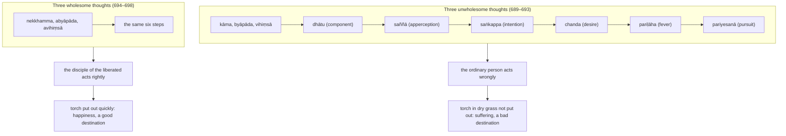

import { Tabs, TabItem } from '@astrojs/starlight/components';

Original text: [12S2/3.2.2 Sanidānasutta 689–699](https://tipitaka2500.github.io/tipitaka/12S2/3/3.2/3.2.2.html#689) in the [World Tipitaka Edition](https://tipitaka2500.github.io)

## Summary

At Sāvatthī the Bhagavā teaches that the thoughts of sensual desire, ill will and harming arise with a source, not without one: from each component comes an apperception, then an intention, a desire, a fever and a pursuit, in which the unlearned ordinary person acts wrongly by body, speech and mind. The thoughts of renunciation, goodwill and not harming arise in the same way, and in their pursuit the learned disciple of the liberated acts rightly. A burning grass torch dropped in dry grass and not quickly put out shows what comes of leaving an unbalanced apperception unchecked.

## Diagram

## Text

<Tabs syncKey="paliquote">
<TabItem label="My Translation">
(96.)

689\. [The Bhagavā] was dwelling at Sāvatthī. “With a source, Bhikkhave, the thought of sensual desire arises, not without a source; with a source the thought of ill will arises, not without a source; with a source the thought of harming arises, not without a source.

690\. And how, Bhikkhave, does the thought of sensual desire arise with a source, not without a source; how does the thought of ill will arise with a source, not without a source; how does the thought of harming arise with a source, not without a source? Dependent on the `kāmadhātu` (component of sensual desire), Bhikkhave, the apperception of sensual desire arises; dependent on the apperception of sensual desire, the intention of sensual desire arises; dependent on the intention of sensual desire, the desire for sensual pleasure arises; dependent on the desire for sensual pleasure, the fever for sensual pleasure arises; dependent on the fever for sensual pleasure, the pursuit of sensual pleasure arises. Pursuing the pursuit of sensual pleasure, Bhikkhave, an unlearned `puthujjana` (ordinary person) acts wrongly in three ways: by body, by speech, by mind.

691\. Dependent on the component of ill will, Bhikkhave, the apperception of ill will arises; dependent on the apperception of ill will, the intention of ill will arises … and so on … the desire for ill will … the fever for ill will … the pursuit of ill will … Pursuing the pursuit of ill will, Bhikkhave, an unlearned ordinary person acts wrongly in three ways: by body, by speech, by mind.

692\. Dependent on the component of harming, Bhikkhave, the apperception of harming arises; dependent on the apperception of harming, the intention of harming arises … and so on … the desire for harming … the fever for harming … the pursuit of harming … Pursuing the pursuit of harming, Bhikkhave, an unlearned ordinary person acts wrongly in three ways: by body, by speech, by mind.

693\. Suppose, Bhikkhave, a man were to throw down a burning grass torch in a dry grassland; and if he were not to put it out very quickly with hands and feet. Thus indeed, Bhikkhave, the living beings that live in the grass and wood would meet with misfortune and disaster. In the same way, Bhikkhave, whatever wanderer or brahmin does not very quickly give up an arisen unbalanced `saññā` (apperception), dispel it, make an end of it and cause it to go to annihilation, he dwells in suffering in this very life, with vexation, with despair, with fever; and with the breakup of the body, after death, a bad destination is to be expected.

694\. With a source, Bhikkhave, the thought of renunciation arises, not without a source; with a source the thought of goodwill arises, not without a source; with a source the thought of not harming arises, not without a source.

695\. And how, Bhikkhave, does the thought of renunciation arise with a source, not without a source; how does the thought of goodwill arise with a source, not without a source; how does the thought of not harming arise with a source, not without a source? Dependent on the component of renunciation, Bhikkhave, the apperception of renunciation arises; dependent on the apperception of renunciation, the intention of renunciation arises; dependent on the intention of renunciation, the desire for renunciation arises; dependent on the desire for renunciation, the fever for renunciation arises; dependent on the fever for renunciation, the pursuit of renunciation arises; pursuing the pursuit of renunciation, Bhikkhave, a learned `ariyasāvaka` (disciple of the liberated) acts rightly in three ways: by body, by speech, by mind.

696\. Dependent on the component of goodwill, Bhikkhave, the apperception of goodwill arises; dependent on the apperception of goodwill, the intention of goodwill arises … and so on … the desire for goodwill … the fever for goodwill … the pursuit of goodwill; pursuing the pursuit of goodwill, Bhikkhave, a learned disciple of the liberated acts rightly in three ways: by body, by speech, by mind.

697\. Dependent on the component of not harming, Bhikkhave, the apperception of not harming arises; dependent on the apperception of not harming, the intention of not harming arises; dependent on the intention of not harming, the desire for not harming arises; dependent on the desire for not harming, the fever for not harming arises; dependent on the fever for not harming, the pursuit of not harming arises; pursuing the pursuit of not harming, Bhikkhave, a learned disciple of the liberated acts rightly in three ways: by body, by speech, by mind.

698\. Suppose, Bhikkhave, a man were to throw down a burning grass torch in a dry grassland; and he were to put it out very quickly with hands and feet. Thus indeed, Bhikkhave, the living beings that live in the grass and wood would not meet with misfortune and disaster. In the same way, Bhikkhave, whatever wanderer or brahmin very quickly gives up an arisen unbalanced apperception, dispels it, makes an end of it and causes it to go to annihilation, he dwells in happiness in this very life, without vexation, without despair, without fever; and with the breakup of the body, after death, a good destination is to be expected.”

699\. The second [discourse of the chapter].
</TabItem>

<TabItem label="Pāḷi (Roman IAST)">
(96.)

689\. Sāvatthiyaṃ viharati. “Sanidānaṃ, bhikkhave, uppajjati kāmavitakko, no anidānaṃ; sanidānaṃ uppajjati byāpādavitakko, no anidānaṃ; sanidānaṃ uppajjati vihiṃsāvitakko, no anidānaṃ.

690\. Kathañca, bhikkhave, sanidānaṃ uppajjati kāmavitakko, no anidānaṃ; sanidānaṃ uppajjati byāpādavitakko, no anidānaṃ; sanidānaṃ uppajjati vihiṃsāvitakko, no anidānaṃ? Kāmadhātuṃ, bhikkhave, paṭicca uppajjati kāmasaññā, kāmasaññaṃ paṭicca uppajjati kāmasaṅkappo, kāmasaṅkappaṃ paṭicca uppajjati kāmacchando, kāmacchandaṃ paṭicca uppajjati kāmapariḷāho, kāmapariḷāhaṃ paṭicca uppajjati kāmapariyesanā. Kāmapariyesanaṃ, bhikkhave, pariyesamāno assutavā puthujjano tīhi ṭhānehi micchā paṭipajjati— kāyena, vācāya, manasā.

691\. Byāpādadhātuṃ, bhikkhave, paṭicca uppajjati byāpādasaññā, byāpādasaññaṃ paṭicca uppajjati byāpādasaṅkappo…pe… byāpādacchando… byāpādapariḷāho… byāpādapariyesanā… byāpādapariyesanaṃ, bhikkhave, pariyesamāno assutavā puthujjano tīhi ṭhānehi micchā paṭipajjati— kāyena, vācāya, manasā.

692\. Vihiṃsādhātuṃ, bhikkhave, paṭicca uppajjati vihiṃsāsaññā; vihiṃsāsaññaṃ paṭicca uppajjati vihiṃsāsaṅkappo…pe… vihiṃsāchando… vihiṃsāpariḷāho… vihiṃsāpariyesanā… vihiṃsāpariyesanaṃ, bhikkhave, pariyesamāno assutavā puthujjano tīhi ṭhānehi micchā paṭipajjati— kāyena, vācāya, manasā.

693\. Seyyathāpi, bhikkhave, puriso ādittaṃ tiṇukkaṃ sukkhe tiṇadāye nikkhipeyya; no ce hatthehi ca pādehi ca khippameva nibbāpeyya. Evañhi, bhikkhave, ye tiṇakaṭṭhanissitā pāṇā te anayabyasanaṃ āpajjeyyuṃ. Evameva kho, bhikkhave, yo hi koci samaṇo vā brāhmaṇo vā uppannaṃ visamagataṃ saññaṃ na khippameva pajahati vinodeti byantīkaroti anabhāvaṃ gameti, so diṭṭhe ceva dhamme dukkhaṃ viharati savighātaṃ saupāyāsaṃ sapariḷāhaṃ; kāyassa ca bhedā paraṃ maraṇā duggati pāṭikaṅkhā.

694\. Sanidānaṃ, bhikkhave, uppajjati nekkhammavitakko, no anidānaṃ; sanidānaṃ uppajjati abyāpādavitakko, no anidānaṃ; sanidānaṃ uppajjati avihiṃsāvitakko, no anidānaṃ.

695\. Kathañca, bhikkhave, sanidānaṃ uppajjati nekkhammavitakko, no anidānaṃ; sanidānaṃ uppajjati abyāpādavitakko, no anidānaṃ; sanidānaṃ uppajjati avihiṃsāvitakko, no anidānaṃ? Nekkhammadhātuṃ, bhikkhave, paṭicca uppajjati nekkhammasaññā, nekkhammasaññaṃ paṭicca uppajjati nekkhammasaṅkappo, nekkhammasaṅkappaṃ paṭicca uppajjati nekkhammacchando, nekkhammacchandaṃ paṭicca uppajjati nekkhammapariḷāho, nekkhammapariḷāhaṃ paṭicca uppajjati nekkhammapariyesanā; nekkhammapariyesanaṃ, bhikkhave, pariyesamāno sutavā ariyasāvako tīhi ṭhānehi sammā paṭipajjati— kāyena, vācāya, manasā.

696\. Abyāpādadhātuṃ, bhikkhave, paṭicca uppajjati abyāpādasaññā, abyāpādasaññaṃ paṭicca uppajjati abyāpādasaṅkappo…pe… abyāpādacchando… abyāpādapariḷāho… abyāpādapariyesanā, abyāpādapariyesanaṃ, bhikkhave, pariyesamāno sutavā ariyasāvako tīhi ṭhānehi sammā paṭipajjati— kāyena, vācāya, manasā.

697\. Avihiṃsādhātuṃ, bhikkhave, paṭicca uppajjati avihiṃsāsaññā, avihiṃsāsaññaṃ paṭicca uppajjati avihiṃsāsaṅkappo, avihiṃsāsaṅkappaṃ paṭicca uppajjati avihiṃsāchando, avihiṃsāchandaṃ paṭicca uppajjati avihiṃsāpariḷāho, avihiṃsāpariḷāhaṃ paṭicca uppajjati avihiṃsāpariyesanā; avihiṃsāpariyesanaṃ, bhikkhave, pariyesamāno sutavā ariyasāvako tīhi ṭhānehi sammā paṭipajjati— kāyena, vācāya, manasā.

698\. Seyyathāpi, bhikkhave, puriso ādittaṃ tiṇukkaṃ sukkhe tiṇadāye nikkhipeyya; tamenaṃ hatthehi ca pādehi ca khippameva nibbāpeyya. Evañhi, bhikkhave, ye tiṇakaṭṭhanissitā pāṇā te na anayabyasanaṃ āpajjeyyuṃ. Evameva kho, bhikkhave, yo hi koci samaṇo vā brāhmaṇo vā uppannaṃ visamagataṃ saññaṃ khippameva pajahati vinodeti byantīkaroti anabhāvaṃ gameti, so diṭṭhe ceva dhamme sukhaṃ viharati avighātaṃ anupāyāsaṃ apariḷāhaṃ; kāyassa ca bhedā paraṃ maraṇā sugati pāṭikaṅkhā”ti.

699\. Dutiyaṃ.
</TabItem>

<TabItem label="Pāḷi (Brahmi)">
(96.)

689\. 𑀲𑀸𑀯𑀢𑁆𑀣𑀺𑀬𑀁 𑀯𑀺𑀳𑀭𑀢𑀺. “𑀲𑀦𑀺𑀤𑀸𑀦𑀁, 𑀪𑀺𑀓𑁆𑀔𑀯𑁂, 𑀉𑀧𑁆𑀧𑀚𑁆𑀚𑀢𑀺 𑀓𑀸𑀫𑀯𑀺𑀢𑀓𑁆𑀓𑁄, 𑀦𑁄 𑀅𑀦𑀺𑀤𑀸𑀦𑀁; 𑀲𑀦𑀺𑀤𑀸𑀦𑀁 𑀉𑀧𑁆𑀧𑀚𑁆𑀚𑀢𑀺 𑀩𑁆𑀬𑀸𑀧𑀸𑀤𑀯𑀺𑀢𑀓𑁆𑀓𑁄, 𑀦𑁄 𑀅𑀦𑀺𑀤𑀸𑀦𑀁; 𑀲𑀦𑀺𑀤𑀸𑀦𑀁 𑀉𑀧𑁆𑀧𑀚𑁆𑀚𑀢𑀺 𑀯𑀺𑀳𑀺𑀁𑀲𑀸𑀯𑀺𑀢𑀓𑁆𑀓𑁄, 𑀦𑁄 𑀅𑀦𑀺𑀤𑀸𑀦𑀁.

690\. 𑀓𑀣𑀜𑁆𑀘, 𑀪𑀺𑀓𑁆𑀔𑀯𑁂, 𑀲𑀦𑀺𑀤𑀸𑀦𑀁 𑀉𑀧𑁆𑀧𑀚𑁆𑀚𑀢𑀺 𑀓𑀸𑀫𑀯𑀺𑀢𑀓𑁆𑀓𑁄, 𑀦𑁄 𑀅𑀦𑀺𑀤𑀸𑀦𑀁; 𑀲𑀦𑀺𑀤𑀸𑀦𑀁 𑀉𑀧𑁆𑀧𑀚𑁆𑀚𑀢𑀺 𑀩𑁆𑀬𑀸𑀧𑀸𑀤𑀯𑀺𑀢𑀓𑁆𑀓𑁄, 𑀦𑁄 𑀅𑀦𑀺𑀤𑀸𑀦𑀁; 𑀲𑀦𑀺𑀤𑀸𑀦𑀁 𑀉𑀧𑁆𑀧𑀚𑁆𑀚𑀢𑀺 𑀯𑀺𑀳𑀺𑀁𑀲𑀸𑀯𑀺𑀢𑀓𑁆𑀓𑁄, 𑀦𑁄 𑀅𑀦𑀺𑀤𑀸𑀦𑀁? 𑀓𑀸𑀫𑀥𑀸𑀢𑀼𑀁, 𑀪𑀺𑀓𑁆𑀔𑀯𑁂, 𑀧𑀝𑀺𑀘𑁆𑀘 𑀉𑀧𑁆𑀧𑀚𑁆𑀚𑀢𑀺 𑀓𑀸𑀫𑀲𑀜𑁆𑀜𑀸, 𑀓𑀸𑀫𑀲𑀜𑁆𑀜𑀁 𑀧𑀝𑀺𑀘𑁆𑀘 𑀉𑀧𑁆𑀧𑀚𑁆𑀚𑀢𑀺 𑀓𑀸𑀫𑀲𑀗𑁆𑀓𑀧𑁆𑀧𑁄, 𑀓𑀸𑀫𑀲𑀗𑁆𑀓𑀧𑁆𑀧𑀁 𑀧𑀝𑀺𑀘𑁆𑀘 𑀉𑀧𑁆𑀧𑀚𑁆𑀚𑀢𑀺 𑀓𑀸𑀫𑀘𑁆𑀙𑀦𑁆𑀤𑁄, 𑀓𑀸𑀫𑀘𑁆𑀙𑀦𑁆𑀤𑀁 𑀧𑀝𑀺𑀘𑁆𑀘 𑀉𑀧𑁆𑀧𑀚𑁆𑀚𑀢𑀺 𑀓𑀸𑀫𑀧𑀭𑀺𑀍𑀆𑀳𑁄, 𑀓𑀸𑀫𑀧𑀭𑀺𑀍𑀆𑀳𑀁 𑀧𑀝𑀺𑀘𑁆𑀘 𑀉𑀧𑁆𑀧𑀚𑁆𑀚𑀢𑀺 𑀓𑀸𑀫𑀧𑀭𑀺𑀬𑁂𑀲𑀦𑀸. 𑀓𑀸𑀫𑀧𑀭𑀺𑀬𑁂𑀲𑀦𑀁, 𑀪𑀺𑀓𑁆𑀔𑀯𑁂, 𑀧𑀭𑀺𑀬𑁂𑀲𑀫𑀸𑀦𑁄 𑀅𑀲𑁆𑀲𑀼𑀢𑀯𑀸 𑀧𑀼𑀣𑀼𑀚𑁆𑀚𑀦𑁄 𑀢𑀻𑀳𑀺 𑀞𑀸𑀦𑁂𑀳𑀺 𑀫𑀺𑀘𑁆𑀙𑀸 𑀧𑀝𑀺𑀧𑀚𑁆𑀚𑀢𑀺— 𑀓𑀸𑀬𑁂𑀦, 𑀯𑀸𑀘𑀸𑀬, 𑀫𑀦𑀲𑀸.

691\. 𑀩𑁆𑀬𑀸𑀧𑀸𑀤𑀥𑀸𑀢𑀼𑀁, 𑀪𑀺𑀓𑁆𑀔𑀯𑁂, 𑀧𑀝𑀺𑀘𑁆𑀘 𑀉𑀧𑁆𑀧𑀚𑁆𑀚𑀢𑀺 𑀩𑁆𑀬𑀸𑀧𑀸𑀤𑀲𑀜𑁆𑀜𑀸, 𑀩𑁆𑀬𑀸𑀧𑀸𑀤𑀲𑀜𑁆𑀜𑀁 𑀧𑀝𑀺𑀘𑁆𑀘 𑀉𑀧𑁆𑀧𑀚𑁆𑀚𑀢𑀺 𑀩𑁆𑀬𑀸𑀧𑀸𑀤𑀲𑀗𑁆𑀓𑀧𑁆𑀧𑁄…𑀧𑁂… 𑀩𑁆𑀬𑀸𑀧𑀸𑀤𑀘𑁆𑀙𑀦𑁆𑀤𑁄… 𑀩𑁆𑀬𑀸𑀧𑀸𑀤𑀧𑀭𑀺𑀍𑀆𑀳𑁄… 𑀩𑁆𑀬𑀸𑀧𑀸𑀤𑀧𑀭𑀺𑀬𑁂𑀲𑀦𑀸… 𑀩𑁆𑀬𑀸𑀧𑀸𑀤𑀧𑀭𑀺𑀬𑁂𑀲𑀦𑀁, 𑀪𑀺𑀓𑁆𑀔𑀯𑁂, 𑀧𑀭𑀺𑀬𑁂𑀲𑀫𑀸𑀦𑁄 𑀅𑀲𑁆𑀲𑀼𑀢𑀯𑀸 𑀧𑀼𑀣𑀼𑀚𑁆𑀚𑀦𑁄 𑀢𑀻𑀳𑀺 𑀞𑀸𑀦𑁂𑀳𑀺 𑀫𑀺𑀘𑁆𑀙𑀸 𑀧𑀝𑀺𑀧𑀚𑁆𑀚𑀢𑀺— 𑀓𑀸𑀬𑁂𑀦, 𑀯𑀸𑀘𑀸𑀬, 𑀫𑀦𑀲𑀸.

692\. 𑀯𑀺𑀳𑀺𑀁𑀲𑀸𑀥𑀸𑀢𑀼𑀁, 𑀪𑀺𑀓𑁆𑀔𑀯𑁂, 𑀧𑀝𑀺𑀘𑁆𑀘 𑀉𑀧𑁆𑀧𑀚𑁆𑀚𑀢𑀺 𑀯𑀺𑀳𑀺𑀁𑀲𑀸𑀲𑀜𑁆𑀜𑀸; 𑀯𑀺𑀳𑀺𑀁𑀲𑀸𑀲𑀜𑁆𑀜𑀁 𑀧𑀝𑀺𑀘𑁆𑀘 𑀉𑀧𑁆𑀧𑀚𑁆𑀚𑀢𑀺 𑀯𑀺𑀳𑀺𑀁𑀲𑀸𑀲𑀗𑁆𑀓𑀧𑁆𑀧𑁄…𑀧𑁂… 𑀯𑀺𑀳𑀺𑀁𑀲𑀸𑀙𑀦𑁆𑀤𑁄… 𑀯𑀺𑀳𑀺𑀁𑀲𑀸𑀧𑀭𑀺𑀍𑀆𑀳𑁄… 𑀯𑀺𑀳𑀺𑀁𑀲𑀸𑀧𑀭𑀺𑀬𑁂𑀲𑀦𑀸… 𑀯𑀺𑀳𑀺𑀁𑀲𑀸𑀧𑀭𑀺𑀬𑁂𑀲𑀦𑀁, 𑀪𑀺𑀓𑁆𑀔𑀯𑁂, 𑀧𑀭𑀺𑀬𑁂𑀲𑀫𑀸𑀦𑁄 𑀅𑀲𑁆𑀲𑀼𑀢𑀯𑀸 𑀧𑀼𑀣𑀼𑀚𑁆𑀚𑀦𑁄 𑀢𑀻𑀳𑀺 𑀞𑀸𑀦𑁂𑀳𑀺 𑀫𑀺𑀘𑁆𑀙𑀸 𑀧𑀝𑀺𑀧𑀚𑁆𑀚𑀢𑀺— 𑀓𑀸𑀬𑁂𑀦, 𑀯𑀸𑀘𑀸𑀬, 𑀫𑀦𑀲𑀸.

693\. 𑀲𑁂𑀬𑁆𑀬𑀣𑀸𑀧𑀺, 𑀪𑀺𑀓𑁆𑀔𑀯𑁂, 𑀧𑀼𑀭𑀺𑀲𑁄 𑀆𑀤𑀺𑀢𑁆𑀢𑀁 𑀢𑀺𑀡𑀼𑀓𑁆𑀓𑀁 𑀲𑀼𑀓𑁆𑀔𑁂 𑀢𑀺𑀡𑀤𑀸𑀬𑁂 𑀦𑀺𑀓𑁆𑀔𑀺𑀧𑁂𑀬𑁆𑀬; 𑀦𑁄 𑀘𑁂 𑀳𑀢𑁆𑀣𑁂𑀳𑀺 𑀘 𑀧𑀸𑀤𑁂𑀳𑀺 𑀘 𑀔𑀺𑀧𑁆𑀧𑀫𑁂𑀯 𑀦𑀺𑀩𑁆𑀩𑀸𑀧𑁂𑀬𑁆𑀬. 𑀏𑀯𑀜𑁆𑀳𑀺, 𑀪𑀺𑀓𑁆𑀔𑀯𑁂, 𑀬𑁂 𑀢𑀺𑀡𑀓𑀝𑁆𑀞𑀦𑀺𑀲𑁆𑀲𑀺𑀢𑀸 𑀧𑀸𑀡𑀸 𑀢𑁂 𑀅𑀦𑀬𑀩𑁆𑀬𑀲𑀦𑀁 𑀆𑀧𑀚𑁆𑀚𑁂𑀬𑁆𑀬𑀼𑀁. 𑀏𑀯𑀫𑁂𑀯 𑀔𑁄, 𑀪𑀺𑀓𑁆𑀔𑀯𑁂, 𑀬𑁄 𑀳𑀺 𑀓𑁄𑀘𑀺 𑀲𑀫𑀡𑁄 𑀯𑀸 𑀩𑁆𑀭𑀸𑀳𑁆𑀫𑀡𑁄 𑀯𑀸 𑀉𑀧𑁆𑀧𑀦𑁆𑀦𑀁 𑀯𑀺𑀲𑀫𑀕𑀢𑀁 𑀲𑀜𑁆𑀜𑀁 𑀦 𑀔𑀺𑀧𑁆𑀧𑀫𑁂𑀯 𑀧𑀚𑀳𑀢𑀺 𑀯𑀺𑀦𑁄𑀤𑁂𑀢𑀺 𑀩𑁆𑀬𑀦𑁆𑀢𑀻𑀓𑀭𑁄𑀢𑀺 𑀅𑀦𑀪𑀸𑀯𑀁 𑀕𑀫𑁂𑀢𑀺, 𑀲𑁄 𑀤𑀺𑀝𑁆𑀞𑁂 𑀘𑁂𑀯 𑀥𑀫𑁆𑀫𑁂 𑀤𑀼𑀓𑁆𑀔𑀁 𑀯𑀺𑀳𑀭𑀢𑀺 𑀲𑀯𑀺𑀖𑀸𑀢𑀁 𑀲𑁅𑀧𑀸𑀬𑀸𑀲𑀁 𑀲𑀧𑀭𑀺𑀍𑀆𑀳𑀁; 𑀓𑀸𑀬𑀲𑁆𑀲 𑀘 𑀪𑁂𑀤𑀸 𑀧𑀭𑀁 𑀫𑀭𑀡𑀸 𑀤𑀼𑀕𑁆𑀕𑀢𑀺 𑀧𑀸𑀝𑀺𑀓𑀗𑁆𑀔𑀸.

694\. 𑀲𑀦𑀺𑀤𑀸𑀦𑀁, 𑀪𑀺𑀓𑁆𑀔𑀯𑁂, 𑀉𑀧𑁆𑀧𑀚𑁆𑀚𑀢𑀺 𑀦𑁂𑀓𑁆𑀔𑀫𑁆𑀫𑀯𑀺𑀢𑀓𑁆𑀓𑁄, 𑀦𑁄 𑀅𑀦𑀺𑀤𑀸𑀦𑀁; 𑀲𑀦𑀺𑀤𑀸𑀦𑀁 𑀉𑀧𑁆𑀧𑀚𑁆𑀚𑀢𑀺 𑀅𑀩𑁆𑀬𑀸𑀧𑀸𑀤𑀯𑀺𑀢𑀓𑁆𑀓𑁄, 𑀦𑁄 𑀅𑀦𑀺𑀤𑀸𑀦𑀁; 𑀲𑀦𑀺𑀤𑀸𑀦𑀁 𑀉𑀧𑁆𑀧𑀚𑁆𑀚𑀢𑀺 𑀅𑀯𑀺𑀳𑀺𑀁𑀲𑀸𑀯𑀺𑀢𑀓𑁆𑀓𑁄, 𑀦𑁄 𑀅𑀦𑀺𑀤𑀸𑀦𑀁.

695\. 𑀓𑀣𑀜𑁆𑀘, 𑀪𑀺𑀓𑁆𑀔𑀯𑁂, 𑀲𑀦𑀺𑀤𑀸𑀦𑀁 𑀉𑀧𑁆𑀧𑀚𑁆𑀚𑀢𑀺 𑀦𑁂𑀓𑁆𑀔𑀫𑁆𑀫𑀯𑀺𑀢𑀓𑁆𑀓𑁄, 𑀦𑁄 𑀅𑀦𑀺𑀤𑀸𑀦𑀁; 𑀲𑀦𑀺𑀤𑀸𑀦𑀁 𑀉𑀧𑁆𑀧𑀚𑁆𑀚𑀢𑀺 𑀅𑀩𑁆𑀬𑀸𑀧𑀸𑀤𑀯𑀺𑀢𑀓𑁆𑀓𑁄, 𑀦𑁄 𑀅𑀦𑀺𑀤𑀸𑀦𑀁; 𑀲𑀦𑀺𑀤𑀸𑀦𑀁 𑀉𑀧𑁆𑀧𑀚𑁆𑀚𑀢𑀺 𑀅𑀯𑀺𑀳𑀺𑀁𑀲𑀸𑀯𑀺𑀢𑀓𑁆𑀓𑁄, 𑀦𑁄 𑀅𑀦𑀺𑀤𑀸𑀦𑀁? 𑀦𑁂𑀓𑁆𑀔𑀫𑁆𑀫𑀥𑀸𑀢𑀼𑀁, 𑀪𑀺𑀓𑁆𑀔𑀯𑁂, 𑀧𑀝𑀺𑀘𑁆𑀘 𑀉𑀧𑁆𑀧𑀚𑁆𑀚𑀢𑀺 𑀦𑁂𑀓𑁆𑀔𑀫𑁆𑀫𑀲𑀜𑁆𑀜𑀸, 𑀦𑁂𑀓𑁆𑀔𑀫𑁆𑀫𑀲𑀜𑁆𑀜𑀁 𑀧𑀝𑀺𑀘𑁆𑀘 𑀉𑀧𑁆𑀧𑀚𑁆𑀚𑀢𑀺 𑀦𑁂𑀓𑁆𑀔𑀫𑁆𑀫𑀲𑀗𑁆𑀓𑀧𑁆𑀧𑁄, 𑀦𑁂𑀓𑁆𑀔𑀫𑁆𑀫𑀲𑀗𑁆𑀓𑀧𑁆𑀧𑀁 𑀧𑀝𑀺𑀘𑁆𑀘 𑀉𑀧𑁆𑀧𑀚𑁆𑀚𑀢𑀺 𑀦𑁂𑀓𑁆𑀔𑀫𑁆𑀫𑀘𑁆𑀙𑀦𑁆𑀤𑁄, 𑀦𑁂𑀓𑁆𑀔𑀫𑁆𑀫𑀘𑁆𑀙𑀦𑁆𑀤𑀁 𑀧𑀝𑀺𑀘𑁆𑀘 𑀉𑀧𑁆𑀧𑀚𑁆𑀚𑀢𑀺 𑀦𑁂𑀓𑁆𑀔𑀫𑁆𑀫𑀧𑀭𑀺𑀍𑀆𑀳𑁄, 𑀦𑁂𑀓𑁆𑀔𑀫𑁆𑀫𑀧𑀭𑀺𑀍𑀆𑀳𑀁 𑀧𑀝𑀺𑀘𑁆𑀘 𑀉𑀧𑁆𑀧𑀚𑁆𑀚𑀢𑀺 𑀦𑁂𑀓𑁆𑀔𑀫𑁆𑀫𑀧𑀭𑀺𑀬𑁂𑀲𑀦𑀸; 𑀦𑁂𑀓𑁆𑀔𑀫𑁆𑀫𑀧𑀭𑀺𑀬𑁂𑀲𑀦𑀁, 𑀪𑀺𑀓𑁆𑀔𑀯𑁂, 𑀧𑀭𑀺𑀬𑁂𑀲𑀫𑀸𑀦𑁄 𑀲𑀼𑀢𑀯𑀸 𑀅𑀭𑀺𑀬𑀲𑀸𑀯𑀓𑁄 𑀢𑀻𑀳𑀺 𑀞𑀸𑀦𑁂𑀳𑀺 𑀲𑀫𑁆𑀫𑀸 𑀧𑀝𑀺𑀧𑀚𑁆𑀚𑀢𑀺— 𑀓𑀸𑀬𑁂𑀦, 𑀯𑀸𑀘𑀸𑀬, 𑀫𑀦𑀲𑀸.

696\. 𑀅𑀩𑁆𑀬𑀸𑀧𑀸𑀤𑀥𑀸𑀢𑀼𑀁, 𑀪𑀺𑀓𑁆𑀔𑀯𑁂, 𑀧𑀝𑀺𑀘𑁆𑀘 𑀉𑀧𑁆𑀧𑀚𑁆𑀚𑀢𑀺 𑀅𑀩𑁆𑀬𑀸𑀧𑀸𑀤𑀲𑀜𑁆𑀜𑀸, 𑀅𑀩𑁆𑀬𑀸𑀧𑀸𑀤𑀲𑀜𑁆𑀜𑀁 𑀧𑀝𑀺𑀘𑁆𑀘 𑀉𑀧𑁆𑀧𑀚𑁆𑀚𑀢𑀺 𑀅𑀩𑁆𑀬𑀸𑀧𑀸𑀤𑀲𑀗𑁆𑀓𑀧𑁆𑀧𑁄…𑀧𑁂… 𑀅𑀩𑁆𑀬𑀸𑀧𑀸𑀤𑀘𑁆𑀙𑀦𑁆𑀤𑁄… 𑀅𑀩𑁆𑀬𑀸𑀧𑀸𑀤𑀧𑀭𑀺𑀍𑀆𑀳𑁄… 𑀅𑀩𑁆𑀬𑀸𑀧𑀸𑀤𑀧𑀭𑀺𑀬𑁂𑀲𑀦𑀸, 𑀅𑀩𑁆𑀬𑀸𑀧𑀸𑀤𑀧𑀭𑀺𑀬𑁂𑀲𑀦𑀁, 𑀪𑀺𑀓𑁆𑀔𑀯𑁂, 𑀧𑀭𑀺𑀬𑁂𑀲𑀫𑀸𑀦𑁄 𑀲𑀼𑀢𑀯𑀸 𑀅𑀭𑀺𑀬𑀲𑀸𑀯𑀓𑁄 𑀢𑀻𑀳𑀺 𑀞𑀸𑀦𑁂𑀳𑀺 𑀲𑀫𑁆𑀫𑀸 𑀧𑀝𑀺𑀧𑀚𑁆𑀚𑀢𑀺— 𑀓𑀸𑀬𑁂𑀦, 𑀯𑀸𑀘𑀸𑀬, 𑀫𑀦𑀲𑀸.

697\. 𑀅𑀯𑀺𑀳𑀺𑀁𑀲𑀸𑀥𑀸𑀢𑀼𑀁, 𑀪𑀺𑀓𑁆𑀔𑀯𑁂, 𑀧𑀝𑀺𑀘𑁆𑀘 𑀉𑀧𑁆𑀧𑀚𑁆𑀚𑀢𑀺 𑀅𑀯𑀺𑀳𑀺𑀁𑀲𑀸𑀲𑀜𑁆𑀜𑀸, 𑀅𑀯𑀺𑀳𑀺𑀁𑀲𑀸𑀲𑀜𑁆𑀜𑀁 𑀧𑀝𑀺𑀘𑁆𑀘 𑀉𑀧𑁆𑀧𑀚𑁆𑀚𑀢𑀺 𑀅𑀯𑀺𑀳𑀺𑀁𑀲𑀸𑀲𑀗𑁆𑀓𑀧𑁆𑀧𑁄, 𑀅𑀯𑀺𑀳𑀺𑀁𑀲𑀸𑀲𑀗𑁆𑀓𑀧𑁆𑀧𑀁 𑀧𑀝𑀺𑀘𑁆𑀘 𑀉𑀧𑁆𑀧𑀚𑁆𑀚𑀢𑀺 𑀅𑀯𑀺𑀳𑀺𑀁𑀲𑀸𑀙𑀦𑁆𑀤𑁄, 𑀅𑀯𑀺𑀳𑀺𑀁𑀲𑀸𑀙𑀦𑁆𑀤𑀁 𑀧𑀝𑀺𑀘𑁆𑀘 𑀉𑀧𑁆𑀧𑀚𑁆𑀚𑀢𑀺 𑀅𑀯𑀺𑀳𑀺𑀁𑀲𑀸𑀧𑀭𑀺𑀍𑀆𑀳𑁄, 𑀅𑀯𑀺𑀳𑀺𑀁𑀲𑀸𑀧𑀭𑀺𑀍𑀆𑀳𑀁 𑀧𑀝𑀺𑀘𑁆𑀘 𑀉𑀧𑁆𑀧𑀚𑁆𑀚𑀢𑀺 𑀅𑀯𑀺𑀳𑀺𑀁𑀲𑀸𑀧𑀭𑀺𑀬𑁂𑀲𑀦𑀸; 𑀅𑀯𑀺𑀳𑀺𑀁𑀲𑀸𑀧𑀭𑀺𑀬𑁂𑀲𑀦𑀁, 𑀪𑀺𑀓𑁆𑀔𑀯𑁂, 𑀧𑀭𑀺𑀬𑁂𑀲𑀫𑀸𑀦𑁄 𑀲𑀼𑀢𑀯𑀸 𑀅𑀭𑀺𑀬𑀲𑀸𑀯𑀓𑁄 𑀢𑀻𑀳𑀺 𑀞𑀸𑀦𑁂𑀳𑀺 𑀲𑀫𑁆𑀫𑀸 𑀧𑀝𑀺𑀧𑀚𑁆𑀚𑀢𑀺— 𑀓𑀸𑀬𑁂𑀦, 𑀯𑀸𑀘𑀸𑀬, 𑀫𑀦𑀲𑀸.

698\. 𑀲𑁂𑀬𑁆𑀬𑀣𑀸𑀧𑀺, 𑀪𑀺𑀓𑁆𑀔𑀯𑁂, 𑀧𑀼𑀭𑀺𑀲𑁄 𑀆𑀤𑀺𑀢𑁆𑀢𑀁 𑀢𑀺𑀡𑀼𑀓𑁆𑀓𑀁 𑀲𑀼𑀓𑁆𑀔𑁂 𑀢𑀺𑀡𑀤𑀸𑀬𑁂 𑀦𑀺𑀓𑁆𑀔𑀺𑀧𑁂𑀬𑁆𑀬; 𑀢𑀫𑁂𑀦𑀁 𑀳𑀢𑁆𑀣𑁂𑀳𑀺 𑀘 𑀧𑀸𑀤𑁂𑀳𑀺 𑀘 𑀔𑀺𑀧𑁆𑀧𑀫𑁂𑀯 𑀦𑀺𑀩𑁆𑀩𑀸𑀧𑁂𑀬𑁆𑀬. 𑀏𑀯𑀜𑁆𑀳𑀺, 𑀪𑀺𑀓𑁆𑀔𑀯𑁂, 𑀬𑁂 𑀢𑀺𑀡𑀓𑀝𑁆𑀞𑀦𑀺𑀲𑁆𑀲𑀺𑀢𑀸 𑀧𑀸𑀡𑀸 𑀢𑁂 𑀦 𑀅𑀦𑀬𑀩𑁆𑀬𑀲𑀦𑀁 𑀆𑀧𑀚𑁆𑀚𑁂𑀬𑁆𑀬𑀼𑀁. 𑀏𑀯𑀫𑁂𑀯 𑀔𑁄, 𑀪𑀺𑀓𑁆𑀔𑀯𑁂, 𑀬𑁄 𑀳𑀺 𑀓𑁄𑀘𑀺 𑀲𑀫𑀡𑁄 𑀯𑀸 𑀩𑁆𑀭𑀸𑀳𑁆𑀫𑀡𑁄 𑀯𑀸 𑀉𑀧𑁆𑀧𑀦𑁆𑀦𑀁 𑀯𑀺𑀲𑀫𑀕𑀢𑀁 𑀲𑀜𑁆𑀜𑀁 𑀔𑀺𑀧𑁆𑀧𑀫𑁂𑀯 𑀧𑀚𑀳𑀢𑀺 𑀯𑀺𑀦𑁄𑀤𑁂𑀢𑀺 𑀩𑁆𑀬𑀦𑁆𑀢𑀻𑀓𑀭𑁄𑀢𑀺 𑀅𑀦𑀪𑀸𑀯𑀁 𑀕𑀫𑁂𑀢𑀺, 𑀲𑁄 𑀤𑀺𑀝𑁆𑀞𑁂 𑀘𑁂𑀯 𑀥𑀫𑁆𑀫𑁂 𑀲𑀼𑀔𑀁 𑀯𑀺𑀳𑀭𑀢𑀺 𑀅𑀯𑀺𑀖𑀸𑀢𑀁 𑀅𑀦𑀼𑀧𑀸𑀬𑀸𑀲𑀁 𑀅𑀧𑀭𑀺𑀍𑀆𑀳𑀁; 𑀓𑀸𑀬𑀲𑁆𑀲 𑀘 𑀪𑁂𑀤𑀸 𑀧𑀭𑀁 𑀫𑀭𑀡𑀸 𑀲𑀼𑀕𑀢𑀺 𑀧𑀸𑀝𑀺𑀓𑀗𑁆𑀔𑀸”𑀢𑀺.

699\. 𑀤𑀼𑀢𑀺𑀬𑀁.
</TabItem>

<TabItem label="Interlinear">
(96.)

[689](https://tipitaka2500.github.io/tipitaka/12S2/3/3.2/3.2.2.html#689) Sāvatthiyaṃ viharati.  
🚺⨀⑦(sāvatthī) 🟢⨀🤟▶️(viharati)  
at Sāvatthī | dwells  
[The Bhagavā] was dwelling at Sāvatthī.

“Sanidānaṃ, bhikkhave, uppajjati kāmavitakko, no anidānaṃ;  
🚻⨀②(sanidāna) 🚹⨂⓪(bhikkhu) 🟢⨀🤟▶️(uppajjati) 🚹⨀①🆎(kāma+vitakka) ⏏️(no) 🚻⨀②(anidāna)  
with a source | Bhikkhave | arises | the thought of sensual desire | not | without a source  
“With a source, Bhikkhave, the thought of sensual desire arises, not without a source;

sanidānaṃ uppajjati byāpādavitakko, no anidānaṃ;  
🚻⨀②(sanidāna) 🟢⨀🤟▶️(uppajjati) 🚹⨀①🆎(byāpāda+vitakka) ⏏️(no) 🚻⨀②(anidāna)  
with a source | arises | the thought of ill will | not | without a source  
with a source the thought of ill will arises, not without a source;

sanidānaṃ uppajjati vihiṃsāvitakko, no anidānaṃ.  
🚻⨀②(sanidāna) 🟢⨀🤟▶️(uppajjati) 🚹⨀①🆎(vihiṃsā+vitakka) ⏏️(no) 🚻⨀②(anidāna)  
with a source | arises | the thought of harming | not | without a source  
with a source the thought of harming arises, not without a source.

[690](https://tipitaka2500.github.io/tipitaka/12S2/3/3.2/3.2.2.html#690) Kathañca, bhikkhave, sanidānaṃ uppajjati kāmavitakko, no anidānaṃ;  
⏏️(kathaṃ) ⏏️(ca) 🚹⨂⓪(bhikkhu) 🚻⨀②(sanidāna) 🟢⨀🤟▶️(uppajjati) 🚹⨀①🆎(kāma+vitakka) ⏏️(no) 🚻⨀②(anidāna)  
how | and | Bhikkhave | with a source | arises | the thought of sensual desire | not | without a source  
And how, Bhikkhave, does the thought of sensual desire arise with a source, not without a source;

sanidānaṃ uppajjati byāpādavitakko, no anidānaṃ;  
🚻⨀②(sanidāna) 🟢⨀🤟▶️(uppajjati) 🚹⨀①🆎(byāpāda+vitakka) ⏏️(no) 🚻⨀②(anidāna)  
with a source | arises | the thought of ill will | not | without a source  
how does the thought of ill will arise with a source, not without a source;

sanidānaṃ uppajjati vihiṃsāvitakko, no anidānaṃ?  
🚻⨀②(sanidāna) 🟢⨀🤟▶️(uppajjati) 🚹⨀①🆎(vihiṃsā+vitakka) ⏏️(no) 🚻⨀②(anidāna)  
with a source | arises | the thought of harming | not | without a source  
how does the thought of harming arise with a source, not without a source?

Kāmadhātuṃ, bhikkhave, paṭicca uppajjati kāmasaññā, kāmasaññaṃ paṭicca uppajjati kāmasaṅkappo, kāmasaṅkappaṃ paṭicca uppajjati kāmacchando, kāmacchandaṃ paṭicca uppajjati kāmapariḷāho, kāmapariḷāhaṃ paṭicca uppajjati kāmapariyesanā.  
🚺⨀②🆎(kāma+dhātu) 🚹⨂⓪(bhikkhu) 🔽(ya)(pacceti) 🟢⨀🤟▶️(uppajjati) 🚺⨀①🆎(kāma+saññā) 🚺⨀②🆎(kāma+saññā) 🔽(ya)(pacceti) 🟢⨀🤟▶️(uppajjati) 🚹⨀①🆎(kāma+saṅkappa) 🚹⨀②🆎(kāma+saṅkappa) 🔽(ya)(pacceti) 🟢⨀🤟▶️(uppajjati) 🚹⨀①🆎(kāma+chanda) 🚹⨀②🆎(kāma+chanda) 🔽(ya)(pacceti) 🟢⨀🤟▶️(uppajjati) 🚹⨀①🆎(kāma+pariḷāha) 🚹⨀②🆎(kāma+pariḷāha) 🔽(ya)(pacceti) 🟢⨀🤟▶️(uppajjati) 🚺⨀①🆎(kāma+pariyesanā)  
the component of sensual desire | Bhikkhave | dependent on | arises | the apperception of sensual desire | the apperception of sensual desire | dependent on | arises | the intention of sensual desire | the intention of sensual desire | dependent on | arises | the desire for sensual pleasure | the desire for sensual pleasure | dependent on | arises | the fever for sensual pleasure | the fever for sensual pleasure | dependent on | arises | the pursuit of sensual pleasure  
Dependent on the `kāmadhātu` (component of sensual desire), Bhikkhave, the apperception of sensual desire arises; dependent on the apperception of sensual desire, the intention of sensual desire arises; dependent on the intention of sensual desire, the desire for sensual pleasure arises; dependent on the desire for sensual pleasure, the fever for sensual pleasure arises; dependent on the fever for sensual pleasure, the pursuit of sensual pleasure arises.

Kāmapariyesanaṃ, bhikkhave, pariyesamāno assutavā puthujjano tīhi ṭhānehi micchā paṭipajjati— kāyena, vācāya, manasā.  
🚺⨀②🆎(kāma+pariyesanā) 🚹⨂⓪(bhikkhu) 🚹⨀①🔽(māna)(pariyesamāna) 🚹⨀①🆎(na+sutavant) 🚹⨀①🆎(puthu+jana) 🚻⨂③(ti) 🚻⨂③(ṭhāna) ⏏️(micchā) 🟢⨀🤟▶️(paṭipajjati) 🚹⨀③(kāya) 🚺⨀③(vācā) 🚹⨀③(mano)  
the pursuit of sensual pleasure | Bhikkhave | pursuing | unlearned | an ordinary person | in three | ways | wrongly | acts | by body | by speech | by mind  
Pursuing the pursuit of sensual pleasure, Bhikkhave, an unlearned `puthujjana` (ordinary person) acts wrongly in three ways: by body, by speech, by mind.

[691](https://tipitaka2500.github.io/tipitaka/12S2/3/3.2/3.2.2.html#691) Byāpādadhātuṃ, bhikkhave, paṭicca uppajjati byāpādasaññā, byāpādasaññaṃ paṭicca uppajjati byāpādasaṅkappo…pe… byāpādacchando… byāpādapariḷāho… byāpādapariyesanā… byāpādapariyesanaṃ, bhikkhave, pariyesamāno assutavā puthujjano tīhi ṭhānehi micchā paṭipajjati— kāyena, vācāya, manasā.  
🚺⨀②🆎(byāpāda+dhātu) 🚹⨂⓪(bhikkhu) 🔽(ya)(pacceti) 🟢⨀🤟▶️(uppajjati) 🚺⨀①🆎(byāpāda+saññā) 🚺⨀②🆎(byāpāda+saññā) 🔽(ya)(pacceti) 🟢⨀🤟▶️(uppajjati) 🚹⨀①🆎(byāpāda+saṅkappa) ⏏️(peyyāla) 🚹⨀①🆎(byāpāda+chanda) 🚹⨀①🆎(byāpāda+pariḷāha) 🚺⨀①🆎(byāpāda+pariyesanā) 🚺⨀②🆎(byāpāda+pariyesanā) 🚹⨂⓪(bhikkhu) 🚹⨀①🔽(māna)(pariyesamāna) 🚹⨀①🆎(na+sutavant) 🚹⨀①🆎(puthu+jana) 🚻⨂③(ti) 🚻⨂③(ṭhāna) ⏏️(micchā) 🟢⨀🤟▶️(paṭipajjati) 🚹⨀③(kāya) 🚺⨀③(vācā) 🚹⨀③(mano)  
the component of ill will | Bhikkhave | dependent on | arises | the apperception of ill will | the apperception of ill will | dependent on | arises | the intention of ill will | (and so on) | the desire for ill will | the fever for ill will | the pursuit of ill will | the pursuit of ill will | Bhikkhave | pursuing | unlearned | an ordinary person | in three | ways | wrongly | acts | by body | by speech | by mind  
Dependent on the component of ill will, Bhikkhave, the apperception of ill will arises; dependent on the apperception of ill will, the intention of ill will arises … and so on … the desire for ill will … the fever for ill will … the pursuit of ill will … Pursuing the pursuit of ill will, Bhikkhave, an unlearned ordinary person acts wrongly in three ways: by body, by speech, by mind.

[692](https://tipitaka2500.github.io/tipitaka/12S2/3/3.2/3.2.2.html#692) Vihiṃsādhātuṃ, bhikkhave, paṭicca uppajjati vihiṃsāsaññā;  
🚺⨀②🆎(vihiṃsā+dhātu) 🚹⨂⓪(bhikkhu) 🔽(ya)(pacceti) 🟢⨀🤟▶️(uppajjati) 🚺⨀①🆎(vihiṃsā+saññā)  
the component of harming | Bhikkhave | dependent on | arises | the apperception of harming  
Dependent on the component of harming, Bhikkhave, the apperception of harming arises;

vihiṃsāsaññaṃ paṭicca uppajjati vihiṃsāsaṅkappo…pe… vihiṃsāchando… vihiṃsāpariḷāho… vihiṃsāpariyesanā… vihiṃsāpariyesanaṃ, bhikkhave, pariyesamāno assutavā puthujjano tīhi ṭhānehi micchā paṭipajjati— kāyena, vācāya, manasā.  
🚺⨀②🆎(vihiṃsā+saññā) 🔽(ya)(pacceti) 🟢⨀🤟▶️(uppajjati) 🚹⨀①🆎(vihiṃsā+saṅkappa) ⏏️(peyyāla) 🚹⨀①🆎(vihiṃsā+chanda) 🚹⨀①🆎(vihiṃsā+pariḷāha) 🚺⨀①🆎(vihiṃsā+pariyesanā) 🚺⨀②🆎(vihiṃsā+pariyesanā) 🚹⨂⓪(bhikkhu) 🚹⨀①🔽(māna)(pariyesamāna) 🚹⨀①🆎(na+sutavant) 🚹⨀①🆎(puthu+jana) 🚻⨂③(ti) 🚻⨂③(ṭhāna) ⏏️(micchā) 🟢⨀🤟▶️(paṭipajjati) 🚹⨀③(kāya) 🚺⨀③(vācā) 🚹⨀③(mano)  
the apperception of harming | dependent on | arises | the intention of harming | (and so on) | the desire for harming | the fever for harming | the pursuit of harming | the pursuit of harming | Bhikkhave | pursuing | unlearned | an ordinary person | in three | ways | wrongly | acts | by body | by speech | by mind  
dependent on the apperception of harming, the intention of harming arises … and so on … the desire for harming … the fever for harming … the pursuit of harming … Pursuing the pursuit of harming, Bhikkhave, an unlearned ordinary person acts wrongly in three ways: by body, by speech, by mind.

[693](https://tipitaka2500.github.io/tipitaka/12S2/3/3.2/3.2.2.html#693) Seyyathāpi, bhikkhave, puriso ādittaṃ tiṇukkaṃ sukkhe tiṇadāye nikkhipeyya;  
⏏️(seyyathāpi) 🚹⨂⓪(bhikkhu) 🚹⨀①(purisa) 🚺⨀②🔽(ta)(āditta) 🚺⨀②🆎(tiṇa+ukkā) 🚹⨀⑦🔽(ta)(sukkha) 🚹⨀⑦🆎(tiṇa+dāya) 🟢⨀🤟⏯(nikkhipati)  
just as | Bhikkhave | a man | burning | a grass torch | in a dry | grassland | were to throw down  
Suppose, Bhikkhave, a man were to throw down a burning grass torch in a dry grassland;

no ce hatthehi ca pādehi ca khippameva nibbāpeyya.  
⏏️(no) ⏏️(ce) 🚹⨂③(hattha) ⏏️(ca) 🚹⨂③(pāda) ⏏️(ca) 🚻⨀②(khippa) ⏏️(eva) 🟠⨀🤟⏯(nibbāpeti)  
not | if | with hands | and | with feet | and | quickly | very | were to put out  
and if he were not to put it out very quickly with hands and feet.

Evañhi, bhikkhave, ye tiṇakaṭṭhanissitā pāṇā te anayabyasanaṃ āpajjeyyuṃ.  
⏏️(evaṃ) ⏏️(hi) 🚹⨂⓪(bhikkhu) *️⃣🤟🚹⨂①(ya) 🚹⨂①🆎(tiṇa+kaṭṭha+nissita) 🚹⨂①(pāṇa) *️⃣🤟🚹⨂①(ta) 🚻⨀②🆎(anaya+byasana) 🟢⨂🤟⏯(āpajjati)  
thus | indeed | Bhikkhave | those which | living in the grass and wood | living beings | they | misfortune and disaster | would meet with  
Thus indeed, Bhikkhave, the living beings that live in the grass and wood would meet with misfortune and disaster.

Evameva kho, bhikkhave, yo hi koci samaṇo vā brāhmaṇo vā uppannaṃ visamagataṃ saññaṃ na khippameva pajahati vinodeti byantīkaroti anabhāvaṃ gameti, so diṭṭhe ceva dhamme dukkhaṃ viharati savighātaṃ saupāyāsaṃ sapariḷāhaṃ;  
⏏️(evaṃ) ⏏️(eva) ⏏️(kho) 🚹⨂⓪(bhikkhu) *️⃣🤟🚹⨀①(ya) ⏏️(hi) *️⃣🤟🚹⨀①(kaci) 🚹⨀①(samaṇa) ⏏️(vā) 🚹⨀①(brāhmaṇa) ⏏️(vā) 🚺⨀②🔽(ta)(uppanna) 🚺⨀②🆎(visama+gata) 🚺⨀②(saññā) ⏏️(na) 🚻⨀②(khippa) ⏏️(eva) 🟢⨀🤟▶️(pajahati) 🟢⨀🤟▶️(vinodeti) 🟢⨀🤟▶️(byantīkaroti) 🚹⨀②(anabhāva) 🟠⨀🤟▶️(gameti) *️⃣🤟🚹⨀①(ta) 🚹⨀⑦🔽(ta)(diṭṭha) ⏏️(ca) ⏏️(eva) 🚹⨀⑦(dhamma) 🚻⨀②(dukkha) 🟢⨀🤟▶️(viharati) 🚻⨀②🆎(sa+vighāta) 🚻⨀②🆎(sa+upāyāsa) 🚻⨀②🆎(sa+pariḷāha)  
in the same way | just | indeed | Bhikkhave | whoever | indeed | any | wanderer | or | brahmin | or | arisen | unbalanced | apperception | not | quickly | very | gives up | dispels | makes an end of | to annihilation | causes to go | he | in the seen | and | very | life | in suffering | dwells | with vexation | with despair | with fever  
In the same way, Bhikkhave, whatever wanderer or brahmin does not very quickly give up an arisen unbalanced `saññā` (apperception), dispel it, make an end of it and cause it to go to annihilation, he dwells in suffering in this very life, with vexation, with despair, with fever;

kāyassa ca bhedā paraṃ maraṇā duggati pāṭikaṅkhā.  
🚹⨀⑥(kāya) ⏏️(ca) 🚹⨀⑤(bheda) ⏏️(paraṃ) 🚻⨀⑤(maraṇa) 🚺⨀①🆎(dur+gati) 🚺⨀①🔽(ya)(pāṭikaṅkha)  
of the body | and | from the breakup | after | from death | a bad destination | is to be expected  
and with the breakup of the body, after death, a bad destination is to be expected.

[694](https://tipitaka2500.github.io/tipitaka/12S2/3/3.2/3.2.2.html#694) Sanidānaṃ, bhikkhave, uppajjati nekkhammavitakko, no anidānaṃ;  
🚻⨀②(sanidāna) 🚹⨂⓪(bhikkhu) 🟢⨀🤟▶️(uppajjati) 🚹⨀①🆎(nekkhamma+vitakka) ⏏️(no) 🚻⨀②(anidāna)  
with a source | Bhikkhave | arises | the thought of renunciation | not | without a source  
With a source, Bhikkhave, the thought of renunciation arises, not without a source;

sanidānaṃ uppajjati abyāpādavitakko, no anidānaṃ;  
🚻⨀②(sanidāna) 🟢⨀🤟▶️(uppajjati) 🚹⨀①🆎(na+byāpāda+vitakka) ⏏️(no) 🚻⨀②(anidāna)  
with a source | arises | the thought of goodwill | not | without a source  
with a source the thought of goodwill arises, not without a source;

sanidānaṃ uppajjati avihiṃsāvitakko, no anidānaṃ.  
🚻⨀②(sanidāna) 🟢⨀🤟▶️(uppajjati) 🚹⨀①🆎(na+vihiṃsā+vitakka) ⏏️(no) 🚻⨀②(anidāna)  
with a source | arises | the thought of not harming | not | without a source  
with a source the thought of not harming arises, not without a source.

[695](https://tipitaka2500.github.io/tipitaka/12S2/3/3.2/3.2.2.html#695) Kathañca, bhikkhave, sanidānaṃ uppajjati nekkhammavitakko, no anidānaṃ;  
⏏️(kathaṃ) ⏏️(ca) 🚹⨂⓪(bhikkhu) 🚻⨀②(sanidāna) 🟢⨀🤟▶️(uppajjati) 🚹⨀①🆎(nekkhamma+vitakka) ⏏️(no) 🚻⨀②(anidāna)  
how | and | Bhikkhave | with a source | arises | the thought of renunciation | not | without a source  
And how, Bhikkhave, does the thought of renunciation arise with a source, not without a source;

sanidānaṃ uppajjati abyāpādavitakko, no anidānaṃ;  
🚻⨀②(sanidāna) 🟢⨀🤟▶️(uppajjati) 🚹⨀①🆎(na+byāpāda+vitakka) ⏏️(no) 🚻⨀②(anidāna)  
with a source | arises | the thought of goodwill | not | without a source  
how does the thought of goodwill arise with a source, not without a source;

sanidānaṃ uppajjati avihiṃsāvitakko, no anidānaṃ?  
🚻⨀②(sanidāna) 🟢⨀🤟▶️(uppajjati) 🚹⨀①🆎(na+vihiṃsā+vitakka) ⏏️(no) 🚻⨀②(anidāna)  
with a source | arises | the thought of not harming | not | without a source  
how does the thought of not harming arise with a source, not without a source?

Nekkhammadhātuṃ, bhikkhave, paṭicca uppajjati nekkhammasaññā, nekkhammasaññaṃ paṭicca uppajjati nekkhammasaṅkappo, nekkhammasaṅkappaṃ paṭicca uppajjati nekkhammacchando, nekkhammacchandaṃ paṭicca uppajjati nekkhammapariḷāho, nekkhammapariḷāhaṃ paṭicca uppajjati nekkhammapariyesanā;  
🚺⨀②🆎(nekkhamma+dhātu) 🚹⨂⓪(bhikkhu) 🔽(ya)(pacceti) 🟢⨀🤟▶️(uppajjati) 🚺⨀①🆎(nekkhamma+saññā) 🚺⨀②🆎(nekkhamma+saññā) 🔽(ya)(pacceti) 🟢⨀🤟▶️(uppajjati) 🚹⨀①🆎(nekkhamma+saṅkappa) 🚹⨀②🆎(nekkhamma+saṅkappa) 🔽(ya)(pacceti) 🟢⨀🤟▶️(uppajjati) 🚹⨀①🆎(nekkhamma+chanda) 🚹⨀②🆎(nekkhamma+chanda) 🔽(ya)(pacceti) 🟢⨀🤟▶️(uppajjati) 🚹⨀①🆎(nekkhamma+pariḷāha) 🚹⨀②🆎(nekkhamma+pariḷāha) 🔽(ya)(pacceti) 🟢⨀🤟▶️(uppajjati) 🚺⨀①🆎(nekkhamma+pariyesanā)  
the component of renunciation | Bhikkhave | dependent on | arises | the apperception of renunciation | the apperception of renunciation | dependent on | arises | the intention of renunciation | the intention of renunciation | dependent on | arises | the desire for renunciation | the desire for renunciation | dependent on | arises | the fever for renunciation | the fever for renunciation | dependent on | arises | the pursuit of renunciation  
Dependent on the component of renunciation, Bhikkhave, the apperception of renunciation arises; dependent on the apperception of renunciation, the intention of renunciation arises; dependent on the intention of renunciation, the desire for renunciation arises; dependent on the desire for renunciation, the fever for renunciation arises; dependent on the fever for renunciation, the pursuit of renunciation arises;

nekkhammapariyesanaṃ, bhikkhave, pariyesamāno sutavā ariyasāvako tīhi ṭhānehi sammā paṭipajjati— kāyena, vācāya, manasā.  
🚺⨀②🆎(nekkhamma+pariyesanā) 🚹⨂⓪(bhikkhu) 🚹⨀①🔽(māna)(pariyesamāna) 🚹⨀①(sutavant) 🚹⨀①🆎(ariya+sāvaka) 🚻⨂③(ti) 🚻⨂③(ṭhāna) ⏏️(sammā) 🟢⨀🤟▶️(paṭipajjati) 🚹⨀③(kāya) 🚺⨀③(vācā) 🚹⨀③(mano)  
the pursuit of renunciation | Bhikkhave | pursuing | learned | disciple of the liberated | in three | ways | rightly | acts | by body | by speech | by mind  
pursuing the pursuit of renunciation, Bhikkhave, a learned `ariyasāvaka` (disciple of the liberated) acts rightly in three ways: by body, by speech, by mind.

[696](https://tipitaka2500.github.io/tipitaka/12S2/3/3.2/3.2.2.html#696) Abyāpādadhātuṃ, bhikkhave, paṭicca uppajjati abyāpādasaññā, abyāpādasaññaṃ paṭicca uppajjati abyāpādasaṅkappo…pe… abyāpādacchando… abyāpādapariḷāho… abyāpādapariyesanā, abyāpādapariyesanaṃ, bhikkhave, pariyesamāno sutavā ariyasāvako tīhi ṭhānehi sammā paṭipajjati— kāyena, vācāya, manasā.  
🚺⨀②🆎(na+byāpāda+dhātu) 🚹⨂⓪(bhikkhu) 🔽(ya)(pacceti) 🟢⨀🤟▶️(uppajjati) 🚺⨀①🆎(na+byāpāda+saññā) 🚺⨀②🆎(na+byāpāda+saññā) 🔽(ya)(pacceti) 🟢⨀🤟▶️(uppajjati) 🚹⨀①🆎(na+byāpāda+saṅkappa) ⏏️(peyyāla) 🚹⨀①🆎(na+byāpāda+chanda) 🚹⨀①🆎(na+byāpāda+pariḷāha) 🚺⨀①🆎(na+byāpāda+pariyesanā) 🚺⨀②🆎(na+byāpāda+pariyesanā) 🚹⨂⓪(bhikkhu) 🚹⨀①🔽(māna)(pariyesamāna) 🚹⨀①(sutavant) 🚹⨀①🆎(ariya+sāvaka) 🚻⨂③(ti) 🚻⨂③(ṭhāna) ⏏️(sammā) 🟢⨀🤟▶️(paṭipajjati) 🚹⨀③(kāya) 🚺⨀③(vācā) 🚹⨀③(mano)  
the component of goodwill | Bhikkhave | dependent on | arises | the apperception of goodwill | the apperception of goodwill | dependent on | arises | the intention of goodwill | (and so on) | the desire for goodwill | the fever for goodwill | the pursuit of goodwill | the pursuit of goodwill | Bhikkhave | pursuing | learned | disciple of the liberated | in three | ways | rightly | acts | by body | by speech | by mind  
Dependent on the component of goodwill, Bhikkhave, the apperception of goodwill arises; dependent on the apperception of goodwill, the intention of goodwill arises … and so on … the desire for goodwill … the fever for goodwill … the pursuit of goodwill; pursuing the pursuit of goodwill, Bhikkhave, a learned disciple of the liberated acts rightly in three ways: by body, by speech, by mind.

[697](https://tipitaka2500.github.io/tipitaka/12S2/3/3.2/3.2.2.html#697) Avihiṃsādhātuṃ, bhikkhave, paṭicca uppajjati avihiṃsāsaññā, avihiṃsāsaññaṃ paṭicca uppajjati avihiṃsāsaṅkappo, avihiṃsāsaṅkappaṃ paṭicca uppajjati avihiṃsāchando, avihiṃsāchandaṃ paṭicca uppajjati avihiṃsāpariḷāho, avihiṃsāpariḷāhaṃ paṭicca uppajjati avihiṃsāpariyesanā;  
🚺⨀②🆎(na+vihiṃsā+dhātu) 🚹⨂⓪(bhikkhu) 🔽(ya)(pacceti) 🟢⨀🤟▶️(uppajjati) 🚺⨀①🆎(na+vihiṃsā+saññā) 🚺⨀②🆎(na+vihiṃsā+saññā) 🔽(ya)(pacceti) 🟢⨀🤟▶️(uppajjati) 🚹⨀①🆎(na+vihiṃsā+saṅkappa) 🚹⨀②🆎(na+vihiṃsā+saṅkappa) 🔽(ya)(pacceti) 🟢⨀🤟▶️(uppajjati) 🚹⨀①🆎(na+vihiṃsā+chanda) 🚹⨀②🆎(na+vihiṃsā+chanda) 🔽(ya)(pacceti) 🟢⨀🤟▶️(uppajjati) 🚹⨀①🆎(na+vihiṃsā+pariḷāha) 🚹⨀②🆎(na+vihiṃsā+pariḷāha) 🔽(ya)(pacceti) 🟢⨀🤟▶️(uppajjati) 🚺⨀①🆎(na+vihiṃsā+pariyesanā)  
the component of not harming | Bhikkhave | dependent on | arises | the apperception of not harming | the apperception of not harming | dependent on | arises | the intention of not harming | the intention of not harming | dependent on | arises | the desire for not harming | the desire for not harming | dependent on | arises | the fever for not harming | the fever for not harming | dependent on | arises | the pursuit of not harming  
Dependent on the component of not harming, Bhikkhave, the apperception of not harming arises; dependent on the apperception of not harming, the intention of not harming arises; dependent on the intention of not harming, the desire for not harming arises; dependent on the desire for not harming, the fever for not harming arises; dependent on the fever for not harming, the pursuit of not harming arises;

avihiṃsāpariyesanaṃ, bhikkhave, pariyesamāno sutavā ariyasāvako tīhi ṭhānehi sammā paṭipajjati— kāyena, vācāya, manasā.  
🚺⨀②🆎(na+vihiṃsā+pariyesanā) 🚹⨂⓪(bhikkhu) 🚹⨀①🔽(māna)(pariyesamāna) 🚹⨀①(sutavant) 🚹⨀①🆎(ariya+sāvaka) 🚻⨂③(ti) 🚻⨂③(ṭhāna) ⏏️(sammā) 🟢⨀🤟▶️(paṭipajjati) 🚹⨀③(kāya) 🚺⨀③(vācā) 🚹⨀③(mano)  
the pursuit of not harming | Bhikkhave | pursuing | learned | disciple of the liberated | in three | ways | rightly | acts | by body | by speech | by mind  
pursuing the pursuit of not harming, Bhikkhave, a learned disciple of the liberated acts rightly in three ways: by body, by speech, by mind.

[698](https://tipitaka2500.github.io/tipitaka/12S2/3/3.2/3.2.2.html#698) Seyyathāpi, bhikkhave, puriso ādittaṃ tiṇukkaṃ sukkhe tiṇadāye nikkhipeyya;  
⏏️(seyyathāpi) 🚹⨂⓪(bhikkhu) 🚹⨀①(purisa) 🚺⨀②🔽(ta)(āditta) 🚺⨀②🆎(tiṇa+ukkā) 🚹⨀⑦🔽(ta)(sukkha) 🚹⨀⑦🆎(tiṇa+dāya) 🟢⨀🤟⏯(nikkhipati)  
just as | Bhikkhave | a man | burning | a grass torch | in a dry | grassland | were to throw down  
Suppose, Bhikkhave, a man were to throw down a burning grass torch in a dry grassland;

tamenaṃ hatthehi ca pādehi ca khippameva nibbāpeyya.  
*️⃣🤟🚺⨀②(ta) *️⃣🤟🚺⨀②(eta) 🚹⨂③(hattha) ⏏️(ca) 🚹⨂③(pāda) ⏏️(ca) 🚻⨀②(khippa) ⏏️(eva) 🟠⨀🤟⏯(nibbāpeti)  
that | this | with hands | and | with feet | and | quickly | very | were to put out  
and he were to put it out very quickly with hands and feet.

Evañhi, bhikkhave, ye tiṇakaṭṭhanissitā pāṇā te na anayabyasanaṃ āpajjeyyuṃ.  
⏏️(evaṃ) ⏏️(hi) 🚹⨂⓪(bhikkhu) *️⃣🤟🚹⨂①(ya) 🚹⨂①🆎(tiṇa+kaṭṭha+nissita) 🚹⨂①(pāṇa) *️⃣🤟🚹⨂①(ta) ⏏️(na) 🚻⨀②🆎(anaya+byasana) 🟢⨂🤟⏯(āpajjati)  
thus | indeed | Bhikkhave | those which | living in the grass and wood | living beings | they | not | misfortune and disaster | would meet with  
Thus indeed, Bhikkhave, the living beings that live in the grass and wood would not meet with misfortune and disaster.

Evameva kho, bhikkhave, yo hi koci samaṇo vā brāhmaṇo vā uppannaṃ visamagataṃ saññaṃ khippameva pajahati vinodeti byantīkaroti anabhāvaṃ gameti, so diṭṭhe ceva dhamme sukhaṃ viharati avighātaṃ anupāyāsaṃ apariḷāhaṃ;  
⏏️(evaṃ) ⏏️(eva) ⏏️(kho) 🚹⨂⓪(bhikkhu) *️⃣🤟🚹⨀①(ya) ⏏️(hi) *️⃣🤟🚹⨀①(kaci) 🚹⨀①(samaṇa) ⏏️(vā) 🚹⨀①(brāhmaṇa) ⏏️(vā) 🚺⨀②🔽(ta)(uppanna) 🚺⨀②🆎(visama+gata) 🚺⨀②(saññā) 🚻⨀②(khippa) ⏏️(eva) 🟢⨀🤟▶️(pajahati) 🟢⨀🤟▶️(vinodeti) 🟢⨀🤟▶️(byantīkaroti) 🚹⨀②(anabhāva) 🟠⨀🤟▶️(gameti) *️⃣🤟🚹⨀①(ta) 🚹⨀⑦🔽(ta)(diṭṭha) ⏏️(ca) ⏏️(eva) 🚹⨀⑦(dhamma) 🚻⨀②(sukha) 🟢⨀🤟▶️(viharati) 🚻⨀②🆎(na+vighāta) 🚻⨀②🆎(na+upāyāsa) 🚻⨀②🆎(na+pariḷāha)  
in the same way | just | indeed | Bhikkhave | whoever | indeed | any | wanderer | or | brahmin | or | arisen | unbalanced | apperception | quickly | very | gives up | dispels | makes an end of | to annihilation | causes to go | he | in the seen | and | very | life | in happiness | dwells | without vexation | without despair | without fever  
In the same way, Bhikkhave, whatever wanderer or brahmin very quickly gives up an arisen unbalanced apperception, dispels it, makes an end of it and causes it to go to annihilation, he dwells in happiness in this very life, without vexation, without despair, without fever;

kāyassa ca bhedā paraṃ maraṇā sugati pāṭikaṅkhā”ti.  
🚹⨀⑥(kāya) ⏏️(ca) 🚹⨀⑤(bheda) ⏏️(paraṃ) 🚻⨀⑤(maraṇa) 🚺⨀①🆎(su+gati) 🚺⨀①🔽(ya)(pāṭikaṅkha) ⏏️(iti)  
of the body | and | from the breakup | after | from death | a good destination | is to be expected | (end quote)  
and with the breakup of the body, after death, a good destination is to be expected.”

[699](https://tipitaka2500.github.io/tipitaka/12S2/3/3.2/3.2.2.html#699) Dutiyaṃ.  
🚻⨀①(dutiya)  
the second  
The second [discourse of the chapter].
</TabItem>
</Tabs>

## Commentary

- The sutta runs the Dhātusaṃyutta's six-step series, component, apperception, intention, desire, fever, pursuit, through the three unwholesome and the three wholesome thoughts; the same series runs through the components of forms and sounds on buddhavacana: [components](https://buddhavacana.github.io/sutta/components/).
- Renderings: `sanidāna` "with a source" (the title's word), `pariḷāha` "fever" throughout, for the torch simile (the components page has "passion"), `kāmacchanda` "the desire for sensual pleasure" (the hindrances page has "sensual desire"), `visamagataṃ saññaṃ` "an unbalanced apperception".
- `kāmapariyesanaṃ pariyesamāno` keeps the Pāḷi's cognate construction, "pursuing the pursuit of sensual pleasure".
- The torch in dry grass is a figure for the speed of giving a thought up; "a bad destination is to be expected" is the texts' stock consequence, worded as on the Susima and Saṅgīti pages.
- The edition's 689–699 are CST 96; the Sāvatthī opening is worded as on buddhavacana.

## Parallels

SA 458 (因, "Cause") is the parallel of the Sanidānasutta, as Choong pairs it [@Choong2000]: at Sāvatthī the Buddha tells the bhikkhus that the thoughts (想) of sensual desire, ill will and harming arise with a cause, not without one; that dependent on the component of sensual desire arise the apperception, the desire, the thought, the fever and the pursuit of sensual desire; that the foolish ordinary person, having pursued, acts wrongly in three places, body, speech and mind; that a fire in a wilderness not put out harms the beings there, as a wanderer or brahmin who does not give up a dangerous apperception dwells in suffering; and the same for the thoughts of renunciation and of not harming, with the wise one acting rightly and the fire put out (p. 117a–c). SA 449 (界和合, "Conjunction with the Components"), sometimes given as this sutta's parallel, says that beings associate by way of components, the inferior with the inferior, the killer with killing, the abstainer with abstaining; that is the matter of the Dhātusaṃyutta's suttas on beings coming together by components, the Hīnādhimuttikasutta (12S2/3.2.4) and the Pañcasikkhāpadasutta (12S2/3.3.3), not of this one, and it is not the parallel.

- SA names the series "apperception, desire, thought, fever, pursuit" (欲想、欲欲、欲覺、欲熱、欲求), with desire (欲欲) before thought (欲覺); the Pāḷi has apperception, intention, desire, fever, pursuit (p. 117a).
- SA attaches the consequence, "dwells in suffering in this life, with pain, obstruction, vexation and fever, and at the breakup of the body after death is born in a bad destination" (現法苦住，有苦、有礙、有惱、有熱，身壞命終，生惡趣中), to each unwholesome series itself (p. 117a–b); the Pāḷi states it only in the application of the torch simile to the wanderer or brahmin.
- SA treats the thoughts of ill will and harming together under the component of harming alone (謂害界也), and the thoughts of goodwill and not harming together under the component of not harming (不害界); the Pāḷi gives each of the six its own component (p. 117a–b).
- The simile is a great fire suddenly arising in a wilderness not far from a town, with no one able to put it out, so that the beings of the wilderness are all harmed (大火卒起，彼無有力能滅火者, p. 117b); the Pāḷi's man throws a burning grass torch into a dry grassland and does not quickly put it out with hands and feet. SA's "someone able to put the fire out with hands and feet" (有人堪能手足滅火) appears only on the wholesome side (p. 117b), and SA places the simile after the application, the Pāḷi before it.
- SA's wanderers and brahmins "rest in an arisen dangerous apperception, do not seek to abandon it, do not awaken to it, do not vomit it out" (安於生，生危嶮想，不求捨離，不覺、不吐, p. 117b), four verbs against the Pāḷi's "give up, dispel, make an end of, cause to go to annihilation"; on the wholesome side SA has them keep the arisen apperception of not harming and dwell happily, where the Pāḷi's second application is again about quickly giving the unbalanced apperception up (p. 117b).
- The wholesome agent is "the wise one" (慧者) in SA, the learned disciple of the liberated in the Pāḷi (p. 117b).
- SA closes with the bhikkhus delighting in the Buddha's words (p. 117c); the Pāḷi closes the speech and numbers the sutta the second of its vagga.

[Go to previous page (Naḷakalāpīsutta (The Discourse on the Sheaves of Reeds))](/samyuttanikaya/nidanasamyutta/nalakalapisutta/) / [Go to parent page (Saṃyutta Nikāya)](/samyuttanikaya/) / [Go to next page (Susimaparibbājakasutta (The Discourse on the Renunciant Susima))](/samyuttanikaya/nidanasamyutta/susimaparibbajakasutta/)

## References
