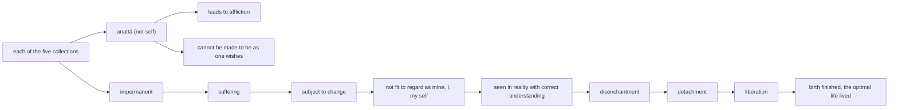

import { Tabs, TabItem } from '@astrojs/starlight/components';

Original text: [13S3/1.2.1.7 Anattalakkhaṇasutta 297–309](https://tipitaka2500.github.io/tipitaka/13S3/1/1.2/1.2.1/1.2.1.7.html#297) in the [World Tipitaka Edition](https://tipitaka2500.github.io)

## Summary

At Bārāṇasī the Bhagavā teaches the group of five bhikkhū that each of the five collections is `anattā` (not-self): were any of them a self, it would not lead to affliction and could be made to be as one wishes. Through the catechism of impermanent, suffering and subject to change, and the formula for regarding all form, feeling, apperception, mental constructions and consciousness as not mine, not I, not my self, the learned disciple is disenchanted, detached and liberated. While the exposition was spoken, the five were liberated from the defilements.

## Diagram

## Text

<Tabs syncKey="paliquote">
<TabItem label="My Translation">
(59.)

297\. At one time the Bhagavā was dwelling at Bārāṇasī, at Isipatana in the Deer Park. There the Bhagavā addressed the group of five bhikkhū: “Bhikkhavo!” “Bhadante,” those bhikkhū replied to the Bhagavā. The Bhagavā said this:

298\. “`rūpa` (form), Bhikkhave, is `anattā` (not-self). And indeed here, Bhikkhave, if `rūpa` were `attā` (self), this `rūpa` would not lead to `ābādha` (affliction), and `rūpa` could be obtained: ‘May my `rūpa` be thus, may my `rūpa` not be thus.’ And because indeed, Bhikkhave, `rūpa` is `anattā`, therefore `rūpa` leads to affliction, and it cannot be obtained: ‘May my `rūpa` be thus, may my `rūpa` not be thus.’

299\. `vedanā` (feeling) is `anattā` (not-self). And indeed here, Bhikkhave, if `vedanā` were `attā` (self), this `vedanā` would not lead to `ābādha` (affliction), and `vedanā` could be obtained: ‘May my `vedanā` be thus, may my `vedanā` not be thus.’ And because indeed, Bhikkhave, `vedanā` is `anattā`, therefore `vedanā` leads to affliction, and it cannot be obtained: ‘May my `vedanā` be thus, may my `vedanā` not be thus.’

300\. `saññā` (apperception) is `anattā` (not-self) … and so on … `saṅkhārā` (mental constructions) are `anattā` (not-self). And indeed here, Bhikkhave, if `saṅkhārā` were `attā` (self), these `saṅkhārā` would not lead to `ābādha` (affliction), and `saṅkhārā` could be obtained: ‘May my `saṅkhārā` be thus, may my `saṅkhārā` not be thus.’ And because indeed, Bhikkhave, `saṅkhārā` are `anattā`, therefore `saṅkhārā` lead to affliction, and they cannot be obtained: ‘May my `saṅkhārā` be thus, may my `saṅkhārā` not be thus.’

301\. `viññāṇa` (consciousness) is `anattā` (not-self). And indeed here, Bhikkhave, if `viññāṇa` were `attā` (self), this `viññāṇa` would not lead to `ābādha` (affliction), and `viññāṇa` could be obtained: ‘May my `viññāṇa` be thus, may my `viññāṇa` not be thus.’ And because indeed, Bhikkhave, `viññāṇa` is `anattā`, therefore `viññāṇa` leads to affliction, and it cannot be obtained: ‘May my `viññāṇa` be thus, may my `viññāṇa` not be thus.’

302\. Bhikkhave, what do you consider: is `rūpa` (form) `nicca` (permanent) or `anicca` (impermanent)?” “`Anicca`, Bhante.” “Now, is that which is impermanent `dukkha` (suffering) or `sukha` (happiness)?” “`Dukkha`, Bhante.” “Now, is it proper to regard that which is `anicca`, `dukkha`, and `vipariṇāmadhamma` (subject to change), as: ‘This is mine, this I am, this is my `attā` (self)’?” “Of course not, Bhante.” “Is `vedanā` … `saññā` … `saṅkhārā` … `viññāṇa` permanent or impermanent?” “Impermanent, Bhante.” “Now, is that which is impermanent suffering or happiness?” “Suffering, Bhante.” “Now, is it proper to regard that which is impermanent, suffering, and subject to change, as: ‘This is mine, this I am, this is my `attā`’?” “Of course not, Bhante.”

303\. “Therefore, Bhikkhave, whatever `rūpa` there is, `atītānāgatapaccuppanna` (past, future, or present), `ajjhatta` (internal) or `bahiddhā` (external), `oḷārika` (coarse) or `sukhuma` (fine), `hīna` (inferior) or `paṇīta` (superior), far or near, all `rūpa` should be regarded `yathābhūta` (in reality), with `sammappaññā` (correct understanding), thus: ‘This is not mine, this I am not, this is not my `attā`.’

304\. Whatever `vedanā` there is, past, future, or present, internal or external … and so on … far or near, all `vedanā` should be regarded as it really is, with correct understanding, thus: ‘This is not mine, this I am not, this is not my `attā`.’

305\. Whatever `saññā` there is … and so on … whatever `saṅkhārā` there are, past, future, or present, internal or external … and so on … far or near, all `saṅkhārā` should be regarded as they really are, with correct understanding, thus: ‘This is not mine, this I am not, this is not my `attā`.’

306\. Whatever `viññāṇa` there is, past, future, or present, internal or external, coarse or fine, inferior or superior, far or near, all `viññāṇa` should be regarded as it really is, with correct understanding, thus: ‘This is not mine, this I am not, this is not my `attā`.’

307\. Thus seeing, Bhikkhave, the `sutavā` (learned) `ariyasāvaka` (disciple of the liberated) `nibbindati` (is disenchanted with) `rūpa`, is disenchanted with `vedanā`, is disenchanted with `saññā`, is disenchanted with `saṅkhārā`, is disenchanted with `viññāṇa`. Being disenchanted, he `virajjati` (becomes detached); from detachment he `vimuccati` (becomes liberated). In liberation there is the `ñāṇa` (knowledge): ‘liberated’. He `pajānāti` (knows clearly): ‘Birth (of suffering) is finished, the optimal life is lived, what had to be done is done, there is nothing further for this present state of existence.’”

308\. This the Bhagavā said. The group of five bhikkhū, delighted, rejoiced in the Bhagavā’s words. And while this detailed exposition was being spoken, the `cittāni` (minds) of the group of five bhikkhū, `anupādāya` (not grasping), were liberated from the `āsavā` (defilements).

309\. The seventh [discourse of the chapter].
</TabItem>

<TabItem label="Pāḷi (Roman IAST)">
(59.)

297\. Ekaṃ samayaṃ bhagavā bārāṇasiyaṃ viharati isipatane migadāye. Tatra kho bhagavā pañcavaggiye bhikkhū āmantesi— “bhikkhavo”ti. “Bhadante”ti te bhikkhū bhagavato paccassosuṃ. Bhagavā etadavoca—

298\. “Rūpaṃ, bhikkhave, anattā. Rūpañca hidaṃ, bhikkhave, attā abhavissa, nayidaṃ rūpaṃ ābādhāya saṃvatteyya, labbhetha ca rūpe— ‘evaṃ me rūpaṃ hotu, evaṃ me rūpaṃ mā ahosī’ti. Yasmā ca kho, bhikkhave, rūpaṃ anattā, tasmā rūpaṃ ābādhāya saṃvattati, na ca labbhati rūpe— ‘evaṃ me rūpaṃ hotu, evaṃ me rūpaṃ mā ahosī’ti.

299\. Vedanā anattā. Vedanā ca hidaṃ, bhikkhave, attā abhavissa, nayidaṃ vedanā ābādhāya saṃvatteyya, labbhetha ca vedanāya— ‘evaṃ me vedanā hotu, evaṃ me vedanā mā ahosī’ti. Yasmā ca kho, bhikkhave, vedanā anattā, tasmā vedanā ābādhāya saṃvattati, na ca labbhati vedanāya— ‘evaṃ me vedanā hotu, evaṃ me vedanā mā ahosī’ti.

300\. Saññā anattā…pe… saṅkhārā anattā. Saṅkhārā ca hidaṃ, bhikkhave, attā abhavissaṃsu, nayidaṃ saṅkhārā ābādhāya saṃvatteyyuṃ, labbhetha ca saṅkhāresu— ‘evaṃ me saṅkhārā hontu, evaṃ me saṅkhārā mā ahesun’ti. Yasmā ca kho, bhikkhave, saṅkhārā anattā, tasmā saṅkhārā ābādhāya saṃvattanti, na ca labbhati saṅkhāresu— ‘evaṃ me saṅkhārā hontu, evaṃ me saṅkhārā mā ahesun’ti.

301\. Viññāṇaṃ anattā. Viññāṇañca hidaṃ, bhikkhave, attā abhavissa, nayidaṃ viññāṇaṃ ābādhāya saṃvatteyya, labbhetha ca viññāṇe— ‘evaṃ me viññāṇaṃ hotu, evaṃ me viññāṇaṃ mā ahosī’ti. Yasmā ca kho, bhikkhave, viññāṇaṃ anattā, tasmā viññāṇaṃ ābādhāya saṃvattati, na ca labbhati viññāṇe— ‘evaṃ me viññāṇaṃ hotu, evaṃ me viññāṇaṃ mā ahosī’ti.

302\. Taṃ kiṃ maññatha, bhikkhave, rūpaṃ niccaṃ vā aniccaṃ vā”ti? “Aniccaṃ, bhante”. “Yaṃ panāniccaṃ dukkhaṃ vā taṃ sukhaṃ vā”ti? “Dukkhaṃ, bhante”. “Yaṃ panāniccaṃ dukkhaṃ vipariṇāmadhammaṃ, kallaṃ nu taṃ samanupassituṃ— ‘etaṃ mama, esohamasmi, eso me attā’”ti? “No hetaṃ, bhante”. “Vedanā… saññā… saṅkhārā… viññāṇaṃ niccaṃ vā aniccaṃ vā”ti? “Aniccaṃ, bhante”. “Yaṃ panāniccaṃ dukkhaṃ vā taṃ sukhaṃ vā”ti? “Dukkhaṃ, bhante”. “Yaṃ panāniccaṃ dukkhaṃ vipariṇāmadhammaṃ, kallaṃ nu taṃ samanupassituṃ— ‘etaṃ mama, esohamasmi, eso me attā’”ti? “No hetaṃ, bhante”.

303\. “Tasmātiha, bhikkhave, yaṃ kiñci rūpaṃ atītānāgatapaccuppannaṃ ajjhattaṃ vā bahiddhā vā oḷārikaṃ vā sukhumaṃ vā hīnaṃ vā paṇītaṃ vā yaṃ dūre santike vā, sabbaṃ rūpaṃ— ‘netaṃ mama, nesohamasmi, na meso attā’ti evametaṃ yathābhūtaṃ sammappaññāya daṭṭhabbaṃ.

304\. Yā kāci vedanā atītānāgatapaccuppannā ajjhattā vā bahiddhā vā…pe… yā dūre santike vā, sabbā vedanā— ‘netaṃ mama, nesohamasmi, na meso attā’ti evametaṃ yathābhūtaṃ sammappaññāya daṭṭhabbaṃ.

305\. Yā kāci saññā…pe… ye keci saṅkhārā atītānāgatapaccuppannā ajjhattaṃ vā bahiddhā vā…pe… ye dūre santike vā, sabbe saṅkhārā— ‘netaṃ mama, nesohamasmi, na meso attā’ti evametaṃ yathābhūtaṃ sammappaññāya daṭṭhabbaṃ.

306\. Yaṃ kiñci viññāṇaṃ atītānāgatapaccuppannaṃ ajjhattaṃ vā bahiddhā vā oḷārikaṃ vā sukhumaṃ vā hīnaṃ vā paṇītaṃ vā yaṃ dūre santike vā, sabbaṃ viññāṇaṃ— ‘netaṃ mama, nesohamasmi, na meso attā’ti evametaṃ yathābhūtaṃ sammappaññāya daṭṭhabbaṃ.

307\. Evaṃ passaṃ, bhikkhave, sutavā ariyasāvako rūpasmimpi nibbindati, vedanāyapi nibbindati, saññāyapi nibbindati, saṅkhāresupi nibbindati, viññāṇasmimpi nibbindati. Nibbindaṃ virajjati; virāgā vimuccati. Vimuttasmiṃ vimuttamiti ñāṇaṃ hoti. ‘Khīṇā jāti, vusitaṃ brahmacariyaṃ, kataṃ karaṇīyaṃ, nāparaṃ itthattāyā’ti pajānātī”ti.

308\. Idamavoca bhagavā. Attamanā pañcavaggiyā bhikkhū bhagavato bhāsitaṃ abhinanduṃ. Imasmiñca pana veyyākaraṇasmiṃ bhaññamāne pañcavaggiyānaṃ bhikkhūnaṃ anupādāya āsavehi cittāni vimucciṃsūti.

309\. Sattamaṃ.
</TabItem>

<TabItem label="Pāḷi (Brahmi)">
(59.)

297\. 𑀏𑀓𑀁 𑀲𑀫𑀬𑀁 𑀪𑀕𑀯𑀸 𑀩𑀸𑀭𑀸𑀡𑀲𑀺𑀬𑀁 𑀯𑀺𑀳𑀭𑀢𑀺 𑀇𑀲𑀺𑀧𑀢𑀦𑁂 𑀫𑀺𑀕𑀤𑀸𑀬𑁂. 𑀢𑀢𑁆𑀭 𑀔𑁄 𑀪𑀕𑀯𑀸 𑀧𑀜𑁆𑀘𑀯𑀕𑁆𑀕𑀺𑀬𑁂 𑀪𑀺𑀓𑁆𑀔𑀽 𑀆𑀫𑀦𑁆𑀢𑁂𑀲𑀺— “𑀪𑀺𑀓𑁆𑀔𑀯𑁄”𑀢𑀺. “𑀪𑀤𑀦𑁆𑀢𑁂”𑀢𑀺 𑀢𑁂 𑀪𑀺𑀓𑁆𑀔𑀽 𑀪𑀕𑀯𑀢𑁄 𑀧𑀘𑁆𑀘𑀲𑁆𑀲𑁄𑀲𑀼𑀁. 𑀪𑀕𑀯𑀸 𑀏𑀢𑀤𑀯𑁄𑀘—

298\. “𑀭𑀽𑀧𑀁, 𑀪𑀺𑀓𑁆𑀔𑀯𑁂, 𑀅𑀦𑀢𑁆𑀢𑀸. 𑀭𑀽𑀧𑀜𑁆𑀘 𑀳𑀺𑀤𑀁, 𑀪𑀺𑀓𑁆𑀔𑀯𑁂, 𑀅𑀢𑁆𑀢𑀸 𑀅𑀪𑀯𑀺𑀲𑁆𑀲, 𑀦𑀬𑀺𑀤𑀁 𑀭𑀽𑀧𑀁 𑀆𑀩𑀸𑀥𑀸𑀬 𑀲𑀁𑀯𑀢𑁆𑀢𑁂𑀬𑁆𑀬, 𑀮𑀩𑁆𑀪𑁂𑀣 𑀘 𑀭𑀽𑀧𑁂— ‘𑀏𑀯𑀁 𑀫𑁂 𑀭𑀽𑀧𑀁 𑀳𑁄𑀢𑀼, 𑀏𑀯𑀁 𑀫𑁂 𑀭𑀽𑀧𑀁 𑀫𑀸 𑀅𑀳𑁄𑀲𑀻’𑀢𑀺. 𑀬𑀲𑁆𑀫𑀸 𑀘 𑀔𑁄, 𑀪𑀺𑀓𑁆𑀔𑀯𑁂, 𑀭𑀽𑀧𑀁 𑀅𑀦𑀢𑁆𑀢𑀸, 𑀢𑀲𑁆𑀫𑀸 𑀭𑀽𑀧𑀁 𑀆𑀩𑀸𑀥𑀸𑀬 𑀲𑀁𑀯𑀢𑁆𑀢𑀢𑀺, 𑀦 𑀘 𑀮𑀩𑁆𑀪𑀢𑀺 𑀭𑀽𑀧𑁂— ‘𑀏𑀯𑀁 𑀫𑁂 𑀭𑀽𑀧𑀁 𑀳𑁄𑀢𑀼, 𑀏𑀯𑀁 𑀫𑁂 𑀭𑀽𑀧𑀁 𑀫𑀸 𑀅𑀳𑁄𑀲𑀻’𑀢𑀺.

299\. 𑀯𑁂𑀤𑀦𑀸 𑀅𑀦𑀢𑁆𑀢𑀸. 𑀯𑁂𑀤𑀦𑀸 𑀘 𑀳𑀺𑀤𑀁, 𑀪𑀺𑀓𑁆𑀔𑀯𑁂, 𑀅𑀢𑁆𑀢𑀸 𑀅𑀪𑀯𑀺𑀲𑁆𑀲, 𑀦𑀬𑀺𑀤𑀁 𑀯𑁂𑀤𑀦𑀸 𑀆𑀩𑀸𑀥𑀸𑀬 𑀲𑀁𑀯𑀢𑁆𑀢𑁂𑀬𑁆𑀬, 𑀮𑀩𑁆𑀪𑁂𑀣 𑀘 𑀯𑁂𑀤𑀦𑀸𑀬— ‘𑀏𑀯𑀁 𑀫𑁂 𑀯𑁂𑀤𑀦𑀸 𑀳𑁄𑀢𑀼, 𑀏𑀯𑀁 𑀫𑁂 𑀯𑁂𑀤𑀦𑀸 𑀫𑀸 𑀅𑀳𑁄𑀲𑀻’𑀢𑀺. 𑀬𑀲𑁆𑀫𑀸 𑀘 𑀔𑁄, 𑀪𑀺𑀓𑁆𑀔𑀯𑁂, 𑀯𑁂𑀤𑀦𑀸 𑀅𑀦𑀢𑁆𑀢𑀸, 𑀢𑀲𑁆𑀫𑀸 𑀯𑁂𑀤𑀦𑀸 𑀆𑀩𑀸𑀥𑀸𑀬 𑀲𑀁𑀯𑀢𑁆𑀢𑀢𑀺, 𑀦 𑀘 𑀮𑀩𑁆𑀪𑀢𑀺 𑀯𑁂𑀤𑀦𑀸𑀬— ‘𑀏𑀯𑀁 𑀫𑁂 𑀯𑁂𑀤𑀦𑀸 𑀳𑁄𑀢𑀼, 𑀏𑀯𑀁 𑀫𑁂 𑀯𑁂𑀤𑀦𑀸 𑀫𑀸 𑀅𑀳𑁄𑀲𑀻’𑀢𑀺.

300\. 𑀲𑀜𑁆𑀜𑀸 𑀅𑀦𑀢𑁆𑀢𑀸…𑀧𑁂… 𑀲𑀗𑁆𑀔𑀸𑀭𑀸 𑀅𑀦𑀢𑁆𑀢𑀸. 𑀲𑀗𑁆𑀔𑀸𑀭𑀸 𑀘 𑀳𑀺𑀤𑀁, 𑀪𑀺𑀓𑁆𑀔𑀯𑁂, 𑀅𑀢𑁆𑀢𑀸 𑀅𑀪𑀯𑀺𑀲𑁆𑀲𑀁𑀲𑀼, 𑀦𑀬𑀺𑀤𑀁 𑀲𑀗𑁆𑀔𑀸𑀭𑀸 𑀆𑀩𑀸𑀥𑀸𑀬 𑀲𑀁𑀯𑀢𑁆𑀢𑁂𑀬𑁆𑀬𑀼𑀁, 𑀮𑀩𑁆𑀪𑁂𑀣 𑀘 𑀲𑀗𑁆𑀔𑀸𑀭𑁂𑀲𑀼— ‘𑀏𑀯𑀁 𑀫𑁂 𑀲𑀗𑁆𑀔𑀸𑀭𑀸 𑀳𑁄𑀦𑁆𑀢𑀼, 𑀏𑀯𑀁 𑀫𑁂 𑀲𑀗𑁆𑀔𑀸𑀭𑀸 𑀫𑀸 𑀅𑀳𑁂𑀲𑀼𑀦𑁆’𑀢𑀺. 𑀬𑀲𑁆𑀫𑀸 𑀘 𑀔𑁄, 𑀪𑀺𑀓𑁆𑀔𑀯𑁂, 𑀲𑀗𑁆𑀔𑀸𑀭𑀸 𑀅𑀦𑀢𑁆𑀢𑀸, 𑀢𑀲𑁆𑀫𑀸 𑀲𑀗𑁆𑀔𑀸𑀭𑀸 𑀆𑀩𑀸𑀥𑀸𑀬 𑀲𑀁𑀯𑀢𑁆𑀢𑀦𑁆𑀢𑀺, 𑀦 𑀘 𑀮𑀩𑁆𑀪𑀢𑀺 𑀲𑀗𑁆𑀔𑀸𑀭𑁂𑀲𑀼— ‘𑀏𑀯𑀁 𑀫𑁂 𑀲𑀗𑁆𑀔𑀸𑀭𑀸 𑀳𑁄𑀦𑁆𑀢𑀼, 𑀏𑀯𑀁 𑀫𑁂 𑀲𑀗𑁆𑀔𑀸𑀭𑀸 𑀫𑀸 𑀅𑀳𑁂𑀲𑀼𑀦𑁆’𑀢𑀺.

301\. 𑀯𑀺𑀜𑁆𑀜𑀸𑀡𑀁 𑀅𑀦𑀢𑁆𑀢𑀸. 𑀯𑀺𑀜𑁆𑀜𑀸𑀡𑀜𑁆𑀘 𑀳𑀺𑀤𑀁, 𑀪𑀺𑀓𑁆𑀔𑀯𑁂, 𑀅𑀢𑁆𑀢𑀸 𑀅𑀪𑀯𑀺𑀲𑁆𑀲, 𑀦𑀬𑀺𑀤𑀁 𑀯𑀺𑀜𑁆𑀜𑀸𑀡𑀁 𑀆𑀩𑀸𑀥𑀸𑀬 𑀲𑀁𑀯𑀢𑁆𑀢𑁂𑀬𑁆𑀬, 𑀮𑀩𑁆𑀪𑁂𑀣 𑀘 𑀯𑀺𑀜𑁆𑀜𑀸𑀡𑁂— ‘𑀏𑀯𑀁 𑀫𑁂 𑀯𑀺𑀜𑁆𑀜𑀸𑀡𑀁 𑀳𑁄𑀢𑀼, 𑀏𑀯𑀁 𑀫𑁂 𑀯𑀺𑀜𑁆𑀜𑀸𑀡𑀁 𑀫𑀸 𑀅𑀳𑁄𑀲𑀻’𑀢𑀺. 𑀬𑀲𑁆𑀫𑀸 𑀘 𑀔𑁄, 𑀪𑀺𑀓𑁆𑀔𑀯𑁂, 𑀯𑀺𑀜𑁆𑀜𑀸𑀡𑀁 𑀅𑀦𑀢𑁆𑀢𑀸, 𑀢𑀲𑁆𑀫𑀸 𑀯𑀺𑀜𑁆𑀜𑀸𑀡𑀁 𑀆𑀩𑀸𑀥𑀸𑀬 𑀲𑀁𑀯𑀢𑁆𑀢𑀢𑀺, 𑀦 𑀘 𑀮𑀩𑁆𑀪𑀢𑀺 𑀯𑀺𑀜𑁆𑀜𑀸𑀡𑁂— ‘𑀏𑀯𑀁 𑀫𑁂 𑀯𑀺𑀜𑁆𑀜𑀸𑀡𑀁 𑀳𑁄𑀢𑀼, 𑀏𑀯𑀁 𑀫𑁂 𑀯𑀺𑀜𑁆𑀜𑀸𑀡𑀁 𑀫𑀸 𑀅𑀳𑁄𑀲𑀻’𑀢𑀺.

302\. 𑀢𑀁 𑀓𑀺𑀁 𑀫𑀜𑁆𑀜𑀣, 𑀪𑀺𑀓𑁆𑀔𑀯𑁂, 𑀭𑀽𑀧𑀁 𑀦𑀺𑀘𑁆𑀘𑀁 𑀯𑀸 𑀅𑀦𑀺𑀘𑁆𑀘𑀁 𑀯𑀸”𑀢𑀺? “𑀅𑀦𑀺𑀘𑁆𑀘𑀁, 𑀪𑀦𑁆𑀢𑁂”. “𑀬𑀁 𑀧𑀦𑀸𑀦𑀺𑀘𑁆𑀘𑀁 𑀤𑀼𑀓𑁆𑀔𑀁 𑀯𑀸 𑀢𑀁 𑀲𑀼𑀔𑀁 𑀯𑀸”𑀢𑀺? “𑀤𑀼𑀓𑁆𑀔𑀁, 𑀪𑀦𑁆𑀢𑁂”. “𑀬𑀁 𑀧𑀦𑀸𑀦𑀺𑀘𑁆𑀘𑀁 𑀤𑀼𑀓𑁆𑀔𑀁 𑀯𑀺𑀧𑀭𑀺𑀡𑀸𑀫𑀥𑀫𑁆𑀫𑀁, 𑀓𑀮𑁆𑀮𑀁 𑀦𑀼 𑀢𑀁 𑀲𑀫𑀦𑀼𑀧𑀲𑁆𑀲𑀺𑀢𑀼𑀁— ‘𑀏𑀢𑀁 𑀫𑀫, 𑀏𑀲𑁄𑀳𑀫𑀲𑁆𑀫𑀺, 𑀏𑀲𑁄 𑀫𑁂 𑀅𑀢𑁆𑀢𑀸’”𑀢𑀺? “𑀦𑁄 𑀳𑁂𑀢𑀁, 𑀪𑀦𑁆𑀢𑁂”. “𑀯𑁂𑀤𑀦𑀸… 𑀲𑀜𑁆𑀜𑀸… 𑀲𑀗𑁆𑀔𑀸𑀭𑀸… 𑀯𑀺𑀜𑁆𑀜𑀸𑀡𑀁 𑀦𑀺𑀘𑁆𑀘𑀁 𑀯𑀸 𑀅𑀦𑀺𑀘𑁆𑀘𑀁 𑀯𑀸”𑀢𑀺? “𑀅𑀦𑀺𑀘𑁆𑀘𑀁, 𑀪𑀦𑁆𑀢𑁂”. “𑀬𑀁 𑀧𑀦𑀸𑀦𑀺𑀘𑁆𑀘𑀁 𑀤𑀼𑀓𑁆𑀔𑀁 𑀯𑀸 𑀢𑀁 𑀲𑀼𑀔𑀁 𑀯𑀸”𑀢𑀺? “𑀤𑀼𑀓𑁆𑀔𑀁, 𑀪𑀦𑁆𑀢𑁂”. “𑀬𑀁 𑀧𑀦𑀸𑀦𑀺𑀘𑁆𑀘𑀁 𑀤𑀼𑀓𑁆𑀔𑀁 𑀯𑀺𑀧𑀭𑀺𑀡𑀸𑀫𑀥𑀫𑁆𑀫𑀁, 𑀓𑀮𑁆𑀮𑀁 𑀦𑀼 𑀢𑀁 𑀲𑀫𑀦𑀼𑀧𑀲𑁆𑀲𑀺𑀢𑀼𑀁— ‘𑀏𑀢𑀁 𑀫𑀫, 𑀏𑀲𑁄𑀳𑀫𑀲𑁆𑀫𑀺, 𑀏𑀲𑁄 𑀫𑁂 𑀅𑀢𑁆𑀢𑀸’”𑀢𑀺? “𑀦𑁄 𑀳𑁂𑀢𑀁, 𑀪𑀦𑁆𑀢𑁂”.

303\. “𑀢𑀲𑁆𑀫𑀸𑀢𑀺𑀳, 𑀪𑀺𑀓𑁆𑀔𑀯𑁂, 𑀬𑀁 𑀓𑀺𑀜𑁆𑀘𑀺 𑀭𑀽𑀧𑀁 𑀅𑀢𑀻𑀢𑀸𑀦𑀸𑀕𑀢𑀧𑀘𑁆𑀘𑀼𑀧𑁆𑀧𑀦𑁆𑀦𑀁 𑀅𑀚𑁆𑀛𑀢𑁆𑀢𑀁 𑀯𑀸 𑀩𑀳𑀺𑀤𑁆𑀥𑀸 𑀯𑀸 𑀑𑀍𑀆𑀭𑀺𑀓𑀁 𑀯𑀸 𑀲𑀼𑀔𑀼𑀫𑀁 𑀯𑀸 𑀳𑀻𑀦𑀁 𑀯𑀸 𑀧𑀡𑀻𑀢𑀁 𑀯𑀸 𑀬𑀁 𑀤𑀽𑀭𑁂 𑀲𑀦𑁆𑀢𑀺𑀓𑁂 𑀯𑀸, 𑀲𑀩𑁆𑀩𑀁 𑀭𑀽𑀧𑀁— ‘𑀦𑁂𑀢𑀁 𑀫𑀫, 𑀦𑁂𑀲𑁄𑀳𑀫𑀲𑁆𑀫𑀺, 𑀦 𑀫𑁂𑀲𑁄 𑀅𑀢𑁆𑀢𑀸’𑀢𑀺 𑀏𑀯𑀫𑁂𑀢𑀁 𑀬𑀣𑀸𑀪𑀽𑀢𑀁 𑀲𑀫𑁆𑀫𑀧𑁆𑀧𑀜𑁆𑀜𑀸𑀬 𑀤𑀝𑁆𑀞𑀩𑁆𑀩𑀁.

304\. 𑀬𑀸 𑀓𑀸𑀘𑀺 𑀯𑁂𑀤𑀦𑀸 𑀅𑀢𑀻𑀢𑀸𑀦𑀸𑀕𑀢𑀧𑀘𑁆𑀘𑀼𑀧𑁆𑀧𑀦𑁆𑀦𑀸 𑀅𑀚𑁆𑀛𑀢𑁆𑀢𑀸 𑀯𑀸 𑀩𑀳𑀺𑀤𑁆𑀥𑀸 𑀯𑀸…𑀧𑁂… 𑀬𑀸 𑀤𑀽𑀭𑁂 𑀲𑀦𑁆𑀢𑀺𑀓𑁂 𑀯𑀸, 𑀲𑀩𑁆𑀩𑀸 𑀯𑁂𑀤𑀦𑀸— ‘𑀦𑁂𑀢𑀁 𑀫𑀫, 𑀦𑁂𑀲𑁄𑀳𑀫𑀲𑁆𑀫𑀺, 𑀦 𑀫𑁂𑀲𑁄 𑀅𑀢𑁆𑀢𑀸’𑀢𑀺 𑀏𑀯𑀫𑁂𑀢𑀁 𑀬𑀣𑀸𑀪𑀽𑀢𑀁 𑀲𑀫𑁆𑀫𑀧𑁆𑀧𑀜𑁆𑀜𑀸𑀬 𑀤𑀝𑁆𑀞𑀩𑁆𑀩𑀁.

305\. 𑀬𑀸 𑀓𑀸𑀘𑀺 𑀲𑀜𑁆𑀜𑀸…𑀧𑁂… 𑀬𑁂 𑀓𑁂𑀘𑀺 𑀲𑀗𑁆𑀔𑀸𑀭𑀸 𑀅𑀢𑀻𑀢𑀸𑀦𑀸𑀕𑀢𑀧𑀘𑁆𑀘𑀼𑀧𑁆𑀧𑀦𑁆𑀦𑀸 𑀅𑀚𑁆𑀛𑀢𑁆𑀢𑀁 𑀯𑀸 𑀩𑀳𑀺𑀤𑁆𑀥𑀸 𑀯𑀸…𑀧𑁂… 𑀬𑁂 𑀤𑀽𑀭𑁂 𑀲𑀦𑁆𑀢𑀺𑀓𑁂 𑀯𑀸, 𑀲𑀩𑁆𑀩𑁂 𑀲𑀗𑁆𑀔𑀸𑀭𑀸— ‘𑀦𑁂𑀢𑀁 𑀫𑀫, 𑀦𑁂𑀲𑁄𑀳𑀫𑀲𑁆𑀫𑀺, 𑀦 𑀫𑁂𑀲𑁄 𑀅𑀢𑁆𑀢𑀸’𑀢𑀺 𑀏𑀯𑀫𑁂𑀢𑀁 𑀬𑀣𑀸𑀪𑀽𑀢𑀁 𑀲𑀫𑁆𑀫𑀧𑁆𑀧𑀜𑁆𑀜𑀸𑀬 𑀤𑀝𑁆𑀞𑀩𑁆𑀩𑀁.

306\. 𑀬𑀁 𑀓𑀺𑀜𑁆𑀘𑀺 𑀯𑀺𑀜𑁆𑀜𑀸𑀡𑀁 𑀅𑀢𑀻𑀢𑀸𑀦𑀸𑀕𑀢𑀧𑀘𑁆𑀘𑀼𑀧𑁆𑀧𑀦𑁆𑀦𑀁 𑀅𑀚𑁆𑀛𑀢𑁆𑀢𑀁 𑀯𑀸 𑀩𑀳𑀺𑀤𑁆𑀥𑀸 𑀯𑀸 𑀑𑀍𑀆𑀭𑀺𑀓𑀁 𑀯𑀸 𑀲𑀼𑀔𑀼𑀫𑀁 𑀯𑀸 𑀳𑀻𑀦𑀁 𑀯𑀸 𑀧𑀡𑀻𑀢𑀁 𑀯𑀸 𑀬𑀁 𑀤𑀽𑀭𑁂 𑀲𑀦𑁆𑀢𑀺𑀓𑁂 𑀯𑀸, 𑀲𑀩𑁆𑀩𑀁 𑀯𑀺𑀜𑁆𑀜𑀸𑀡𑀁— ‘𑀦𑁂𑀢𑀁 𑀫𑀫, 𑀦𑁂𑀲𑁄𑀳𑀫𑀲𑁆𑀫𑀺, 𑀦 𑀫𑁂𑀲𑁄 𑀅𑀢𑁆𑀢𑀸’𑀢𑀺 𑀏𑀯𑀫𑁂𑀢𑀁 𑀬𑀣𑀸𑀪𑀽𑀢𑀁 𑀲𑀫𑁆𑀫𑀧𑁆𑀧𑀜𑁆𑀜𑀸𑀬 𑀤𑀝𑁆𑀞𑀩𑁆𑀩𑀁.

307\. 𑀏𑀯𑀁 𑀧𑀲𑁆𑀲𑀁, 𑀪𑀺𑀓𑁆𑀔𑀯𑁂, 𑀲𑀼𑀢𑀯𑀸 𑀅𑀭𑀺𑀬𑀲𑀸𑀯𑀓𑁄 𑀭𑀽𑀧𑀲𑁆𑀫𑀺𑀫𑁆𑀧𑀺 𑀦𑀺𑀩𑁆𑀩𑀺𑀦𑁆𑀤𑀢𑀺, 𑀯𑁂𑀤𑀦𑀸𑀬𑀧𑀺 𑀦𑀺𑀩𑁆𑀩𑀺𑀦𑁆𑀤𑀢𑀺, 𑀲𑀜𑁆𑀜𑀸𑀬𑀧𑀺 𑀦𑀺𑀩𑁆𑀩𑀺𑀦𑁆𑀤𑀢𑀺, 𑀲𑀗𑁆𑀔𑀸𑀭𑁂𑀲𑀼𑀧𑀺 𑀦𑀺𑀩𑁆𑀩𑀺𑀦𑁆𑀤𑀢𑀺, 𑀯𑀺𑀜𑁆𑀜𑀸𑀡𑀲𑁆𑀫𑀺𑀫𑁆𑀧𑀺 𑀦𑀺𑀩𑁆𑀩𑀺𑀦𑁆𑀤𑀢𑀺. 𑀦𑀺𑀩𑁆𑀩𑀺𑀦𑁆𑀤𑀁 𑀯𑀺𑀭𑀚𑁆𑀚𑀢𑀺; 𑀯𑀺𑀭𑀸𑀕𑀸 𑀯𑀺𑀫𑀼𑀘𑁆𑀘𑀢𑀺. 𑀯𑀺𑀫𑀼𑀢𑁆𑀢𑀲𑁆𑀫𑀺𑀁 𑀯𑀺𑀫𑀼𑀢𑁆𑀢𑀫𑀺𑀢𑀺 𑀜𑀸𑀡𑀁 𑀳𑁄𑀢𑀺. ‘𑀔𑀻𑀡𑀸 𑀚𑀸𑀢𑀺, 𑀯𑀼𑀲𑀺𑀢𑀁 𑀩𑁆𑀭𑀳𑁆𑀫𑀘𑀭𑀺𑀬𑀁, 𑀓𑀢𑀁 𑀓𑀭𑀡𑀻𑀬𑀁, 𑀦𑀸𑀧𑀭𑀁 𑀇𑀢𑁆𑀣𑀢𑁆𑀢𑀸𑀬𑀸’𑀢𑀺 𑀧𑀚𑀸𑀦𑀸𑀢𑀻”𑀢𑀺.

308\. 𑀇𑀤𑀫𑀯𑁄𑀘 𑀪𑀕𑀯𑀸. 𑀅𑀢𑁆𑀢𑀫𑀦𑀸 𑀧𑀜𑁆𑀘𑀯𑀕𑁆𑀕𑀺𑀬𑀸 𑀪𑀺𑀓𑁆𑀔𑀽 𑀪𑀕𑀯𑀢𑁄 𑀪𑀸𑀲𑀺𑀢𑀁 𑀅𑀪𑀺𑀦𑀦𑁆𑀤𑀼𑀁. 𑀇𑀫𑀲𑁆𑀫𑀺𑀜𑁆𑀘 𑀧𑀦 𑀯𑁂𑀬𑁆𑀬𑀸𑀓𑀭𑀡𑀲𑁆𑀫𑀺𑀁 𑀪𑀜𑁆𑀜𑀫𑀸𑀦𑁂 𑀧𑀜𑁆𑀘𑀯𑀕𑁆𑀕𑀺𑀬𑀸𑀦𑀁 𑀪𑀺𑀓𑁆𑀔𑀽𑀦𑀁 𑀅𑀦𑀼𑀧𑀸𑀤𑀸𑀬 𑀆𑀲𑀯𑁂𑀳𑀺 𑀘𑀺𑀢𑁆𑀢𑀸𑀦𑀺 𑀯𑀺𑀫𑀼𑀘𑁆𑀘𑀺𑀁𑀲𑀽𑀢𑀺.

309\. 𑀲𑀢𑁆𑀢𑀫𑀁.
</TabItem>

<TabItem label="Interlinear">
(59.)

[297](https://tipitaka2500.github.io/tipitaka/13S3/1/1.2/1.2.1/1.2.1.7.html#297) Ekaṃ samayaṃ bhagavā bārāṇasiyaṃ viharati isipatane migadāye.  
*️⃣🤟🚹⨀②(eka) 🚹⨀②(samaya) 🚹⨀①(bhagavant) 🚺⨀⑦(bārāṇasī) 🟢⨀🤟▶️(viharati) 🚻⨀⑦(isipatana) 🚹⨀⑦(migadāya)  
one | time | the Bhagavā | at Bārāṇasī | dwells | at Isipatana | in the Deer Park  
At one time the Bhagavā was dwelling at Bārāṇasī, at Isipatana in the Deer Park.

Tatra kho bhagavā pañcavaggiye bhikkhū āmantesi— “bhikkhavo”ti.  
⏏️(tatra) ⏏️(kho) 🚹⨀①(bhagavant) 🚹⨂②🆎(pañca+vaggiya) 🚹⨂②(bhikkhu) 🟢⨀🤟⏮(āmanteti) 🚹⨂⓪(bhikkhu) ⏏️(iti)  
there | indeed | the Bhagavā | of the group of five | bhikkhū | addressed | Bhikkhavo | (end quote)  
There the Bhagavā addressed the group of five bhikkhū: “Bhikkhavo!”

“Bhadante”ti te bhikkhū bhagavato paccassosuṃ.  
🚹⨀⓪(bhadanta) ⏏️(iti) *️⃣🤟🚹⨂①(ta) 🚹⨂①(bhikkhu) 🚹⨀④(bhagavant) 🟢⨂🤟⏮(paṭissuṇāti)  
Bhadante | (end quote) | those | bhikkhū | to the Bhagavā | replied  
“Bhadante,” those bhikkhū replied to the Bhagavā.

Bhagavā etadavoca—  
🚹⨀①(bhagavant) *️⃣🤟🚻⨀②(eta) 🟢⨀🤟⏮(vadati)  
the Bhagavā | this | said  
The Bhagavā said this:

[298](https://tipitaka2500.github.io/tipitaka/13S3/1/1.2/1.2.1/1.2.1.7.html#298) “Rūpaṃ, bhikkhave, anattā.  
🚻⨀①(rūpa) 🚹⨂⓪(bhikkhu) 🚹⨀①🆎(na+atta)  
form | Bhikkhave | not-self  
“`rūpa` (form), Bhikkhave, is `anattā` (not-self).

Rūpañca hidaṃ, bhikkhave, attā abhavissa, nayidaṃ rūpaṃ ābādhāya saṃvatteyya, labbhetha ca rūpe— ‘evaṃ me rūpaṃ hotu, evaṃ me rūpaṃ mā ahosī’ti.  
🚻⨀①(rūpa) ⏏️(ca) ⏏️(hi) *️⃣🤟🚻⨀①(ima) 🚹⨂⓪(bhikkhu) 🚹⨀①(atta) 🟢⨀🤟🔀(bhavati) ⏏️(na) *️⃣🤟🚻⨀①(ima) 🚻⨀①(rūpa) 🚹⨀④(ābādha) 🟢⨀🤟⏯(saṃvattati) 🔵⨀🤟⏯(labhati) ⏏️(ca) 🚻⨀⑦(rūpa) ⏏️(evaṃ) *️⃣👆⚧⨀⑥(ahaṃ) 🚻⨀①(rūpa) 🟢⨀🤟⏹(hoti) ⏏️(evaṃ) *️⃣👆⚧⨀⑥(ahaṃ) 🚻⨀①(rūpa) ⏏️(mā) 🟢⨀🤟⏮(hoti) ⏏️(iti)  
form | and | indeed | this | Bhikkhave | self | would be | not | this | form | to affliction | would lead | could be obtained | and | in form | thus | my | form | let be | thus | my | form | not | be | (end quote)  
And indeed here, Bhikkhave, if `rūpa` were `attā` (self), this `rūpa` would not lead to `ābādha` (affliction), and `rūpa` could be obtained: ‘May my `rūpa` be thus, may my `rūpa` not be thus.’

Yasmā ca kho, bhikkhave, rūpaṃ anattā, tasmā rūpaṃ ābādhāya saṃvattati, na ca labbhati rūpe— ‘evaṃ me rūpaṃ hotu, evaṃ me rūpaṃ mā ahosī’ti.  
⏏️(yasmā) ⏏️(ca) ⏏️(kho) 🚹⨂⓪(bhikkhu) 🚻⨀①(rūpa) 🚹⨀①🆎(na+atta) ⏏️(tasmā) 🚻⨀①(rūpa) 🚹⨀④(ābādha) 🟢⨀🤟▶️(saṃvattati) ⏏️(na) ⏏️(ca) 🔴⨀🤟▶️(labhati) 🚻⨀⑦(rūpa) ⏏️(evaṃ) *️⃣👆⚧⨀⑥(ahaṃ) 🚻⨀①(rūpa) 🟢⨀🤟⏹(hoti) ⏏️(evaṃ) *️⃣👆⚧⨀⑥(ahaṃ) 🚻⨀①(rūpa) ⏏️(mā) 🟢⨀🤟⏮(hoti) ⏏️(iti)  
because | and | indeed | Bhikkhave | form | not-self | therefore | form | to affliction | leads | not | and | is obtained | in form | thus | my | form | let be | thus | my | form | not | be | (end quote)  
And because indeed, Bhikkhave, `rūpa` is `anattā`, therefore `rūpa` leads to affliction, and it cannot be obtained: ‘May my `rūpa` be thus, may my `rūpa` not be thus.’

[299](https://tipitaka2500.github.io/tipitaka/13S3/1/1.2/1.2.1/1.2.1.7.html#299) Vedanā anattā.  
🚺⨀①(vedanā) 🚹⨀①🆎(na+atta)  
feeling | not-self  
`vedanā` (feeling) is `anattā` (not-self).

Vedanā ca hidaṃ, bhikkhave, attā abhavissa, nayidaṃ vedanā ābādhāya saṃvatteyya, labbhetha ca vedanāya— ‘evaṃ me vedanā hotu, evaṃ me vedanā mā ahosī’ti.  
🚺⨀①(vedanā) ⏏️(ca) ⏏️(hi) *️⃣🤟🚻⨀①(ima) 🚹⨂⓪(bhikkhu) 🚹⨀①(atta) 🟢⨀🤟🔀(bhavati) ⏏️(na) *️⃣🤟🚻⨀①(ima) 🚺⨀①(vedanā) 🚹⨀④(ābādha) 🟢⨀🤟⏯(saṃvattati) 🔵⨀🤟⏯(labhati) ⏏️(ca) 🚺⨀⑦(vedanā) ⏏️(evaṃ) *️⃣👆⚧⨀⑥(ahaṃ) 🚺⨀①(vedanā) 🟢⨀🤟⏹(hoti) ⏏️(evaṃ) *️⃣👆⚧⨀⑥(ahaṃ) 🚺⨀①(vedanā) ⏏️(mā) 🟢⨀🤟⏮(hoti) ⏏️(iti)  
feeling | and | indeed | this | Bhikkhave | self | would be | not | this | feeling | to affliction | would lead | could be obtained | and | in feeling | thus | my | feeling | let be | thus | my | feeling | not | be | (end quote)  
And indeed here, Bhikkhave, if `vedanā` were `attā` (self), this `vedanā` would not lead to `ābādha` (affliction), and `vedanā` could be obtained: ‘May my `vedanā` be thus, may my `vedanā` not be thus.’

Yasmā ca kho, bhikkhave, vedanā anattā, tasmā vedanā ābādhāya saṃvattati, na ca labbhati vedanāya— ‘evaṃ me vedanā hotu, evaṃ me vedanā mā ahosī’ti.  
⏏️(yasmā) ⏏️(ca) ⏏️(kho) 🚹⨂⓪(bhikkhu) 🚺⨀①(vedanā) 🚹⨀①🆎(na+atta) ⏏️(tasmā) 🚺⨀①(vedanā) 🚹⨀④(ābādha) 🟢⨀🤟▶️(saṃvattati) ⏏️(na) ⏏️(ca) 🔴⨀🤟▶️(labhati) 🚺⨀⑦(vedanā) ⏏️(evaṃ) *️⃣👆⚧⨀⑥(ahaṃ) 🚺⨀①(vedanā) 🟢⨀🤟⏹(hoti) ⏏️(evaṃ) *️⃣👆⚧⨀⑥(ahaṃ) 🚺⨀①(vedanā) ⏏️(mā) 🟢⨀🤟⏮(hoti) ⏏️(iti)  
because | and | indeed | Bhikkhave | feeling | not-self | therefore | feeling | to affliction | leads | not | and | is obtained | in feeling | thus | my | feeling | let be | thus | my | feeling | not | be | (end quote)  
And because indeed, Bhikkhave, `vedanā` is `anattā`, therefore `vedanā` leads to affliction, and it cannot be obtained: ‘May my `vedanā` be thus, may my `vedanā` not be thus.’

[300](https://tipitaka2500.github.io/tipitaka/13S3/1/1.2/1.2.1/1.2.1.7.html#300) Saññā anattā…pe… saṅkhārā anattā.  
🚺⨀①(saññā) 🚹⨀①🆎(na+atta) ⏏️(peyyāla) 🚹⨂①(saṅkhāra) 🚹⨂①🆎(na+atta)  
apperception | not-self | (and so on) | mental constructions | not-self  
`saññā` (apperception) is `anattā` (not-self) … and so on … `saṅkhārā` (mental constructions) are `anattā` (not-self).

Saṅkhārā ca hidaṃ, bhikkhave, attā abhavissaṃsu, nayidaṃ saṅkhārā ābādhāya saṃvatteyyuṃ, labbhetha ca saṅkhāresu— ‘evaṃ me saṅkhārā hontu, evaṃ me saṅkhārā mā ahesun’ti.  
🚹⨂①(saṅkhāra) ⏏️(ca) ⏏️(hi) *️⃣🤟🚻⨀①(ima) 🚹⨂⓪(bhikkhu) 🚹⨀①(atta) 🟢⨂🤟🔀(bhavati) ⏏️(na) *️⃣🤟🚻⨀①(ima) 🚹⨂①(saṅkhāra) 🚹⨀④(ābādha) 🟢⨂🤟⏯(saṃvattati) 🔵⨀🤟⏯(labhati) ⏏️(ca) 🚹⨂⑦(saṅkhāra) ⏏️(evaṃ) *️⃣👆⚧⨀⑥(ahaṃ) 🚹⨂①(saṅkhāra) 🟢⨂🤟⏹(hoti) ⏏️(evaṃ) *️⃣👆⚧⨀⑥(ahaṃ) 🚹⨂①(saṅkhāra) ⏏️(mā) 🟢⨂🤟⏮(hoti) ⏏️(iti)  
mental constructions | and | indeed | this | Bhikkhave | self | would be | not | this | mental constructions | to affliction | would lead | could be obtained | and | in mental constructions | thus | my | mental constructions | let be | thus | my | mental constructions | not | be | (end quote)  
And indeed here, Bhikkhave, if `saṅkhārā` were `attā` (self), these `saṅkhārā` would not lead to `ābādha` (affliction), and `saṅkhārā` could be obtained: ‘May my `saṅkhārā` be thus, may my `saṅkhārā` not be thus.’

Yasmā ca kho, bhikkhave, saṅkhārā anattā, tasmā saṅkhārā ābādhāya saṃvattanti, na ca labbhati saṅkhāresu— ‘evaṃ me saṅkhārā hontu, evaṃ me saṅkhārā mā ahesun’ti.  
⏏️(yasmā) ⏏️(ca) ⏏️(kho) 🚹⨂⓪(bhikkhu) 🚹⨂①(saṅkhāra) 🚹⨂①🆎(na+atta) ⏏️(tasmā) 🚹⨂①(saṅkhāra) 🚹⨀④(ābādha) 🟢⨂🤟▶️(saṃvattati) ⏏️(na) ⏏️(ca) 🔴⨀🤟▶️(labhati) 🚹⨂⑦(saṅkhāra) ⏏️(evaṃ) *️⃣👆⚧⨀⑥(ahaṃ) 🚹⨂①(saṅkhāra) 🟢⨂🤟⏹(hoti) ⏏️(evaṃ) *️⃣👆⚧⨀⑥(ahaṃ) 🚹⨂①(saṅkhāra) ⏏️(mā) 🟢⨂🤟⏮(hoti) ⏏️(iti)  
because | and | indeed | Bhikkhave | mental constructions | not-self | therefore | mental constructions | to affliction | lead | not | and | is obtained | in mental constructions | thus | my | mental constructions | let be | thus | my | mental constructions | not | be | (end quote)  
And because indeed, Bhikkhave, `saṅkhārā` are `anattā`, therefore `saṅkhārā` lead to affliction, and they cannot be obtained: ‘May my `saṅkhārā` be thus, may my `saṅkhārā` not be thus.’

[301](https://tipitaka2500.github.io/tipitaka/13S3/1/1.2/1.2.1/1.2.1.7.html#301) Viññāṇaṃ anattā.  
🚻⨀①(viññāṇa) 🚹⨀①🆎(na+atta)  
consciousness | not-self  
`viññāṇa` (consciousness) is `anattā` (not-self).

Viññāṇañca hidaṃ, bhikkhave, attā abhavissa, nayidaṃ viññāṇaṃ ābādhāya saṃvatteyya, labbhetha ca viññāṇe— ‘evaṃ me viññāṇaṃ hotu, evaṃ me viññāṇaṃ mā ahosī’ti.  
🚻⨀①(viññāṇa) ⏏️(ca) ⏏️(hi) *️⃣🤟🚻⨀①(ima) 🚹⨂⓪(bhikkhu) 🚹⨀①(atta) 🟢⨀🤟🔀(bhavati) ⏏️(na) *️⃣🤟🚻⨀①(ima) 🚻⨀①(viññāṇa) 🚹⨀④(ābādha) 🟢⨀🤟⏯(saṃvattati) 🔵⨀🤟⏯(labhati) ⏏️(ca) 🚻⨀⑦(viññāṇa) ⏏️(evaṃ) *️⃣👆⚧⨀⑥(ahaṃ) 🚻⨀①(viññāṇa) 🟢⨀🤟⏹(hoti) ⏏️(evaṃ) *️⃣👆⚧⨀⑥(ahaṃ) 🚻⨀①(viññāṇa) ⏏️(mā) 🟢⨀🤟⏮(hoti) ⏏️(iti)  
consciousness | and | indeed | this | Bhikkhave | self | would be | not | this | consciousness | to affliction | would lead | could be obtained | and | in consciousness | thus | my | consciousness | let be | thus | my | consciousness | not | be | (end quote)  
And indeed here, Bhikkhave, if `viññāṇa` were `attā` (self), this `viññāṇa` would not lead to `ābādha` (affliction), and `viññāṇa` could be obtained: ‘May my `viññāṇa` be thus, may my `viññāṇa` not be thus.’

Yasmā ca kho, bhikkhave, viññāṇaṃ anattā, tasmā viññāṇaṃ ābādhāya saṃvattati, na ca labbhati viññāṇe— ‘evaṃ me viññāṇaṃ hotu, evaṃ me viññāṇaṃ mā ahosī’ti.  
⏏️(yasmā) ⏏️(ca) ⏏️(kho) 🚹⨂⓪(bhikkhu) 🚻⨀①(viññāṇa) 🚹⨀①🆎(na+atta) ⏏️(tasmā) 🚻⨀①(viññāṇa) 🚹⨀④(ābādha) 🟢⨀🤟▶️(saṃvattati) ⏏️(na) ⏏️(ca) 🔴⨀🤟▶️(labhati) 🚻⨀⑦(viññāṇa) ⏏️(evaṃ) *️⃣👆⚧⨀⑥(ahaṃ) 🚻⨀①(viññāṇa) 🟢⨀🤟⏹(hoti) ⏏️(evaṃ) *️⃣👆⚧⨀⑥(ahaṃ) 🚻⨀①(viññāṇa) ⏏️(mā) 🟢⨀🤟⏮(hoti) ⏏️(iti)  
because | and | indeed | Bhikkhave | consciousness | not-self | therefore | consciousness | to affliction | leads | not | and | is obtained | in consciousness | thus | my | consciousness | let be | thus | my | consciousness | not | be | (end quote)  
And because indeed, Bhikkhave, `viññāṇa` is `anattā`, therefore `viññāṇa` leads to affliction, and it cannot be obtained: ‘May my `viññāṇa` be thus, may my `viññāṇa` not be thus.’

[302](https://tipitaka2500.github.io/tipitaka/13S3/1/1.2/1.2.1/1.2.1.7.html#302) Taṃ kiṃ maññatha, bhikkhave, rūpaṃ niccaṃ vā aniccaṃ vā”ti?  
*️⃣🤟🚻⨀②(ta) *️⃣🤟🚻⨀②(kiṃ) 🟢⨂🤘▶️(maññati) 🚹⨂⓪(bhikkhu) 🚻⨀①(rūpa) 🚻⨀①(nicca) ⏏️(vā) 🚻⨀①🆎(na+nicca) ⏏️(vā) ⏏️(iti)  
that | what | do you think | Bhikkhave | form | permanent | or | impermanent | or | (end quote)  
Bhikkhave, what do you consider: is `rūpa` (form) `nicca` (permanent) or `anicca` (impermanent)?”

“Aniccaṃ, bhante”.  
🚻⨀①🆎(na+nicca) 🚹⨀⓪(bhavant)  
impermanent | Bhante  
“`Anicca`, Bhante.”

“Yaṃ panāniccaṃ dukkhaṃ vā taṃ sukhaṃ vā”ti?  
*️⃣🤟🚻⨀①(ya) ⏏️(pana) 🚻⨀①🆎(na+nicca) 🚻⨀①(dukkha) ⏏️(vā) *️⃣🤟🚻⨀①(ta) 🚻⨀①(sukha) ⏏️(vā) ⏏️(iti)  
what | now | impermanent | suffering | or | that | happiness | or | (end quote)  
“Now, is that which is impermanent `dukkha` (suffering) or `sukha` (happiness)?”

“Dukkhaṃ, bhante”.  
🚻⨀①(dukkha) 🚹⨀⓪(bhavant)  
suffering | Bhante  
“`Dukkha`, Bhante.”

“Yaṃ panāniccaṃ dukkhaṃ vipariṇāmadhammaṃ, kallaṃ nu taṃ samanupassituṃ— ‘etaṃ mama, esohamasmi, eso me attā’”ti?  
*️⃣🤟🚻⨀①(ya) ⏏️(pana) 🚻⨀①🆎(na+nicca) 🚻⨀①(dukkha) 🚻⨀①🆎(vipariṇāma+dhamma) 🚻⨀①(kalla) ⏏️(nu) *️⃣🤟🚻⨀②(ta) 🔽(tuṃ)(samanupassati) *️⃣🤟🚻⨀①(eta) *️⃣👆⚧⨀⑥(ahaṃ) *️⃣🤟🚹⨀①(eta) *️⃣👆⚧⨀①(ahaṃ) 🟢⨀👆▶️(atthi) *️⃣🤟🚹⨀①(eta) *️⃣👆⚧⨀⑥(ahaṃ) 🚹⨀①(atta) ⏏️(iti)  
what | now | impermanent | suffering | subject to change | it is proper | (question) | that | to regard | this | mine | this | I | am | this | my | self | (end quote)  
“Now, is it proper to regard that which is `anicca`, `dukkha`, and `vipariṇāmadhamma` (subject to change), as: ‘This is mine, this I am, this is my `attā` (self)’?”

“No hetaṃ, bhante”.  
⏏️(no) ⏏️(hi) *️⃣🤟🚻⨀①(eta) 🚹⨀⓪(bhavant)  
not | indeed | this | Bhante  
“Of course not, Bhante.”

“Vedanā… saññā… saṅkhārā… viññāṇaṃ niccaṃ vā aniccaṃ vā”ti?  
🚺⨀①(vedanā) 🚺⨀①(saññā) 🚹⨂①(saṅkhāra) 🚻⨀①(viññāṇa) 🚻⨀①(nicca) ⏏️(vā) 🚻⨀①🆎(na+nicca) ⏏️(vā) ⏏️(iti)  
feeling | apperception | mental constructions | consciousness | permanent | or | impermanent | or | (end quote)  
“Is `vedanā` … `saññā` … `saṅkhārā` … `viññāṇa` permanent or impermanent?”

“Aniccaṃ, bhante”.  
🚻⨀①🆎(na+nicca) 🚹⨀⓪(bhavant)  
impermanent | Bhante  
“Impermanent, Bhante.”

“Yaṃ panāniccaṃ dukkhaṃ vā taṃ sukhaṃ vā”ti?  
*️⃣🤟🚻⨀①(ya) ⏏️(pana) 🚻⨀①🆎(na+nicca) 🚻⨀①(dukkha) ⏏️(vā) *️⃣🤟🚻⨀①(ta) 🚻⨀①(sukha) ⏏️(vā) ⏏️(iti)  
what | now | impermanent | suffering | or | that | happiness | or | (end quote)  
“Now, is that which is impermanent suffering or happiness?”

“Dukkhaṃ, bhante”.  
🚻⨀①(dukkha) 🚹⨀⓪(bhavant)  
suffering | Bhante  
“Suffering, Bhante.”

“Yaṃ panāniccaṃ dukkhaṃ vipariṇāmadhammaṃ, kallaṃ nu taṃ samanupassituṃ— ‘etaṃ mama, esohamasmi, eso me attā’”ti?  
*️⃣🤟🚻⨀①(ya) ⏏️(pana) 🚻⨀①🆎(na+nicca) 🚻⨀①(dukkha) 🚻⨀①🆎(vipariṇāma+dhamma) 🚻⨀①(kalla) ⏏️(nu) *️⃣🤟🚻⨀②(ta) 🔽(tuṃ)(samanupassati) *️⃣🤟🚻⨀①(eta) *️⃣👆⚧⨀⑥(ahaṃ) *️⃣🤟🚹⨀①(eta) *️⃣👆⚧⨀①(ahaṃ) 🟢⨀👆▶️(atthi) *️⃣🤟🚹⨀①(eta) *️⃣👆⚧⨀⑥(ahaṃ) 🚹⨀①(atta) ⏏️(iti)  
what | now | impermanent | suffering | subject to change | it is proper | (question) | that | to regard | this | mine | this | I | am | this | my | self | (end quote)  
“Now, is it proper to regard that which is impermanent, suffering, and subject to change, as: ‘This is mine, this I am, this is my `attā`’?”

“No hetaṃ, bhante”.  
⏏️(no) ⏏️(hi) *️⃣🤟🚻⨀①(eta) 🚹⨀⓪(bhavant)  
not | indeed | this | Bhante  
“Of course not, Bhante.”

[303](https://tipitaka2500.github.io/tipitaka/13S3/1/1.2/1.2.1/1.2.1.7.html#303) “Tasmātiha, bhikkhave, yaṃ kiñci rūpaṃ atītānāgatapaccuppannaṃ ajjhattaṃ vā bahiddhā vā oḷārikaṃ vā sukhumaṃ vā hīnaṃ vā paṇītaṃ vā yaṃ dūre santike vā, sabbaṃ rūpaṃ— ‘netaṃ mama, nesohamasmi, na meso attā’ti evametaṃ yathābhūtaṃ sammappaññāya daṭṭhabbaṃ.  
⏏️(tasmā) ⏏️(iha) 🚹⨂⓪(bhikkhu) *️⃣🤟🚻⨀①(ya) *️⃣🤟🚻⨀①(kaci) 🚻⨀①(rūpa) 🚻⨀①🆎(atīta+anāgata+paccuppanna) ⏏️(ajjhattaṃ) ⏏️(vā) ⏏️(bahiddhā) ⏏️(vā) 🚻⨀①(oḷārika) ⏏️(vā) 🚻⨀①(sukhuma) ⏏️(vā) 🚻⨀①(hīna) ⏏️(vā) 🚻⨀①(paṇīta) ⏏️(vā) *️⃣🤟🚻⨀①(ya) ⏏️(dūre) ⏏️(santike) ⏏️(vā) *️⃣🤟🚻⨀①(sabba) 🚻⨀①(rūpa) ⏏️(na) *️⃣🤟🚻⨀①(eta) *️⃣👆⚧⨀⑥(ahaṃ) ⏏️(na) *️⃣🤟🚹⨀①(eta) *️⃣👆⚧⨀①(ahaṃ) 🟢⨀👆▶️(atthi) ⏏️(na) *️⃣👆⚧⨀⑥(ahaṃ) *️⃣🤟🚹⨀①(eta) 🚹⨀①(atta) ⏏️(iti) ⏏️(evaṃ) *️⃣🤟🚻⨀①(eta) ⏏️🆎(yathā+bhūta) 🚺⨀③🆎(sammā+paññā) 🚻⨀①🔽(tabba)(daṭṭhabba)  
therefore | here | Bhikkhave | whatever | any | form | past, future or present | internal | or | external | or | coarse | or | fine | or | inferior | or | superior | or | which | far | near | or | all | form | not | this | mine | not | this | I | am | not | my | this | self | (end quote) | thus | this | in reality | with correct understanding | should be regarded  
“Therefore, Bhikkhave, whatever `rūpa` there is, `atītānāgatapaccuppanna` (past, future, or present), `ajjhatta` (internal) or `bahiddhā` (external), `oḷārika` (coarse) or `sukhuma` (fine), `hīna` (inferior) or `paṇīta` (superior), far or near, all `rūpa` should be regarded `yathābhūta` (in reality), with `sammappaññā` (correct understanding), thus: ‘This is not mine, this I am not, this is not my `attā`.’

[304](https://tipitaka2500.github.io/tipitaka/13S3/1/1.2/1.2.1/1.2.1.7.html#304) Yā kāci vedanā atītānāgatapaccuppannā ajjhattā vā bahiddhā vā…pe… yā dūre santike vā, sabbā vedanā— ‘netaṃ mama, nesohamasmi, na meso attā’ti evametaṃ yathābhūtaṃ sammappaññāya daṭṭhabbaṃ.  
*️⃣🤟🚺⨀①(ya) *️⃣🤟🚺⨀①(kaci) 🚺⨀①(vedanā) 🚺⨀①🆎(atīta+anāgata+paccuppanna) 🚺⨀①(ajjhatta) ⏏️(vā) ⏏️(bahiddhā) ⏏️(vā) ⏏️(peyyāla) *️⃣🤟🚺⨀①(ya) ⏏️(dūre) ⏏️(santike) ⏏️(vā) *️⃣🤟🚺⨀①(sabba) 🚺⨀①(vedanā) ⏏️(na) *️⃣🤟🚻⨀①(eta) *️⃣👆⚧⨀⑥(ahaṃ) ⏏️(na) *️⃣🤟🚹⨀①(eta) *️⃣👆⚧⨀①(ahaṃ) 🟢⨀👆▶️(atthi) ⏏️(na) *️⃣👆⚧⨀⑥(ahaṃ) *️⃣🤟🚹⨀①(eta) 🚹⨀①(atta) ⏏️(iti) ⏏️(evaṃ) *️⃣🤟🚻⨀①(eta) ⏏️🆎(yathā+bhūta) 🚺⨀③🆎(sammā+paññā) 🚻⨀①🔽(tabba)(daṭṭhabba)  
whatever | any | feeling | past, future or present | internal | or | external | or | (and so on) | which | far | near | or | all | feeling | not | this | mine | not | this | I | am | not | my | this | self | (end quote) | thus | this | in reality | with correct understanding | should be regarded  
Whatever `vedanā` there is, past, future, or present, internal or external … and so on … far or near, all `vedanā` should be regarded as it really is, with correct understanding, thus: ‘This is not mine, this I am not, this is not my `attā`.’

[305](https://tipitaka2500.github.io/tipitaka/13S3/1/1.2/1.2.1/1.2.1.7.html#305) Yā kāci saññā…pe… ye keci saṅkhārā atītānāgatapaccuppannā ajjhattaṃ vā bahiddhā vā…pe… ye dūre santike vā, sabbe saṅkhārā— ‘netaṃ mama, nesohamasmi, na meso attā’ti evametaṃ yathābhūtaṃ sammappaññāya daṭṭhabbaṃ.  
*️⃣🤟🚺⨀①(ya) *️⃣🤟🚺⨀①(kaci) 🚺⨀①(saññā) ⏏️(peyyāla) *️⃣🤟🚹⨂①(ya) *️⃣🤟🚹⨂①(kaci) 🚹⨂①(saṅkhāra) 🚹⨂①🆎(atīta+anāgata+paccuppanna) ⏏️(ajjhattaṃ) ⏏️(vā) ⏏️(bahiddhā) ⏏️(vā) ⏏️(peyyāla) *️⃣🤟🚹⨂①(ya) ⏏️(dūre) ⏏️(santike) ⏏️(vā) *️⃣🤟🚹⨂①(sabba) 🚹⨂①(saṅkhāra) ⏏️(na) *️⃣🤟🚻⨀①(eta) *️⃣👆⚧⨀⑥(ahaṃ) ⏏️(na) *️⃣🤟🚹⨀①(eta) *️⃣👆⚧⨀①(ahaṃ) 🟢⨀👆▶️(atthi) ⏏️(na) *️⃣👆⚧⨀⑥(ahaṃ) *️⃣🤟🚹⨀①(eta) 🚹⨀①(atta) ⏏️(iti) ⏏️(evaṃ) *️⃣🤟🚻⨀①(eta) ⏏️🆎(yathā+bhūta) 🚺⨀③🆎(sammā+paññā) 🚻⨀①🔽(tabba)(daṭṭhabba)  
whatever | any | apperception | (and so on) | whatever | any | mental constructions | past, future or present | internal | or | external | or | (and so on) | which | far | near | or | all | mental constructions | not | this | mine | not | this | I | am | not | my | this | self | (end quote) | thus | this | in reality | with correct understanding | should be regarded  
Whatever `saññā` there is … and so on … whatever `saṅkhārā` there are, past, future, or present, internal or external … and so on … far or near, all `saṅkhārā` should be regarded as they really are, with correct understanding, thus: ‘This is not mine, this I am not, this is not my `attā`.’

[306](https://tipitaka2500.github.io/tipitaka/13S3/1/1.2/1.2.1/1.2.1.7.html#306) Yaṃ kiñci viññāṇaṃ atītānāgatapaccuppannaṃ ajjhattaṃ vā bahiddhā vā oḷārikaṃ vā sukhumaṃ vā hīnaṃ vā paṇītaṃ vā yaṃ dūre santike vā, sabbaṃ viññāṇaṃ— ‘netaṃ mama, nesohamasmi, na meso attā’ti evametaṃ yathābhūtaṃ sammappaññāya daṭṭhabbaṃ.  
*️⃣🤟🚻⨀①(ya) *️⃣🤟🚻⨀①(kaci) 🚻⨀①(viññāṇa) 🚻⨀①🆎(atīta+anāgata+paccuppanna) ⏏️(ajjhattaṃ) ⏏️(vā) ⏏️(bahiddhā) ⏏️(vā) 🚻⨀①(oḷārika) ⏏️(vā) 🚻⨀①(sukhuma) ⏏️(vā) 🚻⨀①(hīna) ⏏️(vā) 🚻⨀①(paṇīta) ⏏️(vā) *️⃣🤟🚻⨀①(ya) ⏏️(dūre) ⏏️(santike) ⏏️(vā) *️⃣🤟🚻⨀①(sabba) 🚻⨀①(viññāṇa) ⏏️(na) *️⃣🤟🚻⨀①(eta) *️⃣👆⚧⨀⑥(ahaṃ) ⏏️(na) *️⃣🤟🚹⨀①(eta) *️⃣👆⚧⨀①(ahaṃ) 🟢⨀👆▶️(atthi) ⏏️(na) *️⃣👆⚧⨀⑥(ahaṃ) *️⃣🤟🚹⨀①(eta) 🚹⨀①(atta) ⏏️(iti) ⏏️(evaṃ) *️⃣🤟🚻⨀①(eta) ⏏️🆎(yathā+bhūta) 🚺⨀③🆎(sammā+paññā) 🚻⨀①🔽(tabba)(daṭṭhabba)  
whatever | any | consciousness | past, future or present | internal | or | external | or | coarse | or | fine | or | inferior | or | superior | or | which | far | near | or | all | consciousness | not | this | mine | not | this | I | am | not | my | this | self | (end quote) | thus | this | in reality | with correct understanding | should be regarded  
Whatever `viññāṇa` there is, past, future, or present, internal or external, coarse or fine, inferior or superior, far or near, all `viññāṇa` should be regarded as it really is, with correct understanding, thus: ‘This is not mine, this I am not, this is not my `attā`.’

[307](https://tipitaka2500.github.io/tipitaka/13S3/1/1.2/1.2.1/1.2.1.7.html#307) Evaṃ passaṃ, bhikkhave, sutavā ariyasāvako rūpasmimpi nibbindati, vedanāyapi nibbindati, saññāyapi nibbindati, saṅkhāresupi nibbindati, viññāṇasmimpi nibbindati.  
⏏️(evaṃ) 🚹⨀①🔽(anta)(passanta) 🚹⨂⓪(bhikkhu) 🚹⨀①(sutavant) 🚹⨀①🆎(ariya+sāvaka) 🚻⨀⑦(rūpa) ⏏️(api) 🟢⨀🤟▶️(nibbindati) 🚺⨀⑦(vedanā) ⏏️(api) 🟢⨀🤟▶️(nibbindati) 🚺⨀⑦(saññā) ⏏️(api) 🟢⨀🤟▶️(nibbindati) 🚹⨂⑦(saṅkhāra) ⏏️(api) 🟢⨀🤟▶️(nibbindati) 🚻⨀⑦(viññāṇa) ⏏️(api) 🟢⨀🤟▶️(nibbindati)  
thus | seeing | Bhikkhave | learned | disciple of the liberated | form | too | is disenchanted with | feeling | too | is disenchanted with | apperception | too | is disenchanted with | mental constructions | too | is disenchanted with | consciousness | too | is disenchanted with  
Thus seeing, Bhikkhave, the `sutavā` (learned) `ariyasāvaka` (disciple of the liberated) `nibbindati` (is disenchanted with) `rūpa`, is disenchanted with `vedanā`, is disenchanted with `saññā`, is disenchanted with `saṅkhārā`, is disenchanted with `viññāṇa`.

Nibbindaṃ virajjati;  
🚹⨀①🔽(anta)(nibbindanta) 🟢⨀🤟▶️(virajjati)  
being disenchanted | becomes detached  
Being disenchanted, he `virajjati` (becomes detached);

virāgā vimuccati.  
🚹⨀⑤(virāga) 🔴⨀🤟▶️(vimuccati)  
from detachment | is liberated  
from detachment he `vimuccati` (becomes liberated).

Vimuttasmiṃ vimuttamiti ñāṇaṃ hoti.  
🚻⨀⑦🔽(ta)(vimutta) 🚻⨀①🔽(ta)(vimutta) ⏏️(iti) 🚻⨀①(ñāṇa) 🟢⨀🤟▶️(hoti)  
in liberation | liberated | (end quote) | knowledge | there is  
In liberation there is the `ñāṇa` (knowledge): ‘liberated’.

‘Khīṇā jāti, vusitaṃ brahmacariyaṃ, kataṃ karaṇīyaṃ, nāparaṃ itthattāyā’ti pajānātī”ti.  
🚺⨀①🔽(ta)(khīṇa) 🚺⨀①(jāti) 🚻⨀①🔽(ta)(vusita) 🚻⨀①🆎(brahma+cariya) 🚻⨀①🔽(ta)(kata) 🚻⨀①🔽(anīya)(karaṇīya) ⏏️(na) *️⃣🤟🚻⨀①(apara) 🚻⨀④(itthatta) ⏏️(iti) 🟢⨀🤟▶️(pajānāti) ⏏️(iti)  
finished | birth | lived | optimal life | done | what had to be done | not | further | for this state of existence | (end quote) | knows clearly | (end quote)  
He `pajānāti` (knows clearly): ‘Birth (of suffering) is finished, the optimal life is lived, what had to be done is done, there is nothing further for this present state of existence.’”

[308](https://tipitaka2500.github.io/tipitaka/13S3/1/1.2/1.2.1/1.2.1.7.html#308) Idamavoca bhagavā.  
*️⃣🤟🚻⨀②(ima) 🟢⨀🤟⏮(vadati) 🚹⨀①(bhagavant)  
this | said | the Bhagavā  
This the Bhagavā said.

Attamanā pañcavaggiyā bhikkhū bhagavato bhāsitaṃ abhinanduṃ.  
🚹⨂①🆎(atta+mana) 🚹⨂①🆎(pañca+vaggiya) 🚹⨂①(bhikkhu) 🚹⨀⑥(bhagavant) 🚻⨀②🔽(ta)(bhāsita) 🟢⨂🤟⏮(abhinandati)  
delighted | of the group of five | bhikkhū | of the Bhagavā | what was spoken | rejoiced in  
The group of five bhikkhū, delighted, rejoiced in the Bhagavā’s words.

Imasmiñca pana veyyākaraṇasmiṃ bhaññamāne pañcavaggiyānaṃ bhikkhūnaṃ anupādāya āsavehi cittāni vimucciṃsūti.  
*️⃣🤟🚻⨀⑦(ima) ⏏️(ca) ⏏️(pana) 🚻⨀⑦(veyyākaraṇa) 🚻⨀⑦🔽(māna)(bhaññamāna) 🚹⨂⑥🆎(pañca+vaggiya) 🚹⨂⑥(bhikkhu) 🔽(ya)🆎(na+upādiyati) 🚹⨂⑤(āsava) 🚻⨂①(citta) 🔴⨂🤟⏮(vimuccati) ⏏️(iti)  
in this | and | moreover | detailed exposition | being spoken | of the group of five | bhikkhū | not grasping | from the defilements | minds | were liberated | (end quote)  
And while this detailed exposition was being spoken, the `cittāni` (minds) of the group of five bhikkhū, `anupādāya` (not grasping), were liberated from the `āsavā` (defilements).

[309](https://tipitaka2500.github.io/tipitaka/13S3/1/1.2/1.2.1/1.2.1.7.html#309) Sattamaṃ.  
🚻⨀①(sattama)  
the seventh  
The seventh [discourse of the chapter].
</TabItem>
</Tabs>

## Commentary

- The second discourse to the group of five, which the Vinaya tells again in the [Pañcavaggiyakathā](/khandhaka/1-6/) (3V/1.6, 89–105): the two tellings are twins sentence for sentence.
- Every unit is already translated on buddhavacana, in the textbook's [chapter 7](https://buddhavacana.github.io/pali-textbook/7-anatta/) and on the [Collections](https://buddhavacana.github.io/sutta/collections/) page; this page keeps that wording, and the author's note on `atta` as the eternal, independent self stands there.
- `anattā` "not-self", `nibbindati` "is disenchanted with", `virajjati` "becomes detached", `ariyasāvaka` "disciple of the liberated": the glossary's renderings.
- The edition abbreviates `saññā` in 300 and the catechism of the other four collections in 302; the Vinaya telling gives them in full.

## Parallels

The Chinese parallel keeps the frame and the sequence: the Buddha at the sages' dwelling in the deer park at Bārāṇasī (波羅㮈國仙人住處鹿野苑, p. 7c) addresses the "remaining five bhikkhū" (餘五比丘); form is not-self, since if it were self it would not give rise to disease and suffering and one could have it be thus and not thus, and because it is not-self it does; the catechism impermanent, suffering, of a nature to change; the formula for all form past, future or present, internal or external, coarse or fine, good or bad, far or near; the learned disciple's liberation and the knowledge "birth is ended, the optimal life established, what was to be done done, no further existence" (p. 8a); and the five bhikkhū's minds freed from the defilements (不起諸漏，心得解脫, p. 8a). The differences, read in CBETA's text:

- **Abbreviation.** The Chinese states the not-self argument, the catechism and the "all form" formula for form alone and dismisses the other four collections with "feeling, apperception, mental constructions and consciousness likewise" (受、想、行、識亦復如是, p. 7c, three times); the Pāḷi gives each collection in full except `saññā` (300) and the catechism of the last four (302).
- **The catechism's third question.** The Chinese asks whether the learned disciple would see in what is impermanent, suffering and changeable "self, something other than self, or the one in the other" (見是我、異我、相在, p. 7c), the three-fold formula, where the Pāḷi asks whether it is fit to regard as "this is mine, this I am, this is my self".
- **The formula for all form.** The Chinese has two terms, "all that is not I, not mine, to be contemplated as it really is" (彼一切非我、非我所，如實觀察, p. 7c), against the Pāḷi's three.
- **The path to liberation.** The Chinese adds that the learned disciple, seeing the five collections of fuel (五受陰) as not I and not mine, "takes up nothing in the world; not taking up, he is not attached; not attached, he realises nibbāna by himself" (於諸世間都無所取，無所取故無所著，無所著故自覺涅槃, pp. 7c–8a), where the Pāḷi has disenchantment, detachment and liberation (307).
- **The close.** The Chinese puts the five bhikkhū's liberation first and then the standard close, "the bhikkhū, hearing what the Buddha said, rejoiced and put it into practice" (歡喜奉行, p. 8a); the Pāḷi has the bhikkhū's delight before their liberation (308) and no closing formula.
- **The opening exchange.** The Pāḷi's "Bhikkhavo!" — "Bhadante" (297) has no counterpart; the Chinese goes straight to the address (爾時，世尊告餘五比丘, p. 7c).

[Go to previous page (Susimaparibbājakasutta (The Discourse on the Renunciant Susima))](/samyuttanikaya/nidanasamyutta/susimaparibbajakasutta/) / [Go to parent page (Saṃyutta Nikāya)](/samyuttanikaya/) / [Go to next page (Upādānaparipavattasutta (The Discourse on the Turnings Regarding Fuel))](/samyuttanikaya/khandhasamyutta/upadanaparipavattasutta/)
