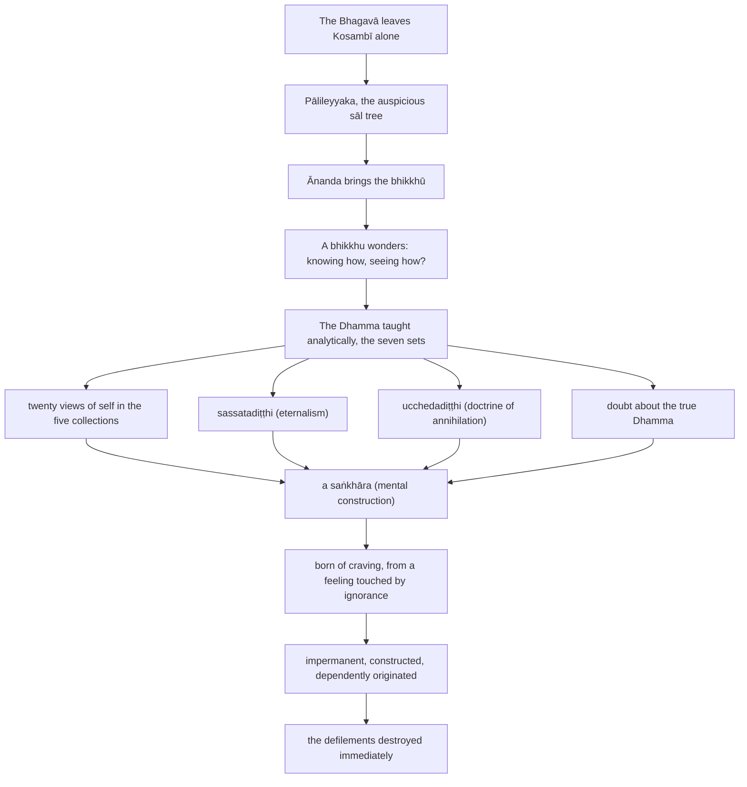

import { Tabs, TabItem } from '@astrojs/starlight/components';

Original text: [13S3/1.2.3.9 Pālileyyasutta 434–446](https://tipitaka2500.github.io/tipitaka/13S3/1/1.2/1.2.3/1.2.3.9.html#434) in the [World Tipitaka Edition](https://tipitaka2500.github.io)

## Summary

The Bhagavā leaves Kosambī alone, without telling his attendants or the Saṅgha, and settles at Pālileyyaka, where āyasmā Ānanda brings a group of bhikkhū to hear him. Knowing one bhikkhu's unspoken question — how one must know and see for the defilements to be destroyed at once — he answers that every way of regarding the five collections as self, the eternalist and annihilationist views, and doubt itself are mental constructions, born of craving from a feeling touched by ignorance, and so impermanent, constructed and dependently originated; seeing this, the defilements end.

## Diagram

## Text

<Tabs syncKey="paliquote">
<TabItem label="My Translation">
(81.)

434\. At one time the Bhagavā was dwelling at Kosambī, in Ghosita’s Park. Then, in the morning, having dressed and taking his bowl and robes, the Bhagavā entered Kosambī for alms. Having wandered for alms in Kosambī and returned from his alms round after the meal, he set his lodging in order himself, took his bowl and robes and, without informing his attendants or taking leave of the Saṅgha of bhikkhū, set out on a journey alone, without a companion.

435\. Then, soon after the Bhagavā had left, a certain bhikkhu approached āyasmā Ānanda; having approached, he said this to āyasmā Ānanda: “Āvuso Ānanda, the Bhagavā has himself set his lodging in order, taken his bowl and robes and, without informing his attendants or taking leave of the Saṅgha of bhikkhū, he has set out on a journey alone, without a companion.” “Āvuso, when the Bhagavā sets his lodging in order himself, takes his bowl and robes and, without informing his attendants or taking leave of the Saṅgha of bhikkhū, sets out on a journey alone, without a companion, at that time the Bhagavā wishes to dwell alone; at that time the Bhagavā should not be followed by anyone.”

436\. Then the Bhagavā, wandering on tour in stages, arrived at Pālileyyaka. There the Bhagavā dwelt at Pālileyyaka, at the foot of an auspicious sāl tree. Then several bhikkhū went to where āyasmā Ānanda was; having approached, they exchanged greetings with āyasmā Ānanda. Having concluded their cordial and polite talk, they sat down to one side. Sitting to one side, those bhikkhū said this to āyasmā Ānanda: “It has indeed been a long time, Āvuso Ānanda, since we heard a Dhamma talk from the Bhagavā’s own mouth; we wish, Āvuso Ānanda, to hear a Dhamma talk from the Bhagavā’s own mouth.”

437\. Then āyasmā Ānanda, together with those bhikkhū, approached the Bhagavā at Pālileyyaka, at the foot of the auspicious sāl tree; Having approached, he bowed to the Bhagavā and sat down to one side. The Bhagavā instructed, encouraged, fired up, and gladdened those bhikkhū, seated to one side, with a Dhamma talk. Now at that time this reflection arose in the mind of a certain bhikkhu: “Knowing how, seeing how, does the destruction of the `āsavā` (defilements) come about immediately?” Then the Bhagavā, knowing the thought process of that bhikkhu with his mind, addressed the bhikkhū: “Bhikkhave, the Dhamma has been taught by me analytically; the `cattāro satipaṭṭhānā` (four reflections) have been taught analytically; the `cattāro sammappadhānā` (four right exertions) have been taught analytically; the `cattāro iddhipādā` (four bases of success) have been taught analytically; the `pañcindriyāni` (five faculties) have been taught analytically; the `pañca balāni` (five powers) have been taught analytically; the `sattabojjhaṅgā` (seven factors of awakening) have been taught analytically; the `ariyo aṭṭhaṅgiko maggo` (path of the liberated in eight parts) has been taught analytically. Thus, Bhikkhave, the Dhamma has been taught by me analytically. And yet, Bhikkhave, when the Dhamma has thus been taught by me analytically, here this reflection arose in the mind of a certain bhikkhu: ‘Knowing how, seeing how, does the destruction of the `āsavā` (defilements) come about immediately?’

438\. And knowing how, Bhikkhave, seeing how, does the destruction of the defilements come about immediately? Here, Bhikkhave, an unlearned ordinary person, who has no regard for the liberated, is unskilled in the Dhamma of the liberated and untrained in the Dhamma of the liberated, who has no regard for good people, is unskilled in the Dhamma of good people and untrained in the Dhamma of good people, regards `rūpa` (form) as self. Now that way of regarding, Bhikkhave, is a `saṅkhāra` (mental construction). And that mental construction — what is its source, what is its origin, from what is it born, from what is it produced? Bhikkhave, in an unlearned ordinary person touched by a feeling born of contact with ignorance, craving has arisen; that mental construction is born from that. Thus, Bhikkhave, that mental construction too is impermanent, constructed, dependently originated. That craving too is impermanent, constructed, dependently originated. That `vedanā` (feeling) too, that contact too, is impermanent, constructed, dependently originated. That ignorance too is impermanent, constructed, dependently originated. Knowing in this way too, Bhikkhave, seeing in this way, the destruction of the defilements comes about immediately.

439\. Indeed, he does not regard form as self; but he regards self as possessing form. Now that way of regarding, Bhikkhave, is a mental construction. And that mental construction — what is its source, what is its origin, from what is it born, from what is it produced? Bhikkhave, in an unlearned ordinary person touched by a feeling born of contact with ignorance, craving has arisen; that mental construction is born from that. Thus, Bhikkhave, that mental construction too is impermanent, constructed, dependently originated. That craving too … that feeling too … that contact too … that ignorance too is impermanent, constructed, dependently originated. Knowing in this way too, Bhikkhave, seeing in this way, the destruction of the defilements comes about immediately.

440\. Indeed, he does not regard form as self, nor does he regard self as possessing form; but he regards form as in self. Now that way of regarding, Bhikkhave, is a mental construction. And that mental construction — what is its source, what is its origin, from what is it born, from what is it produced? Bhikkhave, in an unlearned ordinary person touched by a feeling born of contact with ignorance, craving has arisen; that mental construction is born from that. Thus, Bhikkhave, that mental construction too is impermanent, constructed, dependently originated. That craving too … that feeling too … that contact too … that ignorance too is impermanent, constructed, dependently originated. Knowing in this way too, Bhikkhave, seeing in this way, the destruction of the defilements comes about immediately.

441\. Indeed, he does not regard form as self, nor does he regard self as possessing form, nor does he regard form as in self; but he regards self as in form. Now that way of regarding, Bhikkhave, is a mental construction. And that mental construction — what is its source, what is its origin, from what is it born, from what is it produced? Bhikkhave, in an unlearned ordinary person touched by a feeling born of contact with ignorance, craving has arisen; that mental construction is born from that. Thus, Bhikkhave, that mental construction too is impermanent, constructed, dependently originated. That craving too … that feeling too … that contact too … that ignorance too is impermanent, constructed, dependently originated. Knowing in this way too, Bhikkhave, … and so on … the destruction of the defilements comes about.

442\. Indeed, he does not regard form as self, nor self as possessing form, nor form as in self, nor does he regard self as in form; but he regards feeling as self, or regards self as possessing feeling, or regards feeling as in self, or regards self as in feeling; or `saññā` (apperception) … or he regards `saṅkhārā` (mental constructions) as self, or regards self as possessing mental constructions, or regards mental constructions as in self, or regards self as in mental constructions; or he regards `viññāṇa` (consciousness) as self, or self as possessing consciousness, or consciousness as in self, or regards self as in consciousness. Now that way of regarding, Bhikkhave, is a mental construction. And that mental construction — what is its source … and so on … from what is it produced? Bhikkhave, in an unlearned ordinary person touched by a feeling born of contact with ignorance, craving has arisen; that mental construction is born from that. Thus, Bhikkhave, that mental construction too is impermanent, constructed, dependently originated. That craving too … that feeling too … that contact too … that ignorance too is impermanent, constructed, dependently originated. Knowing in this way, Bhikkhave, seeing in this way, the destruction of the defilements comes about immediately.

443\. Indeed, he does not regard form as self, nor does he regard feeling as self, nor apperception … nor mental constructions … nor does he regard consciousness as self; but he holds this view: ‘That is the self, that is the world; after death I shall be that, permanent, enduring, eternal, not subject to change.’ Now that `sassatadiṭṭhi` (eternalism), Bhikkhave, is a mental construction. And that mental construction — what is its source? … and so on … Knowing in this way too, Bhikkhave, seeing in this way, the destruction of the defilements comes about immediately.

444\. Indeed, he does not regard form as self, nor feeling … nor apperception … nor mental constructions … nor does he regard consciousness as self; nor does he hold this view: ‘That is the self, that is the world; after death I shall be that, permanent, enduring, eternal, not subject to change.’ But he holds this view: ‘I might not be, and it might not be for me; I would not exist, and it will not be for me.’ Now that `ucchedadiṭṭhi` (doctrine of annihilation), Bhikkhave, is a mental construction. And that mental construction — what is its source, what is its origin, from what is it born, from what is it produced? Bhikkhave, in an unlearned ordinary person touched by a feeling born of contact with ignorance, craving has arisen; that mental construction is born from that. Thus, Bhikkhave, that mental construction too is impermanent … and so on … Knowing in this way too, Bhikkhave, seeing in this way, the destruction of the defilements comes about immediately.

445\. Indeed, he does not regard form as self, nor feeling … nor apperception … nor mental constructions … nor does he regard consciousness as self … and so on … nor does he regard [what is] in consciousness as self, nor does he hold this view: ‘That is the self, that is the world; after death I shall be that, permanent, enduring, eternal, not subject to change’; nor does he hold this view: ‘I might not be, and it might not be for me; I would not exist, and it will not be for me’; but he is doubtful, uncertain, has not come to a conclusion about the true Dhamma. Now that doubt, uncertainty, not having come to a conclusion about the true Dhamma, Bhikkhave, is a mental construction. And that mental construction — what is its source, what is its origin, from what is it born, from what is it produced? Bhikkhave, in an unlearned ordinary person touched by a feeling born of contact with ignorance, craving has arisen; that mental construction is born from that. Thus, Bhikkhave, that mental construction too is impermanent, constructed, dependently originated. That craving too is impermanent, constructed, dependently originated. That feeling too is impermanent, constructed, dependently originated. That contact too is impermanent, constructed, dependently originated. That ignorance too is impermanent, constructed, dependently originated. Knowing in this way, Bhikkhave, seeing in this way, the destruction of the defilements comes about immediately.”

446\. The ninth [discourse of the chapter].
</TabItem>

<TabItem label="Pāḷi (Roman IAST)">
(81.)

434\. Ekaṃ samayaṃ bhagavā kosambiyaṃ viharati ghositārāme. Atha kho bhagavā pubbaṇhasamayaṃ nivāsetvā pattacīvaramādāya kosambiṃ piṇḍāya pāvisi. Kosambiyaṃ piṇḍāya caritvā pacchābhattaṃ piṇḍapātapaṭikkanto sāmaṃ senāsanaṃ saṃsāmetvā pattacīvaramādāya anāmantetvā upaṭṭhāke anapaloketvā bhikkhusaṃghaṃ eko adutiyo cārikaṃ pakkāmi.

435\. Atha kho aññataro bhikkhu acirapakkantassa bhagavato yenāyasmā ānando tenupasaṅkami; upasaṅkamitvā āyasmantaṃ ānandaṃ etadavoca— “esāvuso ānanda, bhagavā sāmaṃ senāsanaṃ saṃsāmetvā pattacīvaramādāya anāmantetvā upaṭṭhāke anapaloketvā bhikkhusaṃghaṃ eko adutiyo cārikaṃ pakkanto”ti. “Yasmiṃ, āvuso, samaye bhagavā sāmaṃ senāsanaṃ saṃsāmetvā pattacīvaramādāya anāmantetvā upaṭṭhāke anapaloketvā bhikkhusaṃghaṃ eko adutiyo cārikaṃ pakkamati, ekova bhagavā tasmiṃ samaye viharitukāmo hoti; na bhagavā tasmiṃ samaye kenaci anubandhitabbo hotī”ti.

436\. Atha kho bhagavā anupubbena cārikaṃ caramāno yena pālileyyakaṃ tadavasari. Tatra sudaṃ bhagavā pālileyyake viharati bhaddasālamūle. Atha kho sambahulā bhikkhū yenāyasmā ānando tenupasaṅkamiṃsu; upasaṅkamitvā āyasmatā ānandena saddhiṃ sammodiṃsu. Sammodanīyaṃ kathaṃ sāraṇīyaṃ vītisāretvā ekamantaṃ nisīdiṃsu. Ekamantaṃ nisinnā kho te bhikkhū āyasmantaṃ ānandaṃ etadavocuṃ— “cirassutā kho no, āvuso ānanda, bhagavato sammukhā dhammī kathā; icchāma mayaṃ, āvuso ānanda, bhagavato sammukhā dhammiṃ kathaṃ sotun”ti.

437\. Atha kho āyasmā ānando tehi bhikkhūhi saddhiṃ yena pālileyyakaṃ bhaddasālamūlaṃ yena bhagavā tenupasaṅkami; upasaṅkamitvā bhagavantaṃ abhivādetvā ekamantaṃ nisīdi. Ekamantaṃ nisinne kho te bhikkhū bhagavā dhammiyā kathāya sandassesi samādapesi samuttejesi sampahaṃsesi. Tena kho pana samayena aññatarassa bhikkhuno evaṃ cetaso parivitakko udapādi— “kathaṃ nu kho jānato kathaṃ passato anantarā āsavānaṃ khayo hotī”ti? Atha kho bhagavā tassa bhikkhuno cetasā cetoparivitakkamaññāya bhikkhū āmantesi— “vicayaso desito, bhikkhave, mayā dhammo; vicayaso desitā cattāro satipaṭṭhānā; vicayaso desitā cattāro sammappadhānā; vicayaso desitā cattāro iddhipādā; vicayaso desitāni pañcindriyāni; vicayaso desitāni pañca balāni; vicayaso desitā sattabojjhaṅgā; vicayaso desito ariyo aṭṭhaṅgiko maggo. Evaṃ vicayaso desito, bhikkhave, mayā dhammo. Evaṃ vicayaso desite kho, bhikkhave, mayā dhamme atha ca panidhekaccassa bhikkhuno evaṃ cetaso parivitakko udapādi— ‘kathaṃ nu kho jānato kathaṃ passato anantarā āsavānaṃ khayo hotī’ti?

438\. Kathañca, bhikkhave, jānato kathaṃ passato anantarā āsavānaṃ khayo hoti? Idha bhikkhave, assutavā puthujjano ariyānaṃ adassāvī ariyadhammassa akovido ariyadhamme avinīto, sappurisānaṃ adassāvī sappurisadhammassa akovido sappurisadhamme avinīto rūpaṃ attato samanupassati. Yā kho pana sā, bhikkhave, samanupassanā saṅkhāro so. So pana saṅkhāro kiṃnidāno kiṃsamudayo kiṃjātiko kiṃpabhavo? Avijjāsamphassajena, bhikkhave, vedayitena phuṭṭhassa assutavato puthujjanassa uppannā taṇhā; tatojo so saṅkhāro. Iti kho, bhikkhave, sopi saṅkhāro anicco saṅkhato paṭiccasamuppanno. Sāpi taṇhā aniccā saṅkhatā paṭiccasamuppannā. Sāpi vedanā, sopi phasso anicco saṅkhato paṭiccasamuppanno. Sāpi avijjā aniccā saṅkhatā paṭiccasamuppannā. Evampi kho, bhikkhave, jānato evaṃ passato anantarā āsavānaṃ khayo hoti.

439\. Na heva kho rūpaṃ attato samanupassati; api ca kho rūpavantaṃ attānaṃ samanupassati. Yā kho pana sā, bhikkhave, samanupassanā saṅkhāro so. So pana saṅkhāro kiṃnidāno kiṃsamudayo kiṃjātiko kiṃpabhavo? Avijjāsamphassajena, bhikkhave, vedayitena phuṭṭhassa assutavato puthujjanassa uppannā taṇhā; tatojo so saṅkhāro. Iti kho, bhikkhave, sopi saṅkhāro anicco saṅkhato paṭiccasamuppanno. Sāpi taṇhā… sāpi vedanā… sopi phasso… sāpi avijjā aniccā saṅkhatā paṭiccasamuppannā. Evampi kho, bhikkhave, jānato evaṃ passato anantarā āsavānaṃ khayo hoti.

440\. Na heva kho rūpaṃ attato samanupassati, na rūpavantaṃ attānaṃ samanupassati; api ca kho attani rūpaṃ samanupassati. Yā kho pana sā, bhikkhave, samanupassanā saṅkhāro so. So pana saṅkhāro kiṃnidāno kiṃsamudayo kiṃjātiko kiṃpabhavo? Avijjāsamphassajena, bhikkhave, vedayitena phuṭṭhassa assutavato puthujjanassa uppannā taṇhā; tatojo so saṅkhāro. Iti kho, bhikkhave, sopi saṅkhāro anicco saṅkhato paṭiccasamuppanno. Sāpi taṇhā… sāpi vedanā… sopi phasso… sāpi avijjā aniccā saṅkhatā paṭiccasamuppannā. Evampi kho, bhikkhave, jānato evaṃ passato anantarā āsavānaṃ khayo hoti.

441\. Na heva kho rūpaṃ attato samanupassati, na rūpavantaṃ attānaṃ samanupassati, na attani rūpaṃ samanupassati; api ca kho rūpasmiṃ attānaṃ samanupassati. Yā kho pana sā, bhikkhave, samanupassanā saṅkhāro so. So pana saṅkhāro kiṃnidāno kiṃsamudayo kiṃjātiko kiṃpabhavo? Avijjāsamphassajena, bhikkhave, vedayitena phuṭṭhassa assutavato puthujjanassa uppannā taṇhā; tatojo so saṅkhāro. Iti kho, bhikkhave, sopi saṅkhāro anicco saṅkhato paṭiccasamuppanno. Sāpi taṇhā… sāpi vedanā… sopi phasso… sāpi avijjā aniccā saṅkhatā paṭiccasamuppannā. Evampi kho, bhikkhave, jānato…pe… āsavānaṃ khayo hoti.

442\. Na heva kho rūpaṃ attato samanupassati, na rūpavantaṃ attānaṃ, na attani rūpaṃ, na rūpasmiṃ attānaṃ samanupassati; api ca kho vedanaṃ attato samanupassati, api ca kho vedanāvantaṃ attānaṃ samanupassati, api ca kho attani vedanaṃ samanupassati, api ca kho vedanāya attānaṃ samanupassati; api ca kho saññaṃ… api ca kho saṅkhāre attato samanupassati, api ca kho saṅkhāravantaṃ attānaṃ samanupassati, api ca kho attani saṅkhāre samanupassati, api ca kho saṅkhāresu attānaṃ samanupassati; api ca kho viññāṇaṃ attato samanupassati, api ca kho viññāṇavantaṃ attānaṃ, api ca kho attani viññāṇaṃ, api ca kho viññāṇasmiṃ attānaṃ samanupassati. Yā kho pana sā, bhikkhave, samanupassanā saṅkhāro so. So pana saṅkhāro kiṃnidāno…pe… kiṃpabhavo? Avijjāsamphassajena, bhikkhave, vedayitena phuṭṭhassa assutavato puthujjanassa uppannā taṇhā; tatojo so saṅkhāro. Iti kho, bhikkhave, sopi saṅkhāro anicco saṅkhato paṭiccasamuppanno. Sāpi taṇhā… sāpi vedanā… sopi phasso… sāpi avijjā aniccā saṅkhatā paṭiccasamuppannā. Evaṃ kho, bhikkhave, jānato evaṃ passato anantarā āsavānaṃ khayo hoti.

443\. Na heva kho rūpaṃ attato samanupassati, na vedanaṃ attato samanupassati, na saññaṃ… na saṅkhāre… na viññāṇaṃ attato samanupassati; api ca kho evaṃdiṭṭhi hoti— ‘so attā so loko, so pecca bhavissāmi nicco dhuvo sassato avipariṇāmadhammo’ti. Yā kho pana sā, bhikkhave, sassatadiṭṭhi saṅkhāro so. So pana saṅkhāro kiṃnidāno…pe… evampi kho, bhikkhave, jānato evaṃ passato anantarā āsavānaṃ khayo hoti.

444\. Na heva kho rūpaṃ attato samanupassati, na vedanaṃ… na saññaṃ… na saṅkhāre… na viññāṇaṃ attato samanupassati; nāpi evaṃdiṭṭhi hoti— ‘so attā so loko, so pecca bhavissāmi nicco dhuvo sassato avipariṇāmadhammo’ti. Api ca kho evaṃdiṭṭhi hoti— ‘no cassaṃ no ca me siyā nābhavissaṃ na me bhavissatī’ti. Yā kho pana sā, bhikkhave, ucchedadiṭṭhi saṅkhāro so. So pana saṅkhāro kiṃnidāno kiṃsamudayo kiṃjātiko kiṃpabhavo? Avijjāsamphassajena, bhikkhave, vedayitena phuṭṭhassa assutavato puthujjanassa uppannā taṇhā; tatojo so saṅkhāro. Iti kho, bhikkhave, sopi saṅkhāro anicco…pe… evampi kho, bhikkhave, jānato evaṃ passato anantarā āsavānaṃ khayo hoti.

445\. Na heva kho rūpaṃ attato samanupassati, na vedanaṃ… na saññaṃ… na saṅkhāre… na viññāṇaṃ attato samanupassati…pe… na viññāṇasmiṃ attato samanupassati, nāpi evaṃdiṭṭhi hoti— ‘so attā so loko, so pecca bhavissāmi nicco dhuvo sassato avipariṇāmadhammo’ti; nāpi evaṃdiṭṭhi hoti— ‘no cassaṃ no ca me siyā nābhavissaṃ na me bhavissatī’ti; api ca kho kaṅkhī hoti vicikicchī aniṭṭhaṅgato saddhamme. Yā kho pana sā, bhikkhave, kaṅkhitā vicikicchitā aniṭṭhaṅgatatā saddhamme saṅkhāro so. So pana saṅkhāro kiṃnidāno kiṃsamudayo kiṃjātiko kiṃpabhavo? Avijjāsamphassajena, bhikkhave, vedayitena phuṭṭhassa assutavato puthujjanassa uppannā taṇhā; tatojo so saṅkhāro. Iti kho, bhikkhave, sopi saṅkhāro anicco saṅkhato paṭiccasamuppanno. Sāpi taṇhā aniccā saṅkhatā paṭiccasamuppannā. Sāpi vedanā aniccā saṅkhatā paṭiccasamuppannā. Sopi phasso anicco saṅkhato paṭiccasamuppanno. Sāpi avijjā aniccā saṅkhatā paṭiccasamuppannā. Evaṃ kho, bhikkhave, jānato evaṃ passato anantarā āsavānaṃ khayo hotī”ti.

446\. Navamaṃ.
</TabItem>

<TabItem label="Pāḷi (Brahmi)">
(81.)

434\. 𑀏𑀓𑀁 𑀲𑀫𑀬𑀁 𑀪𑀕𑀯𑀸 𑀓𑁄𑀲𑀫𑁆𑀩𑀺𑀬𑀁 𑀯𑀺𑀳𑀭𑀢𑀺 𑀖𑁄𑀲𑀺𑀢𑀸𑀭𑀸𑀫𑁂. 𑀅𑀣 𑀔𑁄 𑀪𑀕𑀯𑀸 𑀧𑀼𑀩𑁆𑀩𑀡𑁆𑀳𑀲𑀫𑀬𑀁 𑀦𑀺𑀯𑀸𑀲𑁂𑀢𑁆𑀯𑀸 𑀧𑀢𑁆𑀢𑀘𑀻𑀯𑀭𑀫𑀸𑀤𑀸𑀬 𑀓𑁄𑀲𑀫𑁆𑀩𑀺𑀁 𑀧𑀺𑀡𑁆𑀟𑀸𑀬 𑀧𑀸𑀯𑀺𑀲𑀺. 𑀓𑁄𑀲𑀫𑁆𑀩𑀺𑀬𑀁 𑀧𑀺𑀡𑁆𑀟𑀸𑀬 𑀘𑀭𑀺𑀢𑁆𑀯𑀸 𑀧𑀘𑁆𑀙𑀸𑀪𑀢𑁆𑀢𑀁 𑀧𑀺𑀡𑁆𑀟𑀧𑀸𑀢𑀧𑀝𑀺𑀓𑁆𑀓𑀦𑁆𑀢𑁄 𑀲𑀸𑀫𑀁 𑀲𑁂𑀦𑀸𑀲𑀦𑀁 𑀲𑀁𑀲𑀸𑀫𑁂𑀢𑁆𑀯𑀸 𑀧𑀢𑁆𑀢𑀘𑀻𑀯𑀭𑀫𑀸𑀤𑀸𑀬 𑀅𑀦𑀸𑀫𑀦𑁆𑀢𑁂𑀢𑁆𑀯𑀸 𑀉𑀧𑀝𑁆𑀞𑀸𑀓𑁂 𑀅𑀦𑀧𑀮𑁄𑀓𑁂𑀢𑁆𑀯𑀸 𑀪𑀺𑀓𑁆𑀔𑀼𑀲𑀁𑀖𑀁 𑀏𑀓𑁄 𑀅𑀤𑀼𑀢𑀺𑀬𑁄 𑀘𑀸𑀭𑀺𑀓𑀁 𑀧𑀓𑁆𑀓𑀸𑀫𑀺.

435\. 𑀅𑀣 𑀔𑁄 𑀅𑀜𑁆𑀜𑀢𑀭𑁄 𑀪𑀺𑀓𑁆𑀔𑀼 𑀅𑀘𑀺𑀭𑀧𑀓𑁆𑀓𑀦𑁆𑀢𑀲𑁆𑀲 𑀪𑀕𑀯𑀢𑁄 𑀬𑁂𑀦𑀸𑀬𑀲𑁆𑀫𑀸 𑀆𑀦𑀦𑁆𑀤𑁄 𑀢𑁂𑀦𑀼𑀧𑀲𑀗𑁆𑀓𑀫𑀺; 𑀉𑀧𑀲𑀗𑁆𑀓𑀫𑀺𑀢𑁆𑀯𑀸 𑀆𑀬𑀲𑁆𑀫𑀦𑁆𑀢𑀁 𑀆𑀦𑀦𑁆𑀤𑀁 𑀏𑀢𑀤𑀯𑁄𑀘— “𑀏𑀲𑀸𑀯𑀼𑀲𑁄 𑀆𑀦𑀦𑁆𑀤, 𑀪𑀕𑀯𑀸 𑀲𑀸𑀫𑀁 𑀲𑁂𑀦𑀸𑀲𑀦𑀁 𑀲𑀁𑀲𑀸𑀫𑁂𑀢𑁆𑀯𑀸 𑀧𑀢𑁆𑀢𑀘𑀻𑀯𑀭𑀫𑀸𑀤𑀸𑀬 𑀅𑀦𑀸𑀫𑀦𑁆𑀢𑁂𑀢𑁆𑀯𑀸 𑀉𑀧𑀝𑁆𑀞𑀸𑀓𑁂 𑀅𑀦𑀧𑀮𑁄𑀓𑁂𑀢𑁆𑀯𑀸 𑀪𑀺𑀓𑁆𑀔𑀼𑀲𑀁𑀖𑀁 𑀏𑀓𑁄 𑀅𑀤𑀼𑀢𑀺𑀬𑁄 𑀘𑀸𑀭𑀺𑀓𑀁 𑀧𑀓𑁆𑀓𑀦𑁆𑀢𑁄”𑀢𑀺. “𑀬𑀲𑁆𑀫𑀺𑀁, 𑀆𑀯𑀼𑀲𑁄, 𑀲𑀫𑀬𑁂 𑀪𑀕𑀯𑀸 𑀲𑀸𑀫𑀁 𑀲𑁂𑀦𑀸𑀲𑀦𑀁 𑀲𑀁𑀲𑀸𑀫𑁂𑀢𑁆𑀯𑀸 𑀧𑀢𑁆𑀢𑀘𑀻𑀯𑀭𑀫𑀸𑀤𑀸𑀬 𑀅𑀦𑀸𑀫𑀦𑁆𑀢𑁂𑀢𑁆𑀯𑀸 𑀉𑀧𑀝𑁆𑀞𑀸𑀓𑁂 𑀅𑀦𑀧𑀮𑁄𑀓𑁂𑀢𑁆𑀯𑀸 𑀪𑀺𑀓𑁆𑀔𑀼𑀲𑀁𑀖𑀁 𑀏𑀓𑁄 𑀅𑀤𑀼𑀢𑀺𑀬𑁄 𑀘𑀸𑀭𑀺𑀓𑀁 𑀧𑀓𑁆𑀓𑀫𑀢𑀺, 𑀏𑀓𑁄𑀯 𑀪𑀕𑀯𑀸 𑀢𑀲𑁆𑀫𑀺𑀁 𑀲𑀫𑀬𑁂 𑀯𑀺𑀳𑀭𑀺𑀢𑀼𑀓𑀸𑀫𑁄 𑀳𑁄𑀢𑀺; 𑀦 𑀪𑀕𑀯𑀸 𑀢𑀲𑁆𑀫𑀺𑀁 𑀲𑀫𑀬𑁂 𑀓𑁂𑀦𑀘𑀺 𑀅𑀦𑀼𑀩𑀦𑁆𑀥𑀺𑀢𑀩𑁆𑀩𑁄 𑀳𑁄𑀢𑀻”𑀢𑀺.

436\. 𑀅𑀣 𑀔𑁄 𑀪𑀕𑀯𑀸 𑀅𑀦𑀼𑀧𑀼𑀩𑁆𑀩𑁂𑀦 𑀘𑀸𑀭𑀺𑀓𑀁 𑀘𑀭𑀫𑀸𑀦𑁄 𑀬𑁂𑀦 𑀧𑀸𑀮𑀺𑀮𑁂𑀬𑁆𑀬𑀓𑀁 𑀢𑀤𑀯𑀲𑀭𑀺. 𑀢𑀢𑁆𑀭 𑀲𑀼𑀤𑀁 𑀪𑀕𑀯𑀸 𑀧𑀸𑀮𑀺𑀮𑁂𑀬𑁆𑀬𑀓𑁂 𑀯𑀺𑀳𑀭𑀢𑀺 𑀪𑀤𑁆𑀤𑀲𑀸𑀮𑀫𑀽𑀮𑁂. 𑀅𑀣 𑀔𑁄 𑀲𑀫𑁆𑀩𑀳𑀼𑀮𑀸 𑀪𑀺𑀓𑁆𑀔𑀽 𑀬𑁂𑀦𑀸𑀬𑀲𑁆𑀫𑀸 𑀆𑀦𑀦𑁆𑀤𑁄 𑀢𑁂𑀦𑀼𑀧𑀲𑀗𑁆𑀓𑀫𑀺𑀁𑀲𑀼; 𑀉𑀧𑀲𑀗𑁆𑀓𑀫𑀺𑀢𑁆𑀯𑀸 𑀆𑀬𑀲𑁆𑀫𑀢𑀸 𑀆𑀦𑀦𑁆𑀤𑁂𑀦 𑀲𑀤𑁆𑀥𑀺𑀁 𑀲𑀫𑁆𑀫𑁄𑀤𑀺𑀁𑀲𑀼. 𑀲𑀫𑁆𑀫𑁄𑀤𑀦𑀻𑀬𑀁 𑀓𑀣𑀁 𑀲𑀸𑀭𑀡𑀻𑀬𑀁 𑀯𑀻𑀢𑀺𑀲𑀸𑀭𑁂𑀢𑁆𑀯𑀸 𑀏𑀓𑀫𑀦𑁆𑀢𑀁 𑀦𑀺𑀲𑀻𑀤𑀺𑀁𑀲𑀼. 𑀏𑀓𑀫𑀦𑁆𑀢𑀁 𑀦𑀺𑀲𑀺𑀦𑁆𑀦𑀸 𑀔𑁄 𑀢𑁂 𑀪𑀺𑀓𑁆𑀔𑀽 𑀆𑀬𑀲𑁆𑀫𑀦𑁆𑀢𑀁 𑀆𑀦𑀦𑁆𑀤𑀁 𑀏𑀢𑀤𑀯𑁄𑀘𑀼𑀁— “𑀘𑀺𑀭𑀲𑁆𑀲𑀼𑀢𑀸 𑀔𑁄 𑀦𑁄, 𑀆𑀯𑀼𑀲𑁄 𑀆𑀦𑀦𑁆𑀤, 𑀪𑀕𑀯𑀢𑁄 𑀲𑀫𑁆𑀫𑀼𑀔𑀸 𑀥𑀫𑁆𑀫𑀻 𑀓𑀣𑀸; 𑀇𑀘𑁆𑀙𑀸𑀫 𑀫𑀬𑀁, 𑀆𑀯𑀼𑀲𑁄 𑀆𑀦𑀦𑁆𑀤, 𑀪𑀕𑀯𑀢𑁄 𑀲𑀫𑁆𑀫𑀼𑀔𑀸 𑀥𑀫𑁆𑀫𑀺𑀁 𑀓𑀣𑀁 𑀲𑁄𑀢𑀼𑀦𑁆”𑀢𑀺.

437\. 𑀅𑀣 𑀔𑁄 𑀆𑀬𑀲𑁆𑀫𑀸 𑀆𑀦𑀦𑁆𑀤𑁄 𑀢𑁂𑀳𑀺 𑀪𑀺𑀓𑁆𑀔𑀽𑀳𑀺 𑀲𑀤𑁆𑀥𑀺𑀁 𑀬𑁂𑀦 𑀧𑀸𑀮𑀺𑀮𑁂𑀬𑁆𑀬𑀓𑀁 𑀪𑀤𑁆𑀤𑀲𑀸𑀮𑀫𑀽𑀮𑀁 𑀬𑁂𑀦 𑀪𑀕𑀯𑀸 𑀢𑁂𑀦𑀼𑀧𑀲𑀗𑁆𑀓𑀫𑀺; 𑀉𑀧𑀲𑀗𑁆𑀓𑀫𑀺𑀢𑁆𑀯𑀸 𑀪𑀕𑀯𑀦𑁆𑀢𑀁 𑀅𑀪𑀺𑀯𑀸𑀤𑁂𑀢𑁆𑀯𑀸 𑀏𑀓𑀫𑀦𑁆𑀢𑀁 𑀦𑀺𑀲𑀻𑀤𑀺. 𑀏𑀓𑀫𑀦𑁆𑀢𑀁 𑀦𑀺𑀲𑀺𑀦𑁆𑀦𑁂 𑀔𑁄 𑀢𑁂 𑀪𑀺𑀓𑁆𑀔𑀽 𑀪𑀕𑀯𑀸 𑀥𑀫𑁆𑀫𑀺𑀬𑀸 𑀓𑀣𑀸𑀬 𑀲𑀦𑁆𑀤𑀲𑁆𑀲𑁂𑀲𑀺 𑀲𑀫𑀸𑀤𑀧𑁂𑀲𑀺 𑀲𑀫𑀼𑀢𑁆𑀢𑁂𑀚𑁂𑀲𑀺 𑀲𑀫𑁆𑀧𑀳𑀁𑀲𑁂𑀲𑀺. 𑀢𑁂𑀦 𑀔𑁄 𑀧𑀦 𑀲𑀫𑀬𑁂𑀦 𑀅𑀜𑁆𑀜𑀢𑀭𑀲𑁆𑀲 𑀪𑀺𑀓𑁆𑀔𑀼𑀦𑁄 𑀏𑀯𑀁 𑀘𑁂𑀢𑀲𑁄 𑀧𑀭𑀺𑀯𑀺𑀢𑀓𑁆𑀓𑁄 𑀉𑀤𑀧𑀸𑀤𑀺— “𑀓𑀣𑀁 𑀦𑀼 𑀔𑁄 𑀚𑀸𑀦𑀢𑁄 𑀓𑀣𑀁 𑀧𑀲𑁆𑀲𑀢𑁄 𑀅𑀦𑀦𑁆𑀢𑀭𑀸 𑀆𑀲𑀯𑀸𑀦𑀁 𑀔𑀬𑁄 𑀳𑁄𑀢𑀻”𑀢𑀺? 𑀅𑀣 𑀔𑁄 𑀪𑀕𑀯𑀸 𑀢𑀲𑁆𑀲 𑀪𑀺𑀓𑁆𑀔𑀼𑀦𑁄 𑀘𑁂𑀢𑀲𑀸 𑀘𑁂𑀢𑁄𑀧𑀭𑀺𑀯𑀺𑀢𑀓𑁆𑀓𑀫𑀜𑁆𑀜𑀸𑀬 𑀪𑀺𑀓𑁆𑀔𑀽 𑀆𑀫𑀦𑁆𑀢𑁂𑀲𑀺— “𑀯𑀺𑀘𑀬𑀲𑁄 𑀤𑁂𑀲𑀺𑀢𑁄, 𑀪𑀺𑀓𑁆𑀔𑀯𑁂, 𑀫𑀬𑀸 𑀥𑀫𑁆𑀫𑁄; 𑀯𑀺𑀘𑀬𑀲𑁄 𑀤𑁂𑀲𑀺𑀢𑀸 𑀘𑀢𑁆𑀢𑀸𑀭𑁄 𑀲𑀢𑀺𑀧𑀝𑁆𑀞𑀸𑀦𑀸; 𑀯𑀺𑀘𑀬𑀲𑁄 𑀤𑁂𑀲𑀺𑀢𑀸 𑀘𑀢𑁆𑀢𑀸𑀭𑁄 𑀲𑀫𑁆𑀫𑀧𑁆𑀧𑀥𑀸𑀦𑀸; 𑀯𑀺𑀘𑀬𑀲𑁄 𑀤𑁂𑀲𑀺𑀢𑀸 𑀘𑀢𑁆𑀢𑀸𑀭𑁄 𑀇𑀤𑁆𑀥𑀺𑀧𑀸𑀤𑀸; 𑀯𑀺𑀘𑀬𑀲𑁄 𑀤𑁂𑀲𑀺𑀢𑀸𑀦𑀺 𑀧𑀜𑁆𑀘𑀺𑀦𑁆𑀤𑁆𑀭𑀺𑀬𑀸𑀦𑀺; 𑀯𑀺𑀘𑀬𑀲𑁄 𑀤𑁂𑀲𑀺𑀢𑀸𑀦𑀺 𑀧𑀜𑁆𑀘 𑀩𑀮𑀸𑀦𑀺; 𑀯𑀺𑀘𑀬𑀲𑁄 𑀤𑁂𑀲𑀺𑀢𑀸 𑀲𑀢𑁆𑀢𑀩𑁄𑀚𑁆𑀛𑀗𑁆𑀕𑀸; 𑀯𑀺𑀘𑀬𑀲𑁄 𑀤𑁂𑀲𑀺𑀢𑁄 𑀅𑀭𑀺𑀬𑁄 𑀅𑀝𑁆𑀞𑀗𑁆𑀕𑀺𑀓𑁄 𑀫𑀕𑁆𑀕𑁄. 𑀏𑀯𑀁 𑀯𑀺𑀘𑀬𑀲𑁄 𑀤𑁂𑀲𑀺𑀢𑁄, 𑀪𑀺𑀓𑁆𑀔𑀯𑁂, 𑀫𑀬𑀸 𑀥𑀫𑁆𑀫𑁄. 𑀏𑀯𑀁 𑀯𑀺𑀘𑀬𑀲𑁄 𑀤𑁂𑀲𑀺𑀢𑁂 𑀔𑁄, 𑀪𑀺𑀓𑁆𑀔𑀯𑁂, 𑀫𑀬𑀸 𑀥𑀫𑁆𑀫𑁂 𑀅𑀣 𑀘 𑀧𑀦𑀺𑀥𑁂𑀓𑀘𑁆𑀘𑀲𑁆𑀲 𑀪𑀺𑀓𑁆𑀔𑀼𑀦𑁄 𑀏𑀯𑀁 𑀘𑁂𑀢𑀲𑁄 𑀧𑀭𑀺𑀯𑀺𑀢𑀓𑁆𑀓𑁄 𑀉𑀤𑀧𑀸𑀤𑀺— ‘𑀓𑀣𑀁 𑀦𑀼 𑀔𑁄 𑀚𑀸𑀦𑀢𑁄 𑀓𑀣𑀁 𑀧𑀲𑁆𑀲𑀢𑁄 𑀅𑀦𑀦𑁆𑀢𑀭𑀸 𑀆𑀲𑀯𑀸𑀦𑀁 𑀔𑀬𑁄 𑀳𑁄𑀢𑀻’𑀢𑀺?

438\. 𑀓𑀣𑀜𑁆𑀘, 𑀪𑀺𑀓𑁆𑀔𑀯𑁂, 𑀚𑀸𑀦𑀢𑁄 𑀓𑀣𑀁 𑀧𑀲𑁆𑀲𑀢𑁄 𑀅𑀦𑀦𑁆𑀢𑀭𑀸 𑀆𑀲𑀯𑀸𑀦𑀁 𑀔𑀬𑁄 𑀳𑁄𑀢𑀺? 𑀇𑀥 𑀪𑀺𑀓𑁆𑀔𑀯𑁂, 𑀅𑀲𑁆𑀲𑀼𑀢𑀯𑀸 𑀧𑀼𑀣𑀼𑀚𑁆𑀚𑀦𑁄 𑀅𑀭𑀺𑀬𑀸𑀦𑀁 𑀅𑀤𑀲𑁆𑀲𑀸𑀯𑀻 𑀅𑀭𑀺𑀬𑀥𑀫𑁆𑀫𑀲𑁆𑀲 𑀅𑀓𑁄𑀯𑀺𑀤𑁄 𑀅𑀭𑀺𑀬𑀥𑀫𑁆𑀫𑁂 𑀅𑀯𑀺𑀦𑀻𑀢𑁄, 𑀲𑀧𑁆𑀧𑀼𑀭𑀺𑀲𑀸𑀦𑀁 𑀅𑀤𑀲𑁆𑀲𑀸𑀯𑀻 𑀲𑀧𑁆𑀧𑀼𑀭𑀺𑀲𑀥𑀫𑁆𑀫𑀲𑁆𑀲 𑀅𑀓𑁄𑀯𑀺𑀤𑁄 𑀲𑀧𑁆𑀧𑀼𑀭𑀺𑀲𑀥𑀫𑁆𑀫𑁂 𑀅𑀯𑀺𑀦𑀻𑀢𑁄 𑀭𑀽𑀧𑀁 𑀅𑀢𑁆𑀢𑀢𑁄 𑀲𑀫𑀦𑀼𑀧𑀲𑁆𑀲𑀢𑀺. 𑀬𑀸 𑀔𑁄 𑀧𑀦 𑀲𑀸, 𑀪𑀺𑀓𑁆𑀔𑀯𑁂, 𑀲𑀫𑀦𑀼𑀧𑀲𑁆𑀲𑀦𑀸 𑀲𑀗𑁆𑀔𑀸𑀭𑁄 𑀲𑁄. 𑀲𑁄 𑀧𑀦 𑀲𑀗𑁆𑀔𑀸𑀭𑁄 𑀓𑀺𑀁𑀦𑀺𑀤𑀸𑀦𑁄 𑀓𑀺𑀁𑀲𑀫𑀼𑀤𑀬𑁄 𑀓𑀺𑀁𑀚𑀸𑀢𑀺𑀓𑁄 𑀓𑀺𑀁𑀧𑀪𑀯𑁄? 𑀅𑀯𑀺𑀚𑁆𑀚𑀸𑀲𑀫𑁆𑀨𑀲𑁆𑀲𑀚𑁂𑀦, 𑀪𑀺𑀓𑁆𑀔𑀯𑁂, 𑀯𑁂𑀤𑀬𑀺𑀢𑁂𑀦 𑀨𑀼𑀝𑁆𑀞𑀲𑁆𑀲 𑀅𑀲𑁆𑀲𑀼𑀢𑀯𑀢𑁄 𑀧𑀼𑀣𑀼𑀚𑁆𑀚𑀦𑀲𑁆𑀲 𑀉𑀧𑁆𑀧𑀦𑁆𑀦𑀸 𑀢𑀡𑁆𑀳𑀸; 𑀢𑀢𑁄𑀚𑁄 𑀲𑁄 𑀲𑀗𑁆𑀔𑀸𑀭𑁄. 𑀇𑀢𑀺 𑀔𑁄, 𑀪𑀺𑀓𑁆𑀔𑀯𑁂, 𑀲𑁄𑀧𑀺 𑀲𑀗𑁆𑀔𑀸𑀭𑁄 𑀅𑀦𑀺𑀘𑁆𑀘𑁄 𑀲𑀗𑁆𑀔𑀢𑁄 𑀧𑀝𑀺𑀘𑁆𑀘𑀲𑀫𑀼𑀧𑁆𑀧𑀦𑁆𑀦𑁄. 𑀲𑀸𑀧𑀺 𑀢𑀡𑁆𑀳𑀸 𑀅𑀦𑀺𑀘𑁆𑀘𑀸 𑀲𑀗𑁆𑀔𑀢𑀸 𑀧𑀝𑀺𑀘𑁆𑀘𑀲𑀫𑀼𑀧𑁆𑀧𑀦𑁆𑀦𑀸. 𑀲𑀸𑀧𑀺 𑀯𑁂𑀤𑀦𑀸, 𑀲𑁄𑀧𑀺 𑀨𑀲𑁆𑀲𑁄 𑀅𑀦𑀺𑀘𑁆𑀘𑁄 𑀲𑀗𑁆𑀔𑀢𑁄 𑀧𑀝𑀺𑀘𑁆𑀘𑀲𑀫𑀼𑀧𑁆𑀧𑀦𑁆𑀦𑁄. 𑀲𑀸𑀧𑀺 𑀅𑀯𑀺𑀚𑁆𑀚𑀸 𑀅𑀦𑀺𑀘𑁆𑀘𑀸 𑀲𑀗𑁆𑀔𑀢𑀸 𑀧𑀝𑀺𑀘𑁆𑀘𑀲𑀫𑀼𑀧𑁆𑀧𑀦𑁆𑀦𑀸. 𑀏𑀯𑀫𑁆𑀧𑀺 𑀔𑁄, 𑀪𑀺𑀓𑁆𑀔𑀯𑁂, 𑀚𑀸𑀦𑀢𑁄 𑀏𑀯𑀁 𑀧𑀲𑁆𑀲𑀢𑁄 𑀅𑀦𑀦𑁆𑀢𑀭𑀸 𑀆𑀲𑀯𑀸𑀦𑀁 𑀔𑀬𑁄 𑀳𑁄𑀢𑀺.

439\. 𑀦 𑀳𑁂𑀯 𑀔𑁄 𑀭𑀽𑀧𑀁 𑀅𑀢𑁆𑀢𑀢𑁄 𑀲𑀫𑀦𑀼𑀧𑀲𑁆𑀲𑀢𑀺; 𑀅𑀧𑀺 𑀘 𑀔𑁄 𑀭𑀽𑀧𑀯𑀦𑁆𑀢𑀁 𑀅𑀢𑁆𑀢𑀸𑀦𑀁 𑀲𑀫𑀦𑀼𑀧𑀲𑁆𑀲𑀢𑀺. 𑀬𑀸 𑀔𑁄 𑀧𑀦 𑀲𑀸, 𑀪𑀺𑀓𑁆𑀔𑀯𑁂, 𑀲𑀫𑀦𑀼𑀧𑀲𑁆𑀲𑀦𑀸 𑀲𑀗𑁆𑀔𑀸𑀭𑁄 𑀲𑁄. 𑀲𑁄 𑀧𑀦 𑀲𑀗𑁆𑀔𑀸𑀭𑁄 𑀓𑀺𑀁𑀦𑀺𑀤𑀸𑀦𑁄 𑀓𑀺𑀁𑀲𑀫𑀼𑀤𑀬𑁄 𑀓𑀺𑀁𑀚𑀸𑀢𑀺𑀓𑁄 𑀓𑀺𑀁𑀧𑀪𑀯𑁄? 𑀅𑀯𑀺𑀚𑁆𑀚𑀸𑀲𑀫𑁆𑀨𑀲𑁆𑀲𑀚𑁂𑀦, 𑀪𑀺𑀓𑁆𑀔𑀯𑁂, 𑀯𑁂𑀤𑀬𑀺𑀢𑁂𑀦 𑀨𑀼𑀝𑁆𑀞𑀲𑁆𑀲 𑀅𑀲𑁆𑀲𑀼𑀢𑀯𑀢𑁄 𑀧𑀼𑀣𑀼𑀚𑁆𑀚𑀦𑀲𑁆𑀲 𑀉𑀧𑁆𑀧𑀦𑁆𑀦𑀸 𑀢𑀡𑁆𑀳𑀸; 𑀢𑀢𑁄𑀚𑁄 𑀲𑁄 𑀲𑀗𑁆𑀔𑀸𑀭𑁄. 𑀇𑀢𑀺 𑀔𑁄, 𑀪𑀺𑀓𑁆𑀔𑀯𑁂, 𑀲𑁄𑀧𑀺 𑀲𑀗𑁆𑀔𑀸𑀭𑁄 𑀅𑀦𑀺𑀘𑁆𑀘𑁄 𑀲𑀗𑁆𑀔𑀢𑁄 𑀧𑀝𑀺𑀘𑁆𑀘𑀲𑀫𑀼𑀧𑁆𑀧𑀦𑁆𑀦𑁄. 𑀲𑀸𑀧𑀺 𑀢𑀡𑁆𑀳𑀸… 𑀲𑀸𑀧𑀺 𑀯𑁂𑀤𑀦𑀸… 𑀲𑁄𑀧𑀺 𑀨𑀲𑁆𑀲𑁄… 𑀲𑀸𑀧𑀺 𑀅𑀯𑀺𑀚𑁆𑀚𑀸 𑀅𑀦𑀺𑀘𑁆𑀘𑀸 𑀲𑀗𑁆𑀔𑀢𑀸 𑀧𑀝𑀺𑀘𑁆𑀘𑀲𑀫𑀼𑀧𑁆𑀧𑀦𑁆𑀦𑀸. 𑀏𑀯𑀫𑁆𑀧𑀺 𑀔𑁄, 𑀪𑀺𑀓𑁆𑀔𑀯𑁂, 𑀚𑀸𑀦𑀢𑁄 𑀏𑀯𑀁 𑀧𑀲𑁆𑀲𑀢𑁄 𑀅𑀦𑀦𑁆𑀢𑀭𑀸 𑀆𑀲𑀯𑀸𑀦𑀁 𑀔𑀬𑁄 𑀳𑁄𑀢𑀺.

440\. 𑀦 𑀳𑁂𑀯 𑀔𑁄 𑀭𑀽𑀧𑀁 𑀅𑀢𑁆𑀢𑀢𑁄 𑀲𑀫𑀦𑀼𑀧𑀲𑁆𑀲𑀢𑀺, 𑀦 𑀭𑀽𑀧𑀯𑀦𑁆𑀢𑀁 𑀅𑀢𑁆𑀢𑀸𑀦𑀁 𑀲𑀫𑀦𑀼𑀧𑀲𑁆𑀲𑀢𑀺; 𑀅𑀧𑀺 𑀘 𑀔𑁄 𑀅𑀢𑁆𑀢𑀦𑀺 𑀭𑀽𑀧𑀁 𑀲𑀫𑀦𑀼𑀧𑀲𑁆𑀲𑀢𑀺. 𑀬𑀸 𑀔𑁄 𑀧𑀦 𑀲𑀸, 𑀪𑀺𑀓𑁆𑀔𑀯𑁂, 𑀲𑀫𑀦𑀼𑀧𑀲𑁆𑀲𑀦𑀸 𑀲𑀗𑁆𑀔𑀸𑀭𑁄 𑀲𑁄. 𑀲𑁄 𑀧𑀦 𑀲𑀗𑁆𑀔𑀸𑀭𑁄 𑀓𑀺𑀁𑀦𑀺𑀤𑀸𑀦𑁄 𑀓𑀺𑀁𑀲𑀫𑀼𑀤𑀬𑁄 𑀓𑀺𑀁𑀚𑀸𑀢𑀺𑀓𑁄 𑀓𑀺𑀁𑀧𑀪𑀯𑁄? 𑀅𑀯𑀺𑀚𑁆𑀚𑀸𑀲𑀫𑁆𑀨𑀲𑁆𑀲𑀚𑁂𑀦, 𑀪𑀺𑀓𑁆𑀔𑀯𑁂, 𑀯𑁂𑀤𑀬𑀺𑀢𑁂𑀦 𑀨𑀼𑀝𑁆𑀞𑀲𑁆𑀲 𑀅𑀲𑁆𑀲𑀼𑀢𑀯𑀢𑁄 𑀧𑀼𑀣𑀼𑀚𑁆𑀚𑀦𑀲𑁆𑀲 𑀉𑀧𑁆𑀧𑀦𑁆𑀦𑀸 𑀢𑀡𑁆𑀳𑀸; 𑀢𑀢𑁄𑀚𑁄 𑀲𑁄 𑀲𑀗𑁆𑀔𑀸𑀭𑁄. 𑀇𑀢𑀺 𑀔𑁄, 𑀪𑀺𑀓𑁆𑀔𑀯𑁂, 𑀲𑁄𑀧𑀺 𑀲𑀗𑁆𑀔𑀸𑀭𑁄 𑀅𑀦𑀺𑀘𑁆𑀘𑁄 𑀲𑀗𑁆𑀔𑀢𑁄 𑀧𑀝𑀺𑀘𑁆𑀘𑀲𑀫𑀼𑀧𑁆𑀧𑀦𑁆𑀦𑁄. 𑀲𑀸𑀧𑀺 𑀢𑀡𑁆𑀳𑀸… 𑀲𑀸𑀧𑀺 𑀯𑁂𑀤𑀦𑀸… 𑀲𑁄𑀧𑀺 𑀨𑀲𑁆𑀲𑁄… 𑀲𑀸𑀧𑀺 𑀅𑀯𑀺𑀚𑁆𑀚𑀸 𑀅𑀦𑀺𑀘𑁆𑀘𑀸 𑀲𑀗𑁆𑀔𑀢𑀸 𑀧𑀝𑀺𑀘𑁆𑀘𑀲𑀫𑀼𑀧𑁆𑀧𑀦𑁆𑀦𑀸. 𑀏𑀯𑀫𑁆𑀧𑀺 𑀔𑁄, 𑀪𑀺𑀓𑁆𑀔𑀯𑁂, 𑀚𑀸𑀦𑀢𑁄 𑀏𑀯𑀁 𑀧𑀲𑁆𑀲𑀢𑁄 𑀅𑀦𑀦𑁆𑀢𑀭𑀸 𑀆𑀲𑀯𑀸𑀦𑀁 𑀔𑀬𑁄 𑀳𑁄𑀢𑀺.

441\. 𑀦 𑀳𑁂𑀯 𑀔𑁄 𑀭𑀽𑀧𑀁 𑀅𑀢𑁆𑀢𑀢𑁄 𑀲𑀫𑀦𑀼𑀧𑀲𑁆𑀲𑀢𑀺, 𑀦 𑀭𑀽𑀧𑀯𑀦𑁆𑀢𑀁 𑀅𑀢𑁆𑀢𑀸𑀦𑀁 𑀲𑀫𑀦𑀼𑀧𑀲𑁆𑀲𑀢𑀺, 𑀦 𑀅𑀢𑁆𑀢𑀦𑀺 𑀭𑀽𑀧𑀁 𑀲𑀫𑀦𑀼𑀧𑀲𑁆𑀲𑀢𑀺; 𑀅𑀧𑀺 𑀘 𑀔𑁄 𑀭𑀽𑀧𑀲𑁆𑀫𑀺𑀁 𑀅𑀢𑁆𑀢𑀸𑀦𑀁 𑀲𑀫𑀦𑀼𑀧𑀲𑁆𑀲𑀢𑀺. 𑀬𑀸 𑀔𑁄 𑀧𑀦 𑀲𑀸, 𑀪𑀺𑀓𑁆𑀔𑀯𑁂, 𑀲𑀫𑀦𑀼𑀧𑀲𑁆𑀲𑀦𑀸 𑀲𑀗𑁆𑀔𑀸𑀭𑁄 𑀲𑁄. 𑀲𑁄 𑀧𑀦 𑀲𑀗𑁆𑀔𑀸𑀭𑁄 𑀓𑀺𑀁𑀦𑀺𑀤𑀸𑀦𑁄 𑀓𑀺𑀁𑀲𑀫𑀼𑀤𑀬𑁄 𑀓𑀺𑀁𑀚𑀸𑀢𑀺𑀓𑁄 𑀓𑀺𑀁𑀧𑀪𑀯𑁄? 𑀅𑀯𑀺𑀚𑁆𑀚𑀸𑀲𑀫𑁆𑀨𑀲𑁆𑀲𑀚𑁂𑀦, 𑀪𑀺𑀓𑁆𑀔𑀯𑁂, 𑀯𑁂𑀤𑀬𑀺𑀢𑁂𑀦 𑀨𑀼𑀝𑁆𑀞𑀲𑁆𑀲 𑀅𑀲𑁆𑀲𑀼𑀢𑀯𑀢𑁄 𑀧𑀼𑀣𑀼𑀚𑁆𑀚𑀦𑀲𑁆𑀲 𑀉𑀧𑁆𑀧𑀦𑁆𑀦𑀸 𑀢𑀡𑁆𑀳𑀸; 𑀢𑀢𑁄𑀚𑁄 𑀲𑁄 𑀲𑀗𑁆𑀔𑀸𑀭𑁄. 𑀇𑀢𑀺 𑀔𑁄, 𑀪𑀺𑀓𑁆𑀔𑀯𑁂, 𑀲𑁄𑀧𑀺 𑀲𑀗𑁆𑀔𑀸𑀭𑁄 𑀅𑀦𑀺𑀘𑁆𑀘𑁄 𑀲𑀗𑁆𑀔𑀢𑁄 𑀧𑀝𑀺𑀘𑁆𑀘𑀲𑀫𑀼𑀧𑁆𑀧𑀦𑁆𑀦𑁄. 𑀲𑀸𑀧𑀺 𑀢𑀡𑁆𑀳𑀸… 𑀲𑀸𑀧𑀺 𑀯𑁂𑀤𑀦𑀸… 𑀲𑁄𑀧𑀺 𑀨𑀲𑁆𑀲𑁄… 𑀲𑀸𑀧𑀺 𑀅𑀯𑀺𑀚𑁆𑀚𑀸 𑀅𑀦𑀺𑀘𑁆𑀘𑀸 𑀲𑀗𑁆𑀔𑀢𑀸 𑀧𑀝𑀺𑀘𑁆𑀘𑀲𑀫𑀼𑀧𑁆𑀧𑀦𑁆𑀦𑀸. 𑀏𑀯𑀫𑁆𑀧𑀺 𑀔𑁄, 𑀪𑀺𑀓𑁆𑀔𑀯𑁂, 𑀚𑀸𑀦𑀢𑁄…𑀧𑁂… 𑀆𑀲𑀯𑀸𑀦𑀁 𑀔𑀬𑁄 𑀳𑁄𑀢𑀺.

442\. 𑀦 𑀳𑁂𑀯 𑀔𑁄 𑀭𑀽𑀧𑀁 𑀅𑀢𑁆𑀢𑀢𑁄 𑀲𑀫𑀦𑀼𑀧𑀲𑁆𑀲𑀢𑀺, 𑀦 𑀭𑀽𑀧𑀯𑀦𑁆𑀢𑀁 𑀅𑀢𑁆𑀢𑀸𑀦𑀁, 𑀦 𑀅𑀢𑁆𑀢𑀦𑀺 𑀭𑀽𑀧𑀁, 𑀦 𑀭𑀽𑀧𑀲𑁆𑀫𑀺𑀁 𑀅𑀢𑁆𑀢𑀸𑀦𑀁 𑀲𑀫𑀦𑀼𑀧𑀲𑁆𑀲𑀢𑀺; 𑀅𑀧𑀺 𑀘 𑀔𑁄 𑀯𑁂𑀤𑀦𑀁 𑀅𑀢𑁆𑀢𑀢𑁄 𑀲𑀫𑀦𑀼𑀧𑀲𑁆𑀲𑀢𑀺, 𑀅𑀧𑀺 𑀘 𑀔𑁄 𑀯𑁂𑀤𑀦𑀸𑀯𑀦𑁆𑀢𑀁 𑀅𑀢𑁆𑀢𑀸𑀦𑀁 𑀲𑀫𑀦𑀼𑀧𑀲𑁆𑀲𑀢𑀺, 𑀅𑀧𑀺 𑀘 𑀔𑁄 𑀅𑀢𑁆𑀢𑀦𑀺 𑀯𑁂𑀤𑀦𑀁 𑀲𑀫𑀦𑀼𑀧𑀲𑁆𑀲𑀢𑀺, 𑀅𑀧𑀺 𑀘 𑀔𑁄 𑀯𑁂𑀤𑀦𑀸𑀬 𑀅𑀢𑁆𑀢𑀸𑀦𑀁 𑀲𑀫𑀦𑀼𑀧𑀲𑁆𑀲𑀢𑀺; 𑀅𑀧𑀺 𑀘 𑀔𑁄 𑀲𑀜𑁆𑀜𑀁… 𑀅𑀧𑀺 𑀘 𑀔𑁄 𑀲𑀗𑁆𑀔𑀸𑀭𑁂 𑀅𑀢𑁆𑀢𑀢𑁄 𑀲𑀫𑀦𑀼𑀧𑀲𑁆𑀲𑀢𑀺, 𑀅𑀧𑀺 𑀘 𑀔𑁄 𑀲𑀗𑁆𑀔𑀸𑀭𑀯𑀦𑁆𑀢𑀁 𑀅𑀢𑁆𑀢𑀸𑀦𑀁 𑀲𑀫𑀦𑀼𑀧𑀲𑁆𑀲𑀢𑀺, 𑀅𑀧𑀺 𑀘 𑀔𑁄 𑀅𑀢𑁆𑀢𑀦𑀺 𑀲𑀗𑁆𑀔𑀸𑀭𑁂 𑀲𑀫𑀦𑀼𑀧𑀲𑁆𑀲𑀢𑀺, 𑀅𑀧𑀺 𑀘 𑀔𑁄 𑀲𑀗𑁆𑀔𑀸𑀭𑁂𑀲𑀼 𑀅𑀢𑁆𑀢𑀸𑀦𑀁 𑀲𑀫𑀦𑀼𑀧𑀲𑁆𑀲𑀢𑀺; 𑀅𑀧𑀺 𑀘 𑀔𑁄 𑀯𑀺𑀜𑁆𑀜𑀸𑀡𑀁 𑀅𑀢𑁆𑀢𑀢𑁄 𑀲𑀫𑀦𑀼𑀧𑀲𑁆𑀲𑀢𑀺, 𑀅𑀧𑀺 𑀘 𑀔𑁄 𑀯𑀺𑀜𑁆𑀜𑀸𑀡𑀯𑀦𑁆𑀢𑀁 𑀅𑀢𑁆𑀢𑀸𑀦𑀁, 𑀅𑀧𑀺 𑀘 𑀔𑁄 𑀅𑀢𑁆𑀢𑀦𑀺 𑀯𑀺𑀜𑁆𑀜𑀸𑀡𑀁, 𑀅𑀧𑀺 𑀘 𑀔𑁄 𑀯𑀺𑀜𑁆𑀜𑀸𑀡𑀲𑁆𑀫𑀺𑀁 𑀅𑀢𑁆𑀢𑀸𑀦𑀁 𑀲𑀫𑀦𑀼𑀧𑀲𑁆𑀲𑀢𑀺. 𑀬𑀸 𑀔𑁄 𑀧𑀦 𑀲𑀸, 𑀪𑀺𑀓𑁆𑀔𑀯𑁂, 𑀲𑀫𑀦𑀼𑀧𑀲𑁆𑀲𑀦𑀸 𑀲𑀗𑁆𑀔𑀸𑀭𑁄 𑀲𑁄. 𑀲𑁄 𑀧𑀦 𑀲𑀗𑁆𑀔𑀸𑀭𑁄 𑀓𑀺𑀁𑀦𑀺𑀤𑀸𑀦𑁄…𑀧𑁂… 𑀓𑀺𑀁𑀧𑀪𑀯𑁄? 𑀅𑀯𑀺𑀚𑁆𑀚𑀸𑀲𑀫𑁆𑀨𑀲𑁆𑀲𑀚𑁂𑀦, 𑀪𑀺𑀓𑁆𑀔𑀯𑁂, 𑀯𑁂𑀤𑀬𑀺𑀢𑁂𑀦 𑀨𑀼𑀝𑁆𑀞𑀲𑁆𑀲 𑀅𑀲𑁆𑀲𑀼𑀢𑀯𑀢𑁄 𑀧𑀼𑀣𑀼𑀚𑁆𑀚𑀦𑀲𑁆𑀲 𑀉𑀧𑁆𑀧𑀦𑁆𑀦𑀸 𑀢𑀡𑁆𑀳𑀸; 𑀢𑀢𑁄𑀚𑁄 𑀲𑁄 𑀲𑀗𑁆𑀔𑀸𑀭𑁄. 𑀇𑀢𑀺 𑀔𑁄, 𑀪𑀺𑀓𑁆𑀔𑀯𑁂, 𑀲𑁄𑀧𑀺 𑀲𑀗𑁆𑀔𑀸𑀭𑁄 𑀅𑀦𑀺𑀘𑁆𑀘𑁄 𑀲𑀗𑁆𑀔𑀢𑁄 𑀧𑀝𑀺𑀘𑁆𑀘𑀲𑀫𑀼𑀧𑁆𑀧𑀦𑁆𑀦𑁄. 𑀲𑀸𑀧𑀺 𑀢𑀡𑁆𑀳𑀸… 𑀲𑀸𑀧𑀺 𑀯𑁂𑀤𑀦𑀸… 𑀲𑁄𑀧𑀺 𑀨𑀲𑁆𑀲𑁄… 𑀲𑀸𑀧𑀺 𑀅𑀯𑀺𑀚𑁆𑀚𑀸 𑀅𑀦𑀺𑀘𑁆𑀘𑀸 𑀲𑀗𑁆𑀔𑀢𑀸 𑀧𑀝𑀺𑀘𑁆𑀘𑀲𑀫𑀼𑀧𑁆𑀧𑀦𑁆𑀦𑀸. 𑀏𑀯𑀁 𑀔𑁄, 𑀪𑀺𑀓𑁆𑀔𑀯𑁂, 𑀚𑀸𑀦𑀢𑁄 𑀏𑀯𑀁 𑀧𑀲𑁆𑀲𑀢𑁄 𑀅𑀦𑀦𑁆𑀢𑀭𑀸 𑀆𑀲𑀯𑀸𑀦𑀁 𑀔𑀬𑁄 𑀳𑁄𑀢𑀺.

443\. 𑀦 𑀳𑁂𑀯 𑀔𑁄 𑀭𑀽𑀧𑀁 𑀅𑀢𑁆𑀢𑀢𑁄 𑀲𑀫𑀦𑀼𑀧𑀲𑁆𑀲𑀢𑀺, 𑀦 𑀯𑁂𑀤𑀦𑀁 𑀅𑀢𑁆𑀢𑀢𑁄 𑀲𑀫𑀦𑀼𑀧𑀲𑁆𑀲𑀢𑀺, 𑀦 𑀲𑀜𑁆𑀜𑀁… 𑀦 𑀲𑀗𑁆𑀔𑀸𑀭𑁂… 𑀦 𑀯𑀺𑀜𑁆𑀜𑀸𑀡𑀁 𑀅𑀢𑁆𑀢𑀢𑁄 𑀲𑀫𑀦𑀼𑀧𑀲𑁆𑀲𑀢𑀺; 𑀅𑀧𑀺 𑀘 𑀔𑁄 𑀏𑀯𑀁𑀤𑀺𑀝𑁆𑀞𑀺 𑀳𑁄𑀢𑀺— ‘𑀲𑁄 𑀅𑀢𑁆𑀢𑀸 𑀲𑁄 𑀮𑁄𑀓𑁄, 𑀲𑁄 𑀧𑁂𑀘𑁆𑀘 𑀪𑀯𑀺𑀲𑁆𑀲𑀸𑀫𑀺 𑀦𑀺𑀘𑁆𑀘𑁄 𑀥𑀼𑀯𑁄 𑀲𑀲𑁆𑀲𑀢𑁄 𑀅𑀯𑀺𑀧𑀭𑀺𑀡𑀸𑀫𑀥𑀫𑁆𑀫𑁄’𑀢𑀺. 𑀬𑀸 𑀔𑁄 𑀧𑀦 𑀲𑀸, 𑀪𑀺𑀓𑁆𑀔𑀯𑁂, 𑀲𑀲𑁆𑀲𑀢𑀤𑀺𑀝𑁆𑀞𑀺 𑀲𑀗𑁆𑀔𑀸𑀭𑁄 𑀲𑁄. 𑀲𑁄 𑀧𑀦 𑀲𑀗𑁆𑀔𑀸𑀭𑁄 𑀓𑀺𑀁𑀦𑀺𑀤𑀸𑀦𑁄…𑀧𑁂… 𑀏𑀯𑀫𑁆𑀧𑀺 𑀔𑁄, 𑀪𑀺𑀓𑁆𑀔𑀯𑁂, 𑀚𑀸𑀦𑀢𑁄 𑀏𑀯𑀁 𑀧𑀲𑁆𑀲𑀢𑁄 𑀅𑀦𑀦𑁆𑀢𑀭𑀸 𑀆𑀲𑀯𑀸𑀦𑀁 𑀔𑀬𑁄 𑀳𑁄𑀢𑀺.

444\. 𑀦 𑀳𑁂𑀯 𑀔𑁄 𑀭𑀽𑀧𑀁 𑀅𑀢𑁆𑀢𑀢𑁄 𑀲𑀫𑀦𑀼𑀧𑀲𑁆𑀲𑀢𑀺, 𑀦 𑀯𑁂𑀤𑀦𑀁… 𑀦 𑀲𑀜𑁆𑀜𑀁… 𑀦 𑀲𑀗𑁆𑀔𑀸𑀭𑁂… 𑀦 𑀯𑀺𑀜𑁆𑀜𑀸𑀡𑀁 𑀅𑀢𑁆𑀢𑀢𑁄 𑀲𑀫𑀦𑀼𑀧𑀲𑁆𑀲𑀢𑀺; 𑀦𑀸𑀧𑀺 𑀏𑀯𑀁𑀤𑀺𑀝𑁆𑀞𑀺 𑀳𑁄𑀢𑀺— ‘𑀲𑁄 𑀅𑀢𑁆𑀢𑀸 𑀲𑁄 𑀮𑁄𑀓𑁄, 𑀲𑁄 𑀧𑁂𑀘𑁆𑀘 𑀪𑀯𑀺𑀲𑁆𑀲𑀸𑀫𑀺 𑀦𑀺𑀘𑁆𑀘𑁄 𑀥𑀼𑀯𑁄 𑀲𑀲𑁆𑀲𑀢𑁄 𑀅𑀯𑀺𑀧𑀭𑀺𑀡𑀸𑀫𑀥𑀫𑁆𑀫𑁄’𑀢𑀺. 𑀅𑀧𑀺 𑀘 𑀔𑁄 𑀏𑀯𑀁𑀤𑀺𑀝𑁆𑀞𑀺 𑀳𑁄𑀢𑀺— ‘𑀦𑁄 𑀘𑀲𑁆𑀲𑀁 𑀦𑁄 𑀘 𑀫𑁂 𑀲𑀺𑀬𑀸 𑀦𑀸𑀪𑀯𑀺𑀲𑁆𑀲𑀁 𑀦 𑀫𑁂 𑀪𑀯𑀺𑀲𑁆𑀲𑀢𑀻’𑀢𑀺. 𑀬𑀸 𑀔𑁄 𑀧𑀦 𑀲𑀸, 𑀪𑀺𑀓𑁆𑀔𑀯𑁂, 𑀉𑀘𑁆𑀙𑁂𑀤𑀤𑀺𑀝𑁆𑀞𑀺 𑀲𑀗𑁆𑀔𑀸𑀭𑁄 𑀲𑁄. 𑀲𑁄 𑀧𑀦 𑀲𑀗𑁆𑀔𑀸𑀭𑁄 𑀓𑀺𑀁𑀦𑀺𑀤𑀸𑀦𑁄 𑀓𑀺𑀁𑀲𑀫𑀼𑀤𑀬𑁄 𑀓𑀺𑀁𑀚𑀸𑀢𑀺𑀓𑁄 𑀓𑀺𑀁𑀧𑀪𑀯𑁄? 𑀅𑀯𑀺𑀚𑁆𑀚𑀸𑀲𑀫𑁆𑀨𑀲𑁆𑀲𑀚𑁂𑀦, 𑀪𑀺𑀓𑁆𑀔𑀯𑁂, 𑀯𑁂𑀤𑀬𑀺𑀢𑁂𑀦 𑀨𑀼𑀝𑁆𑀞𑀲𑁆𑀲 𑀅𑀲𑁆𑀲𑀼𑀢𑀯𑀢𑁄 𑀧𑀼𑀣𑀼𑀚𑁆𑀚𑀦𑀲𑁆𑀲 𑀉𑀧𑁆𑀧𑀦𑁆𑀦𑀸 𑀢𑀡𑁆𑀳𑀸; 𑀢𑀢𑁄𑀚𑁄 𑀲𑁄 𑀲𑀗𑁆𑀔𑀸𑀭𑁄. 𑀇𑀢𑀺 𑀔𑁄, 𑀪𑀺𑀓𑁆𑀔𑀯𑁂, 𑀲𑁄𑀧𑀺 𑀲𑀗𑁆𑀔𑀸𑀭𑁄 𑀅𑀦𑀺𑀘𑁆𑀘𑁄…𑀧𑁂… 𑀏𑀯𑀫𑁆𑀧𑀺 𑀔𑁄, 𑀪𑀺𑀓𑁆𑀔𑀯𑁂, 𑀚𑀸𑀦𑀢𑁄 𑀏𑀯𑀁 𑀧𑀲𑁆𑀲𑀢𑁄 𑀅𑀦𑀦𑁆𑀢𑀭𑀸 𑀆𑀲𑀯𑀸𑀦𑀁 𑀔𑀬𑁄 𑀳𑁄𑀢𑀺.

445\. 𑀦 𑀳𑁂𑀯 𑀔𑁄 𑀭𑀽𑀧𑀁 𑀅𑀢𑁆𑀢𑀢𑁄 𑀲𑀫𑀦𑀼𑀧𑀲𑁆𑀲𑀢𑀺, 𑀦 𑀯𑁂𑀤𑀦𑀁… 𑀦 𑀲𑀜𑁆𑀜𑀁… 𑀦 𑀲𑀗𑁆𑀔𑀸𑀭𑁂… 𑀦 𑀯𑀺𑀜𑁆𑀜𑀸𑀡𑀁 𑀅𑀢𑁆𑀢𑀢𑁄 𑀲𑀫𑀦𑀼𑀧𑀲𑁆𑀲𑀢𑀺…𑀧𑁂… 𑀦 𑀯𑀺𑀜𑁆𑀜𑀸𑀡𑀲𑁆𑀫𑀺𑀁 𑀅𑀢𑁆𑀢𑀢𑁄 𑀲𑀫𑀦𑀼𑀧𑀲𑁆𑀲𑀢𑀺, 𑀦𑀸𑀧𑀺 𑀏𑀯𑀁𑀤𑀺𑀝𑁆𑀞𑀺 𑀳𑁄𑀢𑀺— ‘𑀲𑁄 𑀅𑀢𑁆𑀢𑀸 𑀲𑁄 𑀮𑁄𑀓𑁄, 𑀲𑁄 𑀧𑁂𑀘𑁆𑀘 𑀪𑀯𑀺𑀲𑁆𑀲𑀸𑀫𑀺 𑀦𑀺𑀘𑁆𑀘𑁄 𑀥𑀼𑀯𑁄 𑀲𑀲𑁆𑀲𑀢𑁄 𑀅𑀯𑀺𑀧𑀭𑀺𑀡𑀸𑀫𑀥𑀫𑁆𑀫𑁄’𑀢𑀺; 𑀦𑀸𑀧𑀺 𑀏𑀯𑀁𑀤𑀺𑀝𑁆𑀞𑀺 𑀳𑁄𑀢𑀺— ‘𑀦𑁄 𑀘𑀲𑁆𑀲𑀁 𑀦𑁄 𑀘 𑀫𑁂 𑀲𑀺𑀬𑀸 𑀦𑀸𑀪𑀯𑀺𑀲𑁆𑀲𑀁 𑀦 𑀫𑁂 𑀪𑀯𑀺𑀲𑁆𑀲𑀢𑀻’𑀢𑀺; 𑀅𑀧𑀺 𑀘 𑀔𑁄 𑀓𑀗𑁆𑀔𑀻 𑀳𑁄𑀢𑀺 𑀯𑀺𑀘𑀺𑀓𑀺𑀘𑁆𑀙𑀻 𑀅𑀦𑀺𑀝𑁆𑀞𑀗𑁆𑀕𑀢𑁄 𑀲𑀤𑁆𑀥𑀫𑁆𑀫𑁂. 𑀬𑀸 𑀔𑁄 𑀧𑀦 𑀲𑀸, 𑀪𑀺𑀓𑁆𑀔𑀯𑁂, 𑀓𑀗𑁆𑀔𑀺𑀢𑀸 𑀯𑀺𑀘𑀺𑀓𑀺𑀘𑁆𑀙𑀺𑀢𑀸 𑀅𑀦𑀺𑀝𑁆𑀞𑀗𑁆𑀕𑀢𑀢𑀸 𑀲𑀤𑁆𑀥𑀫𑁆𑀫𑁂 𑀲𑀗𑁆𑀔𑀸𑀭𑁄 𑀲𑁄. 𑀲𑁄 𑀧𑀦 𑀲𑀗𑁆𑀔𑀸𑀭𑁄 𑀓𑀺𑀁𑀦𑀺𑀤𑀸𑀦𑁄 𑀓𑀺𑀁𑀲𑀫𑀼𑀤𑀬𑁄 𑀓𑀺𑀁𑀚𑀸𑀢𑀺𑀓𑁄 𑀓𑀺𑀁𑀧𑀪𑀯𑁄? 𑀅𑀯𑀺𑀚𑁆𑀚𑀸𑀲𑀫𑁆𑀨𑀲𑁆𑀲𑀚𑁂𑀦, 𑀪𑀺𑀓𑁆𑀔𑀯𑁂, 𑀯𑁂𑀤𑀬𑀺𑀢𑁂𑀦 𑀨𑀼𑀝𑁆𑀞𑀲𑁆𑀲 𑀅𑀲𑁆𑀲𑀼𑀢𑀯𑀢𑁄 𑀧𑀼𑀣𑀼𑀚𑁆𑀚𑀦𑀲𑁆𑀲 𑀉𑀧𑁆𑀧𑀦𑁆𑀦𑀸 𑀢𑀡𑁆𑀳𑀸; 𑀢𑀢𑁄𑀚𑁄 𑀲𑁄 𑀲𑀗𑁆𑀔𑀸𑀭𑁄. 𑀇𑀢𑀺 𑀔𑁄, 𑀪𑀺𑀓𑁆𑀔𑀯𑁂, 𑀲𑁄𑀧𑀺 𑀲𑀗𑁆𑀔𑀸𑀭𑁄 𑀅𑀦𑀺𑀘𑁆𑀘𑁄 𑀲𑀗𑁆𑀔𑀢𑁄 𑀧𑀝𑀺𑀘𑁆𑀘𑀲𑀫𑀼𑀧𑁆𑀧𑀦𑁆𑀦𑁄. 𑀲𑀸𑀧𑀺 𑀢𑀡𑁆𑀳𑀸 𑀅𑀦𑀺𑀘𑁆𑀘𑀸 𑀲𑀗𑁆𑀔𑀢𑀸 𑀧𑀝𑀺𑀘𑁆𑀘𑀲𑀫𑀼𑀧𑁆𑀧𑀦𑁆𑀦𑀸. 𑀲𑀸𑀧𑀺 𑀯𑁂𑀤𑀦𑀸 𑀅𑀦𑀺𑀘𑁆𑀘𑀸 𑀲𑀗𑁆𑀔𑀢𑀸 𑀧𑀝𑀺𑀘𑁆𑀘𑀲𑀫𑀼𑀧𑁆𑀧𑀦𑁆𑀦𑀸. 𑀲𑁄𑀧𑀺 𑀨𑀲𑁆𑀲𑁄 𑀅𑀦𑀺𑀘𑁆𑀘𑁄 𑀲𑀗𑁆𑀔𑀢𑁄 𑀧𑀝𑀺𑀘𑁆𑀘𑀲𑀫𑀼𑀧𑁆𑀧𑀦𑁆𑀦𑁄. 𑀲𑀸𑀧𑀺 𑀅𑀯𑀺𑀚𑁆𑀚𑀸 𑀅𑀦𑀺𑀘𑁆𑀘𑀸 𑀲𑀗𑁆𑀔𑀢𑀸 𑀧𑀝𑀺𑀘𑁆𑀘𑀲𑀫𑀼𑀧𑁆𑀧𑀦𑁆𑀦𑀸. 𑀏𑀯𑀁 𑀔𑁄, 𑀪𑀺𑀓𑁆𑀔𑀯𑁂, 𑀚𑀸𑀦𑀢𑁄 𑀏𑀯𑀁 𑀧𑀲𑁆𑀲𑀢𑁄 𑀅𑀦𑀦𑁆𑀢𑀭𑀸 𑀆𑀲𑀯𑀸𑀦𑀁 𑀔𑀬𑁄 𑀳𑁄𑀢𑀻”𑀢𑀺.

446\. 𑀦𑀯𑀫𑀁.
</TabItem>

<TabItem label="Interlinear">
(81.)

[434](https://tipitaka2500.github.io/tipitaka/13S3/1/1.2/1.2.3/1.2.3.9.html#434) Ekaṃ samayaṃ bhagavā kosambiyaṃ viharati ghositārāme.  
*️⃣🤟🚹⨀②(eka) 🚹⨀②(samaya) 🚹⨀①(bhagavant) 🚺⨀⑦(kosambī) 🟢⨀🤟▶️(viharati) 🚹⨀⑦🆎(ghosita+ārāma)  
one | time | the Bhagavā | at Kosambī | dwells | in Ghosita’s Park  
At one time the Bhagavā was dwelling at Kosambī, in Ghosita’s Park.

Atha kho bhagavā pubbaṇhasamayaṃ nivāsetvā pattacīvaramādāya kosambiṃ piṇḍāya pāvisi.  
⏏️(atha) ⏏️(kho) 🚹⨀①(bhagavant) 🚹⨀②🆎(pubbaṇha+samaya) 🔽(tvā)(nivāseti) 🚻⨀②🆎(patta+cīvara) 🔽(ya)(ādāti) 🚺⨀②(kosambī) 🚹⨀④(piṇḍa) 🟢⨀🤟⏮(pavisati)  
then | indeed | the Bhagavā | in the morning | having dressed | bowl and robes | taking | Kosambī | for alms | entered  
Then, in the morning, having dressed and taking his bowl and robes, the Bhagavā entered Kosambī for alms.

Kosambiyaṃ piṇḍāya caritvā pacchābhattaṃ piṇḍapātapaṭikkanto sāmaṃ senāsanaṃ saṃsāmetvā pattacīvaramādāya anāmantetvā upaṭṭhāke anapaloketvā bhikkhusaṃghaṃ eko adutiyo cārikaṃ pakkāmi.  
🚺⨀⑦(kosambī) 🚹⨀④(piṇḍa) 🔽(tvā)(carati) ⏏️(pacchābhattaṃ) 🚹⨀①🆎(piṇḍa+pāta+paṭikkanta) ⏏️(sāmaṃ) 🚻⨀②🆎(sena+āsana) 🔽(tvā)(saṃsāmetvā) 🚻⨀②🆎(patta+cīvara) 🔽(ya)(ādāti) 🔽(tvā)🆎(na+āmanteti) 🚹⨂②(upaṭṭhāka) 🔽(tvā)🆎(na+apaloketi) 🚹⨀②🆎(bhikkhu+saṃgha) *️⃣🤟🚹⨀①(eka) 🚹⨀①🆎(na+dutiya) 🚺⨀②(cārikā) 🟢⨀🤟⏮(pakkamati)  
in Kosambī | for alms | having wandered | after the meal | having returned from his alms round | himself | lodging | having set in order | bowl and robes | taking | without informing | attendants | without taking leave of | the Saṅgha of bhikkhū | alone | without a companion | on a journey | set out  
Having wandered for alms in Kosambī and returned from his alms round after the meal, he set his lodging in order himself, took his bowl and robes and, without informing his attendants or taking leave of the Saṅgha of bhikkhū, set out on a journey alone, without a companion.

[435](https://tipitaka2500.github.io/tipitaka/13S3/1/1.2/1.2.3/1.2.3.9.html#435) Atha kho aññataro bhikkhu acirapakkantassa bhagavato yenāyasmā ānando tenupasaṅkami;  
⏏️(atha) ⏏️(kho) *️⃣🤟🚹⨀①(aññatara) 🚹⨀①(bhikkhu) 🚹⨀⑥🆎(acira+pakkanta) 🚹⨀⑥(bhagavant) *️⃣🤟🚹⨀③(ya) 🚹⨀①(āyasmant) 🚹⨀①(ānanda) *️⃣🤟🚹⨀③(ta) 🟢⨀🤟⏮(upasaṅkamati)  
then | indeed | a certain | bhikkhu | soon after had left | the Bhagavā | by where | Venerable | Ānanda | by there | approached  
Then, soon after the Bhagavā had left, a certain bhikkhu approached āyasmā Ānanda;

upasaṅkamitvā āyasmantaṃ ānandaṃ etadavoca— “esāvuso ānanda, bhagavā sāmaṃ senāsanaṃ saṃsāmetvā pattacīvaramādāya anāmantetvā upaṭṭhāke anapaloketvā bhikkhusaṃghaṃ eko adutiyo cārikaṃ pakkanto”ti.  
🔽(tvā)(upasaṅkamati) 🚹⨀②(āyasmant) 🚹⨀②(ānanda) *️⃣🤟🚻⨀②(eta) 🟢⨀🤟⏮(vadati) *️⃣🤟🚹⨀①(eta) ⏏️(āvuso) 🚹⨀⓪(ānanda) 🚹⨀①(bhagavant) ⏏️(sāmaṃ) 🚻⨀②🆎(sena+āsana) 🔽(tvā)(saṃsāmetvā) 🚻⨀②🆎(patta+cīvara) 🔽(ya)(ādāti) 🔽(tvā)🆎(na+āmanteti) 🚹⨂②(upaṭṭhāka) 🔽(tvā)🆎(na+apaloketi) 🚹⨀②🆎(bhikkhu+saṃgha) *️⃣🤟🚹⨀①(eka) 🚹⨀①🆎(na+dutiya) 🚺⨀②(cārikā) 🚹⨀①🔽(ta)(pakkanta) ⏏️(iti)  
having approached | to Venerable | Ānanda | this | said | he | Āvuso | Ānanda | the Bhagavā | himself | lodging | having set in order | bowl and robes | taking | without informing | attendants | without taking leave of | the Saṅgha of bhikkhū | alone | without a companion | on a journey | has set out | (end quote)  
having approached, he said this to āyasmā Ānanda: “Āvuso Ānanda, the Bhagavā has himself set his lodging in order, taken his bowl and robes and, without informing his attendants or taking leave of the Saṅgha of bhikkhū, he has set out on a journey alone, without a companion.”

“Yasmiṃ, āvuso, samaye bhagavā sāmaṃ senāsanaṃ saṃsāmetvā pattacīvaramādāya anāmantetvā upaṭṭhāke anapaloketvā bhikkhusaṃghaṃ eko adutiyo cārikaṃ pakkamati, ekova bhagavā tasmiṃ samaye viharitukāmo hoti;  
*️⃣🤟🚹⨀⑦(ya) ⏏️(āvuso) 🚹⨀⑦(samaya) 🚹⨀①(bhagavant) ⏏️(sāmaṃ) 🚻⨀②🆎(sena+āsana) 🔽(tvā)(saṃsāmetvā) 🚻⨀②🆎(patta+cīvara) 🔽(ya)(ādāti) 🔽(tvā)🆎(na+āmanteti) 🚹⨂②(upaṭṭhāka) 🔽(tvā)🆎(na+apaloketi) 🚹⨀②🆎(bhikkhu+saṃgha) *️⃣🤟🚹⨀①(eka) 🚹⨀①🆎(na+dutiya) 🚺⨀②(cārikā) 🟢⨀🤟▶️(pakkamati) *️⃣🤟🚹⨀①(eka) ⏏️(eva) 🚹⨀①(bhagavant) *️⃣🤟🚹⨀⑦(ta) 🚹⨀⑦(samaya) 🚹⨀①🆎(viharituṃ+kāma) 🟢⨀🤟▶️(hoti)  
in which | Āvuso | time | the Bhagavā | himself | lodging | having set in order | bowl and robes | taking | without informing | attendants | without taking leave of | the Saṅgha of bhikkhū | alone | without a companion | on a journey | sets out | alone | just | the Bhagavā | at that | time | wishing to dwell | is  
“Āvuso, when the Bhagavā sets his lodging in order himself, takes his bowl and robes and, without informing his attendants or taking leave of the Saṅgha of bhikkhū, sets out on a journey alone, without a companion, at that time the Bhagavā wishes to dwell alone;

na bhagavā tasmiṃ samaye kenaci anubandhitabbo hotī”ti.  
⏏️(na) 🚹⨀①(bhagavant) *️⃣🤟🚹⨀⑦(ta) 🚹⨀⑦(samaya) *️⃣🤟🚹⨀③(kaci) 🚹⨀①🔽(tabba)(anubandhitabba) 🟢⨀🤟▶️(hoti) ⏏️(iti)  
not | the Bhagavā | at that | time | by anyone | should be followed | is | (end quote)  
at that time the Bhagavā should not be followed by anyone.”

[436](https://tipitaka2500.github.io/tipitaka/13S3/1/1.2/1.2.3/1.2.3.9.html#436) Atha kho bhagavā anupubbena cārikaṃ caramāno yena pālileyyakaṃ tadavasari.  
⏏️(atha) ⏏️(kho) 🚹⨀①(bhagavant) 🚻⨀③(anupubba) 🚺⨀②(cārikā) 🚹⨀①🔽(māna)(caramāna) *️⃣🤟🚹⨀③(ya) 🚻⨀①(pālileyyaka) *️⃣🤟🚻⨀②(ta) 🟢⨀🤟⏮(avasarati)  
then | indeed | the Bhagavā | by stages | on a journey | wandering | by where | Pālileyyaka | there | arrived  
Then the Bhagavā, wandering on tour in stages, arrived at Pālileyyaka.

Tatra sudaṃ bhagavā pālileyyake viharati bhaddasālamūle.  
⏏️(tatra) ⏏️(sudaṃ) 🚹⨀①(bhagavant) 🚻⨀⑦(pālileyyaka) 🟢⨀🤟▶️(viharati) 🚻⨀⑦🆎(bhadda+sāla+mūla)  
there | indeed | the Bhagavā | at Pālileyyaka | dwells | at the foot of an auspicious sāl tree  
There the Bhagavā dwelt at Pālileyyaka, at the foot of an auspicious sāl tree.

Atha kho sambahulā bhikkhū yenāyasmā ānando tenupasaṅkamiṃsu;  
⏏️(atha) ⏏️(kho) 🚹⨂①(sambahula) 🚹⨂①(bhikkhu) *️⃣🤟🚹⨀③(ya) 🚹⨀①(āyasmant) 🚹⨀①(ānanda) *️⃣🤟🚹⨀③(ta) 🟢⨂🤟⏮(upasaṅkamati)  
then | indeed | several | bhikkhū | by where | Venerable | Ānanda | by there | went  
Then several bhikkhū went to where āyasmā Ānanda was;

upasaṅkamitvā āyasmatā ānandena saddhiṃ sammodiṃsu.  
🔽(tvā)(upasaṅkamati) 🚹⨀③(āyasmant) 🚹⨀③(ānanda) ⏏️(saddhiṃ) 🟢⨂🤟⏮(sammodati)  
having approached | with Venerable | Ānanda | together | exchanged greetings  
having approached, they exchanged greetings with āyasmā Ānanda.

Sammodanīyaṃ kathaṃ sāraṇīyaṃ vītisāretvā ekamantaṃ nisīdiṃsu.  
🚺⨀②🔽(anīya)(sammodanīya) 🚺⨀②(kathā) 🚺⨀②🔽(anīya)(sāraṇīya) 🔽(tvā)(vītisāreti) ⏏️🆎(eka+anta) 🟢⨂🤟⏮(nisīdati)  
cordial | talk | polite | having concluded | to one side | sat down  
Having concluded their cordial and polite talk, they sat down to one side.

Ekamantaṃ nisinnā kho te bhikkhū āyasmantaṃ ānandaṃ etadavocuṃ— “cirassutā kho no, āvuso ānanda, bhagavato sammukhā dhammī kathā;  
⏏️🆎(eka+anta) 🚹⨂①🔽(ta)(nisinna) ⏏️(kho) *️⃣🤟🚹⨂①(ta) 🚹⨂①(bhikkhu) 🚹⨀②(āyasmant) 🚹⨀②(ānanda) *️⃣🤟🚻⨀②(eta) 🟢⨂🤟⏮(vadati) 🚺⨀①🆎(cira+suta) ⏏️(kho) *️⃣👆⚧⨂⑥(ahaṃ) ⏏️(āvuso) 🚹⨀⓪(ānanda) 🚹⨀⑥(bhagavant) ⏏️(sammukhā) 🚺⨀①(dhammī) 🚺⨀①(kathā)  
to one side | seated | indeed | those | bhikkhū | to Venerable | Ānanda | this | said | long since heard | indeed | by us | Āvuso | Ānanda | of the Bhagavā | from the presence | on the Dhamma | talk  
Sitting to one side, those bhikkhū said this to āyasmā Ānanda: “It has indeed been a long time, Āvuso Ānanda, since we heard a Dhamma talk from the Bhagavā’s own mouth;

icchāma mayaṃ, āvuso ānanda, bhagavato sammukhā dhammiṃ kathaṃ sotun”ti.  
🟢⨂👆▶️(icchati) *️⃣👆⚧⨂①(ahaṃ) ⏏️(āvuso) 🚹⨀⓪(ānanda) 🚹⨀⑥(bhagavant) ⏏️(sammukhā) 🚺⨀②(dhammī) 🚺⨀②(kathā) 🔽(tuṃ)(suṇāti) ⏏️(iti)  
wish | we | Āvuso | Ānanda | of the Bhagavā | from the presence | on the Dhamma | talk | to hear | (end quote)  
we wish, Āvuso Ānanda, to hear a Dhamma talk from the Bhagavā’s own mouth.”

[437](https://tipitaka2500.github.io/tipitaka/13S3/1/1.2/1.2.3/1.2.3.9.html#437) Atha kho āyasmā ānando tehi bhikkhūhi saddhiṃ yena pālileyyakaṃ bhaddasālamūlaṃ yena bhagavā tenupasaṅkami;  
⏏️(atha) ⏏️(kho) 🚹⨀①(āyasmant) 🚹⨀①(ānanda) *️⃣🤟🚹⨂③(ta) 🚹⨂③(bhikkhu) ⏏️(saddhiṃ) *️⃣🤟🚹⨀③(ya) 🚻⨀①(pālileyyaka) 🚻⨀①🆎(bhadda+sāla+mūla) *️⃣🤟🚹⨀③(ya) 🚹⨀①(bhagavant) *️⃣🤟🚹⨀③(ta) 🟢⨀🤟⏮(upasaṅkamati)  
then | indeed | Venerable | Ānanda | with those | bhikkhū | together | by where | Pālileyyaka | the foot of the auspicious sāl tree | by where | the Bhagavā | by there | approached  
Then āyasmā Ānanda, together with those bhikkhū, approached the Bhagavā at Pālileyyaka, at the foot of the auspicious sāl tree;

upasaṅkamitvā bhagavantaṃ abhivādetvā ekamantaṃ nisīdi.  
🔽(tvā)(upasaṅkamati) 🚹⨀②(bhagavant) 🔽(tvā)(abhivādeti) ⏏️🆎(eka+anta) 🟢⨀🤟⏮(nisīdati)  
having approached | the Bhagavā | having bowed down to | to one side | sat down  
Having approached, he bowed to the Bhagavā and sat down to one side.

Ekamantaṃ nisinne kho te bhikkhū bhagavā dhammiyā kathāya sandassesi samādapesi samuttejesi sampahaṃsesi.  
⏏️🆎(eka+anta) 🚹⨂②🔽(ta)(nisinna) ⏏️(kho) *️⃣🤟🚹⨂②(ta) 🚹⨂②(bhikkhu) 🚹⨀①(bhagavant) 🚺⨀③(dhammī) 🚺⨀③(kathā) 🟠⨀🤟⏮(sandasseti) 🟠⨀🤟⏮(samādapeti) 🟠⨀🤟⏮(samuttejeti) 🟠⨀🤟⏮(sampahaṃseti)  
to one side | seated | indeed | those | bhikkhū | the Bhagavā | with a Dhamma | talk | instructed | encouraged | fired up | gladdened  
The Bhagavā instructed, encouraged, fired up, and gladdened those bhikkhū, seated to one side, with a Dhamma talk.

Tena kho pana samayena aññatarassa bhikkhuno evaṃ cetaso parivitakko udapādi— “kathaṃ nu kho jānato kathaṃ passato anantarā āsavānaṃ khayo hotī”ti?  
*️⃣🤟🚹⨀③(ta) ⏏️(kho) ⏏️(pana) 🚹⨀③(samaya) *️⃣🤟🚹⨀⑥(aññatara) 🚹⨀⑥(bhikkhu) ⏏️(evaṃ) 🚹⨀⑥(cetas) 🚹⨀①(parivitakka) 🟢⨀🤟⏮(uppajjati) ⏏️(kathaṃ) ⏏️(nu) ⏏️(kho) 🚹⨀④🔽(anta)(jānanta) ⏏️(kathaṃ) 🚹⨀④🔽(anta)(passanta) ⏏️(anantarā) 🚹⨂⑥(āsava) 🚹⨀①(khaya) 🟢⨀🤟▶️(hoti) ⏏️(iti)  
at that | indeed | now | time | of a certain | bhikkhu | thus | of mind | reflection | arose | how | (question) | indeed | for one who knows | how | for one who sees | immediately | of the defilements | destruction | comes about | (end quote)  
Now at that time this reflection arose in the mind of a certain bhikkhu: “Knowing how, seeing how, does the destruction of the `āsavā` (defilements) come about immediately?”

Atha kho bhagavā tassa bhikkhuno cetasā cetoparivitakkamaññāya bhikkhū āmantesi— “vicayaso desito, bhikkhave, mayā dhammo;  
⏏️(atha) ⏏️(kho) 🚹⨀①(bhagavant) *️⃣🤟🚹⨀⑥(ta) 🚹⨀⑥(bhikkhu) 🚹⨀③(cetas) 🚹⨀②🆎(cetas+parivitakka) 🔽(ya)(ājānāti) 🚹⨂②(bhikkhu) 🟢⨀🤟⏮(āmanteti) ⏏️(vicayaso) 🚹⨀①🔽(ta)(desita) 🚹⨂⓪(bhikkhu) *️⃣👆⚧⨀③(ahaṃ) 🚹⨀①(dhamma)  
then | indeed | the Bhagavā | of that | bhikkhu | with mind | thought process | having known | the bhikkhū | addressed | analytically | taught | Bhikkhave | by me | the Dhamma  
Then the Bhagavā, knowing the thought process of that bhikkhu with his mind, addressed the bhikkhū: “Bhikkhave, the Dhamma has been taught by me analytically;

vicayaso desitā cattāro satipaṭṭhānā;  
⏏️(vicayaso) 🚹⨂①🔽(ta)(desita) 🚹⨂①(catu) 🚹⨂①🆎(sati+upaṭṭhāna)  
analytically | taught | four | reflections  
the `cattāro satipaṭṭhānā` (four reflections) have been taught analytically;

vicayaso desitā cattāro sammappadhānā;  
⏏️(vicayaso) 🚹⨂①🔽(ta)(desita) 🚹⨂①(catu) 🚹⨂①🆎(sammā+padhāna)  
analytically | taught | four | right exertions  
the `cattāro sammappadhānā` (four right exertions) have been taught analytically;

vicayaso desitā cattāro iddhipādā;  
⏏️(vicayaso) 🚹⨂①🔽(ta)(desita) 🚹⨂①(catu) 🚹⨂①🆎(iddhi+pāda)  
analytically | taught | four | bases of success  
the `cattāro iddhipādā` (four bases of success) have been taught analytically;

vicayaso desitāni pañcindriyāni;  
⏏️(vicayaso) 🚻⨂①🔽(ta)(desita) 🚻⨂①🆎(pañca+indriya)  
analytically | taught | the five faculties  
the `pañcindriyāni` (five faculties) have been taught analytically;

vicayaso desitāni pañca balāni;  
⏏️(vicayaso) 🚻⨂①🔽(ta)(desita) ⚧⨂①(pañca) 🚻⨂①(bala)  
analytically | taught | five | powers  
the `pañca balāni` (five powers) have been taught analytically;

vicayaso desitā sattabojjhaṅgā;  
⏏️(vicayaso) 🚹⨂①🔽(ta)(desita) 🚹⨂①🆎(satta+bodhi+aṅga)  
analytically | taught | the seven factors of awakening  
the `sattabojjhaṅgā` (seven factors of awakening) have been taught analytically;

vicayaso desito ariyo aṭṭhaṅgiko maggo.  
⏏️(vicayaso) 🚹⨀①🔽(ta)(desita) 🚹⨀①(ariya) 🚹⨀①🆎(aṭṭha+aṅgika) 🚹⨀①(magga)  
analytically | taught | of the liberated | eightfold | path  
the `ariyo aṭṭhaṅgiko maggo` (path of the liberated in eight parts) has been taught analytically.

Evaṃ vicayaso desito, bhikkhave, mayā dhammo.  
⏏️(evaṃ) ⏏️(vicayaso) 🚹⨀①🔽(ta)(desita) 🚹⨂⓪(bhikkhu) *️⃣👆⚧⨀③(ahaṃ) 🚹⨀①(dhamma)  
thus | analytically | taught | Bhikkhave | by me | the Dhamma  
Thus, Bhikkhave, the Dhamma has been taught by me analytically.

Evaṃ vicayaso desite kho, bhikkhave, mayā dhamme atha ca panidhekaccassa bhikkhuno evaṃ cetaso parivitakko udapādi— ‘kathaṃ nu kho jānato kathaṃ passato anantarā āsavānaṃ khayo hotī’ti?  
⏏️(evaṃ) ⏏️(vicayaso) 🚹⨀⑦🔽(ta)(desita) ⏏️(kho) 🚹⨂⓪(bhikkhu) *️⃣👆⚧⨀③(ahaṃ) 🚹⨀⑦(dhamma) ⏏️(atha) ⏏️(ca) ⏏️(pana) ⏏️(idha) *️⃣🤟🚹⨀⑥(ekacca) 🚹⨀⑥(bhikkhu) ⏏️(evaṃ) 🚹⨀⑥(cetas) 🚹⨀①(parivitakka) 🟢⨀🤟⏮(uppajjati) ⏏️(kathaṃ) ⏏️(nu) ⏏️(kho) 🚹⨀④🔽(anta)(jānanta) ⏏️(kathaṃ) 🚹⨀④🔽(anta)(passanta) ⏏️(anantarā) 🚹⨂⑥(āsava) 🚹⨀①(khaya) 🟢⨀🤟▶️(hoti) ⏏️(iti)  
thus | analytically | when taught | indeed | Bhikkhave | by me | the Dhamma | and | yet | however | here | of a certain | bhikkhu | thus | of mind | reflection | arose | how | (question) | indeed | for one who knows | how | for one who sees | immediately | of the defilements | destruction | comes about | (end quote)  
And yet, Bhikkhave, when the Dhamma has thus been taught by me analytically, here this reflection arose in the mind of a certain bhikkhu: ‘Knowing how, seeing how, does the destruction of the `āsavā` (defilements) come about immediately?’

[438](https://tipitaka2500.github.io/tipitaka/13S3/1/1.2/1.2.3/1.2.3.9.html#438) Kathañca, bhikkhave, jānato kathaṃ passato anantarā āsavānaṃ khayo hoti?  
⏏️(kathaṃ) ⏏️(ca) 🚹⨂⓪(bhikkhu) 🚹⨀④🔽(anta)(jānanta) ⏏️(kathaṃ) 🚹⨀④🔽(anta)(passanta) ⏏️(anantarā) 🚹⨂⑥(āsava) 🚹⨀①(khaya) 🟢⨀🤟▶️(hoti)  
how | and | Bhikkhave | for one who knows | how | for one who sees | immediately | of the defilements | destruction | comes about  
And knowing how, Bhikkhave, seeing how, does the destruction of the defilements come about immediately?

Idha bhikkhave, assutavā puthujjano ariyānaṃ adassāvī ariyadhammassa akovido ariyadhamme avinīto, sappurisānaṃ adassāvī sappurisadhammassa akovido sappurisadhamme avinīto rūpaṃ attato samanupassati.  
⏏️(idha) 🚹⨂⓪(bhikkhu) 🚹⨀①🆎(na+sutavant) 🚹⨀①🆎(puthu+jana) 🚹⨂⑥(ariya) 🚹⨀①🆎(na+dassāvī) 🚹⨀⑥🆎(ariya+dhamma) 🚹⨀①🆎(na+kovida) 🚹⨀⑦🆎(ariya+dhamma) 🚹⨀①🔽(ta)🆎(na+vinīta) 🚹⨂⑥🆎(sat+purisa) 🚹⨀①🆎(na+dassāvī) 🚹⨀⑥🆎(sat+purisa+dhamma) 🚹⨀①🆎(na+kovida) 🚹⨀⑦🆎(sat+purisa+dhamma) 🚹⨀①🔽(ta)🆎(na+vinīta) 🚻⨀②(rūpa) 🚹⨀⑤(atta) 🟢⨀🤟▶️(samanupassati)  
here | Bhikkhave | an unlearned | ordinary person | for the liberated | who has no regard | in the Dhamma of the liberated | unskilled | in the Dhamma of the liberated | untrained | for good people | who has no regard | in the Dhamma of good people | unskilled | in the Dhamma of good people | untrained | form | as self | regards  
Here, Bhikkhave, an unlearned ordinary person, who has no regard for the liberated, is unskilled in the Dhamma of the liberated and untrained in the Dhamma of the liberated, who has no regard for good people, is unskilled in the Dhamma of good people and untrained in the Dhamma of good people, regards `rūpa` (form) as self.

Yā kho pana sā, bhikkhave, samanupassanā saṅkhāro so.  
*️⃣🤟🚺⨀①(ya) ⏏️(kho) ⏏️(pana) *️⃣🤟🚺⨀①(ta) 🚹⨂⓪(bhikkhu) 🚺⨀①(samanupassanā) 🚹⨀①(saṅkhāra) *️⃣🤟🚹⨀①(ta)  
which | indeed | now | that | Bhikkhave | way of regarding | a mental construction | that  
Now that way of regarding, Bhikkhave, is a `saṅkhāra` (mental construction).

So pana saṅkhāro kiṃnidāno kiṃsamudayo kiṃjātiko kiṃpabhavo?  
*️⃣🤟🚹⨀①(ta) ⏏️(pana) 🚹⨀①(saṅkhāra) 🚹⨀①🆎(kiṃ+nidāna) 🚹⨀①🆎(kiṃ+samudaya) 🚹⨀①🆎(kiṃ+jātika) 🚹⨀①🆎(kiṃ+pabhava)  
that | and | mental construction | with what source | with what origin | born from what | produced from what  
And that mental construction — what is its source, what is its origin, from what is it born, from what is it produced?

Avijjāsamphassajena, bhikkhave, vedayitena phuṭṭhassa assutavato puthujjanassa uppannā taṇhā;  
🚻⨀③🆎(avijjā+samphassa+ja) 🚹⨂⓪(bhikkhu) 🚻⨀③🔽(ta)(vedayita) 🚹⨀⑥🔽(ta)(phuṭṭha) 🚹⨀⑥🆎(na+sutavant) 🚹⨀⑥🆎(puthu+jana) 🚺⨀①🔽(ta)(uppanna) 🚺⨀①(taṇhā)  
born of contact with ignorance | Bhikkhave | by a feeling | touched | in an unlearned | ordinary person | arisen | craving  
Bhikkhave, in an unlearned ordinary person touched by a feeling born of contact with ignorance, craving has arisen;

tatojo so saṅkhāro.  
🚹⨀①(tatoja) *️⃣🤟🚹⨀①(ta) 🚹⨀①(saṅkhāra)  
born from that | that | mental construction  
that mental construction is born from that.

Iti kho, bhikkhave, sopi saṅkhāro anicco saṅkhato paṭiccasamuppanno.  
⏏️(iti) ⏏️(kho) 🚹⨂⓪(bhikkhu) *️⃣🤟🚹⨀①(ta) ⏏️(api) 🚹⨀①(saṅkhāra) 🚹⨀①🆎(na+nicca) 🚹⨀①🔽(ta)(saṅkhata) 🚹⨀①🔽(ta)🆎(paṭicca+samuppanna)  
thus | indeed | Bhikkhave | that | too | mental construction | impermanent | constructed | dependently originated  
Thus, Bhikkhave, that mental construction too is impermanent, constructed, dependently originated.

Sāpi taṇhā aniccā saṅkhatā paṭiccasamuppannā.  
*️⃣🤟🚺⨀①(ta) ⏏️(api) 🚺⨀①(taṇhā) 🚺⨀①🆎(na+nicca) 🚺⨀①🔽(ta)(saṅkhata) 🚺⨀①🔽(ta)🆎(paṭicca+samuppanna)  
that | too | craving | impermanent | constructed | dependently originated  
That craving too is impermanent, constructed, dependently originated.

Sāpi vedanā, sopi phasso anicco saṅkhato paṭiccasamuppanno.  
*️⃣🤟🚺⨀①(ta) ⏏️(api) 🚺⨀①(vedanā) *️⃣🤟🚹⨀①(ta) ⏏️(api) 🚹⨀①(phassa) 🚹⨀①🆎(na+nicca) 🚹⨀①🔽(ta)(saṅkhata) 🚹⨀①🔽(ta)🆎(paṭicca+samuppanna)  
that | too | feeling | that | too | contact | impermanent | constructed | dependently originated  
That `vedanā` (feeling) too, that contact too, is impermanent, constructed, dependently originated.

Sāpi avijjā aniccā saṅkhatā paṭiccasamuppannā.  
*️⃣🤟🚺⨀①(ta) ⏏️(api) 🚺⨀①🆎(na+vijjā) 🚺⨀①🆎(na+nicca) 🚺⨀①🔽(ta)(saṅkhata) 🚺⨀①🔽(ta)🆎(paṭicca+samuppanna)  
that | too | ignorance | impermanent | constructed | dependently originated  
That ignorance too is impermanent, constructed, dependently originated.

Evampi kho, bhikkhave, jānato evaṃ passato anantarā āsavānaṃ khayo hoti.  
⏏️(evaṃ) ⏏️(api) ⏏️(kho) 🚹⨂⓪(bhikkhu) 🚹⨀④🔽(anta)(jānanta) ⏏️(evaṃ) 🚹⨀④🔽(anta)(passanta) ⏏️(anantarā) 🚹⨂⑥(āsava) 🚹⨀①(khaya) 🟢⨀🤟▶️(hoti)  
thus | too | indeed | Bhikkhave | for one who knows | thus | for one who sees | immediately | of the defilements | destruction | comes about  
Knowing in this way too, Bhikkhave, seeing in this way, the destruction of the defilements comes about immediately.

[439](https://tipitaka2500.github.io/tipitaka/13S3/1/1.2/1.2.3/1.2.3.9.html#439) Na heva kho rūpaṃ attato samanupassati;  
⏏️(na) ⏏️(hi) ⏏️(eva) ⏏️(kho) 🚻⨀②(rūpa) 🚹⨀⑤(atta) 🟢⨀🤟▶️(samanupassati)  
not | indeed | just | indeed | form | as self | regards  
Indeed, he does not regard form as self;

api ca kho rūpavantaṃ attānaṃ samanupassati.  
⏏️(api) ⏏️(ca) ⏏️(kho) 🚹⨀②(rūpavant) 🚹⨀②(atta) 🟢⨀🤟▶️(samanupassati)  
but | rather | indeed | possessing form | self | regards  
but he regards self as possessing form.

Yā kho pana sā, bhikkhave, samanupassanā saṅkhāro so.  
*️⃣🤟🚺⨀①(ya) ⏏️(kho) ⏏️(pana) *️⃣🤟🚺⨀①(ta) 🚹⨂⓪(bhikkhu) 🚺⨀①(samanupassanā) 🚹⨀①(saṅkhāra) *️⃣🤟🚹⨀①(ta)  
which | indeed | now | that | Bhikkhave | way of regarding | a mental construction | that  
Now that way of regarding, Bhikkhave, is a mental construction.

So pana saṅkhāro kiṃnidāno kiṃsamudayo kiṃjātiko kiṃpabhavo?  
*️⃣🤟🚹⨀①(ta) ⏏️(pana) 🚹⨀①(saṅkhāra) 🚹⨀①🆎(kiṃ+nidāna) 🚹⨀①🆎(kiṃ+samudaya) 🚹⨀①🆎(kiṃ+jātika) 🚹⨀①🆎(kiṃ+pabhava)  
that | and | mental construction | with what source | with what origin | born from what | produced from what  
And that mental construction — what is its source, what is its origin, from what is it born, from what is it produced?

Avijjāsamphassajena, bhikkhave, vedayitena phuṭṭhassa assutavato puthujjanassa uppannā taṇhā;  
🚻⨀③🆎(avijjā+samphassa+ja) 🚹⨂⓪(bhikkhu) 🚻⨀③🔽(ta)(vedayita) 🚹⨀⑥🔽(ta)(phuṭṭha) 🚹⨀⑥🆎(na+sutavant) 🚹⨀⑥🆎(puthu+jana) 🚺⨀①🔽(ta)(uppanna) 🚺⨀①(taṇhā)  
born of contact with ignorance | Bhikkhave | by a feeling | touched | in an unlearned | ordinary person | arisen | craving  
Bhikkhave, in an unlearned ordinary person touched by a feeling born of contact with ignorance, craving has arisen;

tatojo so saṅkhāro.  
🚹⨀①(tatoja) *️⃣🤟🚹⨀①(ta) 🚹⨀①(saṅkhāra)  
born from that | that | mental construction  
that mental construction is born from that.

Iti kho, bhikkhave, sopi saṅkhāro anicco saṅkhato paṭiccasamuppanno.  
⏏️(iti) ⏏️(kho) 🚹⨂⓪(bhikkhu) *️⃣🤟🚹⨀①(ta) ⏏️(api) 🚹⨀①(saṅkhāra) 🚹⨀①🆎(na+nicca) 🚹⨀①🔽(ta)(saṅkhata) 🚹⨀①🔽(ta)🆎(paṭicca+samuppanna)  
thus | indeed | Bhikkhave | that | too | mental construction | impermanent | constructed | dependently originated  
Thus, Bhikkhave, that mental construction too is impermanent, constructed, dependently originated.

Sāpi taṇhā… sāpi vedanā… sopi phasso… sāpi avijjā aniccā saṅkhatā paṭiccasamuppannā.  
*️⃣🤟🚺⨀①(ta) ⏏️(api) 🚺⨀①(taṇhā) *️⃣🤟🚺⨀①(ta) ⏏️(api) 🚺⨀①(vedanā) *️⃣🤟🚹⨀①(ta) ⏏️(api) 🚹⨀①(phassa) *️⃣🤟🚺⨀①(ta) ⏏️(api) 🚺⨀①🆎(na+vijjā) 🚺⨀①🆎(na+nicca) 🚺⨀①🔽(ta)(saṅkhata) 🚺⨀①🔽(ta)🆎(paṭicca+samuppanna)  
that | too | craving | that | too | feeling | that | too | contact | that | too | ignorance | impermanent | constructed | dependently originated  
That craving too … that feeling too … that contact too … that ignorance too is impermanent, constructed, dependently originated.

Evampi kho, bhikkhave, jānato evaṃ passato anantarā āsavānaṃ khayo hoti.  
⏏️(evaṃ) ⏏️(api) ⏏️(kho) 🚹⨂⓪(bhikkhu) 🚹⨀④🔽(anta)(jānanta) ⏏️(evaṃ) 🚹⨀④🔽(anta)(passanta) ⏏️(anantarā) 🚹⨂⑥(āsava) 🚹⨀①(khaya) 🟢⨀🤟▶️(hoti)  
thus | too | indeed | Bhikkhave | for one who knows | thus | for one who sees | immediately | of the defilements | destruction | comes about  
Knowing in this way too, Bhikkhave, seeing in this way, the destruction of the defilements comes about immediately.

[440](https://tipitaka2500.github.io/tipitaka/13S3/1/1.2/1.2.3/1.2.3.9.html#440) Na heva kho rūpaṃ attato samanupassati, na rūpavantaṃ attānaṃ samanupassati;  
⏏️(na) ⏏️(hi) ⏏️(eva) ⏏️(kho) 🚻⨀②(rūpa) 🚹⨀⑤(atta) 🟢⨀🤟▶️(samanupassati) ⏏️(na) 🚹⨀②(rūpavant) 🚹⨀②(atta) 🟢⨀🤟▶️(samanupassati)  
not | indeed | just | indeed | form | as self | regards | not | possessing form | self | regards  
Indeed, he does not regard form as self, nor does he regard self as possessing form;

api ca kho attani rūpaṃ samanupassati.  
⏏️(api) ⏏️(ca) ⏏️(kho) 🚹⨀⑦(atta) 🚻⨀②(rūpa) 🟢⨀🤟▶️(samanupassati)  
but | rather | indeed | in self | form | regards  
but he regards form as in self.

Yā kho pana sā, bhikkhave, samanupassanā saṅkhāro so.  
*️⃣🤟🚺⨀①(ya) ⏏️(kho) ⏏️(pana) *️⃣🤟🚺⨀①(ta) 🚹⨂⓪(bhikkhu) 🚺⨀①(samanupassanā) 🚹⨀①(saṅkhāra) *️⃣🤟🚹⨀①(ta)  
which | indeed | now | that | Bhikkhave | way of regarding | a mental construction | that  
Now that way of regarding, Bhikkhave, is a mental construction.

So pana saṅkhāro kiṃnidāno kiṃsamudayo kiṃjātiko kiṃpabhavo?  
*️⃣🤟🚹⨀①(ta) ⏏️(pana) 🚹⨀①(saṅkhāra) 🚹⨀①🆎(kiṃ+nidāna) 🚹⨀①🆎(kiṃ+samudaya) 🚹⨀①🆎(kiṃ+jātika) 🚹⨀①🆎(kiṃ+pabhava)  
that | and | mental construction | with what source | with what origin | born from what | produced from what  
And that mental construction — what is its source, what is its origin, from what is it born, from what is it produced?

Avijjāsamphassajena, bhikkhave, vedayitena phuṭṭhassa assutavato puthujjanassa uppannā taṇhā;  
🚻⨀③🆎(avijjā+samphassa+ja) 🚹⨂⓪(bhikkhu) 🚻⨀③🔽(ta)(vedayita) 🚹⨀⑥🔽(ta)(phuṭṭha) 🚹⨀⑥🆎(na+sutavant) 🚹⨀⑥🆎(puthu+jana) 🚺⨀①🔽(ta)(uppanna) 🚺⨀①(taṇhā)  
born of contact with ignorance | Bhikkhave | by a feeling | touched | in an unlearned | ordinary person | arisen | craving  
Bhikkhave, in an unlearned ordinary person touched by a feeling born of contact with ignorance, craving has arisen;

tatojo so saṅkhāro.  
🚹⨀①(tatoja) *️⃣🤟🚹⨀①(ta) 🚹⨀①(saṅkhāra)  
born from that | that | mental construction  
that mental construction is born from that.

Iti kho, bhikkhave, sopi saṅkhāro anicco saṅkhato paṭiccasamuppanno.  
⏏️(iti) ⏏️(kho) 🚹⨂⓪(bhikkhu) *️⃣🤟🚹⨀①(ta) ⏏️(api) 🚹⨀①(saṅkhāra) 🚹⨀①🆎(na+nicca) 🚹⨀①🔽(ta)(saṅkhata) 🚹⨀①🔽(ta)🆎(paṭicca+samuppanna)  
thus | indeed | Bhikkhave | that | too | mental construction | impermanent | constructed | dependently originated  
Thus, Bhikkhave, that mental construction too is impermanent, constructed, dependently originated.

Sāpi taṇhā… sāpi vedanā… sopi phasso… sāpi avijjā aniccā saṅkhatā paṭiccasamuppannā.  
*️⃣🤟🚺⨀①(ta) ⏏️(api) 🚺⨀①(taṇhā) *️⃣🤟🚺⨀①(ta) ⏏️(api) 🚺⨀①(vedanā) *️⃣🤟🚹⨀①(ta) ⏏️(api) 🚹⨀①(phassa) *️⃣🤟🚺⨀①(ta) ⏏️(api) 🚺⨀①🆎(na+vijjā) 🚺⨀①🆎(na+nicca) 🚺⨀①🔽(ta)(saṅkhata) 🚺⨀①🔽(ta)🆎(paṭicca+samuppanna)  
that | too | craving | that | too | feeling | that | too | contact | that | too | ignorance | impermanent | constructed | dependently originated  
That craving too … that feeling too … that contact too … that ignorance too is impermanent, constructed, dependently originated.

Evampi kho, bhikkhave, jānato evaṃ passato anantarā āsavānaṃ khayo hoti.  
⏏️(evaṃ) ⏏️(api) ⏏️(kho) 🚹⨂⓪(bhikkhu) 🚹⨀④🔽(anta)(jānanta) ⏏️(evaṃ) 🚹⨀④🔽(anta)(passanta) ⏏️(anantarā) 🚹⨂⑥(āsava) 🚹⨀①(khaya) 🟢⨀🤟▶️(hoti)  
thus | too | indeed | Bhikkhave | for one who knows | thus | for one who sees | immediately | of the defilements | destruction | comes about  
Knowing in this way too, Bhikkhave, seeing in this way, the destruction of the defilements comes about immediately.

[441](https://tipitaka2500.github.io/tipitaka/13S3/1/1.2/1.2.3/1.2.3.9.html#441) Na heva kho rūpaṃ attato samanupassati, na rūpavantaṃ attānaṃ samanupassati, na attani rūpaṃ samanupassati;  
⏏️(na) ⏏️(hi) ⏏️(eva) ⏏️(kho) 🚻⨀②(rūpa) 🚹⨀⑤(atta) 🟢⨀🤟▶️(samanupassati) ⏏️(na) 🚹⨀②(rūpavant) 🚹⨀②(atta) 🟢⨀🤟▶️(samanupassati) ⏏️(na) 🚹⨀⑦(atta) 🚻⨀②(rūpa) 🟢⨀🤟▶️(samanupassati)  
not | indeed | just | indeed | form | as self | regards | not | possessing form | self | regards | not | in self | form | regards  
Indeed, he does not regard form as self, nor does he regard self as possessing form, nor does he regard form as in self;

api ca kho rūpasmiṃ attānaṃ samanupassati.  
⏏️(api) ⏏️(ca) ⏏️(kho) 🚻⨀⑦(rūpa) 🚹⨀②(atta) 🟢⨀🤟▶️(samanupassati)  
but | rather | indeed | in form | self | regards  
but he regards self as in form.

Yā kho pana sā, bhikkhave, samanupassanā saṅkhāro so.  
*️⃣🤟🚺⨀①(ya) ⏏️(kho) ⏏️(pana) *️⃣🤟🚺⨀①(ta) 🚹⨂⓪(bhikkhu) 🚺⨀①(samanupassanā) 🚹⨀①(saṅkhāra) *️⃣🤟🚹⨀①(ta)  
which | indeed | now | that | Bhikkhave | way of regarding | a mental construction | that  
Now that way of regarding, Bhikkhave, is a mental construction.

So pana saṅkhāro kiṃnidāno kiṃsamudayo kiṃjātiko kiṃpabhavo?  
*️⃣🤟🚹⨀①(ta) ⏏️(pana) 🚹⨀①(saṅkhāra) 🚹⨀①🆎(kiṃ+nidāna) 🚹⨀①🆎(kiṃ+samudaya) 🚹⨀①🆎(kiṃ+jātika) 🚹⨀①🆎(kiṃ+pabhava)  
that | and | mental construction | with what source | with what origin | born from what | produced from what  
And that mental construction — what is its source, what is its origin, from what is it born, from what is it produced?

Avijjāsamphassajena, bhikkhave, vedayitena phuṭṭhassa assutavato puthujjanassa uppannā taṇhā;  
🚻⨀③🆎(avijjā+samphassa+ja) 🚹⨂⓪(bhikkhu) 🚻⨀③🔽(ta)(vedayita) 🚹⨀⑥🔽(ta)(phuṭṭha) 🚹⨀⑥🆎(na+sutavant) 🚹⨀⑥🆎(puthu+jana) 🚺⨀①🔽(ta)(uppanna) 🚺⨀①(taṇhā)  
born of contact with ignorance | Bhikkhave | by a feeling | touched | in an unlearned | ordinary person | arisen | craving  
Bhikkhave, in an unlearned ordinary person touched by a feeling born of contact with ignorance, craving has arisen;

tatojo so saṅkhāro.  
🚹⨀①(tatoja) *️⃣🤟🚹⨀①(ta) 🚹⨀①(saṅkhāra)  
born from that | that | mental construction  
that mental construction is born from that.

Iti kho, bhikkhave, sopi saṅkhāro anicco saṅkhato paṭiccasamuppanno.  
⏏️(iti) ⏏️(kho) 🚹⨂⓪(bhikkhu) *️⃣🤟🚹⨀①(ta) ⏏️(api) 🚹⨀①(saṅkhāra) 🚹⨀①🆎(na+nicca) 🚹⨀①🔽(ta)(saṅkhata) 🚹⨀①🔽(ta)🆎(paṭicca+samuppanna)  
thus | indeed | Bhikkhave | that | too | mental construction | impermanent | constructed | dependently originated  
Thus, Bhikkhave, that mental construction too is impermanent, constructed, dependently originated.

Sāpi taṇhā… sāpi vedanā… sopi phasso… sāpi avijjā aniccā saṅkhatā paṭiccasamuppannā.  
*️⃣🤟🚺⨀①(ta) ⏏️(api) 🚺⨀①(taṇhā) *️⃣🤟🚺⨀①(ta) ⏏️(api) 🚺⨀①(vedanā) *️⃣🤟🚹⨀①(ta) ⏏️(api) 🚹⨀①(phassa) *️⃣🤟🚺⨀①(ta) ⏏️(api) 🚺⨀①🆎(na+vijjā) 🚺⨀①🆎(na+nicca) 🚺⨀①🔽(ta)(saṅkhata) 🚺⨀①🔽(ta)🆎(paṭicca+samuppanna)  
that | too | craving | that | too | feeling | that | too | contact | that | too | ignorance | impermanent | constructed | dependently originated  
That craving too … that feeling too … that contact too … that ignorance too is impermanent, constructed, dependently originated.

Evampi kho, bhikkhave, jānato…pe… āsavānaṃ khayo hoti.  
⏏️(evaṃ) ⏏️(api) ⏏️(kho) 🚹⨂⓪(bhikkhu) 🚹⨀④🔽(anta)(jānanta) ⏏️(peyyāla) 🚹⨂⑥(āsava) 🚹⨀①(khaya) 🟢⨀🤟▶️(hoti)  
thus | too | indeed | Bhikkhave | for one who knows | (and so on) | of the defilements | destruction | comes about  
Knowing in this way too, Bhikkhave, … and so on … the destruction of the defilements comes about.

[442](https://tipitaka2500.github.io/tipitaka/13S3/1/1.2/1.2.3/1.2.3.9.html#442) Na heva kho rūpaṃ attato samanupassati, na rūpavantaṃ attānaṃ, na attani rūpaṃ, na rūpasmiṃ attānaṃ samanupassati;  
⏏️(na) ⏏️(hi) ⏏️(eva) ⏏️(kho) 🚻⨀②(rūpa) 🚹⨀⑤(atta) 🟢⨀🤟▶️(samanupassati) ⏏️(na) 🚹⨀②(rūpavant) 🚹⨀②(atta) ⏏️(na) 🚹⨀⑦(atta) 🚻⨀②(rūpa) ⏏️(na) 🚻⨀⑦(rūpa) 🚹⨀②(atta) 🟢⨀🤟▶️(samanupassati)  
not | indeed | just | indeed | form | as self | regards | not | possessing form | self | not | in self | form | not | in form | self | regards  
Indeed, he does not regard form as self, nor self as possessing form, nor form as in self, nor does he regard self as in form;

api ca kho vedanaṃ attato samanupassati, api ca kho vedanāvantaṃ attānaṃ samanupassati, api ca kho attani vedanaṃ samanupassati, api ca kho vedanāya attānaṃ samanupassati;  
⏏️(api) ⏏️(ca) ⏏️(kho) 🚺⨀②(vedanā) 🚹⨀⑤(atta) 🟢⨀🤟▶️(samanupassati) ⏏️(api) ⏏️(ca) ⏏️(kho) 🚹⨀②(vedanāvant) 🚹⨀②(atta) 🟢⨀🤟▶️(samanupassati) ⏏️(api) ⏏️(ca) ⏏️(kho) 🚹⨀⑦(atta) 🚺⨀②(vedanā) 🟢⨀🤟▶️(samanupassati) ⏏️(api) ⏏️(ca) ⏏️(kho) 🚺⨀⑦(vedanā) 🚹⨀②(atta) 🟢⨀🤟▶️(samanupassati)  
but | rather | indeed | feeling | as self | regards | but | rather | indeed | possessing feeling | self | regards | but | rather | indeed | in self | feeling | regards | but | rather | indeed | in feeling | self | regards  
but he regards feeling as self, or regards self as possessing feeling, or regards feeling as in self, or regards self as in feeling;

api ca kho saññaṃ… api ca kho saṅkhāre attato samanupassati, api ca kho saṅkhāravantaṃ attānaṃ samanupassati, api ca kho attani saṅkhāre samanupassati, api ca kho saṅkhāresu attānaṃ samanupassati;  
⏏️(api) ⏏️(ca) ⏏️(kho) 🚺⨀②(saññā) ⏏️(api) ⏏️(ca) ⏏️(kho) 🚹⨂②(saṅkhāra) 🚹⨀⑤(atta) 🟢⨀🤟▶️(samanupassati) ⏏️(api) ⏏️(ca) ⏏️(kho) 🚹⨀②(saṅkhāravant) 🚹⨀②(atta) 🟢⨀🤟▶️(samanupassati) ⏏️(api) ⏏️(ca) ⏏️(kho) 🚹⨀⑦(atta) 🚹⨂②(saṅkhāra) 🟢⨀🤟▶️(samanupassati) ⏏️(api) ⏏️(ca) ⏏️(kho) 🚹⨂⑦(saṅkhāra) 🚹⨀②(atta) 🟢⨀🤟▶️(samanupassati)  
but | rather | indeed | apperception | but | rather | indeed | mental constructions | as self | regards | but | rather | indeed | possessing mental constructions | self | regards | but | rather | indeed | in self | mental constructions | regards | but | rather | indeed | in mental constructions | self | regards  
or `saññā` (apperception) … or he regards `saṅkhārā` (mental constructions) as self, or regards self as possessing mental constructions, or regards mental constructions as in self, or regards self as in mental constructions;

api ca kho viññāṇaṃ attato samanupassati, api ca kho viññāṇavantaṃ attānaṃ, api ca kho attani viññāṇaṃ, api ca kho viññāṇasmiṃ attānaṃ samanupassati.  
⏏️(api) ⏏️(ca) ⏏️(kho) 🚻⨀②(viññāṇa) 🚹⨀⑤(atta) 🟢⨀🤟▶️(samanupassati) ⏏️(api) ⏏️(ca) ⏏️(kho) 🚹⨀②(viññāṇavant) 🚹⨀②(atta) ⏏️(api) ⏏️(ca) ⏏️(kho) 🚹⨀⑦(atta) 🚻⨀②(viññāṇa) ⏏️(api) ⏏️(ca) ⏏️(kho) 🚻⨀⑦(viññāṇa) 🚹⨀②(atta) 🟢⨀🤟▶️(samanupassati)  
but | rather | indeed | consciousness | as self | regards | but | rather | indeed | possessing consciousness | self | but | rather | indeed | in self | consciousness | but | rather | indeed | in consciousness | self | regards  
or he regards `viññāṇa` (consciousness) as self, or self as possessing consciousness, or consciousness as in self, or regards self as in consciousness.

Yā kho pana sā, bhikkhave, samanupassanā saṅkhāro so.  
*️⃣🤟🚺⨀①(ya) ⏏️(kho) ⏏️(pana) *️⃣🤟🚺⨀①(ta) 🚹⨂⓪(bhikkhu) 🚺⨀①(samanupassanā) 🚹⨀①(saṅkhāra) *️⃣🤟🚹⨀①(ta)  
which | indeed | now | that | Bhikkhave | way of regarding | a mental construction | that  
Now that way of regarding, Bhikkhave, is a mental construction.

So pana saṅkhāro kiṃnidāno…pe… kiṃpabhavo?  
*️⃣🤟🚹⨀①(ta) ⏏️(pana) 🚹⨀①(saṅkhāra) 🚹⨀①🆎(kiṃ+nidāna) ⏏️(peyyāla) 🚹⨀①🆎(kiṃ+pabhava)  
that | and | mental construction | with what source | (and so on) | produced from what  
And that mental construction — what is its source … and so on … from what is it produced?

Avijjāsamphassajena, bhikkhave, vedayitena phuṭṭhassa assutavato puthujjanassa uppannā taṇhā;  
🚻⨀③🆎(avijjā+samphassa+ja) 🚹⨂⓪(bhikkhu) 🚻⨀③🔽(ta)(vedayita) 🚹⨀⑥🔽(ta)(phuṭṭha) 🚹⨀⑥🆎(na+sutavant) 🚹⨀⑥🆎(puthu+jana) 🚺⨀①🔽(ta)(uppanna) 🚺⨀①(taṇhā)  
born of contact with ignorance | Bhikkhave | by a feeling | touched | in an unlearned | ordinary person | arisen | craving  
Bhikkhave, in an unlearned ordinary person touched by a feeling born of contact with ignorance, craving has arisen;

tatojo so saṅkhāro.  
🚹⨀①(tatoja) *️⃣🤟🚹⨀①(ta) 🚹⨀①(saṅkhāra)  
born from that | that | mental construction  
that mental construction is born from that.

Iti kho, bhikkhave, sopi saṅkhāro anicco saṅkhato paṭiccasamuppanno.  
⏏️(iti) ⏏️(kho) 🚹⨂⓪(bhikkhu) *️⃣🤟🚹⨀①(ta) ⏏️(api) 🚹⨀①(saṅkhāra) 🚹⨀①🆎(na+nicca) 🚹⨀①🔽(ta)(saṅkhata) 🚹⨀①🔽(ta)🆎(paṭicca+samuppanna)  
thus | indeed | Bhikkhave | that | too | mental construction | impermanent | constructed | dependently originated  
Thus, Bhikkhave, that mental construction too is impermanent, constructed, dependently originated.

Sāpi taṇhā… sāpi vedanā… sopi phasso… sāpi avijjā aniccā saṅkhatā paṭiccasamuppannā.  
*️⃣🤟🚺⨀①(ta) ⏏️(api) 🚺⨀①(taṇhā) *️⃣🤟🚺⨀①(ta) ⏏️(api) 🚺⨀①(vedanā) *️⃣🤟🚹⨀①(ta) ⏏️(api) 🚹⨀①(phassa) *️⃣🤟🚺⨀①(ta) ⏏️(api) 🚺⨀①🆎(na+vijjā) 🚺⨀①🆎(na+nicca) 🚺⨀①🔽(ta)(saṅkhata) 🚺⨀①🔽(ta)🆎(paṭicca+samuppanna)  
that | too | craving | that | too | feeling | that | too | contact | that | too | ignorance | impermanent | constructed | dependently originated  
That craving too … that feeling too … that contact too … that ignorance too is impermanent, constructed, dependently originated.

Evaṃ kho, bhikkhave, jānato evaṃ passato anantarā āsavānaṃ khayo hoti.  
⏏️(evaṃ) ⏏️(kho) 🚹⨂⓪(bhikkhu) 🚹⨀④🔽(anta)(jānanta) ⏏️(evaṃ) 🚹⨀④🔽(anta)(passanta) ⏏️(anantarā) 🚹⨂⑥(āsava) 🚹⨀①(khaya) 🟢⨀🤟▶️(hoti)  
thus | indeed | Bhikkhave | for one who knows | thus | for one who sees | immediately | of the defilements | destruction | comes about  
Knowing in this way, Bhikkhave, seeing in this way, the destruction of the defilements comes about immediately.

[443](https://tipitaka2500.github.io/tipitaka/13S3/1/1.2/1.2.3/1.2.3.9.html#443) Na heva kho rūpaṃ attato samanupassati, na vedanaṃ attato samanupassati, na saññaṃ… na saṅkhāre… na viññāṇaṃ attato samanupassati;  
⏏️(na) ⏏️(hi) ⏏️(eva) ⏏️(kho) 🚻⨀②(rūpa) 🚹⨀⑤(atta) 🟢⨀🤟▶️(samanupassati) ⏏️(na) 🚺⨀②(vedanā) 🚹⨀⑤(atta) 🟢⨀🤟▶️(samanupassati) ⏏️(na) 🚺⨀②(saññā) ⏏️(na) 🚹⨂②(saṅkhāra) ⏏️(na) 🚻⨀②(viññāṇa) 🚹⨀⑤(atta) 🟢⨀🤟▶️(samanupassati)  
not | indeed | just | indeed | form | as self | regards | not | feeling | as self | regards | not | apperception | not | mental constructions | not | consciousness | as self | regards  
Indeed, he does not regard form as self, nor does he regard feeling as self, nor apperception … nor mental constructions … nor does he regard consciousness as self;

api ca kho evaṃdiṭṭhi hoti— ‘so attā so loko, so pecca bhavissāmi nicco dhuvo sassato avipariṇāmadhammo’ti.  
⏏️(api) ⏏️(ca) ⏏️(kho) 🚹⨀①🆎(evaṃ+diṭṭhī) 🟢⨀🤟▶️(hoti) *️⃣🤟🚹⨀①(ta) 🚹⨀①(atta) *️⃣🤟🚹⨀①(ta) 🚹⨀①(loka) *️⃣🤟🚹⨀①(ta) ⏏️(pecca) 🟢⨀👆⏭(bhavati) 🚹⨀①(nicca) 🚹⨀①(dhuva) 🚹⨀①(sassata) 🚹⨀①🆎(na+vipariṇāma+dhamma) ⏏️(iti)  
but | rather | indeed | of such a view | is | that | the self | that | the world | that | after death | I shall be | permanent | enduring | eternal | not subject to change | (end quote)  
but he holds this view: ‘That is the self, that is the world; after death I shall be that, permanent, enduring, eternal, not subject to change.’

Yā kho pana sā, bhikkhave, sassatadiṭṭhi saṅkhāro so.  
*️⃣🤟🚺⨀①(ya) ⏏️(kho) ⏏️(pana) *️⃣🤟🚺⨀①(ta) 🚹⨂⓪(bhikkhu) 🚺⨀①🆎(sassata+diṭṭhi) 🚹⨀①(saṅkhāra) *️⃣🤟🚹⨀①(ta)  
which | indeed | now | that | Bhikkhave | eternalism | a mental construction | that  
Now that `sassatadiṭṭhi` (eternalism), Bhikkhave, is a mental construction.

So pana saṅkhāro kiṃnidāno…pe… evampi kho, bhikkhave, jānato evaṃ passato anantarā āsavānaṃ khayo hoti.  
*️⃣🤟🚹⨀①(ta) ⏏️(pana) 🚹⨀①(saṅkhāra) 🚹⨀①🆎(kiṃ+nidāna) ⏏️(peyyāla) ⏏️(evaṃ) ⏏️(api) ⏏️(kho) 🚹⨂⓪(bhikkhu) 🚹⨀④🔽(anta)(jānanta) ⏏️(evaṃ) 🚹⨀④🔽(anta)(passanta) ⏏️(anantarā) 🚹⨂⑥(āsava) 🚹⨀①(khaya) 🟢⨀🤟▶️(hoti)  
that | and | mental construction | with what source | (and so on) | thus | too | indeed | Bhikkhave | for one who knows | thus | for one who sees | immediately | of the defilements | destruction | comes about  
And that mental construction — what is its source? … and so on … Knowing in this way too, Bhikkhave, seeing in this way, the destruction of the defilements comes about immediately.

[444](https://tipitaka2500.github.io/tipitaka/13S3/1/1.2/1.2.3/1.2.3.9.html#444) Na heva kho rūpaṃ attato samanupassati, na vedanaṃ… na saññaṃ… na saṅkhāre… na viññāṇaṃ attato samanupassati;  
⏏️(na) ⏏️(hi) ⏏️(eva) ⏏️(kho) 🚻⨀②(rūpa) 🚹⨀⑤(atta) 🟢⨀🤟▶️(samanupassati) ⏏️(na) 🚺⨀②(vedanā) ⏏️(na) 🚺⨀②(saññā) ⏏️(na) 🚹⨂②(saṅkhāra) ⏏️(na) 🚻⨀②(viññāṇa) 🚹⨀⑤(atta) 🟢⨀🤟▶️(samanupassati)  
not | indeed | just | indeed | form | as self | regards | not | feeling | not | apperception | not | mental constructions | not | consciousness | as self | regards  
Indeed, he does not regard form as self, nor feeling … nor apperception … nor mental constructions … nor does he regard consciousness as self;

nāpi evaṃdiṭṭhi hoti— ‘so attā so loko, so pecca bhavissāmi nicco dhuvo sassato avipariṇāmadhammo’ti.  
⏏️(na) ⏏️(api) 🚹⨀①🆎(evaṃ+diṭṭhī) 🟢⨀🤟▶️(hoti) *️⃣🤟🚹⨀①(ta) 🚹⨀①(atta) *️⃣🤟🚹⨀①(ta) 🚹⨀①(loka) *️⃣🤟🚹⨀①(ta) ⏏️(pecca) 🟢⨀👆⏭(bhavati) 🚹⨀①(nicca) 🚹⨀①(dhuva) 🚹⨀①(sassata) 🚹⨀①🆎(na+vipariṇāma+dhamma) ⏏️(iti)  
not | even | of such a view | is | that | the self | that | the world | that | after death | I shall be | permanent | enduring | eternal | not subject to change | (end quote)  
nor does he hold this view: ‘That is the self, that is the world; after death I shall be that, permanent, enduring, eternal, not subject to change.’

Api ca kho evaṃdiṭṭhi hoti— ‘no cassaṃ no ca me siyā nābhavissaṃ na me bhavissatī’ti.  
⏏️(api) ⏏️(ca) ⏏️(kho) 🚹⨀①🆎(evaṃ+diṭṭhī) 🟢⨀🤟▶️(hoti) ⏏️(no) ⏏️(ca) 🔵⨀👆⏯(atthi) ⏏️(no) ⏏️(ca) *️⃣👆⚧⨀④(ahaṃ) 🟢⨀🤟⏯(atthi) ⏏️(na) 🟢⨀👆🔀(bhavati) ⏏️(na) *️⃣👆⚧⨀④(ahaṃ) 🟢⨀🤟⏭(bhavati) ⏏️(iti)  
but | rather | indeed | of such a view | is | not | and | I might be | not | and | for me | it might be | not | I would exist | not | for me | it will be | (end quote)  
But he holds this view: ‘I might not be, and it might not be for me; I would not exist, and it will not be for me.’

Yā kho pana sā, bhikkhave, ucchedadiṭṭhi saṅkhāro so.  
*️⃣🤟🚺⨀①(ya) ⏏️(kho) ⏏️(pana) *️⃣🤟🚺⨀①(ta) 🚹⨂⓪(bhikkhu) 🚺⨀①🆎(uccheda+diṭṭhi) 🚹⨀①(saṅkhāra) *️⃣🤟🚹⨀①(ta)  
which | indeed | now | that | Bhikkhave | doctrine of annihilation | a mental construction | that  
Now that `ucchedadiṭṭhi` (doctrine of annihilation), Bhikkhave, is a mental construction.

So pana saṅkhāro kiṃnidāno kiṃsamudayo kiṃjātiko kiṃpabhavo?  
*️⃣🤟🚹⨀①(ta) ⏏️(pana) 🚹⨀①(saṅkhāra) 🚹⨀①🆎(kiṃ+nidāna) 🚹⨀①🆎(kiṃ+samudaya) 🚹⨀①🆎(kiṃ+jātika) 🚹⨀①🆎(kiṃ+pabhava)  
that | and | mental construction | with what source | with what origin | born from what | produced from what  
And that mental construction — what is its source, what is its origin, from what is it born, from what is it produced?

Avijjāsamphassajena, bhikkhave, vedayitena phuṭṭhassa assutavato puthujjanassa uppannā taṇhā;  
🚻⨀③🆎(avijjā+samphassa+ja) 🚹⨂⓪(bhikkhu) 🚻⨀③🔽(ta)(vedayita) 🚹⨀⑥🔽(ta)(phuṭṭha) 🚹⨀⑥🆎(na+sutavant) 🚹⨀⑥🆎(puthu+jana) 🚺⨀①🔽(ta)(uppanna) 🚺⨀①(taṇhā)  
born of contact with ignorance | Bhikkhave | by a feeling | touched | in an unlearned | ordinary person | arisen | craving  
Bhikkhave, in an unlearned ordinary person touched by a feeling born of contact with ignorance, craving has arisen;

tatojo so saṅkhāro.  
🚹⨀①(tatoja) *️⃣🤟🚹⨀①(ta) 🚹⨀①(saṅkhāra)  
born from that | that | mental construction  
that mental construction is born from that.

Iti kho, bhikkhave, sopi saṅkhāro anicco…pe… evampi kho, bhikkhave, jānato evaṃ passato anantarā āsavānaṃ khayo hoti.  
⏏️(iti) ⏏️(kho) 🚹⨂⓪(bhikkhu) *️⃣🤟🚹⨀①(ta) ⏏️(api) 🚹⨀①(saṅkhāra) 🚹⨀①🆎(na+nicca) ⏏️(peyyāla) ⏏️(evaṃ) ⏏️(api) ⏏️(kho) 🚹⨂⓪(bhikkhu) 🚹⨀④🔽(anta)(jānanta) ⏏️(evaṃ) 🚹⨀④🔽(anta)(passanta) ⏏️(anantarā) 🚹⨂⑥(āsava) 🚹⨀①(khaya) 🟢⨀🤟▶️(hoti)  
thus | indeed | Bhikkhave | that | too | mental construction | impermanent | (and so on) | thus | too | indeed | Bhikkhave | for one who knows | thus | for one who sees | immediately | of the defilements | destruction | comes about  
Thus, Bhikkhave, that mental construction too is impermanent … and so on … Knowing in this way too, Bhikkhave, seeing in this way, the destruction of the defilements comes about immediately.

[445](https://tipitaka2500.github.io/tipitaka/13S3/1/1.2/1.2.3/1.2.3.9.html#445) Na heva kho rūpaṃ attato samanupassati, na vedanaṃ… na saññaṃ… na saṅkhāre… na viññāṇaṃ attato samanupassati…pe… na viññāṇasmiṃ attato samanupassati, nāpi evaṃdiṭṭhi hoti— ‘so attā so loko, so pecca bhavissāmi nicco dhuvo sassato avipariṇāmadhammo’ti;  
⏏️(na) ⏏️(hi) ⏏️(eva) ⏏️(kho) 🚻⨀②(rūpa) 🚹⨀⑤(atta) 🟢⨀🤟▶️(samanupassati) ⏏️(na) 🚺⨀②(vedanā) ⏏️(na) 🚺⨀②(saññā) ⏏️(na) 🚹⨂②(saṅkhāra) ⏏️(na) 🚻⨀②(viññāṇa) 🚹⨀⑤(atta) 🟢⨀🤟▶️(samanupassati) ⏏️(peyyāla) ⏏️(na) 🚻⨀⑦(viññāṇa) 🚹⨀⑤(atta) 🟢⨀🤟▶️(samanupassati) ⏏️(na) ⏏️(api) 🚹⨀①🆎(evaṃ+diṭṭhī) 🟢⨀🤟▶️(hoti) *️⃣🤟🚹⨀①(ta) 🚹⨀①(atta) *️⃣🤟🚹⨀①(ta) 🚹⨀①(loka) *️⃣🤟🚹⨀①(ta) ⏏️(pecca) 🟢⨀👆⏭(bhavati) 🚹⨀①(nicca) 🚹⨀①(dhuva) 🚹⨀①(sassata) 🚹⨀①🆎(na+vipariṇāma+dhamma) ⏏️(iti)  
not | indeed | just | indeed | form | as self | regards | not | feeling | not | apperception | not | mental constructions | not | consciousness | as self | regards | (and so on) | not | in consciousness | as self | regards | not | even | of such a view | is | that | the self | that | the world | that | after death | I shall be | permanent | enduring | eternal | not subject to change | (end quote)  
Indeed, he does not regard form as self, nor feeling … nor apperception … nor mental constructions … nor does he regard consciousness as self … and so on … nor does he regard [what is] in consciousness as self, nor does he hold this view: ‘That is the self, that is the world; after death I shall be that, permanent, enduring, eternal, not subject to change’;

nāpi evaṃdiṭṭhi hoti— ‘no cassaṃ no ca me siyā nābhavissaṃ na me bhavissatī’ti;  
⏏️(na) ⏏️(api) 🚹⨀①🆎(evaṃ+diṭṭhī) 🟢⨀🤟▶️(hoti) ⏏️(no) ⏏️(ca) 🔵⨀👆⏯(atthi) ⏏️(no) ⏏️(ca) *️⃣👆⚧⨀④(ahaṃ) 🟢⨀🤟⏯(atthi) ⏏️(na) 🟢⨀👆🔀(bhavati) ⏏️(na) *️⃣👆⚧⨀④(ahaṃ) 🟢⨀🤟⏭(bhavati) ⏏️(iti)  
not | even | of such a view | is | not | and | I might be | not | and | for me | it might be | not | I would exist | not | for me | it will be | (end quote)  
nor does he hold this view: ‘I might not be, and it might not be for me; I would not exist, and it will not be for me’;

api ca kho kaṅkhī hoti vicikicchī aniṭṭhaṅgato saddhamme.  
⏏️(api) ⏏️(ca) ⏏️(kho) 🚹⨀①(kaṅkhī) 🟢⨀🤟▶️(hoti) 🚹⨀①(vicikicchī) 🚹⨀①🔽(ta)🆎(na+niṭṭhaṅgata) 🚹⨀⑦🆎(sat+dhamma)  
but | rather | indeed | doubtful | is | uncertain | not come to a conclusion | about the true Dhamma  
but he is doubtful, uncertain, has not come to a conclusion about the true Dhamma.

Yā kho pana sā, bhikkhave, kaṅkhitā vicikicchitā aniṭṭhaṅgatatā saddhamme saṅkhāro so.  
*️⃣🤟🚺⨀①(ya) ⏏️(kho) ⏏️(pana) *️⃣🤟🚺⨀①(ta) 🚹⨂⓪(bhikkhu) 🚺⨀①(kaṅkhitā) 🚺⨀①(vicikicchitā) 🚺⨀①🆎(na+niṭṭhaṅgatatā) 🚹⨀⑦🆎(sat+dhamma) 🚹⨀①(saṅkhāra) *️⃣🤟🚹⨀①(ta)  
which | indeed | now | that | Bhikkhave | doubt | uncertainty | not having come to a conclusion | about the true Dhamma | a mental construction | that  
Now that doubt, uncertainty, not having come to a conclusion about the true Dhamma, Bhikkhave, is a mental construction.

So pana saṅkhāro kiṃnidāno kiṃsamudayo kiṃjātiko kiṃpabhavo?  
*️⃣🤟🚹⨀①(ta) ⏏️(pana) 🚹⨀①(saṅkhāra) 🚹⨀①🆎(kiṃ+nidāna) 🚹⨀①🆎(kiṃ+samudaya) 🚹⨀①🆎(kiṃ+jātika) 🚹⨀①🆎(kiṃ+pabhava)  
that | and | mental construction | with what source | with what origin | born from what | produced from what  
And that mental construction — what is its source, what is its origin, from what is it born, from what is it produced?

Avijjāsamphassajena, bhikkhave, vedayitena phuṭṭhassa assutavato puthujjanassa uppannā taṇhā;  
🚻⨀③🆎(avijjā+samphassa+ja) 🚹⨂⓪(bhikkhu) 🚻⨀③🔽(ta)(vedayita) 🚹⨀⑥🔽(ta)(phuṭṭha) 🚹⨀⑥🆎(na+sutavant) 🚹⨀⑥🆎(puthu+jana) 🚺⨀①🔽(ta)(uppanna) 🚺⨀①(taṇhā)  
born of contact with ignorance | Bhikkhave | by a feeling | touched | in an unlearned | ordinary person | arisen | craving  
Bhikkhave, in an unlearned ordinary person touched by a feeling born of contact with ignorance, craving has arisen;

tatojo so saṅkhāro.  
🚹⨀①(tatoja) *️⃣🤟🚹⨀①(ta) 🚹⨀①(saṅkhāra)  
born from that | that | mental construction  
that mental construction is born from that.

Iti kho, bhikkhave, sopi saṅkhāro anicco saṅkhato paṭiccasamuppanno.  
⏏️(iti) ⏏️(kho) 🚹⨂⓪(bhikkhu) *️⃣🤟🚹⨀①(ta) ⏏️(api) 🚹⨀①(saṅkhāra) 🚹⨀①🆎(na+nicca) 🚹⨀①🔽(ta)(saṅkhata) 🚹⨀①🔽(ta)🆎(paṭicca+samuppanna)  
thus | indeed | Bhikkhave | that | too | mental construction | impermanent | constructed | dependently originated  
Thus, Bhikkhave, that mental construction too is impermanent, constructed, dependently originated.

Sāpi taṇhā aniccā saṅkhatā paṭiccasamuppannā.  
*️⃣🤟🚺⨀①(ta) ⏏️(api) 🚺⨀①(taṇhā) 🚺⨀①🆎(na+nicca) 🚺⨀①🔽(ta)(saṅkhata) 🚺⨀①🔽(ta)🆎(paṭicca+samuppanna)  
that | too | craving | impermanent | constructed | dependently originated  
That craving too is impermanent, constructed, dependently originated.

Sāpi vedanā aniccā saṅkhatā paṭiccasamuppannā.  
*️⃣🤟🚺⨀①(ta) ⏏️(api) 🚺⨀①(vedanā) 🚺⨀①🆎(na+nicca) 🚺⨀①🔽(ta)(saṅkhata) 🚺⨀①🔽(ta)🆎(paṭicca+samuppanna)  
that | too | feeling | impermanent | constructed | dependently originated  
That feeling too is impermanent, constructed, dependently originated.

Sopi phasso anicco saṅkhato paṭiccasamuppanno.  
*️⃣🤟🚹⨀①(ta) ⏏️(api) 🚹⨀①(phassa) 🚹⨀①🆎(na+nicca) 🚹⨀①🔽(ta)(saṅkhata) 🚹⨀①🔽(ta)🆎(paṭicca+samuppanna)  
that | too | contact | impermanent | constructed | dependently originated  
That contact too is impermanent, constructed, dependently originated.

Sāpi avijjā aniccā saṅkhatā paṭiccasamuppannā.  
*️⃣🤟🚺⨀①(ta) ⏏️(api) 🚺⨀①🆎(na+vijjā) 🚺⨀①🆎(na+nicca) 🚺⨀①🔽(ta)(saṅkhata) 🚺⨀①🔽(ta)🆎(paṭicca+samuppanna)  
that | too | ignorance | impermanent | constructed | dependently originated  
That ignorance too is impermanent, constructed, dependently originated.

Evaṃ kho, bhikkhave, jānato evaṃ passato anantarā āsavānaṃ khayo hotī”ti.  
⏏️(evaṃ) ⏏️(kho) 🚹⨂⓪(bhikkhu) 🚹⨀④🔽(anta)(jānanta) ⏏️(evaṃ) 🚹⨀④🔽(anta)(passanta) ⏏️(anantarā) 🚹⨂⑥(āsava) 🚹⨀①(khaya) 🟢⨀🤟▶️(hoti) ⏏️(iti)  
thus | indeed | Bhikkhave | for one who knows | thus | for one who sees | immediately | of the defilements | destruction | comes about | (end quote)  
Knowing in this way, Bhikkhave, seeing in this way, the destruction of the defilements comes about immediately.”

[446](https://tipitaka2500.github.io/tipitaka/13S3/1/1.2/1.2.3/1.2.3.9.html#446) Navamaṃ.  
🚻⨀①(navama)  
the ninth  
The ninth [discourse of the chapter].
</TabItem>
</Tabs>

## Commentary

- The Kosambī departure narrative (the Bhagavā leaving alone, without a companion) introduces a teaching that treats the twenty views of self, eternalism, annihilationism and doubt alike as `saṅkhārā`, each traced to craving and to a feeling touched by ignorance, and so impermanent and dependently originated. The edition's 434–446 are CST 81, in parentheses in the tabs.
- Renderings: `vicayaso` "analytically"; `samanupassanā` "way of regarding"; `sassatadiṭṭhi` "eternalism" and `ucchedadiṭṭhi` "doctrine of annihilation" are the DPD's; `attato` takes the textbook's token for `anattato`; the edition's `viññāṇasmiṃ attato` in 445 (442 has `attānaṃ`) is translated as it stands.
- Twins: the alms-round sentence and the bhikkhū going to Ānanda are the Pāsarāsisutta's (/majjhimanikaya/pasarasisutta/); the departure formula is new to the sites.
- The teaching on buddhavacana: https://buddhavacana.github.io/pali-textbook/7-anatta/, https://buddhavacana.github.io/sutta/collections/ and, for feeling, craving and ignorance, https://buddhavacana.github.io/sutta/deporig/
- The Bhagavā knowing a bhikkhu's thought: the assembly's question answered unasked, for the author's rational reading.

## Parallels

The two texts share one frame and one sequence. The Buddha goes for alms, returns, puts his lodging in order and leaves alone and without a companion, telling neither his attendants nor the Saṅgha; a bhikkhu reports this to Ānanda, who answers that the Buddha wishes to dwell alone and must not be followed; the Buddha travels and settles at the foot of a bhaddasāla tree (跋陀薩羅樹下, p. 13c); a group of bhikkhū come to Ānanda wanting to see the Buddha, and he leads them there; the Buddha teaches them; a bhikkhu wonders how one must know and see to attain the destruction of the `āsavā` quickly (云何知、云何見，疾得漏盡, p. 14a); the Buddha knows his thought, recalls that the Dhamma has already been taught through the seven sets from the four `satipaṭṭhānā` to the eightfold path (四念處、四正勤、四如意足、五根、五力、七覺分、八聖道分, p. 14a), and expounds how the unlearned ordinary person's view of form as self is a `saṅkhāra` (行) with craving as its cause, craving born of contact with ignorance (無明觸生愛, p. 14a), all of it impermanent and conditioned; the twenty views run through the five collections, and the exposition ends with the view of annihilation and the destruction of the `āsavā`.

- Place: SA 57 sets the departure at Sāvatthī, in Jeta's Grove (舍衛國祇樹給孤獨園), and has the Buddha wander west among the people and then north to the village 波陀 in the country 半闍 (p. 13c); the Pāḷi has Kosambī, Ghosita's Park, and Pālileyyaka.
- The reporting bhikkhu: in SA 57 a bhikkhu in the Andha Grove (安陀林) sees the Buddha leaving from afar and goes to Ānanda (p. 13c); in the Pāḷi "a certain bhikkhu" approaches Ānanda soon after the departure.
- Ānanda's reason: SA 57 adds "today the World-honoured One wishes to dwell in quietude with few affairs" (今日世尊欲住寂滅滅少事故, p. 13c); the Pāḷi says only that he wishes to dwell alone.
- The bhikkhū and Ānanda: in SA 57 they first ask Ānanda where the Buddha is staying and he knows; they then propose to go together, and Ānanda consents silently out of compassion (哀愍故…默然而許, p. 13c); after an alms round in Sāvatthī they travel west and north together (pp. 13c–14a). In the Pāḷi they say it has long been since they heard the Dhamma from the Bhagavā's own mouth, and Ānanda takes them straight to him; there is no journey.
- The Buddha's teaching before the exposition: SA 57 has him instruct, encourage, fire up and gladden the bhikkhū (示、教、利、喜, p. 14a) as the Pāḷi does (437), but the recollection of the seven sets is phrased as "contemplate well the collections" (當善觀察諸陰, p. 14a), and is followed by a reproach absent in the Pāḷi: sons of good family who do not strive with desire, delight, awareness and confidence but are lazy cannot attain the destruction of the `āsavā`, while those who strive attain it quickly (p. 14a). The Pāḷi only notes that a bhikkhu still wonders although the Dhamma has been taught analytically (437).
- The chain: the Pāḷi stops at ignorance — the `saṅkhāra` is born of craving; craving, feeling, contact and ignorance are each impermanent, constructed, dependently originated (438). SA 57 asks the same four questions of each link in turn and traces it back to the six sense bases: craving has feeling as cause, feeling has contact as cause, contact has the six sense bases as cause, and the six sense bases are impermanent, conditioned, dependently arisen from mind (無常、有為、心緣起法, p. 14a); ignorance is named only as what the contact is born of.
- The twenty views: the Pāḷi gives form in full (438–441) and abbreviates the other collections (442); SA 57 runs all twenty through with ellipses (不見色是我，而見色是我所…, pp. 14a–b).
- The last cases: the Pāḷi has the eternalist view (443), the annihilationist view (444) and doubt about the true Dhamma (445); SA 57 has "the view of annihilation and the view of the destruction of existence" (斷見、壞有見), then one who holds neither "but is not free of the conceit 'I am'" (不離我慢), and one who is "seeing a self" (見我), each a `saṅkhāra` traced "as said before, up to the conceit 'I am'" (p. 14b). SA 57 has no eternalist view and no doubt; the Pāḷi has no conceit.
- The refrain: the Pāḷi closes each case with "knowing in this way, seeing in this way, the destruction of the defilements comes about immediately"; SA 57 says once at the end "knowing thus, seeing thus, one quickly attains the destruction of the `āsavā`" (作如是知、如是見者，疾得漏盡, p. 14b), and closes with the bhikkhū rejoicing at what the Buddha said (p. 14b), a close the Pāḷi lacks.

[Go to previous page (Pheṇapiṇḍūpamasutta (The Discourse on the Simile of the Lump of Foam))](/samyuttanikaya/khandhasamyutta/phenapindupamasutta/) / [Go to parent page (Saṃyutta Nikāya)](/samyuttanikaya/) / [Go to next page (Sabbasutta (The Discourse on the All))](/samyuttanikaya/salayatanasamyutta/sabbasutta/)
