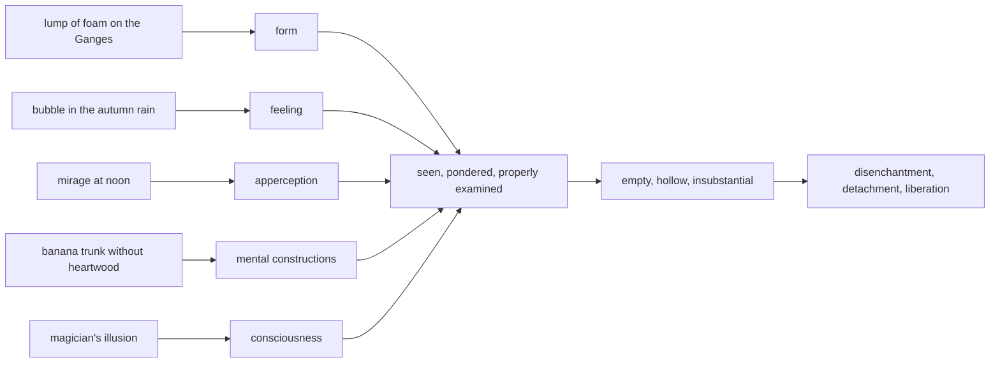

import { Tabs, TabItem } from '@astrojs/starlight/components';

Original text: [13S3/1.2.5.3 Pheṇapiṇḍūpamasutta 590–605](https://tipitaka2500.github.io/tipitaka/13S3/1/1.2/1.2.5/1.2.5.3.html#590) in the [World Tipitaka Edition](https://tipitaka2500.github.io)

## Summary

On the bank of the Ganges at Ayujjhā the Bhagavā likens the five collections to a lump of foam carried by the river, a bubble in the autumn rain, a mirage at noon, a banana trunk without heartwood and a magician's illusion: examined properly, each proves empty, hollow and insubstantial. The learned disciple is disenchanted, detached and liberated. Seven verses restate the five similes, describe the body abandoned by life, heat and consciousness, and urge the bhikkhu to regard the collections day and night, give up all bonds and live as if his head were on fire.

## Diagram

## Text

<Tabs syncKey="paliquote">
<TabItem label="My Translation">
(95.)

590\. At one time the Bhagavā was dwelling at Ayujjhā, on the bank of the river Ganges. There the Bhagavā addressed the bhikkhū:

591\. “Just as, Bhikkhave, this river Ganges might carry along a great lump of foam. A man with eyes would see it, ponder it and properly examine it. To him, seeing it, pondering it and properly examining it, it would appear just empty, it would appear just hollow, it would appear just insubstantial. What substance could there be, Bhikkhave, in a lump of foam? In the same way, Bhikkhave, whatever form there is, past, future, or present … and so on … far or near, a bhikkhu sees it, ponders it and properly examines it. To him, seeing it, pondering it and properly examining it, it appears just empty, it appears just hollow, it appears just insubstantial. What substance could there be, Bhikkhave, in form?

592\. Just as, Bhikkhave, in the autumn season, when the sky is raining in big drops, a water bubble on the water both arises and ceases. A man with eyes would see it, ponder it and properly examine it. To him, seeing it, pondering it and properly examining it, it would appear just empty, it would appear just hollow, it would appear just insubstantial. What substance could there be, Bhikkhave, in a water bubble? In the same way, Bhikkhave, whatever feeling there is, past, future, or present … and so on … far or near, a bhikkhu sees it, ponders it and properly examines it. To him, seeing it, pondering it and properly examining it, it appears just empty, it appears just hollow, it appears just insubstantial. What substance could there be, Bhikkhave, in feeling?

593\. Just as, Bhikkhave, in the last month of the hot season, at the time of high noon, a mirage shimmers. A man with eyes would see it, ponder it and properly examine it. To him, seeing it, pondering it and properly examining it, it would appear just empty, it would appear just hollow … and so on … what substance could there be, Bhikkhave, in a mirage? In the same way, Bhikkhave, whatever apperception there is … and so on ….

594\. Just as, Bhikkhave, a man needing heartwood, seeking heartwood, wandering in search of heartwood, taking a sharp machete would enter a forest. There he would see a large banana trunk, straight, fresh, not crooked. He would cut it at the root; having cut it at the root, he would cut it at the top; having cut it at the top, he would unroll the roll of leaves. Unrolling its roll of leaves, he would not find even sapwood, let alone heartwood. A man with eyes would see it, ponder it and properly examine it. To him, seeing it, pondering it and properly examining it, it would appear just empty, it would appear just hollow, it would appear just insubstantial. What substance could there be, Bhikkhave, in a banana trunk? In the same way, Bhikkhave, whatever mental constructions there are, past, future, or present … and so on … far or near, a bhikkhu sees them, ponders them and properly examines them. To him, seeing it, pondering it and properly examining it, it appears just empty, it appears just hollow, it appears just insubstantial. What substance could there be, Bhikkhave, in mental constructions?

595\. Just as, Bhikkhave, a magician or a magician's apprentice would display an illusion at a crossroads. A man with eyes would see it, ponder it and properly examine it. To him, seeing it, pondering it and properly examining it, it would appear just empty, it would appear just hollow, it would appear just insubstantial. What substance could there be, Bhikkhave, in an illusion? In the same way, Bhikkhave, whatever consciousness there is, past, future, or present … and so on … far or near, a bhikkhu sees it, ponders it and properly examines it. To him, seeing it, pondering it and properly examining it, it appears just empty, it appears just hollow, it appears just insubstantial. What substance could there be, Bhikkhave, in consciousness?

596\. Thus seeing, Bhikkhave, the `sutavā` (learned) `ariyasāvaka` (disciple of the liberated) `nibbindati` (is disenchanted with) form, with feeling … with apperception … with mental constructions … is disenchanted with consciousness. Being disenchanted, he `virajjati` (becomes detached); from detachment he `vimuccati` (becomes liberated). In liberation there is the `ñāṇa` (knowledge): ‘liberated’ … and so on … he `pajānāti` (knows clearly): ‘there is nothing further for this present state of existence.’”

597\. This the Bhagavā said. Having said this, the `sugata` (Fortunate One), the Teacher, then said further:

598\. _“Form is like a lump of foam,_ \
_feeling is like a bubble;_ \
_Apperception is like a mirage,_ \
_mental constructions are like a banana tree;_ \
_And consciousness is like an illusion,_ \
_[so it was] taught by the `ādiccabandhu` (Relative of the Sun)._

599\. _In whatever way one ponders it,_ \
_properly examines it;_ \
_It is empty, hollow,_ \
_for whoever sees it properly._

600\. _And concerning this body,_ \
_taught by the one of vast wisdom:_ \
_At the giving up of three phenomena,_ \
_see form discarded._

601\. _When life, heat and consciousness_ \
_leave this body;_ \
_Then it lies discarded,_ \
_food for others, inanimate._

602\. _Such is this continuum,_ \
_this illusion, the prattle of fools;_ \
_It is declared a killer,_ \
_no substance is found here._

603\. _Thus a bhikkhu with energy aroused_ \
_should regard the collections;_ \
_Whether by day or by night,_ \
_clearly comprehending, aware._

604\. _He should give up all bonds,_ \
_make a refuge for himself;_ \
_He should live like one whose head is on fire,_ \
_aspiring to the everlasting state.”_

605\. The third [discourse of the chapter].
</TabItem>

<TabItem label="Pāḷi (Roman IAST)">
(95.)

590\. Ekaṃ samayaṃ bhagavā ayujjhāyaṃ viharati gaṅgāya nadiyā tīre. Tatra kho bhagavā bhikkhū āmantesi—

591\. “Seyyathāpi, bhikkhave, ayaṃ gaṅgā nadī mahantaṃ pheṇapiṇḍaṃ āvaheyya. Tamenaṃ cakkhumā puriso passeyya nijjhāyeyya yoniso upaparikkheyya. Tassa taṃ passato nijjhāyato yoniso upaparikkhato rittakaññeva khāyeyya, tucchakaññeva khāyeyya, asārakaññeva khāyeyya. Kiñhi siyā, bhikkhave, pheṇapiṇḍe sāro? Evameva kho, bhikkhave, yaṃ kiñci rūpaṃ atītānāgatapaccuppannaṃ…pe… yaṃ dūre santike vā taṃ bhikkhu passati nijjhāyati yoniso upaparikkhati. Tassa taṃ passato nijjhāyato yoniso upaparikkhato rittakaññeva khāyati, tucchakaññeva khāyati, asārakaññeva khāyati. Kiñhi siyā, bhikkhave, rūpe sāro?

592\. Seyyathāpi, bhikkhave, saradasamaye thullaphusitake deve vassante udake udakapubbuḷaṃ uppajjati ceva nirujjhati ca. Tamenaṃ cakkhumā puriso passeyya nijjhāyeyya yoniso upaparikkheyya. Tassa taṃ passato nijjhāyato yoniso upaparikkhato rittakaññeva khāyeyya, tucchakaññeva khāyeyya, asārakaññeva khāyeyya. Kiñhi siyā, bhikkhave, udakapubbuḷe sāro? Evameva kho, bhikkhave, yā kāci vedanā atītānāgatapaccuppannā…pe… yā dūre santike vā taṃ bhikkhu passati nijjhāyati yoniso upaparikkhati. Tassa taṃ passato nijjhāyato yoniso upaparikkhato rittakaññeva khāyati, tucchakaññeva khāyati, asārakaññeva khāyati. Kiñhi siyā, bhikkhave, vedanāya sāro?

593\. Seyyathāpi, bhikkhave, gimhānaṃ pacchime māse ṭhite majjhanhike kāle marīcikā phandati. Tamenaṃ cakkhumā puriso passeyya nijjhāyeyya yoniso upaparikkheyya. Tassa taṃ passato nijjhāyato yoniso upaparikkhato rittakaññeva khāyeyya, tucchakaññeva khāyeyya…pe… kiñhi siyā, bhikkhave, marīcikāya sāro? Evameva kho, bhikkhave, yā kāci saññā…pe….

594\. Seyyathāpi, bhikkhave, puriso sāratthiko sāragavesī sārapariyesanaṃ caramāno tiṇhaṃ kuṭhāriṃ ādāya vanaṃ paviseyya. So tattha passeyya mahantaṃ kadalikkhandhaṃ ujuṃ navaṃ akukkukajātaṃ. Tamenaṃ mūle chindeyya; mūle chetvā agge chindeyya, agge chetvā pattavaṭṭiṃ vinibbhujeyya. So tassa pattavaṭṭiṃ vinibbhujanto pheggumpi nādhigaccheyya, kuto sāraṃ. Tamenaṃ cakkhumā puriso passeyya nijjhāyeyya yoniso upaparikkheyya. Tassa taṃ passato nijjhāyato yoniso upaparikkhato rittakaññeva khāyeyya, tucchakaññeva khāyeyya, asārakaññeva khāyeyya. Kiñhi siyā, bhikkhave, kadalikkhandhe sāro? Evameva kho, bhikkhave, ye keci saṅkhārā atītānāgatapaccuppannā…pe… ye dūre santike vā taṃ bhikkhu passati nijjhāyati yoniso upaparikkhati. Tassa taṃ passato nijjhāyato yoniso upaparikkhato rittakaññeva khāyati, tucchakaññeva khāyati, asārakaññeva khāyati. Kiñhi siyā, bhikkhave, saṅkhāresu sāro?

595\. Seyyathāpi, bhikkhave, māyākāro vā māyākārantevāsī vā catumahāpathe māyaṃ vidaṃseyya. Tamenaṃ cakkhumā puriso passeyya nijjhāyeyya yoniso upaparikkheyya. Tassa taṃ passato nijjhāyato yoniso upaparikkhato rittakaññeva khāyeyya, tucchakaññeva khāyeyya, asārakaññeva khāyeyya. Kiñhi siyā, bhikkhave, māyāya sāro? Evameva kho, bhikkhave, yaṃ kiñci viññāṇaṃ atītānāgatapaccuppannaṃ…pe… yaṃ dūre santike vā, taṃ bhikkhu passati nijjhāyati yoniso upaparikkhati. Tassa taṃ passato nijjhāyato yoniso upaparikkhato rittakaññeva khāyati, tucchakaññeva khāyati, asārakaññeva khāyati. Kiñhi siyā, bhikkhave, viññāṇe sāro?

596\. Evaṃ passaṃ, bhikkhave, sutavā ariyasāvako rūpasmimpi nibbindati, vedanāyapi… saññāyapi… saṅkhāresupi… viññāṇasmimpi nibbindati. Nibbindaṃ virajjati; virāgā vimuccati. Vimuttasmiṃ vimuttamiti ñāṇaṃ hoti…pe… nāparaṃ itthattāyāti pajānāti”.

597\. Idamavoca bhagavā. Idaṃ vatvāna sugato athāparaṃ etadavoca satthā—

598\. _“Pheṇapiṇḍūpamaṃ rūpaṃ,_  
_vedanā bubbuḷūpamā;_  
_Marīcikūpamā saññā,_  
_saṅkhārā kadalūpamā;_  
_Māyūpamañca viññāṇaṃ,_  
_desitādiccabandhunā._

599\. _Yathā yathā nijjhāyati,_  
_yoniso upaparikkhati;_  
_Rittakaṃ tucchakaṃ hoti,_  
_yo naṃ passati yoniso._

600\. _Imañca kāyaṃ ārabbha,_  
_bhūripaññena desitaṃ;_  
_Pahānaṃ tiṇṇaṃ dhammānaṃ,_  
_rūpaṃ passatha chaḍḍitaṃ._

601\. _Āyu usmā ca viññāṇaṃ,_  
_yadā kāyaṃ jahantimaṃ;_  
_Apaviddho tadā seti,_  
_parabhattaṃ acetanaṃ._

602\. _Etādisāyaṃ santāno,_  
_māyāyaṃ bālalāpinī;_  
_Vadhako esa akkhāto,_  
_sāro ettha na vijjati._

603\. _Evaṃ khandhe avekkheyya,_  
_bhikkhu āraddhavīriyo;_  
_Divā vā yadi vā rattiṃ,_  
_sampajāno paṭissato._

604\. _Jaheyya sabbasaṃyogaṃ,_  
_kareyya saraṇattano;_  
_Careyyādittasīsova,_  
_patthayaṃ accutaṃ padan”ti._

605\. Tatiyaṃ.
</TabItem>

<TabItem label="Pāḷi (Brahmi)">
(95.)

590\. 𑀏𑀓𑀁 𑀲𑀫𑀬𑀁 𑀪𑀕𑀯𑀸 𑀅𑀬𑀼𑀚𑁆𑀛𑀸𑀬𑀁 𑀯𑀺𑀳𑀭𑀢𑀺 𑀕𑀗𑁆𑀕𑀸𑀬 𑀦𑀤𑀺𑀬𑀸 𑀢𑀻𑀭𑁂. 𑀢𑀢𑁆𑀭 𑀔𑁄 𑀪𑀕𑀯𑀸 𑀪𑀺𑀓𑁆𑀔𑀽 𑀆𑀫𑀦𑁆𑀢𑁂𑀲𑀺—

591\. “𑀲𑁂𑀬𑁆𑀬𑀣𑀸𑀧𑀺, 𑀪𑀺𑀓𑁆𑀔𑀯𑁂, 𑀅𑀬𑀁 𑀕𑀗𑁆𑀕𑀸 𑀦𑀤𑀻 𑀫𑀳𑀦𑁆𑀢𑀁 𑀨𑁂𑀡𑀧𑀺𑀡𑁆𑀟𑀁 𑀆𑀯𑀳𑁂𑀬𑁆𑀬. 𑀢𑀫𑁂𑀦𑀁 𑀘𑀓𑁆𑀔𑀼𑀫𑀸 𑀧𑀼𑀭𑀺𑀲𑁄 𑀧𑀲𑁆𑀲𑁂𑀬𑁆𑀬 𑀦𑀺𑀚𑁆𑀛𑀸𑀬𑁂𑀬𑁆𑀬 𑀬𑁄𑀦𑀺𑀲𑁄 𑀉𑀧𑀧𑀭𑀺𑀓𑁆𑀔𑁂𑀬𑁆𑀬. 𑀢𑀲𑁆𑀲 𑀢𑀁 𑀧𑀲𑁆𑀲𑀢𑁄 𑀦𑀺𑀚𑁆𑀛𑀸𑀬𑀢𑁄 𑀬𑁄𑀦𑀺𑀲𑁄 𑀉𑀧𑀧𑀭𑀺𑀓𑁆𑀔𑀢𑁄 𑀭𑀺𑀢𑁆𑀢𑀓𑀜𑁆𑀜𑁂𑀯 𑀔𑀸𑀬𑁂𑀬𑁆𑀬, 𑀢𑀼𑀘𑁆𑀙𑀓𑀜𑁆𑀜𑁂𑀯 𑀔𑀸𑀬𑁂𑀬𑁆𑀬, 𑀅𑀲𑀸𑀭𑀓𑀜𑁆𑀜𑁂𑀯 𑀔𑀸𑀬𑁂𑀬𑁆𑀬. 𑀓𑀺𑀜𑁆𑀳𑀺 𑀲𑀺𑀬𑀸, 𑀪𑀺𑀓𑁆𑀔𑀯𑁂, 𑀨𑁂𑀡𑀧𑀺𑀡𑁆𑀟𑁂 𑀲𑀸𑀭𑁄? 𑀏𑀯𑀫𑁂𑀯 𑀔𑁄, 𑀪𑀺𑀓𑁆𑀔𑀯𑁂, 𑀬𑀁 𑀓𑀺𑀜𑁆𑀘𑀺 𑀭𑀽𑀧𑀁 𑀅𑀢𑀻𑀢𑀸𑀦𑀸𑀕𑀢𑀧𑀘𑁆𑀘𑀼𑀧𑁆𑀧𑀦𑁆𑀦𑀁…𑀧𑁂… 𑀬𑀁 𑀤𑀽𑀭𑁂 𑀲𑀦𑁆𑀢𑀺𑀓𑁂 𑀯𑀸 𑀢𑀁 𑀪𑀺𑀓𑁆𑀔𑀼 𑀧𑀲𑁆𑀲𑀢𑀺 𑀦𑀺𑀚𑁆𑀛𑀸𑀬𑀢𑀺 𑀬𑁄𑀦𑀺𑀲𑁄 𑀉𑀧𑀧𑀭𑀺𑀓𑁆𑀔𑀢𑀺. 𑀢𑀲𑁆𑀲 𑀢𑀁 𑀧𑀲𑁆𑀲𑀢𑁄 𑀦𑀺𑀚𑁆𑀛𑀸𑀬𑀢𑁄 𑀬𑁄𑀦𑀺𑀲𑁄 𑀉𑀧𑀧𑀭𑀺𑀓𑁆𑀔𑀢𑁄 𑀭𑀺𑀢𑁆𑀢𑀓𑀜𑁆𑀜𑁂𑀯 𑀔𑀸𑀬𑀢𑀺, 𑀢𑀼𑀘𑁆𑀙𑀓𑀜𑁆𑀜𑁂𑀯 𑀔𑀸𑀬𑀢𑀺, 𑀅𑀲𑀸𑀭𑀓𑀜𑁆𑀜𑁂𑀯 𑀔𑀸𑀬𑀢𑀺. 𑀓𑀺𑀜𑁆𑀳𑀺 𑀲𑀺𑀬𑀸, 𑀪𑀺𑀓𑁆𑀔𑀯𑁂, 𑀭𑀽𑀧𑁂 𑀲𑀸𑀭𑁄?

592\. 𑀲𑁂𑀬𑁆𑀬𑀣𑀸𑀧𑀺, 𑀪𑀺𑀓𑁆𑀔𑀯𑁂, 𑀲𑀭𑀤𑀲𑀫𑀬𑁂 𑀣𑀼𑀮𑁆𑀮𑀨𑀼𑀲𑀺𑀢𑀓𑁂 𑀤𑁂𑀯𑁂 𑀯𑀲𑁆𑀲𑀦𑁆𑀢𑁂 𑀉𑀤𑀓𑁂 𑀉𑀤𑀓𑀧𑀼𑀩𑁆𑀩𑀼𑀍𑀅𑀁 𑀉𑀧𑁆𑀧𑀚𑁆𑀚𑀢𑀺 𑀘𑁂𑀯 𑀦𑀺𑀭𑀼𑀚𑁆𑀛𑀢𑀺 𑀘. 𑀢𑀫𑁂𑀦𑀁 𑀘𑀓𑁆𑀔𑀼𑀫𑀸 𑀧𑀼𑀭𑀺𑀲𑁄 𑀧𑀲𑁆𑀲𑁂𑀬𑁆𑀬 𑀦𑀺𑀚𑁆𑀛𑀸𑀬𑁂𑀬𑁆𑀬 𑀬𑁄𑀦𑀺𑀲𑁄 𑀉𑀧𑀧𑀭𑀺𑀓𑁆𑀔𑁂𑀬𑁆𑀬. 𑀢𑀲𑁆𑀲 𑀢𑀁 𑀧𑀲𑁆𑀲𑀢𑁄 𑀦𑀺𑀚𑁆𑀛𑀸𑀬𑀢𑁄 𑀬𑁄𑀦𑀺𑀲𑁄 𑀉𑀧𑀧𑀭𑀺𑀓𑁆𑀔𑀢𑁄 𑀭𑀺𑀢𑁆𑀢𑀓𑀜𑁆𑀜𑁂𑀯 𑀔𑀸𑀬𑁂𑀬𑁆𑀬, 𑀢𑀼𑀘𑁆𑀙𑀓𑀜𑁆𑀜𑁂𑀯 𑀔𑀸𑀬𑁂𑀬𑁆𑀬, 𑀅𑀲𑀸𑀭𑀓𑀜𑁆𑀜𑁂𑀯 𑀔𑀸𑀬𑁂𑀬𑁆𑀬. 𑀓𑀺𑀜𑁆𑀳𑀺 𑀲𑀺𑀬𑀸, 𑀪𑀺𑀓𑁆𑀔𑀯𑁂, 𑀉𑀤𑀓𑀧𑀼𑀩𑁆𑀩𑀼𑀍𑀏 𑀲𑀸𑀭𑁄? 𑀏𑀯𑀫𑁂𑀯 𑀔𑁄, 𑀪𑀺𑀓𑁆𑀔𑀯𑁂, 𑀬𑀸 𑀓𑀸𑀘𑀺 𑀯𑁂𑀤𑀦𑀸 𑀅𑀢𑀻𑀢𑀸𑀦𑀸𑀕𑀢𑀧𑀘𑁆𑀘𑀼𑀧𑁆𑀧𑀦𑁆𑀦𑀸…𑀧𑁂… 𑀬𑀸 𑀤𑀽𑀭𑁂 𑀲𑀦𑁆𑀢𑀺𑀓𑁂 𑀯𑀸 𑀢𑀁 𑀪𑀺𑀓𑁆𑀔𑀼 𑀧𑀲𑁆𑀲𑀢𑀺 𑀦𑀺𑀚𑁆𑀛𑀸𑀬𑀢𑀺 𑀬𑁄𑀦𑀺𑀲𑁄 𑀉𑀧𑀧𑀭𑀺𑀓𑁆𑀔𑀢𑀺. 𑀢𑀲𑁆𑀲 𑀢𑀁 𑀧𑀲𑁆𑀲𑀢𑁄 𑀦𑀺𑀚𑁆𑀛𑀸𑀬𑀢𑁄 𑀬𑁄𑀦𑀺𑀲𑁄 𑀉𑀧𑀧𑀭𑀺𑀓𑁆𑀔𑀢𑁄 𑀭𑀺𑀢𑁆𑀢𑀓𑀜𑁆𑀜𑁂𑀯 𑀔𑀸𑀬𑀢𑀺, 𑀢𑀼𑀘𑁆𑀙𑀓𑀜𑁆𑀜𑁂𑀯 𑀔𑀸𑀬𑀢𑀺, 𑀅𑀲𑀸𑀭𑀓𑀜𑁆𑀜𑁂𑀯 𑀔𑀸𑀬𑀢𑀺. 𑀓𑀺𑀜𑁆𑀳𑀺 𑀲𑀺𑀬𑀸, 𑀪𑀺𑀓𑁆𑀔𑀯𑁂, 𑀯𑁂𑀤𑀦𑀸𑀬 𑀲𑀸𑀭𑁄?

593\. 𑀲𑁂𑀬𑁆𑀬𑀣𑀸𑀧𑀺, 𑀪𑀺𑀓𑁆𑀔𑀯𑁂, 𑀕𑀺𑀫𑁆𑀳𑀸𑀦𑀁 𑀧𑀘𑁆𑀙𑀺𑀫𑁂 𑀫𑀸𑀲𑁂 𑀞𑀺𑀢𑁂 𑀫𑀚𑁆𑀛𑀦𑁆𑀳𑀺𑀓𑁂 𑀓𑀸𑀮𑁂 𑀫𑀭𑀻𑀘𑀺𑀓𑀸 𑀨𑀦𑁆𑀤𑀢𑀺. 𑀢𑀫𑁂𑀦𑀁 𑀘𑀓𑁆𑀔𑀼𑀫𑀸 𑀧𑀼𑀭𑀺𑀲𑁄 𑀧𑀲𑁆𑀲𑁂𑀬𑁆𑀬 𑀦𑀺𑀚𑁆𑀛𑀸𑀬𑁂𑀬𑁆𑀬 𑀬𑁄𑀦𑀺𑀲𑁄 𑀉𑀧𑀧𑀭𑀺𑀓𑁆𑀔𑁂𑀬𑁆𑀬. 𑀢𑀲𑁆𑀲 𑀢𑀁 𑀧𑀲𑁆𑀲𑀢𑁄 𑀦𑀺𑀚𑁆𑀛𑀸𑀬𑀢𑁄 𑀬𑁄𑀦𑀺𑀲𑁄 𑀉𑀧𑀧𑀭𑀺𑀓𑁆𑀔𑀢𑁄 𑀭𑀺𑀢𑁆𑀢𑀓𑀜𑁆𑀜𑁂𑀯 𑀔𑀸𑀬𑁂𑀬𑁆𑀬, 𑀢𑀼𑀘𑁆𑀙𑀓𑀜𑁆𑀜𑁂𑀯 𑀔𑀸𑀬𑁂𑀬𑁆𑀬…𑀧𑁂… 𑀓𑀺𑀜𑁆𑀳𑀺 𑀲𑀺𑀬𑀸, 𑀪𑀺𑀓𑁆𑀔𑀯𑁂, 𑀫𑀭𑀻𑀘𑀺𑀓𑀸𑀬 𑀲𑀸𑀭𑁄? 𑀏𑀯𑀫𑁂𑀯 𑀔𑁄, 𑀪𑀺𑀓𑁆𑀔𑀯𑁂, 𑀬𑀸 𑀓𑀸𑀘𑀺 𑀲𑀜𑁆𑀜𑀸…𑀧𑁂….

594\. 𑀲𑁂𑀬𑁆𑀬𑀣𑀸𑀧𑀺, 𑀪𑀺𑀓𑁆𑀔𑀯𑁂, 𑀧𑀼𑀭𑀺𑀲𑁄 𑀲𑀸𑀭𑀢𑁆𑀣𑀺𑀓𑁄 𑀲𑀸𑀭𑀕𑀯𑁂𑀲𑀻 𑀲𑀸𑀭𑀧𑀭𑀺𑀬𑁂𑀲𑀦𑀁 𑀘𑀭𑀫𑀸𑀦𑁄 𑀢𑀺𑀡𑁆𑀳𑀁 𑀓𑀼𑀞𑀸𑀭𑀺𑀁 𑀆𑀤𑀸𑀬 𑀯𑀦𑀁 𑀧𑀯𑀺𑀲𑁂𑀬𑁆𑀬. 𑀲𑁄 𑀢𑀢𑁆𑀣 𑀧𑀲𑁆𑀲𑁂𑀬𑁆𑀬 𑀫𑀳𑀦𑁆𑀢𑀁 𑀓𑀤𑀮𑀺𑀓𑁆𑀔𑀦𑁆𑀥𑀁 𑀉𑀚𑀼𑀁 𑀦𑀯𑀁 𑀅𑀓𑀼𑀓𑁆𑀓𑀼𑀓𑀚𑀸𑀢𑀁. 𑀢𑀫𑁂𑀦𑀁 𑀫𑀽𑀮𑁂 𑀙𑀺𑀦𑁆𑀤𑁂𑀬𑁆𑀬; 𑀫𑀽𑀮𑁂 𑀙𑁂𑀢𑁆𑀯𑀸 𑀅𑀕𑁆𑀕𑁂 𑀙𑀺𑀦𑁆𑀤𑁂𑀬𑁆𑀬, 𑀅𑀕𑁆𑀕𑁂 𑀙𑁂𑀢𑁆𑀯𑀸 𑀧𑀢𑁆𑀢𑀯𑀝𑁆𑀝𑀺𑀁 𑀯𑀺𑀦𑀺𑀩𑁆𑀪𑀼𑀚𑁂𑀬𑁆𑀬. 𑀲𑁄 𑀢𑀲𑁆𑀲 𑀧𑀢𑁆𑀢𑀯𑀝𑁆𑀝𑀺𑀁 𑀯𑀺𑀦𑀺𑀩𑁆𑀪𑀼𑀚𑀦𑁆𑀢𑁄 𑀨𑁂𑀕𑁆𑀕𑀼𑀫𑁆𑀧𑀺 𑀦𑀸𑀥𑀺𑀕𑀘𑁆𑀙𑁂𑀬𑁆𑀬, 𑀓𑀼𑀢𑁄 𑀲𑀸𑀭𑀁. 𑀢𑀫𑁂𑀦𑀁 𑀘𑀓𑁆𑀔𑀼𑀫𑀸 𑀧𑀼𑀭𑀺𑀲𑁄 𑀧𑀲𑁆𑀲𑁂𑀬𑁆𑀬 𑀦𑀺𑀚𑁆𑀛𑀸𑀬𑁂𑀬𑁆𑀬 𑀬𑁄𑀦𑀺𑀲𑁄 𑀉𑀧𑀧𑀭𑀺𑀓𑁆𑀔𑁂𑀬𑁆𑀬. 𑀢𑀲𑁆𑀲 𑀢𑀁 𑀧𑀲𑁆𑀲𑀢𑁄 𑀦𑀺𑀚𑁆𑀛𑀸𑀬𑀢𑁄 𑀬𑁄𑀦𑀺𑀲𑁄 𑀉𑀧𑀧𑀭𑀺𑀓𑁆𑀔𑀢𑁄 𑀭𑀺𑀢𑁆𑀢𑀓𑀜𑁆𑀜𑁂𑀯 𑀔𑀸𑀬𑁂𑀬𑁆𑀬, 𑀢𑀼𑀘𑁆𑀙𑀓𑀜𑁆𑀜𑁂𑀯 𑀔𑀸𑀬𑁂𑀬𑁆𑀬, 𑀅𑀲𑀸𑀭𑀓𑀜𑁆𑀜𑁂𑀯 𑀔𑀸𑀬𑁂𑀬𑁆𑀬. 𑀓𑀺𑀜𑁆𑀳𑀺 𑀲𑀺𑀬𑀸, 𑀪𑀺𑀓𑁆𑀔𑀯𑁂, 𑀓𑀤𑀮𑀺𑀓𑁆𑀔𑀦𑁆𑀥𑁂 𑀲𑀸𑀭𑁄? 𑀏𑀯𑀫𑁂𑀯 𑀔𑁄, 𑀪𑀺𑀓𑁆𑀔𑀯𑁂, 𑀬𑁂 𑀓𑁂𑀘𑀺 𑀲𑀗𑁆𑀔𑀸𑀭𑀸 𑀅𑀢𑀻𑀢𑀸𑀦𑀸𑀕𑀢𑀧𑀘𑁆𑀘𑀼𑀧𑁆𑀧𑀦𑁆𑀦𑀸…𑀧𑁂… 𑀬𑁂 𑀤𑀽𑀭𑁂 𑀲𑀦𑁆𑀢𑀺𑀓𑁂 𑀯𑀸 𑀢𑀁 𑀪𑀺𑀓𑁆𑀔𑀼 𑀧𑀲𑁆𑀲𑀢𑀺 𑀦𑀺𑀚𑁆𑀛𑀸𑀬𑀢𑀺 𑀬𑁄𑀦𑀺𑀲𑁄 𑀉𑀧𑀧𑀭𑀺𑀓𑁆𑀔𑀢𑀺. 𑀢𑀲𑁆𑀲 𑀢𑀁 𑀧𑀲𑁆𑀲𑀢𑁄 𑀦𑀺𑀚𑁆𑀛𑀸𑀬𑀢𑁄 𑀬𑁄𑀦𑀺𑀲𑁄 𑀉𑀧𑀧𑀭𑀺𑀓𑁆𑀔𑀢𑁄 𑀭𑀺𑀢𑁆𑀢𑀓𑀜𑁆𑀜𑁂𑀯 𑀔𑀸𑀬𑀢𑀺, 𑀢𑀼𑀘𑁆𑀙𑀓𑀜𑁆𑀜𑁂𑀯 𑀔𑀸𑀬𑀢𑀺, 𑀅𑀲𑀸𑀭𑀓𑀜𑁆𑀜𑁂𑀯 𑀔𑀸𑀬𑀢𑀺. 𑀓𑀺𑀜𑁆𑀳𑀺 𑀲𑀺𑀬𑀸, 𑀪𑀺𑀓𑁆𑀔𑀯𑁂, 𑀲𑀗𑁆𑀔𑀸𑀭𑁂𑀲𑀼 𑀲𑀸𑀭𑁄?

595\. 𑀲𑁂𑀬𑁆𑀬𑀣𑀸𑀧𑀺, 𑀪𑀺𑀓𑁆𑀔𑀯𑁂, 𑀫𑀸𑀬𑀸𑀓𑀸𑀭𑁄 𑀯𑀸 𑀫𑀸𑀬𑀸𑀓𑀸𑀭𑀦𑁆𑀢𑁂𑀯𑀸𑀲𑀻 𑀯𑀸 𑀘𑀢𑀼𑀫𑀳𑀸𑀧𑀣𑁂 𑀫𑀸𑀬𑀁 𑀯𑀺𑀤𑀁𑀲𑁂𑀬𑁆𑀬. 𑀢𑀫𑁂𑀦𑀁 𑀘𑀓𑁆𑀔𑀼𑀫𑀸 𑀧𑀼𑀭𑀺𑀲𑁄 𑀧𑀲𑁆𑀲𑁂𑀬𑁆𑀬 𑀦𑀺𑀚𑁆𑀛𑀸𑀬𑁂𑀬𑁆𑀬 𑀬𑁄𑀦𑀺𑀲𑁄 𑀉𑀧𑀧𑀭𑀺𑀓𑁆𑀔𑁂𑀬𑁆𑀬. 𑀢𑀲𑁆𑀲 𑀢𑀁 𑀧𑀲𑁆𑀲𑀢𑁄 𑀦𑀺𑀚𑁆𑀛𑀸𑀬𑀢𑁄 𑀬𑁄𑀦𑀺𑀲𑁄 𑀉𑀧𑀧𑀭𑀺𑀓𑁆𑀔𑀢𑁄 𑀭𑀺𑀢𑁆𑀢𑀓𑀜𑁆𑀜𑁂𑀯 𑀔𑀸𑀬𑁂𑀬𑁆𑀬, 𑀢𑀼𑀘𑁆𑀙𑀓𑀜𑁆𑀜𑁂𑀯 𑀔𑀸𑀬𑁂𑀬𑁆𑀬, 𑀅𑀲𑀸𑀭𑀓𑀜𑁆𑀜𑁂𑀯 𑀔𑀸𑀬𑁂𑀬𑁆𑀬. 𑀓𑀺𑀜𑁆𑀳𑀺 𑀲𑀺𑀬𑀸, 𑀪𑀺𑀓𑁆𑀔𑀯𑁂, 𑀫𑀸𑀬𑀸𑀬 𑀲𑀸𑀭𑁄? 𑀏𑀯𑀫𑁂𑀯 𑀔𑁄, 𑀪𑀺𑀓𑁆𑀔𑀯𑁂, 𑀬𑀁 𑀓𑀺𑀜𑁆𑀘𑀺 𑀯𑀺𑀜𑁆𑀜𑀸𑀡𑀁 𑀅𑀢𑀻𑀢𑀸𑀦𑀸𑀕𑀢𑀧𑀘𑁆𑀘𑀼𑀧𑁆𑀧𑀦𑁆𑀦𑀁…𑀧𑁂… 𑀬𑀁 𑀤𑀽𑀭𑁂 𑀲𑀦𑁆𑀢𑀺𑀓𑁂 𑀯𑀸, 𑀢𑀁 𑀪𑀺𑀓𑁆𑀔𑀼 𑀧𑀲𑁆𑀲𑀢𑀺 𑀦𑀺𑀚𑁆𑀛𑀸𑀬𑀢𑀺 𑀬𑁄𑀦𑀺𑀲𑁄 𑀉𑀧𑀧𑀭𑀺𑀓𑁆𑀔𑀢𑀺. 𑀢𑀲𑁆𑀲 𑀢𑀁 𑀧𑀲𑁆𑀲𑀢𑁄 𑀦𑀺𑀚𑁆𑀛𑀸𑀬𑀢𑁄 𑀬𑁄𑀦𑀺𑀲𑁄 𑀉𑀧𑀧𑀭𑀺𑀓𑁆𑀔𑀢𑁄 𑀭𑀺𑀢𑁆𑀢𑀓𑀜𑁆𑀜𑁂𑀯 𑀔𑀸𑀬𑀢𑀺, 𑀢𑀼𑀘𑁆𑀙𑀓𑀜𑁆𑀜𑁂𑀯 𑀔𑀸𑀬𑀢𑀺, 𑀅𑀲𑀸𑀭𑀓𑀜𑁆𑀜𑁂𑀯 𑀔𑀸𑀬𑀢𑀺. 𑀓𑀺𑀜𑁆𑀳𑀺 𑀲𑀺𑀬𑀸, 𑀪𑀺𑀓𑁆𑀔𑀯𑁂, 𑀯𑀺𑀜𑁆𑀜𑀸𑀡𑁂 𑀲𑀸𑀭𑁄?

596\. 𑀏𑀯𑀁 𑀧𑀲𑁆𑀲𑀁, 𑀪𑀺𑀓𑁆𑀔𑀯𑁂, 𑀲𑀼𑀢𑀯𑀸 𑀅𑀭𑀺𑀬𑀲𑀸𑀯𑀓𑁄 𑀭𑀽𑀧𑀲𑁆𑀫𑀺𑀫𑁆𑀧𑀺 𑀦𑀺𑀩𑁆𑀩𑀺𑀦𑁆𑀤𑀢𑀺, 𑀯𑁂𑀤𑀦𑀸𑀬𑀧𑀺… 𑀲𑀜𑁆𑀜𑀸𑀬𑀧𑀺… 𑀲𑀗𑁆𑀔𑀸𑀭𑁂𑀲𑀼𑀧𑀺… 𑀯𑀺𑀜𑁆𑀜𑀸𑀡𑀲𑁆𑀫𑀺𑀫𑁆𑀧𑀺 𑀦𑀺𑀩𑁆𑀩𑀺𑀦𑁆𑀤𑀢𑀺. 𑀦𑀺𑀩𑁆𑀩𑀺𑀦𑁆𑀤𑀁 𑀯𑀺𑀭𑀚𑁆𑀚𑀢𑀺; 𑀯𑀺𑀭𑀸𑀕𑀸 𑀯𑀺𑀫𑀼𑀘𑁆𑀘𑀢𑀺. 𑀯𑀺𑀫𑀼𑀢𑁆𑀢𑀲𑁆𑀫𑀺𑀁 𑀯𑀺𑀫𑀼𑀢𑁆𑀢𑀫𑀺𑀢𑀺 𑀜𑀸𑀡𑀁 𑀳𑁄𑀢𑀺…𑀧𑁂… 𑀦𑀸𑀧𑀭𑀁 𑀇𑀢𑁆𑀣𑀢𑁆𑀢𑀸𑀬𑀸𑀢𑀺 𑀧𑀚𑀸𑀦𑀸𑀢𑀺”.

597\. 𑀇𑀤𑀫𑀯𑁄𑀘 𑀪𑀕𑀯𑀸. 𑀇𑀤𑀁 𑀯𑀢𑁆𑀯𑀸𑀦 𑀲𑀼𑀕𑀢𑁄 𑀅𑀣𑀸𑀧𑀭𑀁 𑀏𑀢𑀤𑀯𑁄𑀘 𑀲𑀢𑁆𑀣𑀸—

598\. _“𑀨𑁂𑀡𑀧𑀺𑀡𑁆𑀟𑀽𑀧𑀫𑀁 𑀭𑀽𑀧𑀁,_  
_𑀯𑁂𑀤𑀦𑀸 𑀩𑀼𑀩𑁆𑀩𑀼𑀍𑀊𑀧𑀫𑀸;_  
_𑀫𑀭𑀻𑀘𑀺𑀓𑀽𑀧𑀫𑀸 𑀲𑀜𑁆𑀜𑀸,_  
_𑀲𑀗𑁆𑀔𑀸𑀭𑀸 𑀓𑀤𑀮𑀽𑀧𑀫𑀸;_  
_𑀫𑀸𑀬𑀽𑀧𑀫𑀜𑁆𑀘 𑀯𑀺𑀜𑁆𑀜𑀸𑀡𑀁,_  
_𑀤𑁂𑀲𑀺𑀢𑀸𑀤𑀺𑀘𑁆𑀘𑀩𑀦𑁆𑀥𑀼𑀦𑀸._

599\. _𑀬𑀣𑀸 𑀬𑀣𑀸 𑀦𑀺𑀚𑁆𑀛𑀸𑀬𑀢𑀺,_  
_𑀬𑁄𑀦𑀺𑀲𑁄 𑀉𑀧𑀧𑀭𑀺𑀓𑁆𑀔𑀢𑀺;_  
_𑀭𑀺𑀢𑁆𑀢𑀓𑀁 𑀢𑀼𑀘𑁆𑀙𑀓𑀁 𑀳𑁄𑀢𑀺,_  
_𑀬𑁄 𑀦𑀁 𑀧𑀲𑁆𑀲𑀢𑀺 𑀬𑁄𑀦𑀺𑀲𑁄._

600\. _𑀇𑀫𑀜𑁆𑀘 𑀓𑀸𑀬𑀁 𑀆𑀭𑀩𑁆𑀪,_  
_𑀪𑀽𑀭𑀺𑀧𑀜𑁆𑀜𑁂𑀦 𑀤𑁂𑀲𑀺𑀢𑀁;_  
_𑀧𑀳𑀸𑀦𑀁 𑀢𑀺𑀡𑁆𑀡𑀁 𑀥𑀫𑁆𑀫𑀸𑀦𑀁,_  
_𑀭𑀽𑀧𑀁 𑀧𑀲𑁆𑀲𑀣 𑀙𑀟𑁆𑀟𑀺𑀢𑀁._

601\. _𑀆𑀬𑀼 𑀉𑀲𑁆𑀫𑀸 𑀘 𑀯𑀺𑀜𑁆𑀜𑀸𑀡𑀁,_  
_𑀬𑀤𑀸 𑀓𑀸𑀬𑀁 𑀚𑀳𑀦𑁆𑀢𑀺𑀫𑀁;_  
_𑀅𑀧𑀯𑀺𑀤𑁆𑀥𑁄 𑀢𑀤𑀸 𑀲𑁂𑀢𑀺,_  
_𑀧𑀭𑀪𑀢𑁆𑀢𑀁 𑀅𑀘𑁂𑀢𑀦𑀁._

602\. _𑀏𑀢𑀸𑀤𑀺𑀲𑀸𑀬𑀁 𑀲𑀦𑁆𑀢𑀸𑀦𑁄,_  
_𑀫𑀸𑀬𑀸𑀬𑀁 𑀩𑀸𑀮𑀮𑀸𑀧𑀺𑀦𑀻;_  
_𑀯𑀥𑀓𑁄 𑀏𑀲 𑀅𑀓𑁆𑀔𑀸𑀢𑁄,_  
_𑀲𑀸𑀭𑁄 𑀏𑀢𑁆𑀣 𑀦 𑀯𑀺𑀚𑁆𑀚𑀢𑀺._

603\. _𑀏𑀯𑀁 𑀔𑀦𑁆𑀥𑁂 𑀅𑀯𑁂𑀓𑁆𑀔𑁂𑀬𑁆𑀬,_  
_𑀪𑀺𑀓𑁆𑀔𑀼 𑀆𑀭𑀤𑁆𑀥𑀯𑀻𑀭𑀺𑀬𑁄;_  
_𑀤𑀺𑀯𑀸 𑀯𑀸 𑀬𑀤𑀺 𑀯𑀸 𑀭𑀢𑁆𑀢𑀺𑀁,_  
_𑀲𑀫𑁆𑀧𑀚𑀸𑀦𑁄 𑀧𑀝𑀺𑀲𑁆𑀲𑀢𑁄._

604\. _𑀚𑀳𑁂𑀬𑁆𑀬 𑀲𑀩𑁆𑀩𑀲𑀁𑀬𑁄𑀕𑀁,_  
_𑀓𑀭𑁂𑀬𑁆𑀬 𑀲𑀭𑀡𑀢𑁆𑀢𑀦𑁄;_  
_𑀘𑀭𑁂𑀬𑁆𑀬𑀸𑀤𑀺𑀢𑁆𑀢𑀲𑀻𑀲𑁄𑀯,_  
_𑀧𑀢𑁆𑀣𑀬𑀁 𑀅𑀘𑁆𑀘𑀼𑀢𑀁 𑀧𑀤𑀦𑁆”𑀢𑀺._

605\. 𑀢𑀢𑀺𑀬𑀁.
</TabItem>

<TabItem label="Interlinear">
(95.)

[590](https://tipitaka2500.github.io/tipitaka/13S3/1/1.2/1.2.5/1.2.5.3.html#590) Ekaṃ samayaṃ bhagavā ayujjhāyaṃ viharati gaṅgāya nadiyā tīre.  
*️⃣🤟🚹⨀②(eka) 🚹⨀②(samaya) 🚹⨀①(bhagavant) 🚺⨀⑦(ayujjhā) 🟢⨀🤟▶️(viharati) 🚺⨀⑥(gaṅgā) 🚺⨀⑥(nadī) 🚻⨀⑦(tīra)  
one | time | the Bhagavā | at Ayujjhā | dwells | of the Ganges | of the river | on the bank  
At one time the Bhagavā was dwelling at Ayujjhā, on the bank of the river Ganges.

Tatra kho bhagavā bhikkhū āmantesi—  
⏏️(tatra) ⏏️(kho) 🚹⨀①(bhagavant) 🚹⨂②(bhikkhu) 🟢⨀🤟⏮(āmanteti)  
there | indeed | the Bhagavā | bhikkhū | addressed  
There the Bhagavā addressed the bhikkhū:

[591](https://tipitaka2500.github.io/tipitaka/13S3/1/1.2/1.2.5/1.2.5.3.html#591) “Seyyathāpi, bhikkhave, ayaṃ gaṅgā nadī mahantaṃ pheṇapiṇḍaṃ āvaheyya.  
⏏️(seyyathāpi) 🚹⨂⓪(bhikkhu) *️⃣🤟🚺⨀①(ima) 🚺⨀①(gaṅgā) 🚺⨀①(nadī) 🚹⨀②(mahanta) 🚹⨀②🆎(pheṇa+piṇḍa) 🟢⨀🤟⏯(āvahati)  
just as | Bhikkhave | this | the Ganges | river | a great | lump of foam | might carry along  
“Just as, Bhikkhave, this river Ganges might carry along a great lump of foam.

Tamenaṃ cakkhumā puriso passeyya nijjhāyeyya yoniso upaparikkheyya.  
*️⃣🤟🚹⨀②(ta) *️⃣🤟🚹⨀②(eta) 🚹⨀①(cakkhumant) 🚹⨀①(purisa) 🟢⨀🤟⏯(passati) 🟢⨀🤟⏯(nijjhāyati) ⏏️(yoniso) 🟢⨀🤟⏯(upaparikkhati)  
that | this one | with eyes | a man | would see | would ponder | properly | would examine  
A man with eyes would see it, ponder it and properly examine it.

Tassa taṃ passato nijjhāyato yoniso upaparikkhato rittakaññeva khāyeyya, tucchakaññeva khāyeyya, asārakaññeva khāyeyya.  
*️⃣🤟🚹⨀④(ta) *️⃣🤟🚹⨀②(ta) 🚹⨀④🔽(anta)(passanta) 🚹⨀④🔽(anta)(nijjhāyanta) ⏏️(yoniso) 🚹⨀④🔽(anta)(upaparikkhanta) 🚻⨀①(rittaka) ⏏️(eva) 🔴⨀🤟⏯(khāyati) 🚻⨀①(tucchaka) ⏏️(eva) 🔴⨀🤟⏯(khāyati) 🚻⨀①🆎(na+sāraka) ⏏️(eva) 🔴⨀🤟⏯(khāyati)  
to him | it | seeing | pondering | properly | examining | empty | just | would appear | hollow | just | would appear | insubstantial | just | would appear  
To him, seeing it, pondering it and properly examining it, it would appear just empty, it would appear just hollow, it would appear just insubstantial.

Kiñhi siyā, bhikkhave, pheṇapiṇḍe sāro?  
*️⃣🤟🚻⨀②(kiṃ) ⏏️(hi) 🟢⨀🤟⏯(atthi) 🚹⨂⓪(bhikkhu) 🚹⨀⑦🆎(pheṇa+piṇḍa) 🚹⨀①(sāra)  
what | indeed | could there be | Bhikkhave | in a lump of foam | substance  
What substance could there be, Bhikkhave, in a lump of foam?

Evameva kho, bhikkhave, yaṃ kiñci rūpaṃ atītānāgatapaccuppannaṃ…pe… yaṃ dūre santike vā taṃ bhikkhu passati nijjhāyati yoniso upaparikkhati.  
⏏️(evaṃ) ⏏️(eva) ⏏️(kho) 🚹⨂⓪(bhikkhu) *️⃣🤟🚻⨀①(ya) *️⃣🤟🚻⨀①(kaci) 🚻⨀①(rūpa) 🚻⨀①🆎(atīta+anāgata+paccuppanna) ⏏️(peyyāla) *️⃣🤟🚻⨀①(ya) ⏏️(dūre) ⏏️(santike) ⏏️(vā) *️⃣🤟🚻⨀②(ta) 🚹⨀①(bhikkhu) 🟢⨀🤟▶️(passati) 🟢⨀🤟▶️(nijjhāyati) ⏏️(yoniso) 🟢⨀🤟▶️(upaparikkhati)  
in the same way | just | indeed | Bhikkhave | whatever | any | form | past, future or present | (and so on) | which | far | near | or | that | a bhikkhu | sees | ponders | properly | examines  
In the same way, Bhikkhave, whatever form there is, past, future, or present … and so on … far or near, a bhikkhu sees it, ponders it and properly examines it.

Tassa taṃ passato nijjhāyato yoniso upaparikkhato rittakaññeva khāyati, tucchakaññeva khāyati, asārakaññeva khāyati.  
*️⃣🤟🚹⨀④(ta) *️⃣🤟🚹⨀②(ta) 🚹⨀④🔽(anta)(passanta) 🚹⨀④🔽(anta)(nijjhāyanta) ⏏️(yoniso) 🚹⨀④🔽(anta)(upaparikkhanta) 🚻⨀①(rittaka) ⏏️(eva) 🔴⨀🤟▶️(khāyati) 🚻⨀①(tucchaka) ⏏️(eva) 🔴⨀🤟▶️(khāyati) 🚻⨀①🆎(na+sāraka) ⏏️(eva) 🔴⨀🤟▶️(khāyati)  
to him | it | seeing | pondering | properly | examining | empty | just | appears | hollow | just | appears | insubstantial | just | appears  
To him, seeing it, pondering it and properly examining it, it appears just empty, it appears just hollow, it appears just insubstantial.

Kiñhi siyā, bhikkhave, rūpe sāro?  
*️⃣🤟🚻⨀②(kiṃ) ⏏️(hi) 🟢⨀🤟⏯(atthi) 🚹⨂⓪(bhikkhu) 🚻⨀⑦(rūpa) 🚹⨀①(sāra)  
what | indeed | could there be | Bhikkhave | in form | substance  
What substance could there be, Bhikkhave, in form?

[592](https://tipitaka2500.github.io/tipitaka/13S3/1/1.2/1.2.5/1.2.5.3.html#592) Seyyathāpi, bhikkhave, saradasamaye thullaphusitake deve vassante udake udakapubbuḷaṃ uppajjati ceva nirujjhati ca.  
⏏️(seyyathāpi) 🚹⨂⓪(bhikkhu) 🚹⨀⑦🆎(sarada+samaya) 🚹⨀⑦🆎(thulla+phusitaka) 🚹⨀⑦(deva) 🚹⨀⑦🔽(anta)(vassanta) 🚻⨀⑦(udaka) 🚻⨀①🆎(udaka+pubbuḷa) 🟢⨀🤟▶️(uppajjati) ⏏️(ca) ⏏️(eva) 🔴⨀🤟▶️(nirujjhati) ⏏️(ca)  
just as | Bhikkhave | in the autumn season | with big drops | the sky | raining | on the water | a water bubble | arises | both | just | ceases | and  
Just as, Bhikkhave, in the autumn season, when the sky is raining in big drops, a water bubble on the water both arises and ceases.

Tamenaṃ cakkhumā puriso passeyya nijjhāyeyya yoniso upaparikkheyya.  
*️⃣🤟🚹⨀②(ta) *️⃣🤟🚹⨀②(eta) 🚹⨀①(cakkhumant) 🚹⨀①(purisa) 🟢⨀🤟⏯(passati) 🟢⨀🤟⏯(nijjhāyati) ⏏️(yoniso) 🟢⨀🤟⏯(upaparikkhati)  
that | this one | with eyes | a man | would see | would ponder | properly | would examine  
A man with eyes would see it, ponder it and properly examine it.

Tassa taṃ passato nijjhāyato yoniso upaparikkhato rittakaññeva khāyeyya, tucchakaññeva khāyeyya, asārakaññeva khāyeyya.  
*️⃣🤟🚹⨀④(ta) *️⃣🤟🚹⨀②(ta) 🚹⨀④🔽(anta)(passanta) 🚹⨀④🔽(anta)(nijjhāyanta) ⏏️(yoniso) 🚹⨀④🔽(anta)(upaparikkhanta) 🚻⨀①(rittaka) ⏏️(eva) 🔴⨀🤟⏯(khāyati) 🚻⨀①(tucchaka) ⏏️(eva) 🔴⨀🤟⏯(khāyati) 🚻⨀①🆎(na+sāraka) ⏏️(eva) 🔴⨀🤟⏯(khāyati)  
to him | it | seeing | pondering | properly | examining | empty | just | would appear | hollow | just | would appear | insubstantial | just | would appear  
To him, seeing it, pondering it and properly examining it, it would appear just empty, it would appear just hollow, it would appear just insubstantial.

Kiñhi siyā, bhikkhave, udakapubbuḷe sāro?  
*️⃣🤟🚻⨀②(kiṃ) ⏏️(hi) 🟢⨀🤟⏯(atthi) 🚹⨂⓪(bhikkhu) 🚻⨀⑦🆎(udaka+pubbuḷa) 🚹⨀①(sāra)  
what | indeed | could there be | Bhikkhave | in a water bubble | substance  
What substance could there be, Bhikkhave, in a water bubble?

Evameva kho, bhikkhave, yā kāci vedanā atītānāgatapaccuppannā…pe… yā dūre santike vā taṃ bhikkhu passati nijjhāyati yoniso upaparikkhati.  
⏏️(evaṃ) ⏏️(eva) ⏏️(kho) 🚹⨂⓪(bhikkhu) *️⃣🤟🚺⨀①(ya) *️⃣🤟🚺⨀①(kaci) 🚺⨀①(vedanā) 🚺⨀①🆎(atīta+anāgata+paccuppanna) ⏏️(peyyāla) *️⃣🤟🚺⨀①(ya) ⏏️(dūre) ⏏️(santike) ⏏️(vā) *️⃣🤟🚺⨀②(ta) 🚹⨀①(bhikkhu) 🟢⨀🤟▶️(passati) 🟢⨀🤟▶️(nijjhāyati) ⏏️(yoniso) 🟢⨀🤟▶️(upaparikkhati)  
in the same way | just | indeed | Bhikkhave | whatever | any | feeling | past, future or present | (and so on) | which | far | near | or | that | a bhikkhu | sees | ponders | properly | examines  
In the same way, Bhikkhave, whatever feeling there is, past, future, or present … and so on … far or near, a bhikkhu sees it, ponders it and properly examines it.

Tassa taṃ passato nijjhāyato yoniso upaparikkhato rittakaññeva khāyati, tucchakaññeva khāyati, asārakaññeva khāyati.  
*️⃣🤟🚹⨀④(ta) *️⃣🤟🚹⨀②(ta) 🚹⨀④🔽(anta)(passanta) 🚹⨀④🔽(anta)(nijjhāyanta) ⏏️(yoniso) 🚹⨀④🔽(anta)(upaparikkhanta) 🚻⨀①(rittaka) ⏏️(eva) 🔴⨀🤟▶️(khāyati) 🚻⨀①(tucchaka) ⏏️(eva) 🔴⨀🤟▶️(khāyati) 🚻⨀①🆎(na+sāraka) ⏏️(eva) 🔴⨀🤟▶️(khāyati)  
to him | it | seeing | pondering | properly | examining | empty | just | appears | hollow | just | appears | insubstantial | just | appears  
To him, seeing it, pondering it and properly examining it, it appears just empty, it appears just hollow, it appears just insubstantial.

Kiñhi siyā, bhikkhave, vedanāya sāro?  
*️⃣🤟🚻⨀②(kiṃ) ⏏️(hi) 🟢⨀🤟⏯(atthi) 🚹⨂⓪(bhikkhu) 🚺⨀⑦(vedanā) 🚹⨀①(sāra)  
what | indeed | could there be | Bhikkhave | in feeling | substance  
What substance could there be, Bhikkhave, in feeling?

[593](https://tipitaka2500.github.io/tipitaka/13S3/1/1.2/1.2.5/1.2.5.3.html#593) Seyyathāpi, bhikkhave, gimhānaṃ pacchime māse ṭhite majjhanhike kāle marīcikā phandati.  
⏏️(seyyathāpi) 🚹⨂⓪(bhikkhu) 🚹⨂⑥(gimha) 🚹⨀⑦(pacchima) 🚹⨀⑦(māsa) 🚹⨀⑦🔽(ta)(ṭhita) 🚹⨀⑦(majjhanhika) 🚹⨀⑦(kāla) 🚺⨀①(marīcikā) 🟢⨀🤟▶️(phandati)  
just as | Bhikkhave | of the hot season | in the last | month | standing | at midday | time | a mirage | shimmers  
Just as, Bhikkhave, in the last month of the hot season, at the time of high noon, a mirage shimmers.

Tamenaṃ cakkhumā puriso passeyya nijjhāyeyya yoniso upaparikkheyya.  
*️⃣🤟🚹⨀②(ta) *️⃣🤟🚹⨀②(eta) 🚹⨀①(cakkhumant) 🚹⨀①(purisa) 🟢⨀🤟⏯(passati) 🟢⨀🤟⏯(nijjhāyati) ⏏️(yoniso) 🟢⨀🤟⏯(upaparikkhati)  
that | this one | with eyes | a man | would see | would ponder | properly | would examine  
A man with eyes would see it, ponder it and properly examine it.

Tassa taṃ passato nijjhāyato yoniso upaparikkhato rittakaññeva khāyeyya, tucchakaññeva khāyeyya…pe… kiñhi siyā, bhikkhave, marīcikāya sāro?  
*️⃣🤟🚹⨀④(ta) *️⃣🤟🚹⨀②(ta) 🚹⨀④🔽(anta)(passanta) 🚹⨀④🔽(anta)(nijjhāyanta) ⏏️(yoniso) 🚹⨀④🔽(anta)(upaparikkhanta) 🚻⨀①(rittaka) ⏏️(eva) 🔴⨀🤟⏯(khāyati) 🚻⨀①(tucchaka) ⏏️(eva) 🔴⨀🤟⏯(khāyati) ⏏️(peyyāla) *️⃣🤟🚻⨀②(kiṃ) ⏏️(hi) 🟢⨀🤟⏯(atthi) 🚹⨂⓪(bhikkhu) 🚺⨀⑦(marīcikā) 🚹⨀①(sāra)  
to him | it | seeing | pondering | properly | examining | empty | just | would appear | hollow | just | would appear | (and so on) | what | indeed | could there be | Bhikkhave | in a mirage | substance  
To him, seeing it, pondering it and properly examining it, it would appear just empty, it would appear just hollow … and so on … what substance could there be, Bhikkhave, in a mirage?

Evameva kho, bhikkhave, yā kāci saññā…pe….  
⏏️(evaṃ) ⏏️(eva) ⏏️(kho) 🚹⨂⓪(bhikkhu) *️⃣🤟🚺⨀①(ya) *️⃣🤟🚺⨀①(kaci) 🚺⨀①(saññā) ⏏️(peyyāla)  
in the same way | just | indeed | Bhikkhave | whatever | any | apperception | (and so on)  
In the same way, Bhikkhave, whatever apperception there is … and so on ….

[594](https://tipitaka2500.github.io/tipitaka/13S3/1/1.2/1.2.5/1.2.5.3.html#594) Seyyathāpi, bhikkhave, puriso sāratthiko sāragavesī sārapariyesanaṃ caramāno tiṇhaṃ kuṭhāriṃ ādāya vanaṃ paviseyya.  
⏏️(seyyathāpi) 🚹⨂⓪(bhikkhu) 🚹⨀①(purisa) 🚹⨀①🆎(sāra+atthika) 🚹⨀①🆎(sāra+gavesī) 🚺⨀②🆎(sāra+pariyesanā) 🚹⨀①🔽(māna)(caramāna) 🚺⨀②(tiṇha) 🚺⨀②(kuṭhārī) 🔽(ya)(ādāti) 🚻⨀②(vana) 🟢⨀🤟⏯(pavisati)  
just as | Bhikkhave | a man | needing heartwood | seeking heartwood | in search of heartwood | wandering | a sharp | machete | taking | a forest | would enter  
Just as, Bhikkhave, a man needing heartwood, seeking heartwood, wandering in search of heartwood, taking a sharp machete would enter a forest.

So tattha passeyya mahantaṃ kadalikkhandhaṃ ujuṃ navaṃ akukkukajātaṃ.  
*️⃣🤟🚹⨀①(ta) ⏏️(tattha) 🟢⨀🤟⏯(passati) 🚹⨀②(mahanta) 🚹⨀②🆎(kadali+khandha) 🚹⨀②(uju) 🚹⨀②(nava) 🚹⨀②🆎(na+kukkuka+jāta)  
he | there | would see | a large | banana trunk | straight | fresh | not crooked  
There he would see a large banana trunk, straight, fresh, not crooked.

Tamenaṃ mūle chindeyya;  
*️⃣🤟🚹⨀②(ta) *️⃣🤟🚹⨀②(eta) 🚻⨀⑦(mūla) 🟢⨀🤟⏯(chindati)  
that | this one | at the root | would cut  
He would cut it at the root;

mūle chetvā agge chindeyya, agge chetvā pattavaṭṭiṃ vinibbhujeyya.  
🚻⨀⑦(mūla) 🔽(tvā)(chindati) 🚻⨀⑦(agga) 🟢⨀🤟⏯(chindati) 🚻⨀⑦(agga) 🔽(tvā)(chindati) 🚺⨀②🆎(patta+vaṭṭi) 🟢⨀🤟⏯(vinibbhujati)  
at the root | having cut | at the top | would cut | at the top | having cut | the roll of leaves | would unroll  
having cut it at the root, he would cut it at the top; having cut it at the top, he would unroll the roll of leaves.

So tassa pattavaṭṭiṃ vinibbhujanto pheggumpi nādhigaccheyya, kuto sāraṃ.  
*️⃣🤟🚹⨀①(ta) *️⃣🤟🚹⨀⑥(ta) 🚺⨀②🆎(patta+vaṭṭi) 🚹⨀①🔽(anta)(vinibbhujanta) 🚻⨀②(pheggu) ⏏️(api) ⏏️(na) 🟢⨀🤟⏯(adhigacchati) ⏏️(kuto) 🚹⨀②(sāra)  
he | its | roll of leaves | unrolling | sapwood | even | not | would find | let alone | heartwood  
Unrolling its roll of leaves, he would not find even sapwood, let alone heartwood.

Tamenaṃ cakkhumā puriso passeyya nijjhāyeyya yoniso upaparikkheyya.  
*️⃣🤟🚹⨀②(ta) *️⃣🤟🚹⨀②(eta) 🚹⨀①(cakkhumant) 🚹⨀①(purisa) 🟢⨀🤟⏯(passati) 🟢⨀🤟⏯(nijjhāyati) ⏏️(yoniso) 🟢⨀🤟⏯(upaparikkhati)  
that | this one | with eyes | a man | would see | would ponder | properly | would examine  
A man with eyes would see it, ponder it and properly examine it.

Tassa taṃ passato nijjhāyato yoniso upaparikkhato rittakaññeva khāyeyya, tucchakaññeva khāyeyya, asārakaññeva khāyeyya.  
*️⃣🤟🚹⨀④(ta) *️⃣🤟🚹⨀②(ta) 🚹⨀④🔽(anta)(passanta) 🚹⨀④🔽(anta)(nijjhāyanta) ⏏️(yoniso) 🚹⨀④🔽(anta)(upaparikkhanta) 🚻⨀①(rittaka) ⏏️(eva) 🔴⨀🤟⏯(khāyati) 🚻⨀①(tucchaka) ⏏️(eva) 🔴⨀🤟⏯(khāyati) 🚻⨀①🆎(na+sāraka) ⏏️(eva) 🔴⨀🤟⏯(khāyati)  
to him | it | seeing | pondering | properly | examining | empty | just | would appear | hollow | just | would appear | insubstantial | just | would appear  
To him, seeing it, pondering it and properly examining it, it would appear just empty, it would appear just hollow, it would appear just insubstantial.

Kiñhi siyā, bhikkhave, kadalikkhandhe sāro?  
*️⃣🤟🚻⨀②(kiṃ) ⏏️(hi) 🟢⨀🤟⏯(atthi) 🚹⨂⓪(bhikkhu) 🚹⨀⑦🆎(kadali+khandha) 🚹⨀①(sāra)  
what | indeed | could there be | Bhikkhave | in a banana trunk | substance  
What substance could there be, Bhikkhave, in a banana trunk?

Evameva kho, bhikkhave, ye keci saṅkhārā atītānāgatapaccuppannā…pe… ye dūre santike vā taṃ bhikkhu passati nijjhāyati yoniso upaparikkhati.  
⏏️(evaṃ) ⏏️(eva) ⏏️(kho) 🚹⨂⓪(bhikkhu) *️⃣🤟🚹⨂①(ya) *️⃣🤟🚹⨂①(kaci) 🚹⨂①(saṅkhāra) 🚹⨂①🆎(atīta+anāgata+paccuppanna) ⏏️(peyyāla) *️⃣🤟🚹⨂①(ya) ⏏️(dūre) ⏏️(santike) ⏏️(vā) *️⃣🤟🚹⨀②(ta) 🚹⨀①(bhikkhu) 🟢⨀🤟▶️(passati) 🟢⨀🤟▶️(nijjhāyati) ⏏️(yoniso) 🟢⨀🤟▶️(upaparikkhati)  
in the same way | just | indeed | Bhikkhave | whatever | any | mental constructions | past, future or present | (and so on) | which | far | near | or | that | a bhikkhu | sees | ponders | properly | examines  
In the same way, Bhikkhave, whatever mental constructions there are, past, future, or present … and so on … far or near, a bhikkhu sees them, ponders them and properly examines them.

Tassa taṃ passato nijjhāyato yoniso upaparikkhato rittakaññeva khāyati, tucchakaññeva khāyati, asārakaññeva khāyati.  
*️⃣🤟🚹⨀④(ta) *️⃣🤟🚹⨀②(ta) 🚹⨀④🔽(anta)(passanta) 🚹⨀④🔽(anta)(nijjhāyanta) ⏏️(yoniso) 🚹⨀④🔽(anta)(upaparikkhanta) 🚻⨀①(rittaka) ⏏️(eva) 🔴⨀🤟▶️(khāyati) 🚻⨀①(tucchaka) ⏏️(eva) 🔴⨀🤟▶️(khāyati) 🚻⨀①🆎(na+sāraka) ⏏️(eva) 🔴⨀🤟▶️(khāyati)  
to him | it | seeing | pondering | properly | examining | empty | just | appears | hollow | just | appears | insubstantial | just | appears  
To him, seeing it, pondering it and properly examining it, it appears just empty, it appears just hollow, it appears just insubstantial.

Kiñhi siyā, bhikkhave, saṅkhāresu sāro?  
*️⃣🤟🚻⨀②(kiṃ) ⏏️(hi) 🟢⨀🤟⏯(atthi) 🚹⨂⓪(bhikkhu) 🚹⨂⑦(saṅkhāra) 🚹⨀①(sāra)  
what | indeed | could there be | Bhikkhave | in mental constructions | substance  
What substance could there be, Bhikkhave, in mental constructions?

[595](https://tipitaka2500.github.io/tipitaka/13S3/1/1.2/1.2.5/1.2.5.3.html#595) Seyyathāpi, bhikkhave, māyākāro vā māyākārantevāsī vā catumahāpathe māyaṃ vidaṃseyya.  
⏏️(seyyathāpi) 🚹⨂⓪(bhikkhu) 🚹⨀①🆎(māyā+kāra) ⏏️(vā) 🚹⨀①🆎(māyā+kāra+antevāsī) ⏏️(vā) 🚹⨀⑦🆎(catu+mahāpatha) 🚺⨀②(māyā) 🟠⨀🤟⏯(vidaṃseti)  
just as | Bhikkhave | a magician | or | a magician's apprentice | or | at a crossroads | an illusion | would display  
Just as, Bhikkhave, a magician or a magician's apprentice would display an illusion at a crossroads.

Tamenaṃ cakkhumā puriso passeyya nijjhāyeyya yoniso upaparikkheyya.  
*️⃣🤟🚹⨀②(ta) *️⃣🤟🚹⨀②(eta) 🚹⨀①(cakkhumant) 🚹⨀①(purisa) 🟢⨀🤟⏯(passati) 🟢⨀🤟⏯(nijjhāyati) ⏏️(yoniso) 🟢⨀🤟⏯(upaparikkhati)  
that | this one | with eyes | a man | would see | would ponder | properly | would examine  
A man with eyes would see it, ponder it and properly examine it.

Tassa taṃ passato nijjhāyato yoniso upaparikkhato rittakaññeva khāyeyya, tucchakaññeva khāyeyya, asārakaññeva khāyeyya.  
*️⃣🤟🚹⨀④(ta) *️⃣🤟🚹⨀②(ta) 🚹⨀④🔽(anta)(passanta) 🚹⨀④🔽(anta)(nijjhāyanta) ⏏️(yoniso) 🚹⨀④🔽(anta)(upaparikkhanta) 🚻⨀①(rittaka) ⏏️(eva) 🔴⨀🤟⏯(khāyati) 🚻⨀①(tucchaka) ⏏️(eva) 🔴⨀🤟⏯(khāyati) 🚻⨀①🆎(na+sāraka) ⏏️(eva) 🔴⨀🤟⏯(khāyati)  
to him | it | seeing | pondering | properly | examining | empty | just | would appear | hollow | just | would appear | insubstantial | just | would appear  
To him, seeing it, pondering it and properly examining it, it would appear just empty, it would appear just hollow, it would appear just insubstantial.

Kiñhi siyā, bhikkhave, māyāya sāro?  
*️⃣🤟🚻⨀②(kiṃ) ⏏️(hi) 🟢⨀🤟⏯(atthi) 🚹⨂⓪(bhikkhu) 🚺⨀⑦(māyā) 🚹⨀①(sāra)  
what | indeed | could there be | Bhikkhave | in an illusion | substance  
What substance could there be, Bhikkhave, in an illusion?

Evameva kho, bhikkhave, yaṃ kiñci viññāṇaṃ atītānāgatapaccuppannaṃ…pe… yaṃ dūre santike vā, taṃ bhikkhu passati nijjhāyati yoniso upaparikkhati.  
⏏️(evaṃ) ⏏️(eva) ⏏️(kho) 🚹⨂⓪(bhikkhu) *️⃣🤟🚻⨀①(ya) *️⃣🤟🚻⨀①(kaci) 🚻⨀①(viññāṇa) 🚻⨀①🆎(atīta+anāgata+paccuppanna) ⏏️(peyyāla) *️⃣🤟🚻⨀①(ya) ⏏️(dūre) ⏏️(santike) ⏏️(vā) *️⃣🤟🚻⨀②(ta) 🚹⨀①(bhikkhu) 🟢⨀🤟▶️(passati) 🟢⨀🤟▶️(nijjhāyati) ⏏️(yoniso) 🟢⨀🤟▶️(upaparikkhati)  
in the same way | just | indeed | Bhikkhave | whatever | any | consciousness | past, future or present | (and so on) | which | far | near | or | that | a bhikkhu | sees | ponders | properly | examines  
In the same way, Bhikkhave, whatever consciousness there is, past, future, or present … and so on … far or near, a bhikkhu sees it, ponders it and properly examines it.

Tassa taṃ passato nijjhāyato yoniso upaparikkhato rittakaññeva khāyati, tucchakaññeva khāyati, asārakaññeva khāyati.  
*️⃣🤟🚹⨀④(ta) *️⃣🤟🚹⨀②(ta) 🚹⨀④🔽(anta)(passanta) 🚹⨀④🔽(anta)(nijjhāyanta) ⏏️(yoniso) 🚹⨀④🔽(anta)(upaparikkhanta) 🚻⨀①(rittaka) ⏏️(eva) 🔴⨀🤟▶️(khāyati) 🚻⨀①(tucchaka) ⏏️(eva) 🔴⨀🤟▶️(khāyati) 🚻⨀①🆎(na+sāraka) ⏏️(eva) 🔴⨀🤟▶️(khāyati)  
to him | it | seeing | pondering | properly | examining | empty | just | appears | hollow | just | appears | insubstantial | just | appears  
To him, seeing it, pondering it and properly examining it, it appears just empty, it appears just hollow, it appears just insubstantial.

Kiñhi siyā, bhikkhave, viññāṇe sāro?  
*️⃣🤟🚻⨀②(kiṃ) ⏏️(hi) 🟢⨀🤟⏯(atthi) 🚹⨂⓪(bhikkhu) 🚻⨀⑦(viññāṇa) 🚹⨀①(sāra)  
what | indeed | could there be | Bhikkhave | in consciousness | substance  
What substance could there be, Bhikkhave, in consciousness?

[596](https://tipitaka2500.github.io/tipitaka/13S3/1/1.2/1.2.5/1.2.5.3.html#596) Evaṃ passaṃ, bhikkhave, sutavā ariyasāvako rūpasmimpi nibbindati, vedanāyapi… saññāyapi… saṅkhāresupi… viññāṇasmimpi nibbindati.  
⏏️(evaṃ) 🚹⨀①🔽(anta)(passanta) 🚹⨂⓪(bhikkhu) 🚹⨀①(sutavant) 🚹⨀①🆎(ariya+sāvaka) 🚻⨀⑦(rūpa) ⏏️(api) 🟢⨀🤟▶️(nibbindati) 🚺⨀⑦(vedanā) ⏏️(api) 🚺⨀⑦(saññā) ⏏️(api) 🚹⨂⑦(saṅkhāra) ⏏️(api) 🚻⨀⑦(viññāṇa) ⏏️(api) 🟢⨀🤟▶️(nibbindati)  
thus | seeing | Bhikkhave | learned | disciple of the liberated | form | too | is disenchanted with | feeling | too | apperception | too | mental constructions | too | consciousness | too | is disenchanted with  
Thus seeing, Bhikkhave, the `sutavā` (learned) `ariyasāvaka` (disciple of the liberated) `nibbindati` (is disenchanted with) form, with feeling … with apperception … with mental constructions … is disenchanted with consciousness.

Nibbindaṃ virajjati;  
🚹⨀①🔽(anta)(nibbindanta) 🟢⨀🤟▶️(virajjati)  
being disenchanted | becomes detached  
Being disenchanted, he `virajjati` (becomes detached);

virāgā vimuccati.  
🚹⨀⑤(virāga) 🔴⨀🤟▶️(vimuccati)  
from detachment | is liberated  
from detachment he `vimuccati` (becomes liberated).

Vimuttasmiṃ vimuttamiti ñāṇaṃ hoti…pe… nāparaṃ itthattāyāti pajānāti”.  
🚻⨀⑦🔽(ta)(vimutta) 🚻⨀①🔽(ta)(vimutta) ⏏️(iti) 🚻⨀①(ñāṇa) 🟢⨀🤟▶️(hoti) ⏏️(peyyāla) ⏏️(na) *️⃣🤟🚻⨀①(apara) 🚻⨀④(itthatta) ⏏️(iti) 🟢⨀🤟▶️(pajānāti)  
in liberation | liberated | (end quote) | knowledge | there is | (and so on) | not | further | for this state of existence | (end quote) | knows clearly  
In liberation there is the `ñāṇa` (knowledge): ‘liberated’ … and so on … he `pajānāti` (knows clearly): ‘there is nothing further for this present state of existence.’”

[597](https://tipitaka2500.github.io/tipitaka/13S3/1/1.2/1.2.5/1.2.5.3.html#597) Idamavoca bhagavā.  
*️⃣🤟🚻⨀②(ima) 🟢⨀🤟⏮(vadati) 🚹⨀①(bhagavant)  
this | said | the Bhagavā  
This the Bhagavā said.

Idaṃ vatvāna sugato athāparaṃ etadavoca satthā—  
*️⃣🤟🚻⨀②(ima) 🔽(tvāna)(vadati) 🚹⨀①🆎(su+gata) ⏏️(atha) ⏏️(aparaṃ) *️⃣🤟🚻⨀②(eta) 🟢⨀🤟⏮(vadati) 🚹⨀①(satthar)  
this | having said | the Fortunate One | then | further | this | said | the Teacher  
Having said this, the `sugata` (Fortunate One), the Teacher, then said further:

[598](https://tipitaka2500.github.io/tipitaka/13S3/1/1.2/1.2.5/1.2.5.3.html#598) “Pheṇapiṇḍūpamaṃ rūpaṃ,  
🚻⨀①🆎(pheṇa+piṇḍa+upama) 🚻⨀①(rūpa)  
like a lump of foam | form  
vedanā bubbuḷūpamā;  
🚺⨀①(vedanā) 🚺⨀①🆎(bubbuḷa+upama)  
feeling | like a bubble  
Marīcikūpamā saññā,  
🚺⨀①🆎(marīcikā+upama) 🚺⨀①(saññā)  
like a mirage | apperception  
saṅkhārā kadalūpamā;  
🚹⨂①(saṅkhāra) 🚹⨂①🆎(kadali+upama)  
mental constructions | like a banana tree  
Māyūpamañca viññāṇaṃ,  
🚻⨀①🆎(māyā+upama) ⏏️(ca) 🚻⨀①(viññāṇa)  
like an illusion | and | consciousness  
desitādiccabandhunā.  
🚻⨀①🔽(ta)(desita) 🚹⨀③🆎(ādicca+bandhu)  
taught | by the Relative of the Sun  

“Form is like a lump of foam,  
feeling is like a bubble;  
Apperception is like a mirage,  
mental constructions are like a banana tree;  
And consciousness is like an illusion,  
[so it was] taught by the `ādiccabandhu` (Relative of the Sun).

[599](https://tipitaka2500.github.io/tipitaka/13S3/1/1.2/1.2.5/1.2.5.3.html#599) Yathā yathā nijjhāyati,  
⏏️(yathā) ⏏️(yathā) 🟢⨀🤟▶️(nijjhāyati)  
in whatever | way | one ponders  
yoniso upaparikkhati;  
⏏️(yoniso) 🟢⨀🤟▶️(upaparikkhati)  
properly | examines  
Rittakaṃ tucchakaṃ hoti,  
🚻⨀①(rittaka) 🚻⨀①(tucchaka) 🟢⨀🤟▶️(hoti)  
empty | hollow | it is  
yo naṃ passati yoniso.  
*️⃣🤟🚹⨀①(ya) *️⃣🤟🚻⨀②(ta) 🟢⨀🤟▶️(passati) ⏏️(yoniso)  
whoever | it | sees | properly  

In whatever way one ponders it,  
properly examines it;  
It is empty, hollow,  
for whoever sees it properly.

[600](https://tipitaka2500.github.io/tipitaka/13S3/1/1.2/1.2.5/1.2.5.3.html#600) Imañca kāyaṃ ārabbha,  
*️⃣🤟🚹⨀②(ima) ⏏️(ca) 🚹⨀②(kāya) 🔽(ya)(ārabhati)  
this | and | body | concerning  
bhūripaññena desitaṃ;  
🚹⨀③🆎(bhūri+pañña) 🚻⨀①🔽(ta)(desita)  
by the one of vast wisdom | taught  
Pahānaṃ tiṇṇaṃ dhammānaṃ,  
🚻⨀①(pahāna) 🚹⨂⑥(ti) 🚹⨂⑥(dhamma)  
the giving up | of three | phenomena  
rūpaṃ passatha chaḍḍitaṃ.  
🚻⨀②(rūpa) 🟢⨂🤘⏹(passati) 🚻⨀②🔽(ta)(chaḍḍita)  
form | see | discarded  

And concerning this body,  
taught by the one of vast wisdom:  
At the giving up of three phenomena,  
see form discarded.

[601](https://tipitaka2500.github.io/tipitaka/13S3/1/1.2/1.2.5/1.2.5.3.html#601) Āyu usmā ca viññāṇaṃ,  
🚻⨀①(āyu) 🚺⨀①(usmā) ⏏️(ca) 🚻⨀①(viññāṇa)  
life | heat | and | consciousness  
yadā kāyaṃ jahantimaṃ;  
⏏️(yadā) 🚹⨀②(kāya) 🟢⨂🤟▶️(jahati) *️⃣🤟🚹⨀②(ima)  
when | body | leave | this  
Apaviddho tadā seti,  
🚹⨀①🔽(ta)(apaviddha) ⏏️(tadā) 🟢⨀🤟▶️(seti)  
discarded | then | it lies  
parabhattaṃ acetanaṃ.  
🚻⨀①🆎(para+bhatta) 🚻⨀①🆎(na+cetana)  
food for others | inanimate  

When life, heat and consciousness  
leave this body;  
Then it lies discarded,  
food for others, inanimate.

[602](https://tipitaka2500.github.io/tipitaka/13S3/1/1.2/1.2.5/1.2.5.3.html#602) Etādisāyaṃ santāno,  
🚹⨀①(etādisa) *️⃣🤟🚹⨀①(ima) 🚹⨀①(santāna)  
such | this | continuum  
māyāyaṃ bālalāpinī;  
🚺⨀①(māyā) *️⃣🤟🚺⨀①(ima) 🚺⨀①🆎(bāla+lāpinī)  
illusion | this | prattle of fools  
Vadhako esa akkhāto,  
🚹⨀①(vadhaka) *️⃣🤟🚹⨀①(eta) 🚹⨀①🔽(ta)(akkhāta)  
a killer | this | is declared  
sāro ettha na vijjati.  
🚹⨀①(sāra) ⏏️(ettha) ⏏️(na) 🟢⨀🤟▶️(vijjati)  
substance | here | not | is found  

Such is this continuum,  
this illusion, the prattle of fools;  
It is declared a killer,  
no substance is found here.

[603](https://tipitaka2500.github.io/tipitaka/13S3/1/1.2/1.2.5/1.2.5.3.html#603) Evaṃ khandhe avekkheyya,  
⏏️(evaṃ) 🚹⨂②(khandha) 🟢⨀🤟⏯(avekkhati)  
thus | the collections | should regard  
bhikkhu āraddhavīriyo;  
🚹⨀①(bhikkhu) 🚹⨀①🆎(āraddha+vīriya)  
a bhikkhu | with energy aroused  
Divā vā yadi vā rattiṃ,  
⏏️(divā) ⏏️(vā) ⏏️(yadi) ⏏️(vā) 🚺⨀②(ratti)  
by day | or | whether | or | by night  
sampajāno paṭissato.  
🚹⨀①(sampajāna) 🚹⨀①🔽(ta)(paṭissata)  
clearly comprehending | aware  

Thus a bhikkhu with energy aroused  
should regard the collections;  
Whether by day or by night,  
clearly comprehending, aware.

[604](https://tipitaka2500.github.io/tipitaka/13S3/1/1.2/1.2.5/1.2.5.3.html#604) Jaheyya sabbasaṃyogaṃ,  
🟢⨀🤟⏯(jahati) 🚹⨀②🆎(sabba+saṃyoga)  
should give up | all bonds  
kareyya saraṇattano;  
🟢⨀🤟⏯(karoti) 🚻⨀②(saraṇa) 🚹⨀⑥(atta)  
should make | a refuge | for himself  
Careyyādittasīsova,  
🟢⨀🤟⏯(carati) 🚹⨀①🆎(āditta+sīsa) ⏏️(iva)  
should live | one whose head is on fire | like  
patthayaṃ accutaṃ padan”ti.  
🚹⨀①🔽(anta)(patthayanta) 🚻⨀②(accuta) 🚻⨀②(pada) ⏏️(iti)  
aspiring to | the everlasting | state | (end quote)  

He should give up all bonds,  
make a refuge for himself;  
He should live like one whose head is on fire,  
aspiring to the everlasting state.”

[605](https://tipitaka2500.github.io/tipitaka/13S3/1/1.2/1.2.5/1.2.5.3.html#605) Tatiyaṃ.  
🚻⨀①(tatiya)  
the third  
The third [discourse of the chapter].
</TabItem>
</Tabs>

## Commentary

- Five similes for the five collections, each closed by the question what substance (`sāra`) could be in it; the verses (598–604) restate them and add the body left behind by life, heat and consciousness.
- `sāra` "substance" in the refrain and "heartwood" in the banana simile: the DPD's two senses of the one word, the sutta's play on it; `māyā` "illusion", `māyākāra` "magician", `kuṭhārī` "machete", `ādiccabandhu` "Relative of the Sun", all the DPD's glosses.
- The conclusion (596) is the disenchantment formula of the [Anattalakkhaṇasutta](/samyuttanikaya/khandhasamyutta/anattalakkhanasutta/), abbreviated by the edition.
- The "killer" of 602 is the continuum of the collections itself, not a figure; the collections as fuel are on buddhavacana's [Collections](https://buddhavacana.github.io/sutta/collections/) page.
- `accuta` "everlasting" (604), the DPD's first sense, an epithet of `nibbāna`.

## Parallels

The Chinese parallel has the same frame and the same five similes in the same order: the Buddha by the Ganges (恒河側, p. 68c; the place 阿毘陀 against the Pāḷi's Ayujjhā) likens form to the foam gathered by the swollen river, feeling to a bubble in heavy rain, apperception to a mirage, mental constructions to a banana trunk and consciousness to a magician's illusion; a clear-sighted man (明目士夫) examines each and finds "nothing there, nothing firm, nothing substantial, nothing solid" (無所有、無牢、無實、無有堅固, p. 68c); each simile is applied to the collection past, future or present, internal or external, coarse or fine, good or bad, far or near; and verses follow (pp. 69a–b). The differences, read in CBETA's text:

- **The marks added to each application.** The Chinese adds to every collection "like a disease, like a boil, like a thorn, like a killer; impermanent, suffering, empty, not-self" (如病、如癰、如刺、如殺，無常、苦、空、非我, p. 68c and following); the Pāḷi prose has none of these, and its "killer" (`vadhaka`) stands only in the verse (602).
- **Question and answer.** The Pāḷi closes each simile with the question what substance could be in it (591–595); the Chinese answers it, "Why? Because there is no solid substance in the foam" (所以者何？彼聚沫中無堅實故, p. 68c).
- **The mirage.** The Chinese sets it "at the end of spring and the beginning of summer, without cloud or rain, when the sun is at its height" and calls it "wild horses flowing" (野馬流動, p. 68c); the Pāḷi has the last month of the hot season at high noon (593), and the Chinese gives the application to apperception in full where the Pāḷi abbreviates it.
- **The banana trunk.** The Chinese man "seeks solid timber" (求堅固材), takes a sharp axe (利斧) into a mountain forest, and "cuts the root, lops the top and peels leaf after leaf, finding nothing solid at all" (p. 68c); the Pāḷi adds that he would not find even sapwood, let alone heartwood (594).
- **The illusion.** The Chinese specifies it as "elephant troops, horse troops, chariot troops and foot soldiers" conjured at the crossroads before "a wise, clear-sighted man" (幻作象兵、馬兵、車兵、步兵，有智明目士夫, p. 69a); the Pāḷi says only that an illusion is displayed (595).
- **The conclusion.** The Chinese has no counterpart to the disenchantment, detachment and liberation of the learned disciple (596) and goes from the fifth simile straight to the verses (爾時，世尊欲重宣此義，而說偈言, p. 69a).
- **The verses.** The five similes "taught by the honoured one of the Sun's lineage" (日種姓尊說, p. 69a) answer 598; the examination "with right awareness" finding "no I or mine" (無有我我所) answers 599; the body of suffering collections, "when parted from three things, becomes a discarded thing" (離於三法者，身為成棄物), life, warmth and consciousness leaving it, "forever cast away among the burial mounds, like wood without thought" (永棄丘塚間，如木無識想, p. 69a) answers 600–601 with the burial ground added; "this body always thus, an illusion deceiving fools, like a killer, like a poisoned thorn, nothing firm" answers 602; and the closing exhortation to contemplate the collections day and night with right knowledge ends in "conditioned activities long stilled, the cool place attained forever" (有為行長息，永得清涼處, p. 69b), where the Pāḷi has the giving up of all bonds, the refuge for oneself, the head on fire and the everlasting state (603–604).
- **The close.** The Chinese ends with the bhikkhū rejoicing (歡喜奉行, p. 69b); the Pāḷi ends with the chapter count.

[Go to previous page (Upādānaparipavattasutta (The Discourse on the Turnings Regarding Fuel))](/samyuttanikaya/khandhasamyutta/upadanaparipavattasutta/) / [Go to parent page (Saṃyutta Nikāya)](/samyuttanikaya/) / [Go to next page (Pālileyyasutta (The Discourse at Pālileyya))](/samyuttanikaya/khandhasamyutta/palileyyasutta/)
