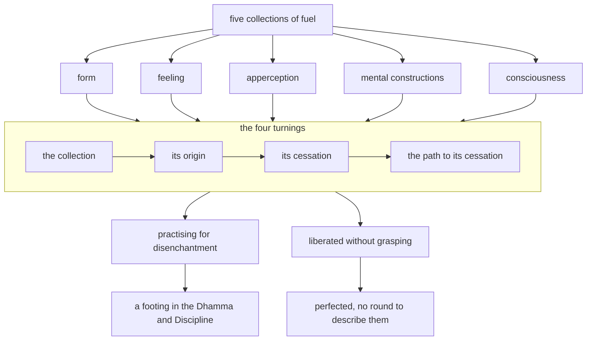

import { Tabs, TabItem } from '@astrojs/starlight/components';

Original text: [13S3/1.2.1.4 Upādānaparipavattasutta 256–271](https://tipitaka2500.github.io/tipitaka/13S3/1/1.2/1.2.1/1.2.1.4.html#256) in the [World Tipitaka Edition](https://tipitaka2500.github.io)

## Summary

At Sāvatthī the Bhagavā grounds his claim to perfect awakening in having experientially understood the five collections of fuel in four turnings: each collection, its origin, its cessation and the path leading to its cessation. Form, feeling, apperception, mental constructions and consciousness are each defined, with food, contact or phenomenal objects as their origin and the eightfold path as the way to their cessation. Those who practise for disenchantment with them find a footing in the Dhamma and Discipline; those liberated without grasping are perfected, with no round by which to describe them.

## Diagram

## Text

<Tabs syncKey="paliquote">
<TabItem label="My Translation">
(56.)

256\. [The Bhagavā] was dwelling at Sāvatthī. “There are, Bhikkhave, these five `upādānakkhandha` (collections of fuel). What five? The collection of form as fuel, the collection of feeling as fuel, the collection of apperception as fuel, the collection of mental constructions as fuel, the collection of consciousness as fuel. And as long as, Bhikkhave, I did not experientially understand these five collections of fuel in four turnings `yathābhūta` (in reality), then, Bhikkhave, I did not claim to have `abhisambuddha anuttara sammāsambodhi` (fully awakened to the perfect awakening unsurpassed by anything) in this world having devas, Māra, Brahmā, religious practitioners, `pajā` (living beings), `sadevamanussa` (devas and humans). But when, Bhikkhave, I experientially understood these five collections of fuel in four turnings `yathābhūta` (in reality), then, Bhikkhave, I claimed to have `abhisambuddha anuttara sammāsambodhi` (fully awakened to the perfect awakening unsurpassed by anything) in this world having devas … and so on … `sadevamanussa` (devas and humans).

257\. And how in four turnings? I experientially understood form, I experientially understood the origin of form, I experientially understood the cessation of form, I experientially understood the path leading to the cessation of form; feeling … apperception … mental constructions … I experientially understood consciousness, I experientially understood the origin of consciousness, I experientially understood the cessation of consciousness, I experientially understood the path leading to the cessation of consciousness.

258\. And what, Bhikkhave, is form? The four great elements and form derived from the four great elements. This, Bhikkhave, is called form. With the origin of food comes the origin of form; with the cessation of food comes the cessation of form. This very `ariyo aṭṭhaṅgiko maggo` (Eightfold Path) is the path leading to the cessation of form, that is to say: right view … and so on … right focus.

259\. Whatever wanderers or brahmins, Bhikkhave, having thus experientially understood form, having thus experientially understood the origin of form, having thus experientially understood the cessation of form, having thus experientially understood the path leading to the cessation of form, are practising for disenchantment with form, for detachment, for cessation, they are practising well. Those who are practising well find a footing in this Dhamma and Discipline.

260\. But whatever wanderers or brahmins, Bhikkhave, having thus experientially understood form … and so on … having thus experientially understood the path leading to the cessation of form, are liberated through disenchantment with form, through detachment, through cessation, not grasping, they are well liberated. Those who are well liberated are perfected. For those who are perfected there is no round for describing [them].

261\. And what, Bhikkhave, is feeling? There are, Bhikkhave, these six classes of feeling: feeling arisen from eye-contact, feeling arisen from ear-contact, feeling arisen from nose-contact, feeling arisen from tongue-contact, feeling arisen from body-contact, and feeling arisen from mind-contact. This, Bhikkhave, is called feeling. With the origin of contact comes the origin of feeling; with the cessation of contact comes the cessation of feeling. This very `ariyo aṭṭhaṅgiko maggo` (Eightfold Path) is the path leading to the cessation of feeling, that is to say: right view … and so on … right focus.

262\. Whatever wanderers or brahmins, Bhikkhave, having thus experientially understood feeling, having thus experientially understood the origin of feeling, having thus experientially understood the cessation of feeling, having thus experientially understood the path leading to the cessation of feeling, are practising for disenchantment with feeling, for detachment, for cessation, they are practising well. Those who are practising well find a footing in this Dhamma and Discipline.

263\. But whatever wanderers or brahmins, Bhikkhave, having thus experientially understood feeling … and so on … having thus experientially understood the path leading to the cessation of feeling … and so on … for them there is no round for describing [them].

264\. And what, Bhikkhave, is apperception? There are, Bhikkhave, these six classes of apperception: apperception of forms, apperception of sounds, apperception of smells, apperception of tastes, apperception of tangibles, and apperception of mental characteristics. This, Bhikkhave, is called apperception. With the origin of contact comes the origin of apperception; with the cessation of contact comes the cessation of apperception. This very `ariyo aṭṭhaṅgiko maggo` (Eightfold Path) is the path leading to the cessation of apperception, that is to say: right view … and so on … right focus … and so on … for them there is no round for describing [them].

265\. And what, Bhikkhave, are mental constructions? There are, Bhikkhave, these six classes of volitional thoughts (intentions): thoughts about forms, thoughts about sounds, thoughts about smells, thoughts about tastes, thoughts about contacts, and thoughts about mental characteristics. These, Bhikkhave, are called mental constructions. With the origin of contact comes the origin of mental constructions; with the cessation of contact comes the cessation of mental constructions. This very `ariyo aṭṭhaṅgiko maggo` (Eightfold Path) is the path leading to the cessation of mental constructions, that is to say: right view … and so on … right focus.

266\. Whatever wanderers or brahmins, Bhikkhave, having thus experientially understood mental constructions, having thus experientially understood the origin of mental constructions, having thus experientially understood the cessation of mental constructions, having thus experientially understood the path leading to the cessation of mental constructions, are practising for disenchantment with mental constructions, for detachment, for cessation, they are practising well. Those who are practising well find a footing in this Dhamma and Discipline.

267\. But whatever wanderers or brahmins, Bhikkhave, having thus experientially understood mental constructions, having thus experientially understood the origin of mental constructions, having thus experientially understood the cessation of mental constructions, having thus experientially understood the path leading to the cessation of mental constructions, are liberated through disenchantment with mental constructions, through detachment, through cessation, not grasping, they are well liberated. Those who are well liberated are perfected. For those who are perfected there is no round for describing [them].

268\. And what, Bhikkhave, is consciousness? There are, Bhikkhave, these six classes of consciousness: eye-consciousness, ear-consciousness, nose-consciousness, tongue-consciousness, body-consciousness, and mind-consciousness. This, Bhikkhave, is called consciousness. With the origin of phenomenal objects comes the origin of consciousness; with the cessation of phenomenal objects comes the cessation of consciousness. This very `ariyo aṭṭhaṅgiko maggo` (Eightfold Path) is the path leading to the cessation of consciousness, that is to say: right view … and so on … right focus.

269\. Whatever wanderers or brahmins, Bhikkhave, having thus experientially understood consciousness, having thus experientially understood the origin of consciousness, having thus experientially understood the cessation of consciousness, having thus experientially understood the path leading to the cessation of consciousness, are practising for disenchantment with consciousness, for detachment, for cessation, they are practising well. Those who are practising well find a footing in this Dhamma and Discipline.

270\. But whatever wanderers or brahmins, Bhikkhave, having thus experientially understood consciousness, having thus experientially understood the origin of consciousness, having thus experientially understood the cessation of consciousness, having thus experientially understood the path leading to the cessation of consciousness, are liberated through disenchantment with consciousness, through detachment, through cessation, not grasping, they are well liberated. Those who are well liberated are perfected. For those who are perfected there is no round for describing [them].”

271\. The fourth [discourse of the chapter].
</TabItem>

<TabItem label="Pāḷi (Roman IAST)">
(56.)

256\. Sāvatthinidānaṃ. “Pañcime, bhikkhave, upādānakkhandhā. Katame pañca? Rūpupādānakkhandho, vedanupādānakkhandho, saññupādānakkhandho, saṅkhārupādānakkhandho, viññāṇupādānakkhandho. Yāvakīvañcāhaṃ, bhikkhave, ime pañcupādānakkhandhe catuparivaṭṭaṃ yathābhūtaṃ nābbhaññāsiṃ, neva tāvāhaṃ, bhikkhave, sadevake loke samārake sabrahmake sassamaṇabrāhmaṇiyā pajāya sadevamanussāya anuttaraṃ sammāsambodhiṃ abhisambuddhoti paccaññāsiṃ. Yato ca khvāhaṃ, bhikkhave, ime pañcupādānakkhandhe catuparivaṭṭaṃ yathābhūtaṃ abbhaññāsiṃ, athāhaṃ, bhikkhave, sadevake loke…pe… sadevamanussāya anuttaraṃ sammāsambodhiṃ abhisambuddhoti paccaññāsiṃ.

257\. Kathañca catuparivaṭṭaṃ? Rūpaṃ abbhaññāsiṃ, rūpasamudayaṃ abbhaññāsiṃ, rūpanirodhaṃ abbhaññāsiṃ, rūpanirodhagāminiṃ paṭipadaṃ abbhaññāsiṃ; vedanaṃ… saññaṃ… saṅkhāre… viññāṇaṃ abbhaññāsiṃ, viññāṇasamudayaṃ abbhaññāsiṃ, viññāṇanirodhaṃ abbhaññāsiṃ, viññāṇanirodhagāminiṃ paṭipadaṃ abbhaññāsiṃ.

258\. Katamañca, bhikkhave, rūpaṃ? Cattāro ca mahābhūtā catunnañca mahābhūtānaṃ upādāya rūpaṃ. Idaṃ vuccati, bhikkhave, rūpaṃ. Āhārasamudayā rūpasamudayo; āhāranirodhā rūpanirodho. Ayameva ariyo aṭṭhaṅgiko maggo rūpanirodhagāminī paṭipadā, seyyathidaṃ— sammādiṭṭhi…pe… sammāsamādhi.

259\. Ye hi keci, bhikkhave, samaṇā vā brāhmaṇā vā evaṃ rūpaṃ abhiññāya, evaṃ rūpasamudayaṃ abhiññāya, evaṃ rūpanirodhaṃ abhiññāya, evaṃ rūpanirodhagāminiṃ paṭipadaṃ abhiññāya rūpassa nibbidāya virāgāya nirodhāya paṭipannā, te suppaṭipannā. Ye suppaṭipannā, te imasmiṃ dhammavinaye gādhanti.

260\. Ye ca kho keci, bhikkhave, samaṇā vā brāhmaṇā vā evaṃ rūpaṃ abhiññāya…pe… evaṃ rūpanirodhagāminiṃ paṭipadaṃ abhiññāya, rūpassa nibbidā virāgā nirodhā anupādā vimuttā te suvimuttā. Ye suvimuttā te kevalino. Ye kevalino vaṭṭaṃ tesaṃ natthi paññāpanāya.

261\. Katamā ca, bhikkhave, vedanā? Chayime, bhikkhave, vedanākāyā— cakkhusamphassajā vedanā, sotasamphassajā vedanā, ghānasamphassajā vedanā, jivhāsamphassajā vedanā, kāyasamphassajā vedanā, manosamphassajā vedanā. Ayaṃ vuccati, bhikkhave, vedanā. Phassasamudayā vedanāsamudayo; phassanirodhā vedanānirodho. Ayameva ariyo aṭṭhaṅgiko maggo vedanānirodhagāminī paṭipadā, seyyathidaṃ— sammādiṭṭhi…pe… sammāsamādhi.

262\. Ye hi keci, bhikkhave, samaṇā vā brāhmaṇā vā evaṃ vedanaṃ abhiññāya, evaṃ vedanāsamudayaṃ abhiññāya, evaṃ vedanānirodhaṃ abhiññāya, evaṃ vedanānirodhagāminiṃ paṭipadaṃ abhiññāya vedanāya nibbidāya virāgāya nirodhāya paṭipannā, te suppaṭipannā. Ye suppaṭipannā, te imasmiṃ dhammavinaye gādhanti.

263\. Ye ca kho keci, bhikkhave, samaṇā vā brāhmaṇā vā evaṃ vedanaṃ abhiññāya…pe… evaṃ vedanānirodhagāminiṃ paṭipadaṃ abhiññāya…pe… vaṭṭaṃ tesaṃ natthi paññāpanāya.

264\. Katamā ca, bhikkhave, saññā? Chayime, bhikkhave, saññākāyā— rūpasaññā, saddasaññā, gandhasaññā, rasasaññā, phoṭṭhabbasaññā, dhammasaññā. Ayaṃ vuccati, bhikkhave, saññā. Phassasamudayā saññāsamudayo; phassanirodhā saññānirodho. Ayameva ariyo aṭṭhaṅgiko maggo saññānirodhagāminī paṭipadā, seyyathidaṃ— sammādiṭṭhi…pe… sammāsamādhi…pe… vaṭṭaṃ tesaṃ natthi paññāpanāya.

265\. Katame ca, bhikkhave, saṅkhārā? Chayime, bhikkhave, cetanākāyā— rūpasañcetanā, saddasañcetanā, gandhasañcetanā, rasasañcetanā, phoṭṭhabbasañcetanā, dhammasañcetanā. Ime vuccanti, bhikkhave, saṅkhārā. Phassasamudayā saṅkhārasamudayo; phassanirodhā saṅkhāranirodho. Ayameva ariyo aṭṭhaṅgiko maggo saṅkhāranirodhagāminī paṭipadā, seyyathidaṃ— sammādiṭṭhi…pe… sammāsamādhi.

266\. Ye hi keci, bhikkhave, samaṇā vā brāhmaṇā vā evaṃ saṅkhāre abhiññāya, evaṃ saṅkhārasamudayaṃ abhiññāya, evaṃ saṅkhāranirodhaṃ abhiññāya, evaṃ saṅkhāranirodhagāminiṃ paṭipadaṃ abhiññāya saṅkhārānaṃ nibbidāya virāgāya nirodhāya paṭipannā, te suppaṭipannā. Ye suppaṭipannā, te imasmiṃ dhammavinaye gādhanti.

267\. Ye ca kho keci, bhikkhave, samaṇā vā brāhmaṇā vā evaṃ saṅkhāre abhiññāya, evaṃ saṅkhārasamudayaṃ abhiññāya, evaṃ saṅkhāranirodhaṃ abhiññāya, evaṃ saṅkhāranirodhagāminiṃ paṭipadaṃ abhiññāya saṅkhārānaṃ nibbidā virāgā nirodhā anupādā vimuttā, te suvimuttā. Ye suvimuttā, te kevalino. Ye kevalino vaṭṭaṃ tesaṃ natthi paññāpanāya.

268\. Katamañca, bhikkhave, viññāṇaṃ? Chayime, bhikkhave, viññāṇakāyā— cakkhuviññāṇaṃ, sotaviññāṇaṃ, ghānaviññāṇaṃ, jivhāviññāṇaṃ, kāyaviññāṇaṃ, manoviññāṇaṃ. Idaṃ vuccati, bhikkhave, viññāṇaṃ. Nāmarūpasamudayā viññāṇasamudayo; nāmarūpanirodhā viññāṇanirodho. Ayameva ariyo aṭṭhaṅgiko maggo viññāṇanirodhagāminī paṭipadā, seyyathidaṃ— sammādiṭṭhi…pe… sammāsamādhi.

269\. Ye hi keci, bhikkhave, samaṇā vā brāhmaṇā vā evaṃ viññāṇaṃ abhiññāya, evaṃ viññāṇasamudayaṃ abhiññāya, evaṃ viññāṇanirodhaṃ abhiññāya, evaṃ viññāṇanirodhagāminiṃ paṭipadaṃ abhiññāya viññāṇassa nibbidāya virāgāya nirodhāya paṭipannā, te suppaṭipannā. Ye suppaṭipannā, te imasmiṃ dhammavinaye gādhanti.

270\. Ye ca kho keci, bhikkhave, samaṇā vā brāhmaṇā vā evaṃ viññāṇaṃ abhiññāya, evaṃ viññāṇasamudayaṃ abhiññāya, evaṃ viññāṇanirodhaṃ abhiññāya, evaṃ viññāṇanirodhagāminiṃ paṭipadaṃ abhiññāya viññāṇassa nibbidā virāgā nirodhā anupādā vimuttā, te suvimuttā. Ye suvimuttā, te kevalino. Ye kevalino vaṭṭaṃ tesaṃ natthi paññāpanāyā”ti.

271\. Catutthaṃ.
</TabItem>

<TabItem label="Pāḷi (Brahmi)">
(56.)

256\. 𑀲𑀸𑀯𑀢𑁆𑀣𑀺𑀦𑀺𑀤𑀸𑀦𑀁. “𑀧𑀜𑁆𑀘𑀺𑀫𑁂, 𑀪𑀺𑀓𑁆𑀔𑀯𑁂, 𑀉𑀧𑀸𑀤𑀸𑀦𑀓𑁆𑀔𑀦𑁆𑀥𑀸. 𑀓𑀢𑀫𑁂 𑀧𑀜𑁆𑀘? 𑀭𑀽𑀧𑀼𑀧𑀸𑀤𑀸𑀦𑀓𑁆𑀔𑀦𑁆𑀥𑁄, 𑀯𑁂𑀤𑀦𑀼𑀧𑀸𑀤𑀸𑀦𑀓𑁆𑀔𑀦𑁆𑀥𑁄, 𑀲𑀜𑁆𑀜𑀼𑀧𑀸𑀤𑀸𑀦𑀓𑁆𑀔𑀦𑁆𑀥𑁄, 𑀲𑀗𑁆𑀔𑀸𑀭𑀼𑀧𑀸𑀤𑀸𑀦𑀓𑁆𑀔𑀦𑁆𑀥𑁄, 𑀯𑀺𑀜𑁆𑀜𑀸𑀡𑀼𑀧𑀸𑀤𑀸𑀦𑀓𑁆𑀔𑀦𑁆𑀥𑁄. 𑀬𑀸𑀯𑀓𑀻𑀯𑀜𑁆𑀘𑀸𑀳𑀁, 𑀪𑀺𑀓𑁆𑀔𑀯𑁂, 𑀇𑀫𑁂 𑀧𑀜𑁆𑀘𑀼𑀧𑀸𑀤𑀸𑀦𑀓𑁆𑀔𑀦𑁆𑀥𑁂 𑀘𑀢𑀼𑀧𑀭𑀺𑀯𑀝𑁆𑀝𑀁 𑀬𑀣𑀸𑀪𑀽𑀢𑀁 𑀦𑀸𑀩𑁆𑀪𑀜𑁆𑀜𑀸𑀲𑀺𑀁, 𑀦𑁂𑀯 𑀢𑀸𑀯𑀸𑀳𑀁, 𑀪𑀺𑀓𑁆𑀔𑀯𑁂, 𑀲𑀤𑁂𑀯𑀓𑁂 𑀮𑁄𑀓𑁂 𑀲𑀫𑀸𑀭𑀓𑁂 𑀲𑀩𑁆𑀭𑀳𑁆𑀫𑀓𑁂 𑀲𑀲𑁆𑀲𑀫𑀡𑀩𑁆𑀭𑀸𑀳𑁆𑀫𑀡𑀺𑀬𑀸 𑀧𑀚𑀸𑀬 𑀲𑀤𑁂𑀯𑀫𑀦𑀼𑀲𑁆𑀲𑀸𑀬 𑀅𑀦𑀼𑀢𑁆𑀢𑀭𑀁 𑀲𑀫𑁆𑀫𑀸𑀲𑀫𑁆𑀩𑁄𑀥𑀺𑀁 𑀅𑀪𑀺𑀲𑀫𑁆𑀩𑀼𑀤𑁆𑀥𑁄𑀢𑀺 𑀧𑀘𑁆𑀘𑀜𑁆𑀜𑀸𑀲𑀺𑀁. 𑀬𑀢𑁄 𑀘 𑀔𑁆𑀯𑀸𑀳𑀁, 𑀪𑀺𑀓𑁆𑀔𑀯𑁂, 𑀇𑀫𑁂 𑀧𑀜𑁆𑀘𑀼𑀧𑀸𑀤𑀸𑀦𑀓𑁆𑀔𑀦𑁆𑀥𑁂 𑀘𑀢𑀼𑀧𑀭𑀺𑀯𑀝𑁆𑀝𑀁 𑀬𑀣𑀸𑀪𑀽𑀢𑀁 𑀅𑀩𑁆𑀪𑀜𑁆𑀜𑀸𑀲𑀺𑀁, 𑀅𑀣𑀸𑀳𑀁, 𑀪𑀺𑀓𑁆𑀔𑀯𑁂, 𑀲𑀤𑁂𑀯𑀓𑁂 𑀮𑁄𑀓𑁂…𑀧𑁂… 𑀲𑀤𑁂𑀯𑀫𑀦𑀼𑀲𑁆𑀲𑀸𑀬 𑀅𑀦𑀼𑀢𑁆𑀢𑀭𑀁 𑀲𑀫𑁆𑀫𑀸𑀲𑀫𑁆𑀩𑁄𑀥𑀺𑀁 𑀅𑀪𑀺𑀲𑀫𑁆𑀩𑀼𑀤𑁆𑀥𑁄𑀢𑀺 𑀧𑀘𑁆𑀘𑀜𑁆𑀜𑀸𑀲𑀺𑀁.

257\. 𑀓𑀣𑀜𑁆𑀘 𑀘𑀢𑀼𑀧𑀭𑀺𑀯𑀝𑁆𑀝𑀁? 𑀭𑀽𑀧𑀁 𑀅𑀩𑁆𑀪𑀜𑁆𑀜𑀸𑀲𑀺𑀁, 𑀭𑀽𑀧𑀲𑀫𑀼𑀤𑀬𑀁 𑀅𑀩𑁆𑀪𑀜𑁆𑀜𑀸𑀲𑀺𑀁, 𑀭𑀽𑀧𑀦𑀺𑀭𑁄𑀥𑀁 𑀅𑀩𑁆𑀪𑀜𑁆𑀜𑀸𑀲𑀺𑀁, 𑀭𑀽𑀧𑀦𑀺𑀭𑁄𑀥𑀕𑀸𑀫𑀺𑀦𑀺𑀁 𑀧𑀝𑀺𑀧𑀤𑀁 𑀅𑀩𑁆𑀪𑀜𑁆𑀜𑀸𑀲𑀺𑀁; 𑀯𑁂𑀤𑀦𑀁… 𑀲𑀜𑁆𑀜𑀁… 𑀲𑀗𑁆𑀔𑀸𑀭𑁂… 𑀯𑀺𑀜𑁆𑀜𑀸𑀡𑀁 𑀅𑀩𑁆𑀪𑀜𑁆𑀜𑀸𑀲𑀺𑀁, 𑀯𑀺𑀜𑁆𑀜𑀸𑀡𑀲𑀫𑀼𑀤𑀬𑀁 𑀅𑀩𑁆𑀪𑀜𑁆𑀜𑀸𑀲𑀺𑀁, 𑀯𑀺𑀜𑁆𑀜𑀸𑀡𑀦𑀺𑀭𑁄𑀥𑀁 𑀅𑀩𑁆𑀪𑀜𑁆𑀜𑀸𑀲𑀺𑀁, 𑀯𑀺𑀜𑁆𑀜𑀸𑀡𑀦𑀺𑀭𑁄𑀥𑀕𑀸𑀫𑀺𑀦𑀺𑀁 𑀧𑀝𑀺𑀧𑀤𑀁 𑀅𑀩𑁆𑀪𑀜𑁆𑀜𑀸𑀲𑀺𑀁.

258\. 𑀓𑀢𑀫𑀜𑁆𑀘, 𑀪𑀺𑀓𑁆𑀔𑀯𑁂, 𑀭𑀽𑀧𑀁? 𑀘𑀢𑁆𑀢𑀸𑀭𑁄 𑀘 𑀫𑀳𑀸𑀪𑀽𑀢𑀸 𑀘𑀢𑀼𑀦𑁆𑀦𑀜𑁆𑀘 𑀫𑀳𑀸𑀪𑀽𑀢𑀸𑀦𑀁 𑀉𑀧𑀸𑀤𑀸𑀬 𑀭𑀽𑀧𑀁. 𑀇𑀤𑀁 𑀯𑀼𑀘𑁆𑀘𑀢𑀺, 𑀪𑀺𑀓𑁆𑀔𑀯𑁂, 𑀭𑀽𑀧𑀁. 𑀆𑀳𑀸𑀭𑀲𑀫𑀼𑀤𑀬𑀸 𑀭𑀽𑀧𑀲𑀫𑀼𑀤𑀬𑁄; 𑀆𑀳𑀸𑀭𑀦𑀺𑀭𑁄𑀥𑀸 𑀭𑀽𑀧𑀦𑀺𑀭𑁄𑀥𑁄. 𑀅𑀬𑀫𑁂𑀯 𑀅𑀭𑀺𑀬𑁄 𑀅𑀝𑁆𑀞𑀗𑁆𑀕𑀺𑀓𑁄 𑀫𑀕𑁆𑀕𑁄 𑀭𑀽𑀧𑀦𑀺𑀭𑁄𑀥𑀕𑀸𑀫𑀺𑀦𑀻 𑀧𑀝𑀺𑀧𑀤𑀸, 𑀲𑁂𑀬𑁆𑀬𑀣𑀺𑀤𑀁— 𑀲𑀫𑁆𑀫𑀸𑀤𑀺𑀝𑁆𑀞𑀺…𑀧𑁂… 𑀲𑀫𑁆𑀫𑀸𑀲𑀫𑀸𑀥𑀺.

259\. 𑀬𑁂 𑀳𑀺 𑀓𑁂𑀘𑀺, 𑀪𑀺𑀓𑁆𑀔𑀯𑁂, 𑀲𑀫𑀡𑀸 𑀯𑀸 𑀩𑁆𑀭𑀸𑀳𑁆𑀫𑀡𑀸 𑀯𑀸 𑀏𑀯𑀁 𑀭𑀽𑀧𑀁 𑀅𑀪𑀺𑀜𑁆𑀜𑀸𑀬, 𑀏𑀯𑀁 𑀭𑀽𑀧𑀲𑀫𑀼𑀤𑀬𑀁 𑀅𑀪𑀺𑀜𑁆𑀜𑀸𑀬, 𑀏𑀯𑀁 𑀭𑀽𑀧𑀦𑀺𑀭𑁄𑀥𑀁 𑀅𑀪𑀺𑀜𑁆𑀜𑀸𑀬, 𑀏𑀯𑀁 𑀭𑀽𑀧𑀦𑀺𑀭𑁄𑀥𑀕𑀸𑀫𑀺𑀦𑀺𑀁 𑀧𑀝𑀺𑀧𑀤𑀁 𑀅𑀪𑀺𑀜𑁆𑀜𑀸𑀬 𑀭𑀽𑀧𑀲𑁆𑀲 𑀦𑀺𑀩𑁆𑀩𑀺𑀤𑀸𑀬 𑀯𑀺𑀭𑀸𑀕𑀸𑀬 𑀦𑀺𑀭𑁄𑀥𑀸𑀬 𑀧𑀝𑀺𑀧𑀦𑁆𑀦𑀸, 𑀢𑁂 𑀲𑀼𑀧𑁆𑀧𑀝𑀺𑀧𑀦𑁆𑀦𑀸. 𑀬𑁂 𑀲𑀼𑀧𑁆𑀧𑀝𑀺𑀧𑀦𑁆𑀦𑀸, 𑀢𑁂 𑀇𑀫𑀲𑁆𑀫𑀺𑀁 𑀥𑀫𑁆𑀫𑀯𑀺𑀦𑀬𑁂 𑀕𑀸𑀥𑀦𑁆𑀢𑀺.

260\. 𑀬𑁂 𑀘 𑀔𑁄 𑀓𑁂𑀘𑀺, 𑀪𑀺𑀓𑁆𑀔𑀯𑁂, 𑀲𑀫𑀡𑀸 𑀯𑀸 𑀩𑁆𑀭𑀸𑀳𑁆𑀫𑀡𑀸 𑀯𑀸 𑀏𑀯𑀁 𑀭𑀽𑀧𑀁 𑀅𑀪𑀺𑀜𑁆𑀜𑀸𑀬…𑀧𑁂… 𑀏𑀯𑀁 𑀭𑀽𑀧𑀦𑀺𑀭𑁄𑀥𑀕𑀸𑀫𑀺𑀦𑀺𑀁 𑀧𑀝𑀺𑀧𑀤𑀁 𑀅𑀪𑀺𑀜𑁆𑀜𑀸𑀬, 𑀭𑀽𑀧𑀲𑁆𑀲 𑀦𑀺𑀩𑁆𑀩𑀺𑀤𑀸 𑀯𑀺𑀭𑀸𑀕𑀸 𑀦𑀺𑀭𑁄𑀥𑀸 𑀅𑀦𑀼𑀧𑀸𑀤𑀸 𑀯𑀺𑀫𑀼𑀢𑁆𑀢𑀸 𑀢𑁂 𑀲𑀼𑀯𑀺𑀫𑀼𑀢𑁆𑀢𑀸. 𑀬𑁂 𑀲𑀼𑀯𑀺𑀫𑀼𑀢𑁆𑀢𑀸 𑀢𑁂 𑀓𑁂𑀯𑀮𑀺𑀦𑁄. 𑀬𑁂 𑀓𑁂𑀯𑀮𑀺𑀦𑁄 𑀯𑀝𑁆𑀝𑀁 𑀢𑁂𑀲𑀁 𑀦𑀢𑁆𑀣𑀺 𑀧𑀜𑁆𑀜𑀸𑀧𑀦𑀸𑀬.

261\. 𑀓𑀢𑀫𑀸 𑀘, 𑀪𑀺𑀓𑁆𑀔𑀯𑁂, 𑀯𑁂𑀤𑀦𑀸? 𑀙𑀬𑀺𑀫𑁂, 𑀪𑀺𑀓𑁆𑀔𑀯𑁂, 𑀯𑁂𑀤𑀦𑀸𑀓𑀸𑀬𑀸— 𑀘𑀓𑁆𑀔𑀼𑀲𑀫𑁆𑀨𑀲𑁆𑀲𑀚𑀸 𑀯𑁂𑀤𑀦𑀸, 𑀲𑁄𑀢𑀲𑀫𑁆𑀨𑀲𑁆𑀲𑀚𑀸 𑀯𑁂𑀤𑀦𑀸, 𑀖𑀸𑀦𑀲𑀫𑁆𑀨𑀲𑁆𑀲𑀚𑀸 𑀯𑁂𑀤𑀦𑀸, 𑀚𑀺𑀯𑁆𑀳𑀸𑀲𑀫𑁆𑀨𑀲𑁆𑀲𑀚𑀸 𑀯𑁂𑀤𑀦𑀸, 𑀓𑀸𑀬𑀲𑀫𑁆𑀨𑀲𑁆𑀲𑀚𑀸 𑀯𑁂𑀤𑀦𑀸, 𑀫𑀦𑁄𑀲𑀫𑁆𑀨𑀲𑁆𑀲𑀚𑀸 𑀯𑁂𑀤𑀦𑀸. 𑀅𑀬𑀁 𑀯𑀼𑀘𑁆𑀘𑀢𑀺, 𑀪𑀺𑀓𑁆𑀔𑀯𑁂, 𑀯𑁂𑀤𑀦𑀸. 𑀨𑀲𑁆𑀲𑀲𑀫𑀼𑀤𑀬𑀸 𑀯𑁂𑀤𑀦𑀸𑀲𑀫𑀼𑀤𑀬𑁄; 𑀨𑀲𑁆𑀲𑀦𑀺𑀭𑁄𑀥𑀸 𑀯𑁂𑀤𑀦𑀸𑀦𑀺𑀭𑁄𑀥𑁄. 𑀅𑀬𑀫𑁂𑀯 𑀅𑀭𑀺𑀬𑁄 𑀅𑀝𑁆𑀞𑀗𑁆𑀕𑀺𑀓𑁄 𑀫𑀕𑁆𑀕𑁄 𑀯𑁂𑀤𑀦𑀸𑀦𑀺𑀭𑁄𑀥𑀕𑀸𑀫𑀺𑀦𑀻 𑀧𑀝𑀺𑀧𑀤𑀸, 𑀲𑁂𑀬𑁆𑀬𑀣𑀺𑀤𑀁— 𑀲𑀫𑁆𑀫𑀸𑀤𑀺𑀝𑁆𑀞𑀺…𑀧𑁂… 𑀲𑀫𑁆𑀫𑀸𑀲𑀫𑀸𑀥𑀺.

262\. 𑀬𑁂 𑀳𑀺 𑀓𑁂𑀘𑀺, 𑀪𑀺𑀓𑁆𑀔𑀯𑁂, 𑀲𑀫𑀡𑀸 𑀯𑀸 𑀩𑁆𑀭𑀸𑀳𑁆𑀫𑀡𑀸 𑀯𑀸 𑀏𑀯𑀁 𑀯𑁂𑀤𑀦𑀁 𑀅𑀪𑀺𑀜𑁆𑀜𑀸𑀬, 𑀏𑀯𑀁 𑀯𑁂𑀤𑀦𑀸𑀲𑀫𑀼𑀤𑀬𑀁 𑀅𑀪𑀺𑀜𑁆𑀜𑀸𑀬, 𑀏𑀯𑀁 𑀯𑁂𑀤𑀦𑀸𑀦𑀺𑀭𑁄𑀥𑀁 𑀅𑀪𑀺𑀜𑁆𑀜𑀸𑀬, 𑀏𑀯𑀁 𑀯𑁂𑀤𑀦𑀸𑀦𑀺𑀭𑁄𑀥𑀕𑀸𑀫𑀺𑀦𑀺𑀁 𑀧𑀝𑀺𑀧𑀤𑀁 𑀅𑀪𑀺𑀜𑁆𑀜𑀸𑀬 𑀯𑁂𑀤𑀦𑀸𑀬 𑀦𑀺𑀩𑁆𑀩𑀺𑀤𑀸𑀬 𑀯𑀺𑀭𑀸𑀕𑀸𑀬 𑀦𑀺𑀭𑁄𑀥𑀸𑀬 𑀧𑀝𑀺𑀧𑀦𑁆𑀦𑀸, 𑀢𑁂 𑀲𑀼𑀧𑁆𑀧𑀝𑀺𑀧𑀦𑁆𑀦𑀸. 𑀬𑁂 𑀲𑀼𑀧𑁆𑀧𑀝𑀺𑀧𑀦𑁆𑀦𑀸, 𑀢𑁂 𑀇𑀫𑀲𑁆𑀫𑀺𑀁 𑀥𑀫𑁆𑀫𑀯𑀺𑀦𑀬𑁂 𑀕𑀸𑀥𑀦𑁆𑀢𑀺.

263\. 𑀬𑁂 𑀘 𑀔𑁄 𑀓𑁂𑀘𑀺, 𑀪𑀺𑀓𑁆𑀔𑀯𑁂, 𑀲𑀫𑀡𑀸 𑀯𑀸 𑀩𑁆𑀭𑀸𑀳𑁆𑀫𑀡𑀸 𑀯𑀸 𑀏𑀯𑀁 𑀯𑁂𑀤𑀦𑀁 𑀅𑀪𑀺𑀜𑁆𑀜𑀸𑀬…𑀧𑁂… 𑀏𑀯𑀁 𑀯𑁂𑀤𑀦𑀸𑀦𑀺𑀭𑁄𑀥𑀕𑀸𑀫𑀺𑀦𑀺𑀁 𑀧𑀝𑀺𑀧𑀤𑀁 𑀅𑀪𑀺𑀜𑁆𑀜𑀸𑀬…𑀧𑁂… 𑀯𑀝𑁆𑀝𑀁 𑀢𑁂𑀲𑀁 𑀦𑀢𑁆𑀣𑀺 𑀧𑀜𑁆𑀜𑀸𑀧𑀦𑀸𑀬.

264\. 𑀓𑀢𑀫𑀸 𑀘, 𑀪𑀺𑀓𑁆𑀔𑀯𑁂, 𑀲𑀜𑁆𑀜𑀸? 𑀙𑀬𑀺𑀫𑁂, 𑀪𑀺𑀓𑁆𑀔𑀯𑁂, 𑀲𑀜𑁆𑀜𑀸𑀓𑀸𑀬𑀸— 𑀭𑀽𑀧𑀲𑀜𑁆𑀜𑀸, 𑀲𑀤𑁆𑀤𑀲𑀜𑁆𑀜𑀸, 𑀕𑀦𑁆𑀥𑀲𑀜𑁆𑀜𑀸, 𑀭𑀲𑀲𑀜𑁆𑀜𑀸, 𑀨𑁄𑀝𑁆𑀞𑀩𑁆𑀩𑀲𑀜𑁆𑀜𑀸, 𑀥𑀫𑁆𑀫𑀲𑀜𑁆𑀜𑀸. 𑀅𑀬𑀁 𑀯𑀼𑀘𑁆𑀘𑀢𑀺, 𑀪𑀺𑀓𑁆𑀔𑀯𑁂, 𑀲𑀜𑁆𑀜𑀸. 𑀨𑀲𑁆𑀲𑀲𑀫𑀼𑀤𑀬𑀸 𑀲𑀜𑁆𑀜𑀸𑀲𑀫𑀼𑀤𑀬𑁄; 𑀨𑀲𑁆𑀲𑀦𑀺𑀭𑁄𑀥𑀸 𑀲𑀜𑁆𑀜𑀸𑀦𑀺𑀭𑁄𑀥𑁄. 𑀅𑀬𑀫𑁂𑀯 𑀅𑀭𑀺𑀬𑁄 𑀅𑀝𑁆𑀞𑀗𑁆𑀕𑀺𑀓𑁄 𑀫𑀕𑁆𑀕𑁄 𑀲𑀜𑁆𑀜𑀸𑀦𑀺𑀭𑁄𑀥𑀕𑀸𑀫𑀺𑀦𑀻 𑀧𑀝𑀺𑀧𑀤𑀸, 𑀲𑁂𑀬𑁆𑀬𑀣𑀺𑀤𑀁— 𑀲𑀫𑁆𑀫𑀸𑀤𑀺𑀝𑁆𑀞𑀺…𑀧𑁂… 𑀲𑀫𑁆𑀫𑀸𑀲𑀫𑀸𑀥𑀺…𑀧𑁂… 𑀯𑀝𑁆𑀝𑀁 𑀢𑁂𑀲𑀁 𑀦𑀢𑁆𑀣𑀺 𑀧𑀜𑁆𑀜𑀸𑀧𑀦𑀸𑀬.

265\. 𑀓𑀢𑀫𑁂 𑀘, 𑀪𑀺𑀓𑁆𑀔𑀯𑁂, 𑀲𑀗𑁆𑀔𑀸𑀭𑀸? 𑀙𑀬𑀺𑀫𑁂, 𑀪𑀺𑀓𑁆𑀔𑀯𑁂, 𑀘𑁂𑀢𑀦𑀸𑀓𑀸𑀬𑀸— 𑀭𑀽𑀧𑀲𑀜𑁆𑀘𑁂𑀢𑀦𑀸, 𑀲𑀤𑁆𑀤𑀲𑀜𑁆𑀘𑁂𑀢𑀦𑀸, 𑀕𑀦𑁆𑀥𑀲𑀜𑁆𑀘𑁂𑀢𑀦𑀸, 𑀭𑀲𑀲𑀜𑁆𑀘𑁂𑀢𑀦𑀸, 𑀨𑁄𑀝𑁆𑀞𑀩𑁆𑀩𑀲𑀜𑁆𑀘𑁂𑀢𑀦𑀸, 𑀥𑀫𑁆𑀫𑀲𑀜𑁆𑀘𑁂𑀢𑀦𑀸. 𑀇𑀫𑁂 𑀯𑀼𑀘𑁆𑀘𑀦𑁆𑀢𑀺, 𑀪𑀺𑀓𑁆𑀔𑀯𑁂, 𑀲𑀗𑁆𑀔𑀸𑀭𑀸. 𑀨𑀲𑁆𑀲𑀲𑀫𑀼𑀤𑀬𑀸 𑀲𑀗𑁆𑀔𑀸𑀭𑀲𑀫𑀼𑀤𑀬𑁄; 𑀨𑀲𑁆𑀲𑀦𑀺𑀭𑁄𑀥𑀸 𑀲𑀗𑁆𑀔𑀸𑀭𑀦𑀺𑀭𑁄𑀥𑁄. 𑀅𑀬𑀫𑁂𑀯 𑀅𑀭𑀺𑀬𑁄 𑀅𑀝𑁆𑀞𑀗𑁆𑀕𑀺𑀓𑁄 𑀫𑀕𑁆𑀕𑁄 𑀲𑀗𑁆𑀔𑀸𑀭𑀦𑀺𑀭𑁄𑀥𑀕𑀸𑀫𑀺𑀦𑀻 𑀧𑀝𑀺𑀧𑀤𑀸, 𑀲𑁂𑀬𑁆𑀬𑀣𑀺𑀤𑀁— 𑀲𑀫𑁆𑀫𑀸𑀤𑀺𑀝𑁆𑀞𑀺…𑀧𑁂… 𑀲𑀫𑁆𑀫𑀸𑀲𑀫𑀸𑀥𑀺.

266\. 𑀬𑁂 𑀳𑀺 𑀓𑁂𑀘𑀺, 𑀪𑀺𑀓𑁆𑀔𑀯𑁂, 𑀲𑀫𑀡𑀸 𑀯𑀸 𑀩𑁆𑀭𑀸𑀳𑁆𑀫𑀡𑀸 𑀯𑀸 𑀏𑀯𑀁 𑀲𑀗𑁆𑀔𑀸𑀭𑁂 𑀅𑀪𑀺𑀜𑁆𑀜𑀸𑀬, 𑀏𑀯𑀁 𑀲𑀗𑁆𑀔𑀸𑀭𑀲𑀫𑀼𑀤𑀬𑀁 𑀅𑀪𑀺𑀜𑁆𑀜𑀸𑀬, 𑀏𑀯𑀁 𑀲𑀗𑁆𑀔𑀸𑀭𑀦𑀺𑀭𑁄𑀥𑀁 𑀅𑀪𑀺𑀜𑁆𑀜𑀸𑀬, 𑀏𑀯𑀁 𑀲𑀗𑁆𑀔𑀸𑀭𑀦𑀺𑀭𑁄𑀥𑀕𑀸𑀫𑀺𑀦𑀺𑀁 𑀧𑀝𑀺𑀧𑀤𑀁 𑀅𑀪𑀺𑀜𑁆𑀜𑀸𑀬 𑀲𑀗𑁆𑀔𑀸𑀭𑀸𑀦𑀁 𑀦𑀺𑀩𑁆𑀩𑀺𑀤𑀸𑀬 𑀯𑀺𑀭𑀸𑀕𑀸𑀬 𑀦𑀺𑀭𑁄𑀥𑀸𑀬 𑀧𑀝𑀺𑀧𑀦𑁆𑀦𑀸, 𑀢𑁂 𑀲𑀼𑀧𑁆𑀧𑀝𑀺𑀧𑀦𑁆𑀦𑀸. 𑀬𑁂 𑀲𑀼𑀧𑁆𑀧𑀝𑀺𑀧𑀦𑁆𑀦𑀸, 𑀢𑁂 𑀇𑀫𑀲𑁆𑀫𑀺𑀁 𑀥𑀫𑁆𑀫𑀯𑀺𑀦𑀬𑁂 𑀕𑀸𑀥𑀦𑁆𑀢𑀺.

267\. 𑀬𑁂 𑀘 𑀔𑁄 𑀓𑁂𑀘𑀺, 𑀪𑀺𑀓𑁆𑀔𑀯𑁂, 𑀲𑀫𑀡𑀸 𑀯𑀸 𑀩𑁆𑀭𑀸𑀳𑁆𑀫𑀡𑀸 𑀯𑀸 𑀏𑀯𑀁 𑀲𑀗𑁆𑀔𑀸𑀭𑁂 𑀅𑀪𑀺𑀜𑁆𑀜𑀸𑀬, 𑀏𑀯𑀁 𑀲𑀗𑁆𑀔𑀸𑀭𑀲𑀫𑀼𑀤𑀬𑀁 𑀅𑀪𑀺𑀜𑁆𑀜𑀸𑀬, 𑀏𑀯𑀁 𑀲𑀗𑁆𑀔𑀸𑀭𑀦𑀺𑀭𑁄𑀥𑀁 𑀅𑀪𑀺𑀜𑁆𑀜𑀸𑀬, 𑀏𑀯𑀁 𑀲𑀗𑁆𑀔𑀸𑀭𑀦𑀺𑀭𑁄𑀥𑀕𑀸𑀫𑀺𑀦𑀺𑀁 𑀧𑀝𑀺𑀧𑀤𑀁 𑀅𑀪𑀺𑀜𑁆𑀜𑀸𑀬 𑀲𑀗𑁆𑀔𑀸𑀭𑀸𑀦𑀁 𑀦𑀺𑀩𑁆𑀩𑀺𑀤𑀸 𑀯𑀺𑀭𑀸𑀕𑀸 𑀦𑀺𑀭𑁄𑀥𑀸 𑀅𑀦𑀼𑀧𑀸𑀤𑀸 𑀯𑀺𑀫𑀼𑀢𑁆𑀢𑀸, 𑀢𑁂 𑀲𑀼𑀯𑀺𑀫𑀼𑀢𑁆𑀢𑀸. 𑀬𑁂 𑀲𑀼𑀯𑀺𑀫𑀼𑀢𑁆𑀢𑀸, 𑀢𑁂 𑀓𑁂𑀯𑀮𑀺𑀦𑁄. 𑀬𑁂 𑀓𑁂𑀯𑀮𑀺𑀦𑁄 𑀯𑀝𑁆𑀝𑀁 𑀢𑁂𑀲𑀁 𑀦𑀢𑁆𑀣𑀺 𑀧𑀜𑁆𑀜𑀸𑀧𑀦𑀸𑀬.

268\. 𑀓𑀢𑀫𑀜𑁆𑀘, 𑀪𑀺𑀓𑁆𑀔𑀯𑁂, 𑀯𑀺𑀜𑁆𑀜𑀸𑀡𑀁? 𑀙𑀬𑀺𑀫𑁂, 𑀪𑀺𑀓𑁆𑀔𑀯𑁂, 𑀯𑀺𑀜𑁆𑀜𑀸𑀡𑀓𑀸𑀬𑀸— 𑀘𑀓𑁆𑀔𑀼𑀯𑀺𑀜𑁆𑀜𑀸𑀡𑀁, 𑀲𑁄𑀢𑀯𑀺𑀜𑁆𑀜𑀸𑀡𑀁, 𑀖𑀸𑀦𑀯𑀺𑀜𑁆𑀜𑀸𑀡𑀁, 𑀚𑀺𑀯𑁆𑀳𑀸𑀯𑀺𑀜𑁆𑀜𑀸𑀡𑀁, 𑀓𑀸𑀬𑀯𑀺𑀜𑁆𑀜𑀸𑀡𑀁, 𑀫𑀦𑁄𑀯𑀺𑀜𑁆𑀜𑀸𑀡𑀁. 𑀇𑀤𑀁 𑀯𑀼𑀘𑁆𑀘𑀢𑀺, 𑀪𑀺𑀓𑁆𑀔𑀯𑁂, 𑀯𑀺𑀜𑁆𑀜𑀸𑀡𑀁. 𑀦𑀸𑀫𑀭𑀽𑀧𑀲𑀫𑀼𑀤𑀬𑀸 𑀯𑀺𑀜𑁆𑀜𑀸𑀡𑀲𑀫𑀼𑀤𑀬𑁄; 𑀦𑀸𑀫𑀭𑀽𑀧𑀦𑀺𑀭𑁄𑀥𑀸 𑀯𑀺𑀜𑁆𑀜𑀸𑀡𑀦𑀺𑀭𑁄𑀥𑁄. 𑀅𑀬𑀫𑁂𑀯 𑀅𑀭𑀺𑀬𑁄 𑀅𑀝𑁆𑀞𑀗𑁆𑀕𑀺𑀓𑁄 𑀫𑀕𑁆𑀕𑁄 𑀯𑀺𑀜𑁆𑀜𑀸𑀡𑀦𑀺𑀭𑁄𑀥𑀕𑀸𑀫𑀺𑀦𑀻 𑀧𑀝𑀺𑀧𑀤𑀸, 𑀲𑁂𑀬𑁆𑀬𑀣𑀺𑀤𑀁— 𑀲𑀫𑁆𑀫𑀸𑀤𑀺𑀝𑁆𑀞𑀺…𑀧𑁂… 𑀲𑀫𑁆𑀫𑀸𑀲𑀫𑀸𑀥𑀺.

269\. 𑀬𑁂 𑀳𑀺 𑀓𑁂𑀘𑀺, 𑀪𑀺𑀓𑁆𑀔𑀯𑁂, 𑀲𑀫𑀡𑀸 𑀯𑀸 𑀩𑁆𑀭𑀸𑀳𑁆𑀫𑀡𑀸 𑀯𑀸 𑀏𑀯𑀁 𑀯𑀺𑀜𑁆𑀜𑀸𑀡𑀁 𑀅𑀪𑀺𑀜𑁆𑀜𑀸𑀬, 𑀏𑀯𑀁 𑀯𑀺𑀜𑁆𑀜𑀸𑀡𑀲𑀫𑀼𑀤𑀬𑀁 𑀅𑀪𑀺𑀜𑁆𑀜𑀸𑀬, 𑀏𑀯𑀁 𑀯𑀺𑀜𑁆𑀜𑀸𑀡𑀦𑀺𑀭𑁄𑀥𑀁 𑀅𑀪𑀺𑀜𑁆𑀜𑀸𑀬, 𑀏𑀯𑀁 𑀯𑀺𑀜𑁆𑀜𑀸𑀡𑀦𑀺𑀭𑁄𑀥𑀕𑀸𑀫𑀺𑀦𑀺𑀁 𑀧𑀝𑀺𑀧𑀤𑀁 𑀅𑀪𑀺𑀜𑁆𑀜𑀸𑀬 𑀯𑀺𑀜𑁆𑀜𑀸𑀡𑀲𑁆𑀲 𑀦𑀺𑀩𑁆𑀩𑀺𑀤𑀸𑀬 𑀯𑀺𑀭𑀸𑀕𑀸𑀬 𑀦𑀺𑀭𑁄𑀥𑀸𑀬 𑀧𑀝𑀺𑀧𑀦𑁆𑀦𑀸, 𑀢𑁂 𑀲𑀼𑀧𑁆𑀧𑀝𑀺𑀧𑀦𑁆𑀦𑀸. 𑀬𑁂 𑀲𑀼𑀧𑁆𑀧𑀝𑀺𑀧𑀦𑁆𑀦𑀸, 𑀢𑁂 𑀇𑀫𑀲𑁆𑀫𑀺𑀁 𑀥𑀫𑁆𑀫𑀯𑀺𑀦𑀬𑁂 𑀕𑀸𑀥𑀦𑁆𑀢𑀺.

270\. 𑀬𑁂 𑀘 𑀔𑁄 𑀓𑁂𑀘𑀺, 𑀪𑀺𑀓𑁆𑀔𑀯𑁂, 𑀲𑀫𑀡𑀸 𑀯𑀸 𑀩𑁆𑀭𑀸𑀳𑁆𑀫𑀡𑀸 𑀯𑀸 𑀏𑀯𑀁 𑀯𑀺𑀜𑁆𑀜𑀸𑀡𑀁 𑀅𑀪𑀺𑀜𑁆𑀜𑀸𑀬, 𑀏𑀯𑀁 𑀯𑀺𑀜𑁆𑀜𑀸𑀡𑀲𑀫𑀼𑀤𑀬𑀁 𑀅𑀪𑀺𑀜𑁆𑀜𑀸𑀬, 𑀏𑀯𑀁 𑀯𑀺𑀜𑁆𑀜𑀸𑀡𑀦𑀺𑀭𑁄𑀥𑀁 𑀅𑀪𑀺𑀜𑁆𑀜𑀸𑀬, 𑀏𑀯𑀁 𑀯𑀺𑀜𑁆𑀜𑀸𑀡𑀦𑀺𑀭𑁄𑀥𑀕𑀸𑀫𑀺𑀦𑀺𑀁 𑀧𑀝𑀺𑀧𑀤𑀁 𑀅𑀪𑀺𑀜𑁆𑀜𑀸𑀬 𑀯𑀺𑀜𑁆𑀜𑀸𑀡𑀲𑁆𑀲 𑀦𑀺𑀩𑁆𑀩𑀺𑀤𑀸 𑀯𑀺𑀭𑀸𑀕𑀸 𑀦𑀺𑀭𑁄𑀥𑀸 𑀅𑀦𑀼𑀧𑀸𑀤𑀸 𑀯𑀺𑀫𑀼𑀢𑁆𑀢𑀸, 𑀢𑁂 𑀲𑀼𑀯𑀺𑀫𑀼𑀢𑁆𑀢𑀸. 𑀬𑁂 𑀲𑀼𑀯𑀺𑀫𑀼𑀢𑁆𑀢𑀸, 𑀢𑁂 𑀓𑁂𑀯𑀮𑀺𑀦𑁄. 𑀬𑁂 𑀓𑁂𑀯𑀮𑀺𑀦𑁄 𑀯𑀝𑁆𑀝𑀁 𑀢𑁂𑀲𑀁 𑀦𑀢𑁆𑀣𑀺 𑀧𑀜𑁆𑀜𑀸𑀧𑀦𑀸𑀬𑀸”𑀢𑀺.

271\. 𑀘𑀢𑀼𑀢𑁆𑀣𑀁.
</TabItem>

<TabItem label="Interlinear">
(56.)

[256](https://tipitaka2500.github.io/tipitaka/13S3/1/1.2/1.2.1/1.2.1.4.html#256) Sāvatthinidānaṃ.  
🚻⨀①🆎(sāvatthī+nidāna)  
set at Sāvatthī  
[The Bhagavā] was dwelling at Sāvatthī.

“Pañcime, bhikkhave, upādānakkhandhā.  
⚧⨂①(pañca) *️⃣🤟🚹⨂①(ima) 🚹⨂⓪(bhikkhu) 🚹⨂①🆎(upādāna+khandha)  
five | these | Bhikkhave | collections of fuel  
“There are, Bhikkhave, these five `upādānakkhandha` (collections of fuel).

Katame pañca?  
*️⃣🤟🚹⨂①(katama) ⚧⨂①(pañca)  
which | five  
What five?

Rūpupādānakkhandho, vedanupādānakkhandho, saññupādānakkhandho, saṅkhārupādānakkhandho, viññāṇupādānakkhandho.  
🚹⨀①🆎(rūpa+upādāna+khandha) 🚹⨀①🆎(vedanā+upādāna+khandha) 🚹⨀①🆎(saññā+upādāna+khandha) 🚹⨀①🆎(saṅkhāra+upādāna+khandha) 🚹⨀①🆎(viññāṇa+upādāna+khandha)  
the collection of form as fuel | the collection of feeling as fuel | the collection of apperception as fuel | the collection of mental constructions as fuel | the collection of consciousness as fuel  
The collection of form as fuel, the collection of feeling as fuel, the collection of apperception as fuel, the collection of mental constructions as fuel, the collection of consciousness as fuel.

Yāvakīvañcāhaṃ, bhikkhave, ime pañcupādānakkhandhe catuparivaṭṭaṃ yathābhūtaṃ nābbhaññāsiṃ, neva tāvāhaṃ, bhikkhave, sadevake loke samārake sabrahmake sassamaṇabrāhmaṇiyā pajāya sadevamanussāya anuttaraṃ sammāsambodhiṃ abhisambuddhoti paccaññāsiṃ.  
⏏️(yāvakīvaṃ) ⏏️(ca) *️⃣👆⚧⨀①(ahaṃ) 🚹⨂⓪(bhikkhu) *️⃣🤟🚹⨂②(ima) 🚹⨂②🆎(pañca+upādāna+khandha) 🚻⨀②🆎(catu+parivaṭṭa) ⏏️🆎(yathā+bhūta) ⏏️(na) 🟢⨀👆⏮(abhijānāti) ⏏️(na) ⏏️(eva) ⏏️(tāva) *️⃣👆⚧⨀①(ahaṃ) 🚹⨂⓪(bhikkhu) 🚹⨀⑦(sadevaka) 🚹⨀⑦(loka) 🚹⨀⑦(samāraka) 🚹⨀⑦(sabrahmaka) 🚺⨀⑦🆎(sa+samaṇa+brāhmaṇa) 🚺⨀⑦(pajā) 🚺⨀⑦🆎(sa+deva+manussa) 🚺⨀②🆎(na+uttara) 🚺⨀②🆎(sammā+sambodhi) 🚹⨀①🔽(ta)(abhisambuddha) ⏏️(iti) 🟢⨀👆⏮(paṭijānāti)  
as long as | and | I | Bhikkhave | these | five collections of fuel | in four turnings | in reality | not | experientially understood | not | indeed | so long | I | Bhikkhave | with its devas | in the world | with Māra | with Brahmā | with its religious practitioners | among living beings | with its devas and humans | unsurpassed | perfect awakening | fully awakened | thus | claimed  
And as long as, Bhikkhave, I did not experientially understand these five collections of fuel in four turnings `yathābhūta` (in reality), then, Bhikkhave, I did not claim to have `abhisambuddha anuttara sammāsambodhi` (fully awakened to the perfect awakening unsurpassed by anything) in this world having devas, Māra, Brahmā, religious practitioners, `pajā` (living beings), `sadevamanussa` (devas and humans).

Yato ca khvāhaṃ, bhikkhave, ime pañcupādānakkhandhe catuparivaṭṭaṃ yathābhūtaṃ abbhaññāsiṃ, athāhaṃ, bhikkhave, sadevake loke…pe… sadevamanussāya anuttaraṃ sammāsambodhiṃ abhisambuddhoti paccaññāsiṃ.  
⏏️(yato) ⏏️(ca) ⏏️(kho) *️⃣👆⚧⨀①(ahaṃ) 🚹⨂⓪(bhikkhu) *️⃣🤟🚹⨂②(ima) 🚹⨂②🆎(pañca+upādāna+khandha) 🚻⨀②🆎(catu+parivaṭṭa) ⏏️🆎(yathā+bhūta) 🟢⨀👆⏮(abhijānāti) ⏏️(atha) *️⃣👆⚧⨀①(ahaṃ) 🚹⨂⓪(bhikkhu) 🚹⨀⑦(sadevaka) 🚹⨀⑦(loka) ⏏️(peyyāla) 🚺⨀⑦🆎(sa+deva+manussa) 🚺⨀②🆎(na+uttara) 🚺⨀②🆎(sammā+sambodhi) 🚹⨀①🔽(ta)(abhisambuddha) ⏏️(iti) 🟢⨀👆⏮(paṭijānāti)  
but when | and | indeed | I | Bhikkhave | these | five collections of fuel | in four turnings | in reality | experientially understood | then | I | Bhikkhave | with its devas | in the world | (and so on) | with its devas and humans | unsurpassed | perfect awakening | fully awakened | thus | claimed  
But when, Bhikkhave, I experientially understood these five collections of fuel in four turnings `yathābhūta` (in reality), then, Bhikkhave, I claimed to have `abhisambuddha anuttara sammāsambodhi` (fully awakened to the perfect awakening unsurpassed by anything) in this world having devas … and so on … `sadevamanussa` (devas and humans).

[257](https://tipitaka2500.github.io/tipitaka/13S3/1/1.2/1.2.1/1.2.1.4.html#257) Kathañca catuparivaṭṭaṃ?  
⏏️(kathaṃ) ⏏️(ca) 🚻⨀①🆎(catu+parivaṭṭa)  
how | and | in four turnings  
And how in four turnings?

Rūpaṃ abbhaññāsiṃ, rūpasamudayaṃ abbhaññāsiṃ, rūpanirodhaṃ abbhaññāsiṃ, rūpanirodhagāminiṃ paṭipadaṃ abbhaññāsiṃ;  
🚻⨀②(rūpa) 🟢⨀👆⏮(abhijānāti) 🚹⨀②🆎(rūpa+samudaya) 🟢⨀👆⏮(abhijānāti) 🚹⨀②🆎(rūpa+nirodha) 🟢⨀👆⏮(abhijānāti) 🚺⨀②🆎(rūpa+nirodha+gāmī) 🚺⨀②(paṭipadā) 🟢⨀👆⏮(abhijānāti)  
form | I experientially understood | the origin of form | I experientially understood | the cessation of form | I experientially understood | leading to the cessation of form | the path | I experientially understood  
I experientially understood form, I experientially understood the origin of form, I experientially understood the cessation of form, I experientially understood the path leading to the cessation of form;

vedanaṃ… saññaṃ… saṅkhāre… viññāṇaṃ abbhaññāsiṃ, viññāṇasamudayaṃ abbhaññāsiṃ, viññāṇanirodhaṃ abbhaññāsiṃ, viññāṇanirodhagāminiṃ paṭipadaṃ abbhaññāsiṃ.  
🚺⨀②(vedanā) 🚺⨀②(saññā) 🚹⨂②(saṅkhāra) 🚻⨀②(viññāṇa) 🟢⨀👆⏮(abhijānāti) 🚹⨀②🆎(viññāṇa+samudaya) 🟢⨀👆⏮(abhijānāti) 🚹⨀②🆎(viññāṇa+nirodha) 🟢⨀👆⏮(abhijānāti) 🚺⨀②🆎(viññāṇa+nirodha+gāmī) 🚺⨀②(paṭipadā) 🟢⨀👆⏮(abhijānāti)  
feeling | apperception | mental constructions | consciousness | I experientially understood | the origin of consciousness | I experientially understood | the cessation of consciousness | I experientially understood | leading to the cessation of consciousness | the path | I experientially understood  
feeling … apperception … mental constructions … I experientially understood consciousness, I experientially understood the origin of consciousness, I experientially understood the cessation of consciousness, I experientially understood the path leading to the cessation of consciousness.

[258](https://tipitaka2500.github.io/tipitaka/13S3/1/1.2/1.2.1/1.2.1.4.html#258) Katamañca, bhikkhave, rūpaṃ?  
*️⃣🤟🚻⨀①(katama) ⏏️(ca) 🚹⨂⓪(bhikkhu) 🚻⨀①(rūpa)  
what | and | Bhikkhave | form  
Bhikkhave, and what is form?

Cattāro ca mahābhūtā catunnañca mahābhūtānaṃ upādāya rūpaṃ.  
🚹⨂①(catu) ⏏️(ca) 🚹⨂①🆎(mahā+bhūta) 🚹⨂⑥(catu) ⏏️(ca) 🚹⨂⑥🆎(mahā+bhūta) 🔽(ya)(upādiyati) 🚻⨀①(rūpa)  
four | and | great elements | of the four | and | great elements | derived from | form  
The four great elements and form derived from the four great elements.

Idaṃ vuccati, bhikkhave, rūpaṃ.  
*️⃣🤟🚻⨀①(ima) 🔴⨀🤟▶️(vuccati) 🚹⨂⓪(bhikkhu) 🚻⨀①(rūpa)  
this | is said to be | Bhikkhave | form  
Bhikkhave, this is said to be form.

Āhārasamudayā rūpasamudayo;  
🚹⨀⑤🆎(āhāra+samudaya) 🚹⨀①🆎(rūpa+samudaya)  
with the origin of food | the origin of form  
With the origin of food comes the origin of form;

āhāranirodhā rūpanirodho.  
🚹⨀⑤🆎(āhāra+nirodha) 🚹⨀①🆎(rūpa+nirodha)  
with the cessation of food | the cessation of form  
with the cessation of food comes the cessation of form.

Ayameva ariyo aṭṭhaṅgiko maggo rūpanirodhagāminī paṭipadā, seyyathidaṃ— sammādiṭṭhi…pe… sammāsamādhi.  
*️⃣🤟🚹⨀①(ima) ⏏️(eva) 🚹⨀①(ariya) 🚹⨀①🆎(aṭṭha+aṅgika) 🚹⨀①(magga) 🚺⨀①🆎(rūpa+nirodha+gāmī) 🚺⨀①(paṭipadā) ⏏️(seyyathidaṃ) 🚺⨀①🆎(sammā+diṭṭhi) ⏏️(peyyāla) 🚹⨀①🆎(sammā+samādhi)  
this | very | of the liberated | eightfold | path | leading to the cessation of form | path | that is to say | right view | (and so on) | right focus  
This very `ariyo aṭṭhaṅgiko maggo` (Eightfold Path) is the path leading to the cessation of form, that is to say: right view … and so on … right focus.

[259](https://tipitaka2500.github.io/tipitaka/13S3/1/1.2/1.2.1/1.2.1.4.html#259) Ye hi keci, bhikkhave, samaṇā vā brāhmaṇā vā evaṃ rūpaṃ abhiññāya, evaṃ rūpasamudayaṃ abhiññāya, evaṃ rūpanirodhaṃ abhiññāya, evaṃ rūpanirodhagāminiṃ paṭipadaṃ abhiññāya rūpassa nibbidāya virāgāya nirodhāya paṭipannā, te suppaṭipannā.  
*️⃣🤟🚹⨂①(ya) ⏏️(hi) *️⃣🤟🚹⨂①(kaci) 🚹⨂⓪(bhikkhu) 🚹⨂①(samaṇa) ⏏️(vā) 🚹⨂①(brāhmaṇa) ⏏️(vā) ⏏️(evaṃ) 🚻⨀②(rūpa) 🔽(ya)(abhijānāti) ⏏️(evaṃ) 🚹⨀②🆎(rūpa+samudaya) 🔽(ya)(abhijānāti) ⏏️(evaṃ) 🚹⨀②🆎(rūpa+nirodha) 🔽(ya)(abhijānāti) ⏏️(evaṃ) 🚺⨀②🆎(rūpa+nirodha+gāmī) 🚺⨀②(paṭipadā) 🔽(ya)(abhijānāti) 🚻⨀⑥(rūpa) 🚺⨀④(nibbidā) 🚹⨀④(virāga) 🚹⨀④(nirodha) 🚹⨂①🔽(ta)(paṭipanna) *️⃣🤟🚹⨂①(ta) 🚹⨂①🆎(su+paṭipanna)  
whatever | indeed | any | Bhikkhave | wanderers | or | brahmins | or | thus | form | having experientially understood | thus | the origin of form | having experientially understood | thus | the cessation of form | having experientially understood | thus | leading to the cessation of form | the path | having experientially understood | of form | for disenchantment | for detachment | for cessation | practising | they | practising well  
Whatever wanderers or brahmins, Bhikkhave, having thus experientially understood form, having thus experientially understood the origin of form, having thus experientially understood the cessation of form, having thus experientially understood the path leading to the cessation of form, are practising for disenchantment with form, for detachment, for cessation, they are practising well.

Ye suppaṭipannā, te imasmiṃ dhammavinaye gādhanti.  
*️⃣🤟🚹⨂①(ya) 🚹⨂①🆎(su+paṭipanna) *️⃣🤟🚹⨂①(ta) *️⃣🤟🚹⨀⑦(ima) 🚹⨀⑦🆎(dhamma+vinaya) 🟢⨂🤟▶️(gādhati)  
those who | practising well | they | in this | Dhamma and Discipline | find a footing  
Those who are practising well find a footing in this Dhamma and Discipline.

[260](https://tipitaka2500.github.io/tipitaka/13S3/1/1.2/1.2.1/1.2.1.4.html#260) Ye ca kho keci, bhikkhave, samaṇā vā brāhmaṇā vā evaṃ rūpaṃ abhiññāya…pe… evaṃ rūpanirodhagāminiṃ paṭipadaṃ abhiññāya, rūpassa nibbidā virāgā nirodhā anupādā vimuttā te suvimuttā.  
*️⃣🤟🚹⨂①(ya) ⏏️(ca) ⏏️(kho) *️⃣🤟🚹⨂①(kaci) 🚹⨂⓪(bhikkhu) 🚹⨂①(samaṇa) ⏏️(vā) 🚹⨂①(brāhmaṇa) ⏏️(vā) ⏏️(evaṃ) 🚻⨀②(rūpa) 🔽(ya)(abhijānāti) ⏏️(peyyāla) ⏏️(evaṃ) 🚺⨀②🆎(rūpa+nirodha+gāmī) 🚺⨀②(paṭipadā) 🔽(ya)(abhijānāti) 🚻⨀⑥(rūpa) 🚺⨀⑤(nibbidā) 🚹⨀⑤(virāga) 🚹⨀⑤(nirodha) 🔽(ya)🆎(na+upādiyati) 🚹⨂①🔽(ta)(vimutta) *️⃣🤟🚹⨂①(ta) 🚹⨂①🆎(su+vimutta)  
whatever | but | indeed | any | Bhikkhave | wanderers | or | brahmins | or | thus | form | having experientially understood | (and so on) | thus | leading to the cessation of form | the path | having experientially understood | of form | through disenchantment | through detachment | through cessation | not grasping | liberated | they | well liberated  
But whatever wanderers or brahmins, Bhikkhave, having thus experientially understood form … and so on … having thus experientially understood the path leading to the cessation of form, are liberated through disenchantment with form, through detachment, through cessation, not grasping, they are well liberated.

Ye suvimuttā te kevalino.  
*️⃣🤟🚹⨂①(ya) 🚹⨂①🆎(su+vimutta) *️⃣🤟🚹⨂①(ta) 🚹⨂①(kevalī)  
those who | well liberated | they | perfected  
Those who are well liberated are perfected.

Ye kevalino vaṭṭaṃ tesaṃ natthi paññāpanāya.  
*️⃣🤟🚹⨂①(ya) 🚹⨂①(kevalī) 🚻⨀①(vaṭṭa) *️⃣🤟🚹⨂⑥(ta) 🟢⨀🤟▶️(natthi) 🚻⨀④(paññāpana)  
those who | perfected | round | for them | there is not | for describing  
For those who are perfected there is no round for describing [them].

[261](https://tipitaka2500.github.io/tipitaka/13S3/1/1.2/1.2.1/1.2.1.4.html#261) Katamā ca, bhikkhave, vedanā?  
*️⃣🤟🚺⨀①(katama) ⏏️(ca) 🚹⨂⓪(bhikkhu) 🚺⨀①(vedanā)  
what | and | Bhikkhave | feeling  
Bhikkhave, and what is feeling?

Chayime, bhikkhave, vedanākāyā— cakkhusamphassajā vedanā, sotasamphassajā vedanā, ghānasamphassajā vedanā, jivhāsamphassajā vedanā, kāyasamphassajā vedanā, manosamphassajā vedanā.  
⚧⨂①(cha) *️⃣🤟🚹⨂①(ima) 🚹⨂⓪(bhikkhu) 🚹⨂①🆎(vedanā+kāya) 🚺⨀①🆎(cakkhu+samphassa+ja) 🚺⨀①(vedanā) 🚺⨀①🆎(sota+samphassa+ja) 🚺⨀①(vedanā) 🚺⨀①🆎(ghāna+samphassa+ja) 🚺⨀①(vedanā) 🚺⨀①🆎(jivhā+samphassa+ja) 🚺⨀①(vedanā) 🚺⨀①🆎(kāya+samphassa+ja) 🚺⨀①(vedanā) 🚺⨀①🆎(mano+samphassa+ja) 🚺⨀①(vedanā)  
six | these | Bhikkhave | classes of feeling | arisen from eye-contact | feeling | arisen from ear-contact | feeling | arisen from nose-contact | feeling | arisen from tongue-contact | feeling | arisen from body-contact | feeling | arisen from mind-contact | feeling  
There are, Bhikkhave, these six classes of feeling: feeling arisen from eye-contact, feeling arisen from ear-contact, feeling arisen from nose-contact, feeling arisen from tongue-contact, feeling arisen from body-contact, and feeling arisen from mind-contact.

Ayaṃ vuccati, bhikkhave, vedanā.  
*️⃣🤟🚺⨀①(ima) 🔴⨀🤟▶️(vuccati) 🚹⨂⓪(bhikkhu) 🚺⨀①(vedanā)  
this | is said to be | Bhikkhave | feeling  
Bhikkhave, this is said to be feeling.

Phassasamudayā vedanāsamudayo;  
🚹⨀⑤🆎(phassa+samudaya) 🚹⨀①🆎(vedanā+samudaya)  
with the origin of contact | the origin of feeling  
With the origin of contact comes the origin of feeling;

phassanirodhā vedanānirodho.  
🚹⨀⑤🆎(phassa+nirodha) 🚹⨀①🆎(vedanā+nirodha)  
with the cessation of contact | the cessation of feeling  
with the cessation of contact comes the cessation of feeling.

Ayameva ariyo aṭṭhaṅgiko maggo vedanānirodhagāminī paṭipadā, seyyathidaṃ— sammādiṭṭhi…pe… sammāsamādhi.  
*️⃣🤟🚹⨀①(ima) ⏏️(eva) 🚹⨀①(ariya) 🚹⨀①🆎(aṭṭha+aṅgika) 🚹⨀①(magga) 🚺⨀①🆎(vedanā+nirodha+gāmī) 🚺⨀①(paṭipadā) ⏏️(seyyathidaṃ) 🚺⨀①🆎(sammā+diṭṭhi) ⏏️(peyyāla) 🚹⨀①🆎(sammā+samādhi)  
this | very | of the liberated | eightfold | path | leading to the cessation of feeling | path | that is to say | right view | (and so on) | right focus  
This very `ariyo aṭṭhaṅgiko maggo` (Eightfold Path) is the path leading to the cessation of feeling, that is to say: right view … and so on … right focus.

[262](https://tipitaka2500.github.io/tipitaka/13S3/1/1.2/1.2.1/1.2.1.4.html#262) Ye hi keci, bhikkhave, samaṇā vā brāhmaṇā vā evaṃ vedanaṃ abhiññāya, evaṃ vedanāsamudayaṃ abhiññāya, evaṃ vedanānirodhaṃ abhiññāya, evaṃ vedanānirodhagāminiṃ paṭipadaṃ abhiññāya vedanāya nibbidāya virāgāya nirodhāya paṭipannā, te suppaṭipannā.  
*️⃣🤟🚹⨂①(ya) ⏏️(hi) *️⃣🤟🚹⨂①(kaci) 🚹⨂⓪(bhikkhu) 🚹⨂①(samaṇa) ⏏️(vā) 🚹⨂①(brāhmaṇa) ⏏️(vā) ⏏️(evaṃ) 🚺⨀②(vedanā) 🔽(ya)(abhijānāti) ⏏️(evaṃ) 🚹⨀②🆎(vedanā+samudaya) 🔽(ya)(abhijānāti) ⏏️(evaṃ) 🚹⨀②🆎(vedanā+nirodha) 🔽(ya)(abhijānāti) ⏏️(evaṃ) 🚺⨀②🆎(vedanā+nirodha+gāmī) 🚺⨀②(paṭipadā) 🔽(ya)(abhijānāti) 🚺⨀⑥(vedanā) 🚺⨀④(nibbidā) 🚹⨀④(virāga) 🚹⨀④(nirodha) 🚹⨂①🔽(ta)(paṭipanna) *️⃣🤟🚹⨂①(ta) 🚹⨂①🆎(su+paṭipanna)  
whatever | indeed | any | Bhikkhave | wanderers | or | brahmins | or | thus | feeling | having experientially understood | thus | the origin of feeling | having experientially understood | thus | the cessation of feeling | having experientially understood | thus | leading to the cessation of feeling | the path | having experientially understood | of feeling | for disenchantment | for detachment | for cessation | practising | they | practising well  
Whatever wanderers or brahmins, Bhikkhave, having thus experientially understood feeling, having thus experientially understood the origin of feeling, having thus experientially understood the cessation of feeling, having thus experientially understood the path leading to the cessation of feeling, are practising for disenchantment with feeling, for detachment, for cessation, they are practising well.

Ye suppaṭipannā, te imasmiṃ dhammavinaye gādhanti.  
*️⃣🤟🚹⨂①(ya) 🚹⨂①🆎(su+paṭipanna) *️⃣🤟🚹⨂①(ta) *️⃣🤟🚹⨀⑦(ima) 🚹⨀⑦🆎(dhamma+vinaya) 🟢⨂🤟▶️(gādhati)  
those who | practising well | they | in this | Dhamma and Discipline | find a footing  
Those who are practising well find a footing in this Dhamma and Discipline.

[263](https://tipitaka2500.github.io/tipitaka/13S3/1/1.2/1.2.1/1.2.1.4.html#263) Ye ca kho keci, bhikkhave, samaṇā vā brāhmaṇā vā evaṃ vedanaṃ abhiññāya…pe… evaṃ vedanānirodhagāminiṃ paṭipadaṃ abhiññāya…pe… vaṭṭaṃ tesaṃ natthi paññāpanāya.  
*️⃣🤟🚹⨂①(ya) ⏏️(ca) ⏏️(kho) *️⃣🤟🚹⨂①(kaci) 🚹⨂⓪(bhikkhu) 🚹⨂①(samaṇa) ⏏️(vā) 🚹⨂①(brāhmaṇa) ⏏️(vā) ⏏️(evaṃ) 🚺⨀②(vedanā) 🔽(ya)(abhijānāti) ⏏️(peyyāla) ⏏️(evaṃ) 🚺⨀②🆎(vedanā+nirodha+gāmī) 🚺⨀②(paṭipadā) 🔽(ya)(abhijānāti) ⏏️(peyyāla) 🚻⨀①(vaṭṭa) *️⃣🤟🚹⨂⑥(ta) 🟢⨀🤟▶️(natthi) 🚻⨀④(paññāpana)  
whatever | but | indeed | any | Bhikkhave | wanderers | or | brahmins | or | thus | feeling | having experientially understood | (and so on) | thus | leading to the cessation of feeling | the path | having experientially understood | (and so on) | round | for them | there is not | for describing  
But whatever wanderers or brahmins, Bhikkhave, having thus experientially understood feeling … and so on … having thus experientially understood the path leading to the cessation of feeling … and so on … for them there is no round for describing [them].

[264](https://tipitaka2500.github.io/tipitaka/13S3/1/1.2/1.2.1/1.2.1.4.html#264) Katamā ca, bhikkhave, saññā?  
*️⃣🤟🚺⨀①(katama) ⏏️(ca) 🚹⨂⓪(bhikkhu) 🚺⨀①(saññā)  
what | and | Bhikkhave | apperception  
Bhikkhave, and what is apperception?

Chayime, bhikkhave, saññākāyā— rūpasaññā, saddasaññā, gandhasaññā, rasasaññā, phoṭṭhabbasaññā, dhammasaññā.  
⚧⨂①(cha) *️⃣🤟🚹⨂①(ima) 🚹⨂⓪(bhikkhu) 🚹⨂①🆎(saññā+kāya) 🚺⨀①🆎(rūpa+saññā) 🚺⨀①🆎(sadda+saññā) 🚺⨀①🆎(gandha+saññā) 🚺⨀①🆎(rasa+saññā) 🚺⨀①🆎(phoṭṭhabba+saññā) 🚺⨀①🆎(dhamma+saññā)  
six | these | Bhikkhave | classes of apperception | apperception of forms | apperception of sounds | apperception of smells | apperception of tastes | apperception of tangibles | apperception of mental characteristics  
There are, Bhikkhave, these six classes of apperception: apperception of forms, apperception of sounds, apperception of smells, apperception of tastes, apperception of tangibles, and apperception of mental characteristics.

Ayaṃ vuccati, bhikkhave, saññā.  
*️⃣🤟🚺⨀①(ima) 🔴⨀🤟▶️(vuccati) 🚹⨂⓪(bhikkhu) 🚺⨀①(saññā)  
this | is said to be | Bhikkhave | apperception  
Bhikkhave, this is said to be apperception.

Phassasamudayā saññāsamudayo;  
🚹⨀⑤🆎(phassa+samudaya) 🚹⨀①🆎(saññā+samudaya)  
with the origin of contact | the origin of apperception  
With the origin of contact comes the origin of apperception;

phassanirodhā saññānirodho.  
🚹⨀⑤🆎(phassa+nirodha) 🚹⨀①🆎(saññā+nirodha)  
with the cessation of contact | the cessation of apperception  
with the cessation of contact comes the cessation of apperception.

Ayameva ariyo aṭṭhaṅgiko maggo saññānirodhagāminī paṭipadā, seyyathidaṃ— sammādiṭṭhi…pe… sammāsamādhi…pe… vaṭṭaṃ tesaṃ natthi paññāpanāya.  
*️⃣🤟🚹⨀①(ima) ⏏️(eva) 🚹⨀①(ariya) 🚹⨀①🆎(aṭṭha+aṅgika) 🚹⨀①(magga) 🚺⨀①🆎(saññā+nirodha+gāmī) 🚺⨀①(paṭipadā) ⏏️(seyyathidaṃ) 🚺⨀①🆎(sammā+diṭṭhi) ⏏️(peyyāla) 🚹⨀①🆎(sammā+samādhi) ⏏️(peyyāla) 🚻⨀①(vaṭṭa) *️⃣🤟🚹⨂⑥(ta) 🟢⨀🤟▶️(natthi) 🚻⨀④(paññāpana)  
this | very | of the liberated | eightfold | path | leading to the cessation of apperception | path | that is to say | right view | (and so on) | right focus | (and so on) | round | for them | there is not | for describing  
This very `ariyo aṭṭhaṅgiko maggo` (Eightfold Path) is the path leading to the cessation of apperception, that is to say: right view … and so on … right focus … and so on … for them there is no round for describing [them].

[265](https://tipitaka2500.github.io/tipitaka/13S3/1/1.2/1.2.1/1.2.1.4.html#265) Katame ca, bhikkhave, saṅkhārā?  
*️⃣🤟🚹⨂①(katama) ⏏️(ca) 🚹⨂⓪(bhikkhu) 🚹⨂①(saṅkhāra)  
what | and | Bhikkhave | mental constructions  
Bhikkhave, and what are mental constructions?

Chayime, bhikkhave, cetanākāyā— rūpasañcetanā, saddasañcetanā, gandhasañcetanā, rasasañcetanā, phoṭṭhabbasañcetanā, dhammasañcetanā.  
⚧⨂①(cha) *️⃣🤟🚹⨂①(ima) 🚹⨂⓪(bhikkhu) 🚹⨂①🆎(cetanā+kāya) 🚺⨀①🆎(rūpa+sañcetanā) 🚺⨀①🆎(sadda+sañcetanā) 🚺⨀①🆎(gandha+sañcetanā) 🚺⨀①🆎(rasa+sañcetanā) 🚺⨀①🆎(phoṭṭhabba+sañcetanā) 🚺⨀①🆎(dhamma+sañcetanā)  
six | these | Bhikkhave | classes of volitional thoughts (intentions) | thoughts about forms | thoughts about sounds | thoughts about smells | thoughts about tastes | thoughts about contacts | thoughts about mental characteristics  
There are, Bhikkhave, these six classes of volitional thoughts (intentions): thoughts about forms, thoughts about sounds, thoughts about smells, thoughts about tastes, thoughts about contacts, and thoughts about mental characteristics.

Ime vuccanti, bhikkhave, saṅkhārā.  
*️⃣🤟🚹⨂①(ima) 🔴⨂🤟▶️(vuccati) 🚹⨂⓪(bhikkhu) 🚹⨂①(saṅkhāra)  
these | are said to be | Bhikkhave | mental constructions  
Bhikkhave, these are said to be mental constructions.

Phassasamudayā saṅkhārasamudayo;  
🚹⨀⑤🆎(phassa+samudaya) 🚹⨀①🆎(saṅkhāra+samudaya)  
with the origin of contact | the origin of mental constructions  
With the origin of contact comes the origin of mental constructions;

phassanirodhā saṅkhāranirodho.  
🚹⨀⑤🆎(phassa+nirodha) 🚹⨀①🆎(saṅkhāra+nirodha)  
with the cessation of contact | the cessation of mental constructions  
with the cessation of contact comes the cessation of mental constructions.

Ayameva ariyo aṭṭhaṅgiko maggo saṅkhāranirodhagāminī paṭipadā, seyyathidaṃ— sammādiṭṭhi…pe… sammāsamādhi.  
*️⃣🤟🚹⨀①(ima) ⏏️(eva) 🚹⨀①(ariya) 🚹⨀①🆎(aṭṭha+aṅgika) 🚹⨀①(magga) 🚺⨀①🆎(saṅkhāra+nirodha+gāmī) 🚺⨀①(paṭipadā) ⏏️(seyyathidaṃ) 🚺⨀①🆎(sammā+diṭṭhi) ⏏️(peyyāla) 🚹⨀①🆎(sammā+samādhi)  
this | very | of the liberated | eightfold | path | leading to the cessation of mental constructions | path | that is to say | right view | (and so on) | right focus  
This very `ariyo aṭṭhaṅgiko maggo` (Eightfold Path) is the path leading to the cessation of mental constructions, that is to say: right view … and so on … right focus.

[266](https://tipitaka2500.github.io/tipitaka/13S3/1/1.2/1.2.1/1.2.1.4.html#266) Ye hi keci, bhikkhave, samaṇā vā brāhmaṇā vā evaṃ saṅkhāre abhiññāya, evaṃ saṅkhārasamudayaṃ abhiññāya, evaṃ saṅkhāranirodhaṃ abhiññāya, evaṃ saṅkhāranirodhagāminiṃ paṭipadaṃ abhiññāya saṅkhārānaṃ nibbidāya virāgāya nirodhāya paṭipannā, te suppaṭipannā.  
*️⃣🤟🚹⨂①(ya) ⏏️(hi) *️⃣🤟🚹⨂①(kaci) 🚹⨂⓪(bhikkhu) 🚹⨂①(samaṇa) ⏏️(vā) 🚹⨂①(brāhmaṇa) ⏏️(vā) ⏏️(evaṃ) 🚹⨂②(saṅkhāra) 🔽(ya)(abhijānāti) ⏏️(evaṃ) 🚹⨀②🆎(saṅkhāra+samudaya) 🔽(ya)(abhijānāti) ⏏️(evaṃ) 🚹⨀②🆎(saṅkhāra+nirodha) 🔽(ya)(abhijānāti) ⏏️(evaṃ) 🚺⨀②🆎(saṅkhāra+nirodha+gāmī) 🚺⨀②(paṭipadā) 🔽(ya)(abhijānāti) 🚹⨂⑥(saṅkhāra) 🚺⨀④(nibbidā) 🚹⨀④(virāga) 🚹⨀④(nirodha) 🚹⨂①🔽(ta)(paṭipanna) *️⃣🤟🚹⨂①(ta) 🚹⨂①🆎(su+paṭipanna)  
whatever | indeed | any | Bhikkhave | wanderers | or | brahmins | or | thus | mental constructions | having experientially understood | thus | the origin of mental constructions | having experientially understood | thus | the cessation of mental constructions | having experientially understood | thus | leading to the cessation of mental constructions | the path | having experientially understood | of mental constructions | for disenchantment | for detachment | for cessation | practising | they | practising well  
Whatever wanderers or brahmins, Bhikkhave, having thus experientially understood mental constructions, having thus experientially understood the origin of mental constructions, having thus experientially understood the cessation of mental constructions, having thus experientially understood the path leading to the cessation of mental constructions, are practising for disenchantment with mental constructions, for detachment, for cessation, they are practising well.

Ye suppaṭipannā, te imasmiṃ dhammavinaye gādhanti.  
*️⃣🤟🚹⨂①(ya) 🚹⨂①🆎(su+paṭipanna) *️⃣🤟🚹⨂①(ta) *️⃣🤟🚹⨀⑦(ima) 🚹⨀⑦🆎(dhamma+vinaya) 🟢⨂🤟▶️(gādhati)  
those who | practising well | they | in this | Dhamma and Discipline | find a footing  
Those who are practising well find a footing in this Dhamma and Discipline.

[267](https://tipitaka2500.github.io/tipitaka/13S3/1/1.2/1.2.1/1.2.1.4.html#267) Ye ca kho keci, bhikkhave, samaṇā vā brāhmaṇā vā evaṃ saṅkhāre abhiññāya, evaṃ saṅkhārasamudayaṃ abhiññāya, evaṃ saṅkhāranirodhaṃ abhiññāya, evaṃ saṅkhāranirodhagāminiṃ paṭipadaṃ abhiññāya saṅkhārānaṃ nibbidā virāgā nirodhā anupādā vimuttā, te suvimuttā.  
*️⃣🤟🚹⨂①(ya) ⏏️(ca) ⏏️(kho) *️⃣🤟🚹⨂①(kaci) 🚹⨂⓪(bhikkhu) 🚹⨂①(samaṇa) ⏏️(vā) 🚹⨂①(brāhmaṇa) ⏏️(vā) ⏏️(evaṃ) 🚹⨂②(saṅkhāra) 🔽(ya)(abhijānāti) ⏏️(evaṃ) 🚹⨀②🆎(saṅkhāra+samudaya) 🔽(ya)(abhijānāti) ⏏️(evaṃ) 🚹⨀②🆎(saṅkhāra+nirodha) 🔽(ya)(abhijānāti) ⏏️(evaṃ) 🚺⨀②🆎(saṅkhāra+nirodha+gāmī) 🚺⨀②(paṭipadā) 🔽(ya)(abhijānāti) 🚹⨂⑥(saṅkhāra) 🚺⨀⑤(nibbidā) 🚹⨀⑤(virāga) 🚹⨀⑤(nirodha) 🔽(ya)🆎(na+upādiyati) 🚹⨂①🔽(ta)(vimutta) *️⃣🤟🚹⨂①(ta) 🚹⨂①🆎(su+vimutta)  
whatever | but | indeed | any | Bhikkhave | wanderers | or | brahmins | or | thus | mental constructions | having experientially understood | thus | the origin of mental constructions | having experientially understood | thus | the cessation of mental constructions | having experientially understood | thus | leading to the cessation of mental constructions | the path | having experientially understood | of mental constructions | through disenchantment | through detachment | through cessation | not grasping | liberated | they | well liberated  
But whatever wanderers or brahmins, Bhikkhave, having thus experientially understood mental constructions, having thus experientially understood the origin of mental constructions, having thus experientially understood the cessation of mental constructions, having thus experientially understood the path leading to the cessation of mental constructions, are liberated through disenchantment with mental constructions, through detachment, through cessation, not grasping, they are well liberated.

Ye suvimuttā, te kevalino.  
*️⃣🤟🚹⨂①(ya) 🚹⨂①🆎(su+vimutta) *️⃣🤟🚹⨂①(ta) 🚹⨂①(kevalī)  
those who | well liberated | they | perfected  
Those who are well liberated are perfected.

Ye kevalino vaṭṭaṃ tesaṃ natthi paññāpanāya.  
*️⃣🤟🚹⨂①(ya) 🚹⨂①(kevalī) 🚻⨀①(vaṭṭa) *️⃣🤟🚹⨂⑥(ta) 🟢⨀🤟▶️(natthi) 🚻⨀④(paññāpana)  
those who | perfected | round | for them | there is not | for describing  
For those who are perfected there is no round for describing [them].

[268](https://tipitaka2500.github.io/tipitaka/13S3/1/1.2/1.2.1/1.2.1.4.html#268) Katamañca, bhikkhave, viññāṇaṃ?  
*️⃣🤟🚻⨀①(katama) ⏏️(ca) 🚹⨂⓪(bhikkhu) 🚻⨀①(viññāṇa)  
what | and | Bhikkhave | consciousness  
Bhikkhave, and what is consciousness?

Chayime, bhikkhave, viññāṇakāyā— cakkhuviññāṇaṃ, sotaviññāṇaṃ, ghānaviññāṇaṃ, jivhāviññāṇaṃ, kāyaviññāṇaṃ, manoviññāṇaṃ.  
⚧⨂①(cha) *️⃣🤟🚹⨂①(ima) 🚹⨂⓪(bhikkhu) 🚹⨂①🆎(viññāṇa+kāya) 🚻⨀①🆎(cakkhu+viññāṇa) 🚻⨀①🆎(sota+viññāṇa) 🚻⨀①🆎(ghāna+viññāṇa) 🚻⨀①🆎(jivhā+viññāṇa) 🚻⨀①🆎(kāya+viññāṇa) 🚻⨀①🆎(mano+viññāṇa)  
six | these | Bhikkhave | classes of consciousness | eye-consciousness | ear-consciousness | nose-consciousness | tongue-consciousness | body-consciousness | mind-consciousness  
There are, Bhikkhave, these six classes of consciousness: eye-consciousness, ear-consciousness, nose-consciousness, tongue-consciousness, body-consciousness, and mind-consciousness.

Idaṃ vuccati, bhikkhave, viññāṇaṃ.  
*️⃣🤟🚻⨀①(ima) 🔴⨀🤟▶️(vuccati) 🚹⨂⓪(bhikkhu) 🚻⨀①(viññāṇa)  
this | is said to be | Bhikkhave | consciousness  
Bhikkhave, this is said to be consciousness.

Nāmarūpasamudayā viññāṇasamudayo;  
🚹⨀⑤🆎(nāmarūpa+samudaya) 🚹⨀①🆎(viññāṇa+samudaya)  
with the origin of phenomenal objects | the origin of consciousness  
With the origin of phenomenal objects comes the origin of consciousness;

nāmarūpanirodhā viññāṇanirodho.  
🚹⨀⑤🆎(nāmarūpa+nirodha) 🚹⨀①🆎(viññāṇa+nirodha)  
with the cessation of phenomenal objects | the cessation of consciousness  
with the cessation of phenomenal objects comes the cessation of consciousness.

Ayameva ariyo aṭṭhaṅgiko maggo viññāṇanirodhagāminī paṭipadā, seyyathidaṃ— sammādiṭṭhi…pe… sammāsamādhi.  
*️⃣🤟🚹⨀①(ima) ⏏️(eva) 🚹⨀①(ariya) 🚹⨀①🆎(aṭṭha+aṅgika) 🚹⨀①(magga) 🚺⨀①🆎(viññāṇa+nirodha+gāmī) 🚺⨀①(paṭipadā) ⏏️(seyyathidaṃ) 🚺⨀①🆎(sammā+diṭṭhi) ⏏️(peyyāla) 🚹⨀①🆎(sammā+samādhi)  
this | very | of the liberated | eightfold | path | leading to the cessation of consciousness | path | that is to say | right view | (and so on) | right focus  
This very `ariyo aṭṭhaṅgiko maggo` (Eightfold Path) is the path leading to the cessation of consciousness, that is to say: right view … and so on … right focus.

[269](https://tipitaka2500.github.io/tipitaka/13S3/1/1.2/1.2.1/1.2.1.4.html#269) Ye hi keci, bhikkhave, samaṇā vā brāhmaṇā vā evaṃ viññāṇaṃ abhiññāya, evaṃ viññāṇasamudayaṃ abhiññāya, evaṃ viññāṇanirodhaṃ abhiññāya, evaṃ viññāṇanirodhagāminiṃ paṭipadaṃ abhiññāya viññāṇassa nibbidāya virāgāya nirodhāya paṭipannā, te suppaṭipannā.  
*️⃣🤟🚹⨂①(ya) ⏏️(hi) *️⃣🤟🚹⨂①(kaci) 🚹⨂⓪(bhikkhu) 🚹⨂①(samaṇa) ⏏️(vā) 🚹⨂①(brāhmaṇa) ⏏️(vā) ⏏️(evaṃ) 🚻⨀②(viññāṇa) 🔽(ya)(abhijānāti) ⏏️(evaṃ) 🚹⨀②🆎(viññāṇa+samudaya) 🔽(ya)(abhijānāti) ⏏️(evaṃ) 🚹⨀②🆎(viññāṇa+nirodha) 🔽(ya)(abhijānāti) ⏏️(evaṃ) 🚺⨀②🆎(viññāṇa+nirodha+gāmī) 🚺⨀②(paṭipadā) 🔽(ya)(abhijānāti) 🚻⨀⑥(viññāṇa) 🚺⨀④(nibbidā) 🚹⨀④(virāga) 🚹⨀④(nirodha) 🚹⨂①🔽(ta)(paṭipanna) *️⃣🤟🚹⨂①(ta) 🚹⨂①🆎(su+paṭipanna)  
whatever | indeed | any | Bhikkhave | wanderers | or | brahmins | or | thus | consciousness | having experientially understood | thus | the origin of consciousness | having experientially understood | thus | the cessation of consciousness | having experientially understood | thus | leading to the cessation of consciousness | the path | having experientially understood | of consciousness | for disenchantment | for detachment | for cessation | practising | they | practising well  
Whatever wanderers or brahmins, Bhikkhave, having thus experientially understood consciousness, having thus experientially understood the origin of consciousness, having thus experientially understood the cessation of consciousness, having thus experientially understood the path leading to the cessation of consciousness, are practising for disenchantment with consciousness, for detachment, for cessation, they are practising well.

Ye suppaṭipannā, te imasmiṃ dhammavinaye gādhanti.  
*️⃣🤟🚹⨂①(ya) 🚹⨂①🆎(su+paṭipanna) *️⃣🤟🚹⨂①(ta) *️⃣🤟🚹⨀⑦(ima) 🚹⨀⑦🆎(dhamma+vinaya) 🟢⨂🤟▶️(gādhati)  
those who | practising well | they | in this | Dhamma and Discipline | find a footing  
Those who are practising well find a footing in this Dhamma and Discipline.

[270](https://tipitaka2500.github.io/tipitaka/13S3/1/1.2/1.2.1/1.2.1.4.html#270) Ye ca kho keci, bhikkhave, samaṇā vā brāhmaṇā vā evaṃ viññāṇaṃ abhiññāya, evaṃ viññāṇasamudayaṃ abhiññāya, evaṃ viññāṇanirodhaṃ abhiññāya, evaṃ viññāṇanirodhagāminiṃ paṭipadaṃ abhiññāya viññāṇassa nibbidā virāgā nirodhā anupādā vimuttā, te suvimuttā.  
*️⃣🤟🚹⨂①(ya) ⏏️(ca) ⏏️(kho) *️⃣🤟🚹⨂①(kaci) 🚹⨂⓪(bhikkhu) 🚹⨂①(samaṇa) ⏏️(vā) 🚹⨂①(brāhmaṇa) ⏏️(vā) ⏏️(evaṃ) 🚻⨀②(viññāṇa) 🔽(ya)(abhijānāti) ⏏️(evaṃ) 🚹⨀②🆎(viññāṇa+samudaya) 🔽(ya)(abhijānāti) ⏏️(evaṃ) 🚹⨀②🆎(viññāṇa+nirodha) 🔽(ya)(abhijānāti) ⏏️(evaṃ) 🚺⨀②🆎(viññāṇa+nirodha+gāmī) 🚺⨀②(paṭipadā) 🔽(ya)(abhijānāti) 🚻⨀⑥(viññāṇa) 🚺⨀⑤(nibbidā) 🚹⨀⑤(virāga) 🚹⨀⑤(nirodha) 🔽(ya)🆎(na+upādiyati) 🚹⨂①🔽(ta)(vimutta) *️⃣🤟🚹⨂①(ta) 🚹⨂①🆎(su+vimutta)  
whatever | but | indeed | any | Bhikkhave | wanderers | or | brahmins | or | thus | consciousness | having experientially understood | thus | the origin of consciousness | having experientially understood | thus | the cessation of consciousness | having experientially understood | thus | leading to the cessation of consciousness | the path | having experientially understood | of consciousness | through disenchantment | through detachment | through cessation | not grasping | liberated | they | well liberated  
But whatever wanderers or brahmins, Bhikkhave, having thus experientially understood consciousness, having thus experientially understood the origin of consciousness, having thus experientially understood the cessation of consciousness, having thus experientially understood the path leading to the cessation of consciousness, are liberated through disenchantment with consciousness, through detachment, through cessation, not grasping, they are well liberated.

Ye suvimuttā, te kevalino.  
*️⃣🤟🚹⨂①(ya) 🚹⨂①🆎(su+vimutta) *️⃣🤟🚹⨂①(ta) 🚹⨂①(kevalī)  
those who | well liberated | they | perfected  
Those who are well liberated are perfected.

Ye kevalino vaṭṭaṃ tesaṃ natthi paññāpanāyā”ti.  
*️⃣🤟🚹⨂①(ya) 🚹⨂①(kevalī) 🚻⨀①(vaṭṭa) *️⃣🤟🚹⨂⑥(ta) 🟢⨀🤟▶️(natthi) 🚻⨀④(paññāpana) ⏏️(iti)  
those who | perfected | round | for them | there is not | for describing | (end quote)  
For those who are perfected there is no round for describing [them].”

[271](https://tipitaka2500.github.io/tipitaka/13S3/1/1.2/1.2.1/1.2.1.4.html#271) Catutthaṃ.  
🚻⨀①(catuttha)  
the fourth  
The fourth [discourse of the chapter].
</TabItem>
</Tabs>

## Commentary

- `catuparivaṭṭa` "four turnings" (`parivaṭṭa` "turning"): the collection, its origin, its cessation and the path, set against the three phases and twelve aspects of the [Dhammacakka](/khandhaka/1-6/) (3V/1.6, 79–80), whose claim-to-awakening sentence this page adapts.
- `upādānakkhandha` "collection of fuel", `samudaya` "origin", `nirodha` "cessation", the eightfold path "of the liberated": the glossary's renderings; the path's eight parts are on buddhavacana's [Eightfold Path](https://buddhavacana.github.io/sutta/eightfold/) page.
- `āhāra` "food" (the DPD's first sense; also fuel, sustenance, nutriment) is the origin of form; contact is the origin of feeling, apperception and mental constructions, phenomenal objects of consciousness.
- `kevalī` "perfected" and `vaṭṭa` "round": the liberated have no round by which they could be described; the author's reading of the round is on buddhavacana's [Dependent Origination](https://buddhavacana.github.io/sutta/deporig/) page.
- The definition of mental constructions (265) is the author's own in the textbook's [bonus chapter](https://buddhavacana.github.io/pali-textbook/11-pbt/), section 13; its wording stands here.

## Parallels

The Chinese parallel shares the frame and the order of the exposition: the Buddha at Jeta's grove in Sāvatthī (舍衛國祇樹給孤獨園, p. 9b) names the five collections of fuel (五受陰) and his knowledge of them as they really are, then defines each in turn, form as the four great elements and form derived from them (一切四大及四大造色, p. 9b), feeling as the six classes born of contact through eye, ear, nose, tongue, body and mind (六受身, p. 9b), apperception as six classes (六想身, pp. 9b–c), mental constructions as the six classes of volition (六思身, p. 9c) and consciousness as the six classes of consciousness (六識身, p. 9c), with contact as the origin of feeling, apperception and volition and name-and-form (名色) as the origin of consciousness, and closes with the wanderers and brahmins who know and see the collections thus. The differences, read in CBETA's text:

- **Five aspects, not four turnings.** The Chinese knows each collection "in five ways" (五種如實知, p. 9b): the collection, its origin (集), its gratification (味), its danger (患) and the escape from it (離); the Pāḷi's four turnings are the collection, its origin, its cessation and the path leading to its cessation, so the Chinese has neither the cessation nor the eightfold path, and the Pāḷi neither gratification, danger nor escape.
- **The origin of form.** The Chinese gives "delight and love for form" (於色喜愛，是名色集, p. 9b); the Pāḷi gives food (`āhāra`, 258).
- **The claim to awakening.** The Pāḷi opens with the two sentences on not claiming and claiming perfect awakening (256); the Chinese has only "I know these five collections of fuel in five ways as they really are" (我於此五受陰，五種如實知, p. 9b).
- **Gratification, danger and escape** are each defined in the Chinese: the joy and happiness arising dependent on the collection, its being impermanent, suffering and of a nature to change, and the subduing, abandoning and overcoming of desire and lust for it (調伏欲貪、斷欲貪、越欲貪, pp. 9b–c); the Pāḷi has none of these.
- **The practitioners.** The Chinese says that wanderers and brahmins who know and see form thus and incline to dispassion "incline rightly" and "enter" (離欲向，是名正向。若正向者，我說彼入, p. 9c), and that those disenchanted and freed from the defilements are "wholly one" (純一), have established the optimal life and are independent of others, "the end of suffering" (是名苦邊, p. 10a); the Pāḷi has a footing in the Dhamma and Discipline (259) and the perfected with no round by which to describe them (260).
- **Abbreviation.** The Chinese gives every collection in full; the Pāḷi abbreviates the practitioners' sections for feeling and apperception (263, 264) and the list of the path's parts.
- **The close.** The Chinese ends with the bhikkhū rejoicing (歡喜奉行, p. 10a); the Pāḷi ends with the chapter count.

[Go to previous page (Anattalakkhaṇasutta (The Discourse on the Characteristic of Not-self))](/samyuttanikaya/khandhasamyutta/anattalakkhanasutta/) / [Go to parent page (Saṃyutta Nikāya)](/samyuttanikaya/) / [Go to next page (Pheṇapiṇḍūpamasutta (The Discourse on the Simile of the Lump of Foam))](/samyuttanikaya/khandhasamyutta/phenapindupamasutta/)
