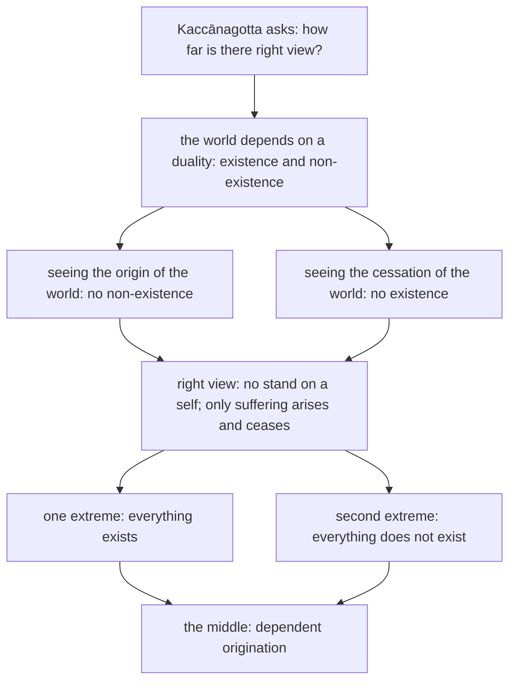

import { Tabs, TabItem } from '@astrojs/starlight/components';

Original text: [12S2/1.2.5 Kaccānagottasutta 88–91](https://tipitaka2500.github.io/tipitaka/12S2/1/1.2/1.2.5.html#88) in the [World Tipitaka Edition](https://tipitaka2500.github.io)

## Summary

Asked by āyasmā Kaccānagotta how far there is right view, the Bhagavā answers that the world mostly depends on a duality, existence and non-existence, and that one who sees the origin and the cessation of the world as they really are holds neither; such a one takes no stand on a self and knows for himself that only suffering arises and ceases. "Everything exists" and "everything does not exist" are the two extremes; the Tathāgata teaches by the middle, which is dependent origination (12S2/1.2.5).

## Diagram

## Text

<Tabs syncKey="paliquote">
<TabItem label="My Translation">
(15.)

88\. [The Bhagavā] was dwelling at Sāvatthī. Then āyasmā Kaccānagotta approached the Bhagavā. Having approached, he bowed to the Bhagavā and sat down to one side. Seated to one side, āyasmā Kaccānagotta said this to the Bhagavā: “‘`Sammādiṭṭhi` (right view), `sammādiṭṭhi`,’ it is said, Bhante. How far, Bhante, is there right view?”

89\. “Indeed, this world, Kaccāna, is for the most part `dvayanissito` (dependent on a duality) — both `atthitaṃ` (existence: that reality exists) and `natthitaṃ` (non-existence: that it does not). When one sees, Kaccāna, `lokasamudayaṃ` (the origin of the world) `yathābhūtaṃ` (as it really is) with `sammappaññā` (correct understanding), the notion ‘the world does not exist’ does not occur. When one sees, Kaccāna, `lokanirodhaṃ` (the cessation of the world) as it really is with correct understanding, the notion that ‘the world exists’ does not occur. Indeed, this world, Kaccāna, is for the most part `upayupādānābhinivesavinibandho` (bound by engagement, fuel and adherence). But this one does not enter that `upayupādānaṃ` (engagement and fuel), `cetaso adhiṭṭhānaṃ` (standpoint of the mind), `abhinivesānusayaṃ` (adherence and inclination); he does not grasp, he does not fixate on: ‘attā me’ ("This is my eternal self."). ‘When arising, it is only `dukkha` (suffering) that arises; when ceasing, it is suffering that ceases’ — he does not doubt, he is not perplexed. Herein, knowledge independent of others is found in him. To this extent, Kaccāna, there is right view.

90\. ‘`Sabbamatthi` (everything exists, i.e. there is an extrinsic reality beyond our perceptions),’ Kaccāna, is one extreme. ‘`Sabbaṃ natthi` (everything does not exist, i.e. reality is an illusion),’ is the second extreme. Without veering towards either of these two extremes, Kaccāna, the Tathāgata teaches the Dhamma by the middle [way]: ‘With `avijjā` (ignorance) as cause, `saṅkhārā` (mental constructions) [arise]; with mental constructions as cause, `viññāṇaṃ` (consciousness) [arises] ... and so on ... Thus is the origin of this whole mass of suffering. But with the remainderless fading away and cessation of ignorance comes the cessation of mental constructions; with the cessation of mental constructions comes the cessation of consciousness ... and so on ... Thus is the cessation of this whole mass of suffering.’”

91\. The fifth [discourse of the chapter].
</TabItem>

<TabItem label="Pāḷi (Roman IAST)">
(15.)

88\. Sāvatthiyaṃ viharati. Atha kho āyasmā kaccānagotto yena bhagavā tenupasaṅkami; upasaṅkamitvā bhagavantaṃ abhivādetvā ekamantaṃ nisīdi. Ekamantaṃ nisinno kho āyasmā kaccānagotto bhagavantaṃ etadavoca— “‘sammādiṭṭhi sammādiṭṭhī’ti, bhante, vuccati. Kittāvatā nu kho, bhante, sammādiṭṭhi hotī”ti?

89\. “Dvayanissito khvāyaṃ, kaccāna, loko yebhuyyena— atthitañceva natthitañca. Lokasamudayaṃ kho, kaccāna, yathābhūtaṃ sammappaññāya passato yā loke natthitā sā na hoti. Lokanirodhaṃ kho, kaccāna, yathābhūtaṃ sammappaññāya passato yā loke atthitā sā na hoti. Upayupādānābhinivesavinibandho khvāyaṃ, kaccāna, loko yebhuyyena. Tañcāyaṃ upayupādānaṃ cetaso adhiṭṭhānaṃ abhinivesānusayaṃ na upeti na upādiyati nādhiṭṭhāti— ‘attā me’ti. ‘Dukkhameva uppajjamānaṃ uppajjati, dukkhaṃ nirujjhamānaṃ nirujjhatī’ti na kaṅkhati na vicikicchati aparapaccayā ñāṇamevassa ettha hoti. Ettāvatā kho, kaccāna, sammādiṭṭhi hoti.

90\. ‘Sabbamatthī’ti kho, kaccāna, ayameko anto. ‘Sabbaṃ natthī’ti ayaṃ dutiyo anto. Ete te, kaccāna, ubho ante anupagamma majjhena tathāgato dhammaṃ deseti— ‘avijjāpaccayā saṅkhārā; saṅkhārapaccayā viññāṇaṃ…pe… evametassa kevalassa dukkhakkhandhassa samudayo hoti. Avijjāya tveva asesavirāganirodhā saṅkhāranirodho; saṅkhāranirodhā viññāṇanirodho…pe… evametassa kevalassa dukkhakkhandhassa nirodho hotī’”ti.

91\. Pañcamaṃ.
</TabItem>

<TabItem label="Pāḷi (Brahmi)">
(15.)

88\. 𑀲𑀸𑀯𑀢𑁆𑀣𑀺𑀬𑀁 𑀯𑀺𑀳𑀭𑀢𑀺. 𑀅𑀣 𑀔𑁄 𑀆𑀬𑀲𑁆𑀫𑀸 𑀓𑀘𑁆𑀘𑀸𑀦𑀕𑁄𑀢𑁆𑀢𑁄 𑀬𑁂𑀦 𑀪𑀕𑀯𑀸 𑀢𑁂𑀦𑀼𑀧𑀲𑀗𑁆𑀓𑀫𑀺; 𑀉𑀧𑀲𑀗𑁆𑀓𑀫𑀺𑀢𑁆𑀯𑀸 𑀪𑀕𑀯𑀦𑁆𑀢𑀁 𑀅𑀪𑀺𑀯𑀸𑀤𑁂𑀢𑁆𑀯𑀸 𑀏𑀓𑀫𑀦𑁆𑀢𑀁 𑀦𑀺𑀲𑀻𑀤𑀺. 𑀏𑀓𑀫𑀦𑁆𑀢𑀁 𑀦𑀺𑀲𑀺𑀦𑁆𑀦𑁄 𑀔𑁄 𑀆𑀬𑀲𑁆𑀫𑀸 𑀓𑀘𑁆𑀘𑀸𑀦𑀕𑁄𑀢𑁆𑀢𑁄 𑀪𑀕𑀯𑀦𑁆𑀢𑀁 𑀏𑀢𑀤𑀯𑁄𑀘— “‘𑀲𑀫𑁆𑀫𑀸𑀤𑀺𑀝𑁆𑀞𑀺 𑀲𑀫𑁆𑀫𑀸𑀤𑀺𑀝𑁆𑀞𑀻’𑀢𑀺, 𑀪𑀦𑁆𑀢𑁂, 𑀯𑀼𑀘𑁆𑀘𑀢𑀺. 𑀓𑀺𑀢𑁆𑀢𑀸𑀯𑀢𑀸 𑀦𑀼 𑀔𑁄, 𑀪𑀦𑁆𑀢𑁂, 𑀲𑀫𑁆𑀫𑀸𑀤𑀺𑀝𑁆𑀞𑀺 𑀳𑁄𑀢𑀻”𑀢𑀺?

89\. “𑀤𑁆𑀯𑀬𑀦𑀺𑀲𑁆𑀲𑀺𑀢𑁄 𑀔𑁆𑀯𑀸𑀬𑀁, 𑀓𑀘𑁆𑀘𑀸𑀦, 𑀮𑁄𑀓𑁄 𑀬𑁂𑀪𑀼𑀬𑁆𑀬𑁂𑀦— 𑀅𑀢𑁆𑀣𑀺𑀢𑀜𑁆𑀘𑁂𑀯 𑀦𑀢𑁆𑀣𑀺𑀢𑀜𑁆𑀘. 𑀮𑁄𑀓𑀲𑀫𑀼𑀤𑀬𑀁 𑀔𑁄, 𑀓𑀘𑁆𑀘𑀸𑀦, 𑀬𑀣𑀸𑀪𑀽𑀢𑀁 𑀲𑀫𑁆𑀫𑀧𑁆𑀧𑀜𑁆𑀜𑀸𑀬 𑀧𑀲𑁆𑀲𑀢𑁄 𑀬𑀸 𑀮𑁄𑀓𑁂 𑀦𑀢𑁆𑀣𑀺𑀢𑀸 𑀲𑀸 𑀦 𑀳𑁄𑀢𑀺. 𑀮𑁄𑀓𑀦𑀺𑀭𑁄𑀥𑀁 𑀔𑁄, 𑀓𑀘𑁆𑀘𑀸𑀦, 𑀬𑀣𑀸𑀪𑀽𑀢𑀁 𑀲𑀫𑁆𑀫𑀧𑁆𑀧𑀜𑁆𑀜𑀸𑀬 𑀧𑀲𑁆𑀲𑀢𑁄 𑀬𑀸 𑀮𑁄𑀓𑁂 𑀅𑀢𑁆𑀣𑀺𑀢𑀸 𑀲𑀸 𑀦 𑀳𑁄𑀢𑀺. 𑀉𑀧𑀬𑀼𑀧𑀸𑀤𑀸𑀦𑀸𑀪𑀺𑀦𑀺𑀯𑁂𑀲𑀯𑀺𑀦𑀺𑀩𑀦𑁆𑀥𑁄 𑀔𑁆𑀯𑀸𑀬𑀁, 𑀓𑀘𑁆𑀘𑀸𑀦, 𑀮𑁄𑀓𑁄 𑀬𑁂𑀪𑀼𑀬𑁆𑀬𑁂𑀦. 𑀢𑀜𑁆𑀘𑀸𑀬𑀁 𑀉𑀧𑀬𑀼𑀧𑀸𑀤𑀸𑀦𑀁 𑀘𑁂𑀢𑀲𑁄 𑀅𑀥𑀺𑀝𑁆𑀞𑀸𑀦𑀁 𑀅𑀪𑀺𑀦𑀺𑀯𑁂𑀲𑀸𑀦𑀼𑀲𑀬𑀁 𑀦 𑀉𑀧𑁂𑀢𑀺 𑀦 𑀉𑀧𑀸𑀤𑀺𑀬𑀢𑀺 𑀦𑀸𑀥𑀺𑀝𑁆𑀞𑀸𑀢𑀺— ‘𑀅𑀢𑁆𑀢𑀸 𑀫𑁂’𑀢𑀺. ‘𑀤𑀼𑀓𑁆𑀔𑀫𑁂𑀯 𑀉𑀧𑁆𑀧𑀚𑁆𑀚𑀫𑀸𑀦𑀁 𑀉𑀧𑁆𑀧𑀚𑁆𑀚𑀢𑀺, 𑀤𑀼𑀓𑁆𑀔𑀁 𑀦𑀺𑀭𑀼𑀚𑁆𑀛𑀫𑀸𑀦𑀁 𑀦𑀺𑀭𑀼𑀚𑁆𑀛𑀢𑀻’𑀢𑀺 𑀦 𑀓𑀗𑁆𑀔𑀢𑀺 𑀦 𑀯𑀺𑀘𑀺𑀓𑀺𑀘𑁆𑀙𑀢𑀺 𑀅𑀧𑀭𑀧𑀘𑁆𑀘𑀬𑀸 𑀜𑀸𑀡𑀫𑁂𑀯𑀲𑁆𑀲 𑀏𑀢𑁆𑀣 𑀳𑁄𑀢𑀺. 𑀏𑀢𑁆𑀢𑀸𑀯𑀢𑀸 𑀔𑁄, 𑀓𑀘𑁆𑀘𑀸𑀦, 𑀲𑀫𑁆𑀫𑀸𑀤𑀺𑀝𑁆𑀞𑀺 𑀳𑁄𑀢𑀺.

90\. ‘𑀲𑀩𑁆𑀩𑀫𑀢𑁆𑀣𑀻’𑀢𑀺 𑀔𑁄, 𑀓𑀘𑁆𑀘𑀸𑀦, 𑀅𑀬𑀫𑁂𑀓𑁄 𑀅𑀦𑁆𑀢𑁄. ‘𑀲𑀩𑁆𑀩𑀁 𑀦𑀢𑁆𑀣𑀻’𑀢𑀺 𑀅𑀬𑀁 𑀤𑀼𑀢𑀺𑀬𑁄 𑀅𑀦𑁆𑀢𑁄. 𑀏𑀢𑁂 𑀢𑁂, 𑀓𑀘𑁆𑀘𑀸𑀦, 𑀉𑀪𑁄 𑀅𑀦𑁆𑀢𑁂 𑀅𑀦𑀼𑀧𑀕𑀫𑁆𑀫 𑀫𑀚𑁆𑀛𑁂𑀦 𑀢𑀣𑀸𑀕𑀢𑁄 𑀥𑀫𑁆𑀫𑀁 𑀤𑁂𑀲𑁂𑀢𑀺— ‘𑀅𑀯𑀺𑀚𑁆𑀚𑀸𑀧𑀘𑁆𑀘𑀬𑀸 𑀲𑀗𑁆𑀔𑀸𑀭𑀸; 𑀲𑀗𑁆𑀔𑀸𑀭𑀧𑀘𑁆𑀘𑀬𑀸 𑀯𑀺𑀜𑁆𑀜𑀸𑀡𑀁…𑀧𑁂… 𑀏𑀯𑀫𑁂𑀢𑀲𑁆𑀲 𑀓𑁂𑀯𑀮𑀲𑁆𑀲 𑀤𑀼𑀓𑁆𑀔𑀓𑁆𑀔𑀦𑁆𑀥𑀲𑁆𑀲 𑀲𑀫𑀼𑀤𑀬𑁄 𑀳𑁄𑀢𑀺. 𑀅𑀯𑀺𑀚𑁆𑀚𑀸𑀬 𑀢𑁆𑀯𑁂𑀯 𑀅𑀲𑁂𑀲𑀯𑀺𑀭𑀸𑀕𑀦𑀺𑀭𑁄𑀥𑀸 𑀲𑀗𑁆𑀔𑀸𑀭𑀦𑀺𑀭𑁄𑀥𑁄; 𑀲𑀗𑁆𑀔𑀸𑀭𑀦𑀺𑀭𑁄𑀥𑀸 𑀯𑀺𑀜𑁆𑀜𑀸𑀡𑀦𑀺𑀭𑁄𑀥𑁄…𑀧𑁂… 𑀏𑀯𑀫𑁂𑀢𑀲𑁆𑀲 𑀓𑁂𑀯𑀮𑀲𑁆𑀲 𑀤𑀼𑀓𑁆𑀔𑀓𑁆𑀔𑀦𑁆𑀥𑀲𑁆𑀲 𑀦𑀺𑀭𑁄𑀥𑁄 𑀳𑁄𑀢𑀻’”𑀢𑀺.

91\. 𑀧𑀜𑁆𑀘𑀫𑀁.
</TabItem>

<TabItem label="Interlinear">
(15.)

[88](https://tipitaka2500.github.io/tipitaka/12S2/1/1.2/1.2.5.html#88) Sāvatthiyaṃ viharati.  
🚺⨀⑦(sāvatthī) 🟢⨀🤟▶️(viharati)  
at Sāvatthī | dwells  
[The Bhagavā] was dwelling at Sāvatthī.

Atha kho āyasmā kaccānagotto yena bhagavā tenupasaṅkami;  
⏏️(atha) ⏏️(kho) 🚹⨀①(āyasmant) 🚹⨀①(kaccānagotta) *️⃣🤟🚹⨀③(ya) 🚹⨀①(bhagavant) *️⃣🤟🚹⨀③(ta) 🟢⨀🤟⏮(upasaṅkamati)  
then | indeed | Venerable | Kaccānagotta | by where | the Bhagavā | by there | approached  
Then āyasmā Kaccānagotta approached the Bhagavā.

upasaṅkamitvā bhagavantaṃ abhivādetvā ekamantaṃ nisīdi.  
🔽(tvā)(upasaṅkamati) 🚹⨀②(bhagavant) 🔽(tvā)(abhivādeti) ⏏️🆎(eka+anta) 🟢⨀🤟⏮(nisīdati)  
having approached | the Bhagavā | having bowed down to | to one side | sat down  
Having approached, he bowed to the Bhagavā and sat down to one side.

Ekamantaṃ nisinno kho āyasmā kaccānagotto bhagavantaṃ etadavoca— “‘sammādiṭṭhi sammādiṭṭhī’ti, bhante, vuccati.  
⏏️🆎(eka+anta) 🚹⨀①🔽(ta)(nisinna) ⏏️(kho) 🚹⨀①(āyasmant) 🚹⨀①(kaccānagotta) 🚹⨀②(bhagavant) *️⃣🤟🚻⨀②(eta) 🟢⨀🤟⏮(vadati) 🚺⨀①🆎(sammā+diṭṭhi) 🚺⨀①🆎(sammā+diṭṭhi) ⏏️(iti) 🚹⨀⓪(bhavant) 🔴⨀🤟▶️(vuccati)  
to one side | seated | indeed | Venerable | Kaccānagotta | to the Bhagavā | this | said | right view | right view | (end quote) | Bhante | is said  
Seated to one side, āyasmā Kaccānagotta said this to the Bhagavā: “‘`Sammādiṭṭhi` (right view), `sammādiṭṭhi`,’ it is said, Bhante.

Kittāvatā nu kho, bhante, sammādiṭṭhi hotī”ti?  
⏏️(kittāvatā) ⏏️(nu) ⏏️(kho) 🚹⨀⓪(bhavant) 🚺⨀①🆎(sammā+diṭṭhi) 🟢⨀🤟▶️(hoti) ⏏️(iti)  
how far | (question) | indeed | Bhante | right view | is | (end quote)  
How far, Bhante, is there right view?”

[89](https://tipitaka2500.github.io/tipitaka/12S2/1/1.2/1.2.5.html#89) “Dvayanissito khvāyaṃ, kaccāna, loko yebhuyyena— atthitañceva natthitañca.  
🚹⨀①🆎(dvaya+nissita) ⏏️(kho) *️⃣🤟🚹⨀①(ima) 🚹⨀⓪(kaccāna) 🚹⨀①(loka) 🚹⨀③🆎(ya+bhuyya) 🚺⨀②(atthitā) ⏏️(ca) ⏏️(eva) 🚺⨀②(natthitā) ⏏️(ca)  
dependent on a duality | indeed | this | Kaccāna | world | for the most part | existence | and | just | non-existence | and  
“Indeed, this world, Kaccāna, is for the most part `dvayanissito` (dependent on a duality) — both `atthitaṃ` (existence: that reality exists) and `natthitaṃ` (non-existence: that it does not).

Lokasamudayaṃ kho, kaccāna, yathābhūtaṃ sammappaññāya passato yā loke natthitā sā na hoti.  
🚹⨀②🆎(loka+samudaya) ⏏️(kho) 🚹⨀⓪(kaccāna) ⏏️🆎(yathā+bhūta) 🚺⨀③🆎(sammā+paññā) 🚹⨀④🔽(anta)(passanta) *️⃣🤟🚺⨀①(ya) 🚹⨀⑦(loka) 🚺⨀①(natthitā) *️⃣🤟🚺⨀①(ta) ⏏️(na) 🟢⨀🤟▶️(hoti)  
the origin of the world | indeed | Kaccāna | as it really is | with correct understanding | for one who sees | whatever | in the world | non-existence | that | not | is  
When one sees, Kaccāna, `lokasamudayaṃ` (the origin of the world) `yathābhūtaṃ` (as it really is) with `sammappaññā` (correct understanding), the notion ‘the world does not exist’ does not occur.

Lokanirodhaṃ kho, kaccāna, yathābhūtaṃ sammappaññāya passato yā loke atthitā sā na hoti.  
🚹⨀②🆎(loka+nirodha) ⏏️(kho) 🚹⨀⓪(kaccāna) ⏏️🆎(yathā+bhūta) 🚺⨀③🆎(sammā+paññā) 🚹⨀④🔽(anta)(passanta) *️⃣🤟🚺⨀①(ya) 🚹⨀⑦(loka) 🚺⨀①(atthitā) *️⃣🤟🚺⨀①(ta) ⏏️(na) 🟢⨀🤟▶️(hoti)  
the cessation of the world | indeed | Kaccāna | as it really is | with correct understanding | for one who sees | whatever | in the world | existence | that | not | is  
When one sees, Kaccāna, `lokanirodhaṃ` (the cessation of the world) as it really is with correct understanding, the notion that ‘the world exists’ does not occur.

Upayupādānābhinivesavinibandho khvāyaṃ, kaccāna, loko yebhuyyena.  
🚹⨀①🆎(upaya+upādāna+abhinivesa+vinibandha) ⏏️(kho) *️⃣🤟🚹⨀①(ima) 🚹⨀⓪(kaccāna) 🚹⨀①(loka) 🚹⨀③🆎(ya+bhuyya)  
bound by engagement, fuel and adherence | indeed | this | Kaccāna | world | for the most part  
Indeed, this world, Kaccāna, is for the most part `upayupādānābhinivesavinibandho` (bound by engagement, fuel and adherence).

Tañcāyaṃ upayupādānaṃ cetaso adhiṭṭhānaṃ abhinivesānusayaṃ na upeti na upādiyati nādhiṭṭhāti— ‘attā me’ti.  
*️⃣🤟🚻⨀②(ta) ⏏️(ca) *️⃣🤟🚹⨀①(ima) 🚻⨀②🆎(upaya+upādāna) 🚹⨀⑥(cetas) 🚻⨀②(adhiṭṭhāna) 🚹⨀②🆎(abhinivesa+anusaya) ⏏️(na) 🟢⨀🤟▶️(upeti) ⏏️(na) 🟢⨀🤟▶️(upādiyati) ⏏️(na) 🟢⨀🤟▶️(adhiṭṭhāti) 🚹⨀①(atta) *️⃣👆⚧⨀⑥(ahaṃ) ⏏️(iti)  
that | but | this one | engagement and fuel | of the mind | standpoint | adherence and inclination | not | enters | not | grasps | not | fixates on | self | my | (end quote)  
But this one does not enter that `upayupādānaṃ` (engagement and fuel), `cetaso adhiṭṭhānaṃ` (standpoint of the mind), `abhinivesānusayaṃ` (adherence and inclination); he does not grasp, he does not fixate on: ‘attā me’ ("This is my eternal self.").

‘Dukkhameva uppajjamānaṃ uppajjati, dukkhaṃ nirujjhamānaṃ nirujjhatī’ti na kaṅkhati na vicikicchati aparapaccayā ñāṇamevassa ettha hoti.  
🚻⨀①(dukkha) ⏏️(eva) 🚻⨀①🔽(māna)(uppajjamāna) 🟢⨀🤟▶️(uppajjati) 🚻⨀①(dukkha) 🚻⨀①🔽(māna)(nirujjhamāna) 🔴⨀🤟▶️(nirujjhati) ⏏️(iti) ⏏️(na) 🟢⨀🤟▶️(kaṅkhati) ⏏️(na) 🟢⨀🤟▶️(vicikicchati) 🚹⨀⑤🆎(na+para+paccaya) 🚻⨀①(ñāṇa) ⏏️(eva) *️⃣🤟🚹⨀⑥(ima) ⏏️(ettha) 🟢⨀🤟▶️(hoti)  
suffering | only | when arising | arises | suffering | when ceasing | ceases | (end quote) | not | doubts | not | is perplexed | independent of others | knowledge | just | his | herein | is  
‘When arising, it is only `dukkha` (suffering) that arises; when ceasing, it is suffering that ceases’ — he does not doubt, he is not perplexed. Herein, knowledge independent of others is found in him.

Ettāvatā kho, kaccāna, sammādiṭṭhi hoti.  
⏏️(ettāvatā) ⏏️(kho) 🚹⨀⓪(kaccāna) 🚺⨀①🆎(sammā+diṭṭhi) 🟢⨀🤟▶️(hoti)  
to this extent | indeed | Kaccāna | right view | is  
To this extent, Kaccāna, there is right view.

[90](https://tipitaka2500.github.io/tipitaka/12S2/1/1.2/1.2.5.html#90) ‘Sabbamatthī’ti kho, kaccāna, ayameko anto.  
*️⃣🤟🚻⨀①(sabba) 🟢⨀🤟▶️(atthi) ⏏️(iti) ⏏️(kho) 🚹⨀⓪(kaccāna) *️⃣🤟🚹⨀①(ima) *️⃣🤟🚹⨀①(eka) 🚹⨀①(anta)  
everything | exists | (end quote) | indeed | Kaccāna | this | one | extreme  
‘`Sabbamatthi` (everything exists, i.e. there is an extrinsic reality beyond our perceptions),’ Kaccāna, is one extreme.

‘Sabbaṃ natthī’ti ayaṃ dutiyo anto.  
*️⃣🤟🚻⨀①(sabba) ⏏️(na) 🟢⨀🤟▶️(atthi) ⏏️(iti) *️⃣🤟🚹⨀①(ima) 🚹⨀①(dutiya) 🚹⨀①(anta)  
everything | not | exists | (end quote) | this | second | extreme  
‘`Sabbaṃ natthi` (everything does not exist, i.e. reality is an illusion),’ is the second extreme.

Ete te, kaccāna, ubho ante anupagamma majjhena tathāgato dhammaṃ deseti— ‘avijjāpaccayā saṅkhārā;  
*️⃣🤟🚹⨂②(eta) *️⃣🤟🚹⨂②(ta) 🚹⨀⓪(kaccāna) *️⃣🤟🚹⨂②(ubha) 🚹⨂②(anta) 🔽(ya)(anupagacchati) 🚹⨀③(majjha) 🚹⨀①🆎(tathā+gata) 🚹⨀②(dhamma) 🟠⨀🤟▶️(deseti) 🚹⨀⑤🆎(avijjā+paccaya) 🚹⨂①(saṅkhāra)  
these | those | Kaccāna | both | extremes | not approaching | by the middle | the Tathāgata | the Dhamma | teaches | with ignorance as cause | mental constructions  
Without veering towards either of these two extremes, Kaccāna, the Tathāgata teaches the Dhamma by the middle [way]: ‘With `avijjā` (ignorance) as cause, `saṅkhārā` (mental constructions) [arise];

saṅkhārapaccayā viññāṇaṃ…pe… evametassa kevalassa dukkhakkhandhassa samudayo hoti.  
🚹⨀⑤🆎(saṅkhāra+paccaya) 🚻⨀①(viññāṇa) ⏏️(peyyāla) ⏏️(evaṃ) *️⃣🤟🚹⨀⑥(eta) 🚹⨀⑥(kevala) 🚹⨀⑥🆎(dukkha+khandha) 🚹⨀①(samudaya) 🟢⨀🤟▶️(hoti)  
with mental constructions as cause | consciousness | (and so on) | thus | of this | of the entire | of the mass of suffering | origin | is  
with mental constructions as cause, `viññāṇaṃ` (consciousness) [arises] ... and so on ... Thus is the origin of this whole mass of suffering.

Avijjāya tveva asesavirāganirodhā saṅkhāranirodho;  
🚺⨀⑥(avijjā) ⏏️(tu) ⏏️(eva) 🚹⨀⑤🆎(asesa+virāga+nirodha) 🚹⨀①🆎(saṅkhāra+nirodha)  
of ignorance | but | just | with the complete fading away and cessation | the cessation of mental constructions  
But with the remainderless fading away and cessation of ignorance comes the cessation of mental constructions;

saṅkhāranirodhā viññāṇanirodho…pe… evametassa kevalassa dukkhakkhandhassa nirodho hotī’”ti.  
🚹⨀⑤🆎(saṅkhāra+nirodha) 🚹⨀①🆎(viññāṇa+nirodha) ⏏️(peyyāla) ⏏️(evaṃ) *️⃣🤟🚹⨀⑥(eta) 🚹⨀⑥(kevala) 🚹⨀⑥🆎(dukkha+khandha) 🚹⨀①(nirodha) 🟢⨀🤟▶️(hoti) ⏏️(iti)  
with the cessation of mental constructions | the cessation of consciousness | (and so on) | thus | of this | of the entire | of the mass of suffering | cessation | is | (end quote)  
with the cessation of mental constructions comes the cessation of consciousness ... and so on ... Thus is the cessation of this whole mass of suffering.’”

[91](https://tipitaka2500.github.io/tipitaka/12S2/1/1.2/1.2.5.html#91) Pañcamaṃ.  
🚻⨀①(pañcama)  
the fifth  
The fifth [discourse of the chapter].
</TabItem>
</Tabs>

## Commentary

- The whole sutta is on buddhavacana's [Kaccānagotta](https://buddhavacana.github.io/sutta/kaccanagotta/) page with the author's analysis of the two extremes; its wording stands here verbatim, including the author's glosses of `atthitā`, `natthitā`, `sabbamatthi` and `sabbaṃ natthi`.
- Two departures from that page, following the edition's punctuation: the aside "this is a restatement of dependent origination" inside paragraph 90 is dropped, and the extra opening quotation mark before "Sabbamatthi" is omitted.
- The middle the Tathāgata teaches by is the chain of the [Paṭiccasamuppādasutta](/samyuttanikaya/nidanasamyutta/paticcasamuppadasutta/), abbreviated here with "…pe…".
- The sutta has no closing formula: the chain is its last word, followed by "Pañcamaṃ".

## Parallels

The frame and the argument are the same: a venerable Kātyāyana (尊者𨅖陀迦旃延, p. 85c) approaches the Buddha, pays homage, stands to one side and asks what right view is and how the Bhagavā lays it down (云何正見？云何世尊施設正見？); the Buddha answers that the world depends on two, existence and non-existence (世間有二種依，若有、若無), that one who sees the origin of the world as it really is has no view of its non-existence and one who sees its cessation no view of its existence, that such a one does not grasp, settle or reckon a self (不取、不住、不計我), sees suffering arising and ceasing without doubt or perplexity and knows this for himself, not through another (不由於他而自知), and that this is the middle way between the two extremes, dependent origination in origin and in cessation (pp. 85c–86a). The differences, read in CBETA's text:

- **Setting and name.** The Chinese places the sutta at Nāḷī village, in a guest hall in the deep forest (那梨聚落深林中待賓舍, p. 85c), and gives the venerable a personal name before the clan name Kātyāyana; the Pāḷi has Sāvatthī and the clan name alone.
- **Order of the argument.** The Pāḷi states the two dependencies, then the seeing of the world's origin and cessation, then the world's bondage to engagement, fuel and adherence and the one who does not enter it, then right view. The Chinese states the two dependencies "touched by grasping" (為取所觸, p. 85c), goes straight to the one without grasping who does not reckon a self and sees only suffering arise and cease, concludes "this is called right view, this is called right view laid down by the Tathāgata" (是名正見，是名如來所施設正見), and only then gives the seeing of the world's origin and cessation as the reason (所以者何, p. 85c).
- **The two extremes.** The Pāḷi names them, "everything exists" and "everything does not exist"; the Chinese has only "leaving the two extremes, the middle way is taught" (離於二邊說於中道, p. 85c), and prefaces the chain with the abstract formula "this existing, that exists; this arising, that arises" (此有故彼有，此起故彼起), which the Pāḷi lacks.
- **The ending.** The Chinese closes with Kātyāyana's attainment: hearing the discourse he did not give rise to the defilements, his mind was liberated, and he became an arhat (不起諸漏，心得解脫，成阿羅漢, p. 86a); the Pāḷi ends with the chain and "Pañcamaṃ".

[Go to previous page (Vibhaṅgasutta (The Discourse on the Analysis))](/samyuttanikaya/nidanasamyutta/vibhangasutta/) / [Go to parent page (Saṃyutta Nikāya)](/samyuttanikaya/) / [Go to next page (Paccayasutta (The Discourse on Causes))](/samyuttanikaya/nidanasamyutta/paccayasutta/)
