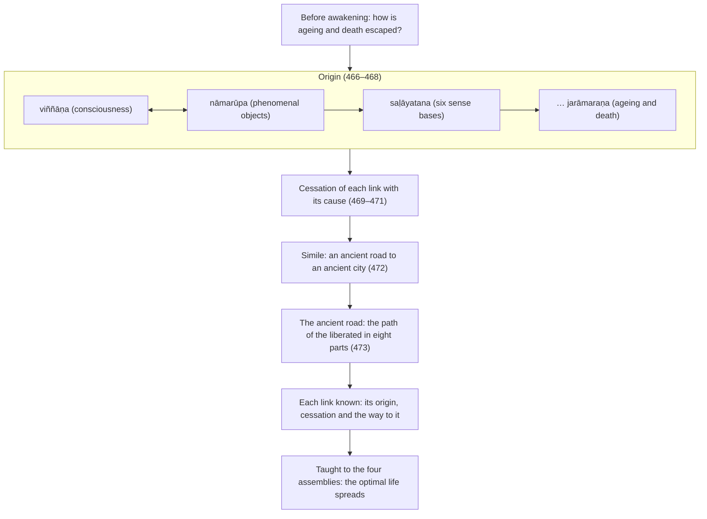

import { Tabs, TabItem } from '@astrojs/starlight/components';

Original text: [12S2/1.7.5 Nagarasutta 466–474](https://tipitaka2500.github.io/tipitaka/12S2/1/1.7/1.7.5.html#466) in the [World Tipitaka Edition](https://tipitaka2500.github.io)

## Summary

At Sāvatthī the Bhagavā recounts his search before his awakening: asking what ageing and death depend on, he traces each link to its cause until consciousness and phenomenal objects are found to condition each other, then the cessation of each with the cessation of its cause. He likens the discovery to a man who finds an ancient road to an ancient city and has the king rebuild it: the road is the path of the liberated in eight parts, by which he understood each link and taught it, so that the optimal life has spread.

## Diagram

## Text

<Tabs syncKey="paliquote">
<TabItem label="My Translation">
(65.)

466\. [The Bhagavā] was dwelling at Sāvatthī. “Before my `sambodhi` (full awakening), Bhikkhave, while still a `bodhisatta` (Buddha before his awakening), not fully awakened, this thought occurred to me: ‘This world has indeed fallen into difficulty: it is born, grows old, dies, passes away and is reborn. And yet it does not understand the escape from this suffering, from `jarāmaraṇa` (ageing and death). When indeed will the escape from this suffering, from ageing and death, be known?’ Then, Bhikkhave, this thought occurred to me: ‘When what exists is there ageing and death, with what as cause is there ageing and death?’ Then, Bhikkhave, through proper attention, I had a complete comprehension by wisdom: ‘Indeed, when there is `jāti` (birth), there is ageing and death; with birth as cause, ageing and death [arise].’

467\. Then, Bhikkhave, this thought occurred to me: ‘When what exists is there birth … and so on … is there `bhava` (existence) … is there `upādāna` (fuel) … is there `taṇhā` (craving) … is there `vedanā` (feeling) … is there `phassa` (contact) … are there `saḷāyatana` (the six sense bases) … are there `nāmarūpa` (phenomenal objects), with what as cause are there phenomenal objects?’ Then, Bhikkhave, through proper attention, I had a complete comprehension by wisdom: ‘Indeed, when there is `viññāṇa` (consciousness), there are phenomenal objects; with consciousness as cause, phenomenal objects [arise].’ Then, Bhikkhave, this thought occurred to me: ‘When what exists is there consciousness, with what as cause is there consciousness?’ Then, Bhikkhave, through proper attention, I had a complete comprehension by wisdom: ‘Indeed, when there are phenomenal objects, there is consciousness; with phenomenal objects as cause, consciousness [arises].’

468\. Then, Bhikkhave, this thought occurred to me: this consciousness turns back from phenomenal objects, it goes no further. To this extent one may be born, or grow old, or die, or pass away, or be reborn, namely: with phenomenal objects as cause, consciousness [arises]; with consciousness as cause, phenomenal objects [arise]; with phenomenal objects as cause, the six sense bases [arise]; with the six sense bases as cause, contact [arises] … and so on … Thus is the origin of this whole mass of suffering. ‘Origin, origin!’: indeed, Bhikkhave, concerning dhammas not heard before, insight arose in me, knowledge arose, wisdom arose, understanding arose, light arose.

469\. Then, Bhikkhave, this thought occurred to me: ‘When what does not exist is there no ageing and death; with the cessation of what is there the cessation of ageing and death?’ Then, Bhikkhave, through proper attention, I had a complete comprehension by wisdom: ‘Indeed, when there is no birth, there is no ageing and death; with the cessation of birth comes the cessation of ageing and death.’ Then, Bhikkhave, this thought occurred to me: ‘When what does not exist is there no birth … and so on … is there no existence … is there no fuel … is there no craving … is there no feeling … is there no contact … are there no six sense bases … are there no phenomenal objects. With the cessation of what is there the cessation of phenomenal objects?’ Then, Bhikkhave, through proper attention, I had a complete comprehension by wisdom: ‘Indeed, when there is no consciousness, there are no phenomenal objects; with the cessation of consciousness comes the cessation of phenomenal objects.’

470\. Then, Bhikkhave, this thought occurred to me: ‘When what does not exist is there no consciousness; with the cessation of what is there the cessation of consciousness?’ Then, Bhikkhave, through proper attention, I had a complete comprehension by wisdom: ‘Indeed, when there are no phenomenal objects, there is no consciousness; with the cessation of phenomenal objects comes the cessation of consciousness.’

471\. Then, Bhikkhave, this thought occurred to me: indeed, this path to awakening has been attained by me, namely: with the cessation of phenomenal objects comes the cessation of consciousness; with the cessation of consciousness comes the cessation of phenomenal objects; with the cessation of phenomenal objects comes the cessation of the six sense bases; with the cessation of the six sense bases comes the cessation of contact … and so on … Thus is the cessation of this whole mass of suffering. ‘Cessation, cessation!’: indeed, Bhikkhave, concerning dhammas not heard before, insight arose in me, knowledge arose, wisdom arose, understanding arose, light arose.

472\. Suppose, Bhikkhave, a man wandering in the wilderness, in the forest, would see an ancient path, an ancient direct road travelled by people of old. He would follow it. Following it, he would see an ancient city, an ancient royal capital, inhabited by people of old, full of parks, full of woods, full of lotus ponds, with raised embankments, delightful. Then, Bhikkhave, that man would tell the king or a royal minister: ‘See now, Bhante, you should know: wandering in the wilderness, in the forest, I saw an ancient path, an ancient direct road travelled by people of old, and I followed it. Following it, I saw an ancient city, an ancient royal capital, inhabited by people of old, full of parks, full of woods, full of lotus ponds, with raised embankments, delightful. Bhante, build that city!’ Then, Bhikkhave, that king or royal minister would build that city. That city, at a later time, would be prosperous and thriving, populous, crowded with people, having attained growth and maturity. In the same way, Bhikkhave, I indeed saw an ancient path, an ancient direct road travelled by the `sammāsambuddha` (perfectly awakened ones) of old.

473\. And what, Bhikkhave, is that ancient path, that ancient direct road travelled by the perfectly awakened ones of old? It is just this `ariyo aṭṭhaṅgiko maggo` (the path of the liberated in eight parts), namely: right view … and so on … right focus. This indeed, Bhikkhave, is that ancient path, that ancient direct road travelled by the perfectly awakened ones of old; I followed it; following it, I experientially understood ageing and death; I experientially understood the origin of ageing and death; I experientially understood the cessation of ageing and death; I experientially understood the path leading to the cessation of ageing and death. I followed it; following it, I experientially understood birth … and so on … I experientially understood existence … I experientially understood fuel … I experientially understood craving … I experientially understood feeling … I experientially understood contact … I experientially understood the six sense bases … I experientially understood phenomenal objects … I experientially understood consciousness. I followed it; following it, I experientially understood `saṅkhāra` (mental constructions); I experientially understood the origin of mental constructions; I experientially understood the cessation of mental constructions; I experientially understood the path leading to the cessation of mental constructions. Having experientially understood that, I taught it to the bhikkhū, the bhikkhuniyo, the `upāsakā` (lay disciples) and the `upāsikā` (female lay disciples). So this `brahmacariya` (the optimal life), Bhikkhave, is prosperous and thriving, widespread, known to many, spread widely, well proclaimed as far as gods and humans.”

474\. The fifth [discourse of the chapter].
</TabItem>

<TabItem label="Pāḷi (Roman IAST)">
(65.)

466\. Sāvatthiyaṃ viharati. “Pubbe me, bhikkhave, sambodhā anabhisambuddhassa bodhisattasseva sato etadahosi— ‘kicchā vatāyaṃ loko āpanno jāyati ca jīyati ca mīyati ca cavati ca upapajjati ca. Atha ca panimassa dukkhassa nissaraṇaṃ nappajānāti jarāmaraṇassa. Kudāssu nāma imassa dukkhassa nissaraṇaṃ paññāyissati jarāmaraṇassā’ti? Tassa mayhaṃ, bhikkhave, etadahosi— ‘kimhi nu kho sati jarāmaraṇaṃ hoti, kiṃpaccayā jarāmaraṇan’ti? Tassa mayhaṃ, bhikkhave, yoniso manasikārā ahu paññāya abhisamayo— ‘jātiyā kho sati jarāmaraṇaṃ hoti, jātipaccayā jarāmaraṇan’ti.

467\. Tassa mayhaṃ, bhikkhave, etadahosi— ‘kimhi nu kho sati jāti hoti…pe… bhavo hoti… upādānaṃ hoti… taṇhā hoti… vedanā hoti… phasso hoti… saḷāyatanaṃ hoti… nāmarūpaṃ hoti… kiṃpaccayā nāmarūpan’ti? Tassa mayhaṃ, bhikkhave, yoniso manasikārā ahu paññāya abhisamayo— ‘viññāṇe kho sati nāmarūpaṃ hoti, viññāṇapaccayā nāmarūpan’ti. Tassa mayhaṃ, bhikkhave, etadahosi— ‘kimhi nu kho sati viññāṇaṃ hoti, kiṃpaccayā viññāṇan’ti? Tassa mayhaṃ, bhikkhave, yoniso manasikārā ahu paññāya abhisamayo— ‘nāmarūpe kho sati viññāṇaṃ hoti, nāmarūpapaccayā viññāṇan’ti.

468\. Tassa mayhaṃ, bhikkhave, etadahosi— paccudāvattati kho idaṃ viññāṇaṃ nāmarūpamhā na paraṃ gacchati. Ettāvatā jāyetha vā jīyetha vā mīyetha vā cavetha vā upapajjetha vā, yadidaṃ nāmarūpapaccayā viññāṇaṃ; viññāṇapaccayā nāmarūpaṃ; nāmarūpapaccayā saḷāyatanaṃ; saḷāyatanapaccayā phasso…pe… evametassa kevalassa dukkhakkhandhassa samudayo hoti. ‘Samudayo, samudayo’ti kho me, bhikkhave, pubbe ananussutesu dhammesu cakkhuṃ udapādi ñāṇaṃ udapādi paññā udapādi vijjā udapādi āloko udapādi.

469\. Tassa mayhaṃ, bhikkhave, etadahosi— ‘kimhi nu kho asati, jarāmaraṇaṃ na hoti; kissa nirodhā jarāmaraṇanirodho’ti? Tassa mayhaṃ, bhikkhave, yoniso manasikārā ahu paññāya abhisamayo— ‘jātiyā kho asati, jarāmaraṇaṃ na hoti; jātinirodhā jarāmaraṇanirodho’ti. Tassa mayhaṃ, bhikkhave, etadahosi— ‘kimhi nu kho asati jāti na hoti…pe… bhavo na hoti… upādānaṃ na hoti… taṇhā na hoti… vedanā na hoti… phasso na hoti… saḷāyatanaṃ na hoti… nāmarūpaṃ na hoti. Kissa nirodhā nāmarūpanirodho’ti? Tassa mayhaṃ, bhikkhave, yoniso manasikārā ahu paññāya abhisamayo— ‘viññāṇe kho asati, nāmarūpaṃ na hoti; viññāṇanirodhā nāmarūpanirodho’ti.

470\. Tassa mayhaṃ, bhikkhave, etadahosi— ‘kimhi nu kho asati viññāṇaṃ na hoti; kissa nirodhā viññāṇanirodho’ti? Tassa mayhaṃ, bhikkhave, yoniso manasikārā ahu paññāya abhisamayo— ‘nāmarūpe kho asati, viññāṇaṃ na hoti; nāmarūpanirodhā viññāṇanirodho’ti.

471\. Tassa mayhaṃ, bhikkhave, etadahosi— adhigato kho myāyaṃ maggo bodhāya yadidaṃ— nāmarūpanirodhā viññāṇanirodho; viññāṇanirodhā nāmarūpanirodho; nāmarūpanirodhā saḷāyatananirodho; saḷāyatananirodhā phassanirodho…pe… evametassa kevalassa dukkhakkhandhassa nirodho hoti. ‘Nirodho, nirodho’ti kho me, bhikkhave, pubbe ananussutesu dhammesu cakkhuṃ udapādi ñāṇaṃ udapādi paññā udapādi vijjā udapādi āloko udapādi.

472\. Seyyathāpi, bhikkhave, puriso araññe pavane caramāno passeyya purāṇaṃ maggaṃ purāṇañjasaṃ pubbakehi manussehi anuyātaṃ. So tamanugaccheyya. Tamanugacchanto passeyya purāṇaṃ nagaraṃ purāṇaṃ rājadhāniṃ pubbakehi manussehi ajjhāvuṭṭhaṃ ārāmasampannaṃ vanasampannaṃ pokkharaṇīsampannaṃ uddhāpavantaṃ ramaṇīyaṃ. Atha kho so, bhikkhave, puriso rañño vā rājamahāmattassa vā āroceyya— ‘yagghe, bhante, jāneyyāsi— ahaṃ addasaṃ araññe pavane caramāno purāṇaṃ maggaṃ purāṇañjasaṃ pubbakehi manussehi anuyātaṃ tamanugacchiṃ. Tamanugacchanto addasaṃ purāṇaṃ nagaraṃ purāṇaṃ rājadhāniṃ pubbakehi manussehi ajjhāvuṭṭhaṃ ārāmasampannaṃ vanasampannaṃ pokkharaṇīsampannaṃ uddhāpavantaṃ ramaṇīyaṃ. Taṃ, bhante, nagaraṃ māpehī’ti. Atha kho so, bhikkhave, rājā vā rājamahāmatto vā taṃ nagaraṃ māpeyya. Tadassa nagaraṃ aparena samayena iddhañceva phītañca bāhujaññaṃ ākiṇṇamanussaṃ vuddhivepullappattaṃ. Evameva khvāhaṃ, bhikkhave, addasaṃ purāṇaṃ maggaṃ purāṇañjasaṃ pubbakehi sammāsambuddhehi anuyātaṃ.

473\. Katamo ca so, bhikkhave, purāṇamaggo purāṇañjaso pubbakehi sammāsambuddhehi anuyāto? Ayameva ariyo aṭṭhaṅgiko maggo, seyyathidaṃ— sammādiṭṭhi…pe… sammāsamādhi. Ayaṃ kho so, bhikkhave, purāṇamaggo purāṇañjaso pubbakehi sammāsambuddhehi anuyāto, tamanugacchiṃ; tamanugacchanto jarāmaraṇaṃ abbhaññāsiṃ; jarāmaraṇasamudayaṃ abbhaññāsiṃ; jarāmaraṇanirodhaṃ abbhaññāsiṃ; jarāmaraṇanirodhagāminiṃ paṭipadaṃ abbhaññāsiṃ. Tamanugacchiṃ; tamanugacchanto jātiṃ abbhaññāsiṃ…pe… bhavaṃ abbhaññāsiṃ… upādānaṃ abbhaññāsiṃ… taṇhaṃ abbhaññāsiṃ… vedanaṃ abbhaññāsiṃ… phassaṃ abbhaññāsiṃ… saḷāyatanaṃ abbhaññāsiṃ… nāmarūpaṃ abbhaññāsiṃ… viññāṇaṃ abbhaññāsiṃ. Tamanugacchiṃ; tamanugacchanto saṅkhāre abbhaññāsiṃ; saṅkhārasamudayaṃ abbhaññāsiṃ; saṅkhāranirodhaṃ abbhaññāsiṃ; saṅkhāranirodhagāminiṃ paṭipadaṃ abbhaññāsiṃ. Tadabhiññāya ācikkhiṃ bhikkhūnaṃ bhikkhunīnaṃ upāsakānaṃ upāsikānaṃ. Tayidaṃ, bhikkhave, brahmacariyaṃ iddhañceva phītañca vitthārikaṃ bāhujaññaṃ puthubhūtaṃ yāva devamanussehi suppakāsitan”ti.

474\. Pañcamaṃ.
</TabItem>

<TabItem label="Pāḷi (Brahmi)">
(65.)

466\. 𑀲𑀸𑀯𑀢𑁆𑀣𑀺𑀬𑀁 𑀯𑀺𑀳𑀭𑀢𑀺. “𑀧𑀼𑀩𑁆𑀩𑁂 𑀫𑁂, 𑀪𑀺𑀓𑁆𑀔𑀯𑁂, 𑀲𑀫𑁆𑀩𑁄𑀥𑀸 𑀅𑀦𑀪𑀺𑀲𑀫𑁆𑀩𑀼𑀤𑁆𑀥𑀲𑁆𑀲 𑀩𑁄𑀥𑀺𑀲𑀢𑁆𑀢𑀲𑁆𑀲𑁂𑀯 𑀲𑀢𑁄 𑀏𑀢𑀤𑀳𑁄𑀲𑀺— ‘𑀓𑀺𑀘𑁆𑀙𑀸 𑀯𑀢𑀸𑀬𑀁 𑀮𑁄𑀓𑁄 𑀆𑀧𑀦𑁆𑀦𑁄 𑀚𑀸𑀬𑀢𑀺 𑀘 𑀚𑀻𑀬𑀢𑀺 𑀘 𑀫𑀻𑀬𑀢𑀺 𑀘 𑀘𑀯𑀢𑀺 𑀘 𑀉𑀧𑀧𑀚𑁆𑀚𑀢𑀺 𑀘. 𑀅𑀣 𑀘 𑀧𑀦𑀺𑀫𑀲𑁆𑀲 𑀤𑀼𑀓𑁆𑀔𑀲𑁆𑀲 𑀦𑀺𑀲𑁆𑀲𑀭𑀡𑀁 𑀦𑀧𑁆𑀧𑀚𑀸𑀦𑀸𑀢𑀺 𑀚𑀭𑀸𑀫𑀭𑀡𑀲𑁆𑀲. 𑀓𑀼𑀤𑀸𑀲𑁆𑀲𑀼 𑀦𑀸𑀫 𑀇𑀫𑀲𑁆𑀲 𑀤𑀼𑀓𑁆𑀔𑀲𑁆𑀲 𑀦𑀺𑀲𑁆𑀲𑀭𑀡𑀁 𑀧𑀜𑁆𑀜𑀸𑀬𑀺𑀲𑁆𑀲𑀢𑀺 𑀚𑀭𑀸𑀫𑀭𑀡𑀲𑁆𑀲𑀸’𑀢𑀺? 𑀢𑀲𑁆𑀲 𑀫𑀬𑁆𑀳𑀁, 𑀪𑀺𑀓𑁆𑀔𑀯𑁂, 𑀏𑀢𑀤𑀳𑁄𑀲𑀺— ‘𑀓𑀺𑀫𑁆𑀳𑀺 𑀦𑀼 𑀔𑁄 𑀲𑀢𑀺 𑀚𑀭𑀸𑀫𑀭𑀡𑀁 𑀳𑁄𑀢𑀺, 𑀓𑀺𑀁𑀧𑀘𑁆𑀘𑀬𑀸 𑀚𑀭𑀸𑀫𑀭𑀡𑀦𑁆’𑀢𑀺? 𑀢𑀲𑁆𑀲 𑀫𑀬𑁆𑀳𑀁, 𑀪𑀺𑀓𑁆𑀔𑀯𑁂, 𑀬𑁄𑀦𑀺𑀲𑁄 𑀫𑀦𑀲𑀺𑀓𑀸𑀭𑀸 𑀅𑀳𑀼 𑀧𑀜𑁆𑀜𑀸𑀬 𑀅𑀪𑀺𑀲𑀫𑀬𑁄— ‘𑀚𑀸𑀢𑀺𑀬𑀸 𑀔𑁄 𑀲𑀢𑀺 𑀚𑀭𑀸𑀫𑀭𑀡𑀁 𑀳𑁄𑀢𑀺, 𑀚𑀸𑀢𑀺𑀧𑀘𑁆𑀘𑀬𑀸 𑀚𑀭𑀸𑀫𑀭𑀡𑀦𑁆’𑀢𑀺.

467\. 𑀢𑀲𑁆𑀲 𑀫𑀬𑁆𑀳𑀁, 𑀪𑀺𑀓𑁆𑀔𑀯𑁂, 𑀏𑀢𑀤𑀳𑁄𑀲𑀺— ‘𑀓𑀺𑀫𑁆𑀳𑀺 𑀦𑀼 𑀔𑁄 𑀲𑀢𑀺 𑀚𑀸𑀢𑀺 𑀳𑁄𑀢𑀺…𑀧𑁂… 𑀪𑀯𑁄 𑀳𑁄𑀢𑀺… 𑀉𑀧𑀸𑀤𑀸𑀦𑀁 𑀳𑁄𑀢𑀺… 𑀢𑀡𑁆𑀳𑀸 𑀳𑁄𑀢𑀺… 𑀯𑁂𑀤𑀦𑀸 𑀳𑁄𑀢𑀺… 𑀨𑀲𑁆𑀲𑁄 𑀳𑁄𑀢𑀺… 𑀲𑀍𑀆𑀬𑀢𑀦𑀁 𑀳𑁄𑀢𑀺… 𑀦𑀸𑀫𑀭𑀽𑀧𑀁 𑀳𑁄𑀢𑀺… 𑀓𑀺𑀁𑀧𑀘𑁆𑀘𑀬𑀸 𑀦𑀸𑀫𑀭𑀽𑀧𑀦𑁆’𑀢𑀺? 𑀢𑀲𑁆𑀲 𑀫𑀬𑁆𑀳𑀁, 𑀪𑀺𑀓𑁆𑀔𑀯𑁂, 𑀬𑁄𑀦𑀺𑀲𑁄 𑀫𑀦𑀲𑀺𑀓𑀸𑀭𑀸 𑀅𑀳𑀼 𑀧𑀜𑁆𑀜𑀸𑀬 𑀅𑀪𑀺𑀲𑀫𑀬𑁄— ‘𑀯𑀺𑀜𑁆𑀜𑀸𑀡𑁂 𑀔𑁄 𑀲𑀢𑀺 𑀦𑀸𑀫𑀭𑀽𑀧𑀁 𑀳𑁄𑀢𑀺, 𑀯𑀺𑀜𑁆𑀜𑀸𑀡𑀧𑀘𑁆𑀘𑀬𑀸 𑀦𑀸𑀫𑀭𑀽𑀧𑀦𑁆’𑀢𑀺. 𑀢𑀲𑁆𑀲 𑀫𑀬𑁆𑀳𑀁, 𑀪𑀺𑀓𑁆𑀔𑀯𑁂, 𑀏𑀢𑀤𑀳𑁄𑀲𑀺— ‘𑀓𑀺𑀫𑁆𑀳𑀺 𑀦𑀼 𑀔𑁄 𑀲𑀢𑀺 𑀯𑀺𑀜𑁆𑀜𑀸𑀡𑀁 𑀳𑁄𑀢𑀺, 𑀓𑀺𑀁𑀧𑀘𑁆𑀘𑀬𑀸 𑀯𑀺𑀜𑁆𑀜𑀸𑀡𑀦𑁆’𑀢𑀺? 𑀢𑀲𑁆𑀲 𑀫𑀬𑁆𑀳𑀁, 𑀪𑀺𑀓𑁆𑀔𑀯𑁂, 𑀬𑁄𑀦𑀺𑀲𑁄 𑀫𑀦𑀲𑀺𑀓𑀸𑀭𑀸 𑀅𑀳𑀼 𑀧𑀜𑁆𑀜𑀸𑀬 𑀅𑀪𑀺𑀲𑀫𑀬𑁄— ‘𑀦𑀸𑀫𑀭𑀽𑀧𑁂 𑀔𑁄 𑀲𑀢𑀺 𑀯𑀺𑀜𑁆𑀜𑀸𑀡𑀁 𑀳𑁄𑀢𑀺, 𑀦𑀸𑀫𑀭𑀽𑀧𑀧𑀘𑁆𑀘𑀬𑀸 𑀯𑀺𑀜𑁆𑀜𑀸𑀡𑀦𑁆’𑀢𑀺.

468\. 𑀢𑀲𑁆𑀲 𑀫𑀬𑁆𑀳𑀁, 𑀪𑀺𑀓𑁆𑀔𑀯𑁂, 𑀏𑀢𑀤𑀳𑁄𑀲𑀺— 𑀧𑀘𑁆𑀘𑀼𑀤𑀸𑀯𑀢𑁆𑀢𑀢𑀺 𑀔𑁄 𑀇𑀤𑀁 𑀯𑀺𑀜𑁆𑀜𑀸𑀡𑀁 𑀦𑀸𑀫𑀭𑀽𑀧𑀫𑁆𑀳𑀸 𑀦 𑀧𑀭𑀁 𑀕𑀘𑁆𑀙𑀢𑀺. 𑀏𑀢𑁆𑀢𑀸𑀯𑀢𑀸 𑀚𑀸𑀬𑁂𑀣 𑀯𑀸 𑀚𑀻𑀬𑁂𑀣 𑀯𑀸 𑀫𑀻𑀬𑁂𑀣 𑀯𑀸 𑀘𑀯𑁂𑀣 𑀯𑀸 𑀉𑀧𑀧𑀚𑁆𑀚𑁂𑀣 𑀯𑀸, 𑀬𑀤𑀺𑀤𑀁 𑀦𑀸𑀫𑀭𑀽𑀧𑀧𑀘𑁆𑀘𑀬𑀸 𑀯𑀺𑀜𑁆𑀜𑀸𑀡𑀁; 𑀯𑀺𑀜𑁆𑀜𑀸𑀡𑀧𑀘𑁆𑀘𑀬𑀸 𑀦𑀸𑀫𑀭𑀽𑀧𑀁; 𑀦𑀸𑀫𑀭𑀽𑀧𑀧𑀘𑁆𑀘𑀬𑀸 𑀲𑀍𑀆𑀬𑀢𑀦𑀁; 𑀲𑀍𑀆𑀬𑀢𑀦𑀧𑀘𑁆𑀘𑀬𑀸 𑀨𑀲𑁆𑀲𑁄…𑀧𑁂… 𑀏𑀯𑀫𑁂𑀢𑀲𑁆𑀲 𑀓𑁂𑀯𑀮𑀲𑁆𑀲 𑀤𑀼𑀓𑁆𑀔𑀓𑁆𑀔𑀦𑁆𑀥𑀲𑁆𑀲 𑀲𑀫𑀼𑀤𑀬𑁄 𑀳𑁄𑀢𑀺. ‘𑀲𑀫𑀼𑀤𑀬𑁄, 𑀲𑀫𑀼𑀤𑀬𑁄’𑀢𑀺 𑀔𑁄 𑀫𑁂, 𑀪𑀺𑀓𑁆𑀔𑀯𑁂, 𑀧𑀼𑀩𑁆𑀩𑁂 𑀅𑀦𑀦𑀼𑀲𑁆𑀲𑀼𑀢𑁂𑀲𑀼 𑀥𑀫𑁆𑀫𑁂𑀲𑀼 𑀘𑀓𑁆𑀔𑀼𑀁 𑀉𑀤𑀧𑀸𑀤𑀺 𑀜𑀸𑀡𑀁 𑀉𑀤𑀧𑀸𑀤𑀺 𑀧𑀜𑁆𑀜𑀸 𑀉𑀤𑀧𑀸𑀤𑀺 𑀯𑀺𑀚𑁆𑀚𑀸 𑀉𑀤𑀧𑀸𑀤𑀺 𑀆𑀮𑁄𑀓𑁄 𑀉𑀤𑀧𑀸𑀤𑀺.

469\. 𑀢𑀲𑁆𑀲 𑀫𑀬𑁆𑀳𑀁, 𑀪𑀺𑀓𑁆𑀔𑀯𑁂, 𑀏𑀢𑀤𑀳𑁄𑀲𑀺— ‘𑀓𑀺𑀫𑁆𑀳𑀺 𑀦𑀼 𑀔𑁄 𑀅𑀲𑀢𑀺, 𑀚𑀭𑀸𑀫𑀭𑀡𑀁 𑀦 𑀳𑁄𑀢𑀺; 𑀓𑀺𑀲𑁆𑀲 𑀦𑀺𑀭𑁄𑀥𑀸 𑀚𑀭𑀸𑀫𑀭𑀡𑀦𑀺𑀭𑁄𑀥𑁄’𑀢𑀺? 𑀢𑀲𑁆𑀲 𑀫𑀬𑁆𑀳𑀁, 𑀪𑀺𑀓𑁆𑀔𑀯𑁂, 𑀬𑁄𑀦𑀺𑀲𑁄 𑀫𑀦𑀲𑀺𑀓𑀸𑀭𑀸 𑀅𑀳𑀼 𑀧𑀜𑁆𑀜𑀸𑀬 𑀅𑀪𑀺𑀲𑀫𑀬𑁄— ‘𑀚𑀸𑀢𑀺𑀬𑀸 𑀔𑁄 𑀅𑀲𑀢𑀺, 𑀚𑀭𑀸𑀫𑀭𑀡𑀁 𑀦 𑀳𑁄𑀢𑀺; 𑀚𑀸𑀢𑀺𑀦𑀺𑀭𑁄𑀥𑀸 𑀚𑀭𑀸𑀫𑀭𑀡𑀦𑀺𑀭𑁄𑀥𑁄’𑀢𑀺. 𑀢𑀲𑁆𑀲 𑀫𑀬𑁆𑀳𑀁, 𑀪𑀺𑀓𑁆𑀔𑀯𑁂, 𑀏𑀢𑀤𑀳𑁄𑀲𑀺— ‘𑀓𑀺𑀫𑁆𑀳𑀺 𑀦𑀼 𑀔𑁄 𑀅𑀲𑀢𑀺 𑀚𑀸𑀢𑀺 𑀦 𑀳𑁄𑀢𑀺…𑀧𑁂… 𑀪𑀯𑁄 𑀦 𑀳𑁄𑀢𑀺… 𑀉𑀧𑀸𑀤𑀸𑀦𑀁 𑀦 𑀳𑁄𑀢𑀺… 𑀢𑀡𑁆𑀳𑀸 𑀦 𑀳𑁄𑀢𑀺… 𑀯𑁂𑀤𑀦𑀸 𑀦 𑀳𑁄𑀢𑀺… 𑀨𑀲𑁆𑀲𑁄 𑀦 𑀳𑁄𑀢𑀺… 𑀲𑀍𑀆𑀬𑀢𑀦𑀁 𑀦 𑀳𑁄𑀢𑀺… 𑀦𑀸𑀫𑀭𑀽𑀧𑀁 𑀦 𑀳𑁄𑀢𑀺. 𑀓𑀺𑀲𑁆𑀲 𑀦𑀺𑀭𑁄𑀥𑀸 𑀦𑀸𑀫𑀭𑀽𑀧𑀦𑀺𑀭𑁄𑀥𑁄’𑀢𑀺? 𑀢𑀲𑁆𑀲 𑀫𑀬𑁆𑀳𑀁, 𑀪𑀺𑀓𑁆𑀔𑀯𑁂, 𑀬𑁄𑀦𑀺𑀲𑁄 𑀫𑀦𑀲𑀺𑀓𑀸𑀭𑀸 𑀅𑀳𑀼 𑀧𑀜𑁆𑀜𑀸𑀬 𑀅𑀪𑀺𑀲𑀫𑀬𑁄— ‘𑀯𑀺𑀜𑁆𑀜𑀸𑀡𑁂 𑀔𑁄 𑀅𑀲𑀢𑀺, 𑀦𑀸𑀫𑀭𑀽𑀧𑀁 𑀦 𑀳𑁄𑀢𑀺; 𑀯𑀺𑀜𑁆𑀜𑀸𑀡𑀦𑀺𑀭𑁄𑀥𑀸 𑀦𑀸𑀫𑀭𑀽𑀧𑀦𑀺𑀭𑁄𑀥𑁄’𑀢𑀺.

470\. 𑀢𑀲𑁆𑀲 𑀫𑀬𑁆𑀳𑀁, 𑀪𑀺𑀓𑁆𑀔𑀯𑁂, 𑀏𑀢𑀤𑀳𑁄𑀲𑀺— ‘𑀓𑀺𑀫𑁆𑀳𑀺 𑀦𑀼 𑀔𑁄 𑀅𑀲𑀢𑀺 𑀯𑀺𑀜𑁆𑀜𑀸𑀡𑀁 𑀦 𑀳𑁄𑀢𑀺; 𑀓𑀺𑀲𑁆𑀲 𑀦𑀺𑀭𑁄𑀥𑀸 𑀯𑀺𑀜𑁆𑀜𑀸𑀡𑀦𑀺𑀭𑁄𑀥𑁄’𑀢𑀺? 𑀢𑀲𑁆𑀲 𑀫𑀬𑁆𑀳𑀁, 𑀪𑀺𑀓𑁆𑀔𑀯𑁂, 𑀬𑁄𑀦𑀺𑀲𑁄 𑀫𑀦𑀲𑀺𑀓𑀸𑀭𑀸 𑀅𑀳𑀼 𑀧𑀜𑁆𑀜𑀸𑀬 𑀅𑀪𑀺𑀲𑀫𑀬𑁄— ‘𑀦𑀸𑀫𑀭𑀽𑀧𑁂 𑀔𑁄 𑀅𑀲𑀢𑀺, 𑀯𑀺𑀜𑁆𑀜𑀸𑀡𑀁 𑀦 𑀳𑁄𑀢𑀺; 𑀦𑀸𑀫𑀭𑀽𑀧𑀦𑀺𑀭𑁄𑀥𑀸 𑀯𑀺𑀜𑁆𑀜𑀸𑀡𑀦𑀺𑀭𑁄𑀥𑁄’𑀢𑀺.

471\. 𑀢𑀲𑁆𑀲 𑀫𑀬𑁆𑀳𑀁, 𑀪𑀺𑀓𑁆𑀔𑀯𑁂, 𑀏𑀢𑀤𑀳𑁄𑀲𑀺— 𑀅𑀥𑀺𑀕𑀢𑁄 𑀔𑁄 𑀫𑁆𑀬𑀸𑀬𑀁 𑀫𑀕𑁆𑀕𑁄 𑀩𑁄𑀥𑀸𑀬 𑀬𑀤𑀺𑀤𑀁— 𑀦𑀸𑀫𑀭𑀽𑀧𑀦𑀺𑀭𑁄𑀥𑀸 𑀯𑀺𑀜𑁆𑀜𑀸𑀡𑀦𑀺𑀭𑁄𑀥𑁄; 𑀯𑀺𑀜𑁆𑀜𑀸𑀡𑀦𑀺𑀭𑁄𑀥𑀸 𑀦𑀸𑀫𑀭𑀽𑀧𑀦𑀺𑀭𑁄𑀥𑁄; 𑀦𑀸𑀫𑀭𑀽𑀧𑀦𑀺𑀭𑁄𑀥𑀸 𑀲𑀍𑀆𑀬𑀢𑀦𑀦𑀺𑀭𑁄𑀥𑁄; 𑀲𑀍𑀆𑀬𑀢𑀦𑀦𑀺𑀭𑁄𑀥𑀸 𑀨𑀲𑁆𑀲𑀦𑀺𑀭𑁄𑀥𑁄…𑀧𑁂… 𑀏𑀯𑀫𑁂𑀢𑀲𑁆𑀲 𑀓𑁂𑀯𑀮𑀲𑁆𑀲 𑀤𑀼𑀓𑁆𑀔𑀓𑁆𑀔𑀦𑁆𑀥𑀲𑁆𑀲 𑀦𑀺𑀭𑁄𑀥𑁄 𑀳𑁄𑀢𑀺. ‘𑀦𑀺𑀭𑁄𑀥𑁄, 𑀦𑀺𑀭𑁄𑀥𑁄’𑀢𑀺 𑀔𑁄 𑀫𑁂, 𑀪𑀺𑀓𑁆𑀔𑀯𑁂, 𑀧𑀼𑀩𑁆𑀩𑁂 𑀅𑀦𑀦𑀼𑀲𑁆𑀲𑀼𑀢𑁂𑀲𑀼 𑀥𑀫𑁆𑀫𑁂𑀲𑀼 𑀘𑀓𑁆𑀔𑀼𑀁 𑀉𑀤𑀧𑀸𑀤𑀺 𑀜𑀸𑀡𑀁 𑀉𑀤𑀧𑀸𑀤𑀺 𑀧𑀜𑁆𑀜𑀸 𑀉𑀤𑀧𑀸𑀤𑀺 𑀯𑀺𑀚𑁆𑀚𑀸 𑀉𑀤𑀧𑀸𑀤𑀺 𑀆𑀮𑁄𑀓𑁄 𑀉𑀤𑀧𑀸𑀤𑀺.

472\. 𑀲𑁂𑀬𑁆𑀬𑀣𑀸𑀧𑀺, 𑀪𑀺𑀓𑁆𑀔𑀯𑁂, 𑀧𑀼𑀭𑀺𑀲𑁄 𑀅𑀭𑀜𑁆𑀜𑁂 𑀧𑀯𑀦𑁂 𑀘𑀭𑀫𑀸𑀦𑁄 𑀧𑀲𑁆𑀲𑁂𑀬𑁆𑀬 𑀧𑀼𑀭𑀸𑀡𑀁 𑀫𑀕𑁆𑀕𑀁 𑀧𑀼𑀭𑀸𑀡𑀜𑁆𑀚𑀲𑀁 𑀧𑀼𑀩𑁆𑀩𑀓𑁂𑀳𑀺 𑀫𑀦𑀼𑀲𑁆𑀲𑁂𑀳𑀺 𑀅𑀦𑀼𑀬𑀸𑀢𑀁. 𑀲𑁄 𑀢𑀫𑀦𑀼𑀕𑀘𑁆𑀙𑁂𑀬𑁆𑀬. 𑀢𑀫𑀦𑀼𑀕𑀘𑁆𑀙𑀦𑁆𑀢𑁄 𑀧𑀲𑁆𑀲𑁂𑀬𑁆𑀬 𑀧𑀼𑀭𑀸𑀡𑀁 𑀦𑀕𑀭𑀁 𑀧𑀼𑀭𑀸𑀡𑀁 𑀭𑀸𑀚𑀥𑀸𑀦𑀺𑀁 𑀧𑀼𑀩𑁆𑀩𑀓𑁂𑀳𑀺 𑀫𑀦𑀼𑀲𑁆𑀲𑁂𑀳𑀺 𑀅𑀚𑁆𑀛𑀸𑀯𑀼𑀝𑁆𑀞𑀁 𑀆𑀭𑀸𑀫𑀲𑀫𑁆𑀧𑀦𑁆𑀦𑀁 𑀯𑀦𑀲𑀫𑁆𑀧𑀦𑁆𑀦𑀁 𑀧𑁄𑀓𑁆𑀔𑀭𑀡𑀻𑀲𑀫𑁆𑀧𑀦𑁆𑀦𑀁 𑀉𑀤𑁆𑀥𑀸𑀧𑀯𑀦𑁆𑀢𑀁 𑀭𑀫𑀡𑀻𑀬𑀁. 𑀅𑀣 𑀔𑁄 𑀲𑁄, 𑀪𑀺𑀓𑁆𑀔𑀯𑁂, 𑀧𑀼𑀭𑀺𑀲𑁄 𑀭𑀜𑁆𑀜𑁄 𑀯𑀸 𑀭𑀸𑀚𑀫𑀳𑀸𑀫𑀢𑁆𑀢𑀲𑁆𑀲 𑀯𑀸 𑀆𑀭𑁄𑀘𑁂𑀬𑁆𑀬— ‘𑀬𑀕𑁆𑀖𑁂, 𑀪𑀦𑁆𑀢𑁂, 𑀚𑀸𑀦𑁂𑀬𑁆𑀬𑀸𑀲𑀺— 𑀅𑀳𑀁 𑀅𑀤𑁆𑀤𑀲𑀁 𑀅𑀭𑀜𑁆𑀜𑁂 𑀧𑀯𑀦𑁂 𑀘𑀭𑀫𑀸𑀦𑁄 𑀧𑀼𑀭𑀸𑀡𑀁 𑀫𑀕𑁆𑀕𑀁 𑀧𑀼𑀭𑀸𑀡𑀜𑁆𑀚𑀲𑀁 𑀧𑀼𑀩𑁆𑀩𑀓𑁂𑀳𑀺 𑀫𑀦𑀼𑀲𑁆𑀲𑁂𑀳𑀺 𑀅𑀦𑀼𑀬𑀸𑀢𑀁 𑀢𑀫𑀦𑀼𑀕𑀘𑁆𑀙𑀺𑀁. 𑀢𑀫𑀦𑀼𑀕𑀘𑁆𑀙𑀦𑁆𑀢𑁄 𑀅𑀤𑁆𑀤𑀲𑀁 𑀧𑀼𑀭𑀸𑀡𑀁 𑀦𑀕𑀭𑀁 𑀧𑀼𑀭𑀸𑀡𑀁 𑀭𑀸𑀚𑀥𑀸𑀦𑀺𑀁 𑀧𑀼𑀩𑁆𑀩𑀓𑁂𑀳𑀺 𑀫𑀦𑀼𑀲𑁆𑀲𑁂𑀳𑀺 𑀅𑀚𑁆𑀛𑀸𑀯𑀼𑀝𑁆𑀞𑀁 𑀆𑀭𑀸𑀫𑀲𑀫𑁆𑀧𑀦𑁆𑀦𑀁 𑀯𑀦𑀲𑀫𑁆𑀧𑀦𑁆𑀦𑀁 𑀧𑁄𑀓𑁆𑀔𑀭𑀡𑀻𑀲𑀫𑁆𑀧𑀦𑁆𑀦𑀁 𑀉𑀤𑁆𑀥𑀸𑀧𑀯𑀦𑁆𑀢𑀁 𑀭𑀫𑀡𑀻𑀬𑀁. 𑀢𑀁, 𑀪𑀦𑁆𑀢𑁂, 𑀦𑀕𑀭𑀁 𑀫𑀸𑀧𑁂𑀳𑀻’𑀢𑀺. 𑀅𑀣 𑀔𑁄 𑀲𑁄, 𑀪𑀺𑀓𑁆𑀔𑀯𑁂, 𑀭𑀸𑀚𑀸 𑀯𑀸 𑀭𑀸𑀚𑀫𑀳𑀸𑀫𑀢𑁆𑀢𑁄 𑀯𑀸 𑀢𑀁 𑀦𑀕𑀭𑀁 𑀫𑀸𑀧𑁂𑀬𑁆𑀬. 𑀢𑀤𑀲𑁆𑀲 𑀦𑀕𑀭𑀁 𑀅𑀧𑀭𑁂𑀦 𑀲𑀫𑀬𑁂𑀦 𑀇𑀤𑁆𑀥𑀜𑁆𑀘𑁂𑀯 𑀨𑀻𑀢𑀜𑁆𑀘 𑀩𑀸𑀳𑀼𑀚𑀜𑁆𑀜𑀁 𑀆𑀓𑀺𑀡𑁆𑀡𑀫𑀦𑀼𑀲𑁆𑀲𑀁 𑀯𑀼𑀤𑁆𑀥𑀺𑀯𑁂𑀧𑀼𑀮𑁆𑀮𑀧𑁆𑀧𑀢𑁆𑀢𑀁. 𑀏𑀯𑀫𑁂𑀯 𑀔𑁆𑀯𑀸𑀳𑀁, 𑀪𑀺𑀓𑁆𑀔𑀯𑁂, 𑀅𑀤𑁆𑀤𑀲𑀁 𑀧𑀼𑀭𑀸𑀡𑀁 𑀫𑀕𑁆𑀕𑀁 𑀧𑀼𑀭𑀸𑀡𑀜𑁆𑀚𑀲𑀁 𑀧𑀼𑀩𑁆𑀩𑀓𑁂𑀳𑀺 𑀲𑀫𑁆𑀫𑀸𑀲𑀫𑁆𑀩𑀼𑀤𑁆𑀥𑁂𑀳𑀺 𑀅𑀦𑀼𑀬𑀸𑀢𑀁.

473\. 𑀓𑀢𑀫𑁄 𑀘 𑀲𑁄, 𑀪𑀺𑀓𑁆𑀔𑀯𑁂, 𑀧𑀼𑀭𑀸𑀡𑀫𑀕𑁆𑀕𑁄 𑀧𑀼𑀭𑀸𑀡𑀜𑁆𑀚𑀲𑁄 𑀧𑀼𑀩𑁆𑀩𑀓𑁂𑀳𑀺 𑀲𑀫𑁆𑀫𑀸𑀲𑀫𑁆𑀩𑀼𑀤𑁆𑀥𑁂𑀳𑀺 𑀅𑀦𑀼𑀬𑀸𑀢𑁄? 𑀅𑀬𑀫𑁂𑀯 𑀅𑀭𑀺𑀬𑁄 𑀅𑀝𑁆𑀞𑀗𑁆𑀕𑀺𑀓𑁄 𑀫𑀕𑁆𑀕𑁄, 𑀲𑁂𑀬𑁆𑀬𑀣𑀺𑀤𑀁— 𑀲𑀫𑁆𑀫𑀸𑀤𑀺𑀝𑁆𑀞𑀺…𑀧𑁂… 𑀲𑀫𑁆𑀫𑀸𑀲𑀫𑀸𑀥𑀺. 𑀅𑀬𑀁 𑀔𑁄 𑀲𑁄, 𑀪𑀺𑀓𑁆𑀔𑀯𑁂, 𑀧𑀼𑀭𑀸𑀡𑀫𑀕𑁆𑀕𑁄 𑀧𑀼𑀭𑀸𑀡𑀜𑁆𑀚𑀲𑁄 𑀧𑀼𑀩𑁆𑀩𑀓𑁂𑀳𑀺 𑀲𑀫𑁆𑀫𑀸𑀲𑀫𑁆𑀩𑀼𑀤𑁆𑀥𑁂𑀳𑀺 𑀅𑀦𑀼𑀬𑀸𑀢𑁄, 𑀢𑀫𑀦𑀼𑀕𑀘𑁆𑀙𑀺𑀁; 𑀢𑀫𑀦𑀼𑀕𑀘𑁆𑀙𑀦𑁆𑀢𑁄 𑀚𑀭𑀸𑀫𑀭𑀡𑀁 𑀅𑀩𑁆𑀪𑀜𑁆𑀜𑀸𑀲𑀺𑀁; 𑀚𑀭𑀸𑀫𑀭𑀡𑀲𑀫𑀼𑀤𑀬𑀁 𑀅𑀩𑁆𑀪𑀜𑁆𑀜𑀸𑀲𑀺𑀁; 𑀚𑀭𑀸𑀫𑀭𑀡𑀦𑀺𑀭𑁄𑀥𑀁 𑀅𑀩𑁆𑀪𑀜𑁆𑀜𑀸𑀲𑀺𑀁; 𑀚𑀭𑀸𑀫𑀭𑀡𑀦𑀺𑀭𑁄𑀥𑀕𑀸𑀫𑀺𑀦𑀺𑀁 𑀧𑀝𑀺𑀧𑀤𑀁 𑀅𑀩𑁆𑀪𑀜𑁆𑀜𑀸𑀲𑀺𑀁. 𑀢𑀫𑀦𑀼𑀕𑀘𑁆𑀙𑀺𑀁; 𑀢𑀫𑀦𑀼𑀕𑀘𑁆𑀙𑀦𑁆𑀢𑁄 𑀚𑀸𑀢𑀺𑀁 𑀅𑀩𑁆𑀪𑀜𑁆𑀜𑀸𑀲𑀺𑀁…𑀧𑁂… 𑀪𑀯𑀁 𑀅𑀩𑁆𑀪𑀜𑁆𑀜𑀸𑀲𑀺𑀁… 𑀉𑀧𑀸𑀤𑀸𑀦𑀁 𑀅𑀩𑁆𑀪𑀜𑁆𑀜𑀸𑀲𑀺𑀁… 𑀢𑀡𑁆𑀳𑀁 𑀅𑀩𑁆𑀪𑀜𑁆𑀜𑀸𑀲𑀺𑀁… 𑀯𑁂𑀤𑀦𑀁 𑀅𑀩𑁆𑀪𑀜𑁆𑀜𑀸𑀲𑀺𑀁… 𑀨𑀲𑁆𑀲𑀁 𑀅𑀩𑁆𑀪𑀜𑁆𑀜𑀸𑀲𑀺𑀁… 𑀲𑀍𑀆𑀬𑀢𑀦𑀁 𑀅𑀩𑁆𑀪𑀜𑁆𑀜𑀸𑀲𑀺𑀁… 𑀦𑀸𑀫𑀭𑀽𑀧𑀁 𑀅𑀩𑁆𑀪𑀜𑁆𑀜𑀸𑀲𑀺𑀁… 𑀯𑀺𑀜𑁆𑀜𑀸𑀡𑀁 𑀅𑀩𑁆𑀪𑀜𑁆𑀜𑀸𑀲𑀺𑀁. 𑀢𑀫𑀦𑀼𑀕𑀘𑁆𑀙𑀺𑀁; 𑀢𑀫𑀦𑀼𑀕𑀘𑁆𑀙𑀦𑁆𑀢𑁄 𑀲𑀗𑁆𑀔𑀸𑀭𑁂 𑀅𑀩𑁆𑀪𑀜𑁆𑀜𑀸𑀲𑀺𑀁; 𑀲𑀗𑁆𑀔𑀸𑀭𑀲𑀫𑀼𑀤𑀬𑀁 𑀅𑀩𑁆𑀪𑀜𑁆𑀜𑀸𑀲𑀺𑀁; 𑀲𑀗𑁆𑀔𑀸𑀭𑀦𑀺𑀭𑁄𑀥𑀁 𑀅𑀩𑁆𑀪𑀜𑁆𑀜𑀸𑀲𑀺𑀁; 𑀲𑀗𑁆𑀔𑀸𑀭𑀦𑀺𑀭𑁄𑀥𑀕𑀸𑀫𑀺𑀦𑀺𑀁 𑀧𑀝𑀺𑀧𑀤𑀁 𑀅𑀩𑁆𑀪𑀜𑁆𑀜𑀸𑀲𑀺𑀁. 𑀢𑀤𑀪𑀺𑀜𑁆𑀜𑀸𑀬 𑀆𑀘𑀺𑀓𑁆𑀔𑀺𑀁 𑀪𑀺𑀓𑁆𑀔𑀽𑀦𑀁 𑀪𑀺𑀓𑁆𑀔𑀼𑀦𑀻𑀦𑀁 𑀉𑀧𑀸𑀲𑀓𑀸𑀦𑀁 𑀉𑀧𑀸𑀲𑀺𑀓𑀸𑀦𑀁. 𑀢𑀬𑀺𑀤𑀁, 𑀪𑀺𑀓𑁆𑀔𑀯𑁂, 𑀩𑁆𑀭𑀳𑁆𑀫𑀘𑀭𑀺𑀬𑀁 𑀇𑀤𑁆𑀥𑀜𑁆𑀘𑁂𑀯 𑀨𑀻𑀢𑀜𑁆𑀘 𑀯𑀺𑀢𑁆𑀣𑀸𑀭𑀺𑀓𑀁 𑀩𑀸𑀳𑀼𑀚𑀜𑁆𑀜𑀁 𑀧𑀼𑀣𑀼𑀪𑀽𑀢𑀁 𑀬𑀸𑀯 𑀤𑁂𑀯𑀫𑀦𑀼𑀲𑁆𑀲𑁂𑀳𑀺 𑀲𑀼𑀧𑁆𑀧𑀓𑀸𑀲𑀺𑀢𑀦𑁆”𑀢𑀺.

474\. 𑀧𑀜𑁆𑀘𑀫𑀁.
</TabItem>

<TabItem label="Interlinear">
(65.)

[466](https://tipitaka2500.github.io/tipitaka/12S2/1/1.7/1.7.5.html#466) Sāvatthiyaṃ viharati.  
🚺⨀⑦(sāvatthī) 🟢⨀🤟▶️(viharati)  
at Sāvatthī | dwells  
[The Bhagavā] was dwelling at Sāvatthī.

“Pubbe me, bhikkhave, sambodhā anabhisambuddhassa bodhisattasseva sato etadahosi— ‘kicchā vatāyaṃ loko āpanno jāyati ca jīyati ca mīyati ca cavati ca upapajjati ca.  
⏏️(pubbe) *️⃣👆⚧⨀④(ahaṃ) 🚹⨂⓪(bhikkhu) 🚹⨀⑤(sambodha) 🚹⨀⑥🔽(ta)🆎(na+abhisambuddha) 🚹⨀⑥🆎(bodhi+satta) ⏏️(eva) 🚹⨀⑥🔽(anta)(santa) *️⃣🤟🚻⨀①(eta) 🟢⨀🤟⏮(hoti) ⏏️(kicchā) ⏏️(vata) *️⃣🤟🚹⨀①(ima) 🚹⨀①(loka) 🚹⨀①🔽(ta)(āpanna) 🟢⨀🤟▶️(jāyati) ⏏️(ca) 🟢⨀🤟▶️(jīyati) ⏏️(ca) 🟢⨀🤟▶️(mīyati) ⏏️(ca) 🟢⨀🤟▶️(cavati) ⏏️(ca) 🟢⨀🤟▶️(upapajjati) ⏏️(ca)  
before | to me | Bhikkhave | full awakening | not fully awakened | a Bodhisatta | still | being | this | occurred | with difficulty | indeed | this | world | fallen into | is born | and | grows old | and | dies | and | passes away | and | is reborn | and  
“Before my `sambodhi` (full awakening), Bhikkhave, while still a `bodhisatta` (Buddha before his awakening), not fully awakened, this thought occurred to me: ‘This world has indeed fallen into difficulty: it is born, grows old, dies, passes away and is reborn.

Atha ca panimassa dukkhassa nissaraṇaṃ nappajānāti jarāmaraṇassa.  
⏏️(atha) ⏏️(ca) ⏏️(pana) *️⃣🤟🚻⨀⑥(ima) 🚻⨀⑥(dukkha) 🚻⨀②(nissaraṇa) ⏏️(na) 🟢⨀🤟▶️(pajānāti) 🚻⨀⑥🆎(jarā+maraṇa)  
and | yet | moreover | of this | of suffering | the escape | not | understands | of ageing and death  
And yet it does not understand the escape from this suffering, from `jarāmaraṇa` (ageing and death).

Kudāssu nāma imassa dukkhassa nissaraṇaṃ paññāyissati jarāmaraṇassā’ti?  
⏏️(kudā) ⏏️(ssu) ⏏️(nāma) *️⃣🤟🚻⨀⑥(ima) 🚻⨀⑥(dukkha) 🚻⨀①(nissaraṇa) 🔴⨀🤟⏭(paññāyati) 🚻⨀⑥🆎(jarā+maraṇa) ⏏️(iti)  
when | indeed | indeed | of this | of suffering | the escape | will be known | of ageing and death | (end quote)  
When indeed will the escape from this suffering, from ageing and death, be known?’

Tassa mayhaṃ, bhikkhave, etadahosi— ‘kimhi nu kho sati jarāmaraṇaṃ hoti, kiṃpaccayā jarāmaraṇan’ti?  
*️⃣🤟🚹⨀④(ta) *️⃣👆⚧⨀④(ahaṃ) 🚹⨂⓪(bhikkhu) *️⃣🤟🚻⨀①(eta) 🟢⨀🤟⏮(hoti) *️⃣🤟🚻⨀⑦(kiṃ) ⏏️(nu) ⏏️(kho) 🚻⨀⑦🔽(anta)(santa) 🚻⨀①🆎(jarā+maraṇa) 🟢⨀🤟▶️(hoti) 🚹⨀⑤🆎(kiṃ+paccaya) 🚻⨀①🆎(jarā+maraṇa) ⏏️(iti)  
to that | to me | Bhikkhave | this | occurred | what | (question) | indeed | existing | ageing and death | is | with what as cause | ageing and death | (end quote)  
Then, Bhikkhave, this thought occurred to me: ‘When what exists is there ageing and death, with what as cause is there ageing and death?’

Tassa mayhaṃ, bhikkhave, yoniso manasikārā ahu paññāya abhisamayo— ‘jātiyā kho sati jarāmaraṇaṃ hoti, jātipaccayā jarāmaraṇan’ti.  
*️⃣🤟🚹⨀④(ta) *️⃣👆⚧⨀④(ahaṃ) 🚹⨂⓪(bhikkhu) ⏏️(yoniso) 🚹⨀⑤(manasikāra) 🟢⨀🤟⏮(hoti) 🚺⨀③(paññā) 🚹⨀①(abhisamaya) 🚺⨀⑦(jāti) ⏏️(kho) 🚺⨀⑦🔽(anta)(santa) 🚻⨀①🆎(jarā+maraṇa) 🟢⨀🤟▶️(hoti) 🚹⨀⑤🆎(jāti+paccaya) 🚻⨀①🆎(jarā+maraṇa) ⏏️(iti)  
to that | to me | Bhikkhave | properly | through attention | there was | by wisdom | complete comprehension | birth | indeed | existing | ageing and death | is | with birth as cause | ageing and death | (end quote)  
Then, Bhikkhave, through proper attention, I had a complete comprehension by wisdom: ‘Indeed, when there is `jāti` (birth), there is ageing and death; with birth as cause, ageing and death [arise].’

[467](https://tipitaka2500.github.io/tipitaka/12S2/1/1.7/1.7.5.html#467) Tassa mayhaṃ, bhikkhave, etadahosi— ‘kimhi nu kho sati jāti hoti…pe… bhavo hoti… upādānaṃ hoti… taṇhā hoti… vedanā hoti… phasso hoti… saḷāyatanaṃ hoti… nāmarūpaṃ hoti… kiṃpaccayā nāmarūpan’ti?  
*️⃣🤟🚹⨀④(ta) *️⃣👆⚧⨀④(ahaṃ) 🚹⨂⓪(bhikkhu) *️⃣🤟🚻⨀①(eta) 🟢⨀🤟⏮(hoti) *️⃣🤟🚻⨀⑦(kiṃ) ⏏️(nu) ⏏️(kho) 🚻⨀⑦🔽(anta)(santa) 🚺⨀①(jāti) 🟢⨀🤟▶️(hoti) ⏏️(peyyāla) 🚹⨀①(bhava) 🟢⨀🤟▶️(hoti) 🚻⨀①(upādāna) 🟢⨀🤟▶️(hoti) 🚺⨀①(taṇhā) 🟢⨀🤟▶️(hoti) 🚺⨀①(vedanā) 🟢⨀🤟▶️(hoti) 🚹⨀①(phassa) 🟢⨀🤟▶️(hoti) 🚻⨀①🆎(cha+āyatana) 🟢⨀🤟▶️(hoti) 🚻⨀①🆎(nāma+rūpa) 🟢⨀🤟▶️(hoti) 🚹⨀⑤🆎(kiṃ+paccaya) 🚻⨀①🆎(nāma+rūpa) ⏏️(iti)  
to that | to me | Bhikkhave | this | occurred | what | (question) | indeed | existing | birth | is | (and so on) | existence | is | fuel | is | craving | is | feeling | is | contact | is | the six sense bases | are | phenomenal objects | are | with what as cause | phenomenal objects | (end quote)  
Then, Bhikkhave, this thought occurred to me: ‘When what exists is there birth … and so on … is there `bhava` (existence) … is there `upādāna` (fuel) … is there `taṇhā` (craving) … is there `vedanā` (feeling) … is there `phassa` (contact) … are there `saḷāyatana` (the six sense bases) … are there `nāmarūpa` (phenomenal objects), with what as cause are there phenomenal objects?’

Tassa mayhaṃ, bhikkhave, yoniso manasikārā ahu paññāya abhisamayo— ‘viññāṇe kho sati nāmarūpaṃ hoti, viññāṇapaccayā nāmarūpan’ti.  
*️⃣🤟🚹⨀④(ta) *️⃣👆⚧⨀④(ahaṃ) 🚹⨂⓪(bhikkhu) ⏏️(yoniso) 🚹⨀⑤(manasikāra) 🟢⨀🤟⏮(hoti) 🚺⨀③(paññā) 🚹⨀①(abhisamaya) 🚻⨀⑦(viññāṇa) ⏏️(kho) 🚻⨀⑦🔽(anta)(santa) 🚻⨀①🆎(nāma+rūpa) 🟢⨀🤟▶️(hoti) 🚹⨀⑤🆎(viññāṇa+paccaya) 🚻⨀①🆎(nāma+rūpa) ⏏️(iti)  
to that | to me | Bhikkhave | properly | through attention | there was | by wisdom | complete comprehension | consciousness | indeed | existing | phenomenal objects | are | with consciousness as cause | phenomenal objects | (end quote)  
Then, Bhikkhave, through proper attention, I had a complete comprehension by wisdom: ‘Indeed, when there is `viññāṇa` (consciousness), there are phenomenal objects; with consciousness as cause, phenomenal objects [arise].’

Tassa mayhaṃ, bhikkhave, etadahosi— ‘kimhi nu kho sati viññāṇaṃ hoti, kiṃpaccayā viññāṇan’ti?  
*️⃣🤟🚹⨀④(ta) *️⃣👆⚧⨀④(ahaṃ) 🚹⨂⓪(bhikkhu) *️⃣🤟🚻⨀①(eta) 🟢⨀🤟⏮(hoti) *️⃣🤟🚻⨀⑦(kiṃ) ⏏️(nu) ⏏️(kho) 🚻⨀⑦🔽(anta)(santa) 🚻⨀①(viññāṇa) 🟢⨀🤟▶️(hoti) 🚹⨀⑤🆎(kiṃ+paccaya) 🚻⨀①(viññāṇa) ⏏️(iti)  
to that | to me | Bhikkhave | this | occurred | what | (question) | indeed | existing | consciousness | is | with what as cause | consciousness | (end quote)  
Then, Bhikkhave, this thought occurred to me: ‘When what exists is there consciousness, with what as cause is there consciousness?’

Tassa mayhaṃ, bhikkhave, yoniso manasikārā ahu paññāya abhisamayo— ‘nāmarūpe kho sati viññāṇaṃ hoti, nāmarūpapaccayā viññāṇan’ti.  
*️⃣🤟🚹⨀④(ta) *️⃣👆⚧⨀④(ahaṃ) 🚹⨂⓪(bhikkhu) ⏏️(yoniso) 🚹⨀⑤(manasikāra) 🟢⨀🤟⏮(hoti) 🚺⨀③(paññā) 🚹⨀①(abhisamaya) 🚻⨀⑦🆎(nāma+rūpa) ⏏️(kho) 🚻⨀⑦🔽(anta)(santa) 🚻⨀①(viññāṇa) 🟢⨀🤟▶️(hoti) 🚹⨀⑤🆎(nāmarūpa+paccaya) 🚻⨀①(viññāṇa) ⏏️(iti)  
to that | to me | Bhikkhave | properly | through attention | there was | by wisdom | complete comprehension | phenomenal objects | indeed | existing | consciousness | is | with phenomenal objects as cause | consciousness | (end quote)  
Then, Bhikkhave, through proper attention, I had a complete comprehension by wisdom: ‘Indeed, when there are phenomenal objects, there is consciousness; with phenomenal objects as cause, consciousness [arises].’

[468](https://tipitaka2500.github.io/tipitaka/12S2/1/1.7/1.7.5.html#468) Tassa mayhaṃ, bhikkhave, etadahosi— paccudāvattati kho idaṃ viññāṇaṃ nāmarūpamhā na paraṃ gacchati.  
*️⃣🤟🚹⨀④(ta) *️⃣👆⚧⨀④(ahaṃ) 🚹⨂⓪(bhikkhu) *️⃣🤟🚻⨀①(eta) 🟢⨀🤟⏮(hoti) 🟢⨀🤟▶️(paccudāvattati) ⏏️(kho) *️⃣🤟🚻⨀①(ima) 🚻⨀①(viññāṇa) 🚻⨀⑤🆎(nāma+rūpa) ⏏️(na) ⏏️(paraṃ) 🟢⨀🤟▶️(gacchati)  
to that | to me | Bhikkhave | this | occurred | turns back | indeed | this | consciousness | from phenomenal objects | not | further | goes  
Then, Bhikkhave, this thought occurred to me: this consciousness turns back from phenomenal objects, it goes no further.

Ettāvatā jāyetha vā jīyetha vā mīyetha vā cavetha vā upapajjetha vā, yadidaṃ nāmarūpapaccayā viññāṇaṃ;  
⏏️(ettāvatā) 🔵⨀🤟⏯(jāyati) ⏏️(vā) 🔵⨀🤟⏯(jīyati) ⏏️(vā) 🔵⨀🤟⏯(mīyati) ⏏️(vā) 🔵⨀🤟⏯(cavati) ⏏️(vā) 🔵⨀🤟⏯(upapajjati) ⏏️(vā) ⏏️(yadidaṃ) 🚹⨀⑤🆎(nāmarūpa+paccaya) 🚻⨀①(viññāṇa)  
to this extent | one may be born | or | may grow old | or | may die | or | may pass away | or | may be reborn | or | namely | with phenomenal objects as cause | consciousness  
To this extent one may be born, or grow old, or die, or pass away, or be reborn, namely: with phenomenal objects as cause, consciousness [arises];

viññāṇapaccayā nāmarūpaṃ;  
🚹⨀⑤🆎(viññāṇa+paccaya) 🚻⨀①🆎(nāma+rūpa)  
with consciousness as cause | phenomenal objects  
with consciousness as cause, phenomenal objects [arise];

nāmarūpapaccayā saḷāyatanaṃ;  
🚹⨀⑤🆎(nāmarūpa+paccaya) 🚻⨀①🆎(cha+āyatana)  
with phenomenal objects as cause | the six sense bases  
with phenomenal objects as cause, the six sense bases [arise];

saḷāyatanapaccayā phasso…pe… evametassa kevalassa dukkhakkhandhassa samudayo hoti.  
🚹⨀⑤🆎(saḷāyatana+paccaya) 🚹⨀①(phassa) ⏏️(peyyāla) ⏏️(evaṃ) *️⃣🤟🚹⨀⑥(eta) 🚹⨀⑥(kevala) 🚹⨀⑥🆎(dukkha+khandha) 🚹⨀①(samudaya) 🟢⨀🤟▶️(hoti)  
with the six sense bases as cause | contact | (and so on) | thus | of this | of the entire | of the mass of suffering | origin | is  
with the six sense bases as cause, contact [arises] … and so on … Thus is the origin of this whole mass of suffering.

‘Samudayo, samudayo’ti kho me, bhikkhave, pubbe ananussutesu dhammesu cakkhuṃ udapādi ñāṇaṃ udapādi paññā udapādi vijjā udapādi āloko udapādi.  
🚹⨀①(samudaya) 🚹⨀①(samudaya) ⏏️(iti) ⏏️(kho) *️⃣👆⚧⨀④(ahaṃ) 🚹⨂⓪(bhikkhu) ⏏️(pubbe) 🚹⨂⑦🔽(ta)🆎(na+anussuta) 🚹⨂⑦(dhamma) 🚻⨀①(cakkhu) 🟢⨀🤟⏮(uppajjati) 🚻⨀①(ñāṇa) 🟢⨀🤟⏮(uppajjati) 🚺⨀①(paññā) 🟢⨀🤟⏮(uppajjati) 🚺⨀①(vijjā) 🟢⨀🤟⏮(uppajjati) 🚹⨀①(āloka) 🟢⨀🤟⏮(uppajjati)  
origin | origin | (end quote) | indeed | for me | Bhikkhave | before | not heard | in dhammas | insight | arose | knowledge | arose | wisdom | arose | understanding | arose | light | arose  
‘Origin, origin!’: indeed, Bhikkhave, concerning dhammas not heard before, insight arose in me, knowledge arose, wisdom arose, understanding arose, light arose.

[469](https://tipitaka2500.github.io/tipitaka/12S2/1/1.7/1.7.5.html#469) Tassa mayhaṃ, bhikkhave, etadahosi— ‘kimhi nu kho asati, jarāmaraṇaṃ na hoti;  
*️⃣🤟🚹⨀④(ta) *️⃣👆⚧⨀④(ahaṃ) 🚹⨂⓪(bhikkhu) *️⃣🤟🚻⨀①(eta) 🟢⨀🤟⏮(hoti) *️⃣🤟🚻⨀⑦(kiṃ) ⏏️(nu) ⏏️(kho) 🚻⨀⑦🔽(anta)🆎(na+santa) 🚻⨀①🆎(jarā+maraṇa) ⏏️(na) 🟢⨀🤟▶️(hoti)  
to that | to me | Bhikkhave | this | occurred | what | (question) | indeed | not existing | ageing and death | not | is  
Then, Bhikkhave, this thought occurred to me: ‘When what does not exist is there no ageing and death;

kissa nirodhā jarāmaraṇanirodho’ti?  
*️⃣🤟🚻⨀⑥(kiṃ) 🚹⨀⑤(nirodha) 🚹⨀①🆎(jarāmaraṇa+nirodha) ⏏️(iti)  
of what | with the cessation | the cessation of ageing and death | (end quote)  
with the cessation of what is there the cessation of ageing and death?’

Tassa mayhaṃ, bhikkhave, yoniso manasikārā ahu paññāya abhisamayo— ‘jātiyā kho asati, jarāmaraṇaṃ na hoti;  
*️⃣🤟🚹⨀④(ta) *️⃣👆⚧⨀④(ahaṃ) 🚹⨂⓪(bhikkhu) ⏏️(yoniso) 🚹⨀⑤(manasikāra) 🟢⨀🤟⏮(hoti) 🚺⨀③(paññā) 🚹⨀①(abhisamaya) 🚺⨀⑦(jāti) ⏏️(kho) 🚺⨀⑦🔽(anta)🆎(na+santa) 🚻⨀①🆎(jarā+maraṇa) ⏏️(na) 🟢⨀🤟▶️(hoti)  
to that | to me | Bhikkhave | properly | through attention | there was | by wisdom | complete comprehension | birth | indeed | not existing | ageing and death | not | is  
Then, Bhikkhave, through proper attention, I had a complete comprehension by wisdom: ‘Indeed, when there is no birth, there is no ageing and death;

jātinirodhā jarāmaraṇanirodho’ti.  
🚹⨀⑤🆎(jāti+nirodha) 🚹⨀①🆎(jarāmaraṇa+nirodha) ⏏️(iti)  
with the cessation of birth | the cessation of ageing and death | (end quote)  
with the cessation of birth comes the cessation of ageing and death.’

Tassa mayhaṃ, bhikkhave, etadahosi— ‘kimhi nu kho asati jāti na hoti…pe… bhavo na hoti… upādānaṃ na hoti… taṇhā na hoti… vedanā na hoti… phasso na hoti… saḷāyatanaṃ na hoti… nāmarūpaṃ na hoti.  
*️⃣🤟🚹⨀④(ta) *️⃣👆⚧⨀④(ahaṃ) 🚹⨂⓪(bhikkhu) *️⃣🤟🚻⨀①(eta) 🟢⨀🤟⏮(hoti) *️⃣🤟🚻⨀⑦(kiṃ) ⏏️(nu) ⏏️(kho) 🚻⨀⑦🔽(anta)🆎(na+santa) 🚺⨀①(jāti) ⏏️(na) 🟢⨀🤟▶️(hoti) ⏏️(peyyāla) 🚹⨀①(bhava) ⏏️(na) 🟢⨀🤟▶️(hoti) 🚻⨀①(upādāna) ⏏️(na) 🟢⨀🤟▶️(hoti) 🚺⨀①(taṇhā) ⏏️(na) 🟢⨀🤟▶️(hoti) 🚺⨀①(vedanā) ⏏️(na) 🟢⨀🤟▶️(hoti) 🚹⨀①(phassa) ⏏️(na) 🟢⨀🤟▶️(hoti) 🚻⨀①🆎(cha+āyatana) ⏏️(na) 🟢⨀🤟▶️(hoti) 🚻⨀①🆎(nāma+rūpa) ⏏️(na) 🟢⨀🤟▶️(hoti)  
to that | to me | Bhikkhave | this | occurred | what | (question) | indeed | not existing | birth | not | is | (and so on) | existence | not | is | fuel | not | is | craving | not | is | feeling | not | is | contact | not | is | the six sense bases | not | are | phenomenal objects | not | are  
Then, Bhikkhave, this thought occurred to me: ‘When what does not exist is there no birth … and so on … is there no existence … is there no fuel … is there no craving … is there no feeling … is there no contact … are there no six sense bases … are there no phenomenal objects.

Kissa nirodhā nāmarūpanirodho’ti?  
*️⃣🤟🚻⨀⑥(kiṃ) 🚹⨀⑤(nirodha) 🚹⨀①🆎(nāmarūpa+nirodha) ⏏️(iti)  
of what | with the cessation | the cessation of phenomenal objects | (end quote)  
With the cessation of what is there the cessation of phenomenal objects?’

Tassa mayhaṃ, bhikkhave, yoniso manasikārā ahu paññāya abhisamayo— ‘viññāṇe kho asati, nāmarūpaṃ na hoti;  
*️⃣🤟🚹⨀④(ta) *️⃣👆⚧⨀④(ahaṃ) 🚹⨂⓪(bhikkhu) ⏏️(yoniso) 🚹⨀⑤(manasikāra) 🟢⨀🤟⏮(hoti) 🚺⨀③(paññā) 🚹⨀①(abhisamaya) 🚻⨀⑦(viññāṇa) ⏏️(kho) 🚻⨀⑦🔽(anta)🆎(na+santa) 🚻⨀①🆎(nāma+rūpa) ⏏️(na) 🟢⨀🤟▶️(hoti)  
to that | to me | Bhikkhave | properly | through attention | there was | by wisdom | complete comprehension | consciousness | indeed | not existing | phenomenal objects | not | are  
Then, Bhikkhave, through proper attention, I had a complete comprehension by wisdom: ‘Indeed, when there is no consciousness, there are no phenomenal objects;

viññāṇanirodhā nāmarūpanirodho’ti.  
🚹⨀⑤🆎(viññāṇa+nirodha) 🚹⨀①🆎(nāmarūpa+nirodha) ⏏️(iti)  
with the cessation of consciousness | the cessation of phenomenal objects | (end quote)  
with the cessation of consciousness comes the cessation of phenomenal objects.’

[470](https://tipitaka2500.github.io/tipitaka/12S2/1/1.7/1.7.5.html#470) Tassa mayhaṃ, bhikkhave, etadahosi— ‘kimhi nu kho asati viññāṇaṃ na hoti;  
*️⃣🤟🚹⨀④(ta) *️⃣👆⚧⨀④(ahaṃ) 🚹⨂⓪(bhikkhu) *️⃣🤟🚻⨀①(eta) 🟢⨀🤟⏮(hoti) *️⃣🤟🚻⨀⑦(kiṃ) ⏏️(nu) ⏏️(kho) 🚻⨀⑦🔽(anta)🆎(na+santa) 🚻⨀①(viññāṇa) ⏏️(na) 🟢⨀🤟▶️(hoti)  
to that | to me | Bhikkhave | this | occurred | what | (question) | indeed | not existing | consciousness | not | is  
Then, Bhikkhave, this thought occurred to me: ‘When what does not exist is there no consciousness;

kissa nirodhā viññāṇanirodho’ti?  
*️⃣🤟🚻⨀⑥(kiṃ) 🚹⨀⑤(nirodha) 🚹⨀①🆎(viññāṇa+nirodha) ⏏️(iti)  
of what | with the cessation | the cessation of consciousness | (end quote)  
with the cessation of what is there the cessation of consciousness?’

Tassa mayhaṃ, bhikkhave, yoniso manasikārā ahu paññāya abhisamayo— ‘nāmarūpe kho asati, viññāṇaṃ na hoti;  
*️⃣🤟🚹⨀④(ta) *️⃣👆⚧⨀④(ahaṃ) 🚹⨂⓪(bhikkhu) ⏏️(yoniso) 🚹⨀⑤(manasikāra) 🟢⨀🤟⏮(hoti) 🚺⨀③(paññā) 🚹⨀①(abhisamaya) 🚻⨀⑦🆎(nāma+rūpa) ⏏️(kho) 🚻⨀⑦🔽(anta)🆎(na+santa) 🚻⨀①(viññāṇa) ⏏️(na) 🟢⨀🤟▶️(hoti)  
to that | to me | Bhikkhave | properly | through attention | there was | by wisdom | complete comprehension | phenomenal objects | indeed | not existing | consciousness | not | is  
Then, Bhikkhave, through proper attention, I had a complete comprehension by wisdom: ‘Indeed, when there are no phenomenal objects, there is no consciousness;

nāmarūpanirodhā viññāṇanirodho’ti.  
🚹⨀⑤🆎(nāmarūpa+nirodha) 🚹⨀①🆎(viññāṇa+nirodha) ⏏️(iti)  
with the cessation of phenomenal objects | the cessation of consciousness | (end quote)  
with the cessation of phenomenal objects comes the cessation of consciousness.’

[471](https://tipitaka2500.github.io/tipitaka/12S2/1/1.7/1.7.5.html#471) Tassa mayhaṃ, bhikkhave, etadahosi— adhigato kho myāyaṃ maggo bodhāya yadidaṃ— nāmarūpanirodhā viññāṇanirodho;  
*️⃣🤟🚹⨀④(ta) *️⃣👆⚧⨀④(ahaṃ) 🚹⨂⓪(bhikkhu) *️⃣🤟🚻⨀①(eta) 🟢⨀🤟⏮(hoti) 🚹⨀①🔽(ta)(adhigata) ⏏️(kho) *️⃣👆⚧⨀⑥(ahaṃ) *️⃣🤟🚹⨀①(ima) 🚹⨀①(magga) 🚹⨀④(bodha) ⏏️(yadidaṃ) 🚹⨀⑤🆎(nāmarūpa+nirodha) 🚹⨀①🆎(viññāṇa+nirodha)  
to that | to me | Bhikkhave | this | occurred | attained | indeed | by me | this | path | to awakening | namely | with the cessation of phenomenal objects | the cessation of consciousness  
Then, Bhikkhave, this thought occurred to me: indeed, this path to awakening has been attained by me, namely: with the cessation of phenomenal objects comes the cessation of consciousness;

viññāṇanirodhā nāmarūpanirodho;  
🚹⨀⑤🆎(viññāṇa+nirodha) 🚹⨀①🆎(nāmarūpa+nirodha)  
with the cessation of consciousness | the cessation of phenomenal objects  
with the cessation of consciousness comes the cessation of phenomenal objects;

nāmarūpanirodhā saḷāyatananirodho;  
🚹⨀⑤🆎(nāmarūpa+nirodha) 🚹⨀①🆎(saḷāyatana+nirodha)  
with the cessation of phenomenal objects | the cessation of the six sense bases  
with the cessation of phenomenal objects comes the cessation of the six sense bases;

saḷāyatananirodhā phassanirodho…pe… evametassa kevalassa dukkhakkhandhassa nirodho hoti.  
🚹⨀⑤🆎(saḷāyatana+nirodha) 🚹⨀①🆎(phassa+nirodha) ⏏️(peyyāla) ⏏️(evaṃ) *️⃣🤟🚹⨀⑥(eta) 🚹⨀⑥(kevala) 🚹⨀⑥🆎(dukkha+khandha) 🚹⨀①(nirodha) 🟢⨀🤟▶️(hoti)  
with the cessation of the six sense bases | the cessation of contact | (and so on) | thus | of this | of the entire | of the mass of suffering | cessation | is  
with the cessation of the six sense bases comes the cessation of contact … and so on … Thus is the cessation of this whole mass of suffering.

‘Nirodho, nirodho’ti kho me, bhikkhave, pubbe ananussutesu dhammesu cakkhuṃ udapādi ñāṇaṃ udapādi paññā udapādi vijjā udapādi āloko udapādi.  
🚹⨀①(nirodha) 🚹⨀①(nirodha) ⏏️(iti) ⏏️(kho) *️⃣👆⚧⨀④(ahaṃ) 🚹⨂⓪(bhikkhu) ⏏️(pubbe) 🚹⨂⑦🔽(ta)🆎(na+anussuta) 🚹⨂⑦(dhamma) 🚻⨀①(cakkhu) 🟢⨀🤟⏮(uppajjati) 🚻⨀①(ñāṇa) 🟢⨀🤟⏮(uppajjati) 🚺⨀①(paññā) 🟢⨀🤟⏮(uppajjati) 🚺⨀①(vijjā) 🟢⨀🤟⏮(uppajjati) 🚹⨀①(āloka) 🟢⨀🤟⏮(uppajjati)  
cessation | cessation | (end quote) | indeed | for me | Bhikkhave | before | not heard | in dhammas | insight | arose | knowledge | arose | wisdom | arose | understanding | arose | light | arose  
‘Cessation, cessation!’: indeed, Bhikkhave, concerning dhammas not heard before, insight arose in me, knowledge arose, wisdom arose, understanding arose, light arose.

[472](https://tipitaka2500.github.io/tipitaka/12S2/1/1.7/1.7.5.html#472) Seyyathāpi, bhikkhave, puriso araññe pavane caramāno passeyya purāṇaṃ maggaṃ purāṇañjasaṃ pubbakehi manussehi anuyātaṃ.  
⏏️(seyyathāpi) 🚹⨂⓪(bhikkhu) 🚹⨀①(purisa) 🚻⨀⑦(arañña) 🚻⨀⑦(pavana) 🚹⨀①🔽(māna)(caramāna) 🟢⨀🤟⏯(passati) 🚹⨀②(purāṇa) 🚹⨀②(magga) 🚹⨀②🆎(purāṇa+añjasa) 🚹⨂③(pubbaka) 🚹⨂③(manussa) 🚹⨀②🔽(ta)(anuyāta)  
just as | Bhikkhave | a man | in the wilderness | in the forest | wandering | would see | an ancient | path | an ancient direct road | of old | by people | travelled  
Suppose, Bhikkhave, a man wandering in the wilderness, in the forest, would see an ancient path, an ancient direct road travelled by people of old.

So tamanugaccheyya.  
*️⃣🤟🚹⨀①(ta) *️⃣🤟🚹⨀②(ta) 🟢⨀🤟⏯(anugacchati)  
he | it | would follow  
He would follow it.

Tamanugacchanto passeyya purāṇaṃ nagaraṃ purāṇaṃ rājadhāniṃ pubbakehi manussehi ajjhāvuṭṭhaṃ ārāmasampannaṃ vanasampannaṃ pokkharaṇīsampannaṃ uddhāpavantaṃ ramaṇīyaṃ.  
*️⃣🤟🚹⨀②(ta) 🚹⨀①🔽(anta)(anugacchanta) 🟢⨀🤟⏯(passati) 🚻⨀②(purāṇa) 🚻⨀②(nagara) 🚺⨀②(purāṇa) 🚺⨀②🆎(rāja+dhānī) 🚹⨂③(pubbaka) 🚹⨂③(manussa) 🚻⨀②🔽(ta)(ajjhāvuṭṭha) 🚻⨀②🆎(ārāma+sampanna) 🚻⨀②🆎(vana+sampanna) 🚻⨀②🆎(pokkharaṇī+sampanna) 🚻⨀②🔽(vantu)(uddhāpavant) 🚻⨀②🔽(anīya)(ramaṇīya)  
it | following | would see | an ancient | city | an ancient | royal capital | of old | by people | inhabited | full of parks | full of woods | full of lotus ponds | with raised embankments | delightful  
Following it, he would see an ancient city, an ancient royal capital, inhabited by people of old, full of parks, full of woods, full of lotus ponds, with raised embankments, delightful.

Atha kho so, bhikkhave, puriso rañño vā rājamahāmattassa vā āroceyya— ‘yagghe, bhante, jāneyyāsi— ahaṃ addasaṃ araññe pavane caramāno purāṇaṃ maggaṃ purāṇañjasaṃ pubbakehi manussehi anuyātaṃ tamanugacchiṃ.  
⏏️(atha) ⏏️(kho) *️⃣🤟🚹⨀①(ta) 🚹⨂⓪(bhikkhu) 🚹⨀①(purisa) 🚹⨀④(rāja) ⏏️(vā) 🚹⨀④🆎(rāja+mahāmatta) ⏏️(vā) 🟠⨀🤟⏯(āroceti) ⏏️(yagghe) 🚹⨀⓪(bhavant) 🟢⨀🤘⏯(jānāti) *️⃣👆⚧⨀①(ahaṃ) 🟢⨀👆⏮(passati) 🚻⨀⑦(arañña) 🚻⨀⑦(pavana) 🚹⨀①🔽(māna)(caramāna) 🚹⨀②(purāṇa) 🚹⨀②(magga) 🚹⨀②🆎(purāṇa+añjasa) 🚹⨂③(pubbaka) 🚹⨂③(manussa) 🚹⨀②🔽(ta)(anuyāta) *️⃣🤟🚹⨀②(ta) 🟢⨀👆⏮(anugacchati)  
then | indeed | that | Bhikkhave | man | to the king | or | to a royal minister | or | would tell | see now | Bhante | you should know | I | saw | in the wilderness | in the forest | wandering | an ancient | path | an ancient direct road | of old | by people | travelled | it | I followed  
Then, Bhikkhave, that man would tell the king or a royal minister: ‘See now, Bhante, you should know: wandering in the wilderness, in the forest, I saw an ancient path, an ancient direct road travelled by people of old, and I followed it.

Tamanugacchanto addasaṃ purāṇaṃ nagaraṃ purāṇaṃ rājadhāniṃ pubbakehi manussehi ajjhāvuṭṭhaṃ ārāmasampannaṃ vanasampannaṃ pokkharaṇīsampannaṃ uddhāpavantaṃ ramaṇīyaṃ.  
*️⃣🤟🚹⨀②(ta) 🚹⨀①🔽(anta)(anugacchanta) 🟢⨀👆⏮(passati) 🚻⨀②(purāṇa) 🚻⨀②(nagara) 🚺⨀②(purāṇa) 🚺⨀②🆎(rāja+dhānī) 🚹⨂③(pubbaka) 🚹⨂③(manussa) 🚻⨀②🔽(ta)(ajjhāvuṭṭha) 🚻⨀②🆎(ārāma+sampanna) 🚻⨀②🆎(vana+sampanna) 🚻⨀②🆎(pokkharaṇī+sampanna) 🚻⨀②🔽(vantu)(uddhāpavant) 🚻⨀②🔽(anīya)(ramaṇīya)  
it | following | I saw | an ancient | city | an ancient | royal capital | of old | by people | inhabited | full of parks | full of woods | full of lotus ponds | with raised embankments | delightful  
Following it, I saw an ancient city, an ancient royal capital, inhabited by people of old, full of parks, full of woods, full of lotus ponds, with raised embankments, delightful.

Taṃ, bhante, nagaraṃ māpehī’ti.  
*️⃣🤟🚻⨀②(ta) 🚹⨀⓪(bhavant) 🚻⨀②(nagara) 🟠⨀🤘⏹(māpeti) ⏏️(iti)  
that | Bhante | city | build | (end quote)  
Bhante, build that city!’

Atha kho so, bhikkhave, rājā vā rājamahāmatto vā taṃ nagaraṃ māpeyya.  
⏏️(atha) ⏏️(kho) *️⃣🤟🚹⨀①(ta) 🚹⨂⓪(bhikkhu) 🚹⨀①(rāja) ⏏️(vā) 🚹⨀①🆎(rāja+mahāmatta) ⏏️(vā) *️⃣🤟🚻⨀②(ta) 🚻⨀②(nagara) 🟠⨀🤟⏯(māpeti)  
then | indeed | that | Bhikkhave | king | or | royal minister | or | that | city | would build  
Then, Bhikkhave, that king or royal minister would build that city.

Tadassa nagaraṃ aparena samayena iddhañceva phītañca bāhujaññaṃ ākiṇṇamanussaṃ vuddhivepullappattaṃ.  
*️⃣🤟🚻⨀①(ta) 🟢⨀🤟⏯(atthi) 🚻⨀①(nagara) *️⃣🤟🚹⨀③(apara) 🚹⨀③(samaya) 🚻⨀①🔽(ta)(iddha) ⏏️(ca) ⏏️(eva) 🚻⨀①🔽(ta)(phīta) ⏏️(ca) 🚻⨀①(bāhujañña) 🚻⨀①🆎(ākiṇṇa+manussa) 🚻⨀①🆎(vuddhi+vepulla+patta)  
that | would be | city | at a later | time | prosperous | and | just | thriving | and | populous | crowded with people | having attained growth and maturity  
That city, at a later time, would be prosperous and thriving, populous, crowded with people, having attained growth and maturity.

Evameva khvāhaṃ, bhikkhave, addasaṃ purāṇaṃ maggaṃ purāṇañjasaṃ pubbakehi sammāsambuddhehi anuyātaṃ.  
⏏️(evaṃ) ⏏️(eva) ⏏️(kho) *️⃣👆⚧⨀①(ahaṃ) 🚹⨂⓪(bhikkhu) 🟢⨀👆⏮(passati) 🚹⨀②(purāṇa) 🚹⨀②(magga) 🚹⨀②🆎(purāṇa+añjasa) 🚹⨂③(pubbaka) 🚹⨂③🆎(sammā+sambuddha) 🚹⨀②🔽(ta)(anuyāta)  
in the same way | just | indeed | I | Bhikkhave | saw | an ancient | path | an ancient direct road | of old | by the perfectly awakened ones | travelled  
In the same way, Bhikkhave, I indeed saw an ancient path, an ancient direct road travelled by the `sammāsambuddha` (perfectly awakened ones) of old.

[473](https://tipitaka2500.github.io/tipitaka/12S2/1/1.7/1.7.5.html#473) Katamo ca so, bhikkhave, purāṇamaggo purāṇañjaso pubbakehi sammāsambuddhehi anuyāto?  
*️⃣🤟🚹⨀①(katama) ⏏️(ca) *️⃣🤟🚹⨀①(ta) 🚹⨂⓪(bhikkhu) 🚹⨀①🆎(purāṇa+magga) 🚹⨀①🆎(purāṇa+añjasa) 🚹⨂③(pubbaka) 🚹⨂③🆎(sammā+sambuddha) 🚹⨀①🔽(ta)(anuyāta)  
which | and | that | Bhikkhave | ancient path | ancient direct road | of old | by the perfectly awakened ones | travelled  
And what, Bhikkhave, is that ancient path, that ancient direct road travelled by the perfectly awakened ones of old?

Ayameva ariyo aṭṭhaṅgiko maggo, seyyathidaṃ— sammādiṭṭhi…pe… sammāsamādhi.  
*️⃣🤟🚹⨀①(ima) ⏏️(eva) 🚹⨀①(ariya) 🚹⨀①🆎(aṭṭha+aṅgika) 🚹⨀①(magga) ⏏️(seyyathidaṃ) 🚺⨀①🆎(sammā+diṭṭhi) ⏏️(peyyāla) 🚹⨀①🆎(sammā+samādhi)  
this | just | of the liberated | eightfold | path | that is to say | right view | (and so on) | right focus  
It is just this `ariyo aṭṭhaṅgiko maggo` (the path of the liberated in eight parts), namely: right view … and so on … right focus.

Ayaṃ kho so, bhikkhave, purāṇamaggo purāṇañjaso pubbakehi sammāsambuddhehi anuyāto, tamanugacchiṃ;  
*️⃣🤟🚹⨀①(ima) ⏏️(kho) *️⃣🤟🚹⨀①(ta) 🚹⨂⓪(bhikkhu) 🚹⨀①🆎(purāṇa+magga) 🚹⨀①🆎(purāṇa+añjasa) 🚹⨂③(pubbaka) 🚹⨂③🆎(sammā+sambuddha) 🚹⨀①🔽(ta)(anuyāta) *️⃣🤟🚹⨀②(ta) 🟢⨀👆⏮(anugacchati)  
this | indeed | that | Bhikkhave | ancient path | ancient direct road | of old | by the perfectly awakened ones | travelled | it | I followed  
This indeed, Bhikkhave, is that ancient path, that ancient direct road travelled by the perfectly awakened ones of old; I followed it;

tamanugacchanto jarāmaraṇaṃ abbhaññāsiṃ;  
*️⃣🤟🚹⨀②(ta) 🚹⨀①🔽(anta)(anugacchanta) 🚻⨀②🆎(jarā+maraṇa) 🟢⨀👆⏮(abhijānāti)  
it | following | ageing and death | I experientially understood  
following it, I experientially understood ageing and death;

jarāmaraṇasamudayaṃ abbhaññāsiṃ;  
🚹⨀②🆎(jarāmaraṇa+samudaya) 🟢⨀👆⏮(abhijānāti)  
the origin of ageing and death | I experientially understood  
I experientially understood the origin of ageing and death;

jarāmaraṇanirodhaṃ abbhaññāsiṃ;  
🚹⨀②🆎(jarāmaraṇa+nirodha) 🟢⨀👆⏮(abhijānāti)  
the cessation of ageing and death | I experientially understood  
I experientially understood the cessation of ageing and death;

jarāmaraṇanirodhagāminiṃ paṭipadaṃ abbhaññāsiṃ.  
🚺⨀②🆎(jarāmaraṇa+nirodha+gāmī) 🚺⨀②(paṭipadā) 🟢⨀👆⏮(abhijānāti)  
leading to the cessation of ageing and death | path | I experientially understood  
I experientially understood the path leading to the cessation of ageing and death.

Tamanugacchiṃ;  
*️⃣🤟🚹⨀②(ta) 🟢⨀👆⏮(anugacchati)  
it | I followed  
I followed it;

tamanugacchanto jātiṃ abbhaññāsiṃ…pe… bhavaṃ abbhaññāsiṃ… upādānaṃ abbhaññāsiṃ… taṇhaṃ abbhaññāsiṃ… vedanaṃ abbhaññāsiṃ… phassaṃ abbhaññāsiṃ… saḷāyatanaṃ abbhaññāsiṃ… nāmarūpaṃ abbhaññāsiṃ… viññāṇaṃ abbhaññāsiṃ.  
*️⃣🤟🚹⨀②(ta) 🚹⨀①🔽(anta)(anugacchanta) 🚺⨀②(jāti) 🟢⨀👆⏮(abhijānāti) ⏏️(peyyāla) 🚹⨀②(bhava) 🟢⨀👆⏮(abhijānāti) 🚻⨀②(upādāna) 🟢⨀👆⏮(abhijānāti) 🚺⨀②(taṇhā) 🟢⨀👆⏮(abhijānāti) 🚺⨀②(vedanā) 🟢⨀👆⏮(abhijānāti) 🚹⨀②(phassa) 🟢⨀👆⏮(abhijānāti) 🚻⨀②🆎(cha+āyatana) 🟢⨀👆⏮(abhijānāti) 🚻⨀②🆎(nāma+rūpa) 🟢⨀👆⏮(abhijānāti) 🚻⨀②(viññāṇa) 🟢⨀👆⏮(abhijānāti)  
it | following | birth | I experientially understood | (and so on) | existence | I experientially understood | fuel | I experientially understood | craving | I experientially understood | feeling | I experientially understood | contact | I experientially understood | the six sense bases | I experientially understood | phenomenal objects | I experientially understood | consciousness | I experientially understood  
following it, I experientially understood birth … and so on … I experientially understood existence … I experientially understood fuel … I experientially understood craving … I experientially understood feeling … I experientially understood contact … I experientially understood the six sense bases … I experientially understood phenomenal objects … I experientially understood consciousness.

Tamanugacchiṃ;  
*️⃣🤟🚹⨀②(ta) 🟢⨀👆⏮(anugacchati)  
it | I followed  
I followed it;

tamanugacchanto saṅkhāre abbhaññāsiṃ;  
*️⃣🤟🚹⨀②(ta) 🚹⨀①🔽(anta)(anugacchanta) 🚹⨂②(saṅkhāra) 🟢⨀👆⏮(abhijānāti)  
it | following | mental constructions | I experientially understood  
following it, I experientially understood `saṅkhāra` (mental constructions);

saṅkhārasamudayaṃ abbhaññāsiṃ;  
🚹⨀②🆎(saṅkhāra+samudaya) 🟢⨀👆⏮(abhijānāti)  
the origin of mental constructions | I experientially understood  
I experientially understood the origin of mental constructions;

saṅkhāranirodhaṃ abbhaññāsiṃ;  
🚹⨀②🆎(saṅkhāra+nirodha) 🟢⨀👆⏮(abhijānāti)  
the cessation of mental constructions | I experientially understood  
I experientially understood the cessation of mental constructions;

saṅkhāranirodhagāminiṃ paṭipadaṃ abbhaññāsiṃ.  
🚺⨀②🆎(saṅkhāra+nirodha+gāmī) 🚺⨀②(paṭipadā) 🟢⨀👆⏮(abhijānāti)  
leading to the cessation of mental constructions | path | I experientially understood  
I experientially understood the path leading to the cessation of mental constructions.

Tadabhiññāya ācikkhiṃ bhikkhūnaṃ bhikkhunīnaṃ upāsakānaṃ upāsikānaṃ.  
*️⃣🤟🚻⨀②(ta) 🔽(ya)(abhijānāti) 🟢⨀👆⏮(ācikkhati) 🚹⨂④(bhikkhu) 🚺⨂④(bhikkhunī) 🚹⨂④(upāsaka) 🚺⨂④(upāsikā)  
that | having experientially understood | I taught | to the bhikkhū | to the bhikkhuniyo | to the upāsakā | to the upāsikā  
Having experientially understood that, I taught it to the bhikkhū, the bhikkhuniyo, the `upāsakā` (lay disciples) and the `upāsikā` (female lay disciples).

Tayidaṃ, bhikkhave, brahmacariyaṃ iddhañceva phītañca vitthārikaṃ bāhujaññaṃ puthubhūtaṃ yāva devamanussehi suppakāsitan”ti.  
*️⃣🤟🚻⨀①(ta) *️⃣🤟🚻⨀①(ima) 🚹⨂⓪(bhikkhu) 🚻⨀①🆎(brahma+cariya) 🚻⨀①🔽(ta)(iddha) ⏏️(ca) ⏏️(eva) 🚻⨀①🔽(ta)(phīta) ⏏️(ca) 🚻⨀①(vitthārika) 🚻⨀①(bāhujañña) 🚻⨀①🆎(puthu+bhūta) ⏏️(yāva) 🚹⨂③🆎(deva+manussa) 🚻⨀①🔽(ta)🆎(su+pakāsita) ⏏️(iti)  
that | this | Bhikkhave | the optimal life | prosperous | and | just | thriving | and | widespread | known to many | spread widely | as far as | by gods and humans | well proclaimed | (end quote)  
So this `brahmacariya` (the optimal life), Bhikkhave, is prosperous and thriving, widespread, known to many, spread widely, well proclaimed as far as gods and humans.”

[474](https://tipitaka2500.github.io/tipitaka/12S2/1/1.7/1.7.5.html#474) Pañcamaṃ.  
🚻⨀①(pañcama)  
the fifth  
The fifth [discourse of the chapter].
</TabItem>
</Tabs>

## Commentary

- The chain here has ten links, consciousness and phenomenal objects conditioning each other, with no `avijjā` or `saṅkhāra`; it is Vipassī's chain of the [Mahāpadānasutta part 6](/dighanikaya/mahapadanasutta/6-mahajanakayaanupabbajja/), whose sentences this page repeats in the first person; the twelve-link form is on buddhavacana: [dependent origination](https://buddhavacana.github.io/sutta/deporig/), [textbook chapter 3](https://buddhavacana.github.io/pali-textbook/3-awakening/).
- `maggo bodhāya` is "path to awakening"; the Mahāpadāna's sentence has `sambodhāya`, "path for full awakening".
- The city simile: `purāṇañjasa` "ancient direct road", `uddhāpavant` "with raised embankments", `vuddhivepullappatta` "having attained growth and maturity" (`vepulla` "maturity" by the glossary); `bāhujañña` is "populous" of the city and "known to many" of the optimal life, the DPD's two senses.
- `ariyo aṭṭhaṅgiko maggo` keeps the author's full form, "the path of the liberated in eight parts"; `abbhaññāsiṃ` "I experientially understood" as on buddhavacana's Saccaka page.
- The edition's 466–474 are CST 65; the Sāvatthī opening is the Saṃyutta's abbreviated frame, worded as on buddhavacana.

## Parallels

SA 287 (城邑, "The City") has the same frame and sequence as the Nagarasutta: at Sāvatthī the Buddha tells the bhikkhus how, before his awakening, he asked what ageing and death depend on, traced the links back to consciousness and phenomenal objects conditioning each other, saw the origin and then the cessation of the whole mass of suffering, compared his discovery to a man finding an ancient road to an ancient city and telling the king, named the eightfold path as that road, understood each link in four ways and taught it to the four assemblies (p. 80b–81a). The differences are of detail and of the reach of the chain.

- SA opens the recollection with the Buddha "alone in a quiet place, intent in meditation" (獨一靜處，專精禪思) and goes straight to "what exists, so that ageing and death exist?" (何法有故老死有); it has no counterpart to the Pāḷi's first reflection on the world fallen into difficulty, born, ageing, dying and not knowing the escape (p. 80b).
- The origin series agrees in its ten links and in consciousness turning back from phenomenal objects (齊識而還不能過彼, p. 80c); SA's ageing and death is "ageing, sickness, death, sorrow, lamentation, vexation and pain" (老、病、死、憂、悲、惱、苦), with sickness (病) added (p. 80c).
- In the cessation series SA goes beyond consciousness to mental constructions and ignorance: "with no ignorance there are no mental constructions, with the cessation of ignorance the cessation of mental constructions" (無明無故行無，無明滅故行滅), twelve links against the Pāḷi's ten (p. 80c).
- SA has nothing for the refrains "Origin, origin!" and "Cessation, cessation!" with insight, knowledge, wisdom, understanding and light arising (p. 80c).
- SA states the finding before the simile, "I have obtained the ancient sages' path, the ancient sages' track" (我得古仙人道、古仙人逕), the sages (仙人) where the Pāḷi has the perfectly awakened ones of old; the Pāḷi gives the simile first and then the application (p. 80c).
- In the simile the man wanders in a wilderness "clearing the wild to find a way" (披荒覓路); the city has "parks, bathing ponds, groves and clear streams" (園觀浴池、林流清淨) but no raised embankments; he tells the king alone, not a king or a royal minister; he asks the king to "go and dwell there" (大王可往居止其中) rather than to build the city; and the king goes and dwells there, after which it is "rich, happy, secure and populous" (豐樂安隱，人民熾盛) (p. 80c).
- SA names the eight factors in full, 正見 to 正定 (p. 80c–81a), where the Pāḷi abbreviates right view … right focus; both end the knowledge of the links with mental constructions (行), their origin, cessation and the way (p. 81a).
- SA's audience adds to the four assemblies "wanderers and brahmins of other sects, householders and those gone forth" and says they "heard the Dhamma, were rightly directed, had confidence and delight, knew the Dhamma well, and the optimal life grew and spread, benefiting many" (梵行增廣，多所饒益, p. 81a); the Pāḷi's "well proclaimed as far as gods and humans" has no counterpart.
- SA closes with the bhikkhus delighting in the Buddha's words (p. 81a); the Pāḷi closes the Bhagavā's speech and numbers the sutta the fifth of its vagga.

[Go to previous page (Paccayasutta (The Discourse on Causes))](/samyuttanikaya/nidanasamyutta/paccayasutta/) / [Go to parent page (Saṃyutta Nikāya)](/samyuttanikaya/) / [Go to next page (Naḷakalāpīsutta (The Discourse on the Sheaves of Reeds))](/samyuttanikaya/nidanasamyutta/nalakalapisutta/)
